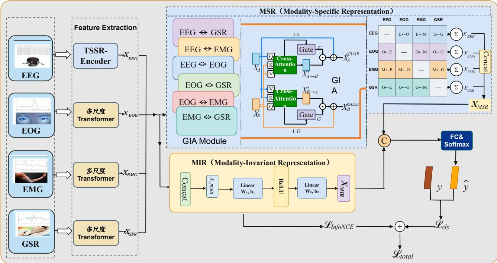
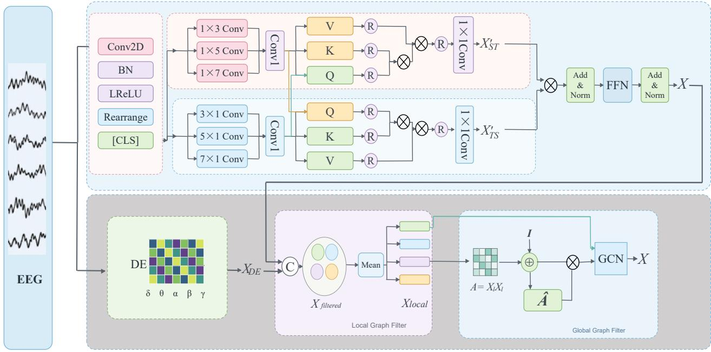
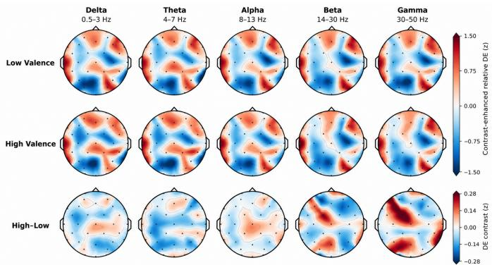
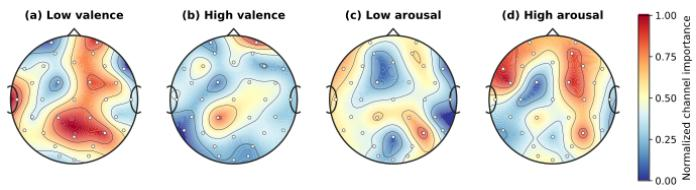
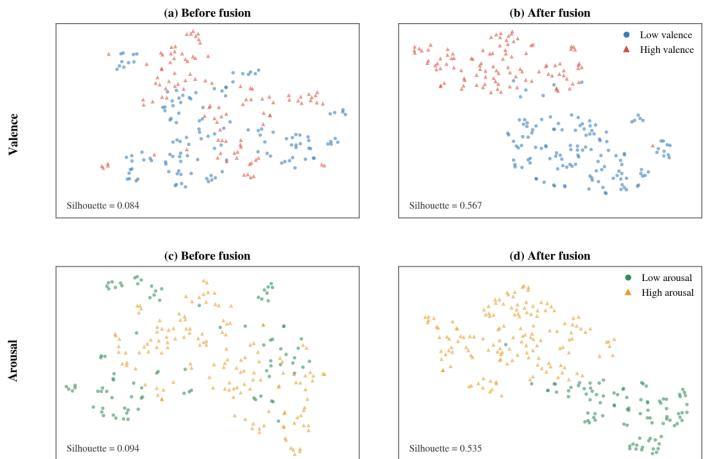

# Multiscale Temporal–Spectral–Spatial EEG Learning With Modality-Specific and Modality-Invariant Representations for Emotion Recognition

Jian Zhang, Manrong Liu, Yilei Huang, Wenhua Liu, Xiaohui Yang and Lijun Yang\*

Abstract—Multimodal physiological signals provide complementary cues for emotion recognition. They also raise two related challenges. Emotion-related EEG patterns vary across time, frequency bands, electrodes, and brain regions. Different physiological modalities also contain both modality-specific and shared affective information. This paper presents GMSI-Net, an EEG-centered multimodal emotion recognition framework. It has three key components. The temporal-spatial-spectral-region (TSSR) encoder models multiscale temporal-channel patterns, differential entropy features, and local-to-global brain-region relations. The modality-specific representation (MSR) branch uses bidirectional cross-modal attention and learnable gates. It controls information transfer while retaining modality-specific cues. The modality-invariant representation (MIR) branch learns a shared affective representation. An adaptively weighted contrastive loss aligns this representation across modalities. Independent multiscale Conv-Transformer encoders process the peripheral physiological signals. GMSI-Net is evaluated on DEAP and MAHNOB-HCI using within-subject random ten-fold crossvalidation. The model reaches 96.21 ± 1.47% and 96.41 ± 1.60% for valence and arousal on DEAP. It reaches $9 4 . 1 0 \pm 2 . 8 6 \%$ and $9 4 . 4 8 \pm 3 . 7 7 \%$ on MAHNOB-HCI. These results indicate that combining EEG features with complementary physiological information can improve emotion recognition.

Index Terms—multimodal emotion recognition,graph neural network, modality-specific representation, modality-invariant representation.

## I. INTRODUCTION

Affective computing concerns the recognition and interpretation of human affective states by computational systems [1], [2]. Emotion recognition is used in adaptive human–computer interaction, assistive technology, and affect-aware interfaces. Facial expression and speech are informative, although their measurement can be affected by lighting, background noise, and the extent to which emotion is outwardly expressed. Physiological signals provide another source of evidence. Electroencephalography (EEG) records neural activity at high temporal resolution. Electrooculography (EOG), electromyography (EMG), electrocardiography (ECG), and galvanic skin response (GSR) reflect ocular, muscular, cardiac, and electrodermal responses, respectively. DEAP and MAHNOB

HCI are widely used datasets for evaluating physiological emotion recognition [3], [4].

Two forms of variation matter when working with physiological signals. An emotional response changes over time, and its EEG correlates may appear in different frequency bands or scalp regions. Peripheral responses can evolve at different rates. Feature extraction thus needs to account for differences between signals. Their integration also needs to retain information specific to individual sensors.

EEG is difficult to represent with a single type of feature. Even a short segment contains temporal fluctuations, channeldependent activity, and frequency-band patterns. A filter with one receptive field may miss patterns at other temporal scales. Frequency descriptors summarize oscillatory activity but contain limited temporal-order information. Independent channel encoding also provides little information about spatial relations. Differential entropy (DE) is commonly used to characterize frequency-band statistics [5]. Spatial dependencies can be modeled with graph neural networks. DGCNN learns dynamic relations between electrodes [6], while LGGNet and PGCN use local-to-global and hierarchical graph structures [7], [8]. Attention-based methods model longer-range dependencies [9]. In many designs, however, temporal, frequency, and brainregion features are handled in separate paths. Bringing them into a single EEG representation remains a practical difficulty.

Temporal features retain the sequence of EEG changes; spectral features describe band-specific activity, and region level features reflect spatial organization. When each is compressed independently, subsequent graph operations may no longer preserve where the temporal and spectral information originated. This motivates interactions between these features before brain-region aggregation.

Combining physiological modalities raises a different issue. EEG and peripheral recordings have different channel counts, distributions, and noise levels. Concatenation keeps the encoded features but cannot distinguish useful transfer from irrelevant content. Cross-modal attention introduces selective exchange, although the attended features may still contain noise. Learning a common space captures affective information present in several sensors, but a fully invariant representation can discard cues that occur in only one modality. Cross-modal attention, representation learning, and feature reweighting have been explored to manage this trade-off [10]–[12].

GMSI-Net uses different encoders for EEG and peripheral signals. Temporal, spectral, and brain-region operations are combined in the EEG encoder; peripheral signals are processed by separate convolutional and sequential encoders. Two paths then work on the encoded features. One exchanges information between modalities while retaining their individual features. The other learns affective information shared by synchronized signals. Treating these operations separately allows complementary and common information to be modeled without assigning them the same role.

GMSI-Net is an EEG-centered multimodal emotion recognition model. Its temporal-spatial-spectral-region (TSSR) encoder handles the EEG representation. A modality-specific representation (MSR) branch performs gated bidirectional crossmodal attention, and a modality-invariant representation (MIR) branch learns shared affective features with adaptive contrastive alignment. The contributions are as follows:

• TSSR combines multiscale temporal-channel attention, five-band DE features, and local-to-global brain-region graph learning. Temporal, spectral, and spatial information enters a unified EEG representation.

• The MSR branch uses pairwise bidirectional attention with learnable gates. Features can be exchanged between modalities without removing the direct path from each modality’s original representation.

• The MIR branch introduces sample-dependent contrastive weights for shared representation learning. Its output is combined with MSR for classification. The experimental analysis covers DEAP and MAHNOB-HCI, including component ablations, modality combinations, and brainregion comparisons.

## II. RELATED WORK

## A. EEG-Based Emotion Recognition

EEG emotion recognition has been studied using temporal, frequency-band, and spatial information. Spectral descriptors characterize changes in rhythmic activity; DE is one widely used statistic for individual frequency bands [5]. Convolutional networks extract short-range temporal patterns, whereas recurrent and attention-based models can consider longer sequences. SSA-MTSNet combines spectral-spatial attention, multiscale convolution, and recurrent aggregation [13]. These methods indicate that temporal context and spectral content contribute different information to emotion recognition.

Graph-based methods focus on spatial relations between EEG recordings that are not readily represented by a regular image grid. DGCNN learns relations among electrodes dynamically [6]. LGGNet builds local and global graph representations, and PGCN uses a hierarchical spatial structure [7], [8]. Aggregating channels by region reduces the number of graph nodes and introduces a structural prior. This also makes the quality of electrode-level features important: regional aggregation should not remove the local responses on which it depends.

An electrode graph captures relations among recording sites. A region graph instead operates on features aggregated from anatomical groups. With fewer nodes, region-level learning is more compact, but it depends on the information retained during aggregation. Local-to-global approaches connect these two levels [7], [8].

Temporal and spatial attention, graph Transformers, and multi-view EEG learning have also been investigated [9], [14], [15]. Attention weights can change with the input EEG segment, while graph operations account for broader spatial relations. Adding both to a network is not sufficient by itself. Their interaction determines whether temporal, spectral, and spatial features contribute to the same representation. TSSR links these views before producing the EEG embedding for multimodal fusion.

## B. Multimodal Physiological Emotion Recognition

Central and peripheral signals respond to related affective processes, but their measurements are not equivalent. EmotionMeter combines physiological representations for multimodal affect recognition [10]. Other work has used cross-modal attention, complementary pattern learning, and feature reweighting [11], [12], [16]. Cross-modal attention lets information from one sensor influence another. Whether that transfer helps depends on the source features and how closely the modalities correspond in a given observation.

Attention need not be symmetric: the information useful from modality A to modality B can differ from that useful in the reverse direction. A learnable gate can limit a transferred update when it is unhelpful, leaving more of the target representation intact. This differs from applying one global weight to an entire modality.

Physiological information can be fused at the feature, decision, or representation level. Feature-level methods concatenate encoded signals, while decision fusion combines predictions from separate classifiers. Representation-level fusion learns interactions before classification. Attention and gating provide ways to vary these interactions across samples. A feature transferred through cross-modal attention, however, is not necessarily shared in its statistical form. Muscular and neural responses can each predict emotion without being interchangeable.

Shared-space learning addresses information that is consistent across sensors. Contrastive objectives bring synchronized observations closer and separate unmatched samples. Such a space reflects affective factors supported by several modalities. Other details may belong to just one sensor and should remain available for prediction. Both forms of information are retained in the proposed model. MSR models gated complementary exchanges, while MIR uses adaptive contrastive alignment for shared affective feature learning.

In contrastive learning, synchronized physiological record ings provide positive pairs; unmatched observations provide negatives. Yet the relevance of a modality can vary from sample to sample. Adaptive weights allow the contribution of each modality to vary across samples.

## III. METHODOLOGY

GMSI-Net uses EEG-centered feature learning followed by cross-modal representation fusion. Let $X _ { e } \in \bar { \mathbb { R } } ^ { C _ { e } \times T _ { e } }$ be an EEG segment and $X _ { m } \in \mathbb { R } ^ { C _ { m } \times T _ { m } } :$ synchronized peripheral signal. Here, C and T indicate channel count and sequence

  
Fig. 1. Architecture of GMSI-Net. The EEG and peripheral encoders feed gated MSR interactions and an adaptive contrastive MIR branch. The resulting representations are fused for emotion classification.

length, respectively, and M is the total number of modalities.   
The architecture is shown in Fig. 1.

The EEG path uses TSSR to extract temporal, spectral, and brain-region features. Each peripheral modality has its own multiscale Conv-Transformer encoder for temporal feature extraction. The encoded outputs are projected to a common feature width before fusion.

The fusion stage has two branches with different purposes. MSR uses gated bidirectional cross-modal attention to exchange complementary information while retaining modality-specific features. MIR maps the encoded signals to a shared affective representation and applies contrastive learning for cross-modal alignment. Their outputs, $X _ { \mathrm { M S R } }$ and $X _ { \mathrm { M I R } }$ , are concatenated for classification.

## A. TSSR Encoder

TSSR combines multiscale temporal-channel features with band-specific DE and brain-region graphs. Its structure is given in Fig. 2.

1) Multiscale Cross-Axis Attention: The raw EEG segment is first embedded as a sequence. Convolution branches with different receptive fields capture local patterns at multiple scales. Cross-axis attention then relates temporal and channel features. At scale $k ,$ one direction is

$$
A _ { s  t } ^ { ( k ) } = \mathrm { s o f t m a x } ( \frac { Q _ { t } ^ { ( k ) } K _ { s } ^ { ( k ) \top } } { \sqrt { d } } ) V _ { s } ^ { ( k ) } .\tag{1}
$$

In this expression, $Q _ { t } ^ { ( k ) }$ denotes the temporal query; $K _ { s } ^ { ( k ) }$ and $V _ { s } ^ { ( k ) }$ denote the channel-wise key and value. The superscript k

identifies the scale and d is the attention dimension. The two attention directions are combined with scale-specific features:

$$
Z _ { k } = \mathrm { L N } ( U _ { k } ^ { t } + U _ { k } ^ { s } + W _ { o } [ A _ { s  t } ^ { ( k ) } ; A _ { t  s } ^ { ( k ) } ] ) .\tag{2}
$$

The terms $U _ { k } ^ { t }$ and $U _ { k } ^ { s }$ are temporal and channel features, $A _ { t  s } ^ { ( k ) }$ is the reverse attention output, and $W _ { o }$ is a learnable projection. Brackets indicate concatenation; LN is layer normalization. Separate projections are used along the two axes. Residual features preserve information at each scale, and the attention outputs link temporal and electrode relations before DE and brain-region modeling.

2) Frequency-Band Differential Entropy: DE features are computed in the five bands δ, θ, α, β, and γ. For an EEG variable approximated as Gaussian, DE is

$$
h ( X ) = \frac { 1 } { 2 } \log ( 2 \pi e \sigma ^ { 2 } ) .\tag{3}
$$

Here, X denotes the band-limited EEG signal, $\sigma ^ { 2 }$ its variance, and e Euler’s number. The band-wise DE features join the temporal-channel representation, so both types of information are available to the graph encoder.

Band-wise DE is extracted for each channel and fused with the learned temporal-channel features. The combined representation is then passed to the graph stage.

3) Local-to-Global Brain-Region Graph: After temporal and spectral fusion, EEG features are grouped by brain region. Within each region, a learnable filter updates electrode-level node features:

$$
X _ { \mathrm { f l t e r e d } } ^ { l } = \Phi _ { \mathrm { R e L U } } ( W _ { \mathrm { l o c a l } } \odot X _ { T S } ^ { l } - b _ { \mathrm { l o c a l } } ) .\tag{4}
$$

  
Fig. 2. TSSR encoder. Temporal-channel and spectral features are fused before local and global brain-region modeling.

The input $X _ { T S } ^ { l }$ contains fused features for region l. $W _ { \mathrm { l o c a l } }$ and $b _ { \mathrm { l o c a l } }$ are learnable filter parameters, ⊙ means element-wise multiplication, and $\Phi _ { \mathrm { R e L U } }$ applies ReLU. The filtered nodes are aggregated within each region to form $X _ { \mathrm { l o c a l } }$ . A graph is then constructed between regions. Using the normalized adjacency $\hat { A } = D ^ { - 1 / 2 } A D ^ { - 1 / 2 }$ , graph convolution takes the form

$$
X _ { \mathrm { g l o b a l } } = \sigma ( \hat { A } X _ { \mathrm { l o c a l } } W _ { g } ) .\tag{5}
$$

Here, A is the region adjacency matrix, D its degree matrix, $W _ { g }$ the graph-convolution weight, and σ the activation function. Local filtering models relations within regions, while graph convolution carries information between them. The main experiments use the DL partition; Section V-A compares the partition schemes.

The graph operates on the combined temporal and DE representation. Local filtering keeps electrode-level detail; global convolution models interactions among regions. A final projection matches the feature width of the peripheral encoders.

## B. MSR Representation Learning

MSR transfers complementary information without discard ing the original modality features. Each modality pair (A, B) is processed in both directions, $A  B$ and $B  A .$ by a gated interaction block. The attention for $A  B$ is

$$
\widetilde { H } _ { a  b } = \mathrm { s o f t m a x } ( \frac { Q _ { a } K _ { b } ^ { \top } } { \sqrt { d } } ) V _ { b } .\tag{6}
$$

The query $Q _ { a }$ comes from the target modality a; $K _ { b }$ and $V _ { b }$ are the key and value of source modality b, and d is the attention dimension. A learnable gate controls the transferred information:

$$
g _ { a  b } = \mathrm { s i g m o i d } ( W _ { g } \mathrm { L N } ( \mathrm { A v g P o o l } ( \widetilde { H } _ { a  b } ) ) + b _ { g } ) .\tag{7}
$$

Here, AvgPool is average pooling, $W _ { g }$ and $b _ { g }$ are the gate parameters for this branch, and sigmoid gives the gate values. The resulting feature is

$$
S _ { a  b } = g _ { a  b } \odot \widetilde { H } _ { a  b } + ( 1 - g _ { a  b } ) \odot H _ { a } .\tag{8}
$$

The original target feature is $H _ { a } , \ g _ { a  b }$ controls its update, and $S _ { a  b }$ is the gated output. With M modalities there are $M ( M - 1 ) / 2$ bidirectional interaction blocks. Outputs directed to the same target are aggregated into its MSR vector. The residual path retains the target feature when a cross-modal update is less useful.

In each directed interaction, the receiving modality supplies the query and retains its original feature through the residual term. The source modality supplies the attended content. Reversing the interaction exchanges these roles. With several peripheral sensors, a target may receive multiple updates, each through a separate gated block. The updates are aggregated into its MSR representation before classification, so attention and residual information remain available within the same branch.

## C. MIR and Joint Optimization

MIR focuses on affective information shared across modalities, complementing the modality-specific features retained by MSR. The encoded sequence $H _ { m }$ of modality m is first pooled:

$$
h _ { m } = \operatorname* { m e a n } ( H _ { m } ) .\tag{9}
$$

The operator mean averages over the temporal dimension, giving the modality vector $h _ { m }$ . Vectors from all M modalities are then concatenated and projected to the MIR representation:

$$
X _ { \mathrm { M I R } } = W _ { 2 } \mathrm { R e L U } ( W _ { 1 } [ h _ { 1 } ; \ldots ; h _ { M } ] + b _ { 1 } ) + b _ { 2 } .\tag{10}
$$

The vectors $h _ { 1 } , \ldots , h _ { M }$ cover EEG and peripheral features; $W _ { 1 } , W _ { 2 }$ and $b _ { 1 } , b _ { 2 }$ are learnable projection matrices and biases. For sample $i , X _ { \mathrm { M I R } } ^ { ( i ) }$ is paired with $\bar { h } _ { m } ^ { ( i ) }$ as a positive example. Other samples in the batch serve as negatives. With $L _ { 2 ^ { - } }$ normalized features, similarity is defined as

$$
s _ { i j } ^ { ( m ) } = \frac { \bar { X } _ { \mathrm { M I R } } ^ { ( i ) \top } \bar { h } _ { m } ^ { ( j ) } } { \tau } .\tag{11}
$$

The bars indicate $L _ { 2 }$ normalization, i and $j$ index samples, and $\tau$ is the temperature. Given modality scores $w _ { m } ^ { ( i ) }$ , the normalized weights are

$$
\widetilde { w } _ { m } ^ { ( i ) } = \frac { \exp ( w _ { m } ^ { ( i ) } ) } { \sum _ { r = 1 } ^ { M } \exp ( w _ { r } ^ { ( i ) } ) } .\tag{12}
$$

The score $w _ { m } ^ { ( i ) }$ is unnormalized, while $\widetilde { w } _ { m } ^ { ( i ) }$ is its normalized weight for sample i. The adaptive MIR loss, shown as the InfoNCE term in Fig. 1, is

$$
\mathcal { L } _ { \mathrm { M I R } } = - \frac { 1 } { B } \sum _ { i = 1 } ^ { B } \sum _ { m = 1 } ^ { M } \widetilde { w } _ { m } ^ { ( i ) } \log \frac { \exp ( s _ { i i } ^ { ( m ) } ) } { \sum _ { j = 1 } ^ { B } \exp ( s _ { i j } ^ { ( m ) } ) } .\tag{13}
$$

The batch size is B. The term $s _ { i i } ^ { ( m ) }$ measures a positive pair, whereas $s _ { i j } ^ { ( m ) }$ for $j \neq i$ refers to a negative pair. The loss encourages agreement with synchronized modalities and separation from unmatched observations.

For classification, the MSR and MIR vectors are concatenated:

$$
h _ { \mathrm { f i n a l } } = [ X _ { \mathrm { M S R } } ; X _ { \mathrm { M I R } } ] .\tag{14}
$$

Here, $X _ { \mathrm { M S R } }$ is the aggregated modality-specific representation; brackets denote concatenation. A fully connected layer followed by Softmax outputs class probabilities. The full training objective is

$$
\begin{array} { r } { \mathcal { L } _ { \mathrm { t o t a l } } = \mathcal { L } _ { \mathrm { c l s } } + \lambda \mathcal { L } _ { \mathrm { M I R } } + \alpha \| \Theta \| _ { 2 } ^ { 2 } , } \end{array}\tag{15}
$$

In this objective, $\mathcal { L } _ { \mathrm { c l s } }$ is cross-entropy loss, λ controls the contrastive term, and α controls $L _ { 2 }$ regularization. The trainable parameters are denoted by Θ, with ∥Θ∥2 their squared $L _ { 2 }$ norm. Contrastive alignment is used during training.

At inference, prediction uses the encoders, MSR, MIR projection, and classifier. Negative pairs are needed for the training objective but are not constructed for prediction, so contrastive alignment does not require a separate inference stage.

## IV. EXPERIMENTS

## A. Datasets and Preprocessing

DEAP contains recordings from 32 participants, each of whom watched 40 one-minute music videos [3]. The inputs comprise 32 EEG channels, two EOG channels, two EMG channels, and one GSR channel. Preprocessed signals are sampled at 128 Hz. The 3-s resting segment is used for baseline correction. Each trial is then divided into non-overlapping 1-s windows. Valence and arousal labels are binarized at 5.

MAHNOB-HCI contains synchronized physiological and audiovisual recordings [4]. The experiments use 27 valid subjects and physiological inputs comprising 32-channel EEG, three ECG channels, and one GSR channel. After baseline correction and downsampling, signals are divided into nonoverlapping 1-s windows. The threshold for both valence and arousal is 5, as in DEAP. Both datasets are evaluated using within-subject random ten-fold cross-validation. Accuracy is reported as the mean and standard deviation across subjects. The data split strategy is kept unchanged in comparisons between model variants.

## B. Experimental Setup

Valence and arousal are trained as separate classification tasks. Training uses the joint classification and contrastive learning objective; Table I lists the hyperparameters for both datasets.

TABLE I  
TRAINING AND REPRODUCIBILITY SETTINGS
<table><tr><td>Setting</td><td>DEAP and MAHNOB-HCI</td></tr><tr><td>Brain partition</td><td>DL</td></tr><tr><td>Batch size</td><td>60</td></tr><tr><td>Learning rate</td><td>0.002</td></tr><tr><td>Adam  $( { \bar { \beta } } _ { 1 } , \beta _ { 2 } )$ </td><td>(0.5,0.9)</td></tr><tr><td>Weight decay</td><td>0.005</td></tr><tr><td> $\lambda , \tau$ </td><td>0.2, 0.2</td></tr><tr><td>Random seed</td><td>42</td></tr></table>

The number of training epochs was examined separately for each dataset. Accuracy reached its highest observed level at approximately 100 epochs on DEAP and 50 on MAHNOB-HCI; these values were used in the final experiments. Reported accuracies are subject-level means with standard deviations.

## C. Experimental Results

On DEAP, GMSI-Net obtains $9 6 . 2 1 \pm 1 . 4 7 \%$ valence accuracy and $9 6 . 4 1 \pm 1 . 6 0 \%$ arousal accuracy. The MAHNOB-HCI results are $9 4 . 1 0 \pm 2 . 8 6 \%$ and $9 4 . 4 8 \pm 3 . 7 7 \%$ , respectively. Comparisons with the selected methods are given in Tables II and III.

TABLE II  
CLASSIFICATION ACCURACY ON DEAP
<table><tr><td>Method</td><td>Modality</td><td colspan="2">Accuracy (%)</td></tr><tr><td></td><td></td><td>Valence</td><td>Arousal</td></tr><tr><td>Ding et al. [11]</td><td>EEG+PPS</td><td>94.88</td><td>95.26</td></tr><tr><td>GBV-Net [17]</td><td>EEG+PPS+Face</td><td>95.10</td><td>95.65</td></tr><tr><td>Att-CNN-GRU [18]</td><td>EEG+ECG</td><td>92.50</td><td>91.30</td></tr><tr><td>Diff-MT [19]</td><td>EEG+EOG+EMG+GSR</td><td>94.83</td><td>93.95</td></tr><tr><td>HCNN [20]</td><td>EEG+Face</td><td>87.84</td><td>88.09</td></tr><tr><td>GMSI-Net</td><td> $\mathbf { E E G + E O G + E M G + G S R }$ </td><td>96.21±1.47 96.41±1.60</td><td></td></tr></table>

Valence and arousal accuracy are close on DEAP. The results are obtained by combining the structured EEG representation with peripheral information through the two fusion branches.

The two affective dimensions yield similar results on DEAP: 96.21% for valence and 96.41% for arousal. On MAHNOB-HCI, accuracy is 94.10% and 94.48%. The same feature extraction and fusion design is used for both tasks.

The DEAP comparison includes EEG-plus-physiology methods by Ding et al. and Diff-MT, alongside methods that also use visual input. Among the listed results, GMSI-Net has the highest valence and arousal accuracies. On MAHNOB-HCI, DMMVAE-LSTM has the nearest reported valence result, while the listed arousal accuracy of GMSI-Net is higher. These comparisons place the model alongside recent multimodal physiological emotion recognition methods.

TABLE III  
CLASSIFICATION ACCURACY ON MAHNOB-HCI
<table><tr><td rowspan="2">Method</td><td rowspan="2">Modality</td><td colspan="2">Accuracy (%)</td></tr><tr><td>Valence</td><td>Arousal</td></tr><tr><td>HCNN [20]</td><td>EEG+Face</td><td>91.40</td><td>90.72</td></tr><tr><td>STST [21]</td><td>EEG+micro-expression</td><td>86.10</td><td>85.70</td></tr><tr><td>DMMVAE-LSTM* [22] EEG+Face</td><td></td><td> $9 3 . 9 2 \pm 1 . 8 0 $ </td><td>93.18 ± 1.90</td></tr><tr><td>DeepVADNet† [23]</td><td>EEG+bio+Face</td><td>89.98</td><td>88.60</td></tr><tr><td>Liu et a  $1 . ^ { \ddagger } \ [ 2 4 ]$ </td><td>EEG+Speech</td><td>81.09</td><td>80.11</td></tr><tr><td>GMSI-Net</td><td>EEG+ECG+GSR</td><td>94.10 ± 2.86</td><td>94.48 ± 3.77</td></tr></table>

Note: ∗No-pre-trained-VAE variant from the cited study; †dimension-wise results from authors' released table; ‡cross-subject validation.

Variation across subjects differs between datasets. Standard deviations are 1.47 and 1.60 percentage points on DEAP, versus 2.86 and 3.77 points on MAHNOB-HCI.

## D. Ablation Study

Table IV reports ablations on DEAP and MAHNOB-HCI. EEG subcomponents are assessed in the CMMF-Net configuration; TSSR, MSR, MIR, and modality weighting are assessed in GMSI-Net. For w/o TSSR, the EEG encoder is replaced by a vanilla Transformer.

Among the evaluated final-model variants, replacing TSSR produces the largest accuracy decrease. On DEAP, valence accuracy falls from 96.21% to 93.08%, and arousal accuracy from 96.41% to 93.36% when the complete EEG encoder is replaced by a vanilla Transformer. The change is larger on MAHNOB-HCI: 94.10% and 94.48% fall to 72.11% and 75.55%. The structured EEG encoder is thus particularly important in the MAHNOB-HCI experiments.

The fusion branches provide further gains beyond EEG encoding, though their effects are not the same on the two datasets. Without MIR, DEAP valence and arousal accuracy drop by 0.72 and 0.51 percentage points. Removing MSR produces smaller decreases on DEAP and larger ones on MAHNOB-HCI. Learned modality weighting also performs better than uniform weighting. Cross-modal interaction and shared-space alignment therefore contribute at different levels across the datasets.

Accuracy also declines when DE features, brain-region graphs, or peripheral encoders are removed. Both structured EEG features and multimodal interactions contribute to the predictions.

Without DE features, MAHNOB-HCI valence and arousal accuracy fall to 73.24% and 76.12%. Spectral features have a substantial effect in this setting.

The representation-level ablations on DEAP remain relatively close to the full-model accuracy. Removing MSR changes valence by 0.24 and arousal by 0.04 points; removing MIR changes them by 0.72 and 0.51 points. On MAHNOB-HCI, the two branches make more similar contributions. DE features also affect the datasets differently. Their removal produces a modest decline on DEAP but a much larger one on MAHNOB-HCI, indicating a stronger dependence on spectral information in the latter experiments.

Taken together, the ablations identify structured EEG feature extraction and cross-modal representation learning as useful parts of the model. TSSR accounts for a large part of the EEG representation gain. MSR, MIR, and adaptive modality weighting bring additional improvements to multimodal fusion.

## E. Effect of Modality Combinations

Tables V and VI compare the input combinations. The complete four-modal configuration gives the highest accuracy among the tested combinations on DEAP. On MAHNOB-HCI, the highest accuracy is obtained with EEG+ECG+GSR. Not every smaller subset benefits from an added sensor; a new modality may introduce redundancy or noise along with useful information.

All tested combinations include EEG, consistent with the EEG-centered design of GMSI-Net. These experiments test what peripheral signals add to EEG rather than whether they can replace it. Accuracy does not increase consistently as modalities are added. The usefulness of peripheral inputs depends partly on signal quality and redundancy between sensors.

For DEAP, the evaluated configurations combine EEG with different subsets of EOG, EMG, and GSR. The MAHNOB-HCI experiments instead combine EEG with ECG and GSR.

EEG alone reaches 89.45% valence and 90.45% arousal accuracy on DEAP. Adding either EOG or EMG improves both tasks, but adding GSR alone does not improve the EEG baseline. The EOG–EMG pair reaches 93.83% and 94.07%. With all three peripheral signal types, accuracy increases to 96.21% and 96.41%. Compared with EEG alone, these are gains of 6.76 and 5.96 percentage points in valence and arousal. The gains are more pronounced when complementary peripheral responses are used together than when a single peripheral sensor is added.

TABLE IV  
ABLATION STUDY ON DEAP AND MAHNOB-HCI
<table><tr><td></td><td colspan="2">DEAP</td><td colspan="2">MAHNOB-HCI</td></tr><tr><td>Setting</td><td>Valence</td><td>Arousal</td><td>Valence</td><td>Arousal</td></tr><tr><td>w/o MCA encoder</td><td> $9 4 . 7 3 \pm 1 . 8 6$ </td><td> $9 4 . 9 6 \pm 2 . 2 1 $ </td><td> $9 3 . 0 9 \pm 3 . 4 8$ </td><td> $9 2 . 8 1 \pm 5 . 1 0$ </td></tr><tr><td>w/o DE features</td><td> $9 3 . 6 1 \pm 2 . 1 1$ </td><td> $9 3 . 9 8 \pm 2 . 1 7$ </td><td> $7 3 . 2 4 \pm 5 . 2 9$ </td><td> $7 6 . 1 2 \pm 9 . 5 4$ </td></tr><tr><td>w/o brain-region graph</td><td> $9 4 . 5 4 \pm 1 . 8 3 $ </td><td> $9 4 . 7 0 \pm 2 . 2 1 $ </td><td> $9 2 . 5 0 \pm 3 . 3 9$ </td><td> $9 2 . 2 8 \pm 5 . 2 3$ </td></tr><tr><td>w/o peripheral Conv-Transformer</td><td> $9 3 . 3 3 \pm 3 . 1 0$ </td><td> $9 3 . 3 8 \pm 4 . 0 7$ </td><td> $9 2 . 8 2 \pm 3 . 7 5$ </td><td> $9 2 . 4 4 \pm 5 . 1 9$ </td></tr><tr><td>w/o cross-modal attention</td><td> $9 4 . 8 9 \pm 1 . 9 3 $ </td><td> $9 5 . 2 2 \pm 2 . 0 9$ </td><td> $9 2 . 8 2 \pm 3 . 3 6$ </td><td> $9 2 . 7 2 \pm 4 . 7 9$ </td></tr><tr><td>w/o TSSR</td><td> $9 3 . 0 8 \pm 1 . 9 2$ </td><td> $9 3 . 3 6 \pm 2 . 5 6$ </td><td> $7 2 . 1 1 \pm 5 . 6 0$ </td><td> $7 5 . 5 5 \pm 9 . 9 6$ </td></tr><tr><td>w/o MSR</td><td> $9 5 . 9 7 \pm 1 . 5 4$ </td><td> $9 6 . 3 7 \pm 1 . 5 7$ </td><td> $9 2 . 8 2 \pm 3 . 4 8$ </td><td> $9 2 . 5 4 \pm 4 . 9 7$ </td></tr><tr><td>w/o MIR</td><td> $9 5 . 4 9 \pm 1 . 5 8$ </td><td> $9 5 . 9 0 \pm 1 . 8 2$ </td><td> $9 2 . 7 4 \pm 3 . 4 1$ </td><td> $9 2 . 9 1 \pm 4 . 5 5$ </td></tr><tr><td>w/o learned modality weighting</td><td> $9 5 . 6 6 \pm 1 . 4 7$ </td><td> $9 6 . 0 1 \pm 1 . 6 3$ </td><td> $9 2 . 9 4 \pm 3 . 2 0$ </td><td> $9 2 . 8 7 \pm 4 . 7 0$ </td></tr><tr><td>GMSI-Net</td><td> ${ \bf 9 6 . 2 1 \pm 1 . 4 7 }$ </td><td> $\mathbf { 9 6 . 4 1 \pm 1 . 6 0 }$ </td><td> ${ \bf 9 4 . 1 0 \pm 2 . 8 6 }$ </td><td> ${ \bf 9 4 . 4 8 \pm 3 . 7 7 }$ </td></tr></table>

TABLE V  
MODALITY COMBINATIONS ON DEAP
<table><tr><td>Combination</td><td colspan="2">ACC ± Std (%)</td></tr><tr><td></td><td>Valence</td><td>Arousal</td></tr><tr><td>EEG</td><td> $8 9 . 4 5 \pm 4 . 6 5$ </td><td> $9 0 . 4 5 \pm 4 . 4 9$ </td></tr><tr><td>EEG+EOG</td><td> $9 1 . 8 2 \pm 3 . 1 8$ </td><td> $9 2 . 1 8 \pm 3 . 0 6$ </td></tr><tr><td>EEG+EMG</td><td> $9 2 . 1 7 \pm 3 . 7 3$ </td><td> $9 2 . 4 5 \pm 5 . 3 2$ </td></tr><tr><td>EEG+GSR</td><td> $8 8 . 9 9 \pm 4 . 8 1$ </td><td> $9 0 . 4 4 \pm 3 . 9 6$ </td></tr><tr><td> $_ \mathrm { E E G + E O G + E M G }$ </td><td> $9 3 . 8 3 \pm 1 . 7 0$ </td><td> $9 4 . 0 7 \pm 1 . 8 0 $ </td></tr><tr><td> $\mathrm { E E G + E O G + G S R }$ </td><td> $9 2 . 5 7 \pm 1 . 8 5$ </td><td> $9 3 . 0 5 \pm 2 . 0 3$ </td></tr><tr><td> $_ \mathrm { E E G + E M G + G S R }$ </td><td> $9 2 . 3 4 \pm 2 . 0 5$ </td><td> $9 3 . 0 3 \pm 2 . 3 5$ </td></tr><tr><td> $\mathbf { E E G + E O G + E M G + G S R }$ </td><td> $9 6 . 2 1 \pm 1 . 4 7$ </td><td> $9 6 . 4 1 \pm 1 . 6 0$ </td></tr></table>

On MAHNOB-HCI, ECG and GSR provide cardiac and electrodermal measurements alongside EEG. Their combinations are reported separately for valence and arousal.

TABLE VI  
MODALITY COMBINATIONS ON MAHNOB-HCI
<table><tr><td>Combination</td><td colspan="2">ACC ± Std (%)</td></tr><tr><td></td><td>Valence</td><td>Arousal</td></tr><tr><td>EEG</td><td> $9 1 . 3 8 \pm 3 . 9 9$ </td><td> $9 1 . 3 8 \pm 5 . 2 7$ </td></tr><tr><td>EEG+ECG</td><td> $9 1 . 8 8 \pm 4 . 3 6 $ </td><td> $9 2 . 9 3 \pm 4 . 5 3$ </td></tr><tr><td>EEG+GSR</td><td> $9 1 . 7 7 \pm 3 . 6 5$ </td><td> $9 2 . 1 4 \pm 4 . 8 3$ </td></tr><tr><td>EEG+ECG+GSR</td><td> $9 4 . 1 0 \pm 2 . 8 6$ </td><td> $9 4 . 4 8 \pm 3 . 7 7$ </td></tr></table>

On MAHNOB-HCI, EEG alone obtains 91.38% accuracy for both dimensions. Adding ECG raises arousal accuracy to 92.93%; EEG+GSR reaches 92.14%. With EEG+ECG+GSR, valence and arousal accuracy reach 94.10% and 94.48%, improving on EEG alone by 2.72 and 3.10 percentage points. Both peripheral modalities contribute when used together. These results are consistent with the independent peripheral encoders and gated exchange in GMSI-Net, which combines information after each signal has been encoded.

## V. DISCUSSION

## A. Brain-Region Partition

Table VII compares five brain-region partitions. H groups electrodes by hemisphere, and RL uses broad anatomical lobes. DL further divides each lobe into left and right regions [7]. F [7] and T [8] refine the frontal and temporal regions, respectively. DL gives the highest accuracies among the tested partitions on both datasets. It retains lobar organization and hemispheric distinctions and is therefore used in the main experiments.

With the underlying fusion backbone, DL yields 95.37% valence accuracy on DEAP; H, RL, F, and T yield 94.52%, 95.16%, 95.19%, and 95.27%. Its arousal accuracy is 95.79%, the highest among the tested partitions. On MAHNOB-HCI, its valence and arousal scores are 93.76% and 93.72%. Hemisphere-only grouping retains left–right distinctions but offers little regional detail. RL adds coarse anatomical structure; F and T place more emphasis on selected frontal or temporal regions. DL keeps lobar distinctions while separating the hemispheres within each lobe, and yields the highest backbone accuracies in this comparison. These partition results concern the regional encoder. Overall GMSI-Net classification results are reported separately in Tables II and III.

TABLE VII  
BRAIN-REGION PARTITION ANALYSIS (ACCURACY, %)
<table><tr><td>Partition</td><td colspan="2">DEAP</td><td colspan="2">MAHNOB-HCI</td></tr><tr><td></td><td>Valence</td><td>Arousal</td><td>Valence</td><td>Arousal</td></tr><tr><td>H</td><td>94.52</td><td>94.51</td><td>91.49</td><td>91.22</td></tr><tr><td>RL</td><td>95.16</td><td>95.27</td><td>91.63</td><td>91.13</td></tr><tr><td>DL</td><td>95.37</td><td>95.79</td><td>93.76</td><td>93.72</td></tr><tr><td>F</td><td>95.19</td><td>95.37</td><td>92.83</td><td>93.07</td></tr><tr><td>T</td><td>95.27</td><td>95.25</td><td>91.49</td><td>91.26</td></tr></table>

## B. Visualization

The EEG maps in Fig. 3 show how band-wise differential entropy (DE) varies with valence and scalp location. Lowand high-valence states display different spatial patterns in the five frequency bands. Local contrasts are most visible in the $\beta$ and γ bands, while the differences in other bands are more limited. The changes also occur at several scalp locations. This distribution gives a data-level reason to consider both frequency-band features and spatial relations in TSSR.

  
Fig. 3. Band-wise EEG topographies for valence on DEAP. The first two rows show relative DE maps for low- and high-valence states across the δ, $\theta , \alpha , \beta ,$ and γ bands. The bottom row shows the high-minus-low contrast, revealing spatial and spectral differences between emotional states.

Channel perturbation provides a complementary view, this time of the trained model rather than the DE maps. Fig. 4 shows that the relative importance of EEG electrodes changes between valence and arousal, and between their respective classes. The classifier shows different degrees of sensitivity to electrodes across tasks. These spatial differences are consistent with the local-to-global region modeling of TSSR, which combines electrode-level features with interactions between regions.

The learned representations were also examined using t-SNE. In Fig. 5, features from different emotional classes overlap considerably before multimodal fusion. The fused representations form more distinct clusters in the projected space. Silhouette scores increase from 0.084 to 0.567 for valence and from 0.094 to 0.535 for arousal. The projected distributions are consistent with improved class separation after MSR–MIR fusion.

  
Fig. 4. EEG channel importance on DEAP obtained by channel perturbation. Panels (a)–(d) represent low valence, high valence, low arousal, and high arousal, respectively. The normalized importance maps illustrate task-dependent spatial contributions of EEG electrodes.

  
Fig. 5. t-SNE visualization of feature distributions before and after GMSI-Net fusion. The top and bottom rows correspond to valence and arousal, respectively. The left panels show pre-fusion features, while the right panels show fused representations. Silhouette scores increase from 0.084 to 0.567 for valence and from 0.094 to 0.535 for arousal.

## VI. CONCLUSION

GMSI-Net was developed for EEG-centered multimodal emotion recognition. It combines multiscale EEG feature learning with modality-specific and shared representation learning. Temporal, spectral, and spatial information is extracted from EEG, while peripheral responses provide complementary cues. The two fusion branches retain features specific to each modality and learn shared affective information.

The achieved accuracies are 96.21 ± 1.47% for valence and 96.41 ± 1.60% for arousal on DEAP, and 94.10 ± 2.86% and 94.48 ± 3.77% on MAHNOB-HCI. The experiments also show differences between components. Replacing TSSR reduces performance markedly, especially on MAHNOB-HCI. DE features have a larger effect on MAHNOB-HCI than on DEAP, and the gains from MSR and MIR differ across datasets. In the modality-combination tests, adding one peripheral sensor does not always help. Within the tested combinations, using complementary signals together yields higher accuracies. Brainregion comparisons favor structured EEG features, while the visualizations show clearer class separation after multimodal fusion.

These observations point to the value of learning EEG features across several dimensions without discarding information specific to peripheral modalities. Future work will examine cross-subject generalization, missing-modality robustness, and the efficiency of cross-modal interaction.

## ACKNOWLEDGMENT

The authors would like to thank the journal editor and anonymous reviewers for their constructive comments. This research was partially supported by the Key Research and Development and Promotion Special Project (Technology Development) in Henan Province (grant number 252102210067), Key scientific research projects of Henan higher education institutions (grant numbers 25A120001 and 26B320004).

## REFERENCES

[1] R. W. Picard, Affective Computing. Cambridge, MA, USA: MIT Press, 1997.

[2] J. A. Russell, “A circumplex model of affect,” J. Pers. Soc. Psychol., vol. 39, no. 6, pp. 1161–1178, 1980.

[3] S. Koelstra et al., “DEAP: A database for emotion analysis using physiological signals,” IEEE Trans. Affect. Comput., vol. 3, no. 1, pp. 18–31, 2012.

[4] M. Soleymani, J. Lichtenauer, T. Pun, and M. Pantic, “A multimodal database for affect recognition and implicit tagging,” IEEE Trans. Affect. Comput., vol. 3, no. 1, pp. 42–55, 2012.

[5] R.-N. Duan, J.-Y. Zhu, and B.-L. Lu, “Differential entropy feature for EEG-based emotion classification,” in Proc. 6th Int. IEEE/EMBS Conf. Neural Eng. (NER), 2013, pp. 81–84, doi: 10.1109/NER.2013.6695876.

[6] T. Song, W. Zheng, P. Song, and Z. Cui, “EEG emotion recognition using dynamical graph convolutional neural networks,” IEEE Trans. Affect. Comput., vol. 11, no. 3, pp. 532–541, 2020.

[7] Y. Ding, N. Robinson, C. Tong, Q. Zeng, and C. Guan, “LGGNet: Learning from local-global-graph representations for brain-computer interface,” IEEE Trans. Neural Netw. Learn. Syst., vol. 35, no. 7, pp. 9773–9786, 2024, doi: 10.1109/TNNLS.2023.3236635.

[8] M. Jin, C. Du, H. He, T. Cai, and J. Li, “PGCN: Pyramidal graph convolutional network for EEG emotion recognition,” IEEE Trans. Multimedia, vol. 26, pp. 9070–9082, 2024, doi: 10.1109/TMM.2024.3385676.

[9] Z. Wang, Y. Wang, C. Hu, Z. Yin, and Y. Song, “Transformers for EEGbased emotion recognition: A hierarchical spatial information learning model,” IEEE Sensors J., vol. 22, no. 5, pp. 4359–4368, 2022.

[10] W.-L. Zheng, W. Liu, Y. Lu, B.-L. Lu, and A. Cichocki, “EmotionMeter: A multimodal framework for recognizing human emotions,” IEEE Trans. Cybern., vol. 49, no. 3, pp. 1110–1122, 2019.

[11] S. Ding, L. Ma, and H. Li, “Multimodal physiological signal emotion recognition based on multi-head cross attention with representation learning,” Front. Psychiatry, vol. 16, Art. no. 1713559, 2025, doi: 10.3389/fpsyt.2025.1713559.

[12] B. Fu, W. Chu, C. Gu, and Y. Liu, “Cross-modal guiding and reweighting network for multi-modal emotion recognition,” IEEE J. Biomed. Health Inform., vol. 28, no. 10, pp. 5865–5876, 2024.

[13] Z. Tao, G. Huang, L. Ma, Z. Chen, Y. Liu, and K. S. Hong, “Emotion recognition using spectral-spatial attention multi-temporal scale network: EEG study,” Brain Inform., vol. 13, Art. no. 22, 2026, doi: 10.1186/s40708-026-00309-x.

[14] K. Krishnakumar and S. Latha, “STGT-Net: A spatio-temporal graph-transformer network for EEG-based emotion recognition,” J. Franklin Inst., vol. 363, no. 14, Art. no. 108918, 2026, doi: 10.1016/j.jfranklin.2026.108918.

[15] S. Ding et al., “DGAT: A dynamic graph attention neural network framework for EEG emotion recognition,” Front. Psychiatry, vol. 16, Art. no. 1633860, 2025, doi: 10.3389/fpsyt.2025.1633860.

[16] Z. Ma, A. Li, J. Tang, J. Zhang, and Z. Yin, “Multimodal emotion recognition by fusing complementary patterns from central to peripheral neurophysiological signals across feature domains,” Eng. Appl. Artif. Intell., vol. 143, Art. no. 110004, 2025, doi: 10.1016/j.engappai.2025.110004.

[17] J. Yu, Y. Ru, B. Lei, and H. Chen, “GBV-Net: Hierarchical fusion of facial expressions and physiological signals for multimodal emotion recognition,” Sensors, vol. 25, no. 20, Art. no. 6397, 2025, doi: 10.3390/s25206397

[18] Z. Wang and Y. Wang, “Emotion recognition based on multimodal physiological electrical signals,” Front. Neurosci., vol. 19, Art. no. 1512799, 2025, doi: 10.3389/fnins.2025.1512799.

[19] C. Li, Y. Mao, Q. Huang, W. Xie, X. He, and J. Wu, “A real-time emotion-aware system based on wireless body area network for IoMT applications,” IEEE Internet Things J., vol. 11, no. 24, pp. 41182–41193, 2024, doi: 10.1109/JIOT.2024.3458976.

[20] M. Shafiq, S. A. Awan, and T. Kamal, “Hierarchical convolutional neural network for emotion recognition using EEG and facial expressions,” Rev. Int. Métodos Numér. Cálc. Diseño Ing., early access, 2026, doi: 10.23967/j.rimni.2026.10.7209.

[21] Z. Chen, Y. Liang, J. Li, C. Bai, Q. Xie, and J. Pan, “EEG- and micro-expression-based emotion recognition and consciousness detection,” IEEE Trans. Affect. Comput., vol. 17, no. 3, pp. 3593–3609, 2026, doi: 10.1109/TAFFC.2025.3650482.

[22] B. Mahaseni and N. M. Khan, “Multimodal emotion recognition with disentangled representations: Private-shared multimodal variational autoencoder and long short-term memory framework,” Empathic Comput., 2025, doi: 10.70401/ec.2025.0010.

[23] I. Hosseini, M. Z. Hossain, Y. Zhang, and S. Rahman, “Deep learning model for simultaneous recognition of quantitative and qualitative emotion using visual and bio-sensing data,” Comput. Vis. Image Underst., vol. 248, Art. no. 104121, 2024, doi: 10.1016/j.cviu.2024.104121.

[24] J. Liu, Y. Zhang, D. Chen, D. Mao, and G. Lu, “Bimodal emotion recognition method based on dual-stream attention and adversarial mutual reconstruction,” J. Electron. Inf. Technol., vol. 48, no. 1, pp. 277–286, 2026, doi: 10.11999/JEIT250424.

[25] D.-K. Jeong, H.-G. Kim, and J.-Y. Kim, “Emotion recognition using hierarchical spatiotemporal electroencephalogram information from local to global brain regions,” Bioengineering, vol. 10, no. 9, Art. no. 1040, 2023, doi: 10.3390/bioengineering10091040.

[26] Y. Zhang, C. Cheng, S. Wang, and T. Xia, “Emotion recognition using heterogeneous convolutional neural networks combined with multimodal factorized bilinear pooling,” Biomed. Signal Process. Control, vol. 77, Art. no. 103877, 2022, doi: 10.1016/j.bspc.2022.103877.

[27] H. Asemi and N. Farajzadeh, “Improving EEG signal-based emotion recognition using a hybrid GWO-XGBoost feature selection method,” Biomed. Signal Process. Control, vol. 99, Art. no. 106795, 2025.

[28] Y. Fu, W. Wang, Z. Shang, and Y. Li, “Meta-causal bidirectional decoupled learning for cross-subject emotion recognition with multimodal physiological signals,” Cogn. Comput., vol. 18, Art. no. 84, 2026, doi: 10.1007/s12559-026-10632-4.

[29] H.-G. Kim and J.-Y. Kim, “EEG-based local-global dimensional emotion recognition using electrode clusters, EEG Deformer, and temporal convolutional network,” Bioengineering, vol. 12, no. 11, Art. no. 1220, 2025, doi: 10.3390/bioengineering12111220.

[30] B. Mahaseni and N. M. Khan, “Robust multimodal emotion recognition under missing and incomplete data with cross-modal regeneration,” Empathic Comput., vol. 2, Art. no. 202610, 2026, doi: 10.70401/ec.2026.0023.