# NeoWorld-3: From Pixels to Code-Defined Physical Worlds

Eachen Soong1,2 Zijian Niu1,2 Haoran Xu1,2 Yihong Dong1\* Yunbo Wang1,2∗ Xiaokang Yang1 1Shanghai Jiao Tong University 2Doxi AI Code: https://github.com/NeoWorldProject/NeoWorldStudio Blog: https://neoworldproject.github.io/Studio

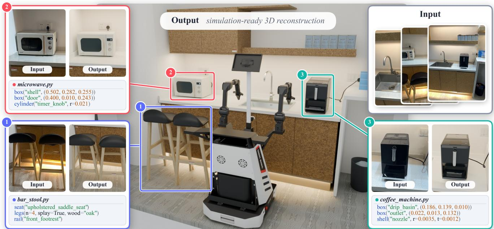

Figure 1. Code-defined physical worlds with NeoWorld-3. Given real-world visual observations, NeoWorld-3 uses tunable geometry programs to reconstruct editable, physically configurable 3D environments. The resulting worlds preserve explicit geometry and par structure, enabling physical interaction, simulation, and downstream robot planning. The reconstructed assets can be viewed at https: //neoworldproject.github.io/Studio/#scene-demo.

## Abstract

Simulation-ready world reconstruction demands physical interactivity beyond visual realism, which existing blackbox 3D generation fails to deliver. We present NeoWorld-3, a coding-agent framework that reconstructs interactive 3D worlds from visual observations via tunable, executable programs. At its core, NeoSDK provides the underlying computational engine for low-level geometries, part composition, differentiable parameter refinement, and physics validation. At the same time, NeoMCP exposes these capabilities as structured, tool-callable APIs for vision-language

agents to visually inspect, edit code, and iteratively refine programs. Through a hierarchical coordinator-worker architecture, the framework scales seamlessly from standalone articulated objects to complex compositional scenes. Evaluations across object-level and scene-level reconstruction benchmarks demonstrate that NeoWorld-3 achieves state-of-the-art geometric fidelity and physical readiness. Crucially, manipulation trajectories planned within our reconstructed twins achieve successful zero-shot execution on a physical dual-arm robot, completing the Real-Sim-Real loop.

## 1. Introduction

Reconstructing simulation-ready 3D worlds from visual observations is becoming a critical foundation for embodied intelligence. However, interactive simulation requires more than visual similarity: reconstructed assets must preserve explicit geometric structure, kinematic articulation constraints, collision boundaries, and inspectable physical properties (such as mass and contact friction). Prevailing generative 3D models [12, 19, 27] fall short of these physical requirements, producing black-box meshes or fixed latent representations that preclude programmatic editing, explicit joint configuration, and physical validity checks.

Coding agents provide a promising alternative by constructing 3D worlds through tunable programs [1, 6, 7, 30]. However, coding agents alone remain insufficient for interactive simulation due to two fundamental bottlenecks. First, limited geometric precision: autoregressive token prediction in VLMs lacks the numerical precision required for fine geometric alignment against visual observations. Second, lack of physics-in-the-loop verification: without physical validation, program construction can produce nonwatertight meshes, incorrectly configured joints, and interpart collisions. Consequently, existing agentic methods struggle to bridge the gap between open-ended code generation and the physical and functional requirements of interactive simulation.

To overcome these bottlenecks, we propose NeoWorld-3, a coding-agent framework that reconstructs simulationready interactive worlds from visual observations via tunable geometry programs, as illustrated in Fig. 1. At its core, NEOSDK provides a tunable representation of part-level geometry, articulation, and physical properties, which couples program authoring with gradient-based refinement. NEOMCP exposes these capabilities as standardized modeling and inspection tools for vision-language agents. NeoWorld-3 also supports trace-guided development of reusable modeling tools through a recursive selfimprovement (RSI) mechanism. NeoWorld-3 integrates geometry inspection, articulation validation, and simulatorspecific physicalization to produce simulation-ready 3D assets. Additionally, NEOSDK provides metric solid adaptation for physical carriers. As summarized in Table 1, NeoWorld-3 supports the full spectrum of capabilities required for simulation-ready reconstruction, surpassing both generative image-to-3D pipelines and prior coding-agent approaches.

We evaluate NeoWorld-3 across comprehensive benchmarks spanning both asset reconstruction and embodied application: rigid-object, articulated-object, and physically constrained scene reconstruction, as well as downstream Real-Sim-Real (RSR) robotic manipulation tasks. We systematically assess visual fidelity, geometric accuracy, kinematic correctness, and physical validity, benchmarking against leading coding-agentic reconstruction approaches. NeoWorld-3 achieves state-of-the-art performance across both object and scene levels, while demonstrating that the reconstructed interactive environments can support downstream robotic manipulation tasks.

Our primary contributions are summarized as follows:

• Agentic world reconstruction. We introduce NeoWorld-3, a coding-agent framework built on NEOSDK and NEOMCP that reconstructs 3D worlds from visual observations through tunable geometry programs. By extending reconstruction from individual objects to composed scenes and a trace-guided tool-development mechanism (RSI), it produces modular 3D environments that remain inspectable, tunable, and reusable.

• Differentiable refinement of geometry programs. We integrate differentiable refinement into tunable program construction to address the limited geometric precision of direct numerical prediction by language models. This refinement enhances visual and geometric fidelity while preserving program tunability.

• Physics-in-the-loop articulation and simulation-ready validation. We integrate geometry validation and repair, articulation verification, and simulator-specific physicalization to produce simulation-ready 3D assets. This enables reconstructed environments to support downstream interactive simulation and Real-Sim-Real (RSR) robotic manipulation tasks.

## 2. Related Work

3D reconstruction has made significant progress in recent years, yet existing approaches still face important limitations in reconstructing simulation-ready environments. Neural rendering methods, including NeRF [17] and 3D Gaussian Splatting [8], model scene appearance through radiance fields and Gaussian primitives, but do not directly provide geometric structures suitable for physical interaction. Generative 3D reconstruction methods, such as DreamFusion [19], TRELLIS [27], SAM 3D [23], and Pixal3D [12], leverage learned priors to generate 3D assets, but generally lack the articulated structures required for interactive simulation. Articulated reconstruction methods, including SINGAPO [15], SPARK [5], PhysX-Anything [2], and URDF-Anything [13], further recover part geometry and kinematic structures, but physical validity and simulation stability remain challenging.

Beyond these approaches, programmatic reconstruction is gradually becoming a mainstream direction in 3D reconstruction. Early LLM- and VLM-based methods, including 3D-GPT [22], BlenderAlchemy [7], and Real2Code [16], demonstrated the feasibility of generating and refining 3D programs, although reconstruction precision remained limited compared with dedicated reconstruction pipelines. More recent agentic approaches have substantially advanced this direction through iterative reasoning, tool use, and visual feedback: Articulate-Anything [11], VIGA [28], and Articraft [30] iteratively construct and refine structured 3D assets, while 3D-CoS [25] further explores codebased reconstruction as a general approach. However, discrete program edits can limit geometric precision, while visual feedback alone cannot guarantee physical validity. To address these limitations, NeoWorld-3combines tunable program construction with differentiable refinement and physics-in-the-loop validation to improve visual and geometric fidelity while producing simulation-ready 3D assets.

Table 1. Capabilities of different simulation-ready reconstruction routes. Diff denotes differentiable optimization, and RSI denotes recursive self-improvement. $\checkmark , \bigtriangleup$ , and × denote full, partial, and absent support. We compare our approach with three representative methods from distinct reconstruction approaches.
<table><tr><td></td><td colspan="3">Representation</td><td colspan="2">Geometry</td><td colspan="2">Simulation-Ready</td><td>Self-Improvement</td></tr><tr><td>Method</td><td>Scene</td><td>Tunable</td><td>Parts</td><td>Watertight</td><td>Diff.</td><td>Articulation</td><td>Physics</td><td>RSI</td></tr><tr><td>Generative image-to-3D (Pixal3D [12])</td><td>√</td><td>X</td><td>×</td><td>△</td><td>X</td><td>X</td><td>×</td><td>X</td></tr><tr><td>VLM-based (PhysX-Anything [2])</td><td>△</td><td>X</td><td>√</td><td>△</td><td>×</td><td>△</td><td>√</td><td>X</td></tr><tr><td>Coding-agent-based (Articraft [30])</td><td>√</td><td>△</td><td>√</td><td>X</td><td>X</td><td>√</td><td>X</td><td>X</td></tr><tr><td>NeoWorld-3</td><td>√</td><td>V</td><td>√</td><td>V</td><td>√</td><td>√</td><td>√</td><td>√</td></tr></table>

## 3. NeoWorld-3

NeoWorld-3 is a coding-agent framework that reconstructs simulation-ready interactive worlds from visual observations through tunable geometry programs. It combines agent-driven program construction with differentiable refinement, enabling structural editing and precise geometric optimization. From Figure 2, NEOSDK and NEOMCP provide tools for program construction, geometric refinement, and physics-in-the-loop validation, supporting reconstruction from individual objects to composed scenes.

## 3.1. Tunable Program Prototypes

We represent each reconstruction as a tunable prototype $P \ = \ ( S , \theta , T )$ , where S is the Python construction program, $\boldsymbol { \theta } = ( \theta _ { 1 } , \ldots , \theta _ { d } ) \in \mathbb { R } ^ { d }$ denotes the tunable program parameters, and $T = \{ T _ { i } \}$ denotes the object poses, with $T _ { i }$ specifies the position and orientation of object i. Executing the construction program S with parameters θ produces the object geometry G,

$$
{ \mathcal { G } } = S ( \theta ) ,
$$

which is then placed in the scene using the object poses $T .$ The dimensions and relative positions of parts are expressed in terms of θ. A shared parameter $\theta _ { k }$ can therefore control several related parts, preserving common dimensions, symmetry, or attachment relationships encoded in S. By using a compact set of semantically coupled parameters, we enable more effective geometric refinement while reducing optimization complexity and the risk of overfitting to limited

visual observations.

This decoupled representation supports two complementary modes of revision:

• Parameter refinement optimizes continuous parameters θ to match visual observations using gradient-based or sampling-based optimization while keeping S fixed.

• Structural editing modifies the construction program S itself by adding, removing, or reorganizing geometric primitives, Boolean operations, or kinematic parent-child relationships.

Consequently, NeoWorld-3 can refine geometry, structure, and scene layout while preserving a tunable program throughout reconstruction.

## 3.2. Hierarchical Agentic Reconstruction

Building on our structured prototype representation, NeoWorld-3 runs a hierarchical reconstruction loop spanning individual objects and composed scenes. The software infrastructure is organized into two layers: NEOSDK provides the low-level geometric operations used by the construction program, including primitive construction, part composition, native materialization, and differentiable execution; NEOMCP exposes these functionalities as structured, tool-callable APIs for visual inspection, code editing, and multi-view rendering. The NeoWorld-3 harness coordinates agent execution and tool invocations. Its recursive self-improvement (RSI) mechanism enables the iterative development and reuse of modeling tools across reconstruction tasks. Specifically, execution traces and post-task feedback guide the development of reusable source-level helpers. Candidate helpers undergo consistency checks, perturbation tests, and task-based evaluations to verify their correctness and robustness before adoption into a versioned tool library. These validated helpers are reused in subsequent tasks, enabling the tool ecosystem to continuously improve through accumulated reconstruction experience(Appendix C.1, C.2 and A.5).

NeoWorld-3 takes multi-view images and optional auxiliary evidence as input, with MoGe-3 [9] providing depth estimates when needed. For object-level reconstruction, an agent constructs a tunable program for the target object and iteratively compares rendered views with the corresponding observations. Visual feedback guides structural edits, geometric parameter updates, and pose adjustments. Differentiable refinement further optimizes the tunable parameters when enabled. This process supports both rigid and articulated objects, representing their geometry, appearance, part structure, and joint relationships within the construction program.

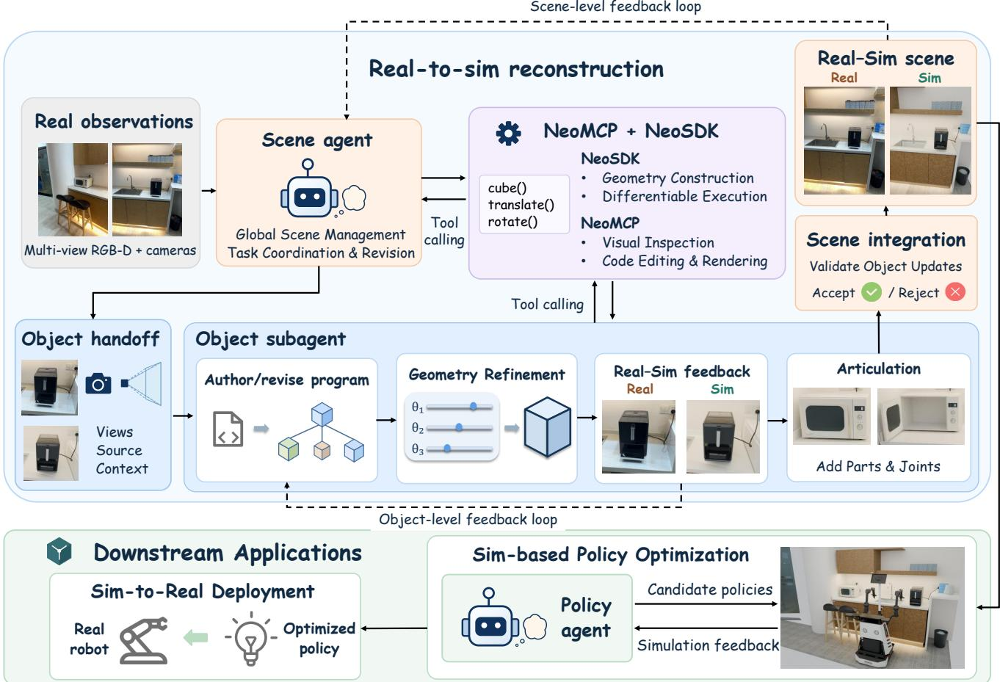  
Figure 2. Overview of the NeoWorld-3 framework. At the object level, vision-language agents construct tunable geometry programs, revising program structure based on real-sim feedback and optimizing geometric parameters through differentiable refinement, with parts and joints added for articulation. At the scene level, object subagents reconstruct individual assets, while a scene agent coordinates objec integration and manages global layout using multi-view observations. Object- and scene-level feedback loops guide reconstruction and revision, producing simulation-ready scenes for sim-based policy optimization and sim-to-real deployment.

At the scene level, NeoWorld-3 adopts a hierarchical reconstruction framework in which a scene coordinator delegates object-level reconstruction to subagents. The coordinator manages scene observations, camera information, object identities, and global layout, assigning each subagent relevant views and existing construction programs. Each subagent reconstructs or refines its assigned object, including geometry, appearance, articulation, and pose. The coordinator then validates and integrates the reconstructed objects while preserving the surrounding scene, using fullscene rendering to guide further refinement. Repeated instances can share a common construction program while maintaining individual poses. This hierarchical design combines object-level reconstruction with global scene consistency(Appendix A.2).

## 3.3. Differentiable Program-Space Refinement

Differentiable refinement optimizes the geometric parameters in θ through the construction program S, rather than directly optimizing mesh vertices. Let $\mathcal { E } _ { S } ( \theta )$ denote the tensor geometry produced by differentiable execution of S, corresponding to the native geometry $\mathcal { G } = S ( \mathbf { \boldsymbol { \theta } } )$ . Let V index the input views in the observation set O, and let $\mathcal { R } _ { v }$ render the geometry under object poses T from the camera of view $v \in \mathcal V$ . With the construction program S, object placement T, and camera parameters fixed, we seek the refined parameters $\theta ^ { \star }$ by solving:

$$
\theta ^ { \star } = \arg \operatorname* { m i n } _ { \theta \in \mathcal { B } } \mathcal { L } _ { \mathrm { o b s } } \big ( \{ \mathcal { R } _ { v } ( \mathcal { E } _ { S } ( \theta ) , T ) \} _ { v \in \mathcal { V } } , \mathcal { O } \big ) ,\tag{1}
$$

where the feasible set $B \subseteq \mathbb { R } ^ { d }$ encodes the bounds on the tunable parameters and holds unselected parameters fixed. The observation loss $\mathcal { L } _ { \mathrm { o b s } }$ combines the available silhouette, contour, feature, and depth evidence in O. Gradients of the observation loss are propagated through the differentiable rendering and geometry operations to update θ.

Parameter updates propagate through the dependencies encoded in the construction program. For each part $p ,$ let $X _ { p } ( \theta )$ denote its vertex coordinates in the tensor geometry $\mathcal { E } _ { S } ( \theta )$ . A small parameter update $\Delta \theta$ induces a vertex displacement $\Delta X _ { p }$ , approximated locally by

$$
\Delta X _ { p } \approx J _ { p } ( \theta ) \Delta \theta , \qquad J _ { p } ( \theta ) = \frac { \partial X _ { p } ( \theta ) } { \partial \theta } ,\tag{2}
$$

where the Jacobian $J _ { p } ( \theta )$ captures the sensitivity of the geometry of part $p$ to changes in the tunable parameters. A shared parameter $\theta _ { k }$ therefore coordinates updates across all dependent parts, restricting refinement to geometric variations expressed by the program S. These updates are computed through the differentiable tensor geometry $\mathcal { E } _ { S } ( \theta )$ , enabling efficient numerical optimization without requiring Blender execution at every refinement step. Further details on the optimization objectives and procedures are provided in Appendix A.3.3.

## 3.4. Articulation Validation and Repair

For both objects and scenes, the tunable construction preserves explicit links and joints, separating link geometry from joint motion. Watertight link surfaces are important for solid-based collision handling and volume-dependent physical properties. At the same time, independently moving links must remain geometrically separate. To detect mesh connectivity defects, NEOSDK checks indexed mesh connectivity using edge–face incidence: Edges incident to only one face indicate open boundaries, while edges incident to more than two faces indicate non-manifold connectivity.

Beyond mesh connectivity inspection, NEOSDK combines link-level geometry repair and validation with jointlevel motion checks to support articulated simulation. At the link level, NEOSDK repairs identified coincident seams by reconnecting mesh indices without altering the fitted surface or merging independently moving links. Metric solid checks further assess whether the resulting geometry is suitable for volumetric physical properties. At the joint level, geometric sweeps evaluate declared joint motion, while comparisons between exported kinematics and native playback verify kinematic consistency. Together, these operations improve geometric integrity and articulated motion consistency for downstream simulation(Appendix A.4).

## 4. Experiments

## 4.1. Experimental Setup

We evaluate NeoWorld-3 on object, articulated object, and scene reconstruction, comparing against coding-agent baselines and analyzing different agent and tooling configurations to assess reconstruction quality, articulation, physical validity, and the effectiveness of our agentic framework, NEOMCP and NEOSDK.

Datasets. For object reconstruction, we use 212 instances from 3DCodeBench [4], a recent benchmark specifically designed to evaluate coding-based procedural 3D reconstruction. For articulated object reconstruction, we use 77 selected PartNet-Mobility objects [26], with preprocessed assets and annotations from SINGAPO [15]. For scene reconstruction, we use 10 target scenes from Robo-Casa365 [18], a recent robotics simulation benchmark with articulated environments. These test sets respectively assess individual asset quality, articulated structure, and interactive multi-object scene composition.

Baselines. We compare NeoWorld-3 against a representative set of coding-agent-based 3D reconstruction methods. At the object level, we include Codex + Blender MCP, VIGA, and Articraft. For articulated objects, we compare against Codex + Blender MCP and Articraft, excluding VIGA because it does not support articulated asset generation. At the scene level, we compare against Codex + Blender MCP and VIGA, providing a consistent comparison among coding-agent-based reconstruction approaches. For fair comparison, all methods use the same LLM within each evaluation setting: GPT-5.6 Terra for object-level experiments and GPT-6 Sol for scene-level experiments.

Object metrics. We use execution success (Exec), image similarity measured by SigLIP-2 [24] and DINOv3 [21], Chamfer distance between reconstructed and reference geometry [3], and Uni3D similarities for 3D–3D and image– 3D comparisons [29]. The metric configuration follows the 3DCodeBench evaluation implementation [4]. In addition, we report Framed IoU between the reference images and renderings of the reconstructed assets. Together, these metrics measure whether generation produces an executable asset and how closely its appearance and geometry match the reference.

Articulation metrics. We adopt AS-gIoU and AS-CD from the SINGAPO evaluation protocol [15], measuring part-level correspondence across articulated states. ASgIoU is defined as 1 − gIoU (lower is better), rather than raw generalized IoU [20]. We also report the average overlapping ratio (AOR), introduced by CAGE [14] and used in SINGAPO, to assess collisions among sibling parts. We additionally evaluate joint-type accuracy (Type Acc), Axis

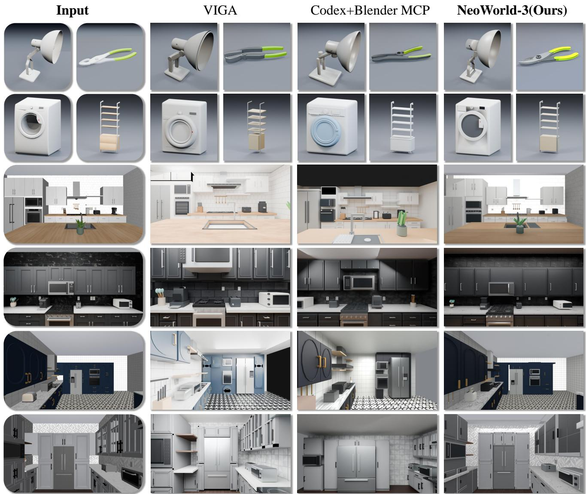  
Figure 3. Qualitative comparison of object- and scene-level reconstructions. We compare NeoWorld-3 with VIGA and Codex+BlenderMCP. All methods use GPT-5.6 Terra for object-level reconstruction and GPT-6 Sol for scene-level reconstruction. NeoWorld-3 achieves higher geometric and visual fidelity at the object level, along with more accurate spatial layouts, object correspondence, proportions, materials, and colors at the scene level.

Error, and Pivot Error for joint classification, axis direction, and pivot location.

Scene metrics. We assess physical validity with P-Pen, the proportion of reconstructed articulated objects whose constituent parts intersect. Visual correspondence is measured by DINOv3 [21] similarity between reference observations and matched-view renderings. We further report three MLLM-assessed scores: Complete, Layout, and Function, evaluating scene completeness, spatial arrangement, and functional plausibility, respectively. We additionally report Object Center Distance (OCD), which quantifies distances between reconstructed and ground-truth object centers to assess scene layout accuracy.

## 4.2. Object-Level Comparisons

Geometric reconstruction quality. Table 2 evaluates object reconstruction on 3DCodeBench, where NeoWorld-3 consistently outperforms prior coding-agent baselines across both visual and geometry-aware metrics while maintaining reliable execution. Except for Exec, all metrics are computed only over successfully executed assets. Notably, NeoWorld-3 achieves a Framed IoU of 0.7550 and a Chamfer distance of 0.0365, demonstrating strong image-space silhouette agreement and 3D geometric accuracy, respectively. Higher Uni3D scores further indicate closer agreement with reference representations, while improvements in SigLIP-2 and DINOv3 reflect stronger visual similarity. These results demonstrate the effectiveness of differentiable refinement in improving both spatial alignment and imagespace similarity, enabling NeoWorld-3 to achieve high reconstruction quality while maintaining reliable program execution.

Table 2. Quantitative comparison of object-level reconstruction on 3DCodeBench. We evaluate program execution rate (Exec), 2D visual representation similarity (SigLIP-2, DINOv3), aligned silhouette overlap (Framed IoU), reference-geometry agreement (Chamfer Distance, CD), and multimodal semantic alignment (Uni3D). NeoWorld-3 achieves the best overall performance across all criteria.
<table><tr><td>Method</td><td>Exec (%) ↑</td><td>SigLIP-2 ↑</td><td>DINOv3 ↑</td><td>Framed IoU ↑</td><td>CD↓</td><td>Uni3D 3D–3D ↑</td><td>Uni3D Image-3D ↑</td></tr><tr><td>Codex+BlenderMCP [1]</td><td>97.64</td><td>0.8571</td><td>0.6245</td><td>0.5736</td><td>0.0747</td><td>0.5658</td><td>0.3064</td></tr><tr><td>VIGA [28]</td><td>99.52</td><td>0.8219</td><td>0.6351</td><td>0.6547</td><td>0.0680</td><td>0.5803</td><td>0.3084</td></tr><tr><td>Articraft [30]</td><td>100.00</td><td>0.8100</td><td>0.5692</td><td>0.5692</td><td>0.0719</td><td>0.5618</td><td>0.3087</td></tr><tr><td>Ours</td><td>100.00</td><td>0.8605</td><td>0.6606</td><td>0.7550</td><td>0.0365</td><td>0.6229</td><td>0.3202</td></tr></table>

Table 3. Quantitative evaluation of articulated object reconstruction on PartNet-Mobility. We evaluate geometric fidelity under kine matic configurations via Articulated-State generalized IoU error (AS-gIoU) and Chamfer Distance (AS-CD), self-collision via Articulated Overlap Ratio (AOR), alongside joint parameter accuracy (Joint Type Accuracy, Axis Error, and Pivot Position Error).
<table><tr><td>Method</td><td>AS-gIoU ↓</td><td>AS-CD↓</td><td>AOR↓</td><td>Type (%) ↑</td><td>Axis Error (rad) ↓</td><td>Pivot Error (norm.) ↓</td></tr><tr><td>Codex+BlenderMCP [1]</td><td>0.9126</td><td>0.2557</td><td>0.0035</td><td>87.16</td><td>0.3078</td><td>0.2846</td></tr><tr><td>Articraft [30]</td><td>0.8904</td><td>0.2031</td><td>0.0001</td><td>87.22</td><td>0.3522</td><td>0.1532</td></tr><tr><td>Ours</td><td>0.7792</td><td>0.1297</td><td>0.0000</td><td>90.13</td><td>0.2687</td><td>0.0962</td></tr></table>

Articulation motion quality. Table 3 evaluates articulation motion quality on selected PartNet-Mobility objects using state-dependent geometry and joint-specific metrics. NeoWorld-3 consistently outperforms the codingagent baselines across both articulated geometry and kine matic parameter estimation. The improvement in AS-gIoU and AS-CD shows that the reconstructed parts remain more faithful to the target geometry under articulation, rather than only matching a single static configuration. Meanwhile, higher joint-type accuracy and lower axis and pivot errors indicate more reliable recovery of the underlying kinematic structure. Notably, NeoWorld-3 achieves an AOR of 0.0000, with no inter-part penetration detected across the evaluated articulated objects, highlighting the effectiveness of our articulation-aware geometry validation and repair mechanism. Together, these results suggest that NeoWorld-3 better captures both what moves and how it moves, yielding articulated assets whose geometry and motion are more consistently aligned with the reference.

## 4.3. Scene-Level Comparisons

Table 4 compares scene reconstruction on target scenes from RoboCasa365. NeoWorld-3 achieves the highest

DINOv3, Layout, and Function scores while maintaining competitive scene completeness. These results indicate that NeoWorld-3 better preserves visual appearance, spatial arrangement, and functional relationships among objects. Notably, NeoWorld-3 achieves a near-zero P-Pen of 0.67%, further demonstrating the effectiveness of our Articulation-Aware Geometry Validation and Repair mechanism in preventing inter-part penetration. Moreover, NeoWorld-3 achieves the lowest object center distance (OCD) of 25.9445 cm, indicating more accurate object placement and spatial layout reconstruction. We do not report P-Pen for VIGA, as its reconstructed scenes do not include articulated part structures required for this metric.

## 4.4. Qualitative Comparison

Figure 3 presents qualitative comparisons of object- and scene-level reconstruction against representative codingagent baselines. At the object level, NeoWorld-3 achieves higher geometric fidelity and visual quality, more accurately recovering fine-grained geometric details and overall object shapes. At the scene level, NeoWorld-3 achieves more accurate spatial layouts and object correspondence, while reconstructing object proportions, materials, and colors with higher fidelity. These results demonstrate the effectiveness of NeoWorld-3 in reconstructing visually and geometrically faithful objects and complex scenes.

## 4.5. Agent and Tooling Analysis

We analyze different agent and tooling configurations on the same target scenes from RoboCasa365 [18], using the same evaluation metrics as the scene-level comparisons. Table 5 compares direct generation, general-purpose coding agents, and different configurations of NeoWorld-3.

Table 4. Quantitative evaluation of multi-object scene reconstruction on RoboCasa365. We evaluate visual similarity (DINOv3), MLLM-assessed scene completeness (Complete), spatial arrangement (Layout), and functional plausibility (Function), alongside part level penetration rate (P-Pen) and object center distance (OCD). P-Pen is not applicable to VIGA, which does not support articulation.
<table><tr><td>Method</td><td>DINOv3 ↑</td><td>Complete ↑</td><td>Layout ↑</td><td>Function ↑</td><td>P-Pen (%) ↓</td><td>OCD (cm) ↓</td></tr><tr><td>Codex+BlenderMCP [1]</td><td>0.7661</td><td>4.3000</td><td>4.1667</td><td>4.7000</td><td>9.21</td><td>53.0194</td></tr><tr><td>VIGA [28]</td><td>0.7888</td><td>4.5333</td><td>4.8000</td><td>4.6333</td><td></td><td>41.6275</td></tr><tr><td>Ours</td><td>0.8142</td><td>4.3667</td><td>4.9333</td><td>4.8667</td><td>0.67</td><td>25.9445</td></tr></table>

Table 5. Agent and tooling analysis on RoboCasa365. We compare direct generation, general-purpose coding agents, and NeoWorld-3 w/ BlenderMCP, which replaces NeoMCP and NeoSDK with BlenderMCP, against the full system. Complete, Layout, and Function are MLLM-assessed scores. OCD denotes object center distance in centimeters.
<table><tr><td>Configuration</td><td>DINOv3 ↑</td><td>Complete ↑</td><td>Layout ↑</td><td>Function ↑</td><td>P-Pen (%) ↓</td><td>OCD (cm) ↓</td></tr><tr><td>Direct GPT</td><td>0.6817</td><td>3.4583</td><td>3.5000</td><td>3.4583</td><td>45.68</td><td>107.8875</td></tr><tr><td>Codex</td><td>0.7513</td><td>4.2333</td><td>4.1333</td><td>4.2667</td><td>11.61</td><td>47.6677</td></tr><tr><td>NeoWorld-3 w/ BlenderMCP</td><td>0.7644</td><td>4.4667</td><td>4.2333</td><td>4.6333</td><td>45.41</td><td>47.4549</td></tr><tr><td>NeoWorld-3 (full)</td><td>0.8142</td><td>4.3667</td><td>4.9333</td><td>4.8667</td><td>0.67</td><td>25.9445</td></tr></table>

Direct GPT performs substantially worse than agentic approaches in visual similarity and scene-level assessment scores, highlighting the importance of iterative agentic reconstruction over single-pass generation. However, Codex alone still exhibits limited reconstruction quality, indicating that general-purpose coding agents require a dedicated harness and specialized tool support for complex 3D reconstruction. Equipping the NeoWorld-3 harness with BlenderMCP improves visual similarity and scene-level assessment scores, but still suffers from substantial inter-part penetration. Replacing BlenderMCP with NEOSDK and NEOMCP further improves DINOv3 from 0.7644 to 0.8142 and substantially reduces P-Pen from 45.41% to 0.67%. These results demonstrate the importance of combining agentic reconstruction with a dedicated harness and comprehensive geometry construction, validation, and repair tools for simulation-ready scene reconstruction.

## 4.6. Real-Sim-Real Robot Control Results

We deploy the reconstructed twins on a physical dual-arm robot (two AgileX Piper arms with wrist RGB-D cameras) in a training-free Real-Sim-Real loop that relies only on the robot’s own cameras and proprioception. The robot scans the scene with its wrist camera, NeoWorld-3 reconstructs it as a simulation-ready MuJoCo twin, and the twin is registered to the robot through hand–eye calibration and reposed against each new scan (Real→Sim). Grasps and trajectories are then solved and collision-verified in the twin (Sim), and the verified plan is executed on the hardware under a closed-loop contact layer that estimates contact force from motor currents (Sim→Real). The twin proposes the plan and measured contact settles the rest: a wrist look before each grasp refits the target against the twin, and articulated interactions such as door opening are carried out by compliant laws that follow the measured force instead of an exact mechanism model.

Figure 4 illustrates this loop. The twin is closely aligned with the physical workspace: the hand–eye solution predicts the pose of a fixed calibration board to within 2.1 mm and 0.22◦, while re-posing the reconstructed bodies using an eight-view wrist scan takes 1.4–2.2 s and improves the silhouette IoU of the bowl and cube from 0.81 to 0.86 and from 0.71 to 0.86, respectively (Figure 8). Plans verified in the twin transfer directly to the real arm. When placing a 50 mm cube into the bowl, pre-grasp inspection corrects the cube pose by 5.3 mm and 6.7◦, after which all 157 observed surface points lie within 5 mm of the twin (median residual 1.8 mm). The grasp maintains a constant gripper width throughout lifting, transport, and release, while joint tracking errors remain within 0.18–0.33◦.

Figure 5 shows a long-horizon bimanual task involving both articulated and rigid-object manipulation: the left arm opens the microwave while the right arm places the cube into the bowl, the right arm then places the bowl inside the microwave, and the left arm closes the door. The door is opened using an admittance pull specified only by an initial direction and distance, without a hinge model. After the latch releases at 10–15 N, the required pulling force drops to 0–2 N as the pulling direction rotates by 75–77◦, following the true hinge arc as the door swings. The robot completes the full sequence (cube in bowl, bowl seated, door latched) in as little as 109 s, demonstrating that the reconstructed twins are sufficiently accurate for direct execution and that closed-loop contact compensates for the remaining

Real World Scanning

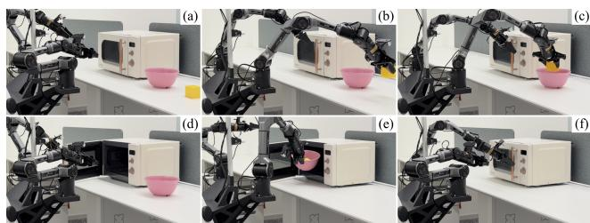

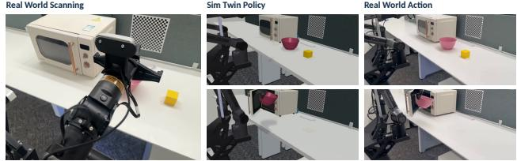  
Figure 4. Real-Sim-Real manipulation. Left: wrist scanning of the physical scene. Middle: the plan executed in the reconstructed MuJoCo twin. Right: the same plan executed on the physical robot. The top row shows the initial scene and the bottom row the bowl being placed into the microwave.  
Figure 5. Chained bimanual manipulation on the physical robot. (a) Initial scene. (b) One arm picks up the cube. (c) The cube is placed into the bowl. (d) The other arm opens the microwave door. (e) The bowl is placed inside the microwave. (f) The microwave door is closed.

model error.

## 5. Conclusion and Limitations

We presented NeoWorld-3, an agentic framework that reconstructs simulation-ready worlds from visual observations as tunable, executable geometry programs. By coupling part-structured geometry and articulation modeling with differentiable refinement and watertightness repair, NeoWorld-3 achieves high geometric fidelity and physical validity across diverse objects and scenes. These results bridge visual scene reconstruction with interactive simulation and real-sim-real robot learning.

Despite these advances, two primary bottlenecks remain: First, passive visual observations inherently fail to determine invisible physical properties within the environment. For instance, internal mass distributions, center of mass offsets, contact friction coefficients, and mechanical joint limits obscured inside enclosures cannot be resolved from exterior images alone, even under high visual fidelity. A promising direction is to incorporate uncertainty-driven active perception and interactive physical probing, such as exploratory robotic pushes or tactile sensing, to actively disambiguate latent dynamics and refine physical parameters through closed-loop feedback. Second, the planning throughput and replanning frequency in real-to-sim-to-real deployment remain bounded by the runtime latency of scene reconstruction and recalibration. Future work will investigate cached program priors, localized differential updates, and lightweight surrogate dynamics models to accelerate real-time recalibration and facilitate agile, high-frequency closed-loop replanning.

## References

[1] Siddharth Ahuja. MCP for Blender: Community plugin to control blender with language models. https://gith ub.com/ahujasid/mcp-for-blender, 2025. Ac cessed: 2026-09-26. 2, 7, 8

[2] Ziang Cao, Fangzhou Hong, Zhaoxi Chen, Liang Pan, and Ziwei Liu. Physx-anything: Simulation-ready physical 3d assets from single image. In Proceedings of the IEEE/CVF Conference on Computer Vision and Pattern Recognition, 2026. 2, 3

[3] Haoqiang Fan, Hao Su, and Leonidas Guibas. A point set generation network for 3D object reconstruction from a single image, 2016. 5

[4] Yipeng Gao, Lei Shu, Genzhi Ye, Xi Xiong, Ameesh Makadia, Meiqi Guo, Laurent Itti, and Jindong Chen. 3DCodeBench: Benchmarking agentic procedural 3D modeling via code, 2026. 5

[5] Yumeng He, Ying Jiang, Jiayin Lu, Yin Yang, and Chenfanfu Jiang. Spark: Sim-ready part-level articulated reconstruction with vlm knowledge. In Proceedings ofthe IEEE/CVF Conference on Computer Vision and Pattern Recognition, 2026. 2

[6] Ziniu Hu, Ahmet Iscen, Aashi Jain, Thomas Kipf, Yisong Yue, David A. Ross, Cordelia Schmid, and Alireza Fathi. SceneCraft: An LLM agent for synthesizing 3d scenes as blender code. In International Conference on Machine Learning (ICML), 2024. 2

[7] Ian Huang, Guandao Yang, and Leonidas Guibas. Blender-Alchemy: Editing 3d graphics with vision-language models. In European Conference on Computer Vision (ECCV), 2024. 2

[8] Bernhard Kerbl, Georgios Kopanas, Thomas Leimkuhler,¨ and George Drettakis. 3d gaussian splatting for real-time radiance field rendering. ACM Transactions on Graphics, 42 (4):1–14, 2023. 2

[9] Lingyu Kong, Ruicheng Li, Ruicheng Wang, Sicheng Xu, Chengtang Yao, Jianfeng Xiang, and Jiaolong Yang. Moge-3: Fine-detail monocular geometry estimation with selfguided sparse volumetric refinement, 2026. 3

[10] Samuli Laine, Janne Hellsten, Tero Karras, Yeongho Seol, Jaakko Lehtinen, and Timo Aila. Modular primitives for high-performance differentiable rendering. ACM Transac tions on Graphics, 39(6):194:1–194:14, 2020. 15

[11] Long Le, Jason Xie, William Liang, Hung-Ju Wang, Yue Yang, Yecheng Jason Ma, Kyle Vedder, Arjun Krishna, Dinesh Jayaraman, and Eric Eaton. Articulate-anything: Automatic modeling of articulated objects via a vision-language foundation model. In International Conference on Learning Representations (ICLR), 2025. 3

[12] Dong-Yang Li, Wang Zhao, Yuxin Chen, Wenbo Hu, Meng-Hao Guo, Fang-Lue Zhang, Ying Shan, and Shi-Min Hu.

Pixal3d: Pixel-aligned 3d generation from images. arXiv preprint arXiv:2605.10922, 2026. 2, 3

[13] Zhe Li, Xiang Bai, Jieyu Zhang, Zhuangzhe Wu, Che Xu, Ying Li, Chengkai Hou, and Shanghang Zhang. Urdfanything: Constructing articulated objects with 3d multimodal language model. In Advances in Neural Information Processing Systems, 2025. 2

[14] Jiayi Liu, Hou In Ivan Tam, Ali Mahdavi-Amiri, and Manolis Savva. CAGE: Controllable articulation GEneration. In Proceedings of the IEEE/CVF Conference on Computer Vision and Pattern Recognition, pages 17880–17889, 2024. 5

[15] Jiayi Liu, Denys Iliash, Angel X. Chang, Manolis Savva, and Ali Mahdavi-Amiri. SINGAPO: Single image controlled generation of articulated parts in objects. In International Conference on Learning Representations, 2025. 2, 5

[16] Zhao Mandi, Yijia Weng, Dominik Bauer, and Shuran Song. Real2code: Reconstruct articulated objects via code generation. In International Conference on Learning Representations, 2025. 2

[17] Ben Mildenhall, Pratul P. Srinivasan, Matthew Tancik, Jonathan T. Barron, Ravi Ramamoorthi, and Ren Ng. Nerf: Representing scenes as neural radiance fields for view synthesis, 2020. 2

[18] Soroush Nasiriany, Sepehr Nasiriany, Abhiram Maddukuri, and Yuke Zhu. Robocasa365: A large-scale simulation framework for training and benchmarking generalist robots. In International Conference on Learning Representations (ICLR), 2026. 5, 7

[19] Ben Poole, Ajay Jain, Jonathan T. Barron, and Ben Mildenhall. DreamFusion: Text-to-3d using 2d diffusion. In International Conference on Learning Representations (ICLR), 2023. 2

[20] Hamid Rezatofighi, Nathan Tsoi, JunYoung Gwak, Amir Sadeghian, Ian Reid, and Silvio Savarese. Generalized intersection over union: A metric and a loss for bounding box regression, 2019. 5

[21] Oriane Simeoni, Huy V. Vo, Maximilian Seitzer, Federico´ Baldassarre, Maxime Oquab, Cijo Jose, Vasil Khalidov, Marc Szafraniec, Seungeun Yi, Michael Ramamonjisoa,¨ Francisco Massa, Daniel Haziza, Luca Wehrstedt, Jianyuan Wang, Timothee Darcet, Th´ eo Moutakanni, Leonel Sentana,´ Claire Roberts, Andrea Vedaldi, Jamie Tolan, John Brandt, Camille Couprie, Julien Mairal, Herve J´ egou, Patrick La-´ batut, and Piotr Bojanowski. DINOv3, 2025. 5, 6

[22] Chunyi Sun, Junlin Han, Weijian Deng, Xinlong Wang, Zishan Qin, and Stephen Gould. 3D-GPT: Procedural 3d modeling with large language models. arXiv:2310.12945, 2023. 2

[23] SAM 3D Team, Xingyu Chen, Fu-Jen Chu, Pierre Gleize, Kevin J. Liang, Alexander Sax, Hao Tang, Weiyao Wang, Michelle Guo, Thibaut Hardin, Xiang Li, Aohan Lin, Jiawei Liu, Ziqi Ma, Anushka Sagar, Bowen Song, Xiaodong Wang, Jianing Yang, Bowen Zhang, Piotr Dollar, Georgia Gkioxari,´ Matt Feiszli, and Jitendra Malik. Sam 3d: 3dfy anything in images. arXiv preprint arXiv:2511.16624, 2025. 2

[24] Michael Tschannen, Alexey Gritsenko, Xiao Wang, Muhammad Ferjad Naeem, Ibrahim Alabdulmohsin, Nikhil

Parthasarathy, Talfan Evans, Lucas Beyer, Ye Xia, Basil Mustafa, Olivier Henaff, Jeremiah Harmsen, Andreas´ Steiner, and Xiaohua Zhai. SigLIP 2: Multilingual visionlanguage encoders with improved semantic understanding, localization, and dense features, 2025. 5

[25] Yuhao Wang, Puyi Wang, Linjie Li, Zhengyuan Yang, Kevin Qinghong Lin, and Yu Cheng. 3d-cos: A new 3d reconstruction paradigm based on vlm code synthesis. arXiv preprint arXiv:2606.10478, 2026. 3

[26] Fanbo Xiang, Yuzhe Qin, Kaichun Mo, Yikuan Xia, Hao Zhu, Fangchen Liu, Minghua Liu, Hanxiao Jiang, Yifu Yuan, He Wang, Li Yi, Angel X. Chang, Leonidas J. Guibas, and Hao Su. SAPIEN: A SimulAted Part-based Interactive EN vironment, 2020. 5

[27] Jianfeng Xiang, Zelong Lv, Sicheng Xu, Yu Deng, Ruicheng Wang, Bowen Zhang, Dong Chen, Xin Tong, and Jiaolong Yang. Structured 3d latents for scalable and versatile 3d gen eration. arXiv:2412.01506, 2024. 2

[28] Shaofeng Yin, Jiaxin Ge, Zora Zhiruo Wang, Chenyang Wang, Xiuyu Li, Michael J. Black, Trevor Darrell, Angjoo Kanazawa, and Haiwen Feng. Vision-as-inverse-graphics agent via interleaved multimodal reasoning, 2026. 3, 7, 8

[29] Junsheng Zhou, Jinsheng Wang, Baorui Ma, Yu-Shen Liu, Tiejun Huang, and Xinlong Wang. Uni3D: Exploring unified 3D representation at scale, 2023. 5

[30] Matt Zhou, Ruining Li, Xiaoyang Lyu, Zhaomou Song, Zhening Huang, Chuanxia Zheng, Christian Rupprecht, An drea Vedaldi, and Shangzhe Wu. Articraft: An agentic system for scalable articulated 3d asset generation. arXiv preprint arXiv:2605.15187, 2026. 2, 3, 7

## Appendix Contents

Detailed implementation and selected supporting evidence.

A Framework Design and Reconstruction .................................................................................................................................................. 12   
A.1 Design principles.............................................................................................................................................................................. 12   
A.2 Scene authoring and the object specialist ........................................................................................................................................ 12   
A.3 Object authoring and numerical refinement..................................................................................................................................... 14   
A.4 Physics, articulation, and geometry validity .................................................................................................................................... 15   
A.5 Bounded tool development through RSI .......................................................................................................................................... 19   
A.6 Predicted depth and scale alignment ................................................................................................................................................ 20   
B Robotic Manipulation and Deployment .................................................................................................................................................. 20   
B.1 Robotics interface and robot twin .................................................................................................................................................... 20   
B.2 Physical registration, re-posing, and fast planning........................................................................................................................... 21   
B.3 Compliant execution on the physical arms....................................................................................................................................... 25   
C NeoSDK and NeoMCP Implementation ................................................................................................................................................. 26   
C.1 NeoSDK: source programs and numerical execution ...................................................................................................................... 26   
C.2 NeoMCP: agent-facing operations ................................................................................................................................................... 28

## A. Framework Design and Reconstruction

## A.1. Design Principles

This appendix follows the system from the top down. It starts with the scene route (Section A.2) and the object lane the scene delegates to (Section A.3). It then covers the physical and articulation checks (Section A.4), tool development (Section A.5) and the robotics handoff (Section B.1), and ends with the two layers they all share, NEOSDK (Section C.1) and NEOMCP (Section C.2). Figure 2 gives the overall loop. Five principles recur throughout, and most mechanisms below exist to uphold one of them.

The source is the state. A reconstruction is an executable program $P = ( S , \theta , T )$ , not a mesh detached from its construction. Structural changes edit the source, numerical fitting moves named constants and poses, and every retained result can be re-executed and continued (Sections C.1 and A.3.2).

The model proposes; the harness admits. Agents write source, request fits and ask to finish. A deterministic harness owns schemas, budgets and the admission of every candidate, and never edits a semantic value to make a program pass (Section C.2).

Search in the twin, admit in Blender. Population and gradient search run on a tensor twin of the authoring vocabulary. Blender builds the baseline and materializes only the chosen candidates for admission. A construction the twin cannot replay is a typed failure, never a per-candidate Blender fallback (Sections C.1 and A.3.3).

Claims stay bound to evidence. Each check states what it measured. Unobserved joint fields, unmeasurable parts and unavailable measurements stay typed as unknown, and a check that finds no refutation reports unrefuted, not verified (Sections A.4.2 and A.4.3).

Everything is bounded. The host counts model calls, wall time, images sent to the model and child-call allowances. Refusals, failures and budget exhaustion are recorded as distinct outcomes (Sections C.2 and A.2).

## A.2. Scene Reconstruction and Integration

A scene such as a kitchen holds dozens of bodies that must stay one coherent world: they meet, rest on each other, and are seen together by every camera. NeoWorld-3 therefore gives the whole scene to a single author, lets it hand individual bodies to an object specialist, and integrates a returned body only after the harness has checked that it is no worse than the part it replaces and that nothing else moved. Figure 2 shows the route end to end.

One author, one live scene. The scene author writes Blender programs in a live, owned Blender through the NEOMCP surface of Table 6. It looks at and measures the observations, writes geometry, compares the result with the photographs through the real cameras, moves named quantities and bodies until they agree, and diagnoses what remains. Concretely, it measures named things with SAM3 (measure), scans the whole scene against every frame’s depth for missing and extra geometry (scan\_discrepancies), asks independent critics to review photograph/render panels (review\_views), and checks declared rigid bodies for conflicts (inspect\_physics, Section A.4). The reported runs use gpt-6-sol at high effort, 64 author calls and a 10 800 s wall. The audit work list (Section C.2) ranks mis-shaped parts by their photograph error and fits constants that only move a part before constants that deform it.

Background and object bodies. Each GROUPS body declares "role": "background" or "role": "object". Scene refine fits background constants and body poses; a constant whose effect reaches an object-role body is excluded, and the receipt names the refine\_object call that models that body.

Handing a body to the specialist. refine\_object(target,brief) hands one body, of either role, to the object lane (Section A.3); a body linked by JOINTS goes with its jointed component. The harness packages the body’s evidence:

• Masks. A stored SAM3 mask binds to the body when at least half of its visible pixels fall inside the mask and the body is the mask’s largest owner. SAM3 measures frames where the body covers at least 1% of the image and no mask binds.

• Occluders. Nearer scene-model surfaces and other photograph masks.

• Views. Crops are turned upright with $K _ { \mathrm { u p } } = A K R ^ { \top }$ and ordered greedily by coverage $\times \ : \mathrm { m i n } ( 1 , \theta / 3 0 ^ { \circ } )$ , with θ the smallest viewpoint angle to the views already chosen.

The specialist writes a fresh program; the blockout is a hint, used as the starting source only when every member is exactly its box.

Table 6. The scene author’s tools: the NEOMCP live-scene surface. Each verb carries a strict schema and returns a typed record (Section C.2). Verbs marked † are mounted only when their option is enabled; each run records the tools it actually mounted. Diagnostic labels and admission reports are not independent reconstruction-quality verdicts.
<table><tr><td>Verb</td><td>What the call returns</td></tr><tr><td colspan="2">Observation and measurement</td></tr><tr><td>read_observation</td><td>one photograph at full upright resolution with its raw camera and depth</td></tr><tr><td>measure</td><td>text-prompted masks with their metric lift: bounds, centroid, principal normal, floor footprint</td></tr><tr><td>sample_depth</td><td>world points under named pixels, with per-pixel validity</td></tr><tr><td>scene-planes</td><td>measured planes of the capture: normal, offset, extent, support</td></tr><tr><td>triangulate†</td><td>a world point from 2–64 calibrated views of one author-supplied landmark, with residuals</td></tr><tr><td colspan="2">Live scene</td></tr><tr><td>inspect</td><td>scene summary, or per object: transform, bounds, materials, mesh and manifold counts</td></tr><tr><td>execute_blender_code</td><td>result of running a labelled program in the live scene; names persist across calls</td></tr><tr><td>edit_code</td><td>result of an exact-anchor edit, re-run after deleting exactly what the previous version created</td></tr><tr><td>read_source</td><td>a kept label&#x27;s source with line numbers, the text edit_code anchors against</td></tr><tr><td>view_image</td><td>an earlier image again, by evidence identifier</td></tr><tr><td colspan="2">Calibrated comparison and review</td></tr><tr><td>render_view</td><td>a shaded view through a recorded or free camera, for inspection</td></tr><tr><td>render_calibrated</td><td>photograph / render / difference panels through the real cameras, with agreement per view</td></tr><tr><td>review_viewst</td><td>ranked suggestions from independent critics over those panels; no images returned</td></tr><tr><td>scan_discrepanciest</td><td>missing, extra, seen-through, hidden, and never-visible geometry against every frame&#x27;s depth</td></tr><tr><td colspan="2">Numerical refinement, placement, and delegation</td></tr><tr><td>observe-parameters</td><td>named quantities, the views that can see them, and proposed fitting groups for supplied targets</td></tr><tr><td>probe_refinement</td><td>bounded read-only twin perturbations, changed members, and per-view measurement deltas</td></tr><tr><td>refine</td><td>the fitted result, applied only if the harness admits it, with before/after per view</td></tr><tr><td>assemble</td><td>body placements fitted against photographic masks, with retained and refused moves</td></tr><tr><td>reposet</td><td>one rigid body moved to where new calibrated RGB-D views place it: a split-half-checked depth proposal, admitted or</td></tr><tr><td>inspect-physics† refine_object†</td><td>refused by the pose rules convex-proxy conflicts of declared rigid bodies against their fixed neighbourhood</td></tr><tr><td></td><td>one body modelled by the object specialist and returned as its own label, with the admission receipt</td></tr><tr><td colspan="2">Diagnosis, articulation, termination audit</td></tr><tr><td>analyze</td><td>a ranked part-discrepancy work list with a paste-ready action per item the output of bounded read-only code over registered evidence, outside the scene</td></tr><tr><td>joints</td><td></td></tr><tr><td>finish</td><td>read-only geometric sweeps of source-declared joints: admitted, refuted, or undeterminable</td></tr><tr><td></td><td>a completion request; in two-phase runs, the first request returns an assembly and audit review</td></tr></table>

Bringing the asset back. The asset returns as its own label: names carry the label prefix, GROUPS rows declare role: object, and JOINTS stay in the object frame under one label-wide transform, which joints\_of applies to origin and axis together. Integration runs in a separate staging runtime restored from the parent’s saved world; only when every check below holds does the parent apply the same change:

• Pose, per degree of freedom. z and scale are never adopted, flagged corrections are not adopted, and x, y and yaw go through the scene’s own pose admission.

• Joints. Unresolved joints are refused; a joint whose only unobserved field is its range keeps the declared range, labelled as a prior.

• Parity and preservation. The delivered mesh must match (at most 10−6 m per vertex, the same triangles and materia names), and unowned objects must be preserved. A failed apply is rolled back.

• Quality. Integration compares the delivered asset with the blockout on the body’s bound views (silhouette IoU against each view’s bound mask) and admits it only if it is no worse: its mean IoU over those views does not fall, and its weakest-view IoU falls by at most refine’s worst-view tolerance (0.02); otherwise the call returns rejected with the failing clause.

Concurrency, refusals, and budget. Several calls in one reply run concurrently; integration is serialized in completion order and re-resolves the bodies on the label’s current version (conflict when an earlier one retired or regrouped them). Besides conflict, a call can end failed, split\_required, rejected (a failed admission check, named in the receipt) or invalid. In the reported configuration each delegation reserves 16 child calls from an allowance of 48, and unused calls are refunded. An optional harness pass (harness\_delegation, off by default) sends the top hints at the first finish: non-background bodies ranked by visible pixels × $( 1 - \mathrm { I o U } )$ .

Visual feedback. Recorded calibrated cameras render the complete assembled scene. Matched capture/render views expose omitted entities, incorrect extents, misplaced instances, and interface errors. Original camera calibration and display-upright transformations remain separate; lighting changes are explicit so appearance differences can be interpreted alongside geometry.

Instances and export. Repeated instances declared in one GROUPS prototype row share one construction, each with its own rigid pose. Finalization saves the native scene and a GLB; a separate export writes USD, which may approximate procedural materials.

## A.3. Object Authoring and Numerical Refinement

The object lane is both a standalone route for single-object benchmarks and the specialist the scene delegates to (Section A.2), so it must work from very different evidence while keeping one implementation. Object reconstruction alternates between inspecting photographs, editing source, and inspecting native candidates. Named dimensions and shared expressions preserve relationships that would be lost by adjusting unrelated mesh vertices. Numerical fitting searches those controls; a missing profile, part, or construction dependency requires a source edit.

## A.3.1. Evidence and camera profiles

Photograph-driven sessions. The workspace retains task photographs and their evidence bindings, authored candidates, native previews, and explicit selection; ground-truth programs and meshes remain evaluation inputs only. Masks are inferred or taken from image alpha with the rule recorded, and camera convention, mask provenance, and display orientation belong to one of three input profiles:

3DCodeBench. Four photographs with declared orbit cameras of unknown distance and look-at. For each built candidate the harness fits one shared camera distance and look-at together with the object’s yaw against the bound silhouettes; authored scale and position fix the gauge, and near-tied yaws are resolved toward the declared front with the tie reported. This registration recovers neither physical scale nor true orientation.

PartNet. Three RGB views of an articulated object without stated cameras. Previews use the SDK’s own diagnostic views, and no rig can be fitted, so photograph-registered refinement is unavailable.

Calibrated specialist. How the scene reaches this lane: refine object packages one body’s evidence (Section A.2) and states every view’s pinhole camera in the object frame, so there is no yaw registration or rig fit. By default a rigid pose correction (x, y, yaw) is fitted per preview and refinement round and reported, never written into the source.

Depth serves only as occluder evidence: outside the mask, a pixel nearer than the rendered candidate counts as neither over- nor under-coverage, and such pixels inside the mask are only reported. Views whose masks are known to be cut or contradicted are excluded from search and admission and reported.

## A.3.2. Source editing, previews, and selection

The object session exposes source creation and exact-anchor editing, native preview, candidate selection, and finish. A session is one persistent episode, and source or materialization failures return diagnostic feedback. A preview is not a selection: candidate identity and selection are tracked separately. A continuation run starts a fresh episode whose baseline is the previous run’s selected asset.

Numerical refinement is $\cot \pm$ by default in object sessions. In tool mode the model can inspect parameters and request fitting; in auto mode, the specialist default, the harness also refines each fresh native preview. The resolved configuration records the mode and budgets, so a run without refinement is not counted as a refined treatment. Feedback names fixed values, inline literals, missing ranges, and unsupported construction, but cannot ensure that every useful freedom was authored, such as one shared width expression for connected parts.

## A.3.3. Tensor search and native materialization

For source S and selected constants θ, the twin produces

$$
( V ( \theta ) , F , S ) = \operatorname { T r a c e } ( S , \theta ) ,\tag{3}
$$

where S records vertex ownership. Supported operations replay in Torch, nvdiffrast rasterizes batches [10], and shared expressions remain live. Baseline twin/Blender parity precedes search, and Blender materializes baselines and selected candidates, not every sampled parameter vector (Section C.1). Search is bounded cross-entropy sampling followed by Adam from the elites, over silhouette, contour, and applicable depth and interior terms, with admission’s clauses priced as hinges. Constants with a declared PARAMS range are searched within it; others use the SDK trust interval v ± max(0.25|v|, 25 mm). Branches the source takes on a searched constant are recorded at calibration, each constant is bounded to the interval tha keeps them on their calibrated side, and a constant that cannot move without flipping one keeps its value and is reported.

Scene lane. One twin search can carry a label’s constants, the x, y, and yaw of its declared rigid bodies, and, on request, per-frame camera corrections, so shape, pose, and cameras are fitted jointly. refine also accepts two whole-source forms. label:⟨label⟩ fits every named constant of a label in one call, grouped by the members each one moves; with out explicit targets, the harness binds masks to the label’s GROUPS bodies, and inline geometry numbers are named first literal:⟨label⟩:⟨line⟩:⟨col⟩ first names one inline number. A hoist is kept only if the rebuilt objects match the replaced ones to $1 0 ^ { - 9 }$ m in names, types, world matrices, vertices, triangle counts, and material slots; otherwise the previous source is re-run and the hoist is refused. Both forms keep every touching pair touching. Constants whose twin reach moves a body declared as an object are excluded and left to refine object.

Object lane. The object refiner reuses the same implementation with the builder vocabulary and photograph masks, and searches constants only. With estimated orbit cameras, each round first fits the rig to the retained build and then searches the constants under those cameras, for up to three rounds while a round admits a change or widens a range; at stated cameras only the pose correction is re-fitted. A constant that ends within 2% of an end of its searched range receives one widened interval in the next round, twice the span, centred on the bound it reached, and the widening never changes sign; constants still at a bound after the last round get one more round re-centred at their value. A declared range that no longer brackets an admitted value is re-bracketed, and a changed program becomes a new native candidate.

Local reach and representation changes. Constants whose traced reach touches no target are not searched, and each effect is split into translation and deformation (Section C.2). At stated cameras the object refiner also holds constants whose step no reliable view sees, unless the author names them. These local diagnostics do not prove that a family can represent the surface; adding a bend, profile, or connection remains a source operation.

## A.3.4. Candidate retention and delivery

Numerical admission compares a realized candidate with the retained baseline under the same evidence, so a fit is kept only when the photographs, not the optimizer’s loss, say it is better. Both lanes use the tolerances owned by the SDK’s admission module (neosdk.refine.twin.admission):

• the mean silhouette IoU over bound target–view pairs rises by at least 0.002;

• the weakest view falls by at most 0.02, and any overlapping view by at most 0.05;

• the remaining contour, depth, scene, and mesh-stretch clauses hold where measured.

The object lane drops only the scene clauses (void ratio, depth nearer/farther fractions, per-mask coverage), which protect a moved part’s surroundings. Refusal preserves the retained state and records the failing clause; twin failures and budge exhaustion remain separate outcomes.

Selection is explicit and belongs to the session. If the budget ends with nothing selected, the harness selects the latest completed native preview and records itself as the selector (harness budget fallback); motion artifacts and their fallback are described in Section A.4.3. The 3DCodeBench delivery re-executes the selected program in a clean Blender and checks that it rebuilds the selected native geometry; executable export does not establish agreement with unobserved geometry. Integration of a delegated object back into a scene is described in Section A.2.

## A.4. Physics, Articulation, and Geometry Validity

NeoWorld-3 separates link-level geometry inspection, declared-joint checks, and simulator-specific physicalization. These stages address mesh connectivity, kinematic consistency, and interaction under configured collision and body properties. Scene finalization proposes bounded rigid corrections while protecting the visual reconstruction; articulation routes inspect declared motion; the SDK supplies physical-carrier operations. Physics-in-the-loop is enabled in the scene pipeline (WebUI and CLI scene tasks), while articulation stays optional. Figure 6 maps the geometry and articulation paths. Table 7 summarizes their interfaces and configurations.

Table 7. Physical-asset interfaces and validation checks. Summary of the four physical-asset routes, their input/output representations, and the corresponding validation procedures and configuration options.
<table><tr><td>Route</td><td>Input and Output</td><td>Checks and Configuration</td></tr><tr><td>Visual kinematic export</td><td>Declared links and joints → visual URDF</td><td>Joint sweeps and native/URDF playback agreement; visual meshes and kinematic frames.</td></tr><tr><td>Benchmark physics export</td><td>Delivered scene → USD with UsdPhysics</td><td>Rest contact, collision decomposition, body properties, and native joints. Indexed boundary checks and seam repair are enabled by--watertight (default off).</td></tr><tr><td>Robot twin</td><td>Reconstructed parts → configured simulator world</td><td>Collision proxies, body properties, and robot-frame alignment, as specified in Section B.1.</td></tr><tr><td>SDK solid adaptation</td><td>Metric indexed mesh and adaptation plan → certified physical carriers</td><td>Closure, manifoldness, self-intersection, orientation, and positive volume; an independent SDK interface separate from scene export.</td></tr></table>

## A.4.1. Bounded Rigid-Body Scene Correction

The scene pipeline enables physics-in-the-loop with an explicit task switch to disable it; the choice is frozen at launch. Source declarations distinguish rigid, fixed, and deformable groups; unassigned or deformable geometry in a reachable contact neighborhood remains unresolved rather than silently becoming fixed. The author can inspect conflicts, and finalization invokes a bounded rigid candidate transaction that derives minimum-motion proposals in the contact neighborhood. Originalview masks, calibrated depth, finite support, and native/twin parity are prerequisites; visual fit is a constraint rather than a reason to open a larger gap. An owned Isaac batch returns complete SE(3) poses, contact identities, and late-window motion under configured assumptions (1 kg per body, friction 0.5, no restitution). Shortlisted poses undergo native geometry, protected-view, support, and attachment checks; admitted deltas are replayed before saving and rendering, and rejected candidates restore the prior state. Missing evidence, unavailable simulation, or budget exhaustion stays unresolved, and the disabled path starts no physics process.

## A.4.2. Scene Articulation and Kinematic Export

In a scene, articulation lives in the executable source. Named GROUPS define bodies, and JOINTS declares each joint’s parent, child, type, origin, axis, limits, and rest value $q _ { 0 } .$ , with links naming stable bodies rather than positional identifiers or object globs. Unknown origins, axes, and limits can remain unset. Assembly couples joint-connected bodies for placement so that independent pose updates do not tear their declared relation. Joints of a delegated body arrive with the returned labe (Section A.2); the scene retains sweep, export, and playback authority.

Geometry can refute a declaration. The live scene stays at q . The read-only joints tool transforms samples of exported geometry over the declared range, checking for a rest interface, observable displacement, retained attachment, parent clearance, and clearance from nearby scene objects. Intrusion is measured by ray parity into closed solids with a depth margin. Unavailable measurements are reported explicitly, and the tool can return admitted when no measured clause refutes the motion even if some are missing: unrefuted by the available measurements, not verified motion. For a refuted range the tool can propose a source edit using the interval the sampled geometry supports; that interval describes geometric clearance, no a mechanical limit, and the author owns the revision.

Visual kinematic export and playback. At finalization, components with unsettled or refuted declarations are excluded from the kinematic export, and the exporter never narrows a range. For eligible components it writes link meshes and a visual URDF, with a recorded transform restoring the component to the room. The child’s link frame is the joint frame, and qURDF = q − q0. A separate native playback of the delivered scene produces link-pose receipts, and forward kinematics parsed from the written URDF must reproduce them; a failed round trip excludes the file from the manifest. The visual URDF contains no collision, inertial, or dynamics elements, and playback agreement checks the transcription, not the real object’s axis, range, or physical behavior. Scalar joint-position fitting along a declared axis has only synthetic tests.

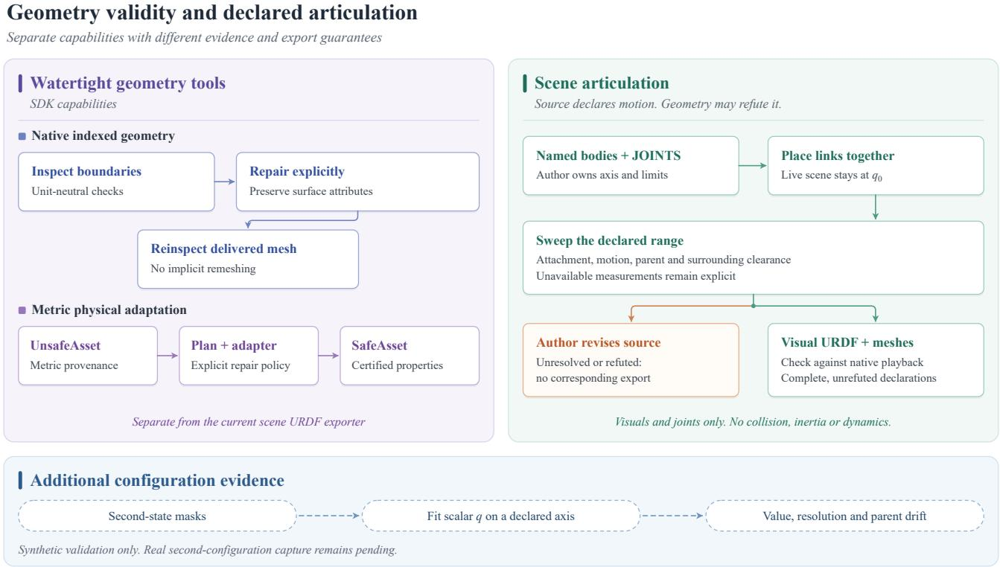  
Figure 6. Geometry validity and declared articulation. Left: SDK boundary inspection and explicit surface-preserving repair, distinct from metric adaptation and certification. Right: source-owned joint declarations, geometric refutation, and visual kinematic export checked against native playback. Sweep records distinguish measured checks from unavailable measurements. Bottom: scalar joint-position fitting on a declared axis has synthetic validation, with real second-configuration observations still pending.

## A.4.3. Object Articulation and Opened-State Review

The object lane, including the scene specialist when a scene task enables articulation, declares a literal joint tree on a built candidate and probes it natively with probe\_articulation. Each probe places the harness’s own review cameras, renders every joint at 0, 0.5 and 1 of its range, and samples kinematic geometry: each joint alone over 91 samples of its range with the other joints at q , then all joints together at 0.5 and 1.0 of their ranges. review\_opened\_state shows these facts with bounded images. The findings fall into three classes:

A decision is either a source fix or record\_articulation\_unknown naming the finding kind and link. A colliding sweep is deferred as sequenced\_after only when every colliding link is moved by other joints, the sweep is clean with those joints at their open limit, the review carries the combined state, and no combined collision involves this joint.

select\_motion\_artifact admits only a probe without refusals or open findings and also selects that probe’s candidate under the ordinary candidate rules. An explicit motion-artifact selection is never replaced. When an episode ends without a selected motion artifact, the harness selects the latest admissible probe, preferring the selected candidate’s; when the selected candidate has none, it may select another candidate’s latest admissible probe together with that candidate, under the ordinary selection rules. It records selection\_origin as harness\_budget\_fallback, harness\_end\_ fallback or, after lost calls, harness\_transport\_fallback. Each joint records family, side, axis and range as observed or not observed; unobserved fields stay labelled hypotheses. For rest-state photographs, the standalone articulatedobject brief lists priors for closed fronts, mined from 525 held-out PartNet-Mobility objects (1031 panels, split 70/30 by object, with the benchmark’s 77 objects excluded by a guard). The rule list scores 0.8990 on the held-out split, and a side hinge lies opposite an off-centre handle in 308/308 cases. The priors are guidance only; no harness gate reads them. Sampled facts are kinematic geometry, not physics or continuous collision, and admission does not establish the real mechanism.

Table 8. Articulation probe findings. Classification of findings produced by kinematic validation.
<table><tr><td>Class</td><td>Finding</td><td>Description</td></tr><tr><td>Refuses the probe</td><td>rest_overlap</td><td>Overlapping geometry at rest.</td></tr><tr><td></td><td>collision</td><td>Collision during the per-joint sweep.</td></tr><tr><td></td><td>closure_gap</td><td>Closure gap at qo.</td></tr><tr><td></td><td>combined_collision</td><td>Collision between links moved apart by two or more joints.</td></tr><tr><td>Needs a decision</td><td>cover_without_cavity</td><td>A covering link does not open onto a cavity.</td></tr><tr><td></td><td>travel_leaves_parent</td><td>A sliding link leaves its parent at full travel.</td></tr><tr><td></td><td>joint_dropped</td><td>A previously moving joint is removed.</td></tr><tr><td>Report only</td><td>detached_in_sweep</td><td>Detachment observed during the sweep.</td></tr><tr><td></td><td>sequenced_after</td><td>Sweep deferred due to other joint movements.</td></tr><tr><td></td><td>weakened_after_report</td><td>Joint range reduced after an earlier report.</td></tr></table>

Delivered motion artifact. The selected artifact is returned with an articulated native file at rest and, when every joint is stated in the object frame, a kinematics-only URDF. The exporter keeps rigid followers as fixed-joint links; merging each rigid body into one part happens only in a separate, evaluator-facing tree. A frame change moves a joint origin by the full affine map and its axis by the linear part, renormalized; a uniform scale scales prismatic ranges but not revolute ones.

## A.4.4. Physical Geometry and Mass Properties

Indexed boundary inspection and surface-preserving repair. The Rust boundary inspector consumes the native mesh’s indexed vertices and triangles without units or rescaling. It checks closure, manifoldness, self-intersection, shell containment, and material-boundary orientation (an outer shell faces outward, a cavity faces into the void), preserving supplied connectivity and winding; it neither repairs a boundary nor establishes its real-world dimensions. An explicit surface-preserving repair rejoins connectivity only where source correspondence or an unambiguous coincident boundary identifies missing shared indices. It keeps vertex positions, surface attributes and part boundaries, fills no holes, infers no orientation, and its outpu must be inspected again. The benchmark export runs a per-member subset only when enabled (--watertight, off by default): the indexed edge–face check, which does not measure self-intersection or containment, and zero-displacement seam reconnection. The “w/o watertight check and repair” ablation toggles it.

Metric solid adaptation. Physical adaptation separately starts from an indexed mesh with explicit metric provenance, which enters the kernel as an UnsafeAsset carrying no topology claim. An explicit AdaptationPlan selects, per part, solid preservation, regularization, reconstruction, shell construction, or visual-only treatment, and a separately built Rust adapter executes it without implicit repair. Validation yields a SafeAsset and certificate only when every physical part is closed, manifold, free of self-intersection, correctly oriented as a material boundary, and of positive volume; explicit metric provenance is required for certification. This independent SDK interface complements the export routes in Table 7.

Mass properties. The three execution paths configure their mass models as follows.

• Benchmark exporter: mass, inertia and principal axes from the delivered convex pieces at a uniform 1000 kg/m3, with each body’s origin at their volume centroid.

• Benchmark evaluator: ignores these properties and gives each body the mass of its bounding box at its own 500 kg/m3, with the centre of mass at the prim origin, so of the exported properties only the centroid origin affects its scores.

• Physics-in-the-loop: 1 kg per body (Section A.4.1).

Benchmark-side physics export. A method-side adapter writes the delivered scene as USD with UsdPhysics:

• Roles. Declared roles map fixed to static and every other role to dynamic, and each simulated body’s origin moves to the volume centroid of its delivered convex pieces.

• Rest contact. A hovering dynamic body is lowered onto its support by at most 0.05 m; when an overlap test fires, the shif is bisected so the body ends above that support. A body that already penetrates a neighbour, or has no support within that distance, is never moved and is listed instead.

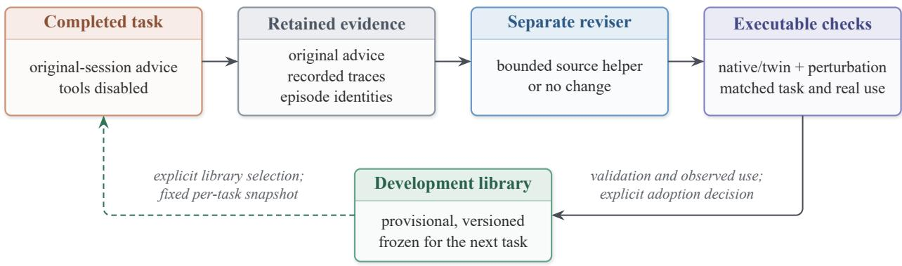  
Figure 7. Bounded tool development from completed tasks. Original advice and recorded traces inform a separate reviser. Candidate source helpers undergo native/twin validation and a matched task experiment before provisional development adoption. Each task retains a fixed library snapshot for reproducible execution.

• Collision decomposition (disclosed). A bottom band (2 mm by default) of each supporting component is split into N wedges, with N the smallest even number ≥ 4 whose wedge rim keeps 90% of the footprint’s inscribed margin; the rendered surface is unchanged and the receipt reports the measured change.

• Joints. Settled, unrefuted joints become native revolute or prismatic joints with limits written relative to q0, since the delivered geometry sits at q0; the export never narrows limits or drops a joint because it collides. A method-side audit sweeps each joint’s range and reports link interpenetration of the convex pieces.

## A.5. Bounded Tool Development through RSI

The surface is the thing to improve. An agent can only do what its tools let it do, so a missing operation shows up as the same snippet written again and again. Repeated author-written snippets and post-task advice can identify such missing operations. Figure 7 shows the bounded development loop that uses this evidence. Its outputs are candidate source helpers, with explicit validation and adoption decisions.

Two verbs accept author-written code, which makes the signal available. One runs code in the live scene, where geometr is built and edited. The other runs bounded read-only code over registered evidence, with no network and no scene access, to check a hypothesis, diagnose a disagreement, or extract a number no verb returns.

Capture: probe traces. Every call to those two verbs is recorded as a probe trace: the source exactly as the author wrote it, the evidence identifiers it read, the record it produced, its own success or typed failure, and — the field that makes the trace evaluable — the outcome of the next action the author took. A probe that precedes an admitted edit records a potentially relevant association; a probe followed by a rejected candidate, or by a repeat of the same probe, says something different. Because receipts bind each call to the observations it consumed (Section C.2), a probe trace is anchored to specific evidence rather than to prose about it. The cross-run store keeps scene-author, object-specialist and standalone-object episodes apart, with each call ordered within its own episode; unfinished calls remain unknown. These records provide structured feedback for subsequent source edits and helper proposals.

Aggregation: from snippets to recurring intents. Individually, probes are one-off. Across runs they repeat, and the repetition is what identifies an operation. Probes are grouped by normalized program structure — literals abstracted away, so two calls that differ only in a frame index, a pixel, or a part name fall together — and by the evidence bindings they consume. Each group is ranked by how often it recurs, across how many distinct runs, the model-call interval to the following action, and how often that action was admitted. A group that recurs widely, costs the author real turns, and precedes admitted work is a candidate verb.

Post-task advice and bounded revision. After a task finalizes its artifacts, the original model and conversation receive a bounded, tool-disabled request for friction, evidence, improvement ideas, and possible experiments. Original advice is retained separately from revisions; advice failure does not change the task result. Advice is enabled by default in declared development experiments and selected explicitly for ordinary tasks. A separate reviser runs on the configured review model and may decline a change. Matched baseline/treatment experiments use frozen inputs, libraries, and budgets; revision work shares the task runner under a bounded budget.

Source helpers and provisional adoption. The current candidate lane accepts pure arithmetic Python helpers. Their frozen source travels with the authored program so native execution, tensor replay, and standalone export use the same definitions. Candidates cannot shadow SDK names or depend on mutable external state. Executable fixtures check baseline/treatment geometry equivalence, native/twin parity, actual helper invocation, and an effect under a declared perturbation. A matched task experiment then requires retained native artifacts and observed use of the helper in the treatment source’s tensor execution and bounds author calls relative to baseline. Candidates meeting these conditions are eligible for explicit adoption into a versioned development library; other candidates retain their validation records for further revision. Each task selects its library at launch and retains that snapshot throughout execution, separating tool development from running tasks.

Initial development results. The initial development trials yielded a no-change revision and a developer-derived helper that passed executable validation and export but was unused in the paired task; neither produced an adopted extension.

## A.6. Predicted Depth and Scale Alignment

The RoboCasa inputs carry RGB and known cameras but no sensor depth, yet measurement and the depth scan need depth.   
Predicted depth fills this gap, and it must first be made consistent across views.

MoGe-3 frame producer. The MoGe-3 runner predicts camera-z depth and validity from RGB, conditioned on the declared horizontal field of view, and records the model identity, package version, checkpoint, resolution and precision. The writer accepts RGB-only frames and passes supplied camera poses through. For a declared upright quarter-turn the mode sees the turned image and its depth is turned back into the calibrated raw grid. Each frame keeps the model’s own metric scale, so frames may disagree; the rasters are declared predicted depth, not sensor measurements.

Per-view scale fit. With known metric camera poses, one positive scale $s _ { j }$ per view (and optionally a shift $t _ { j } )$ is fitted to reprojection consistency. A pixel of view i lifted at depth $s _ { i } z _ { i }$ has camera depth $\zeta _ { i j }$ in view $j ,$ and the residual is $r =$ log $\zeta _ { i j } - \log \left( s _ { j } z _ { j } ( x _ { i j } ) + t _ { j } \right)$ , with $z _ { j } ( x _ { i j } )$ view $j ^ { \dagger } \mathbf { s }$ raw depth at the projection. The loss is asymmetric and truncated: an occluded point $( r > \tau )$ costs the constant $\tau ^ { 2 }$ , a see-through point $( r < - \tau )$ grows linearly, and residuals in between are quadratic. The truncation $\tau$ is annealed from 0.3 to 0.02 in log depth. Each connected group’s common scale is found by a grid search at the widest τ before descent, and pixels on depth discontinuities are neither sampled nor read. The camera baselines fix the scale gauge; when they constrain it poorly, the group is pinned to the median input scale. Views without usable overlap stay unfitted, and held-out residuals measure cross-view consistency, not accuracy. The RoboCasa inputs (16 RGB views with known cameras and no sensor depth) use this fit by default.

## B. Robotic Manipulation and Deployment

## B.1. Connecting Reconstructed Worlds to Real–Sim–Real Robotics

What the reconstruction hands over. The robotics role of NeoWorld-3 is to provide a simulation-ready world for downstream robot planning and control. The reconstruction retains tunable geometry programs, explicit part and instance identities, object-to-scene transforms, camera information, materials, and declared articulations. These representations allow the robo system to associate visual observations with reconstructed objects and update their poses without rebuilding the underlying geometry. The reconstructed world serves as the geometric foundation of a digital twin, while robot-specific collision models and physical properties are configured separately.

Frames and metric registration. Real–Sim–Real transfer requires the reconstruction, robot, and sensor observations to share a consistent metric coordinate frame. When known-reference calibration is available, scene geometry, camera translations, and depth are rescaled together, while instance transforms retain their relationships to the scene. For physical deployment, a fixed calibration board observed by both the scene capture system and the robot’s wrist RGB-D camera establishes the transformation between reconstruction and robot coordinates. The robot base is anchored using the calibrated hand–eye transformation rather than relying solely on its nominal mounting pose. On our physical platform, hand–eye calibration from

20 board observations achieves a board-pose consistency of 2.1 mm and $0 . 2 2 ^ { \circ }$ . This calibration establishes a common frame for robot motion, reconstructed geometry, and subsequent visual updates.

Physical twin construction. The robot twin is represented as $\mathcal { W } = ( \mathcal { G } , \mathcal { X } , \mathcal { C } , \mathcal { A } , \mathcal { P } )$ , where G denotes reconstructed visua geometry, X contains part and instance transforms, C represents collision geometry, A specifies declared articulations, and P contains configured physical properties. Visual geometry preserves appearance, whereas collision proxies support geometric clearance and physical simulation (Section A.4.4). Articulation relationships are retained where available (Section A.4.2). Mass, friction, and actuator properties are configured for the target simulator rather than inferred from appearance. The reconstructed environment and robot model are assembled into a MuJoCo twin for motion planning and collision checking

Updating the twin from wrist observations. The physical environment may differ from its initial reconstruction because of object movement or residual calibration error. To update the twin, the robot acquires calibrated RGB-D observations from collision-checked wrist-camera viewpoints. Object masks and depth measurements provide geometric evidence for re-estimating object poses within the reconstructed scene. These updates modify instance transforms while retaining the underlying construction programs. In our physical experiment, an eight-view wrist scan supports pose refinement of the bowl and cube in 1.4–2.2 s. Their mean silhouette IoU increases from 0.81 to 0.86 and from 0.71 to 0.86, respectively. An inconsistent pose proposal for the microwave is rejected rather than applied to the twin. This selective update mechanism incorporates new observations without unnecessarily modifying reconstructed geometry.

Planning and real-world transfer. Robot motions are planned and collision-checked against the reconstructed MuJoCo environment before hardware execution. The physical platform consists of two AgileX Piper arms equipped with wrist RGB-D cameras. For pick-and-place manipulation, the twin provides obstacle geometry and object poses for inverse kinematics and collision-aware trajectory planning. Before grasping, wrist-camera inspection further corrects the target pose using local visual evidence. In the single-arm cube-placement experiment, this inspection corrects the estimated cube pose by 5.3 mm and 6.7◦, with a median surface residual of 1.8 mm. The planned motion is then executed on the physical robot, with observed joint tracking errors within 0.18–0.33◦. The streaming executor operates at 100 Hz and checks joint tracking, motor current, temperature, and workspace safety constraints throughout execution.

Contact-rich bimanual manipulation. We further evaluate the reconstructed twin through a chained bimanual manipulation task involving a cube, a bowl, and a microwave. One arm opens the microwave while the other places the cube into the bowl; the bowl is subsequently transferred into the microwave, and the door is closed. The door-opening controller uses an admittance-based pull that adapts its direction from estimated contact forces, without requiring an accurate hinge model. On the physical microwave, the latch releases at 10–15 N, after which the pulling force drops to 0–2 N as the motion direction changes with the opening door. Bowl placement and door closing use kinesthetic demonstrations recorded for the physica layout. The resulting sequence combines twin-based geometric planning, visual pose correction, and compliant physical interaction.

Scope of physical validation. These experiments demonstrate that reconstructed geometry, metric registration, and updated object poses can support collision-aware planning and execution on physical robots. The robot twin provides the geometric and kinematic constraints needed for motion planning, while local visual inspection and contact feedback address discrepancies encountered during execution. The experiments are development demonstrations with a limited number of physical trials, rather than a large-scale evaluation of task success rates. Physical properties remain configured assumptions, and successful execution does not establish that all underlying contact dynamics have been recovered from visual observations.

## B.2. Physical Registration and Re-Posing from Wrist Scans

A reconstructed twin supports physical robot manipulation when the robot, the reconstruction, and the latest sensor observations share a consistent metric coordinate frame. This subsection describes physical registration, collision-aware wrist scanning, and object pose refinement on the right arm of the platform in Figure 4, an AgileX Piper equipped with a wris RGB-D camera. Motion planning and collision checking use the MuJoCo twin built from the reconstruction. The reported measurements are obtained from a physical tabletop environment containing a bowl, a cube, and a microwave.

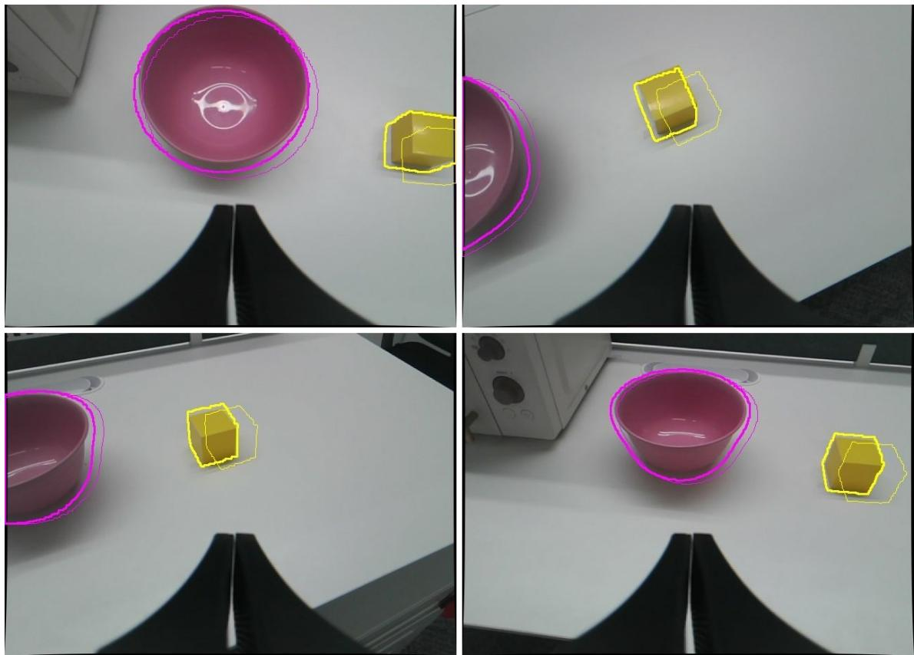  
Figure 8. Re-posing a finished reconstruction from a wrist scan. Outlines of the MuJoCo twin’s bodies before (thin) and after (thick) repose, projected into four of the eight undistorted wrist RGB-D views in raw sensor orientation (magenta: bowl; yellow: cube; no occlusion between bodies). The gripper fingers at the bottom of each view are the declared occluder. Both twins use the board-anchored base, so the outlines differ only by the admitted moves of Table 9.

Frames. Write $T _ { b } ^ { a }$ for the rigid transform from frame b to frame a, $F ( q ) = T _ { \mathrm { f l a n g e } } ^ { \mathrm { b a s e } } ( q )$ for the arm’s forward kinematics at joint angles q, and $X = T _ { \mathrm { c a m } } ^ { \mathrm { f l a n g e } }$ for the hand–eye transform. A wrist view taken at q has the camera pose

$$
T _ { \mathrm { c a m } } ^ { \mathrm { s c e n e } } ( q ) = T _ { \mathrm { b a s e } } ^ { \mathrm { s c e n e } } F ( q ) X .\tag{4}
$$

The scan planner and the calibrated views handed to re-posing use this expression, with X and $T _ { \mathrm { b a s e } } ^ { \mathrm { s c e n e } }$ each measured once as described below. The view gate runs before either is known, so it uses the nominal mount and every available board-pose hypothesis.

Twin clearance. A clearance query asks whether the arm at q comes within a 3 cm margin of the reconstructed scene. It runs forward kinematics and the collision pass only, and returns every robot–scene geometry pair inside the margin. The simulator’s midphase (MuJoCo 3.3.1) dropped pairs inside the margin whose bounding volumes did not overlap (102 pairs over 4096 random poses, the closest at 4.5 mm, flipping two clear/blocked decisions), so it is disabled, which raises the cos of a query from 0.18 to 0.74 ms; a test requires every pair whose exact distance lies inside the margin to be reported.

View gate. Before any board-dependent motion, an offline gate decides which wrist camera can see the calibration board, and from where. Candidate camera poses face the board from 0.36–0.52 m, tilted by up to $3 0 ^ { \circ }$ from its normal at eight azimuths and rolled by up $\mathrm { t o \pm 3 0 ^ { \circ } }$ , and are aimed so that the board centre lands above the gripper fingers in the image; bounded IK converts each into joint angles inside the device limits. A candidate passes when (i) the board lattice projects inside the image and clear of the finger polygon under every available board-pose hypothesis (one from hand–eye samples, one from the scene scan, 99 mm apart before anchoring), and (ii) the arm is twin-clear. Passing candidates are ranked by the smaller fill fraction times the cosine of the larger obliquity. The visibility predicate was calibrated against the robot’s own board detector: it accepts 19 of 23 detected views and none of 27 undetected ones. A gate report is used only when its controls hold: at least 80 % of the recorded capture poses are judged visible (14 of 15), a pose at which a real arm once stalled against the scene registers a collision (it does, at −15 mm), and the arms’ current poses are clear. A board sweep is refused for a camera the gate does not admit. Of 459 candidates per wrist, 12 pass for the right wrist, while the left wrist passes only in contorted poses, so the chain below uses the right arm.

Hand–eye sweep planned from an image Jacobian. From an anchor pose where the whole board is visible, one probe per joint (base pan, elbow, wrist tilt, and wrist roll; $2 { - } 4 ^ { \circ } )$ measures how the ordered board corners move. Each probe is summarized as a planar similarity, namely a centroid shift $( d _ { x } , d _ { y } )$ , an in-plane rotation $\phi ,$ and a log scale log $s ,$ , fitted by complex Procrustes $( b \approx s e ^ { i \phi } a$ for centred corners $a , b )$ . The four columns form an image Jacobian $J _ { I } \in \mathbb { R } ^ { 4 \times 4 }$ that predicts the corners after any joint offset δ. Offsets on a grid around the anchor are kept when the predicted board outline, including its paper margin, stays inside the frame and off the finger keep-out; farthest-point sampling in joint-offset space, with a $2 ^ { \circ }$ duplicate floor, then selects the sweep, which is visited in nearest-neighbour order. The robot’s own detector re-checks each pose live before capture, and the eye-in-hand solve (Park’s method) runs after a person confirms the board axes. The 20 samples came from Jacobian-planned sweeps, supplemented by a few explicitly specified wrist-roll poses for rotation spread. The fixed board predicted from each sample agrees within 2.1 mm and $0 . 2 2 ^ { \circ }$ (1.8 mm and $0 . 1 7 ^ { \circ }$ on held-out samples); this measures the self-consistency of the solution, not its absolute accuracy.

Anchoring the arm base. Each hand–eye sample k also measures the board in the arm base, $\begin{array} { r } { T _ { \mathrm { b o a r d } , k } ^ { \mathrm { b a s e } } = F ( q _ { k } ) X T _ { \mathrm { b o a r d } , k } ^ { \mathrm { c a m } } . } \end{array}$ Averaging the translations and rotations over samples gives $\bar { T } _ { \mathrm { b o a r d } } ^ { \mathrm { b a s e } }$ , and the scene scan measures the same physical board, so

$$
T _ { \mathrm { b a s e } } ^ { \mathrm { s c e n e } } = T _ { \mathrm { b o a r d } } ^ { \mathrm { s c e n e } } \left( \bar { T } _ { \mathrm { b o a r d } } ^ { \mathrm { b a s e } } \right) ^ { - 1 }\tag{5}
$$

requires no nominal chassis mount. It holds while neither the board nor the robot has moved since the scan and the calibration session; the wrist scan below is an independent check. On the development scene, this anchor lies 44 mm and $5 . 3 ^ { \circ }$ (yaw) from the earlier estimate, which fitted the chassis to robot silhouettes in the capture video and added the nominal mount.

Twin-checked wrist RGB-D scan. Candidate views look at each target body from 0.32–0.48 m, at elevations of $4 0 { - } 7 0 ^ { \circ }$ and azimuths within $\pm 5 0 ^ { \circ }$ of the direction toward the arm base, with the target aimed above the fingers. IK solves each view inside the device limits, narrowed to windows around the start pose $( \pm 4 5 ^ { \circ }$ for the base joint and $\pm 6 0 ^ { \circ }$ for the two roll joints, which protect the camera cable and keep the arm inside the reconstructed region). A view is kept if its target clears the finger polygon and the arm is twin-clear. A greedy cover then selects at most eight views: each surface point of the targets and of the reachable static scene, sampled from the twin, counts at most twice, and only from viewing directions at least $2 5 ^ { \circ }$ apart. The controller interpolates in joint space, so every joint-space segment is checked on the twin in $2 ^ { \circ }$ steps. The start pose serves as a hub: a kept view needs clear segments to and from it, views are visited nearest-neighbour over clear segments, and the route detours through the hub when no direct segment is clear. Execution starts only with the arm within $1 ^ { \circ }$ of the plan’s star pose, moves with the robot’s own joint-move tool (which rechecks limits and self-collision), captures one registered RGB-D still per view, and returns to the start. On the development scene the scan took eight stills in 411 s. Each still becomes a calibrated view: colour and registered depth undistorted onto a pinhole model, the camera pose of Equation (4), a depth-scale correction (1.022, fitted to the board plane at 0.47 m), and the gripper region declared as an occluder.

Re-posing inside the finished reconstruction. The NEOMCP verb repose (Table 6) moves one rigid body of a finished scene to where new calibrated RGB-D views place it. The finished run is reopened with every label frozen: the latest program of each label and the objects it created rebuild the ledger, no program is replayed, and the twin carries each label from its native export, so pose search is available and constant search is refused. For each requested body:

1. Bind masks. The body’s surface samples are projected into each view. A view is dropped when less than half of the body lies in frame or the declared occluder hides more than half of it. SAM 3 segments the view with the body’s prompt, and the instance mask with the highest IoU against the projection is the body’s only if that IoU is at least 0.2 and exceeds the runner-up’s by 0.05. Occluder pixels are removed from the mask and treated as known foreground. Every dropped view is recorded with its reason.

2. Fit what the views can see. Members lying flat on the support (top within 6 mm of the body’s bottom, such as a mat, tape, or decal) are left out of the fit and of the silhouette target, and still move with the body.

Table 9. Re-posing three bodies from one eight-view wrist scan. Proposal: the estimated planar pose update from masked depth observations, expressed in the scene frame. IoU: silhouette IoU against the assigned SAM 3 masks over the views used for each body, before → after. Yaw is not fitted for the bowl and is folded modulo $9 0 ^ { \circ }$ for the cube. The estimates from the two view subsets for the bowl and cube agree within 2.9 mm and $1 . 4 ^ { \circ }$ , respectively, whereas those for the microwave differ by 9.0 mm and $9 . 3 ^ { \circ }$
<table><tr><td>Body</td><td>Proposal (x, y; ψ)</td><td>Mean IoU</td><td>Weakest-view IoU</td><td>Outcome</td></tr><tr><td>Bowl</td><td> $\cdot 1 5 . 6 , \ : - 6 . 2 \ : \mathrm { m m }$ </td><td> $0 . 8 1 4  0 . 8 6 1$ </td><td> $0 . 6 9 1  0 . 7 4 2$ </td><td>admitted</td></tr><tr><td>Cube</td><td> $- 1 4 . 4 , + 3 . 4 \mathrm { m m } ; - 4 . 0 5 ^ { \circ }$ </td><td> $0 . 7 0 6 \to 0 . 8 5 8$ </td><td> $0 . 5 9 0  0 . 7 3 7$ </td><td>admitted</td></tr><tr><td>Microwave</td><td></td><td></td><td></td><td>refused (unstable proposal)</td></tr></table>

3. Depth proposal. Valid depth inside the eroded masks is lifted to the scene frame. A near-horizontal support plane is fitted by RANSAC to a ring of pixels around the masks, and only points more than 6 mm above it are kept, in 3 mm voxels. Point-to-plane ICP aligns these points $p _ { i }$ to the body’s surface samples $q _ { i }$ with normals $n _ { i }$ in the three degrees of freedom of a body resting on a support. Let $\xi = ( x , y , \psi )$ denote the planar pose parameters and $t = ( x , y , 0 ) ^ { \top }$ the translation. We solve

$$
\xi ^ { * } = \arg \operatorname* { m i n } _ { \xi } \sum _ { i } \left[ n _ { i } ^ { \top } ( \hat { p } _ { i } ( \xi ) - q _ { i } ) \right] ^ { 2 } , \qquad \hat { p } _ { i } ( \xi ) = R _ { z } ( \psi ) ( p _ { i } - c ) + c + t .\tag{6}
$$

The rotation is centered at the body centre c, with correspondence radii shrinking from 30 to 5 mm. The inverse of this alignment is the proposed move. Yaw is folded by the body’s declared symmetry $( 9 0 ^ { \circ }$ for a cube) and is not fitted for a body symmetric about its vertical axis.

4. Stability. The same fit on the even and on the odd views must agree within 5 mm and $2 ^ { \circ }$ (otherwise unstable proposal). The move must stay within 8 cm and must not reduce the number of depth points within 5 mm of the surface.

5. Admission. The proposal enters the twin’s pose search as its first candidate and passes the same admission as every pose candidate: the silhouette rules of Section A.3.4, no deeper penetration into any neighbour, and no move to the edge of the search range. Bodies resting on the moved body move with it. When the proposal is refused, the twin’s own pose search may run.

6. Export. The scene is saved and exported, the simulator twin receives the new export, and a free body that the export moves drops its earlier pose override. Moves of articulated members are refused, because the twin rebuilds those from the kinematic export

Table 9 and Figure 8 report one scan. Each body’s call takes 1.4–2.2 s (the depth proposal 0.2–0.5 s, the twin admission 1.0–1.5 s), once every view has been segmented for every body’s prompt in one pass (2.2 s for eight views and three prompts) and the twin’s GPU context has been set up; reopening the finished run in an owned Blender adds about 11 s once per session. The MuJoCo twin rebuilt from the new export displaces the bowl and the cube exactly as the receipts predict, to the reported 0.1 mm.

Two observations shaped the procedure. First, the cube was initially refused for a reason other than its pose: its reconstructed body included a thin square modelled from the cube’s shadow, which the SAM 3 mask excludes; step 2 comes from this case. Second, depth and silhouettes place the cube about 5 mm apart along the wrist camera’s viewing direction, and per-view silhouette optima scatter by about 11 mm with the viewing direction, with or without undistortion. This points to a few millimetres of camera-pose error (hand–eye, kinematics, or base) or depth bias rather than to the lens, and the cube’s pose is uncertain by about 5 mm. Bodies are re-posed in the support plane; the reconstructed tabletop sits 2–3 cm below the measured table around these bodies, a vertical offset that is not yet corrected.

Autonomous recovery. A latched protective stop does not hold the arm’s pose: the arm slowly sags onto its support. The firmware reset de-energizes every joint at once, so recovery is automated only under physical preconditions: every driver reports a normal supply voltage and no fault other than a resettable motor over-temperature (with the motor back below $5 0 ^ { \circ } \mathrm { C } )$ , the joints have been still for 3 s (span at most 0.05◦), and the flange is at most 8 cm above the arm’s base plane, that is, resting on a support. A suspended arm is handed to a person.

The sequence waits on observed state rather than fixed delays: reset; wait until the controller has reinitialized with all drivers disabled and valid joint feedback; resend the enable command every 20 ms until all six drivers report enabled; switch to joint-position mode; and watch for 3 s for normal status, no error, all drivers enabled, and no motion. Any failure relatches the stop. A sagged pose can lie outside the device’s joint limits, where the standard joint-move tool refuses to start. A bounded retract then widens that joint’s limit temporarily and streams quintic set-points at 100 Hz that lift with the shoulder and elbow before bringing the wrist joint back inside its window, never lowering the fingertip. On a tracking error the arm holds its measured pose, and a second failure latches the stop. The widened limit is restored only once the joint is back inside it; otherwise the stop is latched first.

Table 10. Current-to-torque model of the right arm, fitted on free-space motion. Noise is the single-frame residual; J1 and J6 borrow the gain of the motor of the same type.
<table><tr><td>Joint</td><td>Status</td><td>Gain (counts/N m)</td><td>Friction (N m)</td><td>Noise (N m)</td><td>R2</td></tr><tr><td>J1</td><td>borrowed</td><td>223</td><td>0.29</td><td>0.31</td><td>一</td></tr><tr><td>J2</td><td>fitted</td><td>223</td><td>0.50</td><td>0.37</td><td>0.92</td></tr><tr><td>J3</td><td>fitted</td><td>238</td><td>0.50</td><td>0.32</td><td>0.80</td></tr><tr><td>J4</td><td>fitted</td><td>1505</td><td>0.06</td><td>0.05</td><td>0.92</td></tr><tr><td>J5</td><td>fitted</td><td>1530</td><td>0.05</td><td>0.05</td><td>0.91</td></tr><tr><td>J6</td><td>borrowed</td><td>1530</td><td>0.04</td><td>0.05</td><td>一</td></tr></table>

## B.3. Compliant Execution on the Physical Arms

The executor that streams a planned path to the hardware is split into a backend-independent loop and two backends. Each 100 Hz frame, a control law proposes joint targets and a set of guards (tracking error, motor current, temperature, drive faults, control mode, and a fingertip floor at the lowest point of the planned path minus 10 mm) decides whether to hold the measured pose. The backends are the MuJoCo twin and the Piper arms over SocketCAN, so a motion program is first executed in the twin with the same loop and guards that later run it on the robot. Against the earlier hardware-only streaming script, frozen as a test fixture, the new loop emits identical CAN frames and result fields in 16 cases (arrival, fingertip drop, stall, over-current, over-temperature, drive fault, loss of CAN mode, and multi-segment paths); a free-space home–ready–home motion on the real right arm tracks within 0.328◦ (previously 0.320◦ and 0.332◦ on the same path).

Force from motor current. The arms have no force sensor. For each joint we fit a current gain and a friction torque to freespace motion through ten twin-cleared excitation poses (two passes of about 280 s each); the external torque is the measured current minus the gravity and friction prediction, mapped to a fingertip force through the arm Jacobian. Table 10 lists the fit. The axes of J1 and J6 are not loaded by gravity on this path, so their gains are borrowed from J2 and J5 and are marked as such. In a vertical descent onto the table at 1 cm/s with a 5 N threshold, the estimate reads 0.61 ± 0.47 N (maximum 1.64 N) during free descent, triggers at 5.3–5.6 N on contact after a further 1.9 mm of travel, and does not trigger in a negative control that stops 3 cm above the table (Figure 9, bottom).

Contact control laws. Three laws run inside the loop. admittance pull pulls a grasped handle from an initial direction and distance and turns the pull direction toward the measured force, so it needs no hinge model; once the hand carries a load, the grip torque is raised one step for every 2 mm of slip. compliant grip closes the gripper while yielding along the closing axis, centring a handle in one motion (3.7 s, against 13 s for the previous three-pass centring). spline path passes through all waypoints of a segment in one motion, which removes the stepwise targets of a replayed demonstration.

Door opening with a wrong hinge belief (twin). In the twin, a synthetic door with a vertical hinge and a handle radius of 0.30 m is opened to 30◦ from the same start, with the hand attached to the handle by a ball joint whose force is the groundtruth constraint force; the controller reads only servo torques. Following the believed circle without yielding reaches the target only when the belief is exact; with the hinge believed 30 mm off along either axis or both, it stops short at 7–29◦ under 4.6–8.4 N in six of six cases. The yielding law reaches 30.3◦ in all seven cases with at most 1.5 N and recovers the hinge to within 0.23 mm (Figure 9, top). The twin’s force signal is noise-free, so this sub-millimetre figure does not transfer to the robot.

Physical door and the chained task. On the real microwave, the latch releases at 10–15 N, after which the pull needs 0–2 N while its direction turns by 75–77◦; grip torques of 0.5 and 1.0 N m slip at about 9 and 11 N, and 2.0 N m holds. The widest reachable opening at this placement is 87–88◦. Before the cube grasp, the wrist inspection aims the cube at an image row covered by the depth sensor and fits the cube’s top-face rectangle; in two takes it corrects the planned pose by (−2.1, −12.5)

and (−2.5, −13.6) mm and measures the top face as 50.1 × 50.1 and 50.5 × 51.5 mm (true 50 mm). Bowl placement and door closing replay a kinesthetic demonstration recorded for this layout and are valid only for it. The chained run took about 136 s, 137 s, and 109 s in three takes; success was judged by an on-site observer, since the program reads only gripper width and force.

## C. NeoSDK and NeoMCP Implementation

## C.1. NeoSDK: Source Programs and Numerical Execution

NEOSDK decides what a program can express, how its constants are searched, and how a chosen result is rebuilt in Blender; every section above relies on it. NeoWorld-3 implements its modeling workflow through this reusable layer for geometry construction, source editing, differentiable execution, and Blender materialization. Studio connects these operations to observations and decides which reconstructed state is retained.

Executable programs. The executable state is P = (S, θ, T): the authoritative Python source S, its named constants θ, and the instance transforms T. Parts, materials, profiles, and attachment coordinates are expressions of the source, so one shared constant can preserve a construction relationship across several parts. The SDK derives a disposable source index from S: part spans, constant locations, readers, and geometry call sites are bound to the source-byte hash. Edits and numerical writeback address UTF-8 byte spans and invalidate the old index. The index is a lookup over source, not a separately editable geometry representation; the program is not regenerated from an intermediate graph.

Differentiable execution and parameterization. The twin rewrites the searched constants into batched tensor inputs, replays the supported authoring vocabulary in Torch, and rasterizes whole candidate populations with nvdiffrast. One refinement implementation serves both lanes; only the evidence differs, as described in Section A.3.3. Twin/Blender parity at the baseline is a precondition of search. A construction the twin cannot replay raises TwinUnsupported; a unit that owns no searched constant may instead be carried frozen at its Blender export, where it still occludes. A failed parity check raises TwinMismatch, and values that describe no valid shape are scored infeasible. None of these falls back to a per-candidate Blender replay. Blender builds the baseline, materializes and admits the selected candidates, and renders the final result.

Two supported geometry vocabularies. The scene prelude and the public builder vocabulary have separate twin bindings. The builder vocabulary covers spheres, rounded boxes, cylinders, curve tubes, lofted rectangular sections and shells, thick surface grids, and revolved or extruded profiles; imports of these neosdk.blender helpers resolve to their tensor kernels This extends numerical search to programs authored with those helpers, but does not make arbitrary Blender Python differentiable. Unsupported operations and failed parity remain explicit outcomes. Repeated prototype instances retain their shared source and separate transforms.

Mesh distortion during fitting. The twin retains each object’s baseline edge lengths and bounding-box extents. For a candidate it measures the largest edge-length growth, divided by that object’s largest axis-wise extent growth and floored at one, and takes the maximum over objects. A uniform or one-axis resize therefore scores one, while local stretching grows much faster. The mesh torn admission clause rejects values above 2.0 and the same clause is priced as a hinge during search, so the optimizer is not rewarded for proposing what admission refuses. This check does not certify watertightness, topology, attachment, or physical validity.

Materialization and part-aware inspection. The authoring catalog provides object-agnostic construction helpers together with a bounded subset of native Blender operations. Compilation checks source validity, available operations, finite geometry, and part ownership before materializing the program, and each rendered object retains its declared part, so images and measurements can be related back to source. A selected source-changing candidate is freshly executed in Blender; a pose candidate transforms the extracted assembly without rebuilding its geometry. Search iterates stay in the twin, and these native checkpoints produce the inspectable candidate compared in Section A.3.4. Export preserves the retained source, its source index, the native build, the pose, and the frame, so that reconstruction can continue from the same state.

Believed circle followed without adapting  
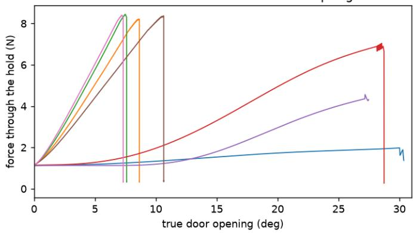

constrained\_follow (adapts to the force)  
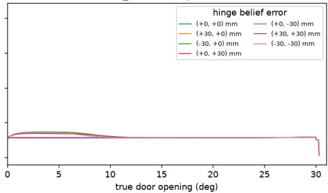

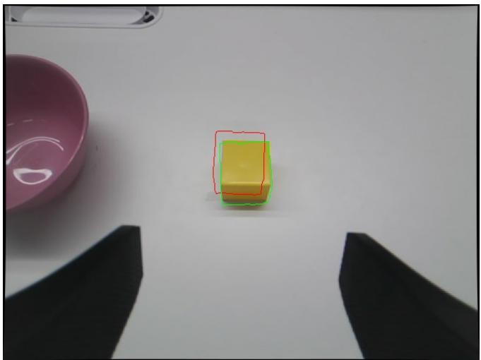

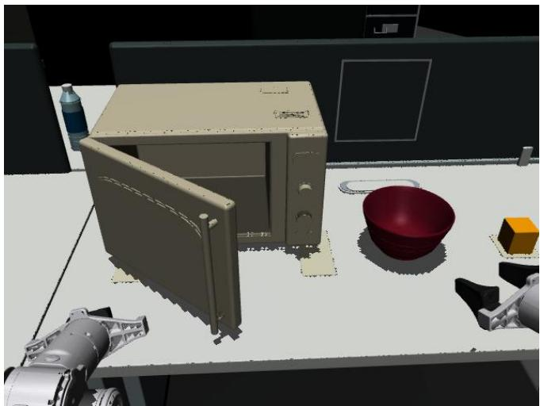  
Fingertip force estimated from motor currents, right Piper, 1 cm/s (2026-10-04)

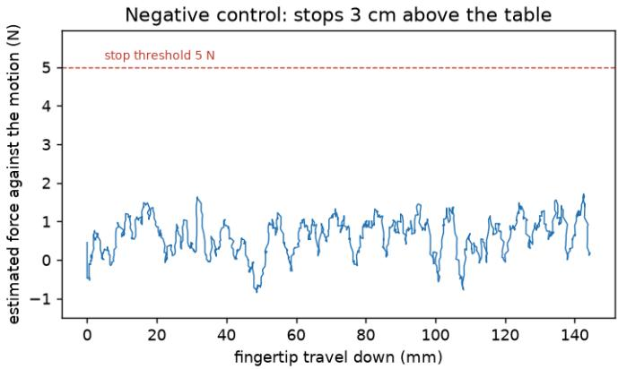

Positive control: descends onto the table  
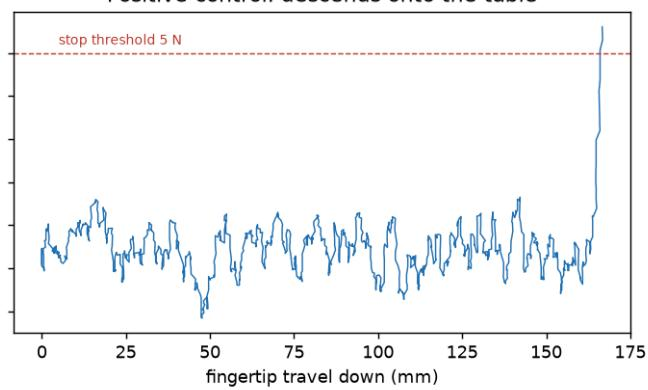  
Figure 9. Compliant execution. Top: constraint force while opening a twin door to $3 0 ^ { \circ }$ with the hinge believed up to 42 mm away, following the believed circle (left) and yielding to the measured force (right). Middle left: pre-grasp wrist inspection in the chained task (raw wrist frame, 640×480, not rotated); red is the planned cube, green the fitted cube. Middle right: a door-opening plan executed in the twin with the hardware’s loop and guards. Bottom: force estimated from motor currents in the table-contact test and its negative control.

## C.2. NeoMCP: Agent-Facing Operations

An agent’s reach over a reconstruction is exactly the set of operations it can invoke. NEOMCP is that set, gathered into a single registry and held to one record per operation, so that the surface can be described, served to different clients, measured, and — as Section A.5 develops — grown. It sits between the geometry substrate of Section C.1 and the loop that consumes it: NEOSDK decides what geometry can express, NEOMCP decides what the model can ask for, and the harness decides what is kept.

One registry, one record per verb. Every model-facing operation is registered once with a name, a one-line description, a strict input schema, an implementation, and a per-call receipt. Every property is declared and required, nothing additional is accepted, and the schema is validated at registration, so a malformed surface cannot reach a model. No failure escapes as an exception: an unknown verb, a schema violation, a refusal by the verb, and an unexpected error all return the same typed record, so a tool bug becomes feedback. The model’s view is bounded while measurement is not: images sent to the model are bounded re-encoded copies, and an oversized record reaches the model as a summary naming the complete record filed with the run, whereas measurement reads the original raster. The receipt records the call’s ordinal, verb, argument digest, elapsed time, record size, number of images sent, and error status, giving an auditable account of what the agent asked for and what it was told.

One surface, two consumers. The registry is served, unmodified, through two adapters: projected into function-calling specifications for our own loop, and mounted as a tool-protocol server over a standard transport for an external coding agent, which holds it among its own file and shell tools. Both clients receive the same schemas, typed records, and image bytes, so substituting an external agent isolates the loop from the interface.

The live scene the surface owns. Each run owns one filesystem-isolated modeller process; the author sees only the sealed observation packet and its own working directory. The process leads its own process group, and its recorded identity and start time are re-verified before any lifecycle action. A reply that does not echo the generation minted at startup and the expected result schema is refused. However the episode ends, the scene is saved and exported from what it actually holds, not replayed.

What stays in the harness. The surface exposes operations and diagnostic feedback; the harness retains candidateadmission and episode-control authority. An audit classification is not a quality verdict, and finish requests completion without claiming that the result is good. Remaining model calls and wall time ride along on every tool record, but the host counts and enforces them, holding back a finalization reserve for saving and export. In the optional two-phase episode, the first finish triggers a bounded assembly and part audit and returns a work list for a second authoring phase within the same budget.

Authored source passes a staged admission — syntax, source validation, compilation preflight, execution, and receipt — and each stage has its own typed failure. The harness never edits a semantic value (a dimension, material, joint family, axis, or joint range) to make a program pass; numerical changes arrive only as admitted refinement candidates, judged against their retained baseline by the SDK-owned rules of Section A.3.4 in both lanes (the object lane omits only the clauses that protec a scene’s surroundings). A weakest-view check does not imply that every view improves, and a refused candidate leaves the retained program unchanged. Explicit selection and export remain separate from this numerical decision. The harness’s own structural edits are few, and each is receipted:

• retiring a delegated body’s GROUPS and JOINTS rows, and hosting the delivered asset under a name prefix;

• leaving out a delivered joint whose family, side, or axis is unresolved;

• re-bracketing a declared search range around an admitted value;

• hoisting an inline literal into a named constant of the same value, kept only if the rebuild is identical (Section A.3.3).

The verbs and mounted catalogs. Table 6 (Section A.2) summarizes the live-scene tools for observation, measurement, geometry construction, calibrated comparison, scene refinement, and diagnosis. The object session additionally provides a strict-schema tool catalog for workspace inspection, evidence viewing, source reading, geometry creation, exact-anchor editing, native preview, select\_candidate, and task completion. Optional refinement adds observe\_parameters and refine, while articulated tasks additionally provide probe\_articulation, review\_opened\_state, se lect\_motion\_artifact, and record\_articulation\_unknown (Section A.4.3). For reproducibility, each run records its mounted tools and configuration rather than relying on a fixed global tool count.

Optional scene feedback. The critics behind review\_views run in parallel with a fixed per-run review cap, while scan\_discrepancies examines every frame of the reconstructed scene. Both provide diagnostic evidence for the author to verify, but neither authorizes edits or certifies overall scene quality. Predicted depth is subject to the qualifications in Section A.6.

From part discrepancies to repair steps. audit turns photographic disagreement into a bounded work list. It segments each built body’s parts using the body’s prompt and terms from the authored part names, in the frames where the body shows best; a part mask must lie mostly on the body without being the whole body. Parts are classified as aligned (IoU ≥ 0.80 in every measured view), misshapen, displaced, of doubtful identity, or unmeasurable, ranked by mask area times (1 − IoU), and at most eight are returned. Each carries one action: fit declared constants, name inline literals, declare a missing control, split or unfreeze a source block the twin cannot trace, rewrite one construction, or locate the part’s source lines.

To choose constants, the batched twin trace measures each constant’s effect over its range: mean vertex displacement estimates translation, and the largest residual displacement after removing it estimates deformation. A constant that only translates what it reaches is left to the preceding pose step. Shape steps take at most six constants, ordered by the share of their effect that is deformation, each within the interval that moves the geometry by the measured error. The list proposes what to try; only another audit measures what an action changed. The audit also carries the joints sweeps of declared joints, with exact-anchor range edits where applicable; the author decides whether to revise the source, and the tool never commits a joint.