# Neural Implicit Energy Optimization for LiDAR Mapping

Hrishikesh Viswanath1, Md Ashiqur Rahman1, Chi Lin1, Damon Conover2, Aniket Bera1 1Purdue University, USA 2DEVCOM, Army Research Laboratory, USA hviswan@purdue.edu

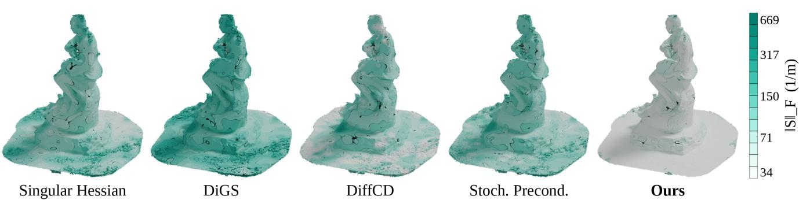  
Figure 1. Surface Energy Optimized LiDAR maps. We visualize the spurious features (jitter) of reconstructed LiDAR maps, measured by the shape operator norm |S|F defined over the surface. Our approach improves the smoothness of the surface while preserving the geometric fidelity of the scene without incurring any additional inference time costs for large scale LiDAR sweeps.

## Abstract

Neural implicit representations provide memory-efficient signed distance field (SDF) parameterizations for largescale LiDAR scenes, but the geometry recovered from sparse and often noisy inputs carries jitter and artifacts. Classical geometric optimization techniques resolve such artifacts with surface energy functionals, whose minimizers correspond to smooth surfaces. Motivated by this principle, we formulate neural LiDAR mapping as the optimization of energy functionals over the parameter space of neural implicit representations. Specifically, we regularize the signed distance field with an energy functional defined on the shape operator of its level set, which represents the curvature ofthe surface, thus encouraging smoothness along the surface. This adapts classical geometric priors to the scale of million-point LiDAR maps. Experiments on large-scale datasets show reconstructions with improved smoothness at preserved geometric fidelity, and no additional inference-time cost. The code is publicly available at https://github.com/HrishikeshVish/nieo

## 1. Introduction

Constructing accurate geometric representations of largescale environments is a fundamental task in 3D computer vision. These spatial models serve as the foundation for downstream visual reasoning tasks, simulation frameworks, and autonomous systems [2, 3, 33, 34, 43]. To capture these environments, cameras and LiDAR (Light Detection and Ranging) are the two most common sensors utilized in practice. While cameras capture dense photometric information, LiDAR provides the depth perception essential for spatial modeling and geometric mapping. However, relying directly on raw LiDAR scans presents challenges. Captured point clouds can be noisy and often sparse, particularly in areas with limited sensor coverage. This sparsity makes generating high-fidelity surfaces complex, and the resulting mapped surfaces often exhibit jitter. Ensuring that the reconstructed surface accurately represents the continuous underlying geometry while preserving localized details remains a challenge in large-scale 3D mapping.

Neural implicit 3D reconstruction frameworks typically map scenes using learnable continuous feature representations [23, 62]. When handling large-scale geometry, these frameworks represent the environment using sparse hierarchical spatial features. This serves as a differentiable latent state, using which an implicit neural representation learns a continuous signed distance field (SDF) [50, 67], often using physics-based priors derived from partial differential equations (PDE). Leveraging the connections between the SDF and equations such as Eikonal PDE and the Poisson PDE [54, 67], recent works have regularized neural reconstruction through PDE based objectives. While Eikonal and Poisson constraints provide metric consistency to the learned field, noisy and sparsely sampled LiDAR observations can still introduce spatial jitter in the reconstructed surfaces.

A fundamentally different perspective on surface characterization arises from smoothness priors derived from energy functionals. Neural reconstruction approaches have used Hessians and their energies as penalties [9, 66] but often lose geometric detail due to excessive smoothing [58]. This is addressed by instead imposing constraints on the singular Hessian [60] or by aligning gradients and the Hessians [58]. However, these approaches struggle in sparse and large-scale scenes. A key challenge in LiDAR sweeps is that we often have large open regions spanning meters, sampled sparsely and noisily. In these settings, Eikonal constraints can capture larger geometric structures, but noise manifests as surface-level jitter. Meanwhile, classical geometry processing has long leveraged optimization strategies over surface curvature energies defined by shape operators [13, 14, 17, 20, 48], which enable surface smoothing, fairing, bending, and the tuning of surface-level irregularities [35, 45], but their use in large-scale LiDAR mapping remains unexplored.

Our Contribution. Motivated by these classical techniques, in this work, we pose neural LiDAR mapping as a surface energy optimization problem defined over the parameter space of neural representations. We consider the energy functional defined over the shape operator, which measures the surface variations. We find that this energy can characterize the sharp, jitter seen on the reconstructed surface and optimizing over it seeks a minimum energy configuration for reconstruction. By applying this energy as the regularizer for a sparse hierarchical neural implicit representation, we show that the resulting maps exhibit improved geometric fidelity across large-scale datasets. We evaluate our approach on a diverse set of object-, building-, and street-scale scenes using established LiDAR mapping benchmarks, including KITTI [19], MaiCity [53], and Newer College [40]. To evaluate reconstruction of more complex surfaces, we additionally construct a synthetic Li-DAR benchmark from the Tanks-and-Temples [28] dataset. We show that our method consistently achieves the highest overall F-scores across these benchmarks, outperforming both LiDAR mapping methods and neural surface reconstruction approaches.

## 2. Background

## 2.1. Standard and Neural LiDAR mapping

Typical LiDAR mapping approaches relies on a variety of geometric and probabilistic techniques. These involve correspondence point optimization [56, 65], incremental triangulation [31], Gaussian Process-based meshing [26, 42], surfel-based meshing [7], and coverage maps [46]. Additionally, volumetric Truncated Signed Distance Function (TSDF) integration frameworks, such as VDBFusion [55], provide efficient spatial data structures for merging range sensor data. While effective, these explicit methods often struggle to produce globally smooth manifolds from highly sparse data.

To address the limitations of discrete meshing, implicit neural representations have emerged as powerful continuous surrogates for SDF estimation. Neural Radiance Fields (NeRFs) and Neural LiDAR Fields (NFL) [24] model scenes through coordinate-based networks [4]. For memory-efficient large-scale offline mapping, methods such as SHINE [67], 3QFP [50], PIN-SLAM [38], and LONER [25] introduce sparse, tree-based data structures to accelerate neural implicit reconstruction.

## 2.2. Physics Based Approaches

The emerging physics-based mapping techniques integrate mathematical priors into neural networks to constrain the underlying geometry of the learned manifold. Among these, data-driven approaches [22] use gradient-based datadependent kernels within the deep learning framework [23, 61, 62], while physics-informed approaches embed the governing differential equations like the Eikonal [59, 67] or Poisson constraints [39] as loss functions to guide learning. PUMA [54] leverages Poisson constraints for LiDAR mapping. Fully data-driven extensions utilize neural operators [5, 29, 52] to implicitly model the underlying PDEs across various graphics tasks [1, 6, 10, 51].

## 2.3. Neural Signed Distance Functions

Neural SDFs for surface reconstruction often leverage higher-order gradient terms for improving geometric fidelity. The volumetric Hessian energy, introduced for surface reconstruction by [9], is applied to neural fields by RegSDF [66], which penalizes the Hessian of the implicit function directly, minimizing the Hessian energy together with a minimal-surface term. [58] penalizes the product of the Hessian and the local gradient, which vanishes when the gradient is an eigenvector of the Hessian. Neural-Singular-Hessian [60] minimizes the determinant of the Hessian near the surface. But these approaches can fail in large-scale and highly sparse settings. Other methods include penalizing the divergence of the gradient field [8], leveraging periodic activations [44], symmetric Chamfer data terms [21], perturbed query coordinates [32], and neural Galerkin solvers [63].

However, it has been shown that directly optimizing Hessian energies can often lead to oversmoothing and eventually mesh degeneracy [58]. In sparse LiDAR settings, ensuring smooth reconstructions while avoiding mesh degeneracy remains a key challenge. We propose to leverage the shape operators [13, 16, 30, 36, 64], wherein, we define the variational energy over the curvature of the level set. We detail this in Sec. 3.

## 3. Problem Setup

Let $\chi ~ = ~ \{ x _ { i } ~ \in ~ \mathbb { R } ^ { 3 } , i ~ = ~ 1 , . . . , N \}$ be the point cloud sampled from the spatial domain Ω, where $\Omega \ \subset \ \mathbb { R } ^ { 3 }$ denotes a bounded spatial domain equipped with the standard Euclidean metric. We seek to extract a surface mesh $\mathbf { M } = ( \mathbf { V } , \mathbf { F } )$ , with vertices V and faces F, such that M accurately reconstructs the underlying geometry of the scene.

We define this surface as the zero-level set of a continuous SDF, $u : \mathbb { R } ^ { 3 }  \mathbb { R }$ , denoted by $S = \{ x \in \Omega \mid u ( x ) = 0 \}$ The discrete mesh M is extracted by applying marching cubes to the signed distance field u. Our objective is to learn the implicit mapping $\mathcal { G } _ { \theta } : \chi  u ,$ , where $\mathcal { G }$ is a neural network parameterized by learnable weights θ.

## 3.1. Preliminaries

We consider scalar fields $u : \Omega \to \mathbb { R }$ , where u represents the SDF parameterized by a neural implicit representation. Throughout this work, we assume $u \in \overline { { H ^ { 2 } ( \Omega ) } }$ , the Sobolev space of square-integrable functions whose weak derivatives up to second order are also square integrable. The Hessian matrix of u is defined as $[ \mathcal { H } ( \bar { u } ) ] _ { i j } = \partial ^ { \bar { 2 } } u / \partial x _ { i } \partial x _ { j } .$

The shape operator $S ,$ , as used in graphics $[ 1 3 , 1 6 , 3 0 ,$ 36], defines the curvature of a surface. For the field $u ,$ it is expressed through the unit normal $n = \nabla u / \| \nabla u \|$ and the tangent projector $P = I - n n ^ { \top }$ as

$$
S = \frac { P \mathcal { H } ( u ) P } { \Vert \nabla u \Vert } ,\tag{1}
$$

whose eigenvalues are the principal curvatures $\kappa _ { 1 } , \kappa _ { 2 }$ and zero, so that $\lVert S \rVert _ { F } ^ { 2 } = \kappa _ { 1 } ^ { 2 } + \kappa _ { 2 } ^ { 2 }$ is the total curvature of the level set [13, 64]. This can be expressed as a variational energy over the surface $\Sigma ,$

$$
E _ { S } ( u ) = \int _ { \Sigma } \| S \| _ { F } d A ,\tag{2}
$$

whose minimizers define a smooth surface [12, 41, 64].

## 3.2. Neural Energy Optimization

In this section, we formalize the smoothness energy optimization for large-scale LiDAR settings. Let $\mathcal { G } _ { \theta }$ denote the neural implicit representation of the signed distance field $u ,$ parameterized by learnable weights θ, so that the network parameterizes the admissible function space. Let $\chi _ { p o o l } =$ $\{ ( x _ { i } , s _ { i } ) \} _ { i = 1 } ^ { M }$ denote the finite set of samples drawn along the sensor rays together with their SDF labels. At each optimization step we draw a uniform random subset $B \subset \mathcal { X } _ { p o o l }$ of size N, and estimate the surface energy over B. Because $\mathcal { G } _ { \theta }$ is differentiable with respect to its input coordinates, $\nabla u$ and $\mathcal { H } ( u )$ are evaluated directly by automatic differentiation.

Surface energy Optimization We estimate Eq. (2) by its sample mean over the batch, $\begin{array} { r l } { E _ { S } ( \theta ) } & { { } = } \end{array}$ $\begin{array} { r } { \vert \dot { \boldsymbol { B } } \vert ^ { - 1 } \sum _ { \boldsymbol { x } \in \boldsymbol { B } } \vert \vert \boldsymbol { S } ( \boldsymbol { x } ) \vert \vert _ { F } } \end{array}$ , with $S$ as in Eq. (1). When used alongside the reconstruction losses, the optimizer serves as the minimizer of this expression and imposes smoothness constraints.

Reconstruction constraints The SDF is typically modeled as the solution to the Eikonal equation and is the standard physics-informed loss used in surface reconstruction. Similarly, as LiDAR surfaces tend to be non-watertight, a common loss used to ensure the interpolated points remain compact is the minimal surface area constraint used in [66]. This term helps compact geometry interpolated between sparse observations: $\begin{array} { r } { \dot { E _ { M } } ( \theta ) \stackrel {  } { = } | \mathcal { B } | ^ {  1 } \sum _ { x \in \mathcal { B } } ( \varepsilon / \pi ) / ( \varepsilon ^ { 2 } + \dot { u ( x ) ^ { 2 } } ) } \end{array}$ where u(x) is the predicted signed distance at the sample $x ,$ and $\varepsilon = 0 . 0 8$ m is the width of the band around the surface over which area is charged. We refer the reader to [66] for the derivation of this term.

## 4. Training and Implementation Details

Dataset Details We evaluate our approach on standard scene-level LiDAR sweeps. The MaiCity dataset [53] is a synthetic dataset generated from a 3D CAD model of an urban environment. It contains 100 frames, which were created by simulating LiDAR scans through ray-casting techniques. The Newer College dataset [40] consists of data captured at New College, Oxford, using a handheld sensor setup, which includes a stereo camera and a 3D LiDAR. This dataset includes 1,500 frames and is accompanied by precise ground truth measurements. Finally, we also benchmark against the KITTI dataset [19], a widely used dataset for outdoor odometry tasks. KITTI includes sequences captured with a 64-beam LiDAR sensor, along with camera data, and provides near ground truth estimates for incremental mapping in both urban and rural environments.

Existing LiDAR sets are often captured at street-level or at building-level. We aim to understand the impact of surface energy optimization on more complex structures. We therefore consider Tanks-and-Temples dataset [28], whose training scenes are captured with outside-looking-in trajectories and span sculptures, large vehicles and house-scale buildings, and whose per-scene evaluation thresholds run from 3 mm to 25 mm, a range. This set contains a surveygrade laser scan per scene together with an evaluation volume and an alignment matrix. We use five of its scenes: Ignatius, Truck, Caterpillar, Barn and Courthouse, representng the natural progression from object level to scene level captures. We additionally consider the indoor Redwood scene [11].

Constructing a synthetic LiDAR set from Tanks-and-Temples For each scene, Tanks-and-Temples provides an image set, a camera trajectory, and a laser scan with an evaluation volume. The image set is the input a method is expected to reconstruct from, and the laser scan is held out as the evaluation reference. To construct a synthetic Li-DAR set, we convert the image set into a per-frame point cloud. We use COLMAP [18] to reconstruct each scene from the published camera poses, running feature extraction, sequential matching and point triangulation, followed by dense multi-view stereo. This produces a depth map per image, which we back-project into a per-frame point cloud paired with that frame’s camera centre. Each frame is cropped to the evaluation volume published with the scene. The transform published with each scene includes a scale factor, which we apply to the points, so that distances in the converted scene are in metres. Camera intrinsics are estimated per scene: we project the ground-truth points into each image at a candidate focal length, take the outline of the projected region, and score the mean image gradient along it, choosing the focal length with the highest score.

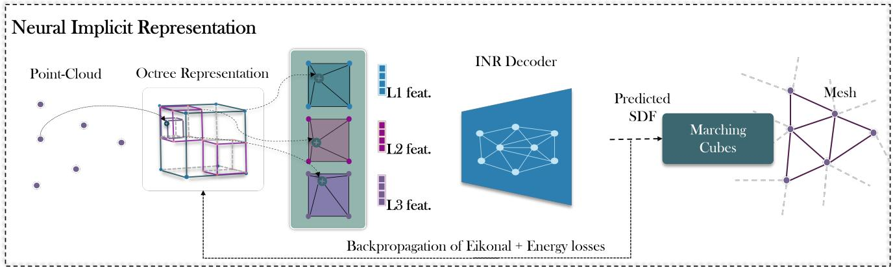  
Figure 2. Framework architecture: Our architecture consists of an implicit neural representation and a learnable octree, trained using the continuous smoothness energy as a geometric supervision signal.

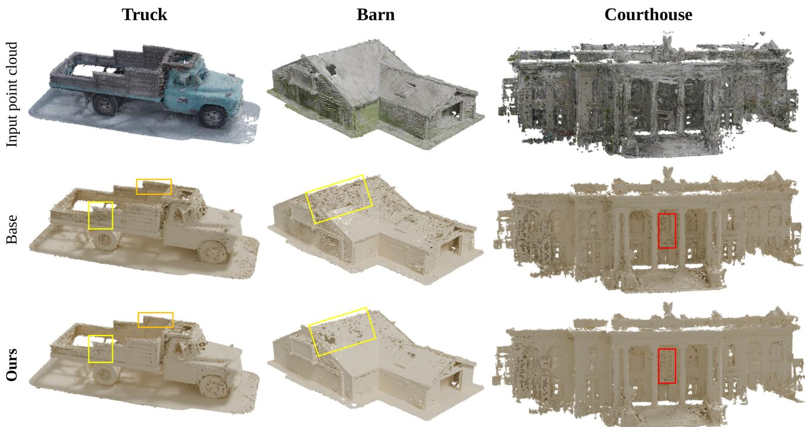  
Figure 3. Qualitative comparison across scenes. One column per scene (Truck, Barn, Courthouse): input cloud, Base, and ours. All three share a sampler, octree and decoder, so only the regularizer differs.

Feature Encoding and Sampling: Across these datasets, we adopt the hierarchical parameterization strategy established by recent offline implicit models [50, 67]. We parameterize the SDF using a differentiable hierarchical octreebased feature grid. Multi-resolution features are stored in hash tables indexed by Morton codes, enabling O(1) query access without dense memory allocation. For a given 3D point $x _ { i } ,$ the octree features are passed into a shared 2- layer MLP with smooth activations in between the layers. For ground-truth supervision, we compute the ray-aligned signed distance $d _ { i }$ from the sensor origin to the measured LiDAR point cloud. Following the sampling strategy established in SHINE [67], we recognize that precise SDF values far from the surface have very little impact on the final geometry, whereas values close to zero define the surfaces and should exert a higher impact. Thus, the distance is mapped to an occupancy probability $l _ { i } ~ \in ~ [ 0 , 1 ]$ using a sigmoid function with a truncation hyperparameter σ, allowing us to densely sample training points within a ±3σ band around the surface. For the octree and the architecture parameterizations we use the hyperparameters and training setups specified in SHINE [67], which we provide in $\mathsf { A p - }$ pendix section C.

Our framework is designed for unbounded, incremental large-scale mapping. Consequently, the computational domain Ω dynamically expands as the sensor traverses the environment. Because the map is unbounded, we do not impose classical Dirichlet or Neumann constraints on a global boundary ∂Ω. Instead, the energy prior is evaluated pointwise over the aggregated coordinate pool (managed via our sliding-window sampler). This ensures the smoothness constraint is enforced locally.

Loss Formulation. Our architecture, based on SHINE [67], is optimized end-to-end using a joint objective. We use the Binary Cross-Entropy (BCE) formulation of SHINE, which applies a sigmoid mapping to the predicted signed distance values, $( o _ { i } = \sigma ( \mathcal { G } _ { \theta } ( x _ { i } ) ) )$ . This formulation reflects the observation that surface reconstruction is governed primarily by the zero-level set, while errors far from the surface have little influence on the geometry.

$$
\mathcal { L } _ { b c e } = \frac { 1 } { N } \sum _ { i = 1 } ^ { N } \left[ l _ { i } \log ( o _ { i } ) + ( 1 - l _ { i } ) \log ( 1 - o _ { i } ) \right]\tag{3}
$$

where, $l _ { i }$ denotes the label computed by applying sigmoid to the projected distance to the surface $l _ { i } = \sigma ( d _ { i } )$ . In addition to the above loss, the standard Eikonal loss from SHINE is employed to enforce the metric property of the signed distance field through its spatial gradients. These two terms combine with the terms of Sec. 3 to give the objective of Eq. (4). In practice, second-order derivatives exhibit larger numerical magnitudes than first-order losses (Tab. 7), motivating the use of smaller weights.

Total objective. The three constraints are combined with the binary cross-entropy data term from [67] and the overall loss is given by

$$
\mathcal { L } = \lambda _ { 1 } \mathcal { L } _ { b c e } + \lambda _ { 2 } \mathcal { L } _ { E i k o n a l } + \lambda _ { S } E _ { S } + \lambda _ { M } E _ { M } ,\tag{4}
$$

and the variational problem becomes the finite-dimensional optimization $\theta ^ { * } = \arg \operatorname* { m i n } _ { \theta } \mathcal { L } ( \theta )$ $\lambda _ { S }$ and $\lambda _ { M }$ are set per scene so that each term contributes a fixed fraction of the total loss at initialization, measured on the untrained field. We provide the theoretical background in Appendix Sec. A and the optimization algorithm in Appendix Sec. B. Following [67], we set $\lambda _ { 1 } = 0 . 1$ and $\lambda _ { 2 } = 0 . 1$ . The single-term ablation of Tab. 7 studies the sensitivity of that choice.

Code and configurations for all reported experiments will be released.

Evaluation protocol: After training, the mesh is extracted by querying the field on a regular grid spanning the occupied octree nodes and running marching cubes, so the vertices span points beyond the training set. Accuracy is measured from the mesh vertices to the laser scan, and completeness from the scan to the mesh surface using exact point-to-triangle distance, both restricted to the published evaluation volume.

Evaluation Metrics: To quantitatively assess the fidelity of our neural implicit reconstructions, we leverage the standard reconstruction metrics from the prior works [67]. Accuracy (Acc.) measures the median distance from the reconstructed surface to the ground-truth point cloud, whereas Completeness (Comp.) quantifies the median distance from the ground-truth points to the reconstructed surface, both evaluated against the surface itself using a bounding volume hierarchy. The Chamfer- $. L _ { 1 } ( \mathrm { C D } { - } L _ { 1 } )$ distance provides a comprehensive bidirectional nearest-neighbor error. We compute Precision (Acc. Ratio) and Recall (Comp. Ratio) at a per-scene threshold τ to derive the overall F1 score. Following standard evaluation protocols, we employ an error threshold of 10 cm for the MaiCity and KITTI datasets, and 20 cm for the NewerCollege dataset. For KITTI, we utilize an aggregated projection of the point-cloud frames as the ground truth, whereas NewerCollege and MaiCity provide precomputed ground-truth point clouds.

## 5. Experiments

Table 1. Quantitative results on NewerCollege, KITTI and MaiCity. Threshold 10 cm (MaiCity, KITTI) and 20 cm (NewerCollege). Bold is best.
<table><tr><td>DATA</td><td>MODEL</td><td>ACC. [cm]↓</td><td>COMP. [cm]↓</td><td>C-L1 [m]↓</td><td>ACC. RATIO [%]↑</td><td>COMP. RATIO [%]↑</td><td>F SCORE [%]↑</td></tr><tr><td rowspan="6">Newer College</td><td>PUMA</td><td>7.70</td><td>15.37</td><td>0.107</td><td>89.77</td><td>80.31</td><td>84.77</td></tr><tr><td>VDB FUSION</td><td>7.10</td><td>12.40</td><td>0.095</td><td>92.81</td><td>88.56</td><td>90.63</td></tr><tr><td>NKSR</td><td>20.10</td><td>33.70</td><td>0.168</td><td>54.77</td><td>44.38</td><td>49.03</td></tr><tr><td>PIN</td><td>11.04</td><td>9.30</td><td>0.137</td><td>62.92</td><td>96.67</td><td>76.22</td></tr><tr><td>SLAM 3QFP</td><td>6.72</td><td>10.50</td><td>0.097</td><td>93.63</td><td>93.35</td><td>93.48</td></tr><tr><td>SHINE</td><td>6.70</td><td>10.00</td><td>0.084</td><td>93.80</td><td>93.60</td><td>93.70</td></tr><tr><td></td><td>OURS</td><td>5.68</td><td>11.18</td><td>0.082</td><td>97.08</td><td>91.88</td><td>94.41</td></tr><tr><td rowspan="4">Kitti</td><td>ImMesh PIN</td><td>8.65</td><td>18.67</td><td>0.077</td><td>70.20</td><td>60.33</td><td>64.89</td></tr><tr><td>SLAM</td><td>12.33</td><td>25.81</td><td>0.09</td><td>66.43</td><td>56.70</td><td>61.18</td></tr><tr><td>3QFP</td><td>7.24</td><td>4.63</td><td>0.059</td><td>70.48</td><td>92.25</td><td>79.91</td></tr><tr><td>SHINE</td><td>7.04</td><td>4.62</td><td>0.058</td><td>72.18</td><td>92.70</td><td>81.16</td></tr><tr><td></td><td>OURS</td><td>6.23</td><td>4.39</td><td>0.056</td><td>75.74</td><td>93.96</td><td>83.87</td></tr><tr><td rowspan="6">MaiCity</td><td>ImMesh PUMA</td><td>6.78</td><td>6.10</td><td>0.077</td><td>73.06</td><td>84.42</td><td>78.33</td></tr><tr><td>VDB</td><td>3.50</td><td>27.58</td><td>0.056</td><td>93.01</td><td>57.45</td><td>71.02</td></tr><tr><td>FUSION</td><td>4.00</td><td>7.10</td><td>0.044</td><td>93.01</td><td>78.22</td><td>84.97</td></tr><tr><td>PIN SLAM</td><td>7.39</td><td>5.50</td><td>0.0812</td><td>61.36</td><td>88.75</td><td>72.56</td></tr><tr><td>3QFP</td><td>1.51</td><td>3.20</td><td>0.031</td><td>94.91</td><td>95.61</td><td>95.25</td></tr><tr><td>SHINE</td><td>1.11</td><td>3.25</td><td>0.029</td><td>96.61</td><td>95.20</td><td>95.90</td></tr><tr><td></td><td>OURS</td><td>1.07</td><td>3.79</td><td>0.024</td><td>97.94</td><td>94.17</td><td>96.01</td></tr></table>

## 5.1. Quantitative Results

## 5.1.1. LiDAR mapping baselines

We begin by discussing how our proposed approach compares against LiDAR mapping baselines. While baseline architectures approximate a valid SDF, they often lack a governing prior to manage the structural noise inherent in massive, noisy point clouds. As reported in Tab. 1 (where ours refers to energy optimized SHINE framework), our framework improves surface Accuracy and F-scores across all three benchmarks. Compared to the strongest performing baselines, our approach yields accuracy improvements of approximately 11.5% on KITTI (from 7.04 cm to 6.23 cm) and 15.2% on Newer College Dataset (from 6.70 cm to 5.68 cm). When processing millions of LiDAR points, where prior models overfit to sparse regions and produce topological jitter, the energy formulation biases the network toward well-conditioned, smooth SDF. In contrast, we find MaiCity to have more marginal improvements. We observe that this is because the baselines already perform well on this synthetic dataset, where the points are largely well structured. We provide qualitative visual results in Fig. 4 as well as Appendix Fig. 10. We find that our proposed approach improves over regularizations defined by Poisson forms [39], and Dirichlet energy forms [49], as shown in Tab. 2. First, Energy Only optimization performs poorly because it lacks the Eikonal constraint, which enforces the metric structure of the signed distance field and anchors the implicit representation to a valid distance function. Second, the energy operator is sensitive to the high-frequency fluctuations present in the observations, producing gradient magnitudes several orders larger than the primary reconstruction losses. Thus, the energy term must be heavily down-weighted, with the optimum occurring near (3e−9). In this regime, it operates not as a competing metric constraint, but as a principled geometric inductive bias. It resolves the ill-posedness of sparse point cloud mapping by identifying the geometrically smoothest and most structurally stable manifold from the family of valid distance fields satisfying the Eikonal constraint. Lastly, simpler first-order or Laplacian-based regularizers provide weaker geometric constraints, which is consistent with prior works [47, 48].

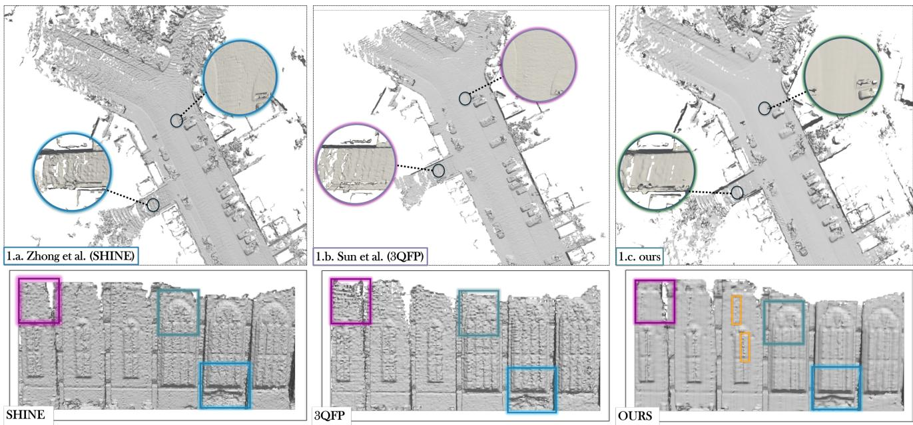  
Figure 4. Neural implicit reconstruction via energy optimization. (Top) KITTI 00, bird’s-eye. (Bottom) Newer College, front view.

Table 2. Ablation study evaluating the impact of different physicsinformed formulations on the Newer College dataset.
<table><tr><td>Method</td><td>ACC. [cm]↓</td><td>COMP. [cm]↓</td><td>C-L1 [m]↓</td><td>ACC. RATIO [%]↑</td><td>F SCORE [%]↑</td></tr><tr><td>Eikonal</td><td>6.70</td><td>10.00</td><td>0.084</td><td>93.80</td><td>93.70</td></tr><tr><td>Poisson</td><td>6.55</td><td>18.25</td><td>0.141</td><td>95.63</td><td>63.09</td></tr><tr><td>Energy Only</td><td>6.68</td><td>17.12</td><td>0.125</td><td>93.05</td><td>65.27</td></tr><tr><td>Eikonal + Dirichlet Energy</td><td>6.57</td><td>11.41</td><td>0.083</td><td>95.12</td><td>93.39</td></tr><tr><td>Eikonal + Surface Energy</td><td>5.68</td><td>11.18</td><td>0.082</td><td>97.08</td><td>94.41</td></tr></table>

## 5.1.2. Neural Reconstruction Baselines

To analyze our approach more rigorously, we compare our optimization approach with eight baselines - RegSDF [66], DiGS [8], SIREN [44], GradHess [58], Singular Hessian [60], DiffCD [21], Stochastic Preconditioning [32] and NeuralSSD [22]. To ensure fairness in comparison, we setup all these approaches over the base SHINE architecture (Denoted by Base). We leverage the Tanks-and-Temples dataset, which provides objects of increasing complexity, ranging from vehicles to building complexes. This enables us to analyze how the approach behaves in objects with complex curved surfaces such as trucks, and on large planar surfaces seen in buildings. Besides F-score, Chamfer distance and normal-augmented F-score from [66], we measure the vertex count and, the energy reduction (∆E), which is the ratio of curvature energy of the regularization method to the baseline SHINE method. Full definitions are provided in Appendix Sec. E.2. We present the results in Tab. 3, with visual results in Fig. 4, Fig. 3 with additional visuals in the Appendix.

Table 3. Reconstruction metrics and field characteristics. Quantitative comparisons against neural reconstruction baselines. † denotes settings with lower vertex count and lower energies, but higher Chamfer distance and lower F-scores than baseline, indicating oversmoothing.
<table><tr><td rowspan="2">Scene</td><td rowspan="2">Method</td><td rowspan="2">F Score↑</td><td rowspan="2">CD-L1 (mm)↓</td><td rowspan="2">F Scoren↑</td><td rowspan="2">∆E</td><td rowspan="2">Vert. (M)</td></tr><tr><td></td></tr><tr><td rowspan="12">Truck</td><td>Base</td><td>52.4</td><td>8.64</td><td>45.8</td><td></td><td>6.42</td></tr><tr><td>RegSDF [66]</td><td>51.6</td><td>8.95</td><td>49.4</td><td>2.48†</td><td>3.40†</td></tr><tr><td>NeuralSSD [63]</td><td>51.7</td><td>8.79</td><td>46.3</td><td>2.88†</td><td>2.00†</td></tr><tr><td>GradHess [58]</td><td>52.0</td><td>8.71</td><td>46.0</td><td>1.07</td><td>5.21</td></tr><tr><td>Sing. Hessian [60]</td><td>52.5</td><td>8.65</td><td>45.9</td><td>0.56</td><td>5.63</td></tr><tr><td>DiGS [8]</td><td>52.3</td><td>8.65</td><td>45.2</td><td>0.81</td><td>6.04</td></tr><tr><td>SIREN [44]</td><td>51.3</td><td>8.79</td><td>45.3</td><td>0.06</td><td>5.39</td></tr><tr><td>DiffCD [21]</td><td>52.1</td><td>8.66</td><td>45.3</td><td>1.01</td><td>6.13</td></tr><tr><td>Stoch. Prec. [32] Ours</td><td>52.4 54.1</td><td>8.65 8.59</td><td>45.8 50.7</td><td>1.05 1.96</td><td>5.68 4.39</td></tr><tr><td></td><td></td><td></td><td></td><td></td><td></td><td></td></tr><tr><td rowspan="10">Ban</td><td>Base</td><td>40.8</td><td>19.55</td><td>26.6</td><td></td><td>6.71</td></tr><tr><td>RegSDF [66]</td><td>37.2</td><td>20.59</td><td>26.3</td><td>2.01†</td><td>4.37†</td></tr><tr><td>NeuralSSD [63]</td><td>39.9</td><td>21.07</td><td>33.7</td><td>1.58†</td><td>4.50†</td></tr><tr><td>GradHess [58]</td><td>40.3</td><td>19.32</td><td>29.4</td><td>0.56</td><td>9.57</td></tr><tr><td>Sing. Hessian [60]</td><td>42.0</td><td>19.38</td><td>34.5</td><td>0.39</td><td>9.63</td></tr><tr><td>DiGS [8]</td><td>40.5</td><td>19.47</td><td>32.3</td><td>0.16</td><td>9.09</td></tr><tr><td>SIREN [44]</td><td>40.2</td><td>19.29</td><td>29.2</td><td>0.02</td><td>6.32</td></tr><tr><td>DiffCD [21]</td><td>40.9</td><td>19.22</td><td>26.5</td><td>0.96</td><td>7.45</td></tr><tr><td>Stoch. Prec. [32]</td><td>41.4</td><td>19.52</td><td>34.2</td><td>0.69</td><td>10.34</td></tr><tr><td>Ours</td><td>43.3</td><td>19.19</td><td>36.8</td><td>1.21</td><td>5.23</td></tr><tr><td rowspan="10">Couttouse</td><td>Base</td><td>26.0</td><td>71.09</td><td>15.5</td><td></td><td>5.19</td></tr><tr><td>RegSDF [66]</td><td>24.5</td><td>71.21</td><td>15.1</td><td>1.74†</td><td>3.42†</td></tr><tr><td>NeuralSSD [63]</td><td>25.9</td><td>74.14</td><td>17.2</td><td>2.08†</td><td>3.66†</td></tr><tr><td>GradHess [58]</td><td>26.1</td><td>72.36</td><td>16.1</td><td>1.42</td><td>4.71</td></tr><tr><td>Sing. Hessian [60]</td><td>26.9</td><td>71.26</td><td>15.7</td><td>0.66</td><td>5.11</td></tr><tr><td>DiGS [8]</td><td>27.8</td><td>71.34</td><td>15.5</td><td>0.25</td><td>4.98</td></tr><tr><td>SIREN [44]</td><td>25.2</td><td>71.11</td><td>16.8</td><td>0.83</td><td>5.02</td></tr><tr><td>DiffCD [21]</td><td>27.9</td><td>70.94</td><td>15.8</td><td>0.97</td><td>5.14</td></tr><tr><td>Stoch. Prec. [32]</td><td>27.5</td><td>71.42</td><td>15.4</td><td>1.12</td><td>4.88</td></tr><tr><td>Ours</td><td>28.3</td><td>70.32</td><td>17.4</td><td>1.60</td><td>3.69</td></tr></table>

Our key observations are that our approach consistently exhibits the highest F1-score as well as normal-aligned F1- score while reducing the Chamfer distance. We observe that RegSDF and NeuralSSD generate surfaces which exhibit the highest reduction of energy as well as the lowest vertex count. This is consistent with the known oversmoothing issues observed in these methods [58, 60]. We observe that this results in the formation of holes within the oversmoothed surface, as shown in Appendix Fig. 16. In contrast, DiffCD exhibits moderate energy reduction, with improved surface variance ratio, but struggles to resolve the jitter completely, as shown in Fig. 1. Similarly, SIREN, Singular Hessian and stochastic preconditioning exhibit moderate to minimal changes.

Limitation: While the energy-based approaches resolve high-frequency structural noise, they inherently create a conservative geometric bias regarding surface completeness. Because the objective explicitly penalizes spatial variations in the normal field, which mathematically correspond to large Hessian magnitudes, the network resists high-curvature topologies. Consequently, baselines can achieve marginally higher absolute completeness on specific datasets (e.g., PIN-SLAM reaching 9.30 cm on NewerCollege compared to our 11.18 cm, or SHINE achieving 3.25 cm on MaiCity vs. our 3.79 cm). Empirically, we observe that this shift toward structurally constrained, noise-reduced mapping directly translates to improved performance and stability in downstream tasks.

## 5.2. Cost-Performance Tradeoff

Embedding higher-order geometric priors inevitably increases the cost of training, since the curvature energy requires evaluating second-order spatial derivatives through automatic differentiation. Compared to first-order objectives such as the Eikonal loss, this incurs additional memory consumption and computation during optimization. We investigate this overhead in Fig. 5, which computes the wall-clock time by simulating autograd operations over 40K steps. The second-order formulation requires approximately 45 minutes of training time compared to 25 minutes for a first-order baseline, reflecting the cost of enforcing second-order geometric regularity.

Importantly, this overhead is incurred only during training. The Hessian energy shapes the parameters of the neural implicit representation, embedding the smoothness prior directly into the learned field. Once optimization is complete, inference consists only of evaluating the neural implicit function itself, requiring no Hessian evaluations, higher-order derivatives, or auxiliary optimization procedures. Consequently, mesh extraction and downstream deployment incur no additional computational overhead beyond that of a conventional neural implicit representation.

As an academic point of comparison, one may also consider optimizing the fourth-order biharmonic residual associated with the Euler–Lagrange equation of the surface Hessian energy (also shown in Fig. 5). Such a formulation requires nested higher-order automatic differentiation and rapidly becomes computationally prohibitive. Our experiments indicate that a direct fourth-order implementation requires nearly 300 minutes of training, yielding approximately a 6.6× increase in runtime relative to our Hessian energy formulation.

What that additional training time buys is shown in the middle panel of Fig. 5, which evaluates accuracy at intermediate checkpoints, not only at convergence. The two methods separate within the first few thousand iterations: the energy leads by 0.85 points at 15k, 0.9 at 25k, and 1.5 at 40k. The unregularized baseline peaks near 25k and then drifts back, while the regularized field continues to improve. The prior therefore shapes the optimization trajectory from the outset and does not act as a late correction to an alreadyconverged solution.

The number of points at which the Hessian is evaluated is the sampler batch size, fixed by the optimizer, so it is independent of scene extent and of the number of captured points. Figure 5 (right) compares the peak GPU memory with the number of input points. The optimized SHINE framework does not incur significant GPU overheads for the second-order derivative compared to the first. We contrast memory consumption for different scenes in the Appendix Tab. 5.

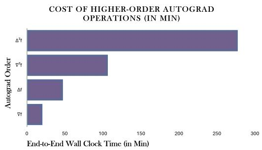

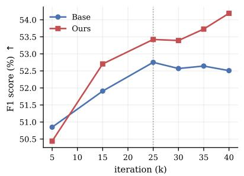

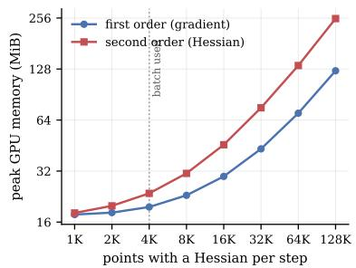  
Figure 5. Cost and performance of the energy. (Left) Wall-clock for 40K steps against differentiation order. (Middle) Accuracy against step on Truck. (Right) Peak GPU memory against Hessian point count.

Table 4. SLAM accuracy (ATE RMSE, m) against LiDAR odometry (above) and LiDAR SLAM (below) on Newer College. Ours is an energy-optimized PIN-SLAM variant.
<table><tr><td>Method</td><td>01</td><td>02</td><td>quad e</td><td>math e</td><td>ug e</td><td>cloister</td><td>stairs</td><td>Avg.</td></tr><tr><td>F-LOAM [57]</td><td>6.74</td><td>=</td><td>0.40</td><td>0.26</td><td>0.09</td><td>7.69</td><td>=</td><td>3.04</td></tr><tr><td>KISS-ICP [56]</td><td>0.62</td><td>1.88</td><td>0.10</td><td>0.07</td><td>0.33</td><td>0.30</td><td>=</td><td>0.55</td></tr><tr><td>SuMa [7]</td><td>2.03</td><td>3.65</td><td>0.28</td><td>0.16</td><td>0.09</td><td>0.20</td><td>1.85</td><td>1.18</td></tr><tr><td>MULLS [37]</td><td>2.51</td><td>8.39</td><td>0.12</td><td>0.35</td><td>0.86</td><td>0.41</td><td></td><td>2.11</td></tr><tr><td>MD-SLAM [15]</td><td></td><td>1.74</td><td>0.25</td><td>=</td><td></td><td>0.36</td><td>0.34</td><td>I</td></tr><tr><td>SC-LeGO-LOAM [27]</td><td></td><td>1.30</td><td>0.09</td><td>=</td><td></td><td>0.20</td><td>3.20</td><td>=</td></tr><tr><td>PIN-LO [38]</td><td>2.08</td><td>5.32</td><td>0.09</td><td>0.09</td><td>0.07</td><td>0.19</td><td>0.07</td><td>1.13</td></tr><tr><td>PIN-SLAM [38]</td><td>0.43</td><td>0.31</td><td>0.09</td><td>0.09</td><td>0.07</td><td>0.15</td><td>0.06</td><td>0.17</td></tr><tr><td>OURS</td><td>0.39</td><td>0.31</td><td>0.08</td><td>0.08</td><td>0.08</td><td>0.15</td><td>0.04</td><td>0.15</td></tr></table>

All sequences are with loops. The best result is bold and the second best is underscored. 7 denotes failure. - indicates the number is not reported and unavailable using the open-source code.

## 5.3. Downstream Tasks

To investigate whether the geometric regularity induced by our energy formulation extends beyond surface reconstruction, we evaluate its impact on Simultaneous Localization and Mapping (SLAM). In neural implicit SLAM systems, pose estimation is performed by directly registering incoming scans against the learned signed distance field (SDF), with the optimization relying on both the predicted distance values and their spatial gradients. Consequently, the quality of the implicit representation can directly influence downstream localization performance. While the Eikonal objective constrains the magnitude of the SDF gradient, our Hessian energy additionally regularizes its spatial variation, promoting a smoother and more coherent implicit geometry throughout the mapped environment.

To quantitatively evaluate this effect, we measure the root-mean-square error (RMSE) of the absolute trajectory error (ATE) using Umeyama alignment on the Newer College benchmark. As shown in Tab. 4, incorporating our energy-optimized implicit representation into the PIN-SLAM mapping backend yields consistent improvements in localization accuracy without modifying the odometry or optimization pipeline. Averaged across all evaluated sequences, our method achieves an ATE RMSE of 0.15 m compared to 0.17 m for the original PIN-SLAM formulation, corresponding to an 11.8% reduction in average trajectory error. Improvements are also observed on several individual sequences, including sequence 01 (0.43 m → 0.39 m, 9.3%), quad e (0.09 m → 0.08 m, 11.1%), and stairs (0.06 m → 0.04 m, 33.3%). Although the proposed energy formulation is designed as a reconstruction prior and not a localization objective, these results indicate that improving the regularity of the learned implicit field can positively influence downstream registration accuracy, highlighting the utility of energy-optimized neural representations for robotics applications, although a detailed analysis of this interaction remains an interesting direction for future work.

## 6. Conclusion

In this work, we introduced an energy-based framework for neural implicit surface mapping that embeds classical smoothness priors directly into continuous signed distance fields. By treating the neural implicit representation as a parameterization of the minimum-energy configuration of a continuous energy functional, our formulation unifies variational geometry processing with modern neural field representations while remaining computationally practical for large-scale LiDAR mapping. Experiments demonstrate that this energy-driven perspective consistently improves reconstruction fidelity and geometric regularity while generalizing naturally to downstream robotics tasks such as localization and mapping. Broadly, we believe this work establishes energy optimization as a principled foundation for integrating classical geometric priors into neural implicit representations, opening new directions for physically grounded 3D scene understanding.

## Acknowledgement

This material is based upon work supported in part by the DEVCOM Army Research Laboratory under cooperative agreement W911NF2020221.

## References

[1] Hector Andrade-Loarca, Julius Hege, Daniel Cremers, and Gitta Kutyniok. Neural poisson surface reconstruction: Resolution-agnostic shape reconstruction from point clouds. arXiv preprint arXiv:2308.01766, 2023. 2

[2] Mihai Andronie, George Laz˘ aroiu, Oana Ludmila˘ Karabolevski, Roxana Stefanescu, Iulian Hurloiu, Adrian˘ Dijmarescu, and Irina Dijm ˘ arescu. Remote big data man-˘ agement tools, sensing and computing technologies, and visual perception and environment mapping algorithms in the internet of robotic things. Electronics, 12(1):22, 2022. 1

[3] Josep Aulinas, Yvan Petillot, Joaquim Salvi, and Xavier Llado. The slam problem: a survey.´ Artificial Intelligence Research and Development, pages 363–371, 2008. 1

[4] Dejan Azinovic, Ricardo Martin-Brualla, Dan B Goldman,´ Matthias Nießner, and Justus Thies. Neural rgb-d surface reconstruction. In Proceedings ofthe IEEE/CVF Conference on Computer Vision and Pattern Recognition, pages 6290– 6301, 2022. 2

[5] Kamyar Azizzadenesheli, Nikola Kovachki, Zongyi Li, Miguel Liu-Schiaffini, Jean Kossaifi, and Anima Anandkumar. Neural operators for accelerating scientific simulations and design. Nature Reviews Physics, 6(5):320–328, 2024. 2

[6] Sai Praveen Bangaru, Michael Gharbi, Fujun Luan, Tzu-Mao Li, Kalyan Sunkavalli, Milos Hasan, Sai Bi, Zexiang Xu, Gilbert Bernstein, and Fredo Durand. Differentiable rendering of neural sdfs through reparameterization. In SIGGRAPH Asia 2022 Conference Papers, pages 1–9, 2022. 2

[7] Jens Behley and Cyrill Stachniss. Efficient surfel-based slam using 3d laser range data in urban environments. In Robotics: science and systems, page 59, 2018. 2, 8

[8] Yizhak Ben-Shabat, Chamin Hewa Koneputugodage, and Stephen Gould. Digs: Divergence guided shape implicit neural representation for unoriented point clouds. In 2022 IEEE/CVF Conference on Computer Vision and Pattern Recognition (CVPR), pages 19301–19310. IEEE, 2022. 2, 6, 7, 14

[9] Fatih Calakli and Gabriel Taubin. Ssd: Smooth signed distance surface reconstruction. In Computer Graphics Forum, pages 1993–2002. Wiley Online Library, 2011. 2, 12

[10] Aditya Chetan, Guandao Yang, Zichen Wang, Steve Marschner, and Bharath Hariharan. Accurate differential operators for hybrid neural fields. In Proceedings of the Computer Vision and Pattern Recognition Conference, pages 530–539, 2025. 2

[11] Sungjoon Choi, Qian-Yi Zhou, and Vladlen Koltun. Robust reconstruction of indoor scenes. In Proceedings of the IEEE conference on computer vision and pattern recognition, pages 5556–5565, 2015. 3, 13

[12] Etienne Corman. Curvature-driven conformal deformations. ACM Transactions on Graphics (TOG), 43(4):1–16, 2024. 3

[13] Keenan Crane, Ulrich Pinkall, and Peter Schroder. Robust¨ fairing via conformal curvature flow. ACM Transactions on Graphics (TOG), 32(4):1–10, 2013. 2, 3, 12

[14] Mathieu Desbrun, Mark Meyer, Peter Schroder, and Alan H¨ Barr. Implicit fairing of irregular meshes using diffusion and curvature flow. In Proceedings of the 26th annual conference on Computer graphics and interactive techniques, pages 317–324, 1999. 2

[15] Luca Di Giammarino, Leonardo Brizi, Tiziano Guadagnino, Cyrill Stachniss, and Giorgio Grisetti. Md-slam: Multi-cue

direct slam. In 2022 IEEE/RSJ International Conference on Intelligent Robots and Systems (IROS), pages 11047–11054. IEEE, 2022. 8

[16] Marc Droske and Martin Rumpf. A level set formulation for willmore flow. Interfaces and free boundaries, 6(3):361– 378, 2004. 2, 3, 12

[17] Matthew Elsey and Selim Esedo g¯ lu. Analogue of the total variation denoising model in the context of geometry processing. Multiscale Modeling & Simulation, 7(4):1549– 1573, 2009. 2

[18] Alex Fisher, Ricardo Cannizzaro, Madeleine Cochrane, Chatura Nagahawatte, and Jennifer L Palmer. Colmap: A memory-efficient occupancy grid mapping framework. Robotics and Autonomous Systems, 142:103755, 2021. 3

[19] Andreas Geiger, Philip Lenz, Christoph Stiller, and Raquel Urtasun. Vision meets robotics: The kitti dataset. The international journal of robotics research, 32(11):1231–1237, 2013. 2, 3

[20] Anthony Gruber and Eugenio Aulisa. Computational pwillmore flow with conformal penalty. ACM Transactions on Graphics (TOG), 39(5):1–16, 2020. 2, 12

[21] Linus Harenstam-Nielsen, Lu Sang, Abhishek Saroha,¨ Nikita Araslanov, and Daniel Cremers. Diffcd: A symmetric differentiable chamfer distance for neural implicit surface fitting. In European conference on computer vision, pages 432–447. Springer, 2024. 2, 6, 7, 14

[22] Jiahui Huang, Hao-Xiang Chen, and Shi-Min Hu. A neural galerkin solver for accurate surface reconstruction. ACM Transactions on Graphics (TOG), 41(6):1–16, 2022. 2, 6

[23] Jiahui Huang, Zan Gojcic, Matan Atzmon, Or Litany, Sanja Fidler, and Francis Williams. Neural kernel surface reconstruction. In Proceedings of the IEEE/CVF Conference on Computer Vision and Pattern Recognition, pages 4369– 4379, 2023. 1, 2

[24] Shengyu Huang, Zan Gojcic, Zian Wang, Francis Williams, Yoni Kasten, Sanja Fidler, Konrad Schindler, and Or Litany. Neural lidar fields for novel view synthesis. In Proceedings ofthe IEEE/CVF International Conference on Computer Vi sion, pages 18236–18246, 2023. 2

[25] Seth Isaacson, Pou-Chun Kung, Mani Ramanagopal, Ram Vasudevan, and Katherine A Skinner. Loner: Lidar only neural representations for real-time slam. IEEE Robotics and Automation Letters, 8(12):8042–8049, 2023. 2

[26] Yanpeng Jia, Fengkui Cao, Ting Wang, Yandong Tang, Shil iang Shao, and Lianqing Liu. Cad-mesher: A convenient, accurate, dense mesh-based mapping module in slam for dynamic environments. arXiv preprint arXiv:2408.05981, 2024. 2

[27] Giseop Kim and Ayoung Kim. Scan context: Egocentric spatial descriptor for place recognition within 3d point cloud map. In 2018 IEEE/RSJ International Conference on Intelligent Robots and Systems (IROS), pages 4802–4809. IEEE, 2018. 8

[28] Arno Knapitsch, Jaesik Park, Qian-Yi Zhou, and Vladlen Koltun. Tanks and temples: Benchmarking large-scale scene reconstruction. ACM Transactions on Graphics (ToG), 36 (4):1–13, 2017. 2, 3

[29] Nikola Kovachki, Zongyi Li, Burigede Liu, Kamyar Azizzadenesheli, Kaushik Bhattacharya, Andrew Stuart, and An ima Anandkumar. Neural operator: Learning maps between function spaces with applications to pdes. Journal of Ma chine Learning Research, 24(89):1–97, 2023. 2

[30] Poay Hoon Lim, Ulas Bagci, Omer Aras, Yan Wang, and Li Bai. A novel spinal vertebrae segmentation framework combining geometric flow and shape prior with level set method. In 2012 9th IEEE International Symposium on Biomedical Imaging (ISBI), pages 1703–1706. IEEE, 2012. 2, 3

[31] Jiarong Lin, Chongjian Yuan, Yixi Cai, Haotian Li, Yunfan Ren, Yuying Zou, Xiaoping Hong, and Fu Zhang. Immesh: An immediate lidar localization and meshing framework. IEEE Transactions on Robotics, 39(6):4312–4331, 2023. 2

[32] Selena Ling, Merlin Nimier-David, Alec Jacobson, and Nicholas Sharp. Stochastic preconditioning for neural field optimization. arXiv preprint arXiv:2505.20473, 2025. 2, 6, 7, 14

[33] Iker Lluvia, Elena Lazkano, and Ander Ansuategi. Active mapping and robot exploration: A survey. Sensors, 21(7): 2445, 2021. 1

[34] Andrea Macario Barros, Maugan Michel, Yoann Moline,´ Gwenole Corre, and Fr´ ed´ erick Carrel. A comprehensive sur-´ vey of visual slam algorithms. Robotics, 11(1):24, 2022. 1

[35] Michael Neunteufel, Joachim Schoberl, and Kevin Sturm.¨ Numerical shape optimization of the canham-helfrich-evans bending energy. Journal of Computational Physics, 488: 112218, 2023. 2

[36] Tiago Novello, Guilherme Schardong, Luiz Schirmer, Vin´ıcius Da Silva, Helio Lopes, and Luiz Velho. Exploring differential geometry in neural implicits. Computers & Graphics, 108:49–60, 2022. 2, 3, 12

[37] Yue Pan, Pengchuan Xiao, Yujie He, Zhenlei Shao, and Zesong Li. Mulls: Versatile lidar slam via multi-metric linear least square. In 2021 IEEE International Conference on Robotics and Automation (ICRA), pages 11633–11640. IEEE, 2021. 8

[38] Yue Pan, Xingguang Zhong, Louis Wiesmann, Thorbjorn¨ Posewsky, Jens Behley, and Cyrill Stachniss. Pin-slam: Lidar slam using a point-based implicit neural representation for achieving global map consistency. IEEE Transactions on Robotics, 40:4045–4064, 2024. 2, 8

[39] Yesom Park, Taekyung Lee, Jooyoung Hahn, and Myungjoo Kang. p-poisson surface reconstruction in curl-free flow from point clouds. Advances in Neural Information Processing Systems, 36:60077–60098, 2023. 2, 6

[40] Milad Ramezani, Yiduo Wang, Marco Camurri, David Wisth, Matias Mattamala, and Maurice Fallon. The newer college dataset: Handheld lidar, inertial and vision with ground truth. In 2020 IEEE/RSJ International Conference on Intelligent Robots and Systems (IROS), pages 4353–4360. IEEE, 2020. 2, 3

[41] Dylan Rowe, Alec Jacobson, and Oded Stein. Sharpening and sparsifying with surface hessians. In SIGGRAPH Asia 2024 Conference Papers, pages 1–12, 2024. 3, 12, 13

[42] Jianyuan Ruan, Bo Li, Yibo Wang, and Yuxiang Sun. Slamesh: Real-time lidar simultaneous localization and meshing. In 2023 IEEE International Conference on Robotics and Automation (ICRA), pages 3546–3552. IEEE, 2023. 2

[43] Revanth Krishna Senthilkumaran, Mridu Prashanth, Hrishikesh Viswanath, Sathvika Kotha, Kshitij Tiwari, and Aniket Bera. Artemis: Ai-driven robotic triage labeling and emergency medical information system. arXiv preprint arXiv:2309.08865, 2023. 1

[44] Vincent Sitzmann, Julien Martel, Alexander Bergman, David Lindell, and Gordon Wetzstein. Implicit neural representations with periodic activation functions. Advances in neural information processing systems, 33:7462–7473, 2020. 2, 6, 7, 14

[45] Yousuf Soliman, Peter Schroder, and Ulrich Pinkall. Con-¨ stant mean curvature surfaces from discrete harmonic maps. ACM Transactions on Graphics (TOG), 45(4):1–16, 2026. 2

[46] Cyrill Stachniss and Wolfram Burgard. Mapping and exploration with mobile robots using coverage maps. In Proceedings 2003 IEEE/RSJ International Conference on Intelligent Robots and Systems (IROS 2003)(Cat. No. 03CH37453), pages 467–472. IEEE, 2003. 2

[47] Oded Stein, Eitan Grinspun, Max Wardetzky, and Alec Jacobson. Natural boundary conditions for smoothing in geometry processing. ACM Transactions on Graphics (TOG), 37(2):1–13, 2018. 6

[48] Oded Stein, Alec Jacobson, Max Wardetzky, and Eitan Grinspun. A smoothness energy without boundary distortion for curved surfaces. ACM Transactions on Graphics (TOG), 39 (3):1–17, 2020. 2, 6

[49] Oded Stein, Max Wardetzky, Alec Jacobson, and Eitan Grinspun. A simple discretization of the vector dirichlet energy. In Computer Graphics Forum, pages 81–92. Wiley Online Library, 2020. 6

[50] Shuo Sun, Malcolm Mielle, Achim J Lilienthal, and Martin Magnusson. 3qfp: Efficient neural implicit surface reconstruction using tri-quadtrees and fourier feature positional encoding. In 2024 IEEE International Conference on Robotics and Automation (ICRA), pages 4036–4044. IEEE, 2024. 1, 2, 4, 16

[51] Hrishikesh Viswanath, Yue Chang, Aleksey Panas, Julius Berner, Peter Yichen Chen, and Aniket Bera. Learning lagrangian interaction dynamics with sampling-based model order reduction. Transactions on Machine Learning Re search, 2026. Expert Certification. 2

[52] Hrishikesh Viswanath, Md Ashiqur Rahman, Abhijeet Vyas, Andrey Shor, Beatriz Medeiros, Stephanie Hernandez, Suhas Eswarappa Prameela, and Aniket Bera. Neural op erator: Is data all you need to model the world? an insight into the paradigm of data-driven scientific ml. IEEE Transactions on Pattern Analysis and Machine Intelligence, 2026. 2

[53] I. Vizzo, X. Chen, N. Chebrolu, J. Behley, and C. Stachniss. Poisson Surface Reconstruction for LiDAR Odometry and Mapping. 2021. 2, 3

[54] Ignacio Vizzo, Xieyuanli Chen, Nived Chebrolu, Jens Behley, and Cyrill Stachniss. Poisson surface reconstruction for lidar odometry and mapping. In 2021 IEEE international conference on robotics and automation (ICRA), pages 5624– 5630. IEEE, 2021. 1, 2

[55] Ignacio Vizzo, Tiziano Guadagnino, Jens Behley, and Cyrill Stachniss. Vdbfusion: Flexible and efficient tsdf integration of range sensor data. Sensors, 22(3):1296, 2022. 2

[56] Ignacio Vizzo, Tiziano Guadagnino, Benedikt Mersch, Louis Wiesmann, Jens Behley, and Cyrill Stachniss. Kiss-icp: In defense of point-to-point icp–simple, accurate, and robust registration if done the right way. IEEE Robotics and Au tomation Letters, 8(2):1029–1036, 2023. 2, 8

[57] Han Wang, Chen Wang, Chun-Lin Chen, and Lihua Xie. Floam: Fast lidar odometry and mapping. In 2021 IEEE/RSJ

International Conference on Intelligent Robots and Systems (IROS), pages 4390–4396. IEEE, 2021. 8

[58] Ruian Wang, Zixiong Wang, Yunxiao Zhang, Shuangmin Chen, Shiqing Xin, Changhe Tu, and Wenping Wang. Aligning gradient and hessian for neural signed distance function. Advances in Neural Information Processing Systems, 36:63515–63528, 2023. 2, 6, 7, 12, 14

[59] Yifan Wang, Di Huang, Weicai Ye, Guofeng Zhang, Wanli Ouyang, and Tong He. Neurodin: A two-stage framework for high-fidelity neural surface reconstruction. arXiv preprint arXiv:2408.10178, 2024. 2

[60] Zixiong Wang, Yunxiao Zhang, Rui Xu, Fan Zhang, Peng-Shuai Wang, Shuangmin Chen, Shiqing Xin, Wenping Wang, and Changhe Tu. Neural-singular-hessian: Implicit neural representation of unoriented point clouds by enforcing singular hessian. ACM Transactions on Graphics (TOG), 42 (6):1–14, 2023. 2, 6, 7, 12, 14

[61] Francis Williams, Matthew Trager, Joan Bruna, and Denis Zorin. Neural splines: Fitting 3d surfaces with infinitelywide neural networks. In Proceedings of the IEEE/CVF Con ference on Computer Vision and Pattern Recognition, pages 9949–9958, 2021. 2

[62] Francis Williams, Zan Gojcic, Sameh Khamis, Denis Zorin, Joan Bruna, Sanja Fidler, and Or Litany. Neural fields as learnable kernels for 3d reconstruction. In Proceedings of the IEEE/CVF Conference on Computer Vision and Pattern Recognition, pages 18500–18510, 2022. 1, 2

[63] Zi-Chen Xi, Jiahui Huang, Hao-Xiang Chen, Francis Williams, Qun-Ce Xu, Tai-Jiang Mu, and Shi-Min Hu. Neuralssd: A neural solver for signed distance surface reconstruction. arXiv preprint arXiv:2511.14283, 2025. 2, 7, 14

[64] Shin Yoshizawa and Alexander G Belyaev. Fair triangle mesh generation with discrete elastica. In Geometric Modeling and Processing. Theory and Applications. GMP 2002. Proceedings, pages 119–123. IEEE, 2002. 2, 3

[65] Ji Zhang, Sanjiv Singh, et al. Loam: Lidar odometry and mapping in real-time. In Robotics: Science and systems, pages 1–9. Berkeley, CA, 2014. 2

[66] Jingyang Zhang, Yao Yao, Shiwei Li, Tian Fang, David McKinnon, Yanghai Tsin, and Long Quan. Critical regularizations for neural surface reconstruction in the wild. In 2022 IEEE/CVF Conference on Computer Vision and Pattern Recognition (CVPR), pages 6260–6269. IEEE, 2022. 2, 3, 6, 7, 12, 14

[67] Xingguang Zhong, Yue Pan, Jens Behley, and Cyrill Stachniss. Shine-mapping: Large-scale 3d mapping using sparse hierarchical implicit neural representations. In 2023 IEEE International Conference on Robotics and Automation (ICRA), pages 8371–8377. IEEE, 2023. 1, 2, 4, 5, 12, 16

## A. Theoretical Background

This section collects the definitions used in Sec. 3. All are established results, restated here in our notation with their sources.

Shape operator of a level set. For u with $\nabla u \ne 0 ,$ the unit normal of the level set is $n = \nabla u / \| \nabla u \| .$ , and the Jacobian of this normal field is $D n = P \mathcal { H } ( u ) / \| \nabla u \|$ with $P = I - n n ^ { \top }$ . Restricting Dn to the tangent space gives the shape operator [16, Eq. 4],

$$
S = \frac { P \mathcal { H } ( u ) P } { \Vert \nabla u \Vert } ,
$$

whose eigenvalues are the principal curvatures $\kappa _ { 1 } , \kappa _ { 2 }$ and zero. The same expression is used for neural implicit surfaces in [36, Eq. 1].

Bending energy. As S is symmetric with eigenvalues $( \kappa _ { 1 } , \kappa _ { 2 } , 0 )$ , its squared Frobenius norm is $\lVert S \rVert _ { F } ^ { 2 } = \kappa _ { 1 } ^ { 2 } +$ ${ \dot { \kappa } _ { 2 } } ^ { 2 } = 4 { \dot { H } } ^ { 2 } - \dot { 2 } K$ , where H and K are the mean and Gaussian curvature of the level set [20]. The integral $\textstyle \int _ { \Sigma } \| S \| _ { F } ^ { 2 } d A$ is the bending energy of the surface, equal to the squared norm of its second fundamental form [13, 20]. Where $\int _ { \Sigma } K d A$ is fixed, as for a closed surface by Gauss– Bonnet, this energy is equivalent to the Willmore functional $\textstyle \int _ { \Sigma } H ^ { 2 } d A [ 1 6 , 2 \bar { 0 } ]$

The $L _ { 1 }$ form. [41] study Hessian smoothness energies under the $L _ { 1 }$ norm and show that their minimizers are piecewise smooth, with non-smoothness concentrated on a sparse set of ridges, where the corresponding $L _ { 2 }$ energy produces uniformly smooth minimizers.

Relation to the ambient Hessian. Under the Eikonal condition $\| \nabla u \| = 1$ , differentiating $\| \nabla u \| ^ { 2 } = 1$ gives $\mathcal { H } ( u ) \nabla u \overset { \cdot \cdot } { = } 0 .$ , so ∇u spans the null space of $\mathcal { H } ( u )$ and its remaining eigenvalues are the principal curvatures [58, 60]. In that case $\| \mathcal { \ H } ( u ) \| _ { F } = \| S \| _ { F }$ , and the volumetric Hessian energy of [9, 66] coincides with Eq. (2).

## B. Optimization Algorithm

We optimize the neural implicit representation by evaluating the Hessian prior natively within the parameter space. Because our geometry is parameterized by a neural network, the Hessian operator can be evaluated efficiently through double automatic differentiation. The optimization procedure for a given scene is detailed in Algorithm 1.

Remark. The octree features are interpolated with the polynomial scheme implemented in the SHINE codebase [67], $f ( t ) ~ = ~ 3 t ^ { 2 } - { \overset { . } { 2 } } t ^ { 3 }$ for spatial queries. Each axis is passed through $f$ independently, and the eight corner weights are the products of the three resulting factors. Because its first derivative vanishes smoothly at the voxel boundaries $( t \in \{ 0 , 1 \} ) ,$ , the interpolatedfeaturefield maintains continuity. When composed with the smooth activations of the MLP decoder, the $\nabla _ { X } ^ { 2 } \hat { S }$ terms are piecewise continuous $( f ^ { \prime \prime } ( t ) = 6 - 1 2 t )$ , and exist almost everywhere (a.e.) in the Lebesgue sense. This enables the energy to be optimized stably via autograd.

Algorithm 1 Neural Energy Optimization   
Require: Pre-computed coordinate pool $\chi _ { p o o l } .$ , Feature   
Octree O, MLP Decoder ${ \mathcal { G } } _ { \theta } .$ , Max Iterations T, Batch   
Size $B .$   
1: Initialize network parameters $\theta ,$ octree features, and   
variance parameter σ.   
2: for $t = 1$ to T do   
3: Sample random mini-batch of coordinates $\boldsymbol { \mathcal { X } } \_ { } \subset$   
$\chi _ { p o o l }$ of size $B$   
4: Require Gradient: $\mathcal { X } .$ .requires grad (True)   
5: Query multi-resolution features: $F \gets O ( \mathcal { X } )$   
6: Predict SDF values: $\hat { S } \gets \mathcal G _ { \theta } ( F )$   
7: // Compute First and Second-Order Derivatives   
8: $G \gets \nabla _ { \mathcal { X } } \hat { S }$ (viafirst-order autograd)   
9: Initialize Hessian matrix $H \in \mathbb { R } ^ { B \times 3 \times 3 }$   
10: for $i = 1$ to 3 do   
11: $H [ : , i , : ] \gets \nabla _ { \mathcal { X } } G [ : , i ]$ (via second-order auto  
grad)   
12: end for   
13: // Compute Optimization Objectives   
14: $\mathcal { L } _ { S D F } $ BinaryCrossEntropy $( \hat { S } , S _ { g t } , \sigma )$   
15: $\mathcal { L }$ Eikonal $\begin{array} { r } {  \frac { 1 } { B } \sum _ { x \in { \mathcal { S } } } ( 1 - \| G \| _ { 2 } ) ^ { 2 } } \end{array}$ (If applicable)   
16: $n  G / \| G \| _ { 2 } , \quad P  I - n n ^ { \top }$   
17: $\mathbf { S } \gets P \vec { H } P / \| G \| _ { 2 }$ (shape operator, Eq. (1))   
18: $\begin{array} { r } { \mathcal { L } _ { S u r f a c e }  \frac { 1 } { B } \sum \| \mathbf { S } \| _ { F } } \end{array}$   
19: $\begin{array} { r } { \mathcal { L } _ { M i n i m a l }  \frac { 1 } { B } \sum \frac { \varepsilon / \pi } { \varepsilon ^ { 2 } + \hat { S } ^ { 2 } } , \quad \varepsilon = 1 / \varepsilon _ { m } } \end{array}$   
20: // Total Loss and Backpropagation   
21: $\mathcal { L } _ { t o t a l }  \mathcal { L } _ { S D F } + \lambda _ { e } \mathcal { L } _ { E i k o n a l } + \lambda _ { s } \mathcal { L } _ { S u r f a c e } +$   
$\lambda _ { m } \mathcal { L } _ { \perp }$ Minimal   
22: Backpropagate $\mathcal { L } _ { t o t a l }$   
23: Update θ, O, and σ via Adam optimizer   
24: end for

## B.1. Smoothing Behaviour of the Energy

The smoothing behaviour induced by the continuous formulation is illustrated in Fig. 6. For a signed distance field corrupted by additive Gaussian perturbations, direct optimization of the energy removes high-frequency oscillations from the volumetric field, producing smooth zero-level sets and well-conditioned iso-contours.

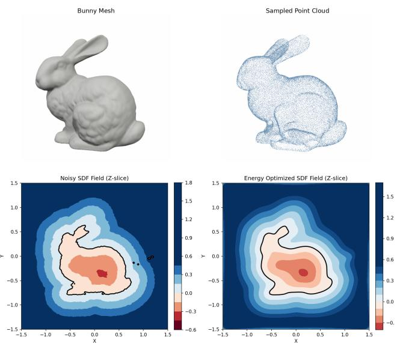  
Figure 6. Energy optimization in SDF fields. A noisy field with artifacts (left) becomes smooth on minimizing the energy functional (right).

## Connection to Classical Mesh Smoothing

The proposed formulation is a continuous, meshfree counterpart to geometric smoothing in classical mesh processing. Penalizing curvature on a discrete mesh requires finite-difference operators, lumped mass matrices and conic relaxations [41]. Imposing the prior directly on the continuous signed distance field evaluates the same quantity through automatic differentiation, so the smoothing emerges during standard neural optimization without auxiliary variables or specialized solvers (Fig. 6).

Table 5. Cost follows octree occupancy, not scene size. Feature memory is $C \times d \times 4$ bytes at d=8.
<table><tr><td>Scene</td><td>Finest l (m)</td><td>C (M)</td><td>Feat. mem (MiB)</td><td>α</td></tr><tr><td>Ignatius</td><td>0.005</td><td>7.41</td><td>226</td><td>-2.40</td></tr><tr><td>Truck</td><td>0.0075</td><td>16.88</td><td>515</td><td>-2.28</td></tr><tr><td>Caterpillar</td><td>0.010</td><td>16.99</td><td>518</td><td>-2.37</td></tr><tr><td>Barn</td><td>0.020</td><td>19.71</td><td>602</td><td>-2.24</td></tr><tr><td>Courthouse</td><td>0.050</td><td>11.72</td><td>358</td><td>-2.09</td></tr></table>

## C. Additional Quantitative Results

Table 3 reports the three scenes the qualitative figures accompany: one object-scale (Truck) and two building-scale (Barn, Courthouse). The remaining scenes are evaluated under an identical protocol. We consider an additional indoor scene Redwood[11], which is RGB-D and its ground truth is registered to the camera trajectory rather than published in a shared frame, so its absolute distances carry a larger residual than the Tanks-and-Temples scenes. We present the results in Tab. 6.

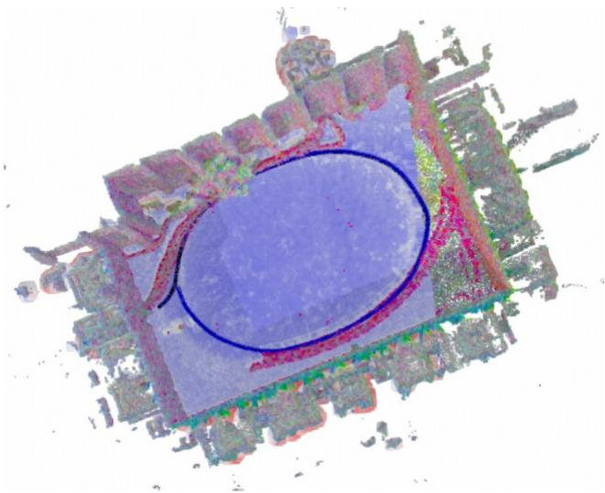  
Figure 7. Energy-optimized neural points. Smoothness energy embedded in PIN-SLAM on Newer College; estimated trajectory in blue.

## C.1. Baseline weight ablation

Each compared regularizer is swept about its own declared weight, under an identical sampler, octree and decoder (Fig. 8). A scale of 1 is the weight the corresponding paper reports, so the absolute settings differ by orders of magnitude between methods and the sweep is plotted on a logarithmic weight axis. We present the optimized settings in Tab. 10 with other hyperparameters in Tab. 9.

## D. Additional Qualitative Results

Figure 9 repeats the comparison of Fig. 3 on the remaining scenes. As there, columns share a viewpoint per scene and are scaled with the scene’s own extent, so apparent size tracks physical size rather than filling the panel.

Figure 10 presents visual comparisons across LiDAR mapping benchmarks of Tab. 1. Newer College is shown from outside the quad looking in, under grazing illumination chosen so that the window reveals cast shadow; MaiCity is a 30 × 30 m section of the street. Neither dataset provides colour – MaiCity is synthetic LiDAR with no intensity channel and Newer College’s fused cloud carries none – so the input panels are shaded by height rather than by measured radiometry. We provide close up comparisons in Fig. 4.

## D.1. Per-scene curvature maps

Figure 1 shows the level-set curvature ∥S∥F on Ignatius; the same visualization is presented in Fig. 11, Fig. 12, Fig. 13, Fig. 14, Fig. 15, for every remaining scene. Within a row a lighter panel is smoother than the unregularized reconstruction and a darker one is rougher. The scale is per scene and the ranges differ by more than an order of magnitude between them (for example $2 4 { - } 4 7 6 \mathrm { m } ^ { - 1 }$ on Truck against $7 . 5 { - } 1 5 0 \mathrm { m } ^ { - 1 }$ on Barn), so panels are comparable within a row and never across rows. Curvature alone does not establish quality: a method can lower it by reconstructing less surface, which is why these panels are read together with the other metrics. In Fig. 16, we highlight the impact of oversmoothing caused by directly penalizing the Hessian energy, which introduces holes into the reconstructed surface.

Table 6. Reconstruction quality and field regularity, remaining scenes. Columns and protocol are identical to Tab. 3;
<table><tr><td>Scene</td><td>Method</td><td>F-Score ↑</td><td> $\mathrm { C D - } L _ { 1 } \downarrow$ </td><td> $\mathrm { F } { \cdot } \mathrm { S c o r e } _ { n } \uparrow$ </td><td>Energy Reduction</td><td>Verts (M)</td></tr><tr><td rowspan="10">Inauus</td><td>Base</td><td>67.7</td><td>3.09</td><td>59.7</td><td></td><td>2.03</td></tr><tr><td>RegSDF [66]</td><td>59.0</td><td>3.55</td><td>49.1</td><td>3.30</td><td>1.49</td></tr><tr><td>NeuralSSD [63]</td><td>61.6</td><td>3.45</td><td>51.4</td><td>3.56</td><td>1.29</td></tr><tr><td>GradHess [58]</td><td>69.1</td><td>3.05</td><td>59.7</td><td>0.97</td><td>1.78</td></tr><tr><td>Singular Hessian [60]</td><td>68.9</td><td>3.05</td><td>61.6</td><td>0.91</td><td>1.80</td></tr><tr><td>DiGS [8]</td><td>69.6</td><td>3.05</td><td>61.7</td><td>0.72</td><td>1.96</td></tr><tr><td>SIREN [44]</td><td>68.1</td><td>3.09</td><td>58.7</td><td>0.05</td><td>1.99</td></tr><tr><td>DiffCD [21]</td><td>70.01</td><td>3.02</td><td>62.2</td><td>1.36</td><td>2.08</td></tr><tr><td>Stoch. Precond. [32] Ours</td><td>69.9</td><td>3.02</td><td>62.1</td><td>1.03</td><td>1.98</td></tr><tr><td></td><td>72.0</td><td>3.01</td><td>62.3</td><td>2.70</td><td>1.64</td></tr><tr><td rowspan="10">Catepir</td><td>Base</td><td>45.1</td><td>7.89</td><td>36.4</td><td></td><td>6.96</td></tr><tr><td>RegSDF [66] NeuralSSD [63]</td><td>43.75</td><td>8.42</td><td>37.5</td><td>2.75</td><td>3.28</td></tr><tr><td></td><td>43.6</td><td>9.61</td><td>36.6</td><td>3.60</td><td>2.79</td></tr><tr><td>GradHess [58]</td><td>44.1</td><td>9.73</td><td>34.5</td><td>1.25</td><td>5.53</td></tr><tr><td>Singular Hessian [60]</td><td>44.3</td><td>8.05</td><td>32.0</td><td>0.57</td><td>6.55</td></tr><tr><td>DiGS [8]</td><td>45.6</td><td>7.89</td><td>31.1</td><td>0.83</td><td>6.75</td></tr><tr><td>SIREN [44]</td><td>45.9</td><td>8.01</td><td>32.4</td><td>0.45</td><td>6.82</td></tr><tr><td>DiffCD [21]</td><td>46.3</td><td>7.80</td><td>31.3</td><td>1.06</td><td>7.11</td></tr><tr><td>Stoch. Precond. [32]</td><td>45.2</td><td>7.94</td><td>37.2</td><td>1.09</td><td>6.86</td></tr><tr><td>Ours</td><td>47.9</td><td>7.91</td><td>34.4</td><td>1.87</td><td>4.73</td></tr><tr><td rowspan="10">Reddod</td><td>Base RegSDF [66]</td><td>54.2</td><td>34.61</td><td>45.2</td><td></td><td>2.92</td></tr><tr><td></td><td>50.1</td><td>38.33</td><td>46.0</td><td>2.44</td><td>2.20</td></tr><tr><td>NeuralSSD [63]</td><td>48.3</td><td>34.52</td><td>39.0</td><td>2.49</td><td>1.82</td></tr><tr><td>GradHess [58]</td><td>51.2</td><td>33.84</td><td>41.5</td><td>0.06</td><td>2.75</td></tr><tr><td>Singular Hessian [60]</td><td>55.0</td><td>34.09</td><td>44.7</td><td>0.27</td><td>3.04</td></tr><tr><td>DiGS [8]</td><td>54.1</td><td>34.62</td><td>44.4</td><td>0.59</td><td>2.96</td></tr><tr><td>SIREN [44]</td><td>54.8</td><td>33.99</td><td>45.1</td><td>0.52</td><td>2.97</td></tr><tr><td>DiffCD [21]</td><td>54.3</td><td>34.46</td><td>45.2</td><td>1.39</td><td>2.93</td></tr><tr><td>Stoch. Precond. [32]</td><td>54.1</td><td>34.67</td><td>45.1</td><td>1.00</td><td>2.92</td></tr><tr><td>Ours</td><td>56.5</td><td>34.83</td><td>46.7</td><td>1.69</td><td>2.63</td></tr></table>

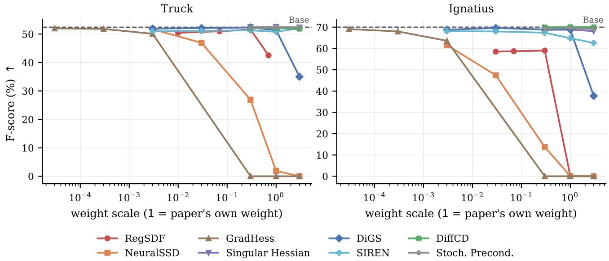  
Figure 8. Baseline weight profiles. F-score against the scale applied to each regularizer’s own declared weight, octree and decoder. A scale of 1 is the weight published by the corresponding work; the declared weights differ by orders of magnitude between methods, and stoch precond sigma m is a perturbation radius in metres rather than a loss weight, so the shared axis is relative.

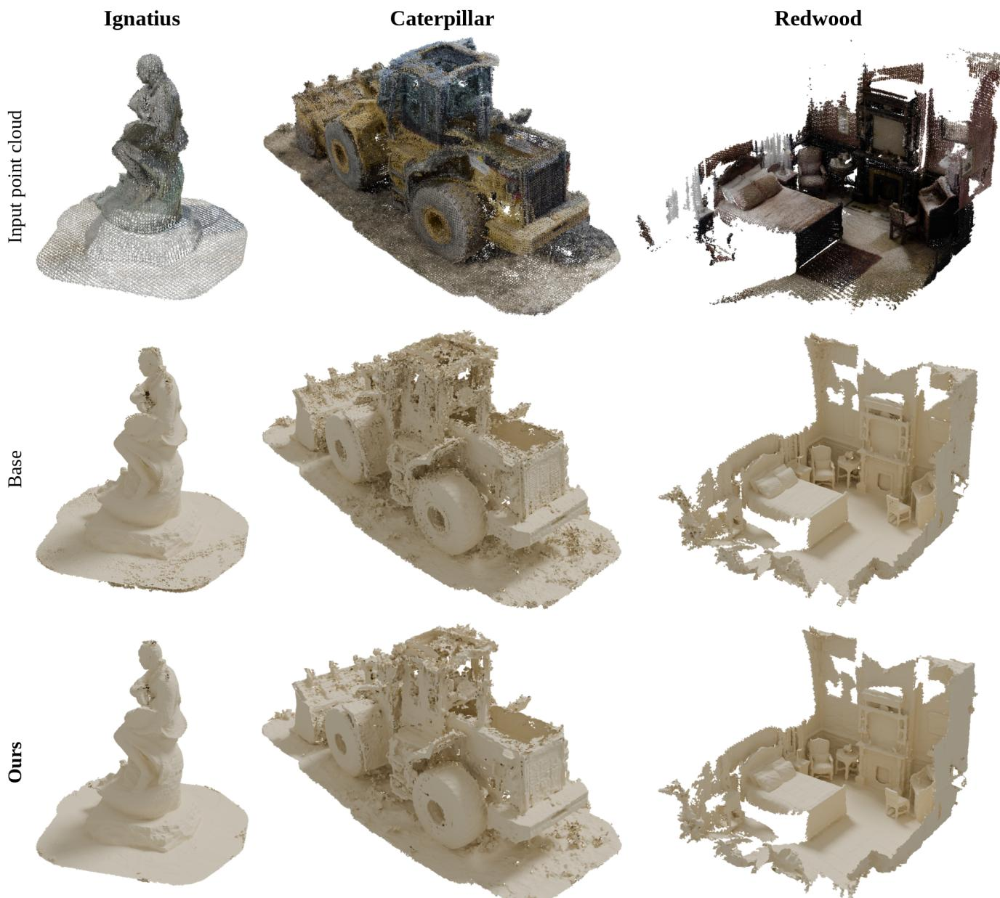  
Figure 9. Qualitative comparison, remaining scenes. One column per scene (Ignatius, Caterpillar, Redwood): input point cloud, Base, and ours. Redwood is indoor RGB-D, and its world frame is the first camera pose, so it is re-oriented to a level floor before framing.

Table 7. Ablation of the energy weight on Newer College. Scales are set proportional to the nominal Eikonal loss magnitude.
<table><tr><td>WEIGHT SCALE</td><td> $e ^ { - 5 }$ </td><td> $e ^ { - 7 }$ </td><td> $e ^ { - 9 }$ </td><td> $e ^ { - 1 1 }$ </td></tr><tr><td>Avg. Scaled Energy Magnitude Reconstruction F Score [%]</td><td>2.86 5.44</td><td>7.8e−¹ 64.73</td><td>9.7e−2 93.95</td><td>1.5e−3 91.44</td></tr></table>

## E. Implementation and Experimental Details

To manage memory effectively and ensure scalable optimization, we employ a sliding-window data sampler and a multi-resolution feature octree. The structural parameters

of the decoder remain constant across all scenes: a 2-layer MLP with a hidden dimension of 32, querying a feature octree with an 8-dimensional feature vector per node.

## E.1. Dataset-Specific Hyperparameters

To accommodate the varying spatial scale and sensor densities of different environments, specific hyperparameters were tuned per dataset (summarized in Table 8).

• KITTI (Sequence 00): Due to the massive scale of the outdoor trajectory, we utilized a slightly larger octree leaf voxel size of 0.3 m. The network was optimized for 40, 000 iterations with an initial learning rate of 0.05.

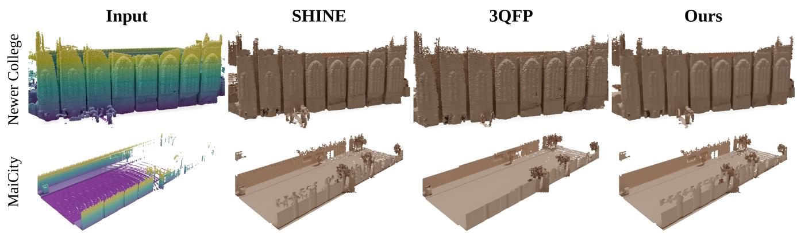

Figure 10. Qualitative comparison on the LiDAR benchmarks. Rows: Newer College, MaiCity. Columns: input cloud (coloured by height), SHINE [67], 3QFP [50], ours. SHINE is retrained here from the authors’ released configuration, so all three share the input, poses and a 10 cm marching-cubes grid.  
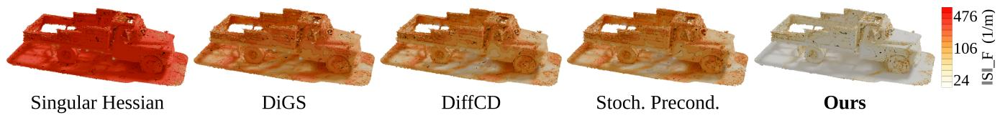  
Figure 11. Level-set curvature ∥S∥F on Truck. Range 24–476 m−1.

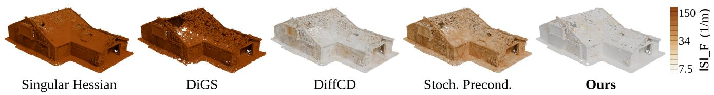

Figure 12. Level-set curvature ∥S∥F on Barn. Range 7.5–150 m−1.  
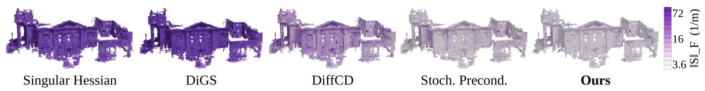  
Figure 13. Level-set curvature ∥S∥F on Courthouse.

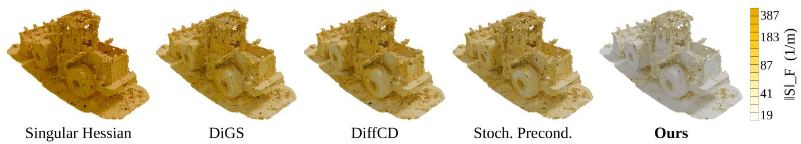  
Figure 14. Level-set curvature ∥S∥ on Caterpillar.

• MaiCity & Newer College (NCD): These datasets feature higher local density and tighter structural boundaries. We utilized a finer octree leaf voxel size of 0.2 m and a reduced learning rate of 0.01. Optimization converged effectively at 20, 000 iterations.

• Other Scenes: The other settings were all trained for 40, 000 iterations.

Across all datasets, the energy weights were kept uniform $( \lambda _ { h } ~ = ~ 3 e ^ { - 9 } , \lambda _ { e } ~ = ~ 0 . 1 )$ to demonstrate the robustness and scale-invariance of our continuous formulation. By maintaining a constant Eikonal weight, the network is universally forced to represent a valid metric distance field $( \lVert \nabla u \rVert _ { 2 } \approx 1 )$ , allowing the Hessian energy to act strictly as a second-order smoothness prior without competing for the fundamental gradient structure. All input point clouds underwent a uniform voxel downsampling with a resolution of 0.05 m prior to network evaluation.

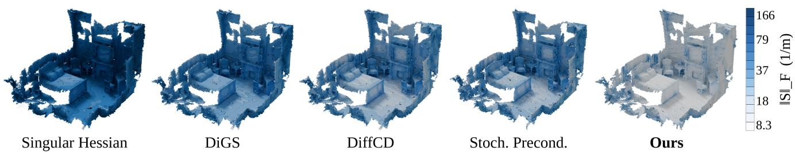  
Figure 15. Level-set curvature ∥S∥F on Redwood. Absolute values are not comparable with the Tanks-and-Temples scenes: this is an indoor RGB-D reconstruction at a much coarser threshold.

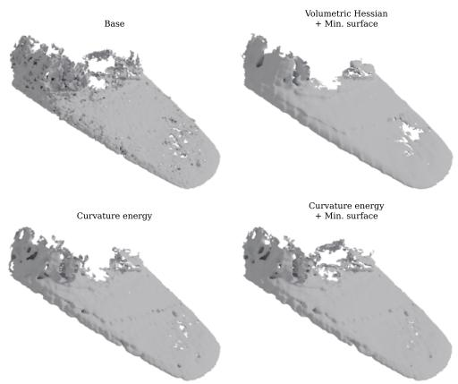  
Figure 16. Qualitative effect of each energy term. A close-up of the hood panel of Truck under four objectives, all sharing a sampler, octree and decoder. The unregularized surface is pitted; directly regularizing via Hessian energy exhibits oversmoothing, resulting in a hole; the curvature energy removes it while the surface stays closed.

## E.2. Metric Definitions and Table Conventions

The conventions below apply to Tab. 3 and Tab. 6.

Accuracy and completeness. Both are exact point-tosurface distances computed with a BVH, not distances to a point sample of the mesh. A point sample carries a discreti-sation floor of roughly 0.5/√density, which on these scenes is comparable to the threshold τ itself, so it would measure tessellation rather than geometry. Accuracy is point-topoint on the predicted side because several ground truths are unstructured clouds with no faces; completeness is pointto-surface. The two are therefore not perfectly symmetric, which we state rather than paper over.

<table><tr><td>Parameter</td><td>KITTI</td><td>MaiCity</td><td>Newer College</td></tr><tr><td>Octree Leaf Voxel Size</td><td>0.3 m</td><td>0.2 m</td><td>0.2 m</td></tr><tr><td>Voxel Downsampling</td><td>0.05 m</td><td>0.05 m</td><td>0.05 m</td></tr><tr><td>Batch Size</td><td>4096</td><td>4096</td><td>4096</td></tr><tr><td>Iterations</td><td>40,000</td><td>20,000</td><td>20,000</td></tr><tr><td>Learning Rate</td><td>0.05</td><td>0.01</td><td>0.01</td></tr><tr><td>SDF Loss Type</td><td>BCE</td><td>BCE</td><td>BCE</td></tr><tr><td>Energy Loss Weight</td><td> $3 e ^ { - 9 }$ </td><td> $3 e ^ { - 9 }$ </td><td> $3 e ^ { - 9 }$ </td></tr><tr><td>Eikonal Loss Weight  $( \lambda _ { e } )$ </td><td>0.1</td><td>0.1</td><td>0.1</td></tr></table>

Table 8. Hyperparameter configurations across evaluation datasets.

Ground-truth point counts (M), which Comp. and Cov. Ret. are measured against: Truck 8.07, Barn 12.75, Courthouse 59.14, Ignatius 5.02, Caterpillar 7.26, Redwood 16.89.

## E.3. Complete Parameter Listing (all scenes, all methods)

Table 9 and Tab. 10 give every training and evaluation parameter used for the six scenes of Tab. 3 and Tab. 6. Both are generated directly from the configuration file that each run wrote into its own output directory, so they record what was executed rather than what was intended.

<table><tr><td>Parameter</td><td>Truck</td><td>Ignatius</td><td>Caterpillar</td><td>Barn</td><td>Courthouse</td><td>Redwood</td></tr><tr><td>Input</td><td></td><td></td><td></td><td></td><td></td><td></td></tr><tr><td>Frame stride (every-frame)</td><td>5</td><td>2</td><td>6</td><td>3</td><td>3</td><td>16</td></tr><tr><td>Crop radius  $r _ { \mathrm { P C } } \ : ( \mathrm { m } )$ </td><td>8</td><td>8</td><td>8</td><td>15</td><td>40</td><td>8</td></tr><tr><td>Min. range (m)</td><td>0.1</td><td>0.1</td><td>0.1</td><td>0.1</td><td>0.1</td><td>0.2</td></tr><tr><td>Voxel downsample (m)</td><td>0.008</td><td>0.005</td><td>0.01</td><td>0.01</td><td>0.025</td><td>0.01</td></tr><tr><td>Global z shift (m)</td><td>7.8</td><td>7.3</td><td>-157.65</td><td>21.3</td><td>17.79</td><td></td></tr><tr><td>Octree</td><td></td><td></td><td></td><td></td><td></td><td></td></tr><tr><td>Leaf voxel size (m)</td><td>0.008</td><td>0.005</td><td>0.01</td><td>0.02</td><td>0.05</td><td>0.02</td></tr><tr><td>Tree levels (world / feat.)</td><td>12/4</td><td>12/4</td><td>12/4</td><td>13 / 4</td><td>13 /4</td><td>12 /4</td></tr><tr><td>Feature dim.</td><td>8</td><td>8</td><td>8</td><td>8</td><td>8</td><td>8</td></tr><tr><td>Polynomial interpolation</td><td>√</td><td>√</td><td>√</td><td>√</td><td>√</td><td>√</td></tr><tr><td>Sampler Surface sample range (m)</td><td>0.024</td><td>0.015</td><td>0.03</td><td>0.03</td><td>0.075</td><td>0.05</td></tr><tr><td>Surface samples / ray</td><td>3</td><td>3</td><td>3</td><td>3</td><td>3</td><td>3</td></tr><tr><td>Free-space begin ratio</td><td>0.5</td><td>0.5</td><td>0.5</td><td>0.5</td><td>0.5</td><td>0.5</td></tr><tr><td></td><td></td><td></td><td></td><td></td><td></td><td></td></tr><tr><td>Free-space end dist. (m)</td><td>0.16</td><td>0.1 3</td><td>0.2 3</td><td>0.2</td><td>0.5</td><td>0.3 3</td></tr><tr><td>Free sâmples / ray Loss (shared)</td><td>3</td><td></td><td></td><td>3</td><td>3</td><td></td></tr><tr><td>Main loss</td><td>sdf_bce</td><td>sdf_bce</td><td>sdf_bce</td><td>sdf_bce</td><td>sdf_bce</td><td>sdf_bce</td></tr><tr><td>σsigmoid (m)</td><td>0.008</td><td>0.005</td><td>0.01</td><td>0.01</td><td>0.025</td><td>0.02</td></tr><tr><td>Eikonal weight λe</td><td>0.1</td><td>0.1</td><td>0.1</td><td>0.1</td><td>0.1</td><td>0.1</td></tr><tr><td>Optimizer</td><td></td><td></td><td></td><td></td><td></td><td></td></tr><tr><td>Batch size</td><td>4096</td><td>4096</td><td>4096</td><td>4096</td><td>4096</td><td>4096</td></tr><tr><td>Weight decay</td><td>1e-7</td><td>1e-7</td><td>1e-7</td><td>1e-7</td><td>1e-7</td><td></td></tr><tr><td>Marching cubes</td><td></td><td></td><td></td><td></td><td></td><td>1e-7</td></tr><tr><td>mc_res (m)</td><td>0.008</td><td>0.005</td><td>0.01</td><td></td><td>0.025</td><td></td></tr><tr><td>Octree-masked MC</td><td>√</td><td></td><td></td><td>0.01</td><td></td><td>0.01</td></tr><tr><td></td><td></td><td>√</td><td>√</td><td>√</td><td>√</td><td>√</td></tr><tr><td>MC visibility level</td><td>2</td><td>2</td><td>2</td><td>2</td><td>2</td><td>2</td></tr><tr><td>Evaluation protocol</td><td>0.005</td><td></td><td></td><td></td><td></td><td></td></tr><tr><td>Threshold τ (m)</td><td></td><td>0.003</td><td>0.005</td><td>0.01</td><td>0.025</td><td>0.05</td></tr><tr><td>GT voxel size (m)</td><td>0.003</td><td>0.002</td><td>0.003</td><td>0.0067</td><td>0.0167</td><td>0.01</td></tr><tr><td>Acc. truncation (m)</td><td>0.017</td><td>0.01</td><td>0.017</td><td>0.033</td><td>0.083</td><td>0.1</td></tr><tr><td>Comp. truncation (m)</td><td>0.05</td><td>0.03</td><td>0.05</td><td>0.1</td><td>0.25</td><td>0.5</td></tr><tr><td>Normal threshold (°)</td><td>30</td><td>30</td><td>30</td><td>30</td><td>30</td><td>30</td></tr><tr><td>Sample density (pts/m2)</td><td>1e6</td><td>2.27e6</td><td>1e6</td><td>1</td><td></td><td></td></tr><tr><td>Crop volume</td><td>√</td><td>√</td><td>√</td><td>√</td><td>V</td><td></td></tr></table>

Table 9. Per-scene training and evaluation parameters. Read from the configuration each run wrote into its own output directory. Shared by all ten methods on that scene; parameters that differ between methods are in Tab. 10. Conventions: Sec. E.3.

<table><tr><td>Method</td><td>Quantity</td><td>Truck</td><td>Ignatius</td><td>Caterpillar</td><td>Barn</td><td>Courthouse</td><td>Redwood</td></tr><tr><td>Base</td><td>Learning rate</td><td>0.01</td><td>0.01</td><td>0.01</td><td>0.01</td><td>0.01</td><td>0.01</td></tr><tr><td rowspan="2">RegSDF</td><td>Learning rate Weight</td><td>0.01</td><td>0.01</td><td>0.01</td><td>0.01</td><td>0.01</td><td>0.01</td></tr><tr><td></td><td>0.003</td><td>0.003</td><td>0.003</td><td>0.003</td><td>0.003</td><td>0.003</td></tr><tr><td rowspan="2">NeuralSSD</td><td>Learning rate Weight</td><td>0.01</td><td>0.01</td><td>0.01</td><td>0.01</td><td>0.01</td><td>0.01</td></tr><tr><td></td><td>3e-5</td><td>3e-5</td><td>3e-5</td><td>3e-5</td><td>3e-5</td><td>3e-5</td></tr><tr><td rowspan="2">GradHess</td><td>Learning rate Weight</td><td>0.01</td><td>0.01</td><td>0.01</td><td>0.01</td><td>0.01</td><td>0.01</td></tr><tr><td></td><td>3e-7</td><td>3e-7</td><td>3e-7</td><td>3e-7</td><td>3e-7</td><td>3e-7</td></tr><tr><td rowspan="2">Singular Hessian</td><td>Learning rate</td><td>0.01</td><td>0.01</td><td>0.01</td><td>0.01</td><td>0.01</td><td>0.01</td></tr><tr><td>Weight</td><td>1e-4</td><td>1e-4</td><td>1e-4</td><td>1e-4</td><td>1e-4</td><td>1e-4</td></tr><tr><td rowspan="2">DiGS</td><td>Learning rate</td><td>0.01</td><td>0.01</td><td>0.01</td><td>0.01</td><td>0.01</td><td>0.01</td></tr><tr><td>Weight</td><td>3e-4</td><td>3e-4</td><td>3e-4</td><td>3e-4</td><td>3e-4</td><td>3e-4</td></tr><tr><td rowspan="3">SIREN</td><td>Learning rate</td><td>0.01</td><td>0.01</td><td>0.01</td><td>0.01</td><td>0.01</td><td>0.01</td></tr><tr><td>Weight</td><td>3e-4</td><td>3e-4</td><td>3e-4</td><td>3e-4</td><td>3e-4</td><td>3e-4</td></tr><tr><td>Activation</td><td>sine</td><td>sine</td><td>sine</td><td>sine</td><td>sine</td><td>sine</td></tr><tr><td rowspan="2">DiffCD</td><td>Learning rate</td><td>0.01</td><td>0.01</td><td>0.01</td><td>0.01</td><td>0.01</td><td>0.01</td></tr><tr><td>Weight</td><td>0.1</td><td>0.1</td><td>0.1</td><td>0.1</td><td>0.1</td><td>0.1</td></tr><tr><td rowspan="2">Stoch. Precond.</td><td>Learning rate</td><td></td><td></td><td></td><td></td><td></td><td></td></tr><tr><td> $\sigma _ { \mathrm { s p } } ( \mathrm { m } )$ </td><td>0.01 0.08</td><td>0.01 0.05</td><td>0.01 0.1</td><td>0.01 0.1</td><td>0.01 0.1</td><td>0.01 0.05</td></tr><tr><td rowspan="2">Ours</td><td></td><td></td><td></td><td></td><td></td><td></td><td></td></tr><tr><td>Learning rate Weight</td><td>0.001 3.12e-6</td><td>0.01 1.279e-6</td><td>0.01 5.546e-6</td><td>0.01 3.972e-5</td><td>0.01 1.693e-4</td><td>0.01 1.748e-5</td></tr></table>

Table 10. Per-method parameters. The only quantities that differ between methods on a scene; the rest are in Tab. 9. Each method enables one regularizer on the common backbone. Each weight is the setting that maximized F-score in the sweep of Fig. 8, applied unchanged to every scene.