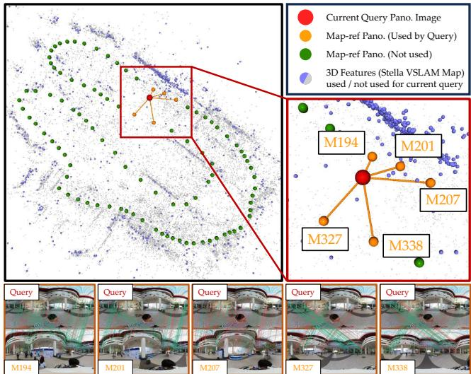
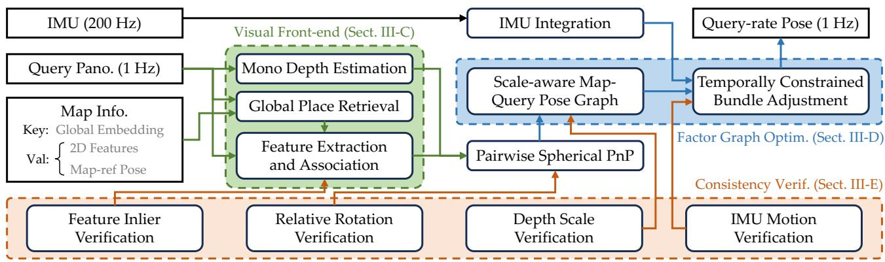
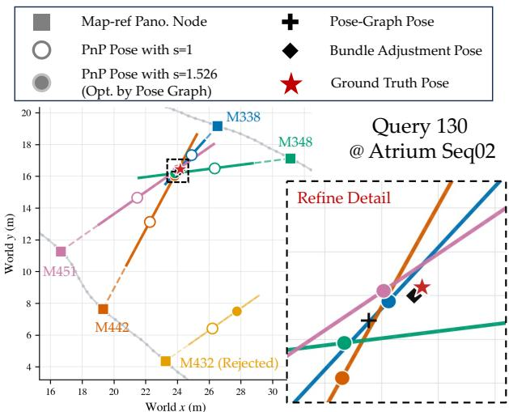
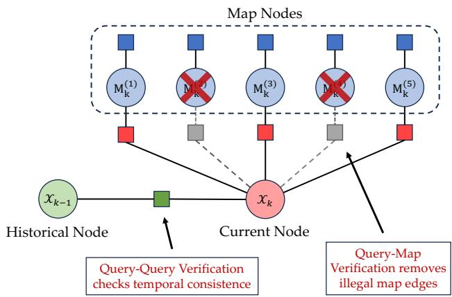
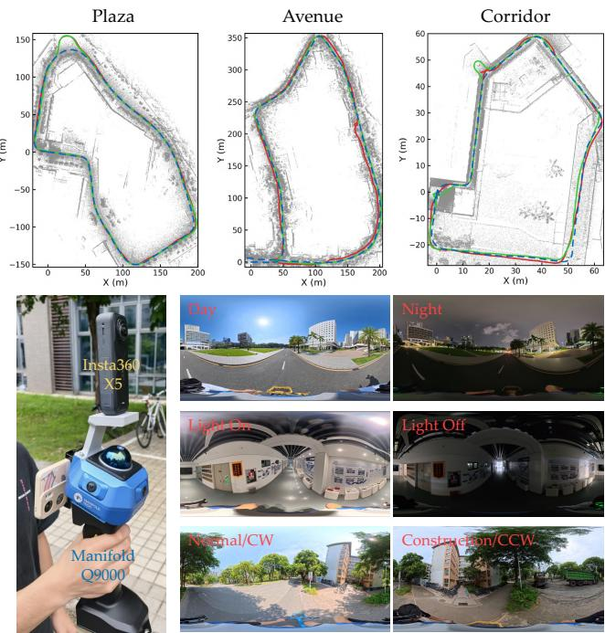
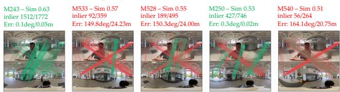
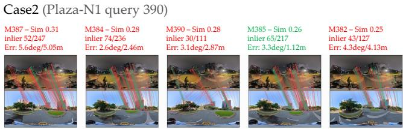
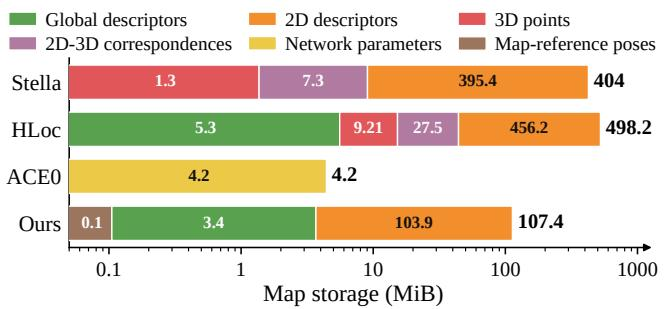

# OmniVLoc: Topo-metric Visual Localization for Omnidirectional Cameras

Zhuo Yu1, Shuyang Zhang1,†, Huihua Zhu1, Wenjia Ouyang1,2, Zuo Zuo3, Jianhao Jiao4, Yilong Zhu5, Xiaopin Zhong1, and Zongze Wu1

Abstract—Omnidirectional cameras provide surround-view information, significantly overcoming the field-of-view constraints for traditional visual localization systems. However, existing localization systems fail to fully exploit the characteristics of omnidirectional cameras, struggling to deliver accurate and robust localization performance amidst scene content variations and illumination-induced appearance changes. In this work, we propose OmniVLoc, a surround-view localization system based on a topo-metric framework. By integrating state-of-theart global place recognition and monocular depth estimation methods, we introduce a multi-constrained visual localization paradigm. By solving a scale-aware pose graph and performing precise spherical bundle adjustment, we accurately recover the metric-level pose for each query frame. Furthermore, a hierarchical verification mechanism is designed to filter out erroneous outputs across different stages, effectively bolstering the overall system robustness. Extensive experiments on both public and our custom datasets validate the superior accuracy and reliability of OmniVLoc. To benefit the community, our source code and dataset will be made publicly available upon publication.

## I. INTRODUCTION

Accurate metric visual localization is a fundamental prerequisite for autonomous navigation in mobile robot systems [1], [2]. While traditional structure-based systems achieve high precision by establishing 2D-3D correspondences against prebuilt 3D maps, they face significant scalability bottlenecks. Constructing and storing dense 3D points, local descriptors, and co-visibility graphs incur prohibitive overhead in largescale environments [3]. Furthermore, maintaining these 3D maps over extended periods is exceedingly difficult; feature matching and triangulation are highly sensitive to viewpoint shifts and illumination-induced appearance variations. Consequently, dynamic environmental changes and map obsolescence drastically degrade localization performance [4], [5], rendering traditional 3D map-based paradigms inadequate for large-scale deployments and lifelong autonomy [6] (as conceptually compared in Fig. 1).

  
Fig. 1. Comparison between our topo-metric map and traditional 3D feature map. Traditional 3D mapping relies on multi-view triangulation and suffers from geometric degeneracy and complex updates. Our topological map treats pose-annotated reference panoramas (orange) as independent database keys for the query (red), eliminating rigid geometric constraints, enabling effortless map management and continuous updates.

In contrast, recent topo-metric localization paradigms [7]– [9] replace dense point clouds with sparse topological image nodes, significantly reducing storage and maintenance costs while performing local metric recovery at these nodes. However, existing topo-metric methods face two major limitations. First, they typically rely on conventional cameras with a narrow field of view (FOV). This necessitates redundant multiview storage to capture the full scene during mapping, and the limited visual context severely exacerbates perceptual aliasing during localization [10]. Second, local metric recovery in these systems is fragile in complex environments: stereovision-based methods are bounded by physical baselines, while traditional monocular approaches suffer from severe scale ambiguity and drift, compromising absolute pose accuracy.

To address these challenges, we propose OmniVLoc, a surround-view localization system based on a topo-metric framework. By introducing this ultra-wide FOV camera, we effectively overcome the issues of perceptual aliasing and map redundancy. To achieve precise metric recovery without relying on pre-built 3D geometry or stereo baselines, we introduce a multi-constrained visual localization paradigm. Specifically, we leverage a visual foundation model (VFM)

for monocular depth estimation and formulate the queryto-map registration as geometric hypotheses regarding the unknown depth scale. By solving a scale-aware pose graph and performing precise spherical bundle adjustment, OmniVLoc accurately recovers the metric-level pose for each query frame. Additionally, a hierarchical verification mechanism is designed to filter out erroneous outputs, effectively bolstering system robustness against illumination and scene variations. Our main contributions are summarized as follows:

• A continuous metric localization framework for surroundview topo-metric maps. This framework obviates the need for pre-built 3D map points or depth maps, providing a unified formulation for precise metric localization using omnidirectional cameras.

• A scale-aware factor graph optimization scheme. It leverages VFM-derived monocular depth with scale uncertainty to construct multi-hypothesis 3D-2D visual constraints, tightly coupled with temporal motion priors to recover accurate absolute scales and poses.

• A hierarchical verification mechanism based on multiple observation and motion priors, ensuring system stability under severe perceptual aliasing and feature degradation.

• Extensive experiments on both public and our custom datasets, which validate the superior accuracy and robustness of OmniVLoc compared to state-of-the-art baselines.

## II. RELATED WORKS

Visual localization is a fundamental task in robotics, aiming to estimate the camera pose within a known map via visual observations. Existing methods can be categorized into structurebased, learning-based, and topological visual localization.

## A. Structure-based Visual Localization

Structure-based visual localization estimates absolute camera poses by establishing 2D-3D correspondences against a pre-built 3D map. Traditional systems like ORB-SLAM [11] rely on Bag-of-Words for coarse localization and hand-crafted features for pose optimization. To improve robustness in complex environments, recent pipelines like Hierarchical Localization (HLoc) [12] and PixLoc [13] integrate learned descriptors and feature-metric optimization. Some work [14] even fuse offline LiDAR point clouds as geometric priors to push the absolute accuracy limits. Nevertheless, these methods heavily rely on global 3D structural maps, incurring prohibitive storage costs and rendering them brittle in dynamic environments [15], where scene changes necessitate time-consuming re-triangulation and global optimization.

## B. Learning-based Visual Localization

Learning-based approaches encode scene representations directly into neural network parameters. Absolute pose regression (APR) networks like PoseNet [16] directly regress 6 degrees of freedom (DoF) poses, while scene coordinate regression (SCR) methods like ACE Zero [17] map images to 3D coordinates without ground-truth poses. Recent advancements like Reloc3r [18] improve zero-shot generalization via relative pose regression. While Novel View Synthesis techniques [19], [20] are frequently adopted for post-optimization pose refinement, their computational overhead hinders realtime large-scale deployment. Furthermore, compressing vast scene details into limited network weights inevitably leads to catastrophic forgetting [21]. Updating the map to reflect physical environmental changes necessitates computationally expensive network retraining [22], severely limiting their scalability for lifelong robot autonomy.

## C. Topological and Topo-metric Visual Localization

Topological visual localization represents environments as lightweight graphs, avoiding the massive geometric maps required by structure-based methods. While visual place recognition (VPR) [23], [24] enables efficient scene redirection, it yields only coarse localization. To achieve precise 6-DoF estimation, recent works have shifted towards topo-metric paradigms. Methods like LiteVLoc [8], OpenNavMap [9], and FreeReg [7] achieve metric registration directly between query and reference images without global 3D maps.

However, existing topo-metric methods predominantly rely on perspective cameras. Their limited field of view (FOV) requires dense orientation sampling during mapping and suffers from severe perceptual aliasing during localization. Moreover, their metric recovery heavily relies on stereo baselines or monocular depth accuracy, which are baseline-bounded and scale-ambiguous in complex environments.

In this work, we introduce omnidirectional cameras into the topo-metric framework to formulate OmniVLoc. The holistic surround-view effectively overcomes FOV limitations and mitigates perceptual aliasing [25]. By integrating a VFM for omnidirectional depth recovery and formulating a scale-aware factor graph with multi-frame constraints, our system successfully recovers precise, absolute-scale metric poses without relying on pre-built 3D geometry or stereo setups.

## III. METHODOLOGY

## A. Problem Formulation and System Overview

1) Problem Formulation: We define a pose-annotated image-node map as $\mathcal { M } = \{ ( \mathbf { I } _ { i } ^ { m } , \mathbf { T } _ { i } ^ { m } , \mathbf { g } _ { i } ) \} _ { i = 1 } ^ { N }$ , where $\mathbf { I } _ { i } ^ { m } , \mathbf { T } _ { i } ^ { m }$ and g are the i-th reference panorama, its camera-to-world pose, and global descriptor, respectively. Note that raw images are not stored in practice; we only retain their 2D feature coordinates and descriptors. During mapping, we extract a panoramic sequence from a metric mapping system (e.g., LIVO). To ensure map efficiency, we sparsify the sequence by discarding redundant frames based on spatial distance $( < \tau _ { d } )$ and descriptor similarity $( > \tau _ { s } )$ . Unlike traditional structurebased maps, M is purely topo-metric, containing neither 3D landmarks nor co-visibility graphs.

In the localization phase, given an incoming sequence of query images $\mathcal { T } _ { 0 : t } ~ = ~ \{ \mathbf { I } _ { k } ^ { q } \} _ { k = 0 } ^ { t } ,$ our goal is to estimate the trajectory $\mathcal { X } _ { 0 : t } ~ = ~ \{ \mathbf { T } _ { k } ^ { q } \} _ { k = 0 } ^ { t }$ conditioned on inter-frame motion observations ${ \mathcal { O } } _ { 1 : t } \ \left( \mathrm { e } . \mathrm { g } . \right.$ , Inertial Measurement Unit (IMU) measurements). We formulate this as a Maximum A Posteriori (MAP) estimation

  
Fig. 2. Overview of our system. System front-end processes omnidirectional images to obtain monocular depth with scale uncertainty, global place candidates and their feature associations with the query frame. The back-end utilizes a factor graph to eliminate scale uncertainty, followed by pose optimization with temporal constraints and bundle adjustment. Across the entire pipeline, we enforce strict consistency checks on intermediate outputs to avoid system degradation.

$$
\mathscr X _ { 0 : t } ^ { * } = \arg \operatorname* { m a x } _ { \mathscr X _ { 0 : t } } p ( \mathscr X _ { 0 : t } \ | \ \mathscr I _ { 0 : t } , \mathscr O _ { 1 : t } , \mathscr M ) .\tag{1}
$$

Evaluating Eq. (1) over the entire map is computationally prohibitive. Therefore, we decouple the problem into a VPRbased coarse retrieval stage (yielding a candidate subset $\mathcal { T } _ { k }$ of size $N _ { \mathrm { r e t } } )$ and a metric factor-graph optimization stage:

$$
\begin{array} { r l } { \{ \mathcal { X } _ { 0 : t } ^ { * } , \mathcal { T } _ { 0 : t } ^ { * } \} = \arg \underset { \mathcal { X } _ { 0 : t } , \mathcal { T } _ { 0 : t } } { \mathrm { m a x } } } & { \underbrace { p ( \mathcal { X } _ { 0 : t } \mid \mathcal { T } _ { 0 : t } , \mathcal { O } _ { 1 : t } , \mathcal { M } _ { \mathcal { I } _ { 0 : t } } ) } _ { \mathrm { M e t r i c ~ f a c t o r - g r a p h ~ e s t i m a t i o n } } } \\ { \times \underset { \mathcal { Y } \mathrm { P R - b a s e d ~ c o a r s e ~ r e t r i e v a l } } { \mathrm { \ ' } } . } \end{array}\tag{2}
$$

2) System Overview: As illustrated in Fig. 2, OmniVLoc operates in two stages. The front-end retrieves the $\mathrm { t o p } { - } N _ { \mathrm { r e t } }$ map nodes, extracts monocular depth with scale uncertainty, and establishes 2D-3D correspondences. The back-end optimizes a scale-aware factor graph to recover continuous, absolute-scale 6-DoF poses without relying on pre-built 3D geometry. Consistency checks span both modules, eliminating incorrect intermediate outputs, thereby guaranteeing the robustness of the system.

## B. Preliminaries: Omnidirectional Geometry

Omnidirectional images are stored as equirectangular projection (ERP) image, whose image-plane distortion varies with latitude. More details on spherical camera model can be found in [26]. We map all 2D pixels $\mathbf { u } = [ u , v ] ^ { \top }$ to unit-sphere bearings $\mathbf { f } ( \mathbf { u } ) \in \bar { \mathbb { S } } ^ { 2 }$ and formulate all geometric errors in the spherical domain.

For a correspondence between a query 3D point $\mathbf { P } _ { k . i } ^ { q } \in \mathbb { R } ^ { 3 }$ and its matched map bearing $\mathbf { f } _ { i , j } ^ { m }$ , let $\mathbf { T } _ { i k } ^ { m q } = ( \mathbf { T } _ { i } ^ { m } ) ^ { \because } \mathbf { \ddot { l } } \mathbf { T } _ { k } ^ { q } =$ $[ \mathbf { R } _ { i k } ^ { m q } , \mathbf { t } _ { i k } ^ { m q } ]$ be the relative transformation from the query frame k to the map frame i. We define the predicted bearing $\widehat { \mathbf { f } } _ { i , j } ^ { m }$ and the spherical vector residual $\mathbf { e } _ { i , k , j }$ as:

$$
\widehat { \mathbf { f } } _ { i , j } ^ { m } = \frac { \mathbf { R } _ { i k } ^ { m q } \mathbf { P } _ { k , j } ^ { q } + \mathbf { t } _ { i k } ^ { m q } } { \left\| \mathbf { R } _ { i k } ^ { m q } \mathbf { P } _ { k , j } ^ { q } + \mathbf { t } _ { i k } ^ { m q } \right\| _ { 2 } } , \quad \mathbf { e } _ { i , k , j } = \mathbf { f } _ { i , j } ^ { m } \times \widehat { \mathbf { f } } _ { i , j } ^ { m } .\tag{3}
$$

The residual $\mathbf { e } _ { i , k , j }$ effectively approximates the angular error. The robust spherical Perspective-n-Point (PnP) estimate is then given by minimizing $\sum \rho \big ( \| \mathbf { e } _ { i , k , j } \| _ { 2 } ^ { 2 } \big )$ , where $\rho ( \cdot )$ is a robust loss function.

## C. Panoramic Visual Front-end

The front-end retrieves plausible map nodes, establishes query–map feature correspondences, and combines them with query depth to form the 3D-to-bearing constraints used by spherical PnP.

1) Global Topological Retrieval: Given a query panorama $\mathbf { I } _ { k } ^ { q } ,$ we employ MegaLoc [24] to extract its global descriptor $\mathbf { g } _ { k } ^ { \tilde { q } }$ and rank all map nodes by descriptor cosine similarity. Since a panorama may overlap multiple nearby nodes, we retain the top $N _ { \mathrm { r e t } }$ candidates rather than only the highestranked image [8]; all candidates are passed to local matching $( N _ { \mathrm { r e t } } = 5$ in our setup).

2) CubeMap-based Feature Association: We adopt Super-Point [27] and LightGlue [28] for feature extraction and association. Since these models target perspective images, we decompose each panorama into six CubeMap faces to avoid ERP distortion. SuperPoint features extracted per face are back-projected and concatenated in the ERP domain, after which LightGlue matches the query against each candidate.

3) Omnidirectional Depth Estimation: Since M lacks pretriangulated landmarks for PnP, we use Depth Any Panoramas (DAP) [29] to predict a dense depth map $\widetilde { \mathbf Ḋ \mathbf Ḋ k Ḍ Ḍ }$ for the query. Although DAP claimed to provide metric depth, we observe a bounded scale drift in its real-world predictions. This drift linearly propagates to the local 3D points and the PnP translation. Thus, we introduce a positive per-query scale factor $s _ { k } \colon$

$$
\mathbf { P } _ { k , j } ^ { q } = { \cal { s } } _ { k } \widetilde { \mathbf { P } } _ { k , j } ^ { q } , \quad \mathbf { t } _ { i k } ^ { m q } = { \cal { s } } _ { k } \widehat { \mathbf { t } } _ { i k } ^ { m q } .\tag{4}
$$

  
Fig. 3. Demonstration of our pose optimization process. The dashed lines illustrate the possible query positions yielded by a single PnP operation under unknown scales, while the solid lines indicate the valid candidates restricted by scale boundaries of [0.5, 2.0].

All query–map registrations at time k share scale $s _ { k }$ , which is subsequently optimized in the factor graph.

## D. Scale-aware Factor-Graph Estimation

The metric factor-graph term in Eq. (2) would grow with all historical states and measurements. For a bounded online update, we adopt a first-order Markov assumption. Estimation at time k becomes

$$
\mathcal { X } _ { k } ^ { * } = \underset { \mathcal { X } _ { k } } { \arg \operatorname* { m a x } } p ( \mathcal { X } _ { k } \mid \mathcal { Z } _ { k } , \mathcal { O } _ { k } , \mathcal { M } _ { \mathcal { I } _ { k } } , \mathcal { X } _ { k - 1 } ) ,\tag{5}
$$

where the optimization state is augmented as $\mathcal { X } _ { k } = \{ \mathbf { T } _ { k } ^ { q } , s _ { k } \}$ to account for the shared DAP scale. We realize Eq. (5) with two stages (see Fig. 3). A pure-visual pose graph first estimates the current pose and the shared scale from pairwise PnP observations. Its output initializes spherical bundle adjustment (BA), which combines point-level bearing factors with $\mathcal { O } _ { k }$ and $\mathcal { X } _ { k - 1 }$

1) Scale-Aware Visual Pose Graph: Each verified map node $i \in \mathcal { T } _ { k } ^ { \mathrm { v e r } }$ provides a relative PnP observation $\hat { \mathbf { T } } _ { i k } ^ { m q } =$ $[ \widehat { \mathbf { R } } _ { i k } ^ { m q } , \widehat { \mathbf { t } } _ { i k } ^ { m q } ]$ , while the current state predicts $\begin{array} { r l } { \mathbf { T } _ { i k } ^ { m q , \mathrm { p r } \tilde { \mathrm { e d } } } } & { = } \end{array}$ $( \mathbf { T } _ { i } ^ { m } ) ^ { - 1 } \mathbf { T } _ { k } ^ { q }$ . Parameterizing the shared scale as $s _ { k } = \exp ( \alpha _ { k } )$ we define the normalized rotation, translation, and scale-prior residuals:

$$
\begin{array} { r l } & { \mathbf { r } _ { i k } ^ { R } = \frac { \left[ \mathrm { L o g } \left( ( \widehat { \mathbf { R } } _ { i k } ^ { m q } ) ^ { \top } \mathbf { R } _ { i k } ^ { m q , \mathrm { p r e d } } \right) \right] ^ { \vee } } { \sigma _ { R } } , } \\ & { \mathbf { r } _ { i k } ^ { t } = \frac { \mathbf { t } _ { i k } ^ { m q , \mathrm { p r e d } } - \exp ( \alpha _ { k } ) \widehat { \mathbf { t } } _ { i k } ^ { m q } } { \sigma _ { t } } , } \\ & { \mathbf { r } _ { k } ^ { s } = \frac { \alpha _ { k } } { \sigma _ { s } } . } \end{array}\tag{6}
$$

Here, $( \cdot ) ^ { \vee }$ maps an element of SO(3) or SE(3) to its Lie vector space, and $\sigma _ { R } , \ \sigma _ { t }$ , and $\sigma _ { s }$ normalize the residuals. The visual pose graph optimizes $\{ \mathbf { T } _ { k } ^ { q , \mathrm { p g } } , \alpha _ { k } ^ { * } \}$ by minimizing the Huber loss over these residuals. Excluding temporal and inertial factors keeps this scale estimate determined solely by the current multi-map visual geometry.

  
Fig. 4. Demonstration of our temporal factor graph and our consistency verification.

2) Temporally Constrained Spherical Bundle Adjustment: The pose graph output initializes a local BA. Each correspondence initializes a world-frame landmark as $\mathbf { P } _ { l } ^ { w , 0 } =$ $\mathbf { R } _ { k } ^ { q , \mathrm { p g } } ( s _ { k } ^ { * } \widetilde { \mathbf { P } } _ { k , l } ^ { q } ) \ + \ \mathbf { t } _ { k } ^ { q , \mathrm { p g } }$ . For any observation frame $a \in$ $\{ q _ { k } , m _ { i } \}$ , the spherical bearing residual is $\mathbf { r } _ { a , l } ^ { \mathrm { b e a r } } \ = \ \mathbf { f } _ { a , l } \ \times$ normalize $\big [ \mathbf { R } _ { a } ^ { \top } ( \mathbf { P } _ { l } ^ { w } - \mathbf { t } _ { a } ) \big ]$ ]. Map poses remain fixed while the current query pose and local landmarks are optimized.

Furthermore, consecutive queries and integrated IMU measurements provide a relative motion prior $\Delta \hat { \mathbf { T } } _ { k - 1 , k } ^ { o }$ . With the previous optimized pose $\overline { { \mathbf { T } } } _ { k - 1 } ^ { q }$ fixed, the temporal residual is

$$
\mathbf { r } _ { k - 1 , k } ^ { \mathrm { t e m p } } = \left[ \operatorname { L o g } \left( ( \Delta \widehat { \mathbf { T } } _ { k - 1 , k } ^ { o } ) ^ { - 1 } ( \overline { { \mathbf { T } } } _ { k - 1 } ^ { q } ) ^ { - 1 } \mathbf { T } _ { k } ^ { q } \right) \right] ^ { \vee } .\tag{7}
$$

Defining the BA state as $\begin{array} { r c l } { \boldsymbol { \Theta } _ { k } } & { = } & { \{ \mathbf { T } _ { k } ^ { q } , \{ \mathbf { P } _ { l } ^ { w } \} \} } \end{array}$ , the final objective minimizes the joint cost of bearing observations and temporal priors:

$$
\Theta _ { \boldsymbol { k } } ^ { * } = \underset { \Theta _ { \boldsymbol { k } } } { \arg \operatorname* { m i n } } \sum _ { ( a , l ) \in \mathcal { V } _ { \boldsymbol { k } } } \rho \big ( \| \mathbf { r } _ { a , l } ^ { \mathrm { b e a r } } \| _ { \Sigma _ { \boldsymbol { b } } } ^ { 2 } \big ) + \| \mathbf { r } _ { { k - 1 } , { k } } ^ { \mathrm { t e m p } } \| _ { \Sigma _ { o } } ^ { 2 } ,\tag{8}
$$

where $\nu _ { k }$ contains the query and map bearing observations. Fixing $s _ { k } ^ { * }$ during BA prevents scale–structure gauge ambiguity. A looser temporal covariance $\Sigma _ { o }$ regularizes motion without overriding the multi-map visual evidence.

## E. Hierarchical Consistency Verification

Cross-time appearance changes and repeated structures can produce incorrect retrievals and geometrically false matches that corrupt the factor graph. We implement a two-level verification (as illustrated in Fig. 4) to ensure only healthy constraints enter the factor graph $( \mathcal { T } _ { k } ^ { \mathrm { v e r } } \subset \mathcal { T } _ { k } )$

1) Query–Query Verification: We validate short-term visual motion between $\mathbf { I } _ { k - 1 } ^ { q }$ and $\mathbf { I } _ { k } ^ { q }$ before it is used as the temporal factor in $\operatorname { E q . }$ (8). We reject image pairs with insufficient matches or RANSAC inliers, a low inlier ratio, or a large median spherical bearing residual.

We also estimate motion in both query directions. Consistent forward and inverse-backward PnP solutions form a strong edge; a single valid direction is retained with enlarged covariance, while inconsistent solutions are rejected. If the discrepancy between the integrated gyroscope rotation $\Delta \mathbf { R } _ { k - 1 , k } ^ { g }$ and the visual PnP rotation $\Delta \widehat { \mathbf { R } } _ { k - 1 , k } ^ { q q }$ exceeds a threshold $\tau _ { g } ,$ the visual edge is deemed unreliable, and the system falls back to purely inertial motion without using visual evidence.

  
Fig. 5. Our custom dataset and capturing devices. Plaza exhibits extreme dayto-night appearance shifts in an outdoor setting. Corridor involves a narrow indoor space with varying illumination. Avenue introduces repetitive foliage alongside ongoing construction events.

2) Query–Map Verification: Each retrieved query–map pair first undergoes the same state-independent quality checks on matches, spherical PnP support, and bearing residual. Afterwards, a retrieved map node is rejected if its orientation deviates significantly from the gyro-propagated prior. This gate is disabled during cold start or unreliable query–query motion to preserve relocalization.

More importantly, since all PnP translations share the uncertain depth scale $s \in \mathcal { S } = [ s _ { \operatorname* { m i n } } , s _ { \operatorname* { m a x } } ]$ , each candidate defines a valid position ray (or segment) in the world frame:

$$
\ell _ { i k } ( s ) = \mathbf { t } _ { i } ^ { m } + s \mathbf { R } _ { i } ^ { m } \widehat { \mathbf { t } } _ { i k } ^ { m q } = \mathbf { p } _ { i k } ^ { 0 } + s \mathbf { d } _ { i k } .\tag{9}
$$

Valid map candidates must reach a spatial consensus. We find the optimal scale $\boldsymbol { s } _ { k } ^ { c }$ and intersection center $\mathbf { c } _ { k }$ by maximizing the inlier support $w _ { i k }$ across intersection rays:

$$
\begin{array} { r } { \{ s _ { k } ^ { c } , \mathbf { c } _ { k } , \mathcal { T } _ { k } ^ { \mathrm { v e r } } \} = \underset { s , \mathbf { c } , \mathcal { T } } { \arg \operatorname* { m a x } } \sum _ { i \in \mathcal { I } } w _ { i k } , } \\ { \mathrm { s . t . ~ } \quad \| \ell _ { i k } ( s ) - \mathbf { c } \| _ { 2 } < \tau _ { p } . } \end{array}\tag{10}
$$

Pairwise segment intersections generate scale hypotheses, which are scored by support and compactness. Historical segments are transported by validated query motion and contribute only down-weighted, capped support; every valid cluster must include a current query–map constraint. The consensus $\boldsymbol { s } _ { k } ^ { c }$ initializes $\alpha _ { k }$ in the visual pose graph, whose refined scale initializes the BA in Sect. III-D2.

TABLE I  
SUPPORTED FEATURES OF THE BASELINE METHODS
<table><tr><td>Method</td><td>ERP</td><td>IMU</td><td>Loc. Mode</td><td>Map Representation</td></tr><tr><td>Stella [30]</td><td>V</td><td>x</td><td>V</td><td>2D&amp;3D Features + BoW</td></tr><tr><td>HLoc [12]</td><td>x</td><td>x</td><td>V</td><td>2D&amp;3D Features + NetVLAD</td></tr><tr><td>ACE0 [17]</td><td>x</td><td>x</td><td>V</td><td>Network Param.</td></tr><tr><td>Ours</td><td>V</td><td>V</td><td>V</td><td>2D Features + MegaLoc</td></tr></table>

## IV. EXPERIMENT

## A. Datasets

1) 360Loc Dataset: We primarily evaluate OmniVLoc on the 360Loc dataset [31], which comprises four campus environments with 14 sequences, covering campus scenes with repetitive structures and perceptual aliasing. Each scene provides a daytime mapping sequence together with several daytime and nighttime localization sequences, recorded at approximately 3 Hz. Since 360Loc does not provide IMU measurements, we generate simulated IMU readings from its ground-truth camera trajectory, with white noise and random walks for bias, following the EuRoC-ADIS16448 noise model.

2) Custom Dataset: We also collect a custom campus dataset, supporting a higher query-image rate of 24 Hz. Our acquisition rig (illustrated in Fig. 5) rigidly combines an Insta360 X5 panoramic camera with a Manifold Q9000 commercial mapping device, which comprises a Mid-360 LiDAR and three fisheye cameras. Its multi-sensor mapping system provides sub-centimeter localization accuracy. We use its estimated trajectory as the localization ground truth and calibrate the extrinsic transformation between the Insta360 X5 and the Q9000 LiDAR rig, allowing the reference poses to be expressed in the panoramic-camera frame. Similar to the 360Loc protocol, each scene contains a daytime mapping sequence and separate daytime and nighttime localization sequences. We collect 3 scenes with 9 sequences with complementary localization challenges, such as open-space geometric sparsity, illumination changes, and severe appearance repetition.

For each scene in both datasets, we construct the panoramic image-node map from daytime mapping sequences using our rule defined in Sect. III-A. We set the distance threshold to $\tau _ { d } = 5 . 0$ m and the descriptor similarity threshold to $\tau _ { s } = 0 . 7 .$

## B. Baseline Methods and Evaluation Criterion

Although many open-source visual odometry and SLAM systems are available, few support global localization with ERP panoramas, and fewer still use inertial measurements in this setting. We select three representative baselines and adapt their inputs to our panoramic setup. Their supported features are summarized in Table I:

• Stella VSLAM (Stella) [30] is a geometric visual SLAM system that natively supports ERP images. We use its localization mode with a pre-built sparse 3D feature map, representing conventional structure-based panoramic localization.

TABLE II  
LOCALIZATION ACCURACY ON THE 360LOC AND CUSTOM DATASETS. EACH ENTRY REPORTS MEAN/MEDIAN ATE. ’-’ REPRESENTS INITIALIZATION FAILURE OR ATE MORE THAN 10.
<table><tr><td rowspan="2">Dataset</td><td rowspan="2">Scene</td><td rowspan="2">Seq.</td><td colspan="5">Single-frame Localization</td><td colspan="2">Sequence-based Localization</td></tr><tr><td>HLoc-Opt [12]</td><td>HLoc-Fus [12]</td><td>ACE0-Opt [17]</td><td>ACE0-Fus [17]</td><td>Ours-NoSeq</td><td>Stella [30]</td><td>Ours-Full</td></tr><tr><td rowspan="10">360Loc</td><td rowspan="4">Atrium</td><td>D1</td><td>2.966 / 0.346</td><td>2.510 / 0.707</td><td>1.304 / 0.780</td><td>1.583 /  1.168</td><td>2.613 / 0.321</td><td>0.320 / 0.282</td><td>0.079 / 0.054</td></tr><tr><td>D2</td><td>2.096 / 0.912</td><td>1.698 / 0.879</td><td>1.866 / 0.999</td><td>2.556 /  1.472</td><td>0.344 / 0.096</td><td>1.049 / 0.908</td><td>0.231 / 0.111</td></tr><tr><td>N1</td><td>2.743 /  1.017</td><td>3.120 / 1.147</td><td></td><td>- / -</td><td>2.071 / 0.193</td><td>- / -</td><td>0.407  / 0.166</td></tr><tr><td>N2</td><td>0.988 / 0.984</td><td>1.007 / 0.914</td><td> $\begin{array} { c } { { - \mathrm { ~ / ~ } . } } \\ { { . \mathrm { ~ / ~ } . } } \end{array}$ </td><td>- 1 -</td><td>0.322 / 0.143</td><td>0.956 / 0.957</td><td>0.309 / 0.155</td></tr><tr><td>Concourse</td><td>D1</td><td>0.570 / 0.234</td><td>0.338 / 0.236</td><td>1.406 / 0.746</td><td>1.603 / 0.940</td><td>0.030 / 0.019</td><td>2.116 / 1.442</td><td>0.029 / 0.018</td></tr><tr><td rowspan="5"></td><td>D2</td><td>5.316 /  1.049</td><td>5.472 / 1.017</td><td>2.010 / 0.765</td><td>2.142 /  1.089</td><td>2.286 / 0.199</td><td>2.774 / 2.278</td><td>0.066 / 0.022</td></tr><tr><td>N1</td><td>3.021  / 0.943</td><td>3.309 / 1.000</td><td>- / -</td><td>- / -</td><td>0.213 / 0.087</td><td>2.567 / 2.283</td><td>0.100 / 0.086</td></tr><tr><td>D1</td><td>2.170 / 0.497</td><td>2.242 / 0.501</td><td>2.138 / 0.884</td><td>2.644 /  1.219</td><td>1.192 / 0.131</td><td></td><td></td></tr><tr><td>D2</td><td>2.439 / 0.448</td><td>2.219 / 0.444</td><td>5.758 /  1.644</td><td>5.839 / 2.141</td><td>2.730 / 0.302</td><td>0.505  / 0.396 0.599 / 0.487</td><td>0.049 / 0.021</td></tr><tr><td>N1</td><td>8.763 / 0.993</td><td>7.397  / 0.963</td><td>-1 -</td><td>- / -</td><td>3.094 / 0.398</td><td>-1-</td><td>0.059 / 0.035 0.705 / 0.306</td></tr><tr><td rowspan="4">Piatrium</td><td>N2</td><td>3.558 /  1.254</td><td></td><td>- 1 -</td><td>- 1 -</td><td>2.164 / 0.517</td><td>- 1 -</td><td>0.759 / 0.443</td></tr><tr><td>D1</td><td>- / -</td><td>- 1 -</td><td>5.203 / 2.269</td><td>5.476 / 2.563</td><td>3.367  / 0.538</td><td>5.333 / 4.379</td><td>0.215 / 0.100</td></tr><tr><td>D2</td><td>2.719 / 0.580</td><td>2.688 / 0.943</td><td>8.424 / 4.885</td><td>8.520 / 5.196</td><td>1.320 / 0.262</td><td>2.637  /  1.149</td><td>0.315 / 0.123</td></tr><tr><td>N1</td><td>- / -</td><td>- / -</td><td>-1-</td><td>- / -</td><td>6.164 /  1.487</td><td>-1-</td><td>1.842 / 0.910</td></tr><tr><td rowspan="6">Custom</td><td>Plaza</td><td>D1</td><td>0.351 / 0.236</td><td>0.381 / 0.277</td><td>- / 9.481</td><td>- / 9.798</td><td>0.585 / 0.155</td><td>1.005 / 0.784</td><td>0.438 / 0.167</td></tr><tr><td></td><td>N1</td><td>0.920 / 0.266</td><td>1.422 / 0.337</td><td>-1-</td><td>-1 -</td><td>0.998 / 0.162</td><td>-1-</td><td>0.750 / 0.150</td></tr><tr><td></td><td>D1</td><td>0.344 / 0.225</td><td>0.352 / 0.258</td><td>2.849 /  2.358</td><td>2.978 /  2.586</td><td>0.313 / 0.273</td><td>0.334 / 0.337</td><td>0.286 / 0.274</td></tr><tr><td>Corridor</td><td>N1</td><td>0.657 / 0.228</td><td>0.667  / 0.245</td><td>6.636 / 5.767</td><td>6.225 / 6.520</td><td>0.564 / 0.140</td><td>- 1 -</td><td>0.263 / 0.140</td></tr><tr><td></td><td>D1</td><td>1.974 / 0.234</td><td>3.567  / 0.308</td><td>- 1 -</td><td>- 1 -</td><td>0.574 / 0.134</td><td>1.105 /  1.098</td><td></td></tr><tr><td>Avenue</td><td>N1</td><td>- / 0.222</td><td>- / 0.389</td><td>- 1 -</td><td>- 1 -</td><td>0.437  / 0.190</td><td>- 1 -</td><td>0.214 / 0.133 0.332 / 0.189</td></tr></table>

• Hierarchical Localization (HLoc) [12] is a hierarchical structure-based localization pipeline designed for perspective images.

• ACE Zero (ACE0) [17] is a map-free scene coordinate regression method whose scene representation is encoded in network parameters.

Since HLoc and ACE0 are both designed for perspective images, we apply CubeMap adaptations to both methods. Each ERP panorama is projected into six perspective faces for mapping and localization. The Opt adaptation selects the valid face pose with the strongest geometric verification. In this mode, ground-truth poses are leaked for optimal pose selection. The Fus adaptation jointly optimizes the valid pose evidence from all faces by a simple pose graph.

In the localization process, HLoc, ACE0 and our methods are treated as online queries and processed at 1 Hz. As a visual SLAM system, Stella inherently benefits from highfrequency image sequences. Therefore, to ensure its optimal performance, we utilized the full-frame-rate image sequences across both datasets (3 Hz for 360Loc and 24 Hz for our custom dataset).

We evaluate the localization results using the Absolute Trajectory Error (ATE) defined on SE(3). At query frame i, let $\mathbf { T } _ { i } ^ { \mathrm { e s t } }$ and $\mathbf { T } _ { i } ^ { \mathrm { g t } }$ be the estimated and ground-truth camera poses, respectively. For a sequence of N query frames, we define the ATE residual at frame i as

$$
\begin{array} { r } { \mathrm { A T E } _ { i } = \left. \left[ \mathrm { L o g } \bigl ( ( \mathbf { T } _ { i } ^ { \mathrm { g t } } ) ^ { - 1 } \mathbf { T } _ { i } ^ { \mathrm { e s t } } \bigr ) \right] ^ { \vee } \right. _ { 2 } . } \end{array}\tag{11}
$$

This criterion combines the translational and rotational pose error. We report the mean and median of $\{ \mathrm { A T E } _ { i } \} _ { i = } ^ { N }$ for each scene sequence.

## C. Evaluation: Localization Performance

We evaluated the localization performance on both datasets, and the results are shown in Table II. Since the baseline methods (HLoc and ACE0) perform localization using independent images, we disabled our query-query process and excluded IMU measurements for a fair comparison. This degrades our approach to a single-frame localization setup (denoted as Ours-NoSeq in Table II). Under this setting, our method outperforms all baseline methods. While HLoc is operational, its metric-level localization accuracy is compromised due to the visual pre-processing relying on single limited-view images (Opt) or the ambiguities in multi-view fusion (Fus). ACE0 exhibits severe overfitting to the map scene representation. It breaks down entirely under large appearance gaps between mapping and localization (day vs. night) or in environments with low discriminability (the Avenue scene). Furthermore, by incorporating inter-frame information, our full pipeline (Ours-Full) significantly reduces the mean ATE, yielding stabler localization and higher accuracy compared to the surroundview-based Stella SLAM, even with a higher input image frequency.

Qualitative analysis (Fig. 6a) reveals that the campus scenario exhibits severe perceptual aliasing, posing significant challenges for global localization. To address this, our system employs top $N _ { \mathrm { r e t } }$ map image candidates for matching and performs multiple consistency verifications to filter out erroneous observation pairs, thereby significantly improving robustness.

Case1 (Atrium-D1 query 0)  
  
(a) In the initialization stage, the scene suffers from heavy perceptual aliasing, but our system effectively detects and filters out the erroneous constraints.

  
(b) Under concurrent spatial and appearance variations, our system provides only one reasonable observation. It falls back to single-view matching, leading to a significant drop in accuracy.  
Fig. 6. Qualitative cases of our multiple reference localization. The text overlays indicate the retrieved map node ID, descriptor similarity, number of RANSAC inliers, and the single-frame PnP pose error, with green/red denoting accepted/rejected candidates by our verification module.

## D. Evaluation: Ablation Study

We conducted an ablation study to evaluate our system. By disabling the temporal processing and consistency verification modules, we observed that while the median ATE remains largely unaffected in most sequences, the mean ATE increases significantly. This demonstrates that incorporating temporal odometry and temporal cross-validation effectively enhances the stability and reliability of our system.

We also evaluated the effect of the number of map candidates $( N _ { \mathrm { r e t } } )$ on accuracy, latency, and the number of candidate usage, detailed in Table III. Meanwhile, using only the best VPR result $( N _ { \mathrm { r e t } } = 1 ) \ /$ , as in traditional visual localization, allows almost all frames to pass verification but yields poor localization precision due to insufficient data checks from a single observation. Increasing the observations (e.g., $N _ { \mathrm { r e t } } = 3 )$ rapidly improves accuracy, proving the effectiveness of our multi-observation constrained factor graph. We find $N _ { \mathrm { r e t } } = 5$ to be optimal by balancing the accuracy and map usage. Additional observations neither increase the verified candidates nor improve accuracy.

Finally, we evaluate the computational efficiency of our system. Accelerated via C++ and ONNX, our system operates stably at 1.30 Hz, satisfying a real-time requirement of 1 Hz for online deployment as defined in our system setup.

## E. Evaluation: Map Property

We evaluated the memory footprints of the maps generated by each method, as visualized in Fig. 7. Aside from ACE0’s implicit neural network map (4.2 MB for neural parameters), our method consumes only 21.6% and 26.6% of the storage required by HLoc and Stella VSLAM, respectively. Additionally, our method naturally excels at incremental mapping and map updating. By avoiding the triangulation of map frames and the storage of 3D point clouds, we structure the map as a key-value database: global descriptors act as keys for VPR queries, while 2D features and absolute poses serve as values. This allows for straightforward map updates and expansions without the burden of decoupling co-visibility graphs.

  
Fig. 7. Visualization of map storage at 360Loc Atrium scene. Note that the map components are sorted by size and the x-axis is in logarithmic scale.

TABLE III  
COMPARISON OF TOP- $N _ { \mathrm { r e t } }$ RETRIEVAL ON COMPUTATION COST, LOCALIZATION ACCURACY, AND MAP-REFERENCE USAGE AT 360LOC ATRIUM D1.
<table><tr><td rowspan="2">Nret</td><td colspan="4">Time Consumption (ms)</td><td colspan="2">ATE</td><td rowspan="2">Avg. Map-ref Usage per Query</td></tr><tr><td>Frontend</td><td>Sph. PnP</td><td>BA</td><td>Total</td><td>RMSE Median</td><td></td></tr><tr><td>1</td><td>300.3</td><td>109.8</td><td>20.0</td><td>483.7</td><td>1.434</td><td>1.258</td><td>0.98</td></tr><tr><td>3</td><td>410.3</td><td>121.3</td><td>31.3</td><td>618.1</td><td>0.096</td><td>0.057</td><td>2.21</td></tr><tr><td>5</td><td>521.7</td><td>140.4</td><td>49.8</td><td>765.9</td><td>0.079</td><td>0.054</td><td>3.23</td></tr><tr><td>8</td><td>685.2</td><td>166.9</td><td>73.6</td><td>979.6</td><td>0.076</td><td>0.055</td><td>4.42</td></tr><tr><td>10</td><td>798.2</td><td>201.6</td><td></td><td>76.7  1130.9</td><td>0.076</td><td>0.058</td><td>4.98</td></tr></table>

## V. DISCUSSION

We also identified several key findings during our work. First, although foundation models like DINOv2 [32] endow current VPR methods with high precision, their recall remains relatively low, which inherently constrains the success rate of downstream metric-level localization. While OmniVLoc leverages this high-precision low-recall nature, integrating a more robust VPR paradigm, such as sequential VPR, could further boost global localization performance in our framework.

Second, local feature matching failures remain the primary cause of localization degradation in extreme cross-illumination scenarios, particularly when coupled with severe viewpoint shifts (as illustrated in Fig. 6b). Although recent work [8] has introduced feed-forward neural networks (e.g., Mast3r [33]) for wide-baseline and cross-illumination matching, these models are typically trained on perspective camera models and struggle to generalize to equirectangular projections. Therefore, designing feed-forward networks specifically tailored for omnidirectional cameras represents a promising direction to further bolster system robustness in challenging environments.

## VI. CONCLUSION

In this work, we proposed OmniVLoc, a topo-metric omnidirectional localization system. We constructed a scaleoptimized visual localization paradigm driven by multi-view map constraints and monocular depth estimation. By performing pose graph estimation and precise BA optimization, our approach yields accurate metric-level localization. A hierarchical verification mechanism rejected unreliable intermediate outputs, ensuring high system stability. Experimental results confirmed that our system maintains robust localization despite significant illumination and scene variations. Future work will focus on the incremental construction and lifelong maintenance of topo-metric omnidirectional maps, aiming for seamless compatibility with large-scale street-view applications.

## ACKNOWLEDGMENT

The authors used Gemini-3.1-Pro for text polishing and grammatical correction. After using this tool, the authors thoroughly reviewed and edited the manuscript, and take full responsibility for the final content of this publication.

## REFERENCES

[1] P. Yin, S. Zhao, J. Wang, R. Ge, J. Ji, Y. Hu, H. Liu, and J. Han, “iloc: An adaptive, efficient, and robust visual localization system,” IEEE Transactions on Robotics, vol. 41, pp. 2709–2726, 2025.

[2] J. Yu, J. Yang, J. Jiao, A. Hu, Z. Liu, J. Wang, P. Tan, and H. Zhang, “Rover: Robust loop closure verification with trajectory prior in repetitive environments,” IEEE Transactions on Automation Science and Engineering, vol. 23, pp. 8476–8489, 2026.

[3] F. Camposeco, A. Cohen, M. Pollefeys, and T. Sattler, “Hybrid scene compression for visual localization,” in Proceedings of the IEEE/CVF Conference on Computer Vision and Pattern Recognition, 2019, pp. 7653–7662.

[4] A. R. Vidal, H. Rebecq, T. Horstschaefer, and D. Scaramuzza, “Ultimate slam? combining events, images, and imu for robust visual slam in hdr and high-speed scenarios,” IEEE Robotics and Automation Letters, vol. 3, no. 2, pp. 994–1001, 2018.

[5] X. Zhang, G. Sun, S. Lin, Y. Liu, X. Zhang, and Y. Zhuang, “Tdhvio: A texture richness guided double-hybrid visual–inertial odometry,” IEEE Sensors Journal, vol. 26, no. 10, pp. 14 576–14 585, 2026.

[6] C. Toft, W. Maddern, A. Torii, L. Hammarstrand, E. Stenborg, D. Safari, M. Okutomi, M. Pollefeys, J. Sivic, T. Pajdla et al., “Long-term visual localization revisited,” IEEE Transactions on Pattern Analysis and Machine Intelligence, vol. 44, no. 4, pp. 2074–2088, 2020.

[7] H. Wang, Y. Liu, B. Wang, Y. Sun, Z. Dong, W. Wang, and B. Yang, “Freereg: Image-to-point cloud registration leveraging pretrained diffusion models and monocular depth estimators,” in International Conference on Learning Representations, vol. 2024, 2024, pp. 28 484–28 507.

[8] J. Jiao, J. He, C. Liu, S. Aegidius, X. Hu, T. Braud, and D. Kanoulas, “Litevloc: Map-lite visual localization for image goal navigation,” in 2025 IEEE International Conference on Robotics and Automation (ICRA), 2025, pp. 5244–5251.

[9] J. Jiao, C. Liu, J. Yu, B. Liu, Q. Zhang, Y. Wang, and D. Kanoulas, “Opennavmap: Structure-free topometric mapping via large-scale collaborative localization,” arXiv preprint arXiv:2601.12291, 2026.

[10] P. Yin, J. Jiao, S. Zhao, L. Xu, G. Huang, H. Choset, S. Scherer, and J. Han, “General place recognition survey: Towards real-world autonomy,” IEEE Transactions on Robotics, 2025.

[11] C. Campos, R. Elvira, J. J. G. Rodr´ıguez, J. M. M. Montiel, and J. D. Tardos, “Orb-slam3: An accurate open-source library for visual,´ visual–inertial, and multimap slam,” IEEE Transactions on Robotics, vol. 37, no. 6, pp. 1874–1890, 2021.

[12] P.-E. Sarlin, C. Cadena, R. Siegwart, and M. Dymczyk, “From coarse to fine: Robust hierarchical localization at large scale,” in Proceedings of the IEEE/CVF conference on computer vision and pattern recognition, 2019, pp. 12 716–12 725.

[13] P.-E. Sarlin, A. Unagar, M. Larsson, H. Germain, C. Toft, V. Larsson, M. Pollefeys, V. Lepetit, L. Hammarstrand, F. Kahl et al., “Back to the feature: Learning robust camera localization from pixels to pose,” in Proceedings of the IEEE/CVF conference on computer vision and pattern recognition, 2021, pp. 3247–3257.

[14] J. He, H. Huang, S. Zhang, J. Jiao, C. Liu, and M. Liu, “Accurate priorcentric monocular positioning with offline lidar fusion,” in 2024 IEEE International Conference on Robotics and Automation (ICRA). IEEE, 2024, pp. 11 934–11 940.

[15] M. R. U. Saputra, A. Markham, and N. Trigoni, “Visual slam and structure from motion in dynamic environments: A survey,” ACM Computing Surveys (CSUR), vol. 51, no. 2, pp. 1–36, 2018.

[16] A. Kendall, M. Grimes, and R. Cipolla, “Posenet: A convolutional network for real-time 6-dof camera relocalization,” in Proceedings of the IEEE international conference on computer vision, 2015, pp. 2938– 2946.

[17] E. Brachmann, J. Wynn, S. Chen, T. Cavallari, A. Monszpart, D. Turmukhambetov, and V. A. Prisacariu, “Scene coordinate reconstruction: Posing of image collections via incremental learning of a relocalizer,” in European Conference on Computer Vision. Springer, 2024, pp. 421– 440.

[18] S. Dong, S. Wang, S. Liu, L. Cai, Q. Fan, J. Kannala, and Y. Yang, “Reloc3r: Large-scale training of relative camera pose regression for generalizable, fast, and accurate visual localization,” in Proceedings of the Computer Vision and Pattern Recognition Conference, 2025, pp. 16 739–16 752.

[19] C. Liu, S. Chen, Y. Bhalgat, S. Hu, M. Cheng, Z. Wang, V. Prisacariu, and T. Braud, “Gs-cpr: Efficient camera pose refinement via 3d gaussian splatting,” in International Conference on Learning Representations, vol. 2025, 2025, pp. 76 761–76 780.

[20] Y. Gao, J. Yuan, S. Yu, and X. Zhang, “Ferf-bevio: A feature radiance field-based bidirectionally enhanced visual-inertial odometry,” IEEE Transactions on Automation Science and Engineering, 2025.

[21] S. Wang, Z. Laskar, I. Melekhov, X. Li, and J. Kannala, “Continual learning for image-based camera localization,” in Proceedings of the IEEE/CVF International Conference on Computer Vision, 2021, pp. 3252–3262.

[22] D. Maggio, M. Abate, J. Shi, C. Mario, and L. Carlone, “Loc-nerf: Monte carlo localization using neural radiance fields,” in 2023 IEEE International Conference on Robotics and Automation (ICRA), 2023, pp. 4018–4025.

[23] S. Izquierdo and J. Civera, “Optimal transport aggregation for visual place recognition,” in Proceedings of the ieee/cvf conference on computer vision and pattern recognition, 2024, pp. 17 658–17 668.

[24] G. Berton and C. Masone, “Megaloc: One retrieval to place them all,” in Proceedings of the Computer Vision and Pattern Recognition Conference, 2025, pp. 2861–2867.

[25] X. Guo, Y. Xu, H. Huang, and S.-K. Yeung, “360dvo: Deep visual odometry for monocular 360-degree camera,” IEEE Robotics and Automation Letters, 2026.

[26] H. Huang and S.-K. Yeung, “360vo: Visual odometry using a single 360 camera,” in 2022 international conference on robotics and automation (icra). IEEE, 2022, pp. 5594–5600.

[27] D. DeTone, T. Malisiewicz, and A. Rabinovich, “Superpoint: Selfsupervised interest point detection and description,” in Proceedings of the IEEE conference on computer vision and pattern recognition workshops, 2018, pp. 224–236.

[28] P. Lindenberger, P.-E. Sarlin, and M. Pollefeys, “Lightglue: Local feature matching at light speed,” in Proceedings of the IEEE/CVF international conference on computer vision, 2023, pp. 17 627–17 638.

[29] X. Lin, M. Song, D. Zhang, W. Lu, H. Li, B. Du, M.-H. Yang, T. Nguyen, and L. Qi, “Depth any panoramas: A foundation model for panoramic depth estimation,” in Proceedings of the IEEE/CVF Conference on Computer Vision and Pattern Recognition, 2026, pp. 26 835–26 844.

[30] S. Sumikura, M. Shibuya, and K. Sakurada, “Openvslam: A versatile visual slam framework,” in Proceedings of the 27th ACM international conference on multimedia, 2019, pp. 2292–2295.

[31] H. Huang, C. Liu, Y. Zhu, H. Cheng, T. Braud, and S.-K. Yeung, “360loc: A dataset and benchmark for omnidirectional visual localization with cross-device queries,” in 2024 IEEE/CVF Conference on Computer Vision and Pattern Recognition (CVPR). IEEE, 2024, pp. 22 314–22 324.

[32] M. Oquab, T. Darcet, T. Moutakanni, H. Vo, M. Szafraniec, V. Khalidov, P. Fernandez, D. Haziza, F. Massa, A. El-Nouby et al., “Dinov2: Learning robust visual features without supervision,” arXiv preprint arXiv:2304.07193, 2023.

[33] V. Leroy, Y. Cabon, and J. Revaud, “Grounding image matching in 3d with mast3r,” in European conference on computer vision. Springer, 2024, pp. 71–91.