# OverSeer: Multi-Agent World Models Beyond What Agents See

Runjia Li1,2, Kam Woh Ng1, Minghao Chen2, Junlin Han1,2, Jianyuan Wang1,2, Zhaochong An1, Juan-Manuel Perez-Rua1, Andrea Vedaldi1,2,†, Shikun Liu1,†

1Meta AI, 2University of Oxford

†Equal supervision.

Despite the success of video world models, extending them to multiple agents is dificult because it requires generating several agent-specific video streams that are consistent in time and between agents. To address this gap, we introduce OverSeer, a multi-agent world model that augments egocentric agent views with auxiliary camera views. We suggest that, by fixing the auxiliary views in space, they act as a proxy for a world-centric representation: Unlike the agents’ views, which can change entirely due to a simple change in agent position, changes in the auxiliary views directly map to localized changes in the world state. We show that these fixed views substantially help the model to maintain consistency. We also show that, due to their redundant and semi-static nature, the auxiliary views can be eficiently compressed with a δ-VAE that encodes only the changes relative to a static reference image, reducing the number of tokens required to process them. Experiments in Minecraft and Doom demonstrate improved world and agent consistency, with qualitative results on real-world multi-camera captures indicating that the approach is not tied to game engines. Our compression analysis further shows that δ-VAE substantially reduces the computational overhead of auxiliary-view generation. We conclude that these fixed views provide a simple and eficient way to improve multi-agent world models.

Date: October 21, 2026

Dataset: huggingface.co/collections/liguang0115/overseer

Project Page: overseer-wm.github.io

∞Meta

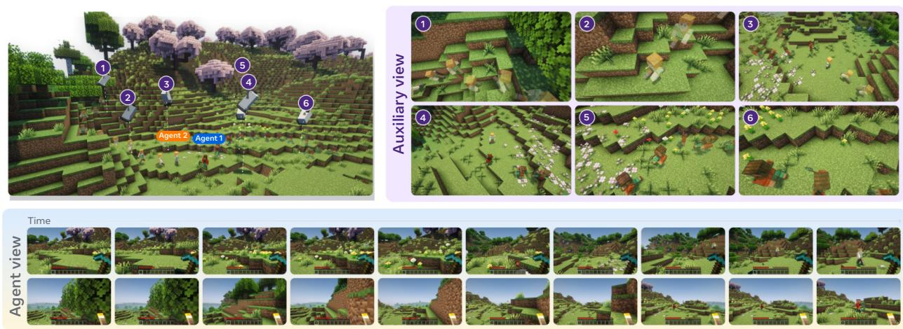  
Figure 1 OverSeer sees beyond what agents see. Two agents interact in a shared Minecraft environment (Left). In addition to generating each agent’s egocentric view (Bottom), OverSeer models six fixed-pose auxiliary cameras (Right). These auxiliary streams establish a persistent shared reference, enforcing world consistency over time and agent consistency across views.

## 1 Introduction

World models aim to learn predictive representations of environments. Video world models represent the environment as a sequence of images captured from the viewpoint of an acting agent, predicting future frames conditioned on past observations and agent actions. By taking advantage of large video datasets, these models can learn to represent complex visual dynamics and interactions between characters and objects. Recent video world models have made substantial progress in visual fidelity and character controllability, but maintaining a coherent world over long horizons remains challenging. Small prediction errors can accumulate over time, causing objects to drift and environments to change inconsistently.

These challenges become more pronounced in multi-agent environments. A multi-agent world model must represent not only how the environment evolves but also how multiple characters interact within the same shared world. We identify two forms of consistency that are essential for this setting. First, world consistency requires persistent scene elements and the efects of past events to be preserved over time: when an agent revisits a location, the scene should reflect its history. Second, agent consistency requires the actions and states of diferent agents to agree across their observations: an interaction should be depicted consistently in all views from which it is visible. These constraints are dificult to satisfy using only player-centric streams, because each player observes only a partial and changing projection of the underlying world.

One way to address these challenges is to use a world-centric representation that explicitly maintains a shared state independent of any individual agent’s viewpoint. Such representations can also model dynamics more eficiently: localized updates occur only when the environment actually changes, whereas an agent’s camera motion drastically alters egocentric pixels even in a completely static scene. However, explicitly reconstructing and maintaining a world-centric representation from partial observations remains challenging.

In this paper, we propose a video-based framework that captures the key advantages of a world-centric representation without requiring explicit global state reconstruction. To this end, we introduce OverSeer, a multi-agent video world model augmented with fixed-pose auxiliary camera views that serve as a practical proxy for a shared world-centric state. At inference, the auxiliary views are automatically, jointly, and eficiently generated with the agents’ views through shared attention. This design has three benefits:

(i) Auxiliary views cover regions beyond individual agents’ immediate fields of view, establishing a shared visual reference that grounds cross-agent interactions;

(ii) Because the auxiliary cameras are stationary, any temporal variation in their views reflects actual environmental changes rather than camera ego-motion;

(iii) Fixed viewpoints make temporal redundancies predictable and easy to model, reinforcing structural coherence across streams.

To minimize computational overhead and exploit this inherent temporal redundancy, we introduce δ-VAE, a variational autoencoder that performs second-stage latent compression on top of a standard video VAE. For each auxiliary stream, δ-VAE retains an initial reference frame latent and encodes subsequent frames into compact residual latents conditioned on that reference. The static reference frame preserves persistent background geometry, enabling the residual latents to concentrate exclusively on dynamic events, such as agent movements, object manipulations, and environmental state changes. By eliminating redundant encoding of unchanged background content, six auxiliary views incur only 37.5% of the token overhead of the two agent streams.

We evaluate OverSeer on Minecraft and Doom, two games with substantially diferent visual dynamics, spatial structures, and interaction patterns, and additionally show qualitative results on real-world multi-camera captures (Shapovalov et al., 2023). When agents lose sight of each other and later reunite, existing multi-agent world models restore the partner or the scene correctly in only 0–12.5% of episodes, whereas OverSeer does so in 38–60%, at a small fraction of the cost of modeling the auxiliary views as full video streams.

## 2 Related Work

Video Difusion and Video World Models. Difusion models have emerged as the dominant framework for video generation, evolving from early techniques that augmented pretrained 2D priors with temporal layers (Singer et al., 2023; Blattmann et al., 2023) to large-scale architectures scaled for high-fidelity synthesis (OpenAI, 2024; Google DeepMind, 2025; HaCohen et al., 2025; Wan et al., 2025). Video world models extend this paradigm by casting environment simulation as action-conditioned video difusion, where future frame generation is guided by past observations and agent actions to yield interactive simulators (Bruce et al., 2024; Valevski et al., 2025). Recent full-stack systems further enrich this formulation by integrating explicit camera control, scene memory, and real-time streaming (DreamX et al., 2026; Jiang et al., 2026; Wang et al., 2026).

However, progress in this domain mainly focuses on expanding the input conditioning space, while output generation remains restricted to rendering a single egocentric stream for a single agent. In contrast, OverSeer shifts focus to the model’s output space: given initial frames and actions from all agents, the model jointly predicts every agent’s egocentric stream alongside the fixed auxiliary camera views, improving both world and agent consistency.

Long-Horizon Consistency and Memory. Autoregressive rollouts in video world models tend to compound error and spatial drift over extended horizons (Chen et al., 2024; Huang et al., 2025). The prevailing remedy is expanding context capacity through positional extrapolation or streaming attention (Yang et al., 2026; Yesiltepe et al., 2026), memory-bank retrieval by estimated camera pose (Yu et al., 2025a; Hong et al., 2025; Yu et al., 2026), and geometry-guided retrieval (DreamX et al., 2026; Li et al., 2025). However, these memory structures are constructed entirely from an agent’s own past observations. Consequently, unobserved regions are never stored, and retrieval accuracy remains bound to pose estimates that drift alongside generation. Our pose-fixed auxiliary views serve a complementary function: while memory recalls previously observed regions, auxiliary streams provide active coverage of unobserved space. Furthermore, because these auxiliary views are jointly predicted rather than retrieved, they eliminate reliance on fragile pose estimation altogether.

Multi-Agent and Multi-View World Models. Multi-agent world models were first studied in reinforcement learning with compact state spaces (Egorov and Shpilman, 2022; Zhang et al., 2025), where multi-view consistency is enforced within an unrendered latent state. Recent work extends this requirement to the pixel domain, conditioning video difusion models on multiple action streams to synthesize concurrent agent views (Enigma, 2025; Savva et al., 2026; Liu et al., 2026a; Hu et al., 2026a; Wu et al., 2026; Hu et al., 2026b). Multi-view generation also appears in generative 3D modeling and autonomous driving (Kong et al., 2024; Liu et al., 2026b; Jang et al., 2026; Gao et al., 2024a,b,c), though cameras in these settings are typically in a static scene or camera rigs rigidly attached to a single moving platform.

Existing approaches to multi-agent consistency broadly fall into two categories. The first couples egocentric streams via stream concatenation, shared attention, tiling, or permutation-symmetric encodings (Enigma, 2025; Savva et al., 2026; Hu et al., 2026a; Liu et al., 2026a), meaning every reference frame is itself a moving, partial observation. The second improves consistency via an external state, such as an editable map with estimated per-agent poses (Po et al., 2026); while this decouples the reference from individual agent trajectories, it models spatial geometry rather than visual appearance and remains vulnerable to pose drift.

In contrast, OverSeer improves consistency by introducing auxiliary streams that are jointly predicted alongside the agents’ streams rather than supplied as external map inputs.

Eficient Video Tokenization. Modern video generators typically operate within the latent space of a video VAE (Wan et al., 2025; HaCohen et al., 2025), with recent eficiency eforts compressing representations further via stronger tokenizers (Yu et al., 2024; Chen et al., 2025), token merging (Bolya et al., 2023), lightweight decoders, and bounded KV caches (Jiang et al., 2026; Hu et al., 2026a). However, these generic techniques allocate computational capacity uniformly across all streams, causing an auxiliary camera view to incur nearly the same computational cost as an egocentric agent stream.

A closer line of work changes what a latent space represents: neural video codecs encode frames relative to a reference frame via residuals (Lu et al., 2019) or by conditioning (Li et al., 2021), RefTok tokenizes each frame relative to a reference frame (Fan et al., 2025), and DeltaTok compresses consecutive-frame feature diferences into a single delta token (Kerssies et al., 2026). In these approaches, the reference frame is not fixed, but updated regularly over time, missing the advantages of OverSeer’s fixed views, starting from the fact that they can be compressed efectively.

## 3 OverSeer

## 3.1 Background and Notation

Video World Modeling. Video world models usually represent the evolution of the world from the viewpoint of an agent. Let $o _ { t }$ denote the visual observation at time t (i.e., an image), $a _ { t }$ the agent action, and $z _ { t } = \mathcal { E } ( o _ { t } )$ a learned latent representation of the observation, where denotes a visual encoder. Let $s _ { t }$ denote the world state available to the model at time t. A general one-step video world model can be formulated as:

$$
p \big ( z _ { t + 1 } \mid s _ { t } , a _ { t } \big )\tag{1}
$$

Depending on the model, $s _ { t }$ may correspond to the current representation $z _ { t , }$ , a history of representations $z { \le } t ,$ or a learned summary of the observation-action history $f ( z _ { \leq t } , a _ { < t } )$

Multi-Agent Video World Modeling. Consider an environment with N agents. We use the superscript A to denote agent-centric camera streams. Agent i receives an observation $o _ { t } ^ { A , i }$ , represented as $z _ { t } ^ { A , i } = \mathcal { E } ( o _ { t } ^ { A , i } )$ , and executes an action $a _ { t } ^ { i }$ . We denote the joint agent observations, representations, and actions by $\mathbf { o } _ { t } ^ { A } = \{ o _ { t } ^ { A , i } \} _ { i = 1 } ^ { N } ,$ $\mathbf { z } _ { t } ^ { A } = \{ z _ { t } ^ { A , i } \} _ { i = 1 } ^ { N }$ , and ${ \bf a } _ { t } = \{ a _ { t } ^ { i } \} _ { i = 1 } ^ { N }$ . A multi-agent video world model extends equation (1) to joint prediction:

$$
p \big ( \mathbf { z } _ { t + 1 } ^ { A } \mid \mathbf { s } _ { t } , \mathbf { a } _ { t } \big ) ,\tag{2}
$$

where $\mathbf { s } _ { t }$ represents the shared world state. Factorizing this into independent single-agent models, ∏ $p ( z _ { t + 1 } ^ { A , i } \mid$ $s _ { t } ^ { i } , a _ { t } ^ { i } )$ , is insuficient: each $s _ { t } ^ { i }$ is built only from agent i’s own history, so nothing enforces that agents agree where their views overlap, or that a region seen by one agent stays consistent when another later observes it. The challenge is that st must be inferred from ${ \mathbf { z } } _ { \leq t } ^ { A }$ , which are partial and change as the agents move.

Auxiliary Camera Views. To provide persistent spatial references for the shared environment, OverSeer introduces K fixed-pose auxiliary camera views, denoted by $\mathbf { o } _ { t } ^ { X } = \{ o _ { t } ^ { X , j } \} _ { j = 1 } ^ { K }$ , with corresponding camera poses $\mathbf { c } = \{ c ^ { j } \} _ { j = 1 } ^ { K } ,$ where the superscript X denotes auxiliary camera streams. Unlike agent-centric cameras, whose viewpoints change with agent motion, the auxiliary cameras remain fixed over time. These views change proportionally to changes in the underlying world’s state and provide a stable spatial reference for all the agents. During training, the auxiliary views also teach the model what happens outside the agents’ immediate purview.

## 3.2 OverSeer Model Design

We design OverSeer as a latent video difusion model (Rombach et al., 2022) built upon Wan2.2-TI2V-5B (Wan et al., 2025), leveraging its strong pre-trained video generation prior. An overview is shown in figure 2. Following the standard latent difusion design, input visual observations are mapped into a compact latent space using a pre-trained video VAE (Wan et al., 2025), yielding agent latents $\mathbf { \dot { z } } _ { t } ^ { \dot { A } } = \{ \mathcal { E } ( o ) ; \forall o \stackrel { \mathbf { \hat { \mathbf { \alpha } } } } { \in } \mathbf { o } _ { t } ^ { A } \}$ and auxiliary latents $\mathbf { z } _ { t } ^ { X } = \{ \mathcal { E } ( o ) ; \forall o \in \mathbf { o } _ { t } ^ { X } \}$

To keep the latent sequence lengths tractable during difusion, we do not model auxiliary latents frameby-frame. Instead, each auxiliary stream is represented by its first-frame latent as a fixed anchor, $\mathbf { z } _ { 0 } ^ { X } = \mathbf { \Phi }$ $\{ \bar { z } _ { 0 } ^ { X , j } \} _ { j = 1 } ^ { K } ,$ paired with compact residual codes ${ \bf d } _ { 1 : Q } ^ { X } = \{ d _ { 1 : Q } ^ { X , j } \} _ { j = 1 } ^ { K } ,$ a length-Q sequence per view that encodes subsequent temporal dynamics produced by δ-VAE (see section 3.3). Extending the world-model formulation in equation (1) to multi-agent generation with auxiliary views, OverSeer jointly models the future agent latents, initial auxiliary anchor frames, and compressed auxiliary dynamics, conditioned on the initial agent frames and actions, and auxiliary camera poses:

$$
p \left( \mathbf { z } _ { 1 : T } ^ { A } , \mathbf { z } _ { 0 } ^ { X } , \mathbf { d } _ { 1 : T } ^ { X } \mid \mathbf { z } _ { 0 } ^ { A } , \mathbf { a } _ { 0 : T - 1 } , \mathbf { c } \right) .\tag{3}
$$

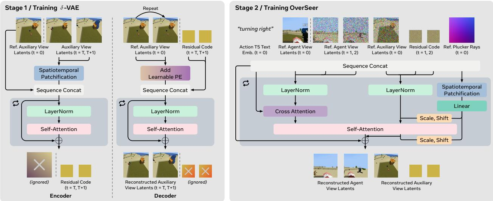  
Figure 2 OverSeer design overview. A δ-VAE (Left) compresses each fixed auxiliary stream into compact residual codes relative to its first-frame reference, and OverSeer (Right) jointly generates agent latents and these residual codes, conditioned on T5-encoded actions via cross-attention and Plücker-ray camera poses via AdaLN.

Training and Inference. Knowledge of the ground-truth auxiliary visual streams is only required during training. At inference, OverSeer receives the initial agent observations and agent actions along with auxiliary camera poses. The auxiliary camera poses are sampled from a scene-independent prior estimated from training poses and greedily selected to maximize field-of-view coverage without scene-specific input (see section B). The model jointly generates future agent observations and the auxiliary streams, including their initial anchor frames. Ground-truth auxiliary images are used only during training.

We train OverSeer using difusion forcing (Chen et al., 2024), where difusion timesteps are sampled independently across temporal positions, and target latents are noised accordingly while initial conditioning frames $\mathbf { z } _ { 0 } ^ { \bar { A } }$ remain clean. All latents, including agent latents, auxiliary anchor frames, and residual codes, are projected to the same DiT hidden dimension with learnable view-identification embeddings added to each view’s tokens for diferentiation.

Agent and auxiliary streams are governed by diferent modalities and therefore use complementary conditioning pathways. For each agent stream, discrete actions (including agent navigation, camera motions, and inventory interactions) are formatted into short textual descriptions, encoded via a frozen T5 text encoder (Rafel et al., 2020), and injected into the DiT layers through cross-attention. For each auxiliary stream, camera pose cj and its known intrinsics are converted into a spatial Plücker-ray map (Sitzmann et al., 2021). These ray representations are patchified and projected into Adaptive Layer Normalization (AdaLN) (Perez et al., 2018), with scale and shift parameters to modulate the corresponding auxiliary tokens.

Tokens from all agents and auxiliary streams are then jointly processed by shared self-attention layers, enabling direct cross-modality communication. We enforce a causal temporal attention mask throughout the network: tokens at a given temporal position t can attend only to conditioning tokens and to tokens from identical or earlier temporal positions $( t ^ { \prime } \leq t )$ . This prevents future latent states from leaking into the prediction of earlier states under independent difusion forcing timesteps.

## 3.3 Efficient Modeling of Auxiliary Dynamics

Because the auxiliary cameras are pose-fixed, their background visual content remains predominantly static across time, with scene updates concentrated in localized regions afected by agent activity and environmental dynamics. Directly modeling full latent representations for every auxiliary frame therefore introduces severe temporal and spatial redundancy. To address this ineficiency, we introduce δ-VAE, a second-stage variational autoencoder that exploits this background stationarity to further compress the latent streams produced by the primary video VAE.

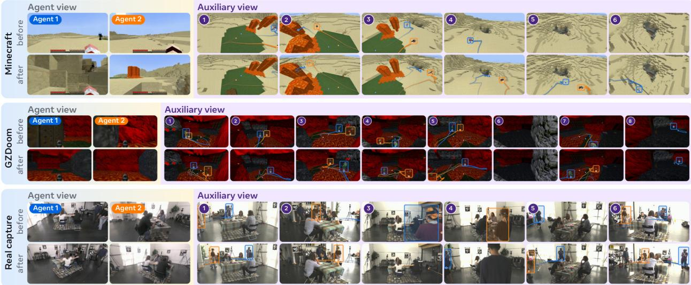  
Figure 3 OverSeer keeps the agents consistent across views. Generated videos in Minecraft, GZDoom and a multi-camera Real Capture, each at two moments (before, after). Each agent’s trail is one 3D track projected into every auxiliary camera (Agent 1 blue, Agent 2 orange); it lands on the generated agent in each of them, so the agents are consistent across views.

Anchor and Residual Codes. For each auxiliary view $j ,$ we retain the initial video-VAE latent $\boldsymbol { z } _ { 0 } ^ { X , j } \in \mathbb { R } ^ { H \times W \times C }$ as a static reference anchor and partition the subsequent temporal sequence into Q non-overlapping chunks. Let $\mathcal { T } _ { q }$ denote the time indices of the target latents in chunk q, where $| \bar { \mathcal { T } _ { q } } | = \tau$ represents the temporal compression factor. For each chunk q, δ-VAE encodes the anchor $z _ { 0 } ^ { X , j }$ alongside the corresponding target latents $\{ \bar { z } _ { t } ^ { X , j } \} _ { t \in \mathcal { T } _ { q } }$ into a compact residual code $d _ { q } ^ { X , j } \in \mathbb { R } ^ { \frac { H } { s } \times \frac { W } { s } \times C _ { d } } .$ , where s denotes the spatial compression factor. These residual codes achieve an $s ^ { 2 }$ spatial and τ temporal token reduction relative to the primary video-VAE latents. The resulting compressed sequence for auxiliary view j is represented as $\widetilde { z } ^ { X , j } = \big [ { z } _ { 0 } ^ { X , j } ; d _ { 1 } ^ { \check { X } , j } ; \cdot \cdot \cdot ; d _ { Q } ^ { X , j } \big ]$

δ-VAE Architecture Design. The encoder $\mathcal { E } _ { \delta \mathrm { - } \mathrm { V A E } }$ spatially patchifies the video-VAE features and jointly processes the anchor latent $\cdot { } _ { z _ { 0 } } ^ { X , j }$ and the target latents $\{ { z } _ { t } ^ { X , j } \} _ { t \in \mathcal { T } _ { q } }$ using a spatio-temporal transformer. It parameterizes a Gaussian latent distribution $\mathcal { G } _ { q } ^ { X , j }$ (Kingma and Welling, 2014) from which the residual code $d _ { q } ^ { X , j }$ is sampled. The decoder $\mathcal { D } _ { \delta \mathrm { - } \mathrm { V A E } }$ reconstructs each target chunk from the residual code $d _ { q } ^ { X , j }$ and the anchor $z _ { 0 } ^ { X , j }$ The residual code remains at its compressed spatial resolution, while the anchor is repeated over the τ target temporal positions by adding a learnable temporal positional embedding. These replicated anchor features then attend to $d _ { q } ^ { X , j }$ through cross-attention layers, producing the reconstructed target latents $\{ \hat { z } _ { t } ^ { X , j } \} _ { t \in \mathcal { T } _ { q } }$

Training Objective. We train the δ-VAE with three losses: an $\ell _ { 1 }$ reconstruction loss $\mathcal { L } _ { \mathrm { r e c } }$ between the reconstructed and target video-VAE latents; the standard VAE KL divergence ${ \mathcal { L } } _ { \mathrm { K L } }$ ; and a feature alignment loss $\mathcal { L } _ { \mathrm { a l i g n } }$ inspired by REPA (Yu et al., 2025b). Reconstruction alone lets the residual code spend its capacity on static background that the anchor already provides; $\mathcal { L } _ { \mathrm { a l i g n } }$ instead aligns the code with video-VAE features re-weighted toward dynamic regions. To build this alignment target, we first compute a spatial change weight map for each target frame from its channel-wise latent distance to the anchor,

$$
\widetilde { M } _ { t } ^ { X , j } = \left. z _ { t } ^ { X , j } - z _ { 0 } ^ { X , j } \right. _ { 2 , C } , \qquad M _ { t } ^ { X , j } = \frac { \widetilde { M } _ { t } ^ { X , j } } { \left. \widetilde { M } _ { t } ^ { X , j } \right. _ { 2 } } ,\tag{4}
$$

where $\Vert \cdot \Vert _ { 2 , C }$ denotes the $\ell _ { 2 }$ norm over channels and $M _ { t } ^ { X , j } \in \mathbb { R } ^ { H \times W }$ assigns higher weights to spatial locations exhibiting greater temporal variation relative to the anchor frame. We modulate the target video-VAE features using this weight map via $r _ { t } ^ { X , j } = M _ { t } ^ { X , j } \odot z _ { t } ^ { X , j }$ . Importantly, the latent distance is used solely to isolate dynamic regions; the feature alignment target is constructed directly from the target VAE features themselves, as naive subtraction within a non-linear VAE latent space does not generally yield semantically meaningful representations.

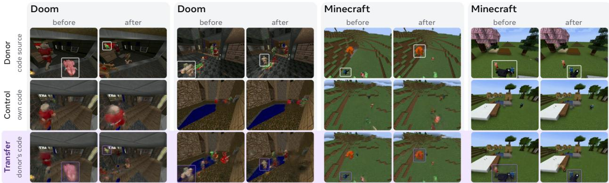  
Figure 4 δ-VAE residual codes carry the movers, not the scene. Four cross-scene transfers: a host anchor is decoded with a donor clip’s residual code (transfer, purple band) instead of its own (control), at two moments (before, after). The donor’s mover (white box) appears in the host scene (purple box) while the host scene itself is preserved.

For each chunk, the weighted feature $\{ r _ { t } ^ { X , j } \} _ { t \in \mathcal { T } _ { q } } \in \mathbb { R } ^ { \tau \times H \times W \times C }$ is pooled over $\tau \times s \times s$ temporal-spatial blocks, yielding a target feature representation in R $\frac { H } { s } \times \frac { W } { s } \times C$ . A learned linear projection $\mathcal { P }$ maps $d _ { q } ^ { X , j }$ from $C _ { d }$ to $C ,$ establishing the feature alignment loss. Combining this with the $\ell _ { 1 }$ reconstruction loss $\mathcal { L } _ { \mathrm { r e c } }$ and the KL divergence regularization ${ \mathcal { L } } _ { \mathrm { K L } }$ , the loss terms are defined as:

$$
\begin{array} { r } { \mathcal { L } _ { \mathrm { r e c } } = \| \hat { z } _ { t } ^ { X , j } - z _ { t } ^ { X , j } \| _ { 1 } , \mathcal { L } _ { \mathrm { K L } } = \mathrm { K L } \big ( \mathcal { G } _ { q } ^ { X , j } \| \mathcal { N } ( \mathbf { 0 } , \mathbf { I } ) \big ) , \mathcal { L } _ { \mathrm { a l i g n } } = \Big \| \mathcal { P } \left( d _ { q } ^ { X , j } \right) - \mathrm { P o o l } \left( \{ r _ { t } ^ { X , j } \} _ { t \in \mathcal { T } _ { q } } \right) \Big \| _ { 2 } ^ { 2 } . } \end{array}\tag{5}
$$

The overall training objective for δ-VAE is: ${ \mathcal { L } } _ { \delta \mathrm { - } \mathrm { V A E } } = \lambda _ { \mathrm { r e c } } { \mathcal { L } } _ { \mathrm { r e c } } + \lambda _ { \mathrm { K L } } { \mathcal { L } } _ { \mathrm { K L } } + \lambda _ { \mathrm { a l i g n } } { \mathcal { L } } _ { \mathrm { a l i g n } }$ with loss weights specified in section D. We first train the δ-VAE individually on auxiliary-camera streams and freeze its weights prior to training the primary world model OverSeer. During OverSeer training, ground-truth auxiliary videos are encoded into anchor latents $\mathbf { z } _ { 0 } ^ { X }$ and residual codes ${ \bf d } _ { 1 : Q } ^ { X } ,$ which serve as difusion targets alongside future agent latents $\mathbf { z } _ { 1 : T } ^ { A }$ in equation (3).

## 4 Experiments

We structure our experimental evaluation to test the central hypothesis of this work: extending a multiagent video world model with pose-fixed, eficiently represented auxiliary views significantly improves both temporal and agent consistency compared to baselines (section 4.1). We then conduct ablation studies investigating how performance scales with the number of auxiliary views and how the δ-VAE compression ratio influences synthesis quality and computational overhead (section 4.2). For qualitative results, please refer to our website and appendix.

Environments and Benchmarks. We evaluate world models by conditioning future frame rollouts on initial visual observations and multi-agent action trajectories. Primary quantitative evaluations are conducted in Minecraft, whose persistent and editable 3D world naturally tests spatial memory, multi-agent interaction, and cross-view consistency (tables 1 and 2). To evaluate long-horizon spatial reasoning, we additionally run revisit tasks in Doom (table 2) and showcase qualitative generalization on real-world video captures from Replay (Shapovalov et al., 2023). In Minecraft, evaluation spans two benchmark suites:

1. Solaris Benchmark (Savva et al., 2026): Evaluates five multi-agent capabilities using VLM-judged scripted questions, requiring all questions within an episode to be answered correctly.

2. MAC-Bench (Multi-Agent Consistency Benchmark): Designed specifically to evaluate world and agent consistency in a harder setting. Specifically. we design the following three tasks:

<table><tr><td></td><td colspan="10">Solaris Benchmark</td><td colspan="6">MAC-Bench</td></tr><tr><td></td><td colspan="2">Movement</td><td colspan="2">Grounding</td><td colspan="2">Memory</td><td colspan="2">Building</td><td colspan="2">Consistency</td><td colspan="2">Reunite at Start</td><td colspan="2">Reunite Far</td><td colspan="2">Dynamic Event</td></tr><tr><td>Method</td><td>VLM↑</td><td>FID↓</td><td>VLM↑</td><td>FID↓</td><td>VLM↑</td><td>FID↓</td><td>VLM↑</td><td>FID↓</td><td>VLM↑</td><td>FID↓</td><td>VLM↑</td><td>FID↓</td><td>VLM↑</td><td>FID↓</td><td>VLM↑</td><td>FID↓</td></tr><tr><td>Solaris</td><td>68.8</td><td>22.38</td><td>66.7</td><td>14.92</td><td>20.8</td><td>47.11</td><td>22.9</td><td>76.01</td><td>56.3</td><td>68.42</td><td>0.0</td><td>17.06</td><td>6.2</td><td>20.23</td><td>12.5</td><td>26.52</td></tr><tr><td>γ-World</td><td>64.6</td><td>17.13</td><td>62.5</td><td>29.39</td><td>16.7</td><td>29.57</td><td>43.8</td><td>24.62</td><td>47.9</td><td>56.39</td><td>0.0</td><td>23.83</td><td>0.0</td><td>25.71</td><td>8.3</td><td>31.72</td></tr><tr><td>OverSeer</td><td>59.1</td><td>18.27</td><td>91.7</td><td>11.33</td><td>87.5</td><td>12.95</td><td>41.7</td><td>32.50</td><td>60.4</td><td>26.47</td><td>60.2</td><td>13.99</td><td>37.9</td><td>12.79</td><td>40.5</td><td>17.61</td></tr></table>

Table 1 Results on Minecraft. Comparison on the Solaris benchmark and our MAC-Bench. VLM denotes VLM-judged accuracy (%) and FID denotes frame-level FID; MAC-Bench results are averaged over 5 runs. Bold and underline denote the best and second-best results in each column, respectively.

• Reunite at Start: Both agents return to their exact initial poses. Consequently, an agent’s partner must reappear at a previously observed spatial location.

• Reunite Far: Agents navigate long, converging routes without visual contact in transit, turning to face each other upon arrival. A partner must appear at close range within previously unobserved space.

• Dynamic Event: Agents observe the initial stage of a localized dynamic process (e.g., a chair catching fire) before separating. Upon return, the object state must reflect correct of-screen temporal evolution.

In Doom, we design two Reunite tasks across six distinct maps with extended navigation paths.

Evaluation Metrics. We report VLM Episode Accuracy (VLM↑) and Frame Fréchet Inception Distance (FID↓). VLM is evaluated using Claude Opus 5 conditioned on ground-truth camera poses and environment event logs. Metrics are averaged across 32 episodes per task in Minecraft and 100 episodes for each Doom task.

Baselines. We compare OverSeer against two state-of-the-art two-player world models for Minecraft: Solaris (Savva et al., 2026) and γ-World (Liu et al., 2026a). For a fair comparison, all models are evaluated with their non-distilled, causally fine-tuned checkpoints and receive identical conditioning frames and action sequences, operating strictly without auxiliary views at inference.

## 4.1 Analysis of Multi-Agent World Modeling Benchmarks

Main results. As shown in table 1, OverSeer leads on grounding, memory, and consistency, the Solaris capabilities that require spatial reasoning beyond the current view. Conversely, it trails the best baseline on building and movement tasks, which depend primarily on short-horizon egocentric streams. On MAC-Bench, OverSeer yields substantial gains in VLM accuracy over prior baselines, increasing scores from 0.0%/6.2%/12.5% to 60.2%/37.9%/40.5% across our three designed tasks (also qualitatively shown in figure 5), while achieving the lowest (best) FID score across all tasks. Agent consistency is further demonstrated qualitatively in figure 3: projected 3D agent trajectories precisely align with generated agents across every auxiliary view in Minecraft, Doom, and real-world captures. Extended visualization rollouts are provided in section G.

FID does not reflect generation consistency. On Reunite at Start, Solaris obtains an FID of 17.06, within 3.1 points of OverSeer, yet answers none of the episodes correctly. While its generated rollouts remain visually in-distribution, they fail to reconstruct the specific scene previously left behind by the agents, frequently filling in existing craters or omitting partner agents entirely (figure 5). This disconnect demonstrates that standard frame-level distributional metrics like FID are insensitive to structural memory failures, motivating the content-level queries proposed in our new benchmark.

Without a shared view, agents drift apart. Both baselines enforce cross-agent agreement by coupling the agent streams directly, through concatenation or shared attention. Under this design, every reference frame is itself a dynamic, partial observation, restricting agreement exclusively to moments when the agents’ fields of view overlap. Empirical results directly reflect this structural limitation: once agents lose visual contact, γ-World does not achieve any of the reunite tasks. The same argument accounts for the gap between Reunite at Start (60.2) and Reunite Far (37.9), as sampled cameras cover the start region more densely than the periphery.

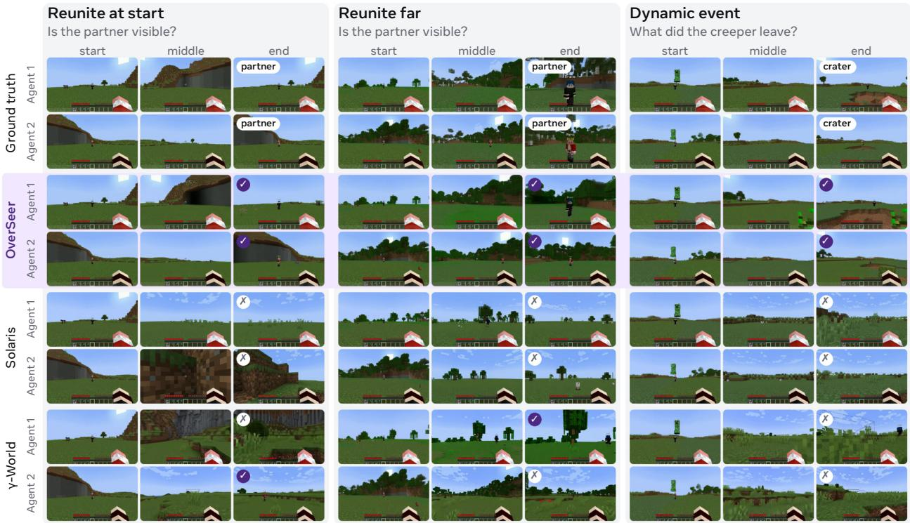  
Figure 5 OverSeer keeps the world consistent over time. On the three revisiting tasks (reunite at start, reunite far, dynamic event), OverSeer shows the partner and the crater where the ground truth does, while Solaris and γ-World mostly do not.

## 4.2 Ablations

Efect of δ-VAE. Removing δ-VAE improves visual quality and, on Doom, consistency as well (table 2), but at the cost of an 8 larger auxiliary-stream token footprint (864 vs. 108 tokens per frame at 576 384). This performance trade-of is domain-dependent: a residual code remains faithful only insofar as the scene stays close to its static anchor. Doom’s rapid lighting changes and enemy movements generate much larger residual updates than Minecraft’s slow, blocky dynamics.

<table><tr><td></td><td colspan="6">Minecraft</td><td colspan="4">Doom</td></tr><tr><td></td><td colspan="2">Reunite at Start</td><td colspan="2">Reunite Far</td><td colspan="2">Dynamic Event</td><td colspan="2">Reunite at Start</td><td colspan="2">Reunite Far</td></tr><tr><td>Variant</td><td>VLM↑</td><td>FID↓</td><td>VLM↑</td><td>FID↓</td><td>VLM↑</td><td>FID↓</td><td>VLM↑</td><td>FID↓</td><td>VLM↑</td><td>FID↓</td></tr><tr><td>OverSeer</td><td>60.2</td><td>14.0</td><td>37.9</td><td>12.8</td><td>40.5</td><td>17.6</td><td>62.0</td><td>23.2</td><td>67.0</td><td>20.9</td></tr><tr><td>w/o Aux. Views</td><td>25.0</td><td>24.6</td><td>16.7</td><td>27.2</td><td>20.8</td><td>33.1</td><td>12.0</td><td>50.6</td><td>0.0</td><td>87.4</td></tr><tr><td>w/o δ-VAE</td><td>59.4</td><td>8.2</td><td>40.6</td><td>13.4</td><td>41.7</td><td>10.3</td><td>78.0</td><td>15.8</td><td>84.0</td><td>15.4</td></tr></table>

Table 2 Ablation of auxiliary views and δ-VAE. Comparison on MAC-Bench in Minecraft and Doom. w/o δ-VAE models auxiliary views with uncompressed video-VAE latents, using 8 more auxiliary tokens. Bold denotes the best result in each column.

Efect of auxiliary camera count. Increasing the number of auxiliary cameras steadily improves every metric relying on persistent world state: grounding, memory, and consistency on Solaris, and all three revisit tasks in MAC-Bench, while movement and building performance remain flat (figure 6). This selective improvement confirms that performance gains stem specifically from expanded spatial visual coverage rather than generic model capacity scaling, which would otherwise uniformly elevate all capabilities. Gains naturally plateau once visual coverage saturates.

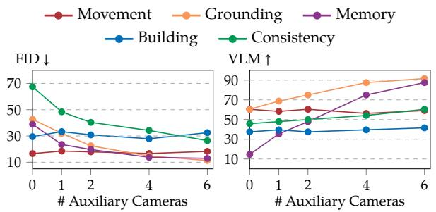  
(a) Solaris Benchmark

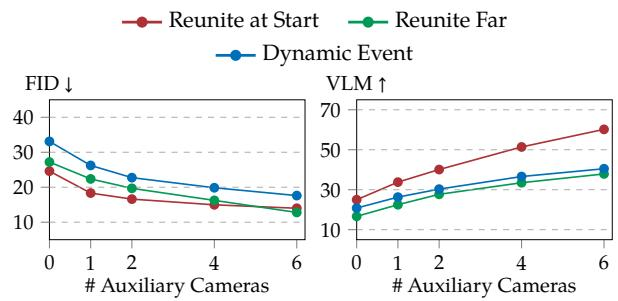  
(b) MAC-Bench  
Figure 6 Effect of auxiliary camera count. Adding auxiliary views systematically improves FID and VLM accuracies on consistency and memory metrics across both benchmarks, with diminishing returns once spatial coverage saturates.

Efect of latent compression. In cross-scene transfer experiments (decoding residual codes with a diferent “control” anchor latent), higher compression lowers PSNR but systematically suppresses donor background leakage. Crucially, spatial placement precision and identity preservation of the transferred mover (Import IoU and Mover Id.) improve up to 8 compression—peaking at 26.7 and 0.66, respectively, before degrading at 16 (figure 7). Compression is thus more than an eficiency knob: an informational bottleneck too narrow to encode static background forces the model to allocate capacity to dynamic elements, causing dynamic-static disentanglement to naturally emerge from the constraint itself. We therefore adopt 8 compression by default (figure 7).

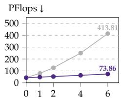  
# Auxiliary Views

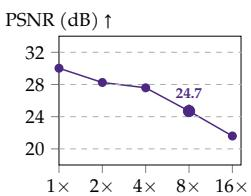  
Compression Ratio

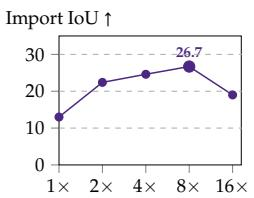  
Compression Ratio

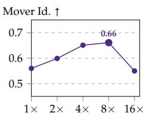  
Compression Ratio

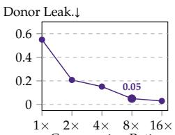  
Compression Ratio  
Figure 7 Effect of δ-VAE compression. δ-VAE keeps compute nearly flat as auxiliary views are added. Stronger compression trades reconstruction fidelity for disentanglement: donor leakage drops steadily, while mover transfer peaks at the default 8× before degrading.

## 5 Conclusion

We introduced OverSeer, a multi-agent video world model that jointly generates egocentric agent views and fixed-pose auxiliary views as a lightweight proxy for a world-centric state. These views substantially improve consistency when agents separate and later reunite, and δ-VAE makes them cheap to model by encoding only changes relative to a static reference. We hope this simple yet efective design will pave the way for world models that simulate shared environments beyond what any single agent sees.

## 6 Acknowledgement

The authors would like to thank Tomas Jakab, Zeren Jiang, Zijian Zhou, Mengmeng Xu, and Wonbong Jang for their insightful feedback.

## References

Andreas Blattmann, Robin Rombach, Huan Ling, Tim Dockhorn, Seung Wook Kim, Sanja Fidler, and Karsten Kreis. Align your latents: High-resolution video synthesis with latent difusion models. In Proceedings of the IEEE Conference on Computer Vision and Pattern Recognition (CVPR), 2023.

Daniel Bolya, Cheng-Yang Fu, Xiaoliang Dai, Peizhao Zhang, Christoph Feichtenhofer, and Judy Hofman. Token merging: Your ViT but faster. In Proceedings of the International Conference on Learning Representations (ICLR), 2023.

Jake Bruce, Michael D Dennis, Ashley Edwards, Jack Parker-Holder, Yuge Shi, Edward Hughes, Matthew Lai, Aditi Mavalankar, Richie Steigerwald, Chris Apps, Yusuf Aytar, Sarah Maria Elisabeth Bechtle, Feryal Behbahani, Stephanie C.Y. Chan, Nicolas Heess, Lucy Gonzalez, Simon Osindero, Sherjil Ozair, Scott Reed, Jingwei Zhang, Konrad Zolna, Jef Clune, Nando de Freitas, Satinder Singh, and Tim Rocktäschel. Genie: Generative interactive environments. In Proceedings of the International Conference on Machine Learning (ICML), 2024.

Boyuan Chen, Diego Martí Monsó, Yilun Du, Max Simchowitz, Russ Tedrake, and Vincent Sitzmann. Difusion forcing: Next-token prediction meets full-sequence difusion. In Advances in Neural Information Processing Systems (NeurIPS), 2024.

Junyu Chen, Dongyun Zou, Wenkun He, Junsong Chen, Enze Xie, Song Han, and Han Cai. DC-AE 1.5: Accelerating difusion model convergence with structured latent space. In Proceedings of the International Conference on Computer Vision (ICCV), 2025.

DreamX, Yancheng Bai, Rui Chen, Xiangxiang Chu, Rujing Dang, Hao Dou, Bingjie Gao, Qiwen Gu, Siyu Hong, Jiachen Lei, Geng Li, Jifan Li, Ruimin Lin, Qingfeng Shi, Bingze Song, Lei Sun, Jing Tang, Ruitian Tian, Jun Wang, Jiahong Wu, Pengfei Zhang, Shen Zhang, and Jiashu Zhu. Dreamx-world 1.0: A general-purpose interactive world model, 2026. https://arxiv.org/abs/2606.16993.

Vladimir Egorov and Aleksei Shpilman. Scalable multi-agent model-based reinforcement learning. arXiv preprint arXiv:2205.15023, 2022.

Team Enigma. Introducing multiverse: The first ai multiplayer world model, 2025. https://enigma.inc/blog.

Xiang Fan, Xiaohang Sun, Kushan Thakkar, Zhu Liu, Vimal Bhat, Ranjay Krishna, and Xiang Hao. RefTok: Reference-based tokenization for video generation. arXiv preprint arXiv:2507.02862, 2025.

Ruiqi Gao, Aleksander Holynski, Philipp Henzler, Arthur Brussee, Ricardo Martin Brualla, Pratul Srinivasan, Jonathan Barron, and Ben Poole. Cat3d: Create anything in 3d with multi-view difusion models. Advances in Neural Information Processing Systems (NeurIPS), 2024a.

Ruiyuan Gao, Kai Chen, Enze Xie, Lanqing Hong, Zhenguo Li, Dit-Yan Yeung, and Qiang Xu. Magicdrive: Street view generation with diverse 3d geometry control. In Proceedings of the International Conference on Learning Representations (ICLR), 2024b.

Shenyuan Gao, Jiazhi Yang, Li Chen, Kashyap Chitta, Yihang Qiu, Andreas Geiger, Jun Zhang, and Hongyang Li. Vista: A generalizable driving world model with high fidelity and versatile controllability. In Advances in Neural Information Processing Systems (NeurIPS), 2024c.

Google DeepMind. Veo 3 technical report. Technical report, Google DeepMind, 2025. https://storage.googleapis.com/ deepmind-media/veo/Veo-3-Tech-Report.pdf.

Yoav HaCohen, Nisan Chiprut, Benny Brazowski, Daniel Shalem, Dudu Moshe, Eitan Richardson, Eran Levin, Guy Shiran, Nir Zabari, Ori Gordon, Poriya Panet, Sapir Weissbuch, Victor Kulikov, Yaki Bitterman, Zeev Melumian, and Ofir Bibi. Ltx-video: Realtime video latent difusion. arXiv preprint arXiv:2501.00103, 2025.

Yicong Hong, Yiqun Mei, Chongjian Ge, Yiran Xu, Yang Zhou, Sai Bi, Yannick Hold-Geofroy, Mike Roberts, Matthew Fisher, Eli Shechtman, Kalyan Sunkavalli, Feng Liu, Zhengqi Li, and Hao Tan. Relic: Interactive video world model with long-horizon memory, 2025. https://arxiv.org/abs/2512.04040.

Anthony Hu, Václav Volhejn, Adrien Ramanana Rahary, Chris Mulder, Aditya Makkar, Alyx Liao, Amélie Royer, Manu Orsini, Adam Jelley, Eloi Alonso, Florian Laurent, Fredrik Norén, James Swingos, Jan Hünermann, Kent Rollins, Lucas Hosseini, Matthieu Le Cauchois, Maxim Peter, Pim de Witte, Tim Brown, Vincent Micheli, Moritz Böhle, Gabriel de Marmiesse, Viktoriia Sharmanska, Lucia Specia, Michael Black, and Patrick Pérez. Multiplayer interactive world models with representation autoencoders, 2026a. https://arxiv.org/abs/2607.05352.

Teng Hu, Mingchun Lu, Yating Wang, Jiangning Zhang, Jinkun Hao, Ye Pan, Ran Yi, Lizhuang Ma, and Dacheng Tao. Metaworld: Scaling multi-agent video world model from single-view video data. arXiv preprint arXiv:2606.02753, 2026b.

Xun Huang, Zhengqi Li, Guande He, Mingyuan Zhou, and Eli Shechtman. Self forcing: Bridging the train-test gap in autoregressive video difusion. In Advances in Neural Information Processing Systems (NeurIPS), 2025.

Wonbong Jang, Shikun Liu, Soubhik Sanyal, Juan Camilo Perez, Kam Woh Ng, Sanskar Agrawal, Juan-Manuel Perez-Rua, Yiannis Douratsos, and Tao Xiang. Rays as pixels: Learning a joint distribution of video and camera trajectories. In Proceedings of the International Conference on Machine Learning (ICML), 2026.

Fan Jiang, Zhaoxu Sun, Mengchao Wang, Ziyu Zhu, Chiyu Wang, Yunpeng Zhang, Wenlin Liu, Yun Wang, Xue Zheng, Rui Sun, Junfeng Ni, Hongyu Pan, Zhongxu Sun, Fei Yu, Zengye Ge, Mengmeng Du, Nianfei Fan, Mingchao Sun, Yu Liu, Yongchang, Yanqing Zhu, Jiahang Wang, Ning Ying, Yuze Xuan, Di Yang, Zhicheng Liu, Zhe Gao, Tingbing Xu, Jiacheng Sui, Wenjin Yang, Junnan Lai, Shufeng Liu, Yuan Liu, Zheng Zhou, Yingliang Peng, Dawei Cao, Kaifeng Sheng, Yuxiang Cai, Fei Lu, Mu Xu, and Ning Guo. Abot-world-0: Infinite interactive world rollout on a single desktop gpu, 2026. https://arxiv.org/abs/2607.19191.

Tommie Kerssies, Gabriele Berton, Ju He, Qihang Yu, Wufei Ma, Daan de Geus, Gijs Dubbelman, and Liang-Chieh Chen. A frame is worth one token: Eficient generative world modeling with delta tokens. In Proceedings of the IEEE Conference on Computer Vision and Pattern Recognition (CVPR), 2026.

Diederik P Kingma and Max Welling. Auto-encoding variational bayes. In Proceedings ofthe International Conference on Learning Representations (ICLR), 2014.

Xin Kong, Shikun Liu, Xiaoyang Lyu, Marwan Taher, Xiaojuan Qi, and Andrew J Davison. Eschernet: A generative model for scalable view synthesis. In Proceedings of the IEEE Conference on Computer Vision and Pattern Recognition (CVPR), 2024.

Jiahao Li, Bin Li, and Yan Lu. Deep contextual video compression. In Advances in Neural Information Processing Systems (NeurIPS), 2021.

Runjia Li, Philip Torr, Andrea Vedaldi, and Tomas Jakab. VMem: Consistent interactive video scene generation with surfel-indexed view memory. In Proceedings of the International Conference on Computer Vision (ICCV), 2025.

Fangfu Liu, Kai He, Tianchang Shen, Tianshi Cao, Sanja Fidler, Yueqi Duan, Jun Gao, Igor Gilitschenski, Zian Wang, and Xuanchi Ren. Gamma-world: Generative multi-agent world modeling beyond two players. arXiv preprint arXiv:2605.28816, 2026a.

Shikun Liu, Kam Woh Ng, Wonbong Jang, Jiadong Guo, Junlin Han, Haozhe Liu, Yiannis Douratsos, Juan Camilo Perez, Zijian Zhou, Khanh Chi Phung, Tao Xiang, and Juan-Manuel Perez-Rua. Scaling sequence-to-sequence generative neural rendering. In Proceedings of the International Conference on Learning Representations (ICLR), 2026b.

Guo Lu, Wanli Ouyang, Dong Xu, Xiaoyun Zhang, Chunlei Cai, and Zhiyong Gao. DVC: An end-to-end deep video compression framework. In Proceedings of the IEEE Conference on Computer Vision and Pattern Recognition (CVPR), 2019.

OpenAI. Video generation models as world simulators. Technical report, OpenAI, 2024. https://openai.com/research/ video-generation-models-as-world-simulators.

Ethan Perez, Florian Strub, Harm de Vries, Vincent Dumoulin, and Aaron C. Courville. FiLM: Visual reasoning with a general conditioning layer. In Proc. AAAI, 2018.

Ryan Po, David Junhao Zhang, Amir Hertz, Gordon Wetzstein, Neal Wadhwa, and Nataniel Ruiz. Multigen: Level-design for editable multiplayer worlds in difusion game engines. arXiv preprint arXiv:2603.06679, 2026.

Colin Rafel, Noam Shazeer, Adam Roberts, Katherine Lee, Sharan Narang, Michael Matena, Yanqi Zhou, Wei Li, Peter J Liu, et al. Exploring the limits of transfer learning with a unified text-to-text transformer. Journal of Machine Learning Research (JMLR), 2020.

Robin Rombach, Andreas Blattmann, Dominik Lorenz, Patrick Esser, and Björn Ommer. High-resolution image synthesis with latent difusion models. In Proceedings of the IEEE Conference on Computer Vision and Pattern Recognition (CVPR), 2022.

Georgy Savva, Oscar Michel, Daohan Lu, Suppakit Waiwitlikhit, Timothy Meehan, Dhairya Mishra, Srivats Poddar, Jack Lu, and Saining Xie. Solaris: Building a multiplayer video world model in minecraft, 2026. https://arxiv.org/abs/ 2602.22208.

Roman Shapovalov, Yanir Kleiman, Ignacio Rocco, David Novotny, Andrea Vedaldi, Changan Chen, Filippos Kokkinos, Ben Graham, and Natalia Neverova. Replay: Multi-modal multi-view acted videos for casual holography. In Proceedings of the International Conference on Computer Vision (ICCV), 2023.

Uriel Singer, Adam Polyak, Thomas Hayes, Xi Yin, Jie An, Songyang Zhang, Qiyuan Hu, Harry Yang, Oron Ashual, Oran Gafni, Devi Parikh, Sonal Gupta, and Yaniv Taigman. Make-a-video: Text-to-video generation without text-video data. In Proceedings of the International Conference on Learning Representations (ICLR), 2023.

Vincent Sitzmann, Semon Rezchikov, William T. Freeman, Joshua B. Tenenbaum, and Fredo Durand. Light field networks: Neural scene representations with single-evaluation rendering. In Proc. NeurIPS, 2021.

The Freedoom project. Freedoom: Phase 1 and phase 2. https://freedoom.github.io/, 2024. Free game data for the Doom engine, 36 and 32 maps.

Dani Valevski, Yaniv Leviathan, Moab Arar, and Shlomi Fruchter. Difusion models are real-time game engines. In Proceedings of the International Conference on Learning Representations (ICLR), 2025.

Team Wan, Ang Wang, Baole Ai, Bin Wen, Chaojie Mao, Chen-Wei Xie, Di Chen, Feiwu Yu, Haiming Zhao, Jianxiao Yang, Jianyuan Zeng, Jiayu Wang, Jingfeng Zhang, Jingren Zhou, Jinkai Wang, Jixuan Chen, Kai Zhu, Kang Zhao, Keyu Yan, Lianghua Huang, Mengyang Feng, Ningyi Zhang, Pandeng Li, Pingyu Wu, Ruihang Chu, Ruili Feng, Shiwei Zhang, Siyang Sun, Tao Fang, Tianxing Wang, Tianyi Gui, Tingyu Weng, Tong Shen, Wei Lin, Wei Wang, Wei Wang, Wenmeng Zhou, Wente Wang, Wenting Shen, Wenyuan Yu, Xianzhong Shi, Xiaoming Huang, Xin Xu, Yan Kou, Yangyu Lv, Yifei Li, Yijing Liu, Yiming Wang, Yingya Zhang, Yitong Huang, Yong Li, You Wu, Yu Liu, Yulin Pan, Yun Zheng, Yuntao Hong, Yupeng Shi, Yutong Feng, Zeyinzi Jiang, Zhen Han, Zhi-Fan Wu, and Ziyu Liu. Wan: Open and advanced large-scale video generative models. arXiv preprint arXiv:2503.20314, 2025.

Zile Wang, Zexiang Liu, Jiaxing Li, Kaichen Huang, Baixin Xu, Fei Kang, Mengyin An, Peiyu Wang, Biao Jiang, Yichen Wei, et al. Matrix-game 3.0: Real-time and streaming interactive world model with long-horizon memory. arXiv preprint arXiv:2604.08995, 2026.

Haoyu Wu, Jiwen Yu, Yingtian Zou, and Xihui Liu. Multiworld: Scalable multi-agent multi-view video world models. arXiv preprint arXiv:2604.18564, 2026.

Shuai Yang, Wei Huang, Ruihang Chu, Yicheng Xiao, Yuyang Zhao, Xianbang Wang, Muyang Li, Enze Xie, Yingcong Chen, Yao Lu, et al. Longlive: Real-time interactive long video generation. In Proceedings ofthe International Conference on Learning Representations (ICLR), 2026.

Hidir Yesiltepe, Tuna Meral, Adil Kaan Akan, Kaan Oktay, and Pinar Yanardag. Infinity-rope: Action-controllable infinite video generation emerges from autoregressive self-rollout. In Proceedings ofthe IEEE Conference on Computer Vision and Pattern Recognition (CVPR), 2026.

Jiwen Yu, Jianhong Bai, Yiran Qin, Quande Liu, Xintao Wang, Pengfei Wan, Di Zhang, and Xihui Liu. Context as memory: Scene-consistent interactive long video generation with memory retrieval. In SIGGRAPH Asia, 2025a.

Lijun Yu, José Lezama, Nitesh Bharadwaj Gundavarapu, Luca Versari, Kihyuk Sohn, David Minnen, Yong Cheng, Agrim Gupta, Xiuye Gu, Alexander G Hauptmann, Boqing Gong, Ming-Hsuan Yang, Irfan Essa, David Ross, and Lu Jiang. Language model beats difusion - tokenizer is key to visual generation. In Proceedings ofthe International Conference on Learning Representations (ICLR), 2024.

Sihyun Yu, Sangkyung Kwak, Huiwon Jang, Jongheon Jeong, Jonathan Huang, Jinwoo Shin, and Saining Xie. Representation alignment for generation: Training difusion transformers is easier than you think. In Proceedings of the International Conference on Learning Representations (ICLR), 2025b.

Wei Yu, Runjia Qian, Yumeng Li, Liquan Wang, Songheng Yin, Sri Siddarth Chakaravarthy P, Dennis Anthony, Yang Ye, Yidi Li, Weiwei Wan, and Animesh Garg. Mosaicmem: Hybrid spatial memory for controllable video world models, 2026. https://arxiv.org/abs/2603.17117.

ZDoom developers. GZDoom. https://zdoom.org/, 2025. Open-source source port of the Doom engine.

Yang Zhang, Chenjia Bai, Bin Zhao, Junchi Yan, Xiu Li, and Xuelong Li. Decentralized transformers with centralized aggregation are sample-eficient multi-agent world models. Transactions on Machine Learning Research (TMLR), 2025.

## A Dataset Curation Pipelines

Data. The three domains are three separate datasets, and we train one model on each. Minecraft and Doom are collected by us; the real captures are an existing dataset that we re-use in the same two-agent, many-camera arrangement. In all three, a clip is 241 frames of every view at once, sampled at 20 frames per second (12 s), 576  320 per view in Minecraft and in the captures and 480  320 in Doom.

Minecraft. The gameplay is collected with the Solaris engine (Savva et al., 2026): two Mineflayer bots play a two-player episode on a Minecraft 1.21 server and each view is recorded from a real Minecraft client, so the frames are the game’s own graphics and every frame carries the bot’s ground-truth action. The bots explore by a potential field, walls pushing them away and unvisited ground pulling them in, which keeps the pair moving over new terrain instead of circling one spot, and each episode is additionally labeled with one of eleven interaction modes (mining, building, fighting, chasing, exploring, reuniting and so on). We extend the engine with six fixed auxiliary cameras. They are placed in a second pass: the episode is played once to establish the terrain, then the six cameras are sampled at random in the free space around the agents’ starting area and the episode is captured with them. Placement therefore follows the ground the episode covers rather than aiming at one point; measured over 200 episodes, a camera sits a median 4.9 blocks above the agents and 3.0 blocks from the nearest point of their path, tilted 52 degrees down with a 70 degree field of view, and while a single camera has an agent in its frustum in about half of the frames, some camera has one in 90% of them. Every view is recorded at 1280 720 and 20 frames per second. We collect 20,000 episodes of outdoor terrain and 11,000 of village worlds, 264 frames each.

Doom. Doom episodes are played with Doom (ZDoom developers, 2025) on the 68 maps of Freedoom Phase 1 and Phase 2 (The Freedoom project, 2024), two marines and eight fixed auxiliary cameras per episode, and the marines are driven by the same potential-field exploration controller as the Minecraft bots. Every view is recorded at 1024 768 and 30 frames per second with a 120-degree field of view. The eight cameras sit about 100 map units (3 m) above eye height, four tilted 10 degrees down and four 28 degrees, and between them they see the marines almost everywhere they walk, which is what the maps’ corridors and halls allow: a single camera has a marine in its frustum in about 85% of the frames. We train on 20,000 traversal episodes and hold out a separate set of 4,000 arena episodes, in which the two marines start 128 map units apart facing each other, for evaluation.

Real captures. The real sequences come from Replay (Shapovalov et al., 2023), 68 scenes of acted social interaction of about five minutes each, filmed by twelve temporally synchronized, geometrically and colorcalibrated cameras. We use eight of them in the arrangement the two games are built on: the two head-mounted cameras, which move with their wearers, are the agent views, and six static cameras are the auxiliary views. Unlike the games this gives real people, real cameras, and measured poses: every camera comes with a per-frame camera-to-world pose and pinhole intrinsics; the static cameras hold still to within 5 mm and a wearer covers 3 to 4 m in a clip. We hold out 45 clips of 241 frames, drawn from 35 of the scenes, and train on the rest of the dataset.

MAC-Bench. Table 3 lists the task specifications. In all tasks, the agents begin mutually visible and lose sight of each other mid-episode. In Dynamic Event, the scripted event is placed at the midpoint between the agents and is one of sprouting crops, a standing creeper, or a plank cube that ignites at frame 20. Doom uses the two reunite tasks on six Freedoom maps with 1047-unit walks (32 units per block), with the partner 84◦ of-axis at the midpoint. We use 32 episodes per task in Minecraft and 100 per task in Doom. For VLM accuracy, Claude Opus 5 is given the generated frames and answers the task query for each agent;

An episode counts as correct only if the answers for both agents match the ground truth. FID is computed between generated and ground-truth agent frames. During evaluation, accuracy is averaged over 5 independent runs of 32 episodes; episodes with failed generation or unparsable judge output are excluded.

<table><tr><td>Task</td><td>Start</td><td>Mid-episode</td><td>End</td><td>Query</td></tr><tr><td>Reunite at Start</td><td>13 blocks apart, facing</td><td>each wanders ≤ 9 blocks</td><td>exact start poses</td><td>Is the partner visible?</td></tr><tr><td>Reunite Far</td><td>17 blocks apart</td><td>~59 blocks each, converging; partner 86° off-axis</td><td>2.9 blocks apart, facing</td><td>Is the partner visible?</td></tr><tr><td></td><td></td><td>Dynamic Event 13 blocks apart, event at midpoint separate to 40 blocks by frame 76</td><td>4.3 blocks apart</td><td>What happened to the event?</td></tr></table>

Table 3 MAC-Bench task specifications in Minecraft. Mid-episode angles are medians over episodes.

## B Auxiliary Camera Pose Sampling

As described in section 3.2, OverSeer requires auxiliary camera poses c in equation (3) but no auxiliary images at inference time. During training, auxiliary camera poses and their corresponding videos are provided by the dataset. At inference time, we sample the poses as follows.

Scene-Independent Pose Prior. We define a canonical coordinate system whose origin is the initial position of the first agent. Candidate auxiliary camera poses are sampled relative to this coordinate system from a scene-independent camera-pose prior. The horizontal ofset from the origin, camera height, yaw, and pitch are modeled as Gaussian variables whose parameters are estimated from the training camera poses. Camera height is constrained to be non-negative, and roll is fixed to zero.

Coverage-Based Selection. We sample a candidate set of poses from this prior and greedily select K cameras to maximize geometric field-of-view coverage. Let Ω denote a bounded discretized volume in the canonical coordinate system, and let $\mathcal { F } ( \mathbf { c } ) \subseteq \Omega$ denote the cells geometrically covered by the camera frustum associated with pose c. The computation of $\mathcal { F } ( \mathbf { c } )$ depends only on camera geometry and does not use scene occupancy or occlusion information. Let $\mathcal { R } _ { k }$ denote the region covered by the first k selected cameras, with $\mathcal { R } _ { 0 } = \mathcal { \hat { O } }$ . We greedily select

$$
\mathbf { c } _ { k + 1 } = \arg \operatorname* { m a x } _ { \mathbf { c } \in \mathcal { C } } \left| \mathcal { F } ( \mathbf { c } ) \setminus \mathcal { R } _ { k } \right| , \qquad \mathcal { R } _ { k + 1 } = \mathcal { R } _ { k } \cup \mathcal { F } ( \mathbf { c } _ { k + 1 } ) ,\tag{6}
$$

until K cameras are selected. Since both candidate sampling and coverage computation depend only on the canonical coordinate system and camera geometry, this procedure requires no additional scene-specific visual or geometric input.

## C More Ablations

<table><tr><td rowspan="2"></td><td>δ-VAE</td><td colspan="6">Minecraft Multi-agent Consistency Benchmark</td></tr><tr><td>PSNR↑</td><td colspan="2">Reunite at Start</td><td colspan="2">Reunite Far</td><td colspan="2">Dynamic Event</td></tr><tr><td>Variant</td><td>dB</td><td>VLM↑</td><td>FID↓</td><td>VLM↑</td><td>FID↓</td><td>VLM↑</td><td>FID↓</td></tr><tr><td> $\mathrm { w } / \mathrm { o } \ \mathcal { L } _ { \mathrm { a l i g n } }$ </td><td>25.1</td><td>56.9</td><td>13.47</td><td>33.4</td><td>12.26</td><td>38.1</td><td>17.08</td></tr><tr><td>Full δ-VAE</td><td>24.7</td><td>60.2</td><td>13.99</td><td>37.9</td><td>12.79</td><td>40.5</td><td>17.61</td></tr></table>

Table 4 Ablation of the feature alignment loss. We evaluate its efect on δ-VAE reconstruction quality and downstream world consistency in Minecraft.

Feature alignment loss. Table 4 ablates $\mathcal { L } _ { \mathrm { a l i g n } }$ . Removing it slightly improves δ-VAE reconstruction (25.1 vs. 24.7 dB PSNR) and FID, but lowers VLM accuracy on all three MAC-Bench tasks, by 2.4–4.5 points. Without alignment, the residual code spends its capacity on reconstructing the whole frame; with it, the code is pushed towards dynamic regions, which is what the world model needs to keep revisited scenes consistent. Reconstruction fidelity is thus not a suficient proxy for how useful a compressed representation is downstream, in line with the compression trend in section 4.2.

## D Implementation Details

By applying 2 2 spatial (s = 2) and 2 temporal (τ = 2) compression rates, the δ-VAE reduces the auxiliary view representation from 864 tokens per frame (at 576  384 resolution) to just 108 tokens, achieving an 8 overall bandwidth reduction. OverSeer jointly generates both agents’ egocentric streams and K auxiliary views (K=6 by default for Minecraft and K=8 for Doom) over a 241-frame horizon, conditioned on the initial frame of agent views and both agents’ action sequences. Built upon Wan2.2-TI2V-5B (Wan et al., 2025), the model is fully fine-tuned per domain for 20k steps using Adam with a learning rate of $1 0 ^ { - 4 }$ and a batch size of 64 across 64 NVIDIA GB300 GPUs. Training incorporates difusion forcing and causal masking over a context window of 12 latent frames (48 RGB frames), with autoregressive rollout used during inference.

For training the δ-VAE, we use Adam with a learning rate of $1 0 ^ { - 4 }$ and we set $\lambda _ { \mathrm { r e c } } = 1 , \lambda _ { \mathrm { K L } } = 1 0 ^ { - 5 }$ , and $\lambda _ { \mathrm { a l i g n } } = 1 0 ^ { - 3 }$

## E Limitations and Future Work

OverSeer’s benefits depend on auxiliary coverage. Regions far from the sampled cameras, as in Reunite Far, remain harder to keep consistent. Short-horizon egocentric capabilities such as movement do not benefit from auxiliary views. Aggressive residual compression also trades some fidelity and, in fast-changing scenes such as Doom, consistency for eficiency. Promising directions include adaptive or learned camera placement that follows agents into unexplored regions, auxiliary views that are re-anchored for unbounded worlds, and scaling to larger agent populations. More broadly, we hope this work encourages treating the output space of world models, meaning what they choose to render and not only what they condition on, as a first-class design axis for building coherent, shared simulated worlds.

## F Prompts

## F.1 The judge

Every question in both benchmarks is asked of the same judge, Claude Opus 5, in one turn: the frame or the pair of frames first, then the question, under the system prompt “You are a helpful assistant that evaluates Minecraft screenshots.” Thinking is adaptive at low efort. The answer is reduced to its first non-empty line, lowercased and stripped of quotes and trailing punctuation, and validated by exact match against the expected word, so every prompt ends by naming the words it accepts. An episode counts as correct only if every question about it is answered correctly.

Revisiting benchmark. The two reunite tasks ask only about the partner, in one sentence:

Here is a Minecraft/Doom screenshot. Is there another player visible on-screen? Answer with a single word: "yes", "no".

It is put to each agent’s own view at four moments read of the recorded trajectory: the first generated frame, the frame of maximum separation, the midpoint of the way back, and the rendezvous, which makes eight questions per episode. The judge sees one frame and this sentence, with no description of the task and no earlier frame, so nothing but the frame can decide the answer; the expected answer comes from the poses, the partner counting as visible when it lies well inside the view cone and within 20 blocks and as not visible when it lies outside the cone or beyond 35 blocks, with the judge’s own answer on the ground-truth frame standing in for the band between the two. The dynamic events add two more question shapes. The outcome question names the states the event can be in, one set per event kind; for the creeper,

Here is a Minecraft screenshot. What is visible where the creeper stood: a creeper still standing, a crater or hole blasted into the ground, or flat undamaged ground? Answer with a single word from "creeper", "crater", "flat".

with “sprouts”/“wheat”/“none” for the growing crops, “intact”/“burning”/“partly burnt”/“gone” for the burning plank cube. The progression question shows the first and the return frame together:

<table><tr><td>Entry</td><td>Sentence</td></tr><tr><td>forward</td><td>The player is walking forward</td></tr><tr><td>left</td><td>The player is strafing to the left</td></tr><tr><td>back</td><td>The player is walking backward</td></tr><tr><td>right</td><td>The player is strafing to the right</td></tr><tr><td>jump</td><td>The player is jumping into the air</td></tr><tr><td>sneak</td><td>The player is sneaking and crouching down</td></tr><tr><td>sprint</td><td>The player is sprinting and running fast</td></tr><tr><td>drop</td><td>The player is dropping the held item</td></tr><tr><td>inv</td><td>The player is opening the inventory</td></tr><tr><td>esc</td><td>The player is pressing escape to pause</td></tr><tr><td>tab</td><td>The player is switching the active hotbar tab</td></tr><tr><td>hot1-hot9</td><td>The player is selecting item slot one ... nine in the hotbar</td></tr><tr><td>swap_hands</td><td>The player is swapping the items in both hands</td></tr><tr><td>attack</td><td>The player is attacking and hitting with their weapon</td></tr><tr><td>use</td><td>The player is using or interacting with an object</td></tr><tr><td>mouse_turn_left</td><td>The player is turning the camera left</td></tr><tr><td>mouse_turn_right</td><td>The player is turning the camera right</td></tr><tr><td>mouse_look_up</td><td>The player is looking up</td></tr><tr><td>mouse_look_down</td><td>The player is looking down</td></tr><tr><td>idle</td><td>The player is standing still and doing nothing</td></tr></table>

Table 5 The action vocabulary, one sentence per entry. The nine hotbar entries difer only in the number they name. drop, inv, esc, tab and swap\_hands are never pressed in our episodes and are kept only so that the vocabulary matches the game’s input.

Here are two Minecraft screenshots from roughly the same viewpoint, the first taken earlier and the second later. In this scene {process}. Compared with the first image, is that process further along in the second image (progressed), at the same stage (same), or at an earlier stage than in the first image (reverted)? Answer with a single word: "progressed", "same", "reverted".

where {process} is a phrase for the event, for instance “a creeper explodes, disappears, and leaves a crater blasted into the ground”. Each event kind also has a presence question asked at the first generated frame (“Is there a creeper (greenfour-legged hostile mob) visible on-screen?” and its equivalents).

One sentence we add. Claude reads the viewer’s own first-person arm in the corner of a sharp frame as another player. Where that matters, we append, to every prompt and identically in both passes,

The large blocky shape in the bottom-right corner is the viewer’s own first-person arm and held item, not another player.

The prompt actually used is recorded in every result file.

## F.2 Action prompts

Actions reach the model as language. Each of the 28 entries of the action vocabulary is written as one English sentence, encoded once by the text encoder, and stored as a table of token sequences; at training and at inference the sentence of the frame’s action is looked up and its tokens are used as the frame’s conditioning context. Table 5 lists the sentences.

Per frame exactly one entry is chosen. The keyboard flags score one when pressed; the mouse contributes through its yaw and pitch, whose sign picks turning left or right and looking up or down and whose magnitude is clipped to one; if nothing scores above zero, the frame is idle. The highest score wins, so a frame that both walks and turns is conditioned on the stronger of the two. The conditioning frame’s tokens are zeroed, since it is given rather than generated, and during training the whole action context is dropped with a fixed probability so that the model can be sampled with classifier-free guidance on the actions.

## G More Visualizations

Figures 8 and 9 show additional MAC-Bench episodes in Minecraft and Doom, comparing OverSeer with an egocentric-only variant trained without auxiliary views. Figures 10 to 12 show long rollouts in Minecraft, Doom and real-world captures, with both agent views and all auxiliary views; for real captures we also show a top-down layout of the cameras and agent trajectories. Videos are available on our website.

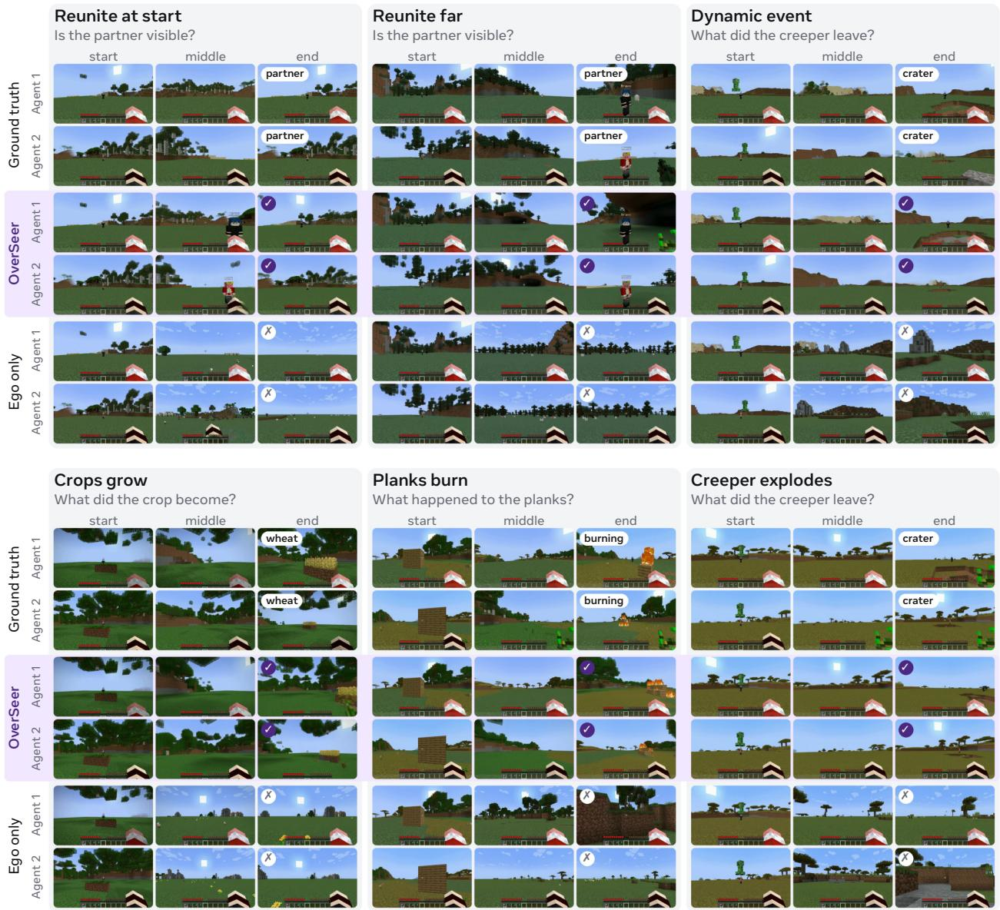  
Figure 8 Additional MAC-Bench results in Minecraft. Top: the three benchmark tasks. Bottom: three further dynamic events. OverSeer recovers the partner or the evolved event state where the ground truth does, while the egocentric-only variant does not.

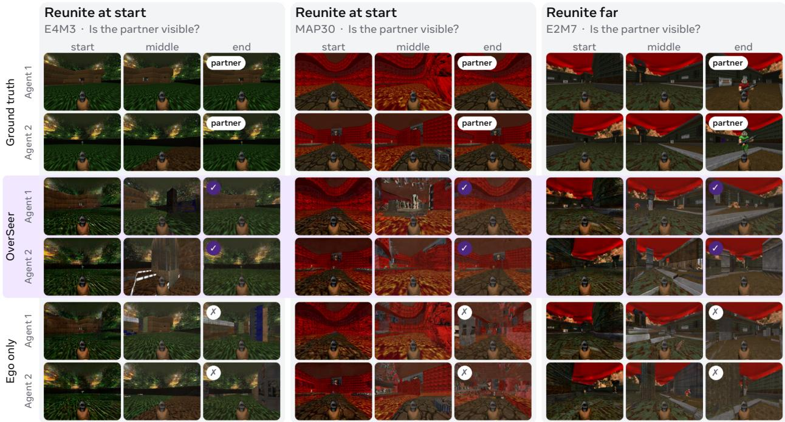  
Figure 9 MAC-Bench results in Doom. Reunite tasks on three Freedoom maps. OverSeer restores the partner after the agents separate; the egocentric-only variant does not.

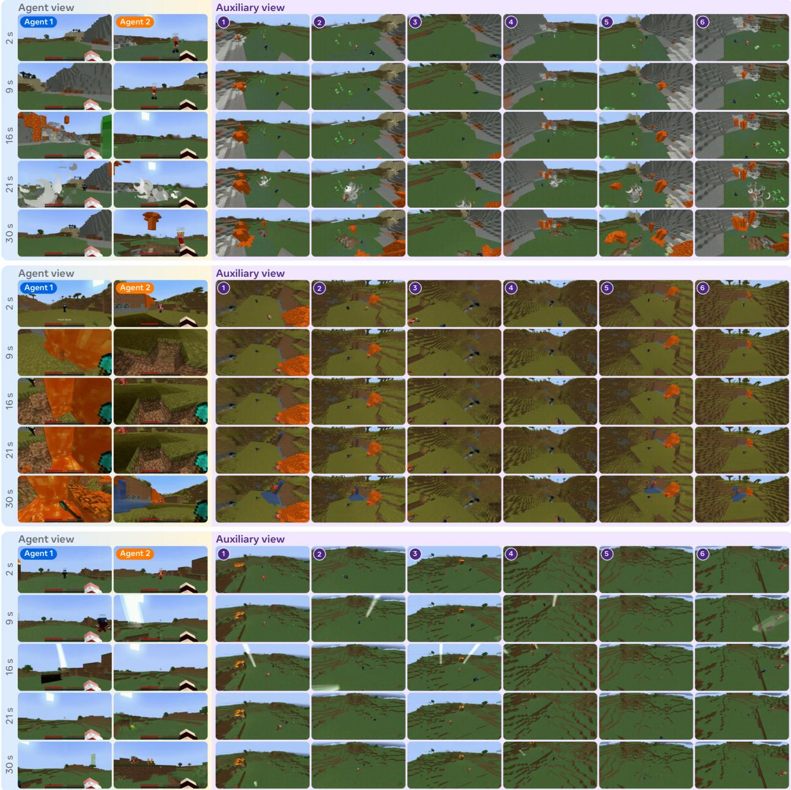  
Figure 10 Long rollouts in Minecraft. Each block shows both agent views and all six auxiliary views over 30 s.

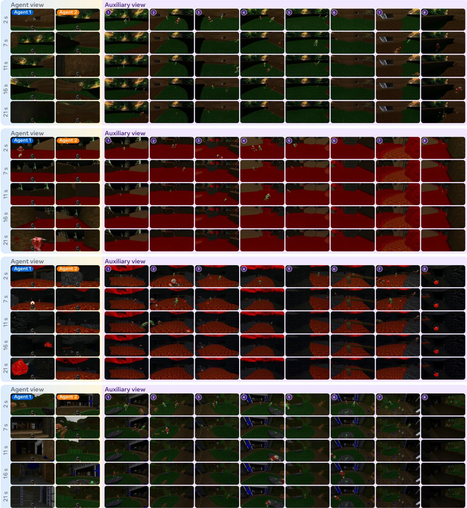  
Figure 11 Long rollouts in Doom. Each block shows both agent views and all eight auxiliary views over 21 s.

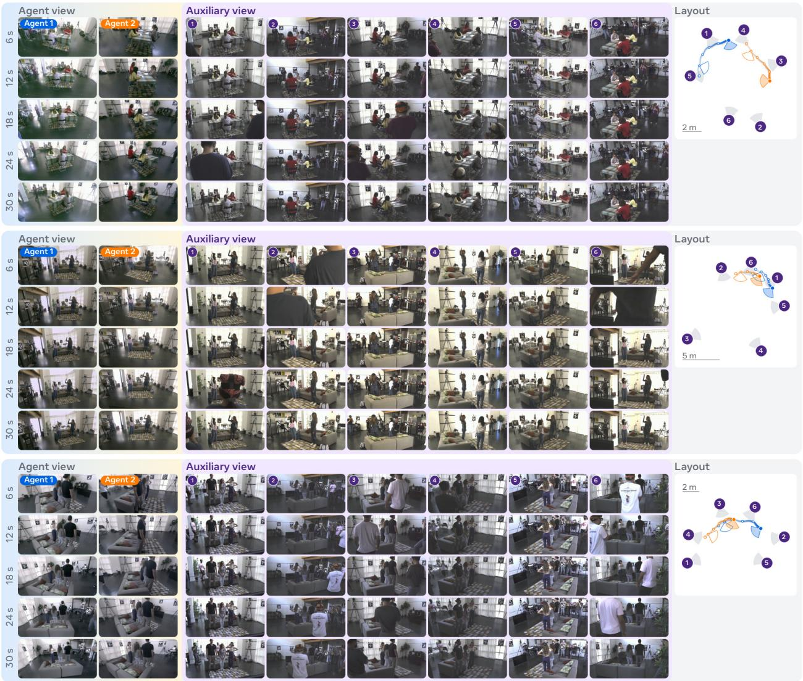  
Figure 12 Long rollouts on real-world multi-camera captures. Left: both agent views and all six auxiliary views over 30 s. Right: top-down layout of the auxiliary cameras and agent trajectories.