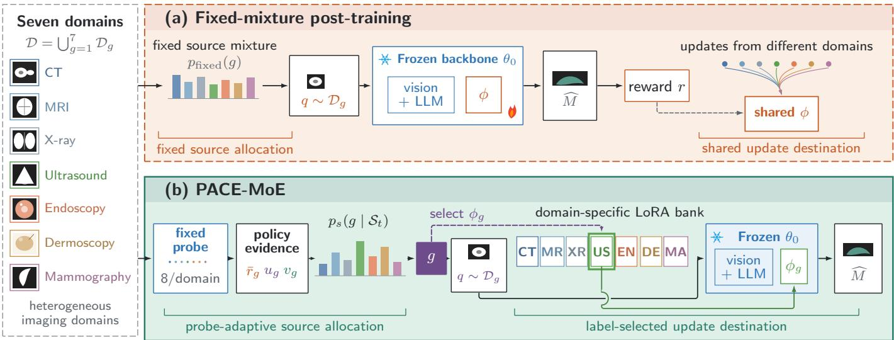
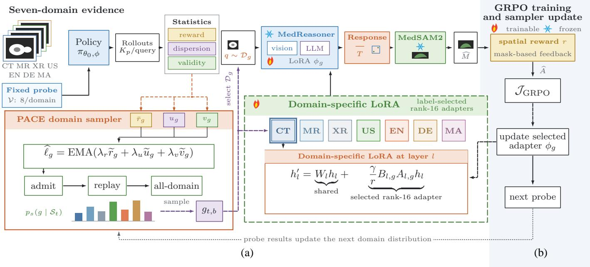
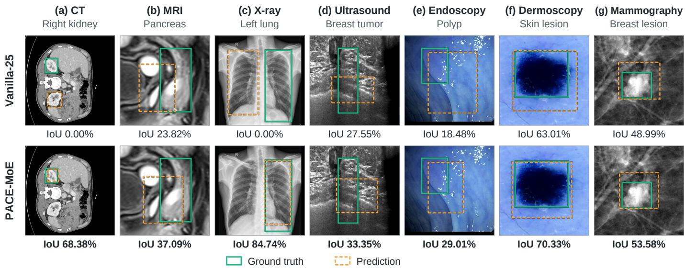
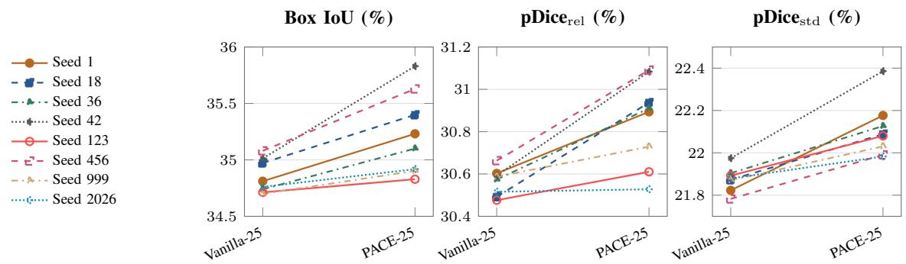
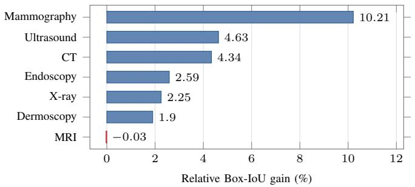
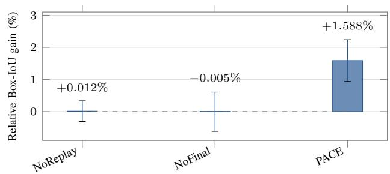

# PACE-MoE: Adaptive Domain Sampling and Domain-Specific LoRA for Medical Visual Grounding

Zhenxuan Wang, Jisheng Dang, Ronghao Lin, Bimei Wang, Jingwen Zhao, Wenjun Ma, Bin Hu, Fellow, IEEE, Qi Tian, Fellow, IEEE, and Tat-Seng Chua

Abstract—Medical visual grounding requires models to align clinical descriptions with spatial evidence across heterogeneous imaging domains. However, existing multi-domain post-training strategies typically rely on fixed domain sampling and shared parameter updates, overlooking the need to adapt both which domains receive training and where their updates are applied. To address this issue, we propose PACE-MoE, a policy-guided framework that jointly performs adaptive domain sampling and domain-specific adaptation for medical visual grounding. PACE dynamically assesses the training value of each imaging domain from current-policy feedback and progressively adjusts domain coverage through domain admission, replay, and final all-domain balancing. Meanwhile, domain-specific LoRA adapters route updates to the corresponding imaging domains while preserving the pretrained backbone and visual encoder. This coordinated design aligns training-data allocation with parameter adaptation without modifying the original reward formulation or Group Relative Policy Optimization (GRPO) objective. Experiments across seven medical imaging domains show that PACE-MoE consistently improves grounding performance over fixed-domain training, achieving a 3.64% relative improvement in mean box IoU over the Vanilla baseline. Under matched domain-specific adapter architectures, adaptive sampling alone further improves mean box IoU by 2.07%, demonstrating the benefit of policyguided domain allocation. These results establish coordinated data–parameter routing as an effective strategy for multi-domain medical visual grounding.

Index Terms—Medical visual grounding, multimodal large language model, mixture of experts, low-rank adaptation, reinforcement learning, curriculum learning.

## I. INTRODUCTION

EDICAL visual grounding requires a model to connect region. A query may refer to a pathology, an anatomical relation, or a diagnostic clue without naming the target directly.

The model must therefore combine language understanding with spatial localization. This requirement extends across CT, MRI, radiography, ultrasound, endoscopy, dermoscopy, and mammography, despite their different appearances and acquisition processes.

MedReasoner [1] addresses this problem with a clinical reasoning model that emits a reasoning trace, a box, and two points; frozen MedSAM2 [2] converts the prompts into a mask. Because format and spatial overlap are directly verifiable, the reasoner can be optimized with Group Relative Policy Optimization (GRPO) [3], [4]. However, improvements from post-training also depend on how heterogeneous training data are used. We treat each imaging modality as a domain with its own data distribution [5]. All seven domains and their labels are available during both training and evaluation. The setting is thus multi-domain learning, rather than generalization to unseen domains.

A useful training mixture should reflect the current model, not only the number of examples in each domain. In GRPO, responses to the same query are compared through their rewards. Malformed responses or nearly identical rewards can provide little useful spatial feedback even when many examples are available. As the model changes, the domains that supply usable feedback can also change. Fixed sampling does not capture this dependence on the learning state.

Data allocation is only one part of the problem. A shared LoRA adapter receives updates from every imaging domain, although the domains may require different adjustments to the pretrained model. Domain-specific adapters retain the common backbone while giving each domain its own trainable parameters. Yet this separation does not determine how often an adapter should be trained. Conversely, adaptive sampling alone does not change which parameters are shared. Figure 1 motivates considering these two decisions together: allocating queries across domains and assigning their updates to the corresponding adapters.

We propose PACE-MoE to coordinate domain sampling and domain-specific adaptation using the current policy as feedback. A fixed probe set estimates whether each domain provides valid responses and useful reward contrast. The resulting curriculum adjusts domain coverage over training instead of committing to an initial ordering. Replay retains earlier domains, and a final all-domain stage gives additional attention to domains with lower probe reward.

The sampled domain label also selects the LoRA adapter used to generate and learn from its responses. Thus, the curriculum determines the training frequency of each adapter, and the adapted model supplies the next round of feedback. Building on established domain-specific adaptation [6], this design uses the known labels without learning another routing network. The dense backbone, visual encoder, and MedSAM2 remain frozen; the reward and GRPO objective are unchanged. The framework adapts how training data and domain-specific parameters are used while retaining the released grounding pipeline.

  
Fig. 1. Motivation for domain-aware post-training. (a) A fixed data mixture does not respond to the current model, and one shared LoRA adapter receive updates from all domains. (b) PACE-MoE uses policy feedback to adapt the sampling distribution $p _ { s } ( g \mid S _ { t } )$ . The selected domain label g also identifies the adapter to update. The pretrained backbone remains shared and frozen.

The contributions are summarized as follows:

We introduce a domain-aware post-training framework that links training-data allocation to domain-specific model updates. It retains shared pretrained representations while assigning each domain’s responses to its corresponding adapter.

We develop a policy-guided curriculum that adapts domain coverage to the current model. It combines feedbackbased admission with replay and final balancing, so that prioritizing useful feedback does not remove earlier domains from subsequent training.

We evaluate the complete framework and its sampling component separately. The full system improves mean box IoU over Vanilla by 3.64% in relative terms. Withinarchitecture controls assess adaptive sampling across eight shared-adapter seeds and five domain-specific-adapter seeds; ablations examine the roles of replay and final balancing.

## II. RELATED WORK

## A. Multi-Domain Visual Learning

A domain is a data distribution associated with an acquisition setting, environment, or population. Unlike domain generalization to unseen target domains [5], our setting contains the same seven imaging domains during training and evaluation. Multi-domain methods often combine shared features with domain-specific components [6]. We study this design together with policy-guided domain sampling for GRPO grounding.

## B. Reasoning-Based Medical Visual Grounding

Medical MLLMs extend vision-language modeling to clinical terminology and heterogeneous imaging. MPMA jointly models medical image–text reconstruction and cross-modal alignment to learn representations with domain knowledge [7]. LLaVA-Med uses biomedical visual instruction tuning [8], while Lingshu targets unified medical understanding and reasoning [9]. Language-guided segmentation methods include LISA [10], Seg-Zero [11], and MedGround-R1 [12]. MedReasoner separates reasoning from mask decoding: a trainable reasoner predicts spatial prompts and a frozen segmentation expert produces the mask [1]. We retain this output and reward pipeline while changing domain sampling and the assignment of LoRA adapters.

## C. Spatial Representations and Grounded Visual Reasoning

General visual segmentation offers complementary approaches to maintaining spatial evidence. Isogenous memory sampling with frame-relation mining addresses memory matching and temporal context [13]. Multi-frame context memory captures information across adjacent frames [14], while adaptive sparse memory selects informative past frames and retrieves relevant local features [15]. Video Decoupling Networks separate scene, motion, and instance cues [16], and Fast Track Anything uses sparse spatio-temporal propagation for unified video segmentation [17]. These studies examine visual representations and temporal propagation; our focus is the allocation of domain queries and adapter updates during medical post-training.

Visual-language reasoning also depends on selecting evidence and preserving semantic consistency. REVU retrieves external object-action memory to support long-term video understanding [18]. Hierarchical multimodal consistency uses multilevel alignment to reduce video-language hallucinations [19].

Fact generates faithful, concise, and transferable rationales through verifiable visual programming [20]. Diff-LMM [21] and PhysMLLMs [22] further investigate teacher-guided spatial representation learning for general visual understanding.

## D. Reinforcement Learning for Medical Grounding

GRPO estimates a query-specific baseline from multiple responses, avoiding a separate critic [3], [4]. It normalizes rewards within a group but does not determine domain sampling or parameter sharing. QoQ-Med addresses heterogeneity through Domain-aware Relative Policy Optimization (DRPO), which rescales advantages using domain and cluster statistics [23]. PACE instead changes which domains supply queries before responses are generated. Sampling and post-generation reweighting therefore address different decisions.

## E. Adaptive Data Selection and Curriculum Learning

Curriculum learning organizes examples rather than sampling from an unchanged distribution [24]; self-paced learning adapts that organization to the learner [25]. Recent work has brought adaptive data selection into RL-based LLM post-training. DUMP combines policy advantages with an upper-confidencebound sampler across data distributions [26], whereas SEC treats problem categories as a non-stationary bandit and uses absolute advantage as the learning signal [27]. Prioritized Replay updates problem priorities from empirical success rates [28], while Actor-Curator learns a neural curator that selects problems to maximize policy improvement [29]. PACE scores known imaging domains on a fixed, gradient-free probe using spatial reward, within-query dispersion, and output validity. It connects staged domain coverage with domain-specific LoRA selection for medical grounding.

Medical curricula use task structure, anatomical similarity, or reasoning difficulty [30]–[32]. MedLoc-R1 adapts reward strictness from online performance [33], while CX-Mind uses a predefined closed-to-open curriculum for chest X-ray GRPO [34]. PACE leaves reward strictness unchanged and repeatedly updates the sampling order across seven imaging domains.

## F. Mixture of Experts and Low-Rank Adaptation

Med-MoE learns a router over domain-specific experts for supervised medical VQA and classification [35]. We instead use known modality labels to select low-rank FFN adapters during GRPO grounding. MoE-LLaVA extends sparse expert routing to large vision-language models while keeping only a subset of experts active for each input [36]. More generally, mixtureof-experts models route inputs through specialized parameter subsets [37]; sparse routing has also been used to scale visual representations [38]. Replicating full experts is expensive for a 7B multimodal model. LoRA represents an update with two low-rank matrices while freezing the pretrained weight [39]. MoCLE routes vision-language instructions to clusterconditional LoRA experts [40]. Our Domain-MoE differs in using an observed medical imaging-domain label, rather than an instruction cluster or a learned router, as a hard Top-1 selection during GRPO. It provides domain-specific adaptation without copying the complete reasoner or adding a load-balancing objective.

## III. PROBLEM FORMULATION

## A. Multi-Domain Medical Grounding

Let the multi-domain training set be

$$
\mathcal { D } = \bigcup _ { g = 1 } ^ { G } \mathcal { D } _ { g } ,\tag{1}
$$

where $g$ is the known imaging-domain label. Each example $x = ( I , Q , Y , g )$ contains an image I, a clinical query $Q ,$ and spatial supervision $Y = \left( B ^ { \star } , P _ { 1 } ^ { \star } , P _ { 2 } ^ { \star } , M ^ { \star } \right)$ . Following MedReasoner, the policy produces

$$
o = ( T , \hat { B } , \hat { P } _ { 1 } , \hat { P } _ { 2 } ) \sim \pi _ { \theta _ { 0 } , \phi _ { g } } ( \cdot \mid I , Q ) ,\tag{2}
$$

where $\theta _ { 0 }$ is the frozen shared backbone and $\phi _ { g }$ is the LoRA adapter for domain g. A frozen segmenter returns

$$
\hat { M } = F _ { \mathrm { s e g } } ( I , \hat { B } , \hat { P } _ { 1 } , \hat { P } _ { 2 } ) .\tag{3}
$$

## B. Group-Relative Policy Optimization

All experiments use the released MedReasoner Soft reward, which combines format checks with smoothed box-IoU and point-overlap terms and penalizes invalid outputs [1]. Our method introduces neither a domain-specific reward nor an additional reward coefficient. PACE uses the same scalar reward for domain scoring and GRPO optimization.

For a query $q = ( I , Q )$ , GRPO samples K responses. Let $r _ { q , k }$ be the verifiable reward of response k. Its group-relative advantage is

$$
\hat { A } _ { q , k } = \frac { r _ { q , k } - \mu _ { q } } { \sigma _ { q } + \epsilon } , \qquad \mu _ { q } = \frac { 1 } { K } \sum _ { j = 1 } ^ { K } r _ { q , j } ,\tag{4}
$$

where $\sigma _ { q }$ is the within-group reward standard deviation. The clipped objective can be written as

$$
\begin{array} { r l } & { \mathcal { I } ( \phi ; \theta _ { 0 } ) = \mathbb { E } _ { q , k , t } \big [ \operatorname* { m i n } \{ \rho _ { q , k , t } \hat { A } _ { q , k } , } \\ & { \qquad \mathrm { c l i p } ( \rho _ { q , k , t } , 1 - \varepsilon , 1 + \varepsilon ) \hat { A } _ { q , k } \} } \\ & { \qquad - \beta D _ { \mathrm { K L } } ( \pi _ { \theta _ { 0 } , \phi } \| \pi _ { \mathrm { r e f } } ) \big ] . } \end{array}\tag{5}
$$

Here, $\rho _ { q , k , t }$ is the token-level probability ratio between the current and rollout policies, ε is the clipping threshold, and $\beta$ weights regularization toward the fixed reference policy $\pi _ { \mathrm { r e f } }$

## C. Domain-Aware Update Allocation

Equations (4)–(5) describe what happens after a query is selected. Standard continuation draws from fixed $p ( g )$ and writes all low-rank updates to one shared adapter. PACE-MoE instead uses a stage-dependent $p _ { s } ( g )$ and selects the matching adapter $\phi _ { g }$ . Response format, reward, advantage calculation, and clipped loss remain unchanged. The scheduler is motivated by Eq. (4). A domain with low output validity does not yet provide reliable spatial feedback. A domain with nearly identical response rewards provides weak within-group contrast. PACE uses a small probe set to estimate the current training value of each domain. The resulting score is policy-dependent; it is not a permanent difficulty label.

  
Fig. 2. Overview of PACE-MoE. Current-policy rollouts on a fixed seven-domain probe buffer estimate reward, within-query dispersion, and output validity.Fig. 2. Overview of PACE-MoE. (a) Architecture of PACE-MoE. Current-policy rollouts on a fixed seven-domain probe buffer estimate reward, within-query These statistics update the domain sampling distribution through admission, replay, and a final all-domain stage. The sampled label gt,b selects a query fromdispersion, and output validity. These statistics update the domain sampling distribution through domain admission, replay, and a final all-domain stage. The Dg and activsampled label $_ { g _ { t , b } }$ the corresponding raselects a query from $\mathcal { D } _ { g }$ 6 FFN LoRA adapter ϕg. The MedReasoner backbone, Meand activates the corresponding rank-16 FFN LoRA adapter $\phi _ { g }$ AM2, spatial reward, and GRPO objective remain. (b) Optimization pipeline. The selected adapter is shared. At each probe event, the current policy is evaluated again to update the sampling distribution.updated using the shared spatial reward and GRPO objective, while the MedReasoner backbone and MedSAM2 remain frozen. At each probe event, the updated policy is evaluated again to determine the next domain sampling distribution.

## IV. PACE-MOE

## with the current policy to compare domain-A. Coordinating Sampling and Adaptation

aining. The statistics below are proxies for training value,Figure 2 shows the two components of PACE-MoE. Let $S _ { t }$ direct estimates of the improvement from an additional update.denote the latest probe statistics. For query group b at update Let g be the fixed prt, the scheduler samples $g _ { t , b } \sim p _ { s } ( g \mid S _ { t } )$ domain g. Everyand then draws $q _ { t , b } \sim \mathcal { D } _ { g _ { t , b } }$ r updates, the cu. The known label $_ { g _ { t , b } }$ t policy gealso selects $\phi _ { g _ { t , l } }$ es Kp = 2for rollout responses for each query without gradient computation and withgeneration and optimization. The sampling distribution changes the training-rollout decoding settings. We record the domainwith the current policy, while adapter selection follows the mean reward r¯g , mean within-query reward dispersion ug ,observed domain label. Several adapters may be updated in and valid output rate vg at probe stage s:o e optimizer step, but e ch qu ry group updates only its matching adapter. The sampling schedule determines which (s) 1adapters receive updates, and the updated policy supplies the |Vg|Kpnext probe statistics. This feedback links data allocation and adaptation throughout training.

## |V | q∈VgB. Estimating Domain Training Value

1 pWe keep probe queries fixed and regenerate their responses vg = ∑︂ ∑︂ [oq,k is valid]. (8)with the current policy to compare domain-level feedback over q∈Vg k=1training. The statistics below are proxies for training value, Here, Std denotes the sample standard deviation across thenot direct estimates of the improvement from a dditional K responseupdate. Let $\mathcal { V } _ { g }$ An output is valid when it contains the requiredbe the fixed probe-query subset for domain $g .$ asoning and answer blocks and finite spatial coordinates in Every H optimizer updates, the current policy generates $K _ { p } = 2$ cribed order.responses for each query without gradient computation We first smooth each raw statistic withand with the training-rollout decod ng settings. We record the domain mean reward $\bar { r } _ { g } ^ { ( s ) }$ , mean within-query reward dispersion $u _ { g } ^ { ( s ) }$ g −, and valid output rate $v _ { g } ^ { ( s ) }$ ∈ { }at probe stage s:

$$
\bar { r } _ { g } ^ { ( s ) } = \frac { 1 } { | \mathcal { V } _ { g } | K _ { p } } \sum _ { q \in \mathcal { V } _ { g } } \sum _ { k = 1 } ^ { K _ { p } } r _ { q , k } ,\tag{6}
$$

$$
u _ { g } ^ { ( s ) } = \frac { 1 } { \vert \mathscr { V } _ { g } \vert } \sum _ { q \in \mathscr { V } _ { g } } \mathrm { S t d } _ { k } ( r _ { q , k } ) ,\tag{7}
$$

$$
v _ { g } ^ { ( s ) } = \frac { 1 } { | \mathcal { V } _ { g } | K _ { p } } \sum _ { q \in \mathcal { V } _ { g } } \sum _ { k = 1 } ^ { K _ { p } } \mathbb { I } [ o _ { q , k } \mathrm { ~ i s ~ v a l i d } ] .\tag{8}
$$

Here, $\mathrm { S t d } _ { k }$ denotes the sample standard deviation across the $K _ { p }$ mains are ranked by ℓˆ︁g . The normalized progress measureresponses. An output is valid when it contains the required is cg = clip(¯rg /Rmax, 0, 1) with Rmax = 4.reasoning and answer blocks and finite spatial coordinates in Mean reward indithe presc ibed order.

ent malformed responses, and disperWe first smooth each raw statistic with

$$
\widehat { z } _ { g } ^ { ( s ) } = \eta \widehat { z } _ { g } ^ { ( s - 1 ) } + ( 1 - \eta ) z _ { g } ^ { ( s ) } , \quad z \in \{ \bar { r } , u , v \} , \qquad \eta = 0 . 6 0 .\tag{ain(9)}
$$

We then min–max normalize the smoothed statistics across the G domains. The raw stage score is

$$
\ell _ { g } ^ { ( s ) } = \lambda _ { r } \widetilde { r } _ { g } ^ { ( s ) } + \lambda _ { u } \widetilde { u } _ { g } ^ { ( s ) } + \lambda _ { v } \widetilde { v } _ { g } ^ { ( s ) } , \qquad \lambda _ { r } + \lambda _ { u } + \lambda _ { v } = 1 .\tag{10}
$$

Each tilde denotes the normalized version of the corresponding smoothed statistic. Finally, the score itself is smoothed before PACEranking:

$$
\begin{array} { r } { \widehat { \ell } _ { g } ^ { ( s ) } = \eta \widehat { \ell } _ { g } ^ { ( s - 1 ) } + ( 1 - \eta ) \ell _ { g } ^ { ( s ) } . } \end{array}\tag{able(11}
$$

of all seven domains.Domains are ranked by $\widehat { \ell } _ { g } ^ { ( s ) }$ . The normalized progress measure is $c _ { g } ^ { ( s ) } = \mathrm { c l i p } ( \bar { r } _ { g } ^ { ( s ) } / { R _ { \mathrm { m a x } } } , 0 , 1 )$ ssion: with $R _ { \operatorname* { m a x } } = 4$

main set s and an inactive set s. At initialization, theMean reward i icates compet nce, validity discounts fr - m0 domains with the highest priority scores form A0. Thequent malformed responses, and dispersion measures t remaining domains are ranked again at each probe event ratherw rd contrast available to GRPO. Admission th r fore f vors than assigned a fixed order.domains that currently provide usable feedback, rather than We summarize progress on the active set bysimply the hard st examples. Lower-reward domains remain part of the curriculum: all domains become active in the final Cs = ∑︂ ˆ︁cg . (12)stage, where the deficit term in Eq. (14) increases their sampling weight.

## C. Scheduling Domain Coverage

PACE converts the probe scores into a curriculum with three functions: admitting domains that currently provide usable feedback, revisiting earlier domains, and ending with coverage of all seven domains.

1) Progressive Domain Admission: PACE maintains an active domain set $\mathcal { A } _ { s }$ and an inactive set $\mathcal { L } _ { s }$ . At initialization, the $m _ { 0 }$ domains with the highest priority scores form $\mathcal { A } _ { \mathrm { 0 } }$ . The remaining domains are ranked again at each probe event rather than assigned a fixed order.

We summarize progress on the active set by

$$
C _ { s } = \frac { 1 } { | \mathcal { A } _ { s } | } \sum _ { g \in \mathcal { A } _ { s } } \widehat { c } _ { g } ^ { ( s ) } .\tag{12}
$$

Here, ${ \widehat { c } } _ { g } ^ { ( s ) }$ denotes the smoothed normalized reward used by the competence gate. After at least one probe in the current stage, the next m locked domains are admitted if either competence is sufficient or progress has remained on a plateau:

$$
C _ { s } \geq \tau _ { c } \quad \vee \quad \bigcap _ { j = 0 } ^ { P - 1 } \left\{ \left| C _ { s - j } - C _ { s - j - 1 } \right| < \tau _ { p } \right\} .\tag{13}
$$

The first condition waits until the policy reaches a minimum level on the active domains. The second condition prevents training from stalling when progress reaches a plateau. When either condition is met, PACE admits the highest-ranked domains in $\mathcal { L } _ { s }$ according to the latest probe.

2) Replay of Earlier Domains: Let $\mathcal { N } _ { s }$ contain the domains newly admitted at stage s. Let $\mathcal { R } _ { s } = \mathcal { A } _ { s } \setminus \mathcal { N } _ { s }$ contain the earlier active domains. PACE assigns probability mass $1 - \rho$ to $\mathcal { N } _ { s }$ and replay mass $\rho$ to $\mathcal { R } _ { s } .$ . The probability is uniform within each set. Replay reduces the abrupt sampling shift caused by domain admission. It does not add examples or change the loss. If no earlier domain exists, the initial active set receives all probability mass.

3) Final All-domain Balancing: The final checkpoint is evaluated on all domains. PACE therefore reserves the last fraction of updates for a stage in which every domain is active. The sampling distribution is

$$
p _ { \mathrm { a l l } } ^ { ( s ) } ( g ) = ( 1 - \alpha ) \frac { 1 } { G } + \alpha \frac { \exp ( \delta _ { g } ^ { ( s ) } / \tau ) } { \sum _ { j = 1 } ^ { G } \exp ( \delta _ { j } ^ { ( s ) } / \tau ) } ,\tag{14}
$$

with normalized deficit

$$
\delta _ { g } ^ { ( s ) } = \frac { \operatorname* { m a x } _ { j } \widehat { r } _ { j } ^ { ( s ) } - \widehat { r } _ { g } ^ { ( s ) } } { \operatorname* { m a x } _ { j } \widehat { r } _ { j } ^ { ( s ) } - \operatorname* { m i n } _ { j } \widehat { r } _ { j } ^ { ( s ) } + \epsilon } .\tag{15}
$$

The uniform component gives every domain non-zero probabil ity. The deficit component assigns more probability to domains with lower probe reward. This stage changes only the sampling probability; it does not rescale advantages.

## D. Domain-Specific Low-Rank Adaptation

We replace the single shared LoRA adapter with a bank of lightweight domain-specific adapters. For FFN projection

TABLE I  
COMPARISON OF DOMAIN SAMPLING AND PARAMETER-SHARING STRATEGIES.
<table><tr><td>Method</td><td>Adaptive sampling</td><td>Domain-specific adapter</td><td>Reward changed</td><td>Replay</td><td>Advantage reweighting</td></tr><tr><td>Vanilla GRPO</td><td>X</td><td>X</td><td>X</td><td>X</td><td>X</td></tr><tr><td>Balanced GRPO</td><td>X</td><td>X</td><td>X</td><td>X</td><td>X</td></tr><tr><td>Fixed curriculum</td><td>X</td><td>X</td><td>X</td><td>√</td><td>X</td></tr><tr><td>DRPO-style</td><td>X</td><td>X</td><td>X</td><td>X</td><td>√</td></tr><tr><td>Domain-MoE</td><td>X</td><td>V</td><td>X</td><td>X</td><td>X</td></tr><tr><td>PACE-GRPO (Ours)</td><td>√</td><td>X</td><td>X</td><td>√</td><td>X</td></tr><tr><td>PACE-MoE</td><td>」</td><td>√</td><td>X</td><td>5</td><td>X</td></tr></table>

l with frozen weight $W _ { l } \in \mathbb { R } ^ { d _ { o } \times d _ { i } }$ , domain $g$ owns factors $A _ { l , g } \in \mathbb { R } ^ { r \times d _ { i } }$ and $B _ { l , g } \in \mathbb { R } ^ { d _ { o } \times r }$ . Its forward map is

$$
h _ { l } ^ { \prime } = W _ { l } h _ { l } + \frac { \gamma } { r } B _ { l , g } A _ { l , g } h _ { l } , \qquad g = \mathrm { l a b e l } ( x ) .\tag{16}
$$

We attach the adapters to gate\_proj, up\_proj, and down\_proj in every language-transformer FFN while excluding the visual tower. There are seven adapters, one per imaging domain, with rank $r = 1 6$ and scaling $\gamma = 1 6$ . Standard LoRA initialization makes the initial residual zero, preserving the released model function before RL updates.

The known modality label stored with each example selects exactly one adapter. No learned gate or load-balancing loss is required. At layer l, all adapters require $G r ( d _ { i } + d _ { o } )$ stored parameters, whereas a sample evaluates only $r ( d _ { i } + d _ { o } )$ lowrank operations. This is substantially smaller than copying G dense 7B reasoners and has the active compute order of one ordinary LoRA adapter.

## E. Domain-Conditioned GRPO Updates

At update t, the scheduler independently samples a domain label $g _ { t , b }$ for each query group $b \in \{ 1 , \ldots , B \}$ . The query is drawn from $\mathcal { D } _ { g _ { t , b } }$ , and the same label activates $\phi _ { g _ { t , l } }$ during rollout generation, old-log-probability computation, and the actor update. Consequently,

$$
\nabla _ { \phi _ { g } } \mathcal { I } _ { t } = \sum _ { b : g _ { t , b } = g } \nabla _ { \phi _ { g } } \mathcal { I } _ { t , b } ;\tag{17}
$$

several adapters may receive gradients in one optimizer step. However, each query group updates only the adapter selected by its domain label. Replay and the final all-domain stage also revisit adapters that were updated earlier in training.

## V. EXPERIMENTAL SETUP

## A. Evaluation Protocol

We evaluate whether policy-guided domain allocation improves grounding with domain-specific adapters and whether the sampling benefit also holds with a shared adapter. The domain-specific comparison uses five seeds (1, 18, 42, 123, and 456); the shared-adapter comparison uses eight seeds. Each comparison holds the adapter architecture fixed. We then examine alternative sampling strategies, domain-wise performance, and replay and final-balancing ablations over seeds 42, 1, and 18. A separate 200-update study tests the effect of a larger training budget. Cross-architecture differences provide system-level context because the seed sets, adapter placement, and trainable capacity differ.

All adapted models start from the released MedReasoner-Soft-7B checkpoint. The main setting uses 25 optimizer updates; Section VI-G examines 200 updates. We match optimizer updates and gradient-bearing rollouts, not total generation or wall-clock cost. A 25-update run contains 200 gradientbearing responses. PACE additionally probes at initialization and after updates 5, 10, 15, and 20. Each event evaluates 56 held-out queries with two responses per query, totaling 560 no-gradient responses. A representative PACE run takes about 65–66 minutes on four GPUs; this timing alone does not establish a cost advantage over Vanilla.

## B. Dataset and Splits

We use the released category-shift protocol derived from U-MRG [1]. We denote its 6,590-example gradient-bearing update split as U-MRG-6K; the probe and test sets are separate held-out partitions and are not included in the “6K” name. The update split contains 2,717 CT, 252 dermoscopy, 134 digital mammography, 417 endoscopy, 2,023 MRI, 254 ultrasound, and 793 X-ray cases. The fixed probe buffer contains 56 examples, eight per modality. Probe examples guide domain sampling but do not contribute gradient-bearing responses. The held-out test split contains 1,297 unique samples and is used for evaluation, not domain scoring.

## C. Implementation Details

All runs start from the downloaded released MedReasoner-Soft-7B checkpoint; the reference policy and MedSAM2 remain frozen. Each 25-update run uses four queries per update and two responses per query. Maximum prompt/response lengths are 2,048/256 tokens, learning rate is 10−5, and rollouts use temperature 1.0 and top-p 1.0 with top-k disabled. Sharedadapter Vanilla/PACE runs use the original rank-64 attention LoRA on query, key, value, and output projections. Domain-MoE runs use seven rank-16 domain-specific FFN LoRA adapters on gate, up, and down projections. Training uses four GPUs on one node. All optimizer and GRPO settings not listed below are kept identical to the released MedReasoner configuration across compared methods.

PACE probes at five-update intervals. It starts with two domains, admits at most two domains at an expansion event, uses replay ratio $\rho = 0 . 2 0$ , and reserves the final 20% of updates for all-domain sampling. The deficit mixture weight and temperature in Eq. (14) are 0.50 and 0.25. The weights on mean reward, reward dispersion, and validity in Eq. (10) are 0.45, 0.30, and 0.25, and the EMA decay in Eq. (9) is 0.60. (Eq. 13), we set $\tau _ { c } = 0 . 6 0$ and $\tau _ { p } = 0 . 0 1$ . A plateau is declared when $| C _ { s } - C _ { s - 1 } | < \tau _ { p }$ for $P = 2$ consecutive probe events. These values were fixed before the multi-seed comparisons and kept unchanged across methods and seeds. A systematic sensitivity analysis is left for future work. Table II summarizes the experimental configuration.

TABLE II  
CONFIGURATION OF THE 25-UPDATE EXPERIMENTS.
<table><tr><td>Item</td><td>Value</td></tr><tr><td>Initialization</td><td>Released MedReasoner-Soft-7B</td></tr><tr><td>Reasoner backbone / segmenter</td><td>Lingshu-7B / frozen MedSAM2</td></tr><tr><td>RL implementation</td><td>veRL + vLLM</td></tr><tr><td>Updates / queries per update</td><td>25 / 4</td></tr><tr><td>Responses per query</td><td>2</td></tr><tr><td>Probe responses per query  $K _ { p }$ </td><td>2</td></tr><tr><td>Maximum prompt / response length</td><td>2048  /  256</td></tr><tr><td>Rollout temperature / top-p / top-k</td><td>1.0 / 1.0 / disabled</td></tr><tr><td>Learning rate</td><td> $1 \times 1 0 ^ { - }$  5</td></tr><tr><td>Shared LoRA rank / targets</td><td>64 / attention  $ { \boldsymbol { q } } ,  { \boldsymbol { k } } ,  { \boldsymbol { v } } , o$ </td></tr><tr><td>Domain-specific LoRA rank / targets</td><td>16 / FFN gate, up, down</td></tr><tr><td>Number of adapters / active adapters</td><td>7 / Top-1</td></tr><tr><td>Probe interval</td><td>5 updates</td></tr><tr><td>Probe events / no-gradient responses</td><td>5  /  560</td></tr><tr><td>Initial / maximum newly admitted domains</td><td>2 / 2</td></tr><tr><td>Replay ratio ρ</td><td>0.20</td></tr><tr><td>All-domain fraction / deficit weight α</td><td>0.20 / 0.50</td></tr><tr><td>Deficit temperature / EMA decay</td><td>0.25 / 0.60</td></tr><tr><td>Priority-score weights  $\left( \lambda _ { r } , \lambda _ { u } , \lambda _ { v } \right)$ </td><td>(0.45, 0.30, 0.25)</td></tr><tr><td>Reward maximum  $R _ { \mathrm { m a x } }$ </td><td>4.0</td></tr><tr><td>Competence threshold τc / plateau threshold</td><td>0.60 / 0.01</td></tr><tr><td>Plateau consecutive events P</td><td>2</td></tr><tr><td>Hardware</td><td>4 GPUs, one node</td></tr></table>

## D. Baselines and Ablations

a) Released Soft-7B: The public checkpoint is evaluated without additional updates and serves as a zero-update reference.

b) Vanilla-25: The released checkpoint is continued for 25 GRPO updates using the original fixed training mixture. This is the primary control.

c) Balanced-25: The seven domains are sampled with equal probability throughout training. This tests whether a static correction of domain frequency explains the result.

d) Fixed-25: Domains follow the initial probe order: dermoscopy, endoscopy, ultrasound, digital mammography, Xray, MRI, and CT. The ranking is frozen, while admission, replay, and final all-domain balancing remain identical to PACE-25. This isolates adaptive re-ranking from a fixed ordering.

e) DRPO-style-25: Domain-aware scaling is applied after group-relative normalization. The query batch is smaller than in QoQ-Med; we therefore describe this run as DRPO-style rather than as an exact reproduction of its large-batch clustering regime.

f) PACE-NoReplay-25: The policy-adaptive domain order is retained, but earlier active domains are not sampled while the curriculum focuses on newly admitted domains.

g) PACE-NoFinalBalance-25: Adaptive admission and replay are retained, and all remaining domains are activated at the reserved final stage. The deficit-weighted distribution in Eq. (14) is disabled. This run isolates the final balancing strategy while preserving all-domain coverage.

h) PACE-25: The full sampler uses adaptive admission, replay, and final all-domain sampling with one shared LoRA adapter.

i) MoE-Vanilla-25: The fixed training mixture is retained, but every sample activates its rank-16 domain-specific LoRA adapter. This measures the domain-specific adapter system without adaptive sampling.

j) PACE-MoE-25: This is the complete method. Probe statistics determine the domain sampling distribution, and each known domain label selects its matching LoRA adapter.

k) Vanilla-200, PACE-200, and PACE-MoE-200: These seed-42 runs extend post-training to 200 updates from the same released initialization and are used to compare final grounding performance under the larger update budget.

## E. Evaluation Metrics

Box IoU is the primary localization metric. We also report two point-overlap scores. The released MedReasoner evaluator implements

$$
\mathrm { p D i c e } _ { \mathrm { r e l } } = \frac { 2 | \mathcal { O } _ { p } \cap \mathcal { O } _ { g } | } { | \mathcal { O } _ { p } \cup \mathcal { O } _ { g } | } ,\tag{18}
$$

where $\mathcal { O } _ { p }$ and ${ \mathcal { O } } _ { g }$ are the predicted and reference point regions. We retain this released-evaluator score for direct comparability. We also report the conventional Dice form for the same point regions:

$$
\mathrm { p D i c e } _ { \mathrm { s t d } } = \frac { 2 | \mathcal { O } _ { p } \cap \mathcal { O } _ { g } | } { | \mathcal { O } _ { p } | + | \mathcal { O } _ { g } | } .\tag{19}
$$

The two scores use different denominators and are reported separately. Grounding scores are percentages. Relative gains are $1 0 0 ( S _ { \mathrm { m e t h o d } } - S _ { \mathrm { b a s e } } ) / S _ { \mathrm { b a s e } }$ , using the named baseline’s reported mean $S _ { \mathrm { b a s e } } ~ > ~ 0$ . Paired changes and standard deviations use one common study-level Vanilla mean. For zero-baseline qualitative cases, only IoU scores are reported.

The evaluator deduplicates retries by sample identifier. It also verifies the required reasoning and answer blocks, JSON keys, bounding-box ordering, finite coordinates, and distinct points before computing spatial metrics. Evaluation uses deterministic decoding (temperature 0, top-p 1.0, maximum 256 generated tokens). Reported test results cover all 1,297 unique identifiers. For the primary eight-seed study, we report the sample standard deviation and two-sided paired t-test p-values.

## VI. RESULTS AND ANALYSIS

## A. Grounding Accuracy with PACE-MoE

Table III compares the complete framework with its controls after 25 post-training updates. PACE-MoE achieves the highest mean score on all three grounding metrics. Its mean box IoU is $( 3 6 . 1 1 8 2 \pm 0 . 1 3 4 1 ) \%$ , compared with (34.8485±0.1502)% for Vanilla-25, a relative improvement of 3.64%. This comparison evaluates the complete design: adaptive domain sampling with domain-specific LoRA versus fixed sampling with a shared LoRA adapter.

To assess the sampling contribution separately, we compare PACE-MoE with MoE-Vanilla-25 using the same seven rank-16 FFN adapters and five seeds. Adaptive sampling raises mean box IoU from $( 3 5 . 3 8 7 1 \pm 0 . 1 2 2 6 ) _ { \cdot } ^ { \mathrm { ( } }$ % to $( 3 6 . 1 1 8 2 \pm 0 . 1 3 4 1 ) \%$ a relative gain of 2.07%. The corresponding relative gains in $\mathrm { p D i c e } _ { \mathrm { r e l } }$ and $\mathrm { p D i c e } _ { \mathrm { s t d } }$ are 2.32% and 1.14%. Thus, adaptive sampling improves grounding beyond using domain-specific adapters with a fixed data mixture.

These comparisons answer different questions. The 3.64% system-level gain includes adapter capacity and placement changes and compares eight-seed with five-seed means; it does not isolate either component. The 2.07% within-architecture gain holds adapters and seeds fixed to assess sampling. The shared-adapter study below tests the same sampling strategy with a single adapter.

## B. Qualitative Comparison Across Domains

Figure 3 illustrates the spatial changes in the predictions across all seven domains. The clearest differences occur in the CT and chest X-ray examples. In the CT case (a), the Vanilla-25 prediction falls on a different kidney region and has no overlap with the annotated right kidney. PACE-MoE localizes the target with an IoU of 68.38%. In the X-ray case (c), Vanilla-25 predicts the opposite lung, whereas PACE-MoE overlaps the annotated left lung with an IoU of 84.74%. In both examples, the change concerns identifying the correct anatomical target, rather than only adjusting the boundary of an already overlapping box. The remaining five columns show increased overlap in MRI, ultrasound, endoscopy, dermoscopy, and mammography. Together, these comparisons provide visual context for the full-test-set evaluation in Tables III and IV.

## C. Consistency of Adaptive Sampling

Table IV isolates adaptive domain sampling. Relative to fixed-mixture training across eight seeds, PACE improves mean box IoU by 1.09% $( p = 0 . 0 0 2 3 )$ $\mathrm { p D i c e } _ { \mathrm { r e l } }$ by 0.93% $( p =$ 0.0023), and $\mathrm { p D i c e } _ { \mathrm { s t d } }$ by 1.06% $( p = 0 . 0 0 0 3 )$ . All three remain significant after Holm correction across the reported metrics (adjusted $p \leq 0 . 0 0 4 6 )$ . Relative to the released checkpoint, the relative gains in mean IoU are 0.50% for Vanilla-25 and 1.60% for PACE-25. These latter differences are contextual because the released checkpoint is a single, zero-update model rather than a paired training condition.

PACE improves box IoU in all eight paired runs (Fig. 4). Normalizing each paired change by the common Vanilla mean of 34.8485% gives gains from 0.33% to 2.34%, with a mean of 1.09% and a sample standard deviation of 0.66%.

## D. Why Adapt the Domain Schedule?

The seed-42 controls answer three narrower questions. First, equal domain sampling does not reproduce the PACE result: PACE improves box IoU by 2.62% relative to Balanced-25. Second, a fixed domain order is also insufficient; PACE improves by 2.97% relative to Fixed-25. Third, advantage reweighting is not equivalent to changing which domains are sampled: PACE improves by 3.32% relative to DRPO-style-25.

Taken together, the matched seed-42 controls show that neither static domain balancing, fixed ordering, nor post-sampling advantage scaling reproduces the full PACE checkpoint.

## E. Domain-Wise Grounding Performance

The aggregate score can conceal whether scheduling benefits a narrow subset of modalities or shifts error from one domain to another. We therefore decompose the matched seed-42 predictions by the seven test domains. The same 1,297 sample identifiers and the same evaluator are used for both checkpoints. PACE improves box IoU in six of the seven domains (Table VI and Fig. 5). The largest relative gains occur on mammography (10.21%) and ultrasound (4.63%), followed by CT (4.34%), endoscopy (2.59%), X-ray (2.25%), and dermoscopy (1.90%). MRI is the only exception, changing from 36.6831% to 36.6709%, a relative decrease of 0.03%. The macro-average score improves by 3.09% relative to the Vanilla macro average, compared with a 2.33% improvement in the sample-weighted score. Some of the largest gains occur in smaller domains. At the same time, CT contains 528 test cases and improves by 4.34%, so the aggregate result is not produced solely by rare modalities. These values are descriptive results from the matched seed-42 pair and are not used for domain-level significance claims.

  
Fig. 3. Qualitative comparison across seven imaging domains using the same test image and query for each pair. Top: Vanilla-25. Bottom: PACE-MoE. Solid green and dashed orange boxes denote ground truth and predictions, respectively. CT (a) and X-ray (c) retain the full image; the other columns use identical crops for both methods that retain all compared boxes. IoU is reported as a percentage and computed in the original image coordinates.

TABLE III  
MULTI-SEED SYSTEM COMPARISON AND SAMPLING CONTROLS AFTER 25 UPDATES. SHARED-ADAPTER ROWS REPORT EIGHT SEEDS; DOMAIN-SPECIFIC ROWS REPORT FIVE SEEDS (1, 18, 42, 123, AND 456). GROUNDING SCORES ARE MEAN SAMPLE STANDARD DEVIATION, IN %. CROSS-ARCHITECTURE ROWS COMPARE COMPLETE SYSTEMS; WITHIN-ARCHITECTURE PAIRS ASSESS ADAPTIVE SAMPLING.
<table><tr><td>Method</td><td>N</td><td>Box IoU↑</td><td> $\mathrm { p D i c e } _ { \mathrm { r e l } }$  ←</td><td> $\mathrm { p D i c e } _ { \mathrm { s t d } } \uparrow$ </td></tr><tr><td>Released Soft-7B [1]</td><td></td><td>34.6734</td><td>30.4282</td><td>21.8461</td></tr><tr><td>Vanilla-25 [1]</td><td></td><td> $3 4 . 8 4 8 5 \pm 0 . 1 5 0 2$ </td><td> $3 0 . 5 6 3 1 \pm 0 . 0 6 3 2$ </td><td> $2 1 . 8 7 4 6 \pm 0 . 0 5 6 5$ </td></tr><tr><td>PACE-25</td><td></td><td> $3 5 . 2 2 9 7 \pm 0 . 3 6 4 5$ </td><td> $3 0 . 8 4 7 8 \pm 0 . 2 0 7 6$ </td><td> $2 2 . 1 0 7 5 \pm 0 . 1 3 0 3$ </td></tr><tr><td>MoE-Vanilla-25</td><td>-885</td><td> $3 5 . 3 8 7 1 \pm 0 . 1 2 2 6$ </td><td> $3 0 . 9 5 2 3 \pm 0 . 2 5 0 2$ </td><td> $2 1 . 9 5 7 1 \pm 0 . 0 8 9 9$ </td></tr><tr><td>PACE-MoE-25 (Ours)</td><td>5</td><td> $\mathbf { 3 6 . 1 1 8 2 \pm 0 . 1 3 4 1 }$ </td><td> $\mathbf { 3 1 . 6 7 1 8 \pm 0 . 2 8 7 7 }$ </td><td> $\mathbf { 2 2 . 2 0 6 7 \pm 0 . 0 9 2 9 }$ </td></tr></table>

<table><tr><td>Method</td><td>Box IoU↑</td><td> $\mathrm { \ p D i c e } _ { \mathrm { r e l } } \uparrow$ </td><td> $\mathrm { p D i c e } _ { \mathrm { s t d } } \uparrow$ </td></tr><tr><td>Released Soft-7B [1]</td><td>34.6734</td><td>30.4282</td><td>21.8461</td></tr><tr><td>Vanilla-25 [1] PACE-25 (Ours)</td><td>34.8485 ± 0.1502 30.5631 ± 0.0632 21</td><td></td><td> $. 8 7 4 6 \pm 0 . 0 5 6 5$ </td></tr><tr><td></td><td> $3 5 . 2 2 9 7 \pm 0 . 3 6 4 5$ </td><td> $3 0 . 8 4 7 8 \pm 0 . 2 0 7 6$ </td><td> $2 2 . 1 0 7 5 \pm 0 . 1 3 0 3$ </td></tr><tr><td>Relative gain (%)</td><td>+1.09</td><td>+0.93</td><td>+1.06</td></tr><tr><td>Paired t-test p</td><td>0.0023</td><td>0.0023</td><td>0.0003</td></tr></table>

TABLE IV  
SHARED-ADAPTER RESULTS AFTER 25 UPDATES ON 1,297 TEST CASES. SCORES (%): MEAN SAMPLE STANDARD DEVIATION OVER 8 SEEDS (1, 18, 36, 42, 123, 456, 999, 2026). GAINS ARE RELATIVE TO VANILLA-25; PAIRED TESTS USE ORIGINAL SCORES.

TABLE V  
SEED-42 CONTROL STUDY. GROUNDING SCORES ARE IN %. EVERY ADAPTED METHOD STARTS FROM THE SAME CHECKPOINT AND USES 25 OPTIMIZER UPDATES.
<table><tr><td>Method</td><td>Box IoU↑</td><td> $\mathrm { p D i c e } _ { \mathrm { r e l } }$  ↑</td><td> $\mathrm { p D i c e } _ { \mathrm { s t d } }$  ↑</td></tr><tr><td>Released Soft-7B [1]</td><td>34.6734</td><td>30.4282</td><td>21.8461</td></tr><tr><td>Vanilla-25 [1]</td><td>35.0129</td><td>30.5933</td><td>21.9745</td></tr><tr><td>Balanced-25</td><td>34.9135</td><td>30.6818</td><td>22.0257</td></tr><tr><td>Fixed-25</td><td>34.7962</td><td>30.7027</td><td>22.0253</td></tr><tr><td>DRPO-style-25 [23]</td><td>34.6774</td><td>30.7705</td><td>21.8747</td></tr><tr><td>PACE-NoReplay-25</td><td>34.8871</td><td>30.8690</td><td>21.9824</td></tr><tr><td>PACE-NoFinalBalance-25</td><td>34.7647</td><td>30.5863</td><td>21.9337</td></tr><tr><td>PACE-25 (Ours)</td><td>35.8298</td><td>31.0832</td><td>22.3856</td></tr></table>

## F. Contribution of Replay and Final Balancing

Across three random seeds (42, 1, 18), we repeat the ablation study to assess the contribution of replay and final balancing. Table VII and Fig. 6 summarize the results. Across seeds 42, 1, and 18, full PACE improves mean box IoU over Vanilla-25 by 1.59%. Normalizing paired changes by the common Vanilla mean gives a range of 1.20%–2.34%. PACE-NoReplay obtains a mean IoU of 34.9364%, and PACE-NoFinalBalance obtains 34.9302%. Both values are close to the Vanilla-25 mean of 34.9320%. The ablation pattern is not identical in every seed.

Fig. 4. Paired seed-level changes from fixed to adaptive domain sampling. Scores are in %. Each line connects runs with the same seed and initialization. All 24 metric–seed pairs improve with adaptive sampling.  
  
Fig. 5. Seed-42 relative box-IoU gains by imaging domain, using each domain’s Vanilla-25 score as the baseline. Six domains improve; MRI changes by 0.03%.

TABLE VI  
SEED-42 DOMAIN-LEVEL BOX IOU (%) ON THE 1,297-CASE TEST SPLIT. GAIN IS THE RELATIVE CHANGE FROM VANILLA-25, IN %. THE MACRO AVERAGE WEIGHTS THE SEVEN DOMAINS EQUALLY, WHEREAS THE OVERALL RESULT IS SAMPLE-WEIGHTED.
<table><tr><td rowspan=3 colspan=5>Imaging domain     N Vanilla-25 PACE-25Gain (%)</td></tr><tr><td rowspan=2 colspan=1>+4.34</td></tr><tr><td rowspan=2 colspan=3>25.519226.6257</td></tr><tr><td rowspan=2 colspan=1>CT528</td><td rowspan=1 colspan=1>+1.90</td></tr><tr><td rowspan=2 colspan=3>55.7754  56.8357</td><td></td></tr><tr><td rowspan=2 colspan=1>Dermoscopy         51</td><td rowspan=2 colspan=1>+10.21</td></tr><tr><td rowspan=2 colspan=3>22.3928  24.6799</td></tr><tr><td rowspan=2 colspan=1>Mammography      23</td><td rowspan=2 colspan=1>45.6580</td><td rowspan=2 colspan=1>+2.59</td></tr><tr><td rowspan=2 colspan=2>44.5062</td></tr><tr><td rowspan=2 colspan=1>Endoscopy           85</td><td rowspan=2 colspan=1>36.6709</td><td rowspan=2 colspan=1>-0.03</td></tr><tr><td></td><td rowspan=2 colspan=1>36.6831</td></tr><tr><td rowspan=2 colspan=1>MRI                397</td><td></td><td rowspan=2 colspan=1>37.8294</td><td rowspan=2 colspan=1>+4.63</td></tr><tr><td></td><td rowspan=1 colspan=1>36.1560</td></tr><tr><td rowspan=1 colspan=1>Ultrasound          53</td><td></td><td></td><td rowspan=1 colspan=1>53.1400</td><td rowspan=1 colspan=1>+2.25</td></tr><tr><td rowspan=4 colspan=1>X-ray               160</td><td></td><td></td><td></td><td></td></tr><tr><td></td><td rowspan=1 colspan=1>51.9698</td><td></td><td></td></tr><tr><td></td><td></td><td rowspan=3 colspan=1>40.2056</td><td rowspan=3 colspan=1>+3.09</td></tr><tr><td></td><td rowspan=2 colspan=1>39.0004</td></tr><tr><td rowspan=4 colspan=2>Macro averageOverall           1,297</td></tr><tr><td></td><td rowspan=2 colspan=1>35.8298</td><td rowspan=2 colspan=1>+2.33</td></tr><tr><td rowspan=2 colspan=1>35.0129</td></tr><tr><td rowspan=1 colspan=1></td><td rowspan=1 colspan=1></td></tr></table>

TABLE VII

PACE ABLATIONS AFTER 25 UPDATES ACROSS SEEDS 42, 1, AND 18. GROUNDING SCORES ARE MEAN STANDARD DEVIATION, IN %.
<table><tr><td>Method</td><td>Box IoU↑</td><td> $\mathrm { p D i c e } _ { \mathrm { r e l } } \ ^ { - }$  t</td><td> $\mathrm { p D i c e } _ { \mathrm { s t d } } \uparrow$ </td></tr><tr><td>Vanilla</td><td> $3 4 . 9 3 2 0 \pm 0 . 1 0 6 9$ </td><td> $3 0 . 5 6 2 8 \pm 0 . 0 6 1 2$ </td><td> $2 1 . 8 8 9 9 \pm 0 . 0 7 7 4$ </td></tr><tr><td>w/o replay</td><td> $3 4 . 9 3 6 4 \pm 0 . 0 9 7 0$ </td><td> $3 0 . 7 7 3 5 \pm 0 . 0 8 3 7$ </td><td> $2 1 . 8 9 3 7 \pm 0 . 0 7 7 5$ </td></tr><tr><td>w/o final balance</td><td> $3 4 . 9 3 0 2 \pm 0 . 1 6 9 2$ </td><td> $3 0 . 6 9 6 2 \pm 0 . 1 1 2 0$ </td><td> $2 1 . 8 3 6 1 \pm 0 . 0 8 5 5$ </td></tr><tr><td>PACE (full)</td><td> $\mathbf { 3 5 . 4 8 6 7 \pm 0 . 3 0 8 8 }$ </td><td> $\mathbf { 3 0 . 9 7 1 4 \pm 0 . 0 9 9 3 }$ </td><td> $\mathbf { 2 2 . 2 1 6 8 \pm 0 . 1 5 2 7 }$ </td></tr></table>

Both variants slightly exceed Vanilla-25 in seeds 1 and 18 but fall below it in seed 42. The magnitude of the component effect therefore depends on the seed, while full PACE remains above both variants in all three matched comparisons. This consistent ordering supports retaining replay and final balancing together in the tested schedule.

  
Fig. 6. Paired ablations across seeds 42, 1, and 18: mean 1 sample standard deviation of paired box-IoU changes, both normalized by the common Vanilla 25 mean (34.9320%) and expressed as percentages.

## G. Effect of Additional Post-Training Updates

TABLE VIII  
SEED-42 EXTENDED-TRAINING ANALYSIS AFTER 200 POST-TRAINING UPDATES. GROUNDING SCORES ARE IN %.
<table><tr><td>Method</td><td>IoU↑</td><td> $\mathrm { p D i c e } _ { \mathrm { r e l } }$  ↑</td><td> $\mathrm { p D i c e } _ { \mathrm { s t d } } \ ^ { \prime }$  个</td></tr><tr><td>Released Soft-7B [1]</td><td>34.6734</td><td>30.4282</td><td>21.8461</td></tr><tr><td>Vanilla-200 [1]</td><td>34.4138</td><td>30.2541</td><td>22.0571</td></tr><tr><td>PACE-200</td><td>34.5867</td><td>30.3731</td><td>21.8042</td></tr><tr><td>PACE-MoE-200</td><td>34.6691</td><td>30.3822</td><td>21.9208</td></tr></table>

At 200 updates, PACE-MoE achieves the highest final box IoU among the three continuation methods (Table VIII). Its relative gains are 0.24% over PACE-200 and 0.74% over Vanilla-200. Its box IoU of 34.6691% is close to the released checkpoint at 34.6734%, whereas the other continuation methods finish further below that reference. This endpoint does not improve on the released model and is below the fiveseed mean observed after 25 updates. The 200-update result uses only seed 42, so the two summaries do not form a paired training curve. The result shows that the reported gains cannot be assumed to persist with more updates; it does not establish a convergence rate or a forgetting mechanism.

## VII. DISCUSSION

## A. What Does Policy Feedback Contribute?

The full-system comparison evaluates the combined design, whereas the within-architecture comparisons assess adaptive sampling without changing adapter placement or capacity. The latter show a positive mean sampling gain in both adapter architectures. The fixed-order control retains admission, replay, and final balancing, but freezes the initial ranking. Its lower seed-42 result suggests that updating the order matters beyond merely dividing training into stages. The ablations also show that prioritization alone is insufficient in the tested setting. Replay keeps earlier domains in the sampling distribution, while final balancing increases the probability of lower-reward domains. Removing either component brings the three-seed mean close to Vanilla-25. The practical role of the complete schedule is therefore to combine selective training with continued domain coverage. This observation supports the design without identifying catastrophic forgetting as the cause of an ablation’s lower score.

## B. Domain-Specific Adaptation and Training Cost

Sampling controls how often each domain is trained; the known label selects the parameters that receive its updates. Neither decision requires changing the GRPO advantage or reward. The design shares one frozen backbone and activates one adapter per sample, although all seven adapters must be stored. Probe generation also adds computation. Consequently, the experiments support better grounding at a fixed optimizerupdate budget, not a reduction in total generation or wall-clock cost.

## C. Limitations

The evidence covers one benchmark and one backbone. The shared-adapter and domain-specific comparisons use eight and five seeds, respectively, but do not provide a capacity- and placement-matched estimate of the adapter effect. The domainwise aggregate analysis is available for the shared-adapter pair, not for the complete PACE-MoE system. The probe size and scheduler hyperparameters also lack systematic sensitivity analysis. Hard routing assumes correct imaging-domain labels; missing, mixed, and noisy labels are not evaluated. The experiments do not include compute-matched controls or direct implementations of recent bandit and prioritized-replay samplers. Finally, box and point grounding do not measure final mask quality or clinical utility. Broader validation should examine these factors and training budgets beyond the repeatedseed 25-update setting.

## VIII. CONCLUSION

We presented PACE-MoE for domain-aware medical visual grounding. Its core idea is to use policy feedback to allocate training queries and the known domain label to assign their updates to domain-specific adapters. This coordinates data allocation and model adaptation while preserving shared pretrained representations and the original GRPO objective. Across seven imaging domains, the complete method reaches

36.12% mean box IoU after 25 updates, a 3.64% relative improvement over Vanilla with fixed sampling and a shared adapter. With the domain-specific adapter architecture held fixed, adaptive sampling provides a 2.07% relative gain over fixed sampling; a positive sampling gain also holds with shared adapters. Ablations support combining adaptive admission with replay and final balancing. These findings motivate further study of coordinated domain sampling and adaptation across backbones, datasets, and training budgets.

## REFERENCES

[1] Z. Yan et al., “MedReasoner: Reinforcement learning drives reasoning grounding from clinical thought to pixel-level precision,” in Proc. AAAI Conf. Artif. Intell., vol. 40, no. 14, 2026, pp. 11577–11585.

[2] J. Ma et al., “MedSAM2: Segment anything in 3D medical images and videos,” arXiv:2504.03600, 2025.

[3] Z. Shao et al., “DeepSeekMath: Pushing the limits of mathematical reasoning in open language models,” arXiv:2402.03300, 2024.

[4] D. Guo et al., “DeepSeek-R1: Incentivizing reasoning capability in LLMs via reinforcement learning,” arXiv:2501.12948, 2025.

[5] K. Zhou et al., “Domain generalization: A survey,” IEEE Trans. Pattern Anal. Mach. Intell., vol. 45, no. 4, pp. 4396–4415, 2023.

[6] K. Omi, J. Kimata, and T. Tamaki, “Model-agnostic multi-domain learning with domain-specific adapters for action recognition,” arXiv:2204.07270, 2022.

[7] K. Zhang, Y. Yang, J. Yu, H. Jiang, J. Fan, Q. Huang, and W. Han, “Multi-task paired masking with alignment modeling for medical visionlanguage pre-training,” IEEE Trans. Multimedia, vol. 26, pp. 4706–4721, 2024, doi: 10.1109/TMM.2023.3325965.

[8] C. Li et al., “LLaVA-Med: Training a large language-and-vision assistant for biomedicine in one day,” in Adv. Neural Inf. Process. Syst., vol. 36, 2023, pp. 28541–28564.

[9] W. Xu et al., “Lingshu: A generalist foundation model for unified multimodal medical understanding and reasoning,” arXiv:2506.07044, 2025.

[10] X. Lai et al., “LISA: Reasoning segmentation via large language model,” in Proc. IEEE/CVF Conf. Comput. Vis. Pattern Recognit., 2024, pp. 9579–9589.

[11] Y. Liu et al., “Seg-Zero: Reasoning-chain guided segmentation via cognitive reinforcement,” arXiv:2503.06520, 2025.

[12] H. Xu et al., “MedGround-R1: Advancing medical image grounding via spatial-semantic rewarded group relative policy optimization,” in Proc. MICCAI, 2025.

[13] J. Dang, H. Zheng, J. Lai, X. Yan, and Y. Guo, “Efficient and robust video object segmentation through isogenous memory sampling and frame relation mining,” IEEE Trans. Image Process., vol. 32, pp. 3924–3938, 2023, doi: 10.1109/TIP.2023.3280389.

[14] J. Dang, H. Zheng, X. Xu, L. Wang, and Y. Guo, “Beyond appearance: Multi-frame spatio-temporal context memory networks for efficient and robust video object segmentation,” IEEE Trans. Image Process., vol. 33, pp. 4853–4866, 2024, doi: 10.1109/TIP.2024.3423390.

[15] J. Dang, H. Zheng, X. Xu, L. Wang, Q. Hu, and Y. Guo, “Adaptive sparse memory networks for efficient and robust video object segmentation,” IEEE Trans. Neural Netw. Learn. Syst., vol. 36, no. 2, pp. 3820–3833, 2025, doi: 10.1109/TNNLS.2024.3357118.

[16] J. Dang, H. Zheng, Y. Guo, J. Lai, B. Hu, and T.-S. Chua, “Video decoupling networks for accurate, efficient, generalizable, and robust video object segmentation,” IEEE Trans. Image Process., vol. 35, pp. 1218–1230, 2026, doi: 10.1109/TIP.2025.3649360.

[17] J. Dang, H. Zheng, Z. Chen, Z. Li, Y. Guo, and T.-S. Chua, “Fast track anything with sparse spatio-temporal propagation for unified video segmentation,” IEEE Trans. Image Process., vol. 35, pp. 955–969, 2026, doi: 10.1109/TIP.2025.3649365.

[18] J. Dang et al., “External memory matters: Generalizable objectaction memory for retrieval-augmented long-term video understanding,” in Proc. Int. Joint Conf. Artif. Intell., 2025, pp. 864–872, doi: 10.24963/ijcai.2025/97.

[19] J. Dang et al., “Hallucination reduction in video-language models via hierarchical multimodal consistency,” in Proc. Int. Joint Conf. Artif. Intell., 2025, pp. 9167–9175, doi: 10.24963/ijcai.2025/1019.

[20] M. Gao, S. Chen, L. Pang, Y. Yao, J. Dang, W. Zhang, J. Li, S. Tang, Y. Zhuang, and T.-S. Chua, “Fact: Teaching MLLMs with faithful, concise and transferable rationales,” in Proc. ACM Int. Conf. Multimedia, 2024, pp. 846–855, doi: 10.1145/3664647.3681552.

[21] J. Dang et al., “Diff-LMM: Diffusion teacher-guided spatio-temporal perception for video large multimodal models,” in Proc. Int. Joint Conf. Artif. Intell., 2025, pp. 873–881, doi: 10.24963/ijcai.2025/98.

[22] S. Yan et al., “PhysMLLMs: Spatial priors for unified referring segmentation and grounded reasoning of images and videos,” arXiv:2608.24574, 2026.

[23] W. Dai, P. Chen, C. Ekbote, and P. P. Liang, “QoQ-Med: Building multimodal clinical foundation models with domain-aware GRPO training,” arXiv:2506.00711, 2025.

[24] Y. Bengio, J. Louradour, R. Collobert, and J. Weston, “Curriculum learning,” in Proc. Int. Conf. Mach. Learn., 2009, pp. 41–48.

[25] M. P. Kumar, B. Packer, and D. Koller, “Self-paced learning for latent variable models,” in Adv. Neural Inf. Process. Syst., vol. 23, 2010.

[26] Z. Wang, G. Cui, Y.-J. Li, K. Wan, and W. Zhao, “DUMP: Automated distribution-level curriculum learning for RL-based LLM post-training,” arXiv:2504.09710, 2025.

[27] X. Chen et al., “Self-evolving curriculum for LLM reasoning,” arXiv:2505.14970, 2025.

[28] M. Fatemi, “Prioritized replay for RL post-training,” arXiv:2601.02648, 2026.

[29] Z. Gu et al., “Actor-Curator: Co-adaptive curriculum learning via policyimprovement bandits for RL post-training,” arXiv:2602.20532, 2026.

[30] S. Rui, K. Chen, W. Ma, and X. Wang, “Improving medical reasoning with curriculum-aware reinforcement learning,” arXiv:2505.19213, 2025.

[31] Z. Song et al., “Anatomy-R1: Enhancing anatomy reasoning in multimodal large language models via anatomical similarity curriculum and group diversity augmentation,” arXiv:2512.19512, 2025.

[32] S. Y. Kim, S. Cho, V.-D. Yun, and G. Hwang, “MedCLM: Learning to localize and reason via a CoT-curriculum in medical vision-language models,” arXiv:2510.04477, 2025.

[33] G. Yang et al., “MedLoc-R1: Performance-aware curriculum reward scheduling for GRPO-based medical visual grounding,” arXiv:2603.28120, 2026.

[34] W. Li et al., “CX-Mind: A pioneering multimodal large language model for interleaved reasoning in chest X-ray via curriculum-guided reinforcement learning,” Inf. Fusion, vol. 129, Art. no. 104027, 2026.

[35] S. Jiang, T. Zheng, Y. Zhang, Y. Jin, L. Yuan, and Z. Liu, “Med-MoE: Mixture of domain-specific experts for lightweight medical visionlanguage models,” in Findings Assoc. Comput. Linguistics: EMNLP, 2024, pp. 3843–3860.

[36] B. Lin, Z. Tang, Y. Ye, J. Huang, J. Zhang, Y. Pang, P. Jin, M. Ning, J. Luo, and L. Yuan, “MoE-LLaVA: Mixture of experts for large visionlanguage models,” IEEE Trans. Multimedia, vol. 28, pp. 4408–4419, 2026, doi: 10.1109/TMM.2026.3654458.

[37] N. Shazeer et al., “Outrageously large neural networks: The sparselygated mixture-of-experts layer,” in Proc. Int. Conf. Learn. Represent., 2017.

[38] C. Riquelme et al., “Scaling vision with sparse mixture of experts,” in Adv. Neural Inf. Process. Syst., vol. 34, 2021, pp. 8583–8595.

[39] E. J. Hu et al., “LoRA: Low-rank adaptation of large language models,” in Proc. Int. Conf. Learn. Represent., 2022.

[40] Y. Gou et al., “Mixture of cluster-conditional LoRA experts for visionlanguage instruction tuning,” arXiv:2312.12379, 2023.

[41] Jisheng Dang, Zhenxuan Wang, Bin Li, Ronghao Lin, Bin Hu, and Tat-Seng Chua, “Balancing emotional alignment and semantic consistency in image generation via reinforcement learning with valence-arousal anchoring,” arXiv:2609.12830, 2026.