# Expandable Modality Experts for Medical Vision–Language Learning

DM BAPPY1, Eunsu Kim1, Hanjoo Lee1, Sung Hak Lee2, Sangjeong Ahn1

1Korea University 2The Catholic University of Korea

## Abstract

Learning across medical imaging modalities requires making use of images without paired text and accommodating new domains while retaining existing representations. We propose a medical vision–language technique built around an expandable bank of modality experts. Its Multiway Transformer combines shared visual computation with deterministically routed feed-forward experts and a separate text pathway. A modality-aware visual tokenizer supplies targets for masked pretraining on 19.4 million unpaired image rows across seven modalities; contrastive alignment then uses 3.23 million image–text pairs. Additional fundus and optical coherence tomography experts learn from paired data while the original image and text embedding paths remain frozen. With a ViT-Large backbone, the proposed technique achieves the best or tied-best result in 24 of 25 benchmark settings across nine modalities: 10 of 11 zero-shot classification benchmarks, all 10 linear probes, and all four retrieval benchmarks. Mean balanced accuracy is 0.674 for zero-shot classification and 0.856 for linear probing, and mean bidirectional retrieval recall is 20.70%. A separate three-seed sequential experiment with matched adaptation data yields fundus and OCT retrieval gains of 14.95 and 9.31 percentage points, with no measured loss on preceding fundus or pathology tasks. The preservation argument requires unchanged existing computation paths and inference conditions, and feature-identity checks verify retention on evaluated inputs. The proposed technique provides a modular approach to learning and expanding medical vision–language representations.

## 1 Introduction

Medical representation learning must account for the visual differences among radiography, CT, MRI, ultrasound, histopathology, dermatology, endoscopy, fundus photography, and optical coherence tomography (OCT). A common language interface can support text-prompted classification and image–text retrieval across these domains, but its development faces two practical constraints. Many available images have no paired text, and training on an additional modality can change the representations used by existing tasks. We study an architecture that addresses these constraints through unpaired pretraining and expandable modality specific capacity.

Image–text supervision alone provides an incomplete basis for this goal. Paired medical data vary substantially across modalities, and their collection can require expert annotation or the extraction of figure– caption pairs from publications. The resulting training corpus need not reflect the distribution of available clinical images. BiomedCLIP (BMC) (Zhang et al., 2025), the BIOMEDICA baseline (BMCA) (Lozano et al., 2025), ConceptCLIP (Nie et al., 2026), and UniMed-CLIP (Khattak et al., 2024) establish useful biomedical image–text interfaces. Vision-only models such as MerMED-FM (Zhou et al., 2026) support representation learning across modalities but do not supply a native text interface. MUSK (Xiang et al., 2025) combines unpaired pretraining and paired alignment within pathology. These approaches motivate separating visual learning from language alignment while extending the training scheme across medical imaging domains.

Expansion creates a second difficulty. Updating shared parameters to learn a new modality can alter the embeddings used by existing tasks. Rehearsal and distillation can constrain such changes (Yao et al., 2025), while progressive architectures preserve earlier computations by freezing existing paths (Rusu et al., 2016).

For a medical vision–language encoder, this principle must account for the image encoder, text encoder, projection heads, and inference conditions. Preserving only a subset of these components does not establish that previous image–text similarities remain unchanged.

We introduce the proposed technique, which combines unpaired visual pretraining with an expandable expert bank. The model builds on a Multiway Transformer (Wang et al., 2023a) with a Domain-Aware Mixture-of-Experts (DA-MoE) in the visual feed-forward layers. Each image uses a known modality identifier to select its expert, alongside a shared visual pathway. A separate text pathway interacts with the image encoder through contrastive alignment. A modality-aware VQ-KD tokenizer (Peng et al., 2022) supplies targets for masked-image pretraining. The seven-modality core learns from 19.4M unpaired image rows and 3.23M image–text pairs. Fundus and OCT experts subsequently learn from paired data with the existing embedding paths frozen; the final nine-modality assembly uses 3.34M pairs in total across alignment and expansion.

Our setting concerns learning one encoder across heterogeneous image sources; it does not require patient-matched images across modalities. At inference, each image is encoded through its modality route. We evaluate whether the resulting embeddings support text-prompted classification, linear probing, and crossmodal retrieval, and whether new experts learn useful representations while earlier pathways are retained.

The study makes three contributions.

• Learning across modalities from unpaired images and paired text. We combine a modality-aware visual tokenizer, masked pretraining, and contrastive alignment within one routed architecture. This separates the use of image-only data from the image–text supervision required for alignment.

• Expansion through frozen existing paths. We formalize the conditions under which adding modality experts preserves the original image and text embedding functions. We distinguish a sequential experiment with matched adaptation data from the final assembly of independently trained full-data experts.

• Evaluation of transfer, adaptation, and retention. We report 25 benchmark settings across nine modalities, controlled ViT-B comparisons, and three-seed adaptation results. The proposed technique is best or tied-best in 24 of the 25 main settings. Feature-identity checks and retrieval tests assess retention on evaluated inputs.

Section 2 describes the architecture and objectives. Sections 3 and 4 present the evaluation design and main benchmarks. Section 5 separates adaptation from retention, and Sections 6 and 7 examine the supporting evidence and its limits. Qualitative image comparisons are collected in the appendices.

## 2 Modality experts for medical vision–language learning

The proposed technique has three ingredients: a Multiway backbone whose feed-forward stack is a Domain-Aware Mixture-of-Experts (§2.1); a two-stage training pipeline (§2.2); and a continual-expansion rule that preserves existing embedding functions under explicit conditions (§2.3). Throughout, m ∈ M denotes an input’s modality. Figure 1 gives the end-to-end overview.

## 2.1 Backbone and Domain-Aware Mixture-of-Experts

Multiway backbone. The proposed technique builds on a Multiway Transformer (Wang et al., 2023a): an image and a caption are each patch- or token-embedded and encoded through their own forward pass, and every layer applies token-type-specific self-attention followed by a token-type-specific feed-forward branch. The pre-normalized block is

$$
\begin{array} { r l } & { { \pmb h } _ { t } ^ { ( \ell ) } = { \pmb u } _ { t } ^ { ( \ell - 1 ) } + \mathrm { A t t n } _ { t } ^ { ( \ell ) } \Big ( \mathrm { L N } _ { t , 1 } ^ { ( \ell ) } ( { \pmb u } _ { t } ^ { ( \ell - 1 ) } ) \Big ) , } \\ & { { \pmb u } _ { t } ^ { ( \ell ) } = { \pmb h } _ { t } ^ { ( \ell ) } + \mathrm { F F N } _ { t } ^ { ( \ell ) } \Big ( \mathrm { L N } _ { t , 2 } ^ { ( \ell ) } ( { \pmb h } _ { t } ^ { ( \ell ) } ) \Big ) , \qquad t \in \{ \mathrm { v i s i o n } , \mathrm { l a n g u a g e } \} . } \end{array}\tag{1}
$$

Attention and FFN denote the corresponding implementation blocks, including their internal projections and any implementation-specific operations in addition to the displayed pre-normalization; dropout and stochastic depth are omitted for clarity. The subscript t selects an independently parameterized attention and FFN branch, and the two normalization subscripts distinguish the attention and FFN operations. The two towers share no attention weights and interact only through the Stage-2 contrastive loss on their pooled embeddings, never through a joint attended sequence. It is the vision FFN branch that we make domain-aware.

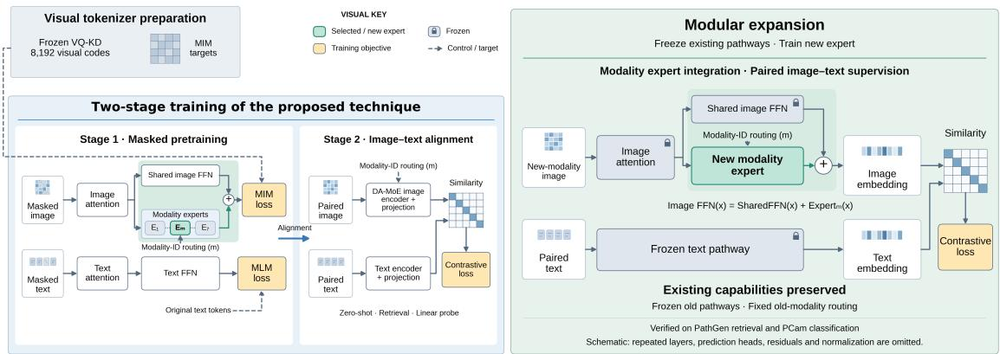

(a) the proposed technique pipeline  
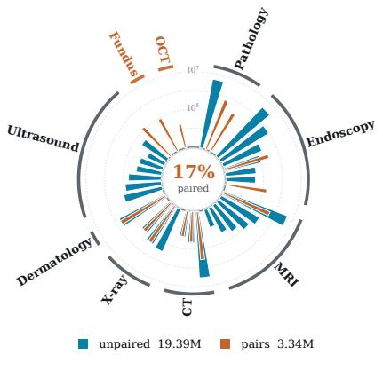  
(b) training corpus

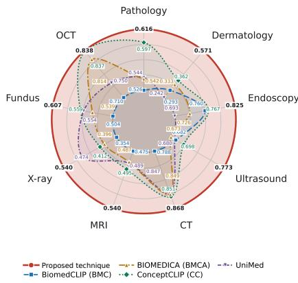  
(c) modality-level results  
Figure 1: Proposed technique: pipeline, training data, and evaluation breadth. (a) A modality-aware tokenizer supplies discrete targets for masked pretraining; contrastive alignment then connects the separate image and text pathways. New modalities use paired data to train new routed experts while existing paths remain frozen. (b) Each spoke is a source dataset grouped by modality. On a shared $\log _ { 1 0 }$ scale, wide bars show Stage-1 image rows and narrow bars show Stage-2 pairs; fundus and OCT use paired data only. The core pair count is approximately 17% of the masked-pretraining image-row count. (c) Raw mean performance by modality across applicable task families, with retrieval percentages divided by 100. Each axis uses its own range; markers are data and curves are visual guides.

Domain-Aware MoE. We replace the single vision FFN at a set of layers $\mathcal { L } \subseteq \{ 1 , \ldots , 2 4 \}$ (backbone depth for the reported ViT-Large model) with a bank of E domain experts $\{ f _ { 1 } ^ { ( \ell ) } , \ldots , f _ { E } ^ { ( \ell ) } \}$ plus a shared expert $s ^ { ( \ell ) }$ . A hard router maps each image to the single expert of its modality,

$$
\mathrm { F F N } _ { \mathrm { v i s i o n } } ^ { ( \ell ) } ( \pmb { x } ; m ) = s ^ { ( \ell ) } ( \pmb { x } ) + f _ { r ( m ) } ^ { ( \ell ) } ( \pmb { x } ) , \qquad \ell \in \mathcal { L } , \quad r : \mathcal { M } \to \{ 1 , \ldots , E \} ,\tag{2}
$$

so pathology, CT, MRI, ultrasound, X-ray, dermatology, and endoscopy each have an expert while $s ^ { ( \ell ) }$ carries shared visual information. Routing is deterministic and specified by the image modality ID. Only the selected modality-specific expert contributes alongside the shared FFN. Different modalities retain separate expert parameters while jointly training the shared visual pathway. No load-balancing objective is used in the reported configuration.

Expert placement. We index the 24 Transformer layers as $1 , \ldots , 2 4$ . L controls how much dedicated capacity a modality receives. Integrate-mode routes every fourth layer, $\mathcal { L } = \{ 4 , 8 , 1 2 , 1 6 , 2 0 , 2 4 \}$ , giving depth-6 experts. Expand-mode routes every layer, $\mathcal { L } = \{ 1 , \ldots , 2 4 \}$ , giving depth-24 experts. Layers outside $\mathcal { L }$ use their ordinary visual FFN. The seven-modality ViT-L core uses the six integrate-mode routed layers. For the full-data fundus and OCT extensions, the remaining layers are converted with function-preserving FFN remapping and zero-output branches, and each new expert spans all 24 layers. This adds capacity for the new modalities while preserving the existing computation paths (§5.2).

## 2.2 Two-stage training pipeline

Modality-aware tokenizer. A single VQ-KD tokenizer (Peng et al., 2022) q : image $\to \{ 1 , \dots , K \} ^ { N }$ $( K = 8 1 9 2 )$ maps each image to a grid of discrete codes, trained to reconstruct per-modality teacher features through a quantized bottleneck. External teacher features supervise tokenizer training. The resulting tokenizer is then frozen and produces discrete targets for the proposed technique’s masked-image objective. Gradients from this objective update the proposed technique but are not propagated through the tokenizer or its teachers.

Stage 1: masked unimodal pretraining. With the tokenizer frozen we pretrain the backbone with two independent objectives, each on its own forward pass: masked image modeling against the VQ-KD codes, and masked language modeling on unpaired text. The image and text streams are unpaired. Let $\mathcal { T } _ { M }$ and $\mathcal { T } _ { M }$ contain masked sample–token pairs across the image and text microbatches, respectively, and let $c _ { b , i }$ denote the frozen tokenizer target at image position i in sample b. Routing each image through its modality expert (Eq. 2),

$$
\mathcal { L } _ { \mathrm { M I M } } = - \frac { 1 } { \vert \mathcal { T } _ { M } \vert } \sum _ { ( b , i ) \in \mathcal { T } _ { M } } \log p _ { \theta } \big ( c _ { b , i } \mid \widetilde { \pmb x } _ { b } ^ { \mathrm { v } } , m _ { b } \big ) ,\tag{3}
$$

$$
\mathcal { L } _ { \mathrm { M L M } } = - \frac { 1 } { | \mathcal { T } _ { M } | } \sum _ { ( q , j ) \in \mathcal { T } _ { M } } \log p _ { \theta } \big ( t _ { q , j } \ | \ \widetilde { \pmb { x } } _ { q } ^ { \mathrm { t } } \big ) ,\tag{4}
$$

$$
\boxed { \mathcal { L } _ { \mathrm { s t a g e 1 } } = \mathcal { L } _ { \mathrm { M I M } } + \mathcal { L } _ { \mathrm { M L M } } . }\tag{5}
$$

where $\widetilde { \pmb { x } } _ { b } ^ { \mathrm { v } }$ and $\widetilde { \mathbfit { x } } _ { q } ^ { \mathrm { t } }$ are masked image and text inputs. The indices b and q refer to independent microbatches and do not indicate paired samples; MLM has no access to image tokens. Stage 1 is the equally weighted sum of the mean MIM and mean MLM losses. If no text tokens are masked, the implementation sets $\mathcal { L } _ { \mathrm { M L M } } = 0$ Stage 1 trains the shared visual pathway and the original modality-specific experts before image–text alignment. During subsequent expansion, a new expert learns from paired data against the frozen text embedding space.

Stage 2: contrastive alignment. For core Stage 2 training, we attach linear vision/text heads, pool and $\ell _ { 2 } \cdot$ -normalize a global image embedding $z ^ { \mathrm { v } }$ and text embedding $z ^ { \mathrm { t } }$ , and align them over 3.23M image–text pairs. Let a be the learned logit-scale parameter and define

$$
s _ { i k } = \gamma ( z _ { i } ^ { \mathrm { v } } ) ^ { \top } z _ { k } ^ { \mathrm { t } } , \qquad \gamma = \operatorname* { m i n } \{ \exp ( a ) , 1 0 0 \} .\tag{6}
$$

The effective temperature is $\tau = 1 / \gamma$ . The symmetric core-training objective is

$$
\mathcal { L } _ { \mathrm { C L I P } } = - \frac { 1 } { 2 B } \sum _ { i = 1 } ^ { B } \left[ \log \frac { \exp ( s _ { i i } ) } { \sum _ { k = 1 } ^ { B } \exp ( s _ { i k } ) } + \log \frac { \exp ( s _ { i i } ) } { \sum _ { k = 1 } ^ { B } \exp ( s _ { k i } ) } \right] .\tag{7}
$$

B is the number of pairs participating in one contrastive calculation. With cross-GPU gathering, seven GPUs and 32 pairs per GPU give $B = 2 2 4$ . Eighteen accumulation steps give a 4,032-pair optimizer batch, not a 4,032-pair negative pool. The implementation’s contrastive helper additionally divides the returned loss by the distributed world size; this affects optimizer scaling but not the positive or negative sets in the equation. The matched-data expansion experiment instead uses an equal-caption multiple-positive contrastive objective and is therefore not described exactly by the diagonal-only equation above.

## 2.3 Expansion with preserved embedding functions

A deployed encoder must absorb new modalities without disturbing the ones it serves. The proposed technique does this by growing the expert bank on afrozen base.

Definition 1 (Integration operator). Given the proposed technique with modality experts $\{ f _ { j } \} _ { j = 1 } ^ { E }$ and a new modality m⋆, integration A (i) appends a new expert fE+1 whose parameters are independent ofthe existing experts; (ii) freezes all parameters on the existing image and text embedding paths, including embeddings, attention blocks, normalization layers, shared FFNs, existing modality experts, and projection heads; and (iii) trains only the new expert using paired image–text data and a contrastive objective. The reportedfundus and OCT extensions use no additional Stage-1 masked pretraining. The new expert comprises modalityspecific FFNs across the routed layers. Integration assigns $r ( m ^ { \star } ) = E + 1$ while preserving all existing routing assignments and embedding computations.

Proposition 1 (Preservation of existing embedding functions). Let $g _ { \theta } ^ { \mathrm { v } }$ and $g _ { \theta } ^ { \mathrm { t } }$ denote the image and text embedding functions before expansion, and let θ′ denote the parameters after expansion. If expansion preserves all original parameters, persistent state, routing, and inference operations, then

$$
g _ { \theta ^ { \prime } } ^ { \mathrm { v } } ( { \pmb x } , m ) = g _ { \theta } ^ { \mathrm { v } } ( { \pmb x } , m ) ,
$$

$$
\forall \mathbf { x } , m \in \mathcal { M } _ { \mathrm { o l d } } ,\tag{8}
$$

$$
g _ { \theta ^ { \prime } } ^ { \mathrm { t } } ( t ) = g _ { \theta } ^ { \mathrm { t } } ( t ) ,
$$

$$
\forall t .\tag{9}
$$

Proofsketch. The embedding of an input with modality m depends only on parameters on its computation path: shared attention and embeddings, the shared experts $s ^ { ( \ell ) }$ , and—by the hard router (Eq. 2) with $r ( m ) =$ $j \le E$ unchanged—exactly one old expert $f _ { j }$ per DA-MoE layer. Every one of these lies in the frozen base; the only trainable parameters $( f _ { E + 1 } )$ do not affect the embedding of an old-modality input. The text pathway also remains unchanged. With the same persistent state, routing, and inference operations, both existing embedding functions are therefore preserved. For the 6-to-24-layer conversion, this argument additionally requires the stated function-preserving remapping.

Proposition 1 states preservation by construction under the specified conditions. Methods that alter the effective mapping used by existing modalities, including shared LoRA adapters, do not automatically satisfy these conditions. The guarantee arises from preserving existing computation paths, not from routing alone. Unchanged predictions and metrics additionally require unchanged preprocessing, scoring rules, candidate sets, and downstream classifiers. Bitwise equality is an empirical verification on the evaluated inputs, not an unconditional consequence for every possible output. §5.3 reports this verification, and Section 5.2 tests whether the new experts learn useful representations.

## 3 Data and evaluation protocols

## 3.1 Training data and model configurations

The seven-modality core uses 19,393,075 unpaired image rows for masked pretraining and 3,229,073 image– text pairs for alignment. Its modalities are pathology, CT, MRI, ultrasound, X-ray, dermatology, and endoscopy. The fundus and OCT experts use 88,143 and 19,396 additional image–text pairs, respectively, without further masked pretraining. This gives 3,336,612 pairs across core alignment and both full-data extensions. Appendix A lists data sources and evaluation separation decisions.

The main model uses a ViT-Large/16 backbone. The evaluated nine-modality assembly stores 1.280B parameters, while a single modality’s selected image path contains 355.40M parameters, excluding the text encoder and unselected experts. The compared vision–language baselines are BMC (ViT-B/16, 196M parameters), BMCA (ViT-L/14, 454M), ConceptCLIP (SigLIP-SO400M, 543M), and UniMed-CLIP (ViT-B/16, 196M). MerMED-FM (ViT-B, 86M) is included for linear probing. The proposed technique has the largest stored model in this comparison; Appendix B distinguishes stored parameters from selected image pathways and gives the implementation settings.

The tokenizer uses six visual teachers: UNI for pathology, MedDINOv3 for CT, USFM for ultrasound, RAD-DINO for X-ray, GastroNet-5M for endoscopy, and BMC for MRI and dermatology. Once tokenizer training is complete, the core and expert training objectives use no additional teacher-feature or teacherlogit distillation loss. Appendix D compares multi-teacher and single-teacher tokenization under a limited, matched training budget.

Table 1: Zero-shot classification, balanced accuracy. Best, second. The proposed technique wins ten of eleven rows outright. BMCA leads on Pneumonia. ‡PanNuke is a 19-class tissue panel on which every model scores well below saturation.
<table><tr><td>Benchmark</td><td>Modality</td><td>OURS</td><td>BMC</td><td>BMCA</td><td>ConceptCLIP</td><td>UniMed-CLIP</td></tr><tr><td>BreaKHis</td><td>pathology</td><td>.665</td><td>.532</td><td>.553</td><td>.637</td><td>.601</td></tr><tr><td>Pneumonia</td><td>X-ray</td><td>.722</td><td>.732</td><td>.911</td><td>.859</td><td>.786</td></tr><tr><td>CASIA-CXR</td><td>X-ray</td><td>.720</td><td>.630</td><td>.590</td><td>.680</td><td>.670</td></tr><tr><td>Thyroid</td><td>ultrasound</td><td>.744</td><td>.604</td><td>.579</td><td>.612</td><td>.599</td></tr><tr><td>EDD-polyp</td><td>endoscopy</td><td>.824</td><td>.752</td><td>.644</td><td>.714</td><td>.623</td></tr><tr><td>HAM10000</td><td>dermatology</td><td>.819</td><td>.300</td><td>.365</td><td>.389</td><td>.178</td></tr><tr><td>LC25000</td><td>pathology</td><td>.881</td><td>.664</td><td>.694</td><td>.879</td><td>.709</td></tr><tr><td>PanNuke</td><td>pathology</td><td>.246</td><td>.071</td><td>.093</td><td>.142</td><td>.112</td></tr><tr><td>SARS-CoV-2 CT</td><td>CT</td><td>.743</td><td>.626</td><td>.730</td><td>.717</td><td>.731</td></tr><tr><td>APTOS-DR5</td><td>fundus</td><td>.589</td><td>.377</td><td>.382</td><td>.457</td><td>.447</td></tr><tr><td>ColorFundus10</td><td>fundus</td><td>.460</td><td>.375</td><td>.419</td><td>.445</td><td>.459</td></tr><tr><td>Mean (n=11)</td><td></td><td>.674</td><td>.515</td><td>.542</td><td>.594</td><td>.538</td></tr></table>

## 3.2 Transfer benchmarks and metrics

The main evaluation comprises 11 zero-shot classification benchmarks, 10 linear probes, and 4 cross-modal retrieval benchmarks across nine modalities. Classification and linear probing use balanced accuracy. Retrieval uses cosine similarity with a fixed gallery per benchmark and reports the mean of Recall@1, Recall@10, and Recall@50 across image-to-text and text-to-image directions. Within each comparison table, models use common prompts, probes, galleries, and scoring procedures. MerMED-FM is evaluated only by linear probing because it has no text encoder.

We report means within each task family. They summarize the benchmarks in the corresponding table and should not be compared across families as a common metric. MerMED-FM’s linear-probe mean cover only its seven available benchmarks, so we also distinguish performance on that shared subset.

## 3.3 Expansion experiments

We use two designs with different purposes. The matched-data sequential experiment gives all methods 20,000 fundus pairs followed by 16,000 OCT pairs, with three seeds and common validation-based checkpoint-selection rules. Baselines adapt with LoRA; the proposed technique trains new routed experts. The full-data assembly combines independently trained fundus and OCT experts from the same seven-modality base. The latter supplies the expanded model used in the main transfer tables. It is not a matched-training comparison with sequential LoRA. Section 5 reports these experiments separately.

## 4 Transfer across medical imaging modalities

## 4.1 Zero-shot classification

The proposed technique wins 10 of 11 zero-shot benchmarks outright, for a mean of 0.674 (+0.080 over ConceptCLIP, the strongest baseline at 0.594). The largest margins occur on dermatology (0.819 vs. 0.389), thyroid ultrasound (0.744 vs. 0.612), and endoscopic polyp detection (0.824 vs. 0.752). The proposed technique also leads on the newly added APTOS-DR5 fundus benchmark (0.589 vs. 0.457). Its narrowest win is on ColorFundus10 (0.460 vs. 0.459 for UniMed). BMCA performs best on Pneumonia (0.911 vs. 0.722 for the proposed technique). All models obtain low scores on the 19-class PanNuke benchmark.

Table 2: Linear probe on frozen features, 5-fold cross-validation (seed 0), balanced accuracy. Best, second. The proposed technique is best or tied-best on all ten rows and has the highest mean over all ten benchmarks. Ties are CT-Kidney, where the proposed technique and MerMED-FM both reach 0.993, and ColorFundus10, where the proposed technique and ConceptCLIP both reach 0.712. †MerMED-FM has no reported fundus/OCT probe; its mean is computed over the original seven benchmarks, where the proposed technique scores 0.906 on the same subset.
<table><tr><td>Benchmark</td><td>OURS</td><td>BMC</td><td>BMCA</td><td>ConceptCLIP</td><td>MerMED</td><td>UniMed-CLIP</td></tr><tr><td>HEST (pathology)</td><td>.994</td><td>.978</td><td>.986</td><td>.981</td><td>.984</td><td>.979</td></tr><tr><td>BrainTumor (MRI)</td><td>.972</td><td>.866</td><td>.894</td><td>.926</td><td>.917</td><td>.903</td></tr><tr><td>CT-Kidney (CT)</td><td>.993</td><td>.950</td><td>.967</td><td>.986</td><td>.993</td><td>.964</td></tr><tr><td>TN5000 (ultrasound)</td><td>.802</td><td>.761</td><td>.768</td><td>.783</td><td>.782</td><td>.762</td></tr><tr><td>RadImageNet (MRI)</td><td>.956</td><td>.940</td><td>.942</td><td>.953</td><td>.932</td><td>.949</td></tr><tr><td>EDD2020 (endoscopy)</td><td>.825</td><td>.767</td><td>.808</td><td>.820</td><td>.824</td><td>.763</td></tr><tr><td>HAM10000 (dermatology)</td><td>.797</td><td>.519</td><td>.559</td><td>.610</td><td>.626</td><td>.515</td></tr><tr><td>APTOS-DR5 (fundus)</td><td>.665</td><td>.610</td><td>.654</td><td>.624</td><td>_†</td><td>.620</td></tr><tr><td>ColorFundus10 (fundus)</td><td>.712</td><td>.653</td><td>.700</td><td>.712</td><td>_†</td><td>.689</td></tr><tr><td>OCTDL (OCT)</td><td>.838</td><td>.710</td><td>.814</td><td>.837</td><td>_†</td><td>.750</td></tr><tr><td>Mean (n=10)</td><td>.856</td><td>.776</td><td>.809</td><td>.824</td><td>_†</td><td>.793</td></tr></table>

Table 3: Cross-modal retrieval, mean R@{1, 10, 50} over image→text and text→image, with one fixed gallery per benchmark for all models. All benchmarks use cosine similarity; PathGen-600 treats rows with identical captions as positives. Best, second. The proposed technique leads all four rows and the mean.
<table><tr><td>Benchmark</td><td>Modality</td><td>OURS</td><td>BMC</td><td>BMCA</td><td>ConceptCLIP</td><td>UniMed-CLIP</td></tr><tr><td>OpenI</td><td>X-ray</td><td>35.88</td><td>2.60</td><td>4.23</td><td>5.47</td><td>21.97</td></tr><tr><td>MR-RATE</td><td>MRI</td><td>11.52</td><td>4.72</td><td>5.68</td><td>5.12</td><td>5.12</td></tr><tr><td>derm7pt</td><td>dermatology</td><td>9.64</td><td>6.00</td><td>7.37</td><td>8.74</td><td>3.30</td></tr><tr><td>PathGen-600</td><td>pathology</td><td>25.75</td><td>17.64</td><td>19.39</td><td>25.61</td><td>17.97</td></tr><tr><td>Mean (n=4)</td><td></td><td>20.70</td><td>7.74</td><td>9.17</td><td>11.24</td><td>12.09</td></tr></table>

## 4.2 Linear probe

Table 2 evaluates frozen image features using logistic regression. The proposed technique is best or tied-best on all ten benchmarks, with mean balanced accuracy 0.856. At the reported precision, MerMED-FM ties the proposed technique on CT-Kidney (0.993), and ConceptCLIP ties it on ColorFundus10 (0.712).

On the seven benchmarks available for every model, the proposed technique averages 0.906, compared with 0.867 for MerMED-FM and 0.866 for ConceptCLIP. MerMED-FM has no reported fundus or OCT probe, so its mean covers this seven-benchmark subset. ConceptCLIP’s mean over all ten benchmarks is 0.824. The different benchmark coverage matters when interpreting the mean row.

## 4.3 Cross-modal retrieval

Under the same retrieval protocol, the proposed technique achieves the highest mean score (20.70 vs. 12.09, a difference of 8.61; Table 3) and leads all four benchmarks. The largest gains occur on OpenI (35.88 vs. 21.97 for UniMed) and MR-RATE (11.52 vs. 5.68 for BMCA). The margins are smaller on derm7pt (9.64 vs. 8.74 for ConceptCLIP) and PathGen-600 (25.75 vs. 25.61 for ConceptCLIP).

Figure 1(c) summarizes performance across all nine modalities. The smallest gaps occur on OCT and CT: the proposed technique and ConceptCLIP differ by 0.001 on OCT and 0.017 on CT. The largest gaps occur on dermatology and X-ray.

Table 4: Learning and forgetting under sequential fundus→OCT adaptation. All methods use the same 20,000 fundus pairs followed by the same 16,000 OCT pairs, three training seeds, and the same validationbased checkpoint-selection rules. The baselines use LoRA, whereas the proposed technique trains new experts while keeping its existing pathways frozen. Values are mean percentage-point changes across the three seeds. Fundus and OCT gain measure improvement after training on each new modality. Fundus forgetting is the decrease after OCT training, and PathGen forgetting is the decrease from the initial model to the final model.
<table><tr><td>Model</td><td>Fundus gain</td><td>OCT gain</td><td>Fundus forgetting</td><td>PathGen forgetting</td></tr><tr><td>BMC</td><td>13.95</td><td>11.58</td><td>9.85</td><td>6.11</td></tr><tr><td>BMCA</td><td>15.47</td><td>10.53</td><td>7.59</td><td>3.22</td></tr><tr><td>ConceptCLIP</td><td>13.78</td><td>9.01</td><td>5.33</td><td>5.39</td></tr><tr><td>UniMed-CLIP</td><td>11.69</td><td>10.50</td><td>15.29</td><td>2.97</td></tr><tr><td>Proposed technique ViT-L</td><td>14.95</td><td>9.31</td><td>0.00</td><td>0.00</td></tr></table>

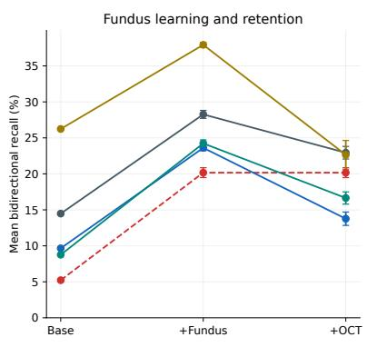

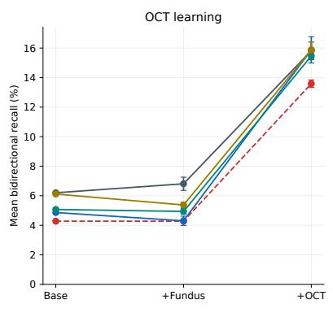

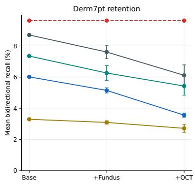  
Figure 2: Learning new modalities while retaining existing capabilities. Models use 20,000 fundus pairs followed by 16,000 OCT pairs. Left: fundus learning and retention. Middle: OCT learning. Right: retention on Derm7pt. Points show mean bidirectional recall and error bars show standard deviation across three training seeds. Baselines use LoRA; the proposed technique trains new experts with existing pathways frozen. This experiment uses training subsets, not the full training corpus.

## 5 Modality expansion and representation retention

## 5.1 Sequential adaptation with matched data

We first assess learning and retention with the same adaptation data for all methods: 20,000 fundus pairs followed by 16,000 OCT pairs. Each stage uses the same validation-based checkpoint-selection rules, and results are averaged over three seeds. The baselines use LoRA while the proposed technique trains new modality experts with the existing paths frozen. Model size, pretraining history, adaptation capacity, and computational cost remain different. Appendix E gives the protocol and definitions of gain and forgetting.

Table 4 shows that all methods learn from the new data. The proposed technique gains 14.95 percentage points on fundus retrieval and 9.31 on OCT, with no measured loss on the preceding fundus or PathGen tasks. The baselines lose 5.33–15.29 points on fundus after OCT adaptation and 2.97–6.11 points on PathGen across the sequence. These outcomes assess retention under this protocol rather than every possible capability.

The trajectories in Figure 2 show the tradeoff between learning the new modality and retaining earlier tasks. The proposed technique’s fundus retrieval rises from 5.22% to 20.17% and remains fixed after OCT training. Its OCT score rises from 4.28% to 13.59%, below the adapted baselines’ final 15.46%–15.88%. Derm7pt retrieval remains at 9.63%, with byte-identical saved features within each seed. Thus, retaining earlier representations does not imply the highest score on every newly adapted task.

Table 5: PathGen pathology retention after fundus→OCT adaptation. Baselines use sequential LoRA and report the mean over three seeds; the proposed technique uses one assembled-expert sequence. Full trajectories are in Figure 3.
<table><tr><td>Model (adaptation)</td><td>∆ PathGen</td></tr><tr><td>Proposed technique ViT-L (routed expert)</td><td>0.0 -3.22</td></tr><tr><td> $\mathrm { \mathbf { B } \mathbf { M } C A + \mathbf { L } o R A }$ </td><td></td></tr><tr><td> $\mathbf { B M C } + \mathbf { L o R A }$   $\mathrm { U n i M e d - C L I P + L o R A }$ </td><td>-6.11 -2.97</td></tr><tr><td> $\mathrm { C o n c e p t C L I P + L o R A }$ </td><td>-5.39</td></tr></table>

## 5.2 Full-data expert assembly

The assembled experts learn the new modalities: in Tables 1 and 2, the proposed technique is best or tied-best on all five fundus/OCT rows. We also measure pathology retention on PathGen-600. The proposed technique remains at 25.75% mean bidirectional recall after both additions, with byte-identical saved image and text features. Four baselines adapted by sequential LoRA lose 2.97–6.11 points (Table 5). This comparison is descriptive: the proposed technique’s full-data experts are trained independently and assembled, whereas the baselines use sequential LoRA on matched-data subsets. The matched-data results above and Appendix F provide the sequential comparison and per-stage results.

## 5.3 Checks on existing representations

We add independently trained fundus and OCT experts to the frozen ViT-Large core and test an old modality after each addition. On a balanced 4096-image PCam probe, the core, +fundus, and +fundus+OCT checkpoints give identical AUROC (0.8691), balanced accuracy (64.26%), features, cosine scores, and predictions. Parameter and seven-modality retention checks are reported in Appendices B and G.

The full-data assembly also retains the evaluated retrieval results across all seven base modalities. Appendix G reports the individual benchmarks and feature checks. These assembly checks complement the matched-data sequence; they involve independently trained experts and should be read as a separate experiment.

## 6 Ablations and supporting analyses

## 6.1 Modality experts under a matched training budget

A controlled ViT-B comparison uses identical shared random initialization, training data, tokenizer, optimization settings, and training seed. The routed model improves 15 of 18 benchmarks relative to the variant without modality experts, ties on BreaKHis zero-shot classification, and scores lower on Pneumonia zeroshot classification and HAM10000 linear probing. Mean gains are 0.0433 in zero-shot balanced accuracy, 0.0201 in linear-probe balanced accuracy, and 0.1330 percentage points in retrieval. Appendix C reports all benchmark rows and settings.

Both models train for five epochs per stage and use the final checkpoint, without early stopping or validation-based checkpoint selection. This comparison supports the contribution of modality-specific capacity under a limited, matched training budget. It does not establish the same effect at convergence or isolate routing from the additional expert parameters.

## 6.2 Multi-teacher visual tokenization

The tokenizer comparison holds the ViT-B architecture, initialization, data subsets, and training schedules fixed while changing the visual teachers. Multi-teacher supervision improves mean zero-shot balanced accuracy from 32.74% to 35.60%, linear-probe balanced accuracy from 74.56% to 76.34%, and retrieval from 2.17% to 2.35%. Appendix D provides the full results. Improvements vary by benchmark, including two linear-probe decreases. The experiment uses one seed and a short schedule, so these means do not establish statistical significance or the effect under full-data training.

## 6.3 Qualitative evidence

The appendix collects two kinds of visual evidence. Before-and-after retrieval examples in Appendix H show individual ranking changes through fundus and OCT integration. Similarity-gradient visualizations in Appendices I and J compare spatial responses to finding descriptions and paired reports. For the linearprobe examples, the saliency target is image–prompt similarity rather than the image-only classifier’s class score. These selected visualizations complement the quantitative evaluations and do not measure localization performance.

## 7 Discussion and limitations

The results support a distinction between acquiring new representations and preserving an existing embedding function. New experts provide trainable capacity for an added modality, while frozen original paths preserve earlier embeddings under the conditions in Proposition 1. Whether the new expert reaches the strongest task performance remains an empirical question. In the matched-data experiment, the proposed technique learns both fundus and OCT while retaining earlier tasks, but its OCT retrieval score is below those of the adapted baselines. Retention and new-task performance therefore need to be assessed together.

The broader baseline comparisons do not isolate a single source of the performance differences. Models differ in architecture, pretraining data, parameter count, and optimization. The proposed technique uses a large bank of stored experts, and the matched-data experiment does not match trainable parameter counts or computational cost. The ViT-B routing and tokenizer experiments provide more controlled evidence, but they use limited subsets and short training schedules. Their results do not establish the size of the same effects after converged ViT-L training.

Our expansion rule assumes that the modality is supplied at inference and that existing preprocessing, persistent state, routing, and inference operations remain fixed. Unchanged embeddings imply unchanged task outputs only when scoring rules, candidate sets, and downstream classifiers are also fixed. The feature identity checks cover evaluated inputs. A change to the assembled model’s learned logit-scale parameter is separate from those checks, so preserved features do not establish identity of every scaled logit.

Evaluation also has limits. Some linear-probe splits operate at the image or data-row level rather than the patient or slide level, including HEST’s image-level split. The retention benchmarks sample capabilities across the base modalities, rather than testing every possible downstream use. The qualitative examples visualize similarity responses without a quantitative localization evaluation. These experiments assess representation learning; clinical use would require prospective validation in the intended setting.

## 8 Related work

Biomedical vision–language models. CLIP (Radford et al., 2021) inspired biomedical vision–language models such as BMC, BMCA, and ConceptCLIP. These models support text-prompted classification and image–text retrieval, but do not explicitly separate the computation paths of different imaging modalities. Vision-only models such as MerMED-FM cover several modalities, but lack a text interface. Another strategy is to connect existing domain-specific models: CTF (Chen et al., 2026) integrates separately trained radiology and pathology encoders through clinical concepts and cross-domain prompting. In contrast, the proposed technique combines broad modality coverage and a language interface within one routed encoder.

Multiway pretraining and visual tokenization. The proposed technique builds on the Multiway Transformer of BEiT-3 (Wang et al., 2023a) and the VQ-KD tokenizer of BEiT-v2 (Peng et al., 2022). MUSK (Xiang et al., 2025) applies this framework to pathology using masked image and language modeling followed by contrastive alignment. The proposed technique extends the design to multiple modalities through one tokenizer supervised by six visual teachers and visual FFNs with modality-specific experts. The teachers supervise tokenizer training; after the tokenizer is frozen, the VLM receives no additional teacher-feature or teacher-logit loss.

Mixture-of-Experts and continual expansion. MoE models route inputs through selected parameters (Shazeer et al., 2017; Fedus et al., 2022). The proposed technique uses deterministic modality routing and therefore needs no load-balancing loss. Unlike learned token routing, each image uses a known modality label. LoRA (Hu et al., 2022), adapters (Houlsby et al., 2019), regularization (Kirkpatrick et al., 2017), and rehearsal can reduce interference, while progressive networks preserve earlier computations through model expansion (Rusu et al., 2016). MedQwen (Nejati Manzari et al., 2026) routes low-rank experts in a generative medical VLM; the proposed technique instead uses full-rank modality experts in a contrastive encoder. Its preservation guarantee follows from keeping existing computation paths fixed, not from routing alone.

## 9 Conclusion

The proposed technique combines masked pretraining on unpaired medical images with contrastive image– text alignment and expandable modality experts. The resulting model supports nine imaging modalities and achieves the best or tied-best result in 24 of 25 classification, linear-probe, and retrieval settings. In a separate matched-data sequential experiment, new experts improve fundus and OCT retrieval while the evaluated preceding fundus and pathology tasks remain unchanged. The preservation argument follows from retaining the original computation paths under explicit inference conditions. Together, these results support modular expert expansion as a way to extend medical vision–language representations while retaining existing embeddings.

## References

T. G. W. Boers, K. N. Fockens, J. A. van der Putten, T. J. M. Jaspers, C. H. J. Kusters, J. B. Jukema, M. R. Jong, M. R. Struyvenberg, J. de Groof, J. J. Bergman, P. H. N. de With, and F. van der Sommen. Foundation models in gastrointestinal endoscopic AI: Impact of architecture, pre-training approach and data efficiency. Medical Image Analysis, 98:103298, 2024. doi: 10.1016/j.media.2024.103298.

Hanna Borgli, Vajira Thambawita, Pia H. Smedsrud, Steven Hicks, Debesh Jha, Sigrun L. Eskeland, Kristin Ranheim Randel, Konstantin Pogorelov, Mathias Lux, Duc Tien Dang Nguyen, Dag Johansen, Carsten Griwodz, Håkon K. Stensland, Enrique Garcia-Ceja, Peter T. Schmidt, Hugo L. Hammer, Michael A. Riegler, Pål Halvorsen, and Thomas de Lange. Hyperkvasir, a comprehensive multi-class image and video dataset for gastrointestinal endoscopy. Scientific Data, 7:283, 2020.

Andrew A. Borkowski, Marilyn M. Bui, L. Brannon Thomas, Catherine P. Wilson, Lauren A. DeLand, and Stephen M. Mastorides. Lung and colon cancer histopathological image dataset (LC25000). arXiv preprint arXiv:1912.12142, 2019.

Léo Butsanets, Charles Corbière, Julien Khlaut, Pierre Manceron, and Corentin Dancette. Radimagenet-vqa: A large-scale ct and mri dataset for radiologic visual question answering. arXiv preprint arXiv:2512.17396, 2025.

Richard J. Chen, Tong Ding, Ming Y. Lu, Drew F. K. Williamson, Guillaume Jaume, Andrew H. Song, Bowen Chen, Andrew Zhang, Daniel Shao, Muhammad Shaban, et al. Towards a general-purpose foundation model for computational pathology. Nature Medicine, 30:850–862, 2024.

Yihang Chen, Yanyan Huang, Fuying Wang, Maximus Yeung, Yuming Jiang, Shujun Wang, and Lequan Yu. Bridging radiology and pathology foundation models via concept-based multimodal co-adaptation. In International Conference on Learning Representations (ICLR), 2026.

Dina Demner-Fushman, Marc D Kohli, Marc B Rosenman, Sonya E Shooshan, Laritza Rodriguez, Sameer Antani, George R Thoma, and Clement J McDonald. Preparing a collection of radiology examinations for distribution and retrieval. Journal ofthe American Medical Informatics Association, 23(2):304–310, 2016.

William Fedus, Barret Zoph, and Noam Shazeer. Switch transformers: Scaling to trillion parameter models with simple and efficient sparsity. Journal of Machine Learning Research, 23(120):1–39, 2022.

Forithmus Team, University of Zurich, and NVIDIA. MR-RATE: A vision-language foundation model and dataset for magnetic resonance imaging. https://huggingface.co/datasets/Forithmus/ MR-RATE, 2026. Accessed: 2026.

Jevgenij Gamper, Navid Alemi Koohbanani, Ksenija Benes, Simon Graham, Mostafa Jahanifar, Syed Ali Khurram, Ayesha Azam, Katherine Hewitt, and Nasir Rajpoot. Pannuke dataset extension, insights and baselines. arXiv preprint arXiv:2003.10778, 2020.

Sushant Gautam, Michael A. Riegler, and Pål Halvorsen. Kvasir-vqa-x1: A multimodal dataset for medical reasoning and robust MedVQA in gastrointestinal endoscopy. In Data Engineering in Medical Imaging. Springer, 2025. doi: 10.1007/978-3-032-08009-7\_6.

Brian Gow et al. MIMIC-IV-ECHO: Echocardiogram matched subset, version 1.0. PhysioNet, 2026.

Neil Houlsby, Andrei Giurgiu, Stanislaw Jastrzebski, Bruna Morrone, Quentin De Laroussilhe, Andrea Gesmundo, Mona Attariyan, and Sylvain Gelly. Parameter-efficient transfer learning for nlp. In International Conference on Machine Learning (ICML), 2019.

Edward J. Hu, Yelong Shen, Phillip Wallis, Zeyuan Allen-Zhu, Yuanzhi Li, Shean Wang, Lu Wang, and Weizhu Chen. Lora: Low-rank adaptation of large language models. In International Conference on Learning Representations (ICLR), 2022.

Jia-Hong Huang et al. DeepOpht: Medical report generation for retinal images via deep models and visual explanation. In IEEE Winter Conference on Applications ofComputer Vision, pages 2442–2452, 2021.

Wisdom Oluchi Ikezogwo, Mehmet Saygin Seyfioglu, Fatemeh Ghezloo, Dylan Stefan Chan Geva, Fatwir Sheikh Mohammed, Pavan Kumar Anand, Ranjay Krishna, and Linda Shapiro. Quilt-1m: One million image–text pairs for histopathology. In Advances in Neural Information Processing Systems (NeurIPS Datasets and Benchmarks Track), volume 36, 2023.

International Skin Imaging Collaboration. ISIC archive. https://www.isic-archive.com/ blank-1, 2026. Accessed September 20, 2026.

Jeremy Irvin, Pranav Rajpurkar, Michael Ko, Yifan Yu, Silviana Ciurea-Ilcus, Chris Chute, Henrik Marklund, Behzad Haghgoo, Robyn Ball, Katie Shpanskaya, Jayne Seekins, David A. Mong, Safwan S. Halabi, Jesse K. Sandberg, Ricky Jones, David B. Larson, Curtis P. Langlotz, Bhavik N. Patel, Matthew P. Lungren, and Andrew Y. Ng. Chexpert: A large chest radiograph dataset with uncertainty labels and expert comparison. In Proceedings ofthe AAAI Conference on Artificial Intelligence, volume 33, pages 590–597, 2019.

Guillaume Jaume, Paul Doucet, Andrew H. Song, Ming Y. Lu, Cristina Almagro-Pérez, Sophia J. Wagner, Anurag J. Vaidya, Richard J. Chen, Drew F. K. Williamson, Ahrong Kim, and Faisal Mahmood. Hest-1k: A dataset for spatial transcriptomics and histology image analysis. In Advances in Neural Information Processing Systems (NeurIPS), 2024.

Jing Jiao, Jin Zhou, Xiaokang Li, Menghua Xia, Yi Huang, Lihong Huang, Na Wang, Xiaofan Zhang, Shichong Zhou, Yuanyuan Wang, and Yi Guo. USFM: A universal ultrasound foundation model generalized to tasks and organs towards label efficient image analysis. arXiv preprint arXiv:2401.00153, 2024.

Jiayun Jin, Haolong Chai, Xueying Huang, Xiaoqing Guo, Zengwei Zheng, Zhan Zhou, Junmei Wang, Xinyu Wang, Jie Liu, and Binbin Zhou. Ultrasound-CLIP: Semantic-aware contrastive pre-training for ultrasound image–text understanding. In IEEE/CVF Conference on Computer Vision and Pattern Recognition, 2026. Dataset: https://huggingface.co/datasets/JJY-0823/US-365K.

Alistair Johnson, Matthew Lungren, Yifan Peng, Zhiyong Lu, Roger Mark, Steven Berkowitz, and Steven Horng. MIMIC-CXR-JPG—chest radiographs with structured labels, version 2.1.0. PhysioNet, 2024.

Jeremy Kawahara, Sara Daneshvar, Giuseppe Argenziano, and Ghassan Hamarneh. Seven-point checklist and skin lesion classification using multitask multimodal neural nets. IEEE Journal of Biomedical and Health Informatics, 23(2):538–546, 2019.

Daniel S. Kermany, Michael Goldbaum, Wenjia Cai, et al. Identifying medical diagnoses and treatable diseases by image-based deep learning. Cell, 172(5):1122–1131.e9, 2018. doi: 10.1016/j.cell.2018.02.010.

Muhammad Uzair Khattak, Shahina Kunhimon, Muzammal Naseer, Salman Khan, and Fahad Shahbaz Khan. Unimed-clip: Towards a unified image-text pretraining paradigm for diverse medical imaging modalities. arXiv preprint arXiv:2412.10372, 2024.

James Kirkpatrick, Razvan Pascanu, Neil Rabinowitz, Joel Veness, Guillaume Desjardins, Andrei A. Rusu, Kieran Milan, John Quan, Tiago Ramalho, Agnieszka Grabska-Barwinska, et al. Overcoming catastrophic forgetting in neural networks. Proceedings of the National Academy of Sciences, 114(13):3521–3526, 2017.

Jun Li, Tongkun Su, Baoliang Zhao, Faqin Lv, Qiong Wang, Nassir Navab, Ying Hu, and Zhongliang Jiang. Ultrasound report generation with cross-modality feature alignment via unsupervised guidance. IEEE Transactions on Medical Imaging, 44(1):19–30, 2025a. doi: 10.1109/TMI.2024.3424978.

T. Li et al. GMAI-VL & GMAI-VL-5.5M: A large vision–language model and a comprehensive multimodal dataset towards general medical AI. In Proceedings of the AAAI Conference on Artificial Intelligence, volume 40, pages 23177–23185, 2026. URL https://github.com/uni-medical/GMAI-VL.

Yuheng Li, Yizhou Wu, Yuxiang Lai, Mingzhe Hu, and Xiaofeng Yang. Meddinov3: How to adapt vision foundation models for medical image segmentation? arXiv preprint arXiv:2509.02379, 2025b.

Weixiong Lin, Ziheng Zhao, Xiaoman Zhang, Chaoyi Wu, Ya Zhang, Yanfeng Wang, and Weidi Xie. PMC-CLIP: Contrastive language–image pre-training using biomedical documents. In Medical Image Computing and Computer Assisted Intervention, pages 525–536, 2023. URL https://arxiv.org/abs/ 2303.07240.

Alejandro Lozano, Min Woo Sun, James Burgess, et al. Biomedica: An open biomedical image–caption archive, dataset, and vision–language models derived from scientific literature. In IEEE/CVF Conference on Computer Vision and Pattern Recognition (CVPR), 2025.

Yinghao Ma, Xianhao Chen, Kai Cheng, Yang Li, and Bin Sun. LDPolypVideo benchmark: A large-scale colonoscopy video dataset of diverse polyps. In Medical Image Computing and Computer Assisted Intervention, 2021. URL https://miccai2021.org/openaccess/paperlinks/2021/09/01/ 268-Paper1167.html.

Francesco Marzola et al. Deep learning segmentation of transverse musculoskeletal ultrasound images for neuromuscular disease assessment. Computers in Biology and Medicine, 135:104623, 2021. doi: 10.1016/ j.compbiomed.2021.104623.

Bjoern H. Menze et al. The multimodal brain tumor image segmentation benchmark (BRATS). IEEE Transactions on Medical Imaging, 34(10):1993–2024, 2015. doi: 10.1109/TMI.2014.2377694.

Hichem Metmer and Xiaoshan Yang. An open chest X-ray dataset with benchmarks for automatic radiology report generation in French. Neurocomputing, 609:128478, 2024. doi: 10.1016/j.neucom.2024.128478.

National Library of Medicine. PMC open access subset. https://pmc.ncbi.nlm.nih.gov/tools/ openftlist/, 2026. Accessed September 20, 2026.

Omid Nejati Manzari, Hojat Asgariandehkordi, Taha Koleilat, Yiming Xiao, and Hassan Rivaz. Sparse spectral lora: Routed experts for medical vlms. In Proceedings of the IEEE/CVF Conference on Computer Vision and Pattern Recognition (CVPR), pages 35351–35362, 2026.

Yuxiang Nie, Sunan He, Yequan Bie, Yihui Wang, Zhixuan Chen, Shu Yang, Zhiyuan Cai, Linshan Wu, Hongmei Wang, Xi Wang, Ngai Shing Cheng, Luyang Luo, Mingxiang Wu, Haibo Jin, Xian Wu, Ronald Cheong Kin Chan, Yuk Ming Lau, Zhengyu Zhang, Sushan Xiao, Can Yang, Yinghua Zhao, Xiaohui Duan, Li Zhang, Li Liang, Yefeng Zheng, Pranav Rajpurkar, and Hao Chen. An explainable biomedical foundation model via large-scale concept-enhanced vision-language pre-training. Nature Biomedical Engineering, 2026.

Chinedu Innocent Nwoye, Tong Yu, Cristians Gonzalez, Barbara Seeliger, Pietro Mascagni, Didier Mutter, Jacques Marescaux, and Nicolas Padoy. Rendezvous: Attention mechanisms for the recognition of surgical action triplets in endoscopic videos. Medical Image Analysis, 78:102433, 2022.

Zhiliang Peng, Li Dong, Hangbo Bao, Qixiang Ye, and Furu Wei. Beit v2: Masked image modeling with vector-quantized visual tokenizers. In arXiv preprint arXiv:2208.06366, 2022.

Fernando Pérez-García et al. RAD-DINO: Exploring scalable medical image encoders beyond text supervision. arXiv preprint arXiv:2401.10815, 2024.

QIAIUNCC. OCT-summary-Dataset. https://huggingface.co/datasets/QIAIUNCC/ OCT-summary-Dataset, 2026. Accessed September 20, 2026.

Alec Radford, Jong Wook Kim, Chris Hallacy, Aditya Ramesh, Gabriel Goh, Sandhini Agarwal, Girish Sastry, Amanda Askell, Pamela Mishkin, Jack Clark, Gretchen Krueger, and Ilya Sutskever. Learning transferable visual models from natural language supervision. In International Conference on Machine Learning (ICML), 2021.

Johannes Rückert, Louise Bloch, Raphael Brüngel, Ahmad Idrissi-Yaghir, Henning Schäfer, Cynthia S. Schmidt, Sven Koitka, Obioma Pelka, Asma Ben Abacha, Alba G. Seco de Herrera, Henning Müller, Peter A. Horn, Felix Nensa, and Christoph M. Friedrich. ROCOv2: Radiology objects in COntext version 2, an updated multimodal image dataset. Scientific Data, 11:688, 2024. doi: 10.1038/s41597-024-03496-6.

Andrei A. Rusu, Neil C. Rabinowitz, Guillaume Desjardins, Hubert Soyer, James Kirkpatrick, Koray Kavukcuoglu, Razvan Pascanu, and Raia Hadsell. Progressive neural networks. arXiv preprint arXiv:1606.04671, 2016.

Noam Shazeer, Azalia Mirhoseini, Krzysztof Maziarz, Andy Davis, Quoc Le, Geoffrey Hinton, and Jeff Dean. Outrageously large neural networks: The sparsely-gated mixture-of-experts layer. In International Conference on Learning Representations (ICLR), 2017.

Pia H. Smedsrud, Vajira Thambawita, Steven A. Hicks, Henrik Gjestang, Oda Olsen Nedrejord, Espen Næss, Hanna Borgli, Debesh Jha, Tor Jan Derek Berstad, Sigrun L. Eskeland, Mathias Lux, Håvard Espeland, Andreas Petlund, Duc Tien Dang Nguyen, Enrique Garcia-Ceja, Dag Johansen, Peter T. Schmidt, Ervin Toth, Hugo L. Hammer, Thomas de Lange, Michael A. Riegler, and Pål Halvorsen. Kvasir-capsule, a video capsule endoscopy dataset. Scientific Data, 8:142, 2021.

Eduardo Soares, Plamen Angelov, Sarah Biaso, Michele Higa Froes, and Daniel Kanda Abe. SARS-CoV-2 ct-scan dataset: A large dataset of real patients ct scans for SARS-CoV-2 identification. medRxiv, 2020. doi: 10.1101/2020.04.24.20078584.

Fabio A Spanhol, Luiz S Oliveira, Caroline Petitjean, and Laurent Heutte. A dataset for breast cancer histopathological image classification. IEEE Transactions on Biomedical Engineering, 63(7):1455–1462, 2016.

Yuxuan Sun, Chenglu Zhu, Sunyi Zheng, Kai Zhang, Lin Sun, Zhongyi Shui, Yunlong Zhang, Honglin Li, and Lin Yang. Pathasst: A generative foundation ai assistant towards artificial general intelligence of pathology. In Proceedings ofthe AAAI Conference on Artificial Intelligence, volume 38, pages 5034–5042, 2024.

Yuxuan Sun et al. Pathgen-1.6m: 1.6 million pathology image-text pairs generation through multi-agent collaboration. In International Conference on Learning Representations (ICLR), 2025.

Philipp Tschandl, Cliff Rosendahl, and Harald Kittler. The ham10000 dataset, a large collection of multisource dermatoscopic images of common pigmented skin lesions. Scientific Data, 5:180161, 2018.

Ayush Tyagi et al. Nerve block target localization and needle guidance for autonomous robotic ultrasound guided regional anesthesia. In IEEE/RSJ International Conference on Intelligent Robots and Systems, 2024. URL https://arxiv.org/abs/2308.03717. Dataset: https://github.com/ Regional-US/brachial\_plexus.

T. Wang, Z. Li, M. Huang, J. Zhuang, S. Bi, J. Zhang, Y. Shi, H. Fei, and X. Xu. EchoCP: An echocardiography dataset in contrast transthoracic echocardiography for patent foramen ovale diagnosis. In Medical Image Computing and Computer Assisted Intervention, 2021. URL https://arxiv.org/abs/2105. 08267.

Wenhui Wang, Hangbo Bao, Li Dong, Johan Bjorck, Zhiliang Peng, Qiang Liu, Kriti Aggarwal, Owais Khan Mohammed, Saksham Singhal, Subhojit Som, and Furu Wei. Image as a foreign language: Beit pretraining for vision and vision-language tasks. In IEEE/CVF Conference on Computer Vision and Pattern Recognition (CVPR), 2023a.

Xiaosong Wang, Yifan Peng, Le Lu, Zhiyong Lu, Mohammadhadi Bagheri, and Ronald M. Summers. Chestxray8: Hospital-scale chest x-ray database and benchmarks on weakly-supervised classification and local ization of common thorax diseases. In Proceedings of the IEEE Conference on Computer Vision and Pattern Recognition (CVPR), 2017.

Zheng Wang, Chang Liu, Shijie Zhang, and Qi Dou. Foundation model for endoscopy video analysis via large-scale self-supervised pre-train. In Medical Image Computing and Computer Assisted Intervention, pages 101–111, 2023b. URL https://github.com/med-air/Endo-FM.

John N. Weinstein, Eric A. Collisson, Gordon B. Mills, Kenna R. Shaw, Brad A. Ozenberger, Kyle Ellrott, Ilya Shmulevich, Chris Sander, and Joshua M. Stuart. The cancer genome atlas pan-cancer analysis project. Nature Genetics, 45:1113–1120, 2013.

Jinxi Xiang, Xiyue Wang, Xiaoming Zhang, Yinghua Xi, Feyisope Eweje, Yijiang Chen, Yuchen Li, Colin Bergstrom, Matthew Gopaulchan, Ted Kim, et al. A vision–language foundation model for precision oncology. Nature, 638:769–778, 2025.

Yunfei Xie, Ce Zhou, Lang Gao, Juncheng Wu, Xianhang Li, Hong-Yu Zhou, Sheng Liu, Lei Xing, James Zou, Cihang Xie, and Yuyin Zhou. Medtrinity-25m: A large-scale multimodal dataset with multigranular annotations for medicine. In International Conference on Learning Representations (ICLR), 2025.

Yuang Yao, Ruiqi Wu, Yi Zhou, and Tao Zhou. Continual retinal vision-language pre-training upon incremental imaging modalities. In International Conference on Medical Image Computing and Computer-Assisted Intervention (MICCAI), 2025.

Jia Yu, Yan Zhu, Yili He, Zilong Wang, Xinyang Jiang, Peiyao Fu, Ruijie Yang, Tianyi Chen, Siyuan Li, Zhihua Wang, Fei Wu, Quanlin Li, Xian Yang, Pinghong Zhou, and Shuo Wang. A reportgrounded vision–language foundation model for colonoscopy from 280,000 routine reports. arXiv preprint arXiv:2607.28466, 2026. URL https://arxiv.org/abs/2607.28466.

Sheng Zhang, Yanbo Xu, Naoto Usuyama, Hanwen Xu, Jaspreet Bagga, Robert Tinn, Sam Preston, Rajesh Rao, Mu Wei, Naveen Valluri, Cliff Wong, Andrea Tupini, Yu Wang, Matt Mazzola, Swadheen Shukla, Lars Liden, Jianfeng Gao, Matthew P. Lungren, Tristan Naumann, Sheng Wang, and Hoifung Poon. Biomedclip: a multimodal biomedical foundation model pretrained from fifteen million scientific image–text pairs. NEJM AI, 2025.

Yang Zhou, Chrystie Wan Ning Quek, Jun Zhou, Yan Wang, Yang Bai, Laura Gutierrez, Yuhe Ke, Jie Yao, Zhen Ling Teo, Darren Shu Jeng Ting, et al. Mermed-fm: Multimodal, multi-disease medical imaging foundation model. The Lancet Digital Health, 8(7), 2026.

## Appendices

The appendices provide data and implementation details, controlled comparisons, adaptation and retention protocols, and qualitative image examples.

## A Datasets and evaluation tasks

We evaluate zero-shot classification, linear probing, and image–text retrieval across nine imaging modalities: X-ray, CT, MRI, ultrasound, pathology, dermatology, endoscopy, fundus photography, and OCT. Within each experiment, all models use the same evaluation set and scoring procedure.

Training data. The reported ViT-L model begins with a seven-modality core. We train this core on 19,393,075 image rows for masked pretraining and 3,229,073 image–text pairs for alignment. We then train the fundus and OCT experts using 88,143 and 19,396 additional image–text pairs, respectively, without further masked pretraining. Across core alignment and both extension stages, training uses 3,336,612 pairs. Table 6 gives the counts and sources for both training stages.

Classification and linear probing. PanNuke (Gamper et al., 2020) contains 19 tissue classes. HEST (Jaume et al., 2024) contains eight tissue classes derived from patch captions. BrainTumor contains four MRI classes, and the RadImageNet-VQA (Butsanets et al., 2025) subset contains 574 MRI images labeled by anatomy. The pneumonia benchmark contains pediatric chest radiographs. SARS-CoV-2 CT-scan evaluates binary COVID classification on 2,481 CT images (Soares et al., 2020).

Retrieval. The four main retrieval benchmarks are OpenI (Demner-Fushman et al., 2016) for X-ray, MR-RATE (Forithmus Team et al., 2026)for MRI, Derm7pt (Kawahara et al., 2019) for dermatology, and PathGen-600 (Sun et al., 2025) for pathology. They contain 3,826, 505, 1,011, and 600 image–text pairs, respectively. The broader retention experiment also uses Liver-US (Li et al., 2025a) for ultrasound and EndoReport (Yu et al., 2026) for endoscopy. All retrieval evaluations rank normalized image and text embeddings using cosine similarity. Each experiment section provides its positive-matching and aggregation details.

Linear-probe splits. The ViT-B linear-probe evaluation uses stratified cross-validation. HEST is split at the image level rather than the slide level. Section B provides full details.

## B Method and implementation details

Parameter counts. The nine-modality ViT-L model used by the proposed technique contains 1.280 billion stored parameters, including the text encoder and projection heads. A single modality’s image pathway contains 355.40 million parameters. This pathway count includes the shared visual pathway and the selected expert at each routed layer, but excludes the text encoder and unselected experts. Table 7 compares the proposed technique with the baseline models.

Tokenizer and two-stage training. We train one VQ-KD tokenizer with 8,192 visual codes and freeze it for both ViT-B and ViT-L training. Its targets come from six modality-specific visual teachers: UNI for pathology, MedDINOv3 for CT, USFM for ultrasound, RAD-DINO for X-ray, GastroNet-5M for endoscopy, and BMC for MRI and dermatology. Stage 1 performs masked-image and masked-language prediction using separate image and text forward passes. Stage 2 uses a symmetric contrastive loss to align projected and normalized image and text embeddings. Both stages use modality routing.

Core training schedule. Masked pretraining runs for 130,000 steps, including 2,000 warmup steps. Image–text alignment runs for 15 epochs, including one warmup epoch. The maximum text length is 100 tokens in both stages.

Stage 2 objective and optimization. We optimize the ViT-L core using the symmetric diagonal InfoNCE objective in Section 2.2. The text encoder remains trainable, and its learning rate is 0.1 times the vision learning rate. The learned logit scale is $\gamma = \mathrm { m i n } \{ \exp ( a )$ , 100}, giving an effective temperature of $1 / \gamma$ Cross-GPU gathering over seven GPUs with 32 pairs per GPU gives $B = 2 2 4$ pairs in each contrastive calculation. We accumulate gradients over 18 such microbatches, so each optimizer update uses $3 2 \times 7 \times$ 18 = 4,032 pairs, but the negative pool remains 224 pairs per contrastive calculation. The contrastive helper additionally divides its returned loss by the distributed world size; this changes optimizer scaling, not the positive or negative sets. The matched-data expansion experiment instead uses the equal-caption multiplepositive objective specified in Table 9.

Domain-aware routing. All image modalities share the image-attention parameters. The text pathway uses separate attention parameters. At each routed image layer, we add the shared image FFN output to the output of the expert selected by the given modality ID:

$$
\operatorname { F F N } ( x , m ) = \operatorname { F F N } _ { \mathrm { s h a r e d } } ( x ) + \operatorname { E x p e r t } _ { m } ( x ) .
$$

Here, m denotes the image modality. Only the selected expert contributes to the layer output. However, this formulation does not claim that the implementation avoids every computation associated with unselected experts. Paired image–text training supervises the image expert; it does not add or train a modality-specific text expert.

Learning a new modality with a frozen text encoder. Each training pair is processed by both encoders. The image passes through the frozen shared visual pathway and the trainable expert for the new modality. The corresponding caption passes through the frozen text encoder. A contrastive loss aligns the resulting image and text embeddings. We compute text embeddings for every batch, but we do not update the text encoder. Only the image-expert FFNs for the new modality are updated. In this way, the new expert learns to map images into the existing text embedding space without requiring a new text expert.

Preserving existing pathways. During new-expert training, we freeze the shared visual parameters, all existing experts, the text encoder, and the projection heads. Existing modalities continue to use their original routes. When persistent state, routing, preprocessing, inference operations, scoring rules, candidate sets, and downstream classifiers also remain unchanged, the existing image and text embedding functions are preserved. The original 24-layer ViT-L core routes layers {4, 8, 12, 16, 20, 24}, whereas the full-data expansion model uses routed FFNs in all 24 layers. When we convert the remaining layers, FFN remapping and zero-output branches preserve the original computation for existing modalities. A new modality expert therefore contains FFN parameters at every routed layer, rather than a single FFN block. On the evaluated tasks, we verify that the saved features and predictions are bitwise identical. This is an empirical verification on those inputs, not an unconditional claim about every possible output. Scaled similarity logits need not be identical because the assembled checkpoint sequence includes a separate change to the learned logit-scale parameter.

Full-data ViT-L expert training. We train the fundus and OCT experts independently from the same seven-modality base using 88,143 and 19,396 image–text pairs, respectively. Neither expert receives additional masked pretraining. We select the fundus checkpoint at epoch 8 and the OCT checkpoint at epoch 15, when their training losses plateau. The final full-data model uses these checkpoints. These runs are separate from the matched-data experiment, which uses subsets of 20,000 fundus pairs and 16,000 OCT pairs.

Matched-data expansion experiment. This experiment starts from the seven-modality ViT-L checkpoint and keeps its original routed-layer structure. The 20,000 fundus pairs are selected from the available 88,143- pair fundus training dataset, and the 16,000 OCT pairs are selected from the available 19,396-pair OCT training dataset. We initialize the new fundus and OCT expert FFNs from the shared FFNs. At each stage, only the expert for the current modality is trainable. The shared parameters, previously trained experts, text pathway, and learned logit-scale parameter remain frozen. After selecting the fundus checkpoint, we train the OCT expert while keeping the fundus expert fixed. Its equal-caption multiple-positive contrastive loss differs from the diagonal-only core Stage-2 equation. This sequential experiment differs from the final model assembly, which combines independently trained full-data experts.

ViT-B classification comparison. We resize and center-crop each image to 384 × 384. For zero-shot classification, we compute the cosine similarity between normalized projected image embeddings and classtext embeddings. We encode and normalize each class prompt separately, average the prompt embeddings within each class, and normalize the result again. The maximum text length is 100 tokens. Both models use the same procedure for each benchmark.

For the six linear-probe benchmarks, we use five-fold stratified cross-validation with shuffling and seed 0. The input features are the global image representations before projection and normalization. Within each fold, we fit a StandardScaler on the training split and then fit logistic regression with C = 1, balanced class weights, the L-BFGS solver, and a maximum of 3,000 iterations. We report the mean balanced accuracy across folds. The folds are split by data row, not by patient or slide.

Scope of identity checks. The unchanged saved features establish identity only for the evaluated inputs. Other checkpoint changes, such as the logit-scale change in the independently assembled sequence, are separate from these feature checks. A finite benchmark cannot establish that every output is identical for every possible input.

## C ViT-B comparison with and without DA-MoE

We compare a ViT-B implementation of the proposed technique with and without modality experts. Both models use the same benchmark-specific evaluation procedure. This comparison is separate from the ViT-L results in the main text.

Both ViT-B variants are trained from random initialization without loading a pretrained vision–language checkpoint. They start with identical image and text weights and use the same frozen pretrained visual tokenizer and training subsets. The routed model’s expert output projections are initialized to zero, so the experts initially leave the shared pathway unchanged. Both variants use the same optimization settings and a fixed budget of five epochs for Stage 1 and five epochs for Stage 2. During Stage 2, the text learning rate is 0.1 times the vision learning rate. We evaluate the final Stage-2 checkpoint for each model without early stopping or validation-based checkpoint selection. Table 10 provides the full configuration. This experiment compares training with and without modality experts under a limited, matched training budget. We did not train a ViT-L model without experts.

Both variants use the same fixed training budget. Validation scores are monitored but do not determine stopping or checkpoint selection. Five epochs do not necessarily establish convergence.

The proposed technique performs better on 15 of the 18 benchmarks, ties on BreaKHis (Spanhol et al., 2016) zero-shot classification, and performs worse on Pneumonia (Kermany et al., 2018) zero-shot classification and (Tschandl et al., 2018) HAM10000 linear probing. On average, DA-MoE improves zero-shot balanced accuracy by 0.0433, linear-probe balanced accuracy by 0.0201, and retrieval by 0.1330 percentage points. The largest improvements occur on LC25000 (Borkowski et al., 2019) and CASIA-CXR (Metmer and Yang, 2024) for zero-shot classification, RadImageNet for linear probing, and MR-RATE for retrieval.

## D Multi-teacher visual tokenization

We compare two VQ-KD tokenizers. The multi-teacher tokenizer uses six pretrained visual teachers across seven modalities: UNI for pathology (Chen et al., 2024), MedDINOv3 for CT (Li et al., 2025b), USFM for ultrasound (Jiao et al., 2024), RAD-DINO for X-ray (Pérez-García et al., 2024), GastroNet-5M for endoscopy (Boers et al., 2024), and BMC for MRI and dermatology (Zhang et al., 2025). The single-teacher tokenizer uses BMC for all seven modalities. Both tokenizers use the same architecture and a vocabulary of 8,192 visual codes.

Both conditions use the same subset of 69,902 unpaired images and 164,605 image–text pairs. They also use the same ViT-B DA-MoE architecture, random initialization and hyperparameters. Tokenizer training, masked pretraining, and image–text alignment each run for five epochs. We evaluate the final alignment checkpoints on eight zero-shot classification, six linear-probe, and four image–text retrieval benchmarks.

Multi-teacher supervision improves the mean zero-shot balanced accuracy by 2.86 percentage points, from 32.74% to 35.60%. It also improves the mean linear-probe balanced accuracy by 1.78 points, from 74.56% to 76.34%, and the mean retrieval score by 0.18 points, from 2.17% to 2.35%. The largest zero-shot improvement occurs on SARS-CoV-2 CT-scan. At the benchmark level, multi-teacher supervision performs better on five zero-shot tasks, four linear-probe tasks, and three retrieval tasks; it performs worse on two linear-probe tasks and ties on the remaining tasks.

Overall, multi-teacher supervision improves all three mean scores in this experiment, but the gains vary across benchmarks. Because the experiment uses one seed, a limited training subset, and a short schedule, it does not establish statistical significance or performance under converged full-data training.

## E Matched-data adaptation: setup and results

We compare the proposed technique (ViT-L) with BMC, BMCA, ConceptCLIP, and UniMed-CLIP using the same sequential adaptation data: 20,000 fundus image–text pairs followed by 16,000 OCT pairs. For every model, OCT adaptation starts from the selected fundus checkpoint. This subset experiment measures learning and retention and is separate from the independently trained full-data expert assembly. Fundus and OCT are newly added expert pathways for the proposed technique, although the baselines may have encountered these modalities during pretraining.

The baselines use LoRA, whereas the proposed technique trains new modality experts. We initialize the proposed technique from its seven-modality ViT-L checkpoint and initialize the fundus and OCT experts by copying the shared feed-forward layers. We first train only the fundus expert and then train only the OCT expert while keeping the fundus expert fixed. The shared backbone, original experts, text encoder, projection heads, and contrastive temperature remain frozen throughout. The frozen text encoder processes each caption, and the contrastive loss trains the new visual expert to align images with the corresponding text representations.

For each baseline, we use LoRA with rank $1 6 , \alpha = 3 2$ , a batch size of 32, and a symmetric contrastive loss. We select the learning rate from $\{ 1 0 ^ { - 5 } , 3 \times 1 0 ^ { - 5 } \}$ using validation performance on the current task. Each stage runs for at most 20 epochs. We report the mean across three training seeds.

Evaluation uses fixed sets of 588 fundus images, 576 OCT images, and 600 PathGen report rows. We define the reported changes as follows. Fundus gain is the score after fundus adaptation minus the base score. OCT gain is the score after OCT adaptation minus the score before OCT adaptation. Fundus forgetting is the fundus score after fundus adaptation minus the fundus score after OCT adaptation. PathGen forgetting is the base PathGen score minus the final PathGen score. All changes are measured in percentage points. A positive forgetting value indicates a performance decrease.

All methods improve on the new fundus and OCT tasks. After OCT adaptation, the baselines lose some fundus performance and also perform worse on PathGen. The proposed technique shows no forgetting on fundus or PathGen because its existing pathways remain frozen.

## F Matched-data learning and retention

Figure 2 presents additional results from the matched-data experiment summarized in Table 4. All methods use the same evaluation galleries and checkpoint-selection rules. The adaptation data are matched, but model size, pretraining history, trainable parameter count, and computational cost are not.

Fundus and OCT are new expert pathways for the proposed technique. In contrast, the baselines may have encountered these modalities during pretraining. Therefore, the stage labels refer to adaptation and do not necessarily indicate a model’s first exposure to the modality.

Fundus. After fundus training, the proposed technique improves from 5.22% to 20.17%. Its fundus score does not change after OCT integration. All baselines also improve after fundus training, but their fundus scores decrease after OCT training.

OCT. Before OCT training, the proposed technique scores 4.28%. After training, it reaches 13.59%. The baselines reach scores between 15.46% and 15.88%. Thus, the proposed technique learns OCT while preserving earlier capabilities, although it does not achieve the highest OCT score in this subset experiment. The initial fundus and OCT scores are obtained with newly initialized experts.

Dermatology. On the fixed Derm7pt gallery of 1,011 rows, the proposed technique remains at 9.63% after adding both modalities. Within each seed, the saved image and text features are byte-identical across stages. The baseline scores decrease from 6.02 to 3.56 for BMC, from 7.35 to 5.43 for BMCA, from 8.70 to 6.12 for ConceptCLIP, and from 3.30 to 2.71 for UniMed-CLIP.

We report mean Recall@{1, 10, 50} across both retrieval directions. Derm7pt, fundus, and OCT all use cosine similarity. Within each benchmark, all methods and stages use the same evaluation protocol.

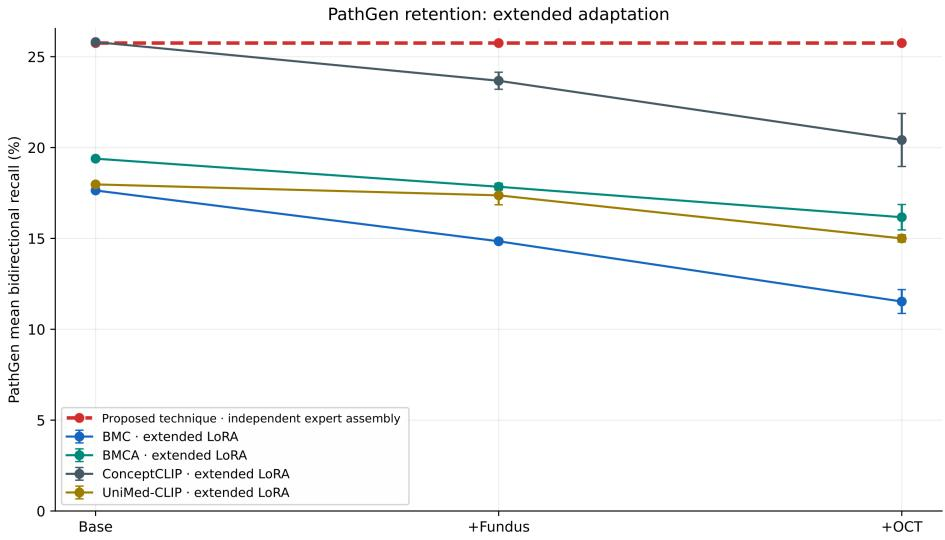  
Figure 3: PathGen retention through fundus–OCT adaptation. Mean bidirectional Recall@{1, 10, 50} at the base checkpoint, after fundus, and after OCT. Baseline error bars show standard deviation over three seeds. The proposed technique’s independently trained experts leave the pathology pathway unchanged. Training history, data exposure, and adaptation capacity differ between the proposed technique and the sequential-LoRA baselines.

## G Retention across seven base modalities

We evaluate one benchmark for each of the seven original modalities before and after adding fundus and OCT. For the baselines, we reuse the sequential LoRA runs described in Section E. For the proposed technique, we evaluate three assembled checkpoints: the original core, the core with the fundus expert, and the core with both the fundus and OCT experts. The two new experts were trained independently from the frozen core and then combined. Therefore, this procedure differs from both the sequential baseline adaptation and the three-seed matched-data experiment.

We use OpenI (3,826 rows), MR-RATE (505), Derm7pt (1,011), PathGen-600 (600), ROCO-CT (2,026 pairs), Liver-US (680), and EndoReport (217). ROCO-CT is a CT-only subset of the ROCOv2 test split (Rückert et al., 2024). We select this subset using the dataset’s modality annotations and remove records with missing or non-CT modality labels. Each image is paired with a caption from a biomedical publication. All seven benchmarks measure bidirectional retrieval recall. Inputs, prompts, and scoring procedures remain fixed across stages.

For each benchmark, we report $\Delta = S _ { \mathrm { a f t e r ~ O C T } } - S _ { \mathrm { b a s e } }$ in percentage points. A negative value indicates a performance decrease, and a positive value indicates an improvement. All retrieval benchmarks use cosine similarity. The retrieval score averages Recall@1, Recall@10, and Recall@50 across both directions.

The baseline scores decrease in 27 of the 28 model–benchmark combinations. UniMed-CLIP improves on MR-RATE by 0.57 points. Every other baseline result decreases, and all four baselines decrease on ROCO-CT. The proposed technique remains unchanged on all seven benchmarks. The mean row summarizes percentage-point changes across different tasks; it is not a single shared evaluation metric.

The saved the proposed technique image and text features are byte-identical across the evaluated checkpoints, and the ROCO-CT retrieval results are unchanged. This verifies preservation on the tested inputs. It does not mean that every parameter or scaled similarity logit is unchanged because the learned logit-scale parameter differs between the original core and the fundus checkpoint. We also do not claim that every baseline decrease is statistically significant or that these seven tasks cover every capability of the models.

## H Qualitative examples

The following figures show one retrieval example for each original modality in Table 13, before expansion and after adding fundus and OCT. Every model uses the same query, gallery, preprocessing, and cosinesimilarity scoring at both stages. Each figure shows the three highest-ranked reports. Green marks a report that is correct under the benchmark’s matching rule; an unmarked report may still be clinically relevant. These examples illustrate individual ranking changes. We also include a separate CT-Kidney classification example (Figure 8); it is not part of the aggregate retrieval results in Table 13.

## I Saliency overview across nine modalities

Figure 11 shows similarity-gradient Grad-CAM maps for all nine modalities. We back-propagate the image– text cosine similarity for each finding prompt through the routed expert to the final block’s patch tokens. The maps illustrate spatial responses to the specified prompts across the modalities, including fundus and OCT. They are qualitative examples rather than a quantitative localization evaluation.

X-rayopenl Image-to-text retrieval·3,826 evaluation rows · all baselines: seed

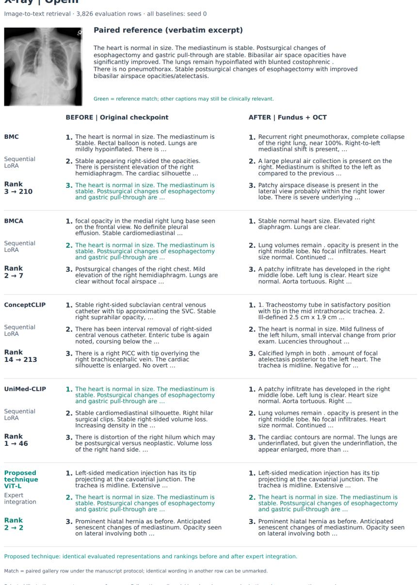  
Figure 4: X-ray (OpenI) qualitative example. Top-three image-to-report results for the same query radiograph before expansion (original checkpoint) and after fundus and OCT integration. Baseline results use seed 0. Green marks the reference report. The rank of the benchmark-positive report is: the proposed technique 2 → 2 (unchanged; saved representations identical); BMC 3 → 210; BMCA 2 → 7; ConceptCLIP 14→213; UniMed-CLIP 1→46.

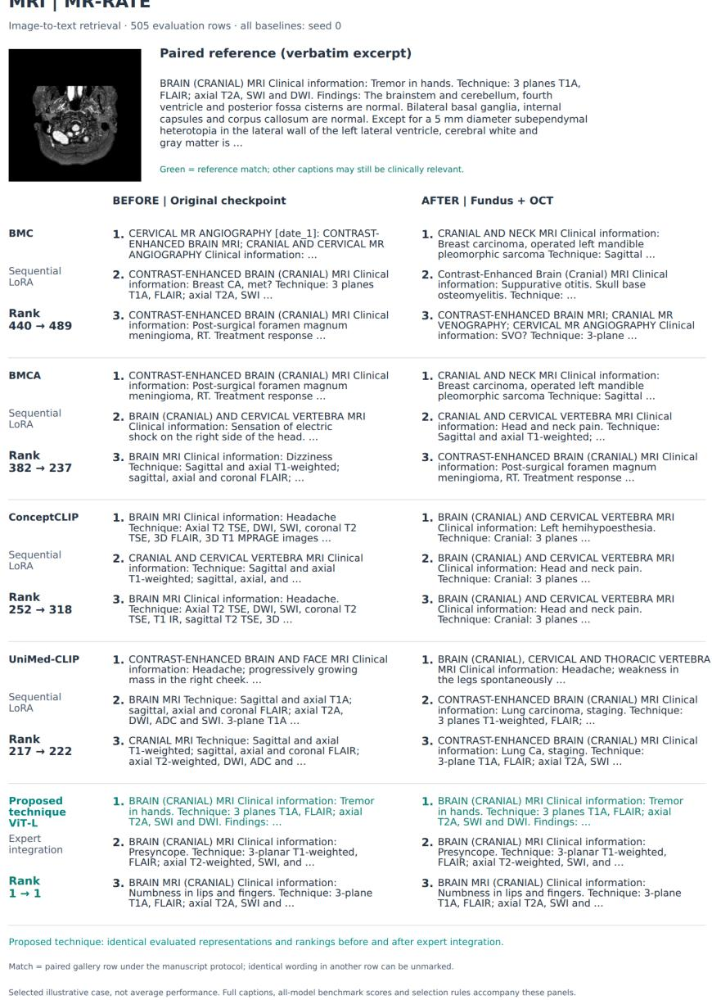  
Figure 5: MRI (MR-RATE) qualitative example. We use the same before-and-after format as Figure 4 and apply MR-RATE scoring. The rank of the benchmark-positive report is: the proposed technique 1→1; BMC 440 → 489; BMCA 382 → 237; ConceptCLIP 252 → 318; UniMed-CLIP 217 → 222. For this query, no baseline ranks the correct report among the top three at either checkpoint, whereas the proposed technique ranks it first at both checkpoints.

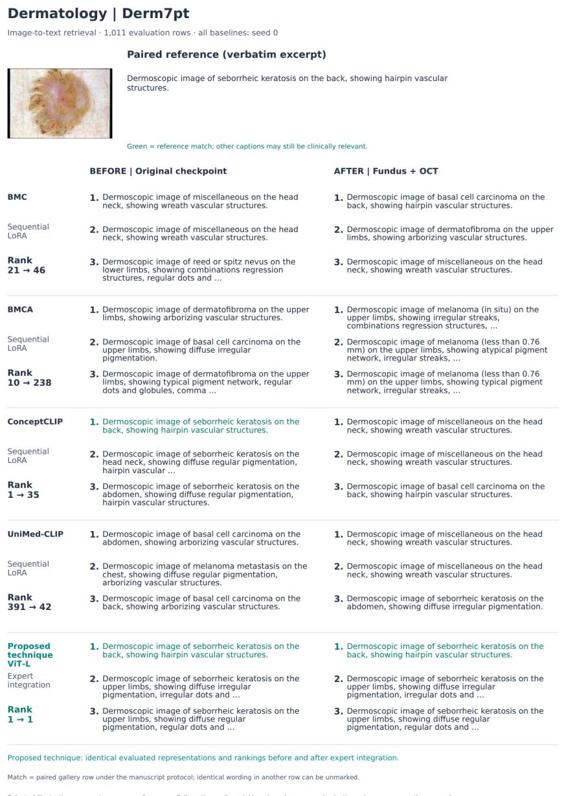  
Figure 6: Dermatology (Derm7pt) qualitative example. We use the same before-and-after format as Figure 4 and apply Derm7pt scoring. The rank of the benchmark-positive report is: the proposed technique 1 → 1; BMC 21 → 46; BMCA 10 → 238; ConceptCLIP 1 → 35; UniMed-CLIP 391 → 42. For this query, ConceptCLIP is the only baseline that ranks the correct report among the top three before adaptation; no baseline does so afterward.

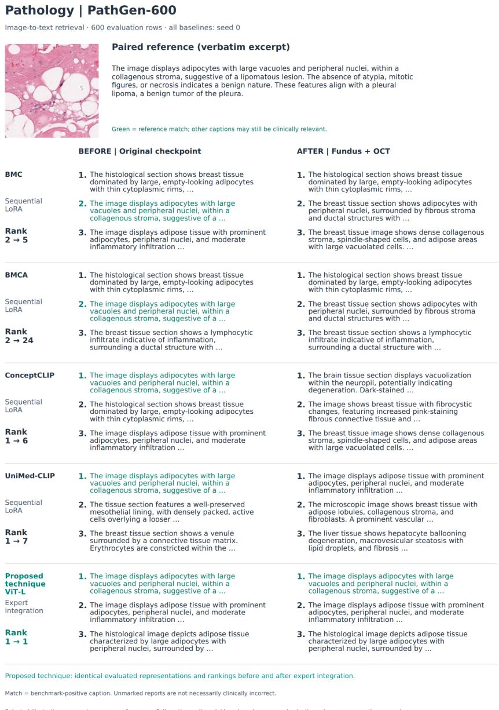  
Figure 7: Pathology (PathGen-600) qualitative example. We use the same before-and-after format as Figure 4 and apply PathGen-600 scoring. The rank of the benchmark-positive report is: the proposed technique 1 → 1; BMC 2 → 5; BMCA 2 → 24; ConceptCLIP 1 → 6; UniMed-CLIP 1 → 7. All four baselines place the correct report in the top three before adaptation; none do afterward.

CT|CT-Kidney Zero-shot classification · 1,867 evaluation rows · all baselines: seed 0
<table><tr><td>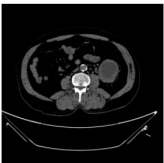</td><td colspan="2">Reference label Cyst</td></tr><tr><td></td><td>Green = ground-truth class.</td><td></td></tr><tr><td></td><td>BEFORE | Original checkpoint</td><td>AFTER | Fundus + OCT</td></tr><tr><td>BMC</td><td>1. Kidney cyst</td><td>1. Kidney stone</td></tr><tr><td>Sequential LORA</td><td>2. Kidney stone</td><td>2. Kidney tumor</td></tr><tr><td>Rank 1→3</td><td>3. Kidney tumor</td><td>3. Kidney cyst</td></tr><tr><td>BMCA</td><td>1. Kidney cyst</td><td>1. Kidney stone</td></tr><tr><td>Sequential LORA</td><td>2. Kidney stone</td><td>2. Kidney tumor</td></tr><tr><td>Rank 1→3</td><td>3. Normal kidney</td><td>3. Kidney cyst</td></tr><tr><td>ConceptCLIP</td><td>1. Kidney cyst</td><td>1. Kidney tumor</td></tr><tr><td>Sequential LORA</td><td>2. Kidney tumor</td><td>2. Kidney cyst</td></tr><tr><td>Rank 1→2</td><td>3. Normal kidney</td><td>3. Normal kidney</td></tr><tr><td>UniMed-CLIP</td><td>1. Kidney cyst</td><td>1. Kidney stone</td></tr><tr><td>Sequential LoRA</td><td>2. Normal kidney</td><td>2. Kidney tumor</td></tr><tr><td>Rank 1 →4</td><td>3. Kidney stone</td><td>3. Normal kidney</td></tr><tr><td>Proposed technique ViT-L</td><td>1. Kidney cyst</td><td>1. Kidney cyst</td></tr><tr><td>Expert integration</td><td>2. Kidney tumor</td><td>2. Kidney tumor</td></tr><tr><td>Rank 1→1</td><td>3. Normal kidney</td><td>3. Normal kidney</td></tr></table>

CT is zero-shot class ranking, not report retrieval. Match = ground-truth class; scores are not probabilities

Figure 8: Additional CT-Kidney qualitative example. This is a zero-shot classification example, not a retrieval example, and it is not included in Table 13. We show the top three predictions among four classes (kidney cyst, stone, tumor, and normal kidney) for the same query before and after integration. Baseline results use seed 0. Green marks the ground-truth class (cyst). Its rank is: the proposed technique 1 → 1; BMC 1 → 3; BMCA 1 → 3; ConceptCLIP 1 → 2; UniMed-CLIP 1 → 4. At the original checkpoint, every model ranks the ground-truth class first. After adaptation, the rank decreases for every baseline on this query. However, on the full CT-Kidney benchmark, BMCA’s mean balanced accuracy improves after adaptation. CT-Kidney is a separate zero-shot evaluation and is not the ROCO-CT retrieval benchmark in Table 13. This difference shows why a single example should not be used to infer aggregate performance.

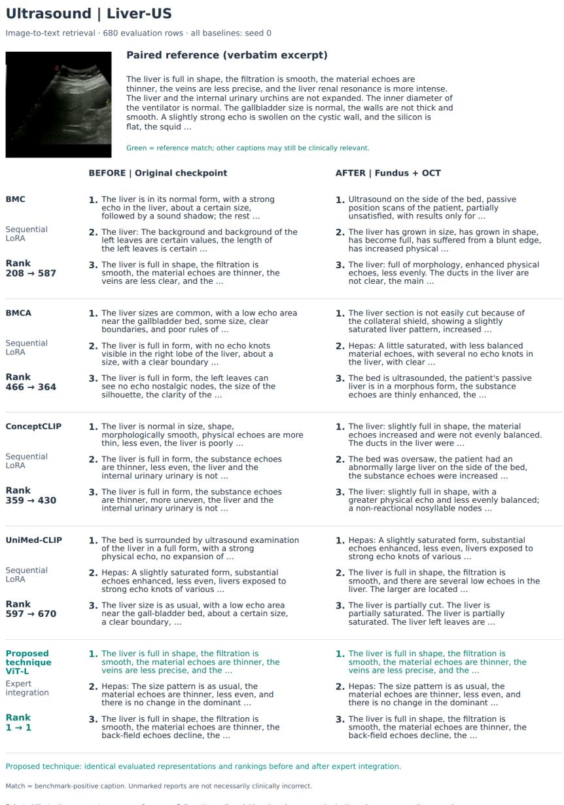  
Figure 9: Ultrasound (Liver-US) qualitative example. We use the same before-and-after format as Figure 4 and apply Liver-US scoring. The rank of the benchmark-positive report is: the proposed technique 1 → 1; BMC 208 → 587; BMCA 466 → 364; ConceptCLIP 359 → 430; UniMed-CLIP 597 → 670. No baseline is within the top three at either checkpoint on this query.

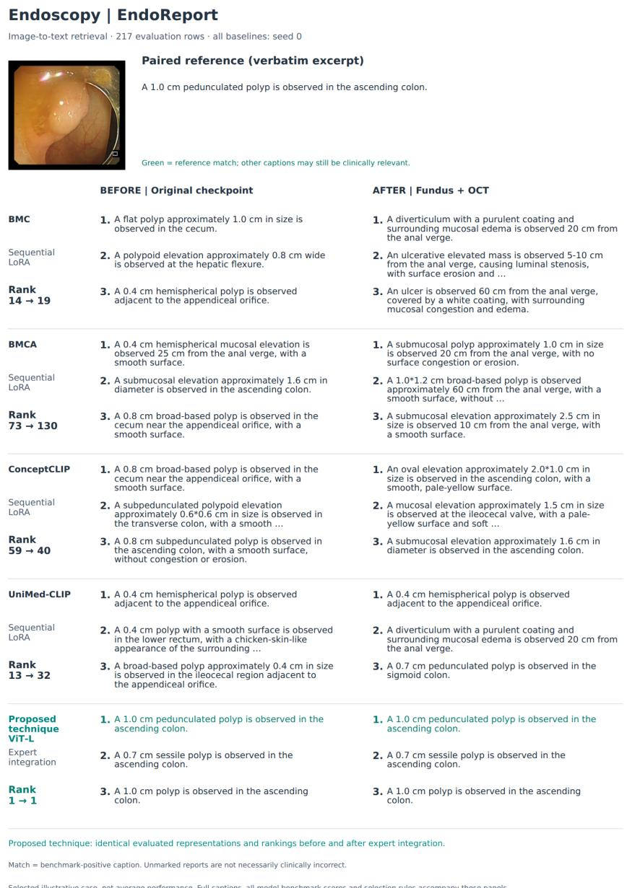  
Figure 10: Endoscopy (EndoReport) qualitative example. We use the same before-and-after format as Figure 4 and apply EndoReport scoring. The rank of the benchmark-positive report is: the proposed technique 1 → 1; BMC 14 → 19; BMCA 73 → 130; ConceptCLIP 59 → 40; UniMed-CLIP 13 → 32. No baseline is within the top three at either checkpoint on this query.

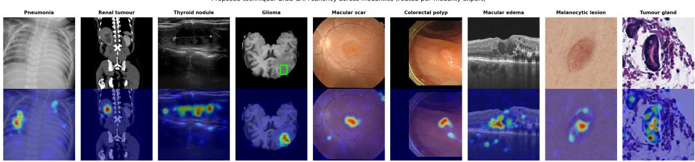  
Figure 11: Qualitative saliency across nine modalities. Similarity-gradient Grad-CAM through each modality’s routed expert; top row original, bottom row saliency. Left to right: pneumonia, renal tumour, thyroid nodule, glioma on FLAIR with the ground-truth box, macular scar, colorectal polyp, macular edema on OCT, melanocytic lesion, and malignant gland on H&E. Fundus and OCT use experts added to a frozen model.

Table 6: Training data for the ViT-L core and modality extensions. Stage 1 uses image rows for masked pretraining, and Stage 2 uses image–text pairs for alignment. The pathology Stage 1 count is measured in extracted patches. A dash indicates that no additional Stage 1 training is used for an extension.
<table><tr><td>Modality</td><td>Stage 1 rows Stage 2 pairs Sources: Stage 1 → Stage 2</td><td></td><td></td></tr><tr><td>Pathology</td><td>5,956,670†</td><td></td><td>1,139,291 TCGA patches (Weinstein et al., 2013) → Quilt-1M (Ikezogwo et al., 2023); PathCap (Sun et al., 2024)</td></tr><tr><td>Endoscopy</td><td>4,864,701</td><td></td><td>158,672 Endo-FM private (Wang et al., 2023b); Hyper-Kvasir (Borgli et al., 2020); Kvasir-Capsule (Smedsrud et al., 2021); CholecT45 (Nwoye et al., 2022); LDPolypVideo (Ma et al., 2021);</td></tr><tr><td>MRI</td><td>3,877,303</td><td></td><td>Colonoscopic → Kvasir-VQA-x1 (Gautam et al., 2025) 463,588 MedTrinity MRI (Xie et al., 2025), including BraTS (Menze et al., 2015) → MedTrinity MRI (Xie et al., 2025)</td></tr><tr><td>CT</td><td>3,336,658</td><td></td><td>347,842 MedTrinity CT (Xie et al., 2025) → MedTrinity CT (Xie et al., 2025)</td></tr><tr><td>X-ray</td><td>621,616</td><td></td><td>212,498 MIMIC-CXR-JPG (Johnson et al., 2024); CheXpert (Irvin et al., 2019); NIH ChestX-ray14 (Wang et al., 2017) → CheXpert (Irvin</td></tr><tr><td>Ultrasound</td><td>193,308</td><td></td><td>et al., 2019) 364,362 MIMIC-IV-ECHO (Gow et al., 2026); brachial plexus (Tyagi et al., 2024); STMUS (Marzola et al., 2021); EchoCP (Wang et al.,</td></tr><tr><td>Dermatology</td><td>542,819</td><td></td><td>2021) → US-365K (Jin et al., 2026) 542,820 ISIC, with known HAM10000 IDs excluded → ISIC metadata-derived captions (International Skin Imaging Collaboration, 2026)</td></tr><tr><td>Seven-modality core Fundus extension</td><td>19,393,075†</td><td>3,229,073</td><td>88,143DeepEyeNet (Huang et al., 2021); GMAI-VL-5.5M (Li et al.,</td></tr><tr><td></td><td></td><td></td><td>2026); MedConcept-23M (Nie et al., 2026); PMC-derived pairs (Lin et al., 2023; National Library of Medicine, 2026)</td></tr><tr><td>OCT extension</td><td></td><td>19,396</td><td></td></tr><tr><td>Total</td><td>19,393,075†</td><td>3,336,612</td><td></td></tr><tr><td></td><td></td><td></td><td>OCT-summary-Dataset (QIAIUNCC, 2026)</td></tr></table>

Table 7: Architecture and parameter counts in millions $( 1 0 ^ { 6 } )$ . Image path denotes selected-path image parameters for the proposed technique and visual-module parameters for the baselines. Total denotes the full stored inference model. MerMED is vision-only.
<table><tr><td>Model</td><td>Vision backbone</td><td>Input Image path (M)</td><td></td><td>Total (M)</td></tr><tr><td>Proposed technique ViT-L (9-mod)</td><td>Multiway ViT-L/16 + DA-MoE</td><td>384</td><td>355.40</td><td>1,280.00</td></tr><tr><td>BMC</td><td>ViT-B/16</td><td>224</td><td>86.19</td><td>195.90</td></tr><tr><td>BMCA</td><td>ViT-L/14</td><td>224</td><td>303.97</td><td>454.16</td></tr><tr><td>ConceptCLIP</td><td>SigLIP SO400M/14</td><td>384</td><td>428.23</td><td>542.87</td></tr><tr><td>UniMed-CLIP</td><td>ViT-B/16</td><td>224</td><td>86.19</td><td>195.90</td></tr><tr><td>MerMED (inference backbone)</td><td>ViT-B/16</td><td>224</td><td>85.80</td><td>85.80</td></tr></table>

Table 8: Full-data ViT-L fundus and OCT expert training. Configured epochs are the training budgets; selected epochs identify the checkpoints used in the final full-data assembly.
<table><tr><td>Setting</td><td>Fundus</td><td>OCT</td></tr><tr><td>Training pairs</td><td>88,143</td><td>19,396</td></tr><tr><td>Initialization</td><td>Seven-modality base</td><td>Seven-modality base</td></tr><tr><td>Additional Stage 1</td><td>None</td><td>None</td></tr><tr><td>Learning rate</td><td> $1 0 ^ { - 4 }$ </td><td> $1 0 ^ { - 4 }$ </td></tr><tr><td>Global batch size</td><td>112</td><td>112</td></tr><tr><td>Per-GPU batch size</td><td>16</td><td>16</td></tr><tr><td>Configured epochs</td><td>10</td><td>40</td></tr><tr><td>Selected checkpoint epoch</td><td>8</td><td>15</td></tr><tr><td>Selection criterion</td><td>Training-loss plateau</td><td>Training-loss plateau</td></tr></table>

Table 9: Settings for the proposed technique’s matched-data expansion experiment. The 20,000 fundus pairs are selected from the available paired fundus training dataset; the 16,000 OCT pairs are selected from the available paired OCT training dataset.
<table><tr><td>Setting</td><td>Value</td></tr><tr><td>Training pairs</td><td>Fundus: 20,000; OCT: 16,000</td></tr><tr><td>Seeds</td><td>0,1,2</td></tr><tr><td>Optimizer</td><td>AdamW; weight decay 0.01</td></tr><tr><td>Batch size</td><td>32 image-text pairs</td></tr><tr><td>Candidate learning rates</td><td> $1 0 ^ { - 5 }$  and  $3 \times 1 0 ^ { - 5 }$ </td></tr><tr><td>Training length</td><td>Minimum 8, maximum 20 epochs per candidate</td></tr><tr><td>Early stopping</td><td>Four epochs without a cumulative validation gain of 0.1 per- centage points relative to the stopping reference</td></tr><tr><td>Checkpoint selection</td><td>Highest current-taskvalidationmean bidirectional</td></tr><tr><td>Image preprocessing</td><td>Recall@ {1, 10, 50}; first maximum on ties Bicubic resize and center crop to  $3 8 4 \times 3 8 4$  ; tensor values in</td></tr><tr><td>Text input</td><td>[0,1] SentencePiece; maximum length 256</td></tr><tr><td>Loss</td><td>Symmetric contrastive loss with identical captions treated as</td></tr><tr><td>Logit scale</td><td>multiple positives Frozen at the initial checkpoint value</td></tr></table>

Table 10: Settings for the ViT-B comparison with and without DA-MoE (Section C).
<table><tr><td>Setting</td><td>Value</td></tr><tr><td>Shared initialization</td><td>Identical randomly initialized shared weights; no pretrained back- bone checkpoint</td></tr><tr><td>Expert initialization</td><td>Shared-FFN initialization with zero output projections; routed model only</td></tr><tr><td>Visual tokenizer</td><td>Same pretrained, frozen VQ-KD tokenizer for both models</td></tr><tr><td>Stage-1 images</td><td>69,902 across seven modalities; 98 validation-overlapping image paths excluded</td></tr><tr><td>Stage-1 text</td><td>3,229,073 unpaired texts, sampled separately from images</td></tr><tr><td>Stage-1 duration</td><td>Five image-data epochs; 1,560 optimizer updates</td></tr><tr><td>Stage-1 batch</td><td>Seven GPUs × 32 images and 32 independent texts per GPU</td></tr><tr><td>Stage-1 masking</td><td>40% image patches; 15% text tokens</td></tr><tr><td>Stage-1 learning rate</td><td>Peak  $2 \times 1 0 ^ { - 4 }$  , minimum  $1 0 ^ { - 5 } \colon$  156-update warmup, then cosine decay</td></tr><tr><td>Stage-1 objective</td><td>Equal-weighted sum of mean masked-image and mean masked- language cross-entropy losses</td></tr><tr><td>Stage-2 pairs</td><td>164,605 training / 8,666 validation</td></tr><tr><td>Stage-2 effective batch</td><td>4,032 pairs: 448-pair distributed microbatch × 9 accumulation steps</td></tr><tr><td>Stage-2 learning rate</td><td>Peak  $1 0 ^ { - 4 }$  ; text learning-rate multiplier 0.1</td></tr><tr><td>Stage-2 schedule</td><td>Five epochs; one-epoch warmup, then cosine decay</td></tr><tr><td>Checkpoint used for evaluation</td><td>Final Stage-2 epoch 5 for both variants</td></tr><tr><td>Logit scale Stage-2 objective</td><td>Trainable; initial effective temperature 0.02; scale capped at 100 Symmetric contrastive loss; auxiliary MLM, load balancing, and</td></tr><tr><td>Image resolution / text limit</td><td>distillation inactive 384 × 384 / 100 tokens</td></tr></table>

Table 11: Comparison with and without DA-MoE, the proposed technique (ViT-B) vs. no-MoE ViT-B. Zero-shot and linear probe are balanced accuracy; retrieval is mean R@{1, 10, 50} over both directions. All retrieval benchmarks use cosine similarity. PathGen-600 treats rows with identical captions as positives. Both variants share the same random initialization, training data, optimization settings, and training seed (Table 10); best per row.
<table><tr><td>Benchmark</td><td>Modality</td><td>Proposed technique ViT-B</td><td>no-MoE ViT-B</td><td>∆</td></tr><tr><td colspan="5">Zero-shot (n=8 benchmarks)</td></tr><tr><td>HAM10000</td><td>dermatology</td><td>.1401</td><td>.1276</td><td>+.0125</td></tr><tr><td>LC25000</td><td>pathology</td><td>.2000</td><td>.0652</td><td>+.1348</td></tr><tr><td>Thyroid</td><td>ultrasound</td><td>.5091</td><td>.4608</td><td>+.0483</td></tr><tr><td>BreaKHis</td><td>pathology</td><td>.5000</td><td>.5000</td><td>.0000</td></tr><tr><td>CASIA-CXR</td><td>X-ray</td><td>.3200</td><td>.2000</td><td>+.1200</td></tr><tr><td>Pneumonia</td><td>X-ray</td><td>.5107</td><td>.5346</td><td>-.0239</td></tr><tr><td>PanNuke (19 tissues)</td><td>pathology</td><td>.0526</td><td>.0499</td><td>+.0027</td></tr><tr><td>SARS-CoV-2 CT-scan zero-shot mean</td><td>CT</td><td>.4996 .3415</td><td>.4480 .2983</td><td>+.0516</td></tr><tr><td colspan="2">Linear probe (n=6 benchmarks)</td><td></td><td></td><td>+.0433</td></tr><tr><td colspan="2">BrainTumor MRI</td><td>.8683</td><td>.8568</td><td>+.0115</td></tr><tr><td>HAM10000</td><td>dermatology</td><td>.4289</td><td>.4325</td><td>-.0036</td></tr><tr><td>RadImageNet</td><td>MRI</td><td>.7582</td><td>.6908</td><td>+.0674</td></tr><tr><td>TN5000</td><td>ultrasound</td><td>.7667</td><td>.7475</td><td></td></tr><tr><td>CT-Kidney</td><td>CT</td><td></td><td></td><td>+.0192</td></tr><tr><td>HEST</td><td></td><td>.9355</td><td>.9142</td><td>+.0213</td></tr><tr><td></td><td>pathology</td><td>.9911</td><td>.9863</td><td>+.0048</td></tr><tr><td colspan="2">linear-probe mean</td><td>.7915</td><td>.7714</td><td>+.0201</td></tr><tr><td colspan="2">Cross-modal retrieval (n=4 benchmarks)</td><td></td><td></td><td></td></tr><tr><td>OpenI</td><td>X-ray MRI</td><td>.5881</td><td>.5837</td><td>+.0044</td></tr><tr><td>MR-RATE</td><td></td><td>3.5644</td><td>3.1584</td><td>+.4060</td></tr><tr><td>derm7pt</td><td>dermatology</td><td>1.9618</td><td>1.8958</td><td>+.0660</td></tr><tr><td>PathGen-600</td><td>pathology</td><td>3.5000</td><td>3.4444</td><td>+.0556</td></tr><tr><td colspan="2">retrieval mean</td><td>2.4036</td><td>2.2706</td><td>+.1330</td></tr></table>

Table 12: Comparison of multi-teacher and single-teacher visual tokenization. Zero-shot and linear-probe results are balanced accuracy (%). Retrieval results are mean bidirectional Recall@{1, 10, 50} (%). Means are recomputed from the benchmark values shown in the table. The best result in each row is in bold.
<table><tr><td>Task</td><td>Benchmark</td><td>Multi-teacher</td><td>Single-teacher</td></tr><tr><td rowspan="9">Zero-shot</td><td>HAM10000</td><td>14.29</td><td>14.11</td></tr><tr><td>LC25000</td><td>20.00</td><td>20.00</td></tr><tr><td>Thyroid</td><td>53.85</td><td>50.51</td></tr><tr><td>BreaKHis</td><td>50.00</td><td>50.00</td></tr><tr><td>CASIA-CXR</td><td>24.00</td><td>22.00</td></tr><tr><td>Pneumonia</td><td>50.00</td><td>50.00</td></tr><tr><td>PanNuke</td><td>5.97</td><td>5.26</td></tr><tr><td>SARS-CoV-2 CT-scan</td><td>66.66</td><td>50.00</td></tr><tr><td>Mean</td><td>35.60</td><td>32.74</td></tr><tr><td rowspan="7">Linear probe</td><td>BrainTumor</td><td>85.83</td><td></td></tr><tr><td>HAM10000</td><td></td><td>81.78</td></tr><tr><td>RadImageNet</td><td>39.48</td><td>34.02</td></tr><tr><td>TN5000</td><td>71.30</td><td>67.94</td></tr><tr><td></td><td>72.76</td><td>73.93</td></tr><tr><td>CT-Kidney</td><td>89.61</td><td>90.69</td></tr><tr><td>HEST Mean</td><td>99.05 76.34</td><td>98.97 74.56</td></tr><tr><td rowspan="6">Retrieval</td><td></td><td></td><td></td></tr><tr><td>OpenI</td><td>0.49</td><td>0.43</td></tr><tr><td>MR-RATE</td><td>3.96</td><td>3.96</td></tr><tr><td>Derm7pt</td><td>1.67</td><td>1.06</td></tr><tr><td>PathGen-600</td><td>3.28</td><td>3.22</td></tr><tr><td>Mean</td><td>2.35</td><td>2.17</td></tr></table>

Table 13: Full base-modality retention, ∆ from original checkpoint to after fundus+OCT integration (negative = forgetting, positive = improvement). Baseline values are the mean sequential-LoRA run over three seeds; ViT-L values for the proposed technique come from one checkpoint sequence (these values do not estimate training-seed variance). All seven rows use bidirectional retrieval recall.
<table><tr><td>Benchmark</td><td>Modality</td><td>Proposed technique</td><td>BMC</td><td>BMCA</td><td>ConceptCLIP</td><td>UniMed</td></tr><tr><td>OpenI</td><td>X-ray</td><td>0.00</td><td>-1.71</td><td>-0.70</td><td>-1.85</td><td>-14.70</td></tr><tr><td>MR-RATE</td><td>MRI</td><td>0.00</td><td>-0.20</td><td>-0.42</td><td>-0.23</td><td>+0.57</td></tr><tr><td>Derm7pt</td><td>dermatology</td><td>0.00</td><td>-2.46</td><td>-1.92</td><td>-2.59</td><td>-0.58</td></tr><tr><td>PathGen-600</td><td>pathology</td><td>0.00</td><td>-6.11</td><td>-3.22</td><td>-5.39</td><td>-2.97</td></tr><tr><td>ROCO-CT</td><td>CT</td><td>0.00</td><td>-33.26</td><td>-13.42</td><td>-10.86</td><td>-22.58</td></tr><tr><td>Liver-US</td><td>ultrasound</td><td>0.00</td><td>-0.44</td><td>-0.44</td><td>-0.54</td><td>-0.96</td></tr><tr><td>EndoReport</td><td>endoscopy</td><td>0.00</td><td>-4.46</td><td>-3.62</td><td>-1.43</td><td>-4.08</td></tr><tr><td>Mean (n = 7)</td><td></td><td>0.00</td><td>-6.95</td><td>-3.39</td><td>-3.27</td><td>-6.47</td></tr></table>

## J Comparative image–text similarity-gradient patch saliency

We supplement the quantitative evaluations with 66 selected examples from 22 datasets: 33 zero-shot classification examples, 21 linear-probe examples, and 12 image-to-text retrieval examples. Each dataset contributes three examples. The columns compare the proposed technique, BMC, BMCA (labeled BIOMEDICA in the source presentation), ConceptCLIP, and UniMed-CLIP. Each comparison uses the same source image and text prompt for all five models, with each model’s own image preprocessing. Within an example, the upper row shows the image and the lower row shows the saliency overlay. These selected cases illustrate differences in spatial responses; they do not estimate dataset-level accuracy or retrieval recall or characterize the models failure cases. IDRiD is included as an additional qualitative linear-probe dataset and is not a row in Table 2.

## J.1 Saliency construction and task-specific prompts

We compute image–text similarity-gradient patch saliency without updating model weights. Let s be the cosine similarity between the image and text embeddings, and let $A _ { p , c }$ be the patch features at the fourth transformer block from the end, where p indexes spatial patches and c indexes channels. Backpropagating s to these features gives

$$
H _ { p } = \mathrm { R e L U } \left( \sum _ { c } A _ { p , c } \frac { \partial s } { \partial A _ { p , c } } \right) .\tag{10}
$$

Each displayed overlay combines 50% image and 50% heatmap. The proposed technique uses the modality route associated with the image. This construction uses a patch-wise feature–gradient product; the new comparisons use the fourth block from the end, rather than the final-block maps in Figure 11. Heatmap colors visualize spatial responses within an example and should not be read as a common numerical scale across models.

Zero-shot classification. The heatmap prompt describes the ground-truth class, including when the model predicts a different class. For example, the first APTOS example uses “Fundus photograph showing proliferative diabetic retinopathy.” The first Pneumonia CXR example uses “Chest X-ray showing pneumonia.” The classification evaluation may average several prompts per class, whereas each heatmap explains the single prompt used for that example. Thus, the map is a response to the specified reference class, rather than necessarily an explanation of the predicted class or the full classification decision.

Linear probing. The linear classifier operates on image features and uses no text. A class-related text prompt is introduced only to compute the saliency map: the first Brain Tumor MRI example uses “pituitary, medical image”, and the first CT-Kidney example uses “Tumor, medical image”. The heatmaps explain image–prompt similarity. In particular, these maps are not gradients of the linear-probe class score.

Image-to-text retrieval. The target text is the image’s paired caption or report, including the full report when available. The recorded diagnostic label identifies the example but is not a replacement for the paired text. The maps therefore show the spatial response to the reference text. They do not visualize the content of a model’s highest-ranked alternative report.

## J.2 Reading the comparative examples

Figures 12–22 show zero-shot examples, Figures 23–29 show linear-probe examples, and Figures 30–33 show retrieval examples. Each caption identifies the three cases and explains specific spatial responses. Interpret these patterns together with the target text and the task-specific definitions above. Responses within an apparent lesion can occur in several models and do not by themselves establish a correct classification or a successful retrieval.

These visualizations provide descriptive evidence about the models’ spatial responses to text. They do not include a quantitative localization evaluation or establish that a highlighted region is causally necessary for a prediction. The selected examples complement the aggregate results in Tables 1, 2, and 3; they do not establish that one model localizes disease better across a complete dataset or isolate the effect of routing from other differences between models.

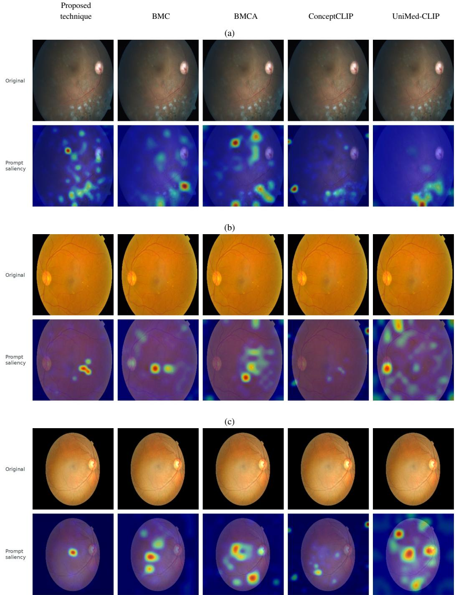  
Figure 12: APTOS 2019 zero-shot classification. Examples: (a) proliferative diabetic retinopathy, (b) moderate diabetic retinopathy, and (c) no diabetic retinopathy. In panel (a), the proposed technique highlights several locations within the retinal field, including the lower portion of the image. BMC and BMCA also respond in this area, while ConceptCLIP includes peripheral foci and UniMed-CLIP concentrates much of its response near the lower edge. The comparison shows how a common retinopathy prompt produces different spatial distributions. Heatmaps use ground-truthclass descriptions. Saliency construction follows Section J.1.

BMC

ConceptCLIP  
UniMed-CLIP  
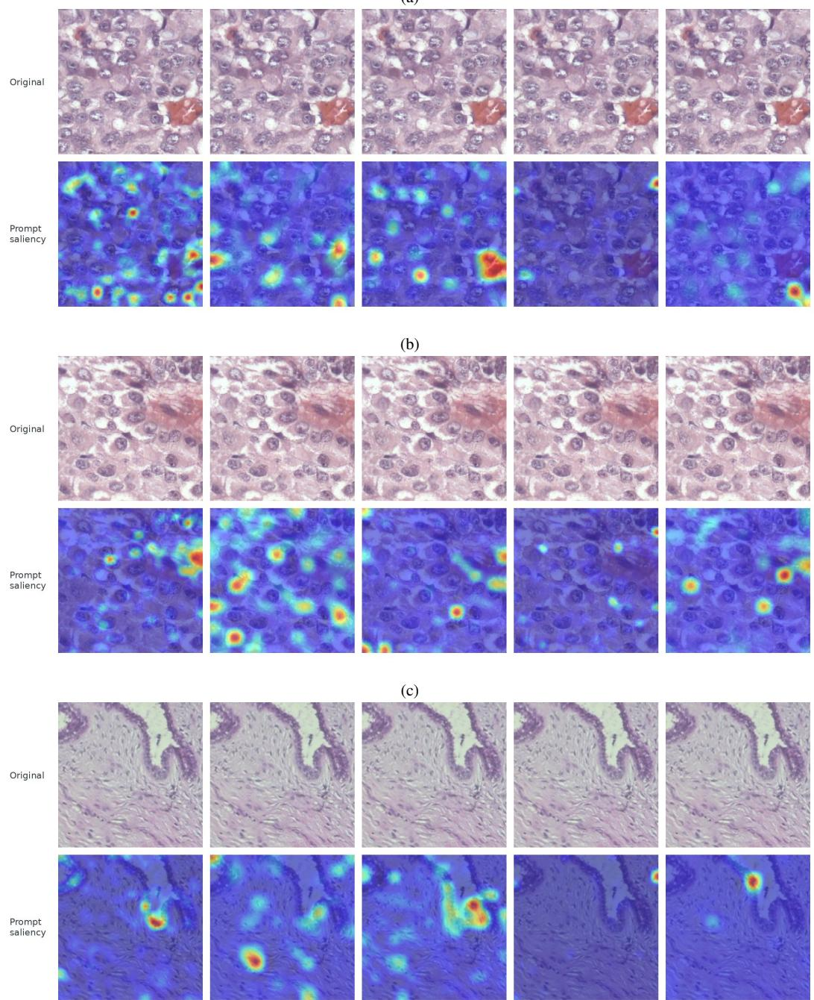  
Figure 13: BreakHis zero-shot classification. Examples: (a) malignant breast tumor, (b) malignant breast tumor, and (c) benign breast tumor. In panel (a), the proposed technique produces multiple foci across the cellular tissue, whereas BMC and BMCA emphasize a smaller set of locations. ConceptCLIP shows few prominent foci in this example, and UniMed-CLIP includes a response near the lower-right boundary. The overlays describe spatial responses to the tissue-class prompt without delineating a tumor boundary. Heatmaps use ground-truth-class descriptions. Saliency construction follows Section J.1.

Proposed technique

BMC

BMCA

ConceptCLIP

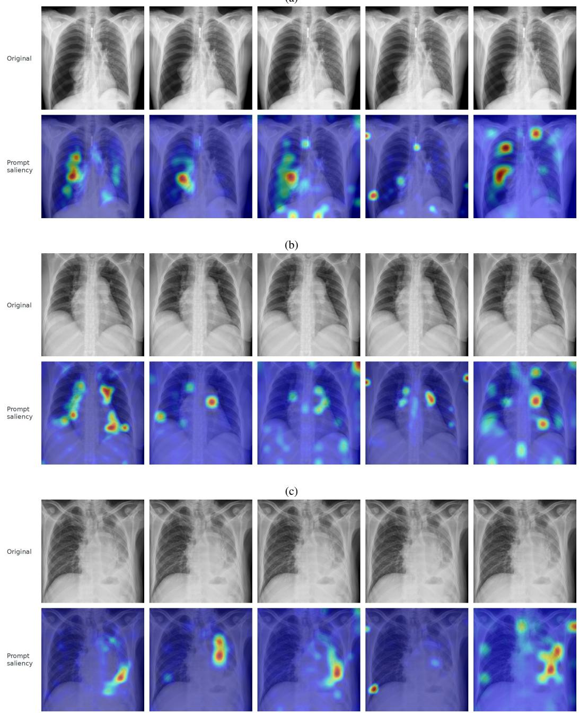  
Figure 14: CASIA-CXR zero-shot classification. Examples: (a) pneumothorax, (b) cardiomegaly, and (c) pleural effusion. In panel (a), the proposed technique, BMC, and BMCA show prominent foci within the lung field on the left side of the displayed image. ConceptCLIP distributes its foci differently, and UniMed-CLIP includes responses higher in the thorax. The differing maps illustrate sensitivity to the same finding description; they do not delineate the extent of pneumothorax. Heatmaps use ground-truth-class descriptions. Saliency construction follows Section J.1.

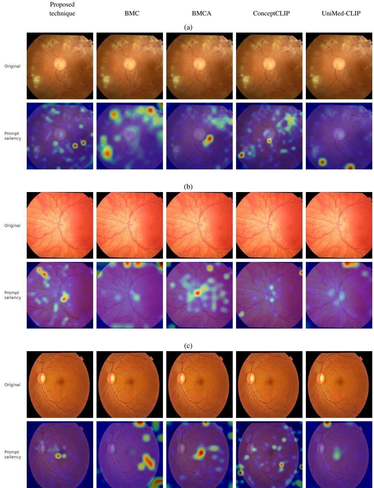  
Figure 15: Color Fundus zero-shot classification. Examples: (a) diabetic retinopathy, (b) myopia, and (c) healthy. In panel (a), the proposed technique produces several localized retinal responses, while BMC shows broader responses toward the upper and peripheral retinal field. BMCA includes a prominent focus near the optic disc, ConceptCLIP shows several scattered foci, and UniMed-CLIP emphasizes lower peripheral locations. The figure illustrates that a shared class description can elicit different responses within the same fundus image. Heatmaps use ground-truth-class descriptions. Saliency construction follows Section J.1.

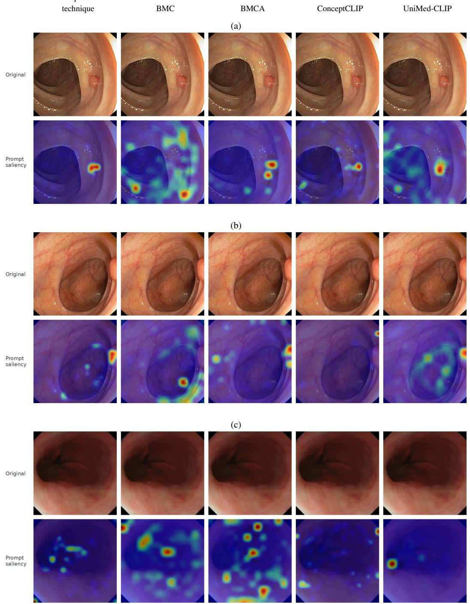  
Figure 16: EDD2020 zero-shot classification. Examples: (a) polyp-positive, (b) polyp-positive, and (c) polyp-negative. In panel (a), the proposed technique shows a compact response at the raised structure on the right side of the image. BMCA, ConceptCLIP, and UniMed-CLIP also include a response in this area, while BMC’s overlay extends across more of the surrounding mucosa. This example contrasts localized and distributed responses to the polyp-related prompt. Heatmaps use ground-truth-class descriptions. Saliency construction follows Section J.1.

Proposed technique

BMC

BMCA

ConceptCLIP

UniMed-CLIP  
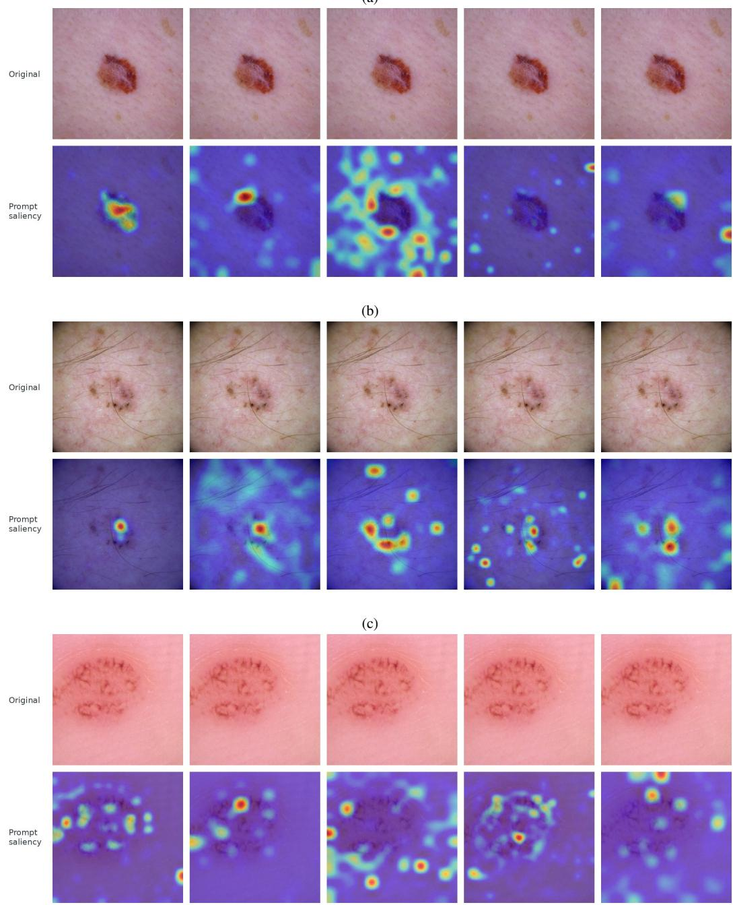  
Figure 17: HAM10000 zero-shot classification. Examples: (a) melanoma, (b) basal cell carcinoma, and (c) melanocytic nevus. In panel (a), the proposed technique shows a concentrated response over part of the pigmented lesion. BMC also highlights a lesion-associated area, while BMCA distributes responses over both the lesion and surrounding skin. ConceptCLIP and UniMed-CLIP show different, more limited foci. The overlays compare responses to the melanoma description without supplying a lesion segmentation. Heatmaps use ground-truth-class descriptions. Saliency construction follows Section J.1.

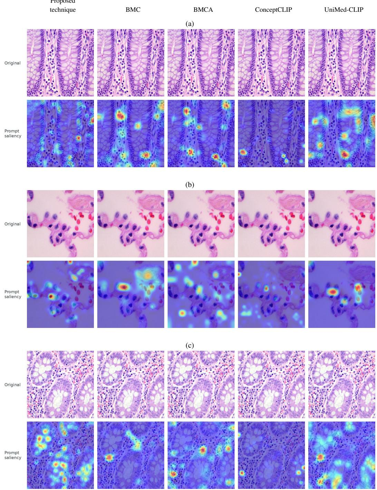  
Figure 18: LC25000 zero-shot classification. Examples: (a) colon tissue, (b) lung tissue, and (c) colon tissue. In panel (a), the proposed technique’s responses are distributed among the visible tissue structures. BMC, BMCA, and UniMed-CLIP place prominent foci at different positions within the same field, while ConceptCLIP highlights fewer locations. The comparison concerns the spatial response to the colon-tissue description, which can depend on tissue context rather than a single lesion. Heatmaps use ground-truth-class descriptions. Saliency construction follows Section J.1.

UniMed-CLIP  
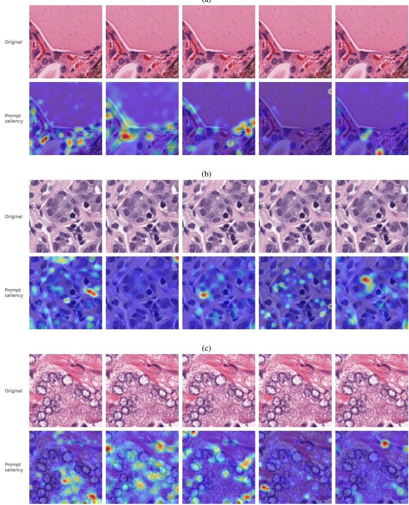  
Figure 19: PanNuke zero-shot classification. Examples: (a) thyroid, (b) breast, and (c) prostate. In panel (a), the proposed technique highlights several areas along the cellular band in the lower portion of the tissue image. BMC and BMCA also respond along this band, with different spatial extents, while ConceptCLIP and UniMed-CLIP emphasize other locations. These are responses to a tissue-class description, rather than nucleus-instance localization maps. Heatmaps use ground-truthclass descriptions. Saliency construction follows Section J.1.

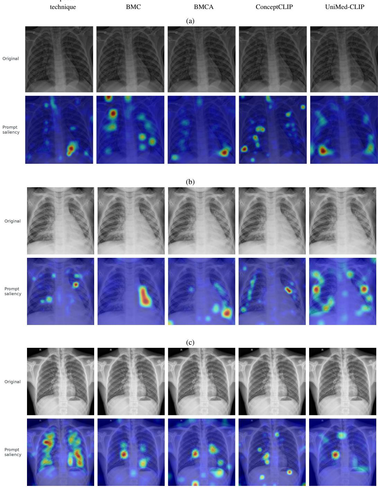  
Figure 20: Pneumonia CXR zero-shot classification. Examples: (a) pneumonia, (b) pneumonia, and (c) normal. In panel (a), the proposed technique includes a prominent focus in the lower portion of the thorax on the right side of the displayed image. BMC, BMCA, ConceptCLIP, and UniMed CLIP distribute their foci differently across the lung fields and upper thorax. These differences concern the spatial response to the pneumonia prompt and do not measure localization accuracy. Heatmaps use ground-truth-class descriptions. Saliency construction follows Section J.1.

(a)

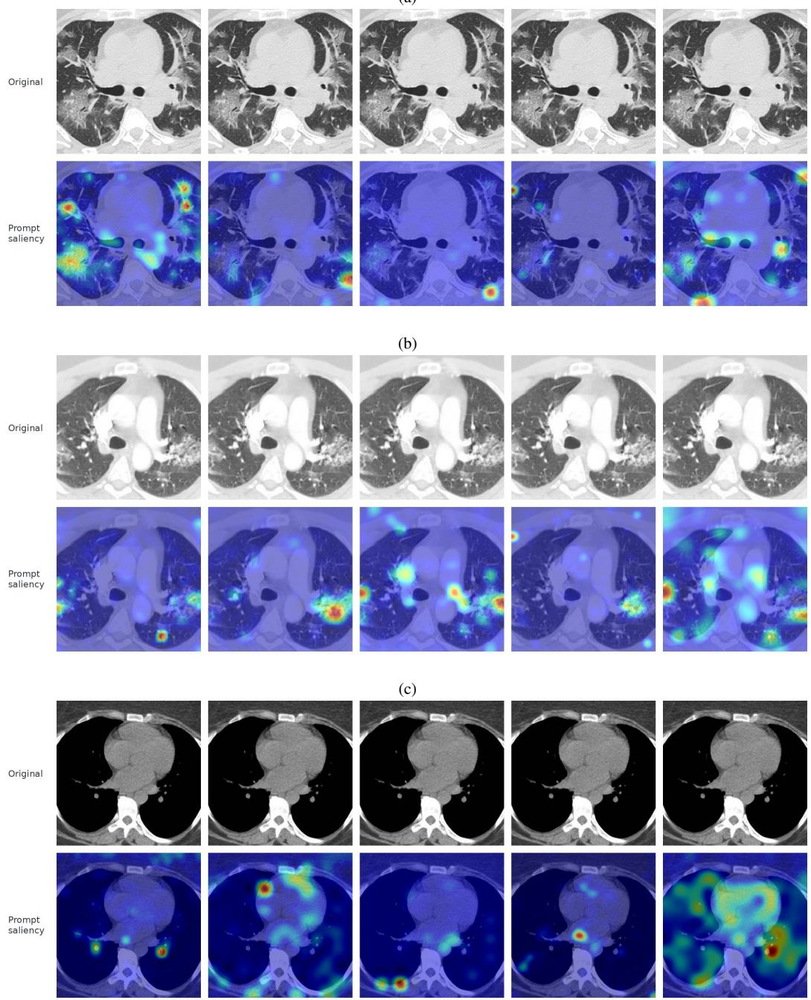  
Figure 21: SARS-CoV-2 CT zero-shot classification. Examples: (a) COVID-positive, (b) COVIDpositive, and (c) non-COVID. In panel (a), the proposed technique produces responses at several locations within the lung fields. BMC and BMCA include peripheral foci, ConceptCLIP highlights a different set of sparse locations, and UniMed-CLIP also responds near central thoracic structures. The overlays show prompt-conditioned responses on a CT slice without marking a validated infection boundary. Heatmaps use ground-truth-class descriptions. Saliency construction follows Section J.1.

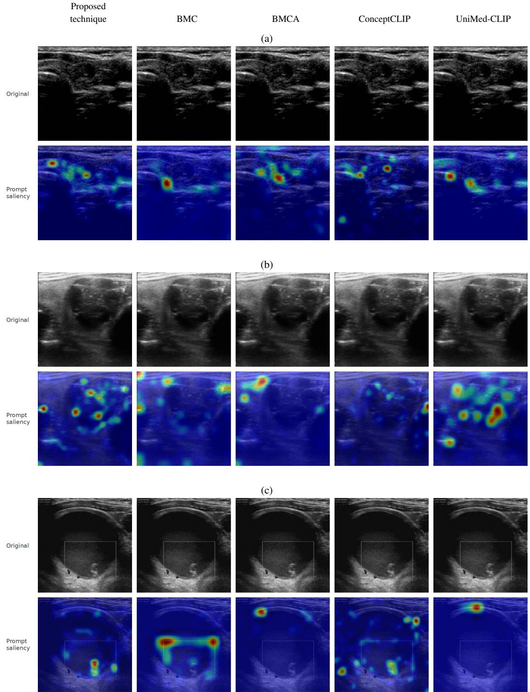  
Figure 22: Thyroid US zero-shot classification. Examples: (a) malignant thyroid nodule, (b) malignant thyroid nodule, and (c) benign thyroid nodule. In panel (a), the proposed technique, BMC, and BMCA emphasize different parts of the ultrasound tissue band. ConceptCLIP and UniMed-CLIP also produce localized foci, but at different positions. The comparison shows variation in responses to a thyroid-nodule description across the same ultrasound image; it does not establish which response delineates the nodule most accurately. Heatmaps use ground-truth-class descriptions. Saliency construction follows Section J.1.

Proposed technique

BMC

UniMed-CLIP  
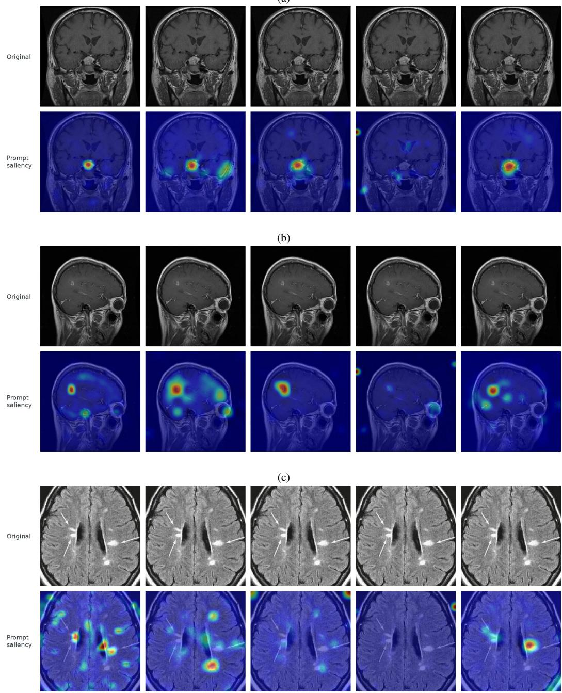  
Figure 23: Brain Tumor MRI linear-probe classification. Examples: (a) pituitary tumor, (b) glioma, and (c) no tumor. In panel (a), the proposed technique, BMC, BMCA, and UniMed-CLIP show a prominent response around the sellar region. BMC additionally highlights a lateral area, while ConceptCLIP shows a different spatial distribution. These maps explain similarity to the pituitary-related text prompt, independently of the image-only linear classifier. Heatmaps explain image–prompt similarity, not the linear-probe class score. Saliency construction follows Section J.1.

ConceptCLIP  
UniMed-CLIP  
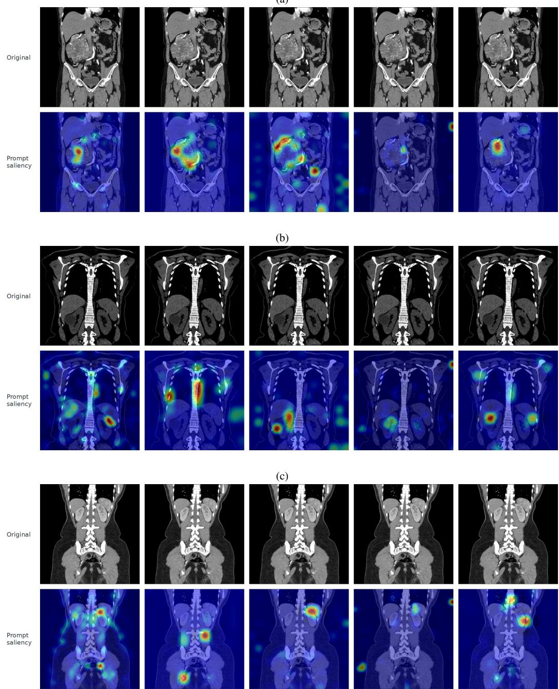  
Figure 24: CT-Kidney linear-probe classification. Examples: (a) tumor, (b) cyst, and (c) normal. In panel (a), the proposed technique and UniMed-CLIP show a localized response in the central abdominal region on the left side of the displayed image. BMC and BMCA show responses with a larger spatial extent, while ConceptCLIP emphasizes different locations. The maps describe simi larity to the tumor-related text prompt rather than contributions to the linear-probe score. Heatmaps explain image–prompt similarity, not the linear-probe class score. Saliency construction follows Section J.1.

ConceptCLIP  
UniMed-CLIP  
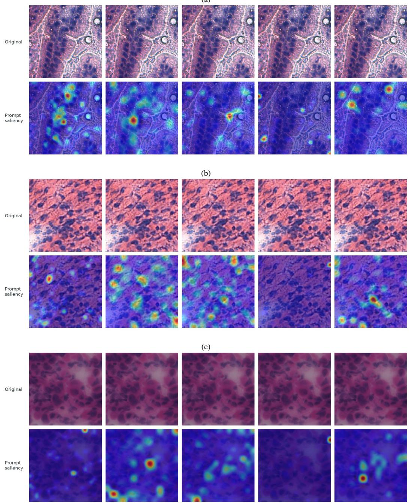  
Figure 25: HEST-320 linear-probe classification. Examples: (a) tissue class 1, (b) tissue class 4, and (c) tissue class 7. In panel (a), the proposed technique’s responses include several locations within and around the darker cellular tissue. BMC, BMCA, and UniMed-CLIP emphasize different portions of the field, while ConceptCLIP shows fewer prominent foci. Because the target is a tissueclass description, these responses concern tissue context and should not be interpreted as cell-level segmentation. Heatmaps explain image–prompt similarity, not the linear-probe class score. Saliency construction follows Section J.1.

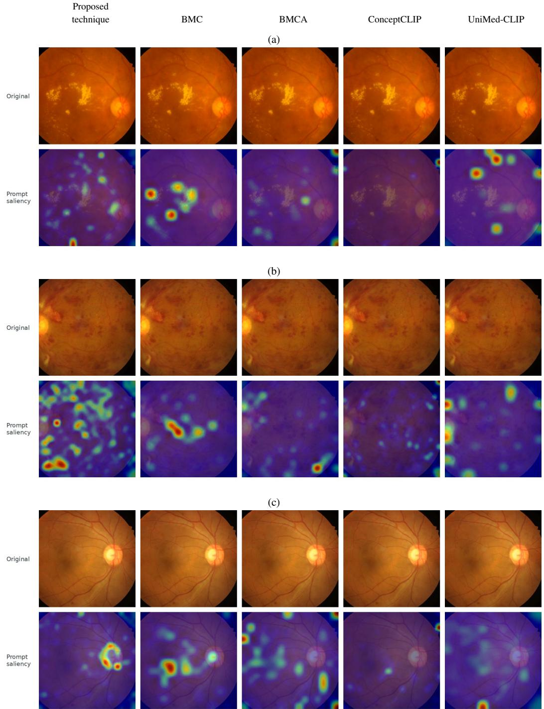  
Figure 26: IDRiD linear-probe classification. Examples: (a) moderate diabetic retinopathy, (b) proliferative diabetic retinopathy, and (c) no diabetic retinopathy. In panel (a), the proposed technique distributes responses across several retinal locations. BMC includes prominent foci around the central bright retinal markings, while BMCA, ConceptCLIP, and UniMed-CLIP produce different spatial patterns. The maps illustrate text-conditioned responses for a retinopathy example; the accompanying linear probe uses image features without a text prompt. Heatmaps explain image– prompt similarity, not the linear-probe class score. Saliency construction follows Section J.1.

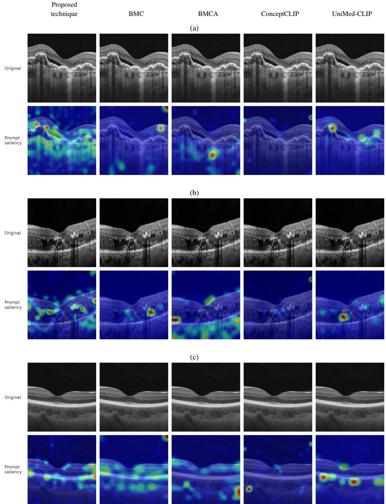  
Figure 27: OCT-DL linear-probe classification. Examples: (a) age-related macular degeneration, (b) diabetic macular edema, and (c) normal OCT. In panel (a), the proposed technique’s response extends along portions of the visible retinal profile and into the region beneath it. BMC, BMCA, ConceptCLIP, and UniMed-CLIP emphasize different locations within the same cross-section. This comparison shows how the disease-related text prompt interacts with retinal structure, without supplying retinal-layer or lesion segmentation. Heatmaps explain image–prompt similarity, not the linear-probe class score. Saliency construction follows Section J.1.

UniMed-CLIP

Proposed technique

BMC

BMCA

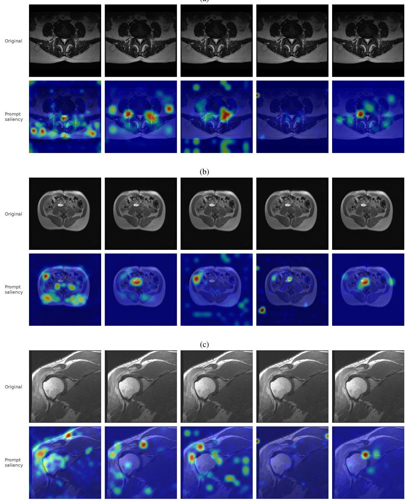  
Figure 28: RadImageNet linear-probe classification. Examples: (a) spine, (b) abdomen, and (c) shoulder. In panel (a), the proposed technique includes responses around the central spinal region and the lower image periphery. BMC, BMCA, and UniMed-CLIP emphasize different central and lateral locations, while ConceptCLIP shows a more limited pattern. The target describes an anatomical site, so these maps concern anatomy-related similarity rather than disease localization or the linear-probe decision. Heatmaps explain image–prompt similarity, not the linear-probe class score. Saliency construction follows Section J.1.

UniMed-CLIP  
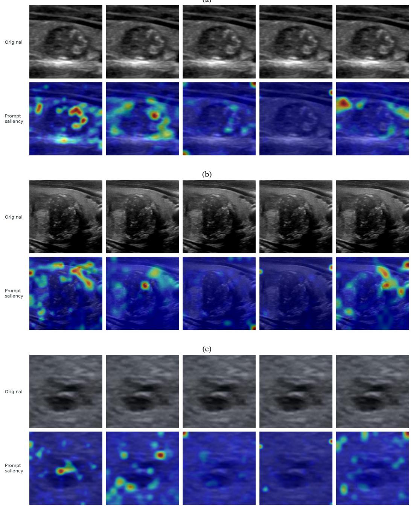  
Figure 29: TN5000 linear-probe classification. Examples: (a) malignant thyroid nodule, (b) malignant thyroid nodule, and (c) benign thyroid nodule. In panel (a), the proposed technique shows several responses within and around the central nodule appearance. BMC has a prominent central focus, while BMCA, ConceptCLIP, and UniMed-CLIP highlight different central or peripheral locations. The comparison explains similarity to the nodule-related prompt and remains separate from the image-only classifier’s score. Heatmaps explain image–prompt similarity, not the linear-probe class score. Saliency construction follows Section J.1.

UniMed-CLIP

Proposed technique

BMC

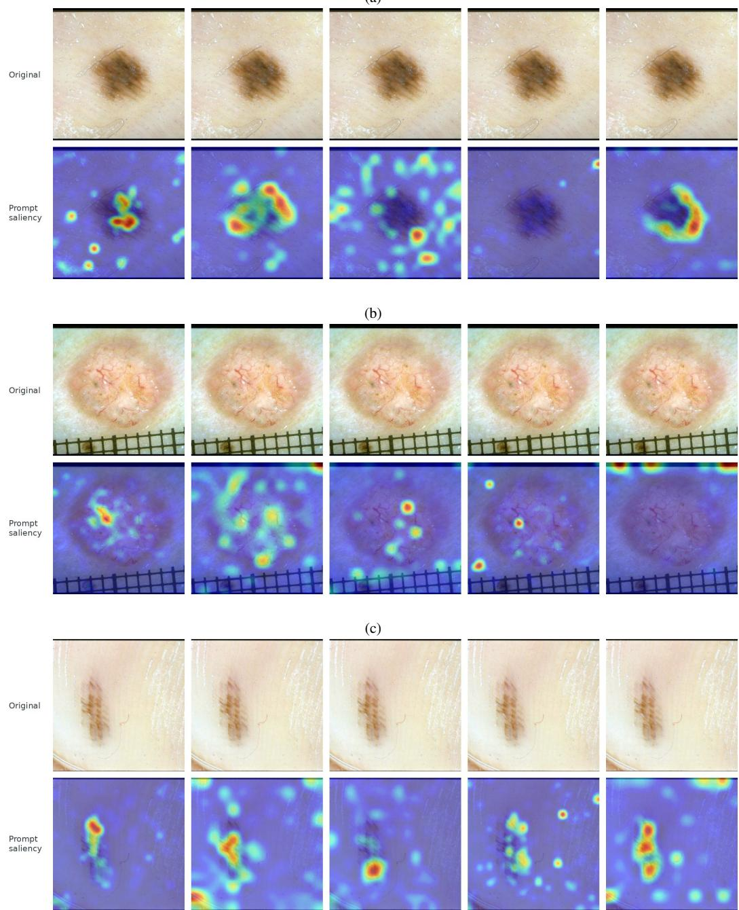  
Figure 30: Derm7pt image-to-text retrieval. Examples: (a) Clark nevus, (b) basal cell carcinoma, and (c) Clark nevus. In panel (a), the proposed technique, BMC, and UniMed-CLIP include responses within the pigmented lesion, with different spatial extents. BMCA produces several responses outside the lesion, while ConceptCLIP shows limited lesion-associated emphasis. These are responses to the paired text; their visual plausibility alone does not determine whether that text is ranked correctly in the retrieval gallery. Heatmaps use the paired caption or report. Saliency construction follows Section J.1.

Proposed technique

BMC

BMCA

ConceptCLIP

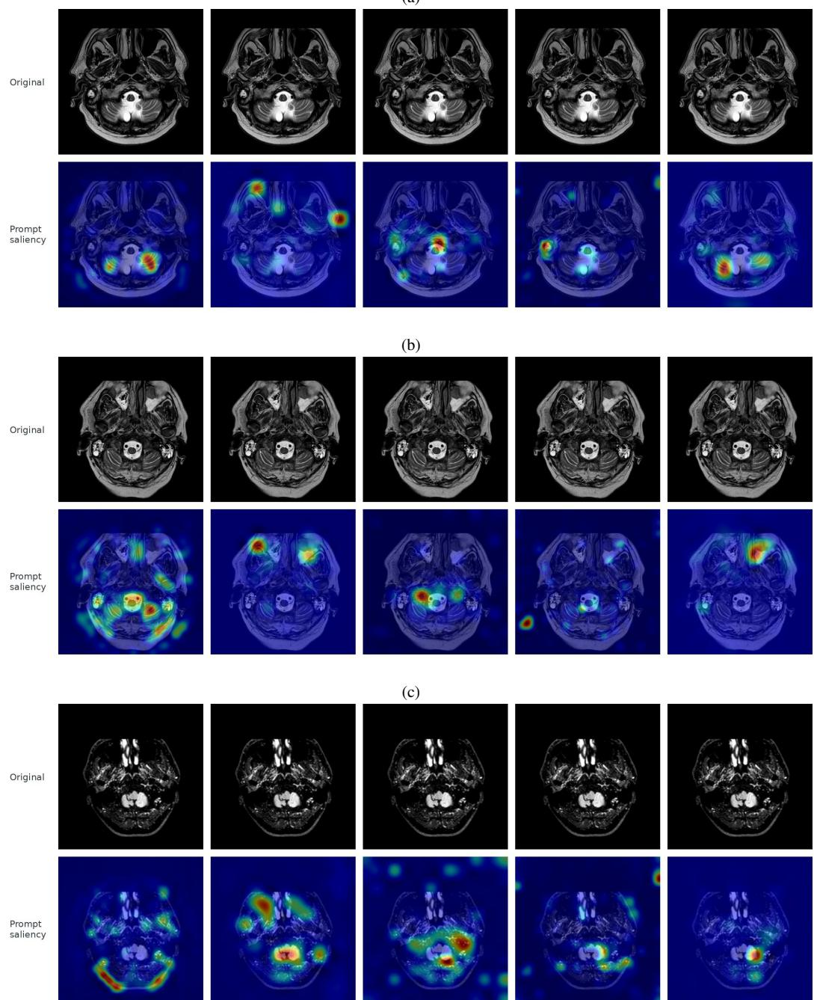  
Figure 31: MR-RATE image-to-text retrieval. Examples: (a) ischemic changes and atrophy, (b) bone/dural metastases, and (c) cranial MRI within normal limits. In panel (a), the proposed technique includes responses within the posterior portion of the displayed cranial image. BMC emphasizes more anterior and peripheral locations, while BMCA, ConceptCLIP, and UniMed-CLIP highlight different posterior or lateral areas. The target is the paired report, so the map should be read as a response to its full description rather than to one diagnostic term. Heatmaps use the paired caption or report. Saliency construction follows Section J.1.

Proposed technique

BMC

BMCA

ConceptCLIP

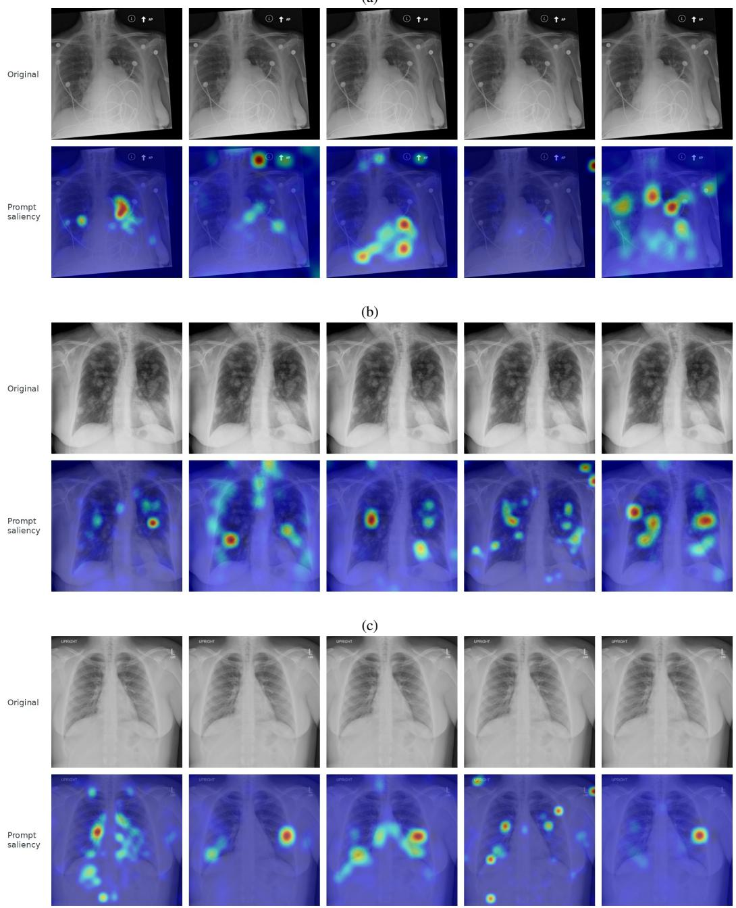  
Figure 32: OpenI image-to-text retrieval. Examples: (a) cardiomegaly and basilar opacity, (b) pulmonary nodules/mass, and (c) normal chest report. In panel (a), the proposed technique includes a prominent response near the central thorax. BMC emphasizes upper and central locations, BMCA includes responses lower in the thorax, ConceptCLIP shows a peripheral focus, and UniMed-CLIP distributes responses across several thoracic areas. The comparison illustrates different spatial re sponses to the same reference report without validating individual findings in that report. Heatmaps use the paired caption or report. Saliency construction follows Section J.1.

UniMed-CLIP  
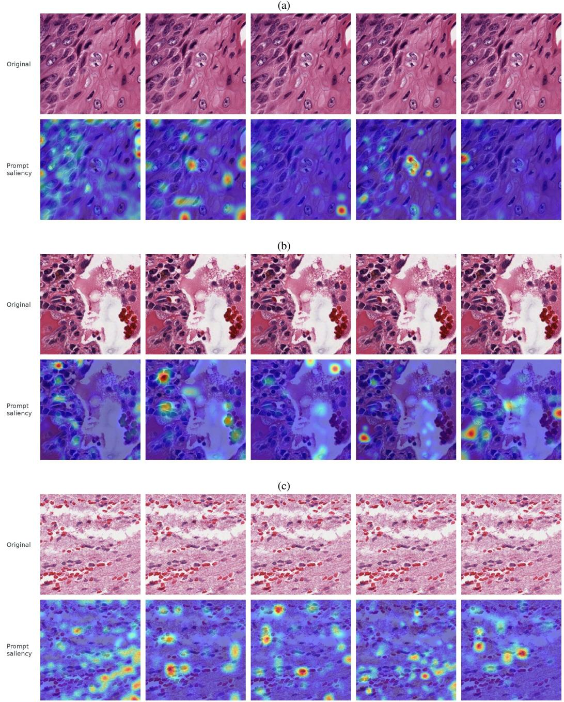  
Figure 33: PathGen-600 image-to-text retrieval. Examples: (a) papilloma / HPV-associated changes, (b) granulomatous inflammation, and (c) normal brain tissue. In panel (a), the proposed technique distributes responses among several cellular regions in the histology field. BMC and ConceptCLIP emphasize different groups of locations, while BMCA and UniMed-CLIP include prominent peripheral foci. These maps explain similarity to the paired pathology text and should not be interpreted as instance-level annotation of the reported cellular changes. Heatmaps use the paired caption or report. Saliency construction follows Section J.1.