# From Augmentation to Synthetic Evidence: Evaluating Generated Chest Radiographs at Dataset Intake

Shaikh Akib Shahriyar Zinedine Sehili Adam Arthur Christopher Schwartz

Rochester Institute of Technology

Rochester, NY, USA

as8751@rit.edu zs6496@rit.edu aia5138@rit.edu ccsics@rit.edu

## Abstract

A generated chest radiograph can be useful as declared augmentation, but the same image becomes unsupported evidence when submitted as the record of a real examination. We study this problem by separating three questions: whether an image passes an automated quality check, whether an origin classifier flags it as generated, and whether a trusted record supports the claimed acquisition. In our experiments, Qwen selects up to 20 images from pools of 1,000 existing Cheff-identified or SynthCheX candidates. A receiver evaluates quality with MedGemma and predicted origin with a classifier on frozen DINOv3 features. Quality-based selection raises quality passes from 12 to 19 of 20 for Cheff-identified images and from 8 to 17 for SynthCheX. We find no evidence that selection improves passage through both checks: no selected Cheffidentified image passes both, while uniform, quality, and quality-constrained surrogate selection produce 2, 1, and 2 SynthCheX passes. On unprocessed test images, the origin classifier flags 4,677 of 5,000 SynthCheX images, but it also misclassify 110 of 2,297 NIH (real) images and 568 of 957 genuine images from another collection as fake. Our results further show that JPEG compression reduces SynthCheXversus-NIH AUROC from 0.987 to 0.841. Even without processing, 152 SynthCheX images pass both pixel checks. These checks can filter submissions, but they cannot verify an acquisition claim. We strongly advocate that source and intended use must be recorded and checked separately for admission of chest radiographs in medical datasets.

## 1 Introduction

Image generators can now produce high-resolution chest radiographs [9, 27]. Such images are useful when they are declared as synthetic, for example to augment training data. They cause a problem when they are submitted to a research dataset as records of real examinations. A receiving system may check whether an image has acceptable technical quality and whether a classifier considers it generated. Neither check shows that a real examination produced the image. A generated image may pass both checks, and its origin may be lost in later reuse. The dataset can then treat a generated image as a recorded examination without evidence that the examination took place.

We call such an image synthetic evidence: a generated image that is offered as evidence of a real examination without the support that this claim requires. The definition builds on earlier work on ground-truth drift and evidence grounding [1, 19]. Whether an image counts as synthetic evidence depends on the image, the claim made about it, and its intended use, because a generated image is not fraudulent in itself. Figure 1(a) shows an example from our study. This generated SynthCheX image passes our automated quality check, and our origin classifier does not flag it as generated. If it is submitted as a clinical acquisition, nothing supports that claim. If it is submitted as declared augmentation, the same pixels are acceptable.

The example shows that three questions must be kept apart. Quality: does the image meet the receiver’s technical requirements? Predicted origin: does an image classifier label it as genuine or generated? Claim support: does the accompanying record support the claim that the image came from the stated acquisition, and is the declared use allowed? A pass on one question does not answer the others. An image can pass the first two, and the third stays open.

Earlier work measures the fidelity of generated radiographs, detects generated or edited medical images, and shows that compression and resizing can change detector behavior (Section 2). Can a submitter who chooses which generated images to send pass both checks more often than one who sends random images? In a controlled laboratory test, a submitter uses Qwen to select up to 20 images from pools of existing generated images, and a receiver applies a MedGemma quality check and an origin classifier built on DINOv3 features. A separate registry records the source and intended use. We find the following.

• Selection. Selecting by Qwen’s quality score increases the number of images that pass the quality check, but we find no evidence that it increases the number that pass both the quality and origin checks.

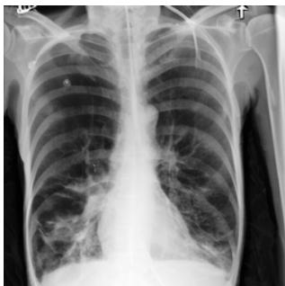  
(a) Generated; passes both checks

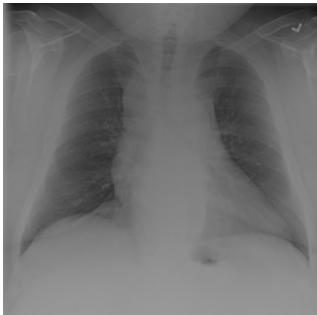  
(b) Genuine; passes quality, flagged as generated

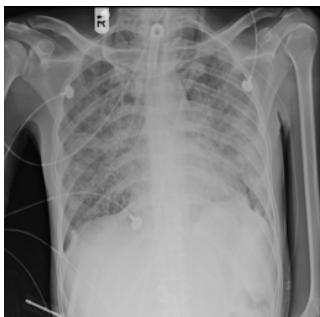  
(c) Genuine; fails quality, not flagged

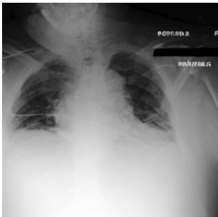  
(d) Generated; flagged as generated  
Figure 1. One example for each outcome of the two checks, chosen after the analysis by a fixed hash rule. Images (a) and (d) are generated (SynthCheX), and (b) and (c) are genuine (NIH ChestXray14). Image (a) passes both checks, but its pixels do not support a claim that it records a clinical acquisition.

• Processing. Image processing (JPEG compression and resizing) causes two separate problems for the origin classifier. Score shifts can invalidate a fixed threshold, which we call threshold drift. The classifier’s ranking can also deteriorate even after the threshold is reset, which we call ranking loss.

• Source shift. With the NIH-calibrated threshold unchanged, the primary classifier flags 568 of 957 genuine Open-I images.

Our contributions are (1) an intake test that keeps quality, predicted origin, and claim support separate, (2) measurements of how selection, processing, and a new genuine collection affect the quality and origin checks, and (3) a small registry experiment that records source and intended use apart from the pixels.

## 2 Related work

Generated radiographs. Cheff generates highresolution chest radiographs with latent diffusion [27]. CheXGenBench measures their fidelity, privacy, and training utility [9], and its earlier version and release card describe the SynthCheX images we use [8, 18]. Prior reader studies ask whether radiologists can distinguish generated radiographs from real ones [24, 25]. We instead study an automated intake process with separate quality and origin checks.

Detecting generated and edited images. CT-GAN inserts and removes lesions in CT scans [15]. DSKI/Med-Forensics provides a medical deepfake benchmark and detector [13], and MedForge detects localized edits [4]. MedForge-RSI reports rejected authentic images, failed transfer, and transmission distortions, and it adds an adaptation method [3]. Detectors can learn shortcuts based on compression and image size [11], and WaRPAD scores images by how they respond to high-frequency perturbation and rescaling [5]. We do not propose a detector. We ask how such shortcuts interact with quality-based selection and threshold calibration.

Calibration and provenance. Conformal calibration uses genuine images to set a threshold whose false-alarm rate is controlled when the genuine images are exchangeable and the score is fixed in advance [2]. Such a threshold says how unusual a score is among genuine images, not whether an image was acquired. Signatures for medical images [22], C2PA content credentials (signed records of a file’s history) [6], and the PROV data model [16] record the integrity and history of a file, not whether its content supports a factual claim. Our laboratory registry (Section 6) stores signed records and an explicit unknown state, and it adds no new cryptography.

## 3 Task and threat model

We model how a research dataset receives images (Fig. 2). A submission contains an image, a claim about where it came from, and a declared purpose. The claim we test is that the image records a clinical acquisition. The submitted images carry no source record, so their claim support is missing by design (Section 6). Collection labels tell us which images are NIH and which are generated. They are our ground truth, but they do not certify any clinical history.

The experiment starts from fixed pools of existing generated images. Using only Qwen judgments, the submitter selects at most K (Section 4.6) candidates that it expects to pass both receiver checks. The submitter has no access to MedGemma judgments, DINOv3-based origin scores, MedForge-Reasoner results, or receiver outcomes. The selected lists are fixed before the receiver applies the MedGemma quality check and the DINOv3-based origin check. A separate registry then checks the claimed source and declared purpose. This is a fixed, offline selection experiment over existing generated images, without receiver feedback.

Table 1. Images in each split. The calibration split holds genuine images only. The raw CLS head is fitted on NIH and Cheffidentified images, and the SynthCheX fit and development images serve secondary heads.
<table><tr><td>Collection</td><td>Fit</td><td>Dev.</td><td>Cal.</td><td>Test</td></tr><tr><td>NIH genuine</td><td>1,500</td><td>1,000</td><td>3,000</td><td>2,297</td></tr><tr><td>Cheff-identified</td><td>1,500</td><td>500</td><td>0</td><td>1,000</td></tr><tr><td>SynthCheX</td><td>1,000</td><td>500</td><td>0</td><td>5,000</td></tr><tr><td>Total</td><td>4,000</td><td>2,000</td><td>3,000</td><td>8,297</td></tr></table>

An image passes the quality check if MedGemma judges it technically adequate (Section 4.5). The origin check flags an image when the origin classifier labels it as generated (Section 4.3). A flagged generated image is rejected, and a flagged genuine image is a false alarm. An image passes the origin check if it is not flagged, and it passes both checks if it also passes the quality check. If a model reply cannot be read or an image cannot be decoded, the outcome is unavailable, which is neither a pass nor a flag. A pass on both checks leaves the acquisition claim unresolved. Only the registry (Section 6) compares the claim with a source record.

## 4 Data and methods

## 4.1 Data and splits

We split the images by purpose (Table 1). The fit split trains the classifier head, the development split chooses among the allowed settings of the head, the calibration split sets the decision threshold, and the test split gives the reported results.

Genuine images come from the ChestX-ray14 part of MaCheX [23, 26], which we call NIH. We keep its partitions and use one image per patient. Fit, development, and calibration patients are disjoint and come from the train/validation partition. The test split holds the 2,297 test-partition patients who remain after we remove the 500 pilot-study patients.

The Cheff-identified collection holds 3,000 legacy images identified as Cheff outputs [27]. Their checkpoint, seeds, and conditioning are unknown, so we treat the collection as observed images, not as the output of a known sampler. Fitting uses the 1,250 images from the pilot study plus 250 more, and development and testing use 500 and 1,000 unused images. SynthCheX is a fixed release of 75,649 images made with Sana 0.6B [8, 18]. We draw 6,500 of them at random for the splits and keep the 500 pilot-study images out of the test split.

To test a new genuine collection, we add 957 frontal Open-I images, grouped by radiology report [7]. We use them only for testing, with the NIH threshold unchanged. Report groups do not establish unique patients. We record each NIH image’s projection, anteroposterior (AP) or posteroanterior (PA), only for observational comparison.

## 4.2 Models and their roles

The models have distinct roles. Qwen ranks candidate images for the submitter. MedGemma applies the receiver’s quality check. DINOv3 and MedGemma’s vision encoder supply image features for the origin classifier. MedForge-Reasoner is used only in a separate transfer comparison.

Qwen is the unquantized Qwen3.8-27B checkpoint in BF16 (Qwen/Qwen3.8-27B) [17]. MedGemma is MedGemma 1.5 4B instruction-tuned (google/ medgemma-1.5-4b-it) [10, 20]. DINOv3 ViT-7B/16 (facebook/dinov3-vit7b16- pretrain-lvd1689m) [21] was trained on web images. We use its CLS feature (the output of the token that summarizes the image) or the mean of its patch features. The medical representation is the mean of the 4,096 patch features of MedGemma’s SigLIP vision encoder, and the head on it is the medical head. MedForge-Reasoner (RichardChenZH/MedForge-Reasoner) [3, 14] answers directly whether an image is genuine or fake. It was trained to detect localized edits and belongs to the Qwen family.

## 4.3 Origin classifier and threshold

We train the main origin classifier on 1,500 genuine NIH images and 1,500 generated Cheff-identified images. DINOv3 extracts a feature vector for each image, and its weights stay frozen. We fit an L<sub>2</sub>-regularized logisticregression head to these features. We choose the inverse regularization strength $C \in \{ 0 . 0 1 , 0 . 1 , 1 , 1 0 \}$ that rejects the most generated development images at a 5% false-alarm rate on genuine development images, and ties go to the smaller C. The head never sees SynthCheX, so SynthCheX tests transfer to a second generator. We call this head the raw CLS head. Here “raw” does not mean unprocessed pixels. It means that the head was fitted without the processing augmentation used by the augmented head (Section 4.4).

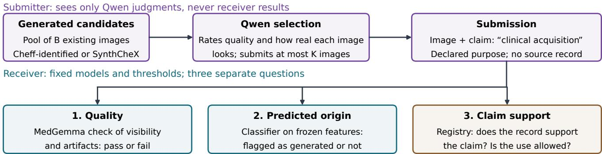  
Figure 2. Workflow of the intake test. The submitter selects at most K of B generated candidates using only Qwen judgments and has no access to receiver results. Two models with fixed thresholds answer the quality and predicted-origin questions, and a registry answers the claim-support question.

After choosing the head, we calibrate its decision threshold on a disjoint set of 3,000 genuine NIH images. The primary threshold has a nominal (target) false-alarm rate of 5%, the share of genuine images that the check flags. Let $s ( x )$ be the classifier’s score for image x, where a higher score means more generated, and let $s _ { 1 } , \ldots , s _ { n }$ be the scores of the n calibration images. The conformal $\mathrm { p - }$ value [2] is

$$
p _ { \mathrm { r e a l } } ( x ) = \frac { 1 + \sum _ { i = 1 } ^ { n } \mathbf { 1 } \{ s _ { i } \geq s ( x ) \} } { n + 1 } .\tag{1}
$$

The indicator 1{·} equals 1 when its condition holds and 0 otherwise, so the sum counts the calibration images that score at least as high as $x ,$ and the extra 1 counts x itself. Thus $p _ { \mathrm { r e a l } } ( x )$ is about the share of genuine calibration images that look at least as suspicious as x. It is not the probability that x is real. The receiver flags x as generated when $p _ { \mathrm { r e a l } } ( x ) \leq \alpha$ , the target false-alarm rate. We use $\alpha = 0 . 0 5$ and $\alpha = 0 . 0 1$ and 0.10 in the supplement. A score equal to the threshold is not flagged.

On genuine test images, the false-alarm rate is at most α on average if two assumptions hold. The genuine calibration and test images must be exchangeable, which means that any ordering of them is equally likely. The score must also be fixed without using the calibration images. This guarantee covers the origin check alone. It does not cover the combined quality-and-origin rule, a different collection, unavailable quality judgments, or the probability that an acquisition claim is true, and it need not hold after a processing shift.

We use two more reference sets only for secondary checks. One holds 2,914 images for the pilot head, after we remove the 86 images that the head saw during fitting or selection. The other holds 2,930 valid replies for a probe (a small classifier) that uses the eight numeric fields of the alternative quality rubric (Section 4.5), after we exclude 10 images used in rubric development and 60 images without a valid reply. We also compare the learned scores with a baseline on six pixel statistics, and with secondary heads fitted on one generator or on both (Supplement S6).

## 4.4 Processing experiment

We next test whether common image processing changes the origin classifier’s scores or its ability to separate genuine and generated images. The canonical condition converts each image to luminance, resizes it to 256 pixels with aspect-preserving Lanczos resampling, pads it with black to a square, and copies it into RGB, without histogram equalization. The receiver applies 12 further conditions: JPEG (quality 95, 85, 75, or 50), down- and up-sampling (through 192, 128, or 64 pixels), direct processing at 512 pixels from the original file (native 512), a 4-pixel border mask, 4-pixel padding, a 64-pixel central mask, and a severe 26-pixel border mask. Cheff-identified images are stored at 256 pixels, so native 512 only upscales them, and DINOv3 still receives 224-pixel input under every condition.

We process 1,000 test images per collection under all 13 conditions, so the 13 views of an image are related. We compare three settings. (1) The raw head with the canonical threshold, calibrated on canonical genuine images only. (2) The raw head with a matched threshold, recalibrated on genuine calibration images processed in the same way as the test images. (3) The augmented head with a matched threshold, fitted on five processed views of each training image (Supplement S6).

These settings separate two failures. In threshold drift, processing moves the scores, so the old threshold no longer gives the intended 5% false-alarm rate. In ranking loss, genuine and generated scores overlap more, so no new threshold can restore the original separation. Setting (2) resets the threshold and so isolates ranking loss from threshold drift Setting (3) tests whether training on processed images reduces ranking loss. Before testing, we fixed a target for the augmented head: reject at least 5 points more Cheffidentified images than the raw head, with at most 1 point more genuine flags, averaged over the 13 conditions.

## 4.5 Quality check

A rubric is the set of scoring instructions that a model follows. The receiver’s quality check uses MedGemma with an alternative to the original rubric (below), chosen once on development data (Supplement S5). A response passes only if it identifies an assessable chest image, assigns visibility of at least 3 out of 4, assigns a non-null artifact severity of at most 1 out of 4, and passes the flat-image guard. The guard fails images whose grayscale range is at most 1 and whose standard deviation is at most 0.5 on the 0–255 scale.

The submitter does not use this rubric. Qwen rates each candidate with the original rubric, which scores technical quality T, anatomical plausibility A, and artifact severity V, each from 0 to 4. High T and A are good, and high V is bad. The combined score is

$$
Q = 1 0 T + 1 0 A + 5 ( 4 - V ) ,\tag{2}
$$

which ranges from 0 to 100. The term 4 − V makes a lower artifact severity give a higher score. We do not convert the alternative rubric’s fields to the 100-point scale. The receiver’s check thus differs from the submitter’s rating in both the model and the rubric.

## 4.6 Candidate selection

The selection experiment asks whether access to more generated candidates helps the submitter find a small set that passes the receiver’s checks. The submitter receives a pool of B generated images, the candidate budget, and may submit at most K = 20 of them, the submission limit. The pools are nested subsets of the generated test images, with B = 100, 250, 500, and 1,000 for each generator, and B = 5,000 for SynthCheX only. Each strategy gives one list of at most K images per pool.

We compare three strategies, which use only Qwen’s outputs. Uniform selection picks K images at random. Quality selection picks the K images with the highest Q and ranks unavailable scores last. Quality-constrained surrogate selection uses the surrogate rating, Qwen’s 0–10 judgment of how much an image looks like a real acquisition. It stands in for the origin check, which the submitter cannot query. This strategy keeps candidates with an assessable $Q \geq 7 5$ and an available, assessable surrogate rating, then ranks them by that rating and then by Q. If fewer than K images qualify, the surrogate strategy submits fewer. A secondary pairwise method breaks ties among top-scoring candidates and applies only at B = 100 (Supplement S7).

Statistics. Rates use all attempted images as the denominator, so unavailable outputs are never dropped, and intervals are Wilson 95% intervals. The area under the ROC curve (AUROC) is the probability that a random generated image scores higher than a random genuine image. Paired comparisons use 2,000 bootstrap resamples of test images, with all views of an image kept together. Views, pool draws, and claim variants are not independent images, and intervals condition on the fixed models and thresholds (Supplement S9).

## 5 Results

## 5.1 Quality selection increases quality passes

At B = 1,000 and K = 20, quality selection produces 19 quality passes among the 20 Cheff-identified submissions, compared with 12 under uniform selection. For SynthCheX, the corresponding counts are 17 and 8. Images that Qwen ranks highest thus pass MedGemma’s check more often than random images do, although MedGemma is a different model with a different rubric. Qwen therefore identifies candidates that MedGemma is more likely to rate as technically acceptable. This result concerns the quality check alone; Section 5.3 evaluates predicted origin, and Section 5.4 combines the two checks.

The quality check passes 1,717 of 2,297 NIH images. It passes 1,717 of 2,297 NIH images (74.7%; 95% interval 72.9–76.5%), 668 of 1,000 Cheff-identified images (66.8%; 63.8–69.6%), and 2,656 of 5,000 SynthCheX images (53.1%; 51.7–54.5%). The NIH failures include 78 images without a valid reply. NIH pass rates also differ by projection: 47.5% for AP images (257 of 541) and 83.1% for PA images (1,460 of 1,756). We observed this difference but did not test whether projection causes it.

## 5.2 Held-out evaluation of the quality rubric

The selection result depends on the quality check, so we test the check itself. We compare the alternative rubric with the original rubric on 100 held-out images per collection, each degraded in six ways (blur, resampling, and noise at two levels each) that were not used in development. The test also holds 60 distinct invalid inputs that are not chest images, such as flat fields and noise.

The alternative rubric passes none of the 60 invalid inputs even without the flat-image guard, and the original rubric passes 5. With the guard, both pass none (Wilson 95% interval 0–6.02%).

The alternative rubric also has costs. For 3 of 100 clean NIH images, it returns no usable chest-image judgment, against 0 of 100 for the original rubric. It rates the undegraded image above its degraded copy in 650 of 1,800 pairs, against 582 of 1,800, and most other pairs are ties. This gain of 3.8 percentage points has a 95% interval of [−1.2, +8.8], which includes zero. It also gives more reversals, where the degraded copy is rated higher (426 against 228), and more unavailable pairs (41 against 2). On SynthCheX images, it rates the undegraded image higher in 142 of 600 pairs, against 209.

Because the alternative rubric was selected and frozen before the held-out test, we retain it in the main analysis as prespecified. The held-out results are mixed and do not establish that it is a better overall measure of image quality.

## 5.3 Origin-screen results

On canonical test images, the primary origin classifier (the raw CLS head) rejects nearly all generated images while flagging a smaller fraction of the NIH images as generated. At the nominal 5% level, it flags 110 of 2,297 NIH images (4.8%). It rejects 1,000 of 1,000 Cheff-identified images and 4,677 of 5,000 SynthCheX images (Table 2). The medical head has a higher full-range SynthCheX AUROC, 0.9891 compared with 0.9849, although the low-falsepositive comparison does not show a clear advantage. The rubric-field probe separates the collections poorly, while a classifier on six pixel statistics still separates them substantially.

The fitting data matter. A secondary CLS head fitted only on Cheff-identified images passes 311 of 5,000 SynthCheX images and flags 101 of 2,297 NIH images. One fitted only on SynthCheX passes 114 of 1,000 Cheff-identified images and flags 165 of 2,297 NIH images. One fitted on both rejects all 6,000 generated test images and flags 134 of 2,297 NIH images, but both test generators also contributed fitting images, so this is not a test on an unseen generator (Supplement S10).

Combining both checks shows the cost to genuine images. The combined rule passes 1,635 of 2,297 NIH images, 0 of 1,000 Cheff-identified images, and 152 of 5,000 SynthCheX images. The 662 NIH images (28.8%) that fail it are not an origin false-alarm rate, because they also include images that fail the quality check and images without a valid quality reply. The 152 SynthCheX images pass both checks, but the checks do not establish that they came from the claimed clinical acquisition (Supplement S10 plots quality against origin scores).

## 5.4 Selection and combined passage

We find no evidence that selection helps. At B = 1,000 and K = 20, no Cheff-identified image passes both checks under any strategy (0 of 20; Wilson 95% upper bound 16.1%). This follows from Table 2: the origin classifier flags all 1,000 Cheff-identified test images, so no selection from them can pass. For SynthCheX, uniform, quality, and quality-constrained surrogate selection give 2, 1, and 2 of

20 images that pass both checks. Compared with uniform selection, the surrogate did not increase the number of images that passed both checks. Compared with quality selection, it gives +5 percentage points per submitted image and 0.001 more passes per candidate, and both 95% intervals ([−5, +10] and [−0.001, 0.002], from 2,000 resamples that repeat the selection) include zero. At $B = 5 { , } 0 0 0 .$ , quality and surrogate selection both give 1 of 20. Figure 3 shows the results across all budgets. Successful combined passes are rare, and the intervals overlap. The experiment therefore does not resolve small differences among these three Qwen-based selection strategies, and it does not evaluate other attacks.

## 5.5 Effects of image processing

Figure 4 shows both problems from Section 4.4. Threshold drift appears first. Under JPEG 75, the raw head with the canonical threshold flags 820 of 1,000 NIH images and rejects 987 of 1,000 SynthCheX images. The high rejection rate is not a success, because the head now flags most genuine images too. Ranking loss appears in the AUROC. On the same 1,000 images per collection, the raw head’s SynthCheX AUROC falls from 0.987 in the canonical condition to 0.841 under JPEG 75 and 0.828 after resizing through 128 pixels.

Recalibration repairs much of the threshold drift but does not restore the lost ranking. With a matched JPEG 75 threshold, the raw head flags 65 of 1,000 NIH images, but it rejects only 486 of 1,000 SynthCheX images. Under resize 128, the canonical threshold flags 807 NIH images and rejects 978 SynthCheX images, and the matched threshold flags 117 and rejects 595. Averaged equally over the 13 conditions, matching the threshold lowers NIH flags by 34.01 percentage points and SynthCheX rejections by 19.45 points (Supplement S10). Recalibration thus trades fewer genuine-image flags for fewer generated-image rejections.

The augmented head meets the limit on genuine flags but narrowly misses the Cheff target. With matched thresholds on both sides, it rejects 4.97 percentage points more Cheff-identified images than the raw head, averaged over the 13 conditions (paired 95% interval 4.45–5.51), and it flags 1.32 points fewer NIH images ([−1.96, −0.67]). The Cheff gain is just below the 5-point target. The interval includes 5, but that does not mean the target was met. For SynthCheX, which was not used in fitting, the gain is 15.45 points (14.47–16.51), a separate test of transfer to a second generator.

## 5.6 Cross Dataset Performance

A detector calibrated on one genuine collection may flag images from another genuine collection even when no generated image is present. We test this with 957 Open-I images and the unchanged NIH threshold. The raw CLS head flags 568 of 957 images (59.4%; 95% interval 56.2– 62.4%), and the medical head flags 152 of 957 (15.9%; 13.7–18.3%). Both rates are above the nominal 5%. Open-I has no generated images, so we report no AUROC or rejection rate for it.

<table><tr><td>Origin classifier</td><td>NIH flagged</td><td>Cheff rejected</td><td>SynthCheX rejected</td><td>Unavailable</td></tr><tr><td>DINOv3 CLS head, raw (primary)</td><td>110 (4.0–5.7)</td><td>1,000 (99.6–100.0)</td><td>4,677 (92.8–94.2)</td><td>0/0/0</td></tr><tr><td>Medical head, raw</td><td>107 (3.9–5.6)</td><td>1,000 (99.6–100.0)</td><td>4,673 (92.7–94.1)</td><td>0/0/0</td></tr><tr><td>DINOv3 CLS head, augmented</td><td>97 (3.5–5.1)</td><td>1,000 (99.6–100.0)</td><td>4,644 (92.1–93.6)</td><td>0/0/0</td></tr><tr><td>Rubric-field probe</td><td>22 (0.6–1.4)</td><td>13 (0.8–2.2)</td><td>99 (1.6–2.4)</td><td>78/12/80</td></tr><tr><td>Pixel-statistics classifier</td><td>50 (1.7–2.9)</td><td>603 (57.2–63.3)</td><td>2,782 (54.3–57.0)</td><td>0/0/0</td></tr></table>

Table 2. Origin check on canonical test images at the nominal 5% false-alarm rate. Cells give counts out of all attempted images (2,297 NIH, 1,000 Cheff-identified, 5,000 SynthCheX) with Wilson 95% intervals in percent. Thresholds use 3,000 genuine calibration images (2,930 valid replies for the rubric-field probe). The last column counts unavailable outputs (NIH/Cheff/SynthCheX), which are neithe flags nor passes.

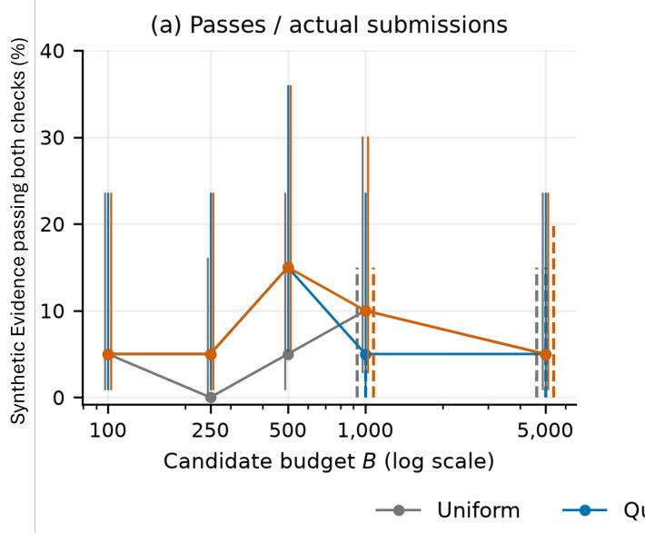

(b) Passes / candidate budget  
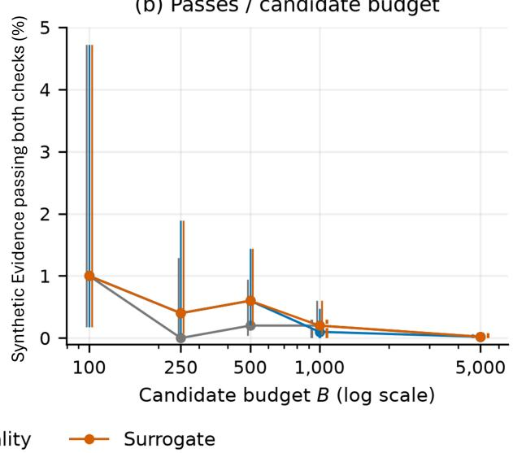  
Figure 3. SynthCheX images that pass both checks, with K = 20: (a) per submitted image and (b) per candidate in the pool of size B. The vertical axis calls them “quality-qualified false passes”. Solid bars are Wilson 95% intervals for the fixed lists. Dashed bars come from 2,000 resamples that repeat the selection (B = 1,000 and 5,000 only)

To test whether a detector of localized edits transfers, we ran MedForge-Reasoner. It labels 178 of 300 genuine NIH images as fake (59.3%; 53.7–64.7%) and 127 of 300 Cheffidentified and 50 of 300 SynthCheX images as genuine. It gives a categorical verdict and has no calibrated 5% threshold, so we report no AUROC and make no matched comparison.

## 6 Source, purpose, and reuse

Pixel checks answer whether an image appears technically adequate and whether the classifier flags it as generated. They do not establish the image’s source or whether it supports the claimed acquisition. We therefore keep source and intended use in a separate registry. The same pixels can be allowed as declared augmentation while remaining unsupported as evidence of clinical acquisition. Adding pixel checks cannot reconstruct missing history; missing or unknown verification remains unknown. We test this separation in a small controlled experiment.

Our registry stores the quality result, the origin decision, and the claim-support state in separate fields. Paired cases use identical pixels. They differ only in the claimed purpose (declared augmentation or clinical acquisition) or in whether a trusted source record exists. The design has 8 selected base images, 24 claim-and-purpose variants, and

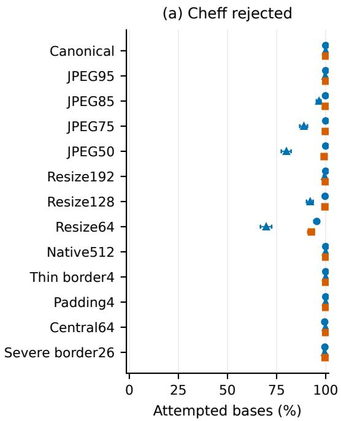

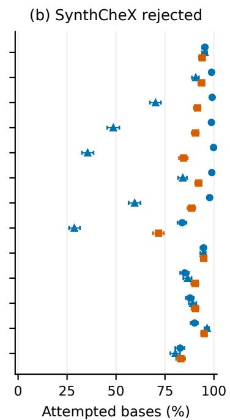

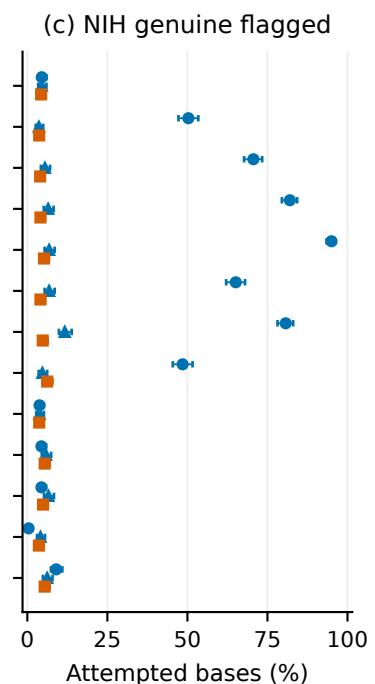  
Raw / canonical cut Raw / matched cut Augmented / matched cut  
Figure 4. Percent of the 1,000 test images per collection (“bases”) rejected (a, b) or flagged (c) under 13 conditions, at the nomina 5% level. “Cut” means decision threshold. Raw/canonical: canonical threshold. Raw/matched: threshold recalibrated per condition. Augmented/matched: augmented head, matched threshold.

72 policy replays (each variant under three policies). The variants reuse the same images, so they are not independent radiographs, and the counts are not population estimates.

A registry-only policy already rejects unsupported generated acquisition claims without any pixel check. Adding the pixel checks cuts the supported genuine acquisitions that the policy accepts from 4 of 4 to 2 of 4, while declared augmentation stays allowed. We also tested whether missing veri fication stays unknown after export and import. A permissive importer that trusts claims accepts unsupported records whether the verification field is kept or removed. The safe importer rehashes the received bytes and keeps missing or invalid verification as unknown. The registry holds laboratory records only. It is not a hospital system, it does not implement C2PA, and it does not certify any clinical history.

## 7 Limitations

Data provenance and independence. The Cheffidentified collection is a legacy set whose checkpoint, seeds, conditioning, and generation attempts are unknown, so we draw no conclusion about the Cheff model itself. HealthGPT, which has Qwen-based variants [12], filtered SynthCheX before release, and the checkpoint that filtered it is unspecified. We therefore cannot verify that the filter is independent of the Qwen family, and we do not claim that Qwen is independent of the data. Generated images may share conditioning despite our duplicate check, so we claim nothing about memorization. NIH fit and test images come from different patients but one collection. We cannot check which images DINOv3 saw in pretraining, MedGemma’s medical pretraining may include public collections, and Open-I report groups do not establish unique patients. We therefore claim neither patient uniqueness nor freedom from pretraining exposure.

Assessors and classifiers. Qwen and MedGemma are automated models, and no clinician judged the images. A valid reply is not necessarily a correct assessment, so a quality pass does not mean clinical quality. The medical head uses MedGemma’s vision encoder, and MedForge-Reasoner belongs to the Qwen family, so these models are not fully independent. The origin classifiers separate collections and may rely on shortcuts in acquisition or processing, so we do not call them validated forgery detectors. Their false-alarm rates can differ from the nominal ones after a change of collection or processing.

Processing and reproduction. The masks change geometry, intensity, and frequency content together, so the processing results do not identify a single cause such as text. The selection reports for the primary raw DINOv3 CLS and mean heads refer to an earlier metadata file whose exact bytes we could not recover. We verified the checkpoints and the identities of the fit, development, and calibration images, but we cannot rebuild these historical inputs byte for byte. We also did not measure clinical deception, downstream harm, or the precision of a deployed system.

## 8 Conclusion

We asked three questions about a generated chest radiograph submitted as the record of a real examination. Quality-based selection finds more images that pass the MedGemma quality check, but we find no evidence that it increases the number passing both receiver checks. On canonical images, the origin classifier rejects all Cheff identified images and 93.5% of SynthCheX images while flagging 4.8% of NIH images. Processing can shift the threshold and reduce ranking quality. Matched recalibration lowers many genuine-image flags, but it also allows more generated images through and does not always recover the nominal rate. Genuine images from another dataset are also flagged frequently. Passing both pixel checks therefore does not by itself support the claimed acquisition. Thus, we strongly suggest that the source and intended use of each image must be recorded and checked separately.

## References

[1] Adam Arthur and Christopher Schwartz. Repurposing image diffusion models for adversarial synthetic structured data: A case study of ground truth drift, 2026. Version 1, May 1, 2026.

[2] Stephen Bates, Emmanuel Candès, Lihua Lei, Yaniv Romano, and Matteo Sesia. Testing for outliers with conformal p-values. The Annals of Statistics, 51(1):149–178, 2023.

[3] Zhihui Chen and Mengling Feng. MedForge-RSI: Medical deepfake detection via recursive self-improvement, 2026. Preprint; version 1, September 29, 2026.

[4] Zhihui Chen, Kai He, Qingyuan Lei, Bin Pu, Jian Zhang, Yuling Xu, and Mengling Feng. MedForge: Interpretable medical deepfake detection via forgery-aware reasoning. In Proceedings of the 64th Annual Meeting of the Association for Computational Linguistics (Volume 1: Long Papers), pages 25672–25692, San Diego, California, United States, 2026. Association for Computational Linguistics.

[5] Sungik Choi, Hankook Lee, and Moontae Lee. Training-free detection of ai-generated images via cropping robustness. In Advances in Neural Information Processing Systems, pages 20587–20610. Curran Associates, Inc., 2025.

[6] Coalition for Content Provenance and Authenticity. Content credentials: C2PA technical specification, version 2.4. Technical specification, 2026.

[7] Dina Demner-Fushman, Marc D. Kohli, Marc B. Rosenman, Sonya E. Shooshan, Laritza Rodriguez, Sameer Antani, George R. Thoma, and Clement J. McDonald. Preparing a collection of radiology examinations for distribution and retrieval. Journal ofthe American Medical Informatics Association, 23(2):304–310, 2016. Published online July 1, 2015; issue date March 2016.

[8] Raman Dutt, Pedro Sanchez, Yongcheng Yao, Steven Mc-Donagh, Sotirios A. Tsaftaris, and Timothy Hospedales. CheXGenBench: A unified benchmark for fidelity, privacy and utility of synthetic chest radiographs. arXiv preprint, historical version 2, 2025.

[9] Raman Dutt, Pedro Sanchez, Yongcheng Yao, Steven Mc-Donagh, Sotirios A. Tsaftaris, and Timothy Hospedales. CheXGenBench: A unified benchmark for fidelity, privacy and utility of synthetic chest radiographs. Transactions on Machine Learning Research, 2026.

[10] Google. MedGemma 1.5 4B instruction-tuned model card. Official model card, 2026.

[11] Patrick Grommelt, Louis Weiss, Franz-Josef Pfreundt, and Janis Keuper. Fake or jpeg? revealing common biases in generated image detection datasets. In Computer Vision – ECCV 2024 Workshops, pages 80–95. Springer, 2025.

[12] HealthGPT authors. HealthGPT: Official repository documentation. Official GitHub repository, 2026. Revision 4d404a518cfa8e78cd7703af7cfc4ca4fd559698; accessed 2026-10-13. Original-project README documents the March 20, 2025 Qwen2.5-based XL32 release.

[13] Shuaibo Li, Zhaohu Xing, Hongqiu Wang, Pengfei Hao, Xingyu Li, Zekai Liu, and Lei Zhu. Toward medical deep fake detection: A comprehensive dataset and novel method. In Medical Image Computing and Computer Assisted Intervention – MICCAI 2025, pages 626–637. Springer Nature Switzerland, 2025.

[14] MedForge authors. MedForge-Reasoner: Official model card, 2026. Revision a864eed9b76cde46f0e154c3497d646550995c87; accessed 2026-10-13.

[15] Yisroel Mirsky, Tom Mahler, Ilan Shelef, and Yuval Elovici. CT-GAN: Malicious tampering of 3D medical imagery using deep learning. In 28th USENIX Security Symposium (USENIX Security 19), pages 461–478. USENIX Association, 2019.

[16] Luc Moreau and Paolo Missier. PROV-DM: The PROV data model. W3C Recommendation, 2013.

[17] Qwen Team. Qwen3.8-27B model card. Official model card, 2026.

[18] Raman Dutt. SynthCheX-75K-v2 dataset card. Hugging Face dataset card; accessed 2026-10-13, 2026.

[19] Christopher Schwartz. Is simulated evidence still evidence? a warrant-based policy for governing synthetic data. AI Policy Exchange Forum (AIPEX), white paper, 2026. Published June 15, 2026.

[20] Andrew Sellergren, Chufan Gao, Fereshteh Mahvar, Timo Kohlberger, Fayaz Jamil, Madeleine Traverse, Alberto Tono, Bashir Sadjad, Lin Yang, Charles Lau, Liron Yatziv, Tiffany Chen, Bram Sterling, Kenneth Philbrick, Richa Tiwari, Yun Liu, Madhuram Jajoo, Chandrashekar Sankarapu, Swapnil Vispute, Harshad Purandare, Abhishek Bijay Mishra, Sam Schmidgall, Tao Tu, Anil Palepu, Chunjong Park, Tim Strother, Rahul Thapa, Yong Cheng, Preeti Singh, Kat Black, Yossi Matias, Katherine Chou, Avinatan Hassidim, Kavi Goel, Joelle Barral, Tris Warkentin, Shravya Shetty, Dale Webster, Sunny Virmani, David F. Steiner, Can Kirmiz ibayrak, and Daniel Golden. MedGemma 1.5 technical report. arXiv preprint, 2026.

[21] Oriane Siméoni, Huy V. Vo, Maximilian Seitzer, Federico Baldassarre, Maxime Oquab, Cijo Jose, Vasil Khalidov, Marc Szafraniec, Seungeun Yi, Michaël Ramamonjisoa, Francisco Massa, Daniel Haziza, Luca Wehrstedt, Jianyuan Wang, Timothée Darcet, Théo Moutakanni, Leonel Sentana, Claire Roberts, Andrea Vedaldi, Jamie Tolan, John Brandt, Camille Couprie, Julien Mairal, Hervé Jégou, Patrick Labatut, and Piotr Bojanowski. DINOv3. Transactions on Ma chine Learning Research, 2026.

[22] J. P. Smith. Authentication of digital medical images with digital signature technology. Radiology, 194(3):771–774, 1995.

[23] Tobias Weber and contributors. MaCheX: Massive chest xray dataset interface. Official repository, checked 2026-10- 13, 2026.

[24] Mickael Tordjman, Murat Yuce, Amine Ammar, Mingqian Huang, Fadila Mihoubi Bouvier, Maxime Lacroix, Anis Meribout, Ian Bolger, Efe Ozkaya, Himanshu Joshi, Amine Geahchan, Rayane El Rahi, Haidara Almansour, Ashwin Singh Parihar, Carolyn Horst, Samet Ozturk, Muhammed Edip Isleyen, Gul Gizem Pamuk, Ahmet Tan Cimilli, Timothy Deyer, Arvin Calinghen, Enora Guillo, Rola Husain, Jean-Denis Laredo, Zahi A. Fayad, Xueyan Mei, and Bachir Taouli. The rise of deepfake medical imaging: Radiologists’ diagnostic accuracy in detecting ChatGPT-generated radiographs. Radiology, 318(3): e252094, 2026.

[25] Jinghang Wang, Ruixin Wang, Qijia Yi, Hongyong Tang, Li Fan, Shunan Lin, Wenjing He, Dan Peng, Jun-Jie Yang, and Jun Liu. Detectability and healthcare implications of generative AI-synthesized chest radiographs: a blinded radiologist reader study. Frontiers in Medicine, 13:1901949, 2026.

[26] Xiaosong Wang, Yifan Peng, Le Lu, Zhiyong Lu, Mohammadhadi Bagheri, and Ronald M. Summers. ChestXray8: Hospital-scale chest x-ray database and benchmarks on weakly-supervised classification and localization of common thorax diseases. In Proceedings ofthe IEEE Conference on Computer Vision and Pattern Recognition, pages 2097– 2106, 2017.

[27] Tobias Weber, Michael Ingrisch, Bernd Bischl, and David Rügamer. Cascaded latent diffusion models for highresolution chest x-ray synthesis. In Advances in Knowledge Discovery and Data Mining (PAKDD), pages 180–191. Springer, 2023.

# Supplementary Material

## S1 Reader guide

This supplement gives the details behind the main paper’s results. Section S2 defines the terms and notation. Sections S3 to S9 describe the study design: the data (S3), the models (S4), the quality prompts and how replies are read (S5), the origin classifiers and their thresholds (S6), the selection strategies (S7), the processing conditions (S8), and the statistical methods (S9). Section S10 gives the extended results, Section S11 describes the registry experiment, and Section S12 records repairs and other events during the runs, together with the computing costs.

How to read the tables. These conventions apply to every table unless a caption says otherwise.

• Denominators. Rates use all attempted images: 2,297 NIH, 1,000 Cheff-identified, and 5,000 SynthCheX test images.

• Unavailable outputs. An output is unavailable (U) when a model reply cannot be read or an image cannot be processed. It is not a pass, a flag, or a detection, and it stays in the denominator.

• Intervals. Rates have Wilson 95% intervals. AUROC values and paired differences have bootstrap intervals from 2,000 resamples of test images. All intervals condition on the fixed models and thresholds (Section S9).

• Thresholds. A threshold comes from a nominal falsealarm rate (1%, 5%, or 10%) on genuine calibration images. There are 3,000 calibration images, except for the pilot head (2,914) and the rubric-field probe (2,930 valid replies).

• Reused images. The rows of one table often reuse the same images, so they are not independent samples.

• Labels. Tables use the head names defined in Section S2. In the tables of secondary heads, the word after the slash names the generators used to fit the head.

• Abbreviations. N, C, and S stand for NIH, Cheffidentified, and SynthCheX. U stands for unavailable, CI for confidence interval, and “k/n” for k of n. In table rows, “alt.” and “orig.” mean the alternative and the original rubric, and “N” in a column header can also be a count.

• Counting units. A count refers to images unless the caption names another unit, such as a view, an exposure, a pattern, a pair, a chain, an attempt, or a task.

Prompts, JSON schemas, and checkpoint identifiers (Sections S4, S5, and S7) are reproduced exactly as they were used. We did not edit their wording.

## S2 Shared definitions and notation

Collections. NIH images are genuine chest radiographs from the ChestX-ray14 part of MaCheX. Cheff-identified images are 3,000 legacy images identified as outputs of the Cheff generator, whose checkpoint and conditioning are unresolved. SynthCheX images are generated images from a fixed release made with Sana 0.6B. Open-I images are genuine frontal radiographs from the Indiana collection, used only for testing. We call each of these image sets a collection. We use “source” only for the claimed source of a submission in the registry. The conditioning of a generated image is the input, such as a text prompt or label, that the generator received.

Models. Qwen (Qwen3.8-27B) is the submitter’s rater: it scores candidate images. MedGemma (MedGemma 1.5 4B) applies the receiver’s quality check, and its vision encoder supplies the medical features. DINOv3 (ViT-7B/16) supplies general image features. MedForge-Reasoner is used only in a separate transfer comparison. Section S4 gives the checkpoints.

Roles. The submitter chooses generated images to submit. It is the attacker in the threat model, and it sees only Qwen’s judgments. The receiver applies the quality check and the origin check with fixed models and thresholds. A registry checks the claimed source and the declared purpose of each submission.

Checks and outcomes. The quality check is the primary MedGemma check (Section S5). The origin classifier is a logistic-regression head on frozen image features, and the origin check is that classifier plus a threshold. The origin score s(x) of an image x is the head’s output for x, and a higher score means that the image looks more generated (some figures call it the suspicion score). The check flags an image as generated when its score is above the threshold. For a generated image, a flag is a correct rejection. For a genuine image, a flag is a false alarm. The false-alarm rate is the share of genuine images that the check flags. An image passes both checks when it passes the quality check and is not flagged.

Processing. The canonical condition converts each image to luminance, resizes it to 256 pixels with aspect-preserving Lanczos resampling, pads it with black to a square, and copies it into RGB, without histogram equalization. Section S8 lists the 12 other conditions.

Heads and thresholds. The raw head is fitted without the processing augmentation, and the augmented head is fitted on five processed views of each image (Section S6). The pilot head was fitted in an earlier pilot study of this task, and we use it unchanged. The rubric-field probe is a head on the eight numeric or indicator fields of the alternative quality rubric, and the pixel-statistic classifier is a head on six pixel statistics. The primary head is the raw DINOv3 CLS head fitted on NIH and Cheff-identified im ages. The seven core heads are the pilot head, the raw DINOv3 CLS (primary), DINOv3 mean patch, and medical mean heads, the augmented CLS head, the rubric-field probe, and the pixel-statistic classifier. Heads are named by their features: DINOv3 CLS, DINOv3 mean patch, or medical mean (MedGemma’s vision encoder).

Secondary heads and thresholds. The secondary heads add the generators used in fitting after a slash, so “CLS / Cheff” is the DINOv3 CLS head fitted on Cheff-identified images, and “Mixed” means both generators. The canonical threshold is calibrated on canonical genuine images. A matched threshold is calibrated on genuine images processed in the same way as the test images. The global threshold is calibrated on a mixture of five conditions (Section S8). The nominal false-alarm rate is α ∈ {0.01, 0.05, 0.10}, and the main paper uses α = 0.05.

Quality rubrics. The original rubric scores technical quality T, anatomical plausibility A, and artifact severity V, each from 0 to 4. Qwen and MedGemma combine them as $Q = 1 0 T + 1 0 A + 5 ( 4 - V )$ . The alternative rubric records chest recognition, assessability, visibility from 0 to 4, structural artifact severity from 0 to 4 (or null), and an uncertainty level (low, moderate, or high). We never convert its scores to the 100-point scale. A reply is valid when it parses as JSON that matches the schema (Section S5).

Selection. The candidate budget B is the pool size, and the submission limit K is the largest number of images that the submitter may send. Uniform, quality, and qualityconstrained surrogate selection are defined in Section S7. The surrogate rating is Qwen’s 0 to 10 judgment of how much an image looks like a real acquisition.

Splits and statistics. The fit, development, calibration, and test splits train the head, choose its settings, set the threshold, and give the reported results (Section S3). AUROC is the probability that a random generated image scores higher than a random genuine image. The partial AUC covers false-positive rates up to 0.10, and the tables report its standardized form (Section S9).

## S3 Dataset and split construction

Table 1 of the main paper lists the images selected for each split. This section explains how we built the splits and what we checked.

NIH images. The NIH zip file lists 112,120 distinct PNG images and eight metadata files. We counted them from the file index, and we decoded only the selected images. The official train/validation and test lists contain 86,524 and 25,596 images, and they share no patients. Each list has one more image than the expected counts (86,523 and 25,595), and we found no documented explanation for the two extra images. We use at most one image per patient. The test partition contains 2,797 patients. After we remove the 500 pilot patients, 2,297 remain, and the test split uses all of them. We accepted this smaller test split rather than reach a target size with repeated images of one patient.

Cheff-identified images. The legacy listing contains 8,672 PNG entries and 27 CSV files in several folders, which differ from the 3,000-image pool that we selected. We did not choose images by their old checker scores. Some score rows were copied or did not match their images, so the legacy files do not show that the generation runs were independent. The generation checkpoint, the conditioning groups, and the completeness of the raw attempts remain unresolved. We reassign all 1,250 images used in the pilot study, including the old test images, to fitting. We add 250 unused images to fitting, and we use 500 unused images for development and 1,000 for testing.

SynthCheX images. SynthCheX sampling uses a pinned release of 75,649 rows. It is not a reconstruction of all generation attempts. We reserve 6,500 rows uniformly at random, keep the original release identifiers, and exclude the 500 pilot rows from the test split. HealthGPT filtered the release before our experiment. Documented HealthGPT variants include Qwen-based models [12], but the checkpoint that filtered the release and the conditioning mapping are unspecified, so independence from the Qwen family is unverified. The release rows expose filenames, findings, and pixels, but no report, patient, or study conditioning identifiers. We checked for exact duplicates and for groups of images that share a generator input, where we could recover the groups. We report unknown conditioning as unknown instead of asserting independence.

Open-I images. The Open-I panel has 957 frontal report groups. We selected them without any threshold fitting. Demner-Fushman et al. describe the original Indiana radiograph and report collection [7], and the local count comes from our own audit of the selected files. Separate report groups do not establish unique patients, and projection and pretraining exposure remain uncertain. We do not redistribute any Open-I image in the figures or the source bundle. The panel tests a change of genuine collection with the NIH calibration unchanged. It is not a clinical validation.

Checks on the selected images. For each of the 17,297 selected images (the sum of the four splits), we stored hashes of both the original and the canonical version (bytes and pixels). Before inference we checked for exact duplicates across splits and for recoverable groups that share a generator input. We also ran a low-resolution comparison of image pairs as an extra duplicate check, but this cannot prove that a generator did not memorize images or that conditioning is not shared. We record whether each retrieved row came from a downloaded parquet file or was fetched individually through the API. The machine-readable reproducibility files hold the full inventories, checksums, and identifiers.

Fixed identifiers and withheld labels. We fixed all reserved identifiers before retrieval. Missing or corrupt assets keep entries in the attempt record, and we never replace them with a more convenient image. Models receive only pixels and opaque identifiers. Test-split collection labels and outcomes were withheld from method development, while the permitted fit and development labels support supervised fitting.

Observational strata. The recorded NIH projection (AP or PA) and the report-derived findings are observational strata. They are not clinical truth and not model inputs. Rates standardized over projection use fixed development weights of 0.178 for AP and 0.822 for PA, and they never use projection metadata supplied by a submitter.

## S4 Model and checkpoint details

Table S1 lists the pinned checkpoints. The repositories are Qwen/Qwen3.8-27B, google/medgemma-1.5-4b-it, and facebook/ dinov3-vit7b16-pretrain-lvd1689m [10, 17, 21]. Qwen’s maximum-pixel setting limits the token budget. It does not mean that every canonical image is upsampled to that area. The environment uses Python 3.11.2, PyTorch 2.14.1+cu130, Transformers 5.19.0, NumPy 2.4.6, scikit-learn 1.9.1, and Pillow 12.3.0, and the reproducibility files hold the full dependency lock. All backbones stay frozen and GPU-resident in standard BF16 (16-bit brain floating point), without quantization, offloading of inference parameters, or autocast.

## S4.1 Image features

DINOv3 uses the official web-image ViT-7B/16 revision with frozen BF16 parameters and the official 224-pixel processor. Its image feature is either the CLS token or the mean of the patch tokens, and the mean excludes the CLS and register tokens. The medical representation comes from the standalone official MedGemma vision tower. We average the features of its 4,096 image patches in float32 before the multimodal projector and decoder, and its processor stays at 896 pixels. Values cached by hooks during quality generation are never substituted for these standalone embeddings, because a development audit found numerical disagreement between the two even though image routing had been tested. Each stored feature vector is linked to the exact pixels it came from.

## S4.2 Decoding settings

Qwen uses non-thinking greedy decoding with a 384-token ceiling, and MedGemma uses greedy decoding with a 1,024-token ceiling. We kept Qwen’s non-thinking setting after both 96-image development rubrics produced valid final replies with bounded token use, and after we confirmed the exact bindings of the processor, vision tower, and decoder. Together these confirm that the model processes the image, but they do not show clinical or causal grounding.

## S4.3 MedForge-Reasoner protocol

We use the official RichardChenZH/ MedForge-Reasoner checkpoint, pinned to revision a864eed9b76cde46f0e1 54c3497d646550995c87 [3, 14]. It is a Qwen-family model trained for localized manipulations of medical images, so whole-image generated chest radiographs test transfer and do not reproduce its benchmark. The protocol uses its exact system and user prompts (below), RGB resizing of the canonical inputs to 1024 × 1024 as in the official example, frozen BF16 weights, batch size one, greedy decoding, and a 2,048-token cap. The resizing upsamples canonical pixels without recovering native detail.

A four-image development benchmark ran on GPUs only and took 56.998 seconds including loading, of which

Table S1. Pinned checkpoints (IT means instruction-tuned). Processor input is the processor setting, which differs from the stored dimensions of the source images.
<table><tr><td>Checkpoint</td><td>Revision</td><td>Processor input</td></tr><tr><td>Qwen3.8-27B</td><td>1d4bf0f2ff6012fd82039f2fa52739d0dd7c60c0</td><td>maximum 262,144 pixels</td></tr><tr><td>MedGemma 1.5 4B IT</td><td>91850547d9f0b2fdd21aa7c5f4f3d1a8a52c243b</td><td>896 × 896</td></tr><tr><td>DINOv3 ViT-7B/16</td><td>b80367753773648a6793235ab9c65cdbb029506f</td><td>224 × 224</td></tr></table>

35.414 seconds were generation, with no token caps. From this runtime we fixed the final scope: the prespecified 300 canonical images per collection (900 in total), plus the unique images in the fixed Qwen submissions that are not in that panel (at most 580). Images that appear only in repeated pools do not expand the scope. Submissions that overlap the panel reuse the same attempt, including failures. These scope choices rest on runtime, not on performance.

Only a unique, explicit final verdict of real, authentic, deepfake, fake, forged, or manipulated maps to a category. An unclosed reasoning block, contradictory categories, generation caps without an end-of-sequence token, and missing verdicts are unavailable. A categorical verdict defines its own operating point. We do not turn a rationale or a self-reported confidence into a probability, and we report no calibrated 1%, 5%, or 10% curve. Section S10.4 reports the results.

You are an expert in medical image forensics. Analyze the provided image to determine if it is a deepfake or authentic. First, perform a step-by-step examination of the image content, looking for artifacts, inconsistencies, or biological implausibilities. Use < think> tags to articulate your reasoning process. If you identify manipulated regions, localize them using bounding boxes within your reasoning. Conclude your analysis with a final classification.

Is this image deepfake or real?

## S5 Quality prompts and response parsing

## S5.1 How the prompts are sent

Qwen (the submitter’s rater) and MedGemma (the receiver’s quality checker) receive the supplied image, or the ordered image pair, followed by the task text in a user message. The official processor and chat template supply the model’s own formatting. No filename, pathology label, report, claimed origin, or source metadata enters a query. Native thought text is preserved but never replaces the final JSON. Parse failures and token-cap flags stay in the attempt record, and we never repair a response in a favorable direction.

## S5.2 Original rubric (Qwen and MedGemma)

Qwen applies this rubric to rate every candidate, and MedGemma also applies it, for comparison.

Assess only the supplied chest   
radiograph pixels for technical   
quality, visible anatomical   
plausibility, and conspicuous   
artifacts. The image’s source is not   
given. Do not infer an acquisition   
record or certify its origin.   
Findings, abnormal anatomy, medical   
devices, portable/AP positioning,   
rotation, and nonstandard anatomy   
are not automatic failures; assess   
whether the visible appearance is   
coherent in its possible clinical   
and acquisition context. Do not   
reward absence of disease or devices   
. Do not diagnose the patient. Do   
not use any filename, label, report,   
or source metadata.

```csv
Return exactly one JSON object, without
Markdown or other text:
{"technical_quality":0,"
anatomical_plausibility":0,"
artifact_severity":0,"assessable":
true,"uncertainty":"moderate","
```

```ini
rationale":"brief visible evidence"}
Use integer scores from 0 through 4
with these anchors:
technical_quality: 0 = unreadable/
essential chest content unavailable;
1 = severe technical degradation; 2
= noticeable degradation with
substantial chest content still
visible; 3 = minor limitations; 4 =
clearly displayed chest content
without conspicuous technical
degradation.
anatomical_plausibility: 0 = grossly
incoherent visible anatomy; 1 =
several severe unexplained
structural inconsistencies; 2 =
noticeable unexplained
inconsistencies; 3 = minor uncertain
inconsistencies; 4 = no conspicuous
unexplained structural
inconsistency. Use uncertainty when
pathology, projection, or limited
resolution could explain an
appearance.
artifact_severity: 0 = no conspicuous
unexplained synthesis-like or
rendering artifact; 1 = minor
localized artifact; 2 = moderate
artifact; 3 = severe artifact; 4 =
pervasive artifact. This is a
visible-artifact assessment, not a
real/fake verdict.
assessable: true if enough chest
content is visible to apply the
rubric; otherwise false. uncertainty
: exactly "low", "moderate", or "
high". rationale: describe visible
evidence in at most 60 words,
without asserting verified
acquisition, patient identity, or
clinical usefulness.
"type": "object",
"additionalProperties": false,
"required": ["technical_quality", "
anatomical_plausibility", "
artifact_severity", "assessable", "
uncertainty", "rationale"],
"properties": {
"technical_quality": {"type": "
integer", "minimum": 0, "maximum":
```

4},   
"anatomical\_plausibility": {"type":   
"integer", "minimum": 0, "maximum":   
4},   
"artifact\_severity": {"type": "   
integer", "minimum": 0, "maximum":   
4},   
"assessable": {"type": "boolean"},   
"uncertainty": {"enum": ["low", "   
moderate", "high"]},   
"rationale": {"type": "string"}   
}   
}

## S5.3 Alternative rubric (primary MedGemma check)

Assess the pixels without assuming they   
depict a chest radiograph. First   
decide whether recognizable chest  
radiograph content is present and   
whether enough of it is visible to   
assess. Flat fields, noise, blank   
images and unrelated pictures are   
not assessable chest radiographs; do   
not invent anatomical structures.   
The source is unknown. Do not   
certify acquisition, origin or   
clinical usefulness, diagnose   
disease, or use filename/metadata.   
Pathology, devices, AP/portable   
positioning and unusual coherent   
anatomy are not failures by   
themselves.   
Return one JSON object with   
is\_chest\_radiograph (boolean),   
assessable (boolean), visibility (   
integer0..4),   
structural\_artifact\_severity (   
integer0..4 or null when   
unassessable), uncertainty (low/   
moderate/high), and rationale (brief   
visible evidence).   
Visibility anchors:0=chest content   
absent/unreadable;1=severe   
visibility loss;2=substantial   
visible chest content with   
noticeable limitations;3=minor   
visibility limitations;4=chest   
structures clearly displayed at this   
supplied resolution. Structural-

artifact anchors:0=no conspicuous   
unexplained structural/rendering   
inconsistency;1=minor localized;2=   
moderate;3=severe;4=pervasive.   
Separate visibility from artifacts;   
uncertain anatomy explained by   
disease/projection should raise   
uncertainty rather than   
automatically raise artifact   
severity. If not a recognizable or   
assessable chest radiograph,   
visibility=0 and   
structural\_artifact\_severity=null.   
Do not reward absence of pathology   
or devices.

```json
"type": "object",
"additionalProperties": false,
"required": [
"is_chest_radiograph",
"assessable",
"visibility",
"structural_artifact_severity",
"uncertainty",
"rationale"
],
"properties": {
"is_chest_radiograph": {
"type": "boolean"
},
"assessable": {
"type": "boolean"
},
"visibility": {
"type": "integer",
"minimum": 0,
"maximum": 4
},
"structural_artifact_severity": {
"type": [
"integer",
"null"
],
"minimum": 0,
"maximum": 4
},
"uncertainty": {
"enum": [
"low",
"moderate",
"high"
]
```

```json
},
"rationale": {
"type": "string"
}
}
}
```

## S5.4 Reading the replies

A reply is valid when it parses as JSON that matches the schema. A valid reply can still say that the image is unassessable, is not a chest radiograph, or has no artifact severity (null). We keep these cases as separate states. A reply that cannot be parsed and a runtime failure are both unavailable, and token-cap flags stay in the attempt record. An unavailable reply never counts as a pass, and it stays in the denominator.

The original rubric passes a valid, assessable reply when Q ≥ 75. The alternative rubric passes a reply that identifies an assessable chest image, gives visibility of at least 3, and gives a non-null artifact severity of at most 1. The flat-image guard rejects images whose grayscale range is at most 1 and whose standard deviation is at most 0.5 on the 0–255 scale. We report quality outcomes both with and without the guard.

## S5.5 Ordering rules for degradation tests

Several tests ask whether an undegraded image receives a higher quality rating than its degraded copy. For the original rubric, the rating is the score Q. For the alternative rubric, we compare visibility first (higher is better) and then artifact severity (lower is better), and equal ratings are ties. We call a pair strict when the undegraded image is rated higher, a tie when the ratings are equal, and a reversal when the degraded copy is rated higher. A pair with an unavailable reply is unavailable. Schema-valid replies that are unassessable, not a chest image, or have a null artifact field are placed at the bottom of the ordering.

## S5.6 Choosing the alternative rubric on development data

The development panel uses 100 fixed pilot or development images per collection under ten conditions: canonical, Gaussian blur at σ = 0.75, 1.5, and 3, resampling through 192, 128, and 64 pixels, and additive noise with standard deviation 4, 12, and 32 on the 255 scale. It also includes non-image controls: flat fields, independent noise, phase-scrambled images, and checkerboards. The 70 nonimage exposures cover only 60 distinct pixel patterns, because some patterns are repeated. The unit for invalid inputs is the distinct pattern, and a pattern counts as passing if any of its repeated exposures passes. We report exposure-level results separately. The panel includes SynthCheX images, but SynthCheX outcomes never enter the fitting or the regularization choice of the primary origin head.

We decided in advance that the alternative rubric was eligible only if it met three conditions.

1. It passed at most 10% of the 60 distinct invalid patterns without the flat-image guard.

2. The share of the 100 fixed clean NIH images without an assessable chest-image judgment was at most five percentage points higher than under the original rubric. A failure, an unavailable reply, a valid unassessable reply, and a valid non-chest reply each count once.

3. The share of the 2,700 expected pairs in which the undegraded image is rated higher was at least five percentage points higher than under the original rubric.

If any condition failed, the original rubric plus the flatimage guard would remain primary. Abstentions among valid replies are reported separately.

The development report selected the alternative rubric plus the flat guard (Fig. S1). Without the guard, it passes 0 of 60 distinct invalid patterns, against 5 of 60 for the original rubric. For clean NIH images, 1 of 100 has no assessable chest-image judgment, against 0 of 100 for the original rubric. The alternative rubric rates the undegraded image higher in 1,132 of 2,700 pairs, against 938 of 2,700. This pooled gain of 7.19 points meets the five-point condition. However, on SynthCheX images the number of such pairs falls from 323 to 277 of 900. The alternative rubric’s replies include 59 failed final replies, one generation that hit the token cap, 97 unavailable ordering pairs, and five failures among ten supplemental exposures. Unavailable pairs never count as successful orderings. Because this was a development choice, it still needed the separate held-out test below.

## S5.7 Held-out validity test and quality under processing

The held-out panel uses 100 final test images per collection, control seeds that differ from those used in development, and degradations not used in development: blur at $\sigma = 1$ and 2, resampling through 160 and 96 pixels, and noise at 8 and 24. The canonical view plus six degradations give 2,100 image views, and 70 non-image exposures cover 60 distinct patterns, for 2,170 attempts per rubric. The invalid-pattern rule is the same as in development. All 1,800 pairs of an undegraded image and a degraded copy keep their strict, tied, reversed, and unavailable outcomes. Mild degradation need not change a model’s judgment visibly, so we report complete ladders, ties, and failures.

A second panel tests the quality check under processing. It uses 300 of the reserved processing images per collection, fixed without reference to outcomes, under the canonical, JPEG 75, resize 128, and native 512 (the original file processed at 512 pixels) conditions. These 900 images give 3,600 attempted views per rubric. The 900 canonical views reuse their core assessments, which leaves 2,700 new calls per rubric. The held-out panel likewise reuses 300 canonical assessments and needs 1,870 new calls per rubric for degraded images and non-image controls. Paired differences and unavailable replies keep the image grouping, and the degraded views are not new independent images.

## S6 Origin classifier construction and calibration

## S6.1 Fitting the heads

Budgets. The primary head is fitted on 1,500 NIH and 1,500 Cheff-identified images, and its development split holds 1,000 NIH and 500 Cheff-identified images. The secondary Cheff, SynthCheX, and Mixed heads each use a fitting budget of 1,000 genuine and 1,000 generated images, and the Mixed head draws 500 from each generator. Their development budgets hold 1,000 genuine and 500 generated images, with 250 from each generator for the Mixed head. Collection-specific hash salts keep the subsets of each collection nested, so each smaller budget is contained in the larger one. SynthCheX outcomes never enter the fitting or the regularization choice of the primary head.

Procedure. Standardization uses statistics of the fitting features only. Logistic regression uses the deterministic LBFGS solver with at most 5,000 iterations and an inverse regularization strength $C \in \{ 0 . 0 1 , 0 . 1 , 1 , 1 0 \}$ (a smaller C means a stronger $L _ { 2 }$ penalty). We pick the C that rejects the most generated development images at the nominal 5% false-alarm rate on development genuine images, averaged equally over the views used in that fitting mode, and the smaller C wins ties. A head that does not converge counts as a failed stage, not as a result. Because the solver is deterministic, different nominal seeds are not independent random fits.

Development stress controls

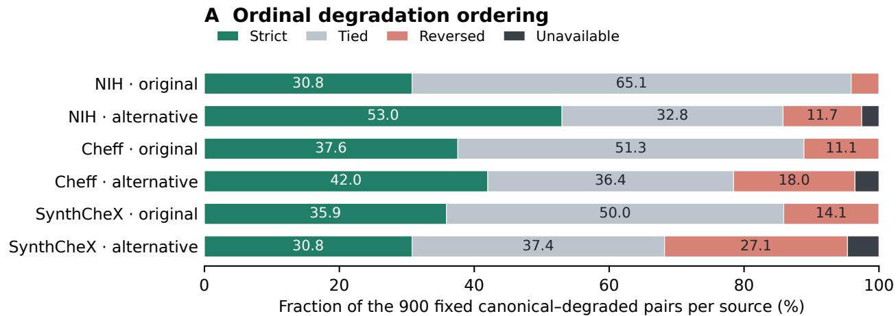

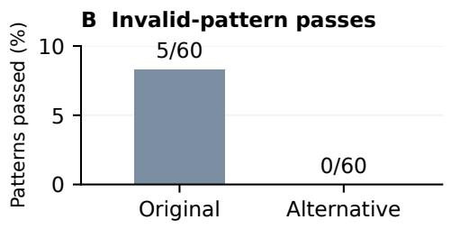

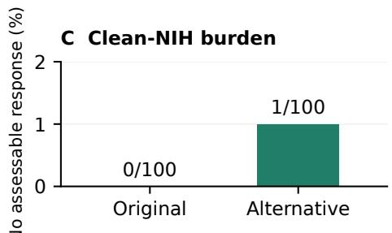  
B: 60 unique pixel patterns; any pass across repeated exposures, without flat check.  
C: all 100 NIH bases; invalid replies, unassessable or non-chest responses count as burden.  
Alternative: 59/3,060 main native-final failures; 1 cap. Supplemental: 5/10 native-final failures.  
Unavailable ordering pairs remain in every denominator. Descriptive controls; no clinical validity claim.

Figure S1. Development quality controls. Each collection contributes 100 images and 900 pairs of an undegraded image and a degraded copy, and the repeated degraded versions are not independent images. Invalid-input passes count 60 distinct patterns, each counted as a pass if any repeated exposure passes. Failures and unavailable pairs are shown explicitly. The alternative rubric improves pooled stric ordering but does worse on SynthCheX. Panel A shows the ordering outcomes, panel B the invalid-pattern passes without the flat-image guard, and panel C (“burden”) the clean NIH images without an assessable judgment. In the notes, “native-final failures” are failed fina replies, and “cap” is a generation that hit the token cap.

## S6.2 Threshold calibration

Newly fitted DINOv3, medical, and pixel-statistic heads use the fixed set of 3,000 distinct genuine calibration images, after head selection is complete. The rubric-field probe is the exception (below). As in Equation 1 of the main paper, the receiver computes $p _ { \mathrm { r e a l } } ( x ) = ( 1 + \# \{ s _ { i } \geq s ( x ) \} ) / ( n + 1 )$ where $s _ { i }$ are the origin scores of the n calibration images, and flags x when $p _ { \mathrm { r e a l } } ( x ) \leq \alpha$ . With $n = 3 { , } 0 0 0$ , an image is flagged only if its score is strictly above the threshold for its α level $( \alpha = 0 . 0 1 , 0 . 0 5 , \mathrm { o r } 0 . 1 0 )$ , so a score equal to the threshold is not flagged. We export the actual score thresholds, tie counts, and achieved reference rejection for each head to the reproducibility files. The value $p _ { \mathrm { r e a l } } ( x )$ says how typical the score is among genuine images. It is not the probability that an image was acquired, and it carries no guarantee under an arbitrary change of collection.

## S6.3 Reference sets for the secondary checks

Pilot head. The pilot head needs its own exclusion because it was fitted earlier. A metadata audit found 58 reserved calibration patients that its earlier fitting used and 28 that its regularization selection used. We excluded them without looking at any scores. This leaves 2,914 patients that the head has never seen, so $n + 1 = 2 { , } 9 1 5$ . We linked this subset to the saved head and to the old split manifests before the final inference. Neither the saved head nor its original threshold changes. All 3,000 score attempts stay in the record, and we replace no failed or excluded patient. All pilot-head evaluations use the 2,914-patient reference, and the other newly fitted heads use all 3,000 patients, except the rubric-field probe (below).

Rubric-field probe. The probe uses eight numeric or indicator fields of the alternative rubric: visibility, artifact severity, chest recognition, assessability, a null-artifact indicator, and three uncertainty indicators. It excludes rationales and source metadata. A null severity is coded as zero plus its indicator. Of the fixed 1,500 NIH and 1,500 Cheffidentified fitting attempts, 1,461 and 1,469 replies are valid, and 976 and 488 of the 1,000 and 500 development attempts are valid. Failed replies are left out of fitting without replacement and are unavailable at prediction. Valid unassessable replies remain numeric observations. All four values of C reach the same development result (5 of 500 attempted Cheff-identified replies rejected), so the smaller-C rule selects $C = 0 . 0 1$ . Failed replies cannot count as detections.

A metadata audit found ten calibration patients in qualityrubric development: eight with the same canonical image and two with another acquisition. Diagnosis and blank contexts add no overlapping calibration patient. Excluding these ten leaves 2,990 eligible patients. The 3,000 calibration attempts contain 2,940 valid and 60 unavailable replies, and all ten excluded patients have valid replies. The reference thus holds 2,930 valid replies from 2,990 eligible patients, with denominator $n + 1 = 2 \AA , 9 3 1$ . The saved report’s valid\_n=2930 counts these valid reference replies, not all 2,940 valid attempts. Its 1% and 5% thresholds coincide because of ties. We checked the full records, masks, and reference order by replaying the saved replies. For this probe we claim neither the full 3,000-patient guarantee nor independence from the earlier rubric development.

Pixel-statistic classifier. The six statistics are intensity mean, intensity standard deviation, luminance entropy, the high-frequency fraction of spectral power, the ratio of border to interior gradients, and an estimate of JPEG blockiness. They are measured on the input luminance in the range 0 to 1, without any feedback from the origin models. Entropy uses 256 bins. High-frequency energy covers 0.25 to 0.5 cycles per input pixel, and we normalize it by the total non-DC Fourier power, including diagonal frequencies above 0.5. The border measure uses an eight-pixel region, and JPEG blockiness compares gradients at eight-pixel grid boundaries with gradients elsewhere. The 512-pixel condition changes the image scale, so the same pixel counts cover different regions, and neither the frequency band nor the border width is a physical, millimeter-scale quantity. The classifier uses only permitted NIH and Cheff-identified fitting and development data, and it is calibrated on the same genuine images as the other heads. It tests whether the collections differ in simple image properties, so it is not a validated forgery detector.

## S6.4 Augmented head and the responsefeature ablation

The augmented head sees five views of both classes: canonical, JPEG 75, resize 128, native 512, and 4-pixel padding. Each image has total weight one across its five views, in standardization and in fitting. The primary comparison (A) sets the raw and augmented CLS heads against each other, each with matched thresholds. We report two further contrasts separately: (B) the full policy change from the raw head with the canonical threshold to the augmented head with matched thresholds, and (C) threshold-only recalibration of the raw head. The development target was at least five percentage points more Cheff-identified images rejected, averaged over the 13 conditions, with at most one point more genuine images flagged.

On the completed 13-condition development comparison, augmentation raised Cheff rejection by 4.62 percentage points (95% paired interval [3.95, 5.26]) and the share of genuine images flagged by 0.12 points ([−0.58, 0.84]). The gain falls short of the five-point target. The fixed augmentation arm was still evaluated because it was a required prespecified comparison, and this outcome led to no further method search and no tuning on the test split. These intervals use 2,000 paired resamples of development patients, conditional on the fixed genuine references.

The optional response-feature ablation feeds the head $[ h ( x ) , h ( J ( x ) ) - h ( x ) , h ( R ( x ) ) - h ( x ) ]$ , where h is the frozen feature map, x is the canonical image, and J(x) and R(x) are its JPEG 75 and resize 128 versions computed by the receiver. Its comparator averages the raw head’s probabilities over exactly these three views. Each arm uses its own genuine development threshold. Adoption required at least five points more Cheff-identified images rejected and at most one point more genuine flags. This three-view test does not evaluate a response detector on all 13 conditions. A missing reserved view fails the development stage without replacement. The response features rejected 500 of 500 Cheff-identified development images, against 495 of 500 for the three-view average, and both flagged 49 of 1,000 genuine development images. The gain of one point fails the five-point criterion. We keep the response head and its scores as a development ablation, and we adopted no final response arm.

## S7 Selection procedures

## S7.1 Strategies and denominators

The submitter has cached Qwen quality and surrogate judgments only. Each pool is a nested subset of the generated test images, ordered by a fixed hash, so each smaller pool is contained in the larger ones. Each strategy submits at most

K images from a pool. Uniform selection draws K images at random. Quality selection ranks the images by the original quality score Q, highest first, and submits the top K. It places unavailable scores last and breaks ties with a fixed tie hash. Quality-constrained surrogate selection keeps only images with an assessable original score of at least 75 and an available, assessable surrogate rating. It sorts them by that rating, then by the original quality score, then by a fixed tie hash, and submits the top K. When fewer than K images qualify, fewer are submitted, and we report both the denominator of actual submissions and the denominator of the full candidate budget. The 100 repeated pool seeds change pool membership and uniform draws, while the tie hashes stay fixed.

A generated image passes both checks when it passes the frozen MedGemma quality check and the origin check at the declared threshold. The primary origin threshold targets 5%. The quality check adds a separate cost for genuine images, so we do not claim that the combined rule fails only 5% of genuine images. The nested budgets are 100, 250, 500, and 1,000 with K = 20, and 5,000 is a secondary budget for SynthCheX only. An empty surrogate submission has an undefined conditional rate and interval, and its passes per candidate are zero. Origin-only passes and the 1% and 10% sensitivity points are reported separately. We fixed the selected submissions, pool orders, query costs, and repeated selections before any join with receiver outcomes. We verified that the full model weights were loaded, that final answers were read from the model’s own output, that each image reached the intended model and batch, that each run held the intended items, and that cached outputs matched their stored hashes. We did not infer any of this from file names or model labels.

## S7.2 Surrogate rating prompt

Inspect only these chest-radiograph pixels. Rate how acquisition-like the image appears, using visible structural coherence and conspicuous rendering/synthesis cues. Do not claim a verified acquisition record or use pathology absence, medical devices, AP/portable position, filenames or labels to certify origin. This is a surrogate ranking judgment, not a calibrated probability. Return JSON only: assessable:boolean, acquisition\_like\_rank:integer0..10 (0=strong conspicuous rendering incoherence;5=ambiguous appearance ;10=strongly coherent acquisition-

like appearance), uncertainty:low/ moderate/high, rationale:string.   
Unusual but coherent clinical   
anatomy is not evidence of synthesis . If unassessable,   
acquisition\_like\_rank=0 and   
uncertainty=high.

```jsonl
{
"type": "object",
"additionalProperties": false,
"required": [
"assessable",
"acquisition_like_rank",
"uncertainty",
"rationale"
],
"properties": {
"assessable": {
"type": "boolean"
},
"acquisition_like_rank": {
"type": "integer",
"minimum": 0,
"maximum": 10
},
"uncertainty": {
"enum": [
"low",
"moderate",
"high"
]
},
"rationale": {
"type": "string"
}
}
}
```

## S7.3 Pairwise refinement

The secondary pairwise method breaks ties among topscoring candidates. Its prompt compares two images in order.

Two images are supplied in order A then B. Compare their visible technical quality and conspicuous structural/ rendering artifacts. Do not judge origin, absence of pathology, AP/PA or devices as quality by themselves. First assess whether each depicts enough chest-radiograph content. Return only JSON: assessable\_a: boolean, assessable\_b:boolean,

winner:"A"/"B"/"tie"/"neither", strength:integer0..3 (0=tie/ unassessable,1=slight,2=clear,3= large difference), rationale:string with visible evidence. Judge visibility and structural coherence, not verified clinical usefulness. The images sources are unknown.

```json
{
"type": "object",
"additionalProperties": false,
"required": [
"assessable_a",
"assessable_b",
"winner",
"strength",
"rationale"
],
"properties": {
"assessable_a": {
"type": "boolean"
},
"assessable_b": {
"type": "boolean"
},
"winner": {
"enum": [
"A",
"B",
"tie",
"neither"
]
},
"strength": {
"type": "integer",
"minimum": 0,
"maximum": 3
},
"rationale": {
"type": "string"
}
}
}
```

Pairwise development compares 24 candidates per collection with four fixed anchors, in both image orders, for 576 sample tasks. The coverage of comparable pairs had to reach 90% overall and in each collection, with 80% consistency after swapping the order among comparable pairs. A failed or unassessable comparison cannot count as consistent. A Bradley–Terry model (which turns pairwise wins into scores), fitted with a fixed L<sub>2</sub> = 1 penalty, gives ties half a win and ignores the model’s self-reported strength.

Anchor scores are zero-centered separately by collection and frozen before the final comparisons, and scores from different collection-anchor systems are never compared. The final refinement is limited to ties at the top of the original score within the 100-candidate, K = 20 condition of each generator, with at most 1,600 queries, and the projected generation time had to be at most two hours. Other budgets keep the ordinal baseline. These are automated ranking judgments, not expert judgments of quality.

All 288 swapped development pairs were comparable. The outcome stayed the same after swapping in 261 of 288 pairs overall, 84 of 96 NIH pairs, 87 of 96 Cheff-identified pairs, and 90 of 96 SynthCheX pairs. The recorded generation time was 2,201.785 seconds, and its projection to 1,600 queries was 6,116.070 seconds, below the 7,200- second cap. These criteria support adopting the bounded refinement. If a required query fails or is incomparable, that generator’s whole 100-candidate condition returns to the ordinal baseline, and we do not discard the failed candidate. Wilson intervals for this condition are descriptive. Repeated pools were not queried pairwise, so we report no bootstrap and no pairwise result for them.

## S8 Processing conditions

The 13 conditions. The receiver applies these conditions: canonical (Section S2); grayscale JPEG at quality 95, 85, 75, and 50, decoded to RGB; Lanczos down- and upsampling through 192, 128, and 64 pixels; direct processing of the preserved original file at 512 pixels (native 512); a thin 4-pixel border mask; 4-pixel padding; a 64-pixe central mask; and a severe 26-pixel border mask. The masks and the padding act on the 256-pixel canonical image. Padding resizes the content to 248 pixels before it adds a four-pixel frame. The thin border mask alters about 6.15% of the square, the central mask removes 6.25%, and the severe mask removes 36.5%, so the severe mask cannot isolate text. Native 512 starts from the preserved original file instead of the canonical image. Cheff-identified images are stored at 256 pixels, so this condition upscales them, and we do not claim that it recovers lost detail. DINOv3’s processor stays at 224 pixels, and MedGemma’s at 896 pixels, under every condition.

Threshold policies. Every condition keeps the same 3,000 genuine calibration attempts and the same 1,000 test images per collection. Table S24 compares four policies: the raw head with the canonical threshold, the raw head with a matched threshold, the augmented head with a matched threshold, and the augmented head with a global threshold. The first three are the comparison in the main paper, and the global threshold is secondary. To set the globa threshold, we assign each calibration image to exactly one of five conditions (canonical, JPEG 75, resize 128, native 512, or 4-pixel padding). The assignment uses the SHA256 hash of 20261014|global\_route\_calibration| base\_id, read as a full integer modulo five. The actual counts per condition are 579, 621, 579, 627, and 594, and they need not equal 600. The global threshold has a guarantee only for this mixture of conditions, not for each condition and not for an unknown processing shift.

Unavailable outputs. Every test view receives either a finite prediction or an explicit unavailable status. An unavailable output is neither a genuine pass nor a detection. Calibrating a newly fitted head requires all 3,000 calibration scores to be finite. The rubric-field probe uses only valid replies (Section S6).

## S9 Statistical procedures

Rates and intervals. Rates are counts over attempted images, including zero counts, and they carry Wilson 95% intervals. A fixed submitted list of 20 images has a Wilson interval that describes that list. It does not include the variability of the selection.

Bootstrap. Bootstrap intervals use 2,000 resamples of base images within each collection, and they keep all views and claim variants of one base image together. The wholeprocedure interval for selection resamples candidate groups and repeats the selection, so it includes the variability of selection. The 100 repeated pool draws show how sensitive the results are to pool membership. They are a Monte Carlo check on cached scores, not independent datasets. AUROC and the standardized partial AUC up to a false-positive rate of 0.10 use images with a finite score, and the tables state the attempted and unavailable counts. All intervals condition on the fixed fitted models and thresholds, so they do not include the variability of fitting.

Representation proximity. We measure how close generated images are to NIH images in each frozen representation with the unbiased maximum mean discrepancy (MMD) and the cubic kernel $( x ^ { \top } y / d + 1 ) ^ { 3 }$ , where d is the feature dimension. The panels hold 500 images per collection, and a disjoint NIH-NIH panel of the same size gives a reference. We keep negative values of the unbiased estimator. The angular sensitivity analysis uses unit vectors scaled by $\sqrt { d }$ and is secondary, and we do not compare magnitudes across encoders. The 100 subsample repetitions show Monte Carlo dispersion, and 2,000 resamples of base images show the uncertainty of the fixed panels. The intervals for the NIH

NIH statistic show spread only. They do not test whether the two NIH panels are equal.

Nearest neighbors. Cosine neighbors query a fixed development or test panel against the NIH fit images only, with deterministic ties. This limited reference cannot show that memorization is absent anywhere. Each nearestneighbor illustration uses one query per collection, chosen by a fixed hash within each 500-query panel. Query selection never uses the distance or the visual appearance. The same query is shown with its nearest fit image in the DINOv3 CLS, DINOv3 mean-patch, and medical meanpatch representations, with its genuine or generated label and its unmodified canonical pixels. The neighbors show association in a representation. They are not a clinical similarity judgment or proof of training memorization.

Correlations, score shifts, and strata. Correlations between origin scores and pixel statistics are Spearman correlations within each collection, with 2,000 resamples of base images. We do not pool the collections into a causal explanation. Paired score shifts and rank changes use the same images, and Table S29 gives each head’s canonical interquartile range (IQR) as a scale for the shifts. The thinborder and central masks keep all pixels outside the masked regions. Padding resizes the whole content to 248 pixels before it adds the frame, so it also changes image scale. Rates standardized over projection use the fixed development weights 0.178 and 0.822 and report the support of each stratum. Unknown strata stay explicit. The labels No Finding and recorded finding come from reports, so they are observational strata, not independent labels of normality or quality.

Independence. Views of one image, repeated pool draws, claim variants, and repeated heads on the same images are not independent observations. The tables report them so that every denominator is visible.

## S10 Extended results and diagnostics

This section holds the tables and figures behind the main paper. Each group starts with the question that its tables answer and ends with the main conclusion. The conventions in Section S1 apply to all tables.

## S10.1 Quality on the test split

Question. How many images does each quality evaluator pass, and how do the ratings of generated images differ from those of genuine images? Table S2 lists all three evaluators: Qwen with the original rubric, MedGemma with the original rubric, and MedGemma with the alternative rubric. Table S3 gives MedGemma’s judgments of the fixed submitted lists. Its column P(genuine below) gives the share of genuine images that are rated strictly below a selected image, using the available ratings on each rubric’s own scale. Tied original scores do not count as strictly below, and valid alternative replies with a null artifact field have no ordinal rank. Tables S4 and S5 compare the rating fields of generated and genuine images, each on its own scale. Figures S2 and S3 show the distributions, and Figure S4 plots quality against origin scores.

Conclusion. On average, all three evaluators rate generated images lower than genuine images. Between 53% and 92% of the images pass each evaluator, but under the alternative rubric and under Qwen fewer than half of the generated images reach the top score. Qwen’s selected lists have higher MedGemma pass rates than uniform lists under both rubrics. Among SynthCheX images with the top originalrubric score of 100, the origin scores span nearly the whole range from 0 to 1 (Figure S4), so a high quality score does not imply a low origin score.

## S10.2 Held-out quality validity and quality under processing

Question. Does either rubric pass meaningless inputs, return an assessable answer for clean genuine images, and rate an undegraded image above its degraded copies? Table S6 gives the ordering outcomes for the 600 expected pairs per collection and rubric. Table S7 gives the invalidpattern passes and the clean-image counts. Table S8 gives the quality pass counts under the four processing conditions. Table S9 separates the three degradation families, and Table S10 gives the replies at the top of each rubric’s own scale. A pattern of invalid input counts as a pass if any exposure of identical pixels passes, and the exposure-level counts are kept in a separate record. A failed reply is unavailable, not a valid non-chest judgment.

Conclusion. Without the flat-image guard, the alternative rubric passes none of the 60 invalid patterns and the original rubric passes 5. With the guard, both pass none. The alternative rubric returns an assessable judgment for fewer clean NIH images (97 of 100, against 100 of 100). Over all collections, it gives fewer ties (683 against 988) but more reversals (426 against 228) and more unavailable pairs (41 against 2). Its strict ordering improves for NIH images (274 against 179 of 600 pairs) and Cheff-identified images (234 against 194), and it falls for SynthCheX images (142 against 209).

## S10.3 Origin check: thresholds, ranking, and transfer

Question. How do the origin heads behave at the 5% level, at the 1% and 10% levels, and in ranking? Does it matter which generators the head sees in fitting? How do the heads behave on genuine Open-I images? Table S11 gives the 5% results for all seven heads (the main paper reports five of them). Tables S12, S13, and S14 give the other thresholds, the AUROC values, and paired AUROC differences for these heads. Tables S15 to S20 give the same results for the secondary heads that are fitted on Cheff-identified images only, on SynthCheX only, and on both. In these tables, the generated columns count generated images that pass the origin check, which is the complement of the rejection counts. Table S21 gives the Open-I results. No Open-I image took part in fitting, head selection, or threshold tuning, and the Open-I panel contains only genuine images, so it gives no AUROC. The rubric-field probe computes its reference only over valid replies, and its unavailable outputs never become detections.

Conclusion. Under canonical processing, the DINOv3 and medical heads reject all or nearly all Cheff-identified images and most SynthCheX images, with SynthCheX AUROC between 0.9699 and 0.9891. The rubric fields (AUROC 0.6301 for Cheff-identified and 0.7181 for SynthCheX images) and the pixel statistics (0.9321 and 0.8962) rank less well. For the primary head, the 1% and 10% levels flag 26 and 200 of 2,297 NIH images and reject 4,339 and 4,780 of 5,000 SynthCheX images, against 110 and 4,677 at 5%. A head fitted on one generator passes more images of the other generator than a head fitted on both does: at 5%, the Cheff-only CLS head passes 311 of 5,000 SynthCheX images, and the SynthCheX-only CLS head passes 114 of 1,000 Cheff-identified images. Heads fitted on both generators reject all 6,000 generated test images (CLS and medical) or all but five (DINOv3 mean), but the test generators also contribute to their fitting data. On Open-I images at the 5% level, the learned heads flag between 15.9% and 59.4%, and the pixel-statistic classifier flags 2.8%.

## S10.4 MedForge comparison

Question. How does MedForge-Reasoner label genuine and generated images at its own operating point, and how does it label the fixed submitted lists? The fixed panel and the selected extras contain 900 and 195 unique images. All 1,095 attempts returned valid verdicts, and none hit the token cap. The union of the fixed submissions has 236 unique images, and 41 of them already occur in the fixed panel and reuse their original verdicts. The 580 strategy rows are repeated uses of these 236 images, so they are not 580 independent images. No image that appears only in repeated pools expands the scope. Table S22 gives the operating point, and Table S23 gives the fixed lists at B = 1,000 and K = 20.

Table S2. All quality evaluators on each test collection. Valid and unavailable use attempted images as the denominator. Unassessable and top-score counts use valid replies. Guarded passes use all attempted images with the flat-image guard. Original scores keep their 0–100 scale (top score 100). The alternative rubric keeps its ordinal fields (top score: visibility 4 and artifact severity 0) and is never converted to 100.
<table><tr><td>Evaluator</td><td>Collection</td><td>Attempted N</td><td>Valid of attempted</td><td>Unavailable of attempted</td><td>Unassessable of valid</td><td>Guarded pass of attempted</td><td>Top score of valid</td></tr><tr><td>MedGemma alt.</td><td>NIH</td><td>2297</td><td>2219/2297</td><td>78/2297</td><td>2/2219</td><td>1717/2297</td><td>1229/2219</td></tr><tr><td>MedGemma alt.</td><td>Cheff</td><td>1000</td><td>988/1000</td><td>12/1000</td><td>6/988</td><td>668/1000</td><td>305/988</td></tr><tr><td>MedGemma alt.</td><td>SynthCheX</td><td>5000</td><td>4920/5000</td><td>80/5000</td><td>12/4920</td><td>2656/5000</td><td>856/4920</td></tr><tr><td>Qwen original</td><td>NIH</td><td>2297</td><td>2297/2297</td><td>0/2297</td><td>0/2297</td><td>2059/2297</td><td>1558/2297</td></tr><tr><td>Qwen original</td><td>Cheff</td><td>1000</td><td>1000/1000</td><td>0/1000</td><td>1/1000</td><td>695/1000</td><td>416/1000</td></tr><tr><td>Qwen original</td><td>SynthCheX</td><td>5000</td><td>5000/5000</td><td>0/5000</td><td>0/5000</td><td>3056/5000</td><td>1238/5000</td></tr><tr><td>MedGemma original</td><td>NIH</td><td>2297</td><td>2296/2297</td><td>1/2297</td><td>0/2296</td><td>2116/2297</td><td>1923/2296</td></tr><tr><td>MedGemma original</td><td>Cheff</td><td>1000</td><td>999/1000</td><td>1/1000</td><td>0/999</td><td>809/1000</td><td>688/999</td></tr><tr><td>MedGemma original</td><td>SynthCheX</td><td>5000</td><td>4994/5000</td><td>6/5000</td><td>1/4994</td><td>3806/5000</td><td>3168/4994</td></tr></table>

<table><tr><td colspan="5"></td><td rowspan="2">Ordinal n genuine / selected</td><td rowspan="2">Unavailable genuine / selected</td></tr><tr><td>Evaluator</td><td>Collection</td><td>Strategy</td><td>Pass k/n [95% CI]</td><td>P(genuine below) [95% CI]</td></tr><tr><td>MedGemma alt.</td><td>Cheff</td><td>Uniform</td><td>12/20 [0.387, 0.781]</td><td>0.242 [0.164, 0.317]</td><td>2155 / 18</td><td>78 /0</td></tr><tr><td>MedGemma alt.</td><td>Cheff</td><td>Quality</td><td>19/20 [0.764, 0.991]</td><td>0.337 [0.276, 0.395]</td><td>2155 / 20</td><td>78/0</td></tr><tr><td>MedGemma alt.</td><td>Cheff</td><td>Surrogate</td><td>19/20 [0.764, 0.991]</td><td>0.333 [0.269, 0.391]</td><td>2155 / 20</td><td>78 /0</td></tr><tr><td>MedGemma alt.</td><td>SynthCheX</td><td>Uniform</td><td>8/20 [0.219, 0.613]</td><td>0.179 [0.098, 0.267]</td><td>2155 / 18</td><td>78 /1</td></tr><tr><td>MedGemma alt.</td><td>SynthCheX</td><td>Quality</td><td>17/20 [0.640, 0.948]</td><td>0.344 [0.271, 0.410]</td><td>2155 / 20</td><td>78/0</td></tr><tr><td>MedGemma alt.</td><td>SynthCheX</td><td>Surrogate</td><td>14/20 [0.481, 0.855]</td><td>0.258 [0.183, 0.333]</td><td>2155 / 17</td><td>78 /2</td></tr><tr><td>MedGemma orig.</td><td>Cheff</td><td>Uniform</td><td>14/20 [0.481, 0.855]</td><td>0.112 [0.079, 0.144]</td><td>2296 / 20</td><td>1/0</td></tr><tr><td>MedGemma orig.</td><td>Cheff</td><td>Quality</td><td>20/20 [0.839, 1.000]</td><td>0.162 [0.147, 0.178]</td><td>2296 /20</td><td>1/0</td></tr><tr><td>MedGemma orig.</td><td>Cheff</td><td>Surrogate</td><td>20/20 [0.839, 1.000]</td><td>0.161 [0.145, 0.176]</td><td>2296 / 20</td><td>1/0</td></tr><tr><td>MedGemma orig.</td><td>SynthCheX</td><td>Uniform</td><td>15/20 [0.531, 0.888]</td><td>0.121 [0.094, 0.148]</td><td>2296 /20</td><td>1/0</td></tr><tr><td>MedGemma orig.</td><td>SynthCheX</td><td>Quality</td><td>20/20 [0.839, 1.000]</td><td>0.162 [0.147, 0.178]</td><td>2296 / 20</td><td>1/0</td></tr><tr><td>MedGemma orig.</td><td>SynthCheX</td><td>Surrogate</td><td>20/20 [0.839, 1.000]</td><td>0.162 [0.147, 0.178]</td><td>2296 / 20</td><td>1/0</td></tr></table>

Table S3. MedGemma’s quality judgments of the 12 fixed submitted lists $( B = 1 , 0 0 0 , K = 2 0 ) \colon$ : two generated collections, three strategies, and both rubrics. Pass uses all 20 submissions, with Wilson 95% intervals as fractions. P(genuine below) is the share of genuine images rated strictly below a selected image, with an interval that conditions on the fixed list. Ordinal and unavailable counts are given as genuine/selected. A valid reply with a null alternative artifact field can lack an ordinal rank.

<table><tr><td>Evaluator</td><td>Collection</td><td>Rating field</td><td>Mean difference [95% CI]</td><td>Median difference [95% CI]</td><td>Finite n genuine / generated</td></tr><tr><td>MedGemma alt.</td><td>Cheff</td><td>Visibility</td><td>-0.252 [-0.293, -0.213]</td><td>-1.000 [-1.000, -1.000]</td><td>2219 / 988</td></tr><tr><td>MedGemma alt.</td><td>Cheff</td><td>Artifacts</td><td>0.378 [0.313, 0.443]</td><td>1.000 [1.000, 1.000]</td><td>2155 / 961</td></tr><tr><td>MedGemma alt.</td><td>SynthCheX</td><td>Visibility</td><td>-0.397 [-0.422, -0.372]</td><td>-1.000 [-1.000, -1.000]</td><td>2219 / 4920</td></tr><tr><td>MedGemma alt.</td><td>SynthCheX</td><td>Artifacts</td><td>0.693 [0.649, 0.734]</td><td>1.000 [1.000, 1.000]</td><td>2155 / 4817</td></tr><tr><td>Qwen orig.</td><td>Cheff</td><td>Technical</td><td>-0.484 [-0.546, -0.423]</td><td>-1.000 [-1.000, -1.000]</td><td>2297 / 1000</td></tr><tr><td>Qwen orig.</td><td>Cheff</td><td>Anatomy</td><td>-0.217 [-0.254, -0.182]</td><td>0.000 [0.000, 0.000]</td><td>2297 / 1000</td></tr><tr><td>Qwen orig.</td><td>Cheff</td><td>Artifacts</td><td>0.253 [0.212, 0.290]</td><td>0.000 [0.000, 0.000]</td><td>2297 / 1000</td></tr><tr><td>Qwen orig.</td><td>Cheff</td><td>Score</td><td>-8.279 [-9.392, -7.165]</td><td>-10.000 [-10.000, -10.000]</td><td>2297 / 1000</td></tr><tr><td>Qwen orig.</td><td>SynthCheX</td><td>Technical</td><td>-0.736 [-0.772, -0.701]</td><td>-1.000 [-1.000, -1.000]</td><td>2297 / 5000</td></tr><tr><td>Qwen orig.</td><td>SynthCheX</td><td>Anatomy</td><td>-0.306 [-0.325, -0.287]</td><td>0.000 [0.000, 0.000]</td><td>2297 / 5000</td></tr></table>

Table S4. Generated-minus-genuine differences in rating fields, part 1 of 2. Higher technical, anatomy, visibility, and original-score values are better, and higher artifact severity is worse. Means, medians, and bootstrap intervals use valid replies with a non-null field. The scales differ and are not pooled or remapped.

<table><tr><td rowspan="2">Evaluator</td><td rowspan="2">Collection</td><td rowspan="2">Rating field</td><td rowspan="2">Mean difference [95% CI]</td><td rowspan="2">Median difference</td><td rowspan="2">Finite n genuine / generated</td></tr><tr><td>[95% CI]</td></tr><tr><td>Qwen orig.</td><td>SynthCheX</td><td>Artifacts</td><td>0.328 [0.306, 0.349]</td><td>0.000 [0.000, 1.000]</td><td>2297 / 5000</td></tr><tr><td>Qwen orig.</td><td>SynthCheX</td><td>Score</td><td>-12.060 [-12.677, -11.443]</td><td>-15.000 [-15.000, -10.000]</td><td>2297 / 5000</td></tr><tr><td>MedGemma orig.</td><td>Cheff</td><td>Technical</td><td>-0.241 [-0.300, -0.183]</td><td>0.000 [0.000, 0.000]</td><td>2296 / 999</td></tr><tr><td>MedGemma orig.</td><td>Cheff</td><td>Anatomy</td><td>-0.101 [-0.129, -0.074]</td><td>0.000 [0.000, 0.000]</td><td>2296 / 999</td></tr><tr><td>MedGemma orig.</td><td>Cheff</td><td>Artifacts</td><td>0.255 [0.203, 0.308]</td><td>0.000 [0.000, 0.000]</td><td>2296 / 999</td></tr><tr><td>MedGemma orig.</td><td>Cheff</td><td>Score</td><td>-4.697 [-5.722, -3.688]</td><td>0.000 [0.000, 0.000]</td><td>2296 / 999</td></tr><tr><td>MedGemma orig.</td><td>SynthCheX</td><td>Technical</td><td>-0.370 [-0.406, -0.332]</td><td>0.000 [0.000, 0.000]</td><td>2296 / 4994</td></tr><tr><td>MedGemma orig.</td><td>SynthCheX</td><td>Anatomy</td><td>-0.156 [-0.172, -0.140]</td><td>0.000 [0.000, 0.000]</td><td>2296 /4994</td></tr><tr><td>MedGemma orig.</td><td>SynthCheX</td><td>Artifacts</td><td>0.249 [0.218, 0.279]</td><td>0.000 [0.000, 0.000]</td><td>2296 / 4994</td></tr><tr><td>MedGemma orig.</td><td>SynthCheX</td><td>Score</td><td>-6.503 [-7.093, -5.903]</td><td>0.000 [0.000, 0.000]</td><td>2296 / 4994</td></tr></table>

Table S5. Continuation of Table S4, part 2 of 2.

Original Med technical  
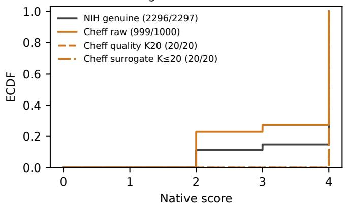  
Original Med artifacts

Original Med anatomy  
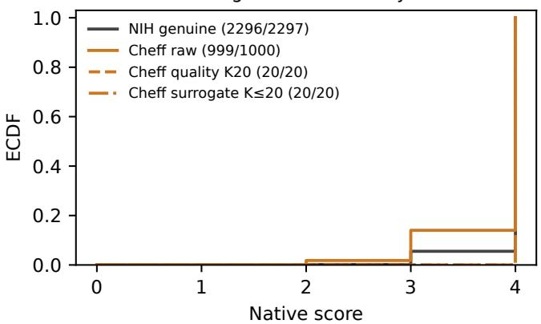  
Original Med quality proxy

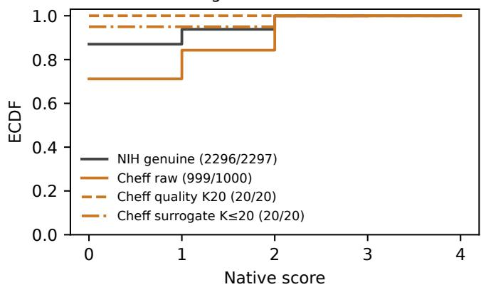  
Alternative visibility

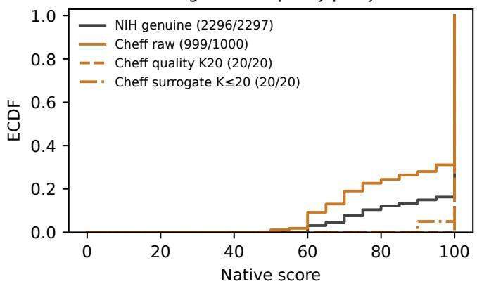  
Alternative structural artifacts

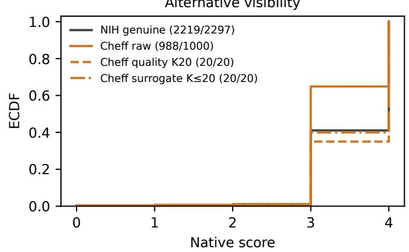

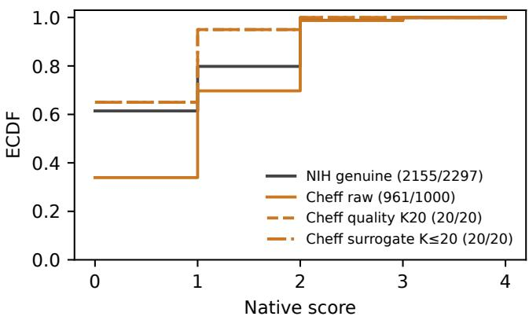  
Figure S2. Distributions of canonical quality components, Cheff-identified images against NIH images. Higher is better for the origina technical and anatomical fields and for alternative visibility, and higher is worse for artifact severity. The components are on different scales, and unavailable and null-field replies are not plotted. In the legends, $\mathbf { \ddot { r a w } } ^ { \mathbf { \hat { \mu } } }$ means all Cheff-identified test images, “quality ${ \bf K } 2 0 ^ { \circ }$ and “surrogate $K { \le } 2 0 ^ { \circ }$ mean the images chosen by those strategies at $B = 1 , 0 0 0 .$ , and the fractions count the images with a plotted score. “Native score” is the score on the rubric’s own scale, and $\mathrm { ^ { 6 6 } M e d ^ { 3 } }$ means MedGemma. Overlap between the curves does not show that the images are indistinguishable in origin.

Original Med technical  
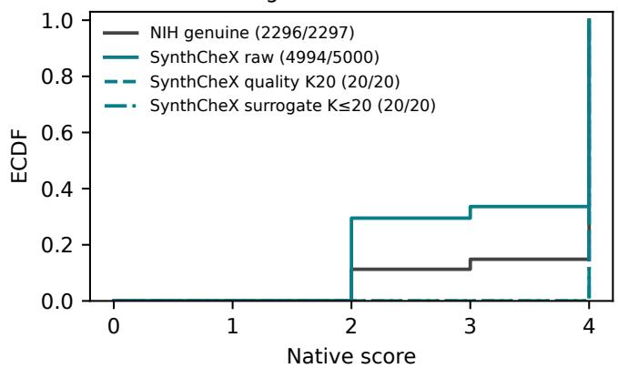

Original Med anatomy  
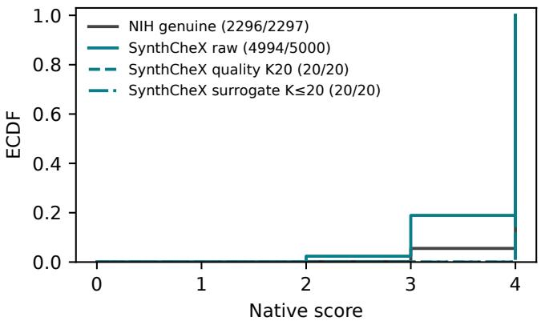  
Original Med quality proxy

Original Med artifacts  
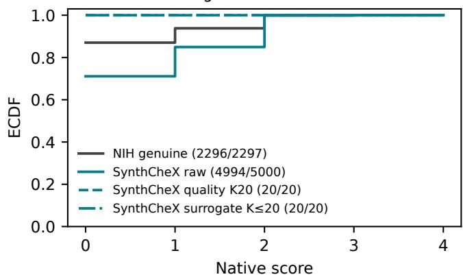  
Alternative visibility

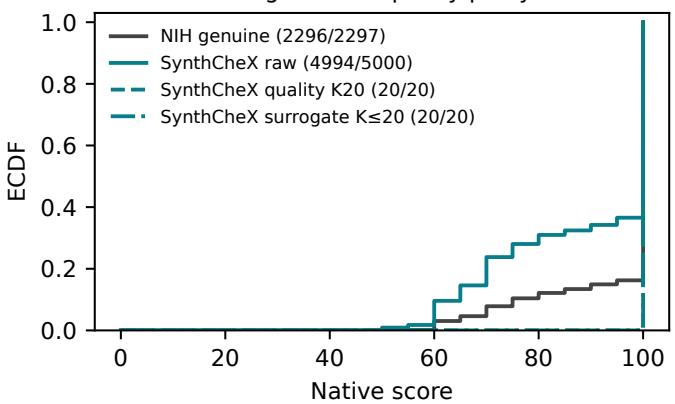

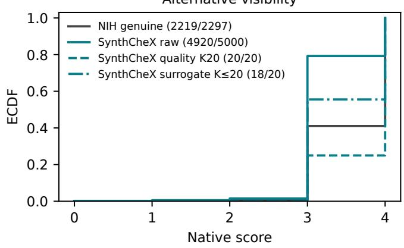

Alternative structural artifacts  
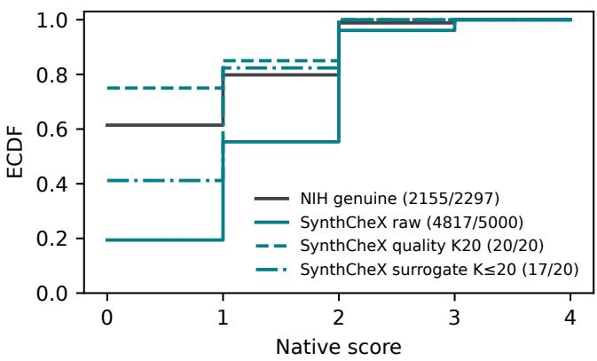  
Figure S3. Distributions of canonical quality components, SynthCheX images against NIH images, with the conventions of Figure S2. SynthCheX was filtered before release and may share conditioning, which limits what the distributions show.

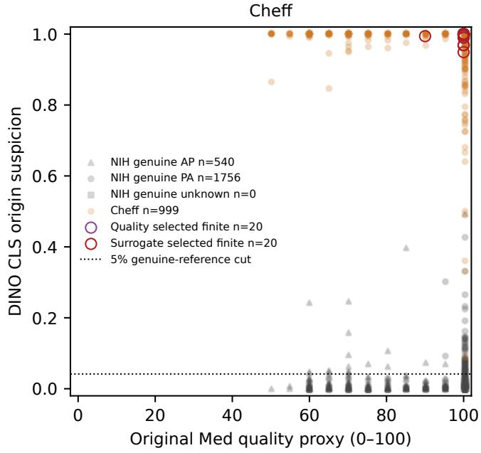

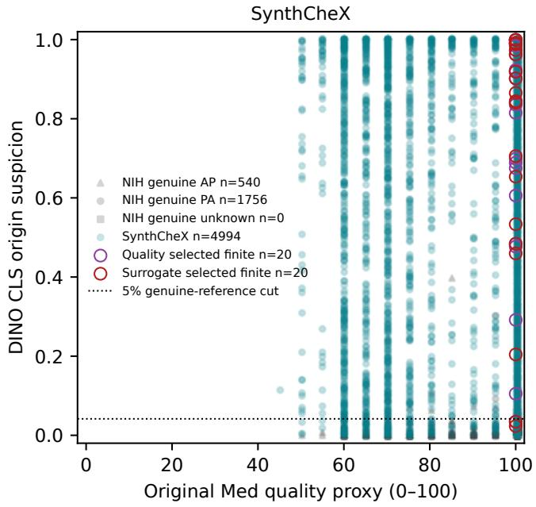  
Figure S4. Quality and origin are different questions. Each point is one test image, placed by its original-rubric MedGemma score (0–100 scale, called “Original Med quality proxy” in the axis label) and by the raw CLS head’s origin score (higher means more likely generated; the figure calls it “suspicion”). Legends give the numbers of images with a finite score. The remaining images (1 NIH, 1 Cheff-identified, and 6 SynthCheX) have an unavailable original-rubric reply. Circles mark the images selected at B = 1,000 and K = 20, and the legend separates quality-selected from surrogate-selected images. The dotted line is the raw head’s 5% threshold, calibrated on genuine NIH images, and $\mathrm {  { ~ \mathrm { ~ \mathit ~ { ~ \hat { ~ } ~ D ~ I N O ~ } ^ { \prime } ~ } } }$ in the figure means DINOv3. The primary quality check uses the alternative rubric’s ordinal fields, not this score.

<table><tr><td>Rubric</td><td>Collection</td><td>Strict</td><td>Tied</td><td>Reversed</td><td>Unavailable</td></tr><tr><td>Original</td><td>NIH</td><td>179</td><td>370</td><td>49</td><td>2</td></tr><tr><td>Original</td><td>Cheff-identified</td><td>194</td><td>323</td><td>83</td><td>0</td></tr><tr><td>Original</td><td>SynthCheX</td><td>209</td><td>295</td><td>96</td><td>0</td></tr><tr><td>Alternative</td><td>NIH</td><td>274</td><td>207</td><td>95</td><td>24</td></tr><tr><td>Alternative</td><td>Cheff-identified</td><td>234</td><td>224</td><td>134</td><td>8</td></tr><tr><td>Alternative</td><td>SynthCheX</td><td>142</td><td>252</td><td>197</td><td>9</td></tr></table>

Table S6. Held-out ordering outcomes for the 600 expected pairs per collection and rubric. A pair is strict when the undegraded image is rated above its degraded copy. The six degraded copies of one image stay paired, and missing replies stay in the denominator.

<table><tr><td>Rubric</td><td>Invalid pass No guard (CI)</td><td>Invalid pass Guard (CI)</td><td>NIH images without an assessable judgment</td><td>NIH unavailable</td></tr><tr><td>Original</td><td>5/60 [3.61, 18.07]</td><td>0/60 [0.00, 6.02]</td><td>0/100</td><td>0/100</td></tr><tr><td>Alternative</td><td>0/60 [0.00, 6.02]</td><td>0/60 [0.00, 6.02]</td><td>3/100</td><td>3/100</td></tr></table>

Table S7. Held-out invalid-pattern passes (out of 60 distinct patterns, with Wilson 95% intervals in percent) and clean genuine images (out of 100 NIH images). The column “without an assessable judgment” counts unavailable, unassessable, and non-chest replies once pe image. Its unavailable part is shown separately.

<table><tr><td>Rubric</td><td>Collection</td><td>Canonical</td><td>JPEG75</td><td>Resize128</td><td>Native512</td></tr><tr><td>Original</td><td>NIH</td><td>278 (0)</td><td>282 (0)</td><td>278 (0)</td><td>286 (0)</td></tr><tr><td>Original</td><td>Cheff-identified</td><td>241 (1)</td><td>243 (0)</td><td>226 (0)</td><td>248 (0)</td></tr><tr><td>Original</td><td>SynthCheX</td><td>235 (0)</td><td>237 (0)</td><td>232 (0)</td><td>241 (1)</td></tr><tr><td>Alternative</td><td>NIH</td><td>223 (11)</td><td>224 (5)</td><td>235 (2)</td><td>233 (10)</td></tr><tr><td>Alternative</td><td>Cheff-identified</td><td>189 (3)</td><td>196 (4)</td><td>207 (3)</td><td>188 (3)</td></tr><tr><td>Alternative</td><td>SynthCheX</td><td>182 (5)</td><td>169 (8)</td><td>188 (5)</td><td>170 (7)</td></tr></table>

Table S8. Quality passes with the flat-image guard among 300 attempted images per collection and condition, with unavailable replies in parentheses. Each row repeats the same images. The three paired intervals for the primary NIH pass shifts include zero, which does not establish equivalence. Across all collections and conditions, the original and alternative rubrics have 2 and 66 unavailable replies out of 3,600.

<table><tr><td colspan="4">Expected</td><td colspan="2">Non-</td><td colspan="5"></td></tr><tr><td>Rubric</td><td>Collection</td><td>Family</td><td>chains</td><td>Valid</td><td>increasing</td><td>Strict</td><td>Reversed</td><td>Tie</td><td>Unavailable</td></tr><tr><td>Original</td><td>NIH</td><td>Blur</td><td>100</td><td>100</td><td>85</td><td>10</td><td>15</td><td>77</td><td>0</td></tr><tr><td>Original</td><td>NIH</td><td>Resample</td><td>100</td><td>100</td><td>83</td><td>2</td><td>17</td><td>86</td><td>0</td></tr><tr><td>Original</td><td>NIH</td><td>Noise</td><td>100</td><td>98</td><td>84</td><td>17</td><td>14</td><td>70</td><td>2</td></tr><tr><td>Original</td><td>Cheff-identified</td><td>Blur</td><td>100</td><td>100</td><td>72</td><td>15</td><td>28</td><td>63</td><td>0</td></tr><tr><td>Original</td><td>Cheff-identified</td><td>Resample</td><td>100</td><td>100</td><td>73</td><td>5</td><td>27</td><td>78</td><td>0</td></tr><tr><td>Original</td><td>Cheff-identified</td><td>Noise</td><td>100</td><td>100</td><td>71</td><td>10</td><td>29</td><td>65</td><td>0</td></tr><tr><td>Original</td><td>SynthCheX</td><td>Blur</td><td>100</td><td>100</td><td>51</td><td>7</td><td>49</td><td>49</td><td>0</td></tr><tr><td>Original</td><td>SynthCheX</td><td>Resample</td><td>100</td><td>100</td><td>68</td><td>3</td><td>32</td><td>79</td><td>0</td></tr><tr><td>Original</td><td>SynthCheX</td><td>Noise</td><td>100</td><td>100</td><td>55</td><td>14</td><td>45</td><td>47</td><td>0</td></tr><tr><td>Alternative</td><td>NIH</td><td>Blur</td><td>100</td><td>97</td><td>64</td><td>5</td><td>33</td><td>75</td><td>3</td></tr><tr><td>Alternative</td><td>NIH</td><td>Resample</td><td>100</td><td>96</td><td>64</td><td>6</td><td>32</td><td>73</td><td>4</td></tr><tr><td>Alternative</td><td>NIH</td><td>Noise</td><td>100</td><td>92</td><td>66</td><td>27</td><td>26</td><td>49</td><td>8</td></tr><tr><td>Alternative</td><td>Cheff-identified</td><td>Blur</td><td>100</td><td>99</td><td>58</td><td>8</td><td>41</td><td>74</td><td>1</td></tr><tr><td>Alternative</td><td>Cheff-identified</td><td>Resample</td><td>100</td><td>96</td><td>60</td><td>3</td><td>36</td><td>81</td><td>4</td></tr><tr><td>Alternative</td><td>Cheff-identified</td><td>Noise</td><td>100</td><td>97</td><td>65</td><td>11</td><td>32</td><td>69</td><td>3</td></tr><tr><td>Alternative</td><td>SynthCheX</td><td>Blur</td><td>100</td><td>98</td><td>38</td><td>4</td><td>60</td><td>73</td><td>2</td></tr><tr><td>Alternative</td><td>SynthCheX</td><td>Resample</td><td>100</td><td>98</td><td>47</td><td>0</td><td>51</td><td>79</td><td>2</td></tr><tr><td>Alternative</td><td>SynthCheX</td><td>Noise</td><td>100</td><td>98</td><td>43</td><td>1</td><td>55</td><td>70</td><td>2</td></tr></table>

Table S9. Held-out results for 18 combinations of rubric, collection, and degradation family. Each row covers 100 expected chains of one image under increasing blur, resampling, or noise, starting from the canonical view. A chain is valid when every rating in it is available. Non-increasing allows ties, and strict requires every step to decrease. The reversal and tie columns count chains with at least one such step, so they can overlap. Unavailable chains are the expected chains that are not valid.

<table><tr><td colspan="2"></td><td>Valid / attempted</td><td>Replies at top score</td><td>Of these, eligible</td><td>Top score / all valid</td></tr><tr><td>Rubric</td><td>Collection</td><td></td><td></td><td></td><td>445/698</td></tr><tr><td>Original Original</td><td>NIH Cheff-identified</td><td>698/700 700/700</td><td>445 376</td><td>445 376</td><td>376/700</td></tr><tr><td>Original</td><td>SynthCheX</td><td>700/700</td><td>347</td><td>347</td><td>347/700</td></tr><tr><td>Original</td><td>Non-image</td><td>67/70</td><td>0</td><td>0</td><td>0/67</td></tr><tr><td>Alternative</td><td>NIH</td><td>691/700</td><td>155</td><td>155</td><td>155/691</td></tr><tr><td>Alternative</td><td>Cheff-identified</td><td>692/700</td><td>105</td><td>105</td><td>105/692</td></tr><tr><td>Alternative</td><td>SynthCheX</td><td>696/700</td><td>55</td><td>55</td><td>55/696</td></tr><tr><td>Alternative</td><td>Non-image</td><td>62/70</td><td>0</td><td>0</td><td>0/62</td></tr></table>

Table S10. Replies at the top of each rubric’s own scale in the held-out panel, including the non-image exposures. The top is a score of 100 for the original rubric and the pair visibility 4 and artifact severity 0 for the alternative rubric, which we do not remap to 100. “Replies at top score” counts all valid replies at the top, and “eligible” counts the subset that also meets the rubric’s eligibility conditions. These counts are exposure-level counts, and they differ from the distinct-pattern passes in Table S7.

<table><tr><td>Origin classifier</td><td>NIH flagged</td><td>Cheff rejected</td><td>SynthCheX rejected</td><td>Unavailable (NIH/C/S)</td></tr><tr><td>Pilot CLS head</td><td>131 (4.8–6.7)</td><td>1,000 (99.6–100.0)</td><td>4,436 (87.8–89.6)</td><td>0/0/0</td></tr><tr><td>DINOv3 CLS, raw (primary)</td><td>110 (4.0–5.7)</td><td>1,000 (99.6–100.0)</td><td>4,677 (92.8–94.2)</td><td>0/0/0</td></tr><tr><td>DINOv3 mean, raw</td><td>123 (4.5–6.4)</td><td>1,000 (99.6–100.0)</td><td>4,407 (87.2–89.0)</td><td>0/0/0</td></tr><tr><td>Medical mean, raw</td><td>107 (3.9–5.6)</td><td>1,000 (99.6–100.0)</td><td>4,673 (92.7–94.1)</td><td>0/0/0</td></tr><tr><td>DINOv3 CLS, augmented</td><td>97 (3.5–5.1)</td><td>1,000 (99.6–100.0)</td><td>4,644 (92.1–93.6)</td><td>0/0/0</td></tr><tr><td>Rubric fields</td><td>22 (0.6–1.4)</td><td>13 (0.8–2.2)</td><td>99 (1.6–2.4)</td><td>78/12/80</td></tr><tr><td>Pixel statistics</td><td>50 (1.7–2.9)</td><td>603 (57.2–63.3)</td><td>2,782 (54.3–57.0)</td><td>0/0/0</td></tr></table>

Table S11. Origin check on canonical test images at the nominal 5% false-alarm rate, without the quality check, for all seven heads. Cells give counts with Wilson 95% intervals in percent. The thresholds use 3,000 genuine calibration images, except for the pilot head (2,914) and the rubric fields (2,930 valid replies).

Table S12. The seven core heads at the nominal 1% and 10% levels (Table S11 gives the 5% level). Cells give count/attempted, percentage, and Wilson 95% interval. NIH counts are false alarms, and the generated columns are rejections. U gives unavailable outputs (NIH/Cheff/SynthCheX). The reference columns give the finite reference size and the unavailable references: the pilot head uses 2,914 images afte 86 exclusions, and the rubric fields use 2,930 valid replies after 10 exclusions and 60 unavailable replies.
<table><tr><td>Method</td><td>α (%)</td><td>NIH reference N; U</td><td>NIH flags count; % [95%]</td><td>Cheff rejections count; % [95%]</td><td>SynthCheX rejections count; % [95%]</td><td>Unavailable N/C/S</td></tr><tr><td>Pilot CLS</td><td>1</td><td>2914 U=0</td><td>39/2297; 1.70 [1.24, 2.31]</td><td>997/1000; 99.70 [99.12, 99.90]</td><td>3944/5000; 78.88 [77.73, 79.99]</td><td>0/0/0</td></tr><tr><td>Pilot CLS</td><td>10</td><td>2914 U=0</td><td>237/2297; 10.32 [9.14, 11.63]</td><td>1000/1000; 100.00 [99.62, 100.00]</td><td>4636/5000; 92.72 [91.97, 93.41]</td><td>0/0/0</td></tr><tr><td>DINOv3 CLS raw</td><td>1</td><td>3000 U=0</td><td>26/2297; 1.13 [0.77, 1.65]</td><td>999/1000; 99.90 [99.44, 99.98]</td><td>4339/5000; 86.78 [85.81, 87.69]</td><td>0/0/0</td></tr><tr><td>DINOv3 CLS raw</td><td>10</td><td>3000 U=0</td><td>200/2297; 8.71 [7.62, 9.93]</td><td>1000/1000; 100.00 [99.62, 100.00]</td><td>4780/5000; 95.60 [95.00, 96.13]</td><td>0/0/0</td></tr><tr><td>DINOv3 mean raw</td><td>1</td><td>3000 U=0</td><td>29/2297; 1.26 [0.88, 1.81]</td><td>999/1000; 99.90 [99.44, 99.98]</td><td>3808/5000; 76.16 [74.96, 77.32]</td><td>0/0/0</td></tr><tr><td>DINOv3 mean raw</td><td>10</td><td>3000 U=0</td><td>[9.88, 12.45]</td><td>255/2297;11.101000/1000; 100.00 [99.62, 100.00]</td><td>4631/5000; 92.62 [91.86, 93.31]</td><td>0/0/0</td></tr><tr><td>Medical mean raw</td><td>1</td><td>3000 U=0</td><td>27/2297; 1.18 [0.81, 1.70]</td><td>999/1000; 99.90 [99.44, 99.98]</td><td>4210/5000; 84.20 [83.16, 85.18]</td><td>0/0/0</td></tr><tr><td>Medical mean raw</td><td>10</td><td>3000 U=0</td><td>189/2297; 8.23 [7.17, 9.42]</td><td>1000/1000; 100.00 [99.62, 100.00]</td><td>4825/5000; 96.50 [95.95, 96.97]</td><td>0/0/0</td></tr><tr><td>DINOv3 CLS augmented</td><td>1</td><td>3000 U=0</td><td>24/2297; 1.04 [0.70, 1.55]</td><td>999/1000; 99.90 [99.44, 99.98]</td><td>4337/5000; 86.74 [85.77, 87.65]</td><td>0/0/0</td></tr><tr><td>DINOv3 CLS augmented</td><td>10</td><td>3000 U=0</td><td>168/2297; 7.31 [6.32, 8.45]</td><td>1000/1000; 100.00 [99.62, 100.00]</td><td>4773/5000; 95.46 [94.85, 96.00]</td><td></td></tr><tr><td>Rubric fields</td><td>1</td><td>2930 (valid) U=60</td><td>22/2297; 0.96 [0.63, 1.45]</td><td>13/1000; 1.30 [0.76, 2.21]</td><td>99/5000; 1.98 [1.63, 2.40]</td><td>0/0/0</td></tr><tr><td>Rubric fields</td><td>10</td><td>2930 (valid) U=60</td><td>258/2297; 11.23 [10.00, 12.59]</td><td>197/1000; 19.70 [17.35, 22.28]</td><td>1385/5000; 27.70</td><td>78/12/80</td></tr><tr><td>Pixel statistics</td><td>1</td><td>3000 U=0</td><td>17/2297; 0.74 [0.46, 1.18]</td><td>376/1000; 37.60</td><td>[26.48, 28.96] 1554/5000; 31.08</td><td>78/12/80</td></tr><tr><td>Pixel statistics</td><td>10</td><td>3000 U=0</td><td>83/2297; 3.61 [2.92, 4.46]</td><td>[34.65, 40.64] 670/1000; 67.00 [64.03, 69.84]</td><td>[29.81, 32.38] 3126/5000; 62.52 [61.17, 63.85]</td><td>0/0/0 0/0/0</td></tr></table>

Table S13. AUROC and standardized partial AUC (false-positive rates up to 0.10) under canonical processing, for the seven heads and both generated collections, with bootstrap 95% intervals. Finite N and unavailable U are given as NIH/generated. Unavailable outputs are not detections.
<table><tr><td>Method</td><td>Generated collection</td><td>AUROC [95%]</td><td>Std. partial AUC [95%]</td><td>Finite N NIH/generated</td><td>Unavailable U NIH/generated</td></tr><tr><td>Pilot CLS</td><td>Cheff</td><td>0.9996 [0.9992, 0.9999]</td><td>0.9981 [0.9960, 0.9995]</td><td>2297/1000</td><td>0/0</td></tr><tr><td>Pilot CLS</td><td>SynthCheX</td><td>0.9704 [0.9671, 0.9736]</td><td>0.9182 [0.9085, 0.9270]</td><td>2297/5000</td><td>0/0</td></tr><tr><td>DINOv3 CLS raw</td><td>Cheff</td><td>0.9999 [0.9997, 1.0000]</td><td>0.9994 [0.9982, 1.0000]</td><td>2297/1000</td><td>0/0</td></tr><tr><td>DINOv3 CLS raw</td><td>SynthCheX</td><td>0.9849 [0.9825, 0.9871]</td><td>0.9569 [0.9496, 0.9630]</td><td>2297/5000</td><td>0/0</td></tr><tr><td>DINOv3 mean raw</td><td>Cheff</td><td>0.9997 [0.9993, 1.0000]</td><td>0.9986 [0.9962, 0.9999]</td><td>2297/1000</td><td>0/0</td></tr><tr><td>DINOv3 mean raw</td><td>SynthCheX</td><td>0.9699 [0.9665, 0.9732]</td><td>0.9182 [0.9083, 0.9272]</td><td>2297/5000</td><td>0/0</td></tr><tr><td>Medical mean raw</td><td>Cheff</td><td>0.9999 [0.9999, 1.0000]</td><td>0.9997 [0.9994, 0.9999]</td><td>2297/1000</td><td>0/0</td></tr><tr><td>Medical mean raw</td><td>SynthCheX</td><td>0.9891 [0.9874, 0.9906]</td><td>0.9573 [0.9507, 0.9632]</td><td>2297/5000</td><td>0/0</td></tr><tr><td>DINOv3 CLS augmented</td><td>Cheff</td><td>0.9999 [0.9997, 1.0000]</td><td>0.9994 [0.9984, 1.0000]</td><td>2297/1000</td><td>0/0</td></tr><tr><td>DINOv3 CLS augmented</td><td>SynthCheX</td><td>0.9864 [0.9843, 0.9883]</td><td>0.9581 [0.9515, 0.9643]</td><td>2297/5000</td><td>0/0</td></tr><tr><td>Rubric fields</td><td>Cheff</td><td>0.6301 [0.6098, 0.6493]</td><td>0.5196 [0.5112, 0.5286]</td><td>2219/988</td><td>78/12</td></tr><tr><td>Rubric fields</td><td>SynthCheX</td><td>0.7181 [0.7049, 0.7314]</td><td>0.5341 [0.5262, 0.5430]</td><td>2219/4920</td><td>78/80</td></tr><tr><td>Pixel statistics</td><td>Cheff</td><td>0.9321 [0.9224, 0.9408]</td><td>0.8118 [0.7914, 0.8325]</td><td>2297/1000</td><td>0/0</td></tr><tr><td>Pixel statistics</td><td>SynthCheX</td><td>0.8962 [0.8884, 0.9031]</td><td>0.7908 [0.7739, 0.8064]</td><td>2297/5000</td><td>0/0</td></tr><tr><td>First minus second</td><td>Collection</td><td>AUROC difference [95% CI]</td><td>Std. partial AUC difference [95% CI]</td><td>Finite in both NIH / gen.</td><td>Not finite NIH / gen.</td></tr><tr><td>DINOv3 mean</td><td></td><td>-0.000156726 [-0.000404495,</td><td>-0.000824875 [-0.00212892,</td><td></td><td></td></tr><tr><td>- DINOv3 CLS</td><td>Cheff</td><td> $\begin{array} { c } { - 6 . 5 1 9 3 7 \times 1 0 ^ { - 6 } ] } \\ { - 0 . 0 1 4 9 5 6 8 } \end{array}$ </td><td> $- 3 . 4 3 1 2 5 \times 1 0 ^ { - 5 } ]$  -0.0386599</td><td>2297 / 1000</td><td>0/0</td></tr><tr><td>DINOv3 mean – DINOv3 CLS</td><td>SynthCheX</td><td>[-0.0173688, -0.012378]  $6 . 5 3 0 2 6 \times 1 0 ^ { - 5 }$ </td><td>[-0.0456914, -0.0320829]</td><td>2297 / 5000</td><td>0/0</td></tr><tr><td>Medical mean – DINOv3 CLS</td><td>Cheff</td><td> $[ - 6 . 6 6 1 9 5 \times 1 0 ^ { - 5 } ,$  0.000289987]</td><td>0.000343698 [-0.000350629, 0.00152625]</td><td>2297 / 1000</td><td>0/0</td></tr><tr><td>Medical mean – DINOv3 CLS</td><td>SynthCheX</td><td>0.00422125 [0.0017536, 0.00678711]</td><td>0.000384208 [-0.0074951, 0.00813689]</td><td>2297 / 5000</td><td>0/0</td></tr><tr><td>DINOv3 CLS aug.</td><td></td><td> $4 . 7 8 8 8 6 \times 1 0 ^ { - 6 }$   $\lbrack - 1 . 8 7 3 1 \times 1 0 ^ { - 5 } ,$ </td><td> $2 . 5 2 0 4 5 \times 1 0 ^ { - 5 }$   $[ - 9 . 8 5 8 4 \times 1 0 ^ { - 5 } .$ </td><td></td><td></td></tr><tr><td>– DINOv3 CLS DINOv3 CLS aug.</td><td>Cheff</td><td> $\begin{array} { c } { 3 . 9 6 1 6 9 \times 1 0 ^ { - 5 } ] } \\ { 0 . 0 0 1 5 2 6 3 4 } \end{array}$ </td><td>0.00020851] 0.00124176</td><td>2297 / 1000</td><td>0/0</td></tr><tr><td>– DINOv3 CLS</td><td>SynthCheX</td><td>[0.000202819, 0.00294557]</td><td>[-0.0022921, 0.00470716]</td><td>2297 / 5000</td><td>0/0</td></tr><tr><td>Rubric fields</td><td></td><td>-0.369806 [-0.389266,</td><td>-0.479743 [-0.488167,</td><td></td><td></td></tr><tr><td>– DINOv3 CLS</td><td>Cheff</td><td>-0.350225]</td><td>-0.470702]</td><td>2219 / 988</td><td>78 / 12</td></tr><tr><td></td><td></td><td>-0.266956</td><td>-0.422904</td><td></td><td></td></tr><tr><td>Rubric fields</td><td>SynthCheX</td><td>[-0.280416,</td><td>[-0.433036,</td><td></td><td></td></tr><tr><td></td><td></td><td></td><td></td><td></td><td></td></tr><tr><td>– DINOv3 CLS</td><td></td><td></td><td></td><td></td><td></td></tr><tr><td></td><td></td><td>-0.253566]</td><td></td><td></td><td></td></tr><tr><td></td><td></td><td></td><td>-0.411494]</td><td>2219 /4920</td><td></td></tr><tr><td></td><td></td><td></td><td></td><td></td><td>78 / 80</td></tr><tr><td></td><td></td><td>-0.369872</td><td>-0.480093</td><td></td><td></td></tr><tr><td></td><td></td><td></td><td></td><td></td><td></td></tr><tr><td>Rubric fields</td><td></td><td>[-0.389395,</td><td>[-0.488404,</td><td></td><td></td></tr><tr><td>— Medical mean</td><td>Cheff</td><td></td><td></td><td></td><td></td></tr><tr><td></td><td></td><td>-0.35026]</td><td>-0.471087]</td><td>2219 / 988</td><td>78 / 12</td></tr><tr><td></td><td></td><td>-0.270818</td><td>-0.422774</td><td></td><td></td></tr><tr><td>Rubric fields</td><td></td><td>[-0.283639,</td><td>[-0.432709,</td><td></td><td></td></tr><tr><td>— Medical mean</td><td>SynthCheX</td><td></td><td></td><td>2219 / 4920</td><td></td></tr><tr><td></td><td></td><td>-0.257932]</td><td>-0.411797]</td><td></td><td>78 / 80</td></tr><tr><td>Pixel statistics</td><td></td><td>-0.0677423</td><td>-0.18758</td><td></td><td></td></tr><tr><td>– DINOv3 CLS</td><td></td><td>[-0.0774572,</td><td>[-0.207919,</td><td></td><td></td></tr><tr><td></td><td>Cheff</td><td>-0.0590053]</td><td>-0.166761]</td><td>2297 / 1000</td><td>0/0</td></tr><tr><td></td><td></td><td>-0.0887234</td><td>-0.166057</td><td></td><td></td></tr><tr><td>Pixel statistics</td><td></td><td>[-0.0966377,</td><td>[-0.183759,</td><td></td><td></td></tr><tr><td>– DINOv3 CLS</td><td>SynthCheX</td><td>-0.081393]</td><td>-0.149282]</td><td>2297 / 5000</td><td>0/0</td></tr><tr><td></td><td></td><td></td><td></td><td></td><td></td></tr></table>

Table S14. Paired differences in AUROC and standardized partial AUC between core heads (first-named head minus second), on images with finite scores in both heads. Each cell gives the estimate, then the lower and upper bounds of the paired bootstrap interval. The last two columns count the genuine and generated images that are finite in both heads or not. DINOv3 CLS and Medical mean are the raw heads, and DINOv3 CLS aug. is the augmented CLS head (Section S2).

Table S15. Secondary heads at the nominal 5% level. Cells give count/attempted, percentage, and Wilson 95% interval. NIH counts are false alarms, and the generated columns count generated images that pass the origin check. U gives unavailable outputs (NIH/Cheff/Syn thCheX). All nine reference sets hold 3,000 images.
<table><tr><td>NIH reference</td><td></td><td>NIH flags</td><td>Cheff passes origin check</td><td>SynthCheX passes origin check count; % [95%]</td><td>Unavailable</td></tr><tr><td rowspan="2">CLS / Cheff</td><td>3000</td><td>101/2297; 4.40</td><td>count; % [95%] 0/1000; 0.00</td><td>311/5000; 6.22</td><td rowspan="2"></td></tr><tr><td>U=0</td><td>[3.63, 5.31]</td><td>[0.00, 0.38]</td><td>[5.58, 6.92]</td></tr><tr><td rowspan="2">CLS / SynthCheX</td><td>3000</td><td>165/2297; 7.18</td><td>114/1000; 11.40</td><td>0/5000; 0.00</td><td rowspan="2">0/0/0 0/0/0</td></tr><tr><td>U=0</td><td>[6.20, 8.31]</td><td>[9.58, 13.52]</td><td>[0.00, 0.08]</td></tr><tr><td rowspan="2">CLS / Mixed</td><td>3000</td><td>134/2297; 5.83</td><td>0/1000; 0.00</td><td>0/5000; 0.00</td><td rowspan="2">0/0/0</td></tr><tr><td>U=0</td><td>[4.95, 6.87]</td><td>[0.00, 0.38]</td><td>[0.00, 0.08]</td></tr><tr><td rowspan="2">Mean / Cheff</td><td>3000</td><td>114/2297; 4.96</td><td>0/1000; 0.00</td><td>673/5000; 13.46</td><td rowspan="2">0/0/0</td></tr><tr><td>U=0</td><td>[4.15, 5.93]</td><td>[0.00, 0.38]</td><td>[12.54, 14.43]</td></tr><tr><td rowspan="2">Mean / SynthCheX</td><td>3000</td><td>135/2297; 5.88</td><td>177/1000; 17.70</td><td>0/5000; 0.00</td><td rowspan="2">0/0/0</td></tr><tr><td>U=0</td><td>[4.99, 6.91]</td><td>[15.46, 20.19]</td><td>[0.00, 0.08]</td></tr><tr><td rowspan="2">Mean / Mixed</td><td>3000</td><td>162/2297; 7.05</td><td>4/1000; 0.40</td><td>1/5000; 0.02</td><td rowspan="2">0/0/0</td></tr><tr><td>U=0</td><td>[6.08, 8.17]</td><td>[0.16, 1.02]</td><td>[0.00, 0.11]</td></tr><tr><td rowspan="2">Medical / Cheff</td><td>3000</td><td>91/2297; 3.96</td><td>0/1000; 0.00</td><td>552/5000; 11.04</td><td rowspan="2">0/0/0</td></tr><tr><td>U=0</td><td>[3.24, 4.84] 188/2297;8.18</td><td>[0.00, 0.38] 82/1000; 8.20</td><td>[10.20, 11.94]</td></tr><tr><td rowspan="2">Medical / SynthCheX</td><td>3000 U=0</td><td>[7.13, 9.38]</td><td>[6.66, 10.06]</td><td>0/5000; 0.00 [0.00, 0.08]</td><td rowspan="2">0/0/0</td></tr><tr><td></td><td>126/2297; 5.49</td><td>0/1000; 0.00</td><td>0/5000; 0.00</td></tr><tr><td rowspan="2">Medical / Mixed</td><td>3000</td><td></td><td></td><td></td><td rowspan="2">0/0/0</td></tr><tr><td>U=0</td><td>[4.63, 6.49]</td><td>[0.00, 0.38]</td><td>[0.00, 0.08]</td></tr></table>

<table><tr><td colspan="3"></td><td rowspan="2">Cheff passes origin check [95% CI]</td><td rowspan="2">SynthCheX passes origin check [95% CI]</td><td rowspan="2">Reference n; unavailable NIH/Cheff/SynthCheX</td></tr><tr><td>Head</td><td>Nominal α (%)</td><td>NIH flags [95% CI]</td></tr><tr><td>CLS / Cheff</td><td>1</td><td>20/2297 [0.56, 1.34]</td><td>1/1000 [0.02, 0.56]</td><td>695/5000 [12.97, 14.89]</td><td>Ref. 3000 U:0 /0 / 0</td></tr><tr><td>CLS / Cheff</td><td>10</td><td>215/2297 [8.24, 10.62]</td><td>0/1000 [0.00, 0.38]</td><td>196/5000 [3.42, 4.49]</td><td>Ref. 3000 U:0 /0 /0 Ref. 3000</td></tr><tr><td>CLS / SynthCheX</td><td>1</td><td>33/2297 [1.02, 2.01]</td><td>213/1000 [18.87, 23.94]</td><td>0/5000 [0.00, 0.08]</td><td>U: 0 /0 / 0</td></tr><tr><td>CLS / SynthCheX</td><td>10</td><td>333/2297 [13.12, 16.00]</td><td>69/1000 [5.49, 8.64] 2/1000</td><td>0/5000 [0.00, 0.08]</td><td>Ref. 3000 U:0 /0 /0</td></tr><tr><td>CLS / Mixed</td><td>1</td><td>19/2297 [0.53, 1.29] 232/2297</td><td>[0.05, 0.73] 0/1000</td><td>2/5000 [0.01,0.15]</td><td>Ref. 3000 U:0 /0 /0</td></tr><tr><td>CLS / Mixed</td><td>10</td><td>[8.93, 11.40] 32/2297</td><td>[0.00, 0.38] 3/1000</td><td>0/5000 [0.00, 0.08]</td><td>Ref. 3000 U:0 /0 /0</td></tr><tr><td>Mean / Cheff</td><td>1</td><td>[0.99, 1.96] 255/2297</td><td>[0.10, 0.88] 0/1000</td><td>1314/5000 [25.08, 27.52]</td><td>Ref. 3000 U:0 /0 / 0</td></tr><tr><td>Mean / Cheff</td><td>10</td><td>[9.88, 12.45] 32/2297</td><td>[0.00, 0.38] 269/1000</td><td>412/5000 [7.51, 9.03] 0/5000</td><td>Ref. 3000 U:0 /0 /0</td></tr><tr><td>Mean / SynthCheX</td><td>1</td><td>[0.99, 1.96]</td><td>[24.24, 29.73]</td><td>[0.00, 0.08]</td><td>Ref. 3000 U:0/0/0</td></tr></table>

Table S16. Secondary heads at the nominal 1% and 10% levels, part 1 of 2. NIH flags are false alarms, and the generated columns count generated images that pass the origin check. All heads use 3,000 genuine reference images. Cells give counts with Wilson 95% intervals in percent, and U gives unavailable outputs (genuine/Cheff/SynthCheX). A shared nominal level does not mean equal achieved false-alarm rates.

<table><tr><td colspan="2"></td><td rowspan="2">NIH flags [95% CI]</td><td rowspan="2">Cheff passes origin check [95% CI]</td><td rowspan="2">SynthCheX passes origin check [95% CI]</td><td rowspan="2">Reference n; unavailable NIH/Cheff/SynthCheX</td></tr><tr><td>Head</td><td>Nominal α (%)</td></tr><tr><td>Mean / SynthCheX</td><td>10</td><td>300/2297 [11.74, 14.50]</td><td>119/1000 [10.04, 14.05]</td><td>0/5000 [0.00, 0.08]</td><td>Ref. 3000 U: 0 /0 / 0</td></tr><tr><td>Mean / Mixed</td><td>1</td><td>34/2297 [1.06, 2.06]</td><td>15/1000 [0.91, 2.46]</td><td>9/5000 [0.09, 0.34]</td><td>Ref. 3000 U:0/0 /0</td></tr><tr><td>Mean / Mixed</td><td>10</td><td>299/2297 [11.70, 14.46]</td><td>1/1000 [0.02, 0.56]</td><td>0/5000 [0.00, 0.08]</td><td>Ref. 3000 U:0/0 /0</td></tr><tr><td>Medical / Cheff</td><td>1</td><td>26/2297 [0.77, 1.65]</td><td>1/1000 [0.02, 0.56]</td><td>1123/5000 [21.32, 23.64]</td><td>Ref. 3000 U:0/0 /0</td></tr><tr><td>Medical / Cheff</td><td>10</td><td>188/2297 [7.13, 9.38] 57/2297</td><td>0/1000 [0.00, 0.38] 149/1000</td><td>301/5000 [5.39, 6.71]</td><td>Ref. 3000 U:0 /0 /0</td></tr><tr><td>Medical / SynthCheX</td><td>1</td><td>[1.92, 3.20] 311/2297</td><td>[12.83, 17.24] 52/1000</td><td>1/5000 [0.00, 0.11]</td><td>Ref. 3000 U: 0 /0 /0</td></tr><tr><td>Medical / SynthCheX</td><td>10</td><td>[12.20, 15.00] 33/2297</td><td>[3.99, 6.76] 3/1000</td><td>0/5000 [0.00, 0.08] 0/5000</td><td>Ref. 3000 U:0/0 /0</td></tr><tr><td>Medical / Mixed</td><td>1</td><td>[1.02, 2.01] 227/2297</td><td>[0.10, 0.88] 0/1000</td><td>[0.00, 0.08] 0/5000</td><td>Ref. 3000 U:0 /0 /0</td></tr><tr><td>Medical / Mixed</td><td>10</td><td>[8.73, 11.17]</td><td>[0.00, 0.38]</td><td>[0.00, 0.08]</td><td>Ref. 3000 U:0/0 /0</td></tr></table>

Table S17. Continuation of Table S16, part 2 of 2.

<table><tr><td>Head</td><td>Collection</td><td>AUROC [95% CI]</td><td>Std. partial AUC [95% CI]</td><td>Finite n NIH / gen.</td><td>Unavailable n NIH / gen.</td></tr><tr><td>CLS / Cheff</td><td>Cheff</td><td>0.999872 [0.99964, 0.999998]</td><td>0.999329 [0.998107, 0.999989]</td><td>2297 / 1000</td><td>0/0</td></tr><tr><td>CLS / Cheff</td><td>SynthCheX</td><td>0.986047 [0.983776, 0.988085]</td><td>0.959035 [0.951916, 0.964967]</td><td>2297 / 5000</td><td>0/0</td></tr><tr><td>CLS / SynthCheX</td><td>Cheff</td><td>0.966237 [0.959058, 0.973158]</td><td>0.919539 [0.907532, 0.931643]</td><td>2297 / 1000</td><td>0/0</td></tr><tr><td>CLS / SynthCheX</td><td>SynthCheX</td><td>0.999996 [0.99999, 1]</td><td>0.99998 [0.99995, 0.999998]</td><td>2297 / 5000</td><td>0/0</td></tr><tr><td>CLS / Mixed</td><td>Cheff</td><td>0.99971 [0.999378, 0.999929]</td><td>0.998474 [0.996728, 0.999629]</td><td>2297 / 1000</td><td>0/0</td></tr><tr><td>CLS / Mixed</td><td>SynthCheX</td><td>0.999792 [0.999399, 0.99999]</td><td>0.998905 [0.996837, 0.999949]</td><td>2297 / 5000</td><td>0/0</td></tr><tr><td>Mean / Cheff</td><td>Cheff</td><td>0.999685 [0.99924, 0.999954]</td><td>0.998341 [0.996001, 0.999757]</td><td>2297 / 1000</td><td>0/0</td></tr><tr><td>Mean / Cheff</td><td>SynthCheX</td><td>0.966726 [0.963128, 0.970131]</td><td>0.908285 [0.897911, 0.917496]</td><td>2297 / 5000</td><td>0/0</td></tr><tr><td>Mean / SynthCheX</td><td>Cheff</td><td>0.951915 [0.943813, 0.959914]</td><td>0.88998 [0.875868, 0.903272]</td><td>2297 / 1000</td><td>0/0</td></tr><tr><td rowspan="2">Head</td><td rowspan="2">Collection</td><td rowspan="2">AUROC [95% CI]</td><td rowspan="2">Std. partial AUC</td><td rowspan="2">Finite n NIH / gen.</td><td rowspan="2">Unavailable n NIH / gen.</td></tr><tr><td>[95% CI] 0.999867</td></tr><tr><td>Mean / SynthCheX</td><td>SynthCheX</td><td>0.999975 [0.999955, 0.999991] 0.998768</td><td>[0.999761, 0.99995] 0.993942</td><td>2297 / 5000</td><td>0/0</td></tr><tr><td>Mean / Mixed</td><td>Cheff</td><td>[0.998087, 0.999353] 0.999619</td><td>[0.990759, 0.99671] 0.998005</td><td>2297 / 1000</td><td>0/0</td></tr><tr><td>Mean / Mixed</td><td>SynthCheX</td><td>[0.999124, 0.999914] 0.999897</td><td>[0.995409, 0.999554] 0.999459</td><td>2297 / 5000</td><td>0/0</td></tr><tr><td>Medical / Cheff</td><td>Cheff</td><td>[0.99981, 0.999963] 0.982348</td><td>[0.998999, 0.999805] 0.935143</td><td>2297 / 1000</td><td>0/0</td></tr><tr><td>Medical / Cheff</td><td>SynthCheX</td><td>[0.979953, 0.984484] 0.979815</td><td>[0.926342, 0.943188] 0.935848</td><td>2297 / 5000</td><td>0/0</td></tr><tr><td>Medical / SynthCheX</td><td>Cheff</td><td>[0.975402, 0.983743] 0.999948</td><td>[0.924825, 0.945991] 0.999725</td><td>2297 / 1000</td><td>0/0</td></tr><tr><td>Medical / SynthCheX</td><td>SynthCheX</td><td>[0.999911, 0.999976] 0.99975</td><td>[0.999529, 0.999872] 0.998685</td><td>2297 / 5000</td><td>0/0</td></tr><tr><td>Medical / Mixed</td><td>Cheff</td><td>[0.999576, 0.99989] 0.999945</td><td>[0.997768, 0.99942] 0.999713</td><td>2297 / 1000</td><td>0/0</td></tr><tr><td>Medical / Mixed</td><td>SynthCheX</td><td>[0.999886, 0.999982]</td><td>[0.999401, 0.999905]</td><td>2297 / 5000</td><td>0/0</td></tr></table>

Table S18. AUROC and standardized partial AUC (false-positive rates up to 0.10) for the nine secondary heads on canonical test images, part 1 of 2. Heads are named by their features and by the generators used in fitting. Intervals come from the paired bootstrap on test images. Unavailable outputs are not detections.

Table S19. Continuation of Table S18, part 2 of 2.

Conclusion. MedForge labels 178 of 300 genuine NIH images as fake and passes 127 of 300 Cheff-identified and 50 of 300 SynthCheX images. On the selected lists, it passes 4, 4, and 9 of 20 Cheff-identified images and 1, 0, and 5 of 20 SynthCheX images for surrogate, quality, and uniform selection. Because MedForge has no matched false-alarm target, these counts are not comparable with the origin-check results of the main paper.

## S10.5 Processing and selection tables

Question. How do the threshold policies behave under each of the 13 processing conditions, and how do all heads fare on the fixed submitted lists? Table S24 gives the full comparison. Its last column uses the global threshold, which is calibrated on a mixture of five known conditions (Section S8). That threshold has a false-alarm guarantee only on average over the mixture, not for each condition or for an unknown shift. Table S25 gives three aggregate comparisons, which separate a change of head from a change of threshold policy. Tables S26 and S27 give the images that pass both checks for all seven heads, including the two probe baselines, so that the tables do not show only a favorable receiver.

Conclusion. With the canonical threshold, the JPEG and resize conditions flag between 485 and 950 of 1,000 NIH images. Matched thresholds lower these flags to between 36 and 117, but they also lower SynthCheX rejection (for example from 998 to 355 of 1,000 at JPEG 50), and the augmented head with matched thresholds keeps more of it (845 of 1,000 at JPEG 50, with 52 NIH flags against 68). Averaged over the 13 conditions, the head change alone (comparison A) raises Cheff-identified rejection by 4.97 points, which is below the fixed five-point target even though its interval includes five. The full policy change (comparison B) lowers NIH flags by 35.33 points and SynthCheX rejection by 4.00 points, while threshold-only recalibration (comparison C) lowers them by 34.01 and 19.45 points. On the 1,000-image-per-collection processing panel, the raw head’s SynthCheX AUROC is 0.987 in the canonical condition, 0.841 under JPEG 75, and 0.828 after resizing through 128 pixels (the full test split gives 0.9849 in the canonical condition). The global threshold flags between 6 and 614 of 1,000 NIH images across conditions, so its guarantee covers only the mixture. At B = 1,000 and K = 20, no DINOv3 or medical head passes both checks for any Cheff-identified image or for more than 2 of 20 SynthCheX images. The two probe baselines let many generated images pass: the rubricfield probe passes 12 to 19 of 20 Cheff-identified and 8 to 17 of 20 SynthCheX images, and the pixel-statistic classifier passes 5 to 8 and 3 to 9.

## S10.6 Recorded strata and score shifts

Question. Do origin flags and quality passes differ by recorded projection or by recorded findings? How far do processing conditions move the raw head’s scores? Which pixel statistics correlate with the origin scores? Table S28 gives the strata, Table S29 gives the paired score shifts, and Tables S30 to S33 give the within-collection correlations (the statistics are defined in Section S6). The projection and findings are recorded metadata, and we never use projection declared by a submitter as a shortcut to acceptance.

<table><tr><td>First minus second</td><td>Collection</td><td>AUROC difference [95% CI]</td><td>Std. partial AUC difference [95% CI]</td><td>Finite in both NIH / gen.</td><td>Not finite NIH / gen.</td></tr><tr><td rowspan="3">CLS / SynthCheX - CLS / Cheff</td><td rowspan="3">Cheff</td><td>-0.0336352</td><td>-0.0797901</td><td rowspan="3">2297 / 1000</td><td rowspan="3"></td></tr><tr><td>[-0.0407283,</td><td>[-0.0918953,</td></tr><tr><td>-0.0267199]</td><td>-0.0676765]</td></tr><tr><td rowspan="3">CLS / SynthCheX - CLS / Cheff</td><td rowspan="3">SynthCheX</td><td>0.013949</td><td>0.0409448</td><td rowspan="3">2297 / 5000</td><td rowspan="3">0/0 0/0</td></tr><tr><td>[0.0119077,</td><td>[0.0350172,</td></tr><tr><td>0.0162161]</td><td>0.0480639]</td></tr><tr><td rowspan="3">CLS / Mixed - CLS / Cheff</td><td rowspan="3">Cheff</td><td>-0.000162386</td><td>-0.000854662</td><td rowspan="3"></td><td rowspan="3"></td></tr><tr><td>[-0.000311276,</td><td>[-0.00163829,</td></tr><tr><td>-4.22181 × 10−5]</td><td>-0.000222201]</td></tr><tr><td rowspan="3">CLS / Mixed - CLS / Cheff</td><td rowspan="3">SynthCheX</td><td>0.0137448</td><td>0.0398701</td><td rowspan="3">2297 / 1000</td><td rowspan="3">0/0 0/0</td></tr><tr><td>[0.01182,</td><td>[0.0347462,</td></tr><tr><td>0.0159114]</td><td>0.0454903]</td></tr><tr><td rowspan="3">Mean / SynthCheX — Mean / Cheff</td><td rowspan="3">Cheff</td><td>-0.0477701</td><td>-0.108361</td><td>2297 / 5000</td><td></td></tr><tr><td>[-0.0558783,</td><td>[-0.122278,</td><td></td><td></td></tr><tr><td>-0.0397965]</td><td>-0.0954331]</td><td>2297 / 1000</td><td>0/0</td></tr><tr><td rowspan="3">Mean / SynthCheX — Mean / Cheff</td><td rowspan="3">SynthCheX</td><td>0.0332486</td><td>0.091582</td><td></td><td></td></tr><tr><td>[0.0298327,</td><td>[0.0823968,</td><td>2297 / 5000</td><td></td></tr><tr><td>0.0368343] -0.000917283</td><td>0.101947] -0.00439956</td><td></td><td>0/0</td></tr><tr><td rowspan="3">Mean / Mixed — Mean / Cheff</td><td rowspan="3">Cheff</td><td>[-0.00144801,</td><td>[-0.00670931,</td><td></td><td></td></tr><tr><td>-0.000477144]</td><td>-0.00241178]</td><td>2297 / 1000</td><td>0/0</td></tr><tr><td>0.0328933</td><td>0.0897198</td><td></td><td></td></tr><tr><td rowspan="3">Mean / Mixed — Mean / Cheff</td><td rowspan="3">SynthCheX</td><td>[0.029536,</td><td>[0.0809758,</td><td></td><td></td></tr><tr><td>0.0364541]</td><td>0.0994036]</td><td>2297 / 5000</td><td>0/0</td></tr><tr><td>-0.0200827</td><td>-0.0636116</td><td></td><td></td></tr><tr><td rowspan="3">Medical / SynthCheX — Medical / Cheff</td><td rowspan="3">Cheff</td><td>[-0.0244556,</td><td>[-0.0745901,</td><td></td><td></td></tr><tr><td>-0.0161701]</td><td></td><td>2297 / 1000</td><td>0/0</td></tr><tr><td>0.0175995</td><td>-0.0536063]</td><td></td><td></td></tr><tr><td rowspan="3">Medical / SynthCheX — Medical / Cheff</td><td rowspan="3">SynthCheX</td><td>[0.0154637,</td><td>0.0645812 [0.0565052,</td><td></td><td></td></tr><tr><td>0.0200084]</td><td></td><td>2297 / 5000</td><td>0/0</td></tr><tr><td>-0.000147148</td><td>0.0732764]</td><td></td><td></td></tr><tr><td rowspan="3">Medical / Mixed — Medical / Cheff</td><td rowspan="3">Cheff</td><td></td><td>-0.000774466</td><td></td><td></td></tr><tr><td>[-0.000288659,</td><td>[-0.00151926,</td><td></td><td></td></tr><tr><td>-2.78298 × 10−5]</td><td>-0.000146473]</td><td>2297 / 1000</td><td>0/0</td></tr><tr><td rowspan="2">Medical / Mixed</td><td rowspan="2"></td><td>0.0175972</td><td>0.0645693</td><td></td><td></td></tr><tr><td>[0.0154691,</td><td>[0.0564324,</td><td></td><td></td></tr><tr><td>— Medical / Cheff</td><td>SynthCheX</td><td>0.0200041]</td><td>0.0731979]</td><td>2297 / 5000</td><td>0/0</td></tr></table>

Table S20. Paired differences in AUROC and standardized partial AUC between secondary heads (first-named head minus second), for heads with the same features fitted on different generators. Each cell gives the estimate, then the lower and upper bounds of the paired bootstrap interval, and the last two columns count images that are finite in both heads or not.

Table S21. Open-I genuine images flagged at the NIH-derived 1%, 5%, and 10% thresholds, for six heads and 957 images each. Cells give flags/957, percentage, and Wilson 95% interval. U is unavailable outputs. The Open-I images took no part in fitting or tuning, and the set has no generated images, so it gives no AUROC.
<table><tr><td>Method</td><td>NIH reference N; U</td><td>1% policy flags; % [95%]</td><td>5% policy flags; % [95%]</td><td>10% policy flags; % [95%]</td><td>External U of 957</td></tr><tr><td></td><td>2914</td><td>257/957; 26.85</td><td>491/957; 51.31</td><td>611/957; 63.85</td><td></td></tr><tr><td rowspan="2">Pilot CLS</td><td>U=0</td><td>[24.14, 29.75]</td><td>[48.14, 54.46]</td><td>[60.75, 66.83]</td><td>0</td></tr><tr><td>3000</td><td>374/957; 39.08</td><td>568/957; 59.35</td><td>663/957; 69.28</td><td></td></tr><tr><td rowspan="2">DINOv3 CLS raw</td><td>U=0</td><td>[36.04, 42.21]</td><td>[56.21, 62.42]</td><td>[66.28, 72.12]</td><td>0</td></tr><tr><td>3000</td><td>125/957; 13.06</td><td>292/957; 30.51</td><td>413/957; 43.16</td><td></td></tr><tr><td rowspan="2">DINOv3 mean raw</td><td>U=0</td><td>[11.07, 15.35]</td><td>[27.68, 33.50]</td><td>[40.05, 46.31]</td><td>0</td></tr><tr><td>3000</td><td>61/957; 6.37</td><td>152/957; 15.88</td><td>226/957; 23.62</td><td></td></tr><tr><td rowspan="2">Medical mean raw</td><td>U=0</td><td>[4.99, 8.10]</td><td>[13.70, 18.33]</td><td>[21.03, 26.41]</td><td>0</td></tr><tr><td>3000</td><td>312/957; 32.60</td><td>493/957; 51.52</td><td>607/957; 63.43</td><td></td></tr><tr><td rowspan="2">DINOv3 CLS augmented</td><td>U=0</td><td>[29.71, 35.64]</td><td>[48.35, 54.67]</td><td>[60.33, 66.42]</td><td>0</td></tr><tr><td>3000</td><td>11/957; 1.15</td><td>27/957; 2.82</td><td>40/957; 4.18</td><td></td></tr><tr><td>Pixel statistics</td><td>U=0</td><td>[0.64, 2.05]</td><td>[1.95, 4.07]</td><td>[3.08, 5.64]</td><td>0</td></tr></table>

<table><tr><td>Collection</td><td>Endpoint</td><td>Count</td><td>Rate (%)</td><td>Wilson 95% (%)</td></tr><tr><td>NIH genuine</td><td>Genuine flagged</td><td>178/300</td><td>59.3</td><td>53.7-64.7</td></tr><tr><td>Cheff-identified</td><td>Generated passed</td><td>127/300</td><td>42.3</td><td>36.9-48.0</td></tr><tr><td>SynthCheX</td><td>Generated passed</td><td>50/300</td><td>16.7</td><td>12.9–21.3</td></tr></table>

Table S22. MedForge at its own categorical operating point on 300 fixed canonical images per collection. Every verdict is available. These outcomes are origin-only, without the quality check, and MedForge has no matched false-alarm target.

<table><tr><td>Collection</td><td>Selection</td><td>Passes</td><td>95% (%)</td></tr><tr><td>Cheff-identified Cheff-identified</td><td>Surrogate Quality</td><td>4/20 4/20</td><td>8.1-41.6 8.1-41.6</td></tr><tr><td>Cheff-identified</td><td>Uniform</td><td>9/20</td><td>25.8–65.8</td></tr><tr><td>SynthCheX</td><td>Surrogate</td><td>1/20</td><td>0.9-23.6</td></tr><tr><td>SynthCheX SynthCheX</td><td>Quality Uniform</td><td>0/20 5/20</td><td>0.0-16.1 11.2-46.9</td></tr></table>

Table S23. Images that MedForge passes as real, among the fixed submitted lists at $B = 1 { , } 0 0 0$ and K = 20. Wilson intervals describe these fixed lists, not the whole selection procedure. A table with all 29 conditions is in the machine-readable output.

<table><tr><td>Condition</td><td>Raw/canonical</td><td>Raw/matched</td><td>Augmented/matched</td><td>Augmented/global</td></tr><tr><td rowspan="2">Canonical</td><td>45 / 1000 / 954</td><td>45 / 1000 / 954</td><td>43 / 1000 / 940</td><td>19 / 1000 / 913</td></tr><tr><td>U:0 /0 /0</td><td>U:0 /0 /0</td><td>U:0 /0 /0</td><td>U:0 /0 /0</td></tr><tr><td rowspan="2">JPEG95</td><td>503 / 1000 / 988</td><td>36 / 998 / 907</td><td>37 / 1000 / 937</td><td>52 / 1000 / 947</td></tr><tr><td>U:0 /0 /0</td><td>U:0 / 0 /0</td><td>U:0 /0 /0</td><td>U:0 /0/0</td></tr><tr><td rowspan="2">JPEG85</td><td>706 / 999 / 991</td><td>55 / 966 / 702</td><td>40 / 998 / 916</td><td>25 / 998 / 899</td></tr><tr><td>U:0 / 0 / 0</td><td>U:0 /0 / 0</td><td>U:0 /0 /0</td><td>U:0 /0 /0</td></tr><tr><td rowspan="2">JPEG75</td><td>820 / 1000 / 987</td><td>65 / 889 / 486</td><td>41 / 998 / 906</td><td>76 / 999 / 935</td></tr><tr><td>U:0/0/0</td><td>U:0 /0 / 0</td><td>U:0/0/0</td><td>U:0 /0 /0</td></tr><tr><td rowspan="2">JPEG50</td><td>950 / 1000 / 998</td><td>68 / 800 / 355</td><td>52 / 992 / 845</td><td>614 / 1000 / 996</td></tr><tr><td>U:0 /0 /0</td><td>U:0 /0 / 0</td><td>U:0 /0 /0</td><td>U:0 /0 /0</td></tr><tr><td rowspan="2">Resize192</td><td>651 / 1000 / 989 U:0 /0 /0</td><td>68 / 995 / 841</td><td>41 / 998 / 922</td><td>144 / 1000 / 971</td></tr><tr><td></td><td>U:0 /0 / 0</td><td>U:0 /0/0</td><td>U:0 /0 /0</td></tr><tr><td rowspan="2">Resize128</td><td>807 / 997 / 978 U:0 /0 / 0</td><td>117 / 921 / 595</td><td>48 / 996 / 886</td><td>64 / 997 / 913</td></tr><tr><td>485 / 955 / 838</td><td>U:0 /0 /0</td><td>U:0 /0 /0</td><td>U:0 /0 / 0</td></tr><tr><td rowspan="2">Resize64</td><td>U:0 /0 /0</td><td>47 / 697 / 287 U:0 /0 /0</td><td>62 / 927 / 717</td><td>388 / 994 / 980</td></tr><tr><td>38 / 1000 / 947</td><td>38 / 1000 / 946</td><td>U:0 /0/0 37 / 1000 / 948</td><td>U:0 /0 /0</td></tr><tr><td rowspan="2">Native512</td><td>U:0 /0 /0</td><td>U:0 /0 / 0</td><td>U:0 /0 / 0</td><td>6 / 1000 / 848</td></tr><tr><td>44 / 1000 / 851</td><td>58 / 1000 / 866</td><td>54 / 1000 / 904</td><td>U:0/0/0</td></tr><tr><td rowspan="2">Border4</td><td>U:0 /0 / 0</td><td>U:0 /0 / 0</td><td>U:0 /0/0</td><td>22 / 1000 / 852</td></tr><tr><td>44 / 1000 / 878</td><td>66 / 1000 / 892</td><td></td><td>U:0 /0 /0</td></tr><tr><td rowspan="2">Padding4</td><td>U:0 /0 /0</td><td>U:0 /0 /0</td><td>49 / 1000 / 905</td><td>26 / 1000 / 884</td></tr><tr><td>4 / 995 / 901</td><td></td><td>U:0 /0 / 0</td><td>U:0 /0 /0</td></tr><tr><td rowspan="2">Central64</td><td></td><td>41 / 999 / 965</td><td>36 / 1000 / 950</td><td>9 / 998 / 899</td></tr><tr><td>U:0/0 /0</td><td>U:0 /0 / 0</td><td>U:0 /0/0</td><td>U:0 /0 /0</td></tr><tr><td rowspan="2">Border26</td><td>90 / 996 / 827</td><td>62 / 995 / 803</td><td>54 / 997 / 831</td><td>48 / 997 / 823</td></tr><tr><td>U:0 /0 /0</td><td>U:0 /0 /0</td><td>U:0 /0/0</td><td>U:0 /0 /0</td></tr></table>

Table S24. All 13 processing conditions at the nominal 5% level. Each cell gives NIH flags / Cheff rejections / SynthCheX rejections out of 1,000 images per collection, with unavailable counts (U) on the second line. The same images appear in every row. Raw and augmented are the two CLS heads. Raw/canonical uses the canonical threshold, and matched uses a threshold from genuine images processed in the same way. Global is the augmented head with one threshold from a mixture of five conditions (579, 621, 579, 627, and 594 calibration images for canonical, JPEG 75, resize 128, native 512, and padding). The global threshold’s false-alarm guarantee holds only on average over this mixture. Machine-readable files hold the intervals for each condition.

Table S25. Condition-averaged percentages and paired differences (other minus baseline, in percentage points) at the nominal 5% level, with bootstrap 95% intervals over 1,000 images. Each row uses 1,000 images seen under 13 conditions, not 13,000 independent images. Comparison A changes the raw head to the augmented head, with matched thresholds on both sides. B changes from the raw head with the canonical threshold to the augmented head with matched thresholds. C keeps the raw head and changes the canonical threshold to matched thresholds. The last column gives unavailable views (baseline/other).
<table><tr><td>Comparison</td><td>Collection</td><td>Endpoint</td><td>Baseline achieved %</td><td>Other achieved %</td><td>∆pp [95%]</td><td>Unavailable views baseline/other</td></tr><tr><td>A: head change</td><td>NIH</td><td>Genuine flags</td><td>5.89</td><td>4.57</td><td>-1.32 [-1.96, -0.67]</td><td>0/0</td></tr><tr><td>A: head change</td><td>Cheff</td><td>Generated rejection</td><td>94.31</td><td>99.28</td><td>+4.97 [+4.45, +5.51]</td><td>0/0</td></tr><tr><td>A: head change</td><td>SynthCheX</td><td>Generated rejection</td><td>73.84</td><td>89.28</td><td>+15.45 [+14.47, +16.51]</td><td>0/0</td></tr><tr><td>B: full policy</td><td>NIH</td><td>Genuine flags</td><td>39.90</td><td>4.57</td><td>-35.33 [-36.32, -34.31]</td><td>0/0</td></tr><tr><td>B: full policy</td><td>Cheff</td><td>Generated rejection</td><td>99.55</td><td>99.28</td><td>-0.28 [-0.43, -0.14]</td><td>0/0</td></tr><tr><td>B: full policy</td><td>SynthCheX</td><td>Generated rejection</td><td>93.28</td><td>89.28</td><td>-4.00 [-4.78, -3.18]</td><td>0/0</td></tr><tr><td>C: recalibration</td><td>NIH</td><td>Genuine flags</td><td>39.90</td><td>5.89</td><td>-34.01 [-34.92, -33.08]</td><td>0/0</td></tr><tr><td>C: recalibration</td><td>Cheff</td><td>Generated rejection</td><td>99.55</td><td>94.31</td><td>-5.25 [-5.81, -4.71]</td><td>0/0</td></tr><tr><td>C: recalibration</td><td>SynthCheX</td><td>Generated rejection</td><td>93.28</td><td>73.84</td><td>-19.45 [-20.35, -18.56]</td><td>0/0</td></tr></table>

Conclusion. Quality pass rates differ widely between strata: 47.50% for AP images against 83.14% for PA images, and 83.44% for No Finding against 55.05% for images with other findings. The DINOv3 heads flag between 3.58% and 5.97% of NIH images in every stratum, and the medical head’s rate ranges from 2.38% to 9.82%. These strata are observational and do not show that projection or findings cause the differences. On the 1,000 paired NIH images, the raw head’s median origin score shifts by 0.200 under JPEG 75 (95% interval 0.179 to 0.221) and by 0.295 under resize 128 (0.251 to 0.345), against a canonical interquartile range of 0.00604, while the border, padding, and central-mask conditions change the median score by 0.001 or less. The largest correlation between a pixel statistic and an origin score is 0.415 in absolute value (medical head, NIH images, entropy).

## S10.7 Representation proximity and screening examples

Question. In each encoder, which generator is closer to NIH images, and is the ranking of the two generators consistent? Table S34 compares each generated collection with a shared NIH panel and with a disjoint NIH-NIH reference. Raw and angular normalizations are separate sensitivity analyses within each encoder. Table S35 gives the paired differences, which come from joint resampling and not from subtracting marginal interval endpoints. Dispersion across separate subset draws is not a confidence interval. Figure S5 shows nearest-neighbor examples, and Figure S6 shows examples for the four outcomes of the two checks.

Conclusion. No encoder gives a universal ranking of the two generators. DINOv3 CLS places Cheff-identified images closer to NIH than SynthCheX, with both normalizations. The raw medical representation reverses this, and the other three paired contrasts (DINOv3 mean in both normalizations and the angular medical representation) include zero.

## S11 Registry experiment

## S11.1 Design

The experiment reuses our laboratory’s source registry and its export and import logic. Each record keeps three separate fields: the quality result, the origin decision, and the claim-support state (whether a trusted source record supports the claim). In paired cases, the pixels are identical. The cases differ only in the purpose and claim (an observation or declared synthetic use) or in whether a trusted record is available. Declared augmentation can pass the quality rule for its purpose without passing the origin check. An

<table><tr><td colspan="2"></td><td rowspan="2">Cheff: passed both / submitted</td><td rowspan="2">SynthCheX: passed both / submitted</td></tr><tr><td>Method</td><td>Strategy</td></tr><tr><td>Pilot CLS</td><td></td><td>0/20</td><td>1/20</td></tr><tr><td></td><td>Uniform</td><td>[0.0, 16.1]% 0/20</td><td>[0.9, 23.6]% 0/20</td></tr><tr><td>Pilot CLS</td><td>Quality</td><td>[0.0, 16.1]% 0/20</td><td>[0.0, 16.1]% 1/20</td></tr><tr><td>Pilot CLS</td><td>Surrogate</td><td>[0.0, 16.1]% 0/20</td><td>[0.9, 23.6]% 2/20</td></tr><tr><td>DINOv3 CLS raw</td><td>Uniform</td><td>[0.0, 16.1]% 0/20</td><td>[2.8, 30.1]% 1/20</td></tr><tr><td>DINOv3 CLS raw</td><td>Quality</td><td>[0.0, 16.1]% 0/20</td><td>[0.9, 23.6]% 2/20</td></tr><tr><td>DINOv3 CLS raw</td><td>Surrogate</td><td>[0.0, 16.1]% 0/20</td><td>[2.8, 30.1]% 2/20</td></tr><tr><td>DINOv3 mean raw</td><td>Uniform</td><td>[0.0, 16.1]% 0/20</td><td>[2.8, 30.1]% 1/20</td></tr><tr><td>DINOv3 mean raw</td><td>Quality</td><td>[0.0, 16.1]% 0/20</td><td>[0.9, 23.6]% 1/20</td></tr><tr><td>DINOv3 mean raw</td><td>Surrogate</td><td>[0.0, 16.1]% 0/20</td><td>[0.9, 23.6]% 1/20</td></tr><tr><td>Medical mean raw</td><td>Uniform</td><td>[0.0, 16.1]%</td><td>[0.9, 23.6]%</td></tr><tr><td>Medical mean raw</td><td>Quality</td><td>0/20 [0.0, 16.1]%</td><td>0/20 [0.0, 16.1]%</td></tr><tr><td>Medical mean raw</td><td>Surrogate</td><td>0/20 [0.0, 16.1]%</td><td>0/20 [0.0, 16.1]%</td></tr></table>

Table S26. Images that pass both checks among the fixed submitted lists at B = 1,000 and K = 20, part 1 of 2. Cells give passes over actual submissions, with Wilson 95% intervals in percent. Together the two parts cover all seven heads and three strategies. Surrogate selection is constrained by Qwen quality, which differs from the independent MedGemma check. Each head uses its own nominal 5% threshold. Unavailable replies cannot pass and stay in the denominators.

<table><tr><td>Method</td><td>Strategy</td><td>Cheff: passed both / submitted</td><td>SynthCheX: passed both / submitted</td></tr><tr><td></td><td></td><td>0/20</td><td>2/20 [2.8, 30.1]%</td></tr><tr><td>DINOv3 CLS augmented</td><td>Uniform</td><td>[0.0, 16.1]% 0/20</td><td>1/20</td></tr><tr><td>DINOv3 CLS augmented</td><td>Quality</td><td>[0.0, 16.1]% 0/20</td><td>[0.9, 23.6]% 1/20</td></tr><tr><td>DINOv3 CLS augmented</td><td>Surrogate</td><td>[0.0, 16.1]% 12/20</td><td>[0.9, 23.6]% 8/20</td></tr><tr><td>Rubric fields</td><td>Uniform</td><td>[38.7, 78.1]% 19/20</td><td>[21.9, 61.3]% 17/20</td></tr><tr><td>Rubric fields</td><td>Quality</td><td>[76.4, 99.1]% 19/20</td><td>[64.0, 94.8]% 14/20</td></tr><tr><td>Rubric fields</td><td>Surrogate</td><td>[76.4, 99.1]% 5/20</td><td>[48.1, 85.5]% 3/20</td></tr><tr><td>Pixel statistics</td><td>Uniform</td><td>[11.2, 46.9]% 8/20</td><td>[5.2, 36.0]% 9/20</td></tr><tr><td>Pixel statistics</td><td>Quality</td><td>[21.9, 61.3]%</td><td>[25.8, 65.8]%</td></tr><tr><td>Pixel statistics</td><td>Surrogate</td><td>8/20 [21.9, 61.3]%</td><td>5/20 [11.2, 46.9]%</td></tr></table>

Table S27. Continuation of Table S26, part 2 of 2.

Table S28. NIH images by recorded projection (AP, PA) and recorded findings (No Finding, other finding). The table shows origin flags for four heads at their nominal 5% thresholds and passes of the primary quality check. Cells give count/attempted, percentage, and Wilson 95% interval. Attempted counts are 541 AP, 1,756 PA, 1,594 No Finding, and 703 other-finding images. Finite/U gives the finite scores (schema-valid replies for quality) and the unavailable outputs out of 2,297. The standardized rate uses weights 0.178 (AP) and 0.822 (PA) and has no interval. The strata are observational.
<table><tr><td>Method / endpoint</td><td>AP count; %; CI</td><td>PA count; %; CI</td><td>Direct std. rate</td><td>No Finding count; %; CI</td><td>Other finding count; %; CI</td><td>Finite / U of 2297</td></tr><tr><td>DINOv3 CLS raw False flags</td><td>28/541 5.18% [3.60, 7.38]</td><td>82/1756 4.67% [3.78, 5.76]</td><td>4.76%</td><td>71/1594 4.45% [3.55, 5.58]</td><td>39/703 5.55% [4.08, 7.49]</td><td>2297/0</td></tr><tr><td>DINOv3 CLS aug. False flags</td><td>20/541 3.70% [2.41, 5.64]</td><td>77/1756 4.38% [3.52, 5.45]</td><td>4.26%</td><td>57/1594 3.58% [2.77, 4.60]</td><td>40/703 5.69% [4.21, 7.66]</td><td>2297/0</td></tr><tr><td>DINOv3 mean False flags</td><td>25/541 4.62% [3.15, 6.73] 35/541</td><td>98/1756 5.58% [4.60, 6.75]</td><td>5.41%</td><td>81/1594 5.08% [4.11, 6.27] 38/1594</td><td>42/703 5.97% [4.45, 7.98]</td><td>2297/0</td></tr><tr><td>Medical mean False flags</td><td>6.47% [4.69, 8.86] 257/541</td><td>72/1756 4.10% [3.27, 5.13]</td><td>4.52%</td><td>2.38% [1.74, 3.26] 1330/1594</td><td>69/703 9.82% [7.83, 12.24]</td><td>2297/0</td></tr><tr><td>MedGemma alt. Quality passes</td><td>47.50% [43.33,51.72]</td><td>1460/1756 83.14% [81.32, 84.82]</td><td>76.80%</td><td>83.44% [81.53, 85.18]</td><td>387/703 55.05% [51.36, 58.69]</td><td>2219/78</td></tr></table>

<table><tr><td>Condition</td><td>Raw median shift</td><td>Raw canonical IQR</td><td>Augmented median shift</td><td>Augmented canonical IQR</td></tr><tr><td>Border4</td><td> $- 4 . 7 7 \times 1 0 ^ { - 6 }$ </td><td>0.00604</td><td> $+ 1 . 1 9 \times 1 0 ^ { - 5 }$ </td><td>0.00106</td></tr><tr><td>Padding4</td><td>+0.000434</td><td>0.00604</td><td> $\phantom { 0 } { + 9 . 6 9 } \times 1 0 ^ { - 5 }$ </td><td>0.00106</td></tr><tr><td>Central64</td><td>-0.000759</td><td>0.00604</td><td> $- 1 . 3 7 \times 1 0 ^ { - 5 }$ </td><td>0.00106</td></tr><tr><td>Border26</td><td>+0.000918</td><td>0.00604</td><td> $+ 0 . 0 0 0 2 8 5$ </td><td>0.00106</td></tr><tr><td>JPEG75</td><td>+0.2</td><td>0.00604</td><td> $+ 6 . 1 1 \times 1 0 ^ { - 5 }$ </td><td>0.00106</td></tr><tr><td>Resize128</td><td>+0.295</td><td>0.00604</td><td> $+ 0 . 0 0 0 1 1 4$ </td><td>0.00106</td></tr></table>

Table S29. Paired shifts in NIH scores (condition minus canonical) for the same 1,000 images, for the raw and the augmented head. IQR is the head’s canonical score interquartile range, which gives a scale for the shifts. All 1,000 pairs are finite. Score scales differ between heads, and the scores are not probabilities of acquisition. Border4 and Central64 mask the stated pixels, Border26 covers 36.5% of the image, and Padding4 rescales the content before it adds a frame.

<table><tr><td colspan="3"></td><td rowspan="2">DINOv3 CLS raw DINOv3 CLS aug. ρ[95% CI] finite/attempted; U</td></tr><tr><td>Collection</td><td>Pixel statistic</td><td>ρ [95% CI] finite/attempted; U</td></tr><tr><td>NIH</td><td>Mean</td><td>0.225 [0.185, 0.265] n=2297/2297; U=0 0.163</td><td>0.298 [0.262, 0.336] n=2297/2297; U=0 0.264</td></tr><tr><td>NIH</td><td>Std.</td><td>[0.124, 0.203] n=2297/2297; U=0 0.285</td><td>[0.226, 0.302] n=2297/2297; U=0 0.396</td></tr><tr><td>NIH</td><td>Entropy</td><td>[0.245, 0.322] n=2297/2297; U=0 0.116</td><td>[0.361, 0.430] n=2297/2297; U=0 0.129</td></tr><tr><td>NIH</td><td>Border</td><td>[0.076, 0.156] n=2297/2297; U=0 -0.083</td><td>[0.087, 0.167] n=2297/2297; U=0 -0.129</td></tr><tr><td>NIH</td><td>JPEG</td><td>[-0.123, -0.042] n=2297/2297; U=0 -0.060</td><td>[-0.170, -0.087] n=2297/2297; U=0 -0.034</td></tr><tr><td>NIH</td><td>High freq.</td><td>[-0.100, -0.017] n=2297/2297; U=0 0.103</td><td>[-0.075, 0.010] n=2297/2297; U=0 0.045</td></tr><tr><td>Cheff</td><td>Mean</td><td>[0.041, 0.166] n=1000/1000; U=0 0.151</td><td>[-0.016, 0.110] n=1000/1000; U=0 0.163</td></tr><tr><td>Cheff</td><td>Std.</td><td>[0.088, 0.213] n=1000/1000; U=0 0.194</td><td>[0.103, 0.227] n=1000/1000; U=0 0.192</td></tr><tr><td>Cheff</td><td>Entropy</td><td>[0.134, 0.255] n=1000/1000; U=0</td><td>[0.131,0.253] n=1000/1000; U=0</td></tr></table>

Table S30. Spearman correlations between origin scores and six pixel statistics within each collection, part 1 of 4. The four parts together give all 72 canonical correlations (six statistics, three collections, four heads). Cells give the coefficient, its bootstrap 95% interval, the finite/attempted counts, and the unavailable count U. The correlations are observational and do not show a causal mechanism. Border is the border-to-interior gradient ratio, JPEG is the blockiness ratio, and High freq. is the high-frequency fraction.

<table><tr><td>Collection</td><td>Pixel statistic</td><td>DINOv3 CLS raw ρ [95% CI] finite/attempted; U</td><td>DINOv3 CLS aug. ρ [95% CI] finite/attempted; U</td></tr><tr><td>Cheff</td><td>Border</td><td>-0.143 [-0.202, -0.083] n=1000/1000; U=0</td><td>-0.146 [-0.206, -0.087] n=1000/1000; U=0</td></tr><tr><td>Cheff</td><td>JPEG</td><td>0.191 [0.128, 0.251] n=1000/1000; U=0</td><td>0.179 [0.118, 0.236] n=1000/1000; U=0</td></tr><tr><td>Cheff</td><td>High freq.</td><td>0.060 [-0.004, 0.124] n=1000/1000; U=0</td><td>0.038 [-0.024, 0.101] n=1000/1000; U=0</td></tr><tr><td>SynthCheX</td><td>Mean</td><td>0.035 [0.005, 0.062] n=5000/5000; U=0 -0.068</td><td>0.057 [0.028, 0.086] n=5000/5000; U=0 -0.098</td></tr><tr><td>SynthCheX</td><td>Std.</td><td>[-0.095, -0.039] n=5000/5000; U=0 0.034</td><td>[-0.125, -0.069] n=5000/5000; U=0 0.047</td></tr><tr><td>SynthCheX</td><td>Entropy</td><td>[0.006, 0.062] n=5000/5000; U=0 0.054</td><td>[0.020, 0.074] n=5000/5000; U=0 0.031</td></tr><tr><td>SynthCheX</td><td>Border</td><td>[0.026, 0.083] n=5000/5000; U=0 -0.034</td><td>[0.003, 0.058] n=5000/5000; U=0 -0.043</td></tr><tr><td>SynthCheX</td><td>JPEG</td><td>[-0.062, -0.007] n=5000/5000; U=0 -0.104</td><td>[-0.072, -0.017] n=5000/5000; U=0 -0.139</td></tr><tr><td>SynthCheX</td><td>High freq.</td><td>[-0.131, -0.076] n=5000/5000; U=0</td><td>[-0.167, -0.112] n=5000/5000; U=0</td></tr><tr><td colspan="3"></td><td rowspan="2">Medical mean ρ [95% CI] finite/attempted; U</td></tr><tr><td>Collection</td><td>Pixel statistic</td><td>ρ [95% CI] finite/attempted; U</td></tr><tr><td>NIH</td><td>Mean</td><td>0.178 [0.139, 0.219] n=2297/2297; U=0 0.047</td><td>0.325 [0.289, 0.364] n=2297/2297; U=0 0.274</td></tr><tr><td>NIH</td><td>Std.</td><td>[0.005, 0.090] n=2297/2297; U=0 0.194</td><td>[0.237, 0.312] n=2297/2297; U=0 0.415</td></tr><tr><td>NIH</td><td>Entropy</td><td>[0.154, 0.234] n=2297/2297; U=0 0.054</td><td>[0.382, 0.447] n=2297/2297; U=0 0.099</td></tr><tr><td>NIH</td><td>Border</td><td>[0.012, 0.095] n=2297/2297; U=0 -0.028</td><td>[0.056, 0.141] n=2297/2297; U=0 -0.055</td></tr><tr><td>NIH</td><td>JPEG</td><td>[-0.069, 0.012] n=2297/2297; U=0 -0.006</td><td>[-0.100, -0.013] n=2297/2297; U=0 -0.111</td></tr><tr><td>NIH</td><td>High freq.</td><td>[-0.047, 0.036] n=2297/2297; U=0 0.010</td><td>[-0.152, -0.069] n=2297/2297; U=0 -0.070</td></tr><tr><td>Cheff</td><td>Mean</td><td>[-0.053, 0.074] n=1000/1000; U=0 0.119</td><td>[-0.133, -0.003] n=1000/1000; U=0 0.221</td></tr><tr><td>Cheff</td><td>Std.</td><td>[0.055, 0.182] n=1000/1000; U=0 0.153</td><td>[0.160, 0.281] n=1000/1000; U=0 0.259</td></tr><tr><td>Cheff</td><td>Entropy</td><td>[0.091, 0.216] n=1000/1000; U=0</td><td>[0.197, 0.319] n=1000/1000; U=0</td></tr><tr><td colspan="2"></td><td>DINOv3 mean ρ [95% CI]</td><td>Medical mean ρ [95% CI]</td></tr><tr><td>Collection</td><td>Pixel statistic</td><td>finite/attempted; U -0.122</td><td>finite/attempted; U -0.051 [-0.113, 0.013]</td></tr><tr><td>Cheff</td><td>Border</td><td>[-0.182, -0.061] n=1000/1000; U=0 0.150 [0.085, 0.210]</td><td>n=1000/1000; U=0 0.158 [0.096, 0.217]</td></tr><tr><td>Cheff</td><td>JPEG</td><td>n=1000/1000; U=0 0.019</td><td>n=1000/1000; U=0 -0.012 [-0.075, 0.052]</td></tr><tr><td>Cheff</td><td>High freq.</td><td>[-0.043, 0.084] n=1000/1000; U=0 -0.003</td><td>n=1000/1000; U=0 0.219</td></tr><tr><td>SynthCheX</td><td>Mean</td><td>[-0.033, 0.024] n=5000/5000; U=0 -0.126</td><td>[0.193, 0.246] n=5000/5000; U=0 -0.165</td></tr><tr><td>SynthCheX</td><td>Std.</td><td>[-0.153, -0.097] n=5000/5000; U=0 0.108</td><td>[-0.193, -0.137] n=5000/5000; U=0 0.292</td></tr><tr><td>SynthCheX</td><td>Entropy</td><td>[0.081, 0.135] n=5000/5000; U=0 0.100</td><td>[0.265, 0.317] n=5000/5000; U=0 0.022</td></tr><tr><td>SynthCheX</td><td>Border</td><td>[0.072, 0.127] n=5000/5000; U=0 -0.065</td><td>[-0.007, 0.049] n=5000/5000; U=0 0.005</td></tr><tr><td>SynthCheX</td><td>JPEG</td><td>[-0.092, -0.037] n=5000/5000; U=0 -0.078</td><td>[-0.023, 0.031] n=5000/5000; U=0 -0.084</td></tr><tr><td>SynthCheX</td><td>High freq.</td><td>[-0.107, -0.049] n=5000/5000; U=0</td><td>[-0.111, -0.055] n=5000/5000; U=0</td></tr></table>

Table S31. Continuation of Table S30, part 2 of 4.

Table S32. Continuation of Table S30, part 3 of 4.

Table S33. Continuation of Table S30, part 4 of 4.

Table S34. Unbiased squared MMD between fixed panels of 500 images, for raw and angular-normalized features of each encoder. The panels are drawn from the encoded pools (2,297 NIH, 1,000 Cheff-identified, 5,000 SynthCheX images). Each generated collection is compared with NIH, and the NIH–NIH rows are the reference. Intervals come from 2,000 resamples of base images, and the intervals for the NIH–NIH rows show spread only. Values are comparable only within one encoder and normalization, and the unbiased estimate can be negative.
<table><tr><td colspan="7">N</td></tr><tr><td>Encoder</td><td>Normalization</td><td>Contrast</td><td>per panel</td><td>Unbiased MMD²</td><td>Fixed-panel 95% interval</td></tr><tr><td>DINOv3 CLS</td><td>Raw</td><td>NIH-NIH</td><td>500</td><td>3.7091e-06</td><td>[4.6171e-06, 4.0745e-05]</td></tr><tr><td>DINOv3 CLS</td><td>Raw</td><td>Cheff-NIH</td><td>500</td><td>0.0014219</td><td>[0.0012872, 0.0016208]</td></tr><tr><td>DINOv3 CLS</td><td>Raw</td><td>SynthCheX-NIH</td><td>500</td><td>0.002268</td><td>[0.002109, 0.0024757]</td></tr><tr><td>DINOv3 CLS</td><td>Angular</td><td>NIH-NIH</td><td>500</td><td>0.00074518</td><td>[0.00088802, 0.0073874]</td></tr><tr><td>DINOv3 CLS</td><td>Angular</td><td>Cheff-NIH</td><td>500</td><td>0.24395</td><td>[0.22127, 0.2778]</td></tr><tr><td>DINOv3 CLS</td><td>Angular</td><td>SynthCheX-NIH</td><td>500</td><td>0.39077</td><td>[0.36331, 0.42667]</td></tr><tr><td>DINOv3 mean</td><td>Raw</td><td>NIH-NIH</td><td>500</td><td>1.1184e-06</td><td>[7.1223e-07, 1.4354e-05]</td></tr><tr><td>DINOv3 mean</td><td>Raw</td><td>Cheff-NIH</td><td>500</td><td>0.00044665</td><td>[0.00040789, 0.00050197]</td></tr><tr><td>DINOv3 mean</td><td>Raw</td><td>SynthCheX-NIH</td><td>500</td><td>0.00048212</td><td>[0.00044682, 0.00053339]</td></tr><tr><td>DINOv3 mean</td><td>Angular</td><td>NIH-NIH</td><td>500</td><td>0.00033241</td><td>[0.00023479, 0.0035858]</td></tr><tr><td>DINOv3 mean</td><td>Angular</td><td>Cheff-NIH</td><td>500</td><td>0.10891</td><td>[0.099416, 0.12252]</td></tr><tr><td>DINOv3 mean</td><td>Angular</td><td>SynthCheX-NIH</td><td>500</td><td>0.11949</td><td>[0.11065, 0.1321]</td></tr><tr><td>Medical mean</td><td>Raw</td><td>NIH-NIH</td><td>500</td><td>0.00019184</td><td>[0.00024992, 0.0039859]</td></tr><tr><td>Medical mean</td><td>Raw</td><td>Cheff-NIH</td><td>500</td><td>0.093953</td><td>[0.086285, 0.10576]</td></tr><tr><td>Medical mean</td><td>Raw</td><td>SynthCheX-NIH</td><td>500</td><td>0.074226</td><td>[0.064746, 0.089426]</td></tr><tr><td>Medical mean</td><td>Angular</td><td>NIH-NIH</td><td>500</td><td>9.5286e-05</td><td>[8.1253e-05, 0.00091094]</td></tr><tr><td>Medical mean</td><td>Angular</td><td>Cheff-NIH</td><td>500</td><td>0.017595</td><td>[0.016108, 0.019849]</td></tr><tr><td>Medical mean</td><td>Angular</td><td>SynthCheX-NIH</td><td>500</td><td>0.017362</td><td>[0.015347, 0.020438]</td></tr></table>

Table S35. Cheff minus SynthCheX difference in squared MMD to the NIH panel, for each encoder and normalization. A negative value means that Cheff-identified images are closer to NIH. Intervals come from joint resampling of the same panels, not from the margina intervals.
<table><tr><td colspan="3"></td><td colspan="2">Cheff minus SynthCheX</td></tr><tr><td>Encoder</td><td>Normalization per panel</td><td>N</td><td>MMD² difference</td><td>Paired fixed-panel 95% interval</td></tr><tr><td>DINOv3 CLS</td><td>Raw</td><td>500</td><td>-0.00084617</td><td>[-0.0010546, -0.00062756]</td></tr><tr><td>DINOv3 CLS</td><td>Angular</td><td>500</td><td>-0.14682</td><td>[-0.18179, -0.10982]</td></tr><tr><td>DINOv3 mean</td><td>Raw</td><td>500</td><td>-3.5471e-05</td><td>[-8.6209e-05, 1.9759e-05]</td></tr><tr><td>DINOv3 mean</td><td>Angular</td><td>500</td><td>-0.010572</td><td>[-0.022885, 0.0029512]</td></tr><tr><td>Medical mean</td><td>Raw</td><td>500</td><td>0.019727</td><td>[0.005187, 0.033548]</td></tr><tr><td>Medical mean</td><td>Angular</td><td>500</td><td>0.00023329</td><td>[-0.0021904, 0.0024338]</td></tr></table>

Query image

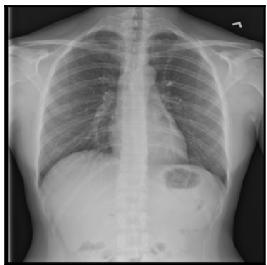  
NIH genuine Fixed query  
DINO CLS

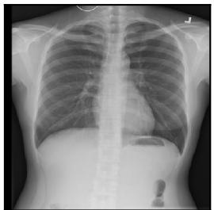  
NIH fitting reference Cosine distance: 0.0177  
DINO mean patch  
Medical mean patch

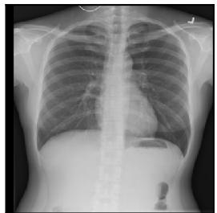  
NIH fitting reference Cosine distance: 0.0062

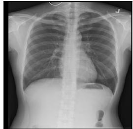  
NIH fitting reference Cosine distance: 0.0011

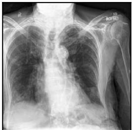  
Chef generated Fixed query

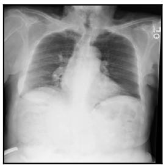  
NIH fitting reference Cosine distance: 0.0507

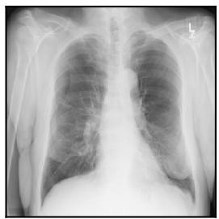  
NIH fitting reference Cosine distance: 0.0170

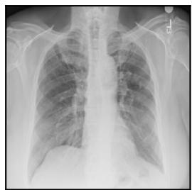  
NIH fitting reference Cosine distance: 0.0028

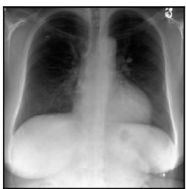  
SynthCheX generated Fixed query

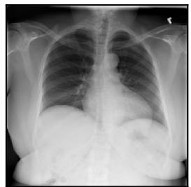  
NIH fitting reference Cosine distance: 0.0541

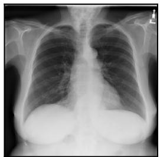  
NIH fitting reference Cosine distance: 0.0157

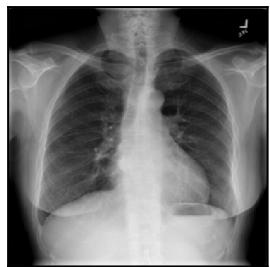  
NIH fitting reference Cosine distance: 0.0022  
Figure S5. Nearest-neighbor examples chosen by a fixed rule. Neighbors come from the NIH fit images only, and NIH queries and fit images come from different patients because the splits are patient-disjoint. “DINO” in the figure means DINOv3. Exact identity checks and proximity in a representation do not establish that memorization is absent, that the images are clinically faithful, or that they were excluded from model pretraining.

Quality-passing generated Origin screen passed Matching bases: 152

Quality-passing genuine Origin screen flagged Matching bases: 82

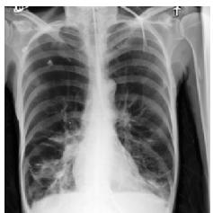  
Generated / SynthCheX Visibility=3, artifacts=1 Suspicion=0.03436

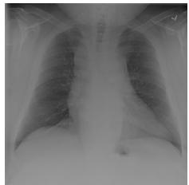  
Genuine / NIH Visibility=3, artifacts=1 Suspicion=0.1296  
Generated Origin screen flagged Matching bases: 5677

Genuine / quality gate not passed Origin screen passed Matching bases: 477

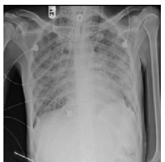  
Genuine / NIH Visibility=3, artifacts=3 Suspicion=0.0001068

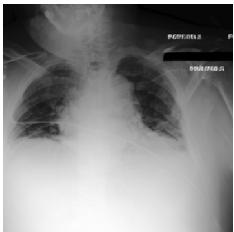  
Generated / SynthCheX Visibility=3, artifacts=1 Suspicion=0.4349

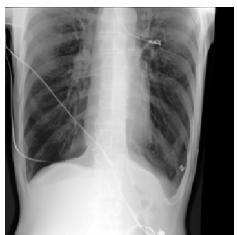  
Generated / SynthCheX Visibility=4, artifacts=0 Suspicion=0.02747

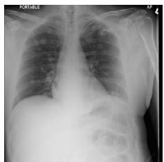  
Genuine / NIH Visibility=3, artifacts=1 Suspicion=0.1576

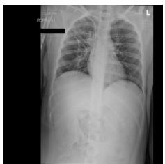  
Genuine / NIH Visibility=3, artifacts=2 Suspicion=0.02482

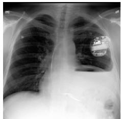  
Generated / SynthCheX Visibility=2, artifacts=2 Suspicion=0.1313

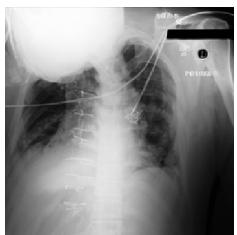  
Generated / SynthCheX Visibility=3, artifacts=1 Suspicion=0.008815

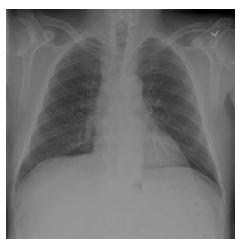  
Genuine / NIH Visibility=4, artifacts=0 Suspicion=0.04403

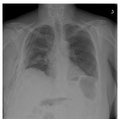  
Genuine / NIH Visibility=3, artifacts=2 Suspicion=0.001814

  
Generated / SynthCheX Visibility=3, artifacts=2 Suspicion=0.9974  
Post-analysis illustrations: lowest fixed hashes, at most one example per known group, up to three per cell. Quality denotes the frozen MedGemma rubric; it is not a clinical judgment. Acceptance denotes the origin screen.

Figure S6. Examples for the four outcomes of the two checks under the primary canonical policy. A fixed rule picks up to three examples with the lowest hashes in each cell: generated images that pass both checks, genuine images that pass quality but are flagged, genuine images that fail quality with a valid reply but are not flagged, and generated images that are flagged. Unavailable replies are excluded from the quality-failure cell, and the rate tables keep them. In the figure, “origin screen” is the origin check, “quality gate” is the quality check, “suspicion” is the origin score, and “matching bases” is the number of test images in each outcome (both generators together for generated images). The examples are model outcomes, not clinical assessments. Open-I images are not redistributed.

unsupported acquisition claim cannot obtain a source record by passing the pixel checks.

The registry-only policy and the combined policy (registry plus pixel checks) receive the same trusted evidence. The registry verifies authenticated source records and records of derived files, each bound to its file by a hash, outside the submitter’s control, and missing support stays unknown. A registration describes release evidence under laboratory assumptions. It does not certify any clinical history, and it does not implement C2PA (a standard for signed content credentials). The safe importer keeps the purpose and the verification state and rehashes the received bytes, so missing verification can never silently become a verified acquisition. The permissive importer, which trusts claims, accepts unsupported rows whether the verification state is kept or dropped, so these tests do not show that dropping a column causes the outcome. Each replay record stores whether the signatures on records and receipts verified, that paired cases have identical pixels, and the results of tests in which bytes or receipts were altered.

## S11.2 Results

The replay uses 8 selected base images and 24 claim-andpurpose variants in total. Each variant is replayed under three policies, which gives 72 replays. The variants are controls on the same images, and the counts are not population estimates. The registry-only policy already rejects unsupported generated observation claims without any pixel check. Adding the pixel requirements lowers the number of supported genuine observations that the policy accepts from four of four to two of four, and declared augmentation stays allowed. The integrity checks and the preservation of purpose are thus supporting controls. They are not an independently learned proof of acquisition. Safe reuse rehashes the received bytes and holds missing or invalid verification as unknown.

## S12 Reproduction and execution records

Sections S3 to S9 describe the final method. This section lists events during the runs that a reviewer may want to know about. For each event, we state what happened and what it affected.

## S12.1 Execution records

Shared GPU during a development run. An unrelated process entered one of the GPUs during the completed development stress run of the original rubric. The timing of that run may include contention.

GPU scheduling. Job dispatch checks which process owns each GPU and waits for free devices, with 300-second monitoring and safe pauses between owned batches.

First replies to the alternative rubric. The first eight replies to the alternative rubric were generated before the corrected check for fresh GPU ownership was in place. We preserved those replies and recorded the shared-hardware event instead of rescoring them. All later loaders enforce a fresh ownership check before model construction. These records describe hardware use. They are not evidence about the validity of the assessor.

Pilot reference. Earlier outputs that used all 3,000 calibration patients as the pilot-head reference overlapped the patients that the pilot head saw in fitting and selection. We preserved those outputs as descriptive records only. Every reported pilot-head evaluation uses the 2,914-patient reference (Section S6).

Development controls. We repaired the construction of the controls, which added ten distinct checkerboard patterns. The repair changed neither the original 3,060 inputs nor their cached outputs. We also amended how completed failures enter the development decision on the alternative rubric. We made this amendment before anyone inspected the clean-NIH or control results of the alternative rubric, and before all final inference.

MedForge parsing. We preserved the original fourimage record of strict-parser failures. We then let the parser accept one clear final sentence after a closed reasoning block. Re-parsing the four saved replies gave four categories, with no new model calls and no change to the saved text. Contradictory or missing final verdicts remain unavailable. The parser and tokenizer replay all completed responses and keep the original text and token sequence. We fixed the exact official prompts and the native final-category parser before evaluation.

MedForge device map. The checkpoint’s device-map metadata is empty. A read-only adapter supplies a view of that metadata for validation, without altering the original files or the categorical results. We rely on the measured placement of all parameters on the GPU in BF16, not on the empty metadata. The reproducibility records hold the full evidence from the checkpoint and the adapter.

Surrogate run. The 6,000 surrogate attempts joined a preserved prefix of 1,748 attempts with a completed suffix of 4,252 attempts. The wall time of the whole allocation is therefore unavailable.

Device records. Older feature-extraction logs record the data type and parameter counts but not which device held each parameter, and the provenance audit gives no retrospective measurement. Interrupted attempts keep their original cache keys, batch contexts, failure records, and measured timings. Where an interrupted run has no reliable end time, we report no total wall time.

Unrecovered metadata file. The selection reports for the primary raw DINOv3 CLS and mean heads refer to an earlier metadata file whose exact bytes we could not recover. We verified the checkpoints and the fit, development, and calibration identities. We cannot rebuild these historical inputs byte for byte.

## S12.2 Computing costs

Table S36 lists the measured costs. The 6,000 originalquality tasks on candidates are a subset of the 8,297 canonical Qwen tasks, with 18,466.8 seconds of allocated batchgeneration time, so they are not additional model calls. Selection needed no receiver queries. The 6,000 surrogate attempts gave 5,999 valid replies and one parse failure. The 584 pairwise queries are 352 Cheff-identified and 232 SynthCheX queries in the fixed small-budget condition. The 100 cached pool draws add no model queries. The 1,095 MedForge attempts are the 900 fixed-panel images and 195 new submission images, and 41 selected images reuse fixed-panel verdicts. Neither the 580 strategy rows nor repeated views are additional independent images. The reproducibility package holds the full run records of tasks, failures and caps, devices, peak memory, and timing.

The inference policy requires standard GPU-resident BF16 weights, without quantization or offloading of parameters to the CPU or to disk. Data preparation, tokenizer replay, and statistics on cached features run separately.

<table><tr><td>Stage</td><td>Attempted tasks</td><td>Generation (s)</td><td>Last-process wall (s)</td></tr><tr><td>Qwen original quality</td><td>8297</td><td>25391.5</td><td>25476.9</td></tr><tr><td>Qwen surrogate</td><td>6000</td><td>20397.2</td><td></td></tr><tr><td>Qwen bounded pairwise</td><td>584</td><td>2291.8</td><td>2321.8</td></tr><tr><td>MedForge fixed panel</td><td>900</td><td>8315.4</td><td>8402.0</td></tr><tr><td>MedForge selected extras</td><td>195</td><td>1772.9</td><td>1797.2</td></tr></table>

Table S36. Measured inference costs for selected stages, copied from the run records. Generation is the recorded time of batch generation, added over all runs. Wall time includes loading in the last process, and it is not a total for the whole allocation when a run was resumed. A dash means unavailable, not zero. Tasks in different stages may reuse the same images. These are not a project-wide wall time or GPU-hour estimate.