# GEOMEM-VLA: INTERNALIZING 3D SCENE UNDERSTANDING INTO TEMPORAL MEMORY FOR VISION-LANGUAGE-ACTION MODELS

Qinfan Zhang1,3,∗, Yifan Luo2,3,∗, Haoyuan Shi3,4, Guanlin Liu3,6, Han Dong3, Haozhe Shan5, Yong Dai3, Xiancong Ren3,†, Xiaozhu Ju3,‡ 1BUAA, 2 RUC, 3 X-Humanoid, 4 USTC, 5 FDU, 6 CUHK(SZ)

€ Project Page § GitHub Code HuggingFace

## ABSTRACT

Geometric structure provides a direct description of the 3D world and is essential for robotic manipulation and world understanding. Most VLA models primarily rely on 2D representations of the current observation, while geometry-aware approaches often require additional 3D geometric information. However, such geometric information, typically inferred independently from individual observations, is often discarded rather than accumulated into a persistent task representation. Our key insight is that action generation needs a compact, task-relevant geometric abstraction that can be continuously updated over time, rather than a complete, renderable 3D reconstruction at every step. Based on this insight, we introduce GeoMem-VLA, a VLA framework that internalizes explicit 3D supervision into dedicated geometric tokens, without directly aligning the VLM’s native visual embeddings to the teacher feature space, and maintains them as temporal memory for action generation. During training, a frozen geometry foundation model supervises learnable GeoPlan tokens through a geometric flow-matching objective over the current scene point map and future end-effector tracks. These tokens are subsequently integrated with the memory of observation representations, where historical information is retrieved, adaptively fused with current observations, and consolidated to keep event frames as the task progresses. At inference, the policy retrieves historical representations and fuses them with the current working representation to predict actions, without invoking the 3D teacher or explicitly reconstructing the scene. After benchmark-specific downstream adaptation, GeoMem-VLA achieves 98.9% average success on LIBERO and 91.10% / 91.24% on the clean/randomized settings of the RoboTwin benchmark. In 5 realworld tasks, GeoMem-VLA achieves the 78.0% average success. These results indicate that internalizing and remembering 3D scene understanding is a promising approach to optimizing robot control strategies.

## 1 INTRODUCTION

Robotic manipulation requires combining semantic understanding with precise 3D control. Building on advances in large language models, vision-language-action (VLA) models have attracted attention for language-conditioned manipulation (Brohan et al., 2023; Kim et al., 2024; Black et al., 2024; Shi et al., 2026b). Most use pretrained vision-language models (VLMs) for visual and semantic understanding and generate actions through tokenized prediction or dedicated action experts. However, their reliance on current 2D observations offers limited support for precise 3D spatial reasoning and decision-making that depend on interaction history.

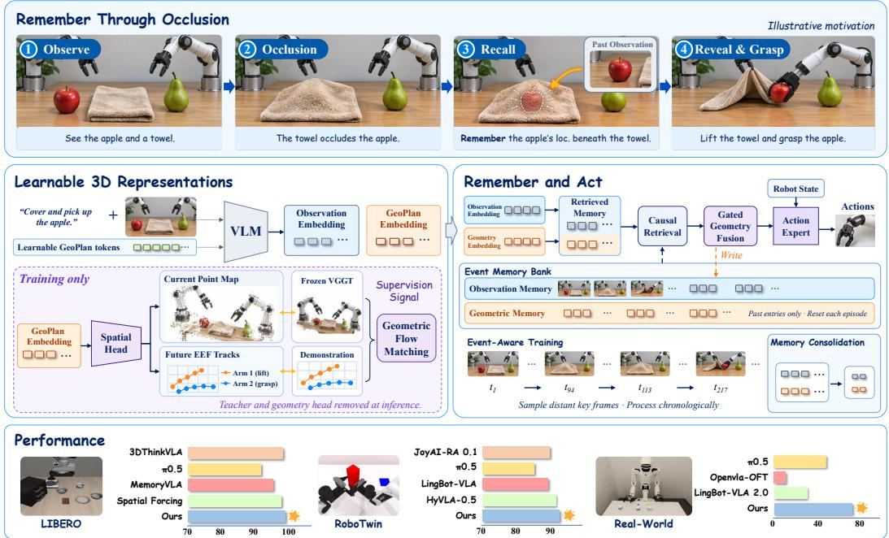  
Figure 1: Overview of GeoMem-VLA. Top: In the illustrative cover and pick up the apple task, the current observation alone may not reveal the apple’s location once it is occluded by the towel, motivating the retention of spatial context over time. Middle: GeoMem-VLA learns geometrysupervised GeoPlan representations and retains them in causal episode memory for action generation. Bottom: Performance comparisons across manipulation benchmarks and real-world tasks.

Recent work on 3D-aware VLAs has explored how to leverage the rich geometric priors of the physical environment (Li et al., 2026a; Qian et al., 2026). Such supervision allows explicit geometric targets to shape policy representations that require explicit reconstruction during action inference. Memory-augmented policies, meanwhile, retain perceptual and task context from earlier observations (Shi et al., 2026a). Connecting these directions raises a central question: How can geometric supervision shape spatial memory that guides action? This places the spatial content of memory at the center of policy representation learning.

We propose GeoMem-VLA, a VLA framework that couples geometry-supervised GeoPlan representations with causal episode-level memory. During training, learnable GeoPlan tokens summarize the multimodal context and condition an auxiliary flow-matching head that predicts current-scene point maps and future Cartesian end-effector tracks. A frozen VGGT teacher (Wang et al., 2025) provides scene-geometry targets, while demonstration trajectories provide future motion supervision. These complementary targets train the tokens to encode scene structure and task-related motion. At deployment, the teacher and reconstruction head are removed from the action-generation path; the learned tokens provide compact geometric context for the policy.

To preserve this context, we maintain geometric memory alongside perceptual and task-related memory. Current representations retrieve relevant preceding features, and adaptive fusion integrates historical context before action generation. Similarity-based consolidation compresses redundant entries while retaining feature-distinct temporal states. We further use event-aware training that samples temporally separated observations from the same episode while preserving their chronological order and causal access. This exposes retrieval to a broader span of interaction history than contexts formed only from neighboring frames. Together, geometric supervision and temporal retrieval connect what the policy learns about the scene with what it can retain for later decisions.

Our evaluation examines spatial understanding, long-horizon decision-making, and applicability across manipulation tasks. On LIBERO and RoboTwin 2.0, GeoMem-VLA achieves 98.9% average success across the four LIBERO suites and 91.10% / 91.24% on RoboTwin Clean / Randomized. Complementary real-world protocols target geometric alignment and long-horizon interaction, connecting the evaluation to the spatial and temporal requirements of the architecture.

Our contributions are summarized as follows:

• Geometry-Supervised Spatial Representations. We learn compact GeoPlan tokens from current-scene point maps and future end-effector tracks, providing geometric conditioning without explicit reconstruction during action inference.

• Geometry-Aware Event Memory. We couple geometric representations with causally temporal retrieval and train event-aware memory to retain key information alongside perceptual and task context.

• Evaluation Across Manipulation Settings. Experiments of geometry-supervised memory across diverse tasks through LIBERO, RoboTwin and real-world manipulation tasks examine geometric precision and the use of historical context in long-horizon manipulation.

## 2 RELATED WORK

Vision-Language-Action Models. Advances in VLMs (Liu et al., 2024; Karamcheti et al., 2024) have enabled VLAs through robot-data scaling, vision-language pretraining, and expressive action decoders. RT-1 (Brohan et al., 2022) scales multitask learning on demonstrations; RT-2 (Brohan et al., 2023) and OpenVLA (Kim et al., 2024) transfer pretrained knowledge to discrete action prediction. $\pi _ { 0 }$ (Black et al., 2024), CogACT (Li et al., 2024a), and GR00T (Bjorck et al., 2025) use continuous action experts, while $\pi _ { 0 . 5 }$ (Intelligence et al., 2025) adds heterogeneous data and semantic subtask prediction for open-world generalization. FAST (Pertsch et al., 2025) compresses action sequences via frequency-domain tokenization; OpenVLA-OFT (Kim et al., 2025) uses parallel decoding and action chunking for efficient execution. StarVLA (Community, 2026) provides a modular backbone–expert framework. These advances leave open how task-relevant 3D structure should be encoded and retained across decisions.

3D Representations and Geometric Supervision. Spatially informed VLAs use depth (Li et al., 2026b; Fan et al., 2026), feature-level geometric supervision (Abouzeid et al., 2025), and predictive representations. Spatial Forcing (Li et al., 2026a) aligns intermediate visual features with frozen VGGT features; 3DThinkVLA (Shi et al., 2026c) combines feature alignment with spatial reasoning distillation. Other methods model motion and scene evolution (Bhat et al., 2025; Li et al., 2025b): GeoPredict (Qian et al., 2026) couples future robot-keypoint trajectories with predictive Gaussian geometry, while GaussianDream (Zhang et al., 2026e) learns a latent prefix through current and future Gaussian scene prediction. These approaches enrich spatial representations, but geometric supervision alone does not specify how the resulting information should be maintained and accessed throughout an episode.

Temporal and Spatial Memory. History-aware policies use recurrent states, visual prompts, and retrievable memory. RoboFlamingo (Li et al., 2024b) aggregates sequential features with a recurrent policy head; TraceVLA (Zheng et al., 2025) encodes tracked motion as visual traces. HAM-LET (Koo et al., 2026) aggregates distinctive moment tokens in a lightweight memory module. MemoryVLA (Shi et al., 2026a) retrieves, adaptively fuses, and consolidates perceptual and cognitive history; EventVLA (Yang et al., 2026a) predicts keyframes to preserve sparse visual evidence. BridgeVLA++ (Li et al., 2026c) combines temporal observation history with explicit point-cloud spatial memory. These designs trade retained detail against temporal coverage and cost, but how scene and motion targets shape latent history for later decisions remains open. We focus on jointly learning and using spatial representations across time to guide manipulation.

## 3 METHOD

## 3.1 PRELIMINARIES

Vision-Language-Action Models. We formulate language-conditioned manipulation as sequential decision making. At control step t, the policy receives multi-view RGB observations $\begin{array} { r l } { \mathbf { o } _ { t } } & { { } = } \end{array}$ $\{ I _ { t } ^ { ( v ) } \} _ { v = 1 } ^ { V } ,$ , proprioceptive state $\mathbf { s } _ { t } \in \mathbb { R } ^ { d _ { s } }$ , and a language instruction $\ell ,$ and predicts a continuous action chunk

$$
\widehat { \bf A } _ { t } = \pi _ { \boldsymbol { \theta } } ( { \bf o } _ { t } , { \bf s } _ { t } , \ell ) = ( \widehat { \bf a } _ { t } , \dots , \widehat { \bf a } _ { t + H - 1 } ) \in { \mathbb R } ^ { H \times d _ { a } } .\tag{1}
$$

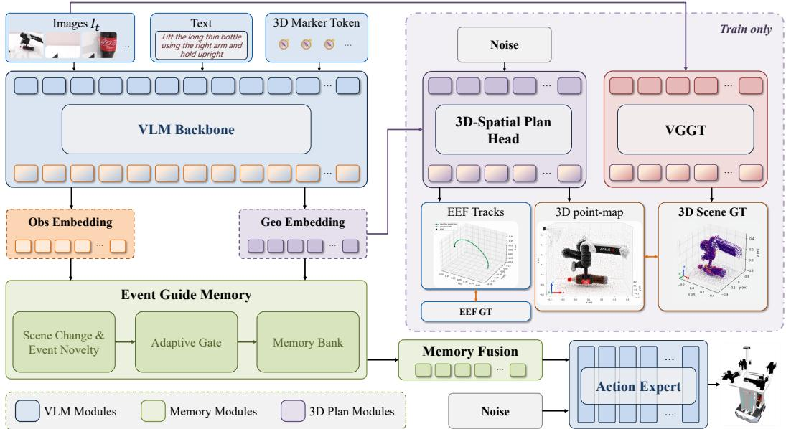  
Figure 2: Architecture of GeoMem-VLA. Images, language, and learnable 3D marker tokens are encoded by the VLM. The geometry branch is trained with scene-geometry targets and demonstration-derived future end-effector tracks, whereas the action expert is trained to predict robot actions. Geometric and observational features are retained in episodic memory and fused to form the context for action generation. The geometry teacher and reconstruction head are used only during training.

Here H is the prediction horizon, while $d _ { a }$ and the semantics of each action are determined by the robot embodiment and control interface.

GR00T-Style Action Expert. We instantiate a GR00T-style flow-matching action expert (Bjorck et al., 2025) in StarVLA (Community, 2026), using Qwen3-VL-4B (Bai et al., 2025) as the backbone and a conditional Diffusion Transformer as the expert. Let $\mathbf { A } _ { t } = ( \mathbf { a } _ { t } , \ldots , \mathbf { a } _ { t + H - 1 } ) \in \mathbb { R } ^ { H \times d _ { a } }$ be a normalized demonstration chunk and $\mathbf { C } _ { t }$ the vision-language context. For $\epsilon ^ { a } \sim \mathcal { N } ( \mathbf { 0 } , \mathbf { I } )$ and $\rho \sim p _ { \mathrm { a c t } }$ from the configured Beta-derived schedule, define $\mathbf { A } _ { t , \rho } = ( 1 - \rho ) \epsilon ^ { a } + \rho \mathbf { A } _ { t }$ . The expert minimizes the noise-to-data velocity error:

$$
\mathcal { L } _ { \mathrm { a c t i o n } } = \mathbb { E } _ { \mathbf { A } _ { t } , \rho , \epsilon ^ { a } } \left[ \frac { 1 } { H d _ { a } } \left. v _ { \psi } ^ { \mathrm { a c t } } ( \mathbf { A } _ { t , \rho } , \rho ; \mathbf { C } _ { t } , \mathbf { s } _ { t } ) - ( \mathbf { A } _ { t } - \epsilon ^ { a } ) \right. _ { F } ^ { 2 } \right] .\tag{2}
$$

At inference, Euler integration transforms Gaussian noise into an action chunk.

VGGT Geometry Teacher. Visual Geometry Grounded Transformer (VGGT) is a feed-forward geometry model that predicts camera parameters and dense 3D attributes, including depth maps, point maps, and point tracks, from one or more RGB images (Wang et al., 2025). Its transformer alternates frame-wise and global self-attention before applying task-specific prediction heads.

## 3.2 GEOMETRY-SUPERVISED LATENT REPRESENTATIONS

We omit the batch dimension throughout and use $D _ { v }$ for the VLM hidden dimension and $D _ { g }$ for the geometric working dimension. We append K GeoPlan markers to the vision-language sequence. Let ${ \bf q } _ { 1 : K } = [ { \bf q } _ { 1 } ; \dots ; { \bf q } _ { K } ]$ denote their input embeddings, with $\mathbf { q } _ { i } \in \mathbb { R } ^ { D _ { \tau } }$ v . Their final-layer hidden states are extracted and projected to the geometric working space:

$$
\mathbf { z } _ { t } = \mathrm { V L M } ( [ \mathbf { o } _ { t } ; \ell ; \mathbf { q } _ { 1 : K } ] ) _ { \mathrm { G e o P l a n } } , \qquad \mathbf { c } _ { t } = \mathrm { P r o j } ( \mathbf { z } _ { t } ) \in \mathbb { R } ^ { K \times D _ { g } } .\tag{3}
$$

Here VLM denotes the pretrained vision-language backbone. The subscript GeoPlan selects the K marker positions, giving $\mathbf { z } _ { t } \in \mathbb { R } ^ { K \times D _ { v } }$ . Proj applies layer normalization and a learned linear map from $D _ { v }$ to $D _ { g }$ to each output token. The projected tokens $\mathbf { c } _ { t }$ both condition the auxiliary geometry head and form the geometric memory entries.

Supervision Targets. The frozen teacher’s current-view point map is pooled to a $P \times P$ grid and used as a scene pseudo-target; its confidences weight the scene loss. A future EEF track is the ordered sequence of demonstration-derived Cartesian end-effector waypoints over the action horizon. We transform future EEF positions into the current VGGT point-map frame and normalize them jointly with the point map. This locates the intended motion relative to the observed scene. We concatenate the point-map segment $\mathbf { P } _ { t } \in \mathbb { R } ^ { P ^ { 2 } \times 3 }$ and EEF-track segment $\mathbf { W } _ { t } \in \mathbb { R } ^ { n _ { e } \times 3 }$

$$
\mathbf { Y } _ { t } = [ \mathbf { P } _ { t } ; \mathbf { W } _ { t } ] \in \mathbb { R } ^ { ( P ^ { 2 } + n _ { e } ) \times 3 } .\tag{4}
$$

Here $n _ { e }$ denotes the total number of future waypoints.

Auxiliary Flow Matching. Let ϵ be a noise tensor with the same shape as $\mathbf { Y } _ { t }$ and independent standard Gaussian entries, and let $\tau \sim \mathcal { U } [ 0 , 1 ]$ be the flow time, distinct from control step t. Define $\mathbf { Y } _ { t , \tau } = ( 1 - \tau ) \boldsymbol { \epsilon } + \tau \mathbf { Y } _ { t } . \mathrm { ~ A ~ }$ modality-aware transformer $v _ { \phi } .$ , with learned parameters $\phi ,$ predicts the velocity from this noisy target, flow time, and geometric condition $\mathbf { c } _ { t }$ . Its output has the same shape as $\mathbf { Y } _ { t } \mathbf { : }$

$$
\mathcal { L } _ { \mathrm { g e o } } = \sum _ { m \in \{ \mathrm { s c e n e } , \mathrm { e e f } \} } \lambda _ { m } \mathbb { E } _ { \tau , \epsilon } \left[ \left\| v _ { \phi } ( \mathbf { Y } _ { t , \tau } , \tau , \mathbf { c } _ { t } ) _ { m } - ( \mathbf { Y } _ { t } - \epsilon ) _ { m } \right\| _ { w _ { m } } ^ { 2 } \right] .\tag{5}
$$

Here $m$ indexes the Scene or EEF segment, and the subscript $m$ selects that segment from the predicted and target velocities. The action objective remains the action expert’s flow-matching loss:

$$
\begin{array} { r } { \mathcal { L } = \mathcal { L } _ { \mathrm { a c t i o n } } + \alpha \mathcal { L } _ { \mathrm { g e o } } . } \end{array}\tag{6}
$$

Here $\mathcal { L } _ { \mathrm { a c t i o n } }$ is the action flow-matching objective in Equation (2), and α controls geometric supervision relative to action learning. Checkpoint-specific settings must be verified as described in Section A.

## 3.3 GEOMETRY EVENT-AWARE MEMORY

At each control step, the policy retrieves history within each representation stream, updates its bounded episode memory, and then injects retrieved geometry into the retrieved observation representation. We maintain two observation streams and one geometric stream, indexed by $j \in$ {obs, geo}. $\mathbf { x } _ { t } ^ { \mathrm { { o b s } } } \in \mathbb { R } ^ { N _ { o } \times D _ { v } }$ contains resized visual tokens and the final non-padding VLM state token that includes the backbone’s general task understanding, and $\mathbf { x } _ { t } ^ { \mathrm { g e o } } = \mathbf { c } _ { t } \dot { } \in \mathbb { R } ^ { K \times D _ { g } }$ contains geometry-supervised tokens. The first two streams jointly form observation memory; the third forms geometric memory.

Causal Temporal Retrieval. Let $\mathcal { M } _ { < t } ^ { j }$ contain only earlier entries from the same episode. Each stream retrieves from its own bank:

$$
\widetilde { \mathbf { x } } _ { t } ^ { j } = R _ { j } ( \mathbf { x } _ { t } ^ { j } , \mathcal { M } _ { < t } ^ { j } ; t ) .\tag{7}
$$

$R _ { j }$ uses current tokens as queries and stored tokens as keys and values, adds learned timestamp encodings to the keys, and fuses the retrieved context with the current representation. Point-mapand future-motion- supervised GeoPlan states are written to a dedicated bank, where similar adjacent entries are consolidated. Denoting the retrieved geometric tokens by $\widetilde { \mathbf { c } } _ { t } = \widetilde { \mathbf { x } } _ { t } ^ { \mathrm { g e o } }$ , a gate combines them with retrieved visual tokens; the result and the other observation stream condition the action expert. More detials are shown in Section B

Event-Aware Training. Retrieval precedes writing, preventing the current entry from retrieving itself. We then append $( t , \mathrm { s g } ( \mathbf { x } _ { t } ^ { j } ) )$ to bank $j ,$ , where sg stops gradients through stored history. If the ordered bank $\bar { \{ ( s _ { r } , \mathbf { m } _ { r } ^ { j } ) \} } _ { r = 1 } ^ { \tilde { L } ^ { \ast } }$ exceeds its capacity, it selects the most similar temporally adjacent pair:

$$
r _ { j } ^ { \star } = \arg \operatorname* { m a x } _ { 1 \leq r < L } \cos \Bigl ( \mathrm { v e c } ( \mathbf { m } _ { r } ^ { j } ) , \mathrm { v e c } ( \mathbf { m } _ { r + 1 } ^ { j } ) \Bigr ) .\tag{8}
$$

The pair is replaced by its elementwise mean and labeled with the later timestamp. Repeated updates therefore preferentially compress redundant states within stable manipulation phases, while feature-distinct transitions are more likely to remain in separate slots. We call the resulting latent summaries event-level key memories: they summarize temporally distinct states induced by representation change. Banks are reset at episode boundaries, and deployment memory never receives future observations or demonstration actions. The replay diagnostics in Section D also examine overflow-based consolidation.

Table 1: LIBERO Success Rates (%). References beside method names identify the first-party source for each published result. Averages cover the four displayed suites. Bold and underline mark the highest and second-highest distinct values in each column, including ties.
<table><tr><td>Method</td><td>Spatial</td><td>Object</td><td>Goal</td><td>Long</td><td>Average</td></tr><tr><td>OpenVLA (FT) (Kim et al., 2024)</td><td>84.7</td><td>88.4</td><td>79.2</td><td>53.7</td><td>76.5</td></tr><tr><td>TraceVLA (Zheng et al., 2025)</td><td>84.6</td><td>85.2</td><td>75.1</td><td>54.1</td><td>74.8</td></tr><tr><td>SpatialVLA (Qu et al., 2025)</td><td>88.2</td><td>89.9</td><td>78.6</td><td>55.5</td><td>78.1</td></tr><tr><td>4D-VLA (Zhang et al., 2026b)</td><td>88.9</td><td>95.2</td><td>90.9</td><td>79.1</td><td>88.6</td></tr><tr><td>DreamVLA (Zhang et al., 2026d)</td><td>97.5</td><td>94.0</td><td>89.5</td><td>89.5</td><td>92.6</td></tr><tr><td> $\pi _ { 0 }$  (Driess et al., 2026)</td><td>96.8</td><td>98.8</td><td>95.8</td><td>85.2</td><td>94.2</td></tr><tr><td>π0.5 (Intelligence et al., 2025)</td><td>98.8</td><td>98.2</td><td>98.0</td><td>92.4</td><td>96.9</td></tr><tr><td>GeoPredict (Qian et al., 2026)</td><td>98.0</td><td>98.2</td><td>95.7</td><td>94.0</td><td>96.5</td></tr><tr><td>MemoryVLA (Shi et al., 2026a)</td><td>98.4</td><td>98.4</td><td>96.4</td><td>93.4</td><td>96.7</td></tr><tr><td>CronusVLA (Li et al., 2025a)</td><td>97.3</td><td>99.6</td><td>96.9</td><td>94.0</td><td>97.0</td></tr><tr><td>OpenVLA-OFT (Kim et al., 2025)</td><td>97.6</td><td>98.4</td><td>97.9</td><td>94.5</td><td>97.1</td></tr><tr><td>GeoVLA (Sun et al., 2025)</td><td>98.4</td><td>99.0</td><td>96.6</td><td>96.6</td><td>97.7</td></tr><tr><td>AVA-VLA (Xiao et al., 2026)</td><td>99.2</td><td>99.6</td><td>97.9</td><td>96.2</td><td>98.2</td></tr><tr><td>Spatial Forcing (Li et al., 2026a)</td><td>99.4</td><td>99.6</td><td>98.8</td><td>96.0</td><td>98.5</td></tr><tr><td>3DThinkVLA (Shi et al., 2026c)</td><td>100.0</td><td>100.0</td><td>98.8</td><td>95.8</td><td>98.7</td></tr><tr><td>GeoMem-VLA (ours)</td><td>99.6</td><td>99.8</td><td>99.6</td><td>96.6</td><td>98.9</td></tr></table>

Table 2: RoboTwin 2.0 success rates (%). Clean and Randomized refer to the 50-task evaluation (called Easy/Hard in some reports). Each Boldface and underlining indicate the highest and secondhighest distinct values in each column, including ties.
<table><tr><td>Method</td><td>Clean</td><td>Randomized</td><td>Average</td></tr><tr><td>X-VLA (Zheng et al., 2026)</td><td>70.00</td><td>39.00</td><td>54.50</td></tr><tr><td>Track4Action (Wang et al., 2026a)</td><td>80.44</td><td>81.48</td><td>80.96</td></tr><tr><td>ABot-M0 (Yang et al., 2026b)</td><td>86.06</td><td>85.08</td><td>85.57</td></tr><tr><td>Qwen-VLA-Instruct (Wang et al., 2026b)</td><td>86.10</td><td>87.20</td><td>86.65</td></tr><tr><td>LingBot-VLA (Wu et al., 2026a)</td><td>88.56</td><td>86.68</td><td>87.62</td></tr><tr><td>StarVLA-OFT (Community, 2026)</td><td>88.18</td><td>88.32</td><td>88.25</td></tr><tr><td>StarVLA-GR00T (Community, 2026)</td><td>88.00</td><td>88.50</td><td>88.25</td></tr><tr><td>JoyAI-RA 0.1 (Zhang et al., 2026c)</td><td>90.48</td><td>89.28</td><td>89.88</td></tr><tr><td>HyVLA-0.5 (Zhang et al., 2026a)</td><td>90.90</td><td>90.10</td><td>90.50</td></tr><tr><td>GeoMem-VLA (ours)</td><td>91.10</td><td>91.24</td><td>91.17</td></tr></table>

Deployment. The VGGT teacher and geometry decoder are omitted from action inference. The backbone still computes the latent geometric tokens, and memory retrieval and similarity-based consolidation remain active. No explicit point-map or EEF-track decoding is required for action generation; latent-token and memory operations remain part of the deployed policy.

## 4 EXPERIMENTS

## 4.1 EXPERIMENTAL SETUP

Simulation Benchmarks and Evaluation. We evaluate on LIBERO (Liu et al., 2023), comprising four 10-task suites (Spatial, Object, Goal, and Long) with 7-dimensional end-effector delta actions and prediction horizon $H = 8 ,$ , and RoboTwin 2.0 (Chen et al., 2025), comprising 50 bimanual tasks with 14-dimensional joint targets and $H = 5 0$ in Clean and Randomized settings. We run 50 trials per LIBERO task and 100 per RoboTwin task and setting. In inference, the task-adaptive execution horizon $E _ { t } \leq H$ determines how many predicted actions are executed. Further settings appear in Section A. Published results in Tables 1 and 2 cite first-party sources and retain their source protocols.

Table 3: Component Ablations on LIBERO. Success rate (%) over 50 trials per task. Geo. and Mem. indicate our GeoPlan branch and causal episode memory, respectively.
<table><tr><td>Configuration</td><td>Geo.</td><td>Mem.</td><td>Spatial</td><td>Object</td><td>Goal</td><td>Long</td><td>Average</td></tr><tr><td>GeoMem-VLA (full)</td><td>√</td><td>√</td><td>99.6</td><td>99.8</td><td>99.6</td><td>96.6</td><td>98.9</td></tr><tr><td>w/o geometry branch</td><td>x</td><td>√</td><td>98.0</td><td>99.6</td><td>98.8</td><td>95.2</td><td>97.9</td></tr><tr><td>w/o temporal memory</td><td>S</td><td>x</td><td>99.4</td><td>99.6</td><td>99.4</td><td>94.2</td><td>98.2</td></tr><tr><td>StarVLA-GR00T</td><td>x</td><td>x</td><td>97.8</td><td>98.8</td><td>97.4</td><td>92.0</td><td>96.5</td></tr></table>

Note. ✓/✗ denote presence/absence of the indicated module.

Table 4: Component Ablations on RoboTwin 2.0. Success rate (%) over 50 tasks with 100 episodes per task and setting. Geo. and Mem. indicate our GeoPlan branch and causal episode memory.
<table><tr><td>Configuration</td><td>Geo.</td><td>Mem.</td><td>Clean</td><td>Randomized</td><td>Average</td></tr><tr><td>GeoMem-VLA (full)</td><td>√</td><td>√</td><td>91.10</td><td>91.24</td><td>91.17</td></tr><tr><td>w/o geometry branch</td><td>x</td><td>√</td><td>89.68</td><td>89.74</td><td>89.71</td></tr><tr><td>w/o temporal memory</td><td>√</td><td>x</td><td>89.84</td><td>90.52</td><td>90.18</td></tr><tr><td>StarVLA-GR00T</td><td>x</td><td>x</td><td>88.00</td><td>88.50</td><td>88.25</td></tr><tr><td>StarVLA-OFT</td><td>X</td><td>x</td><td>88.18</td><td>88.32</td><td>88.25</td></tr></table>

Note. ✓/✗ denote presence/absence of the indicated module. Average is the mean of Clean and Randomized.

## 4.2 MAIN RESULTS

Table 1 shows that GeoMem-VLA achieves the highest displayed LIBERO average (98.9%), 0.4 points above Spatial Forcing. Spatial, Object, and Goal are near ceiling (99.6%–99.8%); Long is more discriminative, where our 96.6% ties the highest displayed score and exceeds MemoryVLA by 3.2 points. The advantage is therefore not confined to the three near-saturated suites.

On RoboTwin, GeoMem-VLA reaches 91.10% on Clean and 91.24% on Randomized, averaging 91.17% (Table 2). It exceeds HyVLA-0.5 by 0.20 and 1.14 points in the two settings, respectively, and the closest published StarVLA-GR00T reference by 2.92 points on average. The results show strong performance across both end-effector and joint-action benchmarks, including randomized evaluation. Since published methods may differ in training data, inputs, and protocols, these comparisons provide context rather than a controlled ranking; the matched ablations below assess the contributions of geometry and memory.

## 4.3 ABLATION STUDY

Geometry and Memory. Tables 3 and 4 compare the full model with two matched interventions. The full model stores GeoPlan tokens in a geometric bank, consolidates similar adjacent entries, and gates retrieved geometry into the observation context. Removing GeoPlan eliminates its auxiliary supervision, geometric tokens, geometric memory bank, and gated fusion, while retaining the observation banks. Removing temporal memory retains current geometric tokens and supervision but disables historical retrieval from all banks.

On LIBERO, the observation-memory variant lowers average success from 98.9% to 97.9%, with drops of 1.6 points on Spatial and 1.4 on Long. Without temporal memory, the average falls to 98.2%; Long falls from 96.6% to 94.2%, compared with 0.2-point drops on each other suite. On RoboTwin, removing GeoPlan lowers the Clean/Randomized mean from 91.17% to 89.71%, while removing memory yields 90.18%; both interventions reduce success in Clean and Randomized. The full model exceeds these variants on 35 and 27 of 50 RoboTwin tasks, respectively, after averaging each task across settings (Table 6). These results show both geometric reconstruction and temporal memory positively impact the model’s task ability. Furthermore, geometric capabilities are particularly effective in spatial tasks. The full model outperforms the observation-memory variant, suggesting benefits from incorporating the GeoPlan branch.

T = 126

VGGT

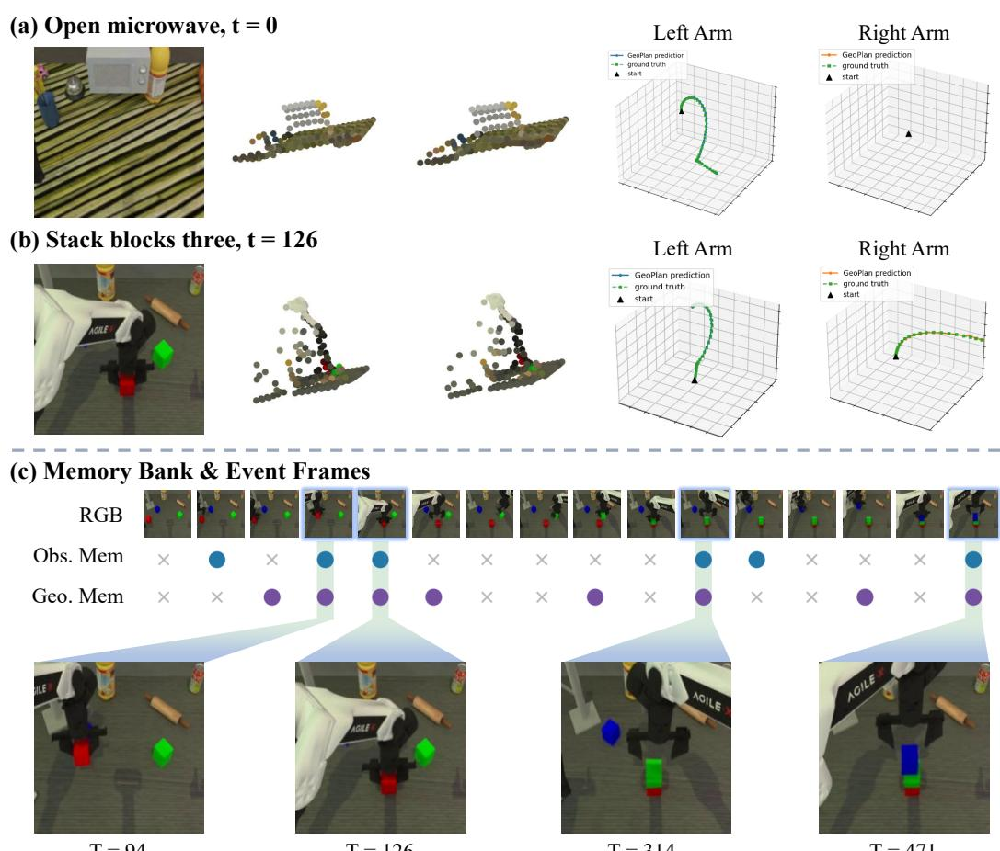  
T = 94  
T = 314  
T = 471  
Figure 3: Geometry, future motion, and retained memory in RoboTwin. (a,b) Randomized examples show RGB observations, VGGT point-map targets, predicted point maps, and future EEF tracks (solid: prediction; dashed: demonstration). (c) Final memory retention in Randomized stack ing: the observational row shows the intersection of both observation banks, while the geometric row shows geometric memory (dots: retained; crosses: not retained; vertical shaded bands: shared timestamps), with corresponding frames enlarged below.

## 4.4 REPRESENTATION AND MEMORY DIAGNOSTICS

To examine how geometry-supervised GeoPlan representations connect current spatial understanding to temporal memory, we replay an episode of open microwave and stack blocks three in the Clean and Randomized RoboTwin settings with the 200k step checkpoint. For each episode, we decode point maps and future EEF tracks at four frames and process 16 uniformly sampled frames causally through memory. This is an offline demonstration diagnostic. Additional details are provided in Section D

Figure 3(a,b) and Table 7 examine the spatial and motion content of current GeoPlan states: the auxiliary head reconstructs VGGT point-map targets and demonstration-derived EEF tracks, with mean point-map RMSE of 0.064–0.094 in normalized units and mean EEF RMSE of 3.07–3.74 mm across the four cases. The same GeoPlan states are written as entries in geometric memory. Figure 3(c) shows entries retained across the initial layout and later stacking stages; the retrieval visualization in Appendix Figure 6(d) shows access to earlier entries. These diagnostics follow the latent interface from current prediction to temporal storage and retrieval, while Tables 3 and 4 evaluate the assembled pathways through closed-loop task success.

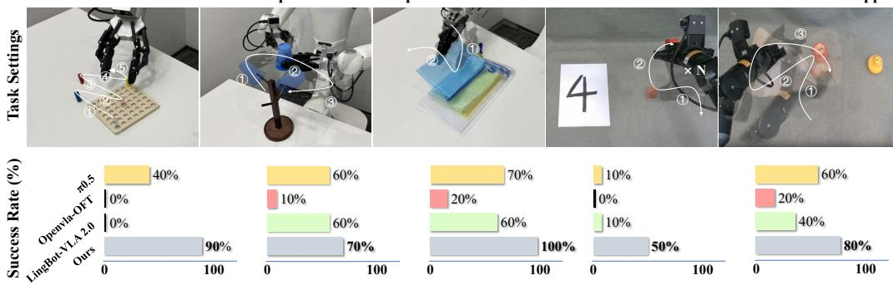  
Figure 4: Real-world Manipulation Evaluation of GeoMem-VLA. The figure shows the real world experiments task settings and success rates across five tasks. Each bar reports the success rate over 10 independent closed-loop rollouts.

## 4.5 REAL-WORLD EXPERIMENTS

Experimental setup. We conduct real-world experiments to evaluate GeoMem-VLA in manipulation scenarios involving geometric reasoning and temporal context. Specifically, we design five tasks with distinct spatial and sequential requirements as shown in Figure 4: pick and stand sticks, transfer cup across the rack, separatefile pockets on the Astribot S1 platform and pick n times cube, cover and find the apple under towel on the AgileX platform. We collect 60 demonstrations per task and GeoMem-VLA is compared to representative VLA baselines, including LingBot-VLA 2.0 (Wu et al., 2026b), π0.5 (Intelligence et al., 2025), and OpenVLA-OFT (Kim et al., 2025), under the same evaluation protocol. During evaluation, we conduct 10 independent rollouts for each task under randomized object configurations and report the success rate.

Result analysis. Figure 4 shows that GeoMem-VLA achieves robust performance across five realworld manipulation tasks. Specifically, for comprehensive long-horizon manipulation tasks, including pick and stand sticks, transfer a cup across the rack, and cover andfind the apple, GeoMem-VLA achieves 90%, 70%, and 80% success rates. These tasks require both precise spatial interaction and maintaining task-relevant context throughout multi-stage execution, such as in pick and stand sticks task, the robot needs to repeatedly identify individual sticks, grasp them from a shared workspace, and place them into a precise upright configuration. The results show that the geometry-supervised representations provide spatially grounded features for reliable grasping and placement, while the historical geometric context effectively maintains task progress. Moreover, for the spatially precise separate file pockets task, GeoMem-VLA achieves 100% success rate by accurately distinguishing and manipulating the target file pocket among cluttered stacked configurations. For pick n times cube, the challenge is maintaining progress over repeated interactions. The policy needs to remember how many successful grasp-and-place cycles have been completed while adapting to the current scene. The temporal memory mechanism preserves task progress across repeated operations, allow ing GeoMem-VLA to complete the required number of interactions.

## 5 CONCLUSION

Inspired by the thought patterns of human action, we propose GeoMem-VLA to illustrate how humans conceptualize and store spatial information of the current scene in their minds as memory to guide action generation during decision-making. This method allows spatial information learned through reconstruction to remain available as latent context throughout task execution. LIBERO and RoboTwin results support its applicability across manipulation tasks. Experiments on two physical robot platforms further cover precise spatial interaction, changing visibility, and multi-stage manipulation. These results support geometry-supervised latent memory as a practical connection between 3D representation learning and action generation over time, effectively improving VLA model’s decision-making ability.

## AI USE STATEMENT

Generative AI tools were used for literature discovery, manuscript wording, formatting assistance and code debugging. All AI-assisted outputs were reviewed and verified by the authors. The authors take full responsibility for the accuracy of all references, experimental results, scientific claims, and other contents of this paper.

## ETHICS STATEMENT

This work evaluates object manipulation in simulation and on physical robots, without testing human–robot interaction. Physical deployment may cause unintended motion or collisions; success on the reported tasks does not establish safety around people or in unconstrained settings. Realworld use requires supervision and appropriate safety controls. Any release of demonstration videos or logs should respect data permissions and exclude identifying information. We disclose evaluation protocols and limitations to avoid overstating generalization or safety.

## REPRODUCIBILITY STATEMENT

The main paper specifies the model architectures, training setups, and experimental protocols, and the appendix provides additional details on hyperparameters, training procedures, evaluation methods and scoring rules, robustness and generalization analyses, task specifications, and qualitative results. The code will be publicly released upon publication.

## REFERENCES

Ali Abouzeid, Malak Mansour, Qinbo Sun, Zezhou Sun, and Dezhen Song. Geoaware-VLA: Implicit geometry aware vision-language-action model. arXiv preprint arXiv:2509.14117, 2025.

Shuai Bai, Yuxuan Cai, Ruizhe Chen, Keqin Chen, Xionghui Chen, Zesen Cheng, Lianghao Deng, Wei Ding, Chang Gao, Chunjiang Ge, et al. Qwen3-VL technical report. arXiv preprint arXiv:2511.21631, 2025.

Vineet Bhat, Yu-Hsiang Lan, Prashanth Krishnamurthy, Ramesh Karri, and Farshad Khorrami. 3D CAVLA: Leveraging depth and 3d context to generalize vision language action models for unseen tasks. arXiv preprint arXiv:2505.05800, 2025.

Johan Bjorck, Fernando Castaneda, Nikita Cherniadev, Xingye Da, Runyu Ding, Linxi Fan,˜ Yu Fang, Dieter Fox, Fengyuan Hu, Spencer Huang, et al. GR00T N1: An open foundation model for generalist humanoid robots. arXiv preprint arXiv:2503.14734, 2025.

Kevin Black, Noah Brown, Danny Driess, Adnan Esmail, Michael Equi, Chelsea Finn, Niccolo Fusai, Lachy Groom, Karol Hausman, Brian Ichter, et al. π : A vision-language-action flow model for general robot control. arXiv preprint arXiv:2410.24164, 2024.

Anthony Brohan, Noah Brown, Justice Carbajal, Yevgen Chebotar, Joseph Dabis, Chelsea Finn, Keerthana Gopalakrishnan, Karol Hausman, Alex Herzog, Jasmine Hsu, et al. RT-1: Robotics transformer for real-world control at scale. arXiv preprint arXiv:2212.06817, 2022.

Anthony Brohan, Noah Brown, Justice Carbajal, Yevgen Chebotar, Xi Chen, Krzysztof Choromanski, Tianli Ding, Danny Driess, Avinava Dubey, Chelsea Finn, et al. RT-2: Vision-language-action models transfer web knowledge to robotic control. arXiv preprint arXiv:2307.15818, 2023.

Tianxing Chen, Zanxin Chen, Baijun Chen, Zijian Cai, Yibin Liu, Zixuan Li, Qiwei Liang, Xianliang Lin, Yiheng Ge, Zhenyu Gu, et al. Robotwin 2.0: A scalable data generator and benchmark with strong domain randomization for robust bimanual robotic manipulation. arXiv preprint arXiv:2506.18088, 2025.

StarVLA Community. Starvla: A lego-like codebase for vision-language-action model developing. arXiv preprint arXiv:2604.05014, 2026.

Danny Driess, Jost Springenberg, Brian Ichter, Lili Yu, Adrian Li-Bell, Karl Pertsch, Allen Ren, Homer Walke, Quan Vuong, Lucy Xiaoyang Shi, et al. Knowledge insulating vision-languageaction models: Train fast, run fast, generalize better, 2026.

Xianzhe Fan, Shengliang Deng, Xiaoyang Wu, Yuxiang Lu, Zhuoling Li, Mi Yan, Yujia Zhang, Zhizheng Zhang, He Wang, and Hengshuang Zhao. Any3d-VLA: Enhancing vla robustness via diverse point clouds. arXiv preprint arXiv:2602.00807, 2026.

Physical Intelligence, Kevin Black, Noah Brown, James Darpinian, Karan Dhabalia, Danny Driess, Adnan Esmail, Michael Equi, Chelsea Finn, Niccolo Fusai, et al. $\pi _ { 0 . 5 } { : }$ A vision-language-action model with open-world generalization. arXiv preprint arXiv:2504.16054, 2025.

Siddharth Karamcheti, Suraj Nair, Ashwin Balakrishna, Percy Liang, Thomas Kollar, and Dorsa Sadigh. Prismatic VLMs: Investigating the design space of visually-conditioned language models. arXiv preprint arXiv:2402.07865, 2024.

Moo Jin Kim, Karl Pertsch, Siddharth Karamcheti, Ted Xiao, Ashwin Balakrishna, Suraj Nair, Rafael Rafailov, Ethan Foster, Grace Lam, Pannag Sanketi, et al. OpenVLA: An open-source vision-language-action model. arXiv preprint arXiv:2406.09246, 2024.

Moo Jin Kim, Chelsea Finn, and Percy Liang. Fine-tuning vision-language-action models: Optimizing speed and success. arXiv preprint arXiv:2502.19645, 2025.

Myungkyu Koo, Daewon Choi, Taeyoung Kim, Kyungmin Lee, Changyeon Kim, Younggyo Seo, and Jinwoo Shin. HAMLET: Switch your vision-language-action model into a history-aware policy. In International Conference on Learning Representations (ICLR), volume 2026, pp. 101537– 101558, 2026.

Fuhao Li, Wenxuan Song, Han Zhao, Jingbo Wang, Pengxiang Ding, Donglin Wang, Long Zeng, and Haoang Li. Spatial forcing: Implicit spatial representation alignment for vision-languageaction model. In International Conference on Learning Representations (ICLR), volume 2026, pp. 132324–132345, 2026a.

Hao Li, Shuai Yang, Yilun Chen, Yang Tian, Xiaoda Yang, Xinyi Chen, Hanqing Wang, Tai Wang, Feng Zhao, Dahua Lin, et al. CronusVLA: Transferring latent motion across time for multi-frame prediction in manipulation. arXiv e-prints, pp. arXiv–2506, 2025a.

Peiyan Li, Yixiang Chen, Hongtao Wu, Xiao Ma, Xiangnan Wu, Yan Huang, Liang Wang, Tao Kong, and Tieniu Tan. BridgeVLA: Input-output alignment for efficient 3d manipulation learning with vision-language models. Advances in Neural Information Processing Systems (NeurIPS), 38:63635–63673, 2026b.

Peiyan Li, Yuze Zhu, Yixiang Chen, Qisen Ma, Yuan Xu, Jiabing Yang, He Guan, Yan Huang, Hongtao Wu, Xiao Ma, et al. BridgeVLA++: A data-efficient, generalizable, and memory-augmented vision-language-action framework for 3d manipulation. arXiv preprint arXiv:2608.05042, 2026c.

Qixiu Li, Yaobo Liang, Zeyu Wang, Lin Luo, Xi Chen, Mozheng Liao, Fangyun Wei, Yu Deng, Sicheng Xu, Yizhong Zhang, et al. CogACT: A foundational vision-language-action model for synergizing cognition and action in robotic manipulation. arXiv preprint arXiv:2411.19650, 2024a.

Xiaoqi Li, Liang Heng, Jiaming Liu, Yan Shen, Chenyang Gu, Zhuoyang Liu, Hao Chen, Nuowei Han, Renrui Zhang, Hao Tang, et al. 3ds-vla: A 3d spatial-aware vision language action model for robust multi-task manipulation. In 9th Annual Conference on Robot Learning (CoRL), 2025b.

Xinghang Li, Minghuan Liu, Hanbo Zhang, Cunjun Yu, Jie Xu, Hongtao Wu, Chilam Cheang, Ya Jing, Weinan Zhang, Huaping Liu, et al. Vision-language foundation models as effective robot imitators. In International Conference on Learning Representations (ICLR), volume 2024, pp. 26703–26721, 2024b.

Bo Liu, Yifeng Zhu, Chongkai Gao, Yihao Feng, Qiang Liu, Yuke Zhu, and Peter Stone. LIBERO: Benchmarking knowledge transfer for lifelong robot learning. Advances in Neural Information Processing Systems (NeurIPS), 36:44776–44791, 2023.

Haotian Liu, Chunyuan Li, Yuheng Li, and Yong Jae Lee. Improved baselines with visual instruction tuning. In 2024 IEEE/CVF Conference on Computer Vision and Pattern Recognition (CVPR), pp. 26286–26296. IEEE, 2024.

Karl Pertsch, Kyle Stachowicz, Brian Ichter, Danny Driess, Suraj Nair, Quan Vuong, Oier Mees, Chelsea Finn, and Sergey Levine. FAST: Efficient action tokenization for vision-language-action models. arXiv preprint arXiv:2501.09747, 2025.

Jingjing Qian, Boyao Han, Chen Shi, Lei Xiao, Long Yang, Shaoshuai Shi, and Li Jiang. Geo-Predict: Leveraging predictive kinematics and 3d gaussian geometry for precise vla manipulation. In IEEE/CVF Conference on Computer Vision and Pattern Recognition (CVPR), 2026. arXiv:2512.16811.

Delin Qu, Haoming Song, Qizhi Chen, Yuanqi Yao, Xinyi Ye, Yan Ding, Zhigang Wang, JiaYuan Gu, Bin Zhao, Dong Wang, et al. SpatialVLA: Exploring spatial representations for visuallanguage-action model. arXiv preprint arXiv:2501.15830, 2025.

Hao Shi, Bin Xie, Yingfei Liu, Lin Sun, Fengrong Liu, Tiancai Wang, Erjin Zhou, Haoqiang Fan, Xiangyu Zhang, and Gao Huang. MemoryVLA: Perceptual-cognitive memory in vision-languageaction models for robotic manipulation. In International Conference on Learning Representations (ICLR), volume 2026, pp. 18567–18602, 2026a.

Haoyuan Shi, Xiancong Ren, Yingji Zhang, Qinfan Zhang, Jiayu Hu, Haozhe Shan, Han Dong, Jinpeng Lu, Yinda Chen, Yi Zhang, et al. Vla-trace: Diagnosing vision-language-action models through representation and behavior tracing. arXiv preprint arXiv:2605.30117, 2026b.

Jiaxin Shi, Xidong Zhang, Fucai Zhu, Zhe Li, Siyu Zhu, and Weihao Yuan. 3DThinkVLA: Endowing vision-language-action models with latent 3d priors via 3d-thinking-guided co-training. arXiv preprint arXiv:2606.04436, 2026c.

Lin Sun, Bin Xie, Yingfei Liu, Hao Shi, Tiancai Wang, and Jiale Cao. GeoVLA: Empowering 3d representations in vision-language-action models. arXiv preprint arXiv:2508.09071, 2025.

Chenyi Wang, Xinkai Wang, Bokai Lin, Jialin Tian, Fucheng Zhang, Cewu Lu, and Lixin Yang. Track4Action: Distilling world-centric 3d tracker into vision-language-action policies. arXiv preprint arXiv:2608.03727, 2026a.

Jianyuan Wang, Minghao Chen, Nikita Karaev, Andrea Vedaldi, Christian Rupprecht, and David Novotny. VGGT: Visual geometry grounded transformer. In 2025 IEEE/CVF Conference on Computer Vision and Pattern Recognition (CVPR), pp. 5294–5306. IEEE, 2025.

Qiuyue Wang, Mingsheng Li, Jian Guan, Jinhui Ye, Sicheng Xie, Yitao Liu, Junhao Chen, Zhixuan Liang, Jie Zhang, Xintong Hu, et al. Qwen-VLA: Unifying vision-language-action modeling across tasks, environments, and robot embodiments. arXiv preprint arXiv:2605.30280, 2026b.

Wei Wu, Fan Lu, Yunnan Wang, Shuai Yang, Shi Liu, Fangjing Wang, Qian Zhu, He Sun, Yong Wang, Shuailei Ma, et al. A pragmatic vla foundation model. arXiv preprint arXiv:2601.18692, 2026a.

Wei Wu, Fangjing Wang, Fan Lu, He Sun, Shi Liu, Yunnan Wang, Yibin Yan, Yong Wang, Shuailei Ma, Xinyang Wang, Yibin Liu, Shuai Yang, Tianxiang Zhou, Kejia Zhang, Lei Zhou, Cheng Su, Nan Xue, Bin Tan, Han Zhang, Youchao Zhang, Fei Liao, Xing Zhu, Yujun Shen, and Kecheng Zheng. From foundation to application: Improving vla models in practice. arXiv preprint arXiv:2607.06403, 2026b.

Lei Xiao, Jifeng Li, Juntao Gao, Feiyang Ye, Yan Jin, Jingjing Qian, Jing Zhang, Yong Wu, and Xiaoyuan Yu. AVA-VLA: improving vision-language-action models with active visual attention. In Proceedings ofthe IEEE/CVF Conference on Computer Vision and Pattern Recognition (CVPR), pp. 13453–13463, 2026.

Ganlin Yang, Zhangzheng Tu, Yuqiang Yang, Sitong Mao, Junyi Dong, Tianxing Chen, Jiaqi Peng, Jing Xiong, Jiafei Cao, Jifeng Dai, et al. EventVLA: Event-driven visual evidence memory for long-horizon vision-language-action policies. arXiv preprint arXiv:2606.20092, 2026a.

Yandan Yang, Shuang Zeng, Tong Lin, Xinyuan Chang, Dekang Qi, Junjin Xiao, Haoyun Liu, Ronghan Chen, Yuzhi Chen, Dongjie Huo, et al. Abot-M0: Vla foundation model for robotic manipulation with action manifold learning. arXiv preprint arXiv:2602.11236, 2026b.

He Zhang, Lingzhu Xiang, Haitao Lin, Zeyu Huang, Minghui Wang, Dingyan Zhong, Yubo Dong, Yihao Wu, Yongming Rao, Dongsheng Zhang, et al. Hy-Embodied-0.5-VLA: From visionlanguage-action models to a real-world robot learning stack. arXiv preprint arXiv:2606.14409, 2026a.

Jiahui Zhang, Yurui Chen, Yueming Xu, Ze Huang, Yanpeng Zhou, Yu-Jie Yuan, Xinyue Cai, Guowei Huang, Xingyue Quan, Hang Xu, et al. 4D-VLA: Spatiotemporal vision-language-action pretraining with cross-scene calibration. Advances in Neural Information Processing Systems (NeurIPS), 38:33914–33937, 2026b.

Tianle Zhang, Zhihao Yuan, Dafeng Chi, Peidong Liu, Dongwei Li, Kejun Hu, Likui Zhang, Junnan Nie, Ziming Wei, Zengjue Chen, et al. JoyAI-RA 0.1: A foundation model for robotic autonomy. arXiv preprint arXiv:2604.20100, 2026c.

Wenyao Zhang, Hongsi Liu, Zekun Qi, Yunnan Wang, Xinqiang Yu, Jiazhao Zhang, Runpei Dong, Jiawei He, He Wang, Zhizheng Zhang, et al. DreamVLA: a vision-language-action model dreamed with comprehensive world knowledge. Advances in Neural Information Processing Systems (NeurIPS), 38:24195–24228, 2026d.

Zijian Zhang, Yuqing Jiang, Qian Cheng, Xiaofan Li, Si Liu, Ding Zhao, Ping Luo, Weitao Zhou, and Haibao Yu. GaussianDream: A feed-forward 3d gaussian world model for robotic manipulation. arXiv preprint arXiv:2605.20752, 2026e.

Jinliang Zheng, Jianxiong Li, Zhihao Wang, Dongxiu Liu, Xirui Kang, Yuchun Feng, Yinan Zheng, Jiayin Zou, Yilun Chen, Jia Zeng, et al. X-VLA: Soft-prompted transformer as scalable crossembodiment vision-language-action model. In International Conference on Learning Representations (ICLR), volume 2026, pp. 60580–60606, 2026.

Ruijie Zheng, Yongyuan Liang, Shuaiyi Huang, Jianfeng Gao, Hal Daume III, Andrey Kolobov,´ Furong Huang, and Jianwei Yang. TraceVLA: Visual trace prompting enhances spatial-temporal awareness for generalist robotic policies. In International Conference on Learning Representations (ICLR), volume 2025, pp. 54277–54296, 2025.

## A IMPLEMENTATION DETAILS AND HYPERPARAMETERS

Table 5 records the inspected memory-training YAML templates. Command-line overrides and checkpoint configurations take precedence over these templates.

Table 5: Training configurations. All use Qwen3-VL-4B and a frozen VGGT teacher. The AgileX settings apply to both tasks run through the shared training launcher.
<table><tr><td>Setting</td><td>LIBERO</td><td>RoboTwin</td><td>Astribot</td><td>AgileX</td></tr><tr><td>Action dimension</td><td>7</td><td>14</td><td>16</td><td>7</td></tr><tr><td>State dimension</td><td>8</td><td>14</td><td>16</td><td>7</td></tr><tr><td>Prediction horizon H</td><td>8</td><td>50</td><td>50</td><td>50</td></tr><tr><td>Training steps</td><td>300000</td><td>200000</td><td>20000</td><td>20000</td></tr><tr><td>Gradient accumulation</td><td>4</td><td>8</td><td>1</td><td>2</td></tr><tr><td>Teacher input size</td><td>336</td><td>336</td><td>336</td><td>336</td></tr><tr><td>Scene loss weight</td><td>0.5</td><td>0.5</td><td>0.5</td><td>0.5</td></tr><tr><td>EEF loss weight</td><td>3.0</td><td>3.0</td><td>3.0</td><td>3.0</td></tr><tr><td>Memory capacity</td><td>16</td><td>8</td><td>16</td><td>16</td></tr><tr><td>Sample group size</td><td>32</td><td>16</td><td>32</td><td>32</td></tr></table>

## B GEOMETRIC FUSION.

Memory fusion can combine geometric memory and observation, providing action experts with the means to generate motion while avoiding dimensional discrepancies. Let $\widetilde { \bf p } _ { t } = \widetilde { \bf x } _ { t } ^ { \mathrm { o b s _ { 1 } } }$ . The visual tokens query memory-augmented geometry through $\mathbf { u } _ { t } = \mathrm { C r o s s A t t n } ( \widetilde { \mathbf { p } } _ { t } , \widetilde { \mathbf { c } } _ { t } , \widetilde { \mathbf { c } } _ { t } )$ , followed by $\mathbf { h } _ { t } = \mathbf { u } _ { t } + \mathrm { \dot { F } F \dot { N } } ( \mathrm { L N } ( \mathbf { u } _ { t } ) )$ . A channel-wise gate combines the two:

$$
\mathbf { g } _ { t } = \sigma ( W _ { g } [ \mathbf { h } _ { t } ; \widetilde { \mathbf { p } } _ { t } ] + \mathbf { b } _ { g } ) , \qquad \mathbf { p } _ { t } ^ { \prime } = \mathbf { g } _ { t } \odot \widetilde { \mathbf { p } } _ { t } + ( 1 - \mathbf { g } _ { t } ) \odot \mathbf { h } _ { t } .\tag{9}
$$

Cross-attention projects geometry to $D _ { v } ; W _ { g }$ and ${ \bf b } _ { g }$ are learned, while $\sigma$ and $\odot$ denote sigmoid and elementwise product. The geometric path is zero-initialized and the gate initially favors visual tokens. The action expert conditions on $\mathbf { p } _ { t } ^ { \prime } ,$ , retrieved obs2, and robot state.

## C PER-TASK ROBOTWIN RESULTS

The per-task RoboTwin results are as reported in Table 6. All three variants use task-adaptive execution horizons. Their displayed means are recomputed from the 50 per-task scores for each setting. By analyzing the actual settings of different tasks and failure cases, we can determine which type of information a task is more sensitive to.

## D CASE-STUDY DETAILS

Data and configuration. The examples use episode 0 from two tasks in each of the Clean and Randomized RoboTwin datasets. We decode point maps and EEF tracks at four selected frames per episode using 20 Euler steps and a fixed noise seed.

Memory visualization separately enables streaming inference, resets all banks before each episode, and supplies only preceding sampled observations to retrieval.

Metric definition and coverage. For corresponding point coordinates, we compute

$$
e _ { \mathrm { 3 D } } = \sqrt { \frac { 1 } { N } \sum _ { i = 1 } ^ { N } \| \widehat { \mathbf { p } } _ { i } - \mathbf { p } _ { i } \| _ { 2 } ^ { 2 } } .\tag{10}
$$

Scene error uses $N = 2 5 6$ patch correspondences in centroid-centered, unit-RMS-radius coordinates. EEF error uses $N = 1 0 0$ waypoints across both arms and is converted from meters to millimeters. Scene coordinates and EEF displacements are co-registered. Table 7 averages the four per-frame RMSE values within each case. Across all 16 frames, per-frame point-map RMSE ranges from 0.032 to 0.152 in normalized units.

Table 6: Per-task results on RoboTwin 2.0. Success rate (%) for all 50 tasks under Clean (C) and Randomized (R) settings, 100 episodes per task. GeoMem-VLA is compared against its two ablated variants: without the geometry branch (w/o Geo) and without temporal memory (w/o Mem).
<table><tr><td colspan="2"></td><td colspan="2">Full</td><td colspan="2">w/o Geo</td><td colspan="2">w/o Mem</td><td></td><td></td><td colspan="2">Full</td><td colspan="2">w/o Geo</td><td colspan="2">w/o Mem</td></tr><tr><td># Task</td><td></td><td>C</td><td>R</td><td>C</td><td>R</td><td>C</td><td>R</td><td># Task</td><td></td><td>C</td><td>R</td><td>C</td><td>R</td><td>C</td><td>R</td></tr><tr><td>1</td><td>adjust_bottle</td><td>100</td><td>100</td><td>100</td><td>100</td><td>100</td><td>100</td><td>26</td><td>place_can_basket</td><td>87</td><td>93</td><td>79</td><td>79</td><td>74</td><td>76</td></tr><tr><td>2</td><td>beat_block_hammer</td><td>99</td><td>94</td><td>93</td><td>93</td><td>98</td><td>92</td><td>27</td><td>place_cans_plasticbox</td><td>99</td><td>100</td><td>100</td><td>99</td><td>98</td><td>97</td></tr><tr><td>3</td><td>blocks_ranking-rgb</td><td>99</td><td>95</td><td>97</td><td>96</td><td>99</td><td>99</td><td>28</td><td>place_container_plate</td><td>100</td><td>100</td><td>98</td><td>98</td><td>99</td><td>98</td></tr><tr><td>4</td><td>blocks_ranking_size</td><td>87</td><td>86</td><td>86</td><td>85</td><td>83</td><td>80</td><td>29</td><td>place_dual_shoes</td><td>85</td><td>81</td><td>84</td><td>70</td><td>87</td><td>88</td></tr><tr><td>5</td><td>click_alarmclock</td><td>92</td><td>97</td><td>87</td><td>93</td><td>91</td><td>95</td><td>30</td><td>place_empty_cup</td><td>100</td><td>100</td><td>100</td><td>100</td><td>100</td><td>100</td></tr><tr><td>6</td><td>click_bell</td><td>97</td><td>95</td><td>91</td><td>95</td><td>97</td><td>97</td><td>31</td><td>place_fan</td><td>98</td><td>100</td><td>97</td><td>97</td><td>96</td><td>97</td></tr><tr><td>7</td><td>dump_bin_bigbin</td><td>97</td><td>98</td><td>96</td><td>97</td><td>96</td><td>95</td><td>32</td><td>place_mouse_pad</td><td>90</td><td>92</td><td>81</td><td>83</td><td>83</td><td>88</td></tr><tr><td>8</td><td>grab_roller</td><td>98</td><td>98</td><td>97</td><td>98</td><td>100</td><td>100</td><td>33</td><td>place_object_basket</td><td>83</td><td>86</td><td>87</td><td>80</td><td>83</td><td>87</td></tr><tr><td>9</td><td>handover_block</td><td>93</td><td>92</td><td>89</td><td>86</td><td>96</td><td>94</td><td>34</td><td>place_object_scale</td><td>92</td><td>92</td><td>90</td><td>92</td><td>90</td><td>88</td></tr><tr><td>10</td><td>handover_mic</td><td>100</td><td>98</td><td>97</td><td>100</td><td>97</td><td>96</td><td>35</td><td>place_object_stand</td><td>97</td><td>94</td><td>99</td><td>95</td><td>96</td><td>91</td></tr><tr><td>11</td><td>hanging_mug</td><td>44</td><td>40</td><td>41</td><td>42</td><td>38</td><td>30</td><td>36</td><td>place_phone_stand</td><td>90</td><td>100</td><td>90</td><td>96</td><td>86</td><td>95</td></tr><tr><td>12</td><td>lift_pot</td><td>100</td><td>100</td><td>100</td><td>100</td><td>100</td><td>100</td><td>37</td><td>place_shoe</td><td>99</td><td>97</td><td>100</td><td>100</td><td>98</td><td>98</td></tr><tr><td>13</td><td>move_can_pot</td><td>87</td><td>91</td><td>86</td><td>90</td><td>89</td><td>92</td><td>38</td><td>press_stapler</td><td>100</td><td>100</td><td>100</td><td>99</td><td>100</td><td>98</td></tr><tr><td>14</td><td>move_pillbottle_pad</td><td>100</td><td>98</td><td>99</td><td>98</td><td>99</td><td>100</td><td>39</td><td>put_bottles_dustbin</td><td>84</td><td>88</td><td>87</td><td>90</td><td>87</td><td>94</td></tr><tr><td>15</td><td>move_playingcard_away</td><td>100</td><td>99</td><td>100</td><td>98</td><td>99</td><td>98</td><td>40</td><td>put_object_cabinet</td><td>88</td><td>85</td><td>87</td><td>87</td><td>86</td><td>89</td></tr><tr><td>16</td><td>move_stapler_pad</td><td>78</td><td>68</td><td>75</td><td>67</td><td>63</td><td>74</td><td>41</td><td>rotate_qrcode</td><td>87</td><td>89</td><td>86</td><td>87</td><td>89</td><td>88</td></tr><tr><td>17</td><td>open_laptop</td><td>99</td><td>100</td><td>99</td><td>100</td><td>100</td><td>100</td><td>42</td><td>scan_object</td><td>95</td><td>95</td><td>93</td><td>94</td><td>93</td><td>95</td></tr><tr><td>18</td><td>open_microwave</td><td>99</td><td>99</td><td>93</td><td>97</td><td>89</td><td>89</td><td>43</td><td>shake_bottle</td><td>100</td><td>100</td><td>100</td><td>100</td><td>100</td><td>100</td></tr><tr><td>19</td><td>pick_diverse_bottles</td><td>73</td><td>72</td><td>72</td><td>72</td><td>74</td><td>79</td><td>44</td><td>shake_bottle_horizontally</td><td>100</td><td>100</td><td>100</td><td>99</td><td>100</td><td>99</td></tr><tr><td>20</td><td>pick_dual_bottles</td><td>84</td><td>89</td><td>83</td><td>79</td><td>83</td><td>89</td><td>45</td><td>stack_blocks_three</td><td>81</td><td>84</td><td>83</td><td>82</td><td>85</td><td>87</td></tr><tr><td>21</td><td>place_a2b_left</td><td>80</td><td>82</td><td>79</td><td>76</td><td>80</td><td>80</td><td>46</td><td>stack_blocks_two</td><td>99</td><td>99</td><td>100</td><td>99</td><td>100</td><td>100</td></tr><tr><td>22</td><td>place_a2b_right</td><td>75</td><td>72</td><td>77</td><td>71</td><td>80</td><td>73 94</td><td>47</td><td>stack_bowls_three</td><td>91</td><td>91 99</td><td>93</td><td>92</td><td>89</td><td>86</td></tr><tr><td>23</td><td>place_bread_basket</td><td>97</td><td>93 89</td><td>92</td><td>95 84</td><td>94</td><td>84</td><td>48 49</td><td>stack_bowls_two</td><td>99</td><td>88</td><td>99</td><td>96 93</td><td>100</td><td>97</td></tr><tr><td>24</td><td>place_bread_skillet</td><td>89</td><td></td><td>87</td><td>97</td><td>85</td><td>98</td><td></td><td>stamp_seal</td><td>86</td><td></td><td>77</td><td></td><td>77</td><td>89 73</td></tr><tr><td>25</td><td>place_burger_fries</td><td>95</td><td>99</td><td>96</td><td></td><td>100</td><td></td><td>50</td><td>turn_switch</td><td>63</td><td>65</td><td>62</td><td>71</td><td>66</td></table>

All variants use task-adaptive execution horizons. All means are recomputed from the displayed entries.

Table 7: Coverage of the 200K reconstruction diagnostics. All four available cases and all 16 reconstructed frames are included. Point-map errors are unweighted; EEF errors include moving and stationary arms.
<table><tr><td>Task</td><td>Setting</td><td>Point-map RMSE</td><td>EEF RMSE (mm)</td></tr><tr><td>Open microwave</td><td>Clean</td><td>0.076</td><td>3.69</td></tr><tr><td>Open microwave</td><td>Randomized</td><td>0.094</td><td>3.74</td></tr><tr><td>Stack three blocks</td><td>Clean</td><td>0.070</td><td>3.07</td></tr><tr><td>Stack three blocks</td><td>Randomized</td><td>0.064</td><td>3.64</td></tr></table>

Reading the memory visualization. The two observational banks consolidate independently. The observational row in Figure 3 plots the intersection of their stored timestamps, while the geometric row plots its own bank. A cross in the observational row means that at least one observational bank does not retain that timestamp. In the Randomized stacking replay, the 16 writes cause eight merges per capacity-eight bank. The observational banks share six final timestamps; four of these, 94, 126, 314, and 471, also remain in geometric memory. Additional reconstruction and memory diagnostics are shown in Figure 6

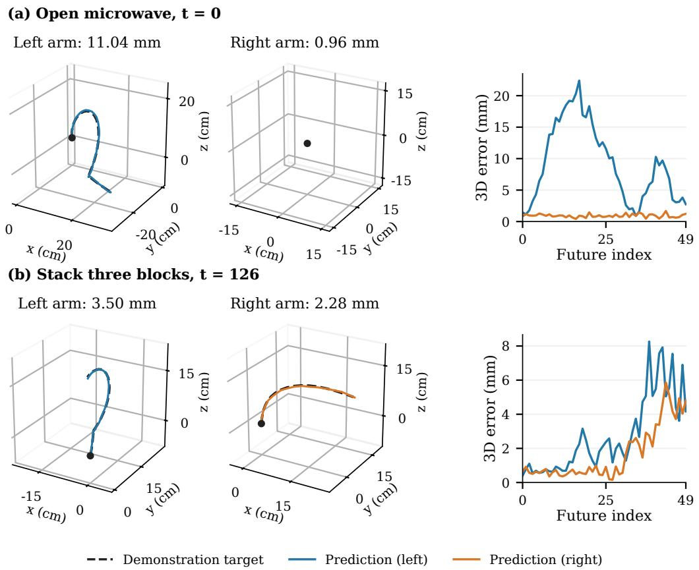  
Figure 5: Detailed future EEF tracks for the examples in Figure 3. Dashed curves are demonstration-derived targets; solid curves are predictions from the auxiliary head. Each arm con tributes 50 waypoints. Dots mark target starting positions. Both arms within a row use equal spatial scale, with coordinates displayed in centimeters. The right panels show Euclidean error at every future index.

## E REAL WORLD EXPERIMENTS DETAILS

## E.1 HARDWARE AND EXPERIMENTAL SETUP

We conduct real-world experiments on two dual-arm robot platforms, Astribot S1 and AgileX Cobot Magic 2, as shown in Figure 4. These platforms provide different robot embodiments for evaluating the applicability of GeoMem-VLA in real-world manipulation scenarios.

The Astribot S1 is a dual-arm humanoid manipulation platform equipped with two 7-DoF arms and dexterous end-effectors. The robot is equipped with a three-camera visual system, including one head-mounted RGB camera and two wrist-mounted RGB cameras, which provide global scene observations and close-range views for manipulation.

The AgileX Cobot Magic 2 is a dual-arm collaborative robot platform equipped with two 6-DoF robotic arms and parallel grippers. Similar to Astribot S1, it uses a three-camera configuration consisting of one head-mounted RGB camera and two wrist-mounted RGB cameras.

## E.2 TASK DESCRIPTION

We design five real-world manipulation tasks on two robot platforms to evaluate different aspects of GeoMem-VLA, including spatial understanding, object-level manipulation, and long-horizon task execution. The tasks cover diverse interaction patterns, ranging from precise object placement to sequential manipulation with changing task states.

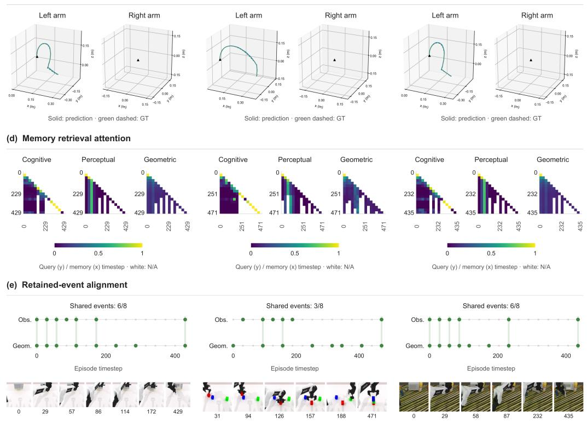

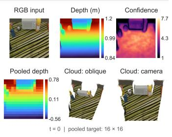  
Open microwave (Clean)  
Stack three blocks (Clean)

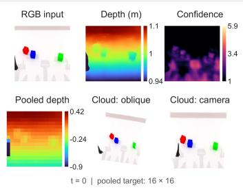  
Open microwave (Randomized)

(b) Point-map reconstruction  
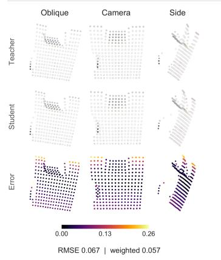  
(c) EEF waypoints: prediction and ground truth

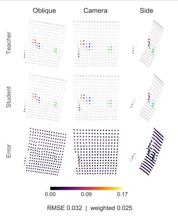

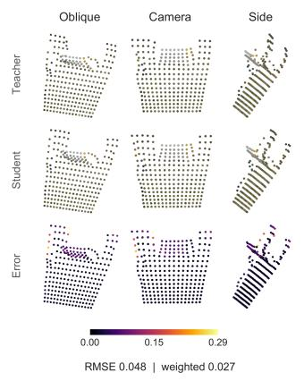  
Figure 6: Geometry reconstruction and memory analysis on RoboTwin manipulation tasks. For each example, we visualize: (a) dense geometry targets provided by the frozen VGGT teacher, (b) reconstructed point maps from GeoPlan representations, (c) predicted future end-effector tracks, (d) retrieval attention across perceptual, cognitive, and geometric memories, and (e) retained-event alignment between observation and geometric memory banks.

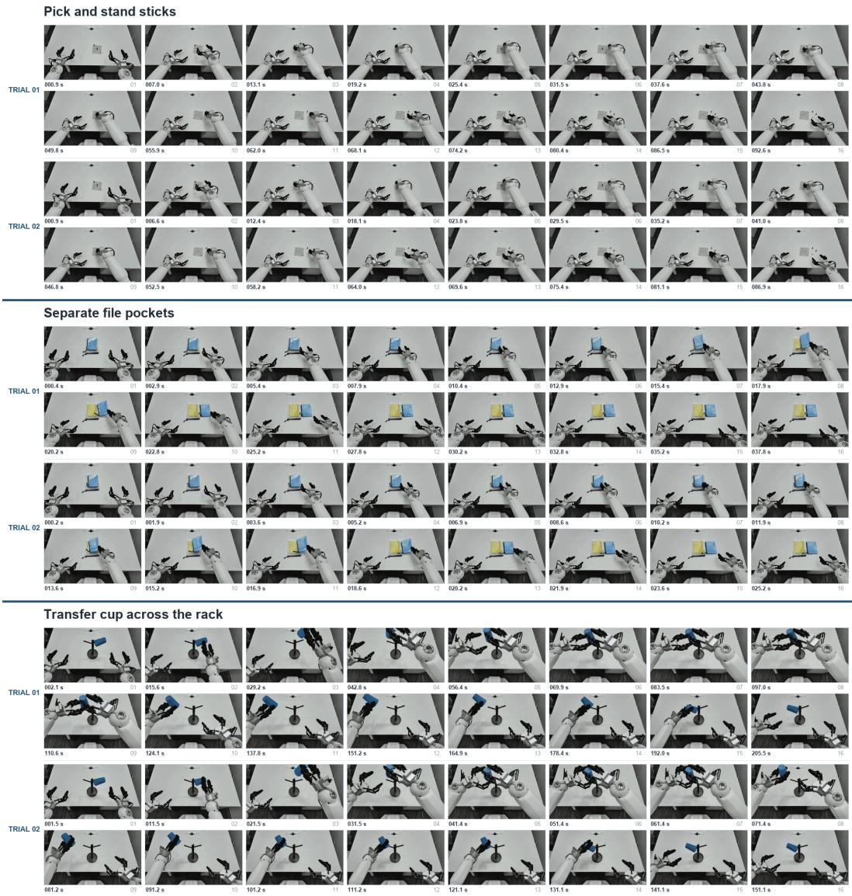  
Figure 7: Successful real-world rollouts on Astribot S1. The figure presents representative execution sequences for three manipulation tasks: pick and stand sticks, separate file pockets, and transfer cup across the rack. GeoMem-VLA completes long-horizon manipulation procedures under randomized object configurations, demonstrating accurate spatial interaction and effective task-state retention.

## Astribot S1 Tasks. Real-world rollouts are shown in Figure 7 and Figure 8.

Pick and stand sticks. In this task, three colored sticks (blue, red, and yellow) are placed on a pegboard. The robot is required to sequentially pick up each stick and place it upright on the table on the right side according to the specified order.

Transfer a cup across the rack. A blue cup is placed on the right side of a wooden rack. The robot first grasps the cup with the right gripper, removes it from the rack, transfers it to the left gripper in the air, and finally places it on the left side of the rack.

Separate file pockets. Three file pockets with different colors and sizes are stacked on the table. The robot needs to identify the target blue file pocket, grasp it with the right gripper, and place it at the designated location on the right side.

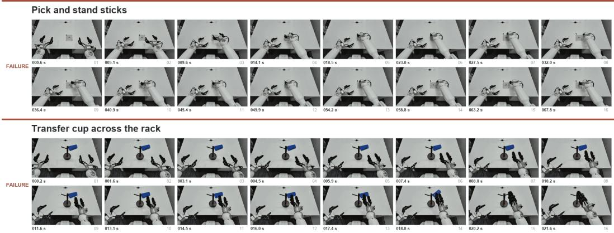  
Figure 8: Failure cases of GeoMem-VLA on Astribot S1 tasks. The figure shows representative unsuccessful rollouts for pick and stand sticks and transfer cup across the rack.

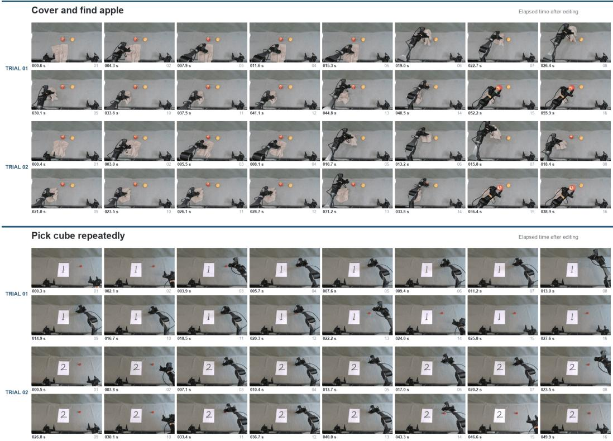  
Figure 9: Successful real-world rollouts on AgileX Cobot Magic 2. The figure presents representative execution sequences for two manipulation tasks: cover and find apple under towel and pick cube repeatedly. GeoMem-VLA completes long-horizon manipulation procedures involving hidden-object reasoning and repeated interactions, demonstrating effective spatial understanding and task-state retention.

## AgileX Cobot Magic 2 Tasks. Real-world rollouts are shown in Figure 9 and Figure 10.

Pick n times cube. A number instruction is provided on the table, indicating the required number of repetitions. The robot needs to repeatedly grasp and place the red cube on the right side of the table for exactly n times.

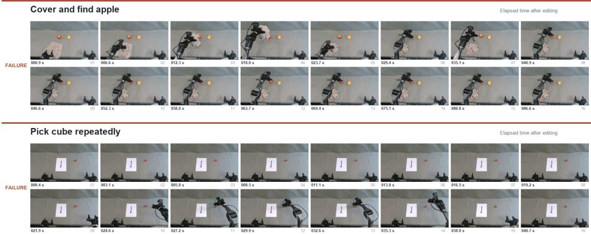  
Figure 10: Failure cases of GeoMem-VLA on AgileX Cobot Magic 2 tasks. The figure shows representative unsuccessful rollouts for cover and find apple under towel and pick cube repeatedly.

Cover and find the apple under towel. An apple, a pear, and a towel are placed on the table. The robot first grasps the towel and covers the apple, then removes the towel to reveal the hidden apple, and finally grasps the apple.

## E.3 EVALUATION PROTOCOL

For each real-world task, we conduct 10 independent evaluation rollouts under randomized initial configurations. Before each rollout, object positions are randomly initialized within the demonstrated workspace, while task-specific parameters (e.g., the target number in the pick n times cube task) are randomly assigned.

During evaluation, the robot executes the policy in a closed-loop manner without external intervention. A rollout is considered successful only when the robot completes the entire task procedure and satisfies the predefined task objective. Partial completion of a task is counted as failure.

The success rate is calculated as:

$$
S R = \frac { N _ { \mathrm { s u c c e s s } } } { N _ { \mathrm { t o t a l } } } \times 1 0 0 \% .\tag{11}
$$

The reported success rate for each task is computed over the 10 evaluation rollouts.

## E.4 BASELINE IMPLEMENTATION

We compare GeoMem-VLA with three representative VLA baselines, including LingBot-VLA 2.0, π0.5, and OpenVLA-OFT. To ensure a fair comparison, all baselines are fine-tuned and evaluated following their official configurations and recommended training pipelines.

For each task, the baseline models are fine-tuned using the same task-specific demonstration data collected in our experiments. The adapted models are then evaluated under the same rollout settings, including identical initial configurations, evaluation episodes, and success criteria.

## E.5 ADDITIONAL QUALITATIVE RESULTS

We provide additional details of real-world experiments as shown in Figure 11 and Figure 12 to further illustrate the effectiveness of GeoMem-VLA in spatially precise manipulation and longhorizon task execution.

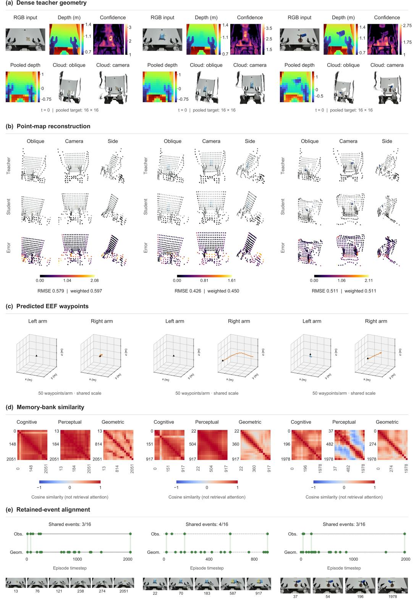  
Figure 11: Geometry reconstruction and memory analysis on real-world Astribot tasks. For three representative tasks, we visualize: (a) dense teacher geometry estimated from RGB observations, (b) reconstructed point maps from GeoPlan tokens, (c) predicted future end-effector waypoints, (d) memory retrieval similarity across different representation streams, and (e) retained-event alignment between observation and geometric memories.

Cover and find apple  
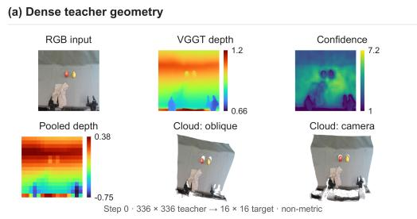  
(b) Point-map reconstruction

Pick n times cube  
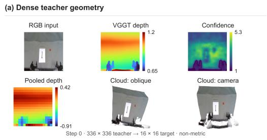

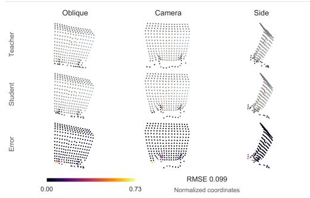  
(c) EEF waypoints (d) Memory-bank similarity

(b) Point-map reconstruction  
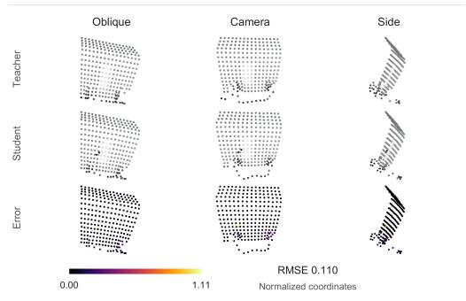

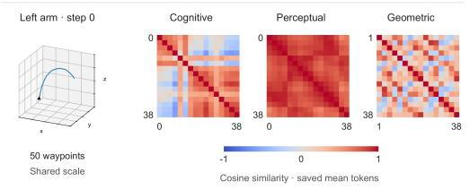  
(e) Retained-event alignment

(c) EEF waypoints (d) Memory-bank similarity  
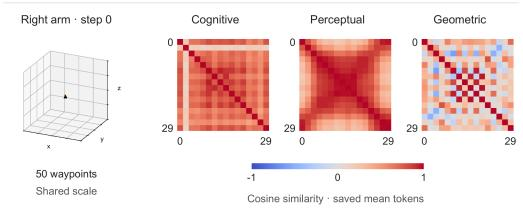

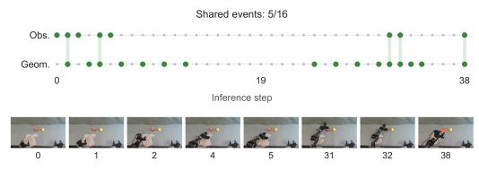

(e) Retained-event alignment  
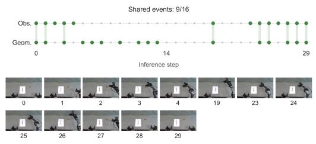  
Figure 12: Geometry reconstruction and memory analysis on real-world AgileX tasks. For two representative tasks, we visualize: (a) dense teacher geometry estimated from RGB observations, (b) reconstructed point maps from GeoPlan tokens, (c) predicted future end-effector waypoints, (d) memory retrieval similarity across different representation streams, and (e) retained-event alignment between observation and geometric memories.