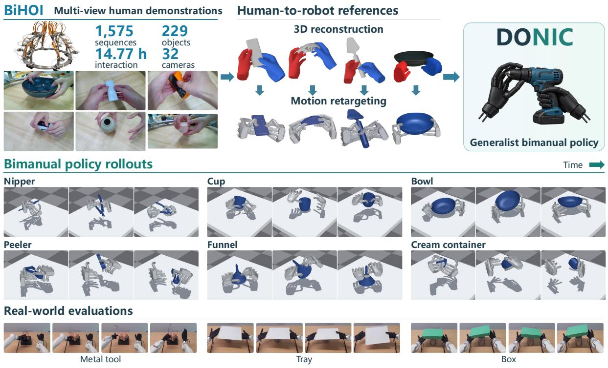
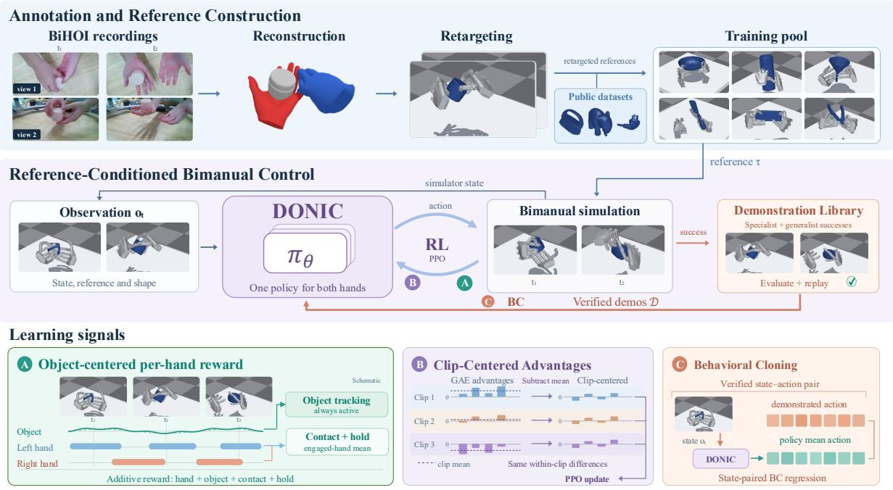
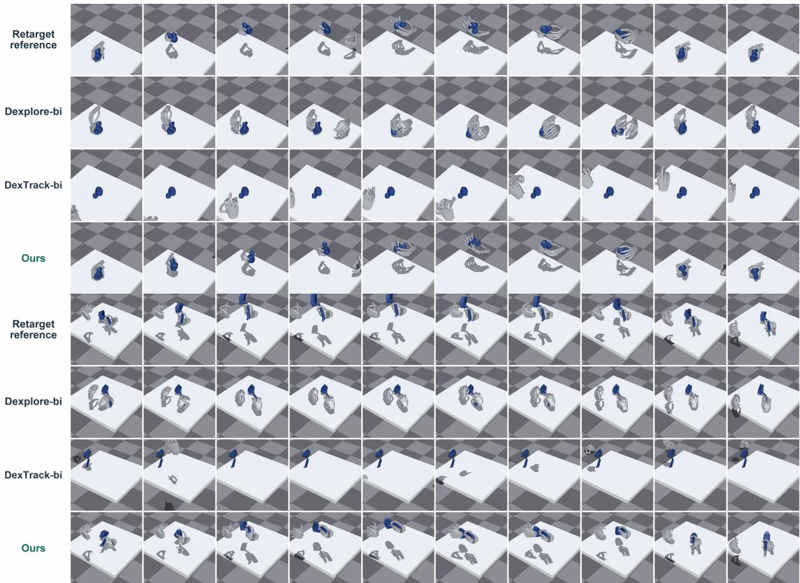
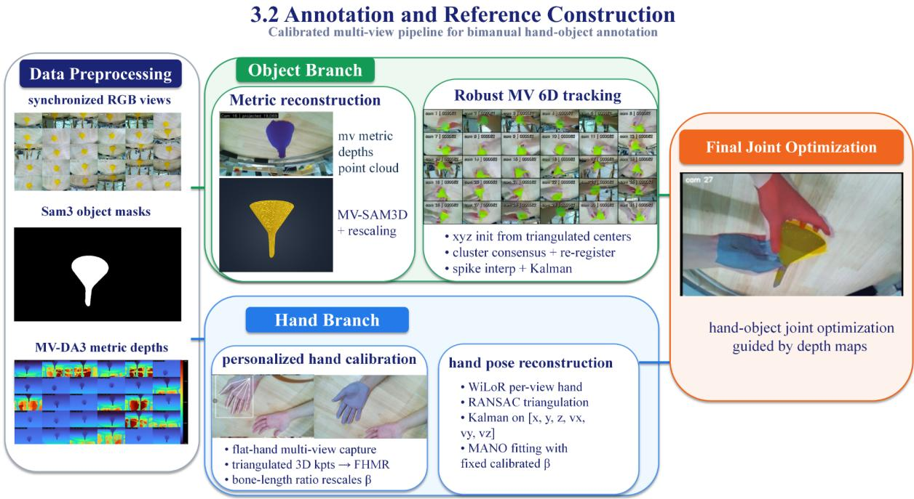
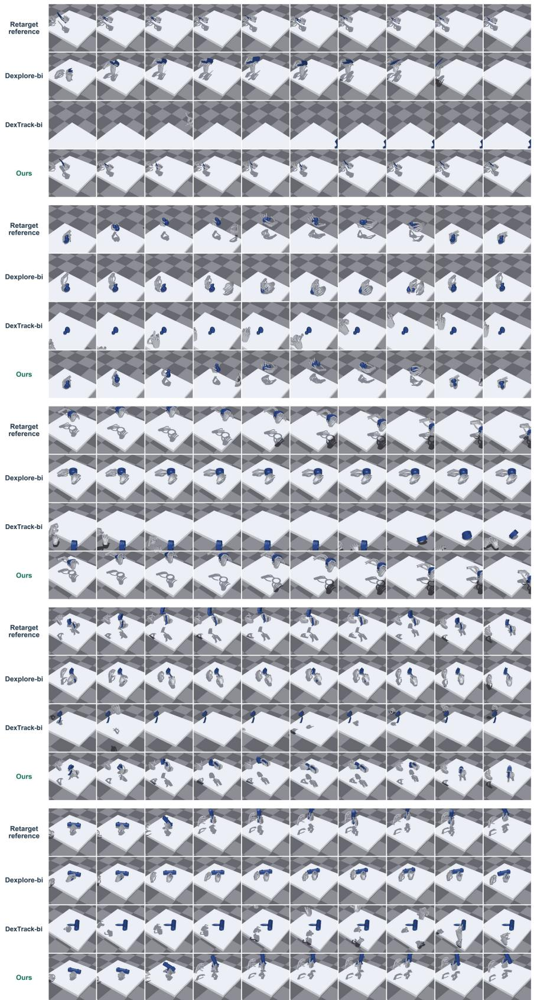

DONIC

# Generalist Dexterous Bimanual Tracking Control from Human Demonstrations

Mingze Sun★ Ziang Cao★ Yuan Fei★ Qiankuan Tao★ Zihan Wang★ Tianqi Liu★ Junhao Chen★ Haiwen Diao★ Fangzhou Hong★ Zhaoxi Chen★ Ziwei Liu★,†

★ Ropedia

€ Project Page: ropedia.github.io/DONIC

  
Figure 1 | Overview of DONIC. BiHOI provides multi-view bimanual demonstrations that are reconstructed and retargeted to robot hands. DONIC learns a shared policy for diverse bimanual reference-tracking tasks.

## Abstract

Despite recent progress in dexterous reference tracking, existing models focus primarily on single-hand manipulation and a limited range of interactions, leaving the bimanual dexterous behaviors common in real life unaddressed. The scarcity of contact-rich bimanual manipulation data and the increased complexity of coordinating contacts make developing a generalist bimanual tracker particularly challenging. Therefore, we present 1) DONIC, the first generalist bimanual tracker jointly trained across

operation categories and human-motion sources, together with 2) BiHOI, a multi-view dataset of 1,575 sequences spanning 229 objects and emphasizing sustained bimanual interaction, where reconstructed interactions are retargeted into robot references. DONIC combines proximal policy optimization with behavioral cloning in a feedback loop that recycles verified successful executions into training demonstrations. An object-centered per-hand reward maintains object-motion feedback while supervising each hand according to its reference contact role. Clip-Centered Advantages remove reference-dependent advantage offsets while preserving within-trajectory differences. Together, these designs enable one single policy to learn coordinated manipulation across heterogeneous references. Without fine-tuning, a single checkpoint achieves 86.79% success on unseen trajectories of training objects and 57.32% on held-out objects, surpassing the state-of-the-art bimanual tracking baselines by 77.36 and 45.73 percentage points.

## 1. Introduction

Dexterous manipulation supports household assistance, industrial assembly, and assistive care. Unlike gripper-based manipulation, it requires precise coordination of finger motions and changing hand–object contacts to grasp, reorient, and reposition objects [28, 2, 8, 33]. Generalizing across objects and behaviors is challenging, especially when human demonstrations must be retargeted to robot hands with different kinematics [26, 19, 38]. Simulation-ready objects [4–6] and synthetic trajectories [12, 40] enable large-scale interaction data, but may not fully capture natural human manipulation. Recent trackers therefore learn from human hand–object motion [19, 38, 1], yet remain largely limited to single-hand tasks. Many everyday tasks instead require asymmetric bimanual coordination: one hand stabilizes an object while the other opens, rotates, or repositions it [9, 41, 43]. This motivates a generalist bimanual reference tracker that learns from diverse human motion to control different objects and tasks with one policy.

Developing such a tracker poses two challenges. First, public datasets include bimanual manipulation [9, 41, 20, 10], but fully tracked hand–object sequences with sustained two-hand contact remain scarce, limiting the available coordination patterns. Second, a shared policy must learn trajectories with changing hand roles and contact timing. Hand-pose accuracy alone does not ensure successful object manipulation, while requiring both hands to satisfy contact conditions can mask one hand’s progress. Unequal clip difficulty also creates advantage offsets that can weaken updates for useful actions in harder sequences. Shared training therefore needs feedback grounded in object motion and each hand’s reference contacts, alongside advantages that preserve differences among transitions within each clip.

We address these challenges with DONIC, a generalist bimanual reference tracker, and BiHOI, a multi-view hand–object interaction dataset. BiHOI contains 1,575 sequences spanning 229 objects and 14.77 hours, captured from 32 calibrated RGB views. It covers symmetric manipulation and asymmetric coordination. We reconstruct both hands and the object, then retarget hand motion to robot references paired with the object trajectory. Combined with public references, BiHOI broadens the training objects and coordination patterns. DONIC learns one policy for both hands through proximal policy optimization (PPO) [31] and behavioral cloning (BC) on verified demonstrations. Trajectory-specific policies optimize screened references, while successful shared-policy executions are verified and reused. At inference, one checkpoint tracks new references without further training. Our object-centered per-hand reward maintains object-motion feedback and supervises each hand’s reference contacts, including asynchronous engagement. Our Clip-Centered Advantages (CCA) subtract each clip’s mean estimated advantage before PPO updates, removing clip-dependent offsets while preserving within-clip differences. On held-out trajectories and objects from public datasets, DONIC exceeds the stronger bimanual baseline by 77.36 and 45.73 percentage points in success rate, respectively.

Our contributions are:

• To our knowledge, DONIC is the first bimanual reference tracker jointly trained across operation categories and human motion datasets; a single checkpoint is evaluated on unseen trajectories and objects without fine-tuning.

• We introduce BiHOI, a multi-view hand-object interaction dataset emphasizing coordinated bimanual manipulation, and reconstruct its recordings into robot motion references.

• We propose an object-centered per-hand reward and CCA to support joint PPO training across bimanual references with different contact roles and difficulty.

• On our two public-data evaluation splits, DONIC outperforms bimanual adaptations of DexTrack and Dexplore in success rate and completion, reaching 86.79% and 57.32% success on unseen trajectories and objects, respectively.

## 2. Related Work

From human references to executable manipulation. Human trajectories provide motion targets, but retargeting alone cannot ensure successful contact. Sequence-specific policies commonly use reinforcement learning to correct retargeted motion. ManipTrans [15] reuses a general hand-motion imitator but learns a task-specific residual policy for interaction. Dex-Machina [23] learns from individual demonstrations by gradually removing virtual object assistance. CHORD [44] guides sequence-specific learning through contact-wrench matching, while ConTrack [17] trains one policy per clip with an adaptive balance between object tracking and motion fidelity. We instead learn one generalist bimanual policy that tracks diverse references without per-reference training or fine-tuning at test time.

Generalist manipulation policies. Generalist policies share knowledge across objects, motions, or skills, predominantly in single-hand settings. UniDexGrasp++ [33] generalizes grasping across object geometries, UniCross [42] unifies multiple manipulation skills, and ArtManip [39] learns category-level articulated in-hand manipulation. For reference tracking, DexTrack [19] combines reinforcement learning with demonstrations mined by trajectory-specific controllers. Dexplore [38] expands exploration around reference motions, while AdaDexTrack [1] combines specialist distillation with online reference modulation. Bimanual tracking must coordinate complementary hand roles and contact timing. Existing work explores narrower generalization: BiDexHD [43] distills teachers into a separate trajectory-conditioned policy for each operation category and evaluates new object–tool combinations and instances within categories; Phys-Graph [16] transfers task-trained policies to new tool and object geometries. We jointly train one bimanual reference tracker across operation categories and human motion datasets, and evaluate it on unseen trajectories and objects without fine-tuning.

Bimanual hand–object interaction datasets. GRAB [32] records whole-body grasping with detailed contact information, while ARCTIC [9] captures the coupled motion of two hands and articulated objects. OakInk2 [41] organizes bimanual manipulation into primitive and complex tasks, and TACO [20] covers diverse tool–action–object compositions. GigaHands [10] further expands the scale and diversity of bimanual activities with language annotations. Complementing these motion collections, H2O [13] and HOI4D [21] support egocentric interaction understanding, while HOT3D [3] and HO-Cap [34] provide recordings and annotations for hand–object reconstruction and tracking. Capture and annotation conventions differ, and human kinematics do not ensure executable robot actions. We harmonize, retarget, and screen zero-residual feasibility to form a common bimanual reference pool for joint training.

## 3. Bimanual Hand–Object Dataset

Table 1 | Dataset overview: source statistics and simultaneous-contact rates on analyzed recordings.
<table><tr><td>Source</td><td>Capture</td><td>Sequences</td><td>Frames</td><td>Objects</td><td>Bimanual contact (%)</td></tr><tr><td>BiHOI (ours)</td><td>MV RGB</td><td>1,575</td><td>≈1.60M†</td><td>229</td><td>65.91</td></tr><tr><td>GRAB [2020]</td><td>Marker MoCap</td><td>1,334</td><td>1.622M</td><td>51</td><td>32.21</td></tr><tr><td>OakInk2 [2024]</td><td>MV RGB + MoCap</td><td>627</td><td>4.01M</td><td>75</td><td>24.97</td></tr><tr><td>TACO (V1) [2024]</td><td>MV RGB + ego RĠB-D</td><td>2.5K</td><td>5.2M</td><td>206</td><td>15.69</td></tr><tr><td>GigaHands [2025]</td><td>MV RGB</td><td></td><td>183M</td><td>417</td><td>34.74</td></tr><tr><td>H2O [2021]</td><td>MV RGB-D</td><td></td><td>571.6K</td><td>8</td><td>38.57</td></tr><tr><td>HOI4D [2022]</td><td>Ego RGB-D</td><td>4,000</td><td>2.4M</td><td>800</td><td></td></tr><tr><td>HO-Cap (rev.) [2025]</td><td>MV RGB-D</td><td>64</td><td>656K</td><td>64</td><td></td></tr></table>

MV: multi-view; ego: egocentric. †14.77 hours at 30 fps, counting synchronized time steps once. Public frame counts follow source conventions. Contact is the total number of both-hand-contact frames divided by frames with at least one hand in contact, pooled across analyzed clips; –: unavailable.

To expand limited bimanual training data, we introduce BiHOI, a multi-view hand–object interaction dataset. We describe its capture system and composition, then the annotation and retargeting pipeline that converts recordings into robot references.

## 3.1. Multi-View Capture and Dataset

Multi-view capture system. We record hand–object interactions with 32 calibrated RGB cameras surrounding a tabletop workspace, at a resolution of 1920 × 1232 pixels and a frame rate of 30 fps. Complementary views support reconstruction under occlusion; calibration supplies a common metric coordinate system.

Dataset composition. BiHOI contains 1,575 interaction sequences covering 229 objects and 14.77 hours of unique interaction. The objects span household items, containers, utensils, tools, and electronics. Participants perform natural object-centric interactions rather than following fixed motion templates. The recordings include symmetric bimanual manipulation, asymmetric bimanual coordination, and coordinated multi-object manipulation. Table 1 compares BiHOI with commonly used hand–object interaction datasets. Our collection emphasizes sustained two-hand interaction. Among frames with at least one hand in contact, 65.91% have both hands in contact, exceeding H2O, the highest analyzed public subset at 38.57%, by 27.34 percentage points.

## 3.2. Annotation and Reference Construction

Reconstruction and annotation. We reconstruct metric hand–object trajectories from synchronized RGB recordings. SAM3 provides object masks [7], while multi-view Depth Anything 3 provides spatially consistent depth that we align to metric scale using the calibrated camera extrinsics [18]. MV-SAM3D reconstructs a canonical object mesh from first-frame views and masks [14]; back-projected depth determines its physical scale. FoundationPose then recovers 6- DoF object motion [37], using multi-view pose consensus to handle occlusion and re-registration when consensus fails.

For each participant, triangulated calibration keypoints are used to estimate metric hand scale and calibrate a participant-specific MANO shape. WiLoR provides per-view hand observations [24]; these observations are triangulated, temporally smoothed, and fitted with the MANO hand model [29], with shape held fixed across the sequence. Joint refinement against multi-view metric depth combines geometric alignment with reconstruction and temporal regularization, producing bimanual MANO parameters, a metric object mesh, and its 6-DoF trajectory in a common world frame. Reconstruction and refinement details appear in Appendix B.2.

Retargeting. We map the reconstructed human motion to the Wuji robot hands through framewise kinematic fitting, following standard retargeting practice [11, 27, 19]. After wrist-frame alignment, we fit hand keypoints to robot links under joint limits, initializing and regularizing each frame against the preceding solution. Smoothing occurs only before retargeting. The resulting wrist and finger references are paired with the object trajectory.

## 4. Methodology

DONIC learns a generalist bimanual tracker across operation categories and human-data sources (Figure 2). Its object-centered per-hand reward supports complementary roles and asynchronous contacts while maintaining object-motion feedback. CCA removes referencedependent offsets after generalized advantage estimation (GAE) [30], preserving withinreference advantage differences.

## 4.1. Task Definition

Given a reference for two hands and an object, one policy controls both robot hands to reproduce the object motion through physical interaction. Following DexTrack [19], training combines PPO with BC from executable demonstrations; the policy tracks unseen trajectories and objects without fine-tuning.

For a clip spanning � control steps, we write the reference as

$$
\tau = \left\{ \big ( \hat { q } _ { t } ^ { L } , \hat { q } _ { t } ^ { R } , \hat { p } _ { t } ^ { o } , \hat { R } _ { t } ^ { o } \big ) \right\} _ { t = 0 } ^ { T } .\tag{1}
$$

Here � is the frame index, $h \in \{ L , R \}$ identifies a hand, and a hat denotes a reference quantity. The configuration $\hat { \pmb q } _ { t } ^ { h } \in \mathbb { R } ^ { d }$ contains the wrist coordinates and finger-joint angles, with � controlled coordinates per hand. The object position and orientation are $\hat { p _ { t } ^ { o } } \in \mathbb { R } ^ { 3 }$ and $\hat { R } _ { t } ^ { o } \in S O ( 3 )$ , where ��(3) is the space of three-dimensional rotations. We concatenate the two hand configurations into $\hat { q } _ { t } \in \mathbb { R } ^ { 2 d }$ . Corresponding quantities without hats denote simulated states. Object linear velocity is denoted by ${ \pmb v } _ { t } ^ { o } ;$ ; its reference $\hat { \pmb { v } } _ { t } ^ { o }$ is obtained by finite differences. Positions, rotations, and linear velocities use metres, radians, and metres per second, respectively.

## 4.2. Reference-Conditioned Bimanual Control

A single stochastic policy $\pi _ { \boldsymbol { \theta } } ( \mathbf { a } _ { t } \mid \mathbf { o } _ { t } )$ , parameterized by �, predicts joint actions $\mathbf { } \mathbf { a } _ { t }$ for both hands from observation $\mathbf { } _ { \mathbf { } } \mathbf { o } _ { t }$ . Following reference-based trackers [19, 38], $\mathbf { } _ { o _ { t } }$ concatenates two per-hand blocks containing proprioception, object pose and velocity, upcoming reference targets, reference-state errors, and fingertip-to-object distance vectors. Spatial features use each wrist’s heading frame. We append a basis-point-set shape encoding [25], object scale and centroid, hand identities, and the fixed left-hand reward weight $w _ { L } \in ( 0 , 1 ]$ . Contact-force channels are zeroed; simulated forces supervise rewards only.

  
Figure 2 | Overview of DONIC. Top: BiHOI captures are reconstructed and retargeted, then combined with public-data references to form the training pool. Middle: A shared bimanual policy learns through simulated interaction and verified demonstrations in an iterative PPO+BC loop. Bottom: An object-centered per-hand reward, Clip-Centered Advantages (CCA), and behavioral cloning provide complementary learning signals.

Given $\mathbf { } _ { o _ { t } , }$ the policy predicts bounded corrections $\pmb { a } _ { t } \in [ - 1 , 1 ] ^ { 2 d }$ to the next reference, producing a proportional–derivative (PD) control target as in prior trackers [19, 23]:

$$
\pmb q _ { t } ^ { \mathrm { p d } } = \mathrm { c l a m p } ( \hat { q } _ { t + 1 } + s \odot \pmb a _ { t } , q _ { \mathrm { m i n } } , q _ { \mathrm { m a x } } ) ,\tag{2}
$$

where $\boldsymbol { s } \in \mathbb { R } ^ { 2 d }$ sets the correction range, ⊙ denotes element-wise multiplication, and clamp enforces the coordinate limits ${ \bf { q } } _ { \mathrm { { m i n } } }$ and $\pmb { q } _ { \mathrm { m a x } } .$ . Corrections are anchored to the next reference at every step and do not accumulate. The PD controller executes the target, and the resulting state supplies the next observation. We build on this control interface with the following reward and training procedure.

## 4.3. Object-Centered Per-Hand Reward

Hand-pose accuracy does not ensure contact or object motion, and the hands may engage asynchronously with different roles. We therefore reward object motion throughout the clip while supervising each hand’s contact only when required by the reference.

Tracking the object. We reward agreement in object position, orientation, and linear velocity:

$$
r _ { t } ^ { \mathrm { { o b j } } } = e ^ { - \kappa _ { p } \| p _ { t } ^ { o } - \hat { p } _ { t } ^ { o } \| _ { 2 } } e ^ { - \kappa _ { R } \angle ( R _ { t } ^ { o } , \hat { R } _ { t } ^ { o } ) } e ^ { - \kappa _ { \nu } \| v _ { t } ^ { o } - \hat { v } _ { t } ^ { o } \| _ { 2 } } .\tag{3}
$$

Positive coefficients $\kappa _ { p } , \kappa _ { R } , \kappa _ { \nu }$ control sensitivity to position, rotation, and velocity errors. Here $\| \cdot \| _ { 2 }$ is the Euclidean norm and $\angle \left( \cdot , \cdot \right)$ the rotation geodesic distance. The product rewards joint agreement, with velocity penalizing stationary solutions to moving references. This kinematic term [35, 36] is independent of the contact gate.

Supervising each hand’s contact. Object tracking alone does not specify how the hands should support the motion. Let $C _ { t } ^ { h }$ be the set of fingertips on hand ℎ required to contact the object by the reference at frame �. For fingertip $i ,$ let $\delta _ { i , t } ^ { h }$ denote its distance to the object surface and $f _ { i , t } ^ { h }$ its simulated net contact-force magnitude. We estimate contact using

$$
\alpha _ { i , t } ^ { h } = { \bf 1 } [ f _ { i , t } ^ { h } > f _ { \operatorname* { m i n } } ] { \bf 1 } [ \delta _ { i , t } ^ { h } < \delta _ { \operatorname* { m a x } } ] ,\tag{4}
$$

where 1[·] is an indicator and $f _ { \mathrm { m i n } } , \delta _ { \mathrm { m a x } } > 0$ are force and distance thresholds. Proximity reduces false object-contact attribution, but net force does not identify the collision partner.

For a hand with at least one required fingertip, we define

$$
\begin{array} { r l } & { r _ { t } ^ { \mathrm { c o n t } , h } = \displaystyle \frac { 1 } { | C _ { t } ^ { h } | } \sum _ { i \in C _ { t } ^ { h } } \left[ \zeta e ^ { - \kappa _ { c } \delta _ { i , t } ^ { h } } + ( 1 - \zeta ) \alpha _ { i , t } ^ { h } \right] , } \\ & { r _ { t } ^ { \mathrm { h o l d } , h } = \displaystyle \frac { 1 } { | C _ { t } ^ { h } | } \sum _ { i \in C _ { t } ^ { h } } \alpha _ { i , t } ^ { h } . } \end{array}\tag{5}
$$

Here $| C _ { t } ^ { h } |$ is the number of required fingertips, $\kappa _ { c } > 0$ controls distance sensitivity, and $\zeta \in [ 0 , 1 ]$ balances proximity and contact. Proximity guides contact acquisition; the hold term rewards instantaneous required-contact coverage, allowing valid sliding or rolling.

Combining the learning signals. We aggregate contact rewards over the engaged-hand set $\mathcal { E } _ { t } = \{ h \in \{ L , R \} : C _ { t } ^ { h } \neq \emptyset \}$ . For $u \in$ {cont, hold}, let

$$
\begin{array} { r } { r _ { t } ^ { u } = \left\{ \begin{array} { l l } { \displaystyle \frac { \sum _ { h \in \mathcal { E } _ { t } } w _ { h } r _ { t } ^ { u , h } } { \sum _ { h \in \mathcal { E } _ { t } } w _ { h } } , } & { \mathcal { E } _ { t } \neq \emptyset , } \\ { 0 , } & { \mathcal { E } _ { t } = \emptyset , } \end{array} \right. } \end{array}\tag{6}
$$

where $w _ { R } = 1$ and $w _ { L } \in ( 0 , 1 ]$ are fixed hand weights. Averaging preserves either engaged hand’s feedback when the other loses contact; excluding inactive hands avoids rewarding attachment during reference release.

Finally, we combine these signals with the inherited hand-tracking reward $r _ { t } ^ { \mathrm { h a n d } } \in [ 0 , 1 ]$ which measures wrist, finger-joint, and keypoint agreement [38]:

$$
r _ { t } = ( 1 + w _ { L } ) \left[ \beta _ { \mathrm { h a n d } } r _ { t } ^ { \mathrm { h a n d } } + \beta _ { \mathrm { o b j } } r _ { t } ^ { \mathrm { o b j } } + \beta _ { \mathrm { c o n t } } r _ { t } ^ { \mathrm { c o n t } } + \beta _ { \mathrm { h o l d } } r _ { t } ^ { \mathrm { h o l d } } \right] .\tag{7}
$$

The nonnegative $\beta$ coefficients sum to one; $( 1 + w _ { L } )$ sets the reward scale. These terms jointly supervise hand motion, object outcomes, and reference contact roles (settings in Appendix C.2).

## 4.4. Learning a Generalist from Verified Demonstrations

Following DexTrack [19], we alternate PPO+BC training with demonstration collection. PPO learns through simulated interaction, while BC supplies successful actions that shared exploration may struggle to discover. Trajectory-specific policies optimize references retained by replay screening; their verified rollouts form a demonstration library D of observation–action pairs. As the generalist improves, its verified successes are added to D for subsequent updates. All demonstrations come from training references.

Demonstrations supply successful behavior, while CCA addresses unequal reference difficulty in PPO updates.

Clip-Centered Advantages. Shared PPO batches mix contact patterns and coordination demands. GAE combines temporally weighted value-prediction residuals, but unequal critic accuracy across references can leave clip-dependent offsets. Difficult clips may then receive consistently negative advantages despite relatively successful transitions. CCA removes this common offset while preserving within-clip differences.

Formally, let B denote an on-policy rollout batch, � index a transition, and $m ( j )$ identify its reference clip. After computing the standard GAE advantage $A _ { i } ^ { \mathrm { G A E } }$ from rewards and the learned value function, we group transitions by reference as $\mathcal { G } _ { m } = \{ \dot { j } \in \mathcal { B } : m ( j ) = m \}$ and use

$$
\widetilde { A } _ { j } = A _ { j } ^ { \mathrm { G A E } } - \frac { 1 } { | \mathcal { G } _ { m ( j ) } | } \sum _ { k \in \mathcal { G } _ { m ( j ) } } A _ { k } ^ { \mathrm { G A E } } .\tag{8}
$$

Subtracting the clip mean preserves pairwise advantage differences among its transitions while removing their common empirical offset. The adjustment is applied after $\operatorname { G A E } ;$ the learned critic and temporal advantage estimation remain unchanged.

Groups are defined by reference identity rather than by environment instance or temporal phase, allowing parallel rollouts of the same reference to contribute to a common baseline. Unlike batch-wide centering, CCA removes an offset specific to each reference instead of applying one shared shift to all clips. We subtract only the group mean, without dividing by a per-clip standard deviation, preserving the scale of within-clip advantage differences. This adjustment acts on the policy’s learning signal; it does not modify the reward or the critic’s regression targets.

Joint PPO and BC updates. We use $\widetilde { A } _ { j }$ in the standard PPO actor loss $\mathcal { L } _ { \mathrm { P P O } }$ , retaining its on-policy probability ratio and clipping rule. For a demonstration observation–action pair $( o ^ { D } , \pmb { a } ^ { D } ) \in \bar { \mathcal { D } }$ , let $\mu _ { \boldsymbol { \theta } } ( \overset { \cdot } { o } ^ { D } )$ denote the shared Gaussian policy’s mean action. The combined actor objective is

$$
\begin{array} { r } { \mathcal { L } _ { \mathrm { a c t o r } } ( \theta ) = \mathcal { L } _ { \mathrm { P P O } } ( \theta ; \widetilde { A } ) + \lambda \mathbb { E } _ { ( o ^ { D } , a ^ { D } ) \sim \mathcal { D } } \left\| \mu _ { \theta } ( o ^ { D } ) - a ^ { D } \right\| _ { 2 } ^ { 2 } , } \end{array}\tag{9}
$$

where $\lambda > 0$ weights BC and the expectation averages over sampled demonstration pairs. Demonstrations use a separate sampling budget and do not enter the PPO ratio or GAE. The critic retains its standard value-regression objective. Sampling, verification, and training details are provided in Appendices C.4–C.5.

## 5. Experiments

## 5.1. Setup

Datasets. We curate bimanual manipulation references from GRAB [32], GigaHands [10], OakInk2 [41], TACO [20], and H2O [13]. We retain clips in which both hands and the manipulated object are tracked, and each hand contacts the object at some point during the clip; simultaneous contact is not required. Motions are harmonized, retargeted to the Wuji Hand V1, and replay-screened (Appendix B.1). This yields 1,845 public-data training clips, separate from the held-out evaluation references. Ours+BiHOI additionally uses all 1,575 BiHOI sequences, bringing its training pool to 3,420 clips.

  
Figure 3 | Qualitative comparisons on two held-out object trajectories. Rows show the reference, Dexplorebi, DexTrack-bi, and DONIC; time runs left to right.

For evaluation, we reserve two splits from the public datasets: UNSEEN-TRAJ contains 53 unseen trajectories of training objects, and UNSEEN-OBJ contains 164 clips involving held-out objects. Neither split is used for policy training or demonstration collection. All methods are evaluated on the same splits without fine-tuning.

Metrics. We extend AdaDexTrack’s evaluation protocol [1] to bimanual tracking. We report object errors $\left( T _ { o } , R _ { o } \right)$ , wrist errors $\left( T _ { h } , R _ { h } \right)$ , and finger-joint error $( E _ { \mathrm { f i n g e r } } )$ , with translation in centimetres and angles in radians. Wrist errors use robot forward kinematics against retargeted references; finger error averages over 20 finger joints. Reported hand errors take the worse of the two trajectory-averaged hand errors, then average across trajectories. SR requires both hands independently to satisfy $\begin{array} { r } { \frac 1 2 ( T _ { o } + T _ { h } ) \ \le \ 1 0 \mathrm { c m } , \ \frac 1 2 ( \bar { R } _ { o } + R _ { h } ) \ \le \ \bar { \pi } / 3 . } \end{array}$ , and $E _ { \mathrm { f i n g e r } } \leq 2 \pi / 9$ on trajectory-averaged errors. Comp is the fraction of frames satisfying all three conditions for both hands, averaged over trajectories.

Baselines. We compare against DexTrack-bi and Dexplore-bi, using their released code with observation and control interfaces adapted to two Wuji hands. Both baselines share DONIC’s public-data pool, Isaac Gym simulator, robot model, and held-out splits. DexTrack-bi follows the released specialist–distillation pipeline [19]. Dexplore-bi retains Dexplore’s original reward and reference-scoped exploration [38]. Additional implementation details are provided in

Table 2 | Reference tracking without fine-tuning, using one checkpoint per method across both splits. Black and blue bold mark the best and second-best results within each split; ties share highlighting.
<table><tr><td>Dataset</td><td>Method</td><td> $T _ { o \mathrm { ~ \downarrow ~ } }$  (cm)</td><td> $R _ { o } \downarrow$  (rad)</td><td> $T _ { h } \downarrow$  (cm)</td><td> $R _ { h } \downarrow$  (rad)</td><td> $E _ { \mathrm { f i n g e r } } \downarrow$  (rad)</td><td>SR↑ (%)</td><td>Comp↑ (%)</td></tr><tr><td rowspan="6">Unseen trajectory</td><td>DexTrack-bi</td><td>41.86</td><td>2.3340</td><td>23.03</td><td>0.8296</td><td>0.6301</td><td>0.00</td><td>1.30</td></tr><tr><td>Dexplore-bi</td><td>14.73</td><td>0.8597</td><td>21.88</td><td>0.8412</td><td>0.3166</td><td>9.43</td><td>27.87</td></tr><tr><td>w/oCCA</td><td>11.27</td><td>0.9585</td><td>4.34</td><td>0.2980</td><td>0.0433</td><td>81.13</td><td>62.72</td></tr><tr><td>w/o contact gate</td><td>10.26</td><td>0.9589</td><td>4.00</td><td>0.3013</td><td>0.0338</td><td>81.13</td><td>65.03</td></tr><tr><td>Ours</td><td>10.27</td><td>0.9277</td><td>3.96</td><td>0.2905</td><td>0.0372</td><td>86.79</td><td>67.62</td></tr><tr><td>Ours+BiHOI</td><td>9.74</td><td>0.8637</td><td>3.32</td><td>0.2818</td><td>0.0338</td><td>88.68</td><td>68.72</td></tr><tr><td rowspan="6">Unseen object</td><td>DexTrack-bi</td><td>127.87</td><td>2.3532</td><td>72.83</td><td>1.0629</td><td>0.6455</td><td>0.00</td><td>0.88</td></tr><tr><td>Dexplore-bi</td><td>17.92</td><td>1.1431</td><td>19.46</td><td>0.9509</td><td>0.3685</td><td>11.59</td><td>26.37</td></tr><tr><td>w/oCCA</td><td>16.83</td><td>1.1464</td><td>5.52</td><td>0.3235</td><td>0.0378</td><td>48.17</td><td>43.89</td></tr><tr><td>w/o contact gate</td><td>17.61</td><td>1.2041</td><td>4.97</td><td>0.3386</td><td>0.0371</td><td>48.78</td><td>49.52</td></tr><tr><td>Ours</td><td>15.74</td><td>1.1310</td><td>4.58</td><td>0.3226</td><td>0.0373</td><td>57.32</td><td>54.69</td></tr><tr><td>Ours+BiHOI</td><td>13.96</td><td>1.1157</td><td>4.54</td><td>0.3206</td><td>0.0361</td><td>59.76</td><td>55.35</td></tr></table>

Appendix D.3.

## 5.2. Main Results

One DONIC checkpoint improves both held-out splits without fine-tuning (Table 2). On UNSEEN-TRAJ, DONIC achieves 86.79% SR and 67.62% Comp, exceeding the stronger baseline, Dexplore-bi, by 77.36 and 39.75 percentage points, respectively. On UNSEEN-OBJ, it reaches 57.32% SR and 54.69% Comp, compared with 11.59% and 26.37% for Dexplore-bi. The gains extend to hand tracking: wrist translation error decreases from 21.88 to 3.96 cm on unseen trajectories and from 19.46 to 4.58 cm on unseen objects. DONIC reduces all reported errors relative to both baselines except object rotation on UNSEEN-TRAJ. Because SR and Comp require both hands to meet the tracking criteria, these improvements reflect successful bimanual execution rather than accuracy from only one hand.

On the two held-out object trajectories in Figure 3, DONIC coordinates both hands and more closely reproduces reference object motion. Dexplore-bi moves its hands but produces limited object motion, whereas DexTrack-bi loses the hand–object alignment needed to execute the reference.

## 5.3. Ablation Studies

Learning signals. Removing CCA reduces SR from 86.79% to 81.13% on unseen trajectories and from 57.32% to 48.17% on unseen objects, while lowering Comp and increasing all five tracking errors (Table 2). Removing the contact-ownership gate reduces SR to 81.13% and 48.78%, respectively. Despite lower individual errors in some cases, this variant also has lower Comp on both splits. Both learning signals thus improve joint bimanual success and completion.

Additional bimanual data. Adding all 1,575 BiHOI sequences expands training from 1,845 to 3,420 clips and improves all seven metrics on both splits (Ours+BiHOI, Table 2). SR reaches 88.68% and 59.76% on unseen trajectories and objects, with Comp of 68.72% and 55.35%. Unseenobject translation error falls by 11.3%, from 15.74 to 13.96 cm. Ranking first on all unseen-object metrics, Ours+BiHOI demonstrates the benefit of additional bimanual data.

## 6. Conclusion, Limitations and Future Work

We presented DONIC, a generalist bimanual tracker, and BiHOI, a multi-view bimanual interaction dataset. Object-centered per-hand rewards and CCA support iterative PPO+BC training, yielding one checkpoint that generalizes to unseen trajectories and objects without fine-tuning and substantially outperforms adapted baselines. Ablations support both learning signals and the benefit of additional BiHOI data. However, our quantitative evaluation focuses on simulated single-object interactions and relies on reconstructed, retargeted motion references. We aim to extend DONIC to longer-horizon and multi-object manipulation, evaluate on an independent benchmark, and investigate transfer to physical bimanual systems.

## References

[1] Jianibieke Adalibieke, Qianwei Han, Xueyi Liu, Yuzhe Qin, and Li Yi. 2026. AdaDexTrack: Dynamic modulation for adaptive and generalizable dexterous manipulation tracking. In IEEE/CVF Conference on Computer Vision and Pattern Recognition (CVPR).

[2] Marcin Andrychowicz, Bowen Baker, Maciek Chociej, Rafal Józefowicz, Bob McGrew, Jakub Pachocki, Arthur Petron, Matthias Plappert, Glenn Powell, Alex Ray, Jonas Schneider, Szymon Sidor, Josh Tobin, Peter Welinder, Lilian Weng, and Wojciech Zaremba. 2020. Learning dexterous in-hand manipulation. The International Journal of Robotics Research, 39(1):3–20.

[3] Prithviraj Banerjee, Sindi Shkodrani, Pierre Moulon, Shreyas Hampali, Shangchen Han, Fan Zhang, Linguang Zhang, Jade Fountain, Edward Miller, Selen Basol, Richard Newcombe, Robert Wang, Jakob Julian Engel, and Tomas Hodan. 2025. HOT3D: Hand and object tracking in 3D from egocentric multi-view videos. In IEEE/CVF Conference on Computer Vision and Pattern Recognition (CVPR), pages 7061–7071.

[4] Ziang Cao, Zhaoxi Chen, Liang Pan, and Ziwei Liu. 2025. PhysX-3D: Physical-grounded 3D asset generation. In Advances in Neural Information Processing Systems (NeurIPS), volume 38, pages 104070–104083.

[5] Ziang Cao, Fangzhou Hong, Zhaoxi Chen, Liang Pan, and Ziwei Liu. 2026. PhysX-Anything: Simulation-ready physical 3D assets from single image. In IEEE/CVF Conference on Computer Vision and Pattern Recognition (CVPR), pages 5839–5848.

[6] Ziang Cao, Yinghao Liu, Haitian Li, Runmao Yao, Fangzhou Hong, Zhaoxi Chen, Liang Pan, and Ziwei Liu. 2026. PhysX-Omni: Unified simulation-ready physical 3D generation for rigid, deformable, and articulated objects. arXiv preprint arXiv:2605.21572.

[7] Nicolas Carion, Laura Gustafson, Yuan-Ting Hu, Shoubhik Debnath, Ronghang Hu, Didac Suris, Chaitanya Ryali, Kalyan Vasudev Alwala, Haitham Khedr, Andrew Huang, Jie Lei, Tengyu Ma, Baishan Guo, Arpit Kalla, Markus Marks, Joseph Greer, Meng Wang, Peize Sun, Roman Rädle, and 19 others. 2026. SAM 3: Segment anything with concepts. In International Conference on Learning Representations (ICLR).

[8] Tao Chen, Megha Tippur, Siyang Wu, Vikash Kumar, Edward Adelson, and Pulkit Agrawal. 2023. Visual dexterity: In-hand reorientation of novel and complex object shapes. Science Robotics, 8(84).

[9] Zicong Fan, Omid Taheri, Dimitrios Tzionas, Muhammed Kocabas, Manuel Kaufmann, Michael J. Black, and Otmar Hilliges. 2023. ARCTIC: A dataset for dexterous bimanual hand-object manipulation. In IEEE/CVF Conference on Computer Vision and Pattern Recognition (CVPR), pages 12943–12954.

[10] Rao Fu, Dingxi Zhang, Alex Jiang, Wanjia Fu, Austin Funk, Daniel Ritchie, and Srinath Sridhar. 2025. GigaHands: A massive annotated dataset of bimanual hand activities. In IEEE/CVF Conference on Computer Vision and Pattern Recognition (CVPR), pages 17461–17474.

[11] Ankur Handa, Karl Van Wyk, Wei Yang, Jacky Liang, Yu-Wei Chao, Qian Wan, Stan Birchfield, Nathan Ratliff, and Dieter Fox. 2020. DexPilot: Vision-based teleoperation of dexterous robotic hand-arm system. In IEEE International Conference on Robotics and Automation (ICRA).

[12] Zhi Jing, Siyuan Yang, Jicong Ao, Ting Xiao, Yu-Gang Jiang, and Chenjia Bai. 2025. HumanoidGen: Data generation for bimanual dexterous manipulation via LLM reasoning. In Advances in Neural Information Processing Systems (NeurIPS), volume 38, pages 173413–173459.

[13] Taein Kwon, Bugra Tekin, Jan Stühmer, Federica Bogo, and Marc Pollefeys. 2021. H2O: Two hands manipulating objects for first person interaction recognition. In IEEE/CVF International Conference on Computer Vision (ICCV).

[14] Baicheng Li, Dong Wu, Jun Li, Shunkai Zhou, Zecui Zeng, Lusong Li, and Hongbin Zha. 2026. MV-SAM3D: Adaptive multi-view fusion for layout-aware 3D generation. arXiv preprint arXiv:2603.11633.

[15] Kailin Li, Puhao Li, Tengyu Liu, Yuyang Li, and Siyuan Huang. 2025. ManipTrans: Efficient dexterous bimanual manipulation transfer via residual learning. In IEEE/CVF Conference on Computer Vision and Pattern Recognition (CVPR).

[16] Runfa Blark Li, David Kim, Xinshuang Liu, Keito Suzuki, Dwait Bhatt, Nikola Raicevic, Xin Lin, Ki Myung Brian Lee, Nikolay Atanasov, and Truong Nguyen. 2026. PhysGraph: Physically-Grounded Graph-Transformer Policies for Bimanual Dexterous Hand–Tool–Object Manipulation. arXiv preprint arXiv:2603.01436.

[17] Yutong Liang, Quanquan Peng, Ri-Zhao Qiu, and Xiaolong Wang. 2026. ConTrack: Constrained hand motion tracking with adaptive trade-off control. arXiv preprint arXiv:2606.03177.

[18] Haotong Lin, Sili Chen, Junhao Liew, Donny Y. Chen, Zhenyu Li, Guang Shi, Jiashi Feng, and Bingyi Kang. 2026. Depth Anything 3: Recovering the visual space from any views. In International Conference on Learning Representations (ICLR).

[19] Xueyi Liu, Jianibieke Adalibieke, Qianwei Han, Yuzhe Qin, and Li Yi. 2025. DexTrack: Towards generalizable neural tracking control for dexterous manipulation from human references. In International Conference on Learning Representations (ICLR).

[20] Yun Liu, Haolin Yang, Xu Si, Ling Liu, Zipeng Li, Yuxiang Zhang, Yebin Liu, and Li Yi. 2024. TACO: Benchmarking generalizable bimanual tool-ACtion-Object understanding. In IEEE/CVF Conference on Computer Vision and Pattern Recognition (CVPR), pages 21740–21751.

[21] Yunze Liu, Yun Liu, Che Jiang, Kangbo Lyu, Weikang Wan, Hao Shen, Boqiang Liang, Zhoujie Fu, He Wang, and Li Yi. 2022. HOI4D: A 4D egocentric dataset for category-level human-object interaction. In IEEE/CVF Conference on Computer Vision and Pattern Recognition (CVPR).

[22] Viktor Makoviychuk, Lukasz Wawrzyniak, Yunrong Guo, Michelle Lu, Kier Storey, Miles Macklin, David Hoeller, Nikita Rudin, Arthur Allshire, Ankur Handa, and Gavriel State. 2021. Isaac Gym: High performance GPU-based physics simulation for robot learning. In Advances in Neural Information Processing Systems (NeurIPS) Datasets and Benchmarks Track.

[23] Zhao Mandi, Yifan Hou, Dieter Fox, Yashraj Narang, Ajay Mandlekar, and Shuran Song. 2026. DexMachina: Functional retargeting for bimanual dexterous manipulation. In International Conference on Machine Learning (ICML).

[24] Rolandos Alexandros Potamias, Jinglei Zhang, Jiankang Deng, and Stefanos Zafeiriou. 2025. WiLoR: End-to-end 3D hand localization and reconstruction in-the-wild. In IEEE/CVF Conference on Computer Vision and Pattern Recognition (CVPR), pages 12242–12254.

[25] Sergey Prokudin, Christoph Lassner, and Javier Romero. 2019. Efficient learning on point clouds with basis point sets. In IEEE/CVF International Conference on Computer Vision (ICCV).

[26] Yuzhe Qin, Yueh-Hua Wu, Shaowei Liu, Hanwen Jiang, Ruihan Yang, Yang Fu, and Xiaolong Wang. 2022. DexMV: Imitation learning for dexterous manipulation from human videos. In European Conference on Computer Vision (ECCV).

[27] Yuzhe Qin, Wei Yang, Binghao Huang, Karl Van Wyk, Hao Su, Xiaolong Wang, Yu-Wei Chao, and Dieter Fox. 2023. AnyTeleop: A general vision-based dexterous robot arm-hand teleoperation system. In Robotics: Science and Systems (RSS).

[28] Aravind Rajeswaran, Vikash Kumar, Abhishek Gupta, Giulia Vezzani, John Schulman, Emanuel Todorov, and Sergey Levine. 2018. Learning complex dexterous manipulation with deep reinforcement learning and demonstrations. In Robotics: Science and Systems (RSS).

[29] Javier Romero, Dimitrios Tzionas, and Michael J. Black. 2017. Embodied hands: Modeling and capturing hands and bodies together. ACM Transactions on Graphics, 36(6):245:1–245:17.

[30] John Schulman, Philipp Moritz, Sergey Levine, Michael Jordan, and Pieter Abbeel. 2016. High-dimensional continuous control using generalized advantage estimation. In International Conference on Learning Representations (ICLR).

[31] John Schulman, Filip Wolski, Prafulla Dhariwal, Alec Radford, and Oleg Klimov. 2017. Proximal policy optimization algorithms. arXiv preprint arXiv:1707.06347.

[32] Omid Taheri, Nima Ghorbani, Michael J. Black, and Dimitrios Tzionas. 2020. GRAB: A dataset of whole-body human grasping of objects. In European Conference on Computer Vision (ECCV).

[33] Weikang Wan, Haoran Geng, Yun Liu, Zikang Shan, Yaodong Yang, Li Yi, and He Wang. 2023. UniDexGrasp++: Improving dexterous grasping policy learning via geometry-aware curriculum and iterative generalist-specialist learning. In IEEE/CVF International Conference on Computer Vision (ICCV), pages 3891–3902.

[34] Jikai Wang, Qifan Zhang, Yu-Wei Chao, Bowen Wen, Xiaohu Guo, and Yu Xiang. 2025. HO-Cap: A capture system and dataset for 3D reconstruction and pose tracking of hand-object interaction. In Advances in Neural Information Processing Systems, volume 38.

[35] Yinhuai Wang, Jing Lin, Ailing Zeng, Zhengyi Luo, Jian Zhang, and Lei Zhang. 2023. PhysHOI: Physics-based imitation of dynamic human-object interaction. arXiv preprint arXiv:2312.04393.

[36] Yinhuai Wang, Qihan Zhao, Runyi Yu, Hok Wai Tsui, Ailing Zeng, Jing Lin, Zhengyi Luo, Jiwen Yu, Xiu Li, Qifeng Chen, Jian Zhang, Lei Zhang, and Ping Tan. 2025. SkillMimic: Learning basketball interaction skills from demonstrations. In IEEE/CVF Conference on Computer Vision and Pattern Recognition (CVPR).

[37] Bowen Wen, Wei Yang, Jan Kautz, and Stan Birchfield. 2024. FoundationPose: Unified 6D pose estimation and tracking of novel objects. In IEEE/CVF Conference on Computer Vision and Pattern Recognition (CVPR), pages 17868–17879.

[38] Sirui Xu, Yu-Wei Chao, Liuyu Bian, Arsalan Mousavian, Yu-Xiong Wang, Liang-Yan Gui, and Wei Yang. 2025. Dexplore: Scalable neural control for dexterous manipulation from reference-scoped exploration. In Conference on Robot Learning (CoRL).

[39] Yang Yang, Tengyu Liu, Puhao Li, Zeyuan Chen, Yuyang Li, Xingwan Wang, Yingying Wu, Zhaopeng Cui, and Siyuan Huang. 2026. ArtManip: Category-Level Articulated In-Hand Manipulation. arXiv preprint arXiv:2609.12498.

[40] Zhao-Heng Yin, Changhao Wang, Luis Pineda, Francois Hogan, Krishna Bodduluri, Akash Sharma, Patrick Lancaster, Ishita Prasad, Mrinal Kalakrishnan, Jitendra Malik, Mike Lambeta, Tingfan Wu, Pieter Abbeel, and Mustafa Mukadam. 2025. DexterityGen: Foundation controller for unprecedented dexterity. In Robotics: Science and Systems (RSS).

[41] Xinyu Zhan, Lixin Yang, Yifei Zhao, Kangrui Mao, Hanlin Xu, Zenan Lin, Kailin Li, and Cewu Lu. 2024. OakInk2: A dataset of bimanual hands-object manipulation in complex task completion. In IEEE/CVF Conference on Computer Vision and Pattern Recognition (CVPR), pages 445–456.

[42] Hui Zhang, Julian Ferchow, Jie Song, and Mirko Meboldt. 2026. UniCross: Unified cross-skill dexterous manipulation synthesis. arXiv preprint arXiv:2607.28198.

[43] Bohan Zhou, Haoqi Yuan, Yuhui Fu, and Zongqing Lu. 2026. Learning diverse bimanual dexterous manipulation skills from human demonstrations. In Proceedings of the AAAI Conference on Artificial Intelligence.

[44] Xinghao Zhu, Zixi Liu, Shalin Jain, Chenran Li, Milad Noori, Michael Andres Lin, Huihua Zhao, John Welsh, Mrinal Verghese, Wei Liu, Tingwu Wang, Xingye Da, Zhengyi Luo, Vishal Kulkarni, Naema Bhatti, Yuke Zhu, Linxi Fan, Bowen Wen, Danfei Xu, and 2 others. 2026. Learning dexterous manipulation using contact wrench guidance from human demonstration. arXiv preprint arXiv:2607.00033.

## Appendix Contents

A Additional Related Work 15   
B Dataset and Reference Construction 15   
B.1 Capture, Composition, and Training Inventory 15   
B.2 Multi-View Reconstruction and Annotation 16   
B.3 Kinematic Retargeting and Replay Screening 19   
C Method and Training Details 19   
C.1 Controller Interface . 19   
C.2 Reward Definition and Coefficients 20   
C.3 Clip-Centered Advantages and PPO+BC 21   
C.4 Demonstration Collection, Sampling, and Compatibility 22   
C.5 Optimization and Simulation Settings 22   
D Experimental Protocols and Additional Details 22   
D.1 Evaluation Splits 22   
D.2 Bimanual Tracking Metrics . 23   
D.3 Baseline Implementations and Comparison Scope 24   
D.4 Ablation Definitions and Additional Data 25   
D.5 Qualitative Comparisons 25   
D.6 Limitations 25

This appendix provides additional related work (Appendix A), dataset construction and retargeting details (Appendix B), controller and training specifications (Appendix C), and experimental protocols and results (Appendix D).

## A. Additional Related Work

Executable human references and shared control. Human demonstrations provide motion targets but do not directly specify robot actions: differences in hand kinematics and simulated contact can make a kinematically plausible reference physically difficult to execute. Referencebased trackers address this gap through closed-loop control. DexTrack [19] combines trajectoryspecific demonstration generation with generalist learning; Dexplore [38] expands exploration around reference motions; and AdaDexTrack [1] combines specialist distillation with reference modulation. Our reference-conditioned action interface and iterative reinforcement–imitation learning loop build on this line of work. Our contributions within that loop are the objectcentered per-hand reward and Clip-Centered Advantages (CCA), designed for shared bimanual tracking across heterogeneous references.

What generalization means here. Generalization across grasped objects, manipulation skills, and complete reference trajectories imposes different requirements. UniDexGrasp++ [33] studies generalizable dexterous grasping, while BiDexHD [43] learns trajectory-conditioned bimanual policies within operation categories. Our controller is jointly trained across operation categories and human-motion sources. We evaluate new trajectories of training objects and trajectories involving held-out objects with the same checkpoint. These two splits test reference and object generalization; they do not, by themselves, establish generalization to held-out operation categories or arbitrary manipulation goals.

Interaction capture and usable control data. GRAB, GigaHands, OakInk2, TACO, and H2O provide complementary sources of hand–object interaction [32, 10, 41, 20, 13]. HOI4D and HO-Cap further broaden capture settings and annotation tools [21, 34]. Our comparison distinguishes the inventory of a source dataset from the subset retained for robot training. A clip enters our bimanual pool only if the required hand and object tracks are available and both hands contact the object at some point. This allows sequential as well as simultaneous hand participation. BiHOI complements these sources with a higher measured proportion of simultaneous bimanual contact in the analyzed recordings.

## B. Dataset and Reference Construction

## B.1. Capture, Composition, and Training Inventory

BiHOI contains 1,575 interaction sequences covering 229 objects and 14.77 hours of unique interaction. The objects span household items, containers, utensils, tools, and electronics. A calibrated array of 32 RGB cameras records a tabletop workspace at 1920 × 1232 pixels and 30 frames per second. Duration counts unique interaction time, not the sum over camera views. Recordings include symmetric manipulation, asymmetric coordination, and coordinated multiobject interactions. Participants perform natural object-centric interactions rather than fixed motion templates. These describe the capture inventory; the control formulation tracks two robot hands and one reference object.

We characterize contact as simultaneous or sequential and measure the duration of simultaneous contact. In the analyzed BiHOI recordings, simultaneous bimanual contact accounts for 65.91% of contact-active time (at least one hand in contact). The highest proportion among the analyzed public subsets is 38.57% for H2O, a difference of 27.34 percentage points. Table S1 reports the selected public training inventory and the measured contact proportions. These subset measurements should not be interpreted as statistics over every recording released by each source.

Table S1 | Training inventory and simultaneous bimanual contact. Contact proportions pool frames across analyzed recordings, dividing both-hand-contact frames by frames with at least one hand in contact. The public-only model uses the public subsets listed below; Ours+BiHOI adds all BiHOI sequences.
<table><tr><td>Source</td><td>Training sequences</td><td>Simultaneous contact (%)</td></tr><tr><td>GRAB</td><td>505</td><td>32.21</td></tr><tr><td>GigaHands</td><td>592</td><td>34.74</td></tr><tr><td>OakInk2</td><td>449</td><td>24.97</td></tr><tr><td>H2O</td><td>127</td><td>38.57</td></tr><tr><td>TACO</td><td>172</td><td>15.69</td></tr><tr><td>Public-data pool</td><td>1,845</td><td>一</td></tr><tr><td>BiHOI</td><td>1,575</td><td>65.91</td></tr><tr><td>Public-data pool + BiHOI</td><td>3,420</td><td></td></tr></table>

For the public pool, both hands and the manipulated object must be tracked, and each hand must contact the object during the clip; continuous or simultaneous contact is not an admission requirement. Motions are converted to a common representation consisting of per-hand MANO parameters, an object mesh, and object position and orientation in a gravity-aligned world frame. Retargeting and replay screening then produce robot references. The 53 unseen-trajectory and 164 unseen-object evaluation clips are separate from the training counts.

Contact measurement. For clip �, frame $t ,$ and hand ℎ, let $c _ { m , t , i } ^ { h }$ denote the reference label at fingertip slot $i \in \{ 3 , 6 , 9 , 1 2 , 1 5 \}$ . Define activity $a _ { m , t } ^ { h } = \mathbf { 1 } [ \exists i : c _ { m , t , i } ^ { h } > 0 . 0 1 ]$ , using the same reference-hand activity rule as training. The reported percentage is

$$
1 0 0 \frac { \sum _ { m , t } a _ { m , t } ^ { L } a _ { m , t } ^ { R } } { \sum _ { m , t } \mathbf { 1 } [ a _ { m , t } ^ { L } + a _ { m , t } ^ { R } > 0 ] } .\tag{B.1}
$$

Thus the denominator is contact-active time, and aggregation pools frames across clips. It is neither the fraction of all sequence frames nor a mean of per-clip percentages. On the analyzed public pool, this measure is 31.40%; using all frames as the denominator instead gives 22.56%.

Single-object representation. For multi-object recordings, conversion retains one primary object: TACO keeps the tool rather than the target, and OakInk2 selects the main object from its hand-role program annotations. The controller represents the selected object by a fixed mesh and a rigid pose. Articulation and deformation are not modeled explicitly, even when the captured object belongs to those categories.

## B.2. Multi-View Reconstruction and Annotation

The reconstruction pipeline uses learned image predictions to initialize geometry, then calibrated multi-view observations to recover physical scale and temporal consistency. Its five stages are mask/depth extraction, object reconstruction and tracking, participant-specific hand calibration, hand-motion reconstruction, and joint refinement. Figure S1 summarizes the complete calibrated multi-view reconstruction and annotation pipeline.

  
Figure S1 | Reconstruction and annotation pipeline. Synchronized multi-view RGB observations are processed to obtain SAM3 object masks and metric depth maps. The object branch performs metric reconstruction followed by robust multi-view 6D tracking, while the hand branch performs participantspecific hand calibration and multi-view hand-pose reconstruction. The two branches are finally refined jointly using depth-guided hand–object optimization.

Masks and metric depth. We use SAM3 [7] in two stages. The first frames from all cameras form an ordered cross-camera sequence: a single object prompt initializes consistent masks across views. Each camera video is then tracked temporally using its first-frame mask. At each synchronized time, Depth Anything 3 [18] processes the views with calibrated intrinsics and world-to-camera extrinsics. Extrinsic-scale alignment anchors depth to metric camera translations. The resulting depth supports object-scale recovery and subsequent pose refinement.

Metric object reconstruction. MV-SAM3D [14] reconstructs a canonical mesh from distributed first-frame views and masks. We back-project masked depth from valid views into the common world frame, reject inconsistent per-camera point-cloud centers, and fuse the remaining observations. To estimate physical scale without aligning an ambiguous canonical orientation, we compare robust principal-component extents of the depth cloud and mesh samples. After removing radial outliers, let $e _ { k } ^ { \mathrm { d e p t h } }$ and $e _ { k } ^ { \mathrm { m e s h } }$ be their sorted 1–99 percentile extents along the three principal axes. The isotropic scale is

$$
s _ { \mathrm { o b j } } = \mathrm { m e d i a n } _ { k \in \{ 1 , 2 , 3 \} } \frac { e _ { k } ^ { \mathrm { d e p t h } } } { e _ { k } ^ { \mathrm { m e s h } } } .\tag{B.2}
$$

Only scale is transferred; the canonical mesh orientation is retained.

Multi-view object tracking. We triangulate centers of minimum-area rectangles fitted to object masks to initialize translation, and initialize orientation from the preceding accepted pose. The ten views with the largest visible masks are refined independently with Foundation-Pose [37]. Candidate poses are transformed into the world frame and grouped by geometric agreement. Two candidates $\left( R _ { i } , \mathbf { t } _ { i } \right)$ and $( R _ { j } , \mathbf { t } _ { j } )$ are compatible when their rotation geodesic distance $d _ { \mathrm { S O ( 3 ) } } ( R _ { i } , R _ { j } ) < 3 0 ^ { \circ }$ and $\| \mathbf { t } _ { i } - \mathbf { t } _ { j } \| _ { 2 } < 5 \mathrm { c m }$ . At least four mutually compatible views are required. Translation is averaged with mask-area weights, while orientation is taken from the largest-mask view in the accepted cluster. Failed consensus triggers re-registration.

The object trajectory undergoes translation spike repair and Kalman filtering, followed by rotation spike repair and filtering on ��(3), the space of three-dimensional rotations. Interpolation is restricted to short spike bursts. We subsequently refine the full trajectory against fused metric depth using alternating iterative closest point correspondence updates. Correspondences farther than 3 cm are rejected. For point-to-plane and point-to-point residuals $r _ { \mathrm { p 2 p l } }$ and $r _ { \mathrm { p 2 p } } ,$ respectively, the geometric contribution is

$$
\mathcal { L } _ { \mathrm { g e o m } } = 0 . 7 \rho ( r _ { \mathrm { p 2 p l } } ) + 0 . 3 \rho ( r _ { \mathrm { p 2 p } } ) ,\tag{B.3}
$$

where $\rho$ is the robust residual penalty. Reconstruction priors and first- and second-order temporal regularization constrain the update. Translation and rotation corrections remain within 3 cm and $2 0 ^ { \circ }$ of the input trajectory.

Participant-specific hand calibration. For each hand, a flat-hand calibration sequence provides metric triangulated positions for a 21-joint skeleton. An initial MANO shape $\beta _ { 0 }$ [29] is calibrated against these observations. Let $\mathcal { B }$ contain the 20 skeleton bones, $\mathbf { X } _ { a } ^ { \mathrm { t r i } }$ be triangulated joint $^ { a , }$ and $\mathbf { J } _ { a } ( \beta _ { 0 } )$ the corresponding model joint. Physical scale is

$$
s _ { \mathrm { h a n d } } = \frac { \sum _ { ( a , b ) \in \mathcal { B } } \| \mathbf { X } _ { b } ^ { \mathrm { t r i } } - \mathbf { X } _ { a } ^ { \mathrm { t r i } } \| _ { 2 } } { \sum _ { ( a , b ) \in \mathcal { B } } \| \mathbf { J } _ { b } ( \beta _ { 0 } ) - \mathbf { J } _ { a } ( \beta _ { 0 } ) \| _ { 2 } } .\tag{B.4}
$$

The explicit scale is retained because MANO shape coefficients are not a global scale parameter. Components requiring a MANO-only shape vector receive an approximate scale-adjusted shape from ridge fitting in centered canonical vertex space. The participant-specific calibration is reused across sequences.

Hand-motion reconstruction. WiLoR [24] provides 21 image-space keypoints per hand and view. For each joint, valid two-view pairs generate triangulation hypotheses. Reprojection residuals below 50 pixels define inliers, with at least three views required. The selected hypothesis is re-triangulated using all inliers. At the reconstruction stage’s 10 fps sampling rate, each joint is filtered with a constant-velocity state $[ x , y , z , \nu _ { x } , \nu _ { y } , \nu _ { z } ] ^ { \top }$ , where $x , y , z$ are coordinates and $\nu _ { x } , \nu _ { y } , \nu _ { z }$ their velocities. Measurement and acceleration-process standard deviations are 0.01 m and $0 . 1 2 \mathrm { m } / \mathrm { s } ^ { 2 }$ , respectively; missing observations use prediction only. This reconstruction sampling rate is distinct from the 30 fps capture rate. MANO fitting combines filtered metric joints, multi-view image keypoints, and calibrated projections, keeping hand shape fixed while estimating pose and global motion.

Joint hand–object refinement. The hand and object estimates are refined against shared metric depth. Variables are per-frame hand pose and global transforms, object pose, and one object-scale variable shared by the sequence. The objective is

$$
\mathcal { L } = 1 0 \mathcal { L } _ { \mathrm { S D F } } + \mathcal { L } _ { \mathrm { r e g } } ^ { h } + \mathcal { L } _ { \mathrm { r e g } } ^ { o } + \mathcal { L } _ { \mathrm { s m o o t h } } ^ { h } + \mathcal { L } _ { \mathrm { s m o o t h } } ^ { o } .\tag{B.5}
$$

Here ${ \mathcal { L } } _ { \mathrm { S D F } }$ aligns reconstructed geometry to a signed distance field (SDF) built from depth; $\mathcal { L } _ { \mathrm { r e g } } ^ { h }$ and $\mathcal { L } _ { \mathrm { r e g } } ^ { o }$ preserve hand and object initialization, and the two smoothness terms regularize their temporal evolution. The MeshSDF formulation follows HO-Cap [34], using 32 depth views in the interaction region and 3 mm voxels. Optimization first uses priors and smoothness, then activates SDF alignment, and finally refines object scale with poses fixed. It does not include explicit contact, penetration, collision, or snapping losses.

Export representation. The standardized export uses a right-handed, +�-up world frame with its recorded $4 \times 4$ transform from the reconstruction frame. The tabletop defines $z = 0 ,$ , estimated from the fifth percentile of the object bottom. MANO uses 45 axis–angle pose coordinates without PCA, with a flat-hand mean and no added mean-pose offset. Object vertices retain their canonical coordinates without recentering, axis flips, or mirroring.

## B.3. Kinematic Retargeting and Replay Screening

Retargeting follows position-based kinematic fitting [11, 27, 19]. For each frame and hand, fifteen target entries are fitted to corresponding Wuji-hand links: five MANO fingertips (indices $4 , 8 , 1 2 , 1 6 , 2 0 )$ , five additional finger keypoints (3, 7, 11, 15, 19), and the wrist (index 0) repeated five times. The fit uses SmoothL1 position loss with transition scale 0.02 m and NLopt optimization with robot joint limits as hard bounds. The implementation uses a joint-limit tolerance of $1 0 ^ { - 3 }$ , initializes from the preceding frame’s solution, and uses inter-frame regularization parameter norm $\mathtt { \_ d e l t a } = 4 \times 1 0 ^ { - 3 }$

At conversion, source motion is interpreted at 10 fps and converted to 30 fps control references (SOURCE\_FPS=10, FPS\_OUT=30, RESAMPLE\_STRIDE=3). The source visualization videos and per-clip provenance determine this timing; the export metadata’s nominal 30 fps field is not used as the source rate. Pre-retargeting cleanup uses a 0.10 m per-frame displacement threshold at 30 fps, at most three despiking passes, and nearest-neighbor filling. These settings belong to conversion cleanup, not reconstruction filtering.

Trajectory cleanup occurs before retargeting. The retargeter’s low-pass coefficient is 1, so it performs no additional low-pass smoothing. Wrist translation is computed as the MANO global translation plus its shape-dependent root joint, $\mathbf { t } + \mathbf { J } _ { 0 } ( \beta )$ ; a fixed frame correction aligns global orientation with the robot convention. The output pairs robot wrist/finger configurations with the reconstructed object trajectory.

Open-loop replay with zero policy correction classifies each candidate reference into six outcomes: immediate object loss $( \mathrm { A } ) ,$ object ejection (B), contact without lifting (C), partial execution (D), tracking with an incorrect release or ending (E), and complete execution (F). Categories A and B are excluded, whereas C–F remain available for closed-loop training. Category C is retained because failure to lift under reference-only replay does not rule out recovery by feedback control. Screening determines reference eligibility; it is distinct from the verification used to admit executable demonstrations.

## C. Method and Training Details

## C.1. Controller Interface

A reference clip � contains robot configurations $\hat { \mathbf { q } } _ { t } ^ { h } \in \mathbb { R } ^ { 2 6 }$ for hand $h \in \{ L , R \}$ , object position $\hat { \mathbf { p } } _ { t } ^ { o } \in \mathbb { R } ^ { 3 }$ , and object rotation $\hat { R } _ { t } ^ { o } \in S O ( 3 )$ at control step �. Hats denote references; quantities without hats denote simulated states. Each hand has six wrist coordinates and twenty finger joints. The shared policy $\pi _ { \boldsymbol { \theta } } ( \mathbf { a } _ { t } \mid \mathbf { o } _ { t } )$ , with parameters $\theta ,$ receives observation $\mathbf { o } _ { t }$ and produces a 52-dimensional action $\mathbf { a } _ { t }$ for both hands.

The 3,016-dimensional observation combines 2,884 base features with a 132-dimensional object descriptor: 128 basis-point-set features [25], scale, and centroid. Per-hand blocks contain proprioception, object pose and velocity, upcoming reference targets, state errors, and fingertipto-object distance vectors in each wrist heading frame. Hand identity and left-hand reward weight are included. Forty contact-force channels are set to zero; contact forces contribute to reward supervision, not policy input.

Concatenating both reference configurations as $\hat { \mathbf { q } } _ { t + 1 }$ , the proportional–derivative (PD) target is

$$
\begin{array} { r } { \mathbf { q } _ { t } ^ { \mathrm { p d } } = \operatorname { c l a m p } ( \hat { \mathbf { q } } _ { t + 1 } + \mathbf { s } \odot \mathbf { a } _ { t } , \mathbf { q } _ { \operatorname* { m i n } } , \mathbf { q } _ { \operatorname* { m a x } } ) , \qquad \mathbf { a } _ { t } \in [ - 1 , 1 ] ^ { 5 2 } . } \end{array}\tag{C.1}
$$

The vector s sets coordinate-specific correction bounds, ⊙ denotes element-wise multiplication, and qmin, qmax are coordinate limits. Bounds are 0.1 m for wrist translation, 1.0 rad for wrist rotation, and 0.15 rad for finger joints. Corrections are applied around the next reference at every step and do not accumulate. This interface is inherited from reference-tracking approaches [19, 38].

## C.2. Reward Definition and Coefficients

We combine hand tracking, object motion, per-hand contact, and contact maintenance:

$$
r _ { t } = ( 1 + w _ { L } ) \left[ \beta _ { \mathrm { h a n d } } r _ { t } ^ { \mathrm { h a n d } } + \beta _ { \mathrm { o b j } } r _ { t } ^ { \mathrm { o b j } } + \beta _ { \mathrm { c o n t } } r _ { t } ^ { \mathrm { c o n t } } + \beta _ { \mathrm { h o l d } } r _ { t } ^ { \mathrm { h o l d } } \right] .\tag{C.2}
$$

The fixed hand weights are $w _ { L } = 0 . 5$ and $w _ { R } = 1 ;$ ; adaptive hand weighting is disabled. The $\beta$ coefficients sum to one. The inherited hand-tracking term uses Dexplore’s per-hand multiplicative chain for wrist, finger-joint, and keypoint agreement [38], with the released subterm coefficients unchanged. Its two per-hand values are combined as $( r _ { t } ^ { \mathrm { h a n d } , R } + w _ { L } r _ { t } ^ { \mathrm { h a n d } , L } ) / ( 1 +$ $w _ { L } )$ . Object-position and object-rotation factors within this hand chain have zero weights (reward.op=reward. $\scriptstyle \mathtt { o r } = 0 )$ , avoiding double counting with the separate object reward.

For object linear velocity $\mathbf { v } _ { t } ^ { o }$ and reference velocity $\hat { \mathbf { v } } _ { t } ^ { o }$ from finite differences, the object reward is

$$
r _ { t } ^ { \mathrm { { o b j } } } = e ^ { - \kappa _ { p } \| \mathbf { p } _ { t } ^ { o } - \hat { \mathbf { p } } _ { t } ^ { o } \| _ { 2 } } e ^ { - \kappa _ { R } d _ { \mathrm { { S O } ( 3 ) } } ( R _ { t } ^ { o } , \hat { R } _ { t } ^ { o } ) } e ^ { - \kappa _ { v } \| \mathbf { v } _ { t } ^ { o } - \hat { \mathbf { v } } _ { t } ^ { o } \| _ { 2 } } .\tag{C.3}
$$

The implemented object reward multiplies the three factors and has no � mixture weights. Joint position, orientation, and velocity agreement is rewarded; the velocity factor penalizes holding a moving reference stationary. This term is independent of contact gating. The positive coefficients $( \kappa _ { p } , \kappa _ { R } , \kappa _ { \nu } ) = ( 9 , 2 , 1 4 )$ control the three error sensitivities. The full reward still adds the hand, object, contact, and hold terms.

The reference-required set $C _ { t } ^ { h }$ uses the five fingertip slots [3, 6, 9, 12, 15] within reference contact columns [206:222] for the left hand and [222:238] for the right. A fingertip is required when its channel exceeds 0.01; hand activity uses an element-wise logical OR over these tests, not a sum of signed labels. This reference mask is distinct from simulated contact. For fingertip $i ,$ surface distance $\delta _ { i , t } ^ { h }$ and simulated net force magnitude $f _ { i , t } ^ { h }$ define a contact proxy

$$
\alpha _ { i , t } ^ { h } = \mathbf { 1 } [ f _ { i , t } ^ { h } > f _ { \operatorname* { m i n } } ] \mathbf { 1 } [ \delta _ { i , t } ^ { h } < \delta _ { \operatorname* { m a x } } ] .\tag{C.4}
$$

For nonempty $C _ { t } ^ { h }$ , proximity and instantaneous required-contact coverage give

$$
r _ { t } ^ { \mathrm { c o n t } , h } = \frac { 1 } { | C _ { t } ^ { h } | } \sum _ { i \in C _ { t } ^ { h } } \left[ \zeta e ^ { - \kappa _ { c } \delta _ { i , t } ^ { h } } + ( 1 - \zeta ) \alpha _ { i , t } ^ { h } \right] ,
$$

$$
r _ { t } ^ { \mathrm { h o l d } , h } = \frac { 1 } { | C _ { t } ^ { h } | } \sum _ { i \in C _ { t } ^ { h } } \alpha _ { i , t } ^ { h } .\tag{C.5}
$$

Table S2 | Reward and generalist-training settings. Distances in reward exponents use metres, rotations radians, and velocities metres per second.
<table><tr><td>Parameter</td><td>Setting</td></tr><tr><td> $( \beta _ { \mathrm { h a n d } } , \beta _ { \mathrm { o b j } } , \beta _ { \mathrm { c o n t } } , \beta _ { \mathrm { h o l d } } )$ </td><td>(0.25, 0.45,0.15,0.15)</td></tr><tr><td> $( \kappa _ { p } , \kappa _ { R } , \kappa _ { \nu } )$ </td><td>(9,2,14)</td></tr><tr><td> $( f _ { \operatorname* { m i n } } , \delta _ { \operatorname* { m a x } } )$ </td><td>(0.5 N, 0.03 m)</td></tr><tr><td> $( \kappa _ { c } , \zeta )$ </td><td>(30 m−1, 0.5)</td></tr><tr><td>Parallel simulation environments</td><td>8,192</td></tr><tr><td>BC coefficient / pairs per minibatch</td><td>50 / 4,096</td></tr><tr><td>Recovery / perturbation curriculum</td><td>Disabled</td></tr><tr><td>Fixed hand weights  $( w _ { L } , w _ { R } )$ </td><td>(0.5,1)</td></tr></table>

The set of engaged hands is $\mathcal { E } _ { t } = \{ h : C _ { t } ^ { h } \neq \emptyset \}$ . Each contact-related term $u \in$ {cont, hold} is aggregated as

$$
\begin{array} { r } { r _ { t } ^ { u } = \left\{ \begin{array} { l l } { \displaystyle \frac { \sum _ { h \in \mathcal { E } _ { t } } w _ { h } r _ { t } ^ { u , h } } { \sum _ { h \in \mathcal { E } _ { t } } w _ { h } } , } & { \mathcal { E } _ { t } \neq \emptyset , } \\ { 0 , } & { \mathcal { E } _ { t } = \emptyset . } \end{array} \right. } \end{array}\tag{C.6}
$$

Thus an inactive hand contributes no contact reward, and an unsuccessful engaged hand does not multiply away the other hand’s signal. The force–distance rule remains a proxy because net force does not identify the collision partner. Contact maintenance measures instantaneous coverage, not a no-slip condition, allowing valid sliding and rolling. Proximity guides fingertips before contact; the hold term evaluates required-contact coverage throughout the reference contact interval.

## C.3. Clip-Centered Advantages and PPO+BC

We use proximal policy optimization (PPO) [31] with generalized advantage estimation (GAE) [30], and add behavioral cloning (BC) from verified demonstrations. Let $V _ { \phi } ( \mathbf { o } _ { t } )$ denote the learned value estimate, � the discount factor, and $\lambda _ { \mathrm { G A E } }$ the temporal trace parameter. Writing $b _ { t }$ for the bootstrap-validity mask, the temporal-difference residual is

$$
\Delta _ { t } = r _ { t } + \gamma b _ { t } V _ { \phi } ( \mathbf { o } _ { t + 1 } ) - V _ { \phi } ( \mathbf { o } _ { t } ) .\tag{C.7}
$$

GAE accumulates these residuals with weights $( \gamma \lambda _ { \mathrm { G A E } } ) ^ { \ell } .$ , stopping the trace at episode boundaries. Bootstrap and timeout handling follow the base implementation. This temporal estimate is computed before any clip-level adjustment.

For an on-policy batch ${ \mathcal { B } } ,$ transition index $j ,$ and reference identity $m ( j )$ , define $\mathcal { G } _ { m } = \{ j \in \mathcal { B }$ $m ( j ) = m \}$ . CCA uses

$$
\bar { A } _ { m } = \frac { 1 } { \vert \mathcal { G } _ { m } \vert } \sum _ { j \in \mathcal { G } _ { m } } A _ { j } ^ { \mathrm { G A E } } , \qquad \widetilde { A } _ { j } = A _ { j } ^ { \mathrm { G A E } } - \bar { A } _ { m ( j ) } .\tag{C.8}
$$

Each nonempty group has zero empirical mean after centering. For two transitions $j , k$ from the same clip, $\mathcal { \widetilde { A } } _ { j } ^ { \mathrm { ~ C ~ } } - \mathcal { \widetilde { A } } _ { k } ^ { \mathrm { ~ \tiny ~ { ~ 1 ~ } ~ } } = A _ { i } ^ { \mathrm { G A E } } - A _ { k } ^ { \mathrm { G A E } }$ . These identities explain the intended behavior: remove a common reference-dependent offset while preserving within-reference differences. CCA is a mean shift, not division by a clip standard deviation, and it retains the learned critic and temporal GAE calculation. Its empirical centering changes the actor update; the algebraic identities alone do not establish an unbiased policy-gradient estimator.

Let $\theta _ { \mathrm { o l d } }$ denote the policy that collected ${ \mathcal { B } } , \epsilon$ the PPO clipping radius, and $\rho _ { j } ( \theta ) = \pi _ { \theta } ( \mathbf { a } _ { j } \mid$ ${ \mathbf { 0 } } _ { j } ) / \pi _ { \theta _ { \mathrm { o l d } } } ( { \mathbf { a } } _ { j } \mid { \mathbf { 0 } } _ { j } )$ . The actor loss is

$$
\begin{array} { r } { \mathcal { L } _ { \mathrm { P P O } } = - \mathbb { E } _ { j \sim \mathcal { B } } \big [ \operatorname* { m i n } \big ( \rho _ { j } ( \theta ) \widetilde { A } _ { j } , \qquad } \\ { \mathrm { c l i p } ( \rho _ { j } ( \theta ) , 1 - \epsilon , 1 + \epsilon ) \widetilde { A } _ { j } \big ) \big ] . } \end{array}\tag{C.9}
$$

For demonstration library D and policy mean $\mu _ { \theta } ,$ , the combined objective is

$$
\begin{array} { r } { \mathcal { L } _ { \mathrm { a c t o r } } = \mathcal { L } _ { \mathrm { P P O } } + \lambda _ { \mathrm { B C } } \mathbb { E } _ { ( \mathbf { o } ^ { D } , \mathbf { a } ^ { D } ) \sim \mathcal { D } } \| \mu _ { \theta } ( \mathbf { o } ^ { D } ) - \mathbf { a } ^ { D } \| _ { 2 } ^ { 2 } , \qquad \lambda _ { \mathrm { B C } } = 5 0 . } \end{array}\tag{C.10}
$$

The superscript � denotes a stored observation–action pair. Demonstrations use a separate sampling budget and do not enter the PPO probability ratio or GAE. The critic retains its value-regression objective.

## C.4. Demonstration Collection, Sampling, and Compatibility

Following DexTrack’s reinforcement–imitation loop [19], specialist training covers all references retained by replay screening. Each trajectory-specific controller seeks an executable realization of its reference; successful rollouts are exported and replay-verified before admission to the demonstration library. The shared controller is periodically evaluated on the training pool, and its verified successes supplement the library for subsequent PPO+BC updates. Held-out references are excluded throughout.

Verification checks object displacement and, when required by the reference, lifting. An exported rollout must succeed again on replay. This admission procedure selects executable supervision and is distinct from the trajectory-fidelity metrics in Section D.2. Each BC minibatch samples 4,096 observation–action pairs independently of the PPO minibatch.

A versioned action/reference contract records the action parameterization, reference version, and retargeting fingerprint. Changes to this contract invalidate incompatible stored actions.

## C.5. Optimization and Simulation Settings

The generalist recipe uses Isaac Gym [22] with 8,192 environments. Actor and critic use separate multilayer perceptrons with widths [1024, 1024, 1024, 512] and ReLU activations. The Gaussian policy uses a fixed, non-learned scale parameter configured by sigma\_init=-2.9. Input, value, and advantage normalization and value bootstrapping are enabled.

Demonstration supervision uses $\lambda _ { \mathrm { B C } } ~ = ~ 5 0$ with a separate minibatch budget. Adaptive recovery sampling and object-position perturbation curricula are disabled. Checkpoints are saved every 25 training iterations.

## D. Experimental Protocols and Additional Details

## D.1. Evaluation Splits

The public-only model uses 1,845 references and Ours+BiHOI uses 3,420, including all 1,575 BiHOI sequences. Evaluation comprises 53 new trajectories of training objects (UNSEEN-TRAJ) and 164 clips involving held-out objects (UNSEEN-OBJ). Neither split contributes to policy optimization, specialist training, or demonstration collection. Each method uses one checkpoint across both splits without fine-tuning.

Table S3 | Optimization and simulation configuration.
<table><tr><td>Setting</td><td>Value</td></tr><tr><td>Optimizer / learning rate / schedule</td><td>Adam  $/ 2 \times 1 0 ^ { - 5 }$  / constant</td></tr><tr><td>Rollout horizon / PPO minibatch</td><td>64 /  16,384</td></tr><tr><td>PPO passes per rollout / clipping radius</td><td>6 / 0.2</td></tr><tr><td>Discount / ĠAE trace parameter</td><td>0.99 / 0.95</td></tr><tr><td>Value / entropy / action-bound loss coefficients</td><td>5 / 0 / 10</td></tr><tr><td>Value clipping / gradient truncation</td><td>Disabled / disabled</td></tr><tr><td>Configured gradient norm / seed</td><td>1.0 / 42</td></tr><tr><td>Maximum episode steps</td><td>2,000</td></tr><tr><td>Control-frequency inverse / simulation substeps</td><td>2/4</td></tr><tr><td>Object density / hand friction</td><td>400 / 2.0</td></tr><tr><td>Linear / angular object-velocity caps</td><td>20 / 50</td></tr><tr><td>Reset angular-velocity cap</td><td>20</td></tr><tr><td>Pre-grasp initialization</td><td>0.9</td></tr><tr><td>Reference feed-forward / deployment mask</td><td>Enabled / enabled</td></tr><tr><td>Reference-correction bounds (wrist trans./rot.; fingers)</td><td>0.1 m / 1.0 rad / 0.15 rad</td></tr><tr><td>BC coefficient / demonstration batch</td><td>50 / 4,096</td></tr><tr><td>Recovery / object-perturbation curriculum</td><td>Disabled</td></tr><tr><td>Environment transitions per rollout iteration</td><td> $8 , 1 9 2 \times 6 4 = 5 2 4 , 2 8 8$ </td></tr></table>

The main DONIC results use a single frozen checkpoint. Evaluation uses the policy mean and starts clips from their first frame. Neither evaluation split supplies training transitions or demonstrations.

## D.2. Bimanual Tracking Metrics

We extend AdaDexTrack’s trajectory-fidelity evaluation [1] to require both hands to satisfy the tracking criteria. Let M be the evaluated clips, $T _ { m }$ the number of evaluated frames in clip �, and $h \in \{ L , R \}$ a hand. The following definitions apply to each frame; clip indices are omitted when unambiguous.

Object, wrist, and finger errors. Object translation error $e _ { p , t } ^ { o }$ is the Euclidean distance between simulated and reference positions. For unit object-orientation quaternions $\mathbf { u } _ { t } ^ { o }$ and $\hat { \mathbf { u } } _ { t } ^ { o }$ , rotation error is

$$
e _ { R , t } ^ { o } = 2 \operatorname { a r c c o s } \left( | \langle \mathbf { u } _ { t } ^ { o } , \hat { \mathbf { u } } _ { t } ^ { o } \rangle | \right) .\tag{D.1}
$$

The absolute inner product accounts for the quaternion double cover, giving an angle in $[ 0 , \pi ]$

For each hand, the same robot Unified Robot Description Format (URDF) forward kinematics maps simulated and retargeted reference configurations to wrist poses $( \mathbf { p } _ { t } ^ { h } , R _ { t } ^ { h } )$ and $( \hat { \mathbf { p } } _ { t } ^ { h } , \hat { R } _ { t } ^ { h } )$ . The wrist errors are

$$
e _ { p , t } ^ { h } = \| \mathbf { p } _ { t } ^ { h } - \hat { \mathbf { p } } _ { t } ^ { h } \| _ { 2 } , \qquad e _ { R , t } ^ { h } = \operatorname { a r c c o s } \left( \frac { \mathrm { t r } ( ( R _ { t } ^ { h } ) ^ { \top } \hat { R } _ { t } ^ { h } ) - 1 } { 2 } \right) .\tag{D.2}
$$

The source human wrist is not used in this comparison: the metric measures tracking after retargeting, rather than adding human-to-robot retargeting mismatch. With finger-joint angles $q _ { t , k } ^ { h }$ and $\hat { q } _ { t , k } ^ { h } .$ , finger error is

$$
e _ { f , t } ^ { h } = \frac { 1 } { 2 0 } \sum _ { k = 1 } ^ { 2 0 } | q _ { t , k } ^ { h } - \hat { q } _ { t , k } ^ { h } | .\tag{D.3}
$$

The six virtual wrist coordinates are excluded. All angular errors and thresholds are computed in radians; translation errors are expressed in centimetres for reporting and thresholding.

Aggregation of reported errors. For any frame error $e ,$ write $\begin{array} { r } { \bar { e } _ { m } = T _ { m } ^ { - 1 } \sum _ { t } e _ { m , t } } \end{array}$ for its trajectory mean. The reported object metrics are

$$
T _ { o } = \frac { 1 } { | { \cal M } | } \sum _ { m } \bar { e } _ { p , m } ^ { o } , \qquad R _ { o } = \frac { 1 } { | { \cal M } | } \sum _ { m } \bar { e } _ { { \cal R } , m } ^ { o } .\tag{D.4}
$$

Hand metrics first take the worse of the two per-hand trajectory means, then average over clips:

$$
( T _ { h } , R _ { h } , E _ { \mathrm { f i n g e r } } ) = \frac { 1 } { | \mathcal { M } | } \sum _ { m } \left( \operatorname* { m a x } _ { h } \bar { e } _ { p , m } ^ { h } , \operatorname* { m a x } _ { h } \bar { e } _ { R , m } ^ { h } , \operatorname* { m a x } _ { h } \bar { e } _ { f , m } ^ { h } \right) .\tag{D.5}
$$

The worse hand can differ by metric. In particular, this is not an average across hands or a framewise maximum before temporal averaging.

Success rate and completion. For object errors $x _ { p } ^ { o } , x _ { R } ^ { o }$ and hand errors $x _ { p } ^ { h } , x _ { R } ^ { h } , x _ { f } ^ { h }$ , define

$$
\mathcal { K } ( x ^ { o } , x ^ { h } ) = \mathbf { 1 } \left[ \frac { x _ { p } ^ { o } + x _ { p } ^ { h } } { 2 } \leq 1 0 \mathrm { c m } \right] \mathbf { 1 } \left[ \frac { x _ { R } ^ { o } + x _ { R } ^ { h } } { 2 } \leq \frac { \pi } { 3 } \right] \mathbf { 1 } \left[ x _ { f } ^ { h } \leq \frac { 2 \pi } { 9 } \right] .\tag{D.6}
$$

The angular thresholds $\pi / 3$ and $2 \pi / 9$ correspond to $6 0 ^ { \circ }$ and $4 0 ^ { \circ }$ . Let $\bar { e } _ { m } ^ { o }$ and $\bar { e } _ { m } ^ { h }$ collect the relevant trajectory means. Mean-error success rate is

$$
\mathrm { S R } = \frac { 1 0 0 } { | \mathcal { M } | } \sum _ { m } \prod _ { h \in \{ L , R \} } \mathcal { K } ( \bar { e } _ { m } ^ { o } , \bar { e } _ { m } ^ { h } ) .\tag{D.7}
$$

The product implements a logical AND: both hands must independently pass using their own trajectory means. Completion instead applies the same tests separately at every frame:

$$
\mathrm { C o m p } = \frac { 1 0 0 } { | \mathcal { M } | } \sum _ { m } \frac { 1 } { T _ { m } } \sum _ { t } \prod _ { h \in \{ L , R \} } \mathcal { K } ( e _ { m , t } ^ { o } , e _ { m , t } ^ { h } ) .\tag{D.8}
$$

A later valid frame contributes even after an earlier violation. Comp therefore measures perframe satisfaction, not the length of the prefix before the first failure. Both metrics weight trajectories equally rather than weighting longer clips more heavily.

## D.3. Baseline Implementations and Comparison Scope

DexTrack-bi. We use DexTrack’s released specialist–distillation pipeline [19], adapting its observation and action interfaces to two Wuji hands. Trajectory-specific controllers produce demonstrations for generalist distillation, and evaluation follows the released per-trajectory protocol.

Dexplore-bi. We run the released Dexplore code [38] with two-hand observation and action interfaces, retaining its original reward and reference-scoped exploration.

Evaluation settings. All methods use Isaac Gym, two Wuji hands, the same public training clips, and the same held-out split identities. Tracking errors are computed using the bimanual metrics defined in Section D.2. All 164 unseen-object and 53 unseen-trajectory clips are included.

## D.4. Ablation Definitions and Additional Data

The learning-signal ablations in the main table examine CCA and object-centered supervision. The $\mathbf { w } / \mathbf { o }$ CCA variant removes the clip-wise mean subtraction after GAE. The $\mathbf { w } / \mathbf { o }$ contact gate variant disables DEXPLORE\_CG\_REWARD, replacing the simulated force-and-distance contact proxy by the force-only test 1 $[ f _ { i , t } ^ { \overline { { h } } } > 0 . 5 ]$ . It removes the 3 cm contact-ownership condition, not the object-motion reward. Reward coefficients $\beta$ and fixed hand weights are unchanged; they are not renormalized. Ours+BiHOI tests the effect of adding all 1,575 captured sequences to the public pool while retaining the same public evaluation splits.

Ablation outcomes. Removing either learning signal lowers both SR and Comp on both splits. CCA removal also increases all five tracking errors; removing the contact gate improves some individual errors but reduces joint bimanual success. Adding BiHOI improves all seven metrics on both splits, reaching SR of 88.68% and 59.76% on unseen trajectories and objects, respectively. Unseen-object translation error falls from 15.74 to 13.96 cm.

The learning-signal ablations retain the full model’s training data and optimization settings, changing only the indicated component. Ours+BiHOI uses the same training recipe with the expanded reference pool.

## D.5. Qualitative Comparisons

Figure S2 compares five bimanual manipulation sequences. Across these examples, DONIC more closely reproduces reference hand–object coordination and object motion, whereas the baselines exhibit limited object motion or loss of hand–object alignment.

## D.6. Limitations

The quantitative experiments evaluate reference-conditioned, single-rigid-object tracking in simulation. Unconstrained goal-conditioned manipulation and held-out operation-category generalization are outside this evaluation. The capture inventory includes broader object types than the rigid-object representation described in Section B.1. Contact supervision uses a netforce/proximity proxy, and reconstruction has no explicit contact or collision loss.

  
Figure S2 | Qualitative bimanual tracking comparisons. Rows in each group show the reference, Dexplore-bi, DexTrack-bi, and DONIC (Ours); time runs left to right.