# Generalized CycleGRPO for Fine-Grained Multimodal Understanding and Grounding

CycleGRPO Team: NUS, UCAS, NTU

## Abstract

Fine-grained multimodal intelligence requires a model not only to understand a designated region, but also to localize that region from language. Existing methods learn these two directions with separate objectives and task-specific annotations. We present Generalized CycleGRPO, the first unified reinforcement learning framework that couples region understanding and localization across spatial, temporal, and spatio-temporal domains. Given a region, the multimodal large language model first generates candidate descriptions and then localizes each description to reconstruct the input region. The overlap between the input and reconstructed regions provides a geometrically verifiable reward for description quality, while rewards for individual localization trajectories improve localization. We represent regions in a common space equipped with an overlap measure. This allows the same learning principle to apply to image masks or boxes, video intervals, and timestamped spatial evidence, without caption annotations or an external language-model judge during reinforcement learning. For videos, this cycle further rewards descriptions that distinguish a target event from semantically similar recurrences. Accordingly, we introduce DOVE (Distinctive Occurrence-level Video-caption Evaluation), which evaluates this fine-grained distinctiveness through contrastive groups of target intervals and same-query recurrences. Across image benchmarks, CycleGRPO raises SAMTok’s overall gIoU from 57.5% to 68.2% on GroundingSuite and its average gIoU from 71.2% to 78.7% on GRES. In the temporal setting, it reaches 51.9% tIoU on Charades and 33.3% Temporal Evidence Coverage (TEC) on DOVE, compared with 45.6% and 14.8% for its Qwen3-VL initialization. In the joint spatio-temporal setting, it raises V-STaR mAM from 34.6% to 36.2% and mLGM from 47.2% to 49.8%. These results establish region–text cycle consistency as a general self-evaluation principle for jointly advancing multimodal understanding and localization. Models, code, and the DOVE benchmark are available at https://devinxzhang.github.io/Generalized-CycleGRPO-Page/.

## 1 Introduction

Large language models are being explored for scientific discovery and hypothesis generation [1, 2], while multimodal large language models (MLLMs) have rapidly progressed from holistic image description to open-ended visual reasoning and video understanding [3–7]. Yet many questions are not about an entire image or video: they concern a particular object, spatial region, temporal event, or tracked entity across space and time [8–29]. Answering them requires two complementary capabilities. A model must understand a designated region well enough to describe its content, and must also localize that content by mapping language back to a spatial or temporal extent. As illustrated in Fig. 1(A)–(B), existing reinforcement learning formulations typically optimize these two directions separately. Although recent MLLMs support masks, boxes, and timestamps as inputs or outputs [30–35], this separation remains common.

This separation creates an avoidable supervision bottleneck. Region understanding is commonly trained against expensive textual annotations, whereas localization is trained against geometric targets. The two forms of supervision describe the same underlying correspondence but do not constrain one another: a fluent caption need not uniquely identify its source region, and a strong localizer provides no direct signal to improve the captions it consumes. This is particularly limiting at fine granularity, where distinguishing objects, actions, and their interactions requires more than coarse category recognition [36, 37]. A useful description must state the details that distinguish one occurrence from its confounders, not merely remain plausible in isolation.

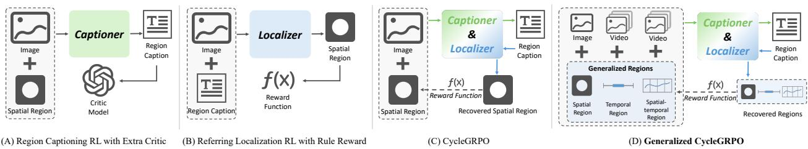  
Figure 1 From spatial CycleGRPO to Generalized CycleGRPO. (A) Region-captioning reinforcement learning relies on an extra critic to score generated descriptions. (B) Referring-localization reinforcement learning receives a rule-based geometric reward but optimizes only the localization direction. (C) Our spatial CycleGRPO closes the region–caption– localization loop and uses the overlap of the recovered spatial region as a verifiable reward. (D) This work generalizes the same cycle over spatial, temporal, and spatio-temporal regions, unifying captioning and localization for images and videos without an external critic.

Our ECCV paper introduced CycleGRPO for image regions and showed that this duality can replace textual supervision during reinforcement learning [38]. As shown in Fig. 1(C), spatial CycleGRPO couples the two directions through a closed region–caption–localization loop. Starting from a mask or box, the model generates a caption and subsequently uses that caption to localize the region in the image. Reconstruction IoU serves as a verifiable reward: descriptions are preferred when they recover the original region, while the localization rollouts are themselves optimized against the known region. This spatial formulation substantially improves both region understanding and referring localization. This leaves an open question: can the same cycle extend beyond two-dimensional images to other region spaces?

In this work, we address this question with Generalized CycleGRPO, a geometry-agnostic framework spanning spatial, temporal, and spatio-temporal region spaces. As illustrated in Fig. 1(D), we represent a region abstractly as R ∈ Ω and optimize the cycle R → C → Rb using an overlap operator defined over Ω. Defining Ω as a space of image masks or bounding boxes recovers spatial CycleGRPO. Temporal intervals yield temporal captioning and localization, while timestamped boxes, masks, or region tubes support joint when-and-where localization. The same policy plays both roles: it acts on a provided region to sample candidate descriptions, then acts as its own critic by localizing those descriptions. Group-relative optimization ranks the descriptions by reconstruction quality and trains each localization trajectory from its geometric overlap. Consequently, the reinforcement learning stage requires region annotations alone—no reference captions, external reward model, or external LLM judge.

Extending the cycle from images to videos is not a mechanical replacement of spatial IoU with temporal IoU. First, an event may recur several times in a video, so a generic but factually correct caption can ground to multiple intervals and fail to define a one-to-one correspondence. This makes temporal distinctiveness—stating the context unique to the target occurrence—central to cycle consistency. Second, visual evidence has two coupled coordinates: the model must identify when an event occurs and where its supporting objects appear. Open-o3-Video [39], for example, learns from spatio-temporal reasoning traces and produces timestamps and boxes as explicit evidence. For the first challenge, the temporal instantiation rewards a description only when it reconstructs the designated interval rather than a similar recurrence, thereby favoring occurrence-specific state, order, and outcome cues. For the second, the spatio-temporal instantiation represents a region as timestamped spatial evidence and evaluates spatial overlap only at aligned timestamps. Thus, neither a similar object at the wrong time nor the correct time without the relevant spatial evidence can satisfy the cycle.

These video settings also expose an evaluation gap. Conventional captioning metrics reward similarity to a single reference, while temporal-grounding benchmarks evaluate only the inverse direction. Neither determines whether a caption identifies its own occurrence rather than a semantically similar segment elsewhere in the same video. We therefore introduce DOVE (Distinctive Occurrence-level Video-caption Evaluation), constructed from videos containing multiple occurrences of a shared query. Its contrastive protocol measures whether a caption is faithful to its target and whether its specific facts exclude neighboring occurrences. We summarize its coverage of order, state, and outcome evidence using Temporal Evidence Coverage (TEC), which macro-averages coverage over these three probe types. DOVE complements standard grounding evaluation and directly tests the one-to-one region–text correspondence.

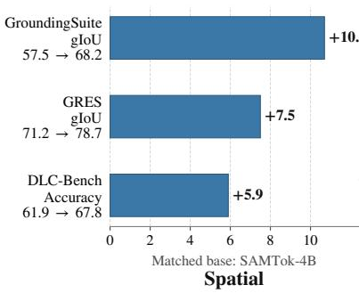

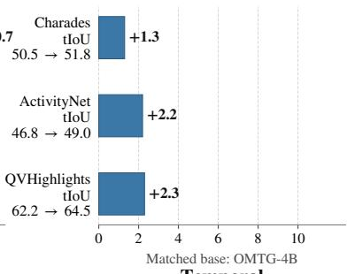  
Temporal

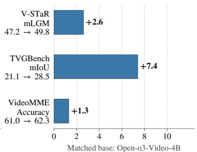  
Spatial-Temporal  
Figure 2 Improvements over the corresponding base models on spatial (left), temporal (middle), and spatio-temporal (right) benchmarks. Within each benchmark, bar lengths show gains in percentage points and labels give the base and CycleGRPO scores.

We evaluate the framework across all three region spaces. In the spatial setting, CycleGRPO raises SAMTok’s overall gIoU from 57.5% to 68.2% on GroundingSuite and its average gIoU from 71.2% to 78.7% on GRES; DLC-Bench accuracy also improves from 61.9% to 67.8%. Starting from the task-specialized OMTG-4B temporal model, Generalized CycleGRPO raises tIoU from 50.5% to 51.8% on Charades, from 46.8% to 49.0% on ActivityNet, and from 62.2% to 64.5% on QVHighlights. In the joint spatio-temporal setting, it improves Open-o3-Video-4B’s V-STaR mLGM from 47.2% to 49.8% and TVGBench mIoU from 21.1% to 28.5%, while also raising VideoMME accuracy from 61.0% to 62.3%. Together, these results show that localization is not merely a critic for language generation: both directions can be bootstrapped within one verifiable cycle, with domain-dependent gains and without reference captions in the cycle branches during reinforcement learning. Fig. 2 summarizes these gains against the task-specific matched base in each region space.

This paper extends our ECCV version in four ways:

• We extend CycleGRPO beyond the spatial masks and boxes studied in the ECCV version to a generalized region–text cycle over spatial masks/boxes, temporal intervals, and spatio-temporal trajectories, unified through region-specific serializers and consistency functions.

• We introduce temporal and spatio-temporal training instantiations in which one shared policy learns segment description, interval localization, and temporally aligned spatial evidence from region annotations alone, without reference captions or an external judge during reinforcement learning.

• We introduce DOVE, a human-verified contrastive benchmark for distinctive occurrence-level videocaption evaluation. For the first time, it measures whether segment captions distinguish their target from same-query recurrences.

• We provide comprehensive validation across the three region spaces, including single-task and reward-side ablations, backbone comparisons, and analyses of temporal distinctiveness and failure modes across more than ten benchmarks.

## 2 Related Work

Image Region Understanding and Grounding. Fine-grained image understanding and localization involve two inverse mappings. Region understanding conditions a description or answer on a designated region [40–45], as in GLaMM [30], DAM [46], and GAR [47]. Referring localization maps free-form language to a box or mask [35, 48–50], via unified architectures such as OMG-LLaVA [51] and Sa2VA [34] or discrete mask sequences [31, 52]. Our implementation builds on SAMTok [31], which represents a mask with two region tokens so that one MLLM can both consume and emit spatial regions. Supporting both directions in one architecture does not couple their learning signals: descriptions and grounded masks are optimized with diferent objectives or annotation sources. Our conference work [38] connects them through the cycle region→text→region; the present work treats this as one instance of a geometry-independent principle and extends it to temporal and spatio-temporal regions.

Temporal and Spatio-Temporal Understanding and Grounding. Early video MLLMs emphasize holistic description and question answering [53–56], with recent backbones supporting long videos and timestamp conditioning [4]. At temporal granularity, language-conditioned grounding localizes an event interval [57–62], while the inverse task describes a designated interval [32, 63, 64]. These approaches demonstrate useful interaction between localization and captioning, but learn it from paired timestamp–caption supervision in a forward prediction objective rather than from a closed, self-reconstructive region–text cycle. Spatio-temporal grounding further asks when a referred entity occurs and where it appears. Prior methods [32, 34, 65, 66] map language to tubes, decode frame-level boxes, or predict mask sequences. Moving to evidence-centered reasoning, Open-o3-Video emits timestamps and boxes alongside its answer and optimizes answer, temporal, and spatial rewards [39]. These works predominantly optimize the language→region direction using paired evidence or reasoning annotations. Our framework additionally learns the inverse region→language direction and couples the two through reconstruction in the same region space. In videos, repeated occurrences make this coupling nontrivial: a generic description may match several intervals, making temporal distinctiveness essential for faithful reconstruction.

Verifiable Reinforcement Learning and Cycle Consistency. Outcome-level feedback trains language models through preference and group-relative policy optimization [67–69]. Multimodal extensions use several forms of feedback: IoU-style rewards for detection, referring, and segmentation [70–74]; caption rewards from a separate vision-free answerer [75, 76]; and video self-evolution from temporal perturbation, discovered evidence, or internal confidence [77–79]. None, however, uses language-to-region reconstruction by the same policy to train the inverse region-to-language mapping. Reducing reliance on paired targets has also been explored through teacher-based video restoration [80] and cycle consistency [81, 82]. CycleGRPO instantiates the latter within one multimodal policy: the model describes a region, then localizes that description back as its own critic. Reconstruction overlap rewards understanding, and each localization rollout is rewarded against the known region, optimizing both directions without reference captions or an external judge during RL.

Benchmarking Fine-Grained Region--Text Correspondence. Existing video benchmarks evaluate either holistic understanding [83–86] or one direction of fine-grained correspondence: temporal-grounding benchmarks [87–90], including TimeLens [33], score localization alone, while captioning is scored by similarity to references. DLC-Bench [46] moves beyond reference matching by checking atomic facts in region captions, while CrossHOI-Bench [91] uses curated multiple-choice questions to evaluate human–object interaction recognition across VLMs and specialized methods. None of these protocols tests what a temporal region–text cycle requires: whether a caption is faithful to its own interval and discriminative against similar recurrences in the same video. Our DOVE benchmark fills this gap with human-verified repeated-occurrence groups and private Order, State, and Outcome probes. A fixed text-only judge determines whether each target-conditioned caption supports the correct answer, supports a wrong answer, or provides insuficient evidence. This yields a probe-level assessment without reference matching or holistic grading.

## 3 Generalized CycleGRPO

We first formulate region captioning and localization over a generic region space, and then present the nested rollout and joint optimization used by Generalized CycleGRPO. Our formulation separates the learning principle from the representation of a region: masks, boxes, temporal intervals, and spatio-temporal tubes may use diferent serializations and consistency functions, but they enter the same region–text–region cycle, as summarized in Fig. 3.

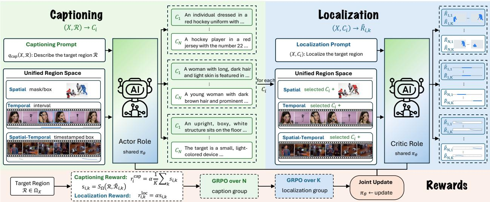  
Figure 3 Overview of Generalized CycleGRPO. Given a visual input X and a target region R in a unified region space, the captioning rollout samples N candidate descriptions $C _ { i }$ . Each candidate then conditions K localization rollouts that reconstruct regions $\bar { \mathcal { R } } _ { i , k } ;$ their agreement with the target provides the cycle-consistency signal. Spatial masks or boxes, temporal intervals, and spatio-temporal timestamped boxes difer only in their region serialization and consistency function, allowing the same region–text–region optimization to operate across image and video tasks.

## 3.1 Region--Text Duality over Measurable Spaces

Let X denote a visual input, either an image or a video, and let $\Omega _ { X }$ denote its admissible region space. A target region is written as $\mathcal { R } \in \Omega _ { X }$ . Depending on the task, R may be a two-dimensional mask or box, a subset of the video timeline, or spatial support that varies over time. We assume that $\Omega _ { X }$ provides (i) a serialization through which a multimodal large language model can consume and emit a region, and (ii) a bounded consistency function

$$
S _ { \Omega } ( { \mathcal { R } } , { \widehat { \mathcal { R } } } ) \in [ 0 , 1 ] , \qquad S _ { \Omega } ( { \mathcal { R } } , { \mathcal { R } } ) = 1 ,\tag{1}
$$

which measures how well a predicted region $\widehat { \mathcal { R } }$ recovers R. This score is a geometric overlap whenever the representation supports direct decoding; compact region tokens may instead use a token-consistency surrogate during training.

Region captioning and localization are inverse conditional mappings over this space. Given X and R, region understanding generates a natural language description C; given X and C, localization reconstructs a region Rb:

$$
( X , { \mathcal { R } } ) \ { \xrightarrow { \ f _ { \theta } \ } } C , \qquad ( X , C ) \ { \xrightarrow { \ g _ { \theta } \ } } { \widehat { \mathcal { R } } } .\tag{2}
$$

Both mappings are implemented by the same autoregressive policy $\pi _ { \theta }$ , with task-specific instruction templates. Region outputs are decoded by the serializer associated with $\Omega _ { X } ;$ no task-specific critic or reward model is introduced. The central premise is that a useful region description should be suficiently faithful and discriminative to recover its source:

$$
\mathcal { R }  C  \widehat { \mathcal { R } } , \qquad \widehat { \mathcal { R } } \simeq \mathcal { R } .\tag{3}
$$

Our conference formulation instantiates this premise for image regions [38]. Generalized CycleGRPO makes the region space explicit and applies the same learning rule wherever Eq. 1 applies.

The claim of annotation eficiency applies to the reinforcement learning stage. Starting from a multimodal policy with the two required output interfaces, each CycleGRPO example contains only $( X , { \mathcal { R } } ) { \mathrm { : } }$ ; it does not contain a reference description. The target region therefore supervises both directions through the cycle, without a ground-truth caption, an external LLM judge, or a learned reward model.

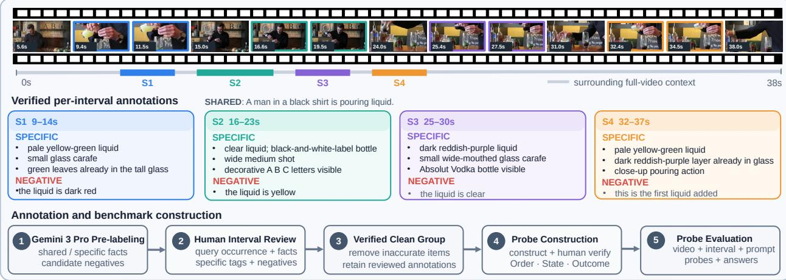  
Figure 4 Construction and evaluation of DOVE. Candidate intervals are pre-labeled, human-reviewed, and converted into private temporal probes. A text-only judge then evaluates captions for specified intervals using Order, State, and Outcome probes.

## 3.2 Nested Region--Text--Region Rollouts

For a training pair (X, R), we construct a region-understanding prompt $\scriptstyle q _ { \mathrm { c a p } } ( X , { \mathcal { R } } )$ and sample N candidate descriptions from the rollout policy:

$$
C _ { i } \sim \pi _ { \theta _ { \mathrm { o l d } } } \big ( \cdot \mid q _ { \mathrm { c a p } } ( X , { \mathcal { R } } ) \big ) , \qquad i = 1 , \dots , N .\tag{4}
$$

These candidates are semantic hypotheses about the same target region. They need not resemble a particular reference sentence; their quality is determined by whether the policy can use them to recover the target.

Each candidate then conditions a group of inner localization rollouts. We build $q _ { \mathrm { l o c } } ( X , C _ { i } )$ and independently sample K region predictions:

$$
\widehat { \mathcal { R } } _ { i , k } \sim \pi _ { \theta _ { \mathrm { o l d } } } \big ( \cdot \mid q _ { \mathrm { l o c } } ( X , C _ { i } ) \big ) , \qquad k = 1 , \ldots , K .\tag{5}
$$

The model thus acts first as a description policy and then as its own critic through localization. For every inner trajectory, we compute

$$
s _ { i , k } = S _ { \Omega } \mathopen { } \mathclose \bgroup \left( \mathcal { R } , \widehat { \mathcal { R } } _ { i , k } \aftergroup \egroup \right) , \qquad \bar { s } _ { i } = \frac { 1 } { K } \sum _ { k = 1 } ^ { K } s _ { i , k } .\tag{6}
$$

Multiple inner rollouts are important because a single autoregressive decoding may select one of several plausible modes. Averaging over these rollouts estimates how reliably $C _ { i }$ identifies the source region.

This construction uses region reconstruction to evaluate generated descriptions. A hallucinated description tends to reconstruct an unrelated region, while an overly generic description can be compatible with multiple objects or moments and therefore cannot reliably return to the designated one. This latter case is especially common in videos containing repeated instances of the same action. Maximizing $\bar { s } _ { i }$ consequently places implicit pressure on descriptions to mention the context that distinguishes the target occurrence. To prevent direct coordinate copying from becoming a shortcut, we impose representation-specific anti-leakage constraints. In the temporal instantiation, for example, we penalize explicit timestamps in the caption and remove them before constructing the localization prompt.

## 3.3 Cycle Rewards and Joint GRPO Optimization

The same consistency measurements provide rewards for both stages. We define the caption reward as

$$
\begin{array} { r } { r _ { i } ^ { \mathrm { c a p } } = \alpha \bar { s } _ { i } + \Phi _ { \mathrm { c a p } } ( C _ { i } ) , } \end{array}\tag{7}
$$

where α controls the scale of the cycle signal and $\Phi _ { \mathrm { c a p } }$ contains only reference-free validity terms, such as anti-leakage and repetition checks. Each localization trajectory receives

$$
r _ { i , k } ^ { \mathrm { l o c } } = \alpha s _ { i , k } + \Phi _ { \mathrm { l o c } } ( \widehat { \mathcal { R } } _ { i , k } ) ,\tag{8}
$$

where $\Phi _ { \mathrm { l o c } }$ checks whether the predicted region follows the required serialization. Localization advantages are normalized within the K rollouts conditioned on a fixed parent caption, so these samples compete on their own consistency with the target under the same linguistic description. Cross-caption credit is supplied by Eq. 7. In the temporal implementation, an additional multiplicative gate downweights the overlap term when the number of predicted intervals is invalid. None of these auxiliary terms requires reference text.

We use group-relative advantages separately for the two nested levels. The N descriptions of one target form a caption group, giving

$$
A _ { i } ^ { \mathrm { c a p } } = \frac { r _ { i } ^ { \mathrm { c a p } } - \mu _ { \mathrm { c a p } } } { \sigma _ { \mathrm { c a p } } + \delta } ,\tag{9}
$$

where $\mu _ { \mathrm { c a p } }$ and $\sigma _ { \mathrm { c a p } }$ are computed over $\{ r _ { j } ^ { \mathrm { c a p } } \} _ { j = 1 } ^ { N }$ . For localization, the K trajectories conditioned on the same parent caption form their own group:

$$
A _ { i , k } ^ { \mathrm { l o c } } = \frac { r _ { i , k } ^ { \mathrm { l o c } } - \mu _ { i , \mathrm { l o c } } } { \sigma _ { i , \mathrm { l o c } } + \delta } ,\tag{10}
$$

with statistics taken over $k = 1 , \ldots , K$ . This grouping preserves the semantics of both comparisons: descriptions compete on their ability to close the cycle, whereas localization samples compete on localization accuracy under a fixed description.

For either task d ∈ {cap, loc}, let y denote a sampled response and $A _ { y } ^ { d }$ its group-relative advantage. For the task-specific input q, the token-level importance ratio is

$$
\rho _ { y , t } = { \frac { \pi _ { \theta } ( y _ { t } \mid q , y _ { < t } ) } { \pi _ { \theta _ { \mathrm { o l d } } } ( y _ { t } \mid q , y _ { < t } ) } } .\tag{11}
$$

The same response-level advantage is used for every token in y. We optimize the clipped GRPO objective [69] over valid response tokens:

$$
\begin{array} { r l } & { { \mathcal { I } _ { d } ( \theta ) } = \mathbb { E } \Bigg [ \frac { \sum _ { y \in { \mathcal { G } _ { d } } } \sum _ { t = 1 } ^ { | y | } { \ell _ { d } ( y , t ) } } { \sum _ { y \in { \mathcal { G } _ { d } } } | y | } - \beta { \mathcal { D } _ { \mathrm { K L } } } \Bigg ] , } \\ & { { \ell _ { d } ( y , t ) } = \operatorname* { m i n } \{ \rho _ { y , t } A _ { y } ^ { d } , \mathrm { c l i p } ( \rho _ { y , t } , 1 - \epsilon _ { l } , 1 + \epsilon _ { h } ) A _ { y } ^ { d } \} . } \end{array}\tag{12}
$$

Here, |y| counts valid response tokens, excluding prompt and padding tokens. The KL regularizer against $\pi _ { \mathrm { r e f } }$ is estimated at token level and averaged over the same valid tokens. For the temporal and spatiotemporal experiments, we additionally use dual clipping: when $A _ { y } ^ { d } < 0 , \ell _ { d } ( y , t )$ in Eq. 12 is replaced by max $\{ \ell _ { d } ( y , t ) , c A _ { y } ^ { d } \}$ , where $c > 1$ . The clipping parameters are provided in the appendix. The captioning and localization batches share model parameters. Their gradients are accumulated before one optimizer step, using

$$
\mathcal { I } _ { \mathrm { C y c l e G R P O } } = \lambda _ { \mathrm { c a p } } \mathcal { I } _ { \mathrm { c a p } } + \lambda _ { \mathrm { l o c } } \mathcal { I } _ { \mathrm { l o c } } .\tag{13}
$$

We use equal task weights unless stated otherwise. Thus localization is not merely a frozen scoring module: its sampled trajectories are also optimized against the known region. Their aggregate accuracy, in turn, supplies a reference-free reward for region understanding.

## 3.4 Instantiations across Region Spaces

Generalized CycleGRPO changes only the region interface and consistency function across domains; Eqs. 4–13 remain unchanged.

Spatial regions. For an $H \times W$ image, $\mathcal { R } \in \{ 0 , 1 \} ^ { H \times W }$ is a mask or $\mathcal { R } \in [ 0 , 1 ] ^ { 4 }$ a normalized box. Our mask-based implementation uses SAMTok [31] to quantize a mask into a compact sequence in the MLLM vocabulary, allowing the same policy to consume and emit masks without an external segmentation head. Mask-token agreement provides an eficient training-time consistency surrogate; decoded mask IoU or box IoU can be used when the representation exposes geometry directly. This recovers the spatial CycleGRPO formulation of our conference work [38].

Table 1 Results on two inverse spatial tasks. Left: mask-to-text accuracy on DLC-Bench [46]. Right: text-to-mask gIoU on GroundingSuite [31]. All values are percentages. † denotes training on the in-domain DAM-1.5M data.
<table><tr><td>Method</td><td>Size</td><td> $\mathrm { P o s . }$ </td><td> ${ \mathrm { N e g . } }$ </td><td> ${ \mathrm { A v g . } }$ </td></tr><tr><td>GPT-4o [92]</td><td></td><td>43.4</td><td>79.6</td><td>61.5</td></tr><tr><td>Gemini 2.5 Pro [93]</td><td></td><td>36.5</td><td>75.2</td><td>55.8</td></tr><tr><td>VP-SPHINX [94]</td><td>13B</td><td>26.3</td><td>71.6</td><td>49.0</td></tr><tr><td>DAM† [46]</td><td>3B</td><td>52.3</td><td>82.2</td><td>67.3</td></tr><tr><td>SAMTok [31]</td><td>4B</td><td>43.5</td><td>80.4</td><td>61.9</td></tr><tr><td>+ Ours</td><td>4B</td><td>52.4</td><td>83.2</td><td>67.8</td></tr><tr><td>∆ vs. SAMTok</td><td></td><td></td><td></td><td> $+ 8 . 9 ~ + 2 . 8 ~ + 5 . 9$ </td></tr></table>

<table><tr><td>Method</td><td>Size</td><td>Stuff</td><td>Part</td><td>Multi</td><td>Single</td><td>All</td></tr><tr><td>LISA [49]</td><td>7B</td><td>85.2</td><td>21.2</td><td>71.5</td><td>42.8</td><td>57.6</td></tr><tr><td>GLaMM [30]</td><td>7B</td><td>86.9</td><td>16.5</td><td>70.4</td><td>42.1</td><td>57.2</td></tr><tr><td>EVF-SAM [95]</td><td>1B</td><td>85.1</td><td>23.1</td><td>72.1</td><td>54.5</td><td>62.6</td></tr><tr><td>InstructSeg [96]</td><td>3B</td><td>56.2</td><td>24.2</td><td>66.8</td><td>51.3</td><td>52.5</td></tr><tr><td>SAMTok [31]</td><td>4B</td><td>80.9</td><td>12.4</td><td>62.0</td><td>52.9</td><td>57.5</td></tr><tr><td>+ Ours</td><td>4B</td><td>90.5</td><td>21.2</td><td>78.3</td><td>62.3</td><td>68.2</td></tr><tr><td>∆ vs. SAMTok</td><td></td><td>+9.6</td><td>+8.8</td><td>+16.3</td><td>+9.4</td><td>+10.7</td></tr></table>

Temporal regions. For a video of duration T, $\mathcal { R } \in [ 0 , T ] ^ { L \times 2 }$ stacks L intervals $( t _ { \ell } ^ { \mathrm { s } } , t _ { \ell } ^ { \mathrm { e } } )$ . The model consumes and emits timestamp strings, and consistency is temporal IoU:

$$
S _ { \mathrm { T } } ( \mathcal { R } , \widehat { \mathcal { R } } ) = \frac { \Big | \mathcal { R } \cap \widehat { \mathcal { R } } \Big | } { \Big | \mathcal { R } \cup \widehat { \mathcal { R } } \Big | } ,\tag{14}
$$

where | · | denotes temporal duration and overlapping intervals are merged before measurement. The outer mapping describes the content of a designated interval; the inner mapping searches the full video for that description. The cycle therefore couples temporal captioning and temporal localization without using a reference caption during reinforcement learning.

Spatio-temporal regions. Our video experiments represent sparse evidence as $\mathcal { R } = \{ ( t _ { a } , S _ { a } ) \} _ { a = 1 } ^ { A }$ 1 and $\widehat { \mathcal { R } } = \{ ( \widehat { t } _ { b } , \widehat { S } _ { b } ) \} _ { b = 1 } ^ { B }$ , where each S is a normalized box, giving tensor shapes $A \times 5$ and $B \times 5$ . Let $\mathcal { M } ^ { \ast }$ be the maximum-weight one-to-one matching between predicted and target anchors, where the pair weight is $| S _ { a } \cap \widehat { S } _ { b } |$ and is set to zero whenever $\vert t _ { a } - \widehat { t } _ { b } \vert > \tau$ . We compute the joint support overlap as

$$
\begin{array} { c } { { \displaystyle I _ { \mathrm { S T } } = \sum _ { ( a , b ) \in \mathcal { M } ^ { * } } | S _ { a } \cap \widehat { S } _ { b } | , } } \\ { { \displaystyle S _ { \mathrm { S T } } ( \mathcal { R } , \widehat { \mathcal { R } } ) = \frac { I _ { \mathrm { S T } } } { \sum _ { a } | S _ { a } | + \sum _ { b } | \widehat { S } _ { b } | - I _ { \mathrm { S T } } } . } } \end{array}\tag{15}
$$

We use $\tau = 3$ seconds. The one-to-one constraint prevents duplicate predictions from reusing the same annotated evidence, while unmatched or extra anchors remain in the union. Consequently, a visually similar object at the wrong moment contributes no intersection, and a temporally aligned anchor with an inaccurate box is also penalized. This instantiation closes the cycle over explicit when-and-where evidence and requires structured spatio-temporal regions, but no paired textual descriptions, during reinforcement learning.

## 4 DOVE

## 4.1 Task Definition

Existing temporal-captioning benchmarks typically compare a generated caption with one or more references. This can reward a generally plausible description that fails to identify the designated moment, especially when the same person, action, or scene recurs in a long video. DOVE (Distinctive Occurrence-level Video-caption Evaluation) instead asks whether a caption preserves the temporal evidence that identifies one specified occurrence among visually similar events. Each benchmark group is a tuple $\mathcal { G } = ( V , q , \{ S _ { i } \} _ { i = 1 } ^ { K } )$ , where V is a source video, q is a shared natural-language query, and the $K$ non-overlapping intervals are distinct occurrences of q. For every target $S _ { i } ,$ the remaining intervals are same-video, same-query sibling distractors. DOVE is method-agnostic and complements one-to-many temporal grounding [99]: grounding finds the occurrences, whereas DOVE tests whether a description preserves what makes one occurrence diferent from the others.

Table 2 Results on GAR-Bench-VQA [47]. We report accuracy (%) for fine-grained regional perception and reasoning. † denotes thinking mode.
<table><tr><td rowspan="2">Method</td><td rowspan="2"></td><td rowspan="2">Size Overall</td><td colspan="4">Perception</td><td colspan="3">Reasoning</td></tr><tr><td>Color</td><td></td><td>Shape Texture</td><td>Material</td><td>Position</td><td>Non-Entity</td><td>Relation</td></tr><tr><td>GPT-4o [92]</td><td></td><td>53.5</td><td>34.8</td><td>65.3</td><td>48.3</td><td>52.8</td><td>57.8</td><td>60.2</td><td>61.4</td></tr><tr><td>o3† [97]</td><td></td><td>61.3</td><td>58.0</td><td>70.3</td><td>55.2</td><td>63.9</td><td>54.7</td><td>49.2</td><td>71.3</td></tr><tr><td>Gemini-2.5-Pro† [93]</td><td></td><td>64.2</td><td>62.3</td><td>68.8</td><td>58.6</td><td>66.7</td><td>64.1</td><td>64.9</td><td>70.3</td></tr><tr><td>Qwen2.5-VL [4]</td><td>3B</td><td>34.4</td><td>29.0</td><td>25.0</td><td>34.5</td><td>30.6</td><td>43.8</td><td>26.2</td><td>44.6</td></tr><tr><td>Qwen2.5-VL [4]</td><td>7B</td><td>41.7</td><td>39.1</td><td>40.6</td><td>44.8</td><td>27.8</td><td>59.4</td><td>36.1</td><td>40.6</td></tr><tr><td>Qwen2.5-VL [4]</td><td>32B</td><td>50.9</td><td>46.4</td><td>53.1</td><td>41.4</td><td>30.6</td><td>71.9</td><td>36.1</td><td>58.4</td></tr><tr><td>InternVL3 [98]</td><td>2B</td><td>35.1</td><td>30.4</td><td>21.9</td><td>48.3</td><td>38.9</td><td>48.4</td><td>26.2</td><td>38.6</td></tr><tr><td>InternVL3 [98]</td><td>8B</td><td>38.9</td><td>36.2</td><td>37.5</td><td>58.6</td><td>41.7</td><td>51.6</td><td>27.9</td><td>33.6</td></tr><tr><td>InternVL3 [98]</td><td>32B</td><td>46.5</td><td>39.1</td><td>40.6</td><td>51.7</td><td>55.6</td><td>60.9</td><td>36.1</td><td>47.5</td></tr><tr><td>Sa2VA [34]</td><td>8B</td><td>34.3</td><td>39.1</td><td>45.3</td><td>29.6</td><td>30.6</td><td>54.7</td><td>21.3</td><td>21.8</td></tr><tr><td>VP-SPHINX [94]</td><td>13B</td><td>37.5</td><td>33.3</td><td>25.0</td><td>44.8</td><td>38.9</td><td>60.9</td><td>34.3</td><td>32.7</td></tr><tr><td>DAM [46]</td><td>3B</td><td>38.2</td><td>55.1</td><td>39.1</td><td>41.4</td><td>36.1</td><td>31.3</td><td>36.1</td><td>31.7</td></tr><tr><td>GAR [47]</td><td>1B</td><td>50.6</td><td>55.1</td><td>46.9</td><td>69.0</td><td>47.2</td><td>21.9</td><td>62.3</td><td>56.4</td></tr><tr><td>GAR [47]</td><td>8B</td><td>59.9</td><td>59.4</td><td>54.7</td><td>75.9</td><td>52.8</td><td>48.4</td><td>60.7</td><td>68.3</td></tr><tr><td>SAMTok [31]</td><td>4B</td><td>64.2</td><td>58.0</td><td>48.4</td><td>48.3</td><td>58.3</td><td>76.6</td><td>54.1</td><td>83.2</td></tr><tr><td>+ Ours</td><td>4B</td><td>64.9</td><td>60.9</td><td>50.0</td><td>48.3</td><td>61.1</td><td>73.4</td><td>54.1</td><td>84.2</td></tr><tr><td>∆ vs. SAMTok</td><td></td><td>+0.7</td><td>+2.9</td><td>+1.6</td><td>+0.0</td><td>+2.8</td><td>-3.2</td><td>+0.0</td><td>+1.0</td></tr></table>

## 4.2 Benchmark Construction

Source collection and structural filtering. We draw candidate groups in approximately equal proportions from Cosmos-Cap, Moment-10M [59], and VTimeLLM [57]. We remove source videos appearing in our training or existing test sets before annotation. A candidate must contain two to five valid intervals for the same query. We discard malformed and duplicate intervals, intervals covering more than half of the video, and near-duplicate pairs whose temporal IoU exceeds 0.5 or for which either interval is more than 80% contained in the other. We retain one query per video, selecting the query with the largest number of valid occurrences and breaking ties by total annotated duration. This produces a balanced pool of 800 candidate groups (2,267 intervals), with 267/267/266 groups from the three sources.

Gemini pre-labeling and human review. We use Gemini 3 Pro [100] to propose, but not certify, per-interval annotations. It receives timestamped frames sampled inside every candidate interval together with sparse context frames from the full video, the shared query, and all interval boundaries. For each interval, it predicts whether the queried event occurs, proposes positive facts tagged as shared or specific, and generates plausible-but-absent negatives. Providing all intervals jointly is essential because specificity is defined within a group. Human verification involves multiple rounds of review and correction: reviewers first verify the occurrences, interval distinctness, facts, tags, and negatives, and then re-examine each retained group jointly to resolve cross-interval inconsistencies, revise shared/specific assignments, and remove ambiguous or unsupported items. Cases flagged during subsequent probe construction are returned for further group-level review and correction. A group is retained only when at least two fully reviewed intervals remain after these iterations.

Temporal probe construction. For each retained interval, we construct private multiple-choice probes along three axes. Order asks what happens before or after an anchor action; State asks how an actor or object changes; and Outcome asks for the visible result that identifies the occurrence. Each probe must require evidence from multiple frames, have one unambiguous answer, and avoid audio-dependent or purely static cues. The probes and answers undergo an additional round of human verification and correction, including checks against both the target interval and its sibling distractors, and are frozen before we inspect captions from the evaluated models

Benchmark statistics. The human-reviewed benchmark contains 180 source-video/query groups and 530 target intervals; every group comes from a distinct source video. It comprises 82 groups from Cosmos-Cap,

Table 3 Results on interleaved text-mask generation on GCG [30] (left) and generalized referring expression segmentation on GRES [48] (right). GCG entries are Val / Test. For GRES, split entries are Val / Test $\mathrm { ~ A ~ } /$ Test B and averages are reported separately; N-acc denotes no-target accuracy.
<table><tr><td rowspan="2">Method</td><td rowspan="2"> $\mathrm { S i z e }$ </td><td colspan="2">METEOR</td><td colspan="2">CIDEr</td><td colspan="2"> $\mathrm { A P { 5 0 } }$ </td><td colspan="2">mIoU</td><td colspan="2">Recall</td></tr><tr><td>Val</td><td>Test</td><td>Val</td><td>Test</td><td>Val</td><td>Test</td><td>Val</td><td>Test</td><td>Val</td><td>Test</td></tr><tr><td>LISA [49]</td><td>7B</td><td>13.0</td><td>12.9</td><td>33.9</td><td>32.2</td><td>25.2</td><td>24.8</td><td>62.0</td><td>61.7</td><td>36.3</td><td>35.5</td></tr><tr><td>GLaMM [30]</td><td>7B</td><td>16.2</td><td>15.8</td><td>47.2</td><td>43.5</td><td>30.8</td><td>29.2</td><td>66.3</td><td>65.6</td><td>41.8</td><td>40.8</td></tr><tr><td>OMG-LLaVA [51]</td><td>7B</td><td>14.9</td><td>14.5</td><td>41.2</td><td>38.5</td><td>29.9</td><td>28.6</td><td>65.6</td><td>64.7</td><td></td><td></td></tr><tr><td>Sa2VA [34]</td><td>8B</td><td>16.4</td><td>16.2</td><td>49.5</td><td>49.0</td><td>33.2</td><td>32.2</td><td>67.7</td><td>66.8</td><td>45.1</td><td>44.5</td></tr><tr><td>SAMTok [31]</td><td>4B</td><td>16.1</td><td>/16.4</td><td>48.2</td><td>/51.4</td><td>34.7</td><td>34.4</td><td>69.4</td><td>68.4</td><td>46.6</td><td>48.3</td></tr><tr><td>+ Ours</td><td>4B</td><td>17.3 / 17.2</td><td></td><td>54.3 / 53.7</td><td></td><td></td><td>36.8 / 35.0</td><td></td><td>70.2 / 69.2</td><td></td><td>50.2 / 49.8</td></tr><tr><td>∆ vs. SAMTok</td><td></td><td>+1.2</td><td>+0.8 +6.1</td><td></td><td>+2.3 +2.1</td><td></td><td>+0.6 +0.8</td><td></td><td>+0.8 +3.6</td><td></td><td>+1.5</td></tr></table>

<table><tr><td rowspan="2">Method</td><td rowspan="2">Size</td><td colspan="10">Val / Test A</td><td rowspan="2">Avg.</td></tr><tr><td colspan="3">gIoU</td><td colspan="3">cIoU</td><td colspan="3"> $\mathrm { N - a c c }$ </td></tr><tr><td>LISA [49]</td><td>7B</td><td>61.6</td><td>66.3</td><td>58.8</td><td>61.8</td><td>68.5</td><td>60.6</td><td> $5 4 . 7 \ : / \ : 5 0 . 0 \ : / \ : 5 1 . 9$ </td><td></td><td>62.2 63.6</td><td></td><td>52.2</td></tr><tr><td>SAM4MLLM [101]</td><td>8B</td><td>71.9</td><td>74.2</td><td>65.3</td><td>67.8</td><td>72.2</td><td>63.4</td><td>66.1 / 63.9 / 60.0</td><td></td><td>70.5</td><td>67.8</td><td>63.3</td></tr><tr><td>MLLMSeg [102]</td><td>8B</td><td>75.1</td><td>77.0</td><td>69.7</td><td>71.6</td><td>76.9</td><td>68.5</td><td>73.2 / 72.4 / 65.5</td><td></td><td>73.9</td><td>72.3</td><td>70.4</td></tr><tr><td>HiMTok [52]</td><td>8B</td><td>72.1</td><td>73.5</td><td>71.7</td><td>70.4</td><td>74.9</td><td>72.0</td><td></td><td></td><td>72.4</td><td>72.4</td><td></td></tr><tr><td>ARGenSeg [103]</td><td>8B</td><td>74.7</td><td>73.7</td><td>72.4</td><td>72.2</td><td>73.6</td><td>70.4</td><td> $\begin{array} { c } { { - / - / - } } \\ { { - / - / - } } \end{array}$ </td><td></td><td>73.6 72.1</td><td></td><td></td></tr><tr><td>SAMTok [31]</td><td>4B</td><td>71.3</td><td>75.3</td><td>/66.9</td><td> $6 9 . 2 \textrm { / } 7 5 . 4 \textrm { / } 6 6 . 0$ </td><td></td><td></td><td>61.4 / 59.0</td><td>/ 55.6</td><td>71.2 70.2</td><td></td><td>58.7</td></tr><tr><td>+ Ours</td><td>4B</td><td></td><td>82.2 / 80.3 / 73.5</td><td></td><td></td><td>74.8 / 78.2 | 70.2</td><td></td><td>94.7 / 93.0 / 89.9</td><td></td><td>78.7 74.4</td><td></td><td>92.5</td></tr><tr><td>∆ vs. SAMTok</td><td></td><td>+10.9</td><td>+5.0</td><td>/ +6.6 +5.6</td><td></td><td>/+2.8</td><td></td><td>/ +4.2 +33.3 / +34.0 / +34.3 +7.5 +4.2 +33.8</td><td></td><td></td><td></td><td></td></tr></table>

Table 4 One-to-one temporal grounding results on Charades-STA [87], ActivityNet Captions [88], and QVHighlights [89]. We report Recall@1 at temporal IoU thresholds of 0.3, 0.5, and 0.7, together with temporal IoU (tIoU), averaged over examples.
<table><tr><td rowspan="2">Model</td><td rowspan="2">Size</td><td rowspan="2"></td><td colspan="4">Charades</td><td colspan="4">ActivityNet</td><td colspan="4">QVHighlights</td></tr><tr><td>R1@0.3 R1@0.5 R1@0.7 tIoU R1@0.3 R1@0.5 R1@0.7 tIoU R1@0.3 R1@0.5 R1@0.7 tIoU</td><td></td><td></td><td></td><td></td><td></td><td></td><td></td><td></td><td></td><td></td></tr><tr><td>GPT-4o [92]</td><td></td><td>60.6</td><td>44.5</td><td>23.5</td><td>41.8</td><td>55.2</td><td>41.4</td><td>25.8</td><td>40.4</td><td>69.0</td><td>54.8</td><td>38.5</td><td>52.1</td></tr><tr><td>GPT-5 [104]</td><td></td><td>59.3</td><td>42.0</td><td>22.0</td><td>40.5</td><td>57.4</td><td>44.9</td><td>30.4</td><td>42.9</td><td>72.4</td><td>60.4</td><td>46.4</td><td>56.8</td></tr><tr><td>Gemini-2.5-Pro [105]</td><td></td><td>74.1</td><td>61.1</td><td>34.0</td><td>52.8</td><td>72.3</td><td>64.2</td><td>47.1</td><td>58.1</td><td>84.1</td><td>75.9</td><td>61.1</td><td>70.4</td></tr><tr><td>VideoChat-Flash [106]</td><td>7B</td><td>60.2</td><td>37.9</td><td>17.8</td><td>39.7</td><td>35.5</td><td>21.8</td><td>10.5</td><td>24.8</td><td>45.2</td><td>30.6</td><td>16.7</td><td>32.7</td></tr><tr><td>VideoChat-R1 [107]</td><td>7B</td><td>51.9</td><td>30.8</td><td>11.7</td><td>33.7</td><td>35.0</td><td>23.9</td><td>11.3</td><td>25.0</td><td>29.3</td><td>19.1</td><td>9.4</td><td>21.5</td></tr><tr><td>Time-R1 [108]</td><td>7B</td><td>57.9</td><td>32.0</td><td>16.9</td><td>36.6</td><td>44.8</td><td>31.0</td><td>19.0</td><td>33.1</td><td>65.8</td><td>51.5</td><td>36.1</td><td>49.2</td></tr><tr><td>Qwen2.5-VL [4]</td><td>7B</td><td>59.7</td><td>37.8</td><td>16.6</td><td>39.3</td><td>44.1</td><td>31.0</td><td>16.1</td><td>31.4</td><td>41.5</td><td>27.8</td><td>15.2</td><td>31.6</td></tr><tr><td>TimeLens [33]</td><td>7B</td><td>70.5</td><td>55.6</td><td>28.4</td><td>48.8</td><td>62.8</td><td>51.0</td><td>32.6</td><td>46.2</td><td>74.1</td><td>62.7</td><td>43.1</td><td>56.0</td></tr><tr><td>Qwen3-VL [5]</td><td>8B</td><td>69.2</td><td>53.4</td><td>27.5</td><td>48.3</td><td>62.1</td><td>51.2</td><td>34.4</td><td>46.8</td><td>74.2</td><td>64.6</td><td>49.3</td><td>59.4</td></tr><tr><td>Qwen3-VL [5]</td><td>4B</td><td>67.1</td><td>47.5</td><td>24.1</td><td>45.6</td><td>62.9</td><td>51.0</td><td>34.3</td><td>47.2</td><td>77.6</td><td>66.0</td><td>50.9</td><td>61.7</td></tr><tr><td>+ Ours</td><td>4B</td><td>74.8</td><td>58.6</td><td>30.7</td><td>51.9</td><td>63.5</td><td>54.1</td><td>36.8</td><td>49.2</td><td>75.4</td><td>65.9</td><td>51.0</td><td>61.8</td></tr><tr><td>∆ vs. Qwen3-VL</td><td></td><td>+7.7</td><td>+11.1</td><td>+6.6</td><td>+6.3</td><td>+0.6</td><td>+3.1</td><td>+2.5</td><td>+2.0</td><td>-2.2</td><td>-0.1</td><td>+0.1</td><td>+0.1</td></tr><tr><td>OMTG [99]</td><td>4B</td><td>72.0</td><td>58.3</td><td>32.0</td><td>50.5</td><td>64.7</td><td>54.6</td><td>37.0</td><td>46.8</td><td>80.9</td><td>70.4</td><td>53.5</td><td>62.2</td></tr><tr><td>+ Ours</td><td>4B</td><td>72.9</td><td>60.2</td><td>32.7</td><td>51.8</td><td>65.4</td><td>55.5</td><td>37.6</td><td>49.0</td><td>80.4</td><td>70.9</td><td>53.7</td><td>64.5</td></tr><tr><td>∆ vs. OMTG</td><td></td><td>+0.9</td><td>+1.9</td><td>+0.7</td><td>+1.3</td><td>+0.7</td><td>+0.9</td><td>+0.6</td><td>+2.2</td><td>-0.5</td><td>+0.5</td><td>+0.2</td><td>+2.3</td></tr></table>

36 from Moment-10M, and 62 from VTimeLLM. It includes $9 1 / 4 1 / 1 5 / 3 3$ groups with two/three/four/five repeated occurrences, respectively. After cleaning, the annotations contain 2,602 positive facts (1,178 shared and 1,424 specific) and 2,056 plausible negatives. The final evaluation set contains 1,223 human-verified temporal probes: 469 Order, 420 State, and 334 Outcome questions. These probes cover 529 of the 530 target intervals; the remaining interval has no retained probe and is excluded from the reported metrics. Additional duration, semantic-domain, and structural dificulty statistics are provided in Appendix E.

## 4.3 Evaluation Protocol

Each model receives frames sampled across the full video and a prompt specifying the target interval $S _ { i } .$ . Sibling annotations, private probes, and answers are never exposed. The model produces a free-form caption $C _ { i }$ . A fixed text-only judge, Qwen2.5-72B-Instruct, then reads $C _ { i }$ with each private probe and determines whether the caption supports the correct choice, supports a wrong choice, or does not contain enough information; the judge never sees the video. We report temporal coverage (Temp-Cov), the fraction of probes whose correct answers are supported by the caption; clip completeness (Clip-Complete), the fraction of intervals for which the correct answers to all probes are supported; and separate Order, State, and Outcome coverage, together with the not-mentioned rate (N/M). Our primary aggregate metric is Temporal Evidence Coverage (TEC), defined as the macro-average of Order, State, and Outcome coverage. All methods use the same public prompt, frozen probes, judge, and decoding protocol.

Statistical comparison. Because clips and probes within a group share one source video and same-query distractors, we compute paired 95% percentile bootstrap intervals by resampling whole source-video/query groups (20,000 replicates), never individual clips or probes. For the primary comparison against the shared Qwen3-VL initialization, CycleGRPO improves TEC by 18.5 percentage points (95% CI: 15.8–21.3), Temp-Cov by 18.7 points (15.9–21.5), and Clip-Complete by 9.1 points (6.4–11.9).

Table 5 Temporal captioning results on DOVE. Temp-Cov is the percentage of probes whose correct answers are supported by the caption; Clip-Complete is the percentage of intervals with all answers supported; and Order, State, and Outcome report type-specific coverage. N/M denotes unmentioned probes, while Temporal Evidence Coverage (TEC) is the macro-average of Order, State, and Outcome coverage. All values are percentages.
<table><tr><td>Model</td><td>Size Temp-Cov↑</td><td></td><td>Clip-Complete↑</td><td>Order↑</td><td>State↑</td><td>Outcome↑</td><td>N/M↓</td><td>TEC↑</td></tr><tr><td>GPT-5.6-sol</td><td></td><td>17.3</td><td>5.9</td><td>16.4</td><td>17.9</td><td>17.7</td><td>71.1</td><td>17.3</td></tr><tr><td>TRACE-Uni</td><td></td><td>2.0</td><td>0.6</td><td>1.3</td><td>1.9</td><td>3.0</td><td>95.7</td><td>2.1</td></tr><tr><td>Sa2VA [34]</td><td>8B</td><td>0.0</td><td>0.0</td><td>0.0</td><td>0.0</td><td>0.0</td><td>99.9</td><td>0.0</td></tr><tr><td>VideoChat2-HD [109]</td><td>7B</td><td>1.8</td><td>0.4</td><td>1.7</td><td>1.7</td><td>2.1</td><td>93.5</td><td>1.8</td></tr><tr><td>OMTG [99]</td><td>4B</td><td>0.7</td><td>0.2</td><td>0.6</td><td>1.0</td><td>0.6</td><td>98.8</td><td>0.7</td></tr><tr><td>VideoChat-R1 [107]</td><td>7B</td><td>3.2</td><td>0.4</td><td>2.8</td><td>2.9</td><td>4.2</td><td>93.9</td><td>3.3</td></tr><tr><td>Time-R1 [108]</td><td>7B</td><td>2.6</td><td>0.6</td><td>2.3</td><td>2.9</td><td>2.7</td><td>94.8</td><td>2.6</td></tr><tr><td>TimeLens [33]</td><td>7B</td><td>4.4</td><td>0.9</td><td>3.8</td><td>4.3</td><td>5.4</td><td>90.8</td><td>4.5</td></tr><tr><td>LLaVA-Video [110]</td><td>7B</td><td>8.3</td><td>2.5</td><td>8.3</td><td>8.3</td><td>8.1</td><td>81.1</td><td>8.2</td></tr><tr><td>Video-LLaMA3 [111]</td><td>7B</td><td>1.0</td><td>0.6</td><td>0.4</td><td>1.2</td><td>1.5</td><td>97.5</td><td>1.0</td></tr><tr><td>InternVL3 [98]</td><td>8B</td><td>2.4</td><td>0.6</td><td>3.0</td><td>1.4</td><td>2.7</td><td>94.1</td><td>2.4</td></tr><tr><td>Open-o3-Video [39]</td><td>4B</td><td>13.5</td><td>4.7</td><td>11.5</td><td>14.8</td><td>14.7</td><td>76.2</td><td>13.6</td></tr><tr><td>Qwen3-VL [5]</td><td>4B</td><td>14.7</td><td>5.5</td><td>12.6</td><td>17.1</td><td>14.7</td><td>75.1</td><td>14.8</td></tr><tr><td>+ Ours</td><td>4B</td><td>33.4</td><td>14.6</td><td>31.8</td><td>37.4</td><td>30.8</td><td>50.7</td><td>33.3</td></tr><tr><td>∆ vs. Qwen3-VL</td><td></td><td>+18.7</td><td>+9.1</td><td>+19.2</td><td>+20.3</td><td>+16.1</td><td>-24.4</td><td>+18.5</td></tr></table>

## 5 Experiments

Experimental setup. We evaluate the same region–text–region principle in three spaces: spatial masks, temporal intervals, and sparse spatio-temporal trajectories. Spatial experiments retain the published ECCV setup [38] and start from Qwen3-VL-4B-SAMTok [31]. Temporal experiments compare captioning-only GRPO, localization-only GRPO, and Generalized CycleGRPO from one shared Qwen3-VL-4B co-SFT initialization, using identical RL videos and budgets. Temporal training data are drawn from OMTG [99]. For the main spatio-temporal experiments, we initialize from Open-o3-Video-4B (RL) after one epoch of inverse-caption and video-QA co-SFT. The training data for these experiments are drawn from Open-o3-Video [39]. Following the multi-task training strategy of Open-o3-Video [39], we mix spatial, temporal, and spatio-temporal region tasks with general video QA. The region tasks use Generalized CycleGRPO; the auxiliary QA task retains answer-based rewards. The data composition and training settings are given in Tab. 15. We apply early stopping based on training-reward convergence. We report complete configurations in the appendix.

Datasets and benchmarks. Spatial evaluation uses DLC-Bench [46], GroundingSuite [31], GAR-Bench VQA [47], GCG [30], and GRES [48], following their oficial metrics. Temporal localization is evaluated on TimeLens [33] and TVGBench [108]; joint temporal–spatial reasoning is evaluated on V-STaR [112]; and interval-conditioned captioning is evaluated on DOVE (Sec. 4). Besides general-purpose MLLMs and the ECCV spatial baselines, we include OMTG [99] and Open-o3-Video [39] as specialized temporal and spatio-temporal comparisons, respectively.

Implementation details. Our training runs use bfloat16 and gradient checkpointing with a frozen visual encoder. We train GRPO variants with our extended verl codebase and FSDP. The appendix provides per-setting data, optimization, rollout, and input configurations.

Table conventions. Blue rows identify our variants, and rows labeled ∆ report signed changes relative to the indicated base.

## 5.1 Main Results

Mask-to-text on DLC-Bench. Tab. 1 evaluates whether a model can describe the content of a designated mask. CycleGRPO obtains 67.8% average accuracy, up from 61.9% for the SAMTok initialization. It also slightly exceeds DAM (67.3%), although DAM uses the in-domain DAM-1.5M training set. The main gain occurs on positive probes: CycleGRPO reaches 52.4%, compared with 43.5% for SAMTok, while also improving negative-probe accuracy from 80.4% to 83.2%. The larger gain on positive probes suggests that closing the

Table 6 Ablation on spatial localization formats using continuous bounding-box coordinates. Results are reported on DLC-Bench [46] and GroundingSuite [31]; all values are percentages.
<table><tr><td rowspan="2">Method</td><td colspan="3">DLC-Bench</td><td colspan="5">GroundingSuite (Acc@0.5)</td></tr><tr><td>Pos.</td><td>Neg.</td><td>Avg.</td><td>Single</td><td>Stuff</td><td>Multi</td><td>Part</td><td>All</td></tr><tr><td>Qwen2.5-VL-3B (bbox)</td><td>19.4</td><td>44.8</td><td>32.1</td><td>93.7</td><td>32.8</td><td>63.2</td><td>66.3</td><td>69.0</td></tr><tr><td>+ Ours</td><td>23.3 46.6 35.0</td><td></td><td></td><td>94.1</td><td>34.1</td><td>64.1</td><td>67.3</td><td>69.9</td></tr><tr><td>Qwen3-VL-4B (bbox)</td><td>39.6</td><td>62.4</td><td>51.0</td><td>95.2</td><td>24.2</td><td>76.7</td><td>67.0</td><td>71.4</td></tr><tr><td>+ Ours</td><td>43.2 65.4 54.3</td><td></td><td></td><td>94.9</td><td>33.9</td><td>76.3</td><td>71.1</td><td>74.1</td></tr><tr><td>Qwen3-VL-8B (bbox)</td><td>41.0 65.4 53.2</td><td></td><td></td><td>94.9</td><td>31.2</td><td>71.8</td><td>67.4</td><td>71.4</td></tr><tr><td>+ Ours</td><td>49.4 65.0 57.2</td><td></td><td></td><td>95.9</td><td>37.6</td><td>74.4</td><td>70.4 74.1</td><td></td></tr></table>

cycle strengthens recognition of content inside the queried mask.

Text-to-mask on GroundingSuite. Tab. 1 tests the inverse mapping from a referring expression to a mask. CycleGRPO raises overall gIoU from 57.5% to 68.2%. The gains cover every subset and are largest on multi-object expressions, indicating that the cycle is particularly helpful when grounding requires resolving object identity or grouping, where an underspecified description is most likely to reconstruct the wrong mask.

Fine-grained regional understanding on GAR-Bench-VQA. As shown in Tab. 2, CycleGRPO achieves the highest overall accuracy of 64.9%, compared with 64.2% for both SAMTok and Gemini-2.5-Pro. The overall gain is modest and not uniform across categories. Relative to SAMTok, CycleGRPO improves color, shape, and material recognition from 58.0/48.4/58.3% to 60.9/50.0/61.1%, and achieves the highest listed relation accuracy of 84.2%, but position accuracy decreases from 76.6% to 73.4% and non-entity accuracy remains 54.1%. These results suggest that the cycle improves target-specific appearance and relation understanding, but does not improve every aspect of spatial reasoning.

Interleaved generation and localization on GCG. Tab. 3 evaluates language generation and mask prediction in the same output. CycleGRPO improves all ten reported validation/test metrics over SAMTok. Validation CIDEr/mIoU/Recall increase from 48.2/69.4/46.6 to 54.3/70.2/50.2, and test CIDEr/mIoU/Recall increase from 51.4/68.4/48.3 to 53.7/69.2/49.8. AP50 also rises from 34.7/34.4 to 36.8/35.0 on the two splits. The simultaneous gains show that language quality and mask localization improve together.

Generalized referring segmentation on GRES. Tab. 3 further tests localization with single, multiple, and absent targets. CycleGRPO improves average gIoU/cIoU from 71.2/70.2% for SAMTok to 78.7/74.4%. Its gIoU is consistently higher on validation, Test A, and Test B, showing that the average gain is not driven by a single split. No-target accuracy also rises from 58.7% to 92.5% on average. The complete cycle therefore improves both rejection of absent targets and localization of targets that are present.

Generalization to continuous bounding boxes. The spatial instantiation is not tied to discrete mask tokens. We replace the mask representation with continuous bounding-box coordinates and apply the same region–text–region objective to three MLLM backbones. Tab. 6 shows consistent improvements on DLC-Bench and GroundingSuite across model families and scales. In particular, the overall GroundingSuite accuracy increases from 69.0% to 69.9% for Qwen2.5-VL-3B and from 71.4% to 74.1% for both Qwen3-VL-4B and Qwen3-VL-8B.

Temporal grounding on TimeLens. Tab. 4 reveals that the efect of CycleGRPO depends on the temporal initialization. Starting from Qwen3-VL-4B-Instruct, CycleGRPO improves all four Charades metrics: R1@0.3/0.5/0.7 rises from 67.1/47.5/24.1% to 74.8/58.6/30.7%, and tIoU from 45.6% to 51.9%. All four ActivityNet metrics also improve, including tIoU from 47.2% to 49.2%. On QVHighlights, performance is largely preserved: R1@0.3/0.5 changes from 77.6/66.0% to 75.4/65.9%, while R1@0.7 and tIoU increase slightly from 50.9/61.7% to 51.0/61.8%. Overall, the Qwen-initialized policy improves 10 of 12 entries, with its largest gains on Charades.

With the specialized OMTG-4B (RL) initialization, the gains are more consistent across datasets. CycleGRPO improves 11 of the 12 entries: tIoU increases from 50.5% to 51.8% on Charades, 46.8% to 49.0% on ActivityNet, and 62.2% to 64.5% on QVHighlights. On QVHighlights, R1@0.5 and R1@0.7 rise from 70.4/53.5% to 70.9/53.7%, while R1@0.3 is the only regression (80.9% to 80.4%). Together, the two initialization settings show that the cyclic objective improves temporal grounding broadly, while the magnitude and dataset balance of the gains still depend on the initial policy.

Table 7 Results on V-STaR [112]. What measures answer accuracy, When measures temporal IoU, and Where measures visual IoU. Chain1 denotes what–when–where and Chain2 denotes what–where–when; mAM and mLGM are the aggregate metrics.
<table><tr><td rowspan="2">Model</td><td rowspan="2">Size</td><td>What</td><td colspan="2">When (Temporal IoU)</td><td colspan="2">Where (Visual IoU)</td><td colspan="2">Overall</td></tr><tr><td>Acc</td><td>Chain1</td><td>Chain2</td><td>Chain1</td><td>Chain2</td><td>mAM</td><td>mLGM</td></tr><tr><td>GPT-4o [92]</td><td>一</td><td>60.8</td><td>16.7</td><td>12.8</td><td>6.5</td><td>3.0</td><td>26.8</td><td>38.2</td></tr><tr><td>Gemini-2-Flash [100]</td><td>一</td><td>53.0</td><td>24.5</td><td>23.8</td><td>4.6</td><td>2.2</td><td>26.9</td><td>35.6</td></tr><tr><td>Video-LLaMA3 [111]</td><td>7B</td><td>41.9</td><td>23.0</td><td>23.1</td><td>0.9</td><td>0.2</td><td>21.7</td><td>27.0</td></tr><tr><td>LLaVA-Video [110]</td><td>7B</td><td>49.5</td><td>10.5</td><td>12.2</td><td>1.9</td><td>1.3</td><td>20.8</td><td>27.3</td></tr><tr><td>VideoChat2 [109]</td><td>7B</td><td>36.2</td><td>13.7</td><td>12.5</td><td>2.5</td><td>1.0</td><td>17.0</td><td>20.3</td></tr><tr><td>Oryx-1.5 [113]</td><td>7B</td><td>20.5</td><td>13.5</td><td>14.8</td><td>10.1</td><td>3.5</td><td>15.1</td><td>13.8</td></tr><tr><td>InternVL-2.5 [114]</td><td>8B</td><td>44.2</td><td>8.7</td><td>7.8</td><td>0.7</td><td>0.1</td><td>17.6</td><td>24.9</td></tr><tr><td>Qwen2.5-VL (base) [4]</td><td>7B</td><td>33.5</td><td>15.4</td><td>13.8</td><td>17.0</td><td>2.5</td><td>19.3</td><td>22.4</td></tr><tr><td>TRACE [62]</td><td>7B</td><td>17.6</td><td>19.1</td><td>17.1</td><td>0.0</td><td>0.0</td><td>12.0</td><td>13.3</td></tr><tr><td>Sa2VA [34]</td><td>8B</td><td>16.4</td><td>0.1</td><td>0.0</td><td>32.3</td><td>37.5</td><td>17.1</td><td>20.3</td></tr><tr><td>Open-o3-Video [39]</td><td>7B</td><td>61.0</td><td>24.5</td><td>24.0</td><td>25.4</td><td>6.0</td><td>33.7</td><td>46.6</td></tr><tr><td>Open-o3-Video [39]</td><td>4B</td><td>59.5</td><td>25.2</td><td>23.7</td><td>31.5</td><td>8.2</td><td>34.6</td><td>47.2</td></tr><tr><td>+ Ours</td><td>4B</td><td>60.7</td><td>26.2</td><td>25.8</td><td>33.2</td><td>10.5</td><td>36.2</td><td>49.8</td></tr><tr><td>∆ vs. Open-o3-Video</td><td></td><td>+1.2</td><td>+1.0</td><td>+2.1</td><td>+1.7</td><td>+2.3</td><td>+1.6</td><td>+2.6</td></tr></table>

Region-conditioned captioning on DOVE. Tab. 5 evaluates whether a description is specific enough to identify its designated occurrence among similar clips. The CycleGRPO model, also evaluated in Tab. 10, improves over its Qwen3-VL-4B-Instruct initialization from 14.8% to 33.3% TEC, from 14.7% to 33.4% in temporal coverage, and from 5.5% to 14.6% in clip completeness. It also outperforms Open-o3-Video-4B (RL), which reaches 13.6% TEC, with large gains in Order (31.8% versus 11.5%) and Outcome (30.8% versus 14.7%), and exceeds GPT-5.6-sol’s 17.3% TEC. Relative to the Qwen initialization, N/M decreases from 75.1% to 50.7%, showing that the generated captions convey substantially more target-specific evidence. These results show improved coverage of target-specific temporal evidence across all three probe types.

Joint when-and-where reasoning on V-STaR. Tab. 7 shows coordinated gains across all components of spatio-temporal grounding. Relative to the Open-o3-Video-4B (RL) checkpoint, Generalized CycleGRPO increases answer accuracy from 59.5% to 60.7%; temporal IoU from 25.2/23.7% to 26.2/25.8% for the two reasoning chains; and visual IoU from 31.5/8.2% to 33.2/10.5%. Consequently, mAM and mLGM improve from 34.6/47.2% to 36.2/49.8%. Generalized CycleGRPO also exceeds the reported Open-o3-Video-7B model in both aggregate metrics (33.7/46.6%), despite using a 4B policy. The simultaneous improvement in answer, temporal, and spatial measures supports optimizing the joint trajectory rather than either of its projections alone.

General video capabilities and temporal grounding. Tab. 8 checks whether the V-STaR gains are obtained at the expense of broader video understanding. Generalized CycleGRPO improves the local Openo3-Video-4B (RL) checkpoint on VideoMME Overall/Long from 61.0/50.2% to 62.3/52.1%, WorldSense Overall/Recognition from 39.3/38.1% to 40.2/39.3%, and VideoMMMU Overall from 58.0% to 59.7%. The largest gain is on TVGBench, where mIoU rises from 21.1% to 28.5%, exceeding all listed open-source baselines. VideoMMMU Perception is the only regression (76.0% to 75.7%). Averaged over the reported columns, the score increases from 49.1% to 51.1%. Thus, the trajectory-level cycle improves temporal grounding while preserving the initial policy’s broader video understanding capabilities.

Table 8 Results across general video understanding, reasoning, and temporal grounding. VideoMME [84], World-Sense [115], and VideoMMMU [116] report accuracy, while TVGBench [108] reports mIoU. Avg. is the mean over the reported columns.  
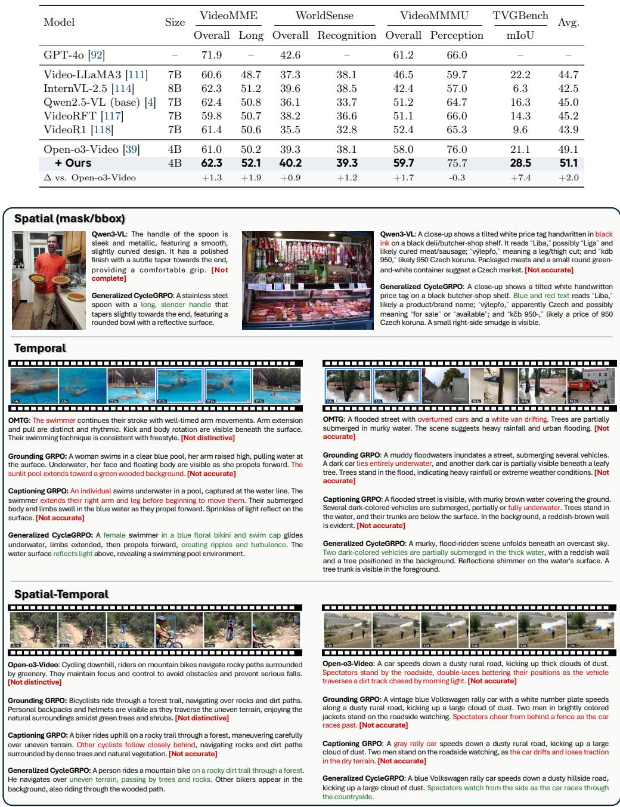  
Figure 5 Region-conditioned captioning across spatial, temporal, and spatio-temporal regions. Blue marks targets, red marks errors or omissions, and green marks target-specific evidence from Generalized CycleGRPO.

## 5.2 Ablation Study and Analysis

Why optimize both reward sides? Tab. 9 compares caption-only, localization-only, and joint rewards while retaining the region–text–region rollout. The Charades and DOVE comparisons use the OMTG and Qwen3-VL co-SFT initializations, respectively. Caption-only optimization produces the highest Charades R1@0.3 (73.0%, versus 72.9% for the full objective), but remains lower at the stricter thresholds and in tIoU. On DOVE, caption-only and localization-only optimization achieve TEC scores of 30.1% and 29.6%, respectively. In contrast, the full Generalized CycleGRPO objective performs best on Charades R1@0.5/0.7 and tIoU, and raises DOVE TEC to 33.3% and clip completeness to 14.6%. Its N/M further decreases to 50.7%, compared with 53.0% and 52.9% for the two single-reward variants. At the evaluated training points, the joint objective achieves higher temporal coverage and clip completeness than either single-reward variant.

Table 9 Reward-side ablation for temporal grounding on Charades-STA [87] with OMTG [99], and temporal captioning on DOVE with Qwen3-VL [5]. All values are percentages.
<table><tr><td rowspan="2">Model</td><td rowspan="2">Reward</td><td rowspan="2">Caption Localization Reward</td><td colspan="4">Charades</td><td colspan="8">DOVE</td></tr><tr><td></td><td></td><td></td><td></td><td></td><td>|R1@0.3 R1@0.5 R1@0.7 tIoU |TEC↑ Temp-Cov↑ Clip-Complete↑ Order↑ State↑ Outcome↑ N/M↓</td><td></td><td></td><td></td><td></td><td></td></tr><tr><td>Baseline</td><td></td><td></td><td>72.0</td><td>58.3</td><td>32.0</td><td>50.5</td><td>14.8</td><td>14.7</td><td>5.5</td><td>12.6</td><td>17.1</td><td>14.7</td><td>75.1</td></tr><tr><td>+ Caption reward only</td><td>√</td><td>x</td><td>73.0</td><td>59.6</td><td>32.3</td><td>51.4</td><td>30.1</td><td>30.0</td><td>13.4</td><td>26.9</td><td>33.8</td><td>29.6</td><td>53.0</td></tr><tr><td>+ Localization reward only</td><td>x</td><td>√</td><td>71.5</td><td>58.5</td><td>32.4</td><td>51.0</td><td>29.6</td><td>29.7</td><td>13.8</td><td>29.0</td><td>32.1</td><td>27.5</td><td>52.9</td></tr><tr><td>+ Ours</td><td>√</td><td>√</td><td>72.9</td><td>60.2</td><td>32.7</td><td>51.8</td><td>33.3</td><td>33.4</td><td>14.6</td><td>31.8</td><td>37.4</td><td>30.8</td><td>50.7</td></tr></table>

Table 10 Training-objective ablation with Qwen3-VL [5] for temporal grounding on Charades-STA [87] and temporal captioning on DOVE. All values are percentages.
<table><tr><td rowspan="2">Model</td><td colspan="4">Charades</td><td colspan="7">DOVE</td></tr><tr><td></td><td></td><td></td><td></td><td></td><td>R1@0.3 R1@0.5 R1@0.7 tIoU |TEC↑ Temp-Cov↑ Clip-Complete↑ Order↑</td><td></td><td></td><td>State↑ Outcome↑ N/M↓</td><td></td><td></td></tr><tr><td>Qwen3-VL [5]</td><td>67.1</td><td>47.5</td><td>24.1</td><td>45.6</td><td>14.8</td><td>14.7</td><td>5.5</td><td>12.6</td><td>17.1</td><td>14.7</td><td>75.1</td></tr><tr><td>+ Captioning-only GRPO</td><td>69.9</td><td>54.2</td><td>28.6</td><td>49.0</td><td>17.0</td><td>17.0</td><td>6.6</td><td>13.4</td><td>22.9</td><td>14.7</td><td>74.9</td></tr><tr><td>+ Localization-only GRPO</td><td>74.4</td><td>58.0</td><td>29.8</td><td>51.2</td><td>29.4</td><td>29.3</td><td>13.6</td><td>25.8</td><td>33.3</td><td>29.0</td><td>52.9</td></tr><tr><td>+ Ours</td><td>74.8</td><td>58.6</td><td>30.7</td><td>51.9</td><td>33.3</td><td>33.4</td><td>14.6</td><td>31.8</td><td>37.4</td><td>30.8</td><td>50.7</td></tr></table>

Table 11 Training-objective ablation with Open-o3-Video-4B [39] for spatio-temporal grounding on V-STaR [112], video understanding on VideoMME [84], WorldSense [115], and VideoMMMU [116], and temporal grounding on TVGBench [108]. All values are percentages.
<table><tr><td>Model</td><td>mLGM</td><td>Acc.</td><td>Acc.</td><td>V-STaR VideoMME WorldSense VideoMMMU TVGBench Acc.</td><td>mIoU</td></tr><tr><td>Open-o3-Video [39]</td><td>47.2</td><td>61.0</td><td>39.3</td><td>58.0</td><td>21.1</td></tr><tr><td>+ Captioning-only GRPO</td><td>47.9</td><td>61.8</td><td>39.1</td><td>58.4</td><td>23.7</td></tr><tr><td>+ Localization-only GRPO</td><td>47.3</td><td>61.9</td><td>39.6</td><td>58.1</td><td>24.9</td></tr><tr><td>+ Ours</td><td>49.8</td><td>62.3</td><td>40.2</td><td>59.7</td><td>28.5</td></tr></table>

Why optimize the complete cycle? Tab. 10 controls the initialization and RL videos while changing only the optimized mapping and reward. Both one-directional baselines require externally provided captions during RL: captioning-only GRPO uses them as reference targets for a language-based reward, whereas localization-only GRPO uses them as localization prompts. In contrast, CycleGRPO generates its intermediate descriptions from the annotated regions and requires neither reference captions nor an external language judge during RL. Captioning-only GRPO raises Charades R1@0.3/0.5/0.7 from 67.1/47.5/24.1% to 69.9/54.2/28.6% and tIoU from 45.6% to 49.0%. On DOVE, it modestly raises TEC from 14.8% to 17.0%, but clip completeness remains low at 6.6%. Optimizing captioning against a reference-based judge thus improves localization as well, but yields only modest gains in distinguishing the target occurrence from same-query distractors.

Localization-only GRPO provides a stronger localization signal: it reaches 51.2% Charades tIoU and 29.4% TEC on DOVE, against 45.6% and 14.8% for the initialization. However, it never directly optimizes whether a region-conditioned description can be localized back to its source interval. CycleGRPO explicitly optimizes this reconstruction and achieves the best joint result: 51.9% Charades tIoU and 33.3% TEC on DOVE. Relative to localization-only GRPO, it raises R1@0.3/0.5/0.7 from 74.4/58.0/29.8% to 74.8/58.6/30.7% and tIoU from 51.2% to 51.9%. On DOVE, temporal coverage rises from 29.3% to 33.4%, clip completeness from 13.6% to 14.6%, and Order/State/Outcome coverage from 25.8/33.3/29.0% to 31.8/37.4/30.8%, while N/M decreases from 52.9% to 50.7%. The complete cycle therefore achieves the best results on both temporal localization and target-specific captioning in this comparison.

Controlled objectives on Open-o3-Video. Tab. 11 further isolates the RL objective in the spatio-temporal setting. Captioning-only and localization-only GRPO improve TVGBench mIoU from 21.1% to 23.7% and 24.9%, respectively, but their gains are less consistent across the five benchmarks. The complete cycle performs best on every reported aggregate: it reaches 49.8% V-STaR mLGM, 62.3% VideoMME accuracy, 40.2% WorldSense accuracy, 59.7% VideoMMMU accuracy, and 28.5% TVGBench mIoU. These controlled results show that optimizing either direction alone does not recover the joint gains from coupling captioning and localization.

Table 12 Spatio-temporal grounding and general video understanding results with Open-o3-Video [39] based on Qwen2.5-VL-7B. V-STaR [112] reports mAM and mLGM; VideoMME [84] and WorldSense [115] report overall accuracy. All values are percentages.
<table><tr><td rowspan="2">Model</td><td>V-STaR</td><td></td><td>VideoMME WorldSense</td><td></td></tr><tr><td>mAM mLGM</td><td></td><td>Overall</td><td>Overall</td></tr><tr><td>Open-o3-Video [39]</td><td>33.4</td><td>45.7</td><td>63.0</td><td>39.0</td></tr><tr><td>+ Ours</td><td>34.4</td><td>47.5</td><td>63.4</td><td>40.0</td></tr></table>

Controlled Qwen2.5-VL-7B comparison. Tab. 12 re-evaluates the Open-o3-Video initialization and CycleGRPO under the same protocol. CycleGRPO improves V-STaR mAM/mLGM from 33.4/45.7% to 34.4/47.5%, VideoMME Overall from 63.0% to 63.4%, and WorldSense Overall from 39.0% to 40.0%. The consistent gains show that the cycle is not tied to the 4B policy used in the main spatio-temporal experiments: it transfers to a Qwen2.5-VL-7B backbone and improves both joint grounding and general video understanding under a controlled evaluation protocol.

What generalizes, and what remains distribution-dependent? Across the three region spaces, the results support joint improvements in understanding and localization: caption quality and mask localization improve in the spatial setting (Tab. 3); Charades localization and DOVE coverage improve in the temporal setting (Tab. 10); and V-STaR shows gains in joint temporal–spatial localization (Tab. 7). At the same time, the Qwen-initialized temporal-grounding results in Tab. 4 show that cycle consistency is not a substitute for broad coverage of target video domains. We therefore report results for each dataset and threshold to make the QVHighlights trade-ofs explicit.

## 5.3 Visual Analysis

Captioning across region spaces. In Fig. 5, the first row shows that the spatial benefit is not limited to identifying an object category. For the masked spoon, Qwen3-VL describes only the handle and omits the bowl, whereas Generalized CycleGRPO captures both components and their appearance. For the price tag, it also recovers visible color and text details more faithfully, rather than introducing unsupported readings.

The second row of Fig. 5 presents temporal examples that require the caption to isolate the designated interval from the surrounding video. The baselines either remain generic or introduce events outside the target, such as an extended pool background, an exaggerated limb motion, overturned vehicles, or a drifting white van. Generalized CycleGRPO instead retains interval-specific evidence: the swimmer’s floral bikini and cap together with the induced ripples, and two dark vehicles only partially submerged in the floodwater.

The last row of Fig. 5 presents spatio-temporal cases in which the description must track an entity across timestamps. Generalized CycleGRPO associates the target rider with the rocky forest trail and uneven terrain, and identifies the blue rally car, dusty hillside road, and roadside spectators without hallucinating cheering, a fence, or loss of traction. Together, these examples illustrate region-conditioned captioning across masks, intervals, and trajectories, with descriptions that retain target-specific visual evidence. Additional spatial, temporal, and spatio-temporal examples, including failure cases, are provided in Appendices B, C, and D.

## 6 Limitations and Future Work

Limitations. Generalized CycleGRPO uses region reconstruction as a verifiable proxy for caption quality. Reconstructability, however, does not guarantee that a caption is complete, fluent, or free of every unsupported detail. Our reference-free validity rules discourage obvious shortcuts, such as leaking coordinates or timestamps, but cannot enumerate all implicit shortcuts. The closed loop also assumes that the initial policy can perform both mappings reasonably well; when its localization is unreliable, the captioning side receives a noisy learning signal. This dependence helps explain why gains can vary across initializations and target domains. In addition, the nested N×K rollouts are more expensive than one-directional GRPO. Finally, DOVE evaluates visually distinguishable events within supplied temporal intervals. It does not yet cover audio-dependent evidence or require a model to discover event boundaries.

Future work. Future work could complement geometric consistency with reference-free signals for semantic coverage, factuality, and uncertainty, while preserving the framework’s self-evaluating nature. Adaptive rollout allocation, trajectory reuse, and distillation could reduce the cost of the nested cycle as training scales. Beyond the region spaces studied here, the same principle may extend to audio-visual events, 3D regions, and embodied trajectories. Extending DOVE to these settings and to joint captioning and boundary discovery would provide a broader test of whether cycle-trained descriptions remain discriminative in open-world videos.

## 7 Conclusion

Generalized CycleGRPO extends our ECCV CycleGRPO formulation from image masks to video intervals and spatio-temporal trajectories. A single policy learns captioning and localization through reciprocal rollouts, using reconstruction quality as supervision without reference captions or a separate critic. Across all three settings, the method improves its matched base policies. We also introduce DOVE, which tests whether a caption can distinguish one event from repeated same-query occurrences in a long video. Our results show that cycle reconstruction provides a practical, verifiable training signal whenever a model must both describe and localize visual content.

Contributors: Xin Zhang1, Haochen Wang2, Beibei Lin1, Zhaoxiang Zhang2, Robby T. Tan1, Jason $\mathrm { L i ^ { 3 } }$ , and Dacheng Tao3,

1National University of Singapore; 2University of Chinese Academy of Sciences; 3Nanyang Technological University.

## References

[1] T. Chen, S. Anumasa, B. Lin, V. Shah, A. Goyal, and D. Liu, “Auto-bench: An automated benchmark for scientific discovery in LLMs,” arXiv preprint arXiv:2502.15224, 2025.

[2] T. Chen, B. Lin, Z. Yuan, Q. Zou, H. He, A. Goyal, Y.-S. Ong, and D. Liu, “HypoSpace: Evaluating LLM creativity as set-valued hypothesis generators under underdetermination,” arXiv preprint arXiv:2510.15614, 2025.

[3] H. Liu, C. Li, Q. Wu, and Y. J. Lee, “Visual instruction tuning,” in NeurIPS, 2023.

[4] S. Bai, K. Chen, X. Liu, J. Wang, W. Ge, S. Song, K. Dang, P. Wang, S. Wang, J. Tang, H. Zhong, Y. Zhu, M. Yang, Z. Li, J. Wan, P. Wang, W. Ding, Z. Fu, Y. Xu, J. Ye, X. Zhang, T. Xie, Z. Cheng, H. Zhang, Z. Yang, H. Xu, and J. Lin, “Qwen2.5-vl technical report,” arXiv preprint arXiv:2502.13923, 2025.

[5] S. Bai, Y. Cai, R. Chen, K. Chen, X. Chen, Z. Cheng, L. Deng, W. Ding, C. Gao, C. Ge et al., “Qwen3-vl technical report,” arXiv preprint arXiv:2511.21631, 2025.

[6] K. Team, T. Bai, Y. Bai, Y. Bao, J. Cai, X. Cai, P. Cao, Y. Cao, Z. Chai, Y. Charles et al., “Kimi k3: Open frontier intelligence,” arXiv preprint arXiv:2607.24653, 2026.

[7] J. Liu, T. Li, X. Cao, Y. Ma, G. Shang, H. Huang, C. Zhang, X. Chang, Z. Huang, J. Hu et al., “Tele-omni: A unified multimodal framework for video generation and editing,” arXiv preprint arXiv:2602.09609, 2026.

[8] X. Zhang and R. T. Tan, “Mamba as a bridge: Where vision foundation models meet vision language models for domain-generalized semantic segmentation,” in Proceedings of the IEEE/CVF Conference on Computer Vision and Pattern Recognition, 2025, pp. 14 527–14 537.

[9] X. Zhang and Y.-C. Chen, “Adaptive domain generalization via online disagreement minimization,” IEEE Transactions on Image Processing, vol. 32, pp. 4247–4258, 2023.

[10] X. Zhang, J. Xie, Y. Yuan, M. B. Mi, and R. T. Tan, “HEAP: Unsupervised object discovery and localization with contrastive grouping,” in Proceedings of the AAAI Conference on Artificial Intelligence, vol. 38, no. 7, 2024, pp. 7323–7331.

[11] X. Yang, X. Zhang, and X. Wang, “ERF: A benchmark dataset for robust semantic segmentation under extreme rainfall conditions,” in Proceedings of the AAAI Conference on Artificial Intelligence, vol. 39, no. 9, 2025, pp. 9301–9309.

[12] S. Li, L. Tan, and R. T. Tan, “White-balance first, adjust later: Cross-camera color constancy via vision-language evaluation,” in Proceedings of the IEEE/CVF Conference on Computer Vision and Pattern Recognition (CVPR), Jun. 2026, pp. 1331–1341.

[13] ——, “Bridging day and night: Target-class hallucination suppression in unpaired image translation,” in Proceedings of the AAAI Conference on Artificial Intelligence, vol. 40, no. 8, 2026, pp. 6424–6432.

[14] Y. Ai, Y. Qi, B. Wang, Y. Chen, X. Wang, and R. T. Tan, “Domain-adaptive 2D human pose estimation via dual teachers in extremely low-light conditions,” in ECCV, 2024.

[15] H. Chen, Y. Ai, K. Kim, R. T. Tan, Y. Chen, and B. Wang, “UDAPose: Unsupervised domain adaptation for low-light human pose estimation,” in Proceedings of the IEEE/CVF Conference on Computer Vision and Pattern Recognition, 2026, pp. 13 781–13 792.

[16] X. Cao, B. Lin, B. Wang, Z. Huang, and R. Tan, “3DOT: Texture transfer for 3DGS objects from a single reference image,” Advances in Neural Information Processing Systems, vol. 38, pp. 156 647–156 667, 2026.

[17] W. Yan, X. Zhang, and R. T. Tan, “ER-LoRA: Efective-rank guided adaptation for weather-generalized depth estimation,” arXiv preprint arXiv:2509.00665, 2025.

[18] W. Yan, M. Li, H. Li, S. Shao, and R. T. Tan, “Synthetic-to-real self-supervised robust depth estimation via learning with motion and structure priors,” in Proceedings of the Computer Vision and Pattern Recognition Conference (CVPR), Jun. 2025, pp. 21 880–21 890.

[19] W. Yan, H. Li, H. Xu, N. Ye, Y. Ai, S. Liu, and J. Hu, “LaS-Comp: Zero-shot 3D completion with latent-spatial consistency,” in Proceedings of the IEEE/CVF Conference on Computer Vision and Pattern Recognition (CVPR), Jun. 2026, pp. 7588–7599.

[20] X. Zhang, W. Yan, Y. Shi, X. Qiu, T. He, Y. Li, M. Li, and H. Fan, “4DPC2hat: Towards dynamic point cloud understanding with failure-aware bootstrapping,” arXiv preprint arXiv:2602.03890, 2026.

[21] L. Tan, Y. Zhang, K. Han, P. Dai, Y. Zhang, Y. Wu, and R. Ji, “RLE: A unified perspective of data augmentation for cross-spectral re-identification,” in Advances in Neural Information Processing Systems, vol. 37, 2024, pp. 126 977–126 996.

[22] L. Tan, W. Li, P. Dai, J. Chen, L. Cao, and R. Ji, “Knowing where to focus: Attention-guided alignment for text-based person search,” International Journal of Computer Vision, vol. 134, no. 2, p. 72, 2026.

[23] L. Tan, J. Xia, W. Liu, P. Dai, Y. Wu, and L. Cao, “Occluded person re-identification via saliency-guided patch transfer,” in Proceedings of the AAAI Conference on Artificial Intelligence, vol. 38, no. 5, 2024, pp. 5070–5078.

[24] Z. Yuan, B. Lin, Y. Liu, W. Fu, Y. Gao, T. Chen, and A. Danner, “Drive-eficient GHz-rate binary-state updates enabled by VCSEL polarization switching,” Laser & Photonics Reviews, p. e71890, 2026.

[25] Z. Yuan, T. Chen, D. Zhang, Y. Gao, W. Shan, B. Lin, and A. Danner, “Tailored polarization-switchable VCSEL arrays for photonic Ising computing,” Applied Physics Letters, vol. 127, no. 22, p. 221102, 2025.

[26] Z. Qian, Z. Wang, X. Zhang, B. Wei, M. Lai, J. Shou, Y. Fan, and Y. Xu, “MSNSegNet: Attention-based multishape nuclei instance segmentation in histopathology images,” Medical & Biological Engineering & Computing, vol. 62, no. 6, pp. 1821–1836, 2024.

[27] J. Zhang, X. Zhang, K. Ma, R. Gupta, J. Saltz, M. Vakalopoulou, and D. Samaras, “Gigapixel whole-slide images classification using locally supervised learning,” in Medical Image Computing and Computer Assisted Intervention – MICCAI 2022. Springer Nature Switzerland, 2022, pp. 192–201.

[28] B. Lin, Z. Yuan, and T. Chen, “RGB-to-polarization estimation: A new task and benchmark study,” Advances in Neural Information Processing Systems, vol. 38, 2025.

[29] B. Lin, T. Chen, X. Zhang, W. Zhao, D. Li, and Z. Yuan, “PolarScale: A physics-grounded benchmark for radiometrically consistent RGB-to-Stokes estimation,” arXiv preprint arXiv:2610.08346, 2026.

[30] H. Rasheed, M. Maaz, S. Shaji, A. Shaker, S. Khan, H. Cholakkal, R. M. Anwer, E. Xing, M.-H. Yang, and F. S. Khan, “Glamm: Pixel grounding large multimodal model,” in CVPR, 2024.

[31] Y. Zhou, T. Zhang, D. Gong, Y. Wu, Y. Tian, H. Wang, H. Yuan, J. Wang, L. Qi, H. Fei et al., “Samtok: Representing any mask with two words,” in Proceedings of the IEEE/CVF Conference on Computer Vision and Pattern Recognition, 2026, pp. 37 852–37 863.

[32] Y. Yuan, H. Zhang, W. Li, Z. Cheng, B. Zhang, L. Li, X. Li, D. Zhao, W. Zhang, Y. Zhuang et al., “Videorefe suite: Advancing spatial-temporal object understanding with video llm,” in CVPR, 2025.

[33] J. Zhang, T. Wang, Y. Ge, Y. Ge, X. Li, and L. Wang, “Timelens: Rethinking video temporal grounding with multimodal llms,” in Proceedings of the IEEE/CVF Conference on Computer Vision and Pattern Recognition, 2026, pp. 10 419–10 429.

[34] H. Yuan, X. Li, T. Zhang, Y. Sun, Z. Huang, S. Xu, S. Ji, Y. Tong, L. Qi, J. Feng et al., “Sa2VA: Marrying SAM2 with MLLM for dense grounded understanding of images and videos,” IEEE Transactions on Pattern Analysis and Machine Intelligence, 2026.

[35] Z. Ren, Z. Huang, Y. Wei, Y. Zhao, D. Fu, J. Feng, and X. Jin, “PixelLM: Pixel reasoning with large multimodal model,” in CVPR, 2024.

[36] Q. Lei, B. Wang, and R. T. Tan, “HOLa: Zero-shot HOI detection with low-rank decomposed VLM feature adaptation,” in Proceedings of the IEEE/CVF International Conference on Computer Vision, 2025, pp. 1825–1835.

[37] ——, “EZ-HOI: VLM adaptation via guided prompt learning for zero-shot HOI detection,” in Advances in Neural Information Processing Systems, 2024.

[38] X. Zhang, H. Wang, Y. Zhou, Z. Wang, X. Li, and R. T. Tan, “Actor as its own critic: Unifying region understanding and localization via CycleGRPO,” in European Conference on Computer Vision (ECCV), ser. Lecture Notes in Computer Science, vol. 17044. Springer, 2026, pp. 586–604.

[39] J. Meng, X. Li, H. Wang, Y. Tan, T. Zhang, L. Kong, Y. Tong, A. Wang, Z. Teng, Y. Wang, and Z. Wang, “Openo3-video: Grounded video reasoning with explicit spatio-temporal evidence,” arXiv preprint arXiv:2510.20579, 2025.

[40] K. Chen, Z. Zhang, W. Zeng, R. Zhang, F. Zhu, and R. Zhao, “Shikra: Unleashing multimodal LLM’s referential dialogue magic,” arXiv preprint arXiv:2306.15195, 2023.

[41] Z. Peng, W. Wang, L. Dong, Y. Hao, S. Huang, S. Ma, and F. Wei, “Kosmos-2: Grounding multimodal large language models to the world,” arXiv preprint arXiv:2306.14824, 2023.

[42] H. You, H. Zhang, Z. Gan, X. Du, B. Zhang, Z. Wang, L. Cao, S.-F. Chang, and Y. Yang, “Ferret: Refer and ground anything anywhere at any granularity,” 2023.

[43] H. Zhang, H. You, P. Dufter, B. Zhang, C. Chen, H.-Y. Chen, T.-J. Fu, W. Y. Wang, S.-F. Chang, Z. Gan et al., “Ferret-v2: An improved baseline for referring and grounding with large language models,” arXiv preprint arXiv:2404.07973, 2024.

[44] Y. Yuan, W. Li, J. Liu, D. Tang, X. Luo, C. Qin, L. Zhang, and J. Zhu, “Osprey: Pixel understanding with visual instruction tuning,” in CVPR, 2024.

[45] Q. Guo, S. De Mello, H. Yin, W. Byeon, K. C. Cheung, Y. Yu, P. Luo, and S. Liu, “Regiongpt: Towards region understanding vision language model,” in CVPR, 2024, pp. 13 796–13 806.

[46] L. Lian, Y. Ding, Y. Ge, S. Liu, H. Mao, B. Li, M. Pavone, M.-Y. Liu, T. Darrell, A. Yala et al., “Describe anything: Detailed localized image and video captioning,” arXiv preprint arXiv:2504.16072, 2025.

[47] H. Wang, Y. Wang, T. Zhang, Y. Zhou, Y. Li, J. Wang, Y. Tian, J. Meng, Z. Huang, G. Mai, A. Wang, Y. Tong, Z. Wang, X. Li, and Z. Zhang, “Grasp any region: Towards precise, contextual pixel understanding for multimodal llms,” ICLR, 2026.

[48] C. Liu, H. Ding, and X. Jiang, “Gres: Generalized referring expression segmentation,” in CVPR, 2023.

[49] X. Lai, Z. Tian, Y. Chen, Y. Li, Y. Yuan, S. Liu, and J. Jia, “Lisa: Reasoning segmentation via large language model,” in CVPR, 2024.

[50] W. Du, Z. Yuan, T. Chen, F. Ke, B. Lin, and S. Zhang, “WeatherReasonSeg: A benchmark for weather-aware reasoning segmentation in visual language models,” arXiv preprint arXiv:2603.17680, 2026

[51] T. Zhang, X. Li, H. Fei, H. Yuan, S. Wu, S. Ji, C. C. Loy, and S. Yan, “OMG-LLaVA: Bridging image-level, object-level, pixel-level reasoning and understanding,” Advances in Neural Information Processing Systems, vol. 37, pp. 71 737–71 767, 2024.

[52] T. Wang, C. Cheng, L. Wang, S. Chen, and W. Zhao, “Himtok: Learning hierarchical mask tokens for image segmentation with large multimodal model,” in ICCV, 2025.

[53] M. Maaz, H. Rasheed, S. Khan, and F. S. Khan, “Video-ChatGPT: Towards detailed video understanding via large vision and language models,” in ACL, 2024

[54] H. Zhang, X. Li, and L. Bing, “Video-LLaMA: An instruction-tuned audio-visual language model for video understanding,” in EMNLP Demos, 2023.

[55] L. Xu, Y. Zhao, D. Zhou, Z. Lin, S. K. Ng, and J. Feng, “PLLaVA: Parameter-free LLaVA extension from images to videos for video dense captioning,” arXiv preprint arXiv:2404.16994, 2024.

[56] B. Li, Y. Zhang, D. Guo, R. Zhang, F. Li, H. Zhang, K. Zhang, Y. Li, Z. Liu, and C. Li, “LLaVA-OneVision: Easy visual task transfer,” arXiv preprint arXiv:2408.03326, 2024.

[57] B. Huang, X. Wang, H. Chen, Z. Song, and W. Zhu, “VTimeLLM: Empower LLM to grasp video moments,” in CVPR, 2024.

[58] S. Ren, L. Yao, S. Li, X. Sun, and L. Hou, “TimeChat: A time-sensitive multimodal large language model for long video understanding,” in CVPR, 2024.

[59] L. Qian, J. Li, Y. Wu, Y. Ye, H. Fei, T.-S. Chua, Y. Zhuang, and S. Tang, “Momentor: Advancing video large language model with fine-grained temporal reasoning,” in ICML, 2024, moment-10M dataset.

[60] D.-A. Huang, S. Liao, S. Radhakrishnan, H. Yin, P. Molchanov, Z. Yu, and J. Kautz, “LITA: Language instructed temporal-localization assistant,” in ECCV, 2024.

[61] Y. Guo, J. Liu, M. Li, X. Tang, X. Chen, and B. Zhao, “VTG-LLM: Integrating timestamp knowledge into video LLMs for enhanced video temporal grounding,” AAAI, 2025.

[62] Y. Guo, J. Liu, M. Li, Q. Cheng, X. Tang, and B. Zhao, “TRACE: Temporal grounding video LLM via causal event modeling,” ICLR, 2025.

[63] T. Wang, R. Zhang, Z. Lu, F. Zheng, R. Cheng, and P. Luo, “End-to-end dense video captioning with parallel decoding,” in ICCV, 2021.

[64] A. Yang, A. Nagrani, P. H. Seo, A. Miech, J. Pont-Tuset, I. Laptev, J. Sivic, and C. Schmid, “Vid2Seq: Large-scale pretraining of a visual language model for dense video captioning,” in CVPR, 2023.

[65] Z. Zhang, Z. Zhao, Y. Zhao, Q. Wang, H. Liu, and L. Gao, “Where does it exist: Spatio-temporal video grounding for multi-form sentences,” in CVPR, 2020.

[66] A. Yang, A. Miech, J. Sivic, I. Laptev, and C. Schmid, “TubeDETR: Spatio-temporal video grounding with transformers,” in CVPR, 2022.

[67] L. Ouyang, J. Wu, X. Jiang, D. Almeida, C. Wainwright, P. Mishkin, C. Zhang, S. Agarwal, K. Slama, A. Ray et al., “Training language models to follow instructions with human feedback,” in NeurIPS, 2022.

[68] R. Rafailov, A. Sharma, E. Mitchell, C. D. Manning, S. Ermon, and C. Finn, “Direct preference optimization: Your language model is secretly a reward model,” in NeurIPS, 2023.

[69] Z. Shao, P. Wang, Q. Zhu, R. Xu, J. Song, X. Bi, H. Zhang, M. Zhang, Y. Li, Y. Wu et al., “Deepseekmath: Pushing the limits of mathematical reasoning in open language models,” arXiv preprint arXiv:2402.03300, 2024.

[70] Z. Liu, Z. Sun, Y. Zang, X. Dong, Y. Cao, H. Duan, D. Lin, and J. Wang, “Visual-rft: Visual reinforcement fine-tuning,” in ICCV, 2025.

[71] H. Shen, P. Liu, J. Li, C. Fang, Y. Ma, J. Liao, Q. Shen, Z. Zhang, K. Zhao, Q. Zhang et al., “Vlm-r1: A stable and generalizable r1-style large vision-language model,” arXiv preprint arXiv:2504.07615, 2025.

[72] Y. Liu, B. Peng, Z. Zhong, Z. Yue, F. Lu, B. Yu, and J. Jia, “Seg-zero: Reasoning-chain guided segmentation via cognitive reinforcement,” arXiv preprint arXiv:2503.06520, 2025.

[73] Z. You and Z. Wu, “Seg-r1: Segmentation can be surprisingly simple with reinforcement learning,” arXiv preprint arXiv:2506.22624, 2025.

[74] S. Bai, M. Li, Y. Liu, J. Tang, H. Zhang, L. Sun, X. Chu, and Y. Tang, “Univg-r1: Reasoning guided universal visual grounding with reinforcement learning,” arXiv preprint arXiv:2505.14231, 2025.

[75] L. Xing, X. Dong, Y. Zang, Y. Cao, J. Liang, Q. Huang, J. Wang, F. Wu, and D. Lin, “Caprl: Stimulating dense image caption capabilities via reinforcement learning,” arXiv preprint arXiv:2509.22647, 2025.

[76] P. Yang, L. Xing, X. Dong, Y. Zang, Y. Cao, Y. Wang, Y. Zhou, J. Bu, J. Liang, Q. Huang et al., “Caprl++: Unified reinforcement learning with verifiable rewards for dense image and video captioning,” arXiv preprint arXiv:2606.09393, 2026.

[77] S. Huang, Z. Wang, Z. Zuo, H. Qiu, Q. She, and B. Wen, “Evovid: Temporal-centric self-evolution for video large language models,” arXiv preprint arXiv:2605.21931, 2026.

[78] R. Zhang, D. Ji, L. Zhu, X. Liu, Y. Meng, R. Chu, and Y. Yang, “Video-zero: Self-evolution video understanding,” arXiv preprint arXiv:2605.14733, 2026.

[79] X. Zhao, Z. Kang, A. Feng, S. Levine, and D. Song, “Learning to reason without external rewards,” arXiv preprint arXiv:2505.19590, 2025, intuitor / self-certainty as intrinsic reward.

[80] T. Chen, B. Lin, Y. Jin, W. Yan, W. Ye, Y. Yuan, and R. T. Tan, “Dual-Rain: Video rain removal using assertive and gentle teachers,” in European Conference on Computer Vision. Springer, 2024, pp. 127–143.

[81] J.-Y. Zhu, T. Park, P. Isola, and A. A. Efros, “Unpaired image-to-image translation using cycle-consistent adversarial networks,” in ICCV, 2017.

[82] R. Sennrich, B. Haddow, and A. Birch, “Improving neural machine translation models with monolingual data,” in ACL, 2016.

[83] K. Li, Y. Wang, Y. He, Y. Li, Y. Wang, Y. Liu, Z. Wang, J. Xu, G. Chen, P. Luo et al., “MVBench: A comprehensive multi-modal video understanding benchmark,” in CVPR, 2024.

[84] C. Fu, Y. Dai, Y. Luo, L. Li, S. Ren, R. Zhang, Z. Wang, C. Zhou, Y. Shen, M. Zhang et al., “Video-MME: The first-ever comprehensive evaluation benchmark of multi-modal LLMs in video analysis,” CVPR, 2025.

[85] Y. Liu, S. Li, Y. Liu, Y. Wang, S. Ren, L. Li, S. Chen, X. Sun, and L. Hou, “TempCompass: Do video LLMs really understand videos?” in ACL Findings, 2024.

[86] Y. Liu, Z. Ma, Z. Qi, Y. Wu, Y. Shan, and C. W. Chen, “E.T. Bench: Towards open-ended event-level video-language understanding,” in NeurIPS, 2024.

[87] J. Gao, C. Sun, Z. Yang, and R. Nevatia, “TALL: Temporal activity localization via language query,” in ICCV, 2017, charades-STA.

[88] R. Krishna, K. Hata, F. Ren, L. Fei-Fei, and J. Carlos Niebles, “Dense-captioning events in videos,” in ICCV, 2017, activityNet-Captions.

[89] J. Lei, T. L. Berg, and M. Bansal, “Detecting moments and highlights in videos via natural language queries,” in NeurIPS, 2021.

[90] K. Grauman, A. Westbury, E. Byrne, Z. Chavis, A. Furnari, R. Girdhar, J. Hamburger, H. Jiang, M. Liu, X. Liu et al., “Ego4D: Around the world in 3,000 hours of egocentric video,” in CVPR, 2022.

[91] Q. Lei, B. Wang, and R. T. Tan, “CrossHOI-Bench: A unified benchmark for HOI evaluation across visionlanguage models and HOI-specific methods,” in Proceedings of the IEEE/CVF Conference on Computer Vision and Pattern Recognition, 2026.

[92] A. Hurst, A. Lerer, A. P. Goucher, A. Perelman, A. Ramesh, A. Clark, A. Ostrow, A. Welihinda, A. Hayes, A. Radford et al., “Gpt-4o system card,” arXiv preprint arXiv:2410.21276, 2024.

[93] Google DeepMind, “Gemini 2.5 pro,” https://deepmind.google/models/gemini/pro/, 2025.

[94] W. Lin, X. Wei, R. An, P. Gao, B. Zou, Y. Luo, S. Huang, S. Zhang, and H. Li, “Draw-and-understand: Leveraging visual prompts to enable mllms to comprehend what you want,” arXiv preprint arXiv:2403.20271, 2024.

[95] Y. Zhang, T. Cheng, L. Zhu, R. Hu, L. Liu, H. Liu, L. Ran, X. Chen, W. Liu, and X. Wang, “Evf-sam: Early vision-language fusion for text-prompted segment anything model,” arXiv preprint arXiv:2406.20076, 2024.

[96] C. Wei, Y. Zhong, H. Tan, Y. Zeng, Y. Liu, H. Wang, and Y. Yang, “Instructseg: Unifying instructed visual segmentation with multi-modal large language models,” in ICCV, 2025.

[97] OpenAI, “Introducing o3 and o4-mini,” https://openai.com/index/introducing-o3-and-o4-mini/, 2025.

[98] J. Zhu, W. Wang, Z. Chen, Z. Liu, S. Ye, L. Gu, H. Tian, Y. Duan, W. Su, J. Shao et al., “Internvl3: Exploring advanced training and test-time recipes for open-source multimodal models,” arXiv preprint arXiv:2504.10479, 2025.

[99] Q. Xu, Y. Tan, S. Chen, J. Meng, A. Wang, S. Ji, H. Fei, and J. Li, “Towards one-to-many temporal grounding,” arXiv preprint arXiv:2606.06294, 2026.

[100] G. Team, R. Anil, S. Borgeaud, J.-B. Alayrac, J. Yu, R. Soricut, J. Schalkwyk, A. M. Dai, A. Hauth, K. Millican et al., “Gemini: a family of highly capable multimodal models,” arXiv preprint arXiv:2312.11805, 2023.

[101] Y.-C. Chen, W.-H. Li, C. Sun, Y.-C. F. Wang, and C.-S. Chen, “Sam4mllm: Enhance multi-modal large language model for referring expression segmentation,” in ECCV, 2024.

[102] J. Wang, Z. Wu, D. Huang, Y. Zheng, and H. Wang, “Unlocking the potential of mllms in referring expression segmentation via a lightweight mask decoder,” arXiv preprint arXiv:2508.04107, 2025.

[103] X. Wang, L. Ru, Z. Huang, K. Ji, D. Zheng, J. Chen, and J. Zhou, “Argenseg: Image segmentation with autoregressive image generation model,” in NeurIPS, 2025.

[104] OpenAI, “Introducing GPT-5,” https://openai.com/index/introducing-gpt-5/, 2025.

[105] G. Comanici, E. Bieber, M. Schaekermann, I. Pasupat, N. Sachdeva, I. Dhillon, M. Blistein, O. Ram, D. Zhang, E. Rosen et al., “Gemini 2.5: Pushing the frontier with advanced reasoning, multimodality, long context, and next generation agentic capabilities,” arXiv preprint arXiv:2507.06261, 2025.

[106] X. Li, Y. Wang, J. Yu, X. Zeng, Y. Zhu, H. Huang, J. Gao, K. Li, Y. He, C. Wang et al., “Videochat-flash: Hierarchical compression for long-context video modeling,” arXiv preprint arXiv:2501.00574, 2024.

[107] X. Li, Z. Yan, D. Meng, L. Dong, X. Zeng, Y. He, Y. Wang, Y. Qiao, Y. Wang, and L. Wang, “Videochat-r1: Enhancing spatio-temporal perception via reinforcement fine-tuning,” arXiv preprint arXiv:2504.06958, 2025.

[108] Y. Wang, Z. Wang, B. Xu, Y. Du, K. Lin, Z. Xiao, Z. Yue, J. Ju, L. Zhang, D. Yang et al., “Time-r1: Post-training large vision language model for temporal video grounding,” arXiv preprint arXiv:2503.13377, 2025.

[109] K. Li, Y. Wang, Y. He, Y. Li, Y. Wang, Y. Liu, Z. Wang, J. Xu, G. Chen, P. Luo et al., “Mvbench: A comprehensive multi-modal video understanding benchmark,” in CVPR, 2024.

[110] Y. Zhang, J. Wu, W. Li, B. Li, Z. Ma, Z. Liu, and C. Li, “Video instruction tuning with synthetic data,” arXiv preprint arXiv:2410.02713, 2024.

[111] B. Zhang, K. Li, Z. Cheng, Z. Hu, Y. Yuan, G. Chen, S. Leng, Y. Jiang, H. Zhang, X. Li et al., “Videollama 3: Frontier multimodal foundation models for image and video understanding,” arXiv preprint arXiv:2501.13106, 2025.

[112] Z. Cheng, J. Hu, Z. Liu, C. Si, W. Li, and S. Gong, “V-STAR: Benchmarking video-llms on video spatio-temporal reasoning,” arXiv preprint arXiv:2503.11495, 2025.

[113] Z. Liu, Y. Dong, Z. Liu, W. Hu, J. Lu, and Y. Rao, “Oryx mllm: On-demand spatial-temporal understanding at arbitrary resolution,” arXiv preprint arXiv:2409.12961, 2024.

[114] Z. Chen, W. Wang, Y. Cao, Y. Liu, Z. Gao, E. Cui, J. Zhu, S. Ye, H. Tian, Z. Liu et al., “Expanding performance boundaries of open-source multimodal models with model, data, and test-time scaling,” arXiv preprint arXiv:2412.05271, 2024.

[115] J. Hong, S. Yan, J. Cai, X. Jiang, Y. Hu, and W. Xie, “WorldSense: Evaluating real-world omnimodal understanding for multimodal LLMs,” arXiv preprint arXiv:2502.04326, 2025.

[116] K. Hu, P. Wu, F. Pu, W. Xiao, Y. Zhang, X. Yue, B. Li, and Z. Liu, “Video-MMMU: Evaluating knowledge acquisition from multi-discipline professional videos,” arXiv preprint arXiv:2501.13826, 2025.

[117] Q. Wang, Y. Yu, Y. Yuan, R. Mao, and T. Zhou, “Videorft: Incentivizing video reasoning capability in mllms via reinforced fine-tuning,” arXiv preprint arXiv:2505.12434, 2025.

[118] K. Feng, K. Gong, B. Li, Z. Guo, Y. Wang, T. Peng, J. Wu, X. Zhang, B. Wang, and X. Yue, “Video-r1: Reinforcing video reasoning in mllms,” arXiv preprint arXiv:2503.21776, 2025.

[119] X. Li, T. Zhang, Y. Li, H. Yuan, S. Chen, Y. Zhou, J. Meng, Y. Sun, S. Xu, L. Qi et al., “Denseworld-1m: Towards detailed dense grounded caption in the real world,” arXiv preprint arXiv:2506.24102, 2025.

## Appendix

## Appendix Overview

The appendix provides additional implementation details, controlled analyses, and benchmark statistics that complement the main paper. Specifically, Appendix A documents the complete training configurations for the spatial, temporal, and spatio-temporal settings. Appendix B further examines the spatial instantiation through additional region-captioning and localization examples, continuous bounding-box outputs, a larger SAMTok-8B backbone, and a representative closed-loop rollout. Appendix C presents qualitative temporal grounding comparisons on TimeLens, while Appendix D provides joint temporal–spatial grounding examples and representative failure cases on V-STaR. Finally, Appendix E characterizes DOVE in terms of video and interval durations, repeated-occurrence structure, query diversity, temporal-probe coverage, and model-independent dificulty.

## A Detailed Experimental Settings

This section details the training configurations summarized in Sec. 5. A dash denotes a parameter that is not applicable to the corresponding training stage. The training code is publicly available.

Temporal training data preparation. The source videos and temporal interval annotations come from the OMTG training data [99]. For the Qwen3-VL initialization, we randomly partition source videos into two equal subsets: one for bidirectional co-SFT and the other for RL. All examples from a video stay in the same subset, yielding 18,742 RL examples. For the OMTG initialization, we use an ofline VLM-assisted screening procedure to exclude incomplete or visually ambiguous training intervals from 36,892 candidate examples. Given the annotated target interval, the VLM uses sampled frames and adjacent context to assess event completeness, with an independently generated description serving as evidence for screening. It compares the target with up to two visually nearest intervals sharing the same video and query, selected using color-histogram and low-frequency image descriptors. Each pair is evaluated in both presentation orders, using only visual evidence rather than audio, text overlays, timestamps, or occurrence indices. We retain complete events only when all selected comparisons consistently identify a visual diference; singleton groups require a complete event. Ambiguous, incomplete, uncertain, and failed-screening examples are excluded, leaving 18,735 examples. This procedure is used only for ofline data quality control: the generated descriptions and judgments are not used as training targets or RL rewards.

Table 13 Implementation details for the spatial setting. The configuration is carried over unchanged from the ECCV version [38].  
Setting Configuration   
Initialization Qwen3-VL-4B-SAMTok [31]   
Training data 20K DenseWorld [119] images with object masks and 1K GRES [48] no-target expressions   
Region representation Discrete mask tokens in both prompts and responses   
Input prompt <image> “Provide a detailed description of this region <mask tokens>.” When a zoomed view   
is available, the prompt continues: “Zoom in with the perspective as <image>, <mask tokens>.”   
Training objective Spatial mask–text–mask CycleGRPO   
Trainable modules Language model and multimodal projector; visual encoder frozen   
Precision and memory bfloat16 with gradient checkpointing   
Training length 1 epoch   
Optimizer AdamW   
Learning rate / weight decay 1 × 10−6 / 1 × 10−2   
Global batch size 128   
Rollouts N = 6 caption samples and K = 6 localization rollouts per caption   
Distributed training FSDP with the extended verl codebase

Table 14 Training configurations for temporal CycleGRPO with Qwen3-VL [5] and OMTG [99] initializations.
<table><tr><td>Setting</td><td>Qwen3-VL initialization</td><td>OMTG initialization</td></tr><tr><td>Initialization</td><td>Qwen3-VL-4B [5] with bidirectional co-SFT</td><td>OMTG-4B RL [99] with bidirectional co-SFT</td></tr><tr><td>RL training examples</td><td>18,742 OMTG [99]: video-disjoint RL split comprising</td><td>18,735 OMTG [99]: filtered visually distinct temporal</td></tr><tr><td>Training data</td><td>the remaining 50% of source videos</td><td>examples</td></tr><tr><td>Rollout / actor update batch size</td><td>128 / 128</td><td>64  / 64</td></tr><tr><td>Caption rollouts N</td><td>4</td><td>4</td></tr><tr><td>Localization rollouts K</td><td>4</td><td>4</td></tr><tr><td>Video sampling</td><td>0.25 fps</td><td>2 fps</td></tr><tr><td>Maximum pixels/frame Prompt / response limits</td><td>262,144 8,192 / 8,192 tokens</td><td>786,432 16,384 / 768 tokens</td></tr><tr><td></td><td></td><td></td></tr><tr><td>Objective Reward / supervision</td><td colspan="2">Interval-to-caption-to-interval cycle Reconstruction tIoU with output-validity constraints; no reference caption or external</td></tr><tr><td></td><td colspan="2">language-model reward judge</td></tr><tr><td>Captioning input</td><td colspan="2">Source video and a prompt specifying the target time interval AdamW</td></tr><tr><td>Optimizer Learning rate / weight decay</td><td colspan="2"> $1 \times 1 0 ^ { - 6 } / 1 \times 1 0 ^ { - 2 }$ </td></tr><tr><td>KL coefficient</td><td colspan="2"> $1 \times 1 0 ^ { - 2 }$ </td></tr><tr><td>Policy ratio clipping</td><td colspan="2"> $[ 0 . 8 , 1 . 3 ] ;$  dual-clipping coefficient  $c = 3$ </td></tr><tr><td>Loss aggregation</td><td colspan="2">Mean over valid response tokens</td></tr><tr><td>Trainable modules</td><td colspan="2">Language model and multimodal projector; visual encoder frozen</td></tr><tr><td>Precision / memory</td><td colspan="2">bfloat16/ gradient checkpointing</td></tr><tr><td>Distributed training</td><td colspan="2">FSDP with the extended verl codebase</td></tr></table>

Table 15 Implementation details for the Open-o3-Video-4B mixed-task training used in the main spatio-temporal and general-video results.
<table><tr><td>Setting</td><td>Configuration</td></tr><tr><td>Initialization</td><td>Open-o3-Video-4B (RL) [39], followed by one epoch of inverse-caption and video-QA co-SFT</td></tr><tr><td>Training data</td><td>Open-o3-Video [39]: 35,887 examples comprising 4,143 spatial, 4,820 temporal, 11,924 spatio- temporal, and 15,000 general video-QA examples</td></tr><tr><td>Region representations</td><td>Normalized image boxes, temporal intervals, and sparse timestamp-box supports</td></tr><tr><td>Training objectives</td><td>Region-text-region CycleGRPO for the three region tasks; answer-based rewards for auxiliary</td></tr><tr><td>Trainable modules</td><td>video QA Language model and multimodal projector; visual encoder frozen</td></tr><tr><td>Precision / memory</td><td>bfloat16/ gradient checkpointing</td></tr><tr><td>Optimizer / schedule</td><td>AdamW; cosine learning-rate schedule</td></tr><tr><td>Learning rate / weight decay</td><td> $1 \times 1 0 ^ { - 6 } \mathrm { ~ / ~ } 1 \times 1 0 ^ { - 2 }$ </td></tr><tr><td>Rollout / actor update batch size</td><td>128  / 128</td></tr><tr><td>Caption rollouts N</td><td>4</td></tr><tr><td>Localization rollouts K</td><td>4</td></tr><tr><td>KL coefficient</td><td> $1 \times 1 0 ^ { - 2 }$ </td></tr><tr><td>Policy ratio clipping</td><td>[0.8, 1.3]; dual-clipping coefficient  $c = 3$ </td></tr><tr><td>Loss aggregation</td><td>Mean over valid response tokens</td></tr><tr><td>Sampling temperature / top-p</td><td>1.0 / 1.0</td></tr><tr><td>Prompt / response limit</td><td>16,384 / 768 tokens</td></tr><tr><td>Video input</td><td>2 fps configuration; spatio-temporal examples specify 16 frames; maximum 262,144 pixels per frame &lt;video&gt; followed by the target timestamp-box support and: &quot;Describe only the visible target</td></tr><tr><td>Spatio-temporal caption prompt</td><td>and event precisely enough to relocate them. Do not mention object tags, coordinates, timestamps, seconds, or frame indices. Output description only.&quot;</td></tr><tr><td>Temporal reward shaping</td><td>Additional temporal-proximity score with coefficient 2.0, computed from target and recon- structed temporal supports No reference captions for the cycle branches; reference answers for auxiliary video QA; no</td></tr><tr><td>Language supervision</td><td>external language-model reward judge</td></tr><tr><td>Distributed training</td><td>FSDP with the extended verl codebase</td></tr></table>

In the Open-o3-Video mixed-task setting (Tab. 15), auxiliary video-QA multiple-choice answers receive a correctness reward and free-form answers receive a reference-based ROUGE reward, together with format and repetition checks. Temporal reward shaping uses interval-center, boundary, and duration agreement to supplement overlap-based feedback.

## B Additional Spatial Analyses

Additional qualitative comparisons. Figs. 6–9 provide the complete spatial qualitative comparisons from our ECCV version. They complement the cross-domain examples in Fig. 5 with region captioning, mask localization, and continuous bounding-box localization cases.

In Fig. 6, CycleGRPO captures the target’s texture, shape, and color more accurately than SAMTok. The GRES examples in Fig. 7 show localization of disjoint entities without including the man’s coat, and recovery of an occluded target missed by the baseline. Fig. 8 covers both part-level targets, such as the duck’s head, and amorphous stuf regions, such as snow. For continuous boxes in Fig. 9, CycleGRPO localizes the bear’s nose, the baby’s hair, and the clear sky more tightly; the baseline boxes include more of the surrounding subject.

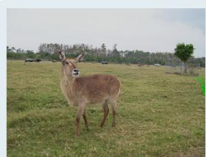  
SAMTok: A brown and white goat with a prominent beard and a pair of long, curved horns.  
CycleGRPO: The antelope has a pair of long, curved horns with a dark coloration, and a visible eye with a dark pupil surrounded by a lighter iris. The fur appears to be a mix of brown and tan shades, with a pattern that suggests a coarse texture.

  
SAMTok: A bird with a long, slender neck and a pointed beak, featuring a mix of brown and white plumage with darker wingtips and a distinctive white patch on the lower back.  
CycleGRPO: A bird in flight with its wings fully extended, showcasing a pattern of brown and white feathers with darker brown tips. The bird's head is turned slightly to the side, revealing a sharp, hooked beak and a keen eve. Its legs are tucked close to its body, and the tail feathers are fanned out, displaying a mix of brown and white hues.

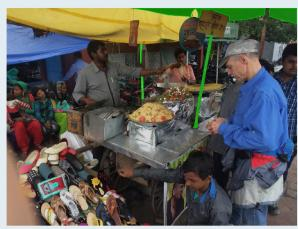  
SAMTok: A yellow awning with a scalloped edge and a fringe detail along the bottom.  
CycleGRPO: A dark brown, triangularshaped awning with a smooth texture and a slightly curved hypotenuse edge, featuring a thin, lighter brown trim along the hypotenuse.

  
SAMTok: A rectangular wooden chopping board with rounded corners and a visible grain pattern, featuring a smooth surface and a dark brown edge.  
CycleGRPO: A rectangular wooden chopping board with a smooth surface and rounded corners, featuring a visible grain pattern indicative of natural wood. The board has a warm, honey-brown color and appears to be of a standard thickness for kitchen use.

## Question:

the lady wearing black standing in the left and a black phone held by the old guy standing in the right

Figure 6 Qualitative comparison of region captioning on DLC-Bench [46] between SAMTok [31] and CycleGRPO. Target regions are highlighted in green. Within the captions, green text marks accurate attributes and red text marks errors.  
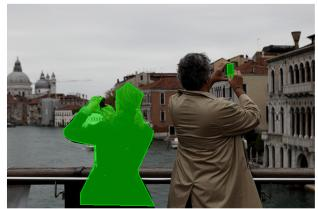

  
Ground Truth

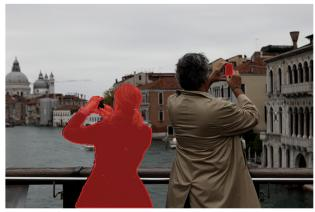

  
CycleGRPO

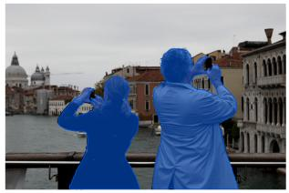

  
SAMTok  
Figure 7 Qualitative mask-localization results on GRES [48]. CycleGRPO is compared with SAMTok [31] and the ground truth.

## Question:

The head of a duck with a brown and white pattern, facing slightly to the right, is surrounded by water.

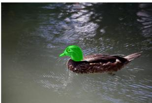

## Question:

The snow surrounds a black ramp where a person is performing a trick.

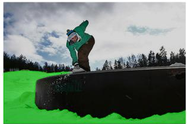  
Ground Truth

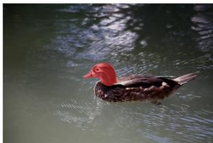

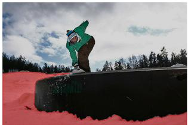

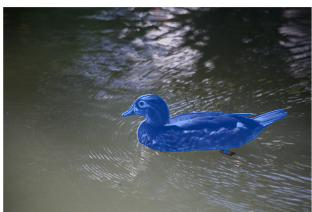

CycleGRPO  
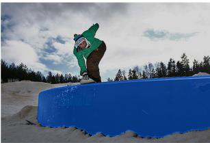  
SAMTok  
Figure 8 Qualitative mask-localization results on GroundingSuite [31]. The first row evaluates part-level segmentation; the second evaluates amorphous stuf regions. Predictions from SAMTok and CycleGRPO are compared with the ground truth.

Question:   
The nose is small, brown, and located centrally on the bear's face. Question:   
A clear sky with a skateboarder   
performing a trick in the foreground and a crowd of spectators in the background.

## Question: Ouestion:

The light-colored hair is on the baby's head, distinguishable by its color and position on the head.

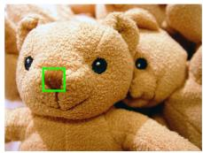

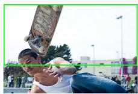

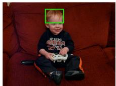  
Ground Truth

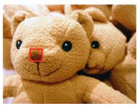

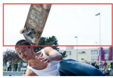

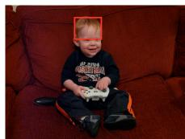  
CycleGRPO

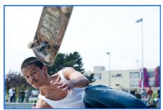

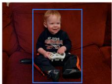  
Qwen3VL  
Figure 9 Qualitative GroundingSuite results with continuous bounding-box outputs. CycleGRPO predictions, Qwen3-VL predictions, and ground-truth boxes are shown in red, blue, and green, respectively.

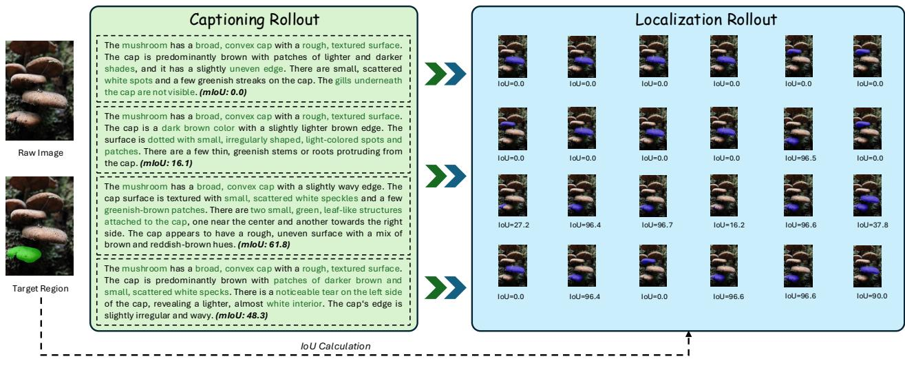  
Figure 10 A spatial region–text–region rollout. Each of four descriptions of the target mushroom conditions six localization rollouts. Green and red text mark accurate and erroneous evidence; blue masks show the reconstructed regions. More precise descriptions generally yield higher reconstruction IoU.

Scaling the SAMTok backbone. We additionally apply CycleGRPO to SAMTok initialized from Qwen3- VL-8B. As shown in Tab. 16, the method improves the DLC-Bench average from 63.7% to 68.1% and the GroundingSuite average gIoU from 63.1% to 64.5%, confirming that the gains persist with a larger spatial backbone.

Table 16 CycleGRPO with SAMTok initialized from Qwen3-VL-8B, evaluated on DLC-Bench [46] and Grounding Suite [31]. All values are percentages.
<table><tr><td rowspan="2">Method</td><td colspan="2">DLC-Bench</td><td colspan="4">GroundingSuite (gIoU)</td></tr><tr><td>Pos. Neg.</td><td>Avg.</td><td>Single Stuff</td><td>Multi</td><td>Part</td><td>Avg.</td></tr><tr><td>SAMTok-8B</td><td>47.3</td><td>80.0 63.7</td><td>88.6</td><td>15.9 65.9</td><td>58.7</td><td>63.1</td></tr><tr><td>+ Ours</td><td>51.6</td><td>84.6 68.1</td><td>90.1</td><td>15.2 77.7</td><td>55.2</td><td>64.5</td></tr></table>

Closed-loop rollout. Fig. 10 provides a representative training case. Descriptions that preserve distinctive visual evidence reconstruct the target region reliably, whereas hallucinated or insuficiently discriminative details produce low-overlap localization rollouts. This correspondence turns the model’s own reconstruction accuracy into a direct learning signal for region description quality.

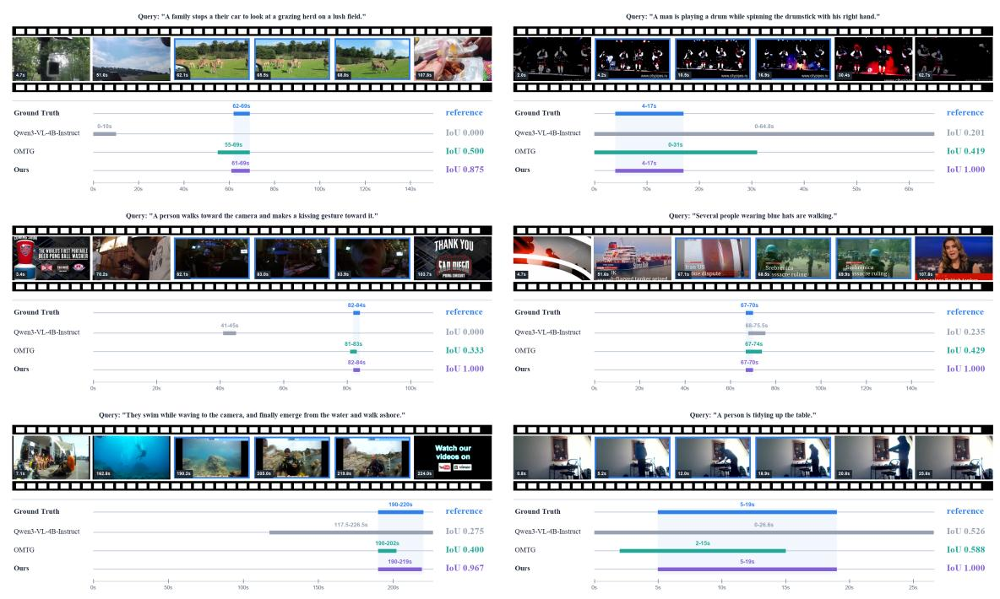

## C Temporal Grounding Visualization

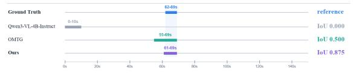

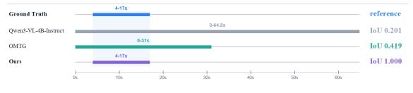

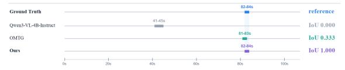

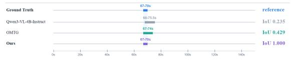

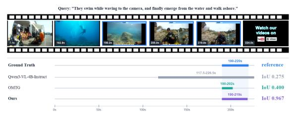

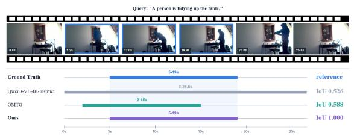  
Figure 11 Qualitative temporal grounding comparisons on TimeLens [33]. Blue-bordered frames depict the reference event, and the timelines compare the reference interval with predictions from Qwen3-VL-4B-Instruct, OMTG, and our model. The displayed IoU values denote temporal IoU.

Boundary-sensitive temporal localization. Fig. 11 covers events with substantially diferent durations, from brief gestures and object interactions to longer activities. The base model frequently misses the target or predicts an overly broad interval, while OMTG generally narrows the prediction but still includes irrelevant context or truncates part of the event. In these examples, our model aligns the predicted boundaries more closely with the reference, including short events embedded in long videos and activities whose completion must be distinguished from their preceding context.

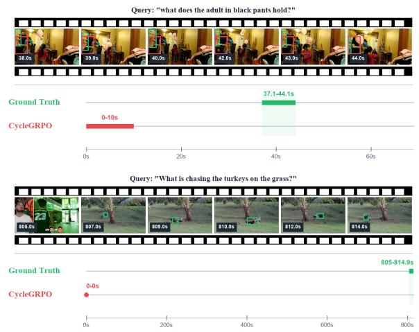

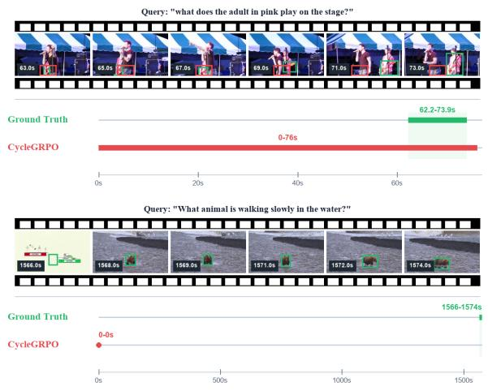  
Figure 13 Representative failure cases of Generalized CycleGRPO on V-STaR [112]. From upper left to lower right, the examples show incorrect temporal retrieval despite a correct semantic answer, imprecise spatial localization with an over-broad temporal prediction, semantic hallucination for an unusual interaction, and a missed event near the end of a long video. Green and red denote the ground truth and CycleGRPO predictions, respectively.

## D Additional V-STaR Qualitative Analysis

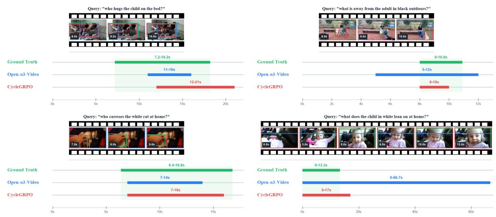  
Figure 12 Qualitative V-STaR [112] examples for joint temporal–spatial grounding. Each panel contains a query, sampled frames with the associated object evidence, and the predicted temporal interval. The green bar and shaded band denote the reference interval; blue and red bars denote Open-o3-Video and Generalized CycleGRPO, respectively.

Joint temporal--spatial evidence. Fig. 12 makes the temporal component of V-STaR’s joint evidence requirement explicit. For the outdoor query in the upper-right panel, Open-o3-Video spans 5–12 s for a reference event from 8–10.9 s, whereas CycleGRPO restricts the prediction to 8–10 s. Likewise, for the child-in-white example, the baseline extends to 66.7 s after the reference event ends at 13.3 s; our prediction remains close to the event and stops at 17 s. The lower-left example further shows a more complete recovery of the event’s end boundary. These examples align with the aggregate V-STaR gains in Tab. 7: learning to reconstruct the queried temporal–spatial region discourages explanations supported by the right object at the wrong time or by irrelevant temporal context. At the same time, the upper-left example remains dificult: the predicted interval is late and overextended, showing that cycle consistency improves but does not guarantee boundary accuracy in every case.

Representative failure modes. Fig. 13 exposes limitations that are obscured by aggregate scores. In the upper-left case, the model correctly identifies the cup but places the event at 0–10 s rather than 37.1–44.1 s. In the upper-right case, it recognizes the red electric guitar, yet predicts nearly the entire video and fails to localize the object precisely. The lower-left case confuses a sea otter chasing two turkeys with a man chasing a deer, illustrating semantic hallucination under an unusual interaction. Finally, the lower-right case misses a bear appearing near the end of a long video and incorrectly concludes that no animal is present. These examples highlight remaining challenges in semantic robustness, fine-grained spatial grounding, and long-range temporal retrieval.

## E DOVE Statistics

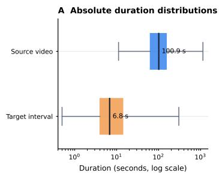

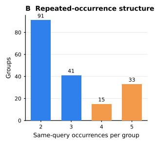

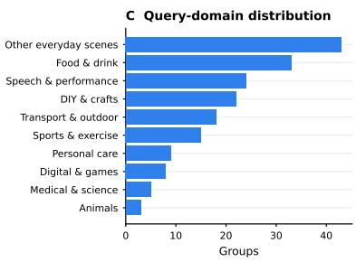

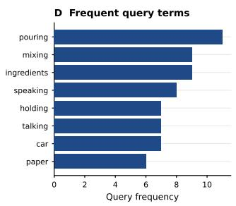

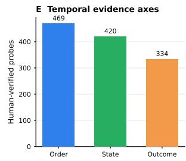

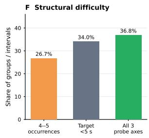  
Figure 14 Statistics of DOVE. (A) Absolute source-video and target-interval duration distributions on a logarithmic time axis (seconds); boxes show the interquartile ranges and whiskers show the full ranges. (B) Number of same-query occurrences per group. (C) Query-domain distribution from a deterministic lexical taxonomy over the human-reviewed queries. (D) Most frequent non-actor query terms. (E) Human-verified temporal probes by evidence axis. (F) Model-independent dificulty indicators: groups with four or five occurrences, target intervals shorter than five seconds, and intervals covered by all three probe axes.

Diversity and structural difficulty. Fig. 14 characterizes the benchmark beyond its scale. The median source video lasts 100.9 seconds, whereas the median target interval lasts 6.8 seconds; Fig. 14(A) shows both duration distributions on a logarithmic axis. The queries span food and drink, speech and performance, crafts, transportation and outdoor activity, sports, personal care, digital interfaces, medical scenes, and animals; the plotted categories come from a reproducible keyword taxonomy rather than additional human labels. Structurally, 48 groups (26.7%) contain four or five same-query occurrences, and 180 targets (34.0%) last less than five seconds. The 1,223 probes provide a median of two probes per covered interval, while 195 intervals (36.8%) have probes covering all three types: Order, State, and Outcome. Thus, DOVE combines short targets, repeated same-query distractors, and multi-axis temporal evidence without defining dificulty from any evaluated model’s outputs.