# HOW REPRESENTATIONAL PRIORS SHAPE GENERALIZATION IN WORLD ACTION MODELS

Junha Chun2 Youngjoon Jeong1 Taesup Kim1∗

1Graduate School of Data Science, Seoul National University

2Department of Electrical and Computer Engineering, Seoul National University

## ABSTRACT

World action models (WAMs) are shown to substantially diverge under generalization performance based on their generative backbones. We investigate this gap through the representational geometry that WAMs inherit from their backbones and how policy training reorganizes it. Our central hypothesis is that a useful representational prior would structure geometry that separates nuisance information from the in-distribution manifold in advance of training as a policy. We quantify this with nuisance orthogonality; orthogonality of the feature under visual variation outside the empirical in-distribution manifold. Across various image and video backbones, we show that a higher orthogonality from the representational prior is associated with stronger robustness to visual variations after WAM training, enabling policy generalization measurable prospectively for world models. In addition, analyzing the resulting robust WAMs reveals nuisance suppression; relative suppression of feature displacement caused by such variations and robust action generation of the policy. Together, these findings provide a geometric perspective on how the representational prior of the world model shapes the generalization performance of WAMs.

## 1 INTRODUCTION

World action models (WAMs) have recently become a major paradigm for a robotic foundation model (Kim et al., 2026; Ye et al., 2026; Li et al., 2026a; Pai et al., 2025; NVIDIA et al., 2026). They inherit the representations and rich spatiotemporal knowledge from generative backbones with scalable pretraining, predict the future with world modeling objective, and generate actions from the features from the reasoning process. It has been shown that they improve generalization to out-of-distribution scenes by predicting how the world changes.

However, recent researches question whether the capabilities of WAMs come from explicit test-time prediction or enriched representations from the world modeling, and whether video prediction is a good representational prior or objective for world modeling. FastWAM finds that representational gains from world modeling, rather than explicit future generation at test time, is the main contributor of WAM’s performance (Yuan et al., 2026). Furthermore, ImageWAM shows image editors as backbones led to significant improvements to the policy generalization from edit-aware representation which contain task-relevant visual changes and is evidenced by attention maps (Zhang et al., 2026b). We therefore ask:

## Which geometric structure makes a backbone’s representationalprior usefulfor WAM generalization, and how doespolicy adaptation transform that structure?

Understanding this question is necessary to explain why some inherited representations support stronger generalization. Inspired by the baseline WAMs and fundamental questions about their representations and performances, we start by analyzing the representational geometry of in- and out-of-distribution observations.

Throughout the paper, we introduce nuisance orthogonality, which characterized the geometric separation between feature displacement from visual variations and the empirical in-distribution manifold. High nuisance orthogonality therefore measures a potential for disentangled representational prior which presents in the generative backbones before policy training. We show that nuisance orthogonality is highly related to the generalization performance of WAMs, across visual variations and models, allowing prospective diagnostics of world models. Furthermore, we present nuisance suppression after policy training, a suppressing behavior of residual displacement so that the policy can remove nuisance information, improve scene retrieval, and enable robust action generation.

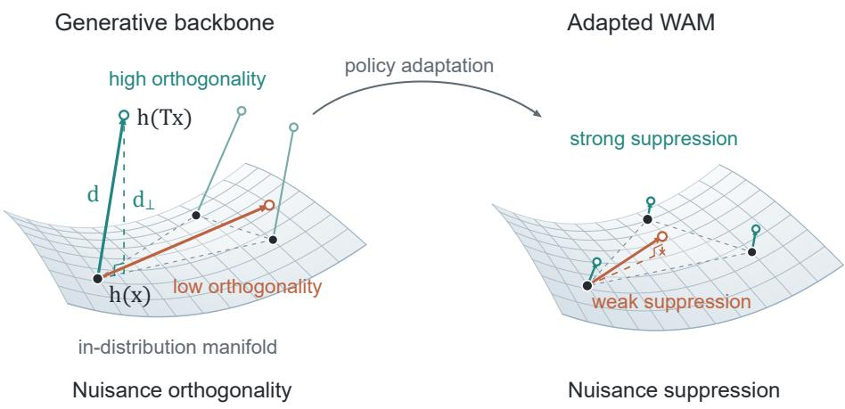  
Figure 1: Nuisance orthogonality and suppression lead to generalization of WAM. We show that orthogonality of feature displacement with respect to in-distribution data manifold is related to generalization of WAM. This arises from the reorganization of representations during policy adaptation, which we explain through nuisance suppression. Since adaptation reshapes the representation space, the figure provides a conceptual illustration.

Our contributions are as follows:

• A geometric characterization of representational priors: Nuisance orthogonality, the fraction of feature displacement orthogonal to the empirical span of in-distribution data, quantifying whether a backbone separates action preserving visual changes from directions that distinguish clean scenes.

• An evidence from nuisance orthogonality to policy robustness: Across world model comparisons, higher nuisance orthogonality is associated with stronger downstream visual robustness motivating a diagnostic for assessing world model backbones before WAM policy training.

• An analysis on how representations reshape after policy adaptation: We introduce nuisance suppression to measure how representation space change after adaptation, showing that more robust policy exhibits stronger and more consistent nuisance suppression.

## 2 RELATED WORK

World Action Models. World action models (WAMs) are emerging as a major paradigm for robot foundation models by action generation with predictive modeling of future visual observations (Kim et al., 2026; Ye et al., 2026; Li et al., 2026a; Pai et al., 2025; NVIDIA et al., 2026). Their appeal lies in transferring spatiotemporal priors from generative pretraining to robotics control, while future prediction provides supervision linking actions to their visual consequences. Empirical studies report improved data efficiency and generalization to unseen objects, tasks, and environments, with strong robustness under visual perturbations (Zhang et al., 2026c). Beyond direct policy execution, predictive world modeling can help test-time planning by evaluating the consequences of candidate actions (Kim et al., 2026; Zhou et al., 2026).

Recent work further shows that video prediction co-training is necessary to improve world representation, but explicit test-time generation contributes only to trivial improvements of downstream tasks (Yuan et al., 2026). In addition, some offer an alternative to video generation backbones showing that pretrained image editing representations are helpful for visual generalization (Zhang et al., 2026b; Labs, 2025; Wu et al., 2025; Wang et al., 2025). These researches motivate examining the representational priors of generative backbones and their underlying generalization performance. Our study investigates which geometric properties inherited from visual pretraining are related with robustness and how they reshape after policy adaptation.

Nuisance separation and representation geometry. Nuisance invariance and disentanglement provide a foundation for separating task information from irrelevant variation (Achille & Soatto, 2018), although unsupervised disentanglement is not identifiable without inductive biases or supervision (Locatello et al., 2019). Related objectives remove nuisance factors adversarially (Ganin et al., 2016), separate shared from domain-specific features, or encourage orthogonality between task and nuisance representations (Bousmalis et al., 2016; Sarhan et al., 2020), with applications in domain adaptation and fair representation learning.

In robot manipulation, prior work has decomposed generalization failures into factors of variation and studied which properties of pretrained visual representations predict robustness to distribution shift (Xie et al., 2023; Burns et al., 2023). In visual reinforcement learning, similar ideas enable transfer across visual domains and robustness to task-irrelevant distractors (Higgins et al., 2018; Zhang et al., 2021). More recent work disentangles nuisance factors through explicit or implicit separation in latent action pretraining (Bu et al., 2025; Li et al., 2025; Jeong et al., 2026; Dai et al., 2026; Zhang et al., 2026a). Our diagnostic instead measures nuisance separation in pretrained representations and relates it empirically to policy robustness.

## 3 EXPERIMENTAL SETUP

## 3.1 MOTIVATION

## 3.1.1 WHY IMAGE EDITING COULD BE BENEFICIAL FOR GENERALIZATION

Prior work have shown that WAMs from image editing models tend to generalize better than video prediction models (Zhang et al., 2026b). From scalable pretraining, image editors learn to follow instructions so that they can zero-shot inference image editing even in out-of-domain images as shown in Figure 2.

During the denoising process, image editors are conditioned on a reference scene and a noisy target image that contains editing modifications, which allow the model to understand the relationship between the source image and edited target image from the early transformer blocks. General knowledge and representational relationships of background modification, illumination, texture, or blurring are more efficiently learnable through scalable image editing pretraining. Video generation models, in contrast, are biased more towards temporal continuity, motion, and dynamics rather than counterfactual changes of the world. This motivates the hypothesis that the generative backbones for robust policy would have more rich representations under domain shift even before policy adaptation.

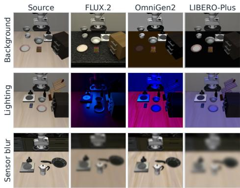  
Figure 2: Zero-shot editing on LIBERO. Image editing models are already capable of zeroshot editing LIBERO data with visual variations.

## 3.1.2 REPRESENTATIONAL PRIOR IS MORE THAN PRETRAINING OBJECTIVE

The generalization performance of ImageWAM has shown significant improvements for using image editing models over video prediction models. Howver, as in Table 1, when training ImageWAM from scratch initialization of FLUX.2 (63.9%), its advantage over Wan2.2 and FastWAM (46.5%) shows that prior knowledge of image editing alone cannot fully explain this comparison. Thus, we assume that representational priors for WAMs are not just what the generative backbone has learned through the pretraining objective, but is affected by collection of all design choices including vi sion and language tokenizers, architecture and initialization, language injection pipeline, pretraining datasets. To analyze this, we start by analyzing the geometry of internal representations of generative backbones when various observations are encoded as a conditioned frame.

Table 1: Nuisance Orthgonality and LIBERO-Plus Success Rate. Nuisance orthogonality of the generative world models and LIBERO-Plus evaluation suite success rate across visual variations after WAM training. † represents results from the original papers.
<table><tr><td rowspan="2">Model</td><td colspan="2">Camera</td><td colspan="2">Background</td><td colspan="2">Light</td><td colspan="2">Sensor Noise</td><td colspan="2">Average</td></tr><tr><td>Orth.</td><td>SR (%)</td><td>Orth.</td><td>SR (%)</td><td>Orth.</td><td>SR (%)</td><td>Orth.</td><td>SR (%)</td><td>Orth.</td><td>SR (%)</td></tr><tr><td colspan="9">Baselines</td><td></td></tr><tr><td>Wan2.2†</td><td>0.673</td><td>16.4</td><td>0.420</td><td>53.7</td><td>0.631</td><td>78.2</td><td>0.653</td><td>37.7</td><td>0.594</td><td>46.5</td></tr><tr><td>FLUX.2</td><td>0.803</td><td>77.6</td><td>0.774</td><td>84.9</td><td>0.845</td><td>98.5</td><td>0.773</td><td>94.9</td><td>0.799</td><td>89.0</td></tr><tr><td>Scratch FLUX.2</td><td>0.754</td><td>65.3</td><td>0.584</td><td>56.8</td><td>0.778</td><td>71.4</td><td>0.778</td><td>62.0</td><td>0.724</td><td>63.9</td></tr><tr><td>OmniGen2†</td><td>0.802</td><td>80.0</td><td>0.700</td><td>69.4</td><td>0.712</td><td>82.6</td><td>0.768</td><td>77.1</td><td>0.746</td><td>77.3</td></tr><tr><td>Ovis-U1†</td><td>0.791</td><td>63.3</td><td>0.718</td><td>66.7</td><td>0.772</td><td>86.3</td><td>0.806</td><td>75.2</td><td>0.772</td><td>72.9</td></tr><tr><td colspan="9">Additional Models</td><td></td></tr><tr><td>FlashMotion</td><td>0.696</td><td>52.3</td><td>0.515</td><td>50.9</td><td>0.682</td><td>90.9</td><td>0.685</td><td>61.7</td><td>0.645</td><td>64.0</td></tr><tr><td>Kiwi-Edit</td><td>0.790</td><td>62.3</td><td>0.741</td><td>68.0</td><td>0.811</td><td>94.4</td><td>0.802</td><td>83.8</td><td>0.786</td><td>77.1</td></tr><tr><td>SANA-Video</td><td>0.715</td><td>60.8</td><td>0.696</td><td>62.3</td><td>0.803</td><td>94.4</td><td>0.753</td><td>84.3</td><td>0.742</td><td>75.4</td></tr><tr><td>MAGI-1</td><td>0.814</td><td>67.9</td><td>0.662</td><td>66.4</td><td>0.683</td><td>87.4</td><td>0.841</td><td>83.2</td><td>0.750</td><td>76.2</td></tr></table>

## 3.2 EXPERIMENTAL SETTING

Diagnostic dataset and visual shifts. We construct a diagnostic dataset from LIBERO-Plus using paired observations that share the same underlying simulator state but differ in visual appearance (Liu et al., 2023; Fei et al., 2025). The dataset covers four categories of visual shift: lighting, background, sensor noise, and camera viewpoint, each evaluated at multiple strengths. We use 40 clean reference observations to estimate the empirical in-distribution feature subspace introduced in Section 4. For these reference states, we collect 1,200 corresponding out-of-distribution observations and use the resulting pairs to measure variation-induced feature displacement. Generalization requiring changes in language understanding, task composition, or action semantics is outside the scope of this study.

Generative backbones and WAMs. The experiments use Wan2.2, FLUX.2, OmniGen2 and Ovis-U1 from the prior works and scratch FLUX.2 as generative backbones (Wan et al., 2025; Yuan et al., 2026; Labs, 2025; Wu et al., 2025; Wang et al., 2025; Zhang et al., 2026b). Generalization performances are presented with their policy success rates in LIBERO-Plus trained with LIBERO dataset under the configurations from FastWAM and ImageWAM, with total of 5, 418 evaluation trajectories.

In addition, to show that our work is generalizable to other generative backbones, we extend Flash-Motion, Kiwi-Edit, SANA-Video 2.0 5B, and MAGI-1 4.5B with a comparable model capacity scale and extend them to a generative backbone for WAMs (Li et al., 2026b; Lin et al., 2026; Chen et al., 2026; ai et al., 2025). They are extended to WAM with MoT architecture with action expert, trained with future prediction loss respecting their original design and flow matching action prediction loss (Black et al., 2026). Specific model configurations and training settings are in the Appendix A.1.

## 4 NUISANCE ORTHOGONALITY

With the above motivation, we analyze the displacement of world model representations caused by the visual variations from the clean image. We hypothesize that displacement direction and their

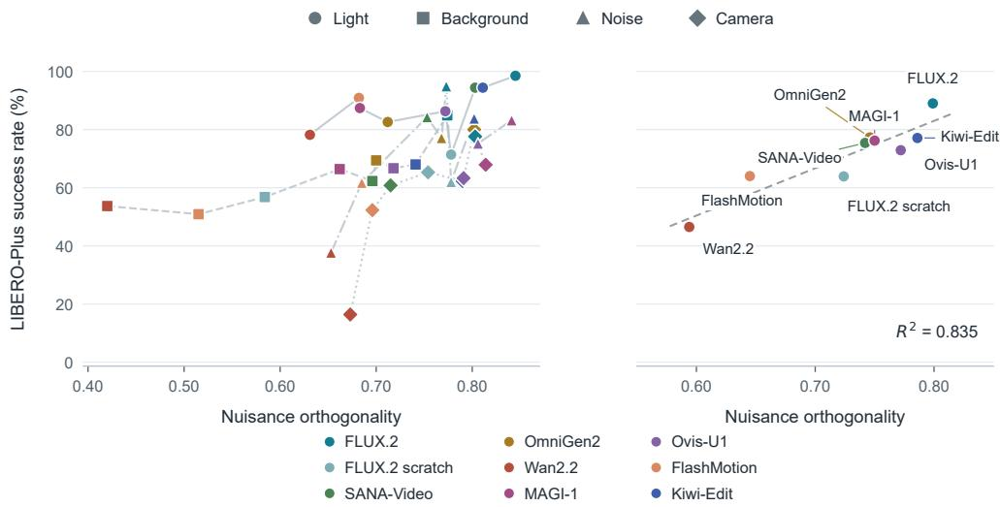  
Figure 3: Visualization of Nuisance Orthgonality and LIBERO-Plus Success Rate. Overview and visualization of nuisance orthogonality and LIBERO-Plus generalization performance in Table 1. The left figure shows tendency across variation types and the right shows the mean.

orthogonality from the in-distribution manifold would measure disentanglement of information from the generative backbones, which would be geometrically easier to remove nuisance information and less suffer from shortcut learning during policy adaptation.

## 4.1 DEFINITION

Let $h _ { \ell }$ be intermediate representations from transformer block at layer ℓ of generative backbone before WAM training. We extract $h _ { \ell } ( x )$ spatially averaged with the clean observation x. With mean of the reference features $\begin{array} { r } { \mu _ { \ell } = \frac { 1 } { n } \Sigma _ { i = 1 } ^ { n } \dot { h _ { \ell } } ( \bar { x } _ { i } ) } \end{array}$ , define

$$
H _ { \ell } = [ \begin{array} { c } { ( h _ { \ell } ( x _ { 1 } ) - \mu _ { \ell } ) ^ { \top } } \\ { \ldots } \\ { ( h _ { \ell } ( x _ { n } ) - \mu _ { \ell } ) ^ { \top } } \end{array} ] , \qquad P _ { \ell } = V _ { r } V _ { r } ^ { \top }\tag{1}
$$

where $V _ { r }$ contains the retained right singular vectors of $H _ { \ell } = U \Sigma V ^ { \top }$ with retained rank $r , P _ { \ell }$ becoming a projection matrix to the empirical representation subspace at layer $\ell .$

Then, we extract $h _ { \ell } ( T x )$ which are features of corresponding sample and action-preserving transformation $T$ as a condition frame. Computing the orthogonality of the displacement vector

$$
d _ { \ell } ( x , T ) = h _ { \ell } ( T x ) - h _ { \ell } ( x ) , \qquad q _ { \ell } ( x , T ) = 1 - \frac { \| P d _ { \ell } ( x , T ) \| ^ { 2 } } { \| d _ { \ell } ( x , T ) \| ^ { 2 } }\tag{2}
$$

which can be aggregated over model layers and our diagnosis dataset, resulting the nuisance orthogonality of generative model under transformation T.

$$
\mathcal { O } ( T ) = \frac { 1 } { L } \sum _ { \ell = 1 } ^ { L } \mathbb { E } _ { x } [ q _ { \ell } ( x , T ) ] .\tag{3}
$$

A high orthogonality score means that the displacement is mostly orthogonal to sampled indistribution subspace.

## 4.2 ANALYSIS

## 4.2.1 NUISANCE ORTHOGONALITY ALIGNS WITH GENERALIZATION

If nuisance orthogonality is a useful inherited prior, generative backbones with higher orthogonality should tend to become more robust policies. We test this on the baseline models with an average success rate of LIBERO-Plus tasks as a generalization performance after WAM training. We retain full rank $r = 3 9$ for 40 reference scenes preserving all nonzero empirical singular directions.

Table 1 presents the results with nuisance orthogonality compared to the evaluation success rate. Figure 3 further shows that there is a strong tendency for the orthogonality to the downstream WAM generalization performance in general, while the sensitivity differs between visual variation types and difficulties. We further ablate this by the retained rank in Figure 4, showing that the nuisance orthogonality is consistent with the changes in the retained rank. We note the value for the orthogonality increases as retained rank decreases because fewer directions contribute to the projected displacement.

## 4.2.2 IMPLICATIONS FOR MODEL SELECTION

To show that this tendency is generalized to other generative backbones, we conduct identical analysis to world models including FlashMotion, Kiwi-Edit, SANA-Video 2.0 5B and MAGI-1 4.5B (Li et al., 2026b; Lin et al., 2026; Chen et al., 2026; ai et al.,

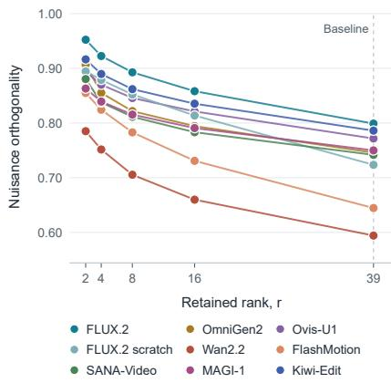  
Figure 4: Rank ablation. Nuisnace orthogonality is consistent to retained rank changes.

2025). Each model is trained as a WAM policy respecting their architecture and action expert designs in FastWAM and ImageWAM, with video prediction loss from the original backbones and flow matching loss for action prediction. Specific designs are in the Appendix A.1.

The results in Table 1 and Figure 3 show that we could predict the performance in advance of WAM training by measuring the nuisance orthogonality. Moreover, video models being capable of high generalization performance supports the hypothesis that any model with rich representation regardless of their pretraining objective could have a useful representational prior.

## 5 NUISANCE SUPPRESSION

A useful representational prior for generalization should support policy adaptation that preserves task-relevant scene distinctions while reducing sensitivity to action-preserving appearance changes. We therefore measure how displacements within and outside the empirical in-distribution manifold change after WAM training.

## 5.1 DEFINITION

WAM adaptation can completely change representational geometry and scale of both displacements and features. We therefore normalize them using the empirical covariance of in-distribution features in the corresponding model. The same in-distribution observations define the reference set for both checkpoints, but we fit the basis and variances at each checkpoint representations separately.

Using the centered clean matrix H from Equation 1, compute $H = U \Sigma V ^ { \top }$ , retained rank r, projection matrix $P = V _ { r } V _ { r } ^ { \top }$ , and feature displacement $d = h ( T x ) - h ( x )$ . Each $\lambda _ { k } = \sigma _ { k } ^ { 2 } / n$ is the variance of $v _ { k } ^ { \top } h ( x _ { i } )$ across the n in-distribution observations. All of them are checkpoint-specific.

For transformation T, define the standardized response within the in-distribution manifold and its WAM/WM ratio as

$$
s ( x , T ) = \frac { 1 } { r } \sum _ { k = 1 } ^ { r } \frac { \langle v _ { k } , d \rangle ^ { 2 } } { \lambda _ { k } } . \qquad \rho _ { T } = \frac { \mathbb { E } _ { x } \left[ s _ { \mathrm { W A M } } ( x , T ) \right] } { \mathbb { E } _ { x } \left[ s _ { \mathrm { W M } } ( x , T ) \right] } .\tag{4}
$$

And to measure the orthogonal component, define

$$
s _ { \perp } ( x , T ) = \frac { \| ( I - P ) d \| ^ { 2 } } { \sum _ { k = 1 } ^ { r } \lambda _ { k } } , \qquad \rho _ { \perp , T } = \frac { \mathbb { E } _ { x } \left[ s _ { \perp , \mathrm { W A M } } ( x , T ) \right] } { \mathbb { E } _ { x } \left[ s _ { \perp , \mathrm { W M } } ( x , T ) \right] } .\tag{5}
$$

(a) Absolute in-distribution response. FLUX.2 / ImageWAM Wan2.2 / FastWAM  
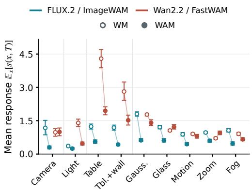

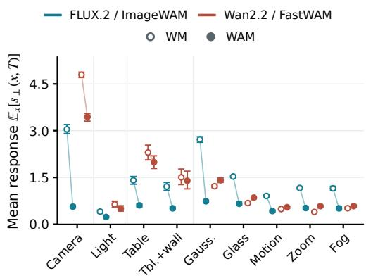  
(b) Absolute orthogonal response.

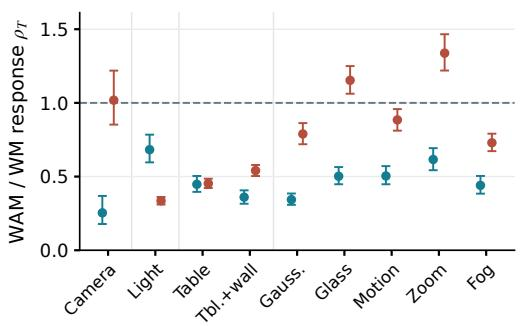  
(c) Relative in-distribution response.

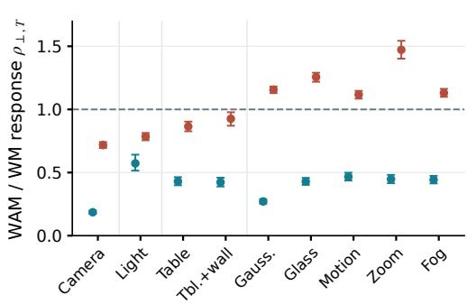  
(d) Relative orthogonal response.  
Figure 5: Nuisance responses before and after WAM adaptation. (a) and (b) show the absolute mean responses $\mathbb { E } _ { x } [ s ( x , T ) ]$ and $\mathbb { E } _ { x } [ s _ { \perp } ( x , T ) ]$ for each WM and WAM. (c) and (d) show the corresponding WAM/WM ratios $\rho _ { T }$ and $\rho _ { \perp , T }$ . Suppression takes place when the values are under the dashed line marking 1.0.

Where the denominator is the total variance of the clean reference features for normalization.

A value $\rho _ { T } < 1 \mathrm { o r } \rho _ { \perp , T } < 1$ indicates relative nuisance suppression for the corresponding component. Within-span suppression means smaller displacements in coordinates whitened by the covariance of clean reference features, measuring reduced response along directions that distinguish the sampled clean observations. Orthogonal suppression means less residual outside that span per unit of total reference variance, indicating less sensitivity.

## 5.2 ANALYSIS

Nuisance Suppression of Robust Policy. If nuisance suppression is what happens after robust policy training, we can expect suppression on both components. We test this property on FLUX.2 to ImageWAM and Wan2.2 to FastWAM on our diagnosis dataset. For simplicity and readability, we present metrics from the features extracted from single 07 for FLUX.2 and ImageWAM, and block 14 for Wan2.2 and FastWAM.

Figure 5 shows how the responses change after policy adaptation. The absolute scores in the top figures decrease consistently from FLUX.2 to ImageWAM across all tested variations, measuring consistent nuisance suppression. The corresponding ratios in the bottom figures confirm this pat

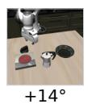

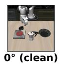

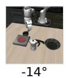  
FLUX.2 Pretrained ImageWAM

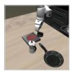

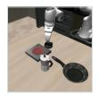

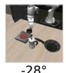

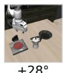

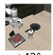

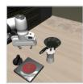  
(a) Camera sweep examples. Examples of nine views from $- 5 6 ^ { \circ } ~ \mathrm { t o } + 5 6 ^ { \circ }$

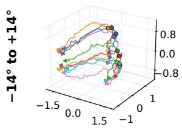

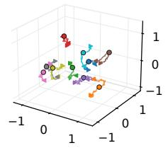

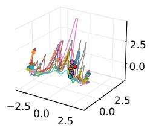

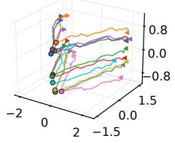

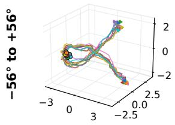

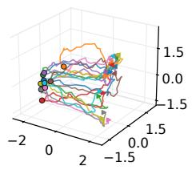

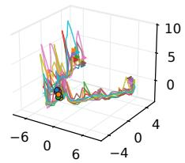

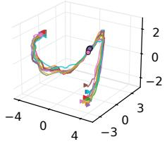  
(b) 3D PCA Visualization. Top is features from $\pm 1 4 ^ { \circ }$ range and bottom from $\pm 5 6 ^ { \circ }$ range. Colors identify the ten scenes, circles mark $0 ^ { \circ }$ view and triangles mark the camera range endpoints.

Figure 6: Representations of Camera variation. We present example for camera sweep experiments in (a) and 3D PCA Visualizations in (b). There are fitted and scaled independently in each panel for visibility.

tern by showing $\rho _ { T }$ and $\rho _ { \perp , T }$ being below 1 for both along in-distribution manifold directions and orthogonal direction.

In contrast, FastWAM shows a less consistent pattern, with weaker suppression compared to Image-WAM. Where suppression does not even take place for some of the visual variation types. Also, the absolute score for camera perturbation is not suppressed enough explaining FastWAM’s weak performance under camere perturbation (16.4%). The comparison therefore presents the stronger robustness of ImageWAM with more consistent and stronger nuisance suppression.

Controlled Experiment and Visualization. Camera perturbation is the case of LIBERO-Plus with lowest success rate for both FLUX.2 and Wan2.2. We compare FLUX.2 to ImageWAM and Wan2.2 to FastWAM with representations of 64 intermediate camera views ranging over weak $( [ - 1 4 ^ { \circ } , + 1 4 ^ { \circ } ] )$ and strong $( [ - 5 6 ^ { \bar { \circ } } , + 5 6 ^ { \circ } ] )$ perturbations on 10 scenes from identical task as in Figure 6a. Effects of adaptation on the representations are visualized with 3D PCA in Figure 6b.

In weak perturbations, ImageWAM representations are suppressed enough so that $0 ^ { \circ }$ angle scenes are identifiable from the features of the perturbed scene contracting into compact groups near distinct original views. Their representation approaches camera invariance over this weak perturbation range without even seeing them. On the other hand, FastWAM representations tries to disentangle the camera trajectory from scene identity rather than suppressing it.

Continued in strong perturbations, ImageWAM representation paths vary along the scenes and camera viewpoints but each scenes remain distinguishable from each other. However, FastWAM representations are dominated by the camera variations. This means that models learn to ignore the nuisance information without any assumptions if the representational prior is properly shaped and geometrically easy to do so. Supported by our experiments, we measure this representational prior via orthogonality and ignorance of nuisance via suppression.

Reshaped Geometry of Nuisance Suppression. We analyze that WAM adaptation reduces relative influence of nuisance variation compared to in-distribution variation by strengthening distinctions among the in-distribution samples in order to precisely predict the action. In our controlled experiments, adapting FLUX.2 to ImageWAM increases the total in-distribution variance $\sum _ { k = 1 } ^ { r } \lambda _ { k }$ by a factor of 13.4, while the visual variation cause the displacement of feature with in-distribution variance and orthogonal direction increased by 2.73 and 2.48. However, adapting Wan2.2 to Fast-WAM increases total in-distribution variance by a factor of 4.42, while each displacement component increases by 5.63 and 3.18, with much weaker suppression compared to ImageWAM.

## 6 CONCLUSION

We studied how the representational geometry of generative backbones relates to visual generalization in world action models. Nuisance orthogonality measures whether action-preserving visual variations displace features outside the empirical subspace of in-distribution observations, providing a diagnostic before computation intensive policy training. Across the evaluations, higher orthogonality is generally related with stronger policy robustness in LIBERO-Plus, with further evaluations of additional world models support examining representational geometry beyond the distinction between image and video pretraining. After adaptation, ImageWAM capable of robust action generation exhibits consistent nuisance suppression of displacement, whereas FastWAM shows less consistent and weak suppression. Together, these findings suggest that useful representational priors separate visual nuisance from in-distribution samples and that policy adaptation reduces its relative influence.

Limitations Our evidence is restricted to simulated LIBERO manipulation and the visual shifts evaluated in LIBERO-Plus. We exclude generalization benchmarks for language instructions or action compositionalities to study with limited scope on action-preserving visual generalization. Also the experimental results are observational, our results do not isolate every causal effect of orthogonality or of pretraining objective, but study representational geometry and its relationship with various compounding effects and generalization performance.

## REFERENCES

Alessandro Achille and Stefano Soatto. Emergence of invariance and disentanglement in deep representations. Journal of Machine Learning Research, 19(50):1–34, 2018. URL http: //jmlr.org/papers/v19/17-646.html.

Sand. ai, Hansi Teng, Hongyu Jia, Lei Sun, Lingzhi Li, Maolin Li, Mingqiu Tang, Shuai Han, Tianning Zhang, W. Q. Zhang, Weifeng Luo, Xiaoyang Kang, Yuchen Sun, Yue Cao, Yunpeng Huang, Yutong Lin, Yuxin Fang, Zewei Tao, Zheng Zhang, Zhongshu Wang, Zixun Liu, Dai Shi, Guoli Su, Hanwen Sun, Hong Pan, Jie Wang, Jiexin Sheng, Min Cui, Min Hu, Ming Yan, Shucheng Yin, Siran Zhang, Tingting Liu, Xianping Yin, Xiaoyu Yang, Xin Song, Xuan Hu, Yankai Zhang, and Yuqiao Li. Magi-1: Autoregressive video generation at scale, 2025. URL https://arxiv.org/abs/2505.13211.

Anthropic. Introducing Claude Opus 5. https://www.anthropic.com/news/ claude-opus-5, 2026. Released July 24, 2026.

Kevin Black, Noah Brown, Danny Driess, Adnan Esmail, Michael Equi, Chelsea Finn, Niccolo Fusai, Lachy Groom, Karol Hausman, Brian Ichter, Szymon Jakubczak, Tim Jones, Liyiming Ke, Sergey Levine, Adrian Li-Bell, Mohith Mothukuri, Suraj Nair, Karl Pertsch, Lucy Xiaoyang Shi, James Tanner, Quan Vuong, Anna Walling, Haohuan Wang, and Ury Zhilinsky. π0: A visionlanguage-action flow model for general robot control, 2026. URL https://arxiv.org/ abs/2410.24164.

Konstantinos Bousmalis, George Trigeorgis, Nathan Silberman, Dilip Krishnan, and Dumitru Erhan. Domain separation networks. In Proceedings of the 30th International Conference on Neural

Information Processing Systems, NIPS’16, pp. 343–351, Red Hook, NY, USA, 2016. Curran Associates Inc. ISBN 9781510838819.

Qingwen Bu, Yanting Yang, Jisong Cai, Shenyuan Gao, Guanghui Ren, Maoqing Yao, Ping Luo, and Hongyang Li. Univla: Learning to act anywhere with task-centric latent actions. arXiv preprint arXiv:2505.06111, 2025.

Kaylee Burns, Zach Witzel, Jubayer Ibn Hamid, Tianhe Yu, Chelsea Finn, and Karol Hausman. What makes pre-trained visual representations successful for robust manipulation?, 2023. URL https://arxiv.org/abs/2312.12444.

Junsong Chen, Jincheng Yu, Yitong Li, Shuchen Xue, Haozhe Liu, Jingyu Xin, Yuyang Zhao, Tian Ye, Zhangjie Wu, Zian Wang, Daquan Zhou, Ping Luo, Song Han, and Enze Xie. Sana-video 2.0: Hybrid linear attention with attention residuals for efficient video generation, 2026. URL https://arxiv.org/abs/2607.21553.

Weisheng Dai, Kai Lan, Jianyi Zhou, Bo Zhao, Xiu Su, Junwen Tong, Weili Guan, and Shuo Yang. Conla: Contrastive latent action learning from human videos for robotic manipulation, 2026. URL https://arxiv.org/abs/2602.00557.

Senyu Fei, Siyin Wang, Junhao Shi, Zihao Dai, Jikun Cai, Pengfang Qian, Li Ji, Xinzhe He, Shiduo Zhang, Zhaoye Fei, Jinlan Fu, Jingjing Gong, and Xipeng Qiu. Libero-plus: In-depth robustness analysis of vision-language-action models. arXiv preprint arXiv:2510.13626, 2025.

Yaroslav Ganin, Evgeniya Ustinova, Hana Ajakan, Pascal Germain, Hugo Larochelle, Franc¸ois Laviolette, Mario Marchand, and Victor Lempitsky. Domain-adversarial training of neural networks. J. Mach. Learn. Res., 17(1):2096–2030, January 2016. ISSN 1532-4435.

Irina Higgins, Arka Pal, Andrei A. Rusu, Loic Matthey, Christopher P Burgess, Alexander Pritzel, Matthew Botvinick, Charles Blundell, and Alexander Lerchner. Darla: Improving zero-shot transfer in reinforcement learning, 2018. URL https://arxiv.org/abs/1707.08475.

Jonathan Ho and Tim Salimans. Classifier-free diffusion guidance, 2022. URL https://arxiv. org/abs/2207.12598.

Youngjoon Jeong, Junha Chun, and Taesup Kim. Learning to act robustly with view-invariant latent actions, 2026. URL https://arxiv.org/abs/2601.02994.

Moo Jin Kim, Yihuai Gao, Tsung-Yi Lin, Yen-Chen Lin, Yunhao Ge, Grace Lam, Percy Liang, Shuran Song, Ming-Yu Liu, Chelsea Finn, and Jinwei Gu. Cosmos policy: Fine-tuning video models for visuomotor control and planning, 2026. URL https://arxiv.org/abs/2601. 16163.

Black Forest Labs. FLUX.2: Frontier Visual Intelligence. https://bfl.ai/blog/flux-2, 2025.

Lin Li, Qihang Zhang, Yiming Luo, Shuai Yang, Ruilin Wang, Fei Han, Mingrui Yu, Zelin Gao, Nan Xue, Xing Zhu, Yujun Shen, and Yinghao Xu. Causal world modeling for robot control. arXiv preprint arXiv:2601.21998, 2026a.

Quanhao Li, Zhen Xing, Rui Wang, Haidong Cao, Qi Dai, Daoguo Dong, and Zuxuan Wu. Flashmotion: Few-step controllable video generation with trajectory guidance, 2026b. URL https://arxiv.org/abs/2603.12146.

Zuolei Li, Xingyu Gao, Xiaofan Wang, and Jianlong Fu. Latbot: Distilling universal latent actions for vision-language-action models, 2025. URL https://arxiv.org/abs/2511.23034.

Yiqi Lin, Guoqiang Liang, Ziyun Zeng, Zechen Bai, Yanzhe Chen, and Mike Zheng Shou. Kiwiedit: Versatile video editing via instruction and reference guidance, 2026. URL https:// arxiv.org/abs/2603.02175.

Bo Liu, Yifeng Zhu, Chongkai Gao, Yihao Feng, Qiang Liu, Yuke Zhu, and Peter Stone. Libero: Benchmarking knowledge transfer for lifelong robot learning. arXiv preprint arXiv:2306.03310, 2023.

Francesco Locatello, Stefan Bauer, Mario Luciˇ c, Gunnar R´ atsch, Sylvain Gelly, Bernhard¨ Scholkopf, and Olivier Frederic Bachem. Challenging common assumptions in the unsuper-¨ vised learning of disentangled representations. In International Conference on Machine Learning, 2019. URL http://proceedings.mlr.press/v97/locatello19a.html. Best Paper Award.

Teli Ma, Jia Zheng, Zifan Wang, Chunli Jiang, Andy Cui, Junwei Liang, and Shuo Yang. Dit4dit: Jointly modeling video dynamics and actions for generalizable robot control. arXiv preprint arXiv:2603.10448, 2026.

NVIDIA, :, Aditi, Niket Agarwal, Arslan Ali, Jon Allen, Martin Antolini, Adeline Aubame, Alis son Azzolini, Junjie Bai, Maciej Bala, Yogesh Balaji, Josh Bapst, Aarti Basant, Mukesh Be ladiya, Mohammad Qazim Bhat, Zaid Pervaiz Bhat, Dan Blick, Vanni Brighella, Han Cai, Tiffany Cai, Eric Cameracci, Jiaxin Cao, Yulong Cao, Mark Carlson, Carlos Casanova, Ting-Yun Chang, Yan Chang, Yu-Wei Chao, Prithvijit Chattopadhyay, Roshan Chaudhari, Chieh-Yun Chen, Junyu Chen, Ke Chen, Qizhi Chen, Wenkai Chen, Xiaotong Chen, Yu Chen, An-Chieh Cheng, Click Cheng, Xiu Chia, Jeana Choi, Chaeyeon Chung, Wenyan Cong, Yin Cui, Magdalena Dadela, Nalin Dadhich, Wenliang Dai, Joyjit Daw, Alperen Degirmenci, Rodrigo Vieira Del Monte, Robert Denomme, Sameer Dharur, Marco Di Lucca, Ke Ding, Wenhao Ding, Yifan Ding, Yuzhu Dong, Nicole Drumheller, Yilun Du, Aigul Dzhumamuratova, Aleksandr Efitorov, Hamid Egh balzadeh, Naomi Eigbe, Imad El Hanafi, Hassan Eslami, Benedikt Falk, Jiaojiao Fan, Jim Fan, Amol Fasale, Sergiy Fefilatyev, Liang Feng, Francesco Ferroni, Sanja Fidler, Xiao Fu, Vikram Fu gro, Prashant Gaikwad, TJ Galda, Katelyn Gao, Yihuai Gao, Wenhang Ge, Sreyan Ghosh, Arushi Goel, Vivek Goel, Akash Gokul, Rama Govindaraju, Jinwei Gu, Miguel Guerrero, Elfie Guo, Aryaman Gupta, Siddharth Gururani, Hugo Hadfield, Song Han, Ankur Handa, Zekun Hao, Mo hammad Harrim, Ali Hassani, Nathan Hayes-Roth, Yufan He, Chris Helvig, Cyrus Hogg, Madi son Huang, Michael Huang, Sophia Huang, Yufan Huang, Jacob Huffman, DeLesley Hutchins, Suneel Indupuru, Boris Ivanovic, Arihant Jain, Joel Jang, Ryan Ji, Yanan Jian, Dongfu Jiang, Jingyi Jin, Atharva Joshi, Nikhilesh Joshi, Pranjali Joshi, Andy Ju, Jaehun Jung, Weiwei Kang, Scott Kassekert, Jan Kautz, Ashna Khetan, Julia Kiczka, Slawek Kierat, Gwanghyun Kim, Kuno Kim, Sunny Kim, Kezhi Kong, Xin Kong, Zhifeng Kong, Tomasz Kornuta, Egor Krivov, Hu Kuang, Saurav Kumar, Chia-Wen Kuo, George Kurian, Wojciech Kutak, JF Lafleche, Himangshu Lahkar, Omar Laymoun, Jayjun Lee, Sanggil Lee, Gabriele Leone, Boyi Li, Freya Li, Jiajun Li, Jinfeng Li, Ling Li, Pengcheng Li, Shangru Li, Tingle Li, Xiaolong Li, Xuan Li, Zhaoshuo Li, Zhiqi Li, Hao Liang, Maosheng Liao, Chen-Hsuan Lin, Tsung-Yi Lin, Ming-Yu Liu, Sifei Liu, Zihan Liu, Hai Loc Lu, Xiangyu Lu, Alice Luo, Ruipu Luo, Wenjie Luo, Jiangran Lyu, Martin Ding Ma, Nic Ma, Qianli Ma, Dawid Majchrowski, Louis Marcoux, Miguel Martin, Qing Miao, Ashkan Mirzaei, Shreyas Misra, Kaichun Mo, Durra Mohsin, Hyejin Moon, Pawe Morkisz, Saeid Motiian, Kirill Motkov, Seungjun Nah, Yashraj Narang, Deepak Narayanan, Thabang Ngazimbi, Julian Ouyang, Shubham Pachori, David Page, Yatian Pang, Sehwi Park, Mahesh Patekar, Mostofa Patwary, Marco Pavone, Trung Pham, Wei Ping, Soha Pouya, Shrimai Prabhumoye, Varun Praveen, Delin Qu, Hesam Rabeti, Morteza Ramezanali, Marilyn Reeb, Xuanchi Ren, Kristen Rumley, Wojciech Rymer, Jun Saito, Yeongho Seol, John Shao, Piyush Shekdar, Tianwei Shen, Humphrey Shi, Min Shi, Stella Shi, Kevin Shih, Mohammad Shoeybi, Mateusz Sieniawski, Shuran Song, Alexander Sotelo, Amir Sotoodeh, Sunil Srinivasa, Vignesh Srinivasakumar, Bartosz Stefaniak, Rahul Heinrich Steiger, Shangkun Sun, Jiaxiang Tang, Shi tao Tang, Yangyang Tang, Yue Tang, Tolou Tavakkoli, Kayley Ting, Krzysztof Tomala, Wei Cheng Tseng, Jibin Varghese, Sergei Vasilev, Thomas Volk, Raju Wagwani, Roger Waleffe, Andrew Z. Wang, Boxiang Wang, Haoxiang Wang, Qiao Wang, Shihao Wang, Shijie Wang, Ting Chun Wang, Yan Wang, Yu Wang, Rohit Watve, David Wehr, Fangyin Wei, Xinshuo Weng, Jay Zhangjie Wu, Kedi Wu, Hongchi Xia, Summer Xiao, Tianjun Xiao, Kevin Xie, Daguang Xu, Jiashu Xu, Mengyao Xu, Ruqing Xu, Xingqian Xu, Yao Xu, Dinghao Yang, Dong Yang, Hans Yang, Xiaodong Yang, Xuning Yang, Yichu Yang, Yurong You, Zhiding Yu, Hao Yuan, Simon Yuen, Xiaohui Zeng, Pengcuo Zeren, Cindy Zha, Haotian Zhang, Jenny Zhang, Jing Zhang, Liangkai Zhang, Paris Zhang, Shun Zhang, Xuanmeng Zhang, Zhizheng Zhang, Ann Zhao, Yilin Zhao, Yuliya Zhautouskaya, Charles Zhou, Fengzhe Zhou, Shilin Zhu, Yuke Zhu, Dima Zhylko, and Artur Zolkowski. Cosmos 3: Omnimodal world models for physical ai, 2026. URL https://arxiv.org/abs/2606.02800.

Jonas Pai, Liam Achenbach, Victoriano Montesinos, Benedek Forrai, Oier Mees, and Elvis Nava. mimic-video: Video-action models for generalizable robot control beyond vlas, 2025. URL https://arxiv.org/abs/2512.15692.

Mhd Hasan Sarhan, Nassir Navab, Abouzar Eslami, and Shadi Albarqouni. Fairness by learning orthogonal disentangled representations, 2020. URL https://arxiv.org/abs/2003. 05707.

Motubrain Team, Chendong Xiang, Fan Bao, Haitian Liu, Hengkai Tan, Hongzhe Bi, James Li, Jiabao Liu, Jingrui Pang, Kiro Jing, Louis Liu, Mengchen Cai, Rongxu Cui, Ruowen Zhao, Run qing Wang, Shuhe Huang, Yao Feng, Yinze Rong, Zeyuan Wang, and Jun Zhu. Motubrain: An advanced world action model for robot control, 2026. URL https://arxiv.org/abs/ 2604.27792.

Team Wan, Ang Wang, Baole Ai, Bin Wen, Chaojie Mao, Chen-Wei Xie, Di Chen, Feiwu Yu, Haiming Zhao, Jianxiao Yang, Jianyuan Zeng, Jiayu Wang, Jingfeng Zhang, Jingren Zhou, Jinkai Wang, Jixuan Chen, Kai Zhu, Kang Zhao, Keyu Yan, Lianghua Huang, Mengyang Feng, Ningyi Zhang, Pandeng Li, Pingyu Wu, Ruihang Chu, Ruili Feng, Shiwei Zhang, Siyang Sun, Tao Fang, Tianxing Wang, Tianyi Gui, Tingyu Weng, Tong Shen, Wei Lin, Wei Wang, Wei Wang, Wenmeng Zhou, Wente Wang, Wenting Shen, Wenyuan Yu, Xianzhong Shi, Xiaoming Huang, Xin Xu, Yan Kou, Yangyu Lv, Yifei Li, Yijing Liu, Yiming Wang, Yingya Zhang, Yitong Huang, Yong Li, You Wu, Yu Liu, Yulin Pan, Yun Zheng, Yuntao Hong, Yupeng Shi, Yutong Feng, Zeyinzi Jiang, Zhen Han, Zhi-Fan Wu, and Ziyu Liu. Wan: Open and advanced large-scale video generative models. arXiv preprint arXiv:2503.20314, 2025.

Guo-Hua Wang, Shanshan Zhao, Xinjie Zhang, Liangfu Cao, Pengxin Zhan, Lunhao Duan, Shiyin Lu, Minghao Fu, Jianshan Zhao, Yang Li, and Qing-Guo Chen. Ovis-u1 technical report. arXiv preprint arXiv:2506.23044, 2025.

Chenyuan Wu, Pengfei Zheng, Ruiran Yan, Shitao Xiao, Xin Luo, Yueze Wang, Wanli Li, Xiyan Jiang, Yexin Liu, Junjie Zhou, Ze Liu, Ziyi Xia, Chaofan Li, Haoge Deng, Jiahao Wang, Kun Luo, Bo Zhang, Defu Lian, Xinlong Wang, Zhongyuan Wang, Tiejun Huang, and Zheng Liu. Omnigen2: Exploration to advanced multimodal generation. arXiv preprint arXiv:2506.18871, 2025.

Annie Xie, Lisa Lee, Ted Xiao, and Chelsea Finn. Decomposing the generalization gap in imitation learning for visual robotic manipulation, 2023.

Seonghyeon Ye, Yunhao Ge, Kaiyuan Zheng, Shenyuan Gao, Sihyun Yu, George Kurian, Suneel Indupuru, You Liang Tan, Chuning Zhu, Jiannan Xiang, Ayaan Malik, Kyungmin Lee, William Liang, Nadun Ranawaka, Jiasheng Gu, Yinzhen Xu, Guanzhi Wang, Fengyuan Hu, Avnish Narayan, Johan Bjorck, Jing Wang, Gwanghyun Kim, Dantong Niu, Ruijie Zheng, Yuqi Xie, Jimmy Wu, Qi Wang, Ryan Julian, Danfei Xu, Yilun Du, Yevgen Chebotar, Scott Reed, Jan Kautz, Yuke Zhu, Linxi ”Jim” Fan, and Joel Jang. World action models are zero-shot policies, 2026. URL https://arxiv.org/abs/2602.15922.

Tianyuan Yuan, Zibin Dong, Yicheng Liu, and Hang Zhao. Fast-wam: Do world action models need test-time future imagination? arXiv preprint arXiv:2603.16666, 2026. URL https: //arxiv.org/abs/2603.16666.

Amy Zhang, Rowan McAllister, Roberto Calandra, Yarin Gal, and Sergey Levine. Learning invariant representations for reinforcement learning without reconstruction, 2021. URL https: //arxiv.org/abs/2006.10742.

Lvmin Zhang, Anyi Rao, and Maneesh Agrawala. Adding conditional control to text-to-image diffusion models, 2023. URL https://arxiv.org/abs/2302.05543.

Tianqiu Zhang, Muyang Lyu, Yufan Zhang, Fang Fang, and Si Wu. Dila: Disentangled latent action world models, 2026a. URL https://arxiv.org/abs/2605.15725.

Yuyang Zhang, Wenyao Zhang, Zekun Qi, He Zhang, Haitao Lin, Jingbo Zhang, Yao Mu, Xiaokang Yang, Wenjun Zeng, and Xin Jin. Imagewam: Do world action models really need video generation, or just image editing?, 2026b. URL https://arxiv.org/abs/2606.19531.

Zhanguang Zhang, Zhiyuan Li, Behnam Rahmati, Rui Heng Yang, Yintao Ma, Amir Rasouli, Saj jad Pakdamansavoji, Yangzheng Wu, Lingfeng Zhang, Tongtong Cao, Feng Wen, Xinyu Wang, Xingyue Quan, and Yingxue Zhang. Do world action models generalize better than vlas? a robustness study, 2026c. URL https://arxiv.org/abs/2603.22078.

Pengfei Zhou, Shengcong Chen, Di Chen, Jiaxu Wang, Rongjun Jin, Bingwen Zhu, Yike Pan, Songen Gu, Kuanning Wang, Shufeng Nan, Xingyu Qiu, Chenhao Qiu, Pu Yang, Yunuo Cai, Jianxiong Gao, Yifan Li, Yanwei Fu, Xiangyu Yue, Zhi Chen, and Jianlan Luo. τ0-wm: A unified video-action world model for robotic manipulation, 2026. URL https://arxiv.org/abs/ 2606.01027.

## A APPENDIX

## A.1 MODEL AND TRAINING CONFIGURATIONS

Tables 2 summarize model specifications and training configurations. We present summary of the baseline and additional WAMs that follows the setting of FastWAM and ImageWAM configurations.

Table 2: Model specifications.
<table><tr><td>Model</td><td>Type</td><td>Backbone &amp; Size</td><td>Action Expert Size</td></tr><tr><td>FastWAM</td><td>Video</td><td>Wan2.2-TI2V (Wan et al., 2025)</td><td>5.00B 1.02B</td></tr><tr><td>(Yuan et al., 2026) ImageWAM (FLUX.2)</td><td>Image</td><td>FLUX.2 (Labs, 2025)</td><td>3.88B 0.64B</td></tr><tr><td>(Zhang et al., 2026b) ImageWAM (Scratch FLUX.2)</td><td>Image</td><td>Scratch FLUX.2</td><td>0.64B</td></tr><tr><td>ImageWAM (OmniGen2)</td><td>Image</td><td>OmniGen2 (Wu et al., 2025)</td><td>0.76B</td></tr><tr><td>ImageWAM (Ovis-U1)</td><td>Image</td><td>Ovis-U1 (Wang et al., 2025)</td><td>1.13B 1.04B</td></tr><tr><td></td><td>Video</td><td>FlashMotion Li et al. (2026b) 5.00B</td><td>1.21B</td></tr><tr><td>Additinal WAMs</td><td>Video</td><td>Kiwi-Edit Lin et al. (2026) 5.00B</td><td>1.02B</td></tr><tr><td></td><td>Video</td><td>SANA-Video 2.0 Chen et al. (2026) 4.47B 4.46B</td><td>0.75B</td></tr><tr><td></td><td>Video</td><td>MAGI-1 ai et al. (2025)</td><td>0.64B</td></tr></table>

Table 3: Additional Backbone Model Specifications and Training configurations.
<table><tr><td rowspan="2">Backbone</td><td colspan="2">FastWAM design</td><td colspan="2">ImageWAM design</td></tr><tr><td>FlashMotion</td><td>Kiwi-Edit</td><td>SANA-Video 2.0</td><td>MAGI-1</td></tr><tr><td colspan="5">Action Expert Configurations</td></tr><tr><td>Layers</td><td>30</td><td>30</td><td>30</td><td>30</td></tr><tr><td>Hidden Dimension</td><td>1024</td><td>1024</td><td>1024</td><td>1024</td></tr><tr><td>FFN Dimension</td><td>4096</td><td>4096</td><td>4096</td><td>4096</td></tr><tr><td>Activation</td><td>GELU</td><td>GELU</td><td>SwiGLU</td><td>SwiGLU</td></tr><tr><td>QKV Heads</td><td>24/24</td><td>24/24</td><td>20/20*, 10/10</td><td>24/8</td></tr><tr><td>Action chunk size</td><td>16</td><td>16</td><td>16</td><td>16</td></tr><tr><td>Action token injection</td><td>ZeroConv</td><td>Joint Attention</td><td>- (IDM)</td><td>- (IDM)</td></tr><tr><td>Initialization source</td><td>ControlNet</td><td>Backbone</td><td>Backbone</td><td>Backbone</td></tr><tr><td colspan="5">Training Configurations</td></tr><tr><td>Batch size</td><td>128</td><td>128</td><td>80</td><td>80</td></tr><tr><td>Epochs</td><td>10</td><td>10</td><td>10</td><td>10</td></tr><tr><td>Optimizer</td><td>AdamW</td><td>AdamW</td><td>AdamW</td><td>AdamW</td></tr><tr><td>Betas</td><td>(0.9, 0.95)</td><td>(0.9, 0.95)</td><td>(0.9, 0.95)</td><td>(0.9, 0.95)</td></tr><tr><td>Learning rate Weight decay</td><td>1e-4</td><td>1e-4</td><td>1e-4</td><td>1e-4</td></tr><tr><td>Scheduler</td><td>1e-2 Cosine</td><td>1e-2 Cosine</td><td>1e-2 Cosine</td><td>1e-1†, 1e-2</td></tr><tr><td></td><td></td><td></td><td></td><td>Cosine</td></tr><tr><td>Warmup steps</td><td>5%</td><td>5%</td><td>5%</td><td>5%</td></tr><tr><td>Final learning rate</td><td>1e-6</td><td>1e-6</td><td>1e-6</td><td>1e-6</td></tr></table>

∗ For linear attention layers. † For video backbone.

Table 3 shows WAM Extension with additional backbones and training configurations. We implement them with some model-specific modifications based on FastWAM and ImageWAM action expert designs. We use action expert initialization preprocessing for training stability and predict video frames interpolated to temporal compression rates of VAE in each model. (Yuan et al., 2026; Zhang et al., 2026b; Li et al., 2026a).

For FlashMotion and Kiwi-Edit, which uses adapted Wan2.2-TI2V-5B, we use FastWAM action expert design to directly extend it to WAM. To respect FlashMotion’s trajectory conditioning, we initialize action expert with preprocessed ControlNet branch weight parameters and inject action expert features to video prediction branch using ZeroConv adaptor layers instead of joint attention (Zhang et al., 2023). This is why its action expert has more parameters than FastWAM. Moreover, Kiwi-Edit supports our motivation in Section 3.1 where editing has property that helps generalization, but is not limited to image editing models.

For the additional backbones, SANA-Video 2.0 and MAGI-1, we use ImageWAM (FLUX.2) action expert design but limit the number of action expert layers to 30, less than their backbone, which attends to middle layers to limit their capacity and improve stability inspired by prior works (Team et al., 2026; Ma et al., 2026). We match attention strategy to full IDM setting of ImageWAM instead of the original model’s which include autoregressive denoising or block causal generation of multiple timeframes.

Computation resource. All training runs used 4 Nvidia H100s with gradient accumulation of 2 to match identical effective batch size of each training configuration settings, taking up to 38 hours for each WAM training runs.

## A.2 ZERO-SHOT EDITING

We used commercial LLM (Claude Opus 5 xhigh) to generate prompts from original LIBERO and corresponding LIBERO-Plus sample with our editing context, then use them as a zero-shot prompt for image editing models to generate edited samples in Figure 2 (Anthropic, 2026). For image editing, we used CFG of 3.0 and inference step of 50 (Ho & Salimans, 2022). Example prompts for each row are as below.

• Replace the entire visible tabletop edge to edge, including the surface beneath every object, with large irregular cloudy gray cobblestone texture. This is a surface material, not a rug or mat: leave no border and no original wood visible. Replace only the background wall with muted dusty light-blue plaster. Preserve the exact camera, lighting, robot, cabinet, stove, rack, bottle, bowl, plate, cheese box, silhouettes, geometry, and positions

• Change only the scene illumination: moderately dimmer illumination, a cool blue cast and a subtle magenta cast, substantially softer contrast and shadows; mean-light ratio approximately 0.70x.

• Apply moderate Gaussian defocus blur.