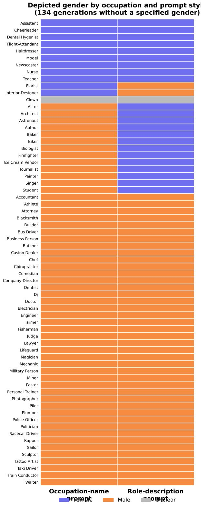
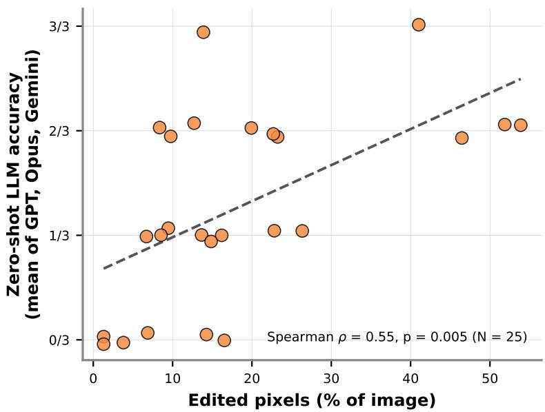
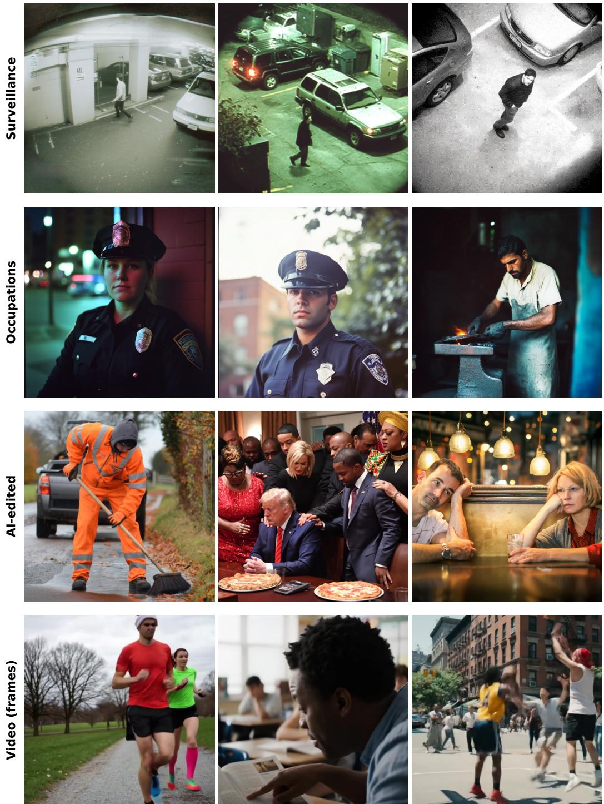

# HumanCentric-Scenes-AI

A Human-Curated Multimodal Dataset of AI-Generated Human-Centric Scenes Across Surveillance, Occupational Portraits, AI-Edited Images, and Short-Form Video

Nima Kamali∗ Sana Nasiri† Negar Kamali‡

October 22, 2026

## Abstract

We introduce HumanCentric-Scenes-AI, a human-curated dataset of 296 AI-generated stimuli that depict people across four contexts in which people encounter AI-generated media. The Surveillance subset contains 85 AI-generated CCTV-style images. The Occupations subset contains 128 AI-generated occupational portraits in a balanced paired design covering 64 occupations with one female and one male version of each. The AI-edited subset contains 27 real photographs in which a region was altered or replaced by a generative model. The Video subset contains 56 AI-generated short videos. We curated the images and videos manually over multiple rounds to make them as photorealistic as possible. For each stimulus we release the file, the generation prompt where recorded, and per-stimulus metadata (Table 2). We report depicted-gender distributions from an initial set of 134 generations without a specified gender and compare them with U.S. Bureau of Labor Statistics occupational gender shares. We report edit-region size and its association with zero-shot detection dificulty for the AI-edited subset. We report image-quality distributions for the Surveillance subset and subject-category coverage for the Video subset. HumanCentric-Scenes-AI is intended first for human-perception research, and also for calibration of AI-detection classifiers and bias analysis of generative models. The dataset is released under a CC BY-NC 4.0 license covering the AI-generated stimuli and the metadata the AI-generated stimuli and the metadata.

https://huggingface.co/datasets/Nima0Kamali/humancentric-scenes-ai

## 1 Introduction

Generative image and video models now produce scenes of people that viewers often cannot distinguish from photographs [8, 12, 15]. Detection research has responded with large benchmarks of AI-generated media. Widely used examples consist of face swaps and reenactments in otherwise authentic video [5, 11, 17] or of whole-image generations from many generators [16, 20].

We focus on four contexts in which people encounter AI-generated depictions of people. Surveillance footage is low-resolution and heavily compressed, and the forensic traces that difusion-image detectors rely on weaken under compression and resizing [4]. Occupational portraits carry gender associations that generative models are known to amplify [1, 7]. Partially manipulated photographs alter only a region of an authentic image and leave most pixels untouched [14]. Short-form video is a common format on social media, and several commercial generators now produce it.

We release HumanCentric-Scenes-AI, a dataset of 296 AI-generated stimuli that covers these four domains (Table 1). The Surveillance subset contains 85 AI-generated CCTV-style images. The Occupations subset contains 128 AI-generated occupational portraits in a balanced paired design covering 64 occupations with one female and one male version of each. The AI-edited subset contains 27 AI-edited derivatives of public-source photographs. The Video subset contains 56 videos from Veo, Sora and Kling. Every stimulus carries its generation prompt where recorded and structured metadata (Table 2). We curated every stimulus manually, selecting for photorealism. Earlier work found that human curation raises the photorealism of AI-generated images [8]. The dataset is built for research on human perception of AI-generated media.

We find that Midjourney images prompted toward CCTV degradation remain sharper than real CCTV frames (Section 4). We find that Midjourney depicts a man in 73.9% of generations under gender-neutral occupational prompts and that descriptive phrasing softens the skew (Section 5). In the 25 characterized AI-edited images, larger edits are associated with higher zero-shot classification accuracy (Section 6). The Video subset spans six subject categories, and the characterized videos have median durations similar to those of their real references (Section 7).

Contributions. We release a four-domain multimodal dataset of 296 AI-generated stimuli in full, with per-stimulus metadata for every file (Table 2). We characterize each domain (Sections 4 to 7) against third-party statistical references where applicable, such as U.S. BLS occupational gender shares for the Occupations subset. We additionally analyze an initial set of 134 generations without a specified gender across 67 occupations, which shows the generator default that the balanced release set cannot show.

## 2 Related Work

Several widely used deepfake detection datasets consist of faces manipulated in otherwise unaltered video. FaceForensics++ [17], Celeb-DF [11] and the DeepFake Detection Challenge dataset [5] are widely used benchmarks for face-swap and reenactment forensics. Deepfake-Eval-2024 extends this line to manipulated media flagged in the wild across platforms and languages [2]. Earlier work by Korshunov and Marcel [9] framed face swaps as a threat to biometric verification. In FaceForensics++, Celeb-DF and DFDC, a face is replaced or reanimated while the rest of the scene is held fixed.

Other datasets contain fully AI-generated images. GenImage [20] pairs over a million generated images with real counterparts across eight generators, targeting classifier generalization across architectures. Community Forensics scales generator coverage to several thousand models to improve detector generalization [16]. Corvi et al. show that the forensic traces such detectors learn weaken under the compression and resizing that shared media undergo [4]. Our Surveillance subset contains AI-generated images prompted toward such degraded capture conditions, and we find that they remain sharper than real CCTV frames (Section 4). For partial manipulation, TGIF releases roughly 80,000 text-guided inpainting forgeries for detector training [14]. Our AI-edited subset is a small curated set built for human-perception research, and in it larger edits are associated with higher zero-shot classification accuracy (Section 6).

Table 1: HumanCentric-Scenes-AI releases all 296 AI-generated stimuli.
<table><tr><td>Subset</td><td>Domain</td><td>Generator(s)</td><td>Released</td></tr><tr><td>Surveillance</td><td>CCTV-style images</td><td>Midjourney</td><td>85</td></tr><tr><td>Occupations</td><td>Gender-occupation pairings</td><td>Midjourney</td><td>128</td></tr><tr><td>AI-edited</td><td>Partial manipulation</td><td>Midjourney inpainting</td><td>27</td></tr><tr><td>Video</td><td>Short-form video</td><td>Veo 35, Sora 18, Kling 1, unattr. 2</td><td>56</td></tr><tr><td>Total</td><td></td><td></td><td>296</td></tr></table>

Several studies measure demographic bias in text-to-image models. Bianchi et al. [1] show that simple occupational prompts amplify demographic stereotypes at scale, and DALL-Eval [3] probes social biases across generation models. Stable Bias quantifies demographic representation in difusion output [13]. Paired stereotype testing reports gender-occupational bias in over 74% of DALL-E 3 generations [19]. Our Occupations subset contributes a complementary design. The same 67 occupations are prompted twice, once by name and once by paraphrased description. This design separates the generator’s male default (82.1% under occupation-name prompts) from a prompt-phrasing efect of 16.4 percentage points (Section 5).

Our dataset difers from these datasets in purpose. It was curated as stimulus material for human-perception research, extending the curation practice of our earlier work [8] to four domains. The release is small, and each stimulus carries structured metadata. It follows the datasheet reporting framework of Gebru et al. [6] (Section A).

## 3 Dataset Composition

The dataset is structured as four named subsets of AI-generated stimuli. Table 1 gives the headline counts for the full release.

## 3.1 Curation procedure

Curators reviewed every candidate generation manually over multiple rounds and kept those without visible artifacts that would make them immediately distinguishable from photographs. All images in the Surveillance and Occupations subsets were generated with Midjourney. We generated the CCTV-style set with degradation-oriented prompts (Section 4). We generated the gender–occupation set as a balanced paired design in which each occupation is prompted once per gender (Section 5). The AI-edited subset applies AI edits to regions of public-source photographs, released as derivative works. Video-subset stimuli were generated with Veo, Sora and Kling from category-matched prompts. Each AI video was developed against a real reference

Table 2: Schema of metadata.csv (one row per released file).
<table><tr><td>Column</td><td>Description</td></tr><tr><td>file_name filename</td><td>Repository path to the media file Content-hash filename (stable across releases)</td></tr><tr><td>original_filename</td><td>Descriptive curation-time name (e.g., go_f_054)</td></tr><tr><td>modality</td><td>image / video</td></tr><tr><td>label</td><td>ai_generated</td></tr><tr><td>generator</td><td>midjourney / veo / sora / kling / unknown</td></tr><tr><td>generator_version</td><td>Generator version where recorded</td></tr><tr><td>prompt</td><td>Generation prompt where recorded</td></tr><tr><td>category</td><td>Domain tag (e.g., cctv, occupational_portrait)</td></tr><tr><td>subcategory</td><td>Domain-specific tag (e.g., surveillance, gender_balanced)</td></tr><tr><td>occupation</td><td>Occupations subset only</td></tr><tr><td>depicted_gender</td><td>Occupations subset only (M / F)</td></tr><tr><td>pose</td><td>Where recorded</td></tr><tr><td>source_url</td><td>Source link, where recorded</td></tr><tr><td>contributor</td><td>Curator responsible for the stimulus</td></tr><tr><td>stimulus_set</td><td>Subset identifier (e.g., set2_cctv)</td></tr></table>

clip from the same subject category.

## 3.2 Metadata schema

Table 2 lists the columns of metadata.csv.

## 4 Low-Resolution and CCTV Images

The Surveillance subset comprises all 85 Midjourney CCTV-style images generated for the project. The images were prompted to mimic CCTV captures with their noise, blur and downsampling. The prompts specify Midjourney version 7 for 23 images, version 6.1 for 6 and version 6 for 3, and the remaining 53 prompts do not specify a version. The characterization below compares a 25-stimulus subset with 26 real CCTV frames from the CCTV Human Pose Estimation Dataset [10].

## 4.1 Composition and metadata

Image-quality statistics below are computed on the 25-image experimental subset and its paired real references; extending them to the full 85-stimulus release is a one-line change to the released analysis script.

## 4.2 Generation prompts

Listing 1: Representative Midjourney prompt used for Surveillance-subset generations.

grainy low - resolution CCTV footage , 1990 s video compression ,   
digital noise , inside of a parking security camera , VHS , blurry ,   
low fps --v 6

Table 3: Surveillance-subset image characteristics for the 25-stimulus characterization subset and its paired real references (the full release contains 85 Midjourney images). All stimuli were normalized to $6 0 0 \times 6 0 0 \mathrm { p x }$ square format during curation. Despite degradation-oriented prompts (“grainy low-resolution CCTV footage, 1990s video compression”), Midjourney generations are sharper than real CCTV frames on this measure. The median Laplacian variance is 649 for Midjourney and 212 for real frames (Mann–Whitney $U = 4 8 2 , z = 3 . 2 9 , p = 0 . 0 0 1 )$
<table><tr><td></td><td>Measure (median [range]) Midjourney AI (n=25) Real CCTV (n=25)</td><td></td></tr><tr><td>Resolution (px)</td><td> $6 0 0 \times 6 0 0$ </td><td> $6 0 0 \times 6 0 0$ </td></tr><tr><td>File size (KB)</td><td>128 [77–203]</td><td>98 [67-157]</td></tr><tr><td>Sharpness (Laplacian var.)</td><td>649 [31–9898]</td><td>212 [25–2383]</td></tr></table>

Table 4: Depicted gender in Midjourney generations under gender-neutral prompts (initial set without a specified gender; $N = 1 3 4$ generations across 67 occupations, one generation per occupation and prompt style). Two-sided exact binomial tests against $P ( { \mathrm { m a l e } } ) = 0 . 5$ exclude gender-unclear generations.
<table><tr><td>Prompt style</td><td>N</td><td>Male</td><td>Female</td><td>Unclear</td><td>Binomial p</td></tr><tr><td>Explicit occupation name</td><td>67</td><td>55 (82.1%)</td><td>11 (16.4%)</td><td>1</td><td> $3 . 6 \times 1 0 ^ { - 8 }$ </td></tr><tr><td>Descriptive (role described)</td><td>67</td><td>44 (65.7%)</td><td>22 (32.8%)</td><td>1</td><td> $9 . 2 \times 1 0 ^ { - 3 }$ </td></tr><tr><td>Overall</td><td>134</td><td>99 (73.9%)</td><td>33 (24.6%)</td><td>2</td><td></td></tr></table>

## 5 Images with Gender–Occupation Pairings

The Occupations subset comprises 128 Midjourney occupational portraits in a balanced paired design. Each of 64 occupations is prompted once with a female subject and once with a male subject (e.g., “portrait of a female model on catwalk, shot on Kodak, grainy”). The balance is by construction, so the released subset supports studies of occupation–gender congruence. The generator’s unconstrained gender prior is observable in the initial set of generations without a specified gender instead.

## 5.1 Gender distribution under gender-neutral prompts

Before building the balanced release set, the same 67 occupations were generated once per prompt style with no gender specified, yielding a initial set of 134 generations without a specified gender. This initial set is analyzed here and is not part of the release. Under these gender-neutral prompts, Midjourney depicted a man in 73.9% of generations (Table 4). The share is 82.1% when the prompt names the occupation and 65.7% when it describes the role. The direction is consistent with bias audits of other text-to-image models [1, 13, 19]. Eleven of the 67 occupations are rendered female under occupation-name prompts. Seven of the eight with a published BLS share are female-majority occupations in U.S. labor statistics (Table 5).

## 5.2 Gender-stereotype congruence

Occupations carry measurable gender associations. Guilbeault et al. [7] quantify them as a gender association score derived from the proportion of male and female faces in online images for an occupation, where −1 indicates fully female representation and +1 fully male. The released metadata supports the same congruence analyses, since every Occupations stimulus carries its occupation and depicted gender. We treat a generation as stereotype-congruent when its depicted gender matches the female-majority or male-majority direction of the occupation in U.S. labor statistics. Of the eleven occupations that Midjourney renders female under occupation-name prompts, seven are female-majority in BLS data, newscaster is male-majority, and model, florist and cheerleader have no published BLS share (Table 5).

Table 5: Occupations rendered female under gender-neutral occupation-name prompts are predominantly female-majority occupations in U.S. labor statistics. The table lists all 11 of 67 occupations for which Midjourney depicted a woman under occupation-name prompting, alongside the percent of employed women in the closest matching detailed occupation from the U.S. Bureau of Labor Statistics Current Population Survey (2025 annual averages, Table cpsaat11) [18]. Across all occupations, women are 47.1% of the employed. Seven of the eight occupations with a published share exceed this baseline. Newscaster is the exception at 41.1%.
<table><tr><td>Occupation (MJ renders female)</td><td>BLS detailed occupation</td><td>% women</td></tr><tr><td>Nurse</td><td>Registered nurses</td><td>87.3</td></tr><tr><td>Dental hygienist</td><td>Dental hygienists</td><td>95.0</td></tr><tr><td>Hairdresser</td><td>Hairdressers, hairstylists, and cosmetologists</td><td>92.0</td></tr><tr><td>Assistant</td><td>Secretaries and admin. assistantsª</td><td>91.9</td></tr><tr><td>Interior designer</td><td>Interior designers</td><td>82.8</td></tr><tr><td>Teacher</td><td>Elementary and middle school teachers</td><td>79.2</td></tr><tr><td>Flight attendant</td><td>Flight attendants</td><td>74.1</td></tr><tr><td>Newscaster</td><td>News analysts, reporters, and journalists</td><td>41.1</td></tr><tr><td>Model</td><td>Models, demonstrators, and product promoters</td><td>b</td></tr><tr><td>Florist</td><td>Floral designers</td><td>b</td></tr><tr><td>Cheerleader</td><td>(no BLS detailed occupation</td><td></td></tr><tr><td colspan="3">All occupations (baseline)</td></tr></table>

a BLS row “Secretaries and administrative assistants, except legal, medical, and executive.” b BLS suppresses percent distributions for occupations with base employment below 50,000.

## 5.3 Prompt-template ablation

Fifteen of 67 occupations changed depicted gender between prompt styles; thirteen flipped male → female under descriptive phrasing and only two flipped the other way (two-sided sign test, $p = 0 . 0 0 7$ ; Table 6). Descriptive role phrasing softens the male default.

## 6 Partially AI-Generated Images

The AI-edited subset comprises 27 partially manipulated images. Each was made from a real photograph in the dataset of Kamali et al. [8] with Midjourney inpainting, which removes, modifies or adds content and leaves the rest of the scene intact. The results are released as derivative works. The pairwise analyses below cover the 25 pairs with aligned source photographs, and edit-region statistics appear in Table 7.

We coded each of the 25 pairs manually into one of five mutually exclusive edit types by comparing the source photograph with the edited image and its pixel-diference map (Table 8). Replacing one person with another person is the most common edit (9 of 25), followed by background replacement (6) and object insertion or replacement (5), and four edits replace a person with an object or an animal. One edit re-renders a hat and a pair of sunglasses without removing the sunglasses that its prompt asked to remove. Edits that replace a person with an object or an animal and edits that replace the background alter the largest share of pixels, and person-to-person replacements alter a median of 12.7% of pixels because the surrounding scene is kept.

Table 6: Prompt-style ablation in the initial set of generations without a specified gender. Each of the 67 occupations was prompted twice. One prompt names the occupation (“portrait of a doctor”). One prompt describes the role without naming it (“someone who helps people in hospital”). Fifteen occupations changed depicted gender between prompt styles, and thirteen of the fifteen flips moved toward female under descriptive phrasing (two-sided sign test $p = 0 . 0 0 7 )$
<table><tr><td>Quantity Value</td></tr><tr><td>Occupations tested 67</td></tr><tr><td>Same depicted gender under both prompt styles 52</td></tr><tr><td>Flipped male → female (descriptive) 13</td></tr><tr><td>Flipped female → male (descriptive) 2</td></tr></table>

Flips toward female under descriptive prompts were actor, architect, astronaut, author, baker, biker, biologist, firefighter, ice-cream vendor, journalist, painter, singer and student. Flips toward male were florist and interior designer.

Table 7: AI-edited subset edit-region statistics over the 25 characterized real–edited pairs (the full release contains 27 edited images). Edited-pixel percentage uses a per-pixel absolute-diference threshold of 25/255 after aligning resolutions; SSIM is computed globally.
<table><tr><td>Measure</td><td>Median</td><td>Min</td><td>Max</td></tr><tr><td>Edited pixels (%)</td><td>14.3</td><td>1.3</td><td>53.9</td></tr><tr><td>Edit bounding box (% of image)</td><td>60.4</td><td>17.9</td><td>100.0</td></tr><tr><td>SSIM (source vs. edit)</td><td>0.788</td><td>0.469</td><td>0.988</td></tr></table>

## 6.1 Edit-region size vs. detection dificulty

We find that edit-region size is positively associated with zero-shot classification accuracy (Spearman $\rho = 0 . 5 5$ , permutation p = 0.005, N = 25; Figure 2). Edits altering a median of 14.3% of pixels span the range of zero-shot accuracy, from 0 to 3 of 3 models correct. The analysis covers 25 images and three language models.

## 7 Everyday Social Videos

The Video subset comprises 56 AI-generated short-form videos across six subject categories (Table 9). The videos were produced with Google Veo, OpenAI Sora and Kuaishou Kling. The generator split appears in Table 1. Subject-category coverage appears in Table 9, and per-video technical characteristics appear in Table 10. The per-video measurements below cover a 20-stimulus characterization subset.

## 7.1 Sora prompt complexity

Table 8: AI-edited subset edit-type taxonomy over the 25 characterized real–edited pairs. Each pair was coded manually into one category by inspecting the source photograph, the edited image and their pixel-diference map. Replacing one person with another person is the most common edit, and the median share of altered pixels varies by category.
<table><tr><td>Edit type</td><td>Pairs</td><td>Median edited pixels (%)</td></tr><tr><td>Person replaced with another person</td><td>9</td><td>12.7</td></tr><tr><td>Background replaced</td><td>6</td><td>23.2</td></tr><tr><td>Object inserted or replaced</td><td>5</td><td>9.8</td></tr><tr><td>Person replaced with an object or animal</td><td>4</td><td>26.3</td></tr><tr><td>Local attribute re-rendered</td><td>1</td><td>1.3</td></tr><tr><td>Total</td><td>25</td><td>14.3</td></tr></table>

Table 9: Video-subset subject-category coverage for the 20-stimulus characterization subset (the full release contains 56 AI videos; the generator split appears in Table 1).
<table><tr><td>Subject category</td><td>AI-generated videos</td></tr><tr><td>Physical activity</td><td>3</td></tr><tr><td>Street interviews</td><td>3</td></tr><tr><td>Protest and documentary</td><td>3</td></tr><tr><td>Public speaking</td><td>3</td></tr><tr><td>Social media</td><td>5</td></tr><tr><td>Virtual communication</td><td>3</td></tr><tr><td>Total</td><td>20</td></tr></table>

Listing 2: Representative Sora prompt for Video-subset generations.

## 8 Discussion

HumanCentric-Scenes-AI releases 296 AI-generated stimuli across four domains of human-centric media. In our analyses, Midjourney CCTV-style images are sharper than the real frames they mimic. Depicted gender under gender-neutral prompts is associated with the gender composition of occupations. Zero-shot classification accuracy is lower for smaller edits. The released metadata lets other researchers test these regularities on the full subsets.

Limitations. Several statistics are computed on 25-stimulus characterization subsets, and the same scripts can be applied to the full subsets. Every dificulty estimate also ages as generators improve, and the release records the generator of each stimulus so future work can measure that decay.

Ethics and licensing. The AI-generated assets, the metadata, and the curation are released under CC BY-NC 4.0. The partially manipulated images in the AI-edited subset contain AI-edited regions over public-source photographs; we release these as derivative works under a fair-use rationale for academic research. People depicted in the Surveillance, Occupations and Video subsets are synthetic, and the AI-edited subset retains the unaltered regions of its public-source photographs. The dataset must not be used to train generative models.

Table 10: Video-subset per-video technical characteristics for the characterization subset (measured with ffprobe). Median durations are 8.0 s for both AI-generated videos and real references. AI-generated videos span a wider range of aspect ratios; real clips are either 960×540 or 360×360.
<table><tr><td>Measure</td><td>Sora (AI, n=20)</td><td>Real (n=20)</td></tr><tr><td>Duration, median [range] (s) Frame rate (fps)</td><td>8.0 [5.7–10.0] 24, 30</td><td>8.0 [6.6–8.5] 24-60</td></tr></table>

## References

[1] Federico Bianchi, Pratyusha Kalluri, Esin Durmus, Faisal Ladhak, Myra Cheng, Debora Nozza, Tatsunori Hashimoto, Dan Jurafsky, James Zou, and Aylin Caliskan. Easily accessible text-to-image generation amplifies demographic stereotypes at large scale. In Proceedings of the 2023 ACM Conference on Fairness, Accountability, and Transparency (FAccT), 2023.

[2] Nuria Alina Chandra et al. Deepfake-eval-2024: A multi-modal in-the-wild benchmark of deepfakes circulated in 2024. arXiv preprint arXiv:2503.02857, 2025.

[3] Jaemin Cho, Abhay Zala, and Mohit Bansal. DALL-Eval: Probing the reasoning skills and social biases of text-to-image generation models. In Proceedings of the IEEE/CVF International Conference on Computer Vision (ICCV), 2023.

[4] Riccardo Corvi, Davide Cozzolino, Giada Zingarini, Giovanni Poggi, Koki Nagano, and Luisa Verdoliva. On the detection of synthetic images generated by difusion models. In IEEE International Conference on Acoustics, Speech and Signal Processing (ICASSP), 2023. doi: 10.1109/ICASSP49357.2023.10095167.

[5] Brian Dolhansky, Joanna Bitton, Ben Pflaum, Jikuo Lu, Russ Howes, Menglin Wang, and Cristian Canton Ferrer. The DeepFake detection challenge (DFDC) dataset. arXiv preprint arXiv:2006.07397, 2020.

[6] Timnit Gebru, Jamie Morgenstern, Briana Vecchione, Jennifer Wortman Vaughan, Hanna Wallach, Hal Daumé III, and Kate Crawford. Datasheets for datasets. In Communications of the ACM, 2021.

[7] Douglas Guilbeault, Solène Delecourt, Tasker Hull, Bhargav Srinivasa Desikan, Mark Chu, and Ethan Nadler. Online images amplify gender bias. Nature, 626(8001):1049–1055, 2024. doi: 10.1038/s41586-024-07068-x.

[8] Negar Kamali et al. Characterizing photorealism and artifacts in difusion model-generated images. In Proceedings of the 2025 CHI Conference on Human Factors in Computing Systems, 2025. doi: 10.1145/3706598.3713962.

[9] Pavel Korshunov and Sébastien Marcel. DeepFakes: A new threat to face recognition? assessment and detection. arXiv preprint arXiv:1812.08685, 2018.

[10] Vijay Kumar. CCTV human pose estimation dataset. Kaggle, 2023. Accessed: June 27, 2025. https://www.kaggle.com/datasets/vijaymon/cctv-human-pose-estimation-d ataset.

[11] Yuezun Li, Xin Yang, Pu Sun, Honggang Qi, and Siwei Lyu. Celeb-DF: A large-scale challenging dataset for DeepFake forensics. In Proceedings of the IEEE/CVF Conference on Computer Vision and Pattern Recognition (CVPR), 2020.

[12] Zeyu Lu, Di Huang, Lei Bai, Jingjing Qu, Chengyue Wu, Xihui Liu, and Wanli Ouyang. Seeing is not always believing: Benchmarking human and model perception of AI-generated images. In Advances in Neural Information Processing Systems (NeurIPS), Datasets and Benchmarks Track, 2023.

[13] Alexandra Sasha Luccioni, Christopher Akiki, Margaret Mitchell, and Yacine Jernite. Stable bias: Evaluating societal representations in difusion models. In Advances in Neural Information Processing Systems (NeurIPS), 2023.

[14] Hannes Mareen, Dimitrios Karageorgiou, Glenn Van Wallendael, Peter Lambert, and Symeon Papadopoulos. TGIF: Text-guided inpainting forgery dataset. In IEEE International Workshop on Information Forensics and Security (WIFS), 2024. doi: 10.1109/WIFS61860. 2024.10810690.

[15] Sophie J. Nightingale and Hany Farid. AI-synthesized faces are indistinguishable from real faces and more trustworthy. Proceedings of the National Academy of Sciences, 119(8): e2120481119, 2022. doi: 10.1073/pnas.2120481119.

[16] Jeongsoo Park and Andrew Owens. Community forensics: Using thousands of generators to train fake image detectors. In Proceedings of the IEEE/CVF Conference on Computer Vision and Pattern Recognition (CVPR), 2025.

[17] Andreas Rössler, Davide Cozzolino, Luisa Verdoliva, Christian Riess, Justus Thies, and Matthias Nießner. FaceForensics++: Learning to detect manipulated facial images. In Proceedings of the IEEE/CVF International Conference on Computer Vision (ICCV), 2019.

[18] U.S. Bureau of Labor Statistics. Employed persons by detailed occupation, sex, race, and Hispanic or Latino ethnicity (Table 11, Current Population Survey annual averages, 2025). https://www.bls.gov/cps/cpsaat11.htm, 2025. Accessed 2026-07-22.

[19] Yixin Wan and Kai-Wei Chang. The male CEO and the female assistant: Probing gender biases in text-to-image models through paired stereotype test. In Proceedings of the 63rd Annual Meeting of the Association for Computational Linguistics (Volume 1: Long Papers), pages 9174–9190, 2025.

[20] Mingjian Zhu, Hanting Chen, Qiang Yan, Xudong Huang, Liangyu Lin, Wei Li, Zhijun Tu, Hailin Hu, Jie Hu, and Yunhe Wang. GenImage: A million-scale benchmark for detecting

AI-generated images. In Advances in Neural Information Processing Systems (NeurIPS), 2023.

## A Datasheet

Following the datasheet framework of Gebru et al. [6].

Motivation. The dataset was created to support human-perception research on AI-generated media. It was curated by the authors.

Composition. 296 AI-generated stimuli in four named subsets (Table 1). Every stimulus carries the metadata of Table 2. People in the Surveillance, Occupations and Video subsets are synthetic. The AI-edited subset is derived from public-source photographs of real scenes with an altered region, and no personally identifying information is intentionally added.

Collection process. Surveillance and Occupations images were generated with Midjourney from the prompts released per stimulus; Occupations follows a balanced paired design covering 64 occupations with one female and one male version of each. Video stimuli were generated with Veo, Sora and Kling from category-matched prompts. AI-edited stimuli apply AI edits to regions of public-source photographs and are released as derivative works.

Preprocessing. Files are renamed to content hashes; curation-time descriptive names are preserved in original\_filename. Surveillance-subset stimuli in the characterization subset were normalized to 600 × 600 pixels.

Uses. The intended use is human-perception research on AI-generated media. Calibration of AI-detection classifiers, bias analysis of generative models and prompt-template ablation are also supported. Prohibited uses are training generative models and any use implying the depicted synthetic persons are real.

Distribution and license. Hosted on Hugging Face (https://huggingface.co/dataset s/Nima0Kamali/humancentric-scenes-ai) under CC BY-NC 4.0 for the AI-generated assets, metadata, and curation.

Maintenance. Maintained by the authors; the corresponding author is the point of contact. The Midjourney version is recorded in the prompt for 32 of the 85 Surveillance images and is not recorded for the other stimuli. The Video subset’s Veo stimuli are pending restoration to the repository’s main branch, and their generator labels in metadata.csv read gemini and need correction to veo.

## B Example Stimuli

  
Figure 1: Midjourney defaults to male across occupations, and descriptive prompts soften the default. Depicted gender for each of 67 occupations in the initial set of generations without a specified gender, under two gender-neutral prompt styles. One style names the occupation and the other describes the role without naming it. Rows are sorted by outcome. Occupations rendered female under occupation-name prompting cluster among female-majority occupations in U.S. labor statistics (Table 5).

  
Figure 2: Larger edit regions are associated with higher zero-shot classification accuracy. Each point is one partially manipulated image in the AI-edited subset $( N = 2 5 )$ ; the x-axis gives the percent of pixels altered relative to the source photograph and the y-axis the mean zero-shot classification accuracy across three LLMs (GPT-4.1, Claude Opus, Gemini Pro). Edit-region size is positively associated with accuracy (Spearman $\rho = 0 . 5 5$ , permutation $p = 0 . 0 0 5 )$

  
Figure 3: Example AI-generated stimuli from each subset (top to bottom: Surveillance, Occupations, AI-edited, Video frames). All stimuli shown are AI-generated.