# Hyperspherical Simplex Representations for Backward-Compatible Retrieval

Simone Ricci∗† simone.ricci@unifi.it   
Media Integration and Communication Center (MICC)   
Dipartimento di Ingegneria dell’Informazione   
University of Florence   
Niccolò Biondi∗   
Multimedia & Human Understanding (MHUG)   
Department of Information Engineering and Computer Science   
University of Trento   
Federico Pernici   
Media Integration and Communication Center (MICC)   
Dipartimento di Ingegneria dell’Informazione   
University of Florence   
Alberto Del Bimbo   
Media Integration and Communication Center (MICC)   
Dipartimento di Ingegneria dell’Informazione   
University of Florence

Œ Website ‡ Code

niccolo.biondi@unitn.it

federico.pernici@unifi.it

alberto.delbimbo@unifi.it

## Abstract

Training modern AI models has become increasingly expensive, and updating deployed mod els can alter their internal feature representations, afecting applications built upon them. In retrieval systems, such updates often require a complete gallery re-indexing, which is computationally expensive at scale. Existing backward-compatibility methods enable direct comparison between representations produced by updated and earlier models, avoiding reindexing. However, they typically require compatibility-specific training, learned mapping functions, or modifications to the model architecture, and often depend explicitly on the previous model. In this paper, we propose hyperspherical simplex representations derived from softmax outputs and logits for backward-compatible retrieval across independently trained models. These representations leverage the simplex structure induced by softmax cross-entropy training with one-hot labels, which provides a common geometric reference across model updates. Since this reference depends on the number of classes, introducing new ones during an update expands the simplex, thereby misaligning the prototypes of existing classes with their earlier counterparts. We therefore derive a deterministic linear transformation to restore their alignment. We further provide a theoretical analysis of the formal backward-compatibility definition, identifying two geometric conditions under which its inequalities hold in expectation, assuming von Mises–Fisher class distributions whose concentration increases across updates. Aligned regular-simplex representations satisfy these conditions, providing a theoretical basis for the proposed representations under the stated assumptions. Without using additional compatibility-specific losses, learned mappings, or modifications to the model architecture, the proposed representations achieve competitive

results on standard compatibility benchmarks, including scenarios with expanded class sets, more expressive architectures, and independently trained models from public repositories.

## 1 Introduction

Training modern AI models has become increasingly expensive, limiting accessibility to a few well-resourced organizations (Radford et al., 2021; Dubey et al., 2024; Jiang et al., 2023; Anthropic, 2024; Yang et al., 2025; Xu et al., 2026; Team et al., 2026). Despite reductions in model parameters and computing costs (Dubey et al., 2024), training from scratch, fine-tuning, and inference remain economically challenging (Wang et al., 2025; OpenAI, 2024). As a result, models are increasingly released through public repositories (Marcel & Rodriguez, 2010; Wolf et al., 2019; Wightman, 2019) or provided as services through APIs, simplifying application development and enabling widespread adoption across domains.

As these models become more integrated into real-world systems, the need to update them is also growing. This demand is driven by several factors (Rafel, 2023; Yadav et al., 2025), including evolving training strategies (Biondi et al., 2026; 2024; Echterhof et al., 2024; Shen et al., 2020), advancements in model architectures (Touvron et al., 2023; Kaplan et al., 2020), the availability of higher-quality datasets (Gunasekar et al., 2023), the expansion of training classes, or extended training periods (Biderman et al., 2023; Rafel, 2023). Such updates not only improve performance but also bring the rapid progress of the field into deployed models, simplifying their adoption despite the continued growth in the scale and complexity of models, datasets, and infrastructures (Bommasani et al., 2021; Sorscher et al., 2022).

However, a significant drawback of model updates is that they can compromise compatibility with earlier versions, altering the behavior of applications or services built upon them (Rafel, 2023). For example, image retrieval services might experience unexpected changes in image rankings following a model update, forcing users to adapt when previously top-ranked images no longer appear first (Shen et al., 2020). Similarly, end users, such as drivers of semi-autonomous cars, often develop a mental model of the machine learning system’s capabilities (Bansal et al., 2019a). When updates modify system behavior, users must adjust their mental model of the system’s functionality, a task that can be challenging, dissatisfying, and even unsafe (Bansal et al., 2019b; Templeton, 2019). Recent observations have highlighted similar issues with large language models (LLMs) (Echterhof et al., 2024; Goswami et al., 2026), raising concerns about AI safety and alignment. This is particularly critical when decisions and textual outputs from these agents are translated into actions (Amodei et al., 2016; Ngo et al., 2024). In such settings, it is essential that the predictions of the updated model mimic those of the old model for any correct classification (Milani Fard et al., 2016; Yan et al., 2021; Ricci et al., 2026b).

Updating a model while ensuring compatibility with its earlier versions has been explored along three complementary dimensions: 1) Weights-level, which explores the merging of model parameters under the assumption of linear mode connectivity, to unify multiple versions into a single, robust model (Frankle et al., 2020; Wortsman et al., 2022; Ainsworth et al., 2023); 2) Representation-level, which seeks to learn backward-compatible representations that are comparable across model updates, so they can be used interchangeably over time (Shen et al., 2020; Meng et al., 2021; Biondi et al., 2026); and 3) Classifier decision-level, which ensures that the updated model preserves the correct predictions of the old model, preventing negative flips (Milani Fard et al., 2016; Yan et al., 2021; Zhao et al., 2024). They target distinct notions of compatibility and accordingly difer in their objectives, mechanisms, and evaluation criteria.

Among these paradigms, we focus on representation-level compatibility, which is particularly relevant to retrieval systems, where feature representations produced by diferent model versions must remain directly comparable. Backward-compatibility training, introduced by Shen et al. (2020) to avoid image re-indexing of the gallery set, has been established as a standard training paradigm to achieve backward-compatibility between model representations. However, most existing studies on backward-compatibility require training a new model using the old model as a reference (Shen et al., 2020; Meng et al., 2021; Duggal et al., 2021; Pan et al., 2023; Zhou et al., 2023). This approach has become increasingly challenging due to restricted access to old model architectures and weights—often limited by proprietary constraints and non-disclosure policies—as well as the high computational costs associated with training large-scale modern AI models. Recent studies (Biondi et al., 2023a; 2024; 2026) have addressed this limitation by learning compatible representations without explicitly using the previous model as a reference. However, these approaches require all parties to agree in advance on a shared, pre-allocated fixed classifier (Pernici et al., 2019; 2021a; Zhu et al., 2021).

In this paper, we show that hyperspherical simplex representations derived from the softmax outputs or logits of independently trained1 models provide backward-compatible retrieval. Our formulation leverages the simplex geometry induced during training by the softmax function and one-hot encoded class labels as a model-agnostic reference, yielding hyperspherical simplex representations that are aligned across model updates. Since their simplex geometries evolve with the introduction of new classes, we propose a deterministic linear transformation that compensates for the resulting angular misalignment between the prototypes of existing classes and their earlier counterparts, thereby preserving their alignment. We theoretically analyze the formal backward-compatibility definition and identify geometric conditions under which its inequalities (Shen et al., 2020) hold in expectation, given explicit assumptions on the feature distributions and their concentration across updates. We then show that these conditions are satisfied by aligned regular-simplex representations, and therefore by the proposed hyperspherical simplex representations, which exhibit this geometry. Although the proposed hyperspherical simplex representations satisfy the geometric conditions established in our analysis, their dimensionality increases linearly with the number of training classes, resulting in substantial storage costs for large-scale galleries. To mitigate this limitation, we adopt a top-k sparsification strategy motivated by the rank-preserving property of the softmax function and the top-k calibration of the softmax cross-entropy loss (Lapin et al., 2016; Yang & Koyejo, 2020), which reduces gallery storage with negligible changes in retrieval accuracy and without degrading compatibility.

Our main contributions are the following:

1. We introduce a novel approach for backward-compatible retrieval based on hyperspherical simplex representations derived from softmax outputs and logits.

2. We provide a theoretical analysis of the formal definition of backward-compatibility, identifying geometric conditions under which its inequalities are satisfied in expectation, given explicit distributional and concentration assumptions. We show that hyperspherical simplex representations derived from softmax outputs and logits satisfy these geometric conditions.

3. We propose a top-k sparsification method for hyperspherical simplex representations, motivated by the rank-preserving property of the softmax function and the top-k calibration of the softmax cross-entropy loss, to reduce representation storage.

4. We achieve competitive results on standard compatibility benchmarks, obtaining substantial improvements in scenarios involving a large number of model updates, without using additional compatibility-specific losses, learned mappings, or modifications to the model architecture. We provide empirical evidence that representations derived from softmax outputs and logits substantially improve backward-compatibility, even between independently pretrained models obtained from a public repository.

The remainder of the paper is organized as follows. In Sec. 2, we review related work on backwardcompatibility. In Sec. 3, we derive hyperspherical simplex representations from softmax outputs and logits and analyze their backward-compatibility under stated theoretical assumptions. In Sec. 4, we present extensive experiments and compare our proposed method with state-of-the-art alternatives. Finally, in Sec. 5, we draw conclusions and discuss the limitations of this work.

## 2 Related Work

Backward-compatibility was first formalized by Shen et al. (2020), who defined both theoretical and empirical criteria to verify whether learned representations are interoperable across model updates, thus eliminating the need to re-index the gallery set in retrieval systems. To learn backward-compatible representations, they proposed Backward-Compatible Training (BCT), where the previously learned classifier is frozen and serves as a fixed reference during training of the new model, aligning new feature vectors with their corresponding old class prototypes. Subsequent work proposed additional regularization objectives to enforce alignment between old and new representations (Budnik & Avrithis, 2021; Duggal et al., 2021; Meng et al., 2021; Zhang et al., 2021; 2022; Pan et al., 2023; Wu et al., 2022; Goswami et al., 2026). In Meng et al. (2021), a combination of loss functions is used to align class means between diferent model updates and to achieve more compact intra-class distributions while learning new information, directly optimizing a point-to-set formulation of backward-compatibility. In Zhang et al. (2021), compatible representations are learned with a contrastive loss that encourages each new-to-old positive pair to be more similar than both new-to-old and new-to-new negative pairs. Pan et al. (2023) introduce an adversarial discriminator within BCT to minimize the distribution gap between features from the old and new models. In these regularization-based approaches, due to the constraints imposed to achieve compatibility, the performance of the new backwardcompatible model often does not reach that of a newly independently trained model (Zhou et al., 2023), trained without using the old model as a reference. To address this issue, Zhou et al. (2023) and Ricci et al. (2024) focus on modifying the model architecture by expanding the feature space at each model update, such that the original subspace preserves compatibility with previous models, while information from the new data is learned in the additional dimensions. However, even if compatibility is achieved while retaining the discriminative performance of a newly independently trained model, these approaches require explicit modifications to the model architecture that introduce growing complexity with each successive feature space expansion.

Along a diferent line, several studies have proposed mapping-based approaches to achieve compatibility across model updates (Chen et al., 2019; Wang et al., 2020; Meng et al., 2021; Ramanujan et al., 2022; Hu et al., 2022; Jaeckle et al., 2023; Ricci et al., 2025). These methods learn mapping functions to align corresponding representations of the same inputs obtained from two diferent models, enabling direct comparison between them. Such approaches are closely related to prior work in cross-model and cross-modal representation learning, where alignment between feature spaces of diferent models or modalities is a central objective (Moschella et al., 2023; Cannistraci et al., 2023; 2024; Maniparambil et al., 2024; 2025; Ricci et al., 2026a).

However, feature-space alignment alone does not guarantee satisfaction of the formal compatibility inequalities, and mapping-based approaches introduce significant overhead in scenarios with many model updates, as they require composing multiple learned mapping functions across successive updates. To address these limitations, the solution proposed by Biondi et al. (2023a;b; 2024; 2026) involves learning with a pre-allocated d-simplex fixed classifier, which enforces feature alignment across updates by fixing the position of class prototypes a priori (i.e., from the beginning of training), while accommodating new classes within pre-allocated regions of the feature space. Although this approach achieves compatibility without using the old model as a reference, it relies on the same pre-allocated fixed classifier across model updates and requires architectura modifications.

In this paper, we show that hyperspherical representations with an aligned regular-simplex geometry can be obtained directly from the logits or softmax outputs of independently trained models, without requiring a preallocated fixed classifier shared across updates. Building on this observation, we derive hyperspherical simplex representations for backward-compatible retrieval that do not require additional compatibility-specific losses, learned mapping functions, or modifications to the model architecture. At the theoretical level, while Biondi et al. (2026) numerically show that stationary d-simplex representations satisfy the compatibility inequalities in expectation, our analysis complements this result by providing closed-form geometric conditions for aligned hyperspherical representations under explicit distributional model assumptions.

## 3 Compatibility of Hyperspherical Simplex Representations

In this section, we first introduce hyperspherical simplex representations derived from softmax outputs and logits. We then identify geometric conditions under which the compatibility inequalities of Shen et al. (2020)

hold in expectation given explicit assumptions on the feature distributions and their increasing concentration across model updates. Finally, we show that the proposed representations satisfy these conditions.

## 3.1 Preliminaries and Motivation

According to Shen et al. (2020), backward-compatibility across model updates is achieved when the representation produced by the updated model at step t can be compared with the representation produced by the earlier model at step k. Formally, it requires that the following two inequalities hold:

Definition 3.1 (Backward-Compatibility).

$$
d \big ( \mathbf { h } _ { i } ^ { t } , \mathbf { h } _ { j } ^ { k } \big ) \leq d \big ( \mathbf { h } _ { i } ^ { k } , \mathbf { h } _ { j } ^ { k } \big ) , \forall ( i , j ) \in \{ ( i , j ) | y _ { i } = y _ { j } \}\tag{1a}
$$

$$
d \big ( \mathbf { h } _ { i } ^ { t } , \mathbf { h } _ { j } ^ { k } \big ) \geq d \big ( \mathbf { h } _ { i } ^ { k } , \mathbf { h } _ { j } ^ { k } \big ) , \forall ( i , j ) \in \{ ( i , j ) | y _ { i } \neq y _ { j } \}\tag{1b}
$$

where $\mathbf { h } ^ { t }$ and $\mathbf { h } ^ { k }$ are feature vectors extracted respectively with the updated model at step t and the earlier model at step $k ,$ d is a distance function (e.g., cosine distance), and $y _ { i }$ and $y _ { j }$ are class labels associated with $\mathbf { h } _ { i }$ and $\mathbf { h } _ { j } ,$ , respectively.

In retrieval tasks, the inequalities in Eq. 1a and Eq. 1b suggest that the updated model representation, when used to compare against the old representation, should perform at least as well as the old one in grouping images from the same classes and separating those from diferent classes. While Eq. 1a and Eq. 1b describe desirable goals for compatible representations, directly verifying them requires exhaustive pairwise comparisons between the two representations, which is impractical at scale (Shen et al., 2020).

To obtain a numerical assessment of these inequalities, Biondi et al. (2024; 2026) estimate the corresponding expected distances through Monte Carlo integration under the unconstrained feature model (UFM) assumption (Mixon et al., 2022), considering feature distributions centered around the prototypes of a pre-allocated d-simplex fixed classifier. In their initial analysis, Biondi et al. (2024) model class features as samples from Euclidean hyperballs and evaluate compatibility using Euclidean distance. Under this formulation, the diferent-class inequality (Eq. 1b) is not satisfied, and stationary d-simplex representations are therefore characterized as an optimal approximation to backward-compatibility. Extending this analysis, Biond et al. (2026) model class features as samples from hyperspherical caps on the unit hypersphere and evaluate compatibility using cosine distance. Assuming that the hyperspherical caps shrink across model updates, they demonstrate that both compatibility inequalities hold in expectation for representations learned with a pre-allocated d-simplex fixed classifier.

While these studies assess compatibility numerically for stationary d-simplex representations, we analytically characterize the compatibility inequalities and identify geometric conditions under which they are satisfied in expectation. Specifically, we model hyperspherical features using von Mises–Fisher (vMF) distributions on the unit hypersphere (Fisher, 1953; Banerjee et al., 2005), which yield closed-form expressions for the expected cosine distances in terms of class prototype directions and concentration parameters. Assuming that the concentration of the class distributions increases across model updates, we prove in Theorem 3.6 of Sec. 3.4 that both inequalities of Def. 3.1 are satisfied in expectation if the following two geometric conditions hold:

(a) corresponding class prototypes are aligned across updates;

(b) the angle between prototypes of diferent classes is greater than $\pi / 2 .$

In particular, both conditions are satisfied by regular-simplex representations that are centered at the origin and aligned across model updates, as established in Cor. 3.7. Since softmax cross-entropy training with onehot labels induces a simplex structure in both the softmax outputs and the logits, these provide a principled basis for constructing backward-compatible representations without compatibility-specific training. Accordingly, the two conditions directly guide the design of the proposed representations: condition (b) motivates the centering projection introduced in Sec. 3.2.1, whereas condition (a) motivates the angular correction under class expansion described in Sec. 3.3.

## 3.2 Hyperspherical Simplex Representations

We now formalize two hyperspherical simplex representations, which are derived directly from the softmax outputs and logits of a trained classification model.

## 3.2.1 Features Derived From Softmax Outputs

Given a model at update step k, the softmax output $\sigma ( \mathbf { z } ^ { k } )$ , obtained by applying the softmax function $\sigma ( \cdot )$ to the logits $\mathbf { z } ^ { k }$ , represents a probability distribution over the $C ^ { k }$ classes and lies within the probability simplex, which is defined as follows:

Definition 3.2 (Probability Simplex). The probability simplex $\Delta ^ { C ^ { k } - 1 }$ is the $( C ^ { k } { - } 1 )$ -dimensional simplex in $\mathbb { R } ^ { C ^ { k } }$ whose vertices are the canonical basis vectors $\mathbf { e } _ { 1 } , \mathbf { e } _ { 2 } , \ldots , \mathbf { e } _ { C ^ { k } }$ , and its center is $\begin{array} { r } { \mathbf { o } ^ { k } = \frac { 1 } { C ^ { k } } \sum _ { c = 1 } ^ { C ^ { k } } \mathbf { e } _ { c } , } \end{array}$ such that $\Delta ^ { C ^ { k } - 1 } = \{ \mathbf { u } \in \mathbb { R } ^ { C ^ { k } } : u _ { 1 } + \cdot \cdot \cdot + u _ { C ^ { k } } = 1 , u _ { j } \geq 0 \mathrm { f o r } i = 1 \qquad ( \Gamma ^ { k } \}$

For a training sample of class $^ { c , }$ the cross-entropy loss is minimized over the probability simplex $\Delta ^ { C ^ { k } - 1 }$ at the vertex $\mathbf { e } _ { c } .$ , which corresponds to the one-hot encoded target label. Hence, the optimization of the cross-entropy loss drives the softmax outputs toward the vertices $\mathbf { e } _ { c }$ of $\Delta ^ { C ^ { k } - 1 }$ during training (see Fig. 1). A straightforward way to obtain hyperspherical representations from softmax outputs is to apply $\ell _ { 2 } .$ -normalization directly. However, this approach does not satisfy condition (b) of Sec. 3.1. Since the probability simplex $\Delta ^ { C ^ { k } - 1 }$ lies entirely in the non-negative orthant, with its center $\mathbf { o } ^ { k }$ ofset from the origin, any two softmax outputs have a non-negative inner product: the vertices $\mathbf { e } _ { c }$ toward which the softmax outputs are driven are mutually orthogonal, and the $\ell _ { 2 } \cdot$ -normalized softmax outputs of diferent classes are separated by angles of at most $\pi / 2$

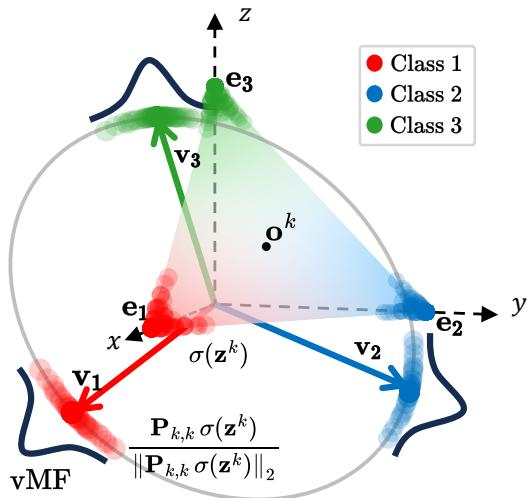  
Figure 1: Softmax outputs lie in the probability simplex $\Delta ^ { C ^ { k } - 1 }$ (colored area), centered at $\mathbf { o } ^ { k }$ , and are driven during training toward its vertices $\mathbf { e } _ { c } ,$ which correspond to the one-hot target labels. The projec tion $\mathbf { P } _ { k , k }$ shifts the simplex center to the origin, mapping softmax outputs onto a regular simplex whose vertices define the class prototypes $\mathbf { v } _ { c } ^ { k }$ (colored vectors). The features $\mathbf { h } ^ { k }$ of Eq. 4 are then obtained by $\ell _ { 2 ^ { - } }$ normalization onto the hypersphere, where each class is modeled by a vMF distribution with mean direction along the corresponding class prototype.

To overcome this limitation and obtain angles greater than $\pi / 2$ between distinct classes, we apply a projection matrix $\mathbf { P } _ { k , k }$ before the $\ell _ { 2 } \cdot$ -normalization of the softmax outputs. This projection centers the probability simplex $\Delta ^ { C ^ { k } - 1 }$ at the origin, mapping each softmax output to the corresponding point of a $( C ^ { k } - 1 )$ -regular simplex2, while preserving pairwise distances, as shown in Fig. 1.

To formulate the projection matrix, we define the class prototypes $\mathbf { v } _ { c } ^ { k }$ as the vectors from the center $\mathbf { o } ^ { k }$ to the vertices $\mathbf { e } _ { c }$ toward which the softmax outputs align:

$$
\mathbf { v } _ { c } ^ { k } = \mathbf { e } _ { c } - \mathbf { o } ^ { k } \quad \forall c , 1 \leq c \leq C ^ { k } , \quad \mathbf { v } _ { c } ^ { k } \in \mathbb { R } ^ { C ^ { k } } .\tag{2}
$$

These prototypes span the $( C ^ { k } - 1 )$ )-dimensional hyperplane of the regular simplex and therefore define the projection matrix. Accordingly, the deterministic projection $\mathbf { P } _ { k , k }$ is defined as the following $C ^ { k } \times C ^ { k }$ matrix:

$$
\mathbf { P } _ { k , k } = [ \mathbf { v } _ { c } ^ { k } ] _ { c = 1 } ^ { C ^ { k } } = \mathbf { I } _ { C ^ { k } } - { \frac { 1 } { C ^ { k } } } \mathbf { J } _ { C ^ { k } }\tag{3}
$$

The hyperspherical simplex representation $\mathbf { h } ^ { k }$ is then obtained as the $\ell _ { 2 } \cdot$ -normalized projection of the softmax output3:

$$
\mathbf { h } ^ { k } = \frac { \mathbf { P } _ { k , k } \sigma ( \mathbf { z } ^ { k } ) } { \left\| \mathbf { P } _ { k , k } \sigma ( \mathbf { z } ^ { k } ) \right\| _ { 2 } } , \quad \mathbf { h } ^ { k } \in \mathbb { R } ^ { C ^ { k } } .\tag{4}
$$

The class prototypes of the resulting representation $\mathbf { h } ^ { k }$ satisfy condition (b) by construction, as they form a regular simplex centered at the origin with pairwise angles greater than $\pi / 2$ (Pernici et al., 2021a). Moreover, since the class prototypes $\mathbf { v } _ { c } ^ { k }$ are defined with respect to the canonical basis vectors $\mathbf { e } _ { c }$ associated with the one-hot encoding of class c, their directions are fixed for a given set of classes, so that condition (a) holds across model updates when the class set is unchanged; the case in which new classes are introduced during an update is addressed in Sec. 3.3. On the hypersphere, we model each class distribution by a vMF distribution, the hyperspherical analogue of an isotropic Gaussian, whose mean direction is aligned with the class prototype $\mathbf { v } _ { c } ^ { k }$ (see Fig. 1).

## 3.2.2 Features Derived From Logits

The simplex geometry induced by softmax cross-entropy training is reflected not only in the softmax outputs but also in the underlying logits. Motivated by the UFM analyses of Mixon et al. (2022) and Fang et al. (2021), we analyze this relationship directly at the level of the logits. Specifically, rather than modeling the shared backbone and classifier, we treat the logit vector of each training sample as an independent optimization variable, initialized at the origin (i.e., at the equiprobable softmax distribution), and study its evolution under gradient descent on the softmax cross-entropy loss; we refer to this abstraction as the logit-UFM. This formulation isolates the geometry induced directly by the loss from the additional interactions introduced by the network architecture and shared model parameters, leading to the following proposition:

Proposition 3.3 (Proof in Appendix A). Under the logit-UFM assumptions, as the softmax outputs converge toward the vertices of the probability simplex during training, the corresponding logit vectors align with the directions defined in Eq. 2.

This behavior also emerges in standard networks, as illustrated in Fig. 2 for a representative threeclass case from the CIFAR-10 dataset. At the end of training, the softmax outputs concentrate near the vertices of the probability simplex (colored area), while the logits exhibit a regular-simplex geometry (gray area) aligned with the same class prototype directions $\mathbf { v } _ { c } ^ { k }$ . Moreover, the logits are expected to be approximately centered in the terminal phase of training, consistent with theoretical analyses of Neural Collapse (NC) (Papyan et al., 2020) that yield centered prediction vectors at global minimizers (Hong & Ling, 2024) and with the observation that normalization mechanisms commonly used in neural networks tend to center latent representations (Moschella et al., 2023). We therefore directly ℓ2-normalize the logits, without the centering projection required for the softmax outputs, yielding a second hyperspherical simplex representation:

$$
\mathbf { h } ^ { k } = \frac { \mathbf { z } ^ { k } } { \| \mathbf { z } ^ { k } \| _ { 2 } } \ : , \quad \mathbf { h } ^ { k } \in \mathbb { R } ^ { C ^ { k } } .\tag{5}
$$

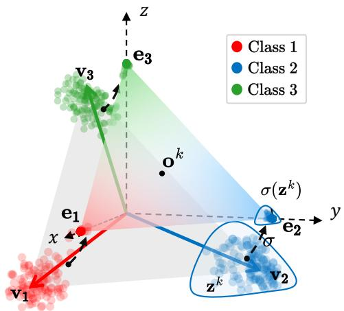  
Figure 2: Softmax outputs and logits obtained from a ResNet-18 trained on three CIFAR-10 classes. While softmax outputs concentrate near the vertices of the probability simplex (colored area), logits exhibit a similar simplex geometry (gray area) centered at the origin with a broader within-class spread.

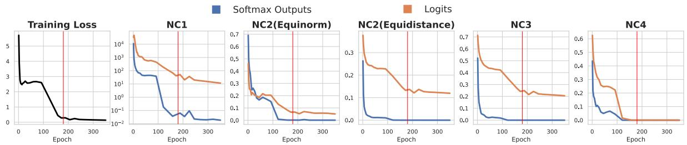  
Figure 3: Plots of training loss and Neural Collapse (NC) hypotheses for softmax outputs (blue) and logits (orange) on CIFAR-100 with ResNet-18. The terminal phase of training is shown with a vertical red line.

Analogously to the representation in Eq. 4, we model each class distribution of the normalized logit representation with a vMF distribution (Banerjee et al., 2005) whose mean direction is aligned with the class prototype $\mathbf { v } _ { c } ^ { k }$ . Since both representations share the same prototype directions, the representation in Eq. 5 inherits the geometric properties discussed in Sec. 3.2.1 and can likewise be analyzed within the theoretical framework of Theorem 3.6. Compared with the representation derived by the softmax outputs as in Eq. 4, the normalized logit representation exhibits a larger angular spread (see Fig. 2), preserving greater within class variability, a property that has been associated with improved transferability and robustness of learned representations (Chen et al., 2022; Wang & Isola, 2020).

To assess whether the behavior predicted by Prop. 3.3 emerges in standard neural networks, and to quantify the spread of the two representations, we leverage the NC hypotheses introduced by Papyan et al. (2020). These hypotheses provide a methodology for examining how the representations derived from softmax outputs and logits collapse toward the class prototype directions defined in Eq. 2. The NC hypotheses evaluate whether the within-class covariance tends to 0 (NC1); whether class means form a simplex whose vertices have the same norm (NC2 equinorm) and are maximally and equally distant from each other (NC2 equidistance); whether class means converge to class prototypes (NC3); and whether the nearest class-mean rule for classifying features holds (NC4).

Fig. 3 reports the corresponding NC measures for softmax outputs (blue curves) and logits (orange curves) during the terminal phase of training of a ResNet-18 on CIFAR-100. The higher NC1 values observed for logits indicate greater residual within-class variability than for softmax outputs. Similarly, the higher NC2- equidistance and NC3 values indicate a lower degree of convergence of the logit representations toward the ideal simplex geometry and the corresponding class-prototype directions. These results show that, while both representations exhibit the same underlying simplex structure, logits retain a larger within-class spread and a lower degree of prototype alignment than softmax outputs. This distinct trade-of between alignment and spread is reflected in the retrieval performance reported in Sec. 4. Similar trends across diferent model architectures and datasets are reported in Appendix B.

## 3.3 Deterministic Angular Correction Under Class Expansion

In this section, we address the misalignment that arises in the proposed hyperspherical simplex representations when new classes are introduced during model updates, analyzing the behavior of the features through their class prototypes (Papyan et al., 2020). We formally characterize this misalignment and introduce a deterministic linear transformation that restores prototype alignment across updates.

As follows from Def. 3.2, the geometry of the probability simplex depends explicitly on the number of classes. When the model is updated from step k to step t by introducing additional classes, the classifier expands from $C ^ { k }$ to $C ^ { t }$ outputs, changing the simplex center and, consequently, the directions of the prototypes associated with the previously existing classes according to Eq. 2. Since the representations at the two steps have diferent dimensions, throughout this section vectors at step k are embedded into $\mathbb { R } ^ { C ^ { t } }$ by zero-padding whenever they are compared with vectors at step t. As illustrated by the dashed arrows in Fig. 4, the corresponding prototypes at step t belong to a higher-dimensional simplex and are misaligned with their counterparts at step k. The resulting angular misalignment (derived in Appendix C) is the same for all

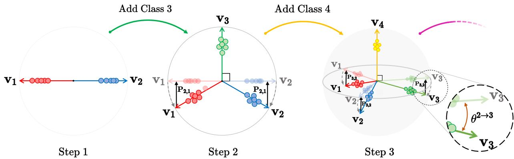  
Figure 4: Deterministic linear transformation across model updates of the class prototypes in Eq. 2 to which the hyperspherical simplex representations of $\mathrm { E q . ~ 4 }$ and Eq. 5 align. From left to right: Step 1, a 1-simplex with two classes (red and blue); Step 2, a 2-simplex with a new class (green); Step 3, a 3-simplex with a new class (yellow). Dashed arrows at steps 2 and 3 show how the class prototypes rotate to form the new simplex. The black dashed circle on the right shows the angular misalignment $\dot { \theta } _ { c } ^ { \bar { k }  t }$ of the class-3 prototype between steps 2 and 3. Solid black arrows indicate the linear transformation $\mathbf { P } _ { t , k }$ , which aligns the updated prototypes of the previously existing classes with their counterparts at the earlier step.

previously existing classes and is given by:

$$
\theta _ { c } ^ { k  t } = \operatorname { a r c c o s } ( { \sqrt { { \frac { C ^ { k } - 1 } { C ^ { k } } } \cdot { \frac { C ^ { t } } { C ^ { t } - 1 } } } } ) ,\tag{6}
$$

where $C ^ { k }$ and $C ^ { t }$ represent the number of classes at steps k and t, respectively, with $C ^ { k } \leq C ^ { t }$ . Eq. 6 shows that $\theta _ { c } ^ { k  t } = 0$ when $C ^ { t } = C ^ { k }$ , so that the corresponding class prototypes are aligned. In contrast, $\theta _ { c } ^ { k  t } > 0$ when $C ^ { t } > C ^ { k }$ , so that adding new classes always introduces a misalignment.

To align the prototypes when new classes are added, we compensate for the angular misalignment in Eq. 6 using a deterministic linear transformation, defined as the matrix $\mathbf { P } _ { t , k } = \left[ \mathbf { P } _ { k , k } \mid \mathbf { 0 } \right]$ , where 0 is the $C ^ { k } \times$ $( C ^ { t } - C ^ { k } )$ zero matrix.

The block $\mathbf { P } _ { k , k } .$ , i.e., the centering projection in Eq. 3, acts on the first $C ^ { k }$ coordinates and maps the prototypes at step t of the classes already present at step $k , \left\{ \mathbf { v } _ { c } ^ { t } \right\} _ { c = 1 } ^ { C ^ { k } }$ , onto the subspace spanned by their counterparts $\{ \mathbf { v } _ { c } ^ { k } \} _ { c = 1 } ^ { C ^ { k } }$ at step $k ,$ thereby removing the angular misalignment introduced by the new classes. The zero block 0 discards the components along the $C ^ { t } - C ^ { k }$ coordinates introduced at step t, which have no counterpart in the step-k representation. The following two propositions formalize this behavior.

Proposition 3.4 (Proof in Appendix D). When updating the model from step k to step $t ,$ if the number of classes increases from $C ^ { k }$ to $C ^ { t }$ , the prototypes associated with the newly introduced classes at step t are orthogonal to the subspace spanned by the class prototypes at step k.

Proposition 3.5 (Proof in Appendix E). For every class c already present at step $k ,$ i.e., $1 \leq c \leq C ^ { k }$ , the transformed prototype $\mathbf { u } _ { c } ^ { t } = \mathbf { P } _ { t , k } \mathbf { v } _ { c } ^ { t }$ is aligned with its counterpart $\mathbf { v } _ { c } ^ { k }$ at step k.

Together, Prop. 3.4 and Prop. 3.5 explain the origin of the misalignment and how $\mathbf { P } _ { t , k }$ removes it. Prop. 3.4 shows that the prototypes associated with newly introduced classes at step t lie in directions orthogonal to the subspace spanned by the prototypes at step k. Since the step-t prototypes remain centered at the origin, the updated prototypes of the existing classes acquire components along these orthogonal directions, resulting in the angular misalignment $\theta _ { c } ^ { k  t }$ defined in $\operatorname { E q . }$ 6. Prop. 3.5 then shows that $\mathbf { P } _ { t , k }$ removes these components and maps each updated old-class prototype onto the direction of its corresponding prototype at step k. Fig. 4 illustrates this process: dashed arrows indicate the prototype change induced by class expansion, whereas solid arrows show how $\mathbf { P } _ { t , k }$ restores the alignment.

Since $\mathbf { P } _ { t , k }$ is determined entirely by the simplex geometry and the number of classes at the two update steps, it can be computed without learning additional parameters or accessing any data. It therefore provides a deterministic mechanism for restoring prototype alignment of the hyperspherical simplex representations in $\operatorname { E q . }$ 4 and $\operatorname { E q . }$ . 5 across model updates under class expansion.

We refer to the approach based on the hyperspherical simplex representation derived from softmax outputs in $\operatorname { E q . }$ 4 as Probability Simplex Projection (PSP), and to the approach based on the logit representation in Eq. 5 as Logits Simplex Projection (LSP). When $C ^ { t } > C ^ { k }$ , the transformation $\mathbf { P } _ { t , k }$ is applied to the softmax outputs or logits of the updated model before ℓ2-normalization, so that the resulting features lie in the representation space of step k; when $C ^ { t } = C ^ { k }$ , the representations in $\operatorname { E q } .$ . 4 and $\operatorname { E q . }$ 5 are used directly. Appendix F provides pseudocode for gallery indexing with PSP or $\mathrm { L S P }$ and for comparing query and gallery representations across model updates.

## 3.4 Theoretical Analysis of the Backward-Compatibility Definition

In the following, we establish geometric conditions under which the backward-compatibility inequalities hold in expectation, and then analyze whether these conditions are satisfied by the proposed hyperspherical simplex representations.

Theorem 3.6 (Compatibility Theorem; Proof in Appendix G.). Consider hyperspherical representations obtained at update steps k and t, with $t > k$ . Assume that (i) the features of each class c are drawn independently from a von Mises–Fisher distribution $\mathrm { v M F } ( \mu _ { c } , \kappa _ { c } )$ whose mean direction $\pmb { \mu } _ { c }$ is the corresponding class prototype, and $( i i )$ the concentration $\kappa _ { c }$ of each class distribution increases from step k to step t. Then the compatibility inequalities of $E q .$ 1a and Eq. 1b are satisfied in expectation if (a) corresponding class prototypes are aligned across updates and (b) the angle between prototypes of diferent classes is greater than $\pi / 2$

The vMF distribution in assumption (i) is employed as a tractable modeling assumption rather than as an exact characterization of the learned distributions: it yields closed-form expressions for the expected cosine distances in $\operatorname { E q } .$ . 1a and $\operatorname { E q } .$ . 1b in terms of the prototype directions and concentration parameters (Lemma G.1 in Appendix G), which enables the analytical characterization in Theorem 3.6. It provides a standard probabilistic model for directional data on the unit hypersphere (Banerjee et al., 2005), and hyperspherical and angular representations have been extensively investigated in deep classification and face recognition (Liu et al., 2016; 2017; Deng et al., 2019). More broadly, vMF-based formulations have been employed to define hyperspherical latent-variable models (Davidson et al., 2018), learn discriminative hyperspherical representations (Hasnat et al., 2017; Scott et al., 2021), model normalized contrastive and hyperspherical features (Du et al., 2024; Bai et al., 2024), and characterize class-conditional latent structure in theoretical analyses of cross-entropy learning (Reizinger et al., 2025). Remark 2 further clarifies the specific role of the vMF assumption and its first-moment characterization in the proof of Theorem 3.6.

Assumption (ii), that class representations become increasingly concentrated around their prototypes across model updates, is supported by several complementary observations. Scaling-law studies show that increasing model capacity or training data generally improves predictive, transfer, and retrieval performance (Fang et al., 2024; Prato et al., 2021; Zhai et al., 2022), motivating the model-update scenarios considered here, in which updated models are more capable or trained on larger datasets. Neural Collapse analyses provide a more direct geometric connection: within-class variability progressively decreases during training as features concentrate around their class means (Papyan et al., 2020; Yaras et al., 2022; Jiang et al., 2024), and stronger collapse with reduced relative within-class variability is observed as network width and depth increase (Yaras et al., 2022; Súkeník et al., 2025). Under the vMF modeling assumption, such a reduction in angular dispersion around the class prototype corresponds to an increase in the concentration parameter κ.

These observations primarily concern penultimate-layer features, but they can be related to the output representations used by PSP and LSP. For a linear classifier, variations in the backbone representations induce bounded variations in the corresponding logits (Gouk et al., 2021), and the progressive alignment between class means and classifier weights observed during training (Papyan et al., 2020) relates the geometry of the penultimate-layer representations to that of the logits. In Appendix H, we provide empirical evidence on CIFAR-10 that both logits and softmax outputs become increasingly concentrated around their class prototypes across model updates.

The aligned regular-simplex geometry centered at the origin, on which the proposed representations are built, satisfies the geometric conditions of Theorem 3.6. The following corollary formalizes this result for any hyperspherical representation exhibiting this geometry.

Corollary 3.7 (Compatibility of Aligned Regular-Simplex Hyperspherical Representations; Proof in Appendix G.). Under the assumptions of Theorem 3.6, hyperspherical representations whose class prototypes form a regular simplex centered at the origin and remain aligned across updates satisfy the compatibility inequalities of $E q .$ 1a and Eq. 1b in expectation.

This follows from the geometry of a regular simplex centered at the origin, where the inner product between any two distinct normalized class prototypes is negative, implying a pairwise angle greater than $\pi / 2$ (Pernici et al., 2021a). Hence, once corresponding class prototypes are aligned across updates, both geometric conditions required by Theorem 3.6 hold. Remark 3 in Appendix G further clarifies the relation between this geometry and the Simplex ETF configuration arising in Neural Collapse.

The proposed PSP and LSP representations satisfy the geometric hypotheses of Corollary 3.7. Their class prototypes form a regular simplex centered at the origin: for PSP, by construction (Sec. 3.2.1); for LSP, exactly under the logit-UFM assumptions of Prop. 3.3, with the emergence of this geometry in neural networks assessed empirically through the Neural Collapse analysis of Sec. 3.2.2. Corresponding prototypes remain aligned across updates when the class set is unchanged, while under class expansion the transformation $\mathbf { P } _ { t , k }$ restores their alignment (Prop. 3.5). Therefore, under the assumptions of Theorem 3.6, PSP and LSP satisfy the compatibility inequalities of Eq. 1a and Eq. 1b in expectation. In Appendix I, we empirically isolate the two operations underlying PSP in a class-expansion update, showing that positive average margins for both compatibility inequalities are obtained only when the centering projection and the angular correction are combined.

The theoretical result is not specific to PSP and LSP: Corollary 3.7 also applies, for instance, to representations learned with pre-allocated d-simplex fixed classifiers (Biondi et al., 2023a; 2024; 2026), whose class prototypes are fixed a priori and thus remain aligned across updates. From a practical perspective, however, PSP and LSP do not require a shared pre-allocated fixed classifier across model updates.

## 3.5 Scalability via Top-k Sparsification

Hyperspherical simplex representations derived from softmax outputs (Eq. 4 for PSP) or logits (Eq. 5 for LSP) have dimensionality equal to the number of classes. Although training on a larger number of classes can improve the quality and transferability of learned representations (Zhu et al., 2022; Hong et al., 2024), this class-dependent dimensionality poses a limitation in large-scale retrieval scenarios: the memory required to store the gallery scales linearly with both the number of gallery samples and the number of classes, potentially becoming prohibitive at scale. To address this, we construct sparse representations by retaining only the highest-ranked components of each feature vector, a choice motivated by the top-k calibration of the softmax cross-entropy loss and the rank-preserving property of the softmax function (Lapin et al., 2016; Yang & Koyejo, 2020).

Following the theoretical analysis of Lapin et al. (2016), the Bayes-optimal classifier under the softmax cross-entropy loss satisfies:

$$
f _ { y } ^ { * } ( x ) = { \left\{ \begin{array} { l l } { \log p _ { y } ( x ) + \log \alpha } & { { \mathrm { i f ~ } } p _ { y } ( x ) > 0 , } \\ { - \infty } & { { \mathrm { o t h e r w i s e , } } } \end{array} \right. }\tag{7}
$$

where $\alpha > 0$ is a class-independent constant and $p _ { y } ( x ) = P ( Y = y ~ \vert ~ X = x )$ denotes the posterior probability of label y given input x. Since the logarithm is strictly increasing, the optimal scores are a monotonic reparameterization of the class posterior probabilities and preserve their ordering, which underlies the top-k calibration of the softmax cross-entropy loss (Lapin et al., 2016). Moreover, the softmax function is rankpreserving (Yang & Koyejo, 2020), i.e., $z _ { i } > z _ { j } \iff \sigma ( \mathbf { z } ) _ { i } > \sigma ( \mathbf { z } ) _ { j }$ , so that logits and softmax outputs induce the same class ranking. This ranking is also preserved by the operations defining PSP and LSP: the centering projection $\mathbf { P } _ { k , k }$ subtracts the same constant from all entries of a softmax output, and $\ell _ { 2 ^ { - } }$ normalization rescales all entries by a positive factor. Consequently, the largest entries of PSP and LSP correspond to the highest-ranked classes.

Accordingly, we adopt a top-k sparsification strategy for both PSP and LSP, applied after ℓ -normalization: we retain the k largest entries of the normalized feature vector $\mathbf { h } ^ { k }$ and set the remaining entries to zero. The resulting sparse representations can be directly processed by approximate nearest-neighbor search libraries designed for sparse high-dimensional data (e.g., PySparNN (Facebook Research, 2017) and Seismic (Bruch et al., 2024a;b)), supporting eficient search over large galleries (simhadri et al., 2025). In Sec. 4, we empirically evaluate top-k sparsification for both PSP and LSP, showing that high levels of sparsity can be achieved with negligible degradation in retrieval performance while preserving backward-compatibility.

## 4 Experimental Results

Building on the theoretical analysis, in this section we examine whether the backward-compatibility properties of PSP and LSP are reflected empirically across various model-update scenarios, under established training protocols and retrieval-based evaluation procedures.

## 4.1 Evaluation Setting

Following prior work on model compatibility (Shen et al., 2020; Zhang et al., 2022; Meng et al., 2021; Jaeckle et al., 2023), we adopt image retrieval as the evaluation task, where the goal is to retrieve images from a gallery $\mathcal { G } = \{ ( \mathbf { x } _ { i } , y _ { i } ) \} _ { i = 1 } ^ { N _ { g } }$ using queries from a query set $\mathcal { Q } = \{ ( \mathbf { x } _ { i } , y _ { i } ) \} _ { i = 1 } ^ { N _ { q } }$ . Since verifying the inequalities of Def. 3.1 is impractical at scale (Sec. 3.1), we follow standard practice and adopt the Empirical Compatibility Criterion introduced by Shen et al. (2020):

$$
M \big ( \phi ^ { t } , \phi ^ { k } ; \mathcal { Q } , \mathcal { G } \big ) > M \big ( \phi ^ { k } , \phi ^ { k } ; \mathcal { Q } , \mathcal { G } \big ) , \qquad t > k ,\tag{8}
$$

where $\phi ^ { k }$ denotes the model at step k and M denotes a retrieval performance metric. The term $M \left( \phi ^ { t } , \phi ^ { k } ; \mathcal { Q } , \mathcal { G } \right)$ denotes the cross-model accuracy, obtained when query representations are extracted using the updated model $\phi ^ { t }$ and gallery representations using the previous model $\phi ^ { k }$ . Conversely, $M \left( \phi ^ { k } , \phi ^ { k } ; \mathcal { Q } , \mathcal { G } \right)$ denotes the same-model accuracy, obtained when both query and gallery representations are extracted using the same model $\phi ^ { k }$

Following prior work (Ramanujan et al., 2022; Zhou et al., 2023; Ricci et al., 2024; Jaeckle et al., 2023; Ricci et al., 2025), we use Cumulative Matching Characteristic (CMC@1) as the retrieval performance metric M, and the full test set of each dataset is used as both the query set and gallery set. Retrieval is performed using cosine distance between query and gallery representations, excluding the query sample itself from the gallery to avoid a trivial match. CMC@1 is computed as the fraction of queries for which the gallery sample ranked first has the same class label as the query.

To evaluate compatibility across multiple model updates, we construct a compatibility matrix following Biondi et al. (2023a;b); Bui et al. (2025):

$$
\mathbf { C } _ { t , k } = \left\{ \begin{array} { l l } { 0 } & { \mathrm { i f ~ } t < k , } \\ { M \big ( \phi ^ { k } , \phi ^ { k } ; \mathcal { Q } , \mathcal { G } \big ) } & { \mathrm { i f ~ } t = k , } \\ { M \big ( \phi ^ { t } , \phi ^ { k } ; \mathcal { Q } , \mathcal { G } \big ) } & { \mathrm { i f ~ } t > k . } \end{array} \right.\tag{9}
$$

This compatibility matrix summarizes retrieval performance across all valid pairs of model updates, extending the evaluation beyond the two or three update steps commonly considered in previous studies (Shen et al., 2020; Zhou et al., 2023; Zhang et al., 2021). Compatibility is assessed by comparing each cross-model entry $\mathbf { C } _ { t , k } .$ , with $t > k ,$ , against the corresponding same-model entry $\mathbf { C } _ { k , k }$ according to the Empirical Compatibility Criterion in Eq. 8.

To summarize the overall behavior across multiple updates, we adopt the metrics defined by Biondi et al. (2023a) and Biondi et al. (2026), which aggregate the entries of the compatibility matrix into distinct measures, conceptually analogous to metrics used in continual learning (Lopez-Paz & Ranzato, 2017):

Table 1: Comparative analysis of compatibility performance under the “Extended Classes” benchmark on CIFAR-100 for multiple updates. Dark and light blue indicate respectively the highest and the second-highest value for each metric.
<table><tr><td></td><td colspan="3">2 steps</td><td colspan="3">5 steps</td><td colspan="3">20 steps</td><td colspan="3">50 steps</td></tr><tr><td>METHOD</td><td>AC</td><td>AA</td><td>ACA</td><td>AC</td><td>AA</td><td>ACA</td><td>AC</td><td>AA</td><td>ACA</td><td>AC</td><td>AA</td><td>ACA</td></tr><tr><td>Baseline</td><td>0</td><td>29.63</td><td>0</td><td>0</td><td>13.60</td><td>0</td><td>0</td><td>04.22</td><td>0</td><td>0</td><td>02.29</td><td>0</td></tr><tr><td>BCT</td><td>1</td><td>40.64</td><td>35.51</td><td>0</td><td>31.03</td><td>0</td><td>0</td><td>22.66</td><td>0</td><td>0.01</td><td>15.78</td><td>0.84</td></tr><tr><td>RACT</td><td>1</td><td>44.19</td><td>45.09</td><td>0.60</td><td>30.43</td><td>16.53</td><td>0.05</td><td>21.61</td><td>2.42</td><td>0</td><td>16.71</td><td>0</td></tr><tr><td>AdvBCT</td><td>0</td><td>35.32</td><td>0</td><td>0.40</td><td>26.13</td><td>11.67</td><td>0.02</td><td>19.79</td><td>0.19</td><td>0</td><td>14.70</td><td>0.03</td></tr><tr><td>LCE</td><td>1</td><td>43.48</td><td>40.71</td><td>0.10</td><td>32.63</td><td>04.63</td><td>0</td><td>20.95</td><td>0.25</td><td>0</td><td>13.81</td><td>0.03</td></tr><tr><td>CoReS</td><td>1</td><td>40.94</td><td>35.21</td><td>0</td><td>29.63</td><td>0</td><td>0.12</td><td>24.88</td><td>4.61</td><td>0.11</td><td>23.50</td><td>3.91</td></tr><tr><td>PSP</td><td>1</td><td>36.31</td><td>29.05</td><td>0.90</td><td>26.04</td><td>21.76</td><td>0.52</td><td>20.56</td><td>12.99</td><td>0.39</td><td>19.42</td><td>10.76</td></tr><tr><td>LSP</td><td>1</td><td>41.14</td><td>36.38</td><td>0.70</td><td>30.36</td><td>21.91</td><td>0.44</td><td>24.11</td><td>13.26</td><td>0.36</td><td>22.68</td><td>11.25</td></tr></table>

• Average Compatibility (AC), which measures the fraction of compatible cross-model comparisons over T update steps: $\begin{array} { r } { A C = \frac { 2 } { T ( T - 1 ) } \sum _ { t = 2 } ^ { T } \sum _ { k = 1 } ^ { t - 1 } \mathbb { 1 } ( \mathbf { C } _ { t , k } > \mathbf { C } _ { k , k } ) } \end{array}$ , where 1 denotes the indicator function.

• Average Accuracy (AA), which measures the average retrieval performance across all same-model and cross-model comparisons over T update steps, thus capturing the overall retrieval accuracy regardless of compatibility: $\begin{array} { r } { \boldsymbol { A } \boldsymbol { A } = \frac { 2 } { T ( T + 1 ) } \sum _ { t = 1 } ^ { T } \bar { \sum _ { k = 1 } ^ { t } } \mathbf { C } _ { t , k } } \end{array}$

• Average Compatibility Accuracy (ACA), which jointly captures retrieval performance and compatibility by averaging the cross-model accuracy over all update pairs, while assigning zero contribution to incompatible comparisons: $\begin{array} { r } { A C A = \frac { 2 } { T ( T - 1 ) } \sum _ { t = 2 } ^ { T } \sum _ { k = 1 } ^ { \tilde { t } - 1 } { \bf C } _ { t , k } \mathbb { 1 } ( { \bf C } _ { t , k } > { \bf C } _ { k , k } ) } \end{array}$

## 4.2 Standard Compatibility Benchmarks

In this section, we compare PSP and LSP with established backward-compatibility methods on standard compatibility benchmarks. Following prior work (Shen et al., 2020; Zhou et al., 2023; Meng et al., 2021; Biondi et al., 2023a; Pan et al., 2023), we evaluate three update scenarios: extended classes, where new classes are introduced across model updates; extended backbone, where the model architecture is upgraded; and extended classes and backbone, where both changes occur simultaneously.

Following Shen et al. (2020) and subsequent literature, unless otherwise specified, each updated model is randomly initialized and trained from scratch rather than initialized from the previous model. This protocol removes parameter inheritance across model updates, ensuring that observed compatibility cannot be attributed to warm-starting from a previously learned representation. Models are trained using classification as the surrogate task for representation learning. Implementation details for the standard compatibility benchmarks are provided in Appendix J.

We compare against the following backward-compatibility methods: BCT (Shen et al., 2020), RACT (Zhang et al., 2021), AdvBCT (Pan et al., 2023), LCE (Meng et al., 2021), and CoReS (Biondi et al., 2023a). We also include a Baseline based on the ℓ -normalized encoder features without any compatible method applied. When the encoder feature dimensionality difers across model updates, the lower-dimensional representation is zero-padded to match the dimensionality of the higher-dimensional one before computing cross-model similarities. For reproducibility, we use the oficial publicly available implementations of all compared methods. All experiments are conducted on two NVIDIA A100 40 GB GPUs.

## 4.2.1 Extended Classes Benchmark

In the extended-classes benchmark, the training set of each dataset is partitioned into T sequential tasks, each introducing a disjoint and equal number of new classes. At each update step t, the model is trained from scratch using the cumulative training data from tasks 1 through t. Following Zhou et al. (2023);

Table 2: Comparative analysis of compatibility performance under the “Extended Classes” benchmark on ImageNet-1K and Google Landmarks v2 for multiple updates. Dark and light blue indicate respectively the highest and the second-highest value for each metric.
<table><tr><td></td><td colspan="6">ImageNet-1K</td><td colspan="6">Google Landmark v2</td></tr><tr><td></td><td colspan="3">2 steps</td><td colspan="3">5 steps</td><td colspan="3">2 steps</td><td colspan="3">5 steps</td></tr><tr><td>METHOD</td><td>AC</td><td>AA</td><td>ACA</td><td>AC</td><td>AA</td><td>ACA</td><td>AC</td><td>AA</td><td>ACA</td><td>AC</td><td>AA</td><td>ACA</td></tr><tr><td>Baseline</td><td>0</td><td>37.52</td><td>0</td><td>0</td><td>16.18</td><td>0</td><td>0</td><td>07.66</td><td>0</td><td>0</td><td>07.87</td><td>0</td></tr><tr><td>BCT</td><td>1</td><td>48.81</td><td>45.86</td><td>0.20</td><td>34.96</td><td>5.28</td><td>1</td><td>09.37</td><td>08.22</td><td>0</td><td>08.46</td><td>0</td></tr><tr><td>RACT</td><td>1</td><td>55.17</td><td>51.16</td><td>0.10</td><td>40.94</td><td>6.20</td><td>0</td><td>11.01</td><td>0</td><td>0</td><td>09.99</td><td>0</td></tr><tr><td>AdvBCT</td><td>0</td><td>53.07</td><td>0</td><td>0</td><td>43.91</td><td>0</td><td>1</td><td>11.12</td><td>09.67</td><td>0</td><td>10.73</td><td>0</td></tr><tr><td>LCE</td><td>0</td><td>47.22</td><td>0</td><td>0</td><td>32.67</td><td>0</td><td>1</td><td>09.41</td><td>08.03</td><td>0.40</td><td>10.31</td><td>3.80</td></tr><tr><td>CoReS</td><td>0</td><td>46.11</td><td>0</td><td>0</td><td>37.67</td><td>0</td><td>-</td><td></td><td></td><td>一</td><td>1</td><td>一</td></tr><tr><td>PSP</td><td>1</td><td>49.10</td><td>39.80</td><td>1</td><td>35.20</td><td>31.09</td><td>1</td><td>08.74</td><td>08.24</td><td>0.90</td><td>08.53</td><td>7.21</td></tr><tr><td>→ w top-256</td><td>1</td><td>49.11</td><td>39.81</td><td>1</td><td>35.20</td><td>31.09</td><td>1</td><td>08.74</td><td>08.24</td><td>0.90</td><td>08.53</td><td>7.21</td></tr><tr><td>LSP</td><td>1</td><td>50.72</td><td>45.62</td><td>0.50</td><td>38.03</td><td>14.28</td><td>1</td><td>09.31</td><td>08.36</td><td>0.80</td><td>09.36</td><td>7.34</td></tr><tr><td>→ w top-256</td><td>1</td><td>50.34</td><td>45.84</td><td>0.70</td><td>37.96</td><td>24.85</td><td>1</td><td>09.30</td><td>08.35</td><td>0.80</td><td>09.34</td><td>7.31</td></tr></table>

Ricci et al. (2024); Jaeckle et al. (2023); Zhou et al. (2022), retrieval is evaluated at each update step over the entire test set, including classes that have not yet been observed during training. This results in a semi-open-set evaluation scenario, in which the training class set expands across updates while retrieval is performed over the complete set of classes. Tab. 1 reports AC, AA, and ACA on CIFAR-100 (Krizhevsky, 2009) using a ResNet-18 backbone. Tab. 2 reports the same metrics on larger-scale datasets: ImageNet-1K (Russakovsky et al., 2015) using a ResNet-50 backbone and Google Landmarks v2 (Weyand et al., 2020) using a ResNet-18 backbone initialized from ImageNet-1K pretrained weights at every update step. Overall, Tab. 1 and Tab. 2 show that PSP and LSP achieve competitive retrieval performance while consistently providing strong compatibility across model updates. The advantage of our proposed representations over the compared approaches becomes increasingly pronounced as the number of update steps increases, as reflected by the compatibility metrics in the 50-step setting on CIFAR-100 and the 5-step setting on ImageNet-1K. The compatibility matrices for the 5-step CIFAR-100 experiment are reported in Fig. 9 in Appendix K, providing a visual summary of retrieval performance across model updates.

In the 2-step setting, where compatibility is evaluated over a single model-update pair, several of the compared approaches achieve strong performance. On CIFAR-100, BCT, RACT, LCE, CoReS, PSP, and LSP all satisfy the empirical compatibility criterion (AC = 1), with RACT achieving the highest retrieval performance among the compared methods. A similar behavior is observed on ImageNet-1K, where BCT, RACT, PSP, and LSP satisfy the compatibility criterion, while RACT obtains the highest AA and ACA. On Google Landmarks v2, BCT, AdvBCT, LCE, PSP, and LSP satisfy the criterion, whereas RACT does not. In contrast, the Baseline based directly on the encoder features does not achieve compatibility in any evaluated setting, showing that independently trained encoder representations are not naturally compatible across model updates.

As the number of updates increases, the diferences among the methods become more pronounced. On CIFAR-100, the compatibility of BCT, RACT, AdvBCT, and LCE drops to nearly zero in the 20- and 50-step settings. CoReS is more robust than these pairwise compatibility approaches over longer update sequences and retains comparatively high AA; however, its AC and ACA remain substantially below those of PSP and LSP. For example, in the 50-step setting, CoReS achieves AC = 0.11 and ACA = 3.91, compared with AC = 0.39 and ACA = 10.76 for PSP and AC = 0.36 and ACA = 11.25 for LSP. A similar trend is observed in the 5-step ImageNet-1K benchmark: although several competing methods retain high AA, their compatibility frequency is low or zero, whereas PSP achieves AC = 1 and ACA = 31.09, and LSP achieves AC = 0.50 and ACA = 14.28. On Google Landmarks v2, PSP and LSP similarly attain the highest compatibility values in the 5-step setting, with AC = 0.90 and AC = 0.80, respectively, compared with AC = 0.40 for LCE and AC = 0 for the remaining evaluated baselines.

One possible explanation for the degradation observed for several of the compared methods as the number of updates increases is that regularization- and mapping-based approaches typically establish compatibility only with respect to the previous model. When such compatibility is enforced sequentially across multiple updates, deviations and misalignment with respect to earlier model versions may accumulate because compatibility with all previous representations is not directly enforced. Rather than sequentially enforcing compatibility with their predecessors, PSP and LSP exploit a regular-simplex geometry that provides a common reference across all model updates, consistently with Corollary 3.7.

Among the compared approaches, CoReS (Biondi et al., 2023a) is conceptually closer to PSP and LSP, as it also exploits a regular-simplex geometry as reference across model updates. The main practical distinction is that CoReS requires the classifier geometry and the number of prototypes to be pre-allocated before training, including prototypes reserved for classes that may be introduced in future updates (Pernici et al., 2021b; Biondi et al., 2023a). The outputs reserved for future classes participate in the cross-entropy objective from the beginning of training and act as negative classes for current samples (Pernici et al., 2021b; Biond et al., 2023a), thereby constraining representation learning with respect to a prototype geometry and class capacity specified in advance. This fixed pre-allocated prototype assignment may limit adaptation to the observed class structure (Saadabadi et al., 2024). In contrast, PSP and LSP derive their reference geometry directly from the output space of each model. Furthermore, CoReS scales poorly with the number of classes, as its memory requirements, driven by both the pre-allocated fixed classifier and the additional linear layer mapping the backbone features to the simplex representation space, grow substantially with the class count. For Google Landmarks $\mathrm { v 2 , }$ these requirements made training computationally infeasible under our experimental configuration, and CoReS results are therefore not reported in Tab. 2.

Notably, across the diferent numbers of update steps reported in Tab. 1 and Tab. 2, LSP consistently achieves higher AA than PSP, while its AC is generally equal to or lower than that of PSP. This behavior is consistent with the larger within-class spread and lower prototype alignment of LSP observed in the NC analysis of Sec. 3.2.2. As a result of this trade-of, LSP often achieves comparable or higher ACA. However, since incompatible comparisons contribute zero to ACA, PSP achieves a higher ACA when it is compatible in a substantially larger fraction of update pairs, as in the 5-step ImageNet-1K setting (AC = 1 for PSP vs. $A C = 0 . 5 0$ for LSP).

The rows labeled “−→ w top-256” in Tab. 2 report the performance of PSP and LSP after applying the top-k sparsification described in Sec. 3.5. Top-256 sparsification leaves the PSP results essentially unchanged across the evaluated benchmarks, while also preserving the retrieval accuracy of LSP. In the 5-step ImageNet-1K setting, sparsification increases the AC of LSP from 0.50 to 0.70 and its ACA from 14.28 to 24.85, with only a negligible change in AA (from 38.03 to 37.96). Consistently, Tab. 3 shows that retrieval accuracy remains essentially stable over the evaluated range of k, while the observed compatibility behavior is preserved.

Table 3: Comparison of PSP and LSP across diferent top-k values in terms of AC, AA, and ACA, in the 5-step ImageNet-1K setting of the extended-classes benchmark.
<table><tr><td rowspan="2">Top-k with k =</td><td colspan="3">PSP</td><td colspan="3">LSP</td></tr><tr><td>AC</td><td>AA</td><td>ACA</td><td>AC</td><td>AA</td><td>ACA</td></tr><tr><td>256</td><td>1</td><td>35.20</td><td>31.09</td><td>0.7</td><td>37.96</td><td>24.85</td></tr><tr><td>384</td><td>1</td><td>35.20</td><td>31.09</td><td>0.7</td><td>38.00</td><td>24.87</td></tr><tr><td>512</td><td>1</td><td>35.20</td><td>31.09</td><td>0.5</td><td>38.03</td><td>14.24</td></tr><tr><td>768</td><td>1</td><td>35.20</td><td>31.09</td><td>0.5</td><td>38.01</td><td>14.28</td></tr><tr><td>896</td><td>1</td><td>35.20</td><td>31.09</td><td>0.5</td><td>38.03</td><td>14.28</td></tr><tr><td>1000</td><td>1</td><td>35.20</td><td>31.09</td><td>0.5</td><td>38.03</td><td>14.28</td></tr></table>

The memory benefit of sparsification becomes particularly relevant when the number of classes is large. For a gallery of $N _ { g }$ representations of dimension C, dense FP32 storage requires approximately $4 N _ { g } C$ bytes, whereas storing the top-k representation using one 32-bit value and one 32-bit index per retained coordinate requires approximately $8 N _ { g } k$ bytes, excluding minor sparse-format metadata overhead. For Google Landmarks ${ \mathrm { v } } 2 ,$ where the representation dimensionality exceeds 81k at the final update, this corresponds to approximately 318 KiB per dense representation and only 2 KiB with $k = 2 5 6$ , yielding approximately a 159× reduction in gallery storage. Sparse representations also avoid dense C-dimensional similarity computation; the resulting search-time benefit depends on the adopted indexing and search backend (simhadri et al., 2025).

Table 4: Comparative analysis of compatibility performance under the “Extended Backbone” and “Extended Classes and Backbone” benchmarks on CIFAR-100 and ImageNet-1K. Dark and light blue indicate respectively the highest and the second-highest value for each metric.
<table><tr><td></td><td colspan="6">Ext. Backbone</td><td colspan="6">Ext. Classes &amp; Backbone</td></tr><tr><td></td><td colspan="3">CIFAR-100</td><td colspan="3">ImageNet-1K</td><td colspan="3">CIFAR-100</td><td colspan="3">ImageNet-1K</td></tr><tr><td>METHOD</td><td>AC</td><td>AA</td><td>ACA</td><td>AC</td><td>AA</td><td>ACA</td><td>AC</td><td>AA</td><td>ACA</td><td>AC</td><td>AA</td><td>ACA</td></tr><tr><td>Baseline</td><td>0</td><td>35.13</td><td>0</td><td>0</td><td>40.58</td><td>0</td><td>0</td><td>29.88</td><td>0</td><td>0</td><td>35.88</td><td>0</td></tr><tr><td>BCT</td><td>1</td><td>53.57</td><td>54.06</td><td>1</td><td>61.80</td><td>61.43</td><td>1</td><td>43.61</td><td>40.79</td><td>1</td><td>50.64</td><td>42.98</td></tr><tr><td>RACT</td><td>1</td><td>53.80</td><td>54.62</td><td>1</td><td>62.15</td><td>62.07</td><td>1</td><td>43.66</td><td>41.01</td><td>1</td><td>52.74</td><td>48.92</td></tr><tr><td>AdvBCT</td><td>0</td><td>49.56</td><td>0</td><td>1</td><td>59.22</td><td>57.73</td><td>1</td><td>39.06</td><td>35.05</td><td>1</td><td>50.37</td><td>45.42</td></tr><tr><td>LCE</td><td>1</td><td>52.14</td><td>52.26</td><td>1</td><td>61.22</td><td>61.40</td><td>1</td><td>42.42</td><td>39.72</td><td>1</td><td>52.28</td><td>48.06</td></tr><tr><td>CoReS</td><td>1</td><td>56.67</td><td>57.43</td><td>1</td><td>62.03</td><td>63.19</td><td>1</td><td>42.61</td><td>37.20</td><td>1</td><td>49.10</td><td>39.90</td></tr><tr><td>PSP</td><td>1</td><td>54.57</td><td>56.01</td><td>1</td><td>68.35</td><td>65.28</td><td>1</td><td>38.65</td><td>32.84</td><td>1</td><td>48.42</td><td>41.24</td></tr><tr><td>LSP</td><td>1</td><td>56.76</td><td>57.96</td><td>1</td><td>62.00</td><td>63.16</td><td>1</td><td>43.08</td><td>37.89</td><td>1</td><td>52.13</td><td>48.26</td></tr></table>

## 4.2.2 Extended Backbone Benchmark

In this experimental setting, we maintain the same dataset across all update steps (with no introduction of additional classes during model updates) while increasing model architectural complexity across two steps (i.e., ResNet-18 → ResNet-50). The goal is to evaluate compatibility when model updates involve a change in model architecture rather than the introduction of new training classes. Results for CIFAR-100 and ImageNet-1K are summarized in Tab. 4. Most of the evaluated approaches satisfy the compatibility criterion (AC= 1), suggesting that compatibility is generally easier to maintain in this setting than in the extended-classes benchmark. Since this benchmark consists of two update steps, AC is determined by a single cross-model comparison, and performance diferences therefore emerge primarily in terms of AA and ACA. LSP achieves the highest AA and ACA on CIFAR-100 and remains within 0.1–0.2 percentage points of the best-performing methods, CoReS and RACT, on ImageNet-1K. These results indicate that LSP maintains strong compatibility and retrieval performance even when the model architecture changes substantially. Notably, PSP and LSP achieve competitive performance without requiring compatibilityspecific regularization, learnable mappings, or modifications to the model architecture.

## 4.2.3 Extended Classes and Backbone Benchmark

This experimental configuration, consisting of two update steps, combines the two previously examined update mechanisms: at the second step, the model is retrained from scratch on an expanded training set using a more expressive backbone. Results for this combined setting are reported in Tab. 4 for the CIFAR-100 and ImageNet-1K datasets. The Baseline, which does not employ any compatibility-preservation mechanism, fails to satisfy the compatibility criterion (AC= 0) on both datasets, consistent with the behavior observed in the previous experimental settings. In contrast, all evaluated backward-compatibility approaches, including PSP and LSP, satisfy the criterion (AC= 1), showing that compatibility can be maintained even when the model update simultaneously introduces new classes and changes the backbone architecture. Across both CIFAR-100 and ImageNet-1K, LSP shows robust performance under this combined update setting, achieving AA and ACA values that match or closely approach those of the strongest compared methods. PSP also satisfies the compatibility criterion on both datasets, but attains lower AA and ACA than LSP. This behavior is consistent with the smaller within-class spread of the softmax output representation observed in the Neural Collapse analysis of Sec. 3.2.2, which may reduce retrieval performance in the semi-open-set setting, where the test set also contains classes not yet observed during training.

## 4.3 Compatibility Across Independently Trained Models From Public Repositories

The standard compatibility benchmarks of Sec. 4.2 consider models explicitly trained within a backwardcompatibility protocol. Here, we evaluate a complementary and more practical setting in which compatibility

Table 5: Compatibility between pretrained models on ImageNet-1K and Places365: (a) AlexNet −→ ResNet-50 (R-50) −→ RegNetX\_3.2GF (RegNet) −→ ResNet-152 (R-152) −→ MaxViT\_T and (b) ViT-B-32 −→ ViT-B-16 −→ ViT-L-16. Models are pretrained on ImageNet-1K and downloaded from Marcel & Rodriguez (2010). Dark blue numbers indicate the highest values, while light blue the second-highest values.
<table><tr><td></td><td colspan="6">AlexNet → R-50 → RegNet → R-152 → MaxViT</td><td colspan="6">ViT-B-32 → ViT-B-16 → ViT-L-16</td></tr><tr><td></td><td colspan="3">ImageNet-1K</td><td colspan="3">Places365</td><td colspan="3">ImageNet-1K</td><td colspan="3">Places365</td></tr><tr><td>METHOD</td><td>AC</td><td>AA</td><td>ACA</td><td>AC</td><td>AA</td><td>ACA</td><td>AC</td><td>AA</td><td>ACA</td><td>AC</td><td>AA</td><td>ACA</td></tr><tr><td>Baseline</td><td>0</td><td>21.63</td><td>0</td><td>0</td><td>8.38</td><td>0</td><td>0</td><td>38.63</td><td>0</td><td>0</td><td>15.10</td><td>0</td></tr><tr><td>PSP</td><td>1</td><td>74.34</td><td>76.12</td><td>0.9</td><td>15.92</td><td>14.08</td><td>1</td><td>78.94</td><td>80.53</td><td>1</td><td>18.31</td><td>17.60</td></tr><tr><td>LSP</td><td>0.7</td><td>60.68</td><td>37.61</td><td>0.2</td><td>21.36</td><td>4.06</td><td>0.67</td><td>71.82</td><td>45.91</td><td>0.33</td><td>25.71</td><td>7.99</td></tr></table>

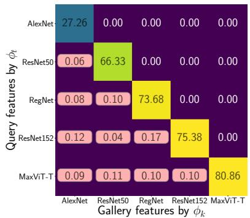  
(a) Baseline

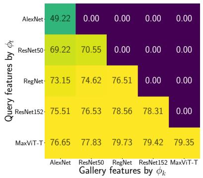  
(b) PSP

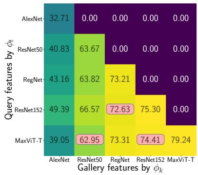  
(c) LSP  
Figure 5: Compatibility between independently trained models, all pretrained on ImageNet-1K. Compatibility matrices for five steps with increasingly expressive models (AlexNet, ResNet-50, RegNetX\_3.2GF, ResNet-152, and MaxViT\_T). The matrices display retrieval performance on the ImageNet-1K test set. Entries that do not satisfy the compatibility criterion in Eq. 8 are highlighted with a light-red background. Model representations from: (a) encoder output (Baseline); (b) softmax outputs (PSP); (c) logits (LSP). is measured directly between independently trained models obtained from a public repository, without any additional compatibility-specific training or adaptation.

We consider two sequences of pretrained models from the publicly available torchvision repository (Marcel & Rodriguez, 2010): a convolutional and hybrid sequence comprising AlexNet (Krizhevsky et al., 2012), ResNet-50 (He et al., 2016), RegNetX\_3.2GF (Radosavovic et al., 2020), ResNet-152 (He et al., 2016), and MaxViT\_T (Tu et al., 2022), and a transformer sequence comprising ViT-B/32, ViT-B/16, and ViT-$\mathrm { L } / 1 6$ (Dosovitskiy et al., 2021). All models are pretrained on ImageNet-1K while difering substantially in architecture and representational capacity.

We evaluate retrieval on the ImageNet-1K test set, which follows the pretraining distribution (closed-set), and on Places365 (Zhou et al., 2017), whose classes and data distribution difer from those used for pretraining (open-set). We compare PSP and LSP with the Baseline introduced in Sec. 4.2, obtained by $\ell _ { 2 } \cdot$ -normalizing the encoder features. Existing backward-compatibility methods are not included because they require additional training, adaptation, or architectural modifications and therefore cannot be directly applied to these publicly available, independently trained models.

The results in Tab. 5 show a clear advantage of the proposed hyperspherical simplex representations over the Baseline. PSP provides highly consistent compatibility across the evaluated model sequences, attaining $A C = 1$ in three of the four settings and $A C { = } 0 . 9 0$ in the remaining open-set setting. LSP also substantially improves compatibility over the Baseline, although it satisfies the empirical compatibility criterion for a smaller fraction of model-update pairs. The compatibility matrices in Fig. 5 illustrate these diferences: LSP and the Baseline achieve comparable same-model retrieval performance along the main diagonal, but the Baseline fails to maintain this performance across model updates, resulting in $A C = 0$ . A diferent tradeof between PSP and LSP emerges in closed-set and open-set evaluation. On ImageNet-1K, corresponding to the same data distribution used to pretrain all models, PSP consistently achieves higher AC, AA, and ACA than LSP. This behavior is consistent with the stronger alignment of PSP representations with the regular-simplex geometry and their lower within-class spread discussed in Sec. 3.2.2. On Places365, whose data distribution difers from the pretraining one, LSP instead achieves higher AA than PSP for both model sequences. This result is consistent with the broader angular spread of LSP representations, which may provide greater flexibility under domain shift. However, PSP retains substantially higher compatibility in this setting, achieving $A C { = } 0 . 9 0$ and 1.00, compared with 0.20 and 0.33 for LSP, and consequently also obtains higher ACA.

Overall, these experiments show that PSP and LSP can substantially improve cross-model retrieval compatibility even between models that were not explicitly trained to be compatible. PSP provides the most consistent empirical compatibility, whereas LSP preserves strong retrieval accuracy and achieves higher open-set AA, at the cost of lower compatibility than PSP.

These results reflect a structural property of the proposed representations: their common reference is determined by the label space rather than by any interaction between models. Models trained on the same set of classes under the standard class-indexing convention of a dataset, as is the case for all torchvision models trained on ImageNet-1K, induce the same one-hot encoding and therefore share the same reference geometry, without requiring coordination during training or access to previous models. Complementary compatibility matrices for the open-set evaluation and the ViT model sequence are reported in Appendix L.

## 5 Conclusions

In this paper, we introduce hyperspherical simplex representations derived from softmax outputs (PSP) and logits (LSP) for backward-compatible retrieval. The proposed representations leverage the simplex structure induced in the model output space by softmax cross-entropy training with one-hot encoded class labels, which provides a common geometric reference that aligns corresponding class prototypes across model up dates, without requiring compatibility-specific losses, learned mapping functions, a shared pre-allocated fixed classifier, or modifications to the model architecture. When new classes are introduced, the resulting change in simplex geometry is compensated by a deterministic linear transformation that restores the alignment of the prototypes of previously observed classes. We provide a theoretical analysis of the formal backwardcompatibility inequalities, showing that, under a von Mises–Fisher model with class concentration increasing across updates, they are satisfied in expectation if corresponding class prototypes are aligned across updates and prototypes of diferent classes form angles greater than π/2. Aligned regular-simplex representations centered at the origin satisfy both conditions; since PSP instantiates this geometry by construction and LSP under the logit-UFM, both satisfy the compatibility inequalities in expectation. We show that PSP and LSP achieve competitive retrieval performance on standard backward-compatibility benchmarks, with particularly high compatibility in scenarios involving many model updates. Experiments further demonstrate that the proposed representations improve cross-model retrieval compatibility between independently trained models obtained from a public repository, without any additional adaptation. Finally, we introduce a top-k sparsification strategy motivated by the rank-preserving property of the softmax to address the linear growth of the representation dimensionality with the number of classes. Across the evaluated settings, top-k sparsification substantially reduces representation storage, with negligible changes in retrieval accuracy and without degrading compatibility, supporting the use of PSP and LSP in large-scale retrieval scenarios.

Limitations. PSP and LSP rely on the simplex structure induced in the model output space by softmax cross-entropy training with one-hot encoded class labels. This requirement limits the direct applicability of our approach to models trained with alternative objectives, such as self-supervised pretraining without explicit classification heads or regression-based formulations. However, this constraint can be mitigated by training a linear classifier on top of a frozen pretrained encoder using a modest amount of external labeled data (see Appendix L.1), with limited computational overhead since only the classifier is optimized.

A second limitation concerns the consistency of the label space across model updates: our method assumes that the mapping between each class label and its output index remains unchanged. Changes in class ordering or label definitions would disrupt the geometric correspondence on which the backward-compatibility of the proposed representations relies. A reordering of the classes can be undone by a fixed permutation of the output coordinates, provided that the correspondence between old and new indices is known. Moreover, model updates are commonly driven by additional samples for existing classes or by the introduction of new classes, corresponding to the domain-incremental and class-incremental scenarios of incremental learning (Van de Ven et al., 2022; Lin et al., 2021) and to the update settings considered in backward-compatible representation learning (Shen et al., 2020); in both cases, the existing class indices are preserved.

Finally, our theoretical analysis relies on modeling assumptions, namely von Mises–Fisher class distributions and increasing concentration across updates, which provide a tractable approximation of learned representations rather than an exact characterization, so that the resulting guarantees hold in expectation under these assumptions. Empirically, PSP and LSP nonetheless substantially improve compatibility across the evaluated settings, indicating that the identified geometric conditions are informative in practice.

## Broader Impact Statement

Backward-compatible retrieval can reduce the computational, storage, and environmental costs associated with repeatedly re-indexing large galleries. However, retaining legacy representations may also preserve biases or limitations inherited from earlier models, training data, or gallery composition. Moreover, aggregate compatibility metrics do not guarantee uniform performance across subpopulations. Future work should therefore consider disaggregated compatibility measures and establish when gallery re-indexing is preferable to preserving compatibility, particularly after updates intended to correct bias, modify class semantics, remove previously learned information, or address substantial distribution shifts.

## References

Samuel Ainsworth, Jonathan Hayase, and Siddhartha Srinivasa. Git re-basin: Merging models modulo permutation symmetries. In The Eleventh International Conference on Learning Representations, 2023.

Dario Amodei, Chris Olah, Jacob Steinhardt, Paul Christiano, John Schulman, and Dan Mané. Concrete problems in ai safety. arXiv preprint arXiv:1606.06565, 2016.

Anthropic. The claude 3 model family: Opus, sonnet, haiku. Claude-3 Model Card, 1, 2024.

Haoyue Bai, Yifei Ming, Julian Katz-Samuels, and Yixuan Li. Hypo: Hyperspherical out-of-distribution generalization. In International Conference on Learning Representations, 2024.

Arindam Banerjee, Inderjit S. Dhillon, Joydeep Ghosh, and Suvrit Sra. Clustering on the unit hypersphere using von mises-fisher distributions. J. Mach. Learn. Res., 6:1345–1382, 2005.

Gagan Bansal, Besmira Nushi, Ece Kamar, Walter S Lasecki, Daniel S Weld, and Eric Horvitz. Beyond accuracy: The role of mental models in human-ai team performance. In Proceedings ofthe AAAI conference on human computation and crowdsourcing, volume 7, pp. 2–11, 2019a.

Gagan Bansal, Besmira Nushi, Ece Kamar, Daniel S Weld, Walter S Lasecki, and Eric Horvitz. Updates in human-ai teams: Understanding and addressing the performance/compatibility tradeof. In Proceedings of the AAAI Conference on Artificial Intelligence, volume 33, pp. 2429–2437, 2019b.

Stella Biderman, Hailey Schoelkopf, Quentin Gregory Anthony, Herbie Bradley, Kyle O’Brien, Eric Hallahan, Mohammad Aflah Khan, Shivanshu Purohit, USVSN Sai Prashanth, Edward Raf, et al. Pythia: A suite for analyzing large language models across training and scaling. In International Conference on Machine Learning, pp. 2397–2430. PMLR, 2023.

Niccolo Biondi, Federico Pernici, Matteo Bruni, and Alberto Del Bimbo. Cores: Compatible representations via stationarity. IEEE Transactions on Pattern Analysis and Machine Intelligence, 2023a.

Niccolo Biondi, Federico Pernici, Matteo Bruni, Daniele Mugnai, and Alberto Del Bimbo. Cl2r: Compatible lifelong learning representations. ACM Transactions on Multimedia Computing, Communications and Applications, 18(2s):1–22, 2023b.

Niccolò Biondi, Federico Pernici, Simone Ricci, and Alberto Del Bimbo. Stationary representations: Optimally approximating compatibility and implications for improved model replacements. In Proceedings of the IEEE/CVF Conference on Computer Vision and Pattern Recognition (CVPR), 2024.

Niccolò Biondi, Federico Pernici, Simone Ricci, and Alberto Del Bimbo. A stationary (and therefore compatible) representation is all you need. IEEE Transactions on Pattern Analysis and Machine Intelligence, pp. 1–13, 2026. doi: 10.1109/TPAMI.2026.3692279.

Rishi Bommasani, Drew A Hudson, Ehsan Adeli, Russ Altman, Simran Arora, Sydney von Arx, Michael S Bernstein, Jeannette Bohg, Antoine Bosselut, Emma Brunskill, et al. On the opportunities and risks of foundation models. arXiv preprint arXiv:2108.07258, 2021.

Sebastian Bruch, Franco Maria Nardini, Cosimo Rulli, and Rossano Venturini. Eficient inverted indexes for approximate retrieval over learned sparse representations. In Proceedings of the 47th International ACM SIGIR Conference on Research and Development in Information Retrieval, pp. 152–162, 2024a.

Sebastian Bruch, Franco Maria Nardini, Cosimo Rulli, and Rossano Venturini. Pairing clustered inverted indexes with κ-nn graphs for fast approximate retrieval over learned sparse representations. In Proceedings of the 33rd ACM International Conference on Information and Knowledge Management, pp. 3642–3646, 2024b.

Mateusz Budnik and Yannis Avrithis. Asymmetric metric learning for knowledge transfer. In Proceedings of the IEEE/CVF Conference on Computer Vision and Pattern Recognition, pp. 8228–8238, 2021.

Ngoc Bui, Menglin Yang, Runjin Chen, Leonardo Neves, Mingxuan Ju, Rex Ying, Neil Shah, and Tong Zhao. Learning along the arrow of time: Hyperbolic geometry for backward-compatible representation learning. In ICML, volume 267 of Proceedings of Machine Learning Research, 2025.

Irene Cannistraci, Luca Moschella, Valentino Maiorca, Marco Fumero, Antonio Norelli, and Emanuele Rodolà. Bootstrapping parallel anchors for relative representations. In The First Tiny Papers Track at ICLR 2023, Tiny Papers at ICLR 2023, 2023.

Irene Cannistraci, Luca Moschella, Marco Fumero, Valentino Maiorca, and Emanuele Rodolà. From bricks to bridges: Product of invariances to enhance latent space communication. In The Twelfth International Conference on Learning Representations, 2024.

Mathilde Caron, Hugo Touvron, Ishan Misra, Hervé Jégou, Julien Mairal, Piotr Bojanowski, and Armand Joulin. Emerging properties in self-supervised vision transformers. In Proceedings of the IEEE/CVF international conference on computer vision, pp. 9650–9660, 2021.

Ken Chen, Yichao Wu, Haoyu Qin, Ding Liang, Xuebo Liu, and Junjie Yan. R3 adversarial network for cross model face recognition. In CVPR, pp. 9868–9876. Computer Vision Foundation / IEEE, 2019.

Mayee Chen, Daniel Y Fu, Avanika Narayan, Michael Zhang, Zhao Song, Kayvon Fatahalian, and Christopher Ré. Perfectly balanced: Improving transfer and robustness of supervised contrastive learning. In International Conference on Machine Learning, pp. 3090–3122. PMLR, 2022.

Tim R Davidson, Luca Falorsi, Nicola De Cao, Thomas Kipf, and Jakub M Tomczak. Hyperspherical variational auto-encoders. In 34th Conference on Uncertainty in Artificial Intelligence 2018, UAI 2018, pp. 856–865. Association For Uncertainty in Artificial Intelligence (AUAI), 2018.

Jiankang Deng, Jia Guo, Niannan Xue, and Stefanos Zafeiriou. Arcface: Additive angular margin loss for deep face recognition. In Proceedings of the IEEE/CVF Conference on Computer Vision and Pattern Recognition, pp. 4690–4699, 2019.

Alexey Dosovitskiy, Lucas Beyer, Alexander Kolesnikov, Dirk Weissenborn, Xiaohua Zhai, Thomas Unterthiner, Mostafa Dehghani, Matthias Minderer, Georg Heigold, Sylvain Gelly, Jakob Uszkoreit, and Neil Houlsby. An image is worth 16x16 words: Transformers for image recognition at scale. In 9th International Conference on Learning Representations, ICLR 2021, Virtual Event, Austria, May 3-7, 2021, 2021.

Chaoqun Du, Yulin Wang, Shiji Song, and Gao Huang. Probabilistic contrastive learning for long-tailed visual recognition. IEEE Transactions on Pattern Analysis and Machine Intelligence, 46:5890–5904, 2024. doi: 10.1109/TPAMI.2024.3369102.

Abhimanyu Dubey, Abhinav Jauhri, Abhinav Pandey, Abhishek Kadian, Ahmad Al-Dahle, Aiesha Letman, Akhil Mathur, Alan Schelten, Amy Yang, Angela Fan, et al. The llama 3 herd of models. arXiv preprint arXiv:2407.21783, 2024.

Rahul Duggal, Hao Zhou, Shuo Yang, Yuanjun Xiong, Wei Xia, Zhuowen Tu, and Stefano Soatto. Compatibility-aware heterogeneous visual search. In Proceedings of the IEEE/CVF Conference on Computer Vision and Pattern Recognition, pp. 10723–10732, 2021.

Jessica Maria Echterhof, Fartash Faghri, Raviteja Vemulapalli, Ting-Yao Hu, Chun-Liang Li, Oncel Tuzel, and Hadi Pouransari. MUSCLE: A model update strategy for compatible LLM evolution. In EMNLP (Findings), pp. 7320–7332. Association for Computational Linguistics, 2024.

Facebook Research. PySparNN: Approximate nearest neighbor search for sparse data in Python. https: //github.com/facebookresearch/pysparnn, 2017.

Cong Fang, Hangfeng He, Qi Long, and Weijie J Su. Exploring deep neural networks via layer-peeled model: Minority collapse in imbalanced training. Proceedings of the National Academy of Sciences, 118 (43):e2103091118, 2021.

Yan Fang, Jingtao Zhan, Qingyao Ai, Jiaxin Mao, Weihang Su, Jia Chen, and Yiqun Liu. Scaling laws for dense retrieval. In Proceedings of the 47th International ACM SIGIR Conference on Research and Development in Information Retrieval, pp. 1339–1349, 2024.

Ronald Aylmer Fisher. Dispersion on a sphere. Proceedings of the Royal Society of London. Series A. Mathematical and Physical Sciences, 217(1130):295–305, 1953. doi: 10.1098/rspa.1953.0064.

Jonathan Frankle, Gintare Karolina Dziugaite, Daniel Roy, and Michael Carbin. Linear mode connectivity and the lottery ticket hypothesis. In International Conference on Machine Learning, pp. 3259–3269. PMLR, 2020.

Dipam Goswami, Liying Wang, Bartłomiej Twardowski, and Joost van de Weijer. Query drift compensation: Enabling compatibility in continual learning of retrieval embedding models. In Sarath Chandar, Razvan Pascanu, Eric Eaton, Bing Liu, Rupam Mahmood, and Amal Rannen-Triki (eds.), Proceedings of The 4th Conference on Lifelong Learning Agents, volume 330 of Proceedings of Machine Learning Research, pp. 324–340. PMLR, 11–14 Aug 2026.

Henry Gouk, Eibe Frank, Bernhard Pfahringer, and Michael J Cree. Regularisation of neural networks by enforcing lipschitz continuity. Machine Learning, 110(2):393–416, 2021.

Suriya Gunasekar, Yi Zhang, Jyoti Aneja, Caio César Teodoro Mendes, Allie Del Giorno, Sivakanth Gopi, Mojan Javaheripi, Piero Kaufmann, Gustavo de Rosa, Olli Saarikivi, et al. Textbooks are all you need. arXiv preprint arXiv:2306.11644, 2023.

Md Abul Hasnat, Julien Bohné, Jonathan Milgram, Stéphane Gentric, and Liming Chen. von mises-fisher mixture model-based deep learning: Application to face verification. arXiv preprint arXiv:1706.04264, 2017.

Kaiming He, Xiangyu Zhang, Shaoqing Ren, and Jian Sun. Deep residual learning for image recognition. In Proceedings of the IEEE conference on computer vision and pattern recognition, pp. 770–778, 2016.

Dan Hendrycks and Kevin Gimpel. A baseline for detecting misclassified and out-of-distribution examples in neural networks. In 5th International Conference on Learning Representations, ICLR 2017, Toulon, France, April 24-26, 2017, Conference Track Proceedings, 2017.

Guanzhe Hong, Yin Cui, Ariel Fuxman, Stanley H. Chan, and Enming Luo. Why fine-grained labels in pretraining benefit generalization? Transactions on Machine Learning Research, 2024.

Wanli Hong and Shuyang Ling. Neural collapse for unconstrained feature model under cross-entropy loss with imbalanced data. Journal of Machine Learning Research, 25(192):1–48, 2024.

Kurt Hornik and Bettina Grün. On maximum likelihood estimation of the concentration parameter of von mises-fisher distributions. Comput. Stat., 29(5):945–957, 2014. doi: 10.1007/S00180-013-0471-0. URL https://doi.org/10.1007/s00180-013-0471-0.

Weihua Hu, Rajas Bansal, Kaidi Cao, Nikhil Rao, Karthik Subbian, and Jure Leskovec. Learning backward compatible embeddings. In Proceedings of the 28th ACM SIGKDD Conference on Knowledge Discovery and Data Mining, pp. 3018–3028, 2022.

Gabriel Ilharco, Mitchell Wortsman, Ross Wightman, Cade Gordon, Nicholas Carlini, Rohan Taori, Achal Dave, Vaishaal Shankar, Hongseok Namkoong, John Miller, Hannaneh Hajishirzi, Ali Farhadi, and Ludwig Schmidt. Openclip, July 2021. URL https://doi.org/10.5281/zenodo.5143773.

Florian Jaeckle, Fartash Faghri, Ali Farhadi, Oncel Tuzel, and Hadi Pouransari. Fastfill: Eficient compatible model update. In The Eleventh International Conference on Learning Representations, 2023.

Albert Q Jiang, Alexandre Sablayrolles, Arthur Mensch, Chris Bamford, Devendra Singh Chaplot, Diego de las Casas, Florian Bressand, Gianna Lengyel, Guillaume Lample, Lucile Saulnier, et al. Mistral 7b. arXiv preprint arXiv:2310.06825, 2023.

Jiachen Jiang, Jinxin Zhou, Peng Wang, Qing Qu, Dustin G. Mixon, Chong You, and Zhihui Zhu. Generalized neural collapse for a large number of classes. In Forty-first International Conference on Machine Learning, ICML 2024, Vienna, Austria, July 21-27, 2024, 2024.

Jared Kaplan, Sam McCandlish, Tom Henighan, Tom B Brown, Benjamin Chess, Rewon Child, Scott Gray, Alec Radford, Jefrey Wu, and Dario Amodei. Scaling laws for neural language models. arXiv preprint arXiv:2001.08361, 2020.

A. Krizhevsky. Learning Multiple Layers of Features from Tiny Images. Technical report, Univ. Toronto, 2009.

Alex Krizhevsky, Ilya Sutskever, and Geofrey E. Hinton. Imagenet classification with deep convolutional neural networks. In Peter L. Bartlett, Fernando C. N. Pereira, Christopher J. C. Burges, Léon Bottou, and Kilian Q. Weinberger (eds.), Advances in Neural Information Processing Systems 25: 26th Annual Conference on Neural Information Processing Systems 2012. Proceedings of a meeting held December 3-6, 2012, Lake Tahoe, Nevada, United States, pp. 1106–1114, 2012.

Maksim Lapin, Matthias Hein, and Bernt Schiele. Loss functions for top-k error: Analysis and insights. In Proceedings of the IEEE conference on computer vision and pattern recognition, pp. 1468–1477, 2016.

Zhiqiu Lin, Jia Shi, Deepak Pathak, and Deva Ramanan. The clear benchmark: Continual learning on real-world imagery. In Proceedings of the Neural Information Processing Systems Track on Datasets and Benchmarks, volume 1, 2021.

Weiyang Liu, Yandong Wen, Zhiding Yu, and Meng Yang. Large-margin softmax loss for convolutional neural networks. In Proceedings of The 33rd International Conference on Machine Learning, pp. 507–516, 2016.

Weiyang Liu, Yandong Wen, Zhiding Yu, Ming Li, Bhiksha Raj, and Le Song. Sphereface: Deep hypersphere embedding for face recognition. In 2017 IEEE Conference on Computer Vision and Pattern Recognition, CVPR 2017, Honolulu, HI, USA, July 21-26, 2017, pp. 6738–6746. IEEE Computer Society, 2017. doi: 10.1109/CVPR.2017.713.

David Lopez-Paz and Marc’Aurelio Ranzato. Gradient episodic memory for continual learning. Advances in neural information processing systems, 30, 2017.

Mayug Maniparambil, Raiymbek Akshulakov, Yasser Abdelaziz Dahou Djilali, Mohamed El Amine Seddik, Sanath Narayan, Karttikeya Mangalam, and Noel E O’Connor. Do vision and language encoders represent the world similarly? In Proceedings of the IEEE/CVF Conference on Computer Vision and Pattern Recognition, pp. 14334–14343, 2024.

Mayug Maniparambil, Raiymbek Akshulakov, Yasser Abdelaziz Dahou Djilali, Sanath Narayan, Ankit Singh, and Noel E. O’Connor. Harnessing frozen unimodal encoders for flexible multimodal alignment. In Proceedings of the Computer Vision and Pattern Recognition Conference (CVPR), pp. 29847–29857, June 2025.

Sébastien Marcel and Yann Rodriguez. Torchvision the machine-vision package of torch. In Proceedings of the 18th ACM international conference on Multimedia, pp. 1485–1488, 2010.

Kanti V. Mardia. Statistics of directional data. Journal of the Royal Statistical Society: Series B, 37(3): 349–371, 1975. doi: 10.1111/j.2517-6161.1975.tb01550.x.

Kanti V Mardia and Peter E Jupp. Directional statistics. John Wiley & Sons, 2009.

Qiang Meng, Chixiang Zhang, Xiaoqiang Xu, and Feng Zhou. Learning compatible embeddings. In Proceedings of the IEEE/CVF International Conference on Computer Vision (ICCV), pp. 9939–9948, October 2021.

Mahdi Milani Fard, Quentin Cormier, Kevin Canini, and Maya Gupta. Launch and iterate: Reducing prediction churn. Advances in Neural Information Processing Systems, 29, 2016.

Dustin G Mixon, Hans Parshall, and Jianzong Pi. Neural collapse with unconstrained features. Sampling Theory, Signal Processing, and Data Analysis, 20(2):1–13, 2022.

Luca Moschella, Valentino Maiorca, Marco Fumero, Antonio Norelli, Francesco Locatello, and Emanuele Rodolà. Relative representations enable zero-shot latent space communication. In International Conference on Learning Representations, 2023.

Richard Ngo, Lawrence Chan, and Sören Mindermann. The alignment problem from a deep learning perspective. In The Twelfth International Conference on Learning Representations, ICLR, 2024.

OpenAI. Learning to reason with large language models. https://openai.com/index/ learning-to-reason-with-llms/, 2024. Accessed: 2024-09-12.

Maxime Oquab, Timothée Darcet, Théo Moutakanni, Huy Vo, Marc Szafraniec, Vasil Khalidov, Pierre Fernandez, Daniel Haziza, Francisco Massa, Alaaeldin El-Nouby, et al. Dinov2: Learning robust visual features without supervision. arXiv preprint arXiv:2304.07193, 2023.

Tan Pan, Furong Xu, Xudong Yang, Sifeng He, Chen Jiang, Qingpei Guo, Feng Qian, Xiaobo Zhang, Yuan Cheng, Lei Yang, et al. Boundary-aware backward-compatible representation via adversarial learning in image retrieval. In Proceedings ofthe IEEE/CVF Conference on Computer Vision and Pattern Recognition, pp. 15201–15210, 2023.

Vardan Papyan, XY Han, and David L Donoho. Prevalence of neural collapse during the terminal phase of deep learning training. Proceedings of the National Academy of Sciences, 117(40):24652–24663, 2020.

Adam Paszke, Sam Gross, Francisco Massa, Adam Lerer, James Bradbury, Gregory Chanan, Trevor Killeen, Zeming Lin, Natalia Gimelshein, Luca Antiga, et al. Pytorch: An imperative style, high-performance deep learning library. Advances in neural information processing systems, 32:8026–8037, 2019.

Federico Pernici, Matteo Bruni, Claudio Baecchi, and Alberto Del Bimbo. Maximally compact and separated features with regular polytope networks. In Proceedings of the IEEE/CVF Conference on Computer Vision and Pattern Recognition (CVPR) Workshops, June 2019.

Federico Pernici, Matteo Bruni, Claudio Baecchi, and Alberto Del Bimbo. Regular polytope networks. IEEE Transactions on Neural Networks and Learning Systems, 2021a.

Federico Pernici, Matteo Bruni, Claudio Baecchi, Francesco Turchini, and Alberto Del Bimbo. Classincremental learning with pre-allocated fixed classifiers. In 2020 25th International Conference on Pattern Recognition (ICPR), pp. 6259–6266. IEEE, 2021b.

Gabriele Prato, Simon Guiroy, Ethan Caballero, Irina Rish, and Sarath Chandar. Scaling laws for the few-shot adaptation of pre-trained image classifiers. arXiv preprint arXiv:2110.06990, 2021.

Alec Radford, Jong Wook Kim, Chris Hallacy, Aditya Ramesh, Gabriel Goh, Sandhini Agarwal, Girish Sastry, Amanda Askell, Pamela Mishkin, Jack Clark, et al. Learning transferable visual models from natural language supervision. In International Conference on Machine Learning, pp. 8748–8763. PMLR, 2021.

Ilija Radosavovic, Raj Prateek Kosaraju, Ross Girshick, Kaiming He, and Piotr Dollár. Designing network design spaces. In Proceedings of the IEEE/CVF conference on computer vision and pattern recognition, pp. 10428–10436, 2020.

Colin Rafel. Building machine learning models like open source software. Communications of the ACM, 66 (2):38–40, 2023.

Vivek Ramanujan, Pavan Kumar Anasosalu Vasu, Ali Farhadi, Oncel Tuzel, and Hadi Pouransari. Forward compatible training for large-scale embedding retrieval systems. In Proceedings of the IEEE/CVF Conference on Computer Vision and Pattern Recognition, pp. 19386–19395, 2022.

Patrik Reizinger, Alice Bizeul, Attila Juhos, Julia E. Vogt, Randall Balestriero, Wieland Brendel, and David Klindt. Cross-entropy is all you need to invert the data generating process. In International Conference on Learning Representations, 2025.

Simone Ricci, Niccolò Biondi, Federico Pernici, and Alberto Del Bimbo. Backward-compatible aligned representations via an orthogonal transformation layer. In ECCV Workshops (17), volume 15639 of Lecture Notes in Computer Science, pp. 451–464. Springer, 2024.

Simone Ricci, Niccolo Biondi, Federico Pernici, Ioannis Patras, and Alberto Del Bimbo. λ-orthogonality regularization for compatible representation learning. In The Thirty-Ninth Annual Conference on Neural Information Processing Systems, 2025.

Simone Ricci, Niccolò Biondi, and Federico Pernici. Spherical interpolation for backward-compatible multimodal representations. In Advances in Neural Information Processing Systems, volume 39, 2026a.

Simone Ricci, Niccolò Biondi, Federico Pernici, and Alberto Del Bimbo. Mitigating negative flips via margin preserving training. In AAAI. AAAI Press, 2026b.

Olga Russakovsky, Jia Deng, Hao Su, Jonathan Krause, Sanjeev Satheesh, Sean Ma, Zhiheng Huang, Andrej Karpathy, Aditya Khosla, Michael Bernstein, et al. Imagenet large scale visual recognition challenge. International journal of computer vision, 115(3):211–252, 2015.

Mohammad Saeed Ebrahimi Saadabadi, Ali Dabouei, Sahar Rahimi Malakshan, and Nasser M Nasrabadi. Hyperspherical classification with dynamic label-to-prototype assignment. In Proceedings of the IEEE/CVF Conference on Computer Vision and Pattern Recognition, pp. 17333–17342, 2024.

Tyler R Scott, Andrew C Gallagher, and Michael C Mozer. von mises-fisher loss: An exploration of embedding geometries for supervised learning. In Proceedings of the IEEE/CVF international conference on computer vision, pp. 10612–10622, 2021.

Yantao Shen, Yuanjun Xiong, Wei Xia, and Stefano Soatto. Towards backward-compatible representation learning. In Proceedings of the IEEE/CVF Conference on Computer Vision and Pattern Recognition, pp. 6368–6377, 2020.

Oriane Siméoni, Huy V. Vo, Maximilian Seitzer, Federico Baldassarre, Maxime Oquab, Cijo Jose, Vasil Khalidov, Marc Szafraniec, Seung Eun Yi, Michaël Ramamonjisoa, Francisco Massa, Daniel Haziza, Luca Wehrstedt, Jianyuan Wang, Timothée Darcet, Théo Moutakanni, Leonel Sentana, Claire Roberts, Andrea Vedaldi, Jamie Tolan, John Brandt, Camille Couprie, Julien Mairal, Hervé Jégou, Patrick Labatut, and Piotr Bojanowski. Dinov3. Trans. Mach. Learn. Res., 2026, 2026.

Harsha Vardhan simhadri, Martin Aumüller, Matthijs Douze, Dmitry Baranchuk, Amir Ingber, Edo Liberty, George Williams, Ben Landrum, Magdalen Manohar, Mazin Karjikar, Laxman Dhulipala, Meng Chen, Yue Chen, Rui Ma, Kai Zhang, Yuzheng Cai, Jiayang Shi, Weiguo Zheng, Yizhuo Chen, Jie Yin, and Ben Huang. Results of the big ANN: NeurIPS’23 competition. In Advances in Neural Information Processing Systems, volume 38, Main Conference, 2025. doi: 10.52202/085713-2303.

Mannat Singh, Laura Gustafson, Aaron Adcock, Vinicius de Freitas Reis, Bugra Gedik, Raj Prateek Kosaraju, Dhruv Mahajan, Ross Girshick, Piotr Dollár, and Laurens Van Der Maaten. Revisiting weakly supervised pre-training of visual perception models. In Proceedings of the IEEE/CVF Conference on Computer Vision and Pattern Recognition, pp. 804–814, 2022.

Ben Sorscher, Robert Geirhos, Shashank Shekhar, Surya Ganguli, and Ari Morcos. Beyond neural scaling laws: beating power law scaling via data pruning. In Sanmi Koyejo, S. Mohamed, A. Agarwal, Danielle Belgrave, K. Cho, and A. Oh (eds.), Advances in Neural Information Processing Systems 35: Annual Conference on Neural Information Processing Systems 2022, NeurIPS 2022, New Orleans, LA, USA, November 28 - December 9, 2022, 2022.

Peter Súkeník, Christoph H. Lampert, and Marco Mondelli. Neural collapse is globally optimal in deep regularized resnets and transformers. In NeurIPS, 2025.

Gemma Team, Sherif El Abd, Vaibhav Aggarwal, Robin Algayres, Alek Andreev, Olivier Bachem, Ian Ballantyne, Cormac Brick, Victor Cărbune, Michelle Casbon, et al. Gemma 4 technical report. arXiv preprint arXiv:2607.02770, 2026.

Brad Templeton. Tesla’s ‘shadow’testing ofers a useful advantage on the biggest problem in robocars. Forbes, 2019.

Hugo Touvron, Thibaut Lavril, Gautier Izacard, Xavier Martinet, Marie-Anne Lachaux, Timothée Lacroix, Baptiste Rozière, Naman Goyal, Eric Hambro, Faisal Azhar, et al. Llama: Open and eficient foundation language models. arXiv preprint arXiv:2302.13971, 2023.

Zhengzhong Tu, Hossein Talebi, Han Zhang, Feng Yang, Peyman Milanfar, Alan Bovik, and Yinxiao Li. Maxvit: Multi-axis vision transformer. In European conference on computer vision, pp. 459–479. Springer, 2022.

Gido M Van de Ven, Tinne Tuytelaars, and Andreas S Tolias. Three types of incremental learning. Nature Machine Intelligence, 4(12):1185–1197, 2022.

Chien-Yi Wang, Ya-Liang Chang, Shang-Ta Yang, Dong Chen, and Shang-Hong Lai. Unified representation learning for cross model compatibility. In 31st British Machine Vision Conference 2020, BMVC 2020. BMVA Press, 2020.

Evan Z. Wang, Federico Cassano, Catherine Wu, Yunfeng Bai, William Song, Vaskar Nath, Ziwen Han, Sean M. Hendryx, Summer Yue, and Hugh Zhang. Planning in natural language improves LLM search for code generation. In The Thirteenth International Conference on Learning Representations, ICLR 2025, Singapore, April 24-28, 2025, 2025.

Tongzhou Wang and Phillip Isola. Understanding contrastive representation learning through alignment and uniformity on the hypersphere. In International conference on machine learning, pp. 9929–9939. PMLR, 2020.

Tobias Weyand, Andre Araujo, Bingyi Cao, and Jack Sim. Google landmarks dataset v2-a large-scale benchmark for instance-level recognition and retrieval. In Proceedings of the IEEE/CVF conference on computer vision and pattern recognition, pp. 2575–2584, 2020.

Ross Wightman. Pytorch image models. https://github.com/rwightman/pytorch-image-models, 2019.

Thomas Wolf, Lysandre Debut, Victor Sanh, Julien Chaumond, Clement Delangue, Anthony Moi, Pierric Cistac, Tim Rault, Rémi Louf, Morgan Funtowicz, et al. Huggingface’s transformers: State-of-the-art natural language processing. arXiv preprint arXiv:1910.03771, 2019.

Mitchell Wortsman, Gabriel Ilharco, Samir Ya Gadre, Rebecca Roelofs, Raphael Gontijo-Lopes, Ari S Morcos, Hongseok Namkoong, Ali Farhadi, Yair Carmon, Simon Kornblith, et al. Model soups: averaging weights of multiple fine-tuned models improves accuracy without increasing inference time. In International conference on machine learning, pp. 23965–23998. PMLR, 2022.

Shengsen Wu, Liang Chen, Yihang Lou, Yan Bai, Tao Bai, Minghua Deng, and Ling-Yu Duan. Neighborhood consensus contrastive learning for backward-compatible representation. In Proceedings of the AAAI Conference on Artificial Intelligence, volume 36, pp. 2722–2730, 2022.

Anyi Xu, Bangcai Lin, Bing Xue, Bingxuan Wang, Bingzheng Xu, Bochao Wu, Bowei Zhang, Chaofan Lin, Chen Dong, Chenchen Ling, et al. Deepseek-v4: Towards highly eficient million-token context intelligence. arXiv preprint arXiv:2606.19348, 2026.

Prateek Yadav, Colin Rafel, Mohammed Muqeeth, Lucas Caccia, Haokun Liu, Tianlong Chen, Mohit Bansal, Leshem Choshen, and Alessandro Sordoni. A survey on model moerging: Recycling and routing among specialized experts for collaborative learning. Transactions on Machine Learning Research, 2025.

Sijie Yan, Yuanjun Xiong, Kaustav Kundu, Shuo Yang, Siqi Deng, Meng Wang, Wei Xia, and Stefano Soatto. Positive-congruent training: Towards regression-free model updates. In Proceedings of the IEEE/CVF Conference on Computer Vision and Pattern Recognition, pp. 14299–14308, 2021.

An Yang, Anfeng Li, Baosong Yang, Beichen Zhang, Binyuan Hui, Bo Zheng, Bowen Yu, Chang Gao, Chengen Huang, Chenxu Lv, et al. Qwen3 technical report. arXiv preprint arXiv:2505.09388, 2025.

Forest Yang and Sanmi Koyejo. On the consistency of top-k surrogate losses. In Proceedings of the 37th International Conference on Machine Learning, ICML 2020, 13-18 July 2020, Virtual Event, volume 119 of Proceedings of Machine Learning Research, pp. 10727–10735. PMLR, 2020.

Can Yaras, Peng Wang, Zhihui Zhu, Laura Balzano, and Qing Qu. Neural collapse with normalized features: A geometric analysis over the riemannian manifold. Advances in neural information processing systems, 35:11547–11560, 2022.

Xiaohua Zhai, Alexander Kolesnikov, Neil Houlsby, and Lucas Beyer. Scaling vision transformers. In Proceedings of the IEEE/CVF Conference on Computer Vision and Pattern Recognition, pp. 12104–12113, 2022.

Binjie Zhang, Yixiao Ge, Yantao Shen, Yu Li, Chun Yuan, XUYUAN XU, Yexin Wang, and Ying Shan. Hot-refresh model upgrades with regression-free compatible training in image retrieval. In International Conference on Learning Representations, 2021.

Binjie Zhang, Yixiao Ge, Yantao Shen, Shupeng Su, Fanzi Wu, Chun Yuan, Xuyuan Xu, Yexin Wang, and Ying Shan. Towards universal backward-compatible representation learning. In Proceedings of the Thirty-First International Joint Conference on Artificial Intelligence, IJCAI-22, pp. 1615–1621. International Joint Conferences on Artificial Intelligence Organization, 2022. doi: 10.24963/ijcai.2022/225.

Yue Zhao, Yantao Shen, Yuanjun Xiong, Shuo Yang, Wei Xia, Zhuowen Tu, Bernt Schiele, and Stefano Soatto. Elodi: Ensemble logit diference inhibition for positive-congruent training. IEEE Trans. Pattern Anal. Mach. Intell., 46(12):7529–7541, 2024. doi: 10.1109/TPAMI.2024.3392724.

Bolei Zhou, Agata Lapedriza, Aditya Khosla, Aude Oliva, and Antonio Torralba. Places: A 10 million image database for scene recognition. IEEE Transactions on Pattern Analysis and Machine Intelligence, 2017.

Da-Wei Zhou, Fu-Yun Wang, Han-Jia Ye, Liang Ma, Shiliang Pu, and De-Chuan Zhan. Forward compatible few-shot class-incremental learning. In Proceedings of the IEEE/CVF conference on computer vision and pattern recognition, pp. 9046–9056, 2022.

Yifei Zhou, Zilu Li, Abhinav Shrivastava, Hengshuang Zhao, Antonio Torralba, Taipeng Tian, and Ser-Nam Lim. Btˆ 2: Backward-compatible training with basis transformation. In Proceedings of the IEEE/CVF International Conference on Computer Vision, pp. 11229–11238, 2023.

Fei Zhu, Xu-Yao Zhang, Rui-Qi Wang, and Cheng-Lin Liu. Learning by seeing more classes. IEEE Transactions on Pattern Analysis and Machine Intelligence, 45(6):7477–7493, 2022.

Zhihui Zhu, Tianyu Ding, Jinxin Zhou, Xiao Li, Chong You, Jeremias Sulam, and Qing Qu. A geometric analysis of neural collapse with unconstrained features. Advances in Neural Information Processing Systems, 34:29820–29834, 2021.

## A Proof of Proposition 3.3

Proposition 3.3. Under the logit-UFM assumptions, as the softmax outputs converge toward the vertices of the probability simplex during training, the corresponding logit vectors align with the directions defined in $E q . ~ 2 .$

Proof. Consider a sample belonging to class c at model update step k, with $1 \leq c \leq C ^ { k }$ . For notational simplicity, let $C = C ^ { k }$ , and let $\mathbf { z } ^ { ( r ) } \in \mathbb { R } ^ { C }$ denote its logit vector at optimization step r. We denote by $\mathbf { e } _ { c }$ the corresponding one-hot encoded label vector.

Motivated by the UFM analyses of Mixon et al. (2022); Fang et al. (2021), we consider a logit-space adaptation in which the shared backbone and classifier are not modeled explicitly. Instead, the logit vector associated with each training sample is treated as an independent unconstrained optimization variable and is optimized directly by gradient descent on the softmax cross-entropy loss. This idealized abstraction (logit-UFM) allows us to isolate the geometry induced by the loss from the additional coupling introduced by the network architecture and its shared parameters. Within this abstraction, we consider an equiprobability initialization by placing each logit vector at the origin of the logit space. Consequently, the corresponding softmax outputs are the uniform probability distribution i.e., $\mathbf { \sigma _ { o } } ^ { \mathbf { k } } \stackrel { \circ } { = } [ 1 / C ^ { k } , . . . , 1 / C ^ { k } ]$ . The gradient of the softmax cross-entropy loss with respect to the j-th logit is

$$
\frac { \partial \mathcal { L } } { \partial z _ { j } } = \sigma ( \mathbf { z } ) _ { j } - ( \mathbf { e } _ { c } ) _ { j } = \left\{ \sigma ( \mathbf { z } ) _ { c } - 1 , \begin{array} { l l } { \mathrm { i f } j = c , } \\ { \sigma ( \mathbf { z } ) _ { j } , } \end{array} \right.
$$

Consequently, gradient descent updates the logit vector according to ${ \bf z } ^ { ( r + 1 ) } = { \bf z } ^ { ( r ) } + \eta _ { r } \left( { \bf e } _ { c } - \sigma ( { \bf z } ^ { ( r ) } ) \right)$ , where $\eta _ { r } > 0$ denotes the learning rate.

The first gradient update is

$$
z _ { j } ^ { ( 1 ) } = \left\{ { \begin{array} { l l } { \displaystyle \eta _ { 0 } \left( 1 - \frac { 1 } { C } \right) , } & { \mathrm { i f ~ } j = c , \medskip } \\ { \displaystyle - \frac { \eta _ { 0 } } { C } , } & { \mathrm { i f ~ } j \neq c , } \end{array} } \right.
$$

and hence

$$
\mathbf { z } ^ { ( 1 ) } = \eta _ { 0 } \left( \mathbf { e } _ { c } - \frac { 1 } { C } \mathbf { 1 } \right) = \eta _ { 0 } \mathbf { v } _ { c } ^ { k } .
$$

We now show by induction that this alignment is preserved throughout optimization. Suppose that, at iteration $r , \mathbf { z } ^ { ( r ) } = a _ { r } \mathbf { v } _ { c } ^ { k }$ for some scalar $a _ { r } \geq 0$ . Here, $a _ { r }$ is the scale of the logit vector along the prototype direction $\mathbf { v } _ { c } ^ { k } \colon$ it determines its norm, $\| \mathbf { z } ^ { ( r ) } \| _ { 2 } = a _ { r } \| \mathbf { v } _ { c } ^ { k } \| _ { 2 } .$ , and equals the margin $z _ { c } ^ { ( r ) } - z _ { j } ^ { ( r ) }$ between the target logit and each non-target logit $j \neq c .$ . At initialization, $a _ { 0 } = 0$ , and after the first update, $a _ { 1 } = \eta _ { 0 }$ .

Since

$$
\mathbf { v } _ { c } ^ { k } = \mathbf { e } _ { c } - \frac { 1 } { C } \mathbf { 1 } ,
$$

all non-target components of $\mathbf { z } ^ { ( r ) }$ are equal and therefore have identical softmax probabilities.

$$
p _ { r } = \sigma ( \mathbf { z } ^ { ( r ) } ) _ { c }
$$

denote the target-class probability. Because the softmax probabilities sum to one, for every $j \neq c ,$

$$
\sigma ( \mathbf { z } ^ { ( r ) } ) _ { j } = \frac { 1 - p _ { r } } { C - 1 } .
$$

Consequently,

$$
\mathbf { e } _ { c } - \sigma ( \mathbf { z } ^ { ( r ) } ) = \frac { C ( 1 - p _ { r } ) } { C - 1 } \left( \mathbf { e } _ { c } - \frac { 1 } { C } \mathbf { 1 } \right) = \frac { C ( 1 - p _ { r } ) } { C - 1 } \mathbf { v } _ { c } ^ { k } .
$$

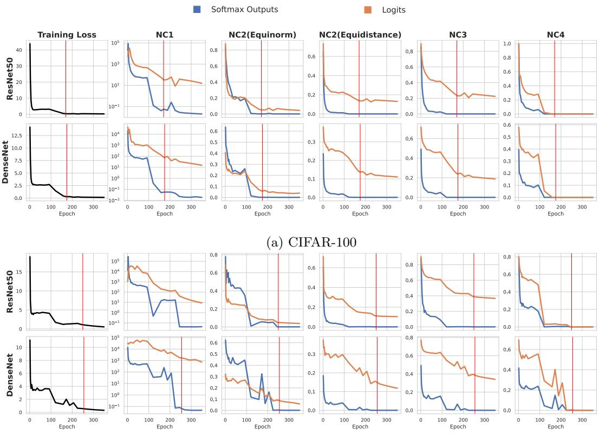  
(b) Tiny-ImageNet-200  
Figure 6: Plots of training loss and Neural Collapse hypotheses for feature representations derived from softmax outputs (blue) and logits (orange) on CIFAR-100 and Tiny-ImageNet-200 with ResNet-50 and DenseNet. The terminal phase of training is shown with a vertical red line.

Substituting this expression into the gradient update yields

$$
\mathbf { z } ^ { ( r + 1 ) } = \left( a _ { r } + \eta _ { r } \frac { C ( 1 - p _ { r } ) } { C - 1 } \right) \mathbf { v } _ { c } ^ { k } .
$$

Hence, $\mathbf { z } ^ { ( r + 1 ) }$ is also a non-negative scalar multiple of $\mathbf { v } _ { c } ^ { k } .$ . Thus, by induction, the logit vector remains a non-negative scalar multiple of $\mathbf { v } _ { c } ^ { k }$ at every optimization step. Since

$$
p _ { r } = \frac { \exp ( a _ { r } ) } { \exp ( a _ { r } ) + C - 1 }
$$

is continuous and strictly increasing in $a _ { r } \ \mathrm { o n } \ [ 0 , \infty )$ , with $p _ { r } \to 1$ if and only if $a _ { r }  \infty$ , the hypothesis that the softmax output converges to the vertex $\mathbf { e } _ { c } ~ ( \mathrm { i . e . } ~ p _ { r }  1 )$ forces $a _ { r }  \infty$ . Throughout this entire trajectory—including in this limit $- \mathbf { z } ^ { ( r ) } = a _ { r } \mathbf { v } _ { c } ^ { k }$ , so the logit direction remains aligned with

$$
\mathbf { v } _ { c } ^ { k } = \mathbf { e } _ { c } - \mathbf { o } ^ { k } .
$$

## B Convergence of PSP and LSP to a Simplex Configuration

In the following, we present additional experiments beyond those discussed in Fig. 3, illustrating the NC metrics for softmax outputs (blue curves) and logits (orange curves) during training for ResNet-50 and DenseNet on the CIFAR-100 and Tiny-ImageNet-200 datasets.

The results in Fig. 6 present plots that are consistent with those shown in Fig. 3 for ResNet-18 on CIFAR-100, confirming that logits exhibit larger spread of feature distributions and less alignment with the simplex geometry than softmax outputs.

## C Mathematical Derivation of Eq. 6

Let $\mathbf { v } _ { c } ^ { k } = \mathbf { e } _ { c } - \mathbf { o } ^ { k } \in \mathbb { R } ^ { C ^ { k } }$ and $\mathbf { v } _ { c } ^ { t } = \mathbf { e } _ { c } - \mathbf { o } ^ { t } \in \mathbb { R } ^ { C ^ { t } }$ with $C ^ { k } \leq C ^ { t }$ the prototypes of class c at two diferent steps t and k. To compare prototypes across diferent dimensions, we extend $\mathbf { v } _ { c } ^ { k }$ to $\mathbb { R } ^ { C ^ { t } }$ by zero-padding (not afecting the norm of a vector): $\widetilde { \mathbf { v } } _ { c } ^ { k } = [ \mathbf { v } _ { c } ^ { k } \ | \ \mathbf { 0 } _ { C ^ { t } - C ^ { k } } ] \in \mathbb { R } ^ { C ^ { t } }$

We compute the dot product between the two prototypes:

$$
\begin{array} { r } { \tilde { \mathbf { v } } _ { c } ^ { k } \cdot \mathbf { v } _ { c } ^ { t } = ( \mathbf { e } _ { c } - \mathbf { o } ^ { k } ) \cdot ( \mathbf { e } _ { c } - \mathbf { o } ^ { t } ) = 1 - \frac { 1 } { C ^ { t } } - \frac { 1 } { C ^ { k } } + \frac { 1 } { C ^ { t } } = 1 - \frac { 1 } { C ^ { k } } = \frac { C ^ { k } - 1 } { C ^ { k } } . } \end{array}
$$

Since the norms of the two prototypes are:

$$
\| \widetilde { \mathbf { v } } _ { c } ^ { k } \| ^ { 2 } = \frac { C ^ { k } - 1 } { C ^ { k } } , \qquad \| \mathbf { v } _ { c } ^ { t } \| ^ { 2 } = \frac { C ^ { t } - 1 } { C ^ { t } } ,
$$

their cosine similarity is:

$$
\cos ( \tilde { \mathbf { v } } _ { c } ^ { k } , \mathbf { v } _ { c } ^ { t } ) = \frac { \frac { C ^ { k } - 1 } { C ^ { k } } } { \sqrt { \frac { C ^ { k } - 1 } { C ^ { k } } } \sqrt { \frac { C ^ { t } - 1 } { C ^ { t } } } } = \sqrt { \frac { C ^ { k } - 1 } { C ^ { k } } \cdot \frac { C ^ { t } } { C ^ { t } - 1 } } .
$$

Therefore, the misalignment angle between $\tilde { \mathbf { v } } _ { c } ^ { k }$ and $\mathbf { v } _ { c } ^ { t }$ is provided by the following formula:

$$
\theta _ { c } ^ { k  t } = \operatorname { a r c c o s } ( \sqrt { \frac { C ^ { k } - 1 } { C ^ { k } } \cdot \frac { C ^ { t } } { C ^ { t } - 1 } } ) .
$$

## D Proof of Proposition 3.4

Proposition 3.4. When updating the model from step k to step t, if the number of classes increases from $C ^ { k }$ to $C ^ { t }$ , the prototypes associated with the newly introduced classes at step t are orthogonal to the subspace spanned by the class prototypes at step k.

Proof. We first demonstrate the proposition in the case where only one class is added between step k and step t. For simplicity in notation, we denote $C ^ { k } = d ,$ resulting in $C ^ { t } = C ^ { k } + 1 = d + 1$ . We assume that existing classes retain their coordinate indices across the model update. If $d = 1$ , the old prototype is zero and the proposition holds trivially; hence, we assume $d \geq 2$ in the following calculation.

From Eq. 2, a prototype vector of the c-th class at step k is denoted as $\mathbf { v } _ { c } ^ { k } = \mathbf { e } _ { c } - \mathbf { o } ^ { k }$ in $\mathbb { R } ^ { d }$ , where $1 \leq c \leq d .$ Each component $v _ { c , j } ^ { k }$ is:

$$
v _ { c , j } ^ { k } = { \left\{ \begin{array} { l l } { 1 - { \frac { 1 } { d } } } & { { \mathrm { i f ~ } } j = c , } \\ { - { \frac { 1 } { d } } } & { { \mathrm { o t h e r w i s e , } } } \end{array} \right. } \qquad j = 1 , \ldots , d .\tag{10}
$$

Adding a new class in the training set at step t adds a new vertex ${ \bf e } _ { d + 1 }$ in the probability simplex, shifting its center to: $\begin{array} { r } { \mathbf { o } ^ { t } = \frac { 1 } { d + 1 } \sum _ { c = 1 } ^ { d + 1 } \mathbf { e } _ { c } } \end{array}$ . The prototype vector of the new class $d { + 1 }$ is then defined as $\mathbf { v } _ { d + 1 } ^ { t } = \mathbf { e } _ { d + 1 } - \mathbf { o } ^ { t }$ To measure the angle between the new prototype and the old prototypes, we compute the cosine similarity between $\mathbf { v } _ { d + 1 } ^ { t }$ and the generic prototype $\mathbf { v } _ { c } ^ { k }$ after zero-padding the latter.

According to Eq. 10, the norms of $\mathbf { v } _ { c } ^ { k }$ and $\mathbf { v } _ { d + 1 } ^ { t }$ are respectively:

$$
\begin{array} { l } { \displaystyle | \mathbf { v } _ { c } ^ { k } | | = \sqrt { \displaystyle \sum _ { j = 1 } ^ { d } \left( v _ { c , j } ^ { k } \right) ^ { 2 } } } \\ { = \sqrt { \displaystyle \sum _ { j = 1 } ^ { d } \left( v _ { c , j } ^ { k } \right) ^ { 2 } + \left( v _ { c , c } ^ { k } \right) ^ { 2 } } } \\ { = \sqrt { \displaystyle \sum _ { j = 1 } ^ { d } \frac { 1 } { d ^ { 2 } } + \frac { ( d - 1 ) ^ { 2 } } { d ^ { 2 } } } = \sqrt { \displaystyle \frac { d - 1 } { d ^ { 2 } } + \frac { ( d - 1 ) ^ { 2 } } { d ^ { 2 } } } = \sqrt { \displaystyle \frac { d - 1 } { d } } } \end{array}\tag{11}
$$

and

$$
\begin{array} { l } { \displaystyle | | \mathbf { v } _ { d + 1 } ^ { t } | | = \sqrt { \displaystyle \sum _ { j = 1 } ^ { d + 1 } \left( v _ { d + 1 , j } ^ { t } \right) ^ { 2 } } } \\ { = \sqrt { \displaystyle \sum _ { j = 1 } ^ { d } \left( v _ { d + 1 , j } ^ { t } \right) ^ { 2 } + \left( v _ { d + 1 , d + 1 } ^ { t } \right) ^ { 2 } } } \\ { = \sqrt { \displaystyle \sum _ { j = 1 } ^ { d } \frac { 1 } { ( d + 1 ) ^ { 2 } } + \frac { d ^ { 2 } } { ( d + 1 ) ^ { 2 } } } = \sqrt { \displaystyle \frac { d } { d + 1 } } . } \end{array}\tag{12}
$$

The components of the corresponding normalized vectors are respectively:

$$
\frac { v _ { c , j } ^ { k } } { \| \mathbf { v } _ { c } ^ { k } \| } = \left\{ \begin{array} { l l } { \frac { 1 - \frac { 1 } { d } } { \sqrt { \frac { d - 1 } { d } } } } & { \mathrm { i f ~ } j = c , } \\ { \frac { - \frac { 1 } { d } } { \sqrt { \frac { d - 1 } { d } } } } & { \mathrm { o t h e r w i s e , } } \end{array} \right. \qquad j = 1 , \ldots , d ,\tag{13}
$$

and

$$
\frac { v _ { d + 1 , j } ^ { t } } { \Vert \mathbf { v } _ { d + 1 } ^ { t } \Vert } = \left\{ \begin{array} { l l } { \frac { 1 - \frac { 1 } { d + 1 } } { \sqrt { \frac { d } { d + 1 } } } } & { \mathrm { i f ~ } j = d + 1 , } \\ { \frac { - \frac { 1 } { d + 1 } } { \sqrt { \frac { d } { d + 1 } } } } & { \mathrm { o t h e r w i s e , } } \end{array} \right. \qquad j = 1 , \dots , d + 1 .\tag{14}
$$

In order to compute the dot product, $\mathbf { v } _ { c } ^ { k }$ is padded with a zero component (this operation does not change its norm). Retaining the same notation for the embedded vector, we write:

$$
\mathbf { v } _ { c } ^ { k } = \left( \mathbf { e } _ { c } - \mathbf { o } ^ { k } , 0 \right) .
$$

Then, the dot product can be expressed as follows, with the components in the c-th and (d + 1)-th positions written separately:

$$
\begin{array} { r l r } {  { \frac { { \bf v } _ { c } ^ { k } } { \| { \bf v } _ { c } ^ { k } \| } \cdot \frac { { \bf v } _ { d + 1 } ^ { t } } { \| { \bf v } _ { d + 1 } ^ { t } \| } = \sum _ { j = 1 } ^ { d } \frac { v _ { c , j } ^ { k } } { \| { \bf v } _ { c } ^ { k } \| } \frac { v _ { d + 1 , j } ^ { t } } { \| { \bf v } _ { d + 1 } ^ { t } \| } } } \\ & { } & { + \ \frac { v _ { c , c } ^ { k } } { \| { \bf v } _ { c } ^ { k } \| } \frac { v _ { d + 1 , c } ^ { t } } { \| { \bf v } _ { d + 1 } ^ { t } \| } + \frac { v _ { c , d + 1 } ^ { k } } { \| { \bf v } _ { c } ^ { k } \| } \frac { v _ { d + 1 , d + 1 } ^ { t } } { \| { \bf v } _ { d + 1 } ^ { t } \| } . } \end{array}\tag{15}
$$

Since the component $v _ { c , d + 1 } ^ { k } = 0$ , the expression in Eq. 15 simplifies to:

$$
\frac { \mathbf { v } _ { c } ^ { k } } { \| \mathbf { v } _ { c } ^ { k } \| } \cdot \frac { \mathbf { v } _ { d + 1 } ^ { t } } { \| \mathbf { v } _ { d + 1 } ^ { t } \| } = \sum _ { j = 1 \atop j \neq c } ^ { d } \frac { v _ { c , j } ^ { k } } { \| \mathbf { v } _ { c } ^ { k } \| } \frac { v _ { d + 1 , j } ^ { t } } { \| \mathbf { v } _ { d + 1 } ^ { t } \| } + \frac { v _ { c , c } ^ { k } } { \| \mathbf { v } _ { c } ^ { k } \| } \frac { v _ { d + 1 , c } ^ { t } } { \| \mathbf { v } _ { d + 1 } ^ { t } \| } .
$$

Using Eq. 13 and Eq. 14, we obtain:

$$
\frac { \mathbf { v } _ { c } ^ { k } } { \| \mathbf { v } _ { c } ^ { k } \| } \cdot \frac { \mathbf { v } _ { d + 1 } ^ { t } } { \| \mathbf { v } _ { d + 1 } ^ { t } \| } = \frac { d - 1 } { d ( d + 1 ) \sqrt { \frac { d - 1 } { d } } \sqrt { \frac { d } { d + 1 } } } - \frac { d - 1 } { d ( d + 1 ) \sqrt { \frac { d - 1 } { d } } \sqrt { \frac { d } { d + 1 } } } = 0 .
$$

This demonstrates that a generic prototype vector $\mathbf { v } _ { c } ^ { k }$ and the new prototype vector $\mathbf { v } _ { d + 1 } ^ { t }$ are orthogonal. More generally, if $C ^ { t } = d + m$ with $m \geq 1$ , every new-class prototype $\mathbf { v } _ { a } ^ { t } , a = d + 1 , \dots , d + m$ , has its first d components equal to $- 1 / ( d + m )$ . After padding each old prototype with m zeros, we obtain:

$$
\mathbf { v } _ { c } ^ { k } \cdot \mathbf { v } _ { a } ^ { t } = - { \frac { 1 } { d + m } } \sum _ { j = 1 } ^ { d } v _ { c , j } ^ { k } = - { \frac { 1 } { d + m } } \left( 1 - { \frac { 1 } { d } } - { \frac { d - 1 } { d } } \right) = 0 .
$$

Since this holds for every $c = 1 , \ldots , d ,$ each new-class prototype is orthogonal to the subspace spanned by the zero-padded class prototypes at step k. □

## E Proof of Proposition 3.5

Proposition 3.5. For every class c already present at step $k , i . e . , 1 \leq c \leq C ^ { k }$ , the transformed prototype $\mathbf { u } _ { c } ^ { t } = \mathbf { P } _ { t , k } \mathbf { v } _ { c } ^ { t }$ is aligned with its counterpart $\mathbf { v } _ { c } ^ { k }$ at step k.

Proof. Without loss of generality, we demonstrate the proposition in the case where only one class is added between step k and step t. For simplicity in notation, we denote $C ^ { k } = d ,$ resulting in $C ^ { t } = C ^ { k } + 1 = d + 1$ Let $\mathbf { v } _ { c } ^ { k } = \mathbf { e } _ { c } - \mathbf { o } ^ { k }$ and $\mathbf { v } _ { c } ^ { t } = \mathbf { e } _ { c } - \mathbf { o } ^ { t }$ the prototype vectors of the c-th class at step k and t, respectively. Their components $v _ { c , j } ^ { k }$ and $v _ { c , j } ^ { t }$ are respectively defined as:

$$
v _ { c , j } ^ { k } = { \left\{ v _ { c , c } ^ { k } = 1 - { \frac { 1 } { d } } \right. } \quad { \mathrm { i f ~ } } j { \mathrm { ~ e q u a l s ~ t h e ~ i n d e x ~ } } c { \mathrm { ~ o f ~ c l a s s ~ } } y\tag{16}
$$

and

$$
v _ { c , j } ^ { t } = { \left\{ v _ { c , c } ^ { t } = 1 - { \frac { 1 } { d + 1 } } \quad { \mathrm { ~ i f ~ } } j { \mathrm { ~ e q u a l s ~ t h e ~ i n d e x ~ } } c { \mathrm { ~ o f ~ c l a s s ~ } } y \right.} _ { }\tag{17}
$$

We consider the vector $\mathit { \mathbf { u } _ { c } ^ { t } }$ in $\mathbb { R } ^ { d }$ obtained from $\mathbf { v } _ { c } ^ { t }$ in $\mathbb { R } ^ { d + 1 }$ using the linear transformation matrix $\mathbf { P } _ { t , k } \mathbf { \mathrm { : } }$

$$
\mathbf { u } _ { c } ^ { t } = \mathbf { P } _ { t , k } \mathbf { v } _ { c } ^ { t } .\tag{18}
$$

where $\mathbf { P } _ { t , k } = \left[ \mathbf { P } _ { k , k } \mid \mathbf { 0 } \right]$ with $\mathbf { P } _ { k , k } = [ \mathbf { v } _ { c } ^ { k } ] _ { c = 1 } ^ { d }$ a d × d matrix and 0 a zero matrix $d \times 1$

The following expressions hold for $u _ { c , c } ^ { t }$ and $u _ { c , j } ^ { t }$ , respectively:

$$
\boldsymbol { u } _ { c , c } ^ { t } = \boldsymbol { v } _ { c , c } ^ { k } \boldsymbol { v } _ { c , c } ^ { t } + \sum _ { j = 1 \atop j \neq c } ^ { d } \boldsymbol { v } _ { c , j } ^ { k } \boldsymbol { v } _ { c , j } ^ { t }\tag{19}
$$

$$
u _ { c , j } ^ { t } = v _ { c , j } ^ { k } v _ { c , c } ^ { t } + v _ { c , c } ^ { k } v _ { c , j } ^ { t } + \sum _ { \ell = 1 \atop \ell \ne c , j } ^ { d } v _ { c , \ell } ^ { k } v _ { c , \ell } ^ { t } , \qquad j \ne c\tag{20}
$$

where the c-th component of ${ \bf u } _ { c } ^ { t }$ has been put into evidence in the first expression, while the second expression considers a generic component $j \neq c .$

Substituting the expressions in Eq. 16 and Eq. 17 into Eq. 19 and Eq. 20 respectively, we obtain the following equations:

$$
u _ { c , c } ^ { t } = \frac { d - 1 } { d } v _ { c , c } ^ { t } - \frac { 1 } { d } \sum _ { j = 1 \atop j \neq c } ^ { d } v _ { c , j } ^ { t } = \frac { d - 1 } { d } \frac { d } { d + 1 } - \frac { 1 } { d } ( d - 1 ) \left( - \frac { 1 } { d + 1 } \right) = \frac { d - 1 } { d + 1 } + \frac { d - 1 } { d ( d + 1 ) } = 1 - \frac { 1 } { d } = v _ { c , c } ^ { k }
$$

and

$$
u _ { c , j } ^ { t } = - \frac { 1 } { d } v _ { c , c } ^ { t } + \frac { d - 1 } { d } v _ { c , j } ^ { t } - \frac { 1 } { d } \sum _ { j = 1 } ^ { d - 1 } v _ { c , j } ^ { t } = - \frac { 1 } { d } \frac { d } { d + 1 } + \frac { d - 1 } { d } \left( - \frac { 1 } { d + 1 } \right) - \frac { 1 } { d } ( d - 2 ) \left( - \frac { 1 } { d + 1 } \right) = - \frac { 1 } { d } = v _ { c , j } ^ { k } ,
$$

i.e., the components of the vector $\mathit { \mathbf { u } _ { c } ^ { t } }$ are identical to those of $\mathbf { v } _ { c } ^ { k }$

It results that the vector obtained from $\mathbf { v } _ { c } ^ { t }$ is aligned with the prototype vector $\mathbf { v } _ { c } ^ { k }$ through the matrix $\mathbf { P } _ { t , k } \colon$

$$
\mathbf { u } _ { c } ^ { t } = \mathbf { P } _ { t , k } \mathbf { v } _ { c } ^ { t } = \mathbf { v } _ { c } ^ { k } .
$$

This proof can be immediately extended to model updates where multiple classes are introduced. □

## F Pseudocode

This appendix describes how PSP and LSP are integrated into a retrieval system. Importantly, PSP and LSP are two alternative feature definitions, not post-hoc transformations to be applied to arbitrary embeddings after deployment. Whether to use features derived from softmax outputs (PSP, Eq. 4) or logits (LSP, Eq. 5) must therefore be chosen before the first deployment of the retrieval system and then used consistently to build the gallery index and process future queries. Accordingly, gallery items are indexed once using the chosen representation and stored in the retrieval database.

The deterministic linear transformation $\mathbf { P } _ { t , k }$ is required only when the updated model has a larger output space than the gallery model, i.e., when $C ^ { t } > C ^ { k }$ . In this case, it maps the query representation produced at step t into the $\bar { C } ^ { k }$ -dimensional feature space of the gallery indexed at step k. When $C ^ { t } = C ^ { k }$ , no cross-update transformation is required. PSP queries are computed using the standard within-step projection $\mathbf { P } _ { k , k }$ , which is part of the PSP feature definition, whereas LSP queries are obtained by directly normalizing the logits. In the backward-compatible setting, the gallery is not re-indexed. This is the inference-time protocol used in our compatibility experiments.

Alg. 1 describes the initial gallery indexing procedure with PSP or LSP. Alg. 2 describes the query-time compatibility correction used only when features extracted at step t must be compared against a gallery indexed at step k.

Alg. 1 is used to define and store gallery features when the retrieval system is first deployed. If, after a model update, the gallery is fully re-indexed, the same algorithm is simply applied again to all gallery items using the updated model and the same chosen representation type. By contrast, Alg. 2 is used only in the backward-compatible retrieval setting, where the gallery remains fixed at step k and only the incoming queries are processed by the updated model at step t. In this case, PSP/LSP are not re-applied to the stored gallery features; only the query-side representation is corrected through $\mathbf { P } _ { t , k }$ to enable comparison with the gallery without re-indexing.

We emphasize that the deterministic transformation $\mathbf { P } _ { t , k }$ is not part of the generic feature-definition step of the retrieval system. It is only required when features extracted at diferent update steps with an increased number of classes must be compared. During training, there is no dependence on previous models, and no additional losses, alignment modules, or architectural modifications are introduced.

Algorithm 1 Initial Gallery Indexing with PSP or LSP   
Require: Model at gallery step k with $C ^ { k }$ classes; gallery item $\mathbf { x } ;$ representation type repr $\in \{ \mathsf { P S P } , \mathtt { L S P } \}$   
Ensure: Stored gallery feature $\mathbf { h } ^ { k } ( \mathbf { x } )$   
1: Compute logits ${ \bf z } ^ { k } ( { \bf x } )$   
2: if $\tt r e p r = \tt P S P$ then   
3: Compute softmax outputs $\mathbf { p } ^ { k } ( \mathbf { x } )  \sigma ( \mathbf { z } ^ { k } ( \mathbf { x } ) )$   
4: $\tilde { \mathbf { h } } ^ { k } ( \mathbf { x } ) \gets \mathbf { P } _ { k , k } \mathbf { p } ^ { k } ( \mathbf { x } )$   
5: if $\| \tilde { \mathbf { h } } ^ { k } ( \mathbf { x } ) \| _ { 2 } > 0$ then   
6: $\mathbf { h } ^ { k } ( \mathbf { x } )  \tilde { \mathbf { h } } ^ { k } ( \mathbf { x } ) / \| \tilde { \mathbf { h } } ^ { k } ( \mathbf { x } ) \| _ { 2 }$   
7: else   
8: $\mathbf { h } ^ { k } ( \mathbf { x } )  \mathbf { 0 }$   
9: else if repr = LSP then   
10: if $\| \mathbf { z } ^ { k } ( \mathbf { \bar { x } } ) \| _ { 2 } > 0$ then   
11: $\mathbf { h } ^ { k } ( \mathbf { x } ) \overset { \cdot \cdot } {  } \mathbf { z } ^ { k } ( \mathbf { x } ) / \| \mathbf { z } ^ { k } ( \mathbf { x } ) \| _ { 2 }$   
12: else   
13: $\mathbf { h } ^ { k } ( \mathbf { x } )  \mathbf { 0 }$   
14: Store $\mathbf { h } ^ { k } ( \mathbf { x } )$ in the gallery index

Algorithm 2 Query-Side Compatibility Across Model Updates   
Require: Gallery indexed at step $k ;$ updated model at step t with $C ^ { t } \geq C ^ { k } ;$ ; query $\mathbf { x } ;$ representation type   
repr ∈ {PSP, LSP}   
Ensure: Query feature compatible with the gallery feature space at step k   
1: Compute logits ${ \bf z } ^ { t } ( { \bf x } )$   
2: if repr = PSP then   
3: $\mathbf { p } ^ { t } ( \mathbf { x } )  \sigma ( \mathbf { z } ^ { t } ( \mathbf { x } ) )$   
4: if $\dot { C } ^ { i } > C ^ { k }$ then   
5: $\tilde { \mathbf { h } } ^ { t \right. k } ( \mathbf { x } ) \left. \mathbf { P } _ { t , k } \mathbf { p } ^ { t } ( \mathbf { x } )$   
6: else   
7: $\tilde { \mathbf { h } } ^ { t \right. k } ( \mathbf { x } ) \left. \mathbf { P } _ { k , k } \mathbf { p } ^ { t } ( \mathbf { x } )$   
8: else if repr = LSP then   
9: if $\bar { C } ^ { t } \bar { > } \bar { C } ^ { k }$ then   
10: $\tilde { \mathbf { h } } ^ { t \right. k } ( \mathbf { x } ) \left. \mathbf { P } _ { t , k } \mathbf { z } ^ { t } ( \mathbf { x } )$   
11: else   
12: $\tilde { \mathbf { h } } ^ { t \right. k } ( \mathbf { x } ) \left. \mathbf { z } ^ { t } ( \mathbf { x } )$   
13: if $\| \tilde { \mathbf { h } } ^ { t  k } ( \mathbf { x } ) \| _ { 2 } > 0$ then   
14: $\mathbf { \widetilde { h } } ^ { t  k } ( \mathbf { \widetilde { x } } ) \overset {  } {  } \tilde { \mathbf { h } } ^ { t  k } ( \mathbf { x } ) / \| \tilde { \mathbf { h } } ^ { t  k } ( \mathbf { x } ) \| _ { 2 }$   
15: else   
16: $\mathbf { h } ^ { t \right. k } ( \mathbf { x } ) \left. \mathbf { 0 }$   
17: Compare $\mathbf { h } ^ { t  k } ( \mathbf { x } )$ with $\{ \mathbf { h } ^ { k } ( \mathbf { g } ) \} _ { \mathbf { g } \in \mathcal { G } }$   
18: Return the ranked gallery items

## G Theoretical Analysis of the Backward-Compatibility Definition

Lemma G.1. Let $\mathbf { X } _ { 1 } , \mathbf { X } _ { 2 } \in \mathbb { R } ^ { d }$ be independent random vectors in the (d − 1)-hypersphere, each following a von Mises–Fisher distribution $\operatorname { v M F } ( \mu , \kappa )$ . Then the expected cosine distance between $\mathbf { X } _ { 1 }$ and $\mathbf { X } _ { 2 }$ depends on the concentrations $\kappa _ { 1 }$ , κ and the mean directions $\pmb { \mu } _ { 1 } , \pmb { \mu } _ { 2 }$ of the two distributions as follows:

$$
\begin{array} { r } { \mathbb { E } \Big [ 1 - \mathbf { X } _ { 1 } ^ { \top } \mathbf { X } _ { 2 } \Big ] = 1 - m _ { d } \big ( \kappa _ { 1 } \big ) m _ { d } \big ( \kappa _ { 2 } \big ) \pmb { \mu } _ { 1 } ^ { \top } \pmb { \mu } _ { 2 } . } \end{array}
$$

Proof. Let $\mathbf { X } _ { 1 } , \mathbf { X } _ { 2 }$ be two independent random vectors from two $\mathrm { v M F }$ distributions with parameters respectively $( \mu _ { 1 } , \kappa _ { 1 } )$ and $( \mu _ { 2 } , \kappa _ { 2 } )$ , where $\pmb { \mu _ { 1 } } , \pmb { \mu _ { 2 } }$ are unit vectors indicating the mean directions around which the

data are concentrated and $\kappa _ { 1 } , ~ \kappa _ { 2 }$ are non-negative scalars that determine the concentrations of the distri butions around their mean (large values of κ correspond to high concentration). By their independence, the expected cosine similarity between $\mathbf { X } _ { 1 } , \mathbf { X } _ { 2 }$ is given by the product of their expectations:

$$
\mathbb { E } \left[ \mathbf { X } _ { 1 } ^ { \top } \mathbf { X } _ { 2 } \right] = \mathbb { E } \left[ \mathbf { X } _ { 1 } \right] ^ { \top } \mathbb { E } \left[ \mathbf { X } _ { 2 } \right]\tag{21}
$$

where the expected values of $\mathbf { X } _ { 1 }$ and $\mathbf { X } _ { 2 }$ are respectively (Banerjee et al., 2005):

$$
\mathbb { E } \left[ \mathbf { X } _ { 1 } \right] = m _ { d } \left( \kappa _ { 1 } \right) \pmb { \mu } _ { 1 } ,\tag{22}
$$

$$
\mathbb { E } \left[ \mathbf { X } _ { 2 } \right] = m _ { d } \left( \kappa _ { 2 } \right) \pmb { \mu } _ { 2 } ,\tag{23}
$$

where $m _ { d } ( \kappa )$ is the expected cosine of the angle between the random vector and $\mu ,$ which is expressed as:

$$
m _ { d } ( \kappa ) = \frac { I _ { \frac { d } { 2 } } ( \kappa ) } { I _ { \frac { d } { 2 } - 1 } ( \kappa ) }
$$

with $I _ { \nu }$ the modified Bessel function of the first kind of order $\nu .$

From Eq. 21, Eq. 22, and Eq. 23, we obtain:

$$
\mathbb { E } \left[ \mathbf { X } _ { 1 } ^ { \top } \mathbf { X } _ { 2 } \right] = \left( m _ { d } \left( \kappa _ { 1 } \right) \pmb { \mu } _ { 1 } \right) ^ { \top } \left( m _ { d } \left( \kappa _ { 2 } \right) \pmb { \mu } _ { 2 } \right) = m _ { d } \left( \kappa _ { 1 } \right) m _ { d } \left( \kappa _ { 2 } \right) \pmb { \mu } _ { 1 } ^ { \top } \pmb { \mu } _ { 2 } .
$$

where $\mu _ { 1 } ^ { \top } \mu _ { 2 }$ is the cosine of the angle between mean directions $\pmb { \mu } _ { 1 }$ and $\pmb { \mu } _ { 2 }$ .

Since the cosine distance between $\mathbf { X } _ { 1 }$ and $\mathbf { X } _ { 2 }$ is $\left( 1 - \mathbf { X } _ { 1 } ^ { \top } \mathbf { X } _ { 2 } \right)$ , it follows that:

$$
\mathbb { E } \Big [ 1 - \mathbf { X } _ { 1 } ^ { \top } \mathbf { X } _ { 2 } \Big ] = 1 - \mathbb { E } \Big [ \mathbf { X } _ { 1 } ^ { \top } \mathbf { X } _ { 2 } \Big ] = 1 - m _ { d } ( \kappa _ { 1 } ) m _ { d } ( \kappa _ { 2 } ) \mu _ { 1 } ^ { \top } \mu _ { 2 } ,\tag{24}
$$

which provides an analytical form that relates the expected distance between two random vectors to the parameters of the two vMF distributions. □

Theorem 3.6 (Compatibility Theorem). Consider hyperspherical representations obtained at update steps k and t, with $t > k$ . Assume that $( i )$ the features of each class c are drawn independently from a von Mises–Fisher distribution $\mathrm { v M F } ( \mu _ { c } , \kappa _ { c } )$ whose mean direction $\pmb { \mu } _ { c }$ is the corresponding class prototype, and (ii) the concentration $\kappa _ { c }$ of each class distribution increases from step k to step t. Then the compatibility inequalities of Eq. 1a and Eq. 1b are satisfied in expectation $i f \left( a \right)$ corresponding class prototypes are aligned across updates and $( b )$ the angle between prototypes of diferent classes is greater than π $- / 2$

Proof. Consider each feature of the model represented as an independent random vector. Then the compatibility inequalities of Eq. 1a and Eq. 1b in expectation can be expressed as:

$$
\mathbb { E } \left[ 1 - ( \mathbf { X } _ { 1 } ^ { t } ) ^ { \top } \mathbf { X } _ { 2 } ^ { k } \right] \leq \mathbb { E } \left[ 1 - ( \mathbf { X } _ { 1 } ^ { k } ) ^ { \top } \mathbf { X } _ { 2 } ^ { k } \right] \qquad { \mathrm { f o r ~ t h e ~ c a s e ~ o f ~ s a m e ~ c l a s s } }\tag{25a}
$$

$$
\mathbb { E } \left[ 1 - ( \mathbf { X } _ { 1 } ^ { t } ) ^ { \top } \mathbf { X } _ { 2 } ^ { k } \right] \geq \mathbb { E } \left[ 1 - ( \mathbf { X } _ { 1 } ^ { k } ) ^ { \top } \mathbf { X } _ { 2 } ^ { k } \right] \qquad { \mathrm { f o r ~ t h e ~ c a s e ~ o f ~ d i f f e r e n t ~ c l a s s e s } }\tag{25b}
$$

where $\mathbf { X } _ { 1 } , \mathbf { X } _ { 2 } \in \mathbb { R } ^ { d }$ are two independent random vectors with $\mathbb { E } \left[ 1 - ( \mathbf { X } _ { 1 } ) ^ { \top } \mathbf { X } _ { 2 } \right]$ their expected cosine distance, and t and k are two distinct update steps.

Assuming that features follow a vMF distribution, according to Lemma G.1 the expected cosine distance between two independent random vectors $\mathbf { X } _ { 1 } , \mathbf { X } _ { 2 } \in \mathbb { R } ^ { d }$ has the form:

$$
\begin{array} { r } { \mathbb { E } \Big [ 1 - \mathbf { X } _ { 1 } ^ { \top } \mathbf { X } _ { 2 } \Big ] = 1 - m _ { d } \big ( \kappa _ { 1 } \big ) m _ { d } \big ( \kappa _ { 2 } \big ) \pmb { \mu } _ { 1 } ^ { \top } \pmb { \mu } _ { 2 } } \end{array}\tag{26}
$$

where $\pmb { \mu } _ { 1 } , \pmb { \mu } _ { 2 }$ are the mean directions of the two distributions and $\kappa _ { 1 } , \kappa _ { 2 }$ their concentrations. Substituting Eq. 26 into Eq. 25a and Eq. 25b gives:

$$
\begin{array} { r } { 1 - m _ { d } ( \kappa _ { 1 } ^ { t } ) m _ { d } ( \kappa _ { 2 } ^ { k } ) ( \mu _ { 1 } ^ { t } ) ^ { \top } \mu _ { 2 } ^ { k } \leq 1 - m _ { d } ( \kappa _ { 1 } ^ { k } ) m _ { d } ( \kappa _ { 2 } ^ { k } ) ( \mu _ { 1 } ^ { k } ) ^ { \top } \mu _ { 2 } ^ { k } \quad \mathrm { f o r ~ t h e ~ c a s e ~ o f ~ s a m e ~ c l a s s } } \end{array}\tag{27a}
$$

$$
1 - m _ { d } ( \kappa _ { 1 } ^ { t } ) m _ { d } ( \kappa _ { 2 } ^ { k } ) ( \mu _ { 1 } ^ { t } ) ^ { \top } \mu _ { 2 } ^ { k } \geq 1 - m _ { d } ( \kappa _ { 1 } ^ { k } ) m _ { d } ( \kappa _ { 2 } ^ { k } ) ( \mu _ { 1 } ^ { k } ) ^ { \top } \mu _ { 2 } ^ { k } \quad \mathrm { f o r ~ t h e ~ c a s e ~ o f ~ d i f f e r e n t ~ c l a s s e s }\tag{27b}
$$

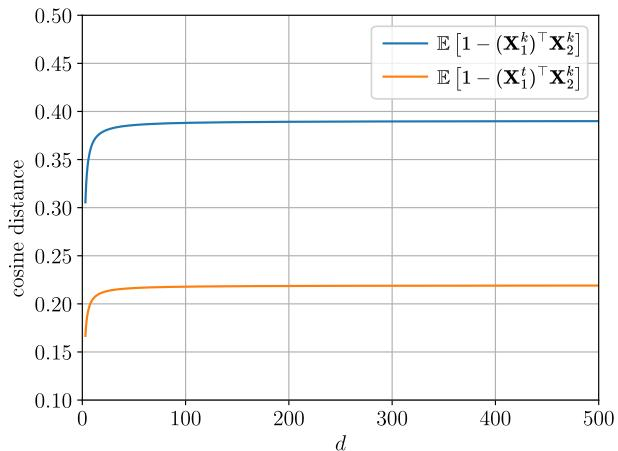  
(a) Same class

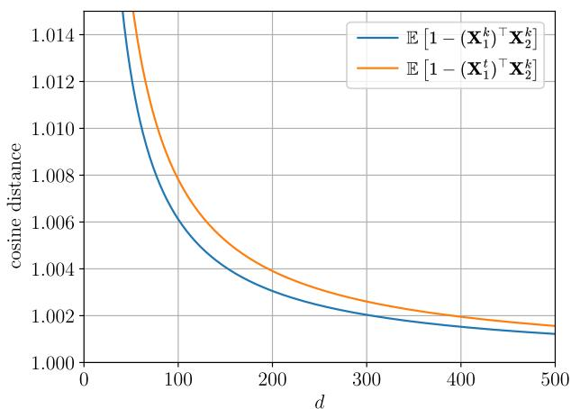  
(b) Diferent classes  
Figure 7: Expected cosine distances for aligned regular-simplex representations in the (a) same-class and (b) diferent-class cases, corresponding to $\operatorname { E q }$ . 25a and $\operatorname { E q . }$ 25b, respectively. The curves are obtained from the closed-form expected-distance expressions in Eq. 27a and Eq. 27b, under the assumptions of Theorem 3.6, with the updated class distributions having higher concentration than the old ones. Across all considered feature-space dimensions $d ,$ the expected distance between features from the updated and old models is lower than the corresponding old-model distance for same-class pairs and higher for diferent-class pairs, illustrating that the compatibility inequalities are satisfied in expectation.

Then, since $m _ { d } ( \kappa )$ is a strictly increasing function of the concentration parameter κ (Banerjee et al., 2005), and $\kappa ^ { t } > \kappa ^ { k } > 0$ across updates4, it follows that $m _ { d } ( \kappa _ { 1 } ^ { t } ) m _ { d } ( \kappa _ { 2 } ^ { k } ) > m _ { d } ( \kappa _ { 1 } ^ { k } ) m _ { d } ( \kappa _ { 2 } ^ { k } )$

It follows that:

• Eq. 27a is satisfied when the mean directions of the same class remain the same across updates, i.e., $( \pmb { \mu } _ { 1 } ^ { t } ) ^ { \top } \pmb { \mu } _ { 2 } ^ { k } = 1$

• $\operatorname { E q } .$ . 27b is satisfied when the angle between prototypes of diferent classes is greater than $\pi / 2 ,$ , i.e., $( { \pmb { \mu } } _ { 1 } ^ { k } ) ^ { \top } { \pmb { \mu } } _ { 2 } ^ { k } = ( { \pmb { \mu } } _ { 1 } ^ { t } ) ^ { \top } { \pmb { \mu } } _ { 2 } ^ { k } < 0 -$ note that $( \pmb { \mu } _ { 1 } ^ { k } ) ^ { \top } \pmb { \mu } _ { 2 } ^ { k } = ( \pmb { \mu } _ { 1 } ^ { t } ) ^ { \top } \pmb { \mu } _ { 2 } ^ { k }$ due to the alignment of the prototypes required to satisfy Eq. 27a

These two requirements are precisely conditions (a) and (b) of Theorem 3.6, which concludes the proof.

Remark 1 (Dependence on concentration). The guarantee of Theorem 3.6 is conditional on the concentration of the learned representations. From Eq. 24, for fixed prototype geometry, the separation between same-class and diferent-class expected cosine distances is governed by the mean resultant length of the vMF distribution, which is strictly increasing in κ (Hornik & Grün, 2014). As κ approaches zero, the mean resultant length approaches zero and the expected cosine distances approach 1, reducing the separation between the two cases. Thus, the theorem does not impose a condition on classification accuracy; its distributional requirement is instead that the updated representation is more concentrated around its class prototypes than the old one.

Remark 2 (Role of the vMF assumption). Theorem 3.6 is stated under the vMF assumption, which is adopted as a tractable modeling assumption for class-conditional hyperspherical representations together with the explicit first-moment expression

$$
\mathbb { E } \left[ \mathbf { X } \right] = m _ { d } \left( \kappa \right) \pmb { \mu } .
$$

At the expectation level, this first-moment characterization constitutes the distribution-specific quantity entering the proof. Indeed, for independent unit-norm random vectors $\mathbf { X } _ { 1 }$ and $\mathbf { X } _ { 2 }$

$$
\mathbb { E } [ d _ { \cos } ( \mathbf { X } _ { 1 } , \mathbf { X } _ { 2 } ) ] = 1 - \mathbb { E } [ \mathbf { X } _ { 1 } ] ^ { \top } \mathbb { E } [ \mathbf { X } _ { 2 } ] ,
$$

where $d _ { \cos } ( \mathbf x , \mathbf y ) = 1 - \mathbf x ^ { \top } \mathbf y$

Hence, the vMF assumption enters the expected-distance analysis through its first moment. For a classconditional distribution on the unit hypersphere with a nonzero first moment, this quantity can be expressed as

$$
\mathbb { E } [ \mathbf { X } ] = \rho \pmb { \mu } ,
$$

where $\pmb { \mu }$ denotes the mean direction and $\rho = \| \mathbb { E } [ \mathbf { X } ] \|$ denotes the mean resultant length (Mardia, 1975; Mardia & Jupp, 2009). This formulation identifies the mean direction and mean resultant length as the firstmoment quantities entering the expected-distance expression. For the vMF model considered in Theorem 3.6, $\rho = m _ { d } ( \kappa )$ , and the strict monotonicity of $m _ { d } ( \kappa )$ with respect to κ (Hornik & Grün, 2014) provides an explicit relation between the concentration parameter κ and the mean resultant length appearing in the proof.

As a direct consequence of Theorem 3.6, the following corollary holds.

Corollary 3.7 (Compatibility of Aligned Regular-Simplex Hyperspherical Representations). Under the assumptions of Theorem 3.6, hyperspherical representations whose class prototypes form a regular simplex centered at the origin and remain aligned across updates satisfy the compatibility inequalities of $E q .$ 1a and Eq. 1b in expectation.

Proof. Let the normalized class prototypes at update step $k$ form a regular simplex centered at the origin. For any two distinct classes $i \neq j ,$ their pairwise inner product is

$$
( { \pmb \mu } _ { i } ^ { k } ) ^ { \top } { \pmb \mu } _ { j } ^ { k } = - \frac { 1 } { C ^ { k } - 1 } < 0 ,
$$

where $C ^ { k }$ denotes the number of classes defining the simplex at step k. Hence, the angle between any two distinct class prototypes is greater than $\pi / 2$

For the same-class case, alignment of corresponding prototypes across updates gives $( \pmb { \mu } _ { i } ^ { t } ) ^ { \top } \pmb { \mu } _ { i } ^ { k } = 1$ , which satisfies the geometric condition required by Eq. 27a. For two diferent classes $i \neq j$ , prototype alignment gives

$$
( { \pmb \mu } _ { i } ^ { t } ) ^ { \top } { \pmb \mu } _ { j } ^ { k } = ( { \pmb \mu } _ { i } ^ { k } ) ^ { \top } { \pmb \mu } _ { j } ^ { k } = - \frac { 1 } { C ^ { k } - 1 } < 0 ,
$$

which satisfies the geometric condition required by Eq. 27b.

Therefore, all geometric conditions of Theorem 3.6 are satisfied, and, under its vMF and increasingconcentration assumptions, the compatibility inequalities of $\operatorname { E q } .$ . 1a and Eq. 1b hold in expectation. □

Fig. 7 illustrates the expected compatibility inequalities characterized above for hyperspherical regularsimplex representations across diferent representation dimensions. The two update steps are denoted by $k ,$ corresponding to the old model, and t, corresponding to the updated model, whose class-conditional vMF distributions have higher concentration. In the same-class case, Fig. 7a shows that

$$
\mathbb { E } \left[ 1 - ( \mathbf { X } _ { 1 } ^ { t } ) ^ { \top } \mathbf { X } _ { 2 } ^ { k } \right] < \mathbb { E } \left[ 1 - ( \mathbf { X } _ { 1 } ^ { k } ) ^ { \top } \mathbf { X } _ { 2 } ^ { k } \right] ,
$$

consistent with Eq. 1a. Conversely, for diferent classes, Fig. 7b shows that

$$
\mathbb { E } \left[ 1 - ( \mathbf { X } _ { 1 } ^ { t } ) ^ { \top } \mathbf { X } _ { 2 } ^ { k } \right] > \mathbb { E } \left[ 1 - ( \mathbf { X } _ { 1 } ^ { k } ) ^ { \top } \mathbf { X } _ { 2 } ^ { k } \right] ,
$$

consistent with $\operatorname { E q }$ . 1b.

Remark 3 (Relation to Simplex ETF). The regular-simplex geometry considered in Corollary 3.7 is closely related to the Simplex ETF structure arising in Neural Collapse (Papyan et al., 2020). Within a single representation space, Neural Collapse characterizes the centered class means as approaching a Simplex ETF configuration, in which the normalized class prototypes have constant pairwise inner products

$$
\pmb { \mu } _ { i } ^ { \top } \pmb { \mu } _ { j } = - \frac { 1 } { C - 1 } , \qquad i \neq j ,
$$

and therefore pairwise angles greater than $\pi / 2 .$

This within-model geometric property, however, does not by itself imply alignment across independently obtained representation spaces. In particular, the Simplex ETF geometry is invariant under a common orthogonal transformation: applying the same orthogonal transformation to all prototypes preserves their norms and pairwise inner products while changing their absolute orientation. Consequently, two models may independently exhibit the same Simplex ETF geometry while their corresponding class prototypes are not aligned across updates.

Thus, the Simplex ETF property guarantees the obtuse inter-class geometry required by Theorem 3.6, but not the cross-update alignment of corresponding prototypes. When this additional alignment condition is satisfied, and under the vMF and increasing-concentration assumptions of Theorem 3.6, an aligned Simplex ETF configuration falls within the regular-simplex setting of Corollary 3.7 and therefore satisfies the compatibility inequalities in expectation.

## H Empirical Evidence of Increased Concentration Across Model Updates

In this appendix, we empirically assess the concentration-increase assumption discussed in Sec. 3.4, showing that the distributions of both logits and softmax outputs become more compact around their respective class prototypes as model updates progress. To quantify the compactness, we use the mean cosine distance between the feature representations and their respective class prototypes. Specifically, let $\mathcal { Z } _ { c } = \{ \mathbf { z } _ { i } ^ { c } \} _ { i = 1 } ^ { N _ { c } }$ denote the set of extracted logits for class c, where $N _ { c }$ represents the number of samples belonging to class c in the dataset. The class prototype is defined as the mean of the ℓ2-normalized extracted logits, $\begin{array} { r } { \bar { \bf z } _ { c } = \frac { 1 } { N _ { c } } \sum _ { i = 1 } ^ { N _ { c } } \frac { { \bf z } _ { i } ^ { c } } { \| { \bf z } _ { i } ^ { c } \| } , } \end{array}$ and the mean cosine distance between each feature and the prototype of class c is given by

$$
\delta _ { c } = \frac { 1 } { N _ { c } } \sum _ { i = 1 } ^ { N _ { c } } \left( 1 - \frac { { \bf z } _ { i } ^ { c } \cdot \bar { \bf z } _ { c } } { \left\| { \bf z } _ { i } ^ { c } \right\| \left\| \bar { \bf z } _ { c } \right\| } \right) = 1 - \left\| \bar { \bf z } _ { c } \right\| .
$$

The same quantities are computed for the softmax outputs by replacing $\mathbf { z } _ { i } ^ { c }$ with $\boldsymbol { \sigma } ( \mathbf { z } _ { i } ^ { c } )$ . Lower values of $\delta _ { c }$ correspond to larger empirical mean resultant lengths (Remark 2) and therefore indicate a tighter concentration of the normalized representations around their class mean directions.

We conduct experiments on the CIFAR-10 dataset (Krizhevsky, 2009) under two scenarios analogous to those in Sec. 4.

Extended Classes Scenario. In this scenario, we investigate the concentration of the representations when the number of classes is expanded during a model update. The old model is trained on the first 5 classes of CIFAR-10, and the updated model is trained on the complete set of 10 classes. Both models use a ResNet-18 architecture (He et al., 2016) trained for 100 epochs using stochastic gradient descent (SGD) with an initial learning rate of 0.1, momentum of 0.9, and a cosine annealing learning rate schedule. The results shown in Fig. 8 demonstrate that both the logits and the softmax outputs of the updated model are more concentrated than those of the old model for all 10 classes. This is consistent with the semi-open-set scenario, where the new classes are unknown to the old model but are known to the updated model, thus explaining the significant gap in concentration in the last 5 classes. The increase in concentration also holds for the 5 shared classes, on which both models are already highly concentrated, supporting the assumption of increasing concentration with class expansion during model updates.

Independently Trained Models in Public Repositories Scenario. We compare two models pretrained on ImageNet-1K and obtained from torchvision (Marcel & Rodriguez, 2010): ResNet-18 as the old model, and ResNet-50 as the updated model. We evaluate the concentration metric $\delta _ { c }$ on the CIFAR-10 test set, with images resized to 224 × 224 by bicubic interpolation. As shown in Fig. 8, the updated model yields more concentrated representations than the old model, even in an open-set scenario where the evaluation distribution difers from the training one: the logits are more concentrated for 7 of the 10 classes, and the softmax outputs for all 10 classes.

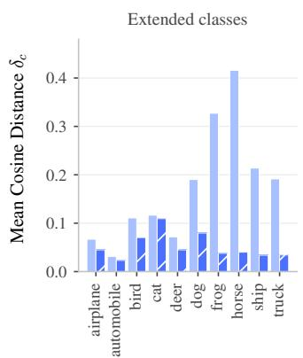  
(a) Logits.

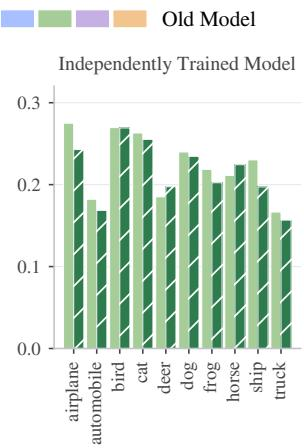

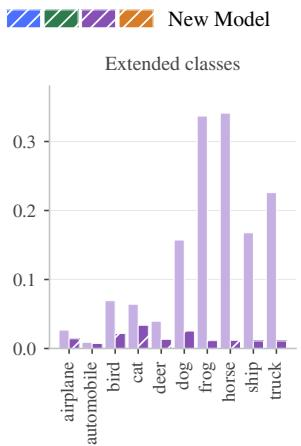

(b) Softmax outputs.  
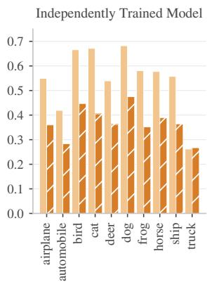  
Figure 8: Per-class dispersion $\delta _ { c }$ of the $\ell _ { 2 } .$ -normalized logits (a) and softmax outputs (b) on CIFAR-10 for the old model (solid bars) and the new model (hatched bars). In each subfigure, the left panel shows the extended-classes update from 5 to 10 classes, where the last 5 classes are unknown to the old model, and the right panel shows the update between independently trained models, with ResNet-18 as the old model and ResNet-50 as the new model, both pretrained on ImageNet-1K. Lower values of $\delta _ { c }$ indicate a tighter concentration around the class mean direction.

The observed overall increase in logit concentration is consistent with the collapse behavior discussed in Sec. 3.2.2, and the softmax outputs exhibit the same trend. In the ideal Neural Collapse limit, the two representations behave identically in this respect: the logits of each class converge to a common vector, and so do the corresponding softmax outputs (Papyan et al., 2020).

Since the hyperspherical simplex representations in Eq. 5 and Eq. 4 are constructed from the logits and softmax outputs, respectively, these results directly support assumption (ii) for both LSP and PSP. Overall, the results provide empirical evidence of increasing first-moment concentration across model updates. Under the vMF modeling assumption adopted in Theorem 3.6, this behavior is consistent with an increase in the corresponding concentration parameter κ. At the same time, the few classes whose logits become less concentrated under domain shift show that the concentration-increase assumption holds predominantly but need not hold for every class.

## I Empirical Analysis of the Centering Projection and the Angular Correction

In this appendix, we empirically examine the contribution of the two operations on which the design of PSP relies: the centering projection $\mathbf { P } _ { k , k }$ and the deterministic transformation $\mathbf { P } _ { t , k }$ for angular correction, motivated by condition (b) and condition (a) of Theorem 3.6, respectively (Sec. 3.2.1 and Sec. 3.3).

Experimental setting. We consider an extended-classes update on CIFAR-10 (Krizhevsky, 2009) with a ResNet-18 backbone (He et al., 2016): the old model is trained on the first 5 classes and the updated model on all 10 classes. All models are trained from scratch for 60 epochs using SGD with an initial learning rate of 0.1, momentum of 0.9, weight decay of $5 \cdot 1 0 ^ { - 4 } $ , batch size of 128, and cosine annealing. Each model is trained with 3 diferent seeds, and all $3 \times 3$ combinations of old and updated models are evaluated, yielding a total of 9 model pairs. The old models reach a test accuracy of 95.10–95.70% on their 5 classes, and the updated models 94.57–94.97% on all 10 classes.

The inequalities of Def. 3.1 are evaluated with the cosine distance d on the 5,000 test images of the 5 shared classes, over all ordered pairs $( i , j )$ with $i \neq j$ , which form the set $s$ of 4,995,000 same-class pairs and the set D of 20,000,000 diferent-class pairs per model pair. For each inequality, we compute the average margin

$$
\gamma _ { \mathrm { s a m e } } = \widehat { \mathbb { E } } _ { S } \left[ d ( \mathbf { h } _ { i } ^ { k } , \mathbf { h } _ { j } ^ { k } ) \right] - \widehat { \mathbb { E } } _ { S } \left[ d ( \mathbf { h } _ { i } ^ { t } , \mathbf { h } _ { j } ^ { k } ) \right] , \qquad \gamma _ { \mathrm { d i f f } } = \widehat { \mathbb { E } } _ { \mathcal { D } } \left[ d ( \mathbf { h } _ { i } ^ { t } , \mathbf { h } _ { j } ^ { k } ) \right] - \widehat { \mathbb { E } } _ { \mathcal { D } } \left[ d ( \mathbf { h } _ { i } ^ { k } , \mathbf { h } _ { j } ^ { k } ) \right] ,\tag{28}
$$

where $\widehat { \mathbb { E } } _ { \mathcal { P } }$ denotes the empirical average over the pairs in $\mathcal { P } .$ . A positive margin indicates that the corresponding inequality is satisfied on average over the evaluated pairs, providing an empirical counterpart to the expectation-level inequalities of Theorem 3.6.

We compare four configurations, which difer only in the operations applied to the softmax outputs before $\ell _ { 2 } \cdot$ -normalization. In all of them, the gallery features $\mathbf { h } ^ { k }$ are extracted with the old model and the query features $\mathbf { h } ^ { t }$ with the updated model; when their dimensions difer, $\mathbf { h } ^ { k }$ is zero-padded to $C ^ { t }$ dimensions. The configurations are defined as follows:

• $\ell _ { 2 } \cdot$ -Softmax: directly $\ell _ { 2 } \cdot$ -normalized softmax outputs for both models, without either operation.

• PSP $\mathrm { ~ w ~ } / \mathrm { ~ o ~ } { \bf P } _ { t , k } \colon$ both models use the representation of Eq. 4, each centered with $\mathbf { P } _ { k , k }$ and $\mathbf { P } _ { t , t }$ respectively, without angular correction.

• PSP w/o $\mathbf { P } _ { k , k } \colon$ $\ell _ { 2 } \cdot$ -normalized softmax outputs for the gallery, and queries mapped by $\left[ \mathbf { I } _ { C ^ { k } } \mid \mathbf { 0 } \right]$ , i.e., $\mathbf { P } _ { t , k }$ without centering, which only discards the coordinates of the new classes.

• PSP: the proposed hyperspherical representation of $\operatorname { E q } .$ . 4, with queries mapped by $\mathbf { P } _ { t , k }$

Table 6: Analysis of the centering projection $\mathbf { P } _ { k , k }$ and the deterministic transformation $\mathbf { P } _ { t , k }$ on CIFAR-10 with ResNet-18 under class expansion (5 → 10 classes). Average margins of Eq. 28 (mean ± std over 9 model pairs; positive values indicate that the inequality is satisfied on average) and number of compatible pairs, i.e., model pairs for which both margins are positive. ∗Without the centering projection, i.e., $\left[ \mathbf { I } _ { C ^ { k } } \mid \mathbf { 0 } \right]$ in place of $\mathbf { P } _ { t , k }$ . Dark and light blue indicate respectively the highest and the second-highest value for each column.
<table><tr><td>METHOD</td><td> $\mathbf { P } _ { k , k }$ </td><td> $\mathbf { P } _ { t , k }$ </td><td> $\gamma _ { \mathrm { s a m e } }$ </td><td>γdiff</td><td>COMPATIBLE PAIRS</td></tr><tr><td>l2-Softmax</td><td>一</td><td></td><td> $- 0 . 0 1 1 1 \pm 0 . 0 0 3 0$ </td><td> $- 0 . 0 0 5 5 \pm 0 . 0 0 0 9$ </td><td> $0 / 9$ </td></tr><tr><td>PSP  $\mathrm { w } / \mathrm { o } \ \mathbf { P } _ { t , k }$ </td><td>V</td><td></td><td> $- 0 . 0 5 6 8 \pm 0 . 0 0 3 3$ </td><td> $- 0 . 0 1 4 2 \pm 0 . 0 0 0 8$ </td><td> $0 / 9$ </td></tr><tr><td>PSP  $\mathrm { w } / \mathrm { o } \ \mathbf { P } _ { k , k }$ </td><td>一</td><td> $\checkmark ^ { * }$ </td><td> $+ 0 . 0 1 2 0 \pm 0 . 0 0 1 9$ </td><td> $- 0 . 0 1 3 3 \pm 0 . 0 0 1 0$ </td><td> $0 / 9$ </td></tr><tr><td>PSP</td><td>√</td><td>√</td><td> $\mathbf { + 0 . 0 1 5 5 \pm 0 . 0 0 2 5 }$ </td><td> $\mathbf { + 0 . 0 0 3 9 \pm 0 . 0 0 0 6 }$ </td><td> $\mathbf { 9 / 9 }$ </td></tr></table>

In PSP $\mathrm { w / o }$ $\mathbf { P } _ { k , k } .$ , i.e., without centering, restricting the queries with $\left[ \mathbf { I } _ { C ^ { k } } \mid \mathbf { 0 } \right]$ makes $\gamma _ { \mathrm { s a m e } }$ positive in all model pairs, as it discards the probability mass that the updated model assigns to the new classes, which has no counterpart in the gallery features. However, $\gamma _ { \mathrm { d i f f } }$ remains negative in all model pairs for both $\ell _ { 2 } \cdot$ Softmax and $\mathrm { P S P \ w } / \mathrm { o } \ \mathbf { P } _ { k , k }$ , as expected from the analysis of Sec. 3.2.1: since the softmax outputs lie in the non-negative orthant, the angle between prototypes of diferent classes is at most $\pi / 2$ and condition (b) of Theorem 3.6 is not satisfied. In this case, the inner products between features of diferent classes are nonnegative, so that an increase in concentration cannot yield a positive diferent-class margin. The centering projection $\mathbf { P } _ { k , k }$ removes this limitation by mapping the prototypes onto a regular simplex centered at the origin, which, together with the alignment restored by $\mathbf { P } _ { t , k }$ , accounts for the positive margins of PSP.

Overall, the two operations play complementary roles: $\mathbf { P } _ { k , k }$ establishes angles greater than $\pi / 2$ between prototypes of diferent classes (condition (b)), while $\mathbf { P } _ { t , k }$ restores the alignment of corresponding prototypes that this centered geometry loses under class expansion (condition (a)). Among the evaluated configurations, only their combination, i.e., PSP, yields positive average margins for both inequalities of Def. 3.1 in all model pairs, providing empirical support for the geometric conditions identified by Theorem 3.6.

## J Implementation Details For Standard Compatibility Benchmarks

In the following, we report the implementation details used in the experiments of Sec. 4.2.

Experiments on CIFAR-100 (Krizhevsky, 2009). For this set of experiments, the image size is 32×32. Both ResNet-18 and ResNet-50 architectures are used with the following hyperparameters for training: number of epochs 120; batch size 128; SGD optimizer with an initial learning rate of 0.1, reduced by a factor of 10 at epochs 80 and 100; SGD momentum 0.9; weight decay $5 \cdot 1 0 ^ { - 4 } $ . A temperature factor of 12 is used in the cross-entropy loss to scale logit vectors during training. Training images are subjected to random cropping, horizontal flipping, and tensor normalization. For the Extended Classes benchmark, CIFAR-100 training set is partitioned into T class-disjoint subsets, each containing $1 0 0 / T$ classes, where T is the number of update steps.

Experiments on ImageNet-1K (Russakovsky et al., 2015). For this set of experiments, the image size is 224×224. Both ResNet-18 and ResNet-50 architectures are trained with the following hyperparameters: number of epochs 90; batch size 1536; SGD optimizer with an initial learning rate of 0.1, reduced by a factor of 10 at epochs 30 and 60; SGD momentum 0.9; weight decay $1 \cdot 1 0 ^ { - 4 }$ . Training images are subjected to random cropping, horizontal flipping, color jitter, and tensor normalization, as is standard for ImageNet-1K training. For the Extended Classes benchmark, the ImageNet-1K training set is partitioned into T class-disjoint subsets, each containing 1000/T classes, where T is the number of update steps.

Experiments on Google Landmarks v2 (Weyand et al., 2020). For this set of experiments, the image size is 224×224. A ResNet-18 architecture, initialized from ImageNet-1K pretrained weights at every update step, is trained with the following hyperparameters: number of epochs 30; batch size 512; SGD optimizer with an initial learning rate of 0.1, reduced by a factor of 10 at epochs 5, 10, and 20; SGD momentum 0.9; weight decay $5 \cdot 1 0 ^ { - 4 } $ . Training images are subjected to random cropping and tensor normalization. For the Extended Classes benchmark, the first update step uses a subset of 24,393 classes, and the remaining training set is partitioned into T − 1 class-disjoint subsets, each containing $( 8 1 , 3 1 3 - 2 4 , 3 9 3 ) / ( T - 1 )$ classes, where $T$ is the number of update steps.

## K Compatibility Matrices for 5-Step Update Scenario in the Extended Classes Benchmark

In Fig. 9, we present the compatibility matrices showing the CMC@1 retrieval metric values at each model update step for the 5-step scenario on the CIFAR-100 dataset of Tab. 1.

The matrices show that PSP and LSP achieve the highest compatibility while maintaining competitive retrieval performance across the update sequence.

## L Additional Results on Independently Trained Models from Public Repositories

In this appendix, we present the compatibility matrices corresponding to the experimental results reported in Tab. 5 of Sec. 4.3.

Specifically, Fig. 10 shows the CMC@1 values of the compatibility matrices in the open-set scenario using Places365 as the evaluation set. The diagonal entries represent same-model accuracy, while the lower triangular entries show cross-model accuracy. These experiments involve sequential model updates using AlexNet, ResNet-50, RegNetX\_3.2GF, ResNet-152, and MaxViT\_T, each independently pretrained on ImageNet-1K, with Places365 serving as the test set.

Furthermore, Fig. 11 and 12 show the compatibility matrices for closed-set and open-set scenarios, respectively, using three Vision Transformer (ViT) architectures: ViT-B/32 and ViT-B/16, both trained from scratch on ImageNet-1K, and $\mathrm { V i T - L } / 1 6$ , which is pretrained using weakly supervised learning on the IG-3.6B dataset and subsequently fine-tuned end-to-end on ImageNet-1K (Singh et al., 2022).

The results show that in the closed-set scenario, PSP achieves the highest compatibility and retrieval performance. Conversely, in open-set scenarios, while PSP maintains superior compatibility, it exhibits reduced retrieval performance. LSP achieves higher compatibility than the Baseline but lower than PSP; however, it substantially outperforms both the Baseline and PSP in cross-model retrieval performance, as evidenced by the of-diagonal values in the compatibility matrices.

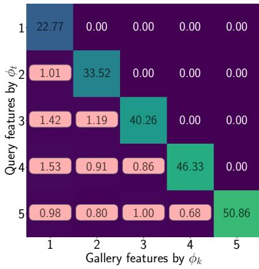  
(a) Baseline

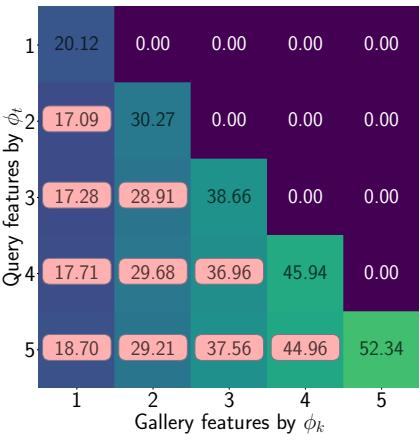  
(b) BCT

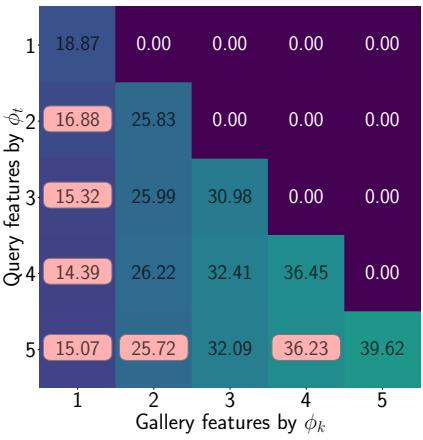  
(c) AdvBCT

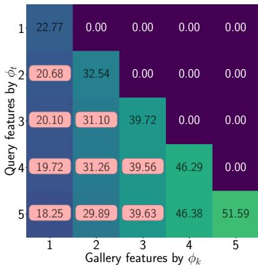  
(d) LCE

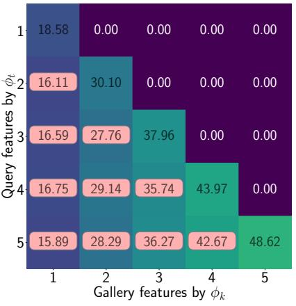  
(e) CoReS

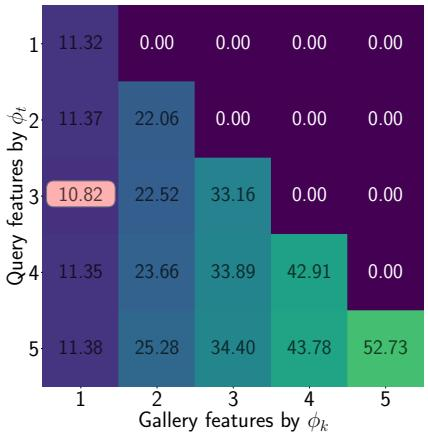  
(f) PSP

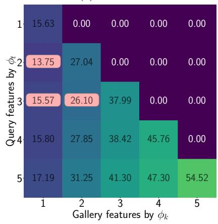  
(g) LSP  
Figure 9: Compatibility matrices showing CMC@1 retrieval metric values at each model update step for the 5-step scenario on the CIFAR-100 dataset. Each matrix entry failing to satisfy the compatibility criterion defined in Eq. 8 is highlighted with a light-red background.

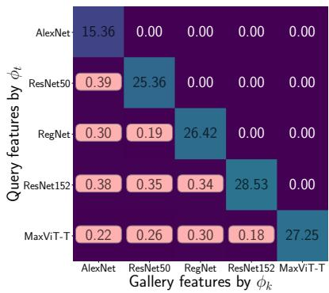  
(a) Baseline

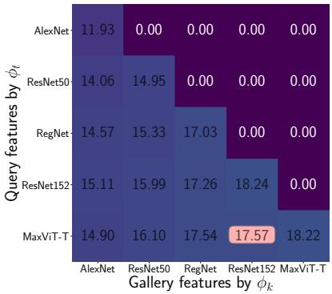  
(b) PSP

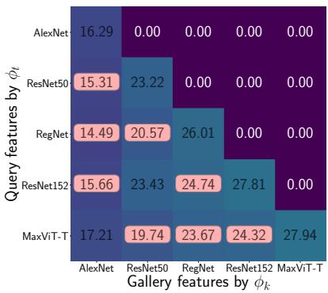  
(c) LSP

Figure 10: Open-set scenario. Compatibility matrices for five steps with increasingly expressive models (AlexNet, ResNet-50, RegNetX\_3.2GF, ResNet-152, and MaxViT\_T), all pretrained on ImageNet-1K. The matrices display retrieval performance on the Places365 dataset. Entries that do not satisfy the compatibility criterion in Eq. 8 are highlighted with a light-red background. Model representations obtained from: (a) encoder output (Baseline); (b) softmax outputs (PSP); (c) logits (LSP).  
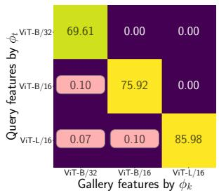  
(a) Baseline

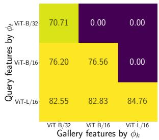  
(b) PSP

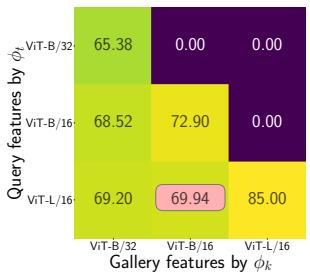  
(c) LSP  
Figure 11: Closed-set scenario. Compatibility matrices for three steps with advanced Vision Transformer (ViT) model architectures (ViT-B/32, ViT-B/16, and $\mathrm { V i T - L } / 1 6 )$ , all pretrained on ImageNet-1K. The matrices show closed-set retrieval performance on the ImageNet-1K test set. Entries that do not satisfy the compatibility criterion in Eq. 8 are highlighted with a light-red background. Model representations obtained from: (a) encoder output (Baseline); (b) softmax outputs (PSP); (c) logits (LSP).

## L.1 Extension to Self-Supervised and Vision-Language Encoders via Linear Probing

In addition to supervised ImageNet-pretrained classifiers from torchvision (Paszke et al., 2019; Marcel & Rodriguez, 2010), we extend our analysis to self-supervised pretrained encoders and pretrained vision-language models in a linear-probe setting. Specifically, we consider two families of publicly available pretrained models: (i) three checkpoints from the DINO family, namely DINO (Caron et al., 2021), DINOv2 (Oquab et al., 2023), and DINOv3 (Siméoni et al., 2026), obtained from the Hugging Face Hub (Wolf et al., 2019); and (ii) three CLIP variants pretrained by OpenAI, namely ViT-B/32, ViT-B/16, and ${ \mathrm { V i T - L } } / 1 4$ , obtained from the OpenCLIP repository (Ilharco et al., 2021). In all cases, the image encoder is used as a frozen feature extractor.

For each checkpoint, we train a bias-free linear classifier on top of the extracted features using ImageNet-1K as the training set for 30 epochs, while keeping the encoder weights frozen. We then construct PSP and LSP representations from the resulting classifier outputs, using softmax outputs and logits, respectively. As a baseline, we directly use the $\ell _ { 2 } \cdot$ -normalized encoder output without any additional training. Retrieval performance is evaluated on the ImageNet-1K test set, following the same protocol adopted in the main benchmark.

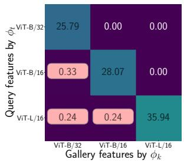  
(a) Baseline

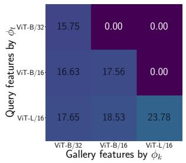  
(b) PSP

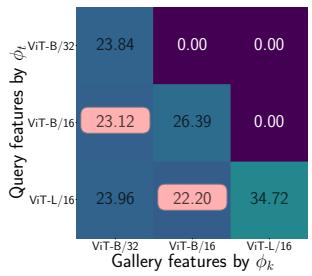  
(c) LSP  
Figure 12: Open-set scenario. Compatibility matrices for three steps with advanced Vision Transformer (ViT) model architectures (ViT-B/32, ViT-B/16, and ViT-L/16), all pretrained on ImageNet-1K. The matrices show open-set retrieval performance on the Places365 test set. Entries that do not satisfy the compatibility criterion in Eq. 8 are highlighted with a light-red background. Model representations obtained from: (a) encoder output (Baseline); (b) softmax outputs (PSP); (c) logits (LSP).

Table 7: Compatibility results for self-supervised and vision-language pretrained encoders in a linear-probe setting on ImageNet-1K. For each checkpoint, a linear probe is trained on top of frozen backbone features. Dark blue numbers indicate the highest values, while light blue numbers indicate the second-highest values.  
(a) DINO family: DINO-ViT-S −→ DINOv2-ViT-S/14 −→ DINOv3-ViT-L/16  
(b) CLIP family: CLIP ViT-B/32 −→ CLIP ViT-B/16 −→ CLIP ViT-L/14
<table><tr><td>METHOD</td><td>AC</td><td>AA</td><td>ACA</td></tr><tr><td>Baseline</td><td>0</td><td>35.50</td><td>0</td></tr><tr><td>PSP</td><td>1.00</td><td>71.00</td><td>72.00</td></tr><tr><td>LSP</td><td>0.67</td><td>68.70</td><td>47.02</td></tr></table>

<table><tr><td>METHOD</td><td>AC</td><td>AA</td><td>ACA</td></tr><tr><td>Baseline</td><td>0</td><td>30.70</td><td>0</td></tr><tr><td>PSP</td><td>1.00</td><td>60.10</td><td>59.20</td></tr><tr><td>LSP</td><td>0.33</td><td>52.10</td><td>16.42</td></tr></table>

Tab. 7 summarizes the compatibility results obtained in this linear-probe setting on ImageNet-1K. For both DINO and CLIP model families, PSP and LSP achieve substantially higher compatibility metrics than the baseline, confirming that the proposed framework can be extended beyond standard supervised classifiers.

For the DINO family, the observed trend is consistent with that reported for supervised ImageNet-pretrained models in Sec. 4.3. In particular, PSP achieves the strongest compatibility results, with $\mathrm { A C } = 1 . 0$ and $\mathrm { A C A } = 7 2 . 0 0$ , while LSP achieves $\mathrm { A C } = 0 . 6 7$ and $\mathrm { A C A } = 4 7 . 0 2$ . As shown in Fig. 13, the baseline achieves reasonable same-model retrieval performance, but cross-model retrieval remains negligible, indicating that independently pretrained self-supervised encoders do not naturally produce aligned representation spaces across updates.

For the CLIP family, we observe the same overall pattern, as shown in Fig. 14. PSP again achieves the strongest compatibility results $( \mathrm { A C } = 1 . 0 , \mathrm { A C A } = 5 9 . 2 0 )$ , while LSP improves substantially over the baseline but remains below PSP. The consistency of this behavior across both model families provides additional empirical support for the theoretical analysis in Sec. 3.4.

Overall, these results show that a simple linear-probe protocol provides a practical way to apply PSP and LSP to pretrained encoders that do not natively expose a classification head, including both self-supervised and vision-language models.

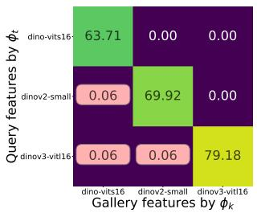  
(a) Baseline

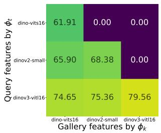  
(b) PSP

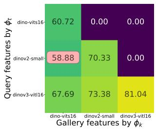  
(c) LSP  
Figure 13: Compatibility matrices for three steps with self-supervised Vision Transformer checkpoints from the DINO family (DINO-ViT-S, DINOv2-ViT-S/14, and $\mathrm { D I N O v 3 – V i T – L } / 1 6 )$ obtained from Hugging Face Hub (Wolf et al., 2019). For each checkpoint, we train a linear probe on ImageNet-1K with the backbone frozen, and construct PSP/LSP features from the resulting classifier outputs. The matrices show closed-set retrieval performance on the ImageNet-1K test set. Entries that do not satisfy the compatibility criterion in Eq. 8 are highlighted with a light-red background. Model representations obtained from: (a) encoder output (Baseline); (b) softmax outputs (PSP); (c) logits (LSP).

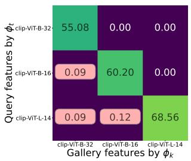  
(a) Baseline

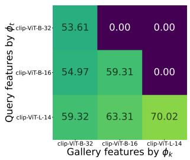  
(b) PSP

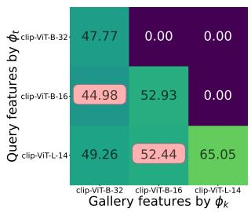  
(c) LSP  
Figure 14: Compatibility matrices for three steps with vision-language CLIP family (ViT-B/32, ViT-B/16, and ${ \mathrm { V i T - L } } / 1 4 )$ pretrained by OpenAI. For each checkpoint, we train a linear probe on ImageNet-1K with the backbone frozen, and construct PSP/LSP features from the resulting classifier outputs. The matrices show closed-set retrieval performance on the ImageNet-1K test set. Entries that do not satisfy the compatibility criterion in Eq. 8 are highlighted with a light-red background. Model representations obtained from: (a) encoder output (Baseline); (b) softmax outputs (PSP); (c) logits (LSP).