# Joint Semantic-Channel Coding and Modulation for Generative Image Transmission

Hao Cao1, Jingkai Ying1, Yinhuan Huang1, Zhijin Qin1,2\* & Yuan Shen1,2 1 Department of Electronic Engineering, Tsinghua University 2 State Key Laboratory of Space Network and Communications Beijing, China

## Abstract

Digital image transmission typically optimizes source coding, channel coding, and modulation separately, limiting how source representations adapt to channel impairments. We propose SemQAM, ajoint semantic-channel coding and modulation scheme for generative image transmission converting source to modulated symbols, such as standard QAM symbols. Channel impairments create two challenges: they can corrupt the latent representation at the receiver, and this corruption can compound through autoregressive coding, degrading reconstruction quality. First, SemQAM represents latent features with vector quantization (VQ), maps each VQ index to a QAM symbol, and updates the codeword corresponding to the detected symbol so that channel impairments directly affect codebook learning. Moreover, SemQAM uses the conditional expectation of received codewords to approximate the receiver reconstruction and reduce error propagation during autoregressive coding. SemQAM supports multiple SNRs and CBRs in a unified model, while also supporting conventional source coding through SemQAM-C. Experiments show that (i) under the same LDPC and QAM settings, SemQAM-C outperforms OneDC in LPIPS and DISTS with substantially lower complexity, showing that the unified model retains competitive capability for source coding. (ii) Compared with this separated counterpart, SemQAM reduces channel uses by 18.57% at matched LPIPS and outperforms the compared JSCC methods, demonstrating the benefit ofjoint coding.

## 1. Introduction

Digital image transmission is an important application of modern communication systems [22, 48]. A conventional digital image transmission system consists of three separately optimized stages, as illustrated in Fig. 1a. (i) Source coding [41] compresses an image into as few bits as possible at the desired reconstruction quality. (ii) Channel coding [21, 40] adds redundancy to protect these bits from transmission errors. (iii) Modulation [24] maps the protected bits to channel symbols, such as quadrature amplitude modulation (QAM) symbols, for transmission.

However, with limited transmission resources, source representation and error protection compete for the budget, motivating learned joint semantic-channel coding (JSCC) [13, 26] and joint semantic-channel coding and modulation (JSCM) [52, 53] for end-to-end optimization of the transmission system. How QAM detection errors alter the latent representation reconstructed at the receiver and propagate through autoregressive coding remains less explored.

In this paper, we propose SemQAM, a joint semanticchannel coding and modulation system for generative image transmission using QAM, as illustrated in Fig. 1b. Channel impairments degrade reconstruction quality for two reasons: they corrupt the latent representation reconstructed at the receiver, and the resulting corruption further compounds during autoregressive coding. First, SemQAM maps vector quantization (VQ) indices of image latents to QAM symbols and updates the codeword corresponding to the detected symbol. Second, SemQAM computes the expected received codeword from channel transition probabilities and uses it for subsequent autoregressive encoding. Together, these designs adapt the latent representation to channel impairments and reduce corruption accumulation during autoregressive coding, improving reconstruction quality.

SemQAM supports multiple signal-to-noise ratios (SNRs) and channel bandwidth ratios (CBRs) in a unified model, while also providing a noiseless source-coding mode, SemQAM-C, to accommodate diverse transmission scenarios. Experiments on Kodak at 10 dB show that (i) under the same LDPC [21, 39] and QAM, OneDC [50] requires 20.96% and 17.01% more channel uses than SemQAM-C at matched LPIPS and DISTS, respectively, while SemQAM-C uses only 5.59% of the encoder latency, 2.59% of the decoder latency, and 4.29% of the parameters, showing that the unified model preserves competitive capability for source coding. (ii) SemQAM outperforms the compared JSCC methods in LPIPS [54], DISTS [15], and FID [25], and reduces channel uses by 18.57% on average at matched LPIPS compared with the separated SemQAM-C system, directly demonstrating the advantage of joint coding over separate optimization.

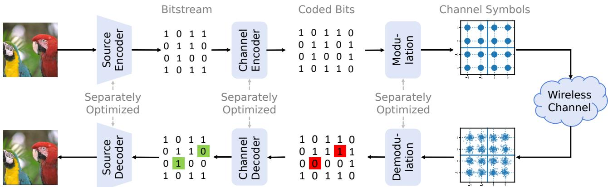  
(a) Conventional digital communication system

Autoregressive coding  
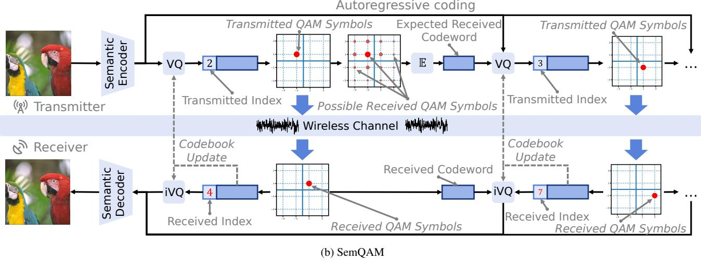  
Figure 1. Conventional separated transmission and SemQAM. (a) A conventional system separately optimizes source coding, channel coding, and modulation. (b) SemQAM is designed to jointly optimize end-to-end image transmission over a standard QAM constellation. SemQAM (i) trains VQ codewords using the detected indices at the receiver, and (ii) uses the expectation of received codewords to approximate the receiver reconstruction during autoregressive coding. E, VQ, and iVQ denote conditional expectation, vector quantization, and codeword lookup, respectively.

Our contributions are summarized as follows:

• We introduce SemQAM, a joint semantic-channel coding and modulation system for generative image transmission with standard QAM, supporting multiple SNRs and CBRs as well as conventional source coding in a unified model.

• SemQAM trains VQ codewords using detected indices to incorporate channel transitions into codebook learning, and uses expected received codewords to approximate receiver reconstructions and reduce error propagation.

• Experiments demonstrate the advantage of joint coding over separate optimization while retaining strong performance and efficiency in conventional source coding.

## 2. Preliminary

Digital Image Transmission. Digital image transmission aims to reconstruct the source image with high quality using as few transmitted symbols as possible. During wireless transmission, channel impairments such as noise can distort the transmitted signals and cause symbol errors, so the system must represent the image efficiently while remaining robust to these errors.

Source Coding. Source coding removes redundancy from the source representation to reduce the number of bits or symbols needed for reconstruction. Autoregressive coding reduces redundancy among latent features [4, 37]. In EF-LIC [10], previously reconstructed groups predict an affine transform for the current latent before VQ, removing predictable information and improving representation efficiency under a fixed VQ budget. This also makes later quantization depend on earlier reconstructions.

Channel Coding. Channel coding adds redundancy to transmitted bits so that the receiver can correct errors caused by channel impairments. Low Density Parity Check (LDPC) codes [21, 39] are among the most widely used channel codes in modern communication systems [27]. We therefore use LDPC to construct the separated transmission baselines in our experiments.

Modulation. Modulation converts coded bits into physical signals for transmission over the wireless channel. Quadrature amplitude modulation (QAM) [1] is one of the most widely used modulation schemes and maps coded bits to a finite set of constellation points. An M-QAM constellation contains M points, so each symbol can represent log M bits. For example, 1024-QAM contains 1024 constellation points and carries 10 bits per symbol, naturally matching the 1024 possible indices of a VQ codebook.

Wireless Channel. A wireless channel is the physical medium through which signals are transmitted from the transmitter to the receiver. A common baseband channel model is

$$
\begin{array} { r } { r = h s + N , } \end{array}
$$

where s and r denote the transmitted and received symbols, h denotes the channel response, and N denotes additive noise. The signal-to-noise ratio (SNR) is a common measure of channel conditions and is defined as

$$
\mathrm { S N R } = 1 0 \log _ { 1 0 } \frac { \mathbb { E } [ | h s | ^ { 2 } ] } { \mathbb { E } [ | N | ^ { 2 } ] } \quad \mathrm { d B } .
$$

Under a fixed signal power, a larger SNR corresponds to weaker noise and a cleaner channel. For digital image transmission, the channel bandwidth ratio (CBR) measures the transmission resources relative to the source image size. For an RGB image of size $H \times W$ transmitted using n channel uses, CBR is defined as

$$
\mathrm { C B R } = \frac { n } { 3 H W } ,
$$

where a lower CBR indicates fewer transmission resources.

Joint Semantic-Channel Coding. Separate source and channel coding is optimal only under restrictive asymptotic conditions, motivating learned joint transmission methods for practical systems with finite resources [32, 41]. Previous JSCC methods directly transmit continuous-valued encoded features [9, 13, 26]. JSCM instead maps the encoded features to a finite set of digital constellation points. Under otherwise matched conditions, this constraint reduces the available signal space and can lower the achievable performance relative to continuous JSCC, while making transmission compatible with practical digital systems. As a widely used digital modulation scheme, QAM has been adopted by several JSCM methods [8, 45, 52, 53], making QAM-based JSCM compatible with existing communication systems.

## 3. Method

## 3.1. System Overview

SemQAM builds on the encoding structure of EF-LIC [10], extending it from source coding to joint semantic-channel coding and modulation. The detailed model architecture is shown in Fig. 6 in Sec. B.1. The analysis transform maps an image x to the main latent $y = g _ { a } ( x )$ , while the hyper analysis transform extracts the hyperlatent $z = h _ { a } ( y )$ [4]. Both latents are represented using residual vector quantization (RVQ) [33, 46], with the hyperlatent transmitted first to provide context for the main latent. Because channel noise can produce different reconstructions at the transmitter and receiver, the transmitter maintains an approximation z˜ of the receiver hyperlatent, while the receiver reconstructs zˆ from its detected indices, producing context features $\tilde { \phi } = h _ { s } ( \tilde { z } )$ and $\hat { \phi } = h _ { s } ( \hat { z } )$

The main latent $y$ is divided into four quadtree groups $y _ { 1 } , \ldots , y _ { 4 }$ , where later groups use earlier reconstructions as context [10]. The transmitter constructs the context from its approximated receiver reconstructions $\tilde { y } _ { < i }$ , while the receiver uses its actual reconstructions $\hat { y } _ { < i }$

$$
\begin{array} { r } { ( \tilde { \mu } _ { i } , \tilde { \sigma } _ { i } ) = f _ { i } ( \tilde { y } _ { < i } , \tilde { \phi } ) , } \\ { ( \hat { \mu } _ { i } , \hat { \sigma } _ { i } ) = f _ { i } ( \hat { y } _ { < i } , \hat { \phi } ) . } \end{array}
$$

The transmitter normalizes the current group as $u _ { i } \ =$ $\left( y _ { i } - { \tilde { \mu } } _ { i } \right) \oslash { \tilde { \sigma } } _ { i } ,$ , where $\oslash$ denotes elementwise division, and RVQ successively quantizes its residuals.

For each RVQ stage, the transmitter selects the nearest codeword to obtain an index J. Each codebook contains 1024 codewords whose indices are mapped one to one to Gray-labeled 1024-QAM symbols [12], without separate channel coding between VQ and modulation. After wireless transmission, the receiver detects Jˆ and reconstructs from $c _ { \hat { J } } ,$ , while the transmitter maintains an approximation of the receiver reconstruction because $\hat { J }$ is unavailable to it. These local reconstructions are then used for later autoregressive coding, and the receiver finally reconstructs the image as $\hat { x } = g _ { s } ( \hat { y } )$ . Across channel conditions and transmission rates, SemQAM shares the image transforms, hyperprior, and context networks while selecting the corresponding VQ codebooks for each operating point.

## 3.2. VQ Codebook Learning under Channel Impairments

In a noiseless VQ system, codeword indices are only labels [46]. Permuting these labels does not affect reconstruction as long as the encoder and decoder use the same mapping. This symmetry is broken after the indices are mapped to QAM symbols because channel noise may change a transmitted index J into a different detected index Jˆ. If a QAM detection error selects a codeword that is very different from the transmitted one, the reconstructed latent can change substantially, degrading the final image reconstruction.

SemQAM addresses this problem through receiver-side codebook learning. For one RVQ stage, let u and uˆ denote the current residuals constructed from the transmitter and receiver reconstructions, respectively, and let $c _ { j }$ and $s _ { j }$ denote the j-th VQ codeword and its mapped QAM symbol. The receiver codebook loss is

$$
\mathcal { L } _ { \mathrm { c b } } = \left. \mathrm { s g } ( \hat { u } ) - c _ { \hat { J } } \right. ^ { 2 } .\tag{1}
$$

where

$$
\begin{array} { c } { { J = \arg \operatorname* { m i n } _ { j } \| u - c _ { j } \| ^ { 2 } , \quad r = h s _ { J } + N , } } \\ { { \hat { J } = \arg \operatorname* { m i n } _ { k } | r - h s _ { k } | ^ { 2 } . } } \end{array}
$$

Here, sg denotes stop-gradient. The transmitted index J determines the QAM symbol entering the channel, while the detected index Jˆ determines which VQ codeword receives the training signal. Thus, a sample assigned to one index at the transmitter can update the codeword corresponding to another index, incorporating the transition between transmitted and detected indices into codebook learning.

Over training samples and channel realizations, the receiver codebook learning can be written as

$$
\begin{array} { l } { \displaystyle \operatorname* { m i n } _ { \{ c _ { k } \} } \mathbb { E } [ \mathcal { L } _ { \mathrm { c b } } ] = \displaystyle \operatorname* { m i n } _ { \{ c _ { k } \} } \sum _ { j } \mathbb { P } \left( J = \arg \operatorname* { m i n } _ { \ell } \| u - c _ { \ell } \| ^ { 2 } \right) } \\ { \displaystyle \quad \cdot \ \mathbb { E } \left[ \left\| \mathrm { s g } ( \hat { u } ) - c _ { \hat { J } } \right\| ^ { 2 } | \ J = j \right] . } \end{array}\tag{2}
$$

This receiver-side objective therefore incorporates the transition from transmitted index J to detected index $\hat { J }$ into codebook learning. With autoregressive coding, the detected codeword also affects the residuals and context for subsequent quantization, allowing the objective to capture both direct channel-induced codeword transitions and their effects on later index assignments. These updates reshape the codebook and index assignments according to channel impairments. As a result, the QAM symbol distribution changes with SNR without a target distribution or shaping loss. We analyze why this behavior appears from an information-theoretic perspective in Sec. A.

One special case is the simplified setting with neither the hyperprior nor quadtree autoregressive context, where cross-group error propagation is removed and the receiver-side codebook update is equivalent in expectation to CAVQ [36]. Another special case is the noiseless setting. When the channel noise disappears,

$$
\begin{array} { c c c } { { N = 0 , } } & { { h = 1 \quad \Longrightarrow \quad r = s _ { J } , \quad \hat { J } = J , } } & { { \hat { u } = u , } } \\ { { } } & { { \mathcal { L } _ { \mathrm { c b } } = \left\| \mathrm { s g } ( u ) - c _ { J } \right\| ^ { 2 } . } } & { { } } \end{array}
$$

The objective therefore reduces to standard VQ learning, with no cross-index transition to organize the otherwise arbitrary codeword labels. Together, these special cases connect the receiver-side codebook formulation to CAVQ and standard VQ under simplified coding and channel settings, while the full formulation handles autoregressive image coding over noisy channels.

## 3.3. Receiver Reconstruction Estimation

The receiver decisions described in Sec. 3.2 can affect the residuals and context used for subsequent quantization. Since SemQAM uses earlier reconstructed latent groups to encode later ones, the transmitter must approximate the receiver’s reconstructions. However, it knows the sent index J but not the detected index ${ \hat { J } } ,$ so SemQAM estimates the received codeword without feedback.

For hard-decision QAM, the transition matrix is [18, 40],

$$
W _ { k j } = \mathbb { P } ( { \hat { J } } = k \mid J = j ) .
$$

Given a transmitted index $j ,$ SemQAM estimates the received codeword by its conditional mean,

$$
\mathbb { E } [ c _ { \hat { J } } \mid J = j ] = { \bar { c } } _ { j } = \sum _ { k } W _ { k j } c _ { k } .\tag{3}
$$

We refer to $\bar { c } _ { j }$ as the expected received codeword (Expected-RX). As the conditional mean, $\bar { c } _ { j }$ is the minimum-MSE deterministic estimate of the received codeword based only on the transmitted index. A derivation is provided in Sec. B.3.

Without noise, W is the identity matrix,

$$
W = I \quad \Longrightarrow \quad \bar { c } _ { j } = c _ { j } .
$$

Thus, Expected-RX naturally reduces to the transmitted codeword when channel is noiseless.

We use this estimate in transmitter-side RVQ. For RVQ stage l, let $u ^ { ( l ) }$ denote the transmitter residual before quantization and $J _ { l }$ the selected index. The next residual is

$$
u ^ { ( l + 1 ) } = u ^ { ( l ) } - \bar { c } _ { J _ { l } } .\tag{4}
$$

This expected codeword is also the commitment target,

$$
\mathcal { L } _ { \mathrm { c o m } } = \left. u ^ { ( l ) } - \mathrm { s g } ( \bar { c } _ { J _ { l } } ) \right. ^ { 2 } ,\tag{5}
$$

where sg denotes stop-gradient. Using $\bar { c } _ { J _ { l } }$ in both operations keeps the transmitter residual consistent with the codeword expected to be reconstructed at the receiver. Because later residuals and context pass through nonlinear transforms and quantizers, this remains a local estimate rather than the exact expectation of receiver reconstructions.

We use the EF-LIC image objective [10],

$$
\begin{array} { r l } & { \mathcal { L } _ { \mathrm { i m g } } = \lambda _ { \mathrm { r e c } } \Vert x - \hat { x } \Vert _ { 2 } ^ { 2 } + \lambda _ { \mathrm { p e r } } \mathcal { L } _ { \mathrm { L P I P S } } ( x , \hat { x } ) } \\ & { \quad \quad + \lambda _ { \mathrm { a d v } } \mathcal { L } _ { \mathrm { G A N } } ( x , \hat { x } ) , } \end{array}
$$

where $\mathcal { L } _ { \mathrm { L P I P S } }$ uses pretrained VGG features [43, 54], and $\mathcal { L } _ { \mathrm { G A N } }$ is the generator-side PatchGAN loss following VQ-GAN [17]. Together with the receiver-side codebook loss in Eq. (1), the complete training objective is

$$
\mathcal { L } = \mathcal { L } _ { \mathrm { i m g } } + \lambda _ { \mathrm { c b } } \mathcal { L } _ { \mathrm { c b } } + \lambda _ { \mathrm { c o m } } \mathcal { L } _ { \mathrm { c o m } } ,\tag{6}
$$

where $\lambda _ { \mathrm { r e c } } , \lambda _ { \mathrm { p e r } } , \lambda _ { \mathrm { a d v } } , \lambda _ { \mathrm { c b } }$ , and $\lambda _ { \mathrm { { c o m } } }$ are loss weights.

## 4. Experiments

## 4.1. Experimental Setup

Training Details. SemQAM uses four CBR settings for each of 10 dB, 16 dB, 24 dB, and noiseless transmission, giving sixteen codebook groups. The noiseless variant is denoted as SemQAM-C for readability. It remains part of the same SemQAM model and shares the same weights. We train SemQAM on ImageNet [14] using a three-stage multioperating-point training strategy. Detailed training settings are provided in Sec. C.1.

Evaluation Datasets and Metrics. We evaluate on Kodak, Tecnick, DIV2K validation, and CLIC 2020 Professional [2, 3, 16, 44] using LPIPS, DISTS, and FID [15, 25, 54]. We report CBR-based BD-rate [5] to measure the average transmission-resource difference at matched perceptual quality. All methods follow the CBR definition in Sec. 2, with required side information and padding overhead included. Latency is measured on one NVIDIA A100, and SemQAM reports the mean CUDA latency across the evaluated CBR settings. Metric, rate, and runtime protocols are provided in Secs. C.3 to C.5.

Compared Methods. We consider two groups of baselines for complementary comparisons. (i) NTSCC, NTSCC+, MDJCM-A, and Quad-JSCC [13, 26, 47, 53] are learned JSCC methods used to evaluate SemQAM against existing joint transmission systems. (ii) MS-ILLM, OS-CAR, OneDC, DiT-IC, EF-LIC, and CoD-Lite [10, 23, 30, 38, 42, 50] are generative image codecs paired with LDPC and QAM with MCS table [1] in Sec. C.4, forming separated systems for comparison of perceptual quality and transmission efficiency. Following the common evaluation setting in learned image JSCC [13, 26, 47], our main comparisons use the AWGN channel at 10 dB to enable broad comparison with existing methods. Additional comparisons at 16 dB and 24 dB and baseline-specific configurations are provided in Secs. C.3 and D.1.

## 4.2. Comparison with Previous Methods

Comparison with JSCC Methods. Perceptual and generative JSCC methods remain relatively limited, and most evaluated JSCC baselines are optimized primarily for distortion rather than perceptual quality. As shown in Fig. 2 and Tab. 1, SemQAM substantially outperforms NTSCC, NTSCC+, and MDJCM-A in LPIPS, DISTS, and FID, and also achieves clear gains over the recent perceptual Quad-JSCC while requiring much lower inference latency. Notably, conventional learned JSCC commonly allows unconstrained continuous-valued channel inputs, whose performance can be viewed as the limiting case approached by increasingly high modulation orders [8, 45, 52]. Prior studies report that finite-constellation performance improves toward this continuous-input reference as the modulation order increases [8, 45]. SemQAM nevertheless achieves stronger perceptual performance while operating directly with finite 1024-QAM, demonstrating strong joint transmission capability under a discrete modulation constraint.

Comparison with Separated Systems. The sourcecoding variant SemQAM-C performs strongly among the compared generative codecs, showing that the unified model retains strong conventional source-coding capability. At 10 dB, SemQAM further improves over the separated SemQAM-C baseline. This comparison demonstrates the benefit of jointly optimizing semantic coding, channel coding, and modulation under channel impairments.

## 4.3. Constellation Usage Analysis

Fig. 3 shows that SemQAM learns strongly SNR-dependent symbol distributions without explicitly constraining either the VQ index probabilities or the QAM symbol usage. At 10 dB, the distribution concentrates on the corner symbols, which have fewer directions in which noise can cause confusion than interior symbols. Because the noise power is scaled with the average transmitted symbol power, using higher-energy corner symbols does not provide a higher operating SNR. As the SNR increases, this preference weakens and the symbol usage becomes increasingly balanced, approaching a nearly uniform distribution in the noiseless setting. This behavior appears without an explicit shaping objective, showing that symbol usage changes with SNR as a result ofjoint optimization. We explain this behavior with information theory in Sec. A.

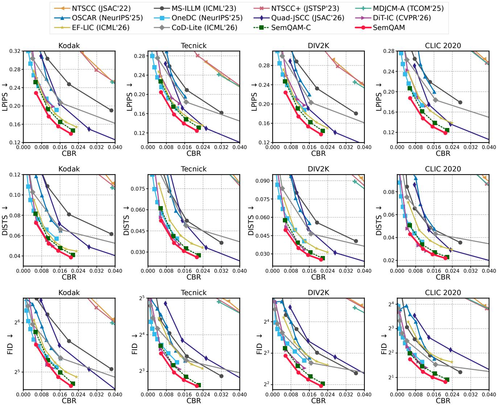

Figure 2. Rate and perceptual quality at 10 dB on four datasets. Lower values are better. FID vertical axes use base-2 logarithms.  
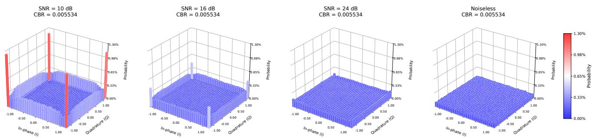  
Figure 3. QAM symbol usage across SNRs. Lower SNR concentrates usage on corner symbols, while higher SNR makes it more balanced.

## 4.4. Effect of SNR at a Fixed CBR

As shown in Fig. 4, SemQAM improves as the SNR increases from 10 dB to 16 dB and 24 dB across four datasets.

SemQAM maintains lower LPIPS than the compared generative image codecs paired with LDPC and QAM at every evaluated SNR, showing that its advantage persists across channel conditions under the same transmission budget.

Table 1. Results on Kodak at 10 dB, with latency measured on one NVIDIA A100. Latency is reported in ms, FLOPs in G, parameters in M, and BD-rate in percent. JSCC denotes joint semantic-channel coding, Percep. denotes generative optimization, and Mod. denotes join optimization with modulation. SemQAM-C denotes the separated system combining the noiseless source codec with LDPC and QAM, while SemQAM denotes joint QAM transmission. SemQAM-C is the BD-rate anchor, and lower values are better. Bold and underline mark the best and second-best BD-rates.
<table><tr><td rowspan="2">Method</td><td colspan="4">Computation</td><td colspan="3">BD-rate ↓</td><td colspan="3">Design</td></tr><tr><td>Enc.</td><td>Dec.</td><td>FLOPs</td><td>Params</td><td>LPIPS</td><td>DISTS</td><td>FID</td><td>JSCC</td><td>Percep.</td><td>Mod.</td></tr><tr><td>MS-ILLM</td><td>165.38</td><td>147.79</td><td>599.52</td><td>181.40</td><td>252.63</td><td>286.55</td><td>198.99</td><td></td><td>V</td><td></td></tr><tr><td>OSCAR</td><td>53.04</td><td>167.56</td><td>6485.61</td><td>1009.30</td><td>91.81</td><td>96.05</td><td>60.47</td><td></td><td>√</td><td></td></tr><tr><td>OneDC</td><td>76.98</td><td>204.47</td><td>8557.18</td><td>1406.42</td><td>20.96</td><td>17.01</td><td>-12.00</td><td></td><td>√</td><td></td></tr><tr><td>DiT-IC</td><td>97.62</td><td>151.89</td><td>5743.15</td><td>1069.41</td><td>18.39</td><td>-11.98</td><td>-18.28</td><td></td><td>√</td><td></td></tr><tr><td>EF-LIC</td><td>17.62</td><td>13.72</td><td>279.61</td><td>35.74</td><td>12.38</td><td>14.06</td><td>16.51</td><td></td><td>√</td><td></td></tr><tr><td>CoD-Lite</td><td>9.33</td><td>20.86</td><td>771.69</td><td>80.15</td><td>78.39</td><td>108.03</td><td>47.56</td><td></td><td>√</td><td></td></tr><tr><td>NTSCC</td><td>36.07</td><td>30.12</td><td>533.55</td><td>31.36</td><td>473.89</td><td>791.14</td><td>548.62</td><td>√</td><td></td><td></td></tr><tr><td>NTSCC+</td><td>49.77</td><td>49.23</td><td>357.06</td><td>58.59</td><td>438.79</td><td>678.05</td><td>507.44</td><td>√</td><td></td><td></td></tr><tr><td>MDJCM-A</td><td>33.48</td><td>59.47</td><td>534.96</td><td>32.93</td><td>443.14</td><td>716.75</td><td>501.08</td><td>√</td><td></td><td></td></tr><tr><td>Quad-JSCC</td><td>53.59</td><td>182.40</td><td>531.81</td><td>46.65</td><td>67.60</td><td>109.17</td><td>109.56</td><td>√</td><td>√</td><td>一</td></tr><tr><td>SemQAM-C</td><td>4.30</td><td>5.29</td><td>381.24</td><td>60.34</td><td>0.00</td><td>0.00</td><td>0.00</td><td>一</td><td>V</td><td></td></tr><tr><td>SemQAM (10dB)</td><td>4.79</td><td>5.44</td><td>381.34</td><td>60.34</td><td>-18.57</td><td>-16.91</td><td>-15.37</td><td>V</td><td>V</td><td>V</td></tr></table>

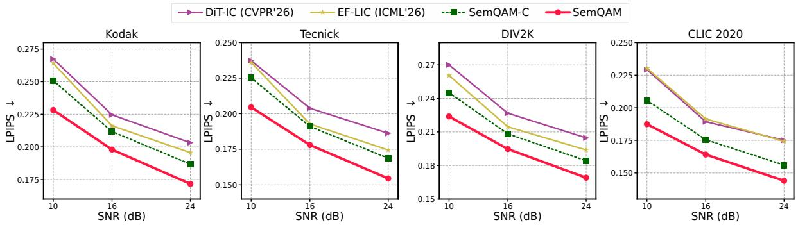  
Figure 4. LPIPS at CBR 0.005534 under different SNRs across four datasets. Lower is better.

## 4.5. Ablation Studies

We evaluate six configurations on Kodak at 10 dB under the same training protocol for a fair comparison, as detailed in Sec. C.7. $\mathrm { { M } _ { 0 } }$ removes both the hyperprior (HP) and quadtree autoregressive context (AR), while $\mathrm { M } _ { 1 }$ increases the backbone capacity and $\mathrm { M } _ { 2 }$ restores the hyperprior. With neither the hyperprior nor quadtree autoregressive context, the receiver-side codebook loss in $\mathrm { { M } _ { 0 } }$ and $\mathrm { M } _ { 1 }$ is equivalent in expectation to CAVQ [36]. Starting from the complete model $\mathrm { M } _ { 5 } , \mathrm { M } _ { 3 }$ replaces the expectation of received codewords with the transmitted codewords, while $\mathrm { M } _ { 4 }$ replaces the receiver-side codebook loss with a transmitter-side one.

As shown in Tab. 2, both additional backbone capacity and the hyperprior improve performance, while autoregressive provides a further gain, indicating that the improvement is not explained by model capacity. Compared with $\mathrm { M } _ { 5 } , \mathrm { M } _ { 3 }$ degrades because the transmitted codewords cannot accurately approximate the receiver reconstruction, increasing error propagation during autoregressive coding. Using a transmitter-side codebook loss in $\mathrm { M } _ { 4 }$ degrades performance because the transitions between transmitted and detected indices are no longer learned from receiver decisions.

## 5. Related Work

Learned Image JSCC. Learned image JSCC do not use digital modulation, but directly transmit continuous symbols over the wireless channel [9, 13, 47]. Quad-JSCC further provides generative reconstruction [26]. SemQAM jointly optimizes generative image transmission under a fixed finite QAM constellation.

Table 2. Ablation configurations on Kodak at 10 dB. HP, AR, Deeper Backb., E-RX, and RX-CB denote the hyperprior, quadtree autoregression, deeper backbone, expected received codewords, and receiver-side codebook loss, respectively. $\mathrm { { M } _ { 0 } }$ is the LPIPS BD-rate anchor, and lower is better.
<table><tr><td rowspan="2">Model</td><td colspan="5">Ablation method</td><td colspan="3">Computation</td><td>BD-rate (%)</td></tr><tr><td>HP</td><td>AR</td><td>Deeper Backb.</td><td>E-RX</td><td>RX-CB</td><td>Enc.</td><td>Dec.</td><td>FLOPs</td><td>LPIPS</td></tr><tr><td>M0</td><td>一</td><td>一</td><td></td><td>V</td><td>√</td><td>2.31</td><td>3.77</td><td>310.29</td><td>0.00</td></tr><tr><td>M1</td><td></td><td>1</td><td>V</td><td>√</td><td>√</td><td>2.79</td><td>4.68</td><td>397.52</td><td>-4.84</td></tr><tr><td>M2</td><td>√</td><td></td><td></td><td>√</td><td>√</td><td>3.84</td><td>4.86</td><td>368.66</td><td>-5.15</td></tr><tr><td>M3</td><td>√</td><td>√</td><td></td><td></td><td>√</td><td>4.95</td><td>5.93</td><td>381.44</td><td>-7.99</td></tr><tr><td>M4</td><td>√</td><td>√</td><td></td><td>√</td><td></td><td>5.46</td><td>5.90</td><td>381.44</td><td>&gt; 100</td></tr><tr><td>M5</td><td>V</td><td>V</td><td></td><td>√</td><td>V</td><td>5.31</td><td>5.60</td><td>381.44</td><td>-12.29</td></tr></table>

Learned Image JSCM. DeepJSCC-Q constrains channel symbols to finite constellations, VQ-DeepSC transmits quantized features over digital channels, while JCM and MDJCM optimize symbol probabilities or multiple modulation orders [8, 20, 45, 53]. SemQAM instead maps VQ indices directly to standard QAM symbols and trains the representation using detected indices, adapting latent representation to channel impairments.

Noisy Channel Vector Quantization. Classical channeloptimized quantizers incorporate channel errors into index assignment and codebook optimization [18, 19], while CAVQ incorporates direct index transitions caused by channel errors into codebook learning [36]. However, CAVQ does not model error propagation through autoregressive coding, while removing these dependencies leads to lower reconstruction performance in our experiments. EF-LIC provides the autoregressive RVQ representation [10], but assumes consistent transmitter and receiver reconstructions. SemQAM uses Expected-RX to approximate receiver reconstructions at the transmitter, improving performance.

## 6. Limitations

Given finite resources, we prioritize 16 operating points that allow direct comparison with representative JSCC and JSCM evaluations [13, 26, 45, 53]. These operating points cover multiple CBRs and SNRs under AWGN, with the 10 dB AWGN condition used as the primary setting to align with them. The two core designs of SemQAM are not specific to AWGN, since codebook learning uses detected indices and Expected-RX uses the corresponding transition probabilities. Broader fading conditions and physical-layer settings such as OFDM may require more general transition modeling and remain for future evaluation.

## 7. Conclusion

We presented SemQAM, a joint semantic-channel coding and modulation system for generative image transmission with standard QAM. SemQAM trains VQ codewords using detected indices at the receiver, so transitions between transmitted and detected indices affect codebook learning, while symbol usage changes with SNR through joint optimization. It uses the expectation of received codewords to approximate receiver reconstructions and reduce error propagation during autoregressive coding. Experiments demonstrate the advantage of joint coding over separate optimization while retaining the performance and efficiency of conventional source coding, with SemQAM outperforming the compared JSCC methods under perceptual metrics.

## AI use statement

AI tools were used to assist with manuscript organization, language refinement, and content verification. The authors reviewed all text, citations, code, calculations, claims, and artifacts produced with AI assistance against the cited sources, implementation, and experimental records. Generative AI was not used to create datasets or experimental measurements. The authors take responsibility for the final content of this work, including material produced with the aid of generative AI.

## Reproducibility Statement

Sec. 3 specifies the model architecture, channel interface, receiver-side codebook learning, Expected-RX, and training objective. Sec. 4 describes the experimental settings, baselines, metrics, and main evaluation results. The appendices provide the corresponding theoretical analysis, implementation details, training and evaluation protocols, and additional experimental results. The source code will be publicly released upon acceptance.

## References

[1] 3GPP. NR: Physical Layer Procedures for Data. Technical Report TS 38.214, version 16.2.0, Release 16, 3rd Generation Partnership Project, 2020. Table 5.1.3.1-1.

[2] Eirikur Agustsson and Radu Timofte. NTIRE 2017 Challenge on Single Image Super-Resolution: Dataset and Study. In 2017 IEEE Conference on Computer Vision and Pattern Recognition Workshops (CVPRW), pages 1122–1131, 2017.

[3] Nicola Asuni and Andrea Giachetti. TESTIMAGES: A Large Data Archive for Display and Algorithm Testing. Journal ofGraphics Tools, 17(4):113–125, 2015.

[4] Johannes Ballé, David Minnen, Saurabh Singh, Sung Jin Hwang, and Nick Johnston. Variational Image Compression with a Scale Hyperprior. In International Conference on Learning Representations, 2018.

[5] Gisle Bjøntegaard. Calculation of Average PSNR Differences between RD-Curves. Technical Report VCEG-M33, ITU-T VCEG, 2001.

[6] Yochai Blau and Tomer Michaeli. The Perception-Distortion Tradeoff. In Proceedings of the IEEE Conference on Computer Vision and Pattern Recognition, pages 6228–6237, 2018.

[7] Yochai Blau and Tomer Michaeli. Rethinking Lossy Compression: The Rate-Distortion-Perception Tradeoff. In Proceedings of the 36th International Conference on Machine Learning, pages 675–685. PMLR, 2019.

[8] Yufei Bo, Yiheng Duan, Shuo Shao, and Meixia Tao. Joint Coding-Modulation for Digital Semantic Communications via Variational Autoencoder. IEEE Transactions on Communications, 72(9):5626–5640, 2024.

[9] Eirina Bourtsoulatze, David Burth Kurka, and Deniz Gündüz. Deep Joint Source-Channel Coding for Wireless Image Transmission. IEEE Transactions on Cognitive Communications and Networking, 5(3):567–579, 2019.

[10] Hao Cao, Wenqi Guo, Zhijin Qin, and Jungong Han. Efficient Learned Image Compression without Entropy Coding. In Proceedings ofthe 43rd International Conference on Machine Learning. PMLR, 2026.

[11] Centre Tecnològic de Telecomunicacions de Catalunya. 5G-LENA: ns3::NrEesmT1 Struct Reference. Official simulator documentation and reference implementation, 2026. Reference curves accessed September 11, 2026.

[12] Kyongkuk Cho and Dongweon Yoon. On the General BER Expression of One- and Two-Dimensional Amplitude Modulations. IEEE Transactions on Communications, 50(7): 1074–1080, 2002.

[13] Jincheng Dai, Sixian Wang, Kailin Tan, Zhongwei Si, Xiaoqi Qin, Kai Niu, and Ping Zhang. Nonlinear Transform Source-Channel Coding for Semantic Communications. IEEE Journal on Selected Areas in Communications, 40(8):2300–2316, 2022.

[14] Jia Deng, Wei Dong, Richard Socher, Li-Jia Li, Kai Li, and Li Fei-Fei. ImageNet: A Large-Scale Hierarchical Image Database. In IEEE Conference on Computer Vision and Pattern Recognition, pages 248–255, 2009.

[15] Keyan Ding, Kede Ma, Shiqi Wang, and Eero P. Simoncelli. Image Quality Assessment: Unifying Structure and Texture

Similarity. IEEE Transactions on Pattern Analysis and Machine Intelligence, 44(5):2567–2581, 2022.

[16] Eastman Kodak Company. Kodak Lossless True Color Im age Suite (PhotoCD PCD0992), 1993.

[17] Patrick Esser, Robin Rombach, and Björn Ommer. Taming Transformers for High-Resolution Image Synthesis. In Pro ceedings of the IEEE/CVF Conference on Computer Vision and Pattern Recognition, pages 12873–12883, 2021.

[18] Nariman Farvardin. A Study of Vector Quantization for Noisy Channels. IEEE Transactions on Information Theory, 36(4):799–809, 1990.

[19] Nariman Farvardin and Vinay A. Vaishampayan. Optimal Quantizer Design for Noisy Channels: An Approach to Combined Source-Channel Coding. IEEE Transactions on Information Theory, 33(6):827–838, 1987.

[20] Qifan Fu, Huiqiang Xie, Zhijin Qin, Gregory Slabaugh, and Xiaoming Tao. Vector Quantized Semantic Communication System. IEEE Wireless Communications Letters, 12(6):982– 986, 2023.

[21] Robert G. Gallager. Low-Density Parity-Check Codes. IRE Transactions on Information Theory, 8(1):21–28, 1962.

[22] Deniz Gündüz, Michèle A. Wigger, Tze-Yang Tung, Ping Zhang, and Yong Xiao. Joint Source–Channel Coding: Fun damentals and Recent Progress in Practical Designs. Pro ceedings ofthe IEEE, 113(9):888–919, 2025.

[23] Jinpei Guo, Yifei Ji, Zheng Chen, Kai Liu, Min Liu, Wang Rao, Wenbo Li, Yong Guo, and Yulun Zhang. OSCAR: One-Step Diffusion Codec Across Multiple Bit-rates. In Advances in Neural Information Processing Systems, 2025.

[24] J. C. Hancock and R. W. Lucky. Performance of Combined Amplitude and Phase-Modulated Communication Systems. IRE Transactions on Communications Systems, 8(4):232– 237, 1960.

[25] Martin Heusel, Hubert Ramsauer, Thomas Unterthiner, Bernhard Nessler, and Sepp Hochreiter. GANs Trained by a Two Time-Scale Update Rule Converge to a Local Nash Equilibrium. In Advances in Neural Information Processing Systems, 2017.

[26] Yinhuan Huang and Zhijin Qin. Image Semantic Communi cation With Quadtree Partition-Based Coding. IEEE Journal on Selected Areas in Communications, 44:2765–2778, 2026.

[27] Dennis Hui, Sara Sandberg, Yufei Blankenship, Mattias Andersson, and Leefke Grosjean. Channel Coding in 5G New Radio: A Tutorial Overview and Performance Comparison with 4G LTE. IEEE Vehicular Technology Magazine, 13(4): 60–69, 2018.

[28] Zhaoyang Jia, Jiahao Li, Bin Li, Houqiang Li, and Yan Lu. Generative Latent Coding for Ultra-Low Bitrate Image Compression. In Proceedings of the IEEE/CVF Conference on Computer Vision and Pattern Recognition, pages 26088– 26098, 2024.

[29] Zhaoyang Jia, Bin Li, Jiahao Li, Wenxuan Xie, Linfeng Qi, Houqiang Li, and Yan Lu. Towards Practical Real-Time Neural Video Compression. In Proceedings of the IEEE/CVF Conference on Computer Vision and Pattern Recognition, pages 12543–12552, 2025.

[30] Zhaoyang Jia, Naifu Xue, Zihan Zheng, Jiahao Li, Bin Li, Xiaoyi Zhang, Zongyu Guo, Yuan Zhang, Houqiang Li, and Yan Lu. CoD-Lite: Real-Time Diffusion-Based Generative Image Compression. In Proceedings of the 43rd International Conference on Machine Learning. PMLR, 2026.

[31] Shiyin Jiang, Wei Long, Minghao Han, Zhenghao Chen, Ce Zhu, and Shuhang Gu. Differentiable Vector Quantization for Rate-Distortion Optimization of Generative Image Compression. In Proceedings of the IEEE/CVF Conference on Computer Vision and Pattern Recognition, pages 14440– 14450, 2026.

[32] Victoria Kostina and Sergio Verdú. Lossy Joint Source-Channel Coding in the Finite Blocklength Regime. IEEE Transactions on Information Theory, 59(5):2545–2575, 2013.

[33] Rithesh Kumar, Prem Seetharaman, Alejandro Luebs, Ishaan Kumar, and Kundan Kumar. High-Fidelity Audio Compression with Improved RVQGAN. In Advances in Neural Information Processing Systems, pages 27980–27993, 2023.

[34] David Burth Kurka and Deniz Gündüz. DeepJSCC-f: Deep Joint Source-Channel Coding of Images With Feedback. IEEE Journal on Selected Areas in Information Theory, 1 (1):178–193, 2020.

[35] Anqi Li, Feng Li, Yuxi Liu, Runmin Cong, Yao Zhao, and Huihui Bai. Once-for-All: Controllable Generative Image Compression with Dynamic Granularity Adaptation. In International Conference on Learning Representations, 2025.

[36] Zian Meng, Qiang Li, Wenqian Tang, Mingdie Yan, and Xiaohu Ge. Channel-Aware Vector Quantization for Robust Semantic Communication on Discrete Channels. arXiv preprint arXiv:2510.18604, 2025.

[37] David Minnen, Johannes Ballé, and George D. Toderici. Joint Autoregressive and Hierarchical Priors for Learned Image Compression. In Advances in Neural Information Processing Systems. Curran Associates, Inc., 2018.

[38] Matthew J. Muckley, Alaaeldin El-Nouby, Karen Ullrich, Hervé Jégou, and Jakob Verbeek. Improving Statistical Fidelity for Neural Image Compression with Implicit Local Likelihood Models. In Proceedings of the 40th International Conference on Machine Learning, pages 25426– 25443. PMLR, 2023.

[39] Thomas J. Richardson, M. Amin Shokrollahi, and Rüdiger L. Urbanke. Design of Capacity-Approaching Irregular Low-Density Parity-Check Codes. IEEE Transactions on Information Theory, 47(2):619–637, 2001.

[40] Claude E. Shannon. A Mathematical Theory of Communication. Bell System Technical Journal, 27:379–423, 623–656, 1948.

[41] Claude E. Shannon. Coding Theorems for a Discrete Source with a Fidelity Criterion. In IRE International Convention Record, pages 142–163, 1959. Part 4.

[42] Junqi Shi, Ming Lu, Xingchen Li, Anle Ke, Ruiqi Zhang, and Zhan Ma. DiT-IC: Aligned Diffusion Transformer for Efficient Image Compression. In Proceedings of the IEEE/CVF Conference on Computer Vision and Pattern Recognition, pages 25719–25729, 2026.

[43] Karen Simonyan and Andrew Zisserman. Very Deep Convo lutional Networks for Large-Scale Image Recognition. In In ternational Conference on Learning Representations, 2015.

[44] George Toderici, Wenzhe Shi, Radu Timofte, Lucas Theis, Johannes Ballé, Eirikur Agustsson, Nick Johnston, and Fabian Mentzer. Workshop and Challenge on Learned Image Compression (CLIC2020). CVPR 2020 Workshop, 2020.

[45] Tze-Yang Tung, David Burth Kurka, Mikolaj Jankowski, and Deniz Gündüz. DeepJSCC-Q: Constellation Constrained Deep Joint Source-Channel Coding. IEEE Journal on Selected Areas in Information Theory, 3(4):720–731, 2022.

[46] Aaron van den Oord, Oriol Vinyals, and Koray Kavukcuoglu. Neural Discrete Representation Learn ing. In Advances in Neural Information Processing Systems. Curran Associates, Inc., 2017.

[47] Sixian Wang, Jincheng Dai, Xiaoqi Qin, Zhongwei Si, Kai Niu, and Ping Zhang. Improved Nonlinear Transform Source-Channel Coding to Catalyze Semantic Communications. IEEE Journal of Selected Topics in Signal Processing, 17(5):1022–1037, 2023.

[48] Huiqiang Xie, Zhijin Qin, Geoffrey Ye Li, and Biing-Hwang Juang. Deep Learning Enabled Semantic Communication Systems. IEEE Transactions on Signal Processing, 69:2663– 2675, 2021.

[49] Naifu Xue, Zhaoyang Jia, Jiahao Li, Bin Li, Yuan Zhang, and Yan Lu. DLF: Extreme Image Compression with Dualgenerative Latent Fusion. In Proceedings of the IEEE/CVF International Conference on Computer Vision, pages 19227– 19236, 2025.

[50] Naifu Xue, Zhaoyang Jia, Jiahao Li, Bin Li, Yuan Zhang, and Yan Lu. One-Step Diffusion-Based Image Compression with Semantic Distillation. In Advances in Neural Information Processing Systems, 2025.

[51] Ke Yang, Sixian Wang, Jincheng Dai, Xiaoqi Qin, Kai Niu, and Ping Zhang. SwinJSCC: Taming Swin Transformer for Deep Joint Source-Channel Coding. IEEE Transactions on Cognitive Communications and Networking, 11(1):90–104, 2025.

[52] Jingkai Ying, Zhijin Qin, Yulong Feng, Liejun Wang, and Xiaoming Tao. Joint Semantic-Channel Coding and Modulation for Token Communications. IEEE Transactions on Wireless Communications, 25:8179–8193, 2026.

[53] Guangyi Zhang, Pujing Yang, Yunlong Cai, Qiyu Hu, and Guanding Yu. From Analog to Digital: Multi-Order Digital Joint Coding-Modulation for Semantic Communication. IEEE Transactions on Communications, 73(6):4257–4271, 2025.

[54] Richard Zhang, Phillip Isola, Alexei A. Efros, Eli Shechtman, and Oliver Wang. The Unreasonable Effectiveness of Deep Features as a Perceptual Metric. In Proceedings of the IEEE Conference on Computer Vision and Pattern Recognition, pages 586–595, 2018.

## Appendix

In the appendix, we provide the following:

• Section A analyzes the learned QAM symbol probabilities from an information-theoretic perspective.

• Section B provides additional details on the model architecture, receiver-side codebook learning, and transmitter state estimation.

• Section C specifies the training, datasets, baseline inference, separated transmission, metric computation, evaluation stability, and ablation protocols.

• Section D presents additional results across datasets and channel conditions, together with higher-resolution latency and memory measurements.

• Section E provides visual comparisons with previous methods.

## A. QAM Symbol Probabilities from Information Theory

In this section, we analyze why the symbol probabilities learned by SemQAM exhibit the constellation patterns observed in Fig. 3. SemQAM neither maximizes mutual information nor explicitly constrains the QAM symbol probabilities. We therefore introduce an independent channel-side reference under the same SNR normalization used in training and testing. Let $p _ { j } = \operatorname* { P r } ( J = j )$ denote the probability of transmitting the j-th QAM symbol. For an input distribution $p ,$ the average transmitted symbol power is

$$
P _ { s } ( p ) = \sum _ { j } p _ { j } | s _ { j } | ^ { 2 } .
$$

For a target linear SNR $\gamma _ { : }$ , the corresponding noise power is

$$
\sigma _ { N } ^ { 2 } ( p ) = \frac { P _ { s } ( p ) } { \gamma } .\tag{7}
$$

The QAM constellation remains fixed, so assigning more probability to higher-energy points increases both the average transmitted power and the noise power rather than providing a higher operating SNR. Because the noise power depends on p, the hard-decision transition probabilities also depend on the candidate distribution,

$$
W _ { k j } ( p ) = \operatorname* { P r } \left( \hat { J } = k \mid J = j ; \sigma _ { N } ^ { 2 } ( p ) \right) .\tag{8}
$$

For each target SNR, we consider the input distribution that maximizes the information preserved after harddecision reception,

$$
\begin{array} { c } { { p _ { \gamma } ^ { * } = \arg \displaystyle \operatorname* { m a x } _ { \{ p _ { j } \} } I _ { \gamma } ( J ; \hat { J } ) , } } \\ { { p _ { j } \ge 0 , \quad \displaystyle \sum _ { j } p _ { j } = 1 , } } \end{array}\tag{9}
$$

where

$$
I _ { \gamma } ( J ; \hat { J } ) = \sum _ { j } p _ { j } \sum _ { k } W _ { k j } ( p ) \log _ { 2 } \frac { W _ { k j } ( p ) } { \sum _ { m } p _ { m } W _ { k m } ( p ) } .\tag{10}
$$

Unlike the capacity problem of a fixed discrete channel, the transition matrix changes with p through Eq. (7). We therefore optimize this objective numerically over the probability simplex and use the resulting distribution only as a channelside reference for interpreting the learned QAM symbol usage, rather than as an optimization objective or achievablerate claim for SemQAM.

The SNR-dependent pattern in Fig. 5 follows from the hard-decision geometry of finite QAM. Interior symbols have neighboring decision regions in all directions, whereas boundary and corner symbols have one or two outward directions without adjacent constellation points. This gives boundary and corner symbols a geometric advantage under strong noise. At the same time, concentrating probability on these higher-energy symbols also increases the noise power through Eq. (7). The optimized distribution therefore balances this geometric robustness against the corresponding increase in noise and the need to use sufficiently many distinct symbols. As the channel becomes cleaner, this robustness advantage becomes less important and the distribution becomes broader. In the noiseless limit, $\hat { J } = J$ and $I ( J ; \hat { J } ) = H ( J )$ , so the uniform distribution maximizes the preserved information.

The learned distributions in Fig. 3 exhibit a similar largescale SNR-dependent trend, but are considerably denser than the channel-side reference. This difference follows from the image representation requirement of SemQAM. Its symbol probabilities are not independently optimized variables, but are induced by the learned representation and nearest-neighbor VQ,

$$
p _ { j } = \operatorname* { P r } \left( \| u - c _ { j } \| ^ { 2 } \leq \| u - c _ { m } \| ^ { 2 } , \forall m \right) .\tag{11}
$$

Concentrating the representation on too few indices would reduce the number of codewords available for distinguishing image features, so the practical system must preserve sufficient codeword diversity while adapting to the QAM channel. This channel-dependent usage is induced by the receiver-side codebook learning analyzed in Sec. B.2, which changes both codeword geometry and index usage. Overall, the qualitative agreement provides an informationtheoretic explanation for the SNR-dependent symbol usage observed after joint optimization.

## B. Additional Method Details

This section provides additional details for the model architecture, receiver-side codebook learning, and transmitter state estimation described in Sec. 3. We first specify the implementation inherited from EF-LIC, then analyze how receiver decisions affect codebook learning under channel errors, and finally detail how the transmitter approximates the receiver reconstructions required for subsequent quantization without feedback.

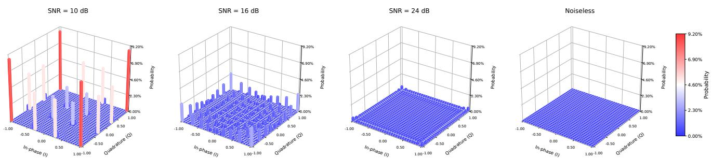  
Figure 5. Numerically optimized 1024-QAM symbol usage under the same average-power SNR normalization used by SemQAM. For each candidate distribution, the noise power is determined by its average transmitted symbol power, so concentrating probability on higher energy symbols does not increase the operating SNR. Lower SNR produces stronger concentration on corner and boundary regions, while symbol usage becomes progressively broader as SNR increases.

## B.1. Model Architecture

SemQAM builds on EF-LIC [10], retaining its image transforms, hyperprior, four-group quadtree context model, and projected RVQ. The architecture is shown in Fig. 6. The main latent and hyperlatent contain 256 and 128 channels, respectively, while the transform and context modules use a hidden width of 384. Each main-latent RVQ contains 1024 codewords in a 16-dimensional search space, and each hyperlatent RVQ contains 1024 codewords in an 8- dimensional search space.

Following the latent scaling strategy of DCVC-RT [29], we use a multiplicative normalization field $q$ to adjust the latent representation. The hyper synthesis transform produces both q and the context features, with q constrained to be positive and clamped below at 0.5. The transmitter obtains q˜ from its locally reconstructed hyperlatent z˜, while the receiver obtains qˆ from zˆ.

For group $i ,$ let $m _ { i }$ and $s _ { i }$ denote the context mean and scale in the normalized latent domain. The transmitter quantizes

$$
\frac { y _ { i } \oslash \tilde { q } _ { i } - \tilde { m } _ { i } } { \tilde { s } _ { i } } = \frac { y _ { i } - \tilde { \mu } _ { i } } { \tilde { \sigma } _ { i } } ,
$$

where the effective context parameters used in the main text are

$$
\begin{array} { r c l } { { } } & { { } } & { { \tilde { \mu } _ { i } = \tilde { q } _ { i } \odot \tilde { m } _ { i } , } } \\ { { } } & { { } } & { { } } \\ { { } } & { { } } & { { \tilde { \sigma } _ { i } = \tilde { q } _ { i } \odot \tilde { s } _ { i } . } } \end{array}
$$

The receiver uses the corresponding locally available quantities,

$$
\begin{array} { r c l } { { } } & { { } } & { { \hat { \mu } _ { i } = \hat { q } _ { i } \odot \hat { m } _ { i } , } } \\ { { } } & { { } } & { { } } \\ { { } } & { { } } & { { \hat { \sigma } _ { i } = \hat { q } _ { i } \odot \hat { s } _ { i } , } } \end{array}
$$

and reconstructs the group as

$$
\hat { y } _ { i } = \hat { \sigma } _ { i } \odot \sum _ { l } c _ { \hat { J } _ { l } } + \hat { \mu } _ { i } .
$$

Thus, the normalization field $q$ is absorbed into the effective mean and scale in the compact formulation of Sec. 3.1, while the transmitter and receiver compute these parameters from their locally reconstructed hyperlatents.

Each quadtree branch combines the hyperprior support with previously reconstructed groups to predict the mean and scale of the current group. The four branches map their context features to a 384-channel hidden representation, and the shared predictor outputs a 256-channel mean and a 256- channel scale.

Role of the hyperprior and autoregressive context. The hyperprior and quadtree autoregressive context are core components of the efficient image codec considered here rather than auxiliary modules introduced for SemQAM. The hyperlatent is transmitted first and determines the normalization and context used for main-latent quantization, while each quadtree group uses previously reconstructed groups to predict the next group. These dependencies reduce coding redundancy, but they also allow an earlier detection error to change subsequent quantization.

Removing only the quadtree autoregressive context does not remove this dependency because errors in the hyperlatent can still change the quantization of the main latent. Only when both the hyperprior and quadtree autoregressive context are removed is this cross-group error propagation eliminated. In this simplified setting, the receiver-side codebook update has the same transition-weighted expectation as CAVQ [36]. Removing these components therefore simplifies away the error propagation that SemQAM is designed to handle rather than providing a matched evaluation of the full image codec. For brevity, when discussing error propagation in the main text, we use autoregressive coding as shorthand for this context-dependent coding process involving both the hyperprior and quadtree autoregressive context.

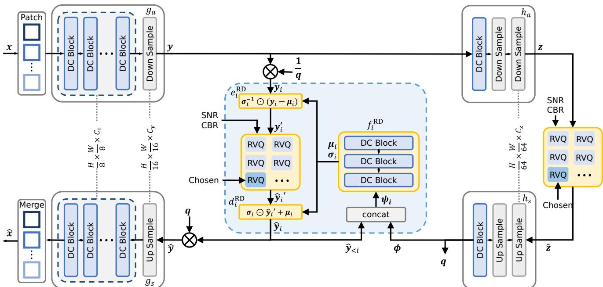  
Figure 6. Framework of SemQAM. The indices produced by RVQ are mapped to standard QAM constellation points and transmitted over the wireless channel.

For efficient deployment, projected RVQ is implemented using an algebraically equivalent accelerated form that reorganizes its computation without changing the selected indices or reconstructed representations.

## B.2. Equivalent Form of the Receiver-Side Codebook Update Loss

For one quantization position, the receiver-side codebook update loss in Sec. 3.2 is

$$
\mathcal { L } _ { \mathrm { c b } } = \left. \mathrm { s g } ( \hat { u } ) - c _ { \hat { J } } \right. ^ { 2 } ,
$$

where uˆ denotes the current receiver-side codebook target and $\hat { J }$ is the detected index.

For a fixed channel condition, the transition probability from transmitted index $j$ to detected index k is

$$
W _ { k j } = \operatorname* { P r } ( { \hat { J } } = k \mid J = j ) .
$$

Conditioned on the current target and transmitted index $J =$ j, taking the expectation over the channel decision gives

$$
\begin{array} { l } { \mathbb { E } \left[ \mathcal { L } _ { \mathrm { c b } } \mid \hat { u } , J = j \right] } \\ { \quad = \displaystyle \sum _ { k } \operatorname* { P r } ( \hat { J } = k \mid J = j ) \left\| \mathrm { s g } ( \hat { u } ) - c _ { k } \right\| ^ { 2 } } \\ { \quad = \displaystyle \sum _ { k } W _ { k j } \left\| \mathrm { s g } ( \hat { u } ) - c _ { k } \right\| ^ { 2 } . } \end{array}\tag{12}
$$

Averaging further over the training samples gives

$$
\mathbb { E } \left[ \mathcal { L } _ { \mathrm { c b } } \right] = \mathbb { E } _ { \hat { u } , J } \left[ \sum _ { k } W _ { k J } \left. \mathrm { s g } ( \hat { u } ) - c _ { k } \right. ^ { 2 } \right] .\tag{13}
$$

Therefore, sampling the actual receiver decision and updating the corresponding codeword provides a Monte Carlo realization of the transition-weighted codebook objective in Eq. (13). Under the simplified architecture described in Sec. B.1, this objective is equivalent in expectation to CAVQ [36].

Receiver-side centroid interpretation. The same objective also explains how receiver decisions shape the learned codebook. Grouping the expected loss according to the detected index gives

$$
\mathbb { E } [ \mathcal { L } _ { \mathrm { c b } } ] = \sum _ { k } \operatorname* { P r } ( \hat { J } = k ) \mathbb { E } \left[ \left\| \mathrm { s g } ( \hat { u } ) - c _ { k } \right\| ^ { 2 } | \hat { J } = k \right] .\tag{14}
$$

For fixed assignments and detached receiver-side targets, each term in Eq. (14) is a standard squared-error centroid objective. Therefore, for any detected index k with $\mathrm { P r } ( \hat { J } =$ $k ) > 0 ,$ , the minimizing codeword is

$$
c _ { k } ^ { * } = \mathbb { E } \left[ \hat { u } \mid \hat { J } = k \right] .\tag{15}
$$

Expanding this conditional mean over the transmitted index gives

$$
c _ { k } ^ { * } = \frac { \displaystyle \sum _ { j } \operatorname* { P r } ( J = j ) W _ { k j } \mathbb { E } \left[ \hat { u } \mid J = j , \hat { J } = k \right] } { \operatorname* { P r } ( \hat { J } = k ) } ,\tag{16}
$$

where

$$
\operatorname* { P r } ( \hat { J } = k ) = \sum _ { j } \operatorname* { P r } ( J = j ) W _ { k j } .
$$

Thus, the receiver codeword $c _ { k }$ is driven by all receiverside targets that can be detected as index k, weighted by both their transmitted-index frequency and the corresponding channel transition probability. Transmitted symbols that frequently transition to the same detected symbol therefore jointly influence the same receiver codeword, encouraging frequently confused QAM symbols to represent compatible source content.

In the noiseless limit, W becomes the identity matrix and the transmitter and receiver reconstructions coincide, so Eq. (15) reduces to the standard VQ centroid. The centroid result is a conditional property of the codebook update for fixed assignments and detached targets. During end-toend training, both the assignments and receiver-side targets evolve together with the model parameters.

## B.3. Transmitter State Estimation

The receiver-side codebook loss uses the actual detected indices, which can also change the residuals and context used for subsequent quantization. During transmission, however, the transmitter knows the sent indices but cannot observe the detected indices without feedback. Expected received codewords therefore approximate the receiver reconstructions needed to continue RVQ and context-based encoding at the transmitter.

Optimality of the expected received codeword. For a transmitted index $J = j$ , the expected received codeword defined in Sec. 3.3 is

$$
{ \bar { c } } _ { j } = \mathbb { E } [ c _ { \hat { J } } \mid J = j ] = \sum _ { k } W _ { k j } c _ { k } .
$$

For any deterministic prediction a based on the transmitted index, its conditional squared prediction error can be expanded around $\bar { c } _ { J }$ as

$$
{  { \mathbb E } } \left[ \left\| c _ { \hat { J } } - a \right\| ^ { 2 } | J \right] = {  { \mathbb E } } \left[ \left\| c _ { \hat { J } } - \bar { c } _ { J } \right\| ^ { 2 } | J \right] + \left\| a - \bar { c } _ { J } \right\| ^ { 2 } .\tag{17}
$$

The cross term vanishes because

$$
{ \mathbb E } \left[ c _ { \hat { J } } - { \bar { c } } _ { J } \mid J \right] = 0 .
$$

Therefore, $\bar { c } _ { J }$ minimizes the conditional mean squared prediction error among deterministic estimates based on the transmitted index.

Transmitter and receiver reconstruction. The transmitter and receiver maintain separate reconstructions during quantization. For main latent group i, the initial residuals are

$$
\begin{array} { r l } & { { u } ^ { ( 1 ) } = ( y _ { i } - \tilde { \mu } _ { i } ) \oslash \tilde { \sigma } _ { i } , } \\ & { } \\ & { \hat { u } ^ { ( 1 ) } = ( y _ { i } - \hat { \mu } _ { i } ) \oslash \hat { \sigma } _ { i } . } \end{array}
$$

At RVQ stage l, the transmitter selects the index $J _ { l }$ by nearest-neighbor search and updates its residual using the expected received codeword,

$$
u ^ { ( l + 1 ) } = u ^ { ( l ) } - \bar { c } _ { J _ { l } } .\tag{18}
$$

The receiver instead updates its residual using the actually detected codeword,

$$
\hat { u } ^ { ( l + 1 ) } = \hat { u } ^ { ( l ) } - c _ { \hat { J } _ { l } } .\tag{19}
$$

The same transmitter and receiver recursion is applied to the hyperlatent, whose local reconstruction determines the hyperprior features at each endpoint. For the main latent, the transmitter uses its predicted earlier groups $\widetilde { y } _ { < i }$ , while the receiver uses its actual reconstructions $\hat { y } _ { < i }$ . Expected received codewords therefore provide the transmitter-side quantities required by both dependencies without receiver feedback.

The commitment loss in Eq. (5) follows the same transmitter-side prediction. Its stop gradient keeps the expected codeword fixed under this term, while codeword learning is driven by the receiver-side codebook update loss.

## C. Training and Evaluation Protocol

This section specifies the training and evaluation protocols used throughout the experiments. It covers multi-operatingpoint optimization, dataset preprocessing, baseline inference settings, separated transmission, metric computation, channel-noise stability, and the matched protocol used for the ablation study.

## C.1. Training Protocol

Multi-operating-point training. SemQAM supports four CBR settings for each of 10 dB, 16 dB, 24 dB, and noiseless transmission. Each SNR–CBR pair defines one operating point with its own VQ codebooks, while the image transforms, hyperprior, and context networks are shared across all sixteen operating points. To stably optimize these operating points, we adopt a three-stage training strategy on ImageNet using one NVIDIA RTX 4090. First, the shared model is trained for 0.3M iterations at a learning rate of $1 0 ^ { - 4 }$ , randomly selecting one of the four 10 dB operating points for each batch. Second, the shared backbone is frozen and each of the remaining twelve operating points is trained for 0.06M iterations at $1 0 ^ { - 4 }$

Finally, the complete model is jointly fine-tuned for 1M iterations at $1 0 ^ { - 5 }$ , randomly selecting one of all sixteen operating points for each batch. This staged schedule provides stable optimization across multiple operating points and is not required by the model architecture. The reported models use a random seed of 1926.

Initialization stability. We further train SemQAM using five random seeds that independently initialize both the network parameters and VQ codebooks. The resulting models converge to similar QAM shaping patterns and final performance. This behavior is consistent with the permutation symmetry of VQ, where the initial codeword indices are arbitrary labels. Receiver-side codebook learning subsequently organizes these labels according to the channel transition structure, making the converged shaping behavior insensitive to the initial codeword ordering.

## C.2. Datasets and Preprocessing

We evaluate SemQAM on Kodak, Tecnick, DIV2K validation, and CLIC 2020 Professional. Kodak contains 24 images at 512 × 768 or 768 × 512, and Tecnick contains 100 images at 1200 × 1200. We use all 100 DIV2K validation images and 250 CLIC 2020 Professional images at their original resolutions. Images are processed as RGB without resizing. When padding is required for inference, the transmitted representation includes the padded positions, while the reconstruction is cropped to the original image size before quality evaluation. The original image dimensions are used in the CBR denominator.

## C.3. Baseline Inference Protocol

Learned JSCC methods. For NTSCC, NTSCC+, and MDJCM-A, we use the official publicly released implementations and checkpoints provided by the original authors. Quad-JSCC does not publicly release the corresponding perceptual-quality model, so we directly contacted the authors and corresponding author and obtained the LPIPSoptimized weights used in our evaluation. Each method is evaluated through its original transmission interface, with all required transmitted side information included in CBR.

NTSCC uses four officially released distortionoptimized operating points, while NTSCC+ uses five released operating points with fixed model weights and no online model optimization. The MDJCM authors publicly release only MDJCM-A. This analog variant serves as the upper-performance reference of the MDJCM family, so using MDJCM-A provides a strong comparison rather than a favorable setting for SemQAM. Quad-JSCC is evaluated using the perceptual-quality model obtained from its authors.

For rate accounting, NTSCC includes the transmitted main symbols and the prescribed rate-index side cost.

NTSCC+ additionally transmits its side representation through the official PNG coding interface with rate-2/3 LDPC and 16-QAM protection. For Quad-JSCC, active real-valued main features are paired into complex channel symbols, while its encoded side information uses the selected 10 dB MCS. MDJCM-A is evaluated through its official analog transmission interface.

Separated generative codecs. The separated sourcecodec baselines include MS-ILLM, OSCAR, OneDC, DiT-IC, EF-LIC, and CoD-Lite. For all methods, we use the officially released implementations and pretrained checkpoints and follow their provided coding and inference procedures. Their measured source rates, including the required source side information, are converted to channel uses using the common separated-transmission protocol in Sec. C.4. The noiseless SemQAM source codec is evaluated through the same conversion to provide a matched separated reference.

For runtime evaluation, each baseline retains the numerical precision, inference backend, and acceleration strategy provided by its official implementation. For example, OneDC follows its official path with BF16 autocast for the feedforward and codec networks while retaining the large VAE in FP32, and CoD-Lite follows its official BF16 inference path. Other methods likewise use their released implementation settings rather than being rewritten under a common backend. This protocol evaluates the realized performance of each available codec implementation while preserving its intended execution path.

For CoD-Lite, we use the official 0.0312 bpp checkpoint and configuration. We observe that measurements from the released implementation differ from the latency values reported in its paper. At the 1024 × 1920 reference resolution used by CoD-Lite, the official checkpoint takes 39.52 ms for encoding and 56.86 ms for decoding on our NVIDIA A100 evaluation, compared with the reported 16 ms and 24 ms. We therefore use measurements from the released code under our common hardware and timing protocol rather than mixing them with separately reported values. Under the unified 1080 × 1920 evaluation used in our high-resolution comparison, CoD-Lite takes 42.37 ms for encoding and 60.47 ms for decoding, whereas SemQAM takes 15.49 ms and 22.71 ms, corresponding to 2.74× and 2.66× speedups, respectively.

SemQAM is evaluated with its optimized CUDA implementation under the same principle. Its CUDA acceleration is part of the proposed codec implementation, while competing methods retain the optimization paths supplied by their official releases. We report parameter count and FLOPs separately as architecture-level costs, and measured latency as complete implementation-level performance.

## C.4. Separated Transmission Protocol

LDPC protection and CBR conversion. The separated systems use the modulation and coding entries in 3GPP TS 38.214, version 16.2.0, Table 5.1.3.1-1 [1]. Each operating point specifies a modulation order M and nominal channelcode rate R. For a source rate of b bits per pixel, the corresponding channel bandwidth ratio is

$$
\mathrm { C B R } = { \frac { b } { 3 R \log _ { 2 } M } } .
$$

The source payload and all source-side information required for reconstruction are included in b.

MCS selection. The 10 dB evaluation uses MCS 16. For 16 and 24 dB, we use the available 5G-LENA reference BLER curves [11] and select the highest nominal spectral efficiency whose BLER does not exceed 0.01 at the evaluated SNR. The requested code block size is 4096 bits. At 16 dB, MCS 21 uses the 4096-bit reference curve and has a tabulated BLER of 0.0002. At 24 dB, MCS 28 uses the available 928-bit curve under the reference lookup rule and has a tabulated BLER of 0.002. These settings are selected directly from the reference curves without SNR interpolation.

The separated evaluation uses the reconstruction obtained after successful protected-bitstream decoding. The selected LDPC rate therefore determines the required channel resources, while image quality is evaluated from the recovered source representation.

## C.5. Evaluation Protocol and Metric Computation

Choice of the 10 dB operating point. We use 10 dB as the primary channel condition for comparison with learned JSCC methods. A fixed SNR of 10 dB has been widely used for rate–quality evaluation in representative image JSCC systems, including DeepJSCC-f, DeepJSCC Q, NTSCC, NTSCC+, SwinJSCC, MDJCM, and Quad DeepSC [13, 26, 34, 45, 47, 51, 53]. In particular, these works commonly evaluate reconstruction quality across different bandwidth or CBR settings under this channel condition. All learned JSCC baselines included in our main comparison also provide an available official checkpoint or author-provided model at 10 dB, whereas model availability at other SNRs is incomplete across the compared methods. We therefore use 10 dB for the main comparison to maximize baseline coverage while remaining aligned with established JSCC evaluation settings. SemQAM additionally supports 16 dB and 24 dB, for which we report separate results to evaluate its performance under other channel conditions.

Objective perceptual evaluation. We use standardized objective perceptual metrics as the primary quantitative evaluation. Although subjective user studies can provide complementary perceptual evidence, their results depend on the participant population, viewing conditions, presentation protocol, and selected test cases, and naturally exhibit inter-observer variability. Moreover, repeated evaluations may produce different scores even with the same participants and experimental conditions, making subjective results difficult to reproduce exactly. These factors make subjective scores less suitable for reproducible and fine-grained comparisons across many methods, datasets, and operating points. In contrast, standardized objective metrics provide repeatable measurements under a fixed evaluation protocol. This practice is also widely adopted in generative image compression: representative published methods including MS-ILLM, GLC, Control-GIC, DLF, OneDC, OSCAR, and RDVQ primarily evaluate perceptual reconstruction using objective metrics such as LPIPS, DISTS, and FID without reporting a subjective user study [23, 28, 31, 35, 38, 49, 50]. We therefore follow this established evaluation practice and use LPIPS and DISTS to measure reference-based perceptual fidelity and FID to measure distribution-level realism, together with qualitative reconstructions for visual inspection.

Perceptual metrics. We evaluate perceptual reconstruction using LPIPS with the VGG feature network [43, 54] and DISTS [15]. Both metrics are computed for each reconstructed image and then averaged over the complete dataset.

Perceptual versus distortion-oriented evaluation. SemQAM targets generative perceptual reconstruction rather than distortion-optimal reconstruction. The established perception–distortion tradeoff shows that improving perceptual quality can require increased pixel-level distortion, and its rate-constrained extension further establishes a rate–distortion–perception tradeoff for lossy compression [6, 7]. PSNR therefore measures a different optimization objective and is not used as the primary criterion for the perceptually optimized setting considered here.

This distinction is particularly relevant to the learned JSCC baselines. Representative methods such as NTSCC and NTSCC+ are primarily optimized and reported under distortion-oriented objectives and PSNR-based evaluation [13, 47]. A PSNR comparison with these models would therefore mainly reflect different operating points on the perception–distortion tradeoff rather than provide a matched evaluation of generative perceptual reconstruction. To retain a direct comparison within the JSCC family under a perceptual objective, we additionally evaluate Quad-JSCC using the LPIPS-optimized model provided by its authors [26]. Together with the generative image compression baselines, this provides comparisons with methods optimized toward the same perceptual objective as SemQAM.

Table 3. Modulation and coding settings used for the separated systems. The 16 and 24 dB settings satisfy a 1% BLER threshold in the reference curves.
<table><tr><td>SNR</td><td>MCS index</td><td>QAM order</td><td>Code rate</td><td>CBR from bpp b</td></tr><tr><td>10 dB</td><td>16</td><td>16</td><td>658/1024</td><td> $b / 7 . 7 1 0 9 3 7 5$ </td></tr><tr><td>16 dB</td><td>21</td><td>64</td><td>616/1024</td><td> $b / 1 0 . 8 2 8 1 2 5$ </td></tr><tr><td>24 dB</td><td>28</td><td>64</td><td>948/1024</td><td> $b / 1 6 . 6 6 4 0 6 2 5$ </td></tr></table>

FID. Following the patch-based FID evaluation protocol of GLC [28], we compute FID over local image patches rather than directly over the full images. We use a patch size of 64 × 64 for Kodak and 256 × 256 for the higherresolution Tecnick, DIV2K, and CLIC 2020 datasets. For each dataset and operating point, patches from all reference images and their reconstructions are accumulated to estimate the corresponding feature distributions, from which FID is computed using Inception features. This patch-based protocol increases the number of feature samples and provides a more stable distribution-level evaluation on small image test sets. The figures use a base-two logarithmic vertical axis for visualization, while all numerical comparisons and BD-rate calculations use the original FID values.

BD-rate. We use BD-rate [5] to summarize the average difference in channel uses between two rate–quality curves at matched reconstruction quality. For each comparison, one method is selected as the anchor and is therefore assigned a BD-rate of 0.00%. We interpolate $\log _ { 1 0 } ( \mathrm { C B R } )$ as a function of the original quality metric using piecewise cubic Hermite interpolation (PCHIP) over the common quality interval. Let $a ( q )$ and $b ( q )$ denote the interpolated log-CBR curves of the anchor and comparison method over $[ q _ { 0 } , q _ { 1 } ]$ The reported BD-rate is

$$
\mathrm { B D - r a t e } = 1 0 0 \left[ 1 0 ^ { \frac { 1 } { q _ { 1 } - q _ { 0 } } \int _ { q _ { 0 } } ^ { q _ { 1 } } \left( b ( q ) - a ( q ) \right) d q } - 1 \right] .
$$

A negative BD-rate means that the comparison method requires fewer channel uses than the anchor to achieve the same quality on average, while a positive value means that it requires more. For example, a BD-rate of −20% indicates approximately 20% fewer channel uses at matched quality. The main comparisons use SemQAM-C with LDPC and QAM as the anchor. Only measured points within a valid common quality interval are used for interpolation, and comparisons without a valid interval are reported as unavailable.

## C.6. Evaluation Stability

We evaluate the sensitivity of the final model to AWGN realizations by fixing the model weights, inputs, operating points, and transmission protocol and varying only the channel noise. The experiment covers all 24 Kodak images, all sixteen operating points, and ten AWGN seeds, giving 3840 reconstructions. For each operating point and seed, we first average the metric over the 24 images and then compute the sample standard deviation across the ten datasetlevel means. At 10 dB and CBR 0.005534, the standard deviations are 0.0219 dB for PSNR and 0.000463 for LPIPS. At CBR 0.020752, the corresponding values are 0.0087 dB and 0.000165. These small variations show that the reported dataset-average performance is stable across the evaluated channel realizations. The noiseless operating points have zero variation.

## C.7. Ablation Protocol

Configurations. The ablation configurations follow Tab. 2 in the main paper. $\mathrm { { M } _ { 0 } }$ removes both the hyperprior and quadtree autoregression. $\mathrm { M } _ { 1 }$ uses the same configuration with a deeper backbone, while $\mathrm { M } _ { 2 }$ restores the hyperprior without quadtree autoregression. Because removing the hyperprior changes the transmitted index count, $\mathrm { M } _ { 0 }$ and $\mathrm { M } _ { 1 }$ use their own measured CBR values.

The complete configuration $\mathrm { M } _ { 5 }$ uses receiver-side codebook learning and Expected-RX. Relative to ${ \mathrm { M } } _ { 5 } .$ , M3 replaces the expected received codewords used by the transmitter with the transmitted codewords, while $\mathrm { M } _ { 4 }$ replaces the receiver-side codebook loss with the transmitter-side codebook loss.

Training protocol. All ablation configurations are trained only on the four 10 dB operating points. Each configuration is trained for 1M iterations using the same dataset and optimization protocol. The four CBR points used for each ablation curve are obtained from one trained checkpoint.

## D. Additional Experimental Results

This section extends the main experiments along two dimensions. We first examine whether the transmission gains generalize across datasets and channel conditions, and then evaluate whether the low computational cost of SemQAM is retained at higher image resolutions.

Table 4. 10 dB BD-rate (%) relative to SemQAM-C. Lower is better. Bold and underline mark the two best results. A dash denotes an unavailable comparison.
<table><tr><td>Metric</td><td>Family</td><td>Method</td><td>Kodak</td><td>Tecnick</td><td>DIV2K</td><td>CLIC</td></tr><tr><td rowspan="10">LPIPS</td><td rowspan="4">JSCC</td><td>NTSCC</td><td>473.89</td><td>484.29</td><td>453.53</td><td></td></tr><tr><td>NTSCC+</td><td>438.79</td><td>472.61</td><td>413.23</td><td>914.55</td></tr><tr><td>MDJCM-A</td><td>443.14</td><td>446.27</td><td>396.04</td><td>845.35</td></tr><tr><td>Quad-JSCC</td><td>67.60</td><td>35.57</td><td>45.29</td><td>53.43</td></tr><tr><td rowspan="4">GIC</td><td>MS-ILLM</td><td>252.63</td><td>143.97</td><td>195.83</td><td>227.06</td></tr><tr><td>OneDC</td><td>20.96</td><td>-1.14</td><td>15.00</td><td>15.99</td></tr><tr><td>DiT-IC</td><td>18.39</td><td>20.53</td><td>27.30</td><td>32.08</td></tr><tr><td>EF-LIC</td><td>12.38</td><td>8.93</td><td>14.02</td><td>35.45</td></tr><tr><td rowspan="2">SemQAM</td><td>CoD-Lite</td><td>78.39</td><td>71.48</td><td>79.93</td><td>126.14</td></tr><tr><td>SemQAM-C</td><td>0.00</td><td>0.00</td><td>0.00</td><td>0.00</td></tr><tr><td rowspan="9">DISTS</td><td rowspan="4">JSCC</td><td>SemQAM (10dB)</td><td>-18.57</td><td>-20.09</td><td>-18.95</td><td>-19.59</td></tr><tr><td>NTSCC</td><td>791.14</td><td>823.65</td><td>934.29</td><td></td></tr><tr><td>NTSCC+</td><td>678.05</td><td>763.39</td><td>774.63</td><td></td></tr><tr><td>MDJCM-A Quad-JSCC</td><td>716.75</td><td>769.40</td><td>801.58</td><td></td></tr><tr><td rowspan="5">GIC</td><td></td><td>109.17</td><td>83.54</td><td>94.88</td><td>86.96</td></tr><tr><td>MS-ILLM</td><td>286.55</td><td>132.83</td><td>238.20</td><td>158.01</td></tr><tr><td>OneDC</td><td>17.01</td><td>1.16</td><td>32.53</td><td>6.70</td></tr><tr><td>DiT-IC</td><td>-11.98</td><td>-13.28</td><td>-6.42</td><td>-21.97</td></tr><tr><td>EF-LIC</td><td>14.06</td><td>31.98</td><td>35.28</td><td>55.13</td></tr><tr><td rowspan="2">SemQAM</td><td>CoD-Lite</td><td>108.03</td><td>111.37</td><td>120.56</td><td>164.10</td></tr><tr><td>SemQAM-C</td><td>0.00</td><td>0.00</td><td>0.00</td><td>0.00</td></tr><tr><td rowspan="9">FID</td><td rowspan="3">JSCC</td><td>SemQAM (10dB)</td><td>-16.91</td><td>-18.50</td><td>-18.38</td><td>-18.32</td></tr><tr><td>NTSCC</td><td>548.62</td><td></td><td></td><td></td></tr><tr><td>NTSCC+</td><td>507.44</td><td>950.43</td><td>1085.64</td><td></td></tr><tr><td rowspan="3"></td><td>MDJCM-A</td><td>501.08</td><td>892.16</td><td>990.67</td><td></td></tr><tr><td>Quad-JSCC</td><td>109.56</td><td>172.71</td><td>211.53</td><td>249.27</td></tr><tr><td>MS-ILLM</td><td>198.99</td><td>110.86</td><td>182.12</td><td>115.63</td></tr><tr><td rowspan="5">GIC</td><td>OneDC</td><td>-12.00</td><td>21.60</td><td>58.11</td><td>27.83</td></tr><tr><td>DiT-IC</td><td>-18.28</td><td>-5.85</td><td>8.31</td><td>10.14</td></tr><tr><td>EF-LIC</td><td>16.51</td><td>81.07</td><td>111.60</td><td>161.32</td></tr><tr><td>CoD-Lite</td><td>47.56</td><td>93.28</td><td>90.15</td><td>86.47</td></tr><tr><td>SemQAM-C</td><td>0.00</td><td>0.00</td><td>0.00</td><td>0.00</td></tr><tr><td rowspan="2">SemQAM</td><td>SemQAM (10dB)</td><td></td><td></td><td></td><td></td></tr><tr><td></td><td>-15.37</td><td>-20.47</td><td>-20.97</td><td>-23.97</td></tr></table>

## D.1. Additional Datasets and Channel Conditions

Tab. 4 reports 10 dB BD-rates for representative JSCC and GIC methods across all four datasets. Relative to the matched SemQAM-C baseline, SemQAM achieves negative BD-rates in LPIPS, DISTS, and FID on every dataset. The gains are particularly consistent in LPIPS, remaining close to 19% across Kodak, Tecnick, DIV2K, and CLIC 2020. This consistency shows that the benefit of native joint training is not specific to the Kodak test set, but generalizes across image datasets with different resolutions and content.

Missing entries indicate comparisons without a valid common quality interval for interpolation.

Figs. 7 and 8 further extend the comparison to 16 and 24 dB using the MCS settings in Tab. 3. Across these additional channel conditions, SemQAM continues to provide competitive perceptual reconstruction through the same standard QAM interface. More importantly, the native SemQAM curves remain consistently improved over the matched SemQAM-C baseline, showing that adapting the source representation to the channel remains beneficial beyond the 10 dB operating point. Together, these results indicate that the gains from joint coding are stable across both image datasets and channel conditions.

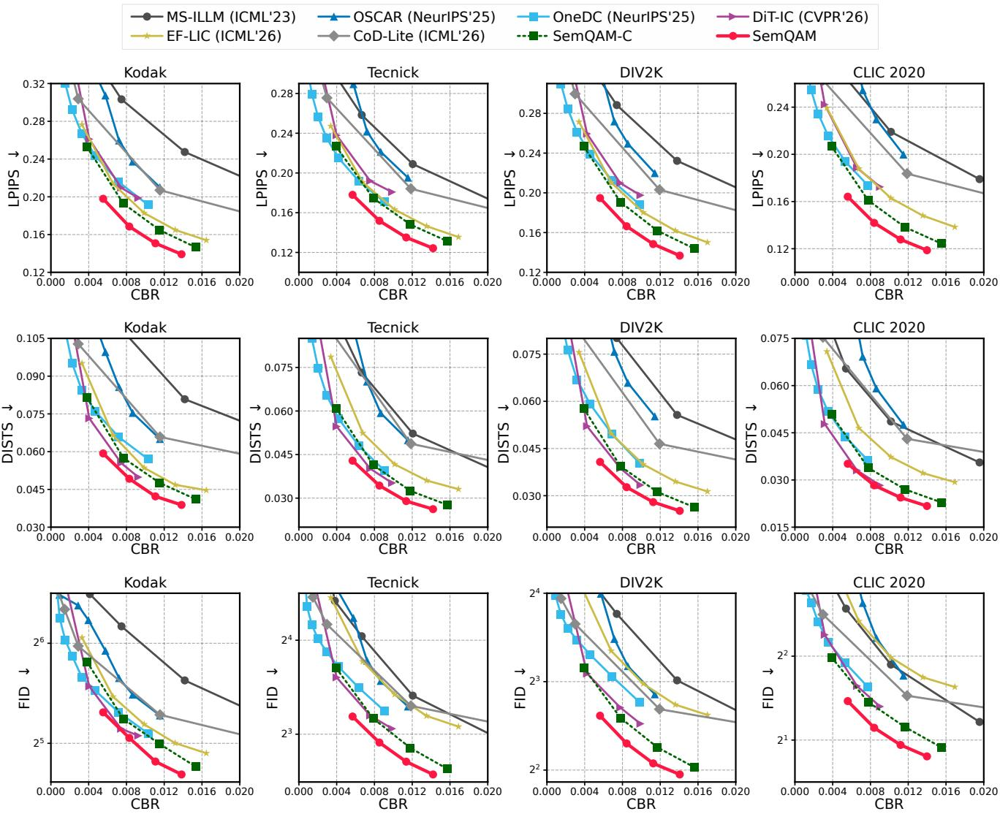  
Figure 7. Additional comparison at 16 dB. Rows are LPIPS, DISTS, and FID, and columns are Kodak, Tecnick, DIV2K, and CLIC 2020 Professional. Separated codecs use MCS 21 and ideal successful decoding. FID is displayed on a base-2 logarithmic axis.

## D.2. Higher Resolution Execution

We further evaluate codec latency and memory at 1080p, 1440 × 2560, and 4K resolutions in Tab. 5. The SemQAM entries average all sixteen operating points at each resolution, and all methods use batch size one on A100 with their respective inference implementations.

SemQAM maintains the lowest encoding and decoding latency among the compared methods at every evaluated resolution. This advantage is preserved as the image size increases rather than being limited to the relatively small benchmark images used in the main experiments. At 4K, SemQAM requires 55.86 ms for encoding and 87.18 ms for decoding, while its peak GPU memory remains below 1 GiB. The modest increase in memory together with the sustained latency advantage shows that the lightweight design scales efficiently to high-resolution image transmission.

## E. Visual Comparison

Figs. 9 and 10 provide additional visual comparisons with previous methods. In all selected examples, SemQAM achieves both lower CBR and lower LPIPS than the compared methods while preserving more recognizable local structures.

In Fig. 9, the enlarged regions show differences in thin lines and regular structures. For the butterfly image, SemQAM preserves the thin vein inside the wing with a continuous shape, while some compared methods blur or simplify this structure. For the road image, the faint yellow center line remains visible in the SemQAM reconstruction, whereas it becomes weaker or disappears in several compared results. For the building image, SemQAM retains the horizontal lines of the window blinds, while these lines are less distinguishable in the other reconstructions. A similar difference can be observed in the castle image, where the divisions inside the window remain clearer with SemQAM.

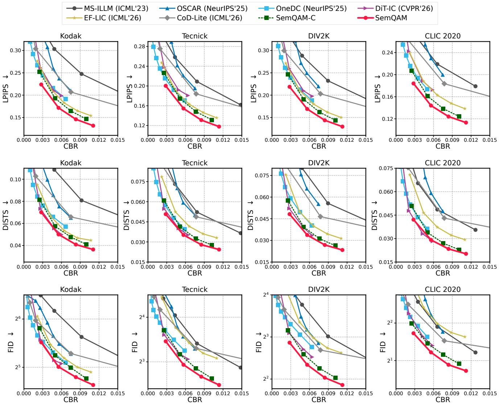  
Figure 8. Additional comparison at 24 dB with the same metric and dataset arrangement as Fig. 7. Separated codecs use MCS 28 and idea successful decoding. SemQAM uses the codebooks for the corresponding 24 dB operating points.

Fig. 10 further compares SemQAM with recent generative image codecs. For the glasses, the nose pad reconstructed by SemQAM remains close to the elliptical shape and internal structure in the original image, while OneDC reconstructs it as a simpler open ring. For the railing, SemQAM preserves the repeated X patterns and their connections, whereas CoD-Lite and OSCAR show stronger distortion and merging between the bars. The enlarged sculpture region also shows that SemQAM retains the curved boundaries and separation between neighboring structures more clearly. These examples show that the lower LPIPS of SemQAM is accompanied by better preservation of object parts, thin structures, and regular geometric patterns while using fewer channel resources.

Table 5. Higher resolution latency and peak GPU memory on A100. Enc. and Dec. are in ms and peak memory is in GiB. SemQAM averages all sixteen CUDA operating points. OSCAR exceeds 80 GiB at 4K.
<table><tr><td></td><td colspan="3">1080×1920</td><td colspan="3">1440×2560</td><td colspan="3">2160×3840</td></tr><tr><td>Method</td><td>Enc.</td><td>Dec.</td><td>Mem.</td><td>Enc.</td><td>Dec.</td><td>Mem.</td><td>Enc.</td><td>Dec.</td><td>Mem.</td></tr><tr><td>NTSCC</td><td>130.97</td><td>138.18</td><td>7.24</td><td>245.81</td><td>371.34</td><td>12.95</td><td>1034.13</td><td>1368.10</td><td>28.55</td></tr><tr><td>NTSCC+</td><td>222.02</td><td>181.14</td><td>3.96</td><td>395.41</td><td>320.84</td><td>6.85</td><td>849.50</td><td>676.75</td><td>14.28</td></tr><tr><td>MDJCM-A</td><td>141.46</td><td>279.99</td><td>7.69</td><td>250.12</td><td>499.22</td><td>13.57</td><td>753.93</td><td>1103.39</td><td>28.69</td></tr><tr><td>Quad-JSCC</td><td>158.77</td><td>267.91</td><td>4.98</td><td>273.26</td><td>586.64</td><td>13.18</td><td>597.85</td><td>1076.13</td><td>13.58</td></tr><tr><td>MS-ILLM</td><td>350.85</td><td>379.01</td><td>2.99</td><td>516.47</td><td>601.18</td><td>4.87</td><td>1305.93</td><td>1613.82</td><td>9.94</td></tr><tr><td>OSCAR</td><td>513.20</td><td>1123.38</td><td>24.75</td><td>2382.55</td><td>2719.79</td><td>79.44</td><td></td><td></td><td>&gt; 80</td></tr><tr><td>OneDC</td><td>303.33</td><td>742.06</td><td>12.81</td><td>585.72</td><td>1554.82</td><td>18.86</td><td>1542.18</td><td>4846.63</td><td>35.38</td></tr><tr><td>DiT-IC</td><td>480.22</td><td>750.38</td><td>10.98</td><td>718.17</td><td>1111.59</td><td>14.47</td><td>1581.91</td><td>2448.49</td><td>25.41</td></tr><tr><td>EF-LIC</td><td>19.53</td><td>35.62</td><td>0.65</td><td>31.58</td><td>55.50</td><td>1.04</td><td>65.24</td><td>116.28</td><td>2.10</td></tr><tr><td>CoD-Lite</td><td>42.37</td><td>60.47</td><td>2.45</td><td>73.61</td><td>105.09</td><td>3.97</td><td>163.43</td><td>236.05</td><td>8.33</td></tr><tr><td>SemQAM</td><td>15.49</td><td>22.71</td><td>0.85</td><td>25.10</td><td>38.13</td><td>0.88</td><td>55.86</td><td>87.18</td><td>0.97</td></tr></table>

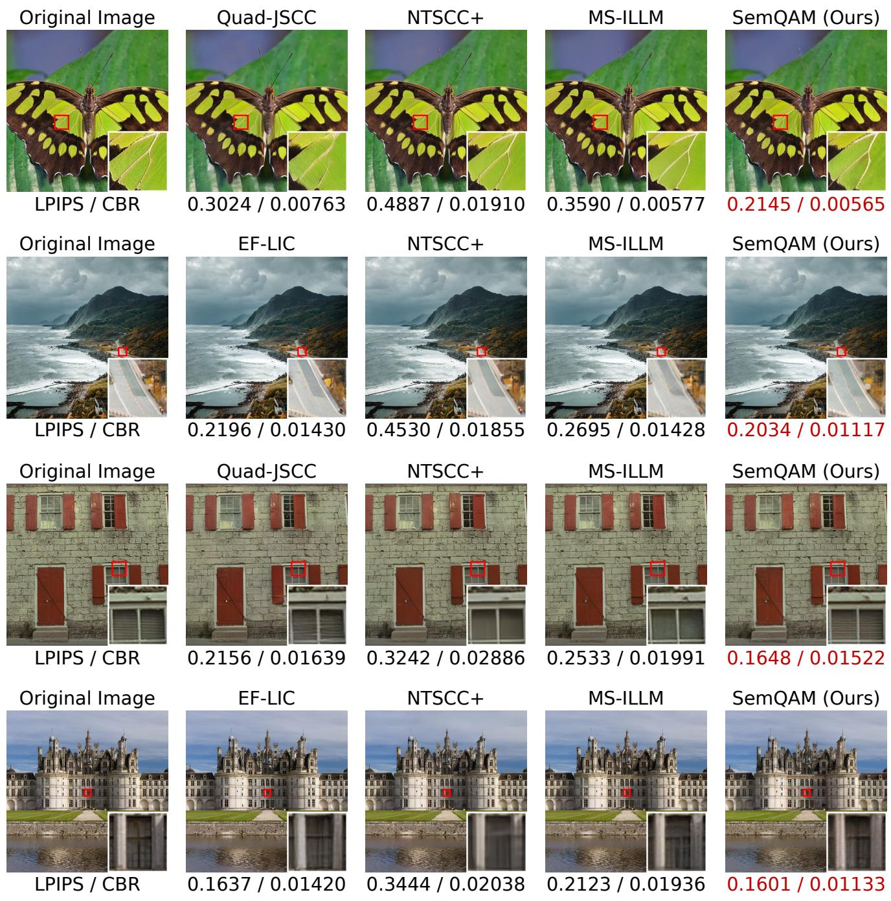  
Figure 9. Visual comparison with previous methods. LPIPS and CBR are reported for each reconstruction, and the marked regions are enlarged for comparison.

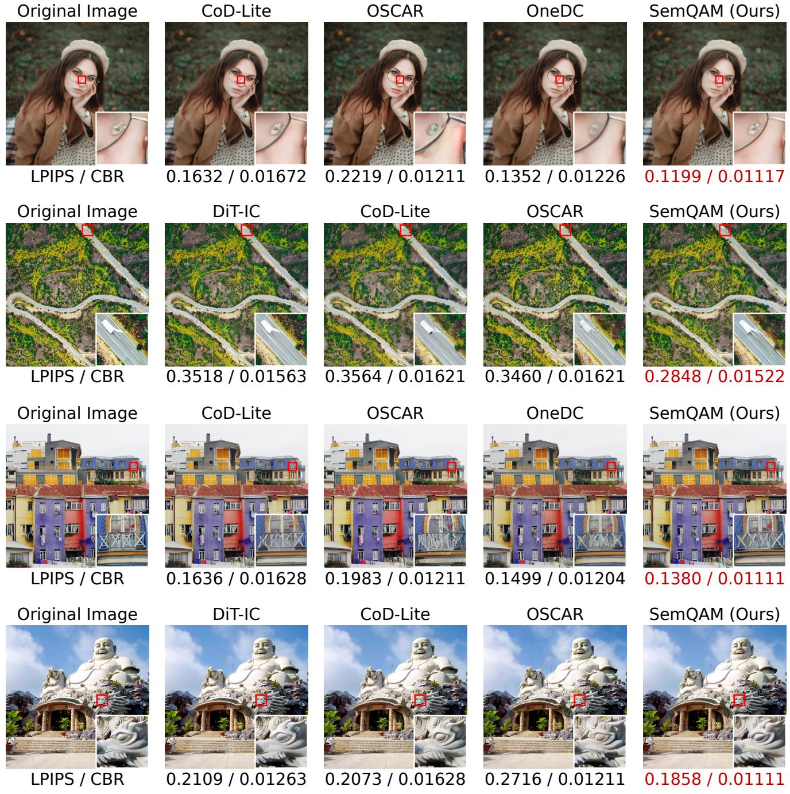  
Figure 10. Additional visual comparison with previous methods. LPIPS and CBR are reported for each reconstruction, and the marked regions are enlarged for comparison.