# JointLight: Human-Centric Video Relighting with Asynchronous RGB-Irradiance Joint Modeling

HENGLEI LV, Institute of Computing Technology, Chinese Academy of Sciences, China and University of Chinese Academy of Sciences, China, China

BAILIN DENG, Cardif University, United Kingdom

XIAOQIANG LIU, Kuaishou Technology, China

YICHEN WANG, Institute of Computing Technology, Chinese Academy of Sciences, China and University of Chinese Academy of Sciences, China, China

HAOXIAN ZHANG, Kuaishou Technology, China

PENGFEI WAN, Kuaishou Technology, China

LIN GAO∗, Institute of Computing Technology, Chinese Academy of Sciences, China and University of Chinese Academy of Sciences, China, China

Input  
Relit result 1  
Relit result 2  
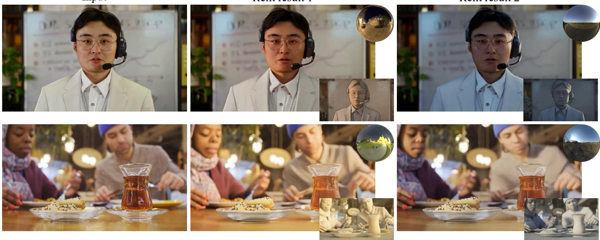  
Fig. 1. Our method jointly models RGB and irradiance map, enabling high-quality generation with physically accurate illumination control.

∗Corresponding author is Lin Gao (gaolin@ict.ac.cn)

Authors’ Contact Information: Henglei Lv, Institute of Computing Technology, Chinese Academy of Sciences, China and University of Chinese Academy of Sciences, China, Haidian Qu, Beijing, China, lvhenglei22s@ict.ac.cn; Bailin Deng, Cardif University, Cardif, United Kingdom, DengB3@cardif.ac.uk; Xiaoqiang Liu, Kuaishou Technology, Haidian Qu, Beijing, China, liuxiaoqiang@kuaishou.com; Yichen Wang, Institute of Computing Technology, Chinese Academy of Sciences, China and University of Chinese Academy of Sciences, China, Haidian Qu, Beijing, China, wangyichen191@ mails.ucas.ac.cn; Haoxian Zhang, Kuaishou Technology, Haidian Qu, Beijing, China, zhanghaoxian@kuaishou.com; Pengfei Wan, Kuaishou Technology, Haidian Qu, Beijing, China, wanpengfei@kuaishou.com; Lin Gao, Institute of Computing Technology, Chinese Academy of Sciences, China and University of Chinese Academy of Sciences, China, Haidian Qu, Beijing, China, gaolin@ict.ac.cn.

Understanding and modeling light transport in human-centric scenes is a longstanding challenge. While recent progress in difusion models has boosted research in relighting, precise illumination control still lags, primarily due to the scarcity of diverse, high-quality, precisely labeled video relighting datasets. Existing end-to-end relighting approaches model light transport implicitly through neural networks, which substantially compli cates controllability. In contrast, some works resort to path-traced irradiance cues as an explicit blueprint for light transport. However, such constructed irradiance cues are prone to artifacts and hinder generative quality when directly used as control signals. With the key observation that noise corrup tion removes high-frequency artifacts and preserves low-frequency light transport, we introduce an asynchronous joint-modeling paradigm that facil itates fine-grained illumination control. During two-stage training, we force the model to jointly denoise RGB and ground-truth irradiance frames with

separate timesteps scheduling. A domain matching strategy is applied to the second stage to bridge the domain gap between irradiance cues and ground truth irradiance maps. At inference time, we introduce an asynchronous hijacked generation pipeline that facilitates flexible illumination control. For training data, we develop a multi-illumination high-quality synthetic video dataset with paired irradiance maps using a powerful game engine. Trained exclusively on this dataset, our model exhibits robust generalization to realworld scenarios and outperforms prior approaches in both lighting fidelity and generative quality. The code and dataset will be publicly released.

CCS Concepts: • Computing methodologies → Image manipulation.

Additional Key Words and Phrases: Human-Centric Video Relighting, Difu sion Models, Irradiance Map, Illumination Control

ACM Reference Format:

Henglei Lv, Bailin Deng, Xiaoqiang Liu, Yichen Wang, Haoxian Zhang, Pengfei Wan, and Lin Gao. 2026. JointLight: Human-Centric Video Relighting with Asynchronous RGB-Irradiance Joint Modeling. In SIGGRAPH Asia 2026 Conference Papers (SA Conference Papers ’26), December 01–04, 2026, Kuala Lumpur, Malaysia. ACM, New York, NY, USA, 12 pages. https://doi.org/10. 1145/3829340.3842252

## 1 Introduction

Lighting fundamentally afects how we perceive a scene. Modifying lighting while preserving scene identity enables a wide range of applications, such as artistic creation, film production, augmented reality, and computer vision research. Fundamentally, relighting requires an understanding of how light interacts with the scene. Traditional graphics pipelines simulate physical light transport with explicit geometry and materials. For objects and portraits, metic ulously calibrated studio equipment [Debevec 2012] is used to reconstruct geometry and capture reflectance fields. However, realworld scenes comprise complex combinations of objects and persons, of which the geometry and material properties are impractical to capture. Relighting of human-centric scenes in diverse indoor and outdoor environments thus remains a challenging task.

With the advent of powerful generative models, relighting with a single image or video input has drawn increasing attention. It is an innately ill-posed problem, since geometry, material, and lighting are all coupled in the single input. Some works [Fang et al. 2025; Liu et al. 2025c; Zhang et al. 2025b] construct degradation pairs for real-world images or videos and train end-to-end difusion models for relighting. These methods, lacking explicit physical light transport modeling, are typically constrained to text prompts or environment maps as conditioning inputs, failing to ofer precise control over lighting parameters such as light source angles. Some other works [He et al. 2025; Liang et al. 2025] utilize graphics engines to construct synthetic data, enabling relighting with environment maps as a condition. Such synthetic data are limited to simple object-centric scenes, hindering generalization to complex human-centric real-world scenarios. More importantly, implicit light transport modeling within neural networks cannot guarantee physical accuracy.

Recent advances in monocular geometry estimation [Lin et al. 2025; Mescheder et al. 2025; Wang et al. 2025a,e,f] have opened new avenues for scene relighting. While monocular point clouds serve as a coarse geometric proxy, they are unsuitable for direct integration into traditional graphics pipelines due to single-layer geometry and artifacts from depth discontinuities at object boundaries. With a difuse white BRDF and physics-based rendering, this proxy produces an irradiance cue that characterizes the scene’s difuse light transport, as illustrated in Figure 3. Although this irradiance cue remains plagued by artifacts and exhibits a significant domain gap relative to the ground-truth irradiance map, we propose that this discrepancy can be efectively bridged through noise corruption. The key observation is that after blending with a certain amount of Gaussian noise, the rough irradiance cue and ground-truth irradiance map become indistinguishable. In this way, noise corruption mitigates the domain gap by removing high-frequency artifacts and preserving low-frequency content. We then model this rough irradiance distribution via the difusion process. During training, the model jointly denoises RGB video and irradiance maps with separate timestep scheduling, learning to transform a noised irradiance cue into a pixel-aligned fine-grained irradiance map. At inference time, we render the irradiance cue using a geometry estimate and the target lighting with a path tracer. The irradiance cue is then noised and jointly denoised with the RGB video.

For training data, we develop a large-scale human-centric multiillumination video dataset with paired irradiance maps using a powerful game engine. It contains 68K synthetic videos from 6.8K dynamic scenes across 30 artist-made 3D environments. A character performing random actions is placed in the center of the camera, where random camera shake and camera movement are applied. Each scene is rendered with 10 diferent lighting conditions sampled from 821 HDR environment maps, of which 20% are set to rotating.

Experimental results show that our method outperforms stateof-the-art realistic video relighting approaches in both relighting fidelity and video quality. Ablation studies verify the efectiveness of our key designs. To summarize, we present three main contributions:

• An asynchronous RGB-irradiance joint-modeling approach with separate timestep scheduling, plus a domain matching strategy that bridges the gap between noisy irradiance cues and groundtruth irradiance maps.

• A high-quality human-centric multi-illumination video dataset with paired irradiance maps across diverse indoor and outdoor lighting conditions. This dataset will be publicly released to advance research in human-centric video relighting and intrinsic decomposition.

• Extensive experiments show that our method achieves state-ofthe-art results on video relighting in both visual quality and lighting fidelity.

## 2 Related Work

Human-centric scene relighting. While object-centric [Bharadwaj et al. 2025; Jin et al. 2024; Mao et al. 2025; Wu et al. 2024; Zeng et al. 2024b] and portrait-centric [Chaturvedi et al. 2025; Jiang et al. 2023; Lv et al. 2025; Mei et al. 2025; Saito et al. 2024; Wang et al. 2025c; Zhang et al. 2024] static relighting have been extensively explored, human-centric video relighting in dynamic indoor and outdoor scenes remains underexplored. Many works [Fang et al. 2025; Lin et al. 2026; Liu et al. 2025c,a, 2026; Zeng et al. 2025; Zhang et al. 2025b; Zhao et al. 2024; Zhou et al. 2025] rely on degradation pairs with text prompts or environment maps, but provide only coarse control and often produce stylized results. [Liang et al. 2026] use path tracing rendering as an anchor point to online optimize static relighting results, which cannot extend to dynamic scenes. DifusionRenderer [Liang et al. 2025] curates synthetic multi-illumination data with simple objects and paired G-bufers, training separate inverse and forward rendering models. UniRelight [He et al. 2025] further extends this to end-to-end video relighting. However, both methods input environment maps directly without explicit light transport guidance, limiting generalization in complex scenes with occlusions. In contrast, our method targets general dynamic scenes beyond portraits and employs physically-based irradiance cues to achieve more accurate lighting control.

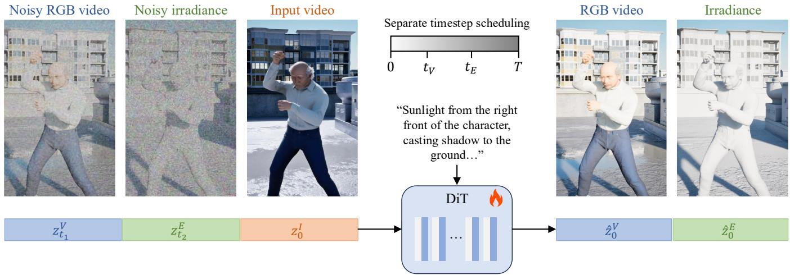  
Fig. 2. Overall training pipeline. Noisy RGB video, noisy irradiance video and input video are encoded and concatenated frame-wise before fed into the fully tuned Difusion Transformer. Noisy RGB and irradiance tokens are assigned with separate noise timesteps to enable asynchronous inference (Section 5.3).

Several related systems target narrower capture settings or different control interfaces. SwitchLight [Kim et al. 2024] decomposes a single portrait using a physics-guided architecture and relights it from an environment map, whereas DifFRelight [He et al. 2024] learns subject-specific facial-performance relighting from lightstage data. Relightable Full-Body Gaussian Codec Avatars [Wang et al. 2025d] models local and non-local light transport for captured, personalized avatars. ReLumix [Wang et al. 2025b] propagates the illumination of one artist-relit reference frame through a video rather than taking a target environment map directly. The commercial Runway Relight Scene system [Runway 2026] instead uses text descriptions to edit the atmosphere of short videos. These methods demonstrate complementary progress, but do not address pixel-aligned, environment-map-controlled relighting of general monocular human-centric videos in the wild.

RGB↔X [Zeng et al. 2024a] shows pixel-aligned irradiance maps can serve as lighting control signals, but require an existing clean irradiance map as input. DiLightNet [Zeng et al. 2024b], Practi-Light [Erel et al. 2025], and Lightit [Kocsis et al. 2024] compute irradiance cues from target lighting and coarse depth, but misalignment with the input image due to noisy geometry undermines relighting quality. Portrait-specific relighting methods such as Total Relighting [Pandey et al. 2021] focus on human faces and use image-based lighting without path-traced shadows, which is suitable for portrait photography but less applicable to general scenes.

Joint cross-modal modeling. Difusion models have been applied to jointly model pixel-aligned attributes such as depth [Byung-Ki et al. 2025; Chen et al. 2025a; Li et al. 2025; Xi et al. 2025a], motion [Chefer et al. 2025], and PBR attributes [He et al. 2025; Xi et al. 2025b]. Joint modeling approaches include dual-stream crossattention [Byung-Ki et al. 2025; Li et al. 2025] and various singlemodel injection paradigms [Chefer et al. 2025; Chen et al. 2025a; He et al. 2025; Xi et al. 2025a,b]. Most such methods assume clean auxiliary modalities; in contrast, we must handle imperfect irradiance cues with substantial geometry artifacts—a domain-gap issue largely unexplored in prior work. The use of per-modality asynchronous timestep schedules has been explored in UniDifuser [Bao et al. 2023], AVDiT [Wang et al. 2024a], and Uni-Renderer [Chen et al. 2025b], but none addresses imperfect auxiliary modalities at inference time. Our key contribution is applying this idea to the RGB-irradiance pairing, combined with domain matching and hijacked inference to handle noisy real-world irradiance cues.

Multi-illumination dataset. Training a video relighting network requires paired multi-illumination data with lighting annotation. Existing datasets [Liu et al. 2023; Murmann et al. 2019; Teufel et al. 2025] mainly cover static images in restricted scenarios, and prior works [He et al. 2025; Liang et al. 2025] use only simple rendered scenes. Unreal Engine 5 [Epic Games 2019] enables high-quality human-centric multi-illumination video synthesis with accurate lighting annotation.

## 3 Preliminary

Our study builds on a transformer-based latent difusion model [Wan et al. 2025]. The architecture comprises a 3D Variational Autoencoder (VAE) and a difusion transformer (DiT) of spatio-temporal transformer blocks. Each block integrates 3D spatio-temporal selfattention, cross-attention, feed-forward network, and gate modulation. The generative process can be defined as a mapping between samples $x _ { 1 }$ from a noise distribution to samples from a data distribution $x _ { 0 }$ in terms of an ordinary diferential equation (ODE),

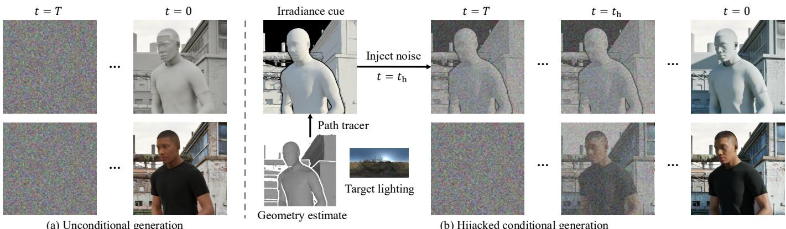  
(a) Unconditional generation  
Fig. 3. Inference pipeline. From the input video and target environment map, we render a per-frame irradiance cue using monocular point-cloud estimation and Mitsuba 3. The cue is noised to $t _ { h } ,$ kept fixed until $t _ { h } ,$ , then jointly denoised with RGB, preserving low-frequency transport while suppressing artifacts.

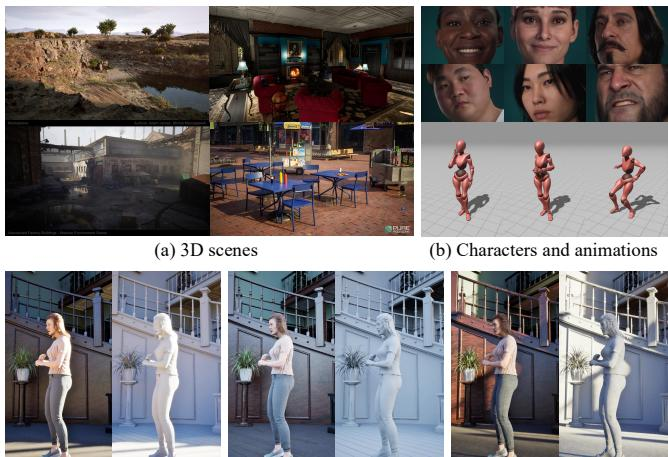  
(c) Multi-illumination RGB videos and irradiance maps  
Fig. 4. Illustration of our introduced multi-illumination synthetic dataset.

$$
d z _ { t } = v _ { \Theta } ( z _ { t } , t ) d t ,\tag{1}
$$

where the velocity � is parameterized by the weights Θ of the difusion transformer and � denotes the timestep. The noise scheduling follows the Rectified Flow framework [Esser et al. 2024; Liu et al. 2022]. Let $z _ { 0 }$ denote a clean latent, $\epsilon \sim { \cal N } ( 0 , I )$ a Gaussian-noise latent, and $t \in [ 0 , 1 ]$ a continuous noise level, where � = 0 is clean data and � = 1 is noise. Rectified Flow defines a straight interpolation

$$
z _ { t } = \psi _ { t } ( z _ { 0 } | \epsilon ) = ( 1 - t ) z _ { 0 } + t \epsilon .\tag{2}
$$

The target velocity along this path is $u _ { t } = \epsilon - z _ { 0 } .$ . The Conditional Flow Matching objective regresses this vector field with an MSE

loss:

$$
L _ { \mathrm { C F M } } = \mathbb { E } _ { t , z _ { 0 } , \epsilon } \left[ \| v _ { \Theta } ( z _ { t } , t ) - ( \epsilon - z _ { 0 } ) \| _ { 2 } ^ { 2 } \right] ,
$$

where $v _ { \Theta }$ is the predicted velocity. At inference, integrating the learned ODE from noise toward data produces a clean sample.

(3)

## 4 Training Dataset

We build an automated UE5 pipeline for multi-illumination videos. Our assets include 30 3D environments, 60 characters, 600 body animations, 20 facial expressions, and 821 HDR environment maps. Figure 4 overviews the dataset. For each scene, a character is randomly placed and animated, while the camera is assigned random distance, rotation, and oscillation. Ray intersection tests prevent interpenetration. We use UE5’s real-time global illumination system Lumen [Tan 2024] for eficient low-frequency approximation, and add a directional light to match the brightest region of the environment map. LightingOnly mode renders the irradiance map synchronously. Each scene is rendered under 10 illuminations, with 20% using rotary lighting. In total, we render 68K videos at 832 × 480 resolution, 94 frames each, with paired irradiance maps. Lighting parameters are recorded, and prompts are generated using a video understanding model [Zhang et al. 2025a]. Among the 30 scene environments, 12 are indoor scenes and 18 are outdoor scenes. The 821 HDR environment maps are collected from public resources such as Poly Haven, covering diverse illumination conditions including outdoor daytime, indoor, and outdoor nighttime settings. We pair the MetaHuman characters with Mixamo animations and mainly keep in-place motions such as talking, dancing, and fighting, while filtering out large-displacement motions such as walking and running to better match our camera setup.

The set contains 31 male-presenting and 29 female-presenting characters; 22 dark-, 12 medium-, and 26 light-skinned characters; and 4 child, 43 adult, and 13 older characters. Our dataset focuses on human-centric indoor and outdoor scenarios, enabling precise lighting control over human subjects. Despite being trained purely on synthetic data, our model generalizes well to real-world videos. We attribute this to the high photorealism of UE5-rendered content, which substantially reduces the sim-to-real gap compared to prior

Blender-based synthetic datasets. This aligns with observations from prior works trained exclusively on UE-rendered videos, such as ReCamMaster [Bai et al. 2025] and Context-as-Memory [Yu et al. 2025].

## 5 Method

We first describe how to construct the irradiance cue ${ \bf E } ^ { \mathrm { c u e } }$ for an input video $\mathbf { V } _ { : } ^ { I }$ , then present our asynchronous RGB-irradiance joint modeling and hijacked inference strategy for generating the relit video V and refined irradiance map Eˆ cue.

## 5.1 Irradiance cue

An irradiance cue describes difuse light transport obtained by rendering scene geometry with target lighting. Previous works [Erel et al. 2025; Zeng et al. 2024b] use monocular depth [Bhat et al. 2023] and unproject it to a mesh. We instead use monocular point-cloud estimation [Wang et al. 2025e,f] to obtain metric-level geometry and smoother meshes. We convert each estimated point cloud into a per-frame mesh and remove triangles spanning depth discontinuities with a fixed threshold-based mask. We assign a spatially uniform white difuse BRDF , illuminate the mesh with the target environment map, and render it using Mitsuba 3 [Jakob et al. 2022]. Repeating this process independently for every frame yields the irradiance cue $\mathbf { E } ^ { \mathrm { { \bar { c u e } } } } \in \mathbb { R } ^ { F \times H \times W \times 3 }$ for an input video V. Perframe estimation avoids accumulating global reconstruction drift, but geometry errors, removed boundary triangles, and temporal inconsistency still create a substantial gap from the ground-truth irradiance E (Figure 3).

## 5.2 Joint modeling with separate timestep scheduling

Noise Corruption. Directly using the imperfect irradiance cue Ecue causes model confusion due to pixel misalignment. To retain its low-frequency lighting prior while suppressing artifacts, we corrupt it with Gaussian noise �:

$$
{ \bf E } _ { t } ^ { \mathrm { c u e } } = ( 1 - t ) { \bf E } ^ { \mathrm { c u e } } + t \epsilon .\tag{4}
$$

In this way, the high-frequency artifacts are removed and the global light transport prior is preserved. Simple hole filling or spatial blurring cannot reliably reconstruct light transport around undefined geometry and may erase useful low-frequency lighting structure; joint denoising instead learns how much of the corrupted cue to retain. To exploit this prior, we jointly model irradiance maps and RGB videos within the difusion framework.

Model design. Given an input video $\mathbf { V } ^ { I }$ and a text prompt ${ \boldsymbol { \mathit { p } } } ,$ we train a model $v _ { \Theta }$ that jointly denoises the relit RGB video V and irradiance map E using separate timesteps $t _ { V }$ and $t _ { E }$ . This allows the model to learn denoising under mismatched noise levels and enables inference with noisy irradiance conditions (Section 5.3). As illustrated in Figure 2, we concatenate the latents ofnoisy RGB video $\mathbf { z } _ { t _ { V } } ^ { V }$ , noisy irradiance map $\mathbf { z } _ { t _ { E } } ^ { E }$ and input video $\mathbf { z } _ { 0 } ^ { I }$ along the frame dimension and feed into the transformer. This simple strategy allows the 3D spatial-temporal self-attention to cover input, irradiance and relit frames, enabling cross-modal understanding. While asynchronous timestep scheduling has been explored in prior multi-modal difusion work [Bao et al. 2023; Chen et al. 2025b; Wang et al. 2024a], our contribution lies in applying it to the RGB-irradiance pairing, where the auxiliary modality is imperfect at inference time. This motivates our domain matching strategy and hijacked inference pipeline, which are essential for bridging the gap to noisy real-world irradiance cues.

Modality disambiguation. Since the three input modalities share pixel alignment, we apply the same RoPE [Su et al. 2024] to assign shared spatial-temporal positions. To distinguish modalities, we introduce a learnable modality embedding on top of the timestep embedding, whose gate modulation already conditions features on timestep. Unlike prior designs that inject modality embeddings into latent features, this better avoids modality mixture in our setting.

Domain matching. Since the model only observes the groundtruth irradiance map E during standard training, conditioning on imperfect irradiance cues at inference introduces a domain gap. We address this with a domain matching paradigm: at random training iterations, we replace the noisy irradiance map $\mathbf { z } _ { t } ^ { E }$ with the noisy cue ${ \mathbf { z } } _ { t } ^ { E ^ { \mathrm { c u e } } }$ . This encourages denoising towards a probability path closer to the high-quality manifold and improves both RGB and irradiance generation. This design is fundamentally diferent from previous joint cross-modal modeling methods, which usually assume clean and reliable modalities during both training and inference. In contrast, our framework is explicitly designed for imperfect irradiance cues with domain discrepancies, which are common in practical relighting settings. It also difers from prior irradiance-conditioned methods that directly feed the estimated cue into the generator, making them more vulnerable to accumulated geometry and rendering errors.

## 5.3 Hijacked asynchronous inference strategy

In Section 5.1 we show how to construct the irradiance cue ${ \bf E } ^ { \mathrm { c u e } }$ given an input video and a target lighting condition. In order to utilize it during inference, we design a hijacked conditional inference strategy that guides the sampling process towards the probability path indicated by the irradiance cue. We illustrate this process in $\mathrm { F i g \mathrm { - } }$ ure 3. Specifically, we obtain the noisy irradiance cue $\bar { \mathbf { E } } _ { t _ { h } } ^ { \mathrm { c u e } }$ with Eq. 4, where $t _ { h }$ is the hijack timestep. Before $t _ { h } ,$ , at each timestep only the noisy RGB latents are updated while the irradiance latents remain fixed at ${ \bf E } _ { t _ { h } } ^ { \mathrm { c u e } }$ . After $t _ { h } ,$ the two modalities are denoised together. This strategy efectively utilizes low-frequency lighting prior provided by the noisy irradiance map, while removing high-frequency artifacts by joint denoising. The hyperparameter $t _ { h }$ controls the amount of noise that is added to the irradiance cue, ofering a flexible tradeof between generation quality and lighting fidelity. In practice, we find that $t _ { h } = 0 . 6 T$ works well for most cases. When the irradiance cue is reliable, a smaller $t _ { h }$ helps preserve more high-frequency appearance details. When the cue is noisy or less aligned, a larger $t _ { h }$ is preferable because it suppresses artifacts more aggressively.

## 6 Experiments

Implementation details. We fine-tune Wan2.2-TI2V-5B [Wan et al. 2025] for 12K steps at 832 × 480 resolution using a learning rate of $1 0 ^ { - 5 }$ and batch size 16. Domain matching is applied only during the last 4K steps. We apply this second-stage training after the first-stage

Light-X

TC-Light

DiLightNet

IC-Light

Ours

Env. GT / Shading

Input

Neural Gaffer

DiffusionRenderer  
UniRelight  
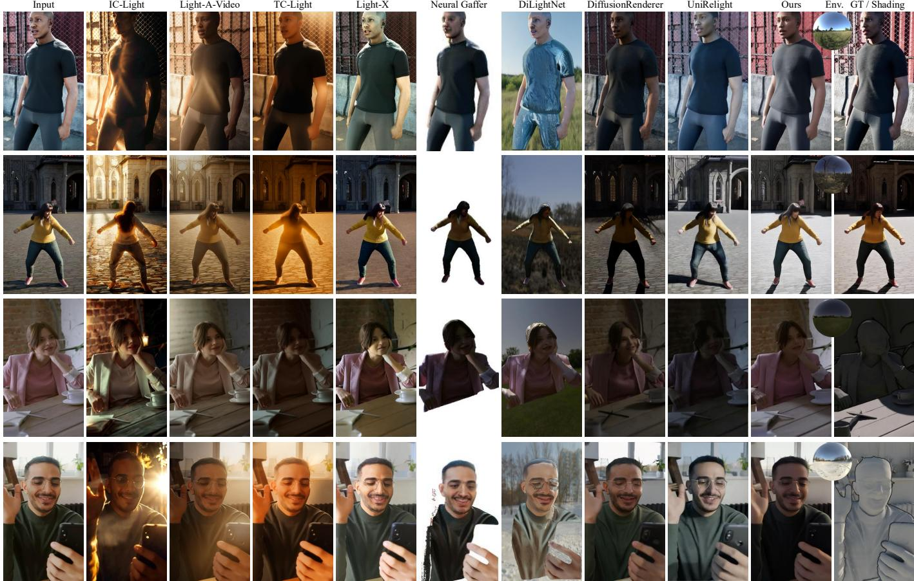  
Fig. 5. Qualitative comparison on vertical SynthStatic and HumanVid videos. The last row shows synthetic ground truth and real-world irradiance cues.

joint modeling has largely converged, and empirically find that 4K steps are suficient for the model to adapt to the imperfect irradiancecue distribution. To further mitigate the visual characteristics of synthetic training data, we adopt a noise augmentation strategy inspired by ReCamMaster [Bai et al. 2025]: a moderate level of noise (equivalent to 200–500 difusion timesteps) is added to the conditional video latent during training, which discourages the model from relying on domain-specific synthetic cues and improves robustness at real-world inference time. We set the hijack timestep to $t _ { h } = 0 . 6 T$ for every experiment and do not retune it case by case.

Baselines. We compare our method with the publicly available video relighting method DifusionRenderer [Liang et al. 2025], UniRelight [He et al. 2025] and Light-X [Liu et al. 2025a]. Image relighting methods DiLightNet [Zeng et al. 2024b] and Neural-Gafer [Jin et al. 2024] are also included. We adopt the Cosmos [Agarwal et al. 2025] implementation version of DifusionRenderer for a fair comparison. These methods allow environment maps as control signals. We additionally include prompt-based relighting methods, including IC-Light [Zhang et al. 2025b], Light-A-Video [Zhou et al. 2025], TC Light [Liu et al. 2025b]. For environment-map-conditioned methods we use the identical target HDR map; prompt-based methods instead receive best-efort captions derived from the target lighting, so exact direction and intensity cannot be guaranteed.

Datasets. We use the test subset of our synthetic dataset for quantitative evaluation. It contains 100 test cases: 50 static-lighting cases (SynthStatic) and 50 rotary-lighting cases (SynthDynamic), each with an input video, relit target, and target environment map. For qualitative comparison, test cases are sampled from the Human-Vid [Wang et al. 2024b] dataset. Since there is no publicly available video relighting dataset for quantitative evaluation, we follow previous video relighting methods such as DifusionRenderer [Liang et al. 2025] and UniRelight [He et al. 2025] by using our proposed synthetic dataset for the video benchmark. To test cross-dataset generalization independently of our synthetic renderer, we additionally evaluate static images from HumanOLAT [Teufel et al. 2025].

Metrics. We report PSNR, SSIM, and LPIPS [Zhang et al. 2018]. We also conduct a user study on visual quality and illumination accuracy. Following prior works [He et al. 2025; Jin et al. 2024; Liang et al. 2025], we avoid per-channel rescaling and instead compare results directly with ground truth, enabling faithful evaluation of relighting fidelity.

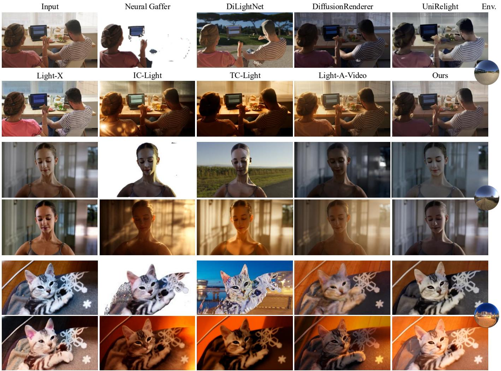  
Fig. 6. Qualitative comparison on horizontal images.

Table 1. Quantitative comparison on SynthStatic and SynthDynamic, and user-study scores. VQ and LF denote visual quality and lighting fidelity. Best and second-best results are bold and underlined, respectively.
<table><tr><td rowspan="2"></td><td colspan="3">SynthStatic</td><td colspan="3">SynthDynamic</td><td colspan="2">User Study</td></tr><tr><td>PSNR ↑</td><td>SSIM ↑</td><td>LPIPS ↓</td><td>PSNR ↑</td><td>SSIM ↑</td><td>LPIPS ↓</td><td>VQ↑</td><td>LF↑</td></tr><tr><td>IC-Light</td><td>12.79</td><td>0.508</td><td>0.329</td><td>12.76</td><td>0.512</td><td>0.317</td><td>3.28</td><td>2.10</td></tr><tr><td>Light-A-Video</td><td>12.18</td><td>0.390</td><td>0.401</td><td>11.82</td><td>0.375</td><td>0.440</td><td>3.41</td><td>3.01</td></tr><tr><td>TC-Light</td><td>10.74</td><td>0.433</td><td>0.472</td><td>9.87</td><td>0.366</td><td>0.539</td><td>2.73</td><td>2.45</td></tr><tr><td>DiLightNet</td><td>11.76</td><td>0.507</td><td>0.336</td><td>11.21</td><td>0.493</td><td>0.371</td><td>1.19</td><td>1.31</td></tr><tr><td>Neural Gaffer</td><td>13.72</td><td>0.629</td><td>0.269</td><td>12.25</td><td>0.607</td><td>0.327</td><td>2.40</td><td>2.57</td></tr><tr><td>Light-X</td><td>14.03</td><td>0.582</td><td>0.285</td><td>12.40</td><td>0.619</td><td>0.308</td><td>3.51</td><td>2.69</td></tr><tr><td>DiffusionRenderer (Cosmos)</td><td>15.27</td><td>0.615</td><td>0.306</td><td>13.48</td><td>0.589</td><td>0.345</td><td>3.15</td><td>3.04</td></tr><tr><td>UniRelight</td><td>15.83</td><td>0.661</td><td>0.288</td><td>14.90</td><td>0.602</td><td>0.303</td><td>3.92</td><td>3.82</td></tr><tr><td>Ours</td><td>16.62</td><td>0.656</td><td>0.251</td><td>16.39</td><td>0.631</td><td>0.263</td><td>3.98</td><td>4.53</td></tr></table>

Table 2. Cross-dataset evaluation on HumanOLAT.
<table><tr><td>Method</td><td>PSNR↑</td><td>SSIM↑</td><td>LPIPS↓</td></tr><tr><td>Neural Gaffer</td><td>17.10</td><td>0.881</td><td>0.151</td></tr><tr><td>DiLightNet</td><td>15.68</td><td>0.847</td><td>0.142</td></tr><tr><td>Light-X</td><td>18.01</td><td>0.862</td><td>0.161</td></tr><tr><td>DiffusionRenderer</td><td>22.32</td><td>0.912</td><td>0.114</td></tr><tr><td>UniRelight</td><td>19.54</td><td>0.871</td><td>0.136</td></tr><tr><td>Ours</td><td>23.89</td><td>0.928</td><td>0.078</td></tr></table>

## 6.1 Evaluation

Qualitative comparison. Figures 5 and 6 compare vertical and horizontal cases, respectively; the latter includes SynthStatic examples. Prompt-based methods including IC-Light, TC-Light, and Light-A-Video produce appealing lighting styles, but cannot precisely control lighting direction or ambient color because text prompts are ambiguous. These methods often produce warm tones and can retain hard input shadows, as in the second case of Figure 5. Light-X and Neural Gafer inherits much of the input lighting distribution and mainly modifies color tone, while DiLightNet produces low-quality results caused by inaccurate material estimates. DifusionRenderer and UniRelight performs reasonably well in terms of light direction and color. However, inaccurate material estimation yields unrealistic skin and clothing textures (Figs. 6 and 5). It also causes identity drift, demonstrated on the third case of Figure 6. More importantly, implicit light transport modeling sometimes fails to produce physically correct results. In Fig. 5 (third case), DifusionRenderer mistakes yellow ambient light for the main source, ignoring the actual moon light. In contrast, our method models light transport with guidance from the path-traced irradiance cue, facilitating physically accurate illumination control. Although trained on human-centric data, our method also generalizes to the cat example in Figure 6.

Quantitative comparison. Table 1 confirms the qualitative observation that DifusionRenderer and UniRelight respond more faithfully to environment maps than the other baselines. We evaluate on 100 test cases in total, with 50 cases from SynthStatic and 50 from SynthDynamic. For prompt-based methods, we ask GPT 5.4 to describe the lighting in the ground truth video and use the caption as text prompt input. For image-based methods, we perform relighting frame by frame. Our method obtains the best PSNR and LPIPS on SynthStatic, while UniRelight obtains the best SSIM. On SynthDynamic, our method is best on all three metrics. The larger advantage under rotating illumination indicates that explicit irradiance guidance improves controllability when the target lighting changes over time.

HumanOLATevaluation. We synthesize ground-truth relit images from HumanOLAT OLAT captures under 100 HDR environment maps. We apply the provided foreground masks before computing metrics and do not perform per-channel rescaling. Table 2 shows that our model, trained without HumanOLAT data, achieves the best performance among all evaluated methods. Qualitative comparison is presented in Figure 11

Table 3. Quantitative ablation on major components.
<table><tr><td>Variant</td><td>PSNR↑</td><td>SSIM↑</td><td>LPIPS↓</td></tr><tr><td>HDR map conditioning</td><td>13.79</td><td>0.585</td><td>0.331</td></tr><tr><td>irradiance conditioning</td><td>14.10</td><td>0.578</td><td>0.327</td></tr><tr><td>+ Joint modeling</td><td>14.06</td><td>0.572</td><td>0.321</td></tr><tr><td>+ Hijacked conditional generation</td><td>14.69</td><td>0.582</td><td>0.306</td></tr><tr><td>+ Asynchronous timestep scheduling</td><td>15.20</td><td>0.611</td><td>0.298</td></tr><tr><td>+ Domain matching strategy (Ours)</td><td>15.69</td><td>0.621</td><td>0.282</td></tr></table>

User study. A user study evaluated perceptual quality on in-thewild videos. Participants viewed the relighting results, the input video, and the environment map, and rated methods from 1 to 5 on visual quality (VQ) and lighting fidelity (LF). The study involved 13 in-lab users, and average scores are reported in Table 1. We evaluate 15 indoor and outdoor test cases in total. Before the study, we explain that visual quality measures the overall perceptual realism, including artifacts and temporal stability, while lighting fidelity evaluates how well the generated result matches the target illumination in terms of light direction, shadow, and highlight consistency. Compared to baselines, our results are consistently preferred on both dimensions.

Dynamic scenes with dynamic illumination. Thanks to explicit light transport guidance from asynchronous RGB-irradiance joint modeling, our method naturally extends to dynamic scenes with dynamic illumination. Figure 7 shows results sampled every 10 frames. Our method faithfully follows the sun direction and produces physically plausible lighting efects.

Runtime. For an 81-frame, 832 × 480 video sampled with 50 difusion steps on one NVIDIA A800 GPU, the full pipeline takes 223 s: 22.8 s for depth estimation, 38.2 s for mesh conversion, 18.8 s for Mitsuba rendering, and 141.9 s for neural generation (minor overhead accounts for the remaining time). Under the same evaluation setting, UniRelight, DifusionRenderer, and Light-A-Video take 1077 s, 1629 s, and 1822 s, respectively. Thus, external reconstruction and rendering are not the main runtime bottleneck.

## 7 Ablation study

Qualitative ablation. We conduct ablation study on our asynchronous RGB-irradiance joint modeling and domain matching strategy with qualitative results in Figure 10. Without the asynchronous joint modeling training paradigm, simply using the irradiance cue as control signal, the model fails to follow the light transport. Joint modeling alone does not suficiently bridge the domain gap; domain matching is essential for producing pixel-aligned irradiance maps and physically plausible RGB results. Without it, the denoised irradiance maps exhibit black edges and blurred details, leading to suboptimal outputs. In contrast, the full recipe generates pixelaligned RGB and irradiance images, producing physically accurate and visually plausible results.

Quantitative ablation. We report quantitative ablation results in Tables 3 and 4. We additionally train a no-irradiance variant that receives only the target HDR environment map under the same data and optimization protocol, analogous to HDR-conditioned implicit relighting. All ablation models are trained for 6K steps, with domain matching applied during the final 2K steps. HDR map conditioning does not provide pixel-aligned guidance for light distribution, which produces less accurate relighting results compared to irradiance conditioning. Joint modeling irradiance and RGB alone brings limited gains because the imperfect irradiance cue still causes a noticeable train-test mismatch. Introducing hijacked conditional generation and asynchronous timestep scheduling progressively improves both lighting fidelity and visual quality, while the domain matching strategy delivers the final performance boost by explicitly aligning the cue distribution with inference-time inputs. We also compare diferent modality embedding strategies and find that injecting the modality cue through the time embedding performs best, likely because it modulates the denoising process globally and reduces the ambiguity between RGB appearance and irradiance guidance.

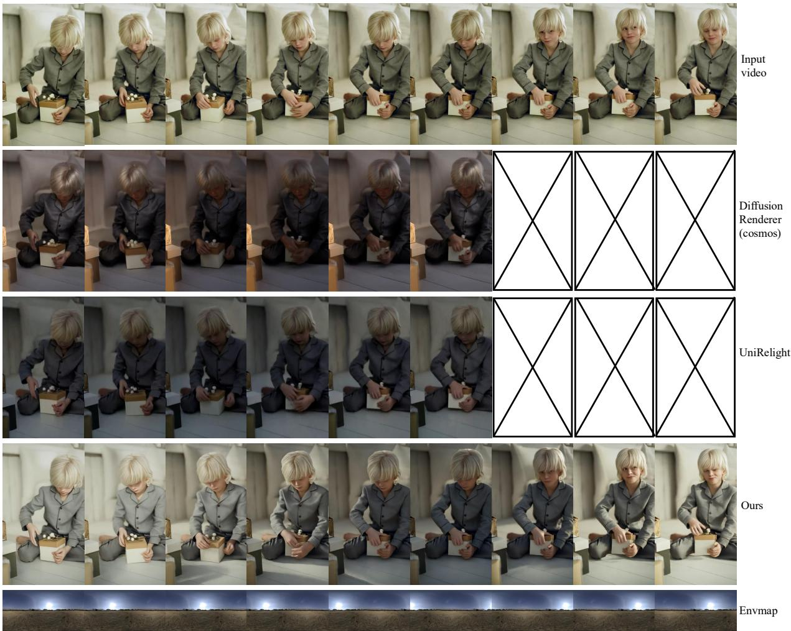

Fig. 7. Results under dynamic lighting. Images are sampled every 10 frames while the environment map rotates through 360◦.  
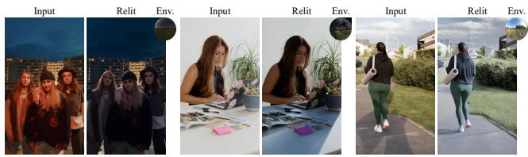  
Fig. 8. More results on vertical images from indoor and outdoor scenes. In the second example, the light source appears in the upper-right region of the chrome ball. We show a black background for clarity.

Table 4. Ablation on modality embedding designs.
<table><tr><td>Variant</td><td>PSNR↑</td><td>SSIM↑</td><td>LPIPS↓</td></tr><tr><td>Add to latent</td><td>15.38</td><td>0.615</td><td>0.299</td></tr><tr><td>Concat to latent</td><td>15.42</td><td>0.620</td><td>0.305</td></tr><tr><td>Add to time embedding (Ours)</td><td>15.69</td><td>0.621</td><td>0.282</td></tr></table>

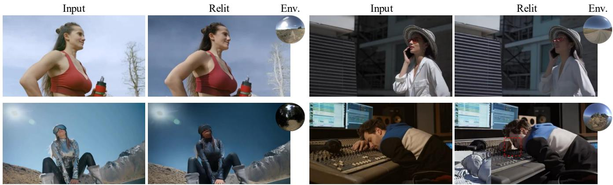  
Fig. 9. More results and failure cases on horizontal images from indoor and outdoor scenes. The botom-left example shows the limitation on highly reflective surfaces; the botom-right example shows light leakage around the hand caused by inaccurate depth near a discontinuity.

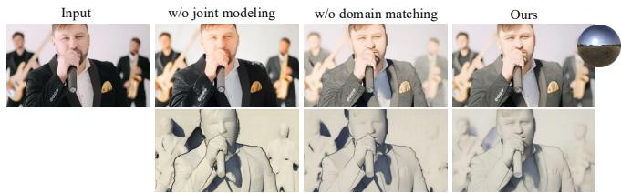  
Fig. 10. Qualitative ablation. From left: input, direct irradiance conditioning without joint modeling, without domain matching, and full model.

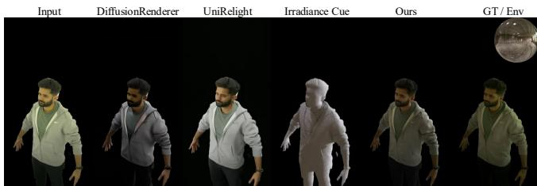  
Fig. 11. Qualitative comparison on HumanOLAT dataset.

## 8 Discussion

We present JointLight, a human-centric video relighting framework that jointly models RGB and irradiance asynchronously. We also introduce a high-quality human-centric multi-illumination synthetic dataset covering indoor and outdoor scenarios, paired with groundtruth irradiance maps. Trained exclusively on this dataset, our model achieves state-of-the-art relighting quality and fidelity.

Robustness to geometry errors. Our method depends on monocular geometry only through the rendered irradiance cue. Because geometry is estimated independently per frame, errors do not accumulate as global reconstruction drift. Noise injection suppresses high-frequency defects such as jagged boundaries, holes, and aliased shadows, but cannot recover light transport that is absent from severely incorrect geometry. Aggressive subject or camera motion can also produce blur and occlusion errors. Incorrect depths or holes near discontinuities may distort the path-traced cue and can cause light leakage (the bottom-right case in Figure 9).

Limitations and Future Work. First, irradiance provides difuse transport only and therefore cannot explicitly or physically control full specular transport. Video priors can synthesize plausible moderate highlights on skin and hair, but these efects are not guaranteed to follow the target illumination; polished metal, mirrors, and glass remain dificult. A failure case is shown in the bottom-right case of Figure 9. Second, suppressing high-frequency cue errors can also attenuate texture-rich appearance, occasionally over-smoothing fine facial details around the eyes and mouth. Future work could jointly reason about geometry, material, difuse and specular transport, and use detail-preserving or preference-based post-training. Extending the control representation beyond environment maps to local spotlights or flashlights is another promising direction.

## Acknowledgments

This work was supported by the National Natural Science Foundation of China (No. 62322210, 62561160115), the Beijing Major Science and Technology Project (No. Z251100008125009), the Royal Society (IEC\NSFC\233596), and the Innovation Funding of ICT, CAS (No. E561100).

## References

Niket Agarwal, Arslan Ali, Maciej Bala, Yogesh Balaji, Erik Barker, Tifany Cai, Prithvijit Chattopadhyay, Yongxin Chen, Yin Cui, Yifan Ding, et al. 2025. Cosmos world foundation model platform for physical ai. arXiv preprint arXiv:2501.03575 (2025).

Jianhong Bai, Menghan Xia, Xiao Fu, Xintao Wang, Lianrui Mu, Jinwen Cao, Zuozhu Liu, Haoji Hu, Xiang Bai, Pengfei Wan, et al. 2025. Recammaster: Camera-controlled generative rendering from a single video. In Proceedings ofthe IEEE/CVFInternational Conference on Computer Vision. 14834–14844.

Fan Bao, Shen Nie, Kaiwen Xue, Chongxuan Li, Shi Pu, Yaole Wang, Gang Yue, Yue Cao, Hang Su, and Jun Zhu. 2023. One transformer fits all distributions in multi modal difusion at scale. In International Conference on Machine Learning. PMLR, 1692–1717.

Shrisha Bharadwaj, Haiwen Feng, Giorgio Becherini, Victoria Fernandez Abrevaya, and Michael J Black. 2025. GenLit: Reformulating single-image relighting as video generation. In Proceedings ofthe SIGGRAPH Asia 2025 Conference Papers. 1–12.

Shariq Farooq Bhat, Reiner Birkl, Diana Wofk, Peter Wonka, and Matthias Müller. 2023. Zoedepth: Zero-shot transfer by combining relative and metric depth. arXiv preprint arXiv:2302.12288 (2023).

Kwon Byung-Ki, Qi Dai, Lee Hyoseok, Chong Luo, and Tae-Hyun Oh. 2025. JointDiT: Enhancing RGB-Depth Joint Modeling with Difusion Transformers. arXiv preprint arXiv:2505.00482 (2025).

Sumit Chaturvedi, Mengwei Ren, Yannick Hold-Geofroy, Jingyuan Liu, Julie Dorsey, and Zhixin Shu. 2025. SynthLight: Portrait Relighting with Difusion Model by Learning to Re-render Synthetic Faces. In Proceedings of the Computer Vision and Pattern Recognition Conference. 369–379.

Hila Chefer, Uriel Singer, Amit Zohar, Yuval Kirstain, Adam Polyak, Yaniv Taigman, Lior Wolf, and Shelly Sheynin. 2025. Videojam: Joint appearance-motion representations for enhanced motion generation in video models. arXiv preprint arXiv:2502.02492 (2025).

Zhaoxi Chen, Tianqi Liu, Long Zhuo, Jiawei Ren, Zeng Tao, He Zhu, Fangzhou Hong, Liang Pan, and Ziwei Liu. 2025a. 4dnex: Feed-forward 4d generative modeling made easy. arXiv preprint arXiv:2508.13154 (2025).

Zhifei Chen, Tianshuo Xu, Wenhang Ge, Leyi Wu, Dongyu Yan, Jing He, Luozhou Wang, Lu Zeng, Shunsi Zhang, and Ying-Cong Chen. 2025b. Uni-renderer: Unifying rendering and inverse rendering via dual stream difusion. In Proceedings of the Computer Vision and Pattern Recognition Conference. 26504–26513.

Paul Debevec. 2012. The light stages and their applications to photoreal digital actors. (2012).

Epic Games. 2019. Unreal Engine. https://www.unrealengine.com

Yotam Erel, Rishabh Dabral, Vladislav Golyanik, Amit H. Bermano, and Christian Theobalt. 2025. PractiLight: Practical Light Control Using Foundational Difusion Models. ACM Transactions on Graphics (TOG) 44, 6 (2025), 1–11.

Patrick Esser, Sumith Kulal, Andreas Blattmann, Rahim Entezari, Jonas Müller, Harry Saini, Yam Levi, Dominik Lorenz, Axel Sauer, Frederic Boesel, et al. 2024. Scaling rectified flow transformers for high-resolution image synthesis. In Forty-first international conference on machine learning.

Ye Fang, Zeyi Sun, Shangzhan Zhang, Tong Wu, Yinghao Xu, Pan Zhang, Jiaqi Wang, Gordon Wetzstein, and Dahua Lin. 2025. RelightVid: Temporal-consistent difusion model for video relighting. arXiv preprint arXiv:2501.16330 (2025).

Kai He, Ruofan Liang, Jacob Munkberg, Jon Hasselgren, Nandita Vijaykumar, Alexander Keller, Sanja Fidler, Igor Gilitschenski, Zan Gojcic, and Zian Wang. 2025. UniRelight: Learning Joint Decomposition and Synthesis for Video Relighting. arXiv preprint arXiv:2506.15673 (2025).

Mingming He, Pascal Clausen, Ahmet Levent Taşel, Li Ma, Oliver Pilarski, Wenqi Xian, Laszlo Rikker, Xueming Yu, Ryan Burgert, Ning Yu, and Paul Debevec. 2024. DifFRelight: Difusion-Based Facial Performance Relighting. arXiv preprint arXiv:2410.08188 (2024).

Wenzel Jakob, Sébastien Speierer, Nicolas Roussel, Merlin Nimier-David, Delio Vicini, Tizian Zeltner, Baptiste Nicolet, Miguel Crespo, Vincent Leroy, and Ziyi Zhang. 2022. Mitsuba 3 renderer. https://mitsuba-renderer.org.

Kaiwen Jiang, Shu-Yu Chen, Hongbo Fu, and Lin Gao. 2023. Nerfacelighting: Implicit and disentangled face lighting representation leveraging generative prior in neural radiance fields. ACM Transactions on Graphics 42, 3 (2023), 1–18.

Haian Jin, Yuan Li, Fujun Luan, Yuanbo Xiangli, Sai Bi, Kai Zhang, Zexiang Xu, Jin Sun, and Noah Snavely. 2024. Neural gafer: Relighting any object via difusion. Advances in Neural Information Processing Systems 37 (2024), 141129–141152.

Hoon Kim, Minje Jang, Wonjun Yoon, Jisoo Lee, Donghyun Na, and Sanghyun Woo. 2024. SwitchLight: Co-design of Physics-driven Architecture and Pre-training Framework for Human Portrait Relighting. In Proceedings ofthe IEEE/CVFConference on Computer Vision and Pattern Recognition. 25096–25106.

Peter Kocsis, Julien Philip, Kalyan Sunkavalli, Matthias Nießner, and Yannick Hold Geofroy. 2024. Lightit: Illumination modeling and control for difusion models. In Proceedings ofthe IEEE/CVF Conference on Computer Vision and Pattern Recognition. 9359–9369.

Xirui Li, Charles Herrmann, Kelvin Chan, Yinxiao Li, Deqing Sun, Chao Ma, and Ming-Hsuan Yang. 2025. A simple approach to unifying difusion-based conditional generation. In International Conference on Learning Representations, Vol. 2025. 41705– 41725.

Ruofan Liang, Zan Gojcic, Huan Ling, Jacob Munkberg, Jon Hasselgren, Chih-Hao Lin, Jun Gao, Alexander Keller, Nandita Vijaykumar, Sanja Fidler, et al. 2025. Difusion Renderer: Neural Inverse and Forward Rendering with Video Difusion Models. In Proceedings of the Computer Vision and Pattern Recognition Conference. 26069–26080.

Zhexin Liang, Zhaoxi Chen, Yongwei Chen, Tianyi Wei, Tengfei Wang, and Xingang Pan. 2026. PI-Light: Physics-Inspired Difusion for Full-Image Relighting. arXiv preprint arXiv:2601.22135 (2026).

Haotong Lin, Sili Chen, Junhao Liew, Donny Y Chen, Zhenyu Li, Guang Shi, Jiashi Feng, and Bingyi Kang. 2025. Depth anything 3: Recovering the visual space from any views. arXiv preprint arXiv:2511.10647 (2025).

Yuanze Lin, Yi-Wen Chen, Yi-Hsuan Tsai, Ronald Clark, and Ming-Hsuan Yang. 2026. Illumicraft: Unified geometry and illumination difusion for controllable video generation. Advances in Neural Information Processing Systems 38 (2026), 27798– 27829.

Isabella Liu, Linghao Chen, Ziyang Fu, Liwen Wu, Haian Jin, Zhong Li, Chin Ming Ryan Wong, Yi Xu, Ravi Ramamoorthi, Zexiang Xu, et al. 2023. Openillumination: A multi illumination dataset for inverse rendering evaluation on real objects. Advances in Neural Information Processing Systems 36 (2023), 36951–36962.

Ropeway Liu, Hangjie Yuan, Bo Dong, Jiazheng Xing, Jinwang Wang, Rui Zhao, Yan Xing, Weihua Chen, and Fan Wang. 2025c. UniLumos: Fast and Unified Image and Video Relighting with Physics-Plausible Feedback. arXiv preprint arXiv:2511.01678 (2025).

Tianqi Liu, Zhaoxi Chen, Zihao Huang, Shaocong Xu, Saining Zhang, Chongjie Ye, Bohan Li, Zhiguo Cao, Wei Li, Hao Zhao, et al. 2025a. Light-X: Generative 4D Video Rendering with Camera and Illumination Control. arXiv preprint arXiv:2512.05115 (2025).

Xingchao Liu, Chengyue Gong, and Qiang Liu. 2022. Flow straight and fast: Learning to generate and transfer data with rectified flow. arXiv preprint arXiv:2209.03003 (2022).

Yang Liu, Chuanchen Luo, Zimo Tang, Yingyan Li, Yuanyong Ning, Lue Fan, Junran Peng, Zhaoxiang Zhang, et al. 2025b. Tc-light: Temporally coherent generative rendering for realistic world transfer. In The Thirty-ninth Annual Conference on Neural Information Processing Systems.

Yong Liu, Wenpeng Xiao, Qianqian Wang, Junlin Chen, Shiyin Wang, Yitong Wang, Xinglong Wu, and Yansong Tang. 2026. Dreamlight: Towards harmonious and consistent image relighting. Advances in Neural Information Processing Systems 38 (2026), 36041–36060.

Henglei Lv, Bailin Deng, Jianzhu Guo, Xiaoqiang Liu, Pengfei Wan, Di Zhang, and Lin Gao. 2025. GSHeadRelight: Fast relightability for 3D gaussian head synthesis. In Proceedings ofthe Special Interest Group on Computer Graphics and Interactive Techniques Conference Conference Papers. 1–12.

Shi Mao, Chenming Wu, Zhelun Shen, Yifan Wang, Dayan Wu, and Liangjun Zhang. 2025. NeuS-PIR: Learning Relightable Neural Surface Using Pre-Integrated Render ing. Computational Visual Media 11, 4 (2025), 727–744

Yiqun Mei, Mingming He, Li Ma, Julien Philip, Wenqi Xian, David M George, Xueming Yu, Gabriel Dedic, Ahmet Levent Taşel, Ning Yu, et al. 2025. Lux post facto: Learning portrait performance relighting with conditional video difusion and a hybrid dataset. In Proceedings of the Computer Vision and Pattern Recognition Conference. 5510–5522.

Lars Mescheder, Wei Dong, Shiwei Li, Xuyang Bai, Marcel Santos, Peiyun Hu, Bruno Lecouat, Mingmin Zhen, AmaÃG, l Delaunoy, Tian Fang, et al. 2025. Sharp Monocular View Synthesis in Less Than a Second. arXiv preprint arXiv:2512.10685 (2025).

Lukas Murmann, Michael Gharbi, Miika Aittala, and Fredo Durand. 2019. A dataset of multi-illumination images in the wild. In Proceedings ofthe IEEE/CVF International Conference on Computer Vision. 4080–4089.

Rohit Pandey, Sergio Orts-Escolano, Chloe Legendre, Christian Haene, Sofien Bouaziz, Christoph Rhemann, Paul E Debevec, and Sean Ryan Fanello. 2021. Total relighting: learning to relight portraits for background replacement. ACM Trans. Graph. 40, 4 (2021), 43–1.

Runway. 2026. Relight Scene: Adjust Video Lighting with AI. https://runway.com/ apps/relight-scene. Accessed July 27, 2026.

Shunsuke Saito, Gabriel Schwartz, Tomas Simon, Junxuan Li, and Giljoo Nam. 2024. Relightable gaussian codec avatars. In Proceedings ofthe IEEE/CVF conference on computer vision and pattern recognition. 130–141.

Jianlin Su, Murtadha Ahmed, Yu Lu, Shengfeng Pan, Wen Bo, and Yunfeng Liu. 2024. Roformer: Enhanced transformer with rotary position embedding. Neurocomputing 568 (2024), 127063.

Tiow Wee Tan. 2024. Mastering Lumen Global Illumination in Unreal Engine 5. In Game Development with Unreal Engine 5 Volume 1: Design Phase. Apress, Berkeley, CA, 223–275.

Timo Teufel, Pulkit Gera, Xilong Zhou, Umar Iqbal, Pramod Rao, Jan Kautz, Vladislav Golyanik, and Christian Theobalt. 2025. Humanolat: A large-scale dataset for fullbody human relighting and novel-view synthesis. In Proceedings ofthe IEEE/CVF International Conference on Computer Vision. 29131–29141.

Team Wan, Ang Wang, Baole Ai, Bin Wen, Chaojie Mao, Chen-Wei Xie, Di Chen, Feiwu Yu, Haiming Zhao, Jianxiao Yang, Jianyuan Zeng, Jiayu Wang, Jingfeng Zhang, Jingren Zhou, Jinkai Wang, Jixuan Chen, Kai Zhu, Kang Zhao, Keyu Yan, Lianghua Huang, Mengyang Feng, Ningyi Zhang, Pandeng Li, Pingyu Wu, Ruihang Chu, Ruili Feng, Shiwei Zhang, Siyang Sun, Tao Fang, Tianxing Wang, Tianyi Gui, Tingyu Weng, Tong Shen, Wei Lin, Wei Wang, Wei Wang, Wenmeng Zhou, Wente Wang, Wenting Shen, Wenyuan Yu, Xianzhong Shi, Xiaoming Huang, Xin Xu, Yan Kou, Yangyu Lv, Yifei Li, Yijing Liu, Yiming Wang, Yingya Zhang, Yitong Huang, Yong Li, You Wu, Yu Liu, Yulin Pan, Yun Zheng, Yuntao Hong, Yupeng Shi, Yutong Feng, Zeyinzi Jiang, Zhen Han, Zhi-Fan Wu, and Ziyu Liu. 2025. Wan: Open and Advanced Large-Scale Video Generative Models. arXiv preprint arXiv:2503.20314 (2025).

Jianyuan Wang, Minghao Chen, Nikita Karaev, Andrea Vedaldi, Christian Rupprecht, and David Novotny. 2025a. Vggt: Visual geometry grounded transformer. In Proceedings ofthe Computer Vision and Pattern Recognition Conference. 5294–5306.

Junying Wang, Jingyuan Liu, Xin Sun, Krishna Kumar Singh, Zhixin Shu, He Zhang, Jimei Yang, Nanxuan Zhao, Tuanfeng Y Wang, Simon S Chen, et al. 2025c. Com prehensive Relighting: Generalizable and Consistent Monocular Human Relighting

and Harmonization. In Proceedings of the Computer Vision and Pattern Recognition Conference. 380–390.

Kai Wang, Shijian Deng, Jing Shi, Dimitrios Hatzinakos, and Yapeng Tian. 2024a. Av-dit: Eficient audio-visual difusion transformer for joint audio and video generation. arXiv preprint arXiv:2406.07686 (2024).

Lezhong Wang, Shutong Jin, Ruiqi Cui, Anders Bjorholm Dahl, Jeppe Revall Frisvad, and Siavash Bigdeli. 2025b. ReLumix: Extending Image Relighting to Video via Video Difusion Models. arXiv preprint arXiv:2509.23769 (2025).

Ruicheng Wang, Sicheng Xu, Cassie Dai, Jianfeng Xiang, Yu Deng, Xin Tong, and Jiaolong Yang. 2025e. Moge: Unlocking accurate monocular geometry estimation for open-domain images with optimal training supervision. In Proceedings ofthe Computer Vision and Pattern Recognition Conference. 5261–5271.

Ruicheng Wang, Sicheng Xu, Yue Dong, Yu Deng, Jianfeng Xiang, Zelong Lv, Guangzhong Sun, Xin Tong, and Jiaolong Yang. 2025f. MoGe-2: Accurate Monocular Geometry with Metric Scale and Sharp Details. arXiv preprint arXiv:2507.02546 (2025).

Shaofei Wang, Tomas Simon, Igor Santesteban, Timur Bagautdinov, Junxuan Li, Vasu Agrawal, Fabian Prada, Shoou-I Yu, Pace Nalbone, Matt Gramlich, Roman Lubach ersky, Chenglei Wu, Javier Romero, Jason Saragih, Michael Zollhoefer, Andreas Geiger, Siyu Tang, and Shunsuke Saito. 2025d. Relightable Full-Body Gaussian Codec Avatars. In ACM SIGGRAPH 2025 Conference Papers. doi:10.1145/3721238.3730739

Zhenzhi Wang, Yixuan Li, Yanhong Zeng, Youqing Fang, Yuwei Guo, Wenran Liu, Jing Tan, Kai Chen, Tianfan Xue, Bo Dai, et al. 2024b. Humanvid: Demystifying training data for camera-controllable human image animation. Advances in Neural Information Processing Systems 37 (2024), 20111–20131.

Tong Wu, Jia-Mu Sun, Yu-Kun Lai, Yuewen Ma, Leif Kobbelt, and Lin Gao. 2024. De ferredgs: Decoupled and editable gaussian splatting with deferred shading. arXiv preprint arXiv:2404.09412 (2024).

Dianbing Xi, Jiepeng Wang, Yuanzhi Liang, Xi Qiu, Yuchi Huo, Rui Wang, Chi Zhang, and Xuelong Li. 2025a. Omnivdif: Omni controllable video difusion for generation and understanding. arXiv preprint arXiv:2504.10825 (2025).

Dianbing Xi, Jiepeng Wang, Yuanzhi Liang, Xi Qiu, Jialun Liu, Hao Pan, Yuchi Huo, Rui Wang, Haibin Huang, Chi Zhang, et al. 2025b. CtrlVDif: Controllable Video Generation via Unified Multimodal Video Difusion. arXiv preprint arXiv:2511.21129 (2025).

Jiwen Yu, Jianhong Bai, Yiran Qin, Quande Liu, Xintao Wang, Pengfei Wan, Di Zhang, and Xihui Liu. 2025. Context as memory: Scene-consistent interactive long video

generation with memory retrieval. In Proceedings of the SIGGRAPH Asia 2025 Conference Papers. 1–11.

Chong Zeng, Yue Dong, Pieter Peers, Youkang Kong, Hongzhi Wu, and Xin Tong. 2024b. DiLightNet: Fine-grained lighting control for difusion-based image generation. In ACM SIGGRAPH 2024 Conference Papers. 1–12.

Jianshu Zeng, Yuxuan Liu, Yutong Feng, Chenxuan Miao, Zixiang Gao, Jiwang Qu, Jianzhang Zhang, Bin Wang, and Kun Yuan. 2025. Lumen: Consistent video relighting and harmonious background replacement with video generative models. arXiv preprint arXiv:2508.12945 (2025).

Zheng Zeng, Valentin Deschaintre, Iliyan Georgiev, Yannick Hold-Geofroy, Yiwei Hu, Fujun Luan, Ling-Qi Yan, and Miloš Hašan. 2024a. RGB↔X: Image decom position and synthesis using material- and lighting-aware difusion models. In ACM SIGGRAPH 2024 Conference Papers (Denver, CO, USA) (SIGGRAPH ’24). Association for Computing Machinery, New York, NY, USA, Article 75, 11 pages. doi:10.1145/3641519.3657445

Boqiang Zhang, Kehan Li, Zesen Cheng, Zhiqiang Hu, Yuqian Yuan, Guanzheng Chen, Sicong Leng, Yuming Jiang, Hang Zhang, Xin Li, Peng Jin, Wenqi Zhang, Fan Wang, Lidong Bing, and Deli Zhao. 2025a. VideoLLaMA 3: Frontier Multimodal Foundation Models for Image and Video Understanding. arXiv preprint arXiv:2501.13106 (2025). https://arxiv.org/abs/2501.13106

Lvmin Zhang, Anyi Rao, and Maneesh Agrawala. 2025b. Scaling in-the-wild training fo difusion-based illumination harmonization and editing by imposing consistent ligh transport. In The Thirteenth International Conference on Learning Representations.

Qian Zhang, Vikas Thamizharasan, and James Tompkin. 2024. Learning physically based material and lighting decompositions for face editing. Computational Visual Media 10, 2 (2024), 295–308.

Richard Zhang, Phillip Isola, Alexei A Efros, Eli Shechtman, and Oliver Wang. 2018. The unreasonable efectiveness of deep features as a perceptual metric. In Proceedings of the IEEE conference on computer vision and pattern recognition. 586–595.

Junhong Zhao, Bing Xue, and Mengjie Zhang. 2024. SGformer: Boosting transformers for indoor lighting estimation from a single image. Computational Visual Media 10, 4 (2024), 671–686.

Yujie Zhou, Jiazi Bu, Pengyang Ling, Pan Zhang, Tong Wu, Qidong Huang, Jinsong Li, Xiaoyi Dong, Yuhang Zang, Yuhang Cao, et al. 2025. Light-a-video: Training-free video relighting via progressive light fusion. arXiv preprint arXiv:2502.08590 (2025).