# LLMSEG: TRAINING-FREE TEXT-PROMPTED IMAGESEGMENTATION WITH B-SPLINES

Abdullah Hamdi King Abdullah University of Science and Technology (KAUST)

## ABSTRACT

Promptable segmentation models such as SAM 3 achieve remarkable openvocabulary performance but require dedicated architectures, large-scale annotation engines, and task-specific training. We ask a different question: can a generalpurpose multimodal large language model (MLLM) segment images directly, without an added segmentation head, mask decoder, or training? We present LLM-Seg, a training-free pipeline that turns a vision-capable LLM into a text-prompted image segmenter. LLMSeg decomposes segmentation into three LLM-driven stages. First, detect localizes all instances matching a free-form text query and describes their coarse morphology. Next, segment traces each instance using closed periodic B-splines confined to its detected box. These splines define an outer boundary and optional hole loops. Finally, refine iteratively proposes focus boxes around residual errors and retraces confined splines. The process ends when the mask stabilizes or the pass budget is exhausted. The output is a binary mask with inspectable intermediate geometry. We evaluate LLMSeg across ten referring and reasoning segmentation splits (ReasonSeg and RefCOCO/+/g). We also evaluate open-vocabulary instance segmentation (LVIS, COCO, and SA-Co), semantic segmentation, and zero-shot detection (ODinW13 and RF-100VL). With an off-the-shelf Gemini-3.7-Flash backend, LLMSeg is competitive with and often surpasses the specialist SAM 3 model on identical items. It reaches 71.5 cIoU on ReasonSeg val without additional segmentation-specific training. Backend model updates can improve accuracy without retraining the pipeline. The code is available at https://abdullahamdi.com/llmseg/.

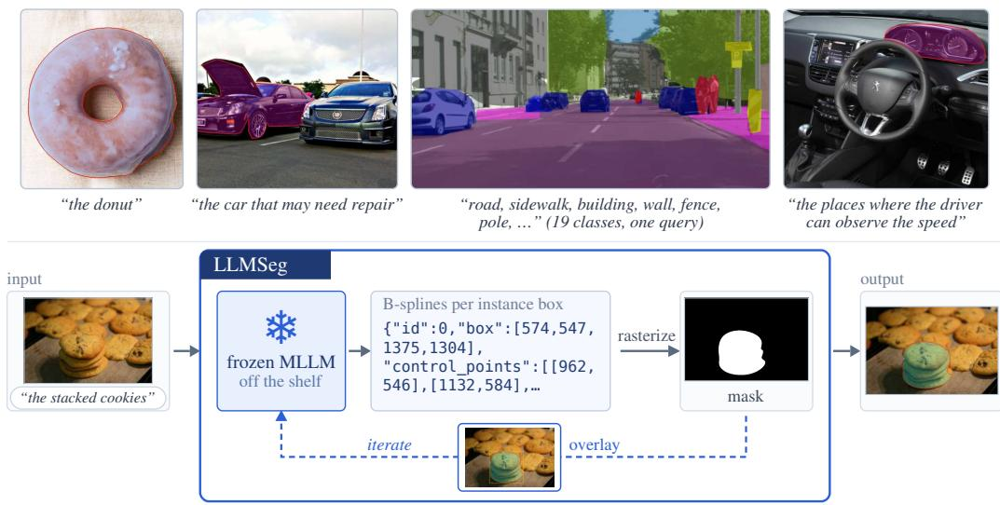  
Figure 1: Text-prompted segmentation from a frozen MLLM. LLMSeg segments an image from a free-form text query alone, with a frozen multimodal LLM as its only vision component: no segmentation head, no mask decoder, no training. Top: four results, each under its query. Bottom: the model emits geometry rather than pixels; deterministic code rasterizes it, and the rendered overlay is fed back so the model can inspect and correct its own boundary.

## 1 INTRODUCTION

Text-prompted segmentation (producing a pixel mask for every instance that matches a language query) is a foundational capability for multimodal AI. The dominant approach builds ever-stronger specialist models: the SAM series (Kirillov et al., 2023; Ravi et al., 2024) introduced promptable visual segmentation. SAM 3 (Carion et al., 2026) extends this capability to promptable concept segmentation from noun phrases. It relies on a dedicated detector-tracker architecture and a massive human- and model-in-the-loop data engine.

In parallel, multimodal large language models (MLLMs) have acquired remarkable general visual competence. Their capabilities include grounding, counting, and coarse localization (Comanici et al., 2025; OpenAI, 2023; Bai et al., 2025; Deitke et al., 2025). However, they are widely assumed to require a trained segmentation decoder, such as SAM, to produce dense pixel masks (Lai et al., 2024; Rasheed et al., 2024; Carion et al., 2026). We challenge this assumption. We present LLMSeg (Figure 1), a fully training-free pipeline. A general-purpose MLLM is its only vision component. It returns geometry: closed curves that deterministic code rasterizes into a mask and keeps inside each box. The work splits into three stages. Detect localizes every instance the query matches and returns its box. Segment traces that instance with closed periodic B-spline loops confined to the box. Refine reads the rendered overlay and retraces the errors that remain, each inside a signed focus box.

This design provides an explicit parametric intermediate representation: cubic traces encode smooth curves, while degree-one traces encode straight edges. Rasterization and refinement need not preserve a smooth final boundary. With topology enabled, holes are specified as subtractive loops. Reasoning queries (“the food that the bird likes to eat”) work off the shelf because each query is interpreted by the same LLM that performs the segmentation. Every stage emits human-readable JSON, making geometric decisions inspectable. Since LLMSeg adds no trained parameters, backend upgrades require no pipeline retraining and usually come with segmentation accuracy gains.

Contributions: (i) We propose LLMSeg, a training-free promptable segmentation pipeline in which an MLLM predicts parametric B-spline geometry confined to each detected box and then refines it inside signed focus boxes. (ii) We show for the first time at benchmark scale that a general-purpose MLLM can perform dense text-prompted segmentation without any trained segmentation component. LLMSeg with Gemini-3.7-Flash as the backend is competitive with SAM 3 (Carion et al., 2026) on ReasonSeg, RefCOCO/+/g, LVIS, COCO, SA-Co, ADE20K, Cityscapes, ODinW13, and RF-100VL, and reaches 71.5 cIoU on ReasonSeg val, the best among methods not fine-tuned for the task. Further analysis shows LLMSeg’s segmentation quality follows the backend strength without retraining, offering automatic improvement in segmentation with better backends.

## 2 RELATED WORK

Segmentation models and MLLM-driven segmentation. SAM (Kirillov et al., 2023) introduced promptable segmentation. SAM 2 (Ravi et al., 2024) extended it to video. SAM 3 (Carion et al., 2026) extended it to open-vocabulary concept prompts. GLIP (Li et al., 2022b), GroundingDINO (Liu et al., 2024a), OWLv2 (Minderer et al., 2023), and DINO-X (Ren et al., 2025) are trained specialists. MLLM-based methods add language reasoning but retain a trained mask component. LISA (Lai et al., 2024) decodes an LLM’s <SEG> token with SAM. GLaMM (Rasheed et al., 2024), PSALM (Zhang et al., 2024c), and X-SAM (Wang et al., 2025a) also use trained mask components. SAM4MLLM (Chen et al., 2024) and Seg-Zero (Liu et al., 2025) train MLLMs to prompt SAM.

Training-free alternatives include RSVP (Lu et al., 2025) and attention-based grounding (Kang et al., 2025). Agentic systems include SAM 3 Agent (Carion et al., 2026) and the piipeline in Colon-Bench (Hamdi et al., 2026). These approaches still delegate mask production to a segmentation model. In contrast, LLMSeg uses only text queries to a frozen, general-purpose MLLM. It requires no exemplars, input boxes, or video prompts. The MLLM emits the final geometry, which our loop revises directly.

Geometry as text and contour representations. Representing geometry as text is not new. Vision-LLM (Wang et al., 2023) represents boundaries as short polygons in a trained multitask pipeline. VisionLLM v2 (Wu et al., 2024a) uses task-specific trained decoders. PixelLLM (Xu et al., 2024) learns localization heads and obtains masks through SAM. Text4Seg (Lan et al., 2025) generates segmentation tokens but requires fine-tuning. General models such as Molmo (Deitke et al., 2025)

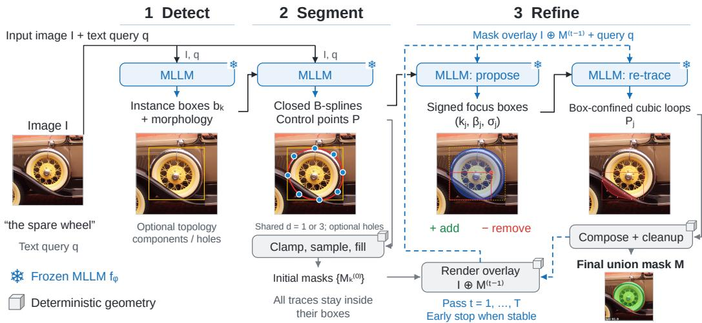  
Figure 2: LLMSeg pipeline overview. Detection localizes instances, segmentation traces box-confined Bsplines, and refinement corrects the mask within signed focus boxes (+ adds pixels, − removes them). Each MLLM call serves all instances (one is shown).

and Gemini (Comanici et al., 2025; Voigtlaender et al., 2025) also provide pointing and coarse localization. Classical boundary representations include spline snakes (Brigger et al., 2000). Trained vertex predictors include Polygon-RNN++ (Acuna et al., 2018) and Curve-GCN (Ling et al., 2019). LLMSeg uses this output space without training a contour predictor. A frozen, general-purpose backend emits control points that define the mask prediction. Only deterministic geometric processing follows. Confined signed regions then allow the refinement process to correct local parts of the mask.

## 3 METHOD

Overview. Given an image I and a free-form text query $q ,$ LLMSeg predicts binary masks for N retained instances. We index these instances by $k = 1 , \ldots , N$ . Stage 2 initializes each mask as $M _ { k } ^ { ( 0 ) }$ Refinement pass t produces $M _ { k } ^ { ( t ) }$ . Their union is $\begin{array} { r } { M ^ { ( t ) } = \bigcup _ { k = 1 } ^ { N } M _ { k } ^ { ( t ) } } \end{array}$ . The final output M is the union at termination. A frozen multimodal LLM $f _ { \phi }$ is the only vision component. No parameters are updated, and no segmentation head is attached. The pipeline accesses $f _ { \phi }$ only through fixed text prompts, with one prompt per stage call. Each call is stateless and uses no tools. Deterministic code controls the sequence. It also turns the returned geometry into masks. Figure 2 shows the three stages.

## 3.1 STAGE 1: DETECTING INSTANCES AND THEIR STRUCTURE

A single detection call to $f _ { \phi }$ takes I and q as input. For every instance matching $q ,$ it returns an axisaligned box $b _ { k } = [ x _ { k , 1 } , y _ { k , 1 } , x _ { k , 2 } , y _ { k , 2 } ]$ and a confidence score. It also returns a short morphology description of the coarse shape and aspect. Optionally, it provides a topology descriptor that specifies the component and hole counts. Near-duplicate boxes are merged at IoU $J \geq 0 . 9$ . Instances are then ordered in reading order. At most $N _ { \mathrm { m a x } }$ are kept, so $0 \le N \le N _ { \mathrm { m a x } }$ . Coordinates are given in absolute pixels. The origin is at the top left. In set operations, $b _ { k }$ denotes the pixel region inside that box. If $\bar { N } = 0 .$ , the output is empty.

## 3.2 STAGE 2: FROM LANGUAGE TO GEOMETRY

One batched call traces every instance at once. It returns an outer loop for each instance. With topology conditioning, it also returns one loop per predicted hole, each a list of control points.

Representation. A loop is a closed periodic B-spline of degree d. It is defined over a control polygon $P = ( p _ { 1 } , \ldots , p _ { n } )$ containing n two-dimensional control points indexed by i. The count n can vary

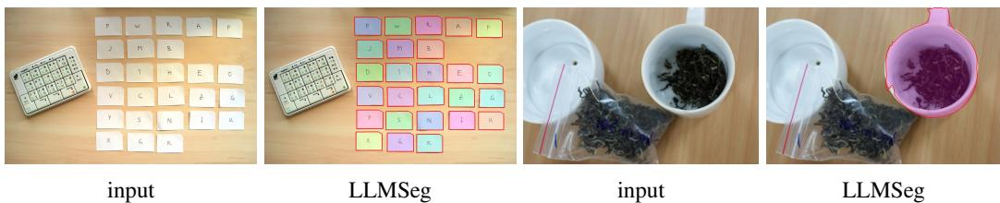  
“In an educational setting, children often use different materials to learn about letters, numbers, and words. What object in the picture could be used as a visual aidfor learning about letters and words?”  
“The general steps for brewing tea are to put tea leaves into a teacup and then pour hot water over them. What container in the picture is most likely to be used nextfor pouring hot water to make tea?”  
Figure 3: Reasoning queries work off the shelf. Two ReasonSeg items segmented by LLMSeg with Gemini-3.7-Flash. The same model reads the query, reasons about the image and outputs mask geometry, with no agent wrapper or query rewriting.

between loops. The polygon is wrapped so that $p _ { i + n } = p _ { i } { \mathrm { : } }$

$$
C _ { P , d } ( u ) \ = \ \sum _ { i = 1 } ^ { n } B _ { i , d } ( u ) \ p _ { i } , \qquad u \in [ 0 , n ] , \quad C _ { P , d } ( n ) = C _ { P , d } ( 0 ) ,\tag{1}
$$

where u is the curve parameter and $B _ { i , d }$ are the uniform periodic B-spline basis functions of degree d (Piegl & Tiller, 1997). Eq. (1) is a piecewise polynomial consisting of n degree-d segments. Each $B _ { i , d }$ is supported on only d+1 knot spans. Thus, each control point influences only d+1 segments, and a misplaced point changes a bounded arc rather than the whole curve. Stage 3 does not edit these original control points. Its locality comes from adding or subtracting focus-box regions.

We also let the model choose the degree. The same call that places the control points first chooses $d \in \{ 1 , 3 \}$ based on the object’s form. It uses $d = 3$ for rounded and organic silhouettes and $d = 1$ for angular, straight-edged ones. It then places the points as the selected degree requires. Cubic control points are pushed outward toward the edge, whereas degree-1 vertices lie directly on it. One degree is shared by all loops of all instances in the stage-2 call.

Rasterization by sampling. Masks are produced by sampling the curve and filling the resulting polygon, not by evaluating an implicit function. Let cl $\mathrm { { . p } } _ { b }$ denote the per-coordinate clamp onto a box b. Let Fill denote even-odd polygon fill (Foley et al., 1996). One loop then becomes the region

$$
\begin{array} { r } { { \mathcal R } _ { b , d } ( P ) = \mathrm { F i l l } \Big ( \big ( \mathrm { c l i p } _ { b } ( C _ { P , d } ( u _ { r } ) ) \big ) _ { r = 1 } ^ { m } \Big ) , \qquad u _ { r } = \frac { r - 1 } { m - 1 } n , } \end{array}\tag{2}
$$

with m samples indexed by $r ,$ uniformly spaced in the curve parameter and including the repeated endpoint. For cubic loops, m is proportional to the perimeter of $b ,$ so small and large objects are rasterized at comparable boundary resolution. For $d = 1$ , the control polygon is filled directly. Eq. (2) applies Fill to an ordered sequence of boundary samples. The control points are used as returned, and the sampled boundary is clamped to b before filling. A trace can never leave its own detected box, so a hallucinated control point cannot paint across the image. Overlapping instance boxes can still produce overlapping masks. Consequently, detection quality upper-bounds segmentation quality. With topology conditioning off, the initial instance mask is $M _ { k } ^ { ( 0 ) } = \mathcal { R } _ { b _ { k } , d } ( P _ { k } ^ { \mathrm { o u t } } )$ , where $P _ { k } ^ { \mathrm { o u t } }$ is instance k’s outer control polygon. When topology conditioning is enabled, regions rasterized from predicted hole loops are subtracted from the outer region to obtain $M _ { k } ^ { ( 0 ) }$ . The predicted hole count is not guaranteed to survive loop overlap, rasterization, refinement, or cleanup.

## 3.3 STAGE 3: ITERATIVE REFINEMENT

The initial outline often identifies the right object but misses boundary detail. Each refinement pass asks the model to locate errors on the current mask overlay. It then retraces those regions within smaller boxes. In pass $t = 1 , \dots , T$ , both calls receive $I \oplus M ^ { ( t - 1 ) }$ , the previous union mask rendered over the image. Leaving the fixed prompts and structural context implicit, we write the loop as

$$
\begin{array} { r } { \{ ( k _ { j } , \beta _ { j } , \sigma _ { j } ) \} _ { j } = f _ { \phi } ( I \oplus M ^ { ( t - 1 ) } , q ) , ~ } \\ { M _ { k } ^ { ( t ) } = \operatorname { C o m p o s e } \Bigl ( M _ { k } ^ { ( t - 1 ) } , \{ ( \sigma _ { j } , \mathcal { R } _ { \beta _ { j } , 3 } ( P _ { j } ) ) \} _ { j : k _ { j } = k } \Bigr ) . ~ } \end{array}\tag{3}
$$

<table><tr><td></td><td></td><td colspan="2">ReasonSeg</td><td colspan="3">RefCOCO</td><td colspan="3">RefCOCO+</td><td colspan="2">RefCOCOg</td></tr><tr><td>Method</td><td>MLLM/Backend</td><td>val</td><td>test</td><td>val</td><td>testA</td><td>testB</td><td>val</td><td>testA</td><td>testB</td><td>val (U)</td><td>test (U)</td></tr><tr><td>Seg-Zero</td><td>Qwen2.5-VL 7B</td><td>62.0</td><td>52.0</td><td>一</td><td></td><td>一</td><td>一</td><td></td><td></td><td></td><td>一</td></tr><tr><td>LISA</td><td>LLaVA 7B</td><td></td><td></td><td>74.9</td><td>79.1</td><td>72.3</td><td>65.1</td><td>70.8</td><td>58.1</td><td>67.9</td><td>70.6</td></tr><tr><td>LISA</td><td>LLaVA1.5 13B</td><td>72.9</td><td>62.2</td><td>一</td><td></td><td></td><td></td><td></td><td></td><td></td><td>1</td></tr><tr><td>GLaMM</td><td>Vicuna 7B</td><td>47.2</td><td></td><td>79.5</td><td>83.2</td><td>76.9</td><td>72.6</td><td>78.7</td><td>64.6</td><td>74.2</td><td>74.9</td></tr><tr><td>PSALM</td><td>Phi1.5 1.3B</td><td>一</td><td></td><td>83.6</td><td>84.7</td><td>81.6</td><td>72.9</td><td>75.5</td><td>70.1</td><td>73.8</td><td>74.4</td></tr><tr><td>RICE</td><td>Qwen2.5-7B</td><td></td><td></td><td>83.5</td><td>85.3</td><td>81.7</td><td>79.4</td><td>82.8</td><td>75.4</td><td>79.8</td><td>80.4</td></tr><tr><td>HyperSeg</td><td>Phi2 2.7B</td><td>56.7</td><td></td><td>84.8</td><td>85.7</td><td>83.4</td><td>79.0</td><td>83.5</td><td>75.2</td><td>79.4</td><td>78.9</td></tr><tr><td>X-SAM</td><td>Phi3 3.8B</td><td>32.9</td><td>41.0</td><td>85.1</td><td>87.1</td><td>83.4</td><td>78.0</td><td>81.0</td><td>74.4</td><td>83.8</td><td>83.9</td></tr><tr><td>Grounded SAM</td><td></td><td>14.5</td><td>16.4</td><td></td><td>一</td><td>1</td><td>一</td><td>一</td><td>一</td><td>一</td><td>一</td></tr><tr><td>Gemini Seg</td><td>Gemini2.5 Flash</td><td>13.3</td><td>9.2</td><td></td><td>一</td><td></td><td>一</td><td></td><td></td><td></td><td>一</td></tr><tr><td>SAM 3*</td><td></td><td>9.9</td><td>11.3</td><td>42.0</td><td>42.8</td><td>44.2</td><td>33.6</td><td>37.0</td><td>32.9</td><td>40.0</td><td>39.7</td></tr><tr><td>LISA</td><td>LLaVA1.5 13B</td><td>60.3</td><td>50.8</td><td></td><td>一</td><td></td><td></td><td></td><td></td><td></td><td></td></tr><tr><td>Kang et al.</td><td>LLaVA1.5 13B</td><td>60.5</td><td>49.9</td><td>76.1</td><td>78.9</td><td>72.8</td><td>64.1</td><td>67.1</td><td>57.3</td><td>67.7</td><td>69.0</td></tr><tr><td>RSVP</td><td>GPT-40</td><td>63.1</td><td>60.0</td><td></td><td></td><td></td><td></td><td></td><td></td><td></td><td>一</td></tr><tr><td>SAM 3 Agent</td><td>Qwen2.5-VL 7B</td><td>49.1</td><td>53.5</td><td>59.4</td><td>64.3</td><td>55.0</td><td>51.4</td><td>57.0</td><td>44.9</td><td>57.2</td><td>58.8</td></tr><tr><td>SAM 3 Agent</td><td>Qwen2.5-VL 72B</td><td>65.1</td><td>64.0</td><td>71.6</td><td>74.9</td><td>66.0</td><td>64.9</td><td>70.8</td><td>57.9</td><td>68.8</td><td>70.2</td></tr><tr><td>SAM 3 Agent</td><td>Llama4 Maverick</td><td>61.5</td><td>60.9</td><td>71.7</td><td>76.5</td><td>66.5</td><td>65.1</td><td>71.2</td><td>57.6</td><td>67.7</td><td>68.7</td></tr><tr><td>SAM 3 Agent</td><td>Qwen3-VL 8B Think</td><td>57.4</td><td>67.3</td><td>68.6</td><td>72.3</td><td>63.9</td><td>59.3</td><td>64.5</td><td>55.6</td><td>66.4</td><td>66.9</td></tr><tr><td>SAM 3 Agent</td><td>Qwen3-VL 235B Think</td><td>67.0</td><td>71.8</td><td>73.9</td><td>77.0</td><td>69.7</td><td>66.9</td><td>70.9</td><td>62.2</td><td>72.1</td><td>72.9</td></tr><tr><td>SAM 3 Agent</td><td>Ġemini2.5 Pro</td><td>66.0</td><td>72.1</td><td>75.5</td><td>77.6</td><td>71.0</td><td>67.3</td><td>71.1</td><td>63.4</td><td>73.4</td><td>74.0</td></tr><tr><td>SAM 3 Agent*</td><td>Gemma-4-31B</td><td>63.9</td><td>66.7</td><td>73.2</td><td>75.6</td><td>75.0</td><td>67.2</td><td>72.0</td><td>61.9</td><td>72.1</td><td>74.7</td></tr><tr><td>SAM 3 Agent*</td><td>Gemini-3.7-Flash</td><td>62.0</td><td>63.2</td><td>73.2</td><td>76.7</td><td>75.5</td><td>68.4</td><td>72.0</td><td>68.5</td><td>76.5</td><td>76.9</td></tr><tr><td>LLMSeg (w/o refine)</td><td>Gemini-3.7-Flash</td><td>64.6</td><td>58.2</td><td>65.5</td><td>65.7</td><td>72.9</td><td>59.7</td><td>61.4</td><td>61.1</td><td>64.8</td><td>69.3</td></tr><tr><td>LLMSeg (full)</td><td>Gemini-3.7-Flash</td><td>71.5</td><td>65.8</td><td>71.2</td><td>73.8</td><td>76.0</td><td>67.0</td><td>69.9</td><td>64.9</td><td>70.9</td><td>74.5</td></tr></table>

Table 1: Reasoning and referring expression segmentation. Results on ReasonSeg (Lai et al., 2024) and RefCOCO/+/g (Kazemzadeh et al., 2014; Mao et al., 2016). All values are cIoU. The baselines are Seg-Zero (Liu et al., 2025), LISA (Lai et al., 2024), GLaMM (Rasheed et al., 2024), PSALM (Zhang et al., 2024c), RICE (Xie et al., 2025), HyperSeg (Wei et al., 2024), X-SAM (Wang et al., 2025a), Grounded SAM (Ren et al., 2024), Gemini Seg (Voigtlaender et al., 2025), Kang et al. (Kang et al., 2025), RSVP (Lu et al., 2025), and both SAM 3 and SAM 3 Agent (Carion et al., 2026). The top block contains methods fine-tuned for referring or reasoning segmentation. Unmarked rows are published full-split numbers quoted from SAM 3 Carion et al. (2026). ∗ Our baseline evaluation uses the complete ReasonSeg splits. On RefCOCO/+/g, it uses the same 500-item random subset per split as LLMSeg. Bold is the best and underline the second best per column.

Here j indexes the focus boxes in the current pass. The value $k _ { j }$ identifies the instance corrected by the jth focus box. The box $\beta _ { j }$ is confined to that instance’s box. The sign $\sigma _ { j } \in \{ + 1 , - 1 \}$ requests addition or removal. A second call uses the same overlay, query, and box geometry. It returns cubic control polygons for all retained boxes in one batch, where $P _ { j }$ is the control polygon of the jth focus box, which corrects instance $k = k _ { j }$ . Before this call, an effect gate discards boxes with negligible potential to change the mask. If none remain, retracing is skipped.

Composition applies each correction to instance $k _ { j }$ and cleans up small artifacts. It carries a perinstance commitment field that is implicit in Eq. (3). This field resists opposing edits and reduces oscillation. Boolean composition and cleanup need not leave a globally smooth spline boundary. The updated union $M ^ { ( t ) }$ feeds the next pass. Both model calls batch all instances, so each pass uses at most two MLLM calls regardless of N. The gating and cleanup settings, the per-pixel composition rule, and a worked example of each call are given in Section B. Refinement ends after at most T passes, or once the union mask changes only negligibly for s consecutive passes (the patience criterion). Section 4 gives additional details, and Section 5 examines convergence.

## 4 EXPERIMENTS

## 4.1 EXPERIMENTAL SETUP

Benchmarks and metrics. We follow the image evaluation suite of SAM 3 (Carion et al., 2026). We use each benchmark’s standard metrics. (i) Referring and reasoning segmentation: We evaluate on ReasonSeg (Lai et al., 2024) (val/test) and all splits of RefCOCO, RefCOCO+, and RefCOCOg (Kazemzadeh et al., 2014; Mao et al., 2016). We report gIoU (mean per-item IoU) and cIoU (cumulative P I/P U). (ii) Open-vocabulary instance segmentation: We evaluate on LVIS (Gupta et al., 2019) and COCO (Lin et al., 2014), and additionally on SA-Co/Gold (Carion et al., 2026), which is reported in the appendix (Table 8). We report presence-gated cgF1 and pmF1 (with hard negative prompts), positive-set IoU, and COCO-style box/mask AP. (iii) Semantic segmentation: We report 19-class mIoU on Cityscapes (Cordts et al., 2016), using deterministic mask compositing. We use ADE20K (Zhou et al., 2019) as a class-prompted oracle upper bound. (iv) Zero-shot detection: We evaluate on ODinW13 (Li et al., 2022a) and RF-100VL (Robicheaux et al., 2025). We report $\mathsf { A P _ { 0 } }$ , the mean per-subset box AP computed from masks.

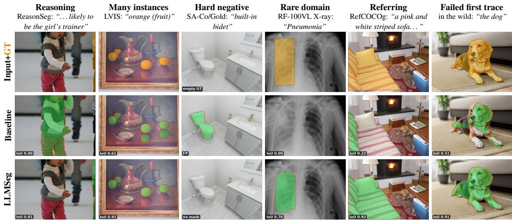  
Figure 4: LLMSeg Qualitative comparisons. We show compariosns of LLMSeg with baselines on various setups. Top: input with ground truth in amber. Middle: the baselines SAM 3 in the first four columns and LLMSeg (w/o refine) in the last two. Bottom: LLMSeg.

Protocol: complete splits and sampled subsets. We run each split in full whenever end-to-end evaluation is practical. This includes ReasonSeg val (200) and test (779), Cityscapes val (500), and every ODinW13 and RF-100VL subset (6,237 and 1,987 items). In total, we fully evaluate 9,703 of the 17,703 scored items. Four of the ten benchmarks are run in full. The remaining annotation files contain $1 0 ^ { 4 }$ to $1 0 ^ { 5 }$ items, making full MLLM inference impractical. We instead draw uniform random samples with seed 0. We do not take the first items because the annotation files are strongly ordered. We sample 1,500 items each from LVIS and COCO, 1,000 from ADE20K, and 500 from each RefCOCO/+/g split. The item counts above cover the ten benchmarks of the main tables. The appendix SA-Co/Gold evaluation uses a further 2,500 items covering all seven domains. On these sampled splits, we run every baseline once on thefull split. We then recompute its metrics on exactly the item set seen by LLMSeg, using a shared-key intersection. Negative sampling is also identical: 3 negatives per positive for LVIS and COCO, with seed 0.

LLMSeg configuration. The main results use Gemini-3.7-Flash as the backend for all three stages. The backend selects the Stage-2 curve degree $d \in \{ 1 , 3 \}$ (Section 3). This degree is shared across all instances in a call. Refinement curves are always cubic. Refinement uses a budget of T=8 passes, a cap of $N _ { \mathrm { m a x } } { = } 2 0 0$ instances per image (matching SAM 3’s cap), and a focus-box budget of 6 per instance per pass. The stopping criterion is $| M ^ { ( t ) } \triangle M ^ { ( t - 1 ) } | < \varepsilon | \bigcup _ { k = 1 } ^ { N } b _ { k } |$ |, where $\varepsilon { = } 0 . 0 0 5$ . The loop stops when this criterion holds for s=3 consecutive passes with $t \geq 1$ . Here, s is the stopping patience, | · | counts pixels, and △ denotes symmetric difference. The denominator is the union of the instance boxes. By Eq. (2), this is the only region that a pass can alter. Normalizing by the full image would make the same threshold behave very differently for small and large objects (Section 5).

A full run uses 2 MLLM calls for detection and segmentation. Each refinement pass adds at most 2 calls. Thus, the maximum is 2T+2 = 18 calls, although early stopping keeps the measured mean well below this limit. The stage-1 topology descriptor (Section 3) is optional. The main results disable it for all three stages (Section 5). We use the same settings on every benchmark and tune nothing per dataset.

Baselines. Our two main baselines are from the SAM 3 paper (Carion et al., 2026). SAM 3: We use the public checkpoint through Hugging Face Transformers in fp32. We provide one text query per item and allow up to 200 instances. We score its output with the same metric code on the same items. SAM 3 also accepts image-exemplar and box prompts and supports video. We use none of these features, and LLMSeg is text-only by design. SAM 3 Agent: This agent baseline was introduced in the same paper. An MLLM drives SAM 3 as a tool. The MLLM proposes simple noun phrases for SAM 3, inspects the returned numbered masks, and selects those matching the query. We use Gemma-4-31B-it and Gemini-3.7-Flash rather than the paper’s Qwen and Gemini 2.5 Pro backends. The selected union is scored identically. We also quote full-split numbers of published specialists from Carion et al. (2026).

<table><tr><td rowspan="3"></td><td colspan="3">Semantic segmentation</td><td colspan="8">Zero-shot detection</td></tr><tr><td colspan="2">ADE20K-150</td><td>Cityscapes</td><td colspan="4">ODinW13</td><td colspan="4">RF-100VL</td></tr><tr><td>gIoU</td><td>cIoU</td><td>mIoU</td><td> $\mathsf { A P _ { 0 } }$ </td><td>gIoU</td><td>cIoU</td><td>pmF1</td><td> $\mathsf { A P _ { 0 } }$ </td><td>gIoU</td><td>cIoU</td><td>pmF1</td></tr><tr><td>APE-D (LVIS-trained)</td><td></td><td></td><td>44.2</td><td></td><td></td><td></td><td></td><td></td><td></td><td></td><td></td></tr><tr><td>Gemini 2.5 Pro</td><td></td><td></td><td></td><td>33.7</td><td></td><td></td><td></td><td>11.6</td><td></td><td></td><td></td></tr><tr><td>gDino-T</td><td></td><td></td><td></td><td>49.7</td><td></td><td></td><td></td><td>15.7</td><td></td><td></td><td></td></tr><tr><td>gDino1.5-Pro</td><td></td><td></td><td></td><td>58.7</td><td></td><td></td><td></td><td></td><td></td><td></td><td></td></tr><tr><td>SAM 3</td><td></td><td></td><td>65.2</td><td>61.0</td><td></td><td></td><td></td><td>15.2</td><td></td><td></td><td></td></tr><tr><td>SAM 3*</td><td>57.9</td><td>67.3</td><td>63.7</td><td>51.5</td><td>48.3</td><td>51.5</td><td>39.6</td><td>14.2</td><td>13.8</td><td>21.7</td><td>11.4</td></tr><tr><td>LLMSeg (w/o refine)</td><td>56.6</td><td>60.5</td><td>48.8</td><td>52.0</td><td>48.7</td><td>48.7</td><td>50.0</td><td>30.4</td><td>42.1</td><td>50.8</td><td>58.7</td></tr><tr><td>LLMSeg (full)</td><td>59.2</td><td>64.7</td><td>53.3</td><td>57.2</td><td>54.2</td><td>55.7</td><td>57.5</td><td>31.4</td><td>43.6</td><td>53.2</td><td>61.7</td></tr></table>

Table 2: Semantic segmentation and zero-shot detection. The baselines are APE-D (Shen et al., 2024), Gemini 2.5 Pro (Comanici et al., 2025), and gDino-T (Liu et al., 2024a). LLMSeg uses Gemini-3.7-Flash. Unmarked baselines are published full-split numbers. ∗ Our evaluation uses complete splits, except on ADE20K, where we use the same 1,000 random items as the shaded rows. ADE20K reports oracle-class union-IoU and Cityscapes reports 19-class mIoU. Detection reports mean per-subset box $\mathsf { A P _ { 0 } }$ and pooled mask metrics. Bold is the best and underline the second best per column.
<table><tr><td></td><td colspan="3">LVIS</td><td colspan="3">COCO</td></tr><tr><td>Method</td><td>cgF1</td><td>box AP</td><td>mask AP</td><td>cgF1</td><td>box AP</td><td>mask AP</td></tr><tr><td>OWLv2</td><td>20.1</td><td>35.2</td><td></td><td></td><td>38.2</td><td>一</td></tr><tr><td>OWLv2†</td><td>29.3</td><td>45.5</td><td>43.4</td><td></td><td>46.1</td><td>一</td></tr><tr><td>gDino-T</td><td>14.7</td><td>20.5</td><td></td><td></td><td>45.7</td><td>一</td></tr><tr><td>LLMDet-L</td><td>35.1</td><td>42.0</td><td>36.3</td><td></td><td>55.6</td><td></td></tr><tr><td>APE-D†</td><td>一</td><td>59.6</td><td>53.0</td><td></td><td>58.3</td><td></td></tr><tr><td>DINO-X</td><td></td><td>52.4</td><td>38.5</td><td></td><td>56.0</td><td></td></tr><tr><td>Gemini 2.5 Flash</td><td>13.4</td><td></td><td></td><td></td><td></td><td></td></tr><tr><td>SAM 3</td><td>37.2</td><td>53.6</td><td>48.5</td><td></td><td>56.4</td><td></td></tr><tr><td>SAM 3*</td><td>50.1</td><td>69.1</td><td>62.2</td><td>52.4</td><td>68.0</td><td>59.2</td></tr><tr><td> $\mathbf { S A M } 3 \mathbf { A g e n t } ^ { * }$ </td><td>51.0</td><td>56.2</td><td>50.9</td><td>49.9</td><td>48.9</td><td>42.0</td></tr><tr><td>LLMSeg (w/o refine)</td><td>50.4</td><td>57.1</td><td>36.9</td><td>50.4</td><td>59.6</td><td>38.0</td></tr><tr><td>LLMSeg (full)</td><td>53.9</td><td>64.2</td><td>47.2</td><td>56.1</td><td>66.6</td><td>50.5</td></tr></table>

Table 3: Open-vocabulary instance segmentation. The baselines are OWLv2 (Minderer et al., 2023), gDino-T (Liu et al., 2024a), LLMDet-L (Fu et al., 2025), APE-D (Shen et al., 2024), DINO-X (Ren et al., 2025), and Gemini 2.5 Flash (Comanici et al., 2025). ∗ Evaluated on a matched subset. Unmarked rows are published results from SAM 3 (Carion et al., 2026). † LVIS-trained. cgF1 is presence-gated F1.

## 4.2 MAIN RESULTS

Tables 1 to 3 summarize ten benchmarks. Figure 4 shows one example per setting. Additional examples appear in Figures 10 to 14.

Reasoning segmentation. On ReasonSeg (Table 1), LLMSeg reaches 71.5 cIoU on validation. This is the best result among methods not fine-tuned for the task. Refinement adds 6.9 cIoU over the segment stage alone. The gIoU scores and complete published results for both tasks appear in Section D.1.

Referring expression segmentation. On RefCOCO/+/g (Table 1), LLMSeg substantially outperforms SAM 3, while SAM 3 Agent generally remains stronger. Refinement improves cIoU across all eight splits. On RefCOCO testB, LLMSeg reaches 76.0 cIoU, the best zero-shot result on that split. This result shows that refinement narrows the gap to SAM 3 Agent.

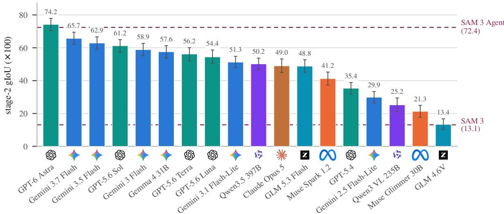  
Figure 5: LLMSeg quality is the backend’s quality. Stage-2 gIoU on all 200 ReasonSeg val items. We show 18 of the 21 tested backends for readability. Whiskers show 95% item-bootstrap intervals. Dashed lines mark SAM 3 and SAM 3 Agent (Gemini-3.7-Flash). Recent MLLMs like GPT-6 Astra surpasses SAM 3 Agent even without refinement.

Open-vocabulary instance segmentation. LLMSeg reaches 53.9 and 56.1 cgF1 on LVIS and COCO (Table 3). It outperforms both SAM 3 baselines in cgF1 but trails SAM 3 in mask AP.

Semantic segmentation and zero-shot in-the-wild detection. LLMSeg achieves 59.2 gIoU on ADE20K and 53.3 mIoU on Cityscapes (Table 2). On Cityscapes, it trails SAM 3 by 10.4 points. Dense scene labeling therefore remains a limitation. On zero-shot detection, LLMSeg reaches 57.2 $\mathsf { A P _ { 0 } }$ on ODinW13 and 31.4 on RF-100VL (Table 2). It exceeds SAM 3 on all four metrics in both benchmarks. Its $\mathsf { A P _ { 0 } }$ on RF-100VL is $2 . 2 \times$ that of SAM 3, showing strong cross-domain transfer.

## 5 ANALYSIS

## 5.1 BACKEND PROGRESS TRANSFERS WITHOUT SEGMENTATION TRAINING

We hold the pipeline fixed (T=12, topology on) and test 21 backends from six developers. Stage-2 gIoU ranges from 13.4 to 74.2 on ReasonSeg val (Figure 5). Recently-released GPT-6 Astra reaches 74.2 without a segmentation model, compared with 72.4 for SAM 3 Agent driven by Gemini-3.7- Flash. The benefit is that LLMSeg can use better backends without retraining. General benchmark capability is a weak predictor of segmentation quality. Strong public scores do not reliably translate into strong masks (e.g., Claude Opus 5). The full ranking and generation comparisons are in Section E.2. The appendix also reports the stage-2 and final results and the study protocol.

## 5.2 REFINEMENT IMPROVES THE BOUNDARY AND USUALLY STOPS EARLY

With Gemini-3.7-Flash, refinement improves every benchmark in Tables 1 to 3. Focus boxes let the model correct a local boundary without redrawing the object. In the topology-enabled ablation, removing refinement reduces cIoU by 5.4 on ReasonSeg and 12.7 on RefCOCO (Table 4). This is the clearest component effect. However, refinement is also the largest source of inference cost. The loop has no convergence guarantee, so we measure both mask stability and quality. In the $T { = } 1 2$ ReasonSeg study, 79% of items stop before the cap (Figure 15a). The median item uses six passes, while 18.5% reach the cap. We score the mask after each pass budget (Figure 6). Four passes recover 2.7 of the eventual 3.2 gIoU gain. Raising T from 8 to 12 changes gIoU by under 0.1. The main results therefore use T=8. At T=12, early stopping cuts mean calls from 26 to 14.7.

## 5.3 ABLATION STUDY

Table 4 compares the core design alternatives in final-mask quality and inference calls with Gemini-3.7-Flash on 200 items per split. The shaded row uses the main method’s conditioning without topology. The ReasonSeg reports three-run means and standard deviations. RefCOCO has one run per configuration.

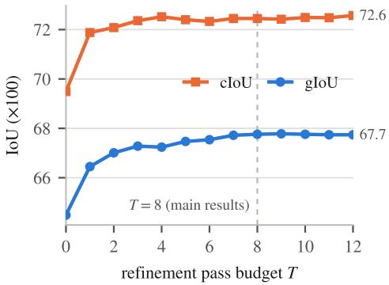  
Figure 6: Refinement budget. We score the mask after the first T passes at every budget on 200 ReasonSeg val items with Gemini-3.7-Flash. Gains saturate before T=8, the budget of the main results.

<table><tr><td rowspan="2">Configuration</td><td colspan="2">ReasonSeg val</td><td colspan="2">RefCOCO val</td></tr><tr><td>cIoU ↑</td><td>calls↓</td><td>cIoU ↑</td><td>calls ↓</td></tr><tr><td>w/o refinement</td><td>67.2 ±2.72</td><td>2.0</td><td>64.6</td><td>2.0</td></tr><tr><td>w/o detection</td><td>72.1 ±0.87</td><td>8.8</td><td>78.8</td><td>10.4</td></tr><tr><td>w/ topology</td><td>72.6 ±0.23</td><td>14.3</td><td>77.3</td><td>16.8</td></tr><tr><td>Polygon loops</td><td>73.1 ±3.16</td><td>14.7</td><td>79.1</td><td>16.6</td></tr><tr><td>Per-instance refinement</td><td>74.9 ±0.91</td><td>21.3</td><td>77.7</td><td>18.8</td></tr><tr><td>Main conditioning</td><td>74.7 ±1.62</td><td>14.6</td><td>79.8</td><td>17.5</td></tr></table>

Table 4: Design alternatives. Final cIoU and mean MLLM calls per image. ReasonSeg values are mean ± run SD over three runs. RefCOCO values come from one run. Gray marks the main conditioning.

Detection helps the initial trace. Removing detection lowers initial cIoU from 68.3 to 60.3 on ReasonSeg. On RefCOCO, it lowers initial cIoU from 66.0 to 63.5. After refinement, the no-detection configuration closes these gaps with fewer total calls. Detection’s initial advantage is larger on the 63 ReasonSeg targets with disconnected ground-truth masks (+11.3 cIoU). After refinement,

Batching bounds the cost as instance count grows. Per-instance cropped refinement increases ReasonSeg calls from 14.3 to 21.3 (49%). This yields a 2.3-point cIoU increase. On RefCOCO, it adds calls for only a 0.4-point increase. Batched tracing uses one call, regardless of the instance count, and hence it is our default choice. In contrast, crop-based calls grow with the number of instances.

Letting the model choose the degree helps. Forcing polygon loops (B-splines of degree 1) degrades performance on some instances. Letting the model pick the degree improves it, specially on curved structures that are difficult to represent with straght lines ( see Figure 22 in the Appendix).

## 6 CONCLUSION

We presented LLMSeg, a training-free pipeline that transforms a multimodal LLM into a textprompted segmenter using box-confined B-spline geometry and iterative focus-box refinement. Across ten benchmarks spanning four task families, LLMSeg is competitive with SAM 3 and performs better on reasoning queries, rare domains, and some metrics. Its limitations include detection errors, imprecise pixel-level boundaries, amorphous classes, and inference cost. The code, prompts, and evaluation harness are available at https://abdullahamdi.com/llmseg/.

## REFERENCES

David Acuna, Huan Ling, Amlan Kar, and Sanja Fidler. Efficient interactive annotation of segmentation datasets with polygon-rnn++. In 2018 IEEE/CVF Conference on Computer Vision and Pattern Recognition (CVPR), pp. 859–868. IEEE, 2018.

Xiang An, Kaicheng Yang, Xiangzi Dai, Ziyong Feng, and Jiankang Deng. Multi-label cluster discrimination for visual representation learning. In European Conference on Computer Vision, pp. 428–444. Springer, 2024.

Shuai Bai, Yuxuan Cai, Ruizhe Chen, Keqin Chen, Xionghui Chen, Zesen Cheng, Lianghao Deng, Wei Ding, Chang Gao, Chunjiang Ge, et al. Qwen3-vl technical report. arXiv preprint arXiv:2511.21631, 2025.

Patrick Brigger, Jeff Hoeg, and Michael Unser. B-spline snakes: a flexible tool for parametric contour detection. IEEE Transactions on Image Processing, 9(9):1484–1496, 2000.

Nicolas Carion, Francisco Massa, Gabriel Synnaeve, Nicolas Usunier, Alexander Kirillov, and Sergey Zagoruyko. End-to-end object detection with transformers. In European Conference on Computer Vision, pp. 213–229. Springer, 2020.

Nicolas Carion, Laura Gustafson, Yuan-Ting Hu, Shoubhik Debnath, Ronghang Hu, Didac Suris Coll-Vinent, Chaitanya Ryali, Kalyan Vasudev Alwala, Haitham Khedr, Andrew Huang, et al. Sam 3: Segment anything with concepts. In International Conference on Learning Representations, 2026.

Lluis Castrejon, Kaustav Kundu, Raquel Urtasun, and Sanja Fidler. Annotating object instances with a polygon-rnn. In 2017 IEEE Conference on Computer Vision and Pattern Recognition (CVPR), pp. 4485–4493. IEEE, 2017.

Yi-Chia Chen, Wei-Hua Li, Cheng Sun, Yu-Chiang Frank Wang, and Chu-Song Chen. SAM4MLLM: Enhance multi-modal large language model for referring expression segmentation. In European Conference on Computer Vision, pp. 323–340. Springer, 2024.

Gheorghe Comanici, Eric Bieber, Mike Schaekermann, Ice Pasupat, Noveen Sachdeva, Inderjit Dhillon, Marcel Blistein, Ori Ram, Dan Zhang, Evan Rosen, et al. Gemini 2.5: Pushing the frontier with advanced reasoning, multimodality, long context, and next generation agentic capabilities. arXiv preprint arXiv:2507.06261, 2025.

Marius Cordts, Mohamed Omran, Sebastian Ramos, Timo Rehfeld, Markus Enzweiler, Rodrigo Benenson, Uwe Franke, Stefan Roth, and Bernt Schiele. The cityscapes dataset for semantic urban scene understanding. In CVPR, 2016.

Matt Deitke, Christopher Clark, et al. Molmo and pixmo: Open weights and open data for state-ofthe-art vision-language models. In Proceedings of the IEEE/CVF Conference on Computer Vision and Pattern Recognition (CVPR), 2025.

Zheng Ding, Jieke Wang, and Zhuowen Tu. Open-vocabulary universal image segmentation with MaskCLIP. arXiv preprint arXiv:2208.08984, 2022.

Yue Fan, Xiaojian Ma, Rujie Wu, Yuntao Du, Jiaqi Li, Zhi Gao, and Qing Li. Videoagent: A memoryaugmented multimodal agent for video understanding. In European Conference on Computer Vision, pp. 75–92. Springer, 2024.

James D. Foley, Andries van Dam, Steven K. Feiner, and John F. Hughes. Computer Graphics: Principles and Practice. Addison-Wesley, 2 edition, 1996.

Shenghao Fu, Qize Yang, Qijie Mo, Junkai Yan, Xihan Wei, Jingke Meng, Xiaohua Xie, and Wei-Shi Zheng. LLMDet: Learning strong open-vocabulary object detectors under the supervision of large language models. In Proceedings ofthe IEEE/CVF Conference on Computer Vision and Pattern Recognition, 2025.

Yuying Ge, Yixiao Zhao, Ziyun Zhu, et al. Planting a seed of vision in large language model. arXiv preprint arXiv:2307.08041, 2023.

Xiuye Gu, Tsung-Yi Lin, Weicheng Kuo, and Yin Cui. Open-vocabulary object detection via vision and language knowledge distillation. arXiv preprint arXiv:2104.13921, 2021.

Agrim Gupta, Piotr Dollar, and Ross Girshick. LVIS: A dataset for large vocabulary instance segmentation. In Proceedings of the IEEE/CVF Conference on Computer Vision and Pattern Recognition, pp. 5356–5364, 2019.

Abdullah Hamdi, Changchun Yang, and Xin Gao. Colon-Bench: An Agentic Workflow for Scalable Dense Lesion Annotation in Full-Procedure Colonoscopy Videos . In Medical Image Computing and Computer Assisted Intervention – MICCAI 2026. Springer Nature Switzerland, 2026.

Jiaqi Huang, Zunnan Xu, Ting Liu, Yong Liu, Haonan Han, Kehong Yuan, and Xiu Li. Densely connected parameter-efficient tuning for referring image segmentation. In Proceedings of the AAAI Conference on Artificial Intelligence, pp. 3653–3661, 2025.

Qing Jiang, Feng Li, Zhaoyang Zeng, Tianhe Ren, Shilong Liu, and Lei Zhang. T-Rex2: Towards generic object detection via text-visual prompt synergy. In European Conference on Computer Vision, pp. 38–57. Springer, 2024.

Qing Jiang, Junan Huo, Xingyu Chen, Yuda Xiong, Zhaoyang Zeng, Yihao Chen, Tianhe Ren, Junzhi Yu, and Lei Zhang. Detect anything via next point prediction. In Proceedings ofthe IEEE/CVF Conference on Computer Vision and Pattern Recognition, pp. 25472–25483, 2026.

Aishwarya Kamath, Mannat Singh, Yann LeCun, Gabriel Synnaeve, Ishan Misra, and Nicolas Carion. MDETR: Modulated detection for end-to-end multi-modal understanding. In Proceedings ofthe IEEE/CVF International Conference on Computer Vision, pp. 1780–1790, 2021.

Seil Kang, Jinyeong Kim, Junhyeok Kim, and Seong Jae Hwang. Your large vision-language model only needs a few attention heads for visual grounding. In Proceedings ofthe IEEE/CVF Conference on Computer Vision and Pattern Recognition, pp. 9339–9350, 2025.

Michael Kass, Andrew Witkin, and Demetri Terzopoulos. Snakes: Active contour models. International Journal ofComputer Vision, 1(4):321–331, 1988.

Sahar Kazemzadeh, Vicente Ordonez, Mark Matten, and Tamara Berg. ReferItGame: Referring to objects in photographs of natural scenes. In Proceedings of the 2014 Conference on Empirical Methods in Natural Language Processing (EMNLP), pp. 787–798, 2014.

Alexander Kirillov, Eric Mintun, Nikhila Ravi, Hanzi Mao, Chloe Rolland, Laura Gustafson, Tete Xiao, Spencer Whitehead, Alexander C. Berg, Wan-Yen Lo, Piotr Dollar, and Ross Girshick.´ Segment anything, 2023. URL https://arxiv.org/abs/2304.02643.

Xin Lai, Zhuotao Tian, Yukang Chen, Yanwei Li, Yuhui Yuan, Shu Liu, and Jiaya Jia. LISA: Reasoning segmentation via large language model. In Proceedings ofthe IEEE/CVF Conference on Computer Vision and Pattern Recognition, pp. 9579–9589, 2024.

Mengcheng Lan, Chaofeng Chen, Yue Zhou, Jiaxing Xu, Yiping Ke, Xinjiang Wang, Litong Feng, and Wei Zhang. Text4seg: Reimagining image segmentation as text generation. In International Conference on Learning Representations, 2025.

Justin Lazarow, Weijian Xu, and Zhuowen Tu. Instance segmentation with mask-supervised polygonal boundary transformers. In 2022 IEEE/CVF Conference on Computer Vision and Pattern Recognition (CVPR), pp. 4372–4381. IEEE, 2022.

Chunyuan Li, Haotian Liu, Liunian Li, Pengchuan Zhang, Jyoti Aneja, Jianwei Yang, Ping Jin, Houdong Hu, Zicheng Liu, Yong Jae Lee, et al. ELEVATER: A benchmark and toolkit for evaluating language-augmented visual models. Advances in Neural Information Processing Systems, 35:9287–9301, 2022a.

Jiachen Li, Qing Xie, Renshu Gu, Jinyu Xu, Yongjian Liu, and Xiaohan Yu. Lgd: Leveraging generative descriptions for zero-shot referring image segmentation. arXiv preprint arXiv:2504.14467, 2025.

Liunian Harold Li, Pengchuan Zhang, Haotian Zhang, Jianwei Yang, Chunyuan Li, Yiwu Zhong, Lijuan Wang, Lu Yuan, Lei Zhang, Jenq-Neng Hwang, et al. Grounded language-image pre-training. In Proceedings of the IEEE/CVF Conference on Computer Vision and Pattern Recognition, pp. 10965–10975, 2022b.

Feng Liang, Bichen Wu, Xiaoliang Dai, Kunpeng Li, Yinan Zhao, Hang Zhang, Peizhao Zhang, Peter Vajda, and Diana Marculescu. Open-vocabulary semantic segmentation with mask-adapted CLIP. In Proceedings of the IEEE/CVF Conference on Computer Vision and Pattern Recognition, pp. 7061–7070, 2023.

Justin Liang, Namdar Homayounfar, Wei-Chiu Ma, Yuwen Xiong, Rui Hu, and Raquel Urtasun. Polytransform: Deep polygon transformer for instance segmentation. In 2020 IEEE/CVF Conference on Computer Vision and Pattern Recognition (CVPR), pp. 9128–9137. IEEE, 2020.

Wenqi Liang, Gan Sun, Yao He, Jiahua Dong, Suyan Dai, Ivan Laptev, Salman Khan, and Yang Cong. Pixelvla: Advancing pixel-level understanding in vision-language-action model. In International Conference on Learning Representations, volume 2026, pp. 110464–110481, 2026.

Tsung-Yi Lin, Michael Maire, Serge Belongie, James Hays, Pietro Perona, Deva Ramanan, Piotr Dollar, and C. Lawrence Zitnick. Microsoft coco: Common objects in context. In´ European Conference on Computer Vision (ECCV), Zurich, 2014. Oral.¨

Weifeng Lin, Xinyu Wei, Ruichuan An, Tianhe Ren, Tingwei Chen, Renrui Zhang, Ziyu Guo, Wentao Zhang, Lei Zhang, and Hongsheng Li. Perceive anything: Recognize, explain, caption, and segment anything in images and videos. In D. Belgrave, C. Zhang, H. Lin, R. Pascanu, P. Koniusz, M. Ghassemi, and N. Chen (eds.), Advances in Neural Information Processing Systems, volume 38, Main Conference, pp. 96231–96256. Curran Associates, Inc., 2025. doi: 10.52202/ 085713-3216. URL https://proceedings.neurips.cc/paper\_files/paper/ 2025/file/8a7495d84596b831dbdd938453bd3697-Paper-Conference.pdf.

Huan Ling, Jun Gao, Amlan Kar, Wenzheng Chen, and Sanja Fidler. Fast interactive object annotation with curve-gcn. In 2019 IEEE/CVF Conference on Computer Vision and Pattern Recognition (CVPR), pp. 5252–5261. IEEE, 2019.

Shilong Liu, Zhaoyang Zeng, Tianhe Ren, Feng Li, Hao Zhang, Jie Yang, Qing Jiang, Chunyuan Li, Jianwei Yang, Hang Su, et al. Grounding DINO: Marrying DINO with grounded pre-training for open-set object detection. In European Conference on Computer Vision, pp. 38–55. Springer, 2024a.

Ting Liu and Siyuan Li. Hybrid global-local representation with augmented spatial guidance for zero-shot referring image segmentation. In Proceedings of the Computer Vision and Pattern Recognition Conference, pp. 29634–29643, 2025.

Yong Liu, Cairong Zhang, Yitong Wang, Jiahao Wang, Yujiu Yang, and Yansong Tang. Universal segmentation at arbitrary granularity with language instruction. In Proceedings ofthe IEEE/CVF Conference on Computer Vision and Pattern Recognition, pp. 3459–3469, 2024b.

Yuliang Liu, Hao Chen, Chunhua Shen, Tong He, Lianwen Jin, and Liangwei Wang. Abcnet: Realtime scene text spotting with adaptive bezier-curve network. In 2020 IEEE/CVF Conference on Computer Vision and Pattern Recognition (CVPR), pp. 9806–9815. IEEE, 2020.

Yuqi Liu, Bohao Peng, Zhisheng Zhong, Zihao Yue, Fanbin Lu, Bei Yu, and Jiaya Jia. Seg-Zero: Reasoning-chain guided segmentation via cognitive reinforcement. arXiv preprint arXiv:2503.06520, 2025.

Yi Lu, Jiawang Cao, Yongliang Wu, Bozheng Li, Licheng Tang, Yangguang Ji, Chong Wu, Jay Wu, and Wenbo Zhu. RSVP: Reasoning segmentation via visual prompting and multi-modal chain-of-thought. arXiv preprint arXiv:2506.04277, 2025.

Junhua Mao, Jonathan Huang, Alexander Toshev, Oana Camburu, Alan L Yuille, and Kevin Murphy. Generation and comprehension of unambiguous object descriptions. In Proceedings of the IEEE Conference on Computer Vision and Pattern Recognition, pp. 11–20, 2016.

Matthias Minderer, Alexey Gritsenko, Austin Stone, Maxim Neumann, Dirk Weissenborn, Alexey Dosovitskiy, Aravindh Mahendran, Anurag Arnab, Mostafa Dehghani, Zhuoran Shen, et al. Simple open-vocabulary object detection. In European Conference on Computer Vision, pp. 728–755. Springer, 2022.

Matthias Minderer, Alexey Gritsenko, and Neil Houlsby. Scaling open-vocabulary object detection. In Advances in Neural Information Processing Systems, 2023.

Minheng Ni, Yabo Zhang, Kailai Feng, Xiaoming Li, Yiwen Guo, and Wangmeng Zuo. Ref-diff: Zero-shot referring image segmentation with generative models. arXiv preprint arXiv:2308.16777, 2023.

OpenAI. Gpt-4 technical report, 2023.

Sida Peng, Wen Jiang, Huaijin Pi, Xiuli Li, Hujun Bao, and Xiaowei Zhou. Deep snake for realtime instance segmentation. In 2020 IEEE/CVF Conference on Computer Vision and Pattern Recognition (CVPR), pp. 8530–8539. IEEE, 2020.

Les Piegl and Wayne Tiller. The NURBS Book. Springer-Verlag, 2 edition, 1997.

Alec Radford, Jong Wook Kim, Chris Hallacy, Aditya Ramesh, Gabriel Goh, Sandhini Agarwal, Girish Sastry, Amanda Askell, Pamela Mishkin, Jack Clark, et al. Learning transferable visual models from natural language supervision. In ICML, pp. 8748–8763. PMLR, 2021.

Hanoona Rasheed, Muhammad Maaz, Sahal Shaji, Abdelrahman Shaker, Salman Khan, Hisham Cholakkal, Rao M Anwer, Eric Xing, Ming-Hsuan Yang, and Fahad S Khan. GLaMM: Pixel grounding large multimodal model. In Proceedings of the IEEE/CVF Conference on Computer Vision and Pattern Recognition, pp. 13009–13018, 2024.

Nikhila Ravi, Valentin Gabeur, Yuan-Ting Hu, Ronghang Hu, Chaitanya Ryali, Tengyu Ma, Haitham Khedr, Roman Radle, Chloe Rolland, Laura Gustafson, Eric Mintun, Junting Pan, Kalyan Vasudev¨ Alwala, Nicolas Carion, Chao-Yuan Wu, Ross Girshick, Piotr Dollar, and Christoph Feichtenhofer.´ Sam 2: Segment anything in images and videos, 2024. URL https://arxiv.org/abs/ 2408.00714.

Tianhe Ren, Shilong Liu, Ailing Zeng, Jing Lin, Kunchang Li, He Cao, Jiayu Chen, Xinyu Huang, Yukang Chen, Feng Yan, et al. Grounded SAM: Assembling open-world models for diverse visual tasks. arXiv preprint arXiv:2401.14159, 2024.

Tianhe Ren, Yihao Chen, Qing Jiang, Zhaoyang Zeng, Yuda Xiong, Wenlong Liu, Zhengyu Ma, Junyi Shen, Yuan Gao, Xiaoke Jiang, Xingyu Chen, Zhuheng Song, Yuhong Zhang, Hongjie Huang, Han Gao, Shilong Liu, Hao Zhang, Feng Li, Kent Yu, and Lei Zhang. DINO-X: A unified vision model for open-world object detection and understanding, 2025. URL https: //arxiv.org/abs/2411.14347.

Peter Robicheaux, Matvei Popov, Anish Madan, Isaac Robinson, Joseph Nelson, Deva Ramanan, and Neehar Peri. Roboflow100-VL: A multi-domain object detection benchmark for vision-language models. arXiv preprint arXiv:2505.20612, 2025.

Yunhang Shen, Chaoyou Fu, Peixian Chen, Mengdan Zhang, Ke Li, Xing Sun, Yunsheng Wu, Shaohui Lin, and Rongrong Ji. Aligning and prompting everything all at once for universal visual perception. In Proceedings ofthe IEEE/CVF Conference on Computer Vision and Pattern Recognition (CVPR), pp. 13193–13203, 2024.

Shuyang Sun, Runjia Li, Philip Torr, Xiuye Gu, and Siyang Li. Clip as rnn: Segment countless visual concepts without training endeavor. In Proceedings of the IEEE/CVF Conference on Computer Vision and Pattern Recognition, pp. 13171–13182, 2024.

Yucheng Suo, Linchao Zhu, and Yi Yang. Text augmented spatial-aware zero-shot referring image segmentation. arXiv preprint arXiv:2310.18049, 2023.

Paul Voigtlaender, Valentin Gabeur, and Rohan Doshi. Conversational image segmentation with Gemini 2.5. https://developers.googleblog.com/en/ conversational-image-segmentation-gemini-2-5/, 2025.

Hao Wang, Limeng Qiao, Zequn Jie, Zhijian Huang, Chengjian Feng, Qingfang Zheng, Lin Ma, Xiangyuan Lan, and Xiaodan Liang. X-SAM: From segment anything to any segmentation. arXiv preprint arXiv:2508.04655, 2025a.

Shijie Wang, Dahun Kim, Ali Taalimi, Chen Sun, and Weicheng Kuo. Learning visual grounding from generative vision and language model. In 2025 IEEE/CVF Winter Conference on Applications ofComputer Vision (WACV), pp. 8057–8067. IEEE, 2025b.

Wenhai Wang, Zhe Chen, Xiaokang Chen, Jiannan Wu, Xizhou Zhu, Gang Zeng, Ping Luo, Tong Lu, Jie Zhou, Yu Qiao, et al. Visionllm: Large language model is also an open-ended decoder for vision-centric tasks. Advances in Neural Information Processing Systems, 36:61501–61513, 2023.

Yuji Wang, Jingchen Ni, Yong Liu, Chun Yuan, and Yansong Tang. Iterprime: Zero-shot referring image segmentation with iterative grad-cam refinement and primary word emphasis. In Proceedings ofthe AAAI Conference on Artificial Intelligence, pp. 8159–8168, 2025c.

Cong Wei, Yujie Zhong, Haoxian Tan, Yong Liu, Zheng Zhao, Jie Hu, and Yujiu Yang. HyperSeg: Towards universal visual segmentation with large language model. arXiv preprint arXiv:2411.17606, 2024.

Jiannan Wu, Muyan Zhong, Sen Xing, Zeqiang Lai, Zhaoyang Liu, Zhe Chen, Wenhai Wang, Xizhou Zhu, Lewei Lu, Tong Lu, et al. Visionllm v2: An end-to-end generalist multimodal large language model for hundreds of vision-language tasks. Advances in Neural Information Processing Systems, 37:69925–69975, 2024a.

Junfeng Wu, Yi Jiang, Qihao Liu, Zehuan Yuan, Xiang Bai, and Song Bai. General object foundation model for images and videos at scale. In Proceedings of the IEEE/CVF Conference on Computer Vision and Pattern Recognition, pp. 3783–3795, 2024b.

Zhuofan Xia, Dongchen Han, Yizeng Han, Xuran Pan, Shiji Song, and Gao Huang. GSVA: Generalized segmentation via multimodal large language models. In Proceedings of the IEEE/CVF Conference on Computer Vision and Pattern Recognition, pp. 3858–3869, 2024.

Enze Xie, Peize Sun, Xiaoge Song, Wenhai Wang, Xuebo Liu, Ding Liang, Chunhua Shen, and Ping Luo. Polarmask: Single shot instance segmentation with polar representation. In 2020 IEEE/CVF Conference on Computer Vision and Pattern Recognition (CVPR), pp. 12190–12199. IEEE, 2020.

Yin Xie, Kaicheng Yang, Xiang An, Kun Wu, Yongle Zhao, Weimo Deng, Zimin Ran, Yumeng Wang, Ziyong Feng, Roy Miles, et al. Region-based cluster discrimination for visual representation learning. arXiv preprint arXiv:2507.20025, 2025.

Jiarui Xu, Xingyi Zhou, Shen Yan, Xiuye Gu, Anurag Arnab, Chen Sun, Xiaolong Wang, and Cordelia Schmid. Pixel aligned language models. In 2024 IEEE/CVF Conference on Computer Vision and Pattern Recognition (CVPR), pp. 13030–13039. IEEE, 2024.

Jianwei Yang, Hao Zhang, Feng Li, Xueyan Zou, Chunyuan Li, and Jianfeng Gao. Set-of-mark prompting unleashes extraordinary visual grounding in GPT-4V. arXiv preprint arXiv:2310.11441, 2023.

Seonghoon Yu, Paul Hongsuck Seo, and Jeany Son. Zero-shot referring image segmentation with global-local context features. In Proceedings ofthe IEEE/CVF Conference on Computer Vision and Pattern Recognition, pp. 19456–19465, 2023.

Seonghoon Yu, Paul Hongsuck Seo, and Jeany Son. Pseudo-ris: Distinctive pseudo-supervision generation for referring image segmentation. In European Conference on Computer Vision, pp. 18–36. Springer, 2024.

Tao Zhang, Shiqing Wei, and Shunping Ji. E2ec: An end-to-end contour-based method for highquality high-speed instance segmentation. In 2022 IEEE/CVF Conference on Computer Vision and Pattern Recognition (CVPR), pp. 4433–4442. IEEE, 2022.

Tao Zhang, Xiangtai Li, Hao Fei, Haobo Yuan, Shengqiong Wu, Shunping Ji, Chen Change Loy, and Shuicheng Yan. OMG-LLaVA: Bridging image-level, object-level, pixel-level reasoning and understanding. Advances in Neural Information Processing Systems, 37:71737–71767, 2024a.

Yuxuan Zhang, Tianheng Cheng, Lianghui Zhu, Rui Hu, Lei Liu, Heng Liu, Longjin Ran, Xiaoxin Chen, Wenyu Liu, and Xinggang Wang. EVF-SAM: Early vision-language fusion for text-prompted segment anything model. arXiv preprint arXiv:2406.20076, 2024b.

Zheng Zhang, Yeyao Ma, Enming Zhang, and Xiang Bai. PSALM: Pixelwise segmentation with large multi-modal model. In European Conference on Computer Vision, pp. 74–91. Springer, 2024c.

Bolei Zhou, Hang Zhao, Xavier Puig, Tete Xiao, Sanja Fidler, Adela Barriuso, and Antonio Torralba. Semantic understanding of scenes through the ADE20K dataset. International Journal of Computer Vision, 127(3):302–321, 2019.

Chong Zhou, Chenchen Zhu, Yunyang Xiong, Saksham Suri, Fanyi Xiao, Lemeng Wu, Raghuraman Krishnamoorthi, Bo Dai, Chen Change Loy, Vikas Chandra, et al. Edgetam: On-device track anything model. In Proceedings of the Computer Vision and Pattern Recognition Conference, pp. 13832–13842, 2025.

Chenming Zhu, Xuanye Zhang, Yanran Li, Liangdong Qiu, Kai Han, and Xiaoguang Han. Sharpcontour: A contour-based boundary refinement approach for efficient and accurate instance segmentation. In 2022 IEEE/CVF Conference on Computer Vision and Pattern Recognition (CVPR), pp. 4382–4391. IEEE, 2022.

Xueyan Zou, Jianwei Yang, Hao Zhang, Feng Li, Linjie Li, Jianfeng Wang, Lijuan Wang, Jianfeng Gao, and Yong Jae Lee. Segment everything everywhere all at once. Advances in Neural Information Processing Systems, 36:19769–19782, 2023.

## APPENDIX

The appendix follows the order of the paper. Section A extends the related work. Section B gives the method details that the main text states only in words, and Section C the experimental setup: benchmarks, configuration, scoring, and the protocols for the backend and cost studies. Section D holds the complete result tables and qualitative grids. Section E covers the extended analysis (refinement, backends, ablations, topology, localization, cost, and limitations), while Section F reproduces the prompt templates verbatim.

## A EXTENDED RELATED WORK

Promptable and open-vocabulary segmentation. SAM (Kirillov et al., 2023) introduced promptable segmentation with points, boxes, and masks. SAM 2 (Ravi et al., 2024) extended it to video, while SAM 3 (Carion et al., 2026) extended it to open-vocabulary concept prompts by training a DETRbased detector-tracker (Carion et al., 2020; Kamath et al., 2021) with data from a purpose-built data engine. Open-vocabulary detection and segmentation methods (Gu et al., 2021; Minderer et al., 2022; Ding et al., 2022; Liang et al., 2023) leverage vision-language encoders such as CLIP (Radford et al., 2021). GLIP (Li et al., 2022b) and GroundingDINO (Liu et al., 2024a) cast detection as phrase grounding, with OWLv2 (Minderer et al., 2023), LLMDet (Fu et al., 2025), APE (Shen et al., 2024), DINO-X (Ren et al., 2025), GLEE (Wu et al., 2024b), and T-Rex2 (Jiang et al., 2024) pushing scale and prompt modalities. All of these are trained specialists. LLMSeg instead treats segmentation as an emergent capability of a general MLLM, requiring no segmentation training at all, and uses only text prompts (no exemplars, boxes, or video, unlike SAM 3).

MLLMs for grounding and segmentation. A large family attaches a trained mask decoder to an (M)LLM. LISA (Lai et al., 2024) introduced reasoning segmentation by decoding a <SEG> token with SAM. GLaMM (Rasheed et al., 2024), GSVA (Xia et al., 2024), OMG-LLaVA (Zhang et al., 2024a), PSALM (Zhang et al., 2024c), EVF-SAM (Zhang et al., 2024b), HyperSeg (Wei et al., 2024), and X-SAM (Wang et al., 2025a) refine this recipe. SAM4MLLM (Chen et al., 2024) and Seg-Zero (Liu et al., 2025) train the MLLM to emit prompts for SAM. Training-free alternatives still delegate the pixels to a segmentation model. RSVP (Lu et al., 2025) and attention-based grounding (Kang et al., 2025) use the MLLM for localization only, and SAM 3 Agent (Carion et al., 2026) lets an MLLM drive SAM 3 as a tool, similar in spirit to set-of-mark prompting (Yang et al., 2023). Native MLLM segmentation has appeared only as coarse per-token masks in Gemini 2.5 (Comanici et al., 2025; Voigtlaender et al., 2025). SAM 3 reports that these masks lag far behind those of specialists. LLMSeg is, to our knowledge, the first pipeline in which a frozen, general-purpose MLLM produces the final mask geometry itself, as parametric splines rather than pixels. No downstream component is trained, and the pipeline achieves accuracy competitive with trained systems. The prior work closest to this output space is discussed next.

MLLMs that emit coordinates as text. Writing geometry down as tokens rather than decoding it is not itself new. What is new here is that the tokens are the final answer. In prior work the emitted text is an intermediate consumed by a trained head, and the pipeline around it is trained. VisionLLM (Wang et al., 2023) is the closest precedent. It represents an instance boundary as a short polygon, typically 16 points, emitted by the language model, but keeps a trained decoding head per task, which both ties generalization to the task set seen in training and caps mask resolution at the vertex budget. VisionLLM v2 (Wu et al., 2024a) scales that recipe to hundreds of vision-language tasks by routing a special per-task token to a decoder fine-tuned for that task, while fine-tuning the MLLM for each task. PixelLLM (Xu et al., 2024) adds an MLP head to regress locations and an encoder to embed an input box, giving the MLLM localization and grounding. It trains the pipeline end to end and still obtains masks by prompting SAM with a box. Text4Seg (Lan et al., 2025) makes the most extensive use of text as an output space: it defines segmentation tokens over a row-ordered grid that is encoded and decoded so that masks are produced by generating text, yet the MLLM must be fine-tuned to generate them. Beyond segmentation, Jiang et al. (2026) cast detection as next-point prediction over the same kind of structured coordinate text, training the full pipeline with supervised fine-tuning followed by reinforcement learning, and report detection and grounding but no masks. PixelVLA (Liang et al., 2026) carries pixel-level grounding into vision-language-action models with trained pixel modules. Perceive Anything (Lin et al., 2025) instead couples SAM 2 with a modern LLM in a single jointly trained pipeline for fine-grained region understanding, and its gains are in recognition, explanation and captioning: the masks come from the SAM 2 branch, not from the language model. Frontier general-purpose models are acquiring coarse localization on their own, with Molmo (Deitke et al., 2025) able to point at queried objects and the Gemini series grounding boxes well (Comanici et al., 2025; Voigtlaender et al., 2025), but neither comes close to a specialized segmentation network or SAM 3 at the pixel level. LLMSeg departs from all of the above in one consistent way: the backend is frozen and general-purpose, nothing downstream of it is trained, and the control points it writes out are the prediction itself rather than a prompt, a latent, or a seed for a decoder.

Agentic MLLM pipelines. Beyond single-call inference, MLLMs increasingly act as agents that decompose visual tasks, call tools, and verify intermediate results (Fan et al., 2024; Ge et al., 2023; Yang et al., 2023), including for large-scale annotation (Carion et al., 2026). Colon-Bench (Hamdi et al., 2026) shows such a workflow producing dense lesion masks in a niche clinical domain where SAM 3 fails. However, the masks are drawn by EdgeTAM (Zhou et al., 2025), a compact SAM 2 tracker invoked by the MLLM as a tool. The pixel-level competence therefore remains with the tool. LLMSeg follows this philosophy with a fixed, budgeted loop: every stage is a structured JSON exchange, and deterministic geometry code (rasterization, clamping, composition) provides the reliability that free-form agent loops lack. The iterative focus-box refinement can be seen as the model self-verifying its own rendered prediction, an ability that improves with backend reasoning strength (Section 5).

Contour and curve parameterizations of masks. Describing a mask by its boundary rather than by a pixel grid has a decades-long history. Active contour models (Kass et al., 1988) evolve a spline under internal smoothness and external image forces, and Brigger et al. (2000) showed that the optimal solution to the curvature-constrained snake energy is a cubic spline, the classical argument for the representation we adopt. Deep learning recast the same idea as vertex prediction. Polygon-RNN (Castrejon et al., 2017) and Polygon-RNN++ (Acuna et al., 2018) emit polygon vertices autoregressively for interactive annotation. Curve-GCN (Ling et al., 2019) predicts all vertices at once with a graph network and supports spline as well as polygon outputs. Deep Snake (Peng et al., 2020) deforms an initial contour with circular convolutions, and PolarMask (Xie et al., 2020) regresses boundary rays in polar coordinates. PolyTransform (Liang et al., 2020) and SharpContour (Zhu et al., 2022) deform the polygon of an existing mask to sharpen it, and E2EC (Zhang et al., 2022) learns the contour initialization end to end. BoundaryFormer (Lazarow et al., 2022) regresses polygons with a transformer supervised only through a differentiable rasterizer. Parametric curves are standard in text spotting as well, where ABCNet (Liu et al., 2020) localizes curved text with Bezier control points.´ LLMSeg shares its output space with this literature but little else. Each method above is a network trained to regress vertices from image features over a fixed label set, whereas LLMSeg obtains control points as text from a frozen general-purpose MLLM, without added contour or mask supervision or a closed vocabulary. This representation makes that possible: a handful of control points is short enough to serve as a language-model output, and focus-box confinement lets the refinement loop add or subtract local regions without retracing the whole outline.

## B METHOD DETAILS

## B.1 STRUCTURED REPLIES AND COORDINATE CONVENTIONS

Prompts and output schemas. Each stage uses a single prompt with a strict structured-output schema. Detect returns a list of detections, each with a box, a label, a confidence, and a morphology description. When topology conditioning is enabled, it also returns the component and hole counts. For each instance ID, Segment returns a list of spline loops, each with a role (outer boundary or hole), a degree, and control points. The model chooses a degree of 1 or 3, shared by every loop of every instance in the call. The refinement schema has no degree field because focus loops are always cubic. The two refinement calls return, respectively, typed focus boxes tagged with their instance IDs and confined spline loops for every surviving focus box. Each instance line in the segment prompt restates its box as explicit numeric inequalities. Points are clamped in any case, but a clamped-in point produces a worse outline than a correctly placed one. §F gives the templates themselves.

Coordinate conventions across backends. Everything passed between stages is expressed in absolute pixels, with the origin at the top left. Boxes use the order $[ x _ { 1 } , y _ { 1 } , x _ { 2 } , y _ { 2 } ]$ . Gemini-family models natively emit boxes in the order $[ y _ { \mathrm { m i n } } , x _ { \mathrm { m i n } } , y _ { \mathrm { m a x } } , x _ { \mathrm { m a x } } ]$ on a grid from 0 to 1000. Requesting x-first order does not solve the problem: on some multi-instance images, these models transpose their output, and no downstream check can catch this because a swapped box is still well formed. We therefore request each family’s native order and convert it afterward, transposing before rescaling. All families return control points in [x, y] order. If a loop is transposed, we detect and repair it against its box: the swapped interpretation lies almost entirely inside the box, whereas the raw interpretation does not. Unlike boxes, points can be checked this way because their box is known ground truth.

Recovering truncated replies. Batched replies covering several instances can hit output limits. Rather than discard a truncated reply, we keep every instance completed before the cut and treat the rest as missing. The refinement stage can still grow them from their boxes. The prompts fix the emission order by ascending instance ID, so truncation affects the tail rather than an arbitrary subset. We recover Detect replies in the same way. An instance that survives with no loops is scored as an empty mask and is never dropped from the item.

## B.2 RASTERIZATION AND COMPOSITION

Rasterization. A cubic loop is rasterized with $m = \operatorname* { m i n } \{ 2 0 0 0 , \operatorname* { m a x } \{ 6 4 , \operatorname { r o u n d } ( 2 ( w _ { b } + h _ { b } ) ) \} \}$ samples for a rasterization box b of width $w _ { b }$ and height $h _ { b }$ . Before clipping, this corresponds to roughly one sample per pixel of the box perimeter. Samples include both endpoints, as in $\operatorname { E q . } \left( 2 \right)$ Degree-1 loops use the closed control polygon directly. The box is $b _ { k }$ for an initial instance loop and $\beta _ { j }$ for a refinement loop.

Composing a refinement pass. Compose in Eq. (3) is deterministic. Naively reapplying the signed regions each pass makes the mask oscillate: a boundary pixel added by one pass is removed by the next and added again. We therefore carry a signed commitment field alongside each instance mask, marking every pixel as committed to foreground, committed to background, or uncommitted, with a magnitude that records the strength of agreement across passes. A refinement writes freely into uncommitted pixels. One that agrees with an existing commitment reinforces it. One that opposes it must first cancel one unit of commitment, and only flips the pixel once the accumulated resistance is spent. Repeated agreement makes a pixel progressively harder to overturn. Setting the unit an opposing edit cancels (α below) to zero would freeze committed pixels permanently. Eq. (4) gives the per-pixel rule.

Two deterministic steps bracket the composition. Before the re-tracing call, an effect gate drops any focus box whose largest achievable change to the current mask is negligible, and a pass whose boxes are all dropped skips its re-tracing call. Afterwards, a deterministic cleanup, described below, removes specks and spurious holes.

The soft lock, per pixel. This expands Compose in Eq. (3). Let ${ \Lambda } _ { k } ^ { \left( t \right) }$ be instance k’s signed commitment field after pass t, initialized to zero before refinement. Fix a pass t, a focus box j that corrects instance $k = k _ { j }$ , and a pixel x in its correction region $\mathcal { R } _ { \beta _ { j } , 3 } ( P _ { j } )$ . Write a for the pixel’s current binary mask value and ℓ for its current signed commitment, initially $a = \mathbf { 1 } [ x \in M _ { k } ^ { ( t - 1 ) } ]$ and $\ell = \Lambda _ { k } ^ { ( t - 1 ) } ( x )$ . These values carry forward after each correction within the pass. Let $\chi = \operatorname { s g n } \ell$ and $v = | { \boldsymbol { \ell } } | - \alpha$ , the resistance remaining after an opposing edit erodes it by $\alpha ( \alpha = 1$ throughout). With $\sigma = \sigma _ { j }$ , one correction updates the pixel to

$$
( a ^ { \prime } , \ell ^ { \prime } ) = \left\{ \begin{array} { l l l } { ( { \bf 1 } [ \sigma = + 1 ] , \ \sigma ) } & { \ell = 0 } & { ( \mathrm { f r e e : c o m m i t } ) , } \\ { ( { \bf 1 } [ \sigma = + 1 ] , \ \ell + \sigma ) } & { \chi = \sigma } & { \mathrm { ( a g r e e : r e i n f o r c e ) } , } \\ { ( a , \ \chi v ) } & { \chi = - \sigma , \ v > 0 } & { \mathrm { ( o p p o s e : e r o d e ) } , } \\ { ( { \bf 1 } [ \sigma = + 1 ] , \ \sigma ) } & { \chi = - \sigma , \ v \le 0 } & { \mathrm { ( o p p o s e : \ q i p ) } . } \end{array} \right.\tag{4}
$$

Here $\mathbf { 1 } [ A ]$ is 1 when statement A is true and 0 otherwise. Primes denote a single correction, not a complete refinement pass. After all corrections and the cleanup below, the resulting mask and field are $M _ { k } ^ { ( t ) }$ and ${ \Lambda } _ { k } ^ { \left( t \right) }$ , and the union is $M ^ { ( t ) }$ . Negative regions are applied before positive ones within a pass. After composition, nearby positive islands disconnected from the main mask are bridged. A deterministic cleanup then applies a minor closing and opening, sized as percentages of the instance box’s minimum dimension, and removes specks and spurious holes using thresholds scaled by object area. When the stage-1 topology descriptor is used, its component and hole counts gate this cleanup so that objects predicted to have holes retain them.

## B.3 ONE ITEM, STEP BY STEP

Figure 7 follows a single ReasonSeg item through every call the pipeline makes, on the query “the spare wheel”. Stage 2 is already competent here, scoring 84.1 IoU, and the loop takes it to 91.9: this is the ordinary case, not a rescue. What makes it a useful example is what is wrong with the stage-2 trace. The wheel is mounted behind a black fender that cuts across its lower-left, and the outline runs straight past the occlusion, so the entire error is one wedge of car body inside an otherwise good boundary. Nothing in the figure is drawn for illustration. Every box, control point and loop is the geometry the model actually returned for that item, and every mask is rebuilt from those records by the pipeline’s own composition code, which reproduces the stage-2 and final masks exactly.

Three things stand out in the figure. First, the spline is cubic: stage 2 chose d=3 and placed 24 control points around a circle, all inside the supplied box. Eq. (1) turns them into a smooth closed curve rather than a 24-gon. Second, the loop is mostly subtractive. Pass 1 removes 15,118 pixels of fender, 9.4% of the object’s area, and increases IoU by 7.3 points. The two later passes shave slivers off the same edge. Third, pass 3 is the interesting one. It proposes adding a wedge back along that lower-left edge, but the mask is effectively unchanged: composing the proposal against the commitment field left by the first two passes changes only one pixel. Against an empty field, the same proposal would have added 7,791 pixels (a further 4.8% of the object). This is the signed resistance of Eq. (3) doing its job: it refuses an edit that contradicts earlier commitments instead of letting the boundary oscillate. The loop then stopped itself after 4 of the 12 allowed passes.

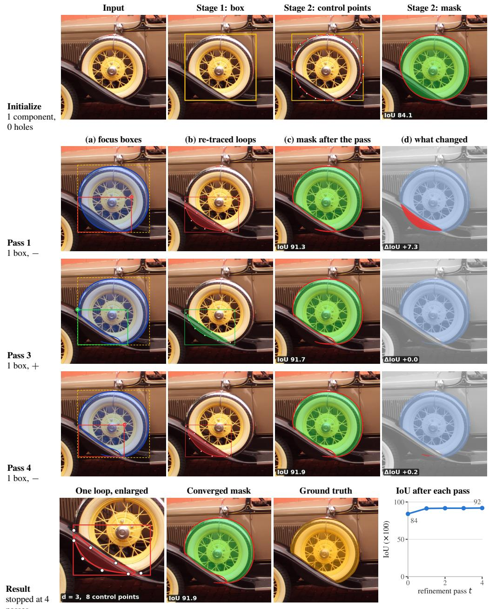  
Figure 7: A step-by-step view of LLMSeg on one ReasonSeg test item, “the spare wheel”, with the Gemini 3.7-Flash backend. Top: stage 1’s box, then stage 2’s control points and the resulting closed cubic B-spline. Middle: three of the four passes, each of which proposes signed focus boxes over the current mask and composes the re-traced loops. The net effect is shown in green (added) and red (removed). Bottom: one loop enlarged, the converged mask, the ground truth, and the IoU after each pass.

## C.1 BENCHMARKS

We evaluate on five families of benchmarks (Table 5). An item is always one (image, query) pair, and the query is the only prompt any system receives. ReasonSeg (Lai et al., 2024) names its target by role or function rather than category, so a system must resolve the query before it can segment the target. RefCOCO and RefCOCO+ (Kazemzadeh et al., 2014) come from a two-player game on COCO images, so their expressions disambiguate one instance from same-class neighbours. The testA split contains images crowded with people, whereas testB contains images crowded with other categories. RefCOCOg (Mao et al., 2016) was collected non-interactively. LVIS (Gupta et al., 2019) uses federated annotations, so we establish absence only from its per-image verified-absent list and draw our negative prompts from that list. COCO (Lin et al., 2014) is exhaustively annotated, so an unannotated category is absent by construction. SA-Co/Gold (Carion et al., 2026) spans seven domains and is annotated three times (we use the first annotation). These three benchmarks report the presence-gated cgF1 of Carion et al. (2026). ADE20K-150 (Zhou et al., 2019) and Cityscapes (Cordts et al., 2016) are semantic benchmarks. ODinW13 (Li et al., 2022a) and RF-100VL (Robicheaux et al., 2025) comprise 13 and 100 small detection datasets, respectively. They are prompted with their category names and provide boxes rather than masks.

<table><tr><td>Benchmark (splits)</td><td>Query (words)</td><td>Split</td><td>Neg.</td><td>Scored</td><td>Ground truth</td><td>Metric</td></tr><tr><td>ReasonSeg val / test</td><td>reasoning sentence (18.3 / 20.7)</td><td>200 / 779</td><td>2.0 / 0.3</td><td>all</td><td>one mask per query</td><td>gIoU, cIoU</td></tr><tr><td>RefCOCO val / testA / testB</td><td>referring expression (3.6)</td><td>10,834 / 5,657 / 5,095</td><td>0</td><td>500 each</td><td>one instance</td><td>gIoU, cIoU</td></tr><tr><td>RefCOCO+ val / testA / testB</td><td>no location words (3.6)</td><td>10,758 / 5,726 / 4,889</td><td>0</td><td>500 each</td><td>one instance</td><td>gIoU, cIoU</td></tr><tr><td>RefCOCOg val / test</td><td>written description (8.5)</td><td>4,896 / 9,602</td><td>0</td><td>500 each</td><td>one instance</td><td>gIoU, cIoU</td></tr><tr><td>LVIS val</td><td>category name (1.4)</td><td>129,547</td><td>45.9</td><td>1,500</td><td>every instance</td><td>cgF1, pmF1, AP</td></tr><tr><td>COCO val2017</td><td>category name (1.2)</td><td>29,631</td><td>50.6</td><td>1,500</td><td>every instance</td><td>cgF1, pmF1, AP</td></tr><tr><td>SA-Co/Gold</td><td>open noun phrase (2.6)</td><td>168,202</td><td>84.5</td><td>2,500</td><td>every instance</td><td>cgF1, pmF1</td></tr><tr><td>ADE20K-150 val</td><td>class name (1.0)</td><td>16,103</td><td>0</td><td>1,000</td><td>all pixels of class</td><td>gIoU, cIoU</td></tr><tr><td>Cityscapes val</td><td>19 class names in one query</td><td>500</td><td>0</td><td>500</td><td>19-class label map</td><td>mIoU</td></tr><tr><td>ODinW13 test</td><td>category name</td><td>6,237 (13 subsets)</td><td>0</td><td>all</td><td>box, filled</td><td>AP0</td></tr><tr><td>RF-100VL test</td><td>category name</td><td>1,987 (100 subsets)</td><td>0</td><td>all</td><td>box, filled</td><td>AP0</td></tr></table>

Table 5: Benchmarks. Query type with mean query length in words, the number of items in each split after loading, the share of items whose correct answer is an empty mask, the number of items we score, and the reported metric. An item is one (image, query) pair. Negative shares are percentages of the total number of items in the split.

## C.2 CONFIGURATION OF LLMSEG

The main results use Gemini-3.7-Flash as the backend for all three stages. For each call, the backend chooses a stage-2 curve degree $d \in \{ 1 , 3 \}$ , shared across the instances in that call (Section 3). Refinement curves are always cubic. Their rasterization is described in Section B.2. The budget constants and stopping rule are given in Section 4. A full run costs 2 MLLM calls (detect and segment) plus at most 2 per refinement pass, so at most $2 T \mathrm { { + } } 2 = 1 8$ . Measured over ReasonSeg val, the reported configuration averages 13.4 calls per image (median 14), because the effect gate and early stopping terminate many loops well before T (Figure 15). Mean wall-clock time is 159 s per image. Runs at T=12 use more passes and average 14.3 to 15.0 calls per image, depending on the run (Section E.1, Section E.3, Section E.6). The stage-1 topology descriptor (Section 3) is an option rather than a fixed part of the configuration, and the main results leave it off on all three stages. Section 5 and Section E.3 report both settings, and the difference between them is within run-to-run variation. These settings are used unchanged on every benchmark. Nothing is tuned per dataset.

Study configuration. The backend study (Section E.2) and the ablations (Section E.3) were run with a budget of T=12 and topology conditioning on. We call this the study configuration. It differs from the reported configuration in exactly these two settings: rows inside one study are comparable with each other, while a comparison between a study row and a main-results number mixes both differences. In the ablation tables the reference row uses the reported setting (topology conditioning off) at $T { = } 1 2$ , and the + topology conditioning row is the study configuration.

## C.3 EVALUATION PROTOCOL AND MATCHED-SUBSET SCORING

Evaluation protocol. Four of the 200 ReasonSeg val items and two of the 779 test items have a legitimately empty ground-truth mask: the queried thing is absent from the image. We score these items rather than excluding them, so a system that correctly predicts nothing is credited, while one that hallucinates a region is penalized. This distinction matters because dropping these items raises the reported gIoU of systems that do not handle absence well and makes our val numbers incomparable to the published ReasonSeg results we quote. For LVIS/COCO/ADE20K, presence-gated metrics use 3, 3, and 0 sampled negative prompts per image, respectively, with seed 0 shared across all systems. Cityscapes mIoU is computed from corpus-level, per-class intersections and unions over the 19 classes: SAM 3 is queried one class at a time, while LLMSeg labels all classes in an image with a single query and groups spline instances by label. All backends use the same deterministic composition: stuff masks are painted before thing masks, with larger masks first within each group, so smaller masks overwrite larger ones. Uncovered pixels remain unassigned. No confidence argmax is used. ADE20K is class-prompted, with each item defined as (image, class). Its score is a union-IoU oracle upper bound and is not comparable to published argmax mIoU.

Matched-subset scoring. Item keys are constructed in the data loader before items are split by backend, so every backend sees the same items. gIoU/cIoU/cgF1/pmF1/mIoU are recomputed from per-item components over the key intersection. AP is re-evaluated with COCOeval on the matched items only, with boxes derived from masks for all systems. For LLMSeg, pipeline failures (detection or segmentation errors) count as zero.

Five evaluations use their entire split, so their key intersection is the full split and their results can be compared with published full-split results. These are ReasonSeg val and test, Cityscapes val mIoU, and $\mathsf { A P _ { 0 } }$ on both detection collections, averaged over all 13 ODinW13 subsets and the 99 of 100 RF-100VL subsets on which AP is defined. Sampling affects box and mask AP on LVIS and COCO. Because AP ranks detections across categories, an image can enter the evaluation only if every ground-truth category it contains was queried. Our items are uniformly sampled (image, category) pairs, so usually only one category is queried for each sampled image, and the image is excluded: only 48 of 1,449 LVIS images and 62 of 1,304 COCO images survive. The surviving images are skewed toward those with few categories. These AP results are not comparable to published full-split federated AP. We use them only to compare systems on the same images. Every other reported metric is computed per item and is unaffected by this sampling issue.

## C.4 REPRODUCING THE SAM 3 AGENT BASELINE

SAM 3 Agent is the agent baseline of Carion et al. (2026), not part of LLMSeg. Our reproduction follows their reference agent implementation. The MLLM iterates over three tools: one runs SAM 3 on a simple noun phrase and returns the resulting masks as a numbered overlay, another selects the mask numbers that match the full query, and the third reports that nothing in the image matches. The loop is capped at 8 rounds, and the union of the selected masks is scored through the same path as every other system. We run it with Gemma-4-31B, Gemini-3.5-Flash and Gemini-3.7-Flash rather than the paper’s Qwen2.5-VL and Gemini 2.5 Pro backends, so our SAM 3 Agent scores are somewhat below the published ones (Table 1). The Gemini-3.5-Flash run is reported only in the cost table (Table 12).

## C.5 BACKEND STUDY PROTOCOL

Protocol. The backend study in Section 5 holds LLMSeg completely fixed and changes only which MLLM answers its three calls. All 21 backends run the full pipeline on all 200 ReasonSeg val items in the study configuration (Section C.2), with every other setting fixed. Metrics are recomputed from the per-item records rather than copied from any summary, so gIoU is the mean per-item IoU and cIoU is P I/P U over all 200 items, with pipeline failures scored 0. Confidence intervals are percentile bootstraps over items (2000 resamples). Each call has a wall-clock budget. Backends with high serving latency (marked † in Table 9) receive a longer budget so that provider latency, rather than model capability, does not determine their scores. The budget limits only how long a call may take. It does not alter any reply. Qwen3-VL-235B is included despite failing to return a usable reply on 49% of items, so its score reflects reply rate as well as segmentation quality. Every row of Table 9 covers the same 200 items. The two reference lines in Figure 5 show SAM 3 and SAM 3 Agent scored with the same code on the same items. These are the ReasonSeg val entries from Table 6. The SAM 3 Agent line uses Gemini-3.7-Flash as its driver, and its gIoU varies by only 0.7 points (72.4, 72.5, 73.1) across the three MLLMs we ran it with, compared with 10.8 points for LLMSeg across one Gemini Flash product line.

Serving the backends. The eight Gemini and Gemma models are called through Google’s native Gemini API, and the other thirteen through OpenRouter1, a gateway for models from many developers. The route changes only how a request is transported, not the prompt, parser, or geometry code. Images are sent at their original resolution because returned coordinates use the image’s pixel frame. Sampling parameters remain at each provider’s defaults, so every backend is evaluated as its developer serves it. A call that fails or exceeds its budget is a pipeline failure scored 0. OpenRouter’s public listings also provide the prices used in Section E.6.

The capability axes. Public benchmark coverage is uneven: no single published benchmark is reported for all 21 backends, and the available benchmarks use incomparable scales. We build each capability axis by z-scoring every benchmark within this set of backends and averaging the axis’s benchmarks for which a model reports a score. Missing values are never imputed: models with no published score for an axis are omitted from that axis’s panel. The four axes are software engineering (AA Coding Index, SWE-bench Verified, SWE-bench Pro, LiveCodeBench), reasoning and knowledge (AA Intelligence Index, GPQA Diamond, HLE), agentic and tool use (AA Agentic Index, OSWorld, Terminal-Bench), and vision and multimodal (MMMU, MMMU-Pro, CharXiv). Two consequences follow. Each axis is relative: adding a backend re-centres it, so its zero carries no meaning beyond this set. And the underlying numbers are vendor-reported, so the slopes and rank correlations we report are indicative of which skills matter, not claims of statistical significance.

## C.6 COST ACCOUNTING

Protocol. Table 12 and Figure 25 price the same 200 ReasonSeg val items scored in Table 9, covering all twenty-one LLMSeg backends and both the SAM 3 and SAM 3 Agent baselines. Nothing here was rerun: every number is either measured from records those runs already wrote or quoted from the published model table. Wall clock is the median seconds per item among the items a backend answered, based on per-item timers recorded during the runs. We use the median rather than the mean because a run that hits its per-call budget on a handful of items can have a mean that reflects the timeout rather than the backend. The call count includes both types of model invoked for each image. The MLLM call count is reconstructed from each item’s recorded pass list. It counts one detect and one segment call, plus one focus call per refinement pass and one batched spline call for each pass whose focus boxes survived the effect gate. For SAM 3 Agent, it is the mean number of agent rounds. The SAM 3 figure is the number of forward passes of the 860 M-parameter model. It counts one pass for SAM 3 itself and one per phrase the agent chooses to segment. It counts none for LLMSeg, which calls no segmentation model. SAM 3 and SAM 3 Agent were timed with SAM 3 running on one RTX-class GPU. Prices and time-to-first-token come from the providers’ published figures. Call counts come from the single study run of each backend, so they can differ slightly from repeated-run means elsewhere (for Gemini-3.7-Flash, 15.0 here against 14.3 in Table 10).

The dollar column is an estimate, and a lower bound. The spend column is an estimate rather than a billed measurement. We price every row using one shared budget: 1900 input tokens per call (the stage prompt templates, which measure 522 to 953 tokens, plus one image with a full-resolution allowance of about 1.1k) and 175 output tokens per call (the mean structured payload recorded across all twenty-one runs). The column depends only on the published price and the measured call count, so it ranks backends consistently under these assumptions. Its absolute values are lower bounds because reasoning tokens, which several providers bill for, are not included.

SAM 3 is not free either. We ran SAM 3 on a local GPU, so we incurred no charge, but a forward pass has a market price. Pricing it at zero would flatter LLMSeg. We charge each SAM 3 pass at \$0.0043 per image, the pay-as-you-go rate for a serverless endpoint serving the same checkpoint,2 which puts SAM 3 at \$4.30 per thousand images for one pass and adds the cost of 1.4 passes to each SAM 3 Agent image, in addition to its MLLM calls. LLMSeg calls no segmentation model, so it carries no such term.

## D ADDITIONAL RESULTS

## D.1 COMPLETE REASONING AND REFERRING COMPARISONS

Table 1 compares selected baselines on ReasonSeg and RefCOCO/+/g using cIoU. The complete tables, including gIoU and the training columns, are reproduced here.
<table><tr><td colspan="2"></td><td colspan="2">Training</td><td colspan="2">val</td><td colspan="2">test</td></tr><tr><td>Method</td><td>MLLM</td><td>RES</td><td>ReasonSeg</td><td>gIoU</td><td>cIoU</td><td>gIoU</td><td>cIoU</td></tr><tr><td>Published, full splits (Carion et al., 2026)</td><td></td><td></td><td></td><td></td><td></td><td></td><td></td></tr><tr><td>SEEM (Zou et al., 2023)</td><td></td><td>X</td><td>X</td><td>25.5</td><td>21.2</td><td>24.3</td><td>18.7</td></tr><tr><td>Grounded SAM (Ren et al., 2024)</td><td></td><td>X</td><td>X</td><td>26.0</td><td>14.5</td><td>21.3</td><td>16.4</td></tr><tr><td>OVSeg (Liang et al., 2023)</td><td></td><td>X</td><td>X</td><td>28.5</td><td>18.6</td><td>26.1</td><td>20.8</td></tr><tr><td>GLaMM (Rasheed et al., 2024)</td><td>Vicuna 7B</td><td></td><td>X</td><td>47.4</td><td>47.2</td><td></td><td></td></tr><tr><td>SAM4MLLM (Chen et al., 2024)</td><td>Qwen-VL 7B</td><td></td><td>X</td><td>46.7</td><td>48.1</td><td></td><td></td></tr><tr><td>SAM4MLLM (Chen et al., 2024)</td><td>LLaVA1.6 8B</td><td></td><td>X</td><td>58.4</td><td>60.4</td><td></td><td></td></tr><tr><td>Seg-Zero (Liu et al., 2025)</td><td>Qwen2.5-VL 3B</td><td></td><td>X</td><td>58.2</td><td>53.1</td><td>56.1</td><td>48.6</td></tr><tr><td>Seg-Zero (Liu et al., 2025)</td><td>Qwen2.5-VL 7B</td><td></td><td>X</td><td>62.6</td><td>62.0</td><td>57.5</td><td>52.0</td></tr><tr><td>X-SAM (Wang et al., 2025a)</td><td>Phi3 3.8B</td><td></td><td></td><td>56.6</td><td>32.9</td><td>57.8</td><td>41.0</td></tr><tr><td>HyperSeg (Wei et al., 2024)</td><td>Phi2 3B</td><td></td><td></td><td>59.2</td><td>56.7</td><td></td><td></td></tr><tr><td>Kang et al. (Kang et al., 2025)</td><td>LLaVA1.5 7B</td><td>X</td><td>X</td><td></td><td>52.4</td><td></td><td>48.7</td></tr><tr><td>Kang et al. (Kang et al., 2025)</td><td>LLaVA1.5 13B</td><td></td><td>X</td><td></td><td>60.5</td><td></td><td>49.9</td></tr><tr><td>LISA (Lai et al., 2024)</td><td>LLaVA 7B</td><td></td><td></td><td>44.4</td><td>46.0</td><td>36.8</td><td>34.1</td></tr><tr><td>LISA (Lai et al., 2024)</td><td>LLaVA 7B</td><td></td><td></td><td>52.9</td><td>54.0</td><td>47.3</td><td>34.1</td></tr><tr><td>LISA (Lai et al., 2024)</td><td>LLaVA 13B</td><td></td><td></td><td>48.9</td><td>46.9</td><td>44.8</td><td>45.8</td></tr><tr><td>LISA (Lai et al., 2024)</td><td>LLaVA 13B</td><td></td><td></td><td>56.2</td><td>62.9</td><td>51.7</td><td>51.1</td></tr><tr><td>LISA (Lai et al., 2024)</td><td>Llama2 13B</td><td></td><td></td><td>60.0</td><td>67.8</td><td>51.5</td><td>51.3</td></tr><tr><td>LISA (Lai et al., 2024)</td><td>LLaVA1.5 7B</td><td></td><td></td><td>53.6</td><td>52.3</td><td>48.8</td><td>47.1</td></tr><tr><td>LISA (Lai et al., 2024)</td><td>LLaVA1.5 7B</td><td></td><td></td><td>61.3</td><td>62.9</td><td>55.6</td><td>56.9</td></tr><tr><td>LISA (Lai et al., 2024)</td><td>LLaVA1.5 13B</td><td>X</td><td>X</td><td>57.7</td><td>60.3</td><td>53.8</td><td>50.8</td></tr><tr><td>LISA (Lai et al., 2024)</td><td>LLaVA1.5 13B</td><td></td><td></td><td>65.0</td><td>72.9</td><td>61.3</td><td>62.2</td></tr><tr><td>RSVP (Lu et al., 2025)</td><td>LLaVA1.6 7B</td><td>X</td><td></td><td>59.2</td><td>56.7</td><td>56.9</td><td>50.7</td></tr><tr><td>RSVP (Lu et al., 2025)</td><td>Qwen2-VL 7B</td><td>x</td><td>X</td><td>58.6</td><td>48.5</td><td>56.1</td><td>51.6</td></tr><tr><td>RSVP (Lu et al., 2025)</td><td>Ġemini1.5-Flash</td><td>X</td><td>X</td><td>56.9</td><td>49.2</td><td>57.1</td><td>59.2</td></tr><tr><td>RSVP (Lu et al., 2025)</td><td>GPT-40</td><td>X</td><td>X</td><td>64.7</td><td>63.1</td><td>60.3</td><td>60.0</td></tr><tr><td>Gemini Seg (Voigtlaender et al., 2025)</td><td>Gemini2.5 Flash</td><td>?</td><td>?</td><td>28.3</td><td>13.3</td><td>30.6</td><td>9.2</td></tr><tr><td>SAM 3 Agent (Carion et al., 2026)</td><td>Qwen2.5-VL 7B</td><td>X</td><td>X</td><td>62.2</td><td>49.1</td><td>63.0</td><td>53.5</td></tr><tr><td>SAM 3 Agent (Carion et al., 2026)</td><td>Qwen2.5-VL 72B</td><td>X</td><td>X</td><td>74.6</td><td>65.1</td><td>70.8</td><td>64.0</td></tr><tr><td>SAM 3 Agent (Carion et al., 2026)</td><td>Llama4 Maverick</td><td>X</td><td>X</td><td>68.5</td><td>61.5</td><td>67.1</td><td>60.9</td></tr><tr><td>SAM 3 Agent (Carion et al., 2026)</td><td>Qwen3-VL 8B Think</td><td>X</td><td>X</td><td>68.5</td><td>57.4</td><td>70.2</td><td>67.3</td></tr><tr><td>SAM 3 Agent (Carion et al., 2026)</td><td>Qwen3-VL 235B Think</td><td>x</td><td>X</td><td>76.6</td><td>67.0</td><td>73.7</td><td>71.8</td></tr><tr><td>SAM 3 Agent (Carion et al., 2026)</td><td>Gemini2.5 Pro</td><td>x</td><td>X</td><td>77.0</td><td>66.0</td><td>74.0</td><td>72.1</td></tr><tr><td>SAM 3 (text query) (Carion et al., 2026)</td><td></td><td>X</td><td>X</td><td>13.1</td><td>9.9</td><td>8.4</td><td>11.3</td></tr><tr><td>SAM 3 Agent (Carion et al., 2026)</td><td>Gemma-4-31B</td><td>X</td><td>X</td><td>73.1</td><td>63.9</td><td>72.2</td><td>66.7</td></tr><tr><td>SAM 3 Agent (Carion et al., 2026)</td><td>Gemini-3.7-Flash</td><td>X</td><td>x</td><td>72.4</td><td>62.0</td><td>72.2</td><td>63.2</td></tr><tr><td>LLMSeg (w/o refine)</td><td>Gemini-3.7-Flash</td><td>x</td><td>X</td><td>64.9</td><td>64.6</td><td>62.7</td><td>58.2</td></tr><tr><td>LLMSeg (full)</td><td>Gemini-3.7-Flash</td><td>X</td><td>x</td><td>69.6</td><td>71.5</td><td>68.3</td><td>65.8</td></tr></table>

Table 6: Reasoning segmentation on ReasonSeg (Lai et al., 2024). Top block: published numbers quoted from Carion et al. (2026) on the full splits, reproducing its complete baseline list. Bottom block (below the rule): our own evaluations (200 validation items and 779 test items). Both blocks cover the full splits. SAM 3 and SAM 3 Agent are both baselines from Carion et al. (2026). Only the shaded rows are ours. The two training columns follow Carion et al. (2026): RES = fine-tuned for referring expression segmentation, ReasonSeg = fine-tuned on the ReasonSeg training split. A method is zero-shot when both entries are ✗. LLMSeg (w/o refine) is our pipeline stopped after the segment stage. The best zero-shot result in each column is shown in bold, separately for each block.

## D.2 COMPLETE OPEN-VOCABULARY COMPARISON

Table 3 reports results for LVIS and COCO only. The complete comparison, including pmF1, SA-Co/Gold results, and the human reference, follows.

## D.3 QUALITATIVE RESULTS ON THE MAIN BENCHMARKS

The grids below extend the qualitative evidence of Section 4.2. They use the same Gemini-3.7-Flash runs as the tables, and each chip reports the IoU recorded by the harness for that panel. Figure 8

<table><tr><td rowspan="2">Method</td><td rowspan="2">MLLM / backbone</td><td rowspan="2"></td><td colspan="3">RefCOCO</td><td colspan="3">RefCOCO+</td><td colspan="2">RefCOCOg</td></tr><tr><td>RES</td><td>val</td><td>testA</td><td>testB</td><td>val testA</td><td>testB</td><td>val (U)</td><td>test (U)</td></tr><tr><td colspan="10">Published, full splits, cIoU (Carion et al., 2026)</td></tr><tr><td>LISA (Lai et al., 2024)</td><td>LLaVA 7B</td><td></td><td>74.9</td><td>79.1</td><td>72.3</td><td>65.1</td><td>70.8</td><td>58.1</td><td>67.9</td><td>70.6</td></tr><tr><td>GSVA (Xia et al., 2024)</td><td>13B</td><td></td><td>79.2</td><td>81.7</td><td>77.1</td><td>70.3</td><td>73.8</td><td>63.6</td><td>75.7</td><td>77.0</td></tr><tr><td>GLaMM (Rasheed et al., 2024)</td><td>Vicuna 7B</td><td></td><td>79.5</td><td>83.2</td><td>76.9</td><td>72.6</td><td>78.7</td><td>64.6</td><td>74.2</td><td>74.9</td></tr><tr><td>SAM4MLLM (Chen et al., 2024)</td><td>LLaVA1.6 7B</td><td></td><td>79.6</td><td>82.8</td><td>76.1</td><td>73.5</td><td>77.8</td><td>65.8</td><td>74.5</td><td>75.6</td></tr><tr><td>SAM4MLLM (Chen et al., 2024)</td><td>LLaVA1.6 8B</td><td></td><td>79.8</td><td>82.7</td><td>74.7</td><td>74.6</td><td>80.0</td><td>67.2</td><td>75.5</td><td>76.4</td></tr><tr><td>GLEE (Wu et al., 2024b)</td><td>Plus</td><td></td><td>79.5</td><td>一</td><td>一</td><td>68.3</td><td></td><td></td><td>70.6</td><td></td></tr><tr><td>GLEE (Wu et al., 2024b)</td><td>Pro</td><td></td><td>80.0</td><td></td><td></td><td>69.6</td><td></td><td></td><td>72.9</td><td></td></tr><tr><td>DETRIS (Huang et al., 2025)</td><td>DETRIS-L</td><td></td><td>81.0</td><td>81.9</td><td>79.0</td><td>75.2</td><td>78.6</td><td>70.2</td><td>74.6</td><td>75.3</td></tr><tr><td>UniLSeg (Liu et al., 2024b)</td><td>UniLSeg-20</td><td></td><td>80.5</td><td>81.8</td><td>78.4</td><td>72.7</td><td>77.0</td><td>67.0</td><td>78.4</td><td>79.5</td></tr><tr><td>UniLSeg (Liu et al., 2024b)</td><td>UniLSeg-100</td><td></td><td>81.7</td><td>83.2</td><td>79.9</td><td>73.2</td><td>78.3</td><td>68.2</td><td>79.3</td><td>80.5</td></tr><tr><td>PSALM (Zhang et al., 2024c)</td><td>Phi1.5 1.3B</td><td></td><td>83.6</td><td>84.7</td><td>81.6</td><td>72.9</td><td>75.5</td><td>70.1</td><td>73.8</td><td>74.4</td></tr><tr><td>EVF-SAM (Zhang et al., 2024b)</td><td>RC</td><td></td><td>82.1</td><td>83.7</td><td>80.0</td><td>75.2</td><td>78.3</td><td>70.1</td><td>76.8</td><td>77.4</td></tr><tr><td>EVF-SAM (Zhang et al., 2024b)</td><td>Extra Data</td><td></td><td>82.4</td><td>84.2</td><td>80.2</td><td>76.5</td><td>80.0</td><td>71.9</td><td>78.2</td><td>78.3</td></tr><tr><td>RICE (Xie et al., 2025)</td><td>Qwen2.5-7B</td><td></td><td>83.5</td><td>85.3</td><td>81.7</td><td>79.4</td><td>82.8</td><td>75.4</td><td>79.8</td><td>80.4</td></tr><tr><td>MLCD-seg (An et al., 2024)</td><td>Qwen2.5-7B</td><td></td><td>83.6</td><td>85.3</td><td>81.5</td><td>79.4</td><td>82.9</td><td>75.6</td><td>79.7</td><td>80.5</td></tr><tr><td>HyperSeg (Wei et al., 2024)</td><td>Phi2 2.7B</td><td></td><td>84.8</td><td>85.7</td><td>83.4</td><td>79.0</td><td>83.5</td><td>75.2</td><td>79.4</td><td>78.9</td></tr><tr><td>X-SAM (Wang et al., 2025a)</td><td>Phi3 3.8B</td><td></td><td>85.1</td><td>87.1</td><td>83.4</td><td>78.0</td><td>81.0</td><td>74.4</td><td>83.8</td><td>83.9</td></tr><tr><td>GL-CLIP (Yu et al., 2023)</td><td>ResNet-50</td><td>X</td><td>32.7</td><td>35.3</td><td>30.1</td><td>37.7</td><td>40.7</td><td>34.9</td><td>41.6</td><td>42.9</td></tr><tr><td>GL-CLIP (Yu et al., 2023)</td><td>ViT-B/32</td><td>x</td><td>32.9</td><td>34.9</td><td>30.1</td><td>38.4</td><td>42.1</td><td>32.7</td><td>42.0</td><td>42.0</td></tr><tr><td>CaR (Sun et al., 2024)</td><td>ViT-B/16</td><td>X</td><td>33.6</td><td>35.4</td><td>30.5</td><td>34.2</td><td>36.0</td><td>31.0</td><td>36.7</td><td>36.6</td></tr><tr><td>Ref-Diff (Ni et al., 2023)</td><td>VAE</td><td>X</td><td>37.2</td><td>38.4</td><td>37.2</td><td>37.3</td><td>40.5</td><td>33.0</td><td>44.0</td><td>44.5</td></tr><tr><td>TAS (Suo et al., 2023)</td><td>ResNet-50</td><td>X</td><td>39.9</td><td>42.9</td><td>35.9</td><td>44.0</td><td>50.6</td><td>36.4</td><td>47.7</td><td>47.4</td></tr><tr><td>TAS (Suo et al., 2023)</td><td>ViT-B/32</td><td>X</td><td>39.8</td><td>41.1</td><td>36.2</td><td>43.6</td><td>49.1</td><td>36.5</td><td>46.6</td><td>46.8</td></tr><tr><td>IteRPrimeE (Wang et al., 2025c)</td><td></td><td>X</td><td>40.2</td><td>46.5</td><td>33.9</td><td>44.2</td><td>51.6</td><td>35.3</td><td>46.0</td><td>45.1</td></tr><tr><td>Pseudo-RIS (Yu et al., 2024)</td><td>CRIS</td><td>X</td><td>39.8</td><td>44.8</td><td>33.0</td><td>42.2</td><td>46.3</td><td>34.5</td><td>43.7</td><td>43.4</td></tr><tr><td>Pseudo-RIS (Yu et al., 2024)</td><td>ETRIS</td><td>x</td><td>41.1</td><td>48.2</td><td>33.5</td><td>44.3</td><td>51.4</td><td>35.1</td><td>46.0</td><td>46.7</td></tr><tr><td>LGD+DINO (Li et al., 2025)</td><td>ViT-B/32</td><td>X</td><td>49.5</td><td>54.7</td><td>41.0</td><td>49.6</td><td>58.4</td><td>38.6</td><td>50.3</td><td>51.1</td></tr><tr><td>VLM-VG (Wang et al., 2025b)</td><td>ResNet-50</td><td>X</td><td>47.7</td><td>51.8</td><td>44.7</td><td>41.2</td><td>45.9</td><td>34.7</td><td>46.6</td><td>47.1</td></tr><tr><td>VLM-VG (Wang et al., 2025b)</td><td>ResNet-101</td><td>x</td><td>49.9</td><td>53.1</td><td>46.7</td><td>42.7</td><td>47.3</td><td>36.2</td><td>48.0</td><td>48.5</td></tr><tr><td>HybridGL (Liu &amp; Li, 2025)</td><td>ViT-B/32</td><td>x</td><td>49.5</td><td>53.4</td><td>45.2</td><td>43.4</td><td>49.1</td><td>37.2</td><td>51.3</td><td>51.6</td></tr><tr><td>Kang et al. (2025)</td><td>LLaVA-1.5 7B</td><td>X</td><td>74.2</td><td>76.5</td><td>70.4</td><td>62.5</td><td>65.2</td><td>56.0</td><td>64.2</td><td>68.1</td></tr><tr><td>Kang et al. (2025)</td><td>LLaVA-1.5 13B</td><td>x</td><td>76.1</td><td>78.9</td><td>72.8</td><td>64.1</td><td>67.1</td><td>57.3</td><td>67.7</td><td>69.0</td></tr><tr><td>SAM 3 Agent (Carion et al., 2026)</td><td>Qwen2.5-VL 7B</td><td>x</td><td>59.4</td><td>64.3</td><td>55.0</td><td>51.4</td><td>57.0</td><td>44.9</td><td>57.2</td><td>58.8</td></tr><tr><td>SAM 3 Agent (Carion et al., 2026)</td><td>Qwen2.5-VL 72B</td><td>x</td><td>71.6</td><td>74.9</td><td>66.0</td><td>64.9</td><td>70.8</td><td>57.9</td><td>68.8</td><td>70.2</td></tr><tr><td>SAM 3 Agent (Carion et al., 2026)</td><td>Llama4 Maverick</td><td>X</td><td>71.7 68.6</td><td>76.5 72.3</td><td>66.5 63.9</td><td>65.1 59.3</td><td>71.2 64.5</td><td>57.6 55.6</td><td>67.7 66.4</td><td>68.7 66.9</td></tr><tr><td>SAM 3 Agent (Carion et al., 2026) SAM 3 Agent (Carion et al., 2026)</td><td>Qwen3-VL 8B Think Qwen3-VL 235 Think</td><td>x x 73.9</td></table>

Table 7: Referring expression segmentation on RefCOCO/+/g (Kazemzadeh et al., 2014; Mao et al., 2016). The top block reports published full-split cIoU results quoted from Carion et al. (2026), separated into methods fine-tuned on the RES task (RES ✓) and zero-shot methods (RES ✗). Note that nearly all of the MLLM-based methods were trained on the RefCOCO box annotations. The bottom blocks report our runs on matched 500-item random subsets per split (shuffled, seed 0), with gIoU in the upper block and cIoU in the lower block. All methods in the bottom blocks are zero-shot for RES and use the same selected items. SAM 3 and SAM 3 Agent are baselines from Carion et al. (2026), reproduced by us on these items. Only the shaded rows show our methods. Best results within each block are in bold. The best zero-shot result in each published-block column is underlined. RefCOCOg val (U) and test (U) are the splits used in our evaluation.

<table><tr><td></td><td></td><td colspan="4">LVIS</td><td colspan="4">COCO</td><td colspan="2">SA-Co/Gold</td></tr><tr><td>Method</td><td>MLLM</td><td>cgF1</td><td>pmF1</td><td>box AP</td><td>mask AP</td><td>cgF1</td><td>pmF1</td><td>box AP</td><td>mask AP</td><td>cgF1</td><td>pmF1</td></tr><tr><td>Human</td><td></td><td></td><td></td><td></td><td>一</td><td></td><td></td><td></td><td></td><td>72.8</td><td></td></tr><tr><td>OWLv2 (Minderer et al., 2023)</td><td></td><td>20.1</td><td></td><td>35.2</td><td></td><td></td><td></td><td>38.2</td><td></td><td>17.3</td><td></td></tr><tr><td>OWLv2 (LVIS-trained)</td><td></td><td>29.3</td><td></td><td>45.5</td><td>43.4</td><td></td><td></td><td>46.1</td><td></td><td>24.6</td><td></td></tr><tr><td>gDino-T (Liu et al., 2024a)</td><td></td><td>14.7</td><td></td><td>20.5</td><td></td><td></td><td></td><td>45.7</td><td></td><td>3.3</td><td></td></tr><tr><td>LLMDet-L (Fu et al., 2025)</td><td></td><td>35.1</td><td></td><td>42.0</td><td>36.3</td><td></td><td></td><td>55.6</td><td></td><td>6.5</td><td></td></tr><tr><td>APE-D (LVIS-trained) (Shen et al., 2024)</td><td></td><td></td><td></td><td>59.6</td><td>53.0</td><td></td><td></td><td>58.3</td><td></td><td>16.4</td><td></td></tr><tr><td>DINO-X (Ren et al., 2025)</td><td></td><td></td><td></td><td>52.4</td><td>38.5</td><td></td><td></td><td>56.0</td><td></td><td>21.3</td><td></td></tr><tr><td>Gemini 2.5 Flash (Comanici et al., 2025)</td><td></td><td>13.4</td><td></td><td></td><td></td><td></td><td></td><td></td><td></td><td>13.0</td><td></td></tr><tr><td>SAM 3 (Carion et al., 2026)</td><td></td><td>37.2</td><td></td><td>53.6</td><td>48.5</td><td></td><td></td><td>56.4</td><td></td><td>54.1</td><td></td></tr><tr><td>SAM 3*</td><td></td><td>50.1</td><td>58.0</td><td>69.1</td><td>62.2</td><td>52.4</td><td>57.6</td><td>68.0</td><td>59.2</td><td>45.4</td><td>55.2</td></tr><tr><td>SAM 3 Agent*</td><td>Gemma-4-31B</td><td>51.0</td><td>62.4</td><td>56.2</td><td>50.9</td><td>49.9</td><td>58.6</td><td>48.9</td><td>42.0</td><td></td><td></td></tr><tr><td>LLMSeg (w/o refine)</td><td>Gemini-3.7-Flash</td><td>50.4</td><td>53.0</td><td>57.1</td><td>36.9</td><td>50.4</td><td>54.0</td><td>59.6</td><td>38.0</td><td>31.9</td><td>48.6</td></tr><tr><td>LLMSeg (full)</td><td>Gemini-3.7-Flash</td><td>53.9</td><td>57.3</td><td>64.2</td><td>47.2</td><td>56.1</td><td>60.6</td><td>66.6</td><td>50.5</td><td>36.4</td><td>55.4</td></tr></table>

Table 8: Open-vocabulary instance segmentation. Rows without asterisks or shading report published full-split results quoted from Carion et al. (2026). Rows marked with ∗ show our evaluations of the SAM 3 baselines on matched random subsets with hard negatives, using the same items as our methods (shaded rows). cgF1 is presence-gated F1, and pmF1 is its positive-only counterpart. Within the starred and shaded rows (our matched block), the best and second-best result per column are shown in bold and underlined, respectively. Published rows and the human reference are not ranked.

isolates the effect of refinement across benchmark families. Figure 9 shows full Cityscapes label maps. Figure 10 compares LLMSeg with both SAM 3 baselines.

## D.4 CROWDED SCENES, NEGATIVES, RARE DOMAINS, AND SINGLE PASSES

Four grids extend the qualitative evidence of Section 4.2 to cases discussed only in aggregate in the main paper: images containing many instances of the queried class (Figure 11), SA-Co prompts whose concept is absent from the image (Figure 12), the rare visual domains of RF-100VL (Figure 13), and the effect of an individual refinement pass (Figure 14). Every panel comes from the same Gemini-3.7-Flash runs at T=12 used for the tables. Each baseline panel comes from the corresponding SAM 3 or SAM 3 Agent run scored on the same item. Each chip reports that system’s recorded IoU, so its value is consistent with the reported results.

Ground truth  
LLMSeg  
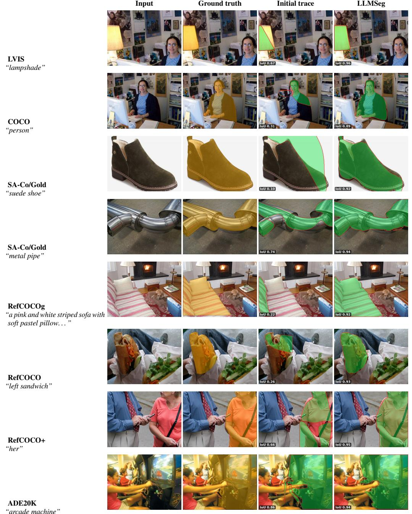  
Figure 8: LLMSeg across benchmarks and task formats. The same Gemini-3.7-Flash backend and settings are used throughout. The prompt appears at left. Ground truth is shaded amber, and predictions are shown in green with a red outline. Each chip reports the panel’s IoU. Column 3 shows the stage-2 mask, and column 4 shows the final mask. Together, they isolate the effect of refinement.

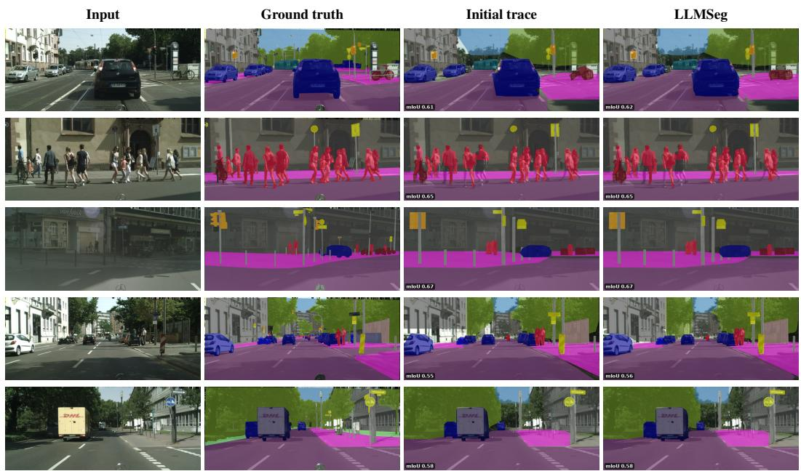  
Figure 9: Dense semantic labeling on Cityscapes (Cordts et al., 2016), Gemini-3.7-Flash backend, official 19- class palette. LLMSeg labels every class in an image from a single query and resolves overlaps by deterministic mask compositing. Each panel is therefore a full label map, rather than a single mask, and its chip reports the image’s mIoU. The losses occur on amorphous ground classes, which lack clear visual boundaries.

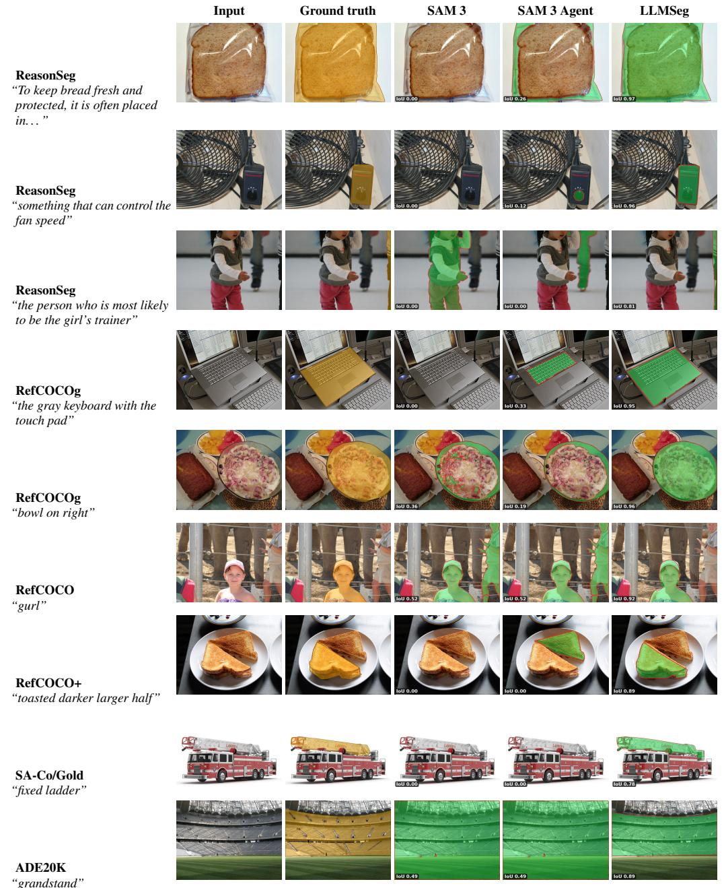  
Figure 10: Where LLMSeg separates from both SAM 3 baselines. Selected items from ReasonSeg, RefCOCO/+/g, SA-Co/Gold, and ADE20K. SAM 3 (Carion et al., 2026) receives the same text query as LLMSeg, and each chip reports that system’s recorded IoU.

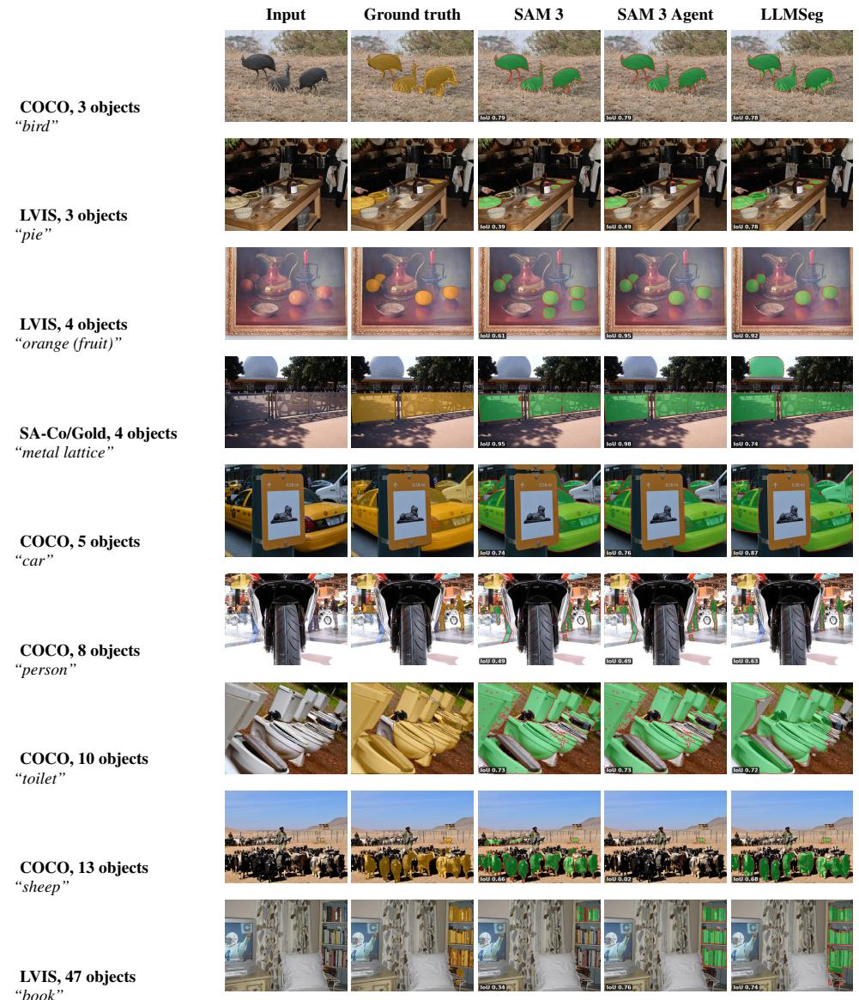  
Figure 11: Images containing multiple objects of the queried class. LVIS, COCO, and SA-Co/Gold examples whose ground truth contains at least three objects. Each label gives the benchmark and number of ground-truth objects. Each chip reports the corresponding system’s recorded union IoU, which does not separate touching objects that a system merges into one region.

Input  
SAM 3  
SAM 3 Agent  
LLMSeg  
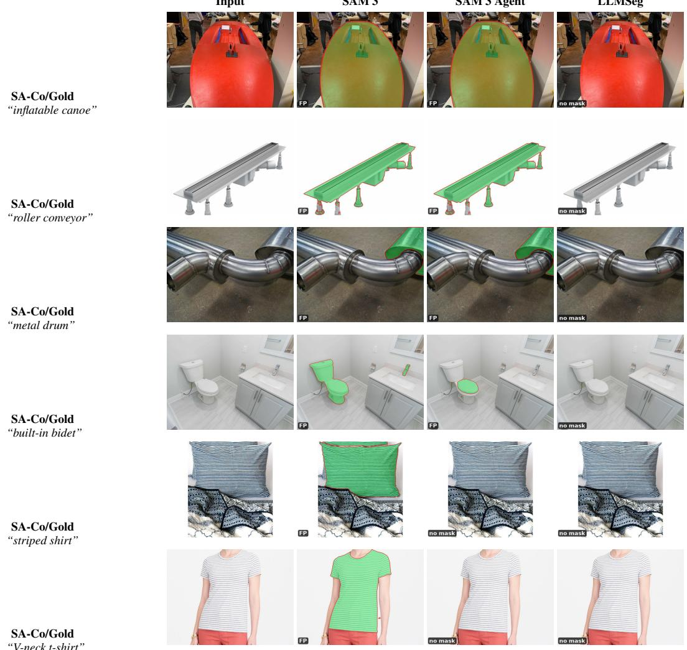  
Figure 12: Hard negatives: the prompted concept is absent. Six SA-Co/Gold examples whose phrases have no matching annotation in the image. Because the ground truth is empty, no ground-truth panel is shown. Each chip indicates only whether the system produced a mask. Each scene contains the broader category, but not the qualified concept.

Documents: paper-parts “figure”

Documents: invoice-processing “table”

Documents: activity-diagrams “action”

Aerial:   
electric-pylon-detection   
“pylon”   
Aerial: construction   
equipment   
“dump truck”

Medical: nih-xray “Pneumonia”

Medical: dentalai “Impacted Tooth”

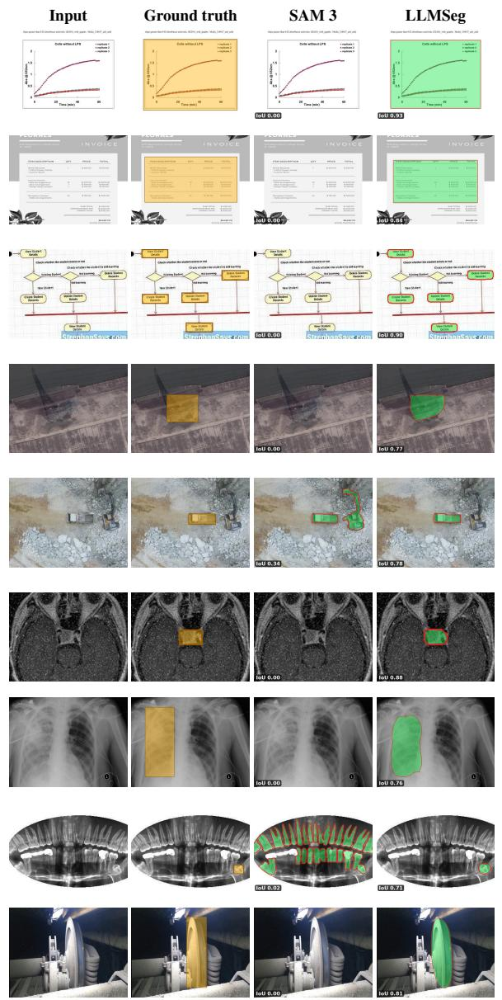  
Figure 13: Rare domains segmentation on RF-100VL subsets. The rows span documents, aerial imagery, medical imaging, and industrial inspection, with one subset per row. Each prompt uses that subset’s category name verbatim, and each ground-truth panel shows the annotated detection box filled in. Some category names are domain jargon, so a failure here may reflect vocabulary rather than localization.

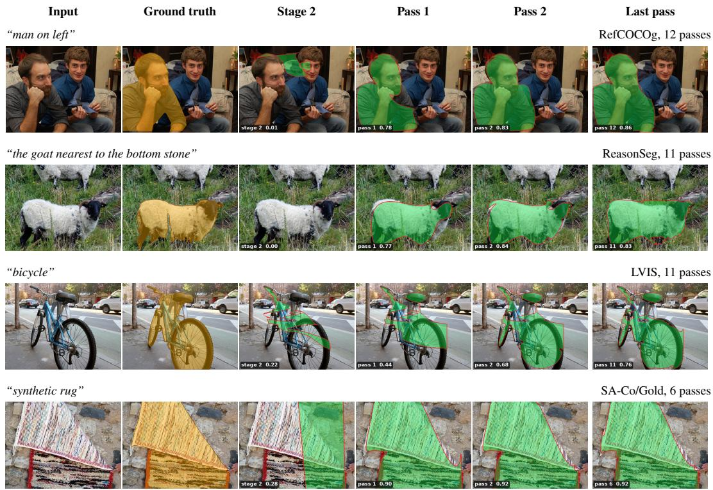  
Figure 14: What one refinement pass does. Four items, one per task format, for which the final mask substantially outperforms the stage-2 mask. Each is shown at stage 2, after the first two passes, and after the final pass. Each chip identifies the state and reports its IoU. The intermediate masks are replayed from each item’s refinement record using the pipeline’s own composition code.

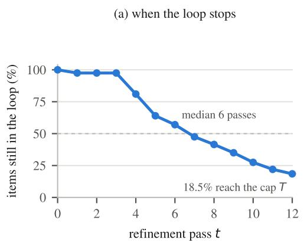

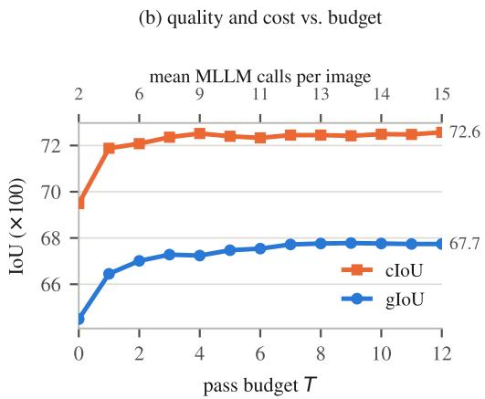  
Figure 15: The refinement loop stops on its own. ReasonSeg val, all 200 items, Gemini-3.7-Flash. (a) Share of items still inside the loop at each pass. A run stops once the mask changes by less than 0.5% of its box area for three consecutive passes. (b) The same run’s mask after the first T passes, scored at every budget, with the mean MLLM calls on the top axis.

## E EXTENDED ANALYSIS

This section expands the findings of Section 5. The complete ablation results are in Table 10 and Table 11. The backend study and ablations use the study configuration described in Section C.2.

## E.1 REFINEMENT AND CONVERGENCE

Does the loop actually converge?. This matters more than a typical hyperparameter question. Eq. (3) is an open loop driven by a stochastic model that can propose a fresh set of focus boxes at every pass, with no contraction guarantee. Left unchecked, such a loop can cycle indefinitely, repainting a boundary one way and then the other. A reader is right to ask whether the pass budget T provides a genuine early stop or merely truncates an unstable process.

Figure 15(a) answers this empirically on ReasonSeg val. The stopping criterion of Section 4 ends the loop for 79% of items before they reach the budget (81% of the items that enter the loop). The median item uses 6 passes, 36% stop within 4, and only 18.5% are still running when T cuts them off. This behavior is consistent with the intended damping mechanism: when successive passes agree on a boundary, the commitment field makes those pixels progressively harder to overturn. However, the study does not isolate the soft lock’s contribution. The minority that reaches the cap is a harder set to begin with: its stage-2 masks are already 5.7 gIoU behind (60.0 vs. 65.7), and its final masks remain 7.0 behind (62.3 vs. 69.3). Normalizing the criterion by box area rather than image area makes its threshold relative to the region the loop can alter.

Figure 15(b) ties this to accuracy rather than to mask stability alone. Quality saturates well inside the budget: the first pass buys +2.0 gIoU, four passes buy +2.7 of the eventual +3.2, and passes 8 to 12 move it by less than 0.1. These figures come from this one run. Other runs of Gemini-3.7-Flash give different totals (+3.7 in Table 9, and 5.4 gIoU between the ablation reference and its no-refinement row), because the pipeline is stochastic and the runs differ in configuration. Because most items have already stopped, the measured cost is far below the worst-case cost of $2 T + 2 = 2 6$ calls: 14.7 calls per image on average at T=12 in this run (other T=12 runs give 14.3 to 15.0), and about 9 at the T=4 knee. T is a safety net rather than an operating point.

## The residual as a stopping signal.

The stopping criterion of Section 4 acts on the residual $\delta ^ { ( t ) } = | M ^ { ( t ) } \triangle M ^ { ( t - 1 ) } | / | \bigcup _ { k = 1 } ^ { N } b _ { k } |$ , the fraction of the instance-box union that a pass repaints, rather than on quality: the pipeline sees no ground truth at run time, so the amount of mask change is its only observable. Figure 16 shows that quantity pass by pass on a 16-image development set (free text queries on images that belong to no evaluation benchmark), which is where ε and s were set before any benchmark was run. The 16 images and their queries are released with the code.

Three observations stand out. First, the residual decays. It is not monotone, since a pass is free to propose a large new edit at any point, but every trace ends below where it started, most of them by an order of magnitude or more, and several reach the axis floor, that is, passes that changed no pixel at all. Second, the rate is a property of the image, not a constant. The first pass repaints between 0.2% (person) and 27% (toy) of the box union, a 175× spread (based on unsmoothed values, whereas the figure plots the 3-pass average), and the starting value does not predict the decay: toy starts highest and stops itself at pass 10, while taxis, with six crowded instances of the same class, starts at 6% and is still moving 0.7% of its box union at pass 12 (1.3% after the 3-pass average). Boundary length, occlusion, and instance count may affect how quickly an item stabilizes, but the first pass does not reveal it. This is why the budget must be allocated per image rather than fixed globally. Third, $\varepsilon { = } 0 . 0 0 5$ with s=3 sits where those two regimes separate: 11 of the 16 items stop on their own, the earliest at pass 3 (the patience floor, which no item can beat), the median at 6, and 5 run to the cap.

A small residual indicates stability, not correctness. A loop could in principle settle on a wrong mask. Its use as a surrogate is supported by the benchmark-scale behavior above: quality saturates over the same passes in which these residuals collapse, and the items that never stop are the ones that end furthest behind.

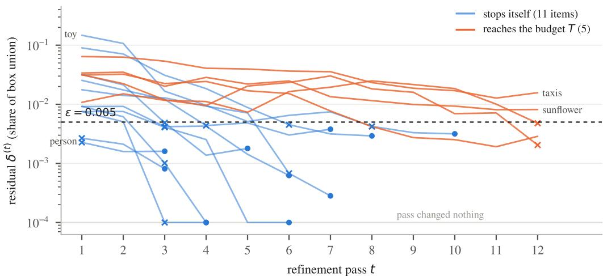  
Figure 16: Per-item refinement residuals on the development set. Each curve is one development image, run with Gemini-3.7-Flash at budget $T { = } 1 2$ . The curve is the 3-pass moving average of the mask residuals $\bar { \delta } ^ { ( t ) }$ on a logarithmic axis, and the dashed line is the threshold $\varepsilon = 0 . 0 0 5$ . Blue curves are images that stop on their own with stopping patience $s = 3 ,$ , orange curves are images that exhaust the budget, and × marks the first smoothed pass below ε. The residuals decay as the masks stabilize, which is the signal the stopping criterion uses in LLMSeg.

## E.2 BACKEND STUDY

Because LLMSeg adds no trained parameters, backend progress is the only thing that has to improve for segmentation to improve. We test this directly by running the same pipeline, in the study configuration (Section C.2), on ReasonSeg val with twenty-one MLLM backends from six developers. The only change is which model answers the three calls. Figure 18 is the complete ranking, read on the stage-2 mask so that one bar carries one backend. Table 9 repeats every row with its final mask, both bootstrap intervals and the signed effect of refinement. First, scores range from 13.4 to 74.2 gIoU at stage 2 and from 14.2 to 72.9 after refinement, a spread far wider than that of any design choice in Table 10. Second, refinement lowers gIoU on eleven of the twenty-one backends, especially the weaker models, which cannot refine their own masks well. Its gains therefore depend on the model’s ability to inspect and correct its own masks. Every backend scores at least as high as the SAM 3 baseline score (13.1) on this benchmark, although the weakest is not clearly above it: GLM 4.6V scores 13.4 ([10.2, 16.8]) at stage 2 and 14.2 ([11.0, 17.6]) after refinement. The other twenty backends score clearly above SAM 3. At 72.4, the SAM 3 Agent baseline uses the same Gemini-3.7-Flash as our pipeline and a segmentation specialist as its tool. It is close to our best backend, GPT-6 Astra, which scores 74.2 ([70.4, 77.9]) at stage 2 and 72.9 ([69.2, 76.6]) after refinement. The gaps are 1.8 and 0.5 gIoU, respectively, and the SAM 3 Agent score lies within both corresponding GPT-6 Astra item-bootstrap intervals. By contrast, SAM 3 alone trails GPT-6 Astra by 59.8. The two dashed lines also respond very differently to the MLLM. Swapping the agent’s MLLM among Gemma-4-31B, Gemini-3.5-Flash, and Gemini-3.7-Flash changes its score by just 0.7 gIoU (72.4 to 73.1), because its masks come from SAM 3 either way. Swapping our MLLM across the same Gemini generations changes our score by 10.8. Our score is therefore far more sensitive to the backend than the agent’s is, and the backend is the part of the stack that continues to improve. Figure 21 shows what that spread looks like on single items: the same five ReasonSeg queries traced by seven of the backends, where the object being selected barely changes down a row and the outline drawn around it does.

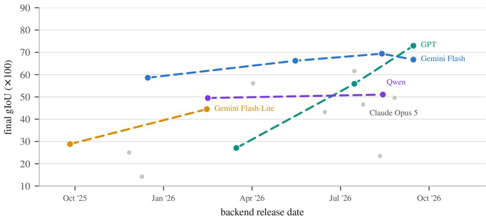  
Figure 17: Backend progress is LLMSeg progress. LLMSeg final segmentation gIoU on ReasonSeg val against backend release date, one coloured line per product line with two or more releases. All other backends are gray. Nothing in the pipeline changes between the points of a line.

Public capability and segmentation quality. Figure 19 plots that quality against four capability axes built from public benchmark scores (§C.5), one panel per axis. Two things follow. First, no published capability is a reliable predictor of segmentation quality: no axis reaches significance. The reasoning-and-knowledge axis comes closest $( \rho = 0 . 4 3 , p = 0 . 0 9 , n { = } 1 7 )$ , followed by the visionand-multimodal axis $( \rho = 0 . 3 6 , n { = } 8 )$ and software engineering $( \rho = 0 . 2 1 , p = 0 . 4 2 )$ . Agentic skill carries no signal $( \rho = - 0 . 0 5 , n { = } 1 4 )$ . The exceptions run in both directions. Claude Opus 5 (96.0 on SWE-bench Verified) and GLM 5.3 Flash score high on software engineering and reasoning yet segment at 46.6 and 49.6, fourteenth and twelfth of twenty-one. GPT-5.4 sits on the right of every panel but near the bottom in segmentation quality (27.1). Muse Glimmer 30B performs similarly (23.5). We did not diagnose where these backends lose accuracy. The reverse holds as well. Gemma 4 31B and Gemma 4 26B sit at the low end of the agentic, software and reasoning axes and still segment seventh and eighth at 56.2 and 56.1, and Gemini-3.7-Flash lies further above the fit than any other backend on two of the four axes (agentic and vision). The practical reading rests on those exceptions rather than on the fit. No published headline score, whether for vision or coding, is a reliable way to pick a backend for LLMSeg, and the only dependable test is to run the pipeline on the model.

Second, and more directly useful, Figure 17 re-plots the same runs against backend release date, joining models within each product line. All four product lines with multiple releases improve over the period shown while the pipeline remains unchanged. Gemini Flash goes $5 8 . 6  6 6 . 2  6 9 . 4 $ 66.7 over four releases in nine months, Gemini Flash-Lite $2 8 . 8  4 4 . { \overset { \vartriangle } { 5 } } , \operatorname { G P T } 2 7 . 1  5 5 . 9  7 2 . 9$ and Qwen $4 9 . 5  5 1 . 0 $ . The trend is not monotone at the release level: Gemini 3.8 Flash scores

2.7 below Gemini 3.7 Flash, a reminder that a newer model is not automatically a better backend. The Flash-Lite line is the most economical evidence: a +15.7 gIoU gain without retraining anything. Size within a generation buys little: Gemma 4 31B and its mixture-of-experts sibling Gemma 4 26B, released the same day, land 0.1 apart (56.2 and 56.1). The two Z.ai models are not one product line and the generation plot joins no arrow between them, but they bracket the same eight months as the Gemini Flash line: GLM 4.6V, of December 2025, is the weakest backend in the study at 14.2, and GLM 5.3 Flash, of August 2026, reaches 49.6. Price buys much less than generation does $( \rho = 0 . 2 5$ against input price, Figure 20). The second-best backend here costs 21× less than the best.

One caveat belongs with these numbers. Refinement is not uniformly positive across backends: it hurts on eleven of the twenty-one. It adds +3.7 gIoU on Gemini-3.7-Flash but costs 8.3 on GPT-5.4, 6.8 on Gemini-3.1-Flash-Lite, 2.4 on Claude Opus 5, 1.3 on Gemma 4 31B and 1.2 on GPT-6 Astra, our strongest backend. The loop can only re-trace what the backend proposes, so a backend that mislocates its focus boxes spends its passes moving the mask off the object. The refinement gains reported elsewhere in this paper are Gemini-3.7-Flash’s, and the appropriate refinement budget must be checked for each backend. This is also why Figure 5 ranks the backends on what they trace: a bar pair would read as a refinement result on rows where refinement is not one.
<table><tr><td>Backend</td><td>Developer</td><td>Release</td><td>Stage-2 gIoU</td><td>Final gIoU</td><td>∆</td></tr><tr><td>GPT-6 Astra†</td><td>OpenAI</td><td>2026-09</td><td>74.2 [70.4, 77.9]</td><td>72.9 [69.2, 76.6]</td><td>-1.2</td></tr><tr><td>Gemini 3.7 Flash</td><td>Google</td><td>2026-08-13</td><td>65.7 [62.1, 69.5]</td><td>69.4 [65.9, 72.8]</td><td>+3.7</td></tr><tr><td>Gemini 3.8 Flash†</td><td>Google</td><td>2026-09</td><td>63.4 [59.4,67.3]</td><td>66.7 [63.0, 70.4]</td><td>+3.3</td></tr><tr><td>Gemini 3.5 Flash</td><td>Google</td><td>2026-05</td><td>62.9 [59.1, 66.6]</td><td>66.2 [62.4, 70.0]</td><td>+3.3</td></tr><tr><td>GPT-5.6 Sol†</td><td>OpenAI</td><td>2026-07</td><td>61.2 [57.3,64.9]</td><td>61.6 [57.7, 65.5]</td><td>+0.3</td></tr><tr><td>Gemini 3 Flash</td><td>Google</td><td>2025-12</td><td>58.9 [55.1,62.7]</td><td>58.6 [55.1, 61.9]</td><td>-0.3</td></tr><tr><td>Gemma 4 31B†</td><td>Google</td><td>2026-04-02</td><td>57.6 [53.8,61.3]</td><td>56.2 [52.7,59.9]</td><td>-1.3</td></tr><tr><td>Gemma 4 26B†</td><td>Google</td><td>2026-04-02</td><td>56.9 [53.3,60.3]</td><td>56.1 [52.3,59.5]</td><td>-0.8</td></tr><tr><td>GPT-5.6 Terra</td><td>OpenAI</td><td>2026-07</td><td>56.2 [52.0, 60.0]</td><td>55.9 [51.6, 60.1]</td><td>-0.3</td></tr><tr><td>GPT-5.6 Luna</td><td>OpenAI</td><td>2026-07</td><td>54.4 [50.5,58.7]</td><td>55.1 [51.0, 59.0]</td><td>+0.7</td></tr><tr><td>Gemini 3.1 Flash-Lite</td><td>Google</td><td>2026-02</td><td>51.3 [47.8,54.8]</td><td>44.5 [41.2, 47.8]</td><td>-6.8</td></tr><tr><td>Qwen3.5 397B†</td><td>Qwen</td><td>2026-02-16</td><td>50.2 [46.6,53.7]</td><td>49.5 [45.9, 53.1]</td><td>-0.7</td></tr><tr><td>Qwen3.8 27B†</td><td>Qwen</td><td>2026-08-14</td><td>49.6 [45.5, 53.5]</td><td>51.0 [47.1,54.7]</td><td>+1.4</td></tr><tr><td>Claude Opus 5†</td><td>Anthropic</td><td>2026-07-24</td><td>49.0 [44.9, 53.2]</td><td>46.6 [42.6, 50.5]</td><td>-2.4</td></tr><tr><td>GLM 5.3 Flash†</td><td>Z.ai</td><td>2026-08-26</td><td>48.8 [45.1,52.7]</td><td>49.6 [45.7, 53.3]</td><td>+0.7</td></tr><tr><td>Muse Spark 1.2†</td><td>Meta</td><td>2026-06</td><td>41.2 [37.2,45.2]</td><td>43.2 [39.1, 46.9]</td><td>+2.0</td></tr><tr><td>GPT-5.4</td><td>OpenAI</td><td>2026-03</td><td>35.4 [31.8, 38.8]</td><td>27.1 [23.8, 30.8]</td><td>-8.3</td></tr><tr><td>Gemini 2.5 Flash-Lite</td><td>Google</td><td>2025-09-26</td><td>29.9 [26.4, 33.4]</td><td>28.8 [25.6, 32.1]</td><td>-1.1</td></tr><tr><td>Qwen3 VL 235B</td><td>Qwen</td><td>2025-11-26</td><td>25.2 [21.1,29.5]</td><td>25.1 [20.8, 29.4]</td><td>-0.2</td></tr><tr><td>Muse Glimmer  $3 0 \mathrm { B } ^ { \dag }$ </td><td>Meta</td><td>2026-08-11</td><td>21.3 [17.7,24.9]</td><td>23.5 [20.0, 27.3]</td><td>+2.2</td></tr><tr><td>GLM 4.6V†</td><td>Z.ai</td><td>2025-12-09</td><td>13.4 [10.2, 16.8]</td><td>14.2 [11.0, 17.6]</td><td>+0.9</td></tr></table>

Table 9: Twenty-one backends. LLMSeg on all 200 ReasonSeg val items, using the same pipeline and settings. Only the MLLM differs. Both masks are shown, with 95% bootstrap intervals and the signed effect ∆ of refinement. † marks a longer per-call budget.

## E.3 ABLATIONS AND DESIGN ALTERNATIVES

Table 10 and Table 11 test the design choices of Section 3 on two splits, comparing final-mask quality (gIoU and cIoU) with MLLM calls per image. Each split (ReasonSeg val and RefCOCO val) contains 200 items. The reference (shaded) row is the configuration reported in the paper, with topology conditioning off, run at the study budget T=12. The tables report fourteen variants per split: three change the reported configuration directly (cleanup and box adjustment), one adds topology conditioning, and the remaining ten (indented) apply their change on top of topology conditioning, so each of them is compared with the topology-on row. Both tables give gIoU, cIoU and calls per image, and the ReasonSeg table adds run-to-run deviations and wall-clock time. Every ReasonSeg configuration was run three times with an identical setup, and each cell reports the mean. Across repeated runs, a fixed configuration’s score varies by 0.1 to 1.3 gIoU, which sets the scale for interpreting the comparisons below. Each RefCOCO configuration was run once, so no deviation is reported. These results should be read for direction only. At similar call counts, adding topology conditioning to the reported configuration reduces observed cIoU by 2.1 on ReasonSeg and 2.5 on RefCOCO. The reductions have the same sign on both splits and for gIoU as well (1.5 and 2.6, respectively), so we leave topology off by default and retain it as an option for the item type it was designed for (Section E.4). The largest effect of any component is refinement: removing it costs 5.4 gIoU and 5.4 cIoU on ReasonSeg, and 9.8 gIoU and 12.7 cIoU on RefCOCO, relative to the topology-on row it modifies, and refinement accounts for 12.3 of that row’s 14.3 calls per image. The remaining changes generally produce smaller differences. Apart from removing refinement, the largest gIoU drop relative to the reported configuration is for low image detail: 3.5 gIoU (3.2 cIoU) on ReasonSeg and 4.5 gIoU (4.4 cIoU) on RefCOCO. Most variants are within two points of the reported configuration on both splits. No variant outperforms the reported configuration on both metrics across both splits. Cost varies more across the alternatives than quality does: calls range from 8.8 without the detect stage to 21.3 with per-instance cropped refinement, while on ReasonSeg the final gIoU of every other variant stays between 67.2 and 71.8. The pipeline does not appear to be delicately balanced on prompt conditioning or on how its calls are batched.

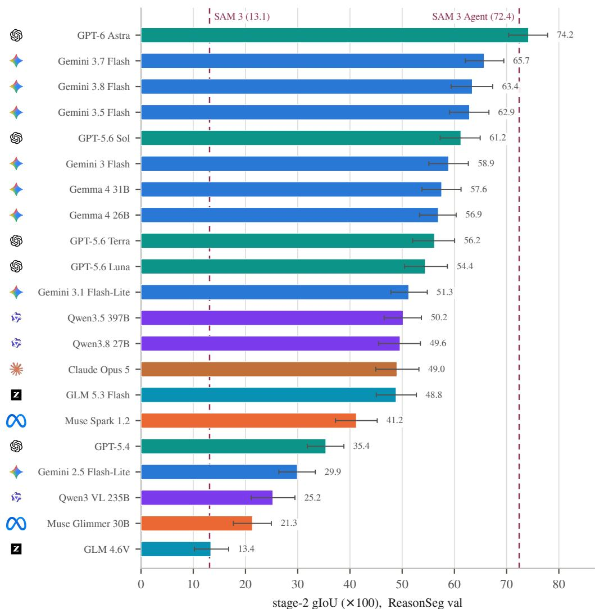  
Figure 18: Complete backend comparison in LLMSeg. All 21 backends we ran, including Gemini 3.8 Flash, Gemma 4 26B, and Qwen3.8 27B. Stage-2 gIoU, 95% item-bootstrap intervals, and baselines use the same 200 ReasonSeg val items.

Prompt conditioning. Cutting the stage-1 morphology or topology description from the prompts does not measurably change final-mask quality. The topology-on row includes both descriptions.

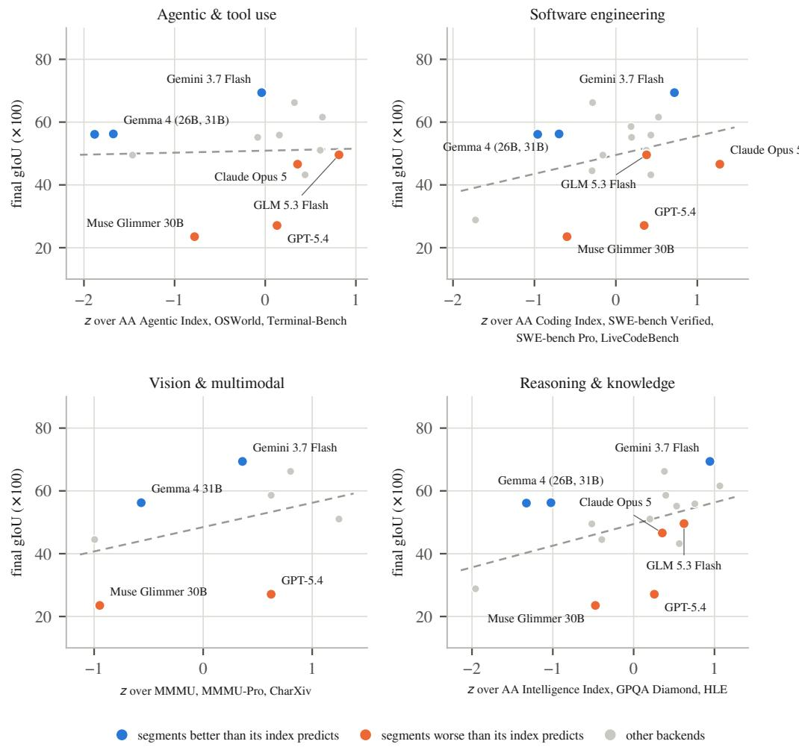  
Figure 19: Which kind of capability predicts LLMSeg quality? Final gIoU on ReasonSeg val is plotted against four public-benchmark capability axes, with dashed OLS fits. Slopes (gIoU per unit z) are 7.7 for vision and 6.9for reasoning, followed by 6.0for software and 0.6 for agentic skill. Reasoning and vision track segmentation quality most closely. Agentic skill shows almost no association.

Relative to its 69.2 ± 1.3 gIoU, removing morphology yields 69.9 and removing topology, which gives the reported configuration, yields 70.7. Both differences are small relative to the spread across configurations. On RefCOCO, the corresponding rows are 2.4 and 2.6 gIoU above the topology-on row (Table 11). Topology conditioning is a design option, not a component on which the aggregate results depend. We report the configuration without the extra topology prompt text because describing holes does not measurably improve split-level scores. Topology information does provide structural control: Stage 2 uses it for hole carving and gated cleanup. Without it, the model is not told how many closed curves to fit, and a holed or multi-part object may be cleaned as if it were one solid blob. The fraction of benchmark targets for which this control applies ranges from 0% to 7%. On items scored both ways, the paired difference is −0.3 gIoU overall and +0.1 on holed items. The option is retained for explicit structural control, not claimed as a source of aggregate accuracy (Section E.4). Reducing the backend’s reasoning effort or the image detail sent with each call leaves quality flat to slightly below the topology-on row it modifies: the corresponding cIoU scores are 72.3 and 71.5 here, against 72.6. On RefCOCO, they are 74.3 and 75.4, against 77.3. Low reasoning effort is the only setting that is cheaper: at the same call count, backend-call time per image falls by about a quarter, from 175 s to 133 s. The deterministic cleanup likewise does not carry the result. Removing it from the reported configuration gives 74.1 cIoU against 74.7 (77.9 against 79.8 on RefCOCO),

cheapest at its quality dear for its quality other backends

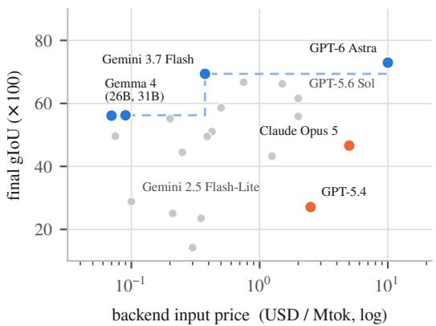  
Figure 20: Segmentation quality is not bought. Backend input price is plotted against LLMSeg final gIoU on ReasonSeg val. The dashed staircase marks the cheapest-so-far frontier, whose backends are shown in blue. Price does not order quality. Gemini 3.7 Flash is the cheapest backend that reaches 72.9 final gIoU, which motivates our LLMSeg choice of backend for the scalable main results.

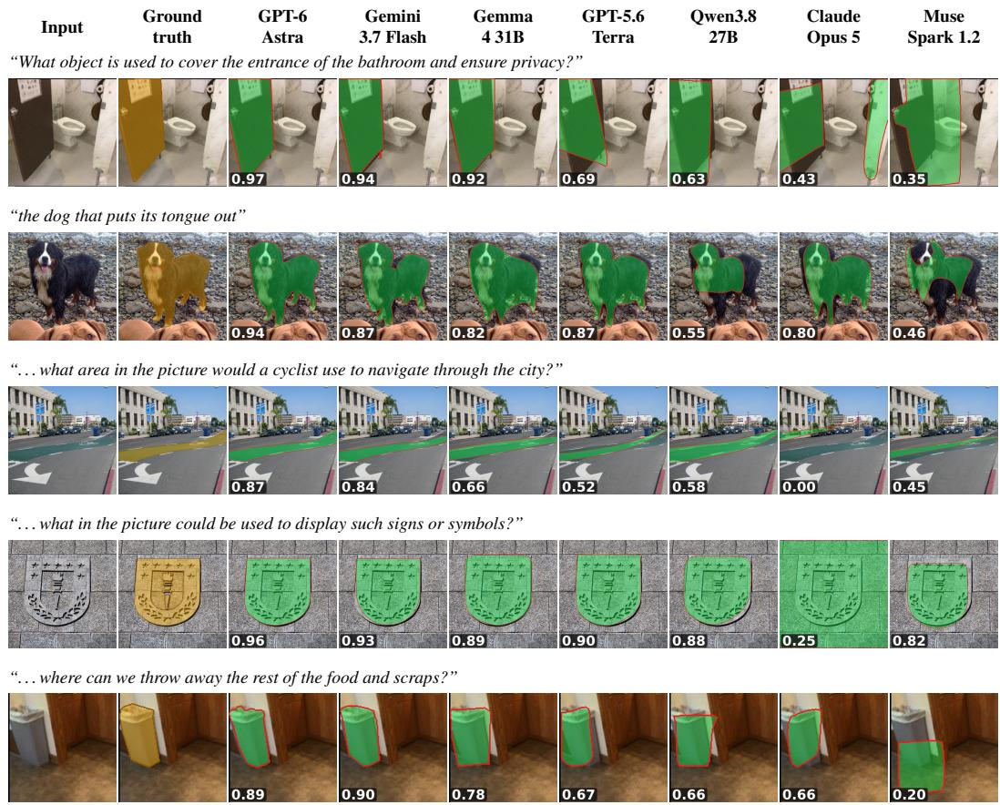  
Figure 21: What the MLLM backend gap looks like in LLMSeg. The same pipeline is used throughout, with one column per MLLM backend, ordered by split-level stage-2 gIoU, best first. Every panel shows the stage-2 mask, so the comparison is of what each backend traces rather than how it refines. Grounding is largely shared, but mask outlines deteriorate down the rows with week MLLMs.

and removing it from the topology-on row gives 73.8 against 72.6 (76.8 against 77.3). This matters because it is the only step in LLMSeg whose geometry the model did not choose.

Is the detection stage needed? Asking the model for splines directly, with no detect stage and therefore no box to confine control points to, tests whether stage 1 is worth its call. Without a box, the model must place absolute coordinates over the whole image, and no invariant prevents a loop from wandering across the scene. On ReasonSeg, the no-detection variant is within the run-to-run band of the topology-on row it modifies (69.5 gIoU and 72.1 cIoU versus 69.2 and 72.6) and uses fewer calls (8.8 vs. 14.3). RefCOCO is also competitive (78.5 gIoU at 10.4 calls against 76.7 at 16.8). Stage-2 cIoU does favor detection on both splits (Table 4). The advantage is concentrated on targets whose ground-truth masks are disconnected (at least two components above the annotation-speck threshold: 63/200 ReasonSeg and 18/200 RefCOCO items). On ReasonSeg, the initial cIoU on these targets is 52.6 without the detect stage and 63.9 with it. On RefCOCO, it is 61.7 without and 63.9 with. Thus detection provides box confinement (Eq. (2)), instance identities, and structural conditioning, not a demonstrated general accuracy advantage on multiple objects.

Why one batched call rather than per-instance crops? An obvious alternative runs the segment stage once per detected instance on a crop of its box, which gives the model more effective resolution per object at a cost that grows linearly with instance count, against the fixed single call of Section 3. It reaches 75.4 cIoU (71.8 gIoU) at 14.2 calls per image, the best ReasonSeg cIoU in the table. This is 2.8 above the topology-on row it modifies but only 0.7 above the reported configuration at the same cost, in part because most ReasonSeg items have one instance, making one crop equivalent to one call. On RefCOCO, however, it scores 78.3 cIoU at 15.4 calls, a point and a half below the reported configuration (79.8). The advantage does not carry over to the second split.

Why one batched refine rather than per-instance crops? The same crop alternative applied to stage 3: keep the batched segment call, then run the refinement loop once per instance on a crop of its box, each with its own overlay. Cost again grows with instance count. The batched refine of Section 3 stays two calls per pass regardless of N. This is the most expensive variant in the table, 21.3 calls per image against 14.6 for the reported configuration, a 46% increase, for 74.9 cIoU against 74.7, and on RefCOCO it costs two points (77.7 against 79.8). Its cost would grow further on multi-instance benchmarks, where the batched refine’s cost does not.

Why B-splines rather than polygons? Asking for a dense polygon instead of spline control points is the natural baseline for our output primitive: it removes the cubic smoothness prior and allows more coordinates per object. The variant uses degree-one loops in both stages, with prompted vertex ranges of 32 to 160 initially and 6 to 24 in refinement, against 16 to 64 and 4 to 12 for the B-spline topology-on row, so this comparison matches neither coordinate nor token budgets. At similar call cost, the final masks score comparably (69.8 gIoU and 73.1 cIoU against 69.2 and 72.6, with 78.7 and 79.1 on RefCOCO), and so do the stage-2 masks over three runs (65.3/66.2 against 65.1/68.3 gIoU/cIoU). The ablation is self-limiting because the backend chooses the degree itself (Section 3) and chooses 1 (the polygon) for 125 of the 195 objects it traced. Thus, on most of the split, the ablation changes the vertex budget and placement rules rather than the primitive. By ground-truth area, stage-2 polygon traces lead in the smaller two strata, while the B-spline run leads in the largest quartile on both metrics (75.6 against 73.4 gIoU and 76.0 against 69.7 cIoU). As a pixel-mass metric, cIoU is dominated by large objects, which is where the B-spline run leads. On cubic-traced items, it does so with fewer coordinates: it emits 28.9 per image, compared with 48.5 for the polygon variant, a 1.7× difference. Figure 22 shows three examples. These results support a compact parametric representation, not a uniform or equal-budget accuracy advantage.

A different split, the same backend. The rankings of the fifteen configurations (the reference and the fourteen variants, the same rows in both tables) by final gIoU agree between ReasonSeg and RefCOCO val $( \rho = 0 . 7 1 , p = 0 . 0 0 3 )$ , so a variant that helps on one split is likely to help on the other.

## E.4 WHERE THE GROUND TRUTH HAS HOLES

The topology ablation of Table 10 removes the hole and component description from all three prompts and produces no measurable change (70.7 vs. 69.2 gIoU, within the run-to-run band). That average is taken over a split where almost no target has a hole, so it cannot distinguish “topology does not help” from “too few items benefit for the effect to show up.” We measure each item’s ground truth directly to find the holed targets. A hole is an enclosed background component that never touches the image border and covers at least 0.5% of the object’s area. Anything smaller is annotation speckle. Items with an empty ground truth are excluded, since a hole needs an object.

<table><tr><td>Variant</td><td>gIoU</td><td>cIoU</td><td>calls/image</td><td>s/image</td></tr><tr><td>LLMSeg (reported configuration)</td><td> $7 0 . 7 \pm 0 . 7 4$ </td><td> $7 4 . 7 \pm 1 . 6 2$ </td><td> $1 4 . 6 \pm 0 . 3 2$ </td><td> $1 7 7 \pm 9$ </td></tr><tr><td>w/o deterministic postprocessing</td><td> $7 0 . 2 \pm 0 . 2 7$ </td><td> $7 4 . 1 \pm 2 . 2 0$ </td><td> $1 4 . 8 \pm 0 . 3 7$ </td><td> $1 6 2 \pm 1 2$ </td></tr><tr><td>+ box-adjust pre-pass</td><td> $7 0 . 0 \pm 0 . 2 7$ </td><td> $7 0 . 2 \pm 0 . 3 8$ </td><td> $1 5 . 7 \pm 0 . 3 4$ </td><td> $1 8 8 \pm 1 7$ </td></tr><tr><td>w/o postprocessing + box-adjust</td><td> $6 9 . 5 \pm 0 . 1 1 $ </td><td> $7 3 . 2 \pm 1 . 6 4$ </td><td> $1 5 . 9 \pm 0 . 1 0$ </td><td> $1 6 9 \pm 1 2$ </td></tr><tr><td>+ topology conditioning</td><td> $6 9 . 2 \pm 1 . 3 4$ </td><td> $7 2 . 6 \pm 0 . 2 3$ </td><td> $1 4 . 3 \pm 0 . 5 9$ </td><td> $1 7 5 \pm 1 7$ </td></tr><tr><td>w/o refinement  $( T { \ = } 0 )$ </td><td> $6 3 . 8 \pm 0 . 6 8$ </td><td> $6 7 . 2 \pm 2 . 7 2$ </td><td> $2 . 0 \pm 0 . 0 0$ </td><td> $2 4 \pm 2$ </td></tr><tr><td>w/o morphology conditioning</td><td> $6 9 . 9 \pm 0 . 4 7 $ </td><td> $7 3 . 4 \pm 2 . 6 9$ </td><td> $1 4 . 9 \pm 0 . 3 2$ </td><td> $1 7 9 \pm 7$ </td></tr><tr><td>low backend reasoning effort</td><td> $6 8 . 5 \pm 0 . 3 0 $ </td><td> $7 2 . 3 \pm 1 . 5 9$ </td><td> $1 4 . 4 \pm 0 . 5 8$ </td><td> $1 3 3 \pm 6$ </td></tr><tr><td>low image detail</td><td> $6 7 . 2 \pm 0 . 8 8$ </td><td> $7 1 . 5 \pm 4 . 6 0$ </td><td> $1 4 . 6 \pm 0 . 2 2$ </td><td> $1 8 0 \pm 6$ </td></tr><tr><td>w/o deterministic postprocessing</td><td> $6 9 . 6 \pm 0 . 5 5$ </td><td> $7 3 . 8 \pm 1 . 8 9$ </td><td> $1 4 . 8 \pm 0 . 3 6$ </td><td> $1 7 2 \pm 2 9$ </td></tr><tr><td>w/o postprocessing + box-adjust</td><td> $6 9 . 4 \pm 0 . 6 9$ </td><td> $7 3 . 6 \pm 3 . 5 5$ </td><td> $1 5 . 5 \pm 0 . 3 2$ </td><td> $1 6 6 \pm 1 2$ </td></tr><tr><td>w/o detect stage (splines over whole image)</td><td> $6 9 . 5 \pm 0 . 5 9$ </td><td> $7 2 . 1 \pm 0 . 8 7$ </td><td> $8 . 8 \pm 0 . 2 6$ </td><td> $1 2 0 \pm 1 9$ </td></tr><tr><td>per-instance cropped calls</td><td> $7 1 . 8 \pm 0 . 4 4$ </td><td> $7 5 . 4 \pm 0 . 4 4$ </td><td> $1 4 . 2 \pm 0 . 2 4$ </td><td> $1 6 9 \pm 3$ </td></tr><tr><td>polygon loops instead of B-splines</td><td> $6 9 . 8 \pm 0 . 5 7$ </td><td> $7 3 . 1 \pm 3 . 1 6$ </td><td> $1 4 . 7 \pm 0 . 0 9$ </td><td> $1 8 6 \pm 7$ </td></tr><tr><td>per-instance cropped refine</td><td> $7 1 . 7 \pm 0 . 2 3$ </td><td> $7 4 . 9 \pm 0 . 9 1$ </td><td> $2 1 . 3 \pm 0 . 4 9$ </td><td> $1 8 5 \pm 3$ </td></tr></table>

Table 10: Ablations on ReasonSeg val (all 200 items, Gemini-3.7-Flash backend, T=12). The shaded row is the configuration reported in the paper (topology conditioning off). Cells are three-run means and sample deviations. s/image is backend-call wall-clock time per image.

<table><tr><td>Variant</td><td>gIoU</td><td>cIoU</td><td>calls/image</td></tr><tr><td>LLMSeg (reported configuration)</td><td>79.3</td><td>79.8</td><td>17.5</td></tr><tr><td>w/o deterministic postprocessing</td><td>76.6</td><td>77.9</td><td>17.1</td></tr><tr><td>+ box-adjust pre-pass</td><td>79.2</td><td>79.7</td><td>18.4</td></tr><tr><td>w/o postprocessing + box-adjust</td><td>77.9</td><td>78.3</td><td>19.1</td></tr><tr><td>+ topology conditioning</td><td>76.7</td><td>77.3</td><td>16.8</td></tr><tr><td>w/o refinement (T=0)</td><td>66.9</td><td>64.6</td><td>2.0</td></tr><tr><td>w/o morphology conditioning</td><td>79.1</td><td>78.8</td><td>17.0</td></tr><tr><td>low backend reasoning effort</td><td>75.7</td><td>74.3</td><td>16.6</td></tr><tr><td>low image detail</td><td>74.8</td><td>75.4</td><td>15.8</td></tr><tr><td>w/o deterministic postprocessing</td><td>76.4</td><td>76.8</td><td>16.8</td></tr><tr><td>w/o postprocessing + box-adjust</td><td>76.9</td><td>77.7</td><td>18.4</td></tr><tr><td>w/o detect stage (splines over whole image)</td><td>78.5</td><td>78.8</td><td>10.4</td></tr><tr><td>per-instance cropped calls</td><td>78.8</td><td>78.3</td><td>15.4</td></tr><tr><td>polygon loops instead of B-splines</td><td>78.7</td><td>79.1</td><td>16.6</td></tr><tr><td>per-instance cropped refine</td><td>77.4</td><td>77.7</td><td>18.8</td></tr></table>

Table 11: Ablations on RefCOCO val (all 200 items, Gemini-3.7-Flash backend, T=12, one run per configuration). Rows and blocks as in the ReasonSeg ablation: the shaded row is the reported configuration.

The first finding is prevalence. Over the eleven splits measured, holed targets are 7.1% of ReasonSeg val and 6.6% of ReasonSeg test, 4.7% of LVIS positives, and between 0% and 1.4% of every RefCOCO/RefCOCO+/RefCOCOg split: COCO’s polygon annotations essentially never carve one. The subset the topology machinery exists for is a small minority of what these benchmarks contain, which helps explain the null split-level ablation.

The second finding closes the ablation. On the 396 ReasonSeg items scored by both the topology-on and topology-off runs, the mean per-item IoU difference is −0.3 ([−1.8, 1.2]) overall and +0.1 $( [ - 5 . 3 , 5 . 3 ] )$ on the 19 holed ones: targeting the subset does not reveal a hidden effect. This is the measurement behind the conclusion in Section 5: topology conditioning makes explicit hole-loop specification possible when a target has holes, but it is not a source of the accuracy we report, and we do not claim it as one. Two caveats limit this result’s interpretation: the runs also differ in pass budget (Section C.2), and 19 holed items make up a small sample, as reflected in the interval.

ReasonSeg “. . . what would the speaker use to amplify their voice?”

Input  

Ground truth  

Polygon loops  
  
B-splines (LLMSeg)

  
ReasonSeg “. . . what could be used to rotate or spin other parts?”

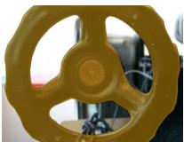

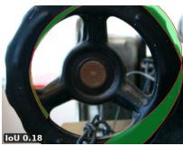

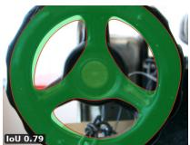  
ReasonSeg “. . . what part ofthe lion is a defining characteristic of males?”

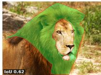

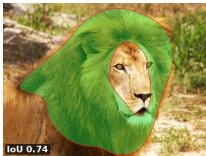  
Figure 22: Polygons vs. B-splines in LLMSeg. Stage-2 traces from the polygon-loop ablation and the B-spline run on identical items with the same backend. Each chip shows that run’s recorded stage-2 IoU. Cubic B-splines cover curved boundaries better than polygons with fewer control points.

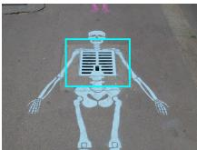  
input

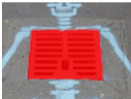  
SAM 3

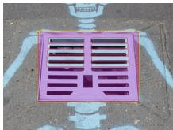  
w/o refine

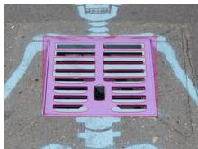  
LLMSeg

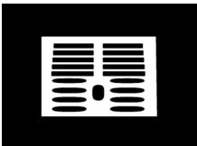  
LLMSeg mask

Figure 23: Explicitly carved holes. The query is “the sewage outlet”. The cyan-box region is enlarged. SAM 3 fills the grate solidly, whereas LLMSeg carves one hole per slot.

## E.5 LOCALIZATION OR BOUNDARY?

Table 3 reports the gap to SAM 3 as two scalars per benchmark, each averaged over the ten COCO IoU thresholds 0.50:0.05:0.95. This averaging hides the shape of the effect: a system that finds every object but traces it loosely can report the same mean AP as one that finds fewer objects but traces them tightly. Their behavior becomes clear from how AP changes across the threshold axis. To show this, Figure 24 plots AP at each threshold for the main-results pipeline configuration (Gemini-3.7-Flash, T=8, topology conditioning off), using the same matched subsets and COCOeval pass.

At AP on LVIS, box scores are nearly tied (79.3 vs. 79.6). On COCO, LLMSeg leads in box AP (87.4 vs. 79.5) and is close in mask AP (80.0 vs. 81.3). The mask AP gap widens at tighter thresholds. By IoU 0.90, LLMSeg scores 16.4 on both benchmarks, while SAM 3 scores 42.5 and 24.3, respectively. Averaged over the ten thresholds, the mask gap is 3 to 6× the box gap. On COCO, the interval for the box gap includes zero. This pattern is consistent with masks that identify the right object and place it within the right box, but have filled, closed-spline boundaries that remain a few pixels loose. A threshold sweep reveals this boundary error, whereas mean AP obscures it. Refinement improves the boundary but does not eliminate the error: relative to the unrefined stage-2 mask, mask AP improves by +10.4 on LVIS and +12.5 on COCO across thresholds up to 0.85, peaking at +14 to +20 in the 0.65 to 0.85 band. By IoU 0.95, the gains fall to +2.4 and +1.5, respectively. Refinement moves the outline substantially closer to the object but does not produce pixel-tight masks. The remaining gap is concentrated at high overlap thresholds. These subset results do not establish full-dataset AP parity.

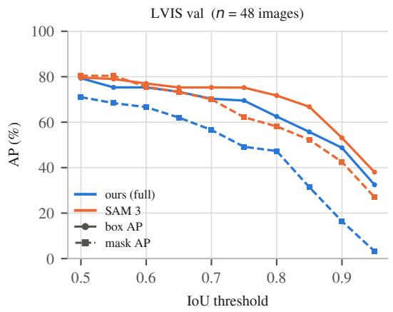

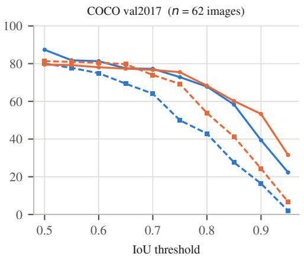

Figure 24: LLMSeg localizes like SAM 3 and loses the boundary. COCO-style AP at each IoU threshold on AP-eligible images in the matched LVIS and COCO subsets, with boxes taken from the predicted masks. LLMSeg is the reported configuration. Solid lines are box AP and dashed lines mask AP. The box curves run together while the mask curves fan apart, indicating good localization but loose boundary for LLMSeg errors.
<table><tr><td>Method</td><td colspan="3">measured / estimated cost per image calls median est. $</td><td>final</td></tr><tr><td>LLMSeg (GPT-6 Astra)</td><td>MLLM/SAM3 11.7/0 15.0/0</td><td>S 218</td><td>/ 1k img 323.9</td><td>gIoU 72.9</td></tr><tr><td>LLMSeg (Gemini 3.7 Flash) LLMSeg (Gemini 3.8 Flash)</td><td></td><td>153 419</td><td>15.6 33.7</td><td>69.4</td></tr><tr><td>LLMSeg (Gemini 3.5 Flash) LLMSeg (GPT-5.6 Sol)</td><td>16.2/0 17.6/0</td><td>246</td><td>77.9</td><td>66.7 66.2 61.6</td></tr><tr><td>LLMSeg (Gemini 3 Flash)</td><td>15.0/0 24.4/0</td><td>665 588</td><td>83.0</td><td></td></tr><tr><td></td><td></td><td></td><td>36.0</td><td>58.6</td></tr><tr><td>LLMSeg (Gemma 4 31B)</td><td>21.8/0</td><td>1883</td><td>5.0</td><td>56.2</td></tr><tr><td>LLMSeg (Gemma 4 26B)</td><td>19.4/0</td><td>2151</td><td>3.7</td><td>56.1</td></tr><tr><td>LLMSeg (GPT-5.6 Terra)</td><td>10.6/0</td><td>264</td><td>62.3</td><td>55.9</td></tr><tr><td>LLMSeg (GPT-5.6 Luna)</td><td>14.6/0</td><td>368</td><td>8.6</td><td>55.1</td></tr><tr><td></td><td></td><td></td><td></td><td></td></tr><tr><td>LLMSeg (Qwen3.8 27B)</td><td>12.3/0</td><td>847</td><td>15.4</td><td>51.0</td></tr><tr><td>LLMSeg (GLM 5.3 Flash)</td><td>7.3/0</td><td>1100</td><td>1.4</td><td>49.6</td></tr><tr><td>LLMSeg (Qwen3.5 397B)</td><td>12.4/0</td><td>2920</td><td>14.3</td><td>49.5</td></tr><tr><td>LLMSeg (Claude Opus 5)</td><td>23.1/0</td><td>706</td><td>321.2</td><td>46.6</td></tr><tr><td>LLMSeg (Gemini 3.1 Flash-Lite)</td><td>23.8/0</td><td>100</td><td>17.6</td><td>44.5</td></tr><tr><td>LLMSeg (Muse Spark 1.2)</td><td>24.4/0</td><td>837</td><td>76.2</td><td>43.2</td></tr><tr><td>LLMSeg (Gemini 2.5 Flash-Lite)</td><td>21.4/0</td><td>113</td><td>5.6</td><td>28.8</td></tr><tr><td>LLMSeg (GPT-5.4)</td><td>24.0/0</td><td>211</td><td>176.8</td><td>27.1</td></tr><tr><td>LLMSeg (Qwen3 VL 235B)</td><td>9.0/0</td><td>128</td><td>6.6</td><td>25.1</td></tr><tr><td>LLMSeg (Muse Glimmer 30B)</td><td>14.7/0</td><td>1478</td><td>13.6</td><td>23.5</td></tr><tr><td>LLMSeg (GLM 4.6V)</td><td>15.7/0</td><td>1046</td><td>11.4</td><td>14.2</td></tr><tr><td>SAM 3 Agent (Gemma 4 31B)</td><td>2.3/1.4</td><td>27</td><td>6.4</td><td>73.1</td></tr><tr><td>SAM 3 Agent (Gemini 3.5 Flash)</td><td>2.5/1.5</td><td>13</td><td>17.5</td><td>72.5</td></tr><tr><td>SAM 3 Agent (Gemini 3.7 Flash)</td><td>2.4/1.4</td><td>11</td><td>8.3</td><td>72.4</td></tr><tr><td>SAM 3</td><td>0/1</td><td>2</td><td>4.3</td><td>13.1</td></tr><tr><td></td><td></td><td></td><td></td><td></td></tr></table>

Table 12: What a mask costs. ReasonSeg validation set (200 items), covering all 21 LLMSeg backends and the SAM 3 and SAM 3 Agent baselines. Call counts and median latency are measured per image. Estimated spend is per 1,000 images, using one token budget shared across all rows and a fixed serving price per SAM 3 forward pass. LLMSeg rows are shaded.

## E.6 WHAT A MASK COSTS

Where the time goes. Refinement dominates: stage 3 accounts for 76 to 94% of wall-clock time on every backend (89% on Gemini-3.7-Flash), consistent with a loop of up to $T { = } 1 2$ passes at two calls per pass, compared with one detection and one segmentation call. The cost comes from the number of calls, not their content: at a published 2.3 s time-to-first-token, Gemini-3.7-Flash spends about 34 of its 153 median seconds waiting for first tokens alone across its 15 calls. Call count is not a proxy for useful effort: the best backend averages 11.7 calls per image, while the three highest-call backends average 24.0 to 24.4 and score 58.6, 43.2 and 27.1. This reflects stopping behavior: a sequence may stop while its mask is still changing, while an unproductive sequence may run to the budget.

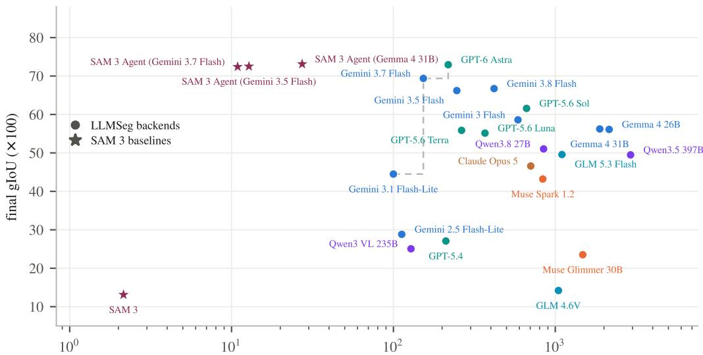  
wall clock per image (s, log)

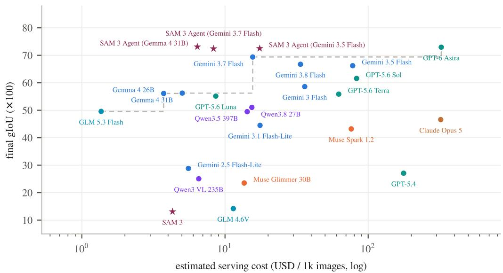  
Figure 25: Quality against what it costs. ReasonSeg val, 200 items, every LLMSeg backend and baseline, plotted against wall-clock time (top) and estimated serving cost (bottom). Both axes are logarithmic and the dashed staircase is the cheapest-so-far frontier over the LLMSeg backends. Circles are LLMSeg backends, stars the SAM 3 and SAM 3 Agent baselines, which the frontier excludes.

LLMSeg is the expensive way to reach this quality. On this benchmark SAM 3 Agent is both better and cheaper. Driven by the same Gemini-3.7-Flash, it reaches 72.4 gIoU against our 69.4 in roughly one-fourteenth of the wall-clock time (11 s against 153 s) and at just over half the estimated serving cost (\$8.31 against \$15.61 per thousand images). It makes 2.4 agent rounds and 1.4 SAM 3 passes where we make 15 vision calls, and the mask itself comes from a 860 M-parameter forward pass rather than from coordinates the MLLM has to write out. Charging for the SAM 3 passes narrows that gap rather than closing it: the agent’s 1.4 passes cost it \$5.85 of its \$8.31, and SAM 3 on its own costs \$4.30, a cost undercut by only two LLMSeg backends. That advantage is specific to what SAM 3 can already segment: SAM 3 Agent inherits SAM 3’s mask, so where SAM 3 collapses (Section 4.2) the agent collapses with it, while LLMSeg is bounded only by its detect box. In summary, predicting a mask as text buys open-vocabulary reach at the price of calls, latency and dollars, and the price is set by the backend rather than by the pipeline: across the twenty-one backends, spend per thousand images ranges from 1.4 to 324, a factor of 238, across a gIoU range of 14.2 to 72.9, with cost only weakly tracking gIoU. The most expensive backend is also the best, but costs 21× as much as the second-best for a 3.5-point gIoU gain, and the two cheapest backends outscore nine dearer ones.

## E.7 WHERE THE LLM ROUTE WINS AND LOSES

The results support a consistent picture. LLMSeg wins where (i) the query needs reasoning (ReasonSeg, Figure 3), (ii) the domain is rare $( \mathrm { R F \bar { - } \bar { 1 } 0 0 V L , 2 . 2 \times \bar { \bf S A M } \bar { 3 ^ { \circ } s } \bar { A P } _ { 0 } } )$ , including medical and industrial imagery, (iii) presence judgment matters (hard-negative cgF1 on LVIS and COCO), where the LLM can reason about whether the concept is in the image. This does not carry over to SA-Co/Gold, where LLMSeg trails SAM 3 by 9.0 cgF1 while pmF1 is level, so the loss lies in the presence decision. The last case is (iv) a regular shape: such shapes admit compact cubic or straight-edged traces, and, with topology enabled, holes can be specified by interior loops. Neither final boundary smoothness nor hole count is guaranteed. Holed targets are a small minority in these benchmarks (see Figure 23), and prevalence is quantified in Section E.4. LLMSeg loses on pixel-tight mask AP and on thin, amorphous or highly irregular regions (Figure 26), where compact geometric traces lose fine boundary detail. In practice, LLMSeg takes minutes per image and makes multiple API calls, compared with a median of 2 s per image for SAM 3 on a local GPU (Table 12). However, it runs on the heavily optimized LLM serving stack, needs no GPU of its own, and produces inspectable intermediate records (boxes, optional topology, per-loop splines, and focus boxes with a type and a short shape description). These records are not verified explanations of the model’s internal reasoning.

Limitations. LLMSeg inherits its backend’s failure modes: hallucinated detections on ambiguous prompts, occasional coordinate-format instability (mitigated but not eliminated by the repairs of §B), and per-call latency of seconds to minutes, which makes video and real-time use out of scope. Spline loops are a poor primitive for thin or fractal structures (Figure 26), and segmentation quality is upper-bounded by detect-box quality due to the confinement invariant. Finally, API-served backends make exact reproducibility subject to provider model updates. We pin model versions and release all records.

## E.8 FAILURE MODES

Figure 26 collects the failure modes discussed in Section E.7: thin structures, amorphous background classes, and the deep, narrow concavities of articulated bodies.

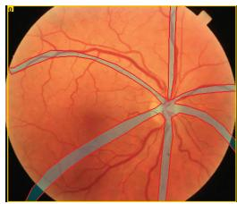  
w/o refine

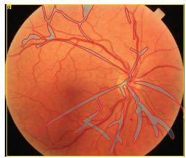  
full (7 passes)

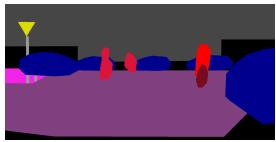  
LLMSeg label map

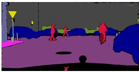  
SAM 3 label map

  
input

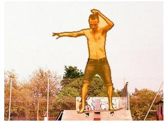  
ground truth

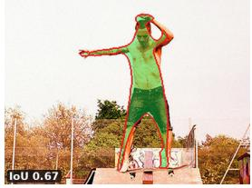  
LLMSeg

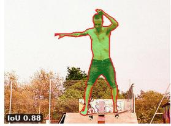  
SAM 3  
Figure 26: Failure modes. Top left pair: thin structures (retinal vessels) defeat spline outlines even after refinement. Top right pair: on Cityscapes, amorphous and heavily-occluded background classes favour pixel decoders over compact parametric loops. Bottom row: the query is grounded correctly, but a closed loop cannot cut into the deep, narrow concavities of an articulated hands.

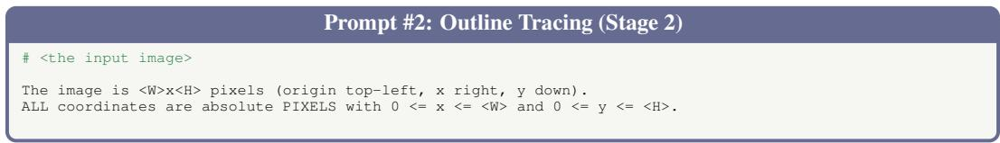

## F PROMPT TEMPLATES

This section gives the three prompt templates that drive the pipeline, in the form the model receives them: box 1 is the detection call of Section 3, box 2 the initial tracing call, and box 3 the focus-box proposal call. Text in angle brackets is filled in at run time. The instance and focus-region blocks are shown filled for a two-instance example, since their layout is part of what the model reads. Long lines are re-wrapped to the column width. Everything in black is template text. The #-prefixed green lines are ours, not the model’s, so a box can be copied whole and the notes stay comments. The green leading line stands for the image, which is attached to the request alongside the prompt text. The boxes show the study configuration, which includes the stage-1 topology description. The reported configuration drops that description from all three prompts: the topology block of box 1’s schema, the topology lines of the instance and detection-box listings in boxes 2 and 3, and the sentences that refer to topology. The fourth call, the re-tracing half of a refinement pass, is box 2’s spline rules restated once per focus region. It repeats the coordinate paragraph and the overlay description of box 3, lists the surviving focus regions with their type and reported shape, fixes the degree to cubic, asks for four to twelve control points per region instead of sixteen to sixty-four, and returns the same id-keyed list of closed loops.

The templates share three properties. First, every call states the coordinate space explicitly and every call that returns points restates the box those points must fall inside as a numeric inequality. The code clamps regardless, but a clamped-in point is a worse outline than a correctly placed one. Second, each prompt offers an escape hatch, an empty detection list, an empty loop list for an instance whose box holds nothing, an empty proposal list for a pass that finds no error, so that a failure to find something is expressible and does not have to be invented. Third, batched calls pin the emission order to ascending instance id, which is what makes a truncated reply salvageable.

Prompt #1: Instance Detection (Stage 1)   
# <the input image>   
The image is <W>x<H> pixels (origin top-left, x right, y down).   
ALL coordinates are absolute PIXELS with 0 <= x <= <W> and 0 <= y <= <H>.   
Find every DISTINCT instance of the following in the image: "<query>"   
Return ONLY a JSON object (no prose, no markdown fences) with this exact schema:   
{"detections": [{   
"id": <int starting at 0>,   
"label": "<short label>",   
"box": [x1, y1, x2, y2],   
"confidence": <0..1>,   
"morphology": {   
"shape": "<overall silhouette in a few words, e.g. ’compact rounded body with two upright   
protrusions’>",   
"aspect": "<tall|wide|square>",   
"convexity": "<convex|slightly-concave|highly-irregular>",   
"parts": ["<protruding/notable parts, e.g. ’left protrusion’>", "<’base contact’>", "..."]   
},   
"topology": {   
"components": <int number of disconnected pieces of the object silhouette>,   
"holes": <int number of enclosed background holes inside the silhouette>,   
"boundary\_loops": <int total closed boundary curves = components + holes>,   
"notes": "<one short phrase, e.g. ’single blob, no holes’>"   
}   
}]}   
where box is [x1, y1, x2, y2] in the coordinate space described above (x1 < x2, y1 < y2, all values   
inside the valid range for that space).   
- One entry per DISTINCT instance -- do NOT return duplicate or nested boxes for the same object. Order   
detections in reading order (top-to-bottom, then left-to-right); ids will be reassigned by code, but   
keep them contiguous from 0.   
morphology.aspect must describe the instance as you SEE it, independently of the numbers you wrote in   
box; it is cross-checked against them.   
Make each box LARGE enough to ENTIRELY encompass that instance -- leave generous margin so no part of   
the silhouette (protrusions, extremities, soft edges, head, ears, paws) is clipped by the box. Prefer   
a roomy box over a tight crop; a later stage confines all outline tracing to this box, so an   
undersized box truncates the segmentation.   
morphology describes the object’s FORM (shape of its outline) so a later stage can trace it; topology   
describes its STRUCTURE (how many separate blobs and how many holes) so a later stage knows how many   
closed curves to fit.   
If nothing matches, return {"detections": []}.   
Output the JSON and nothing else.

We have already DETECTED <N> instance(s) of "<query>" (same query / class). Each instance has its own   
bounding box; a later stage confines that instance’s outline to ITS box only.   
INSTANCES (trace EVERY one):   
- id=0 label="<label>" box=[120, 80, 540, 610]   
every x,y you return for id=0 must satisfy: 120 <= x <= 540 and 80 <= y <= 610   
morphology: {"shape": "compact rounded body with two upright ears", "aspect": "tall",   
"convexity": "slightly-concave", "parts": ["left ear", "tail", "front paws"]}   
topology: {"components": 1, "holes": 0, "boundary\_loops": 1, "notes": "single blob, no holes"}   
id=1 label="<label>" box=[600, 140, 930, 585]   
# ... (one such entry per detected instance)   
Your job has TWO parts:   
(1) pick ONE shared overlay tint color for the mask (same for all instances),   
(2) CHOOSE a spline degree (1 or 3) shared by every instance of this class, then for EACH instance   
trace its silhouette with piece-wise CLOSED 2D B-splines of that degree so the spline(s) tightly   
SURROUND that instance.   
MASK COLOR (part 1):   
Pick ONE color name from this fixed list:   
"lime", "green", "spring\_green", "mint", "teal", "cyan", "turquoise", "sky\_blue", "blue",   
"periwinkle", "indigo", "violet", "purple", "magenta", "hot\_pink", "pink", "coral", "orange",   
"chartreuse"   
Choose the color that maximizes contrast of a light translucent tint against BOTH the "<query>" AND its   
surrounding background, so a later pass can clearly see what is covered vs not. Rules for the choice:   
ONE tint is shared by every instance: pick a hue that reads clearly on ALL of them and against each   
one’s own local background, not just the first.   
Prefer a hue that is NOT already dominant in the object or in the nearby background.   
Do NOT pick a color that would wash out or blend into the object’s own colors or hide fine edge   
detail under the tint.   
Return the name EXACTLY as listed (lowercase, underscores).   
SPLINE RULES (part 2):   
Return exactly one entry per instance, keyed by the same integer "id".   
Every control point for instance id=K MUST lie inside THAT instance’s box=[x1, y1, x2, y2] listed   
above.   
Fit ONE closed B-spline per connected blob of that instance (topology.components), plus ONE   
additional closed B-spline per interior hole (topology.holes), marking holes with "role":"hole".   
Outer silhouette loops use "role":"outer".   
Use each instance’s morphology to place control points on the true outline (follow protrusions,   
concavities, corners, and curves named in the morphology).   
If one instance’s box is empty, unreadable, or holds nothing matching the "<query>", return an EMPTY   
"splines" list for that id rather than inventing an outline. Still return its id, and still trace   
every other instance normally.   
Your whole reply must fit in ONE response, and <N> instances is a lot of coordinates. Emit entries in   
ASCENDING id order and FINISH each entry before starting the next; stay near the LOW end of the   
control-point range for the simple ones so that nothing gets cut off.   
CHOOSE THE SPLINE DEGREE (1 or 3) from the object’s form, then place the control points the way that   
degree requires:   
Pick DEGREE 1 (closed polyline) for angular / polygonal / straight-edged objects, or simple   
silhouettes where a polygon is enough. Its control points are vertices ON the true object outline   
(not a looser control polygon): place them directly on the edge, ordered around the loop, denser at   
corners/bends and sparser on long straight spans.   
Pick DEGREE 3 (closed cubic B-spline) for organic / rounded / smoothly curved silhouettes. Its   
control points are the B-spline CONTROL POLYGON (the curve is smoother than and sits inside the   
polygon), so push them slightly OUTWARD toward the object edge, ordered around the loop.   
Use the SAME degree for EVERY spline (outer loops and holes). Report it in the top-level "degree"   
field AND set "degree" on each spline to that value.   
Choose the NUMBER of control points from the object’s morphology and what you actually see inside the   
box -- typically 16-64 per loop. Use MORE points for intricate / irregular / many-parted outlines   
(closer to 64) and FEWER for simple, smooth, or rounded ones (near 16). Do not aim for a fixed count   
-- let the shape’s complexity decide within that range; under-sampling a complex outline is worse   
than a few extra points on a simple one.   
Return ONLY this JSON (no prose, no markdown fences):   
{"mask\_color": "<one name from the list>",   
"mask\_color\_reason": "<short why this hue contrasts with object+background>",   
"degree": <1 or 3>,   
"degree\_reason": "<short why this degree fits the object’s form>",   
"instances": [   
{"id": 0, "splines": [   
{"role": "outer", "degree": <same as top-level degree>, "closed": true,   
"control\_points": [[x, y], [x, y], ...]}   
]}   
]}   
Output the JSON and nothing else.

## Prompt #3: Proposing Focus Regions (Stage 3)

<the current overlay image>   
This image shows the CURRENT segmentation of the "<query>":   
- the translucent <tint> tint marks the current MASK REGION (coverage),   
- the RED outline is the current mask BOUNDARY -- the main edge to compare,   
- each YELLOW rectangle is one instance’s detection box (ids drawn beside them).   
The <tint> fill is light on purpose: you can still see the <query>’s real edges/texture underneath. Use   
the <tint> tint to tell what is already covered; use the red outline + the underlying pixels to judge   
where the TRUE edge runs. Do NOT treat the soft tinted edge as the object boundary.   
The image is <W>x<H> pixels (origin top-left, x right, y down).   
ALL coordinates are absolute PIXELS with 0 <= x <= <W> and 0 <= y <= <H>.   
DETECTION BOXES (each focus box MUST lie inside ONE of these):   
id=0 label="<label>" box=[120, 80, 540, 610]   
topology: {"components": 1, "holes": 0, "boundary\_loops": 1, "notes": "single blob, no holes"}   
id=1 label="<label>" box=[600, 140, 930, 585]   
# ... (one such entry per detected instance)

Your task is a COMPARISON: follow the RED outline and, at each part of it, look through the <tint> tint   
at the actual object pixels to see where the TRUE edge of the <query> is. Report the places where the   
two disagree.   
Find FOCUS BOXES that mark where the mask is wrong and needs local fixing:   
- type "positive": a box that FULLY encloses an area that IS part of the <query> but is NOT tinted /   
lies OUTSIDE the red outline (MISSED, e.g. a protruding part or tip left outside the mask) -> to be   
ADDED.   
- type "negative": a box that FULLY encloses an area that IS tinted / INSIDE the red outline but is   
actually background (wrongly included, e.g. background bleeding beside the silhouette, or a gap   
that is not the <query>) -> to be REMOVED.   
Check BOTH error directions along the red outline: missed object (positive) AND tinted background   
(negative). Do not only hunt for misses.   
Rules:   
Tag every focus box with "instance\_id" naming which detection box it belongs to.   
Each focus box [x1, y1, x2, y2] MUST lie inside that instance’s detection box.   
Make each box LARGE enough to ENTIRELY encompass the region to be fixed -- leave generous margin so   
no part of the miss / over-include is clipped by the box edge. Prefer one roomy box over a tight   
crop; undersized boxes cause the next-step spline to miss the true outline. Propose 1-6 boxes PER   
instance (up to 6 x <N> total), one per distinct problem area.   
Check EVERY one of the <N> instances listed above, not only the largest or the most obviously wrong   
one. Propose up to 6 boxes PER instance (do not dump the whole budget on one).   
Anchor each box on what you can actually SEE: it should cover the full gap between the red outline   
(or the tinted coverage) and the true edge of the <query> at that spot, plus margin. Place box edges   
on real image features (the object’s boundary, a protrusion, the adjacent background), not on the   
soft tint alone.   
A pass may be ALL positive, ALL negative, or a mix -- there is NO requirement to include both types.   
Return only boxes that are genuinely wrong; never add a box of the other type just to have one of   
each.   
Only flag areas that are CLEARLY wrong in the current image; if a spot already looks correct, do not   
propose a box there (earlier fixes already show in the tint).   
For each box, describe the SHAPE of the region to be added/removed in a few words, and how intricate   
its outline is (e.g. "thin curved sliver", "small round bump", "jagged notch", "simple triangular   
wedge"). A later step uses this to decide how many control points to spend on the box, so be honest   
about whether the local edge is simple or wiggly.   
Return ONLY this JSON (no prose, no markdown fences). Example shape (mix of types; your list may be   
all-positive, all-negative, or mixed):   
{"focus\_boxes": [   
{"type": "positive", "instance\_id": 0, "shape": "<shape + complexity of the region to add>",   
"box": [x1, y1, x2, y2]},   
{"type": "negative", "instance\_id": 0, "shape": "<shape + complexity of the region to remove>",   
"box": [x1, y1, x2, y2]}   
]}   
Output the JSON and nothing else.