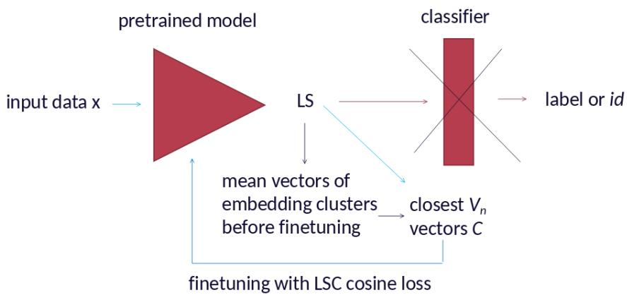
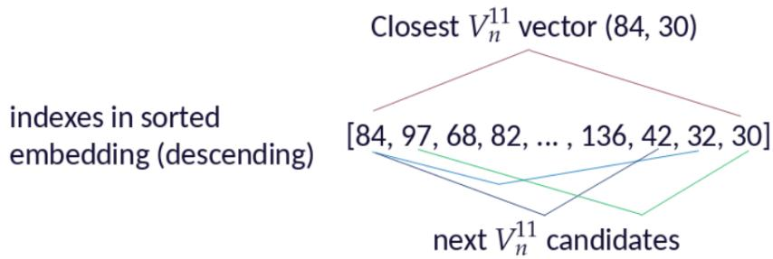
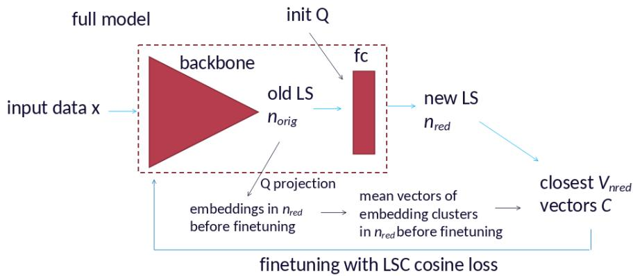
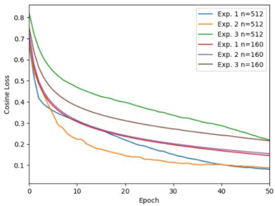
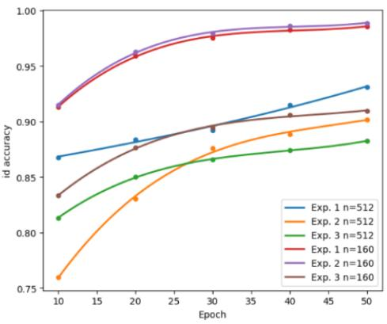

# Latent space configuration for neural network finetuning, fast ranking, and embedding dimensionality reduction

Nikita Gabdullin1 and Anton Raskovalov1

1Joint Stock "Research and production company "Kryptonite" E-mail: n.gabdullin@kryptonite.ru, i.androsov@kryptonite.ru

## Abstract

Finding K most similar elements for a query in a large gallery of neural network (NN) embeddings is essential in various areas of computer science and industrial applications of artificial intelligence. This paper proposes search algorithms for structured latent spaces (LS) of NNs which allow to speed up top K item retrieval owing to O(1) complexity of a small candidate gallery subset search routine. ArcFace-pretrained IResNet50 models are finetuned using Latent Space Configuration (LSC) methodology to obtain new distribution of embeddings with desired geometric properties. The application of the proposed algorithms to embeddings obtained from finetuned models leads to several times speed-up over baseline exhaustive search. Specifically, we report up to 3 times speed-up on GPU and 40% speed-up on CPU compared to the baseline method GPU speed. These results are obtained for the original and reduced numbers of LS dimensions. The results show that LS dimensionality reduction allows to further accelerate the search and even improve rank-N metrics.

Keywords: Neural network finetuning, embedding gallery search, image retrieval, vector systems, latent space configuration.

## 1 Introduction

Nowadays, various complex systems rely on eficient retrieval of relevant information from extremely large databases. Often this requires data ranking by asserting relevance of database data with the query and returning K most relevant elements (top-K, or top-k, or top-N) [1]. High-dimensional outputs (embeddings) of neural networks (NNs) can directly be used as description vectors that represent the data, so numerical similarity between vectors becomes a measure of relevance [2]. This is widely used in document analysis, recommendation systems, speech and audio recognition [3, 4, 5]. In context of computer vision (CV), this translates to finding K most relevant images in gallery G for a query q. This is essential for e-commerce, face recognition, biometrics, and security [6, 2, 7].

Exhaustive search has $\mathcal { O } ( n _ { \mathrm { g } } )$ complexity since it requires to compare queries with all embeddings in G with size $n _ { g } .$ This is not feasible for galleries of million or billions of elements, so approximate methods are used instead. These methods often require building indexing structures over the gallery for fast retrieval of a smaller subset specific to the given query [8, 9, 10]. While indeed allowing sub-linear scaling, these methods are still computationally expensive and can reduce complexity to $\mathcal { O } ( \sqrt { n _ { \mathrm { g } } } )$ [11].

In this paper we take advantage of geometric properties of vector systems used for NN latent space configuration (LSC) to find a small subset in G and significantly accelerate top K retrieval. LSC is a novel methodology which uses predefined class prototypes to structure and add geometric properties to NN LS during training [12]. It has previously been shown that the complexity of the search of mean vectors of class embeddings for classifier NNs with preconfigured LS is O(1), which can be realized with a single sort operation performed on the embedding vector. In context of face recognition this translates to the search of mean vectors of person identity (id) embedding clusters with O(1) complexity. Hence, the complete search complexity becomes $\mathcal { O } ( n _ { \mathrm { c } } )$ where $n _ { c }$ is id cluster size which can be several orders of magnitude smaller than $n _ { g } .$ . It is also important that $n _ { c }$ depends on the number of images per id (which can difer for diferent ids) and not $n _ { g } .$

The desired geometry of NN emebdding distribution can be achieved with finetuning. NN pretraining on extremely large general purpose datasets and finetuning on smaller target datasets using supervised or self-supervied learning methods has proven to be very efective in various CV areas [13, 7, 14]. It has recently been shown that finetuning can also be performed using prototype-based training methods [15, 16]. However, most of them use trainable prototypes and require loss functions which complexity grows linearly with the number of clusters, classes, or ids in the gallery $n _ { i d }$ [17, 15, 18]. On the contrary, LSC chooses predefined non-trainable prototypes allowing to avoid $n _ { i d }$ scaling, which is beneficial for training and finetuning on datasets with extremely large $n _ { i d }$ [12].

In this paper we propose two id cluster search algorithms which allow to rapidly identify a small candidate subset of gallery embeddings which similarity with the query needs to be assessed. These algorithms require that NN LS possesses certain geometric properties, so configuring LS during finetuning is essential for fast high-accuracy retrieval. The application of the proposed algorithms to embeddings of finetuned NN leads to several times speed-up on GPU and 40% speed-up on CPU compared to exhaustive search performed on GPU. The latter is particularly important for low computational budget and edge applications where GPU resources are limited or unavailable.

The rest of the paper is organized as follows: Section 2 outlines the LSC methodology for finetuning, Section 3 describes the proposed search algorithms, Section 4 summarizes experimental results, Section 5 discusses potential application scenarios of proposed methods, and Section 6 concludes the paper.

## 2 Configuring LS of NNs during training and finetuning

LSC training methodology is discussed in detail in [12, 19]. The goal of LSC is to force mean vectors of embedding clusters to align with vectors of some predefined vector system $V _ { n }$ with desired geometric properties. To configure NN LS one needs to choose the base $V _ { n } ,$ to distribute mean vectors of embedding clusters (corresponding to classes or ids) among them, and to choose a loss function. It has been shown that cosine loss (which maximizes cosine similarity between embeddings and prototype vectors) performs best in high-dimensional cases [12]. Since cosine loss values illustrate how close id embeddings are to their target vectors, training naturally reduces cluster size while ensuring separation of clusters determined by the $V _ { n }$ vector distribution.

It has been shown that NN discriminative ability depends on properties of the LS embedding distribution. Firstly, embeddings of similar inputs must have high similarity and be close in LS, so clusters of embeddings corresponding to one class or id are compact. Secondly, embeddings of diferent classes or ids must have low similarity, so embedding clusters are well-separated. This is achieved by introducing loss functions that afect NN embedding distribution by acting directly in LS [18, 20]. One of the most important methods is ArcFace which has introduced an additive angular margine penalty to standard softmax loss to improve cluster compactization and separation [21]. This has led to significant improvement in discriminative ability and the overall performance of face recognition NNs.

  
Figure 1: Pretrained model finetuning with LSC. Black arrows indicate operations done once before finetuning. Blue arrows indicate the parameter update loop.

However, ArcFace requires to use several complicated loss functions which include id loss, which requires having an NN layer with $n _ { i d }$ size. As previously mentioned, this limits the application of this method when $n _ { i d }$ is extremely large. On the contrary, LSC does not require creating trainable objects of $n _ { i d }$ size and, by choosing sparsely distributed prototypes, the inter- and intra-class (cluster) distribution requirements mentioned above are automatically satisfied when clusters formed around $V _ { n }$ vectors are suficiently compact.

In general, any system of vectors with some predefined set of desired properties can be used for LSC. In this paper we use systems of vectors $V _ { n } ^ { m k }$ such that all vectors in the system are obtained as permutations of elements of a base vector which consists of m ones, k negative ones, and $( n - m - k )$ zeros [22, 23]. Specifically, we use $V _ { n } ^ { 1 1 }$ system, meaning that all $V _ { n }$ vectors have exactly one $^ { 6 6 } 1 ^ { , 9 }$ , one $^ { 6 6 } - 1 ^ { 5 9 }$ , and (n − 2) zeros. These vectors coincide with root system $A _ { n - 1 }$ vectors [24]. For NN training purposes n coincides with the number of LS dimensions.

## 2.1 Finetuning LS with the original number of dimensions

Figure 1 shows steps required to finetune a pretrained model using LSC. Firstly, it is necessary to calculate class or id mean embedding vectors on the target dataset. A classification layer should be removed if it is present in the architecture. Secondly, mean id embedding vectors should be paired with closest (with respect to cosine similarity) unique vectors from the chosen $V _ { n }$ . This allows to determine which id corresponds to which $V _ { n }$ vector and use them as the target cluster center vector C. Afterward the finetuning process follows basic LSC training procedure described in Section 3.3 in [12]. Ids can be predicted in the same manner in which labels are predicted in the original method, i.e. by checking the id assigned to $V _ { n }$ vector closest to a given embedding. Id prediction accuracy used in Section 4.1 is the percentage of correct id predictions for all data points in the dataset used for finetuning.

  
Figure 2: Example of finding $V _ { n } ^ { 1 1 }$ vectors close to some mean embedding vector when the closest $V _ { n } ^ { 1 1 }$ vector is already assigned an id.

## 2.2 Finding $\mathbf { V _ { n } }$ vectors closest to mean embedding vectors

It has been mentioned in Section 2.1 that each id should be paired with the closest $V _ { n }$ vector. However, two or more id clusters may share the same closest $V _ { n }$ vector, which can be expected for classes or ids of objects or persons with some degree of similarity. Assigning the same $V _ { n }$ vector to several ids will make these ids indistinguishable after finetuning, which is not acceptable. Hence, all but one id should be assigned diferent $V _ { n }$ vectors.

Fortunately, there exists a neat way of finding possible $V _ { n }$ vectors owing to the structure of the proposed vector systems. It has previously been shown that for an arbitrary embedding m of its largest and k of its smallest elements determine its cosine similarity with $V _ { n } ^ { m k }$ vectors [23]. For $V _ { n } ^ { 1 1 }$ this means that only maximum and minimum magnitude elements in the embedding afect the similarity calculation results, and one can find their indexes using argmax and argmin operations, respectively. It should be mentioned that $V _ { n } ^ { 1 1 }$ vectors can be uniquely referred to using indexes of their positive and negative elements. For example, a vector with elements [1,-1, 0 ... 0] is referred to as (0, 1), another one with elements $[ 0 , 1 , 0 \dots - 1 ]$ is referred to as (1, n-1), etc. This pair is hereafter referred to as index of $V _ { n } ^ { 1 1 }$ vector.

Large and small elements of embedding vectors, as well as their indexes, can also be found by analyzing sorted embedding vectors. When the closest vector, $i . e .$ , a vector with $^ { 6 6 } 1 ^ { , 9 }$ in embedding’s argmax position and $^ { 6 6 } - 1 ^ { 9 9 }$ in its argmin position, to some mean embedding vector is already assigned an id, another close $V _ { n }$ vector can be found by choosing pairs of indexes as shown in Figure 2. This approach ensures that mean embedding vectors are not paired with distant $V _ { n }$ vectors and the original distribution of clusters is not disturbed.

## 2.3 Finetuning LS with the reduced number of dimensions

Reducing the number of dimensions of NN embeddings can lead to faster computations and storage space reduction [25, 26]. However, this often leads to worse accuracy metrics, which indicates an important trade-of. Hence, computation acceleration and accuracy metrics should be carefully monitored to identify the optimal number of LS dimensions.

  
Figure 3: Pretrained model finetuning while reducing the number of LS dimensions. Here $f c$ is fully-connected projection layer initialized with the same matrix Q, which is used to project embeddings from $n _ { o r i g }$ into $n _ { r e d } .$ Black arrows indicate operations done once before finetuning. Blue arrows show the parameter update loop.

In this paper we use random projection to obtain low-dimensional NN embeddings [27, 28]. Specifically, to obtain embeddings in LS with reduced number of dimensions $n _ { r e d }$ (hereafter referred to as reduced LS) using known embeddings in LS with the original number of dimensions $\begin{array} { r } { n _ { o r i g } , } \end{array}$ , we first construct a random uniform matrix with dimensions $[ n _ { o r i g } , ~ n _ { r e d } ]$ We then apply $Q R$ decomposition to this matrix [29] and use the obtained matrix $Q$ (with dimensions $\left[ n _ { o r i g } , n _ { r e d } \right] )$ for embedding projection

$$
z _ { r e d } = z _ { o r i g } \cdot Q ,\tag{1}
$$

where $z _ { o r i g }$ and $z _ { r e d }$ are NN embeddings in the original and reduced LS, respectively. It has previously been shown that for specific $n _ { i d } , ~ n _ { r e d }$ should be chosen to be the smallest possible when the number of vectors in $V _ { n }$ system $n _ { v e c t s } \ge n _ { i d }$ [22]. In case of $V _ { n } ^ { 1 1 }$ the number of vectors is

$$
n _ { v e c t s } = n \cdot ( n - 1 ) .\tag{2}
$$

Substituting $n _ { r e d }$ for $n , \ n _ { i d }$ for $\begin{array} { r } { n _ { v e c t s } . } \end{array}$ , and solving for $n _ { r e d }$ yields

$$
n _ { r e d } = \frac { 1 + \sqrt { ( 1 + 4 \cdot n _ { i d } ) } } { 2 } ,\tag{3}
$$

which should be rounded up to the next integer. Figure 3 shows that the projected embeddings are used to calculate mean vectors of embedding clusters and to find closest vectors in $V _ { n }$ to use them as vector $C$ as discussed in Section 2.1. A projection layer should also be included into NN architecture so output embeddings’ number of dimensions matches $n _ { r e d } .$ This projection layer should be initialized with the same matrix $Q$ which is used to project embeddings.

Algorithm 1 Candidate subset search and similarity calculation in structured LS for fast top   
K retrieval using a hash table of closest $V _ { n }$ vectors (PyTorch-style pseudocode)   
Require: Gallery of embeddings G, batch of queries q, K most similar elements to retrieve,   
parameters m, k of vector system $V _ { n }$   
Preliminary step   
1: $G _ { \mathrm { m } }$ \_indexes, $G _ { \mathrm { k _ { \mathrm { - } } } }$ \_indexes ← closest\_ $\operatorname { V n } ( G , m , k )$ ▷ see [23] for details   
2: $G _ { \mathrm { d i c t } }  \{ ( G _ { \mathrm { m } _ { \mathrm { \Omega } } }$ \_index, Gk\_index) : [indexes of z in G with same $\left( G _ { \mathrm { m } } \right.$ \_index, $G _ { \mathrm { k \_ i n d e x } } ) ] \}$   
Search step   
3: qm\_indexes, qk\_indexes ← closest\_ $\operatorname { V n } ( q , m , k )$   
4: candidates ← tensor $( G [ G _ { \mathrm { d i c t } } [ ( q _ { \mathrm { m } _ { \mathrm { . } } }$ \_indexes, qk\_indexes)])   
5: similarities ← cosine\_similarity(q, candidates)   
6: \_, max\_indexes ← topk(similarities, $k = K )$ ▷ indexes of top K in candidate subset   
7: return G[candidates[max\_indexes]] ▷ indexes of top K in G

## 3 Search algorithms for fast retrieval of top K relevant images

In this paper we consider exhaustive $\mathcal { O } ( n _ { \mathrm { g } } )$ search as baseline for comparison. Algorithms proposed in this Section focus on finding a small gallery subset for similarity calculation using geometric properties of $V _ { n }$ used for LSC. Specifically, we first find closest $V _ { n }$ vectors for all gallery embeddings and store their indexes (as discussed in Section 2.2). Then for a query q we find its closest $V _ { n }$ vector, retrieve all gallery embeddings with the same closest $V _ { n }$ vector (called candidates), and then compare q only with these candidates. Since the closest $V _ { n }$ vector search complexity is $\mathcal { O } ( 1 )$ , the complexity of the candidate subset search is also $\mathcal { O } ( 1 )$ and the overall complexity is $\mathcal { O } ( n _ { \mathrm { c } } )$ rather than $\mathcal { O } ( n _ { \mathrm { g } } )$ , so the speed gain is proportional to

$$
\frac { t _ { e x h } } { t _ { n e w } } \sim \frac { n _ { g } } { n _ { c } ( i d ) } \approx n _ { i d } ,\tag{4}
$$

where $t _ { e x p }$ and $t _ { n e w }$ are time intervals required to retrieve top K elements using the exhaustive search and the proposed algorithms, respectively. Thus, the more ids the gallery has, the higher acceleration can be expected.

## 3.1 CPU-focused search acceleration

In this paper we present two possible implementations of the proposed search method. Algorithm 1 uses the original fast search method [23]. Here a hash table (e.g., a python dictionary) with indexes of closest $V _ { n }$ vectors to all embeddings in G as keys and lists of all embeddings with the same closest $V _ { n }$ vectors as values is created. The number of keys in this hash table is proportional to $n _ { i d }$ , and the number of values in each list is proportional to $n _ { c } .$ For each query its closest $V _ { n }$ vector is used to retrieve candidates using this dictionary, which allows to form candidate tensor and compute similarity. This search is fast due to hash table O(1) key search complexity.

There are two main problems with this implementation when queries are processed in batches. Firstly, dictionary search and data preparation do not eficiently work in parallel. Secondly, since the number of candidates varies for diferent queries in the batch, padding is required when forming the candidate tensor. This means that candidate tensor shape is always determined by the largest $n _ { c }$ in the batch, which is suboptimal. Nevertheless, Algorithm 1 performs extremely well on CPU, as will be shown in Section 4.

## 3.2 GPU-focused search acceleration

Algorithm 2 addresses the discussed issues of Algorithm 1 by abandoning the hash table and instead calculating and storing the closest $V _ { n }$ vector indexes of gallery embeddings as a tensor. When closest $V _ { n }$ vector indexes are calculated for queries, boolean matching can be performed directly on tensors of indexes. Two vectors with indexes of candidates in G and corresponding indexes of queries in the batch are formed after finding nonzero elements. These indexes are used to retrieve relevant embeddings and to compute similarity between each query and its candidates as a single vector, so padding due to the varying $n _ { c }$ is not needed. As the cosine similarity is bounded to [-1, 1] region, doubled query index is substracted from the similarity values to prevent the results corresponding to diferent queries in the batch from mixing. Finally, the result is sorted according to shifted similarity, split using query indexes, and the first K elements for every query are returned.

It should be noted that in this work the candidates are selected as logical AND of matches between indexes corresponding to m=1 largest and k=1 smallest elements in embedding vectors. This algorithm can be extended to other vector systems simply by amending this statement so it matches the required m and k combination. The main advantage of Algorithm 2 is that all its operations can be implemented using PyTorch functions and executed in parallel on the GPU which leads to significant overall acceleration, as will be shown in Section 4. The only drawback is that the matching operation uses gallery-size objects, so Algorithm 2 is slower than Algorithm 1 on CPU.

Algorithm 2 Candidate subset search and similarity calculation in structured LS for fast top   
K retrieval using tensor operations (PyTorch-style pseudocode)   
Require: Gallery of embeddings G, batch of queries q, K most similar elements to retrieve,   
parameters m, k of vector system $V _ { \mathrm { n } }$   
Preliminary step   
1: $G _ { \mathrm { m } }$ \_indexes, $G _ { \mathrm { k _ { - } } }$ \_indexes ← closest\_Vn(G, m, k) ▷ as torch.tensor   
Search step   
2: qm\_indexes, qk\_indexes ← closest\_Vn(q, m, k) ▷ as torch.tensor   
3: matches ← (qm\_indexes[:, None] == Gm\_indexes[None, :]) &   
qk\_indexes[:, None] == Gk\_indexes[None, :])   
4: qmatches, Gmatches ← matches.nonzero(as\_tuple=True)   
5: similarities ← cosine\_similarity(q[qmatches], G[Gmatches])   
6: similarities ← similarities − 2 · qmatches   
7: \_, indexes = torch.sort(similarities, descending=True)   
8: \_, counts = torch.unique\_consecutive(q[qmatches], return\_counts=True)   
9: real\_indexes = indexes[counts]   
10: return G[Gmatches][real\_indexes] ▷ indexes of top K in G

  
Figure 4: Curves of loss (left) and id prediction accuracy (right) during finetuning.

## 4 Experiments

In this study the efectiveness of the retrieval operation is measured using rank-N (or RN) metric, which indicates whether a relevant (correct id) element is among N highest similarity (or top K, where $K { = } N )$ gallery images [30, 21]. We use IResNet50 [21] pre-trained with ArcFace algorithm on MS-Celeb-1M [31] from InsightFace library [32] as the backbone model. The model is finetuned on target dataset to configure its LS, and then rank-1 (R1) and rank-10 (R10) metrics are calculated using exhaustive search and the algorithms proposed in Section 3. $V _ { n } ^ { 1 1 }$ vector system is used for LS configuration in all finetuning experiments. The original LS dimension of IResNet50 $n _ { o r i g } { = } 5 1 2$ , and the reduced LS dimension found using (3) is $n _ { r e d } { = } 1 6 0$

The target dataset is a subset of MS-Celeb-1M with approximately 1.48m images and 24.3k ids. Since gallery/query splits are not provided for this dataset, 10% of images of every id are randomly chosen as queries, while the rest form the gallery. These splits are fixed for all experiments. Standard PyTorch dataloaders with batch size of 256 are used for image loading. Models are finetuned for 50 epochs using AdamW optimizer with $1 0 ^ { - 5 }$ learning rate and $1 0 ^ { - 5 }$ weight decay [33, 34]. Batch size for rank-N calculation is 64 (reduced because full gallery needs to be stored on GPU), and we report the total time required to calculate rank-N metrics on G for all queries. All experiments are conducted using Intel(R) Xeon(R) Gold 6230R CPU and a single 40GB NVIDIA A100 GPU. All PyTorch CPU operations are limited to two CPU threads.

## 4.1 Finetuning experiments

IResNet50 models are finetuned using the methodology described in Section 2. Metrics of the pretrained model on the target dataset before finetuning are shown in Tables 1 and 2. It should be noted that since this model is pretrained on the complete MS-Celeb-1M, its training dataset includes both query and gallery images. However, in realistic application scenarios query images come from live camera feeds and are not available during training. This discrepancy is addressed in our finetuning setups as discussed below.

Three finetuning scenarios are considered in this study. Similar to pretraining, the complete dataset is used for finetuing in Experiment I. On the contrary, only gallery images are used for finetuing in Experiment II. Queries are also not used for finetuning in Experiment III, and a set of light augmentations is applied to gallery images to improve generalization. Hence, experiments II and III represent test scenarios better.

Table 1. Gallery ranking metrics and time required for their calculation for $n _ { o r i g } { = } 5 1 2$
<table><tr><td rowspan=1 colspan=1>Method</td><td rowspan=1 colspan=1>Device</td><td rowspan=1 colspan=1>Time, s</td><td rowspan=1 colspan=1>PretrainedR1/R10</td><td rowspan=1 colspan=1>Exp IR1/R10</td><td rowspan=1 colspan=1>Exp IIR1/R10</td><td rowspan=1 colspan=1>Exp IIIR1/R10</td></tr><tr><td rowspan=1 colspan=1>Queries in train set</td><td rowspan=1 colspan=1>-</td><td rowspan=1 colspan=1>一</td><td rowspan=1 colspan=1>Yes</td><td rowspan=1 colspan=1>Yes</td><td rowspan=1 colspan=1>No</td><td rowspan=1 colspan=1>No</td></tr><tr><td rowspan=1 colspan=1>Augmentation</td><td rowspan=1 colspan=1>-</td><td rowspan=1 colspan=1>-</td><td rowspan=1 colspan=1>Yes</td><td rowspan=1 colspan=1>No</td><td rowspan=1 colspan=1>No</td><td rowspan=1 colspan=1>Yes</td></tr><tr><td rowspan=1 colspan=1>exh. search</td><td rowspan=1 colspan=1>GPU</td><td rowspan=1 colspan=1>17.5</td><td rowspan=1 colspan=1>0.884/0.928</td><td rowspan=1 colspan=1>0.944/0.964</td><td rowspan=1 colspan=1>0.801/0.83</td><td rowspan=1 colspan=1>0.83/0.86</td></tr><tr><td rowspan=1 colspan=1>exh. search</td><td rowspan=1 colspan=1>CPU</td><td rowspan=1 colspan=1>336.4</td><td rowspan=1 colspan=1>0.884/0.928</td><td rowspan=1 colspan=1>0.944/0.964</td><td rowspan=1 colspan=1>0.801/0.83</td><td rowspan=1 colspan=1>0.83/0.86</td></tr><tr><td rowspan=1 colspan=1>Alg. 1</td><td rowspan=1 colspan=1>CPU</td><td rowspan=1 colspan=1>12.5</td><td rowspan=1 colspan=1>0.266/0.27</td><td rowspan=1 colspan=1>0.942/0.958</td><td rowspan=1 colspan=1>0.798/0.81</td><td rowspan=1 colspan=1>0.818/0.835</td></tr><tr><td rowspan=1 colspan=1>Alg. 2</td><td rowspan=1 colspan=1>GPU</td><td rowspan=1 colspan=1>5.6</td><td rowspan=1 colspan=1>0.266/0.27</td><td rowspan=1 colspan=1>0.942/0.958</td><td rowspan=1 colspan=1>0.798/0.81</td><td rowspan=1 colspan=1>0.818/0.835</td></tr><tr><td rowspan=1 colspan=1>Alg. 2</td><td rowspan=1 colspan=1>CPU</td><td rowspan=1 colspan=1>84.1</td><td rowspan=1 colspan=1>0.266/0.27</td><td rowspan=1 colspan=1>0.942/0.958</td><td rowspan=1 colspan=1>0.798/0.81</td><td rowspan=1 colspan=1>0.818/0.835</td></tr></table>

Table 2. Gallery ranking metrics and time required for their calculation for $n _ { r e d } { = } 1 6 0 .$
<table><tr><td rowspan=1 colspan=1>Method</td><td rowspan=1 colspan=1>Device</td><td rowspan=1 colspan=1>Time, s</td><td rowspan=1 colspan=1>PretrainedR1/R10</td><td rowspan=1 colspan=1>Exp IR1/R10</td><td rowspan=1 colspan=1>Exp IIR1/R10</td><td rowspan=1 colspan=1>Exp IIIR1/R10</td></tr><tr><td rowspan=1 colspan=1>Queries in train set</td><td rowspan=1 colspan=1>一</td><td rowspan=1 colspan=1>一</td><td rowspan=1 colspan=1>Yes</td><td rowspan=1 colspan=1>Yes</td><td rowspan=1 colspan=1>No</td><td rowspan=1 colspan=1>No</td></tr><tr><td rowspan=1 colspan=1>Augmentation</td><td rowspan=1 colspan=1></td><td rowspan=1 colspan=1>-</td><td rowspan=1 colspan=1>Yes</td><td rowspan=1 colspan=1>No</td><td rowspan=1 colspan=1>No</td><td rowspan=1 colspan=1>Yes</td></tr><tr><td rowspan=1 colspan=1>exh. search</td><td rowspan=1 colspan=1>GPU</td><td rowspan=1 colspan=1>12.9</td><td rowspan=1 colspan=1>0.87/0.914</td><td rowspan=1 colspan=1>0.97/0.99</td><td rowspan=1 colspan=1>0.82/0.854</td><td rowspan=1 colspan=1>0.846/0.875</td></tr><tr><td rowspan=1 colspan=1>exh. search</td><td rowspan=1 colspan=1>CPU</td><td rowspan=1 colspan=1>280</td><td rowspan=1 colspan=1>0.87/0.914</td><td rowspan=1 colspan=1>0.97/0.99</td><td rowspan=1 colspan=1>0.82/0.854</td><td rowspan=1 colspan=1>0.846/0.875</td></tr><tr><td rowspan=1 colspan=1>Alg. 1</td><td rowspan=1 colspan=1>CPU</td><td rowspan=1 colspan=1>7.1</td><td rowspan=1 colspan=1>0.266/0.27</td><td rowspan=1 colspan=1>0.97/0.99</td><td rowspan=1 colspan=1>0.786/0.796</td><td rowspan=1 colspan=1>0.825/0.839</td></tr><tr><td rowspan=1 colspan=1>Alg. 2</td><td rowspan=1 colspan=1>GPU</td><td rowspan=1 colspan=1>4.3</td><td rowspan=1 colspan=1>0.266/0.27</td><td rowspan=1 colspan=1>0.97/0.99</td><td rowspan=1 colspan=1>0.786/0.796</td><td rowspan=1 colspan=1>0.825/0.839</td></tr><tr><td rowspan=1 colspan=1>Alg. 2</td><td rowspan=1 colspan=1>CPU</td><td rowspan=1 colspan=1>75.2</td><td rowspan=1 colspan=1>0.266/0.27</td><td rowspan=1 colspan=1>0.97/0.99</td><td rowspan=1 colspan=1>0.786/0.796</td><td rowspan=1 colspan=1>0.825/0.839</td></tr></table>

Finetuning loss values and id accuracy (calculated every 10 epochs starting at $1 0 ^ { \mathrm { t h } }$ epoch) curves shown in Figure 4 illustrate that neither loss nor accuracy have plateaued at $5 0 ^ { \mathrm { t h } }$ epoch. This indicates that the metrics (including rank-N metrics) can be further improved by increasing the number of epochs and better hyperparameter tuning.

## 4.2 Rank-N metrics and calculation time

Tables 1 and 2 show that Algorithms 1 and 2 are consistently faster than the exhaustive search on GPU. Specifically, Algorithm 2 on GPU is almost 3 times faster, while Algorithm 1 on CPU is about 40% faster. The latter is remarkable since a CPU method happens to be faster than a GPU one. Both exhaustive search and Algorithm 2 on CPU are significantly slower than Algorithm 1. The average sizes of candidate sets used for similarity calculation in Algorithms 1 and 2 are about 100 embeddings, which is the main reason for the reported acceleration.

## 5 Discussions

## 5.1 LSC finetuning, ranking metrics, and dimensionality reduction

This paper describes how LSC can be used to finetune pretrained NN models for downstream tasks. In this case the preexisting cluster distribution formed during pretraining is restructured during finetuning. The existence of non-trivial starting cluster distribution allows to assign labels or ids to $V _ { n }$ vectors in a consistent manner solving the labeling ambiguity problem which exists when models are trained with LSC from scratch [12, 22]. Hence, the distribution of ids among $V _ { n }$ vectors is determined by the cluster distribution formed by NN during pretraining, and the final LS geometry is determined by $V _ { n }$ during finetuning.

The comparison of the exhaustive search results between the pretrained model and Experiment 1 (queries are included in training sets in both cases) in Tables 1 and 2 shows that finetuning can improve rank-N metrics. As might be expected, removing queries from the training dataset leads to reduction in metrics. As mentioned in Section 4.1, metrics can be improved by increasing the number of epochs and hyperparameter tuning. However, it should be kept in mind that the main goal of the LSC finetuning is to form structures in LS so that Algorithms 1 and 2, which rely on specific properties of $V _ { n }$ geometry, do not reduce metrics when compared to the exhaustive search results. Tables 1 and 2 show that rank-N metrics calculated using Algorithms 1 and 2 before finetuning are extremely low. This happens since the embedding cluster distribution of pretrained model is very diferent from the $V _ { n }$ vector distribution. This illustrates that the proposed algorithms cannot be used for NNs which LS is not structured. On the contrary, metrics calculated using Algorithms 1 and 2 after finetuning are a close match to the metrics calculated using the exhaustive search, showing that the required LS structure has indeed been achieved.

It should be mentioned that sometimes for tricky queries one might want to expand the search. In case of exhaustive search this is achieved by increasing K or $N ,$ since similarities are always calculated with the whole gallery. However, increasing K might not give expected results in the proposed methods when $n _ { c }$ is small, because similarities are calculated only with embeddings that share the same closest $V _ { n }$ vectors with the query. Hence, for $K > n _ { c }$ one needs to also consider embeddings which are in vicinity of other $V _ { n }$ vectors that are close to the query embedding (as described in Section 2.2). This extension to the method will be studied in greater detail in the future.

Tables 1 and 2 also show that reducing the number of LS dimensions leads to faster computations. Moreover, it can also result in better metrics when NN is finetuned directly in $n _ { r e d } .$ . Whereas the reduction in the number of LS dimensions is about 300% in this work, this number can be much higher when vector systems with larger $\boldsymbol { n } _ { \boldsymbol { v e c t s } }$ are used [22]. Potential acceleration due to dimensionality reduction is extremely promising when NN models are finetuned on datasets with known $n _ { i d }$

## 5.2 Application scenarios of the proposed algorithms

The results in Tables 1 and 2 show two distinct application scenarios of the proposed method. Firstly, Algorithm 1 can be used when computational budget is low and GPU usage is limited. This is extremely relevant for edge devices where computationally eficient methods are essential [35, 36]. Algorithm 1 can also be used in traditional high performance settings to reduce GPU usage of search operations and to divert computations to other elements of the pipeline.

Secondly, Algorithm 2 can substitute conventional GPU search methods in systems with huge galleries and extremely large $n _ { i d } .$ . It can provide significant acceleration with minimal pipeline modifications while simultaneously reducing required memory due to the absence of large matrix multiplication for similarity evaluation. Acceleration and storage memory reduction are also achieved when NN is finetuned in $n _ { r e d } .$ . Combining the benefits of the proposed algorithms with advantages achieved by LS dimensionality reduction can lead to significant speed-up and reduction in total memory required to process and store query and gallery embeddings, which is essential for eficient operation of modern systems.

## 6 Conclusions

This paper describes LSC finetuning methodology and fast ranking algorithms which rely on geometric properties of vector systems used to configure LS of NNs. Application of these algorithms leads to up to 300% speed-up on GPU and up to 40% speed-up on CPU compared to baseline exhaustive search on GPU. It is shown that retrieval metrics are very low when these algorithms are applied to embeddings of pretrained models with unstructured LS. On the contrary, the metrics calculated after finetuning almost match the exhaustive search metrics, which indicates that LS geometry matches the target vector system. It is also shown that finetuning in LS with the reduced number of dimensions allows faster operation and required memory reduction while increasing retrieval metrics. The proposed approaches are promising for industry-level applications as well as for usage in low performance systems and edge devices.

## Acknowledgement

The authors would like to thank Ilya Androsov for suggesting random projection with Q matrix for dimensionality reduction, Dr Igor Netay for discussions, and Vasily Dolmatov for fruitful discussions and project supervision.

## References

[1] I. F. Ilyas, G. Beskales, and M. A. Soliman, “A survey of top-k query processing techniques in relational database systems,” ACM Computing Surveys (CSUR), vol. 40, no. 4, pp. 1–58, 2008, available at: https://www.cs.umd.edu/\~samir/498/topk.pdf.

[2] J. Johnson, M. Douze, and H. Jégou, “Billion-scale similarity search with gpus,” 2017. [Online]. Available: https://arxiv.org/abs/1702.08734

[3] X. He, L. Liao, H. Zhang, L. Nie, X. Hu, and T.-S. Chua, “Neural collaborative filtering,” 2017. [Online]. Available: https://arxiv.org/abs/1708.05031

[4] B. Wang, M. Li, Z. Zeng, J. Zhuo, S. Wang, S. Xu, B. Long, and W. Yan, “Learning multi-stage multi-grained semantic embeddings for e-commerce search,” 2023. [Online]. Available: https://arxiv.org/abs/2303.11009

[5] W.-K. Hon, R. Shah, and J. S. Vitter, “Space-eficient framework for top-k string retrieval problems,” in 2009 50th Annual IEEE Symposium on Foundations of Computer Science, 2009, pp. 713–722.

[6] M. Wang and W. Deng, “Deep face recognition: A survey,” Neurocomputing, vol. 429, p. 215–244, Mar. 2021. [Online]. Available: http://dx.doi.org/10.1016/j.neucom.2020.10.081

[7] A. Radford, J. W. Kim, C. Hallacy, A. Ramesh, G. Goh, S. Agarwal, G. Sastry, A. Askell, P. Mishkin, J. Clark, G. Krueger, and I. Sutskever, “Learning transferable visual models from natural language supervision,” 2021. [Online]. Available: https://arxiv.org/abs/2103.00020

[8] Y. A. Malkov and D. A. Yashunin, “Eficient and robust approximate nearest neighbor search using hierarchical navigable small world graphs,” 2018. [Online]. Available: https://arxiv.org/abs/1603.09320

[9] H. Jégou, M. Douze, and C. Schmid, “Product quantization for nearest neighbor search,” IEEE Transactions on Pattern Analysis and Machine Intelligence, vol. 33, no. 1, pp. 117–128, 2011.

[10] A. Andoni, P. Indyk, T. Laarhoven, I. Razenshteyn, and L. Schmidt, “Practical and optimal lsh for angular distance,” 2015. [Online]. Available: https://arxiv.org/abs/1509.02897

[11] L. Ma, R. Zhang, Y. Han, S. Yu, Z. Wang, Z. Ning, J. Zhang, P. Xu, P. Li, Z. Qiao, W. Ju, C. Chen, D. Wang, K. Liu, P. Wang, P. Wang, Y. Fu, C. Liu, Y. Zhou, and C.-T. Lu, “A comprehensive survey on vector database: Storage and retrieval technique, challenge,” 2026. [Online]. Available: https://arxiv.org/abs/2310.11703

[12] N. Gabdullin, “Using predefined vector systems as latent space configuration for neural network supervised training on data with arbitrarily large number of classes,” 2025. [Online]. Available: https://arxiv.org/abs/2510.04090

[13] A. Kolesnikov, L. Beyer, X. Zhai, J. Puigcerver, J. Yung, S. Gelly, and N. Houlsby, “Big transfer (bit): General visual representation learning,” 2020. [Online]. Available: https://arxiv.org/abs/1912.11370

[14] A. Dosovitskiy, L. Beyer, A. Kolesnikov, D. Weissenborn, X. Zhai, T. Unterthiner, M. Dehghani, M. Minderer, G. Heigold, S. Gelly, J. Uszkoreit, and N. Houlsby, “An image is worth 16x16 words: Transformers for image recognition at scale,” 2021. [Online]. Available: https://arxiv.org/abs/2010.11929

[15] J. Li, P. Zhou, C. Xiong, and S. C. H. Hoi, “Prototypical contrastive learning of unsupervised representations,” 2021. [Online]. Available: https://arxiv.org/abs/2005.04966

[16] J. Li and X. Gong, “Prototypical contrastive learning-based clip fine-tuning for object re-identification,” 2026. [Online]. Available: https://arxiv.org/abs/2310.17218

[17] J. Snell, K. Swersky, and R. S. Zemel, “Prototypical networks for few-shot learning,” 2017. [Online]. Available: https://arxiv.org/abs/1703.05175

[18] Y. Wen, K. Zhang, Z. Li, and Y. Qiao, “A discriminative feature learning approach for deep face recognition,” in ECCV 2016, 2016, pp. 499–515.

[19] N. Gabdullin, “Latent space configuration for improved generalization in supervised autoencoder neural networks,” 2025. [Online]. Available: https://arxiv.org/abs/2402.08441

[20] W. Liu, Y. Wen, Z. Yu, M. Li, B. Raj, and L. Song, “Sphereface: Deep hypersphere embedding for face recognition,” 2018. [Online]. Available: https://arxiv.org/abs/1704.08063

[21] J. Deng, J. Guo, J. Yang, N. Xue, I. Kotsia, and S. Zafeiriou, “Arcface: Additive angular margin loss for deep face recognition,” IEEE Transactions on Pattern Analysis and Machine Intelligence, vol. 44, no. 10, p. 5962–5979, Oct. 2022. [Online]. Available: http://dx.doi.org/10.1109/TPAMI.2021.3087709

[22] N. Gabdullin, “Exploring possible vector systems for faster training of neural networks with preconfigured latent spaces,” 2025. [Online]. Available: https://arxiv.org/abs/2512.07509

[23] N. Gabdullin and I. Androsov, “Using predefined vector systems to speed up neural network multimillion class classification,” 2026. [Online]. Available: https://arxiv.org/abs/2604.00779

[24] J. Humphreys, Reflection Groups and Coxeter Groups, ser. Cambridge Studies in Advanced Mathematics. Cambridge University Press, 1990.

[25] A. A. Moreno and C. Henrique Quartucci Forster, “Bigger is not always better: Controlled evaluation of embedding compression for cybersecurity question answering,” IEEE Access, vol. 14, pp. 112 939–112 958, 2026.

[26] A. Paricio-Garcia, M. A. Lopez-Carmona, S. Sierra-Arquero, and P. Manglano-Redondo, “Analysis and evaluation of autoencoder-driven dimensionality reduction for face recognition pipelines,” Applied Soft Computing, vol. 172, p. 112877, 2025. [Online]. Available: https://www.sciencedirect.com/science/article/pii/S1568494625001887

[27] S. Dasgupta and A. Gupta, “An elementary proof of a theorem of johnson and lindenstrauss,” Random Structures & Algorithms, vol. 22, no. 1, pp. 60–65, 2003. [Online]. Available: https://onlinelibrary.wiley.com/doi/abs/10.1002/rsa.10073

[28] E. Bingham and H. Mannila, “Random projection in dimensionality reduction: applications to image and text data,” in Proceedings of the Seventh ACM SIGKDD International Conference on Knowledge Discovery and Data Mining, ser. KDD ’01. New York, NY, USA: Association for Computing Machinery, 2001, p. 245–250. [Online]. Available: https://doi.org/10.1145/502512.502546

[29] G. H. Golub and C. F. Van Loan, Matrix Computations, 4th ed. Baltimore, MD: Johns Hopkins University Press, 2013.

[30] I. Kemelmacher-Shlizerman, S. Seitz, D. Miller, and E. Brossard, “The megaface benchmark: 1 million faces for recognition at scale,” 2015. [Online]. Available: https://arxiv.org/abs/1512.00596

[31] Y. Guo, L. Zhang, Y. Hu, X. He, and J. Gao, “Ms-celeb-1m: A dataset and benchmark for large-scale face recognition,” in European Conference on Computer Vision (ECCV), ser. Lecture Notes in Computer Science, vol. 9907. Cham: Springer, 2016, pp. 87–102.

[32] J. Guo and J. Deng, “Insightface: State-of-the-art 2d and 3d face analysis project,” 2026, gitHub repository. [Online]. Available: https://github.com/deepinsight/insightface/

[33] D. P. Kingma and J. Ba, “Adam: A method for stochastic optimization,” 2017. [Online]. Available: https://arxiv.org/abs/1412.6980

[34] I. Loshchilov and F. Hutter, “Decoupled weight decay regularization,” 2019. [Online]. Available: https://arxiv.org/abs/1711.05101

[35] G. K. K. Y, S. Rekha, N. Baskar, H. Singh, T. Meeradevi, and P. De, “Deep learning-based computer vision techniques for real-time object detection and recognition,” Scientific Culture, vol. 12, no. 2.1, pp. 12 228–12 438, 2026. [Online]. Available: https://sci-cult.net/index.php/cult/article/view/6280/3852

[36] N. Gabdullin and A. Raskovalov, “Google coral-based edge computing person reidentification using human parsing combined with analytical method,” Internet of Things, vol. 22, p. 100701, 2023. [Online]. Available: https://www.sciencedirect.com/ science/article/pii/S2542660523000240