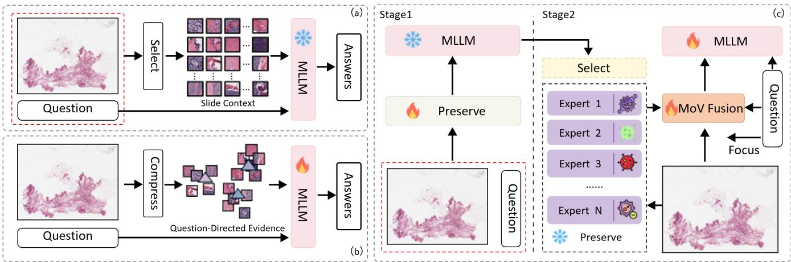
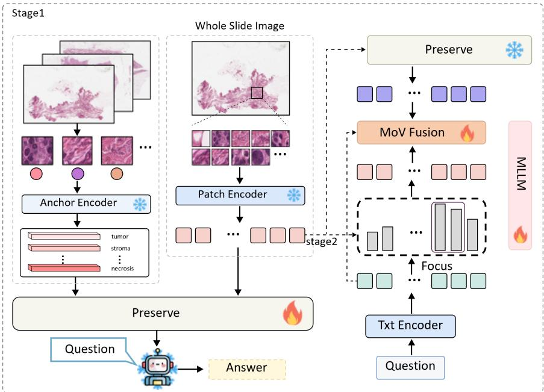
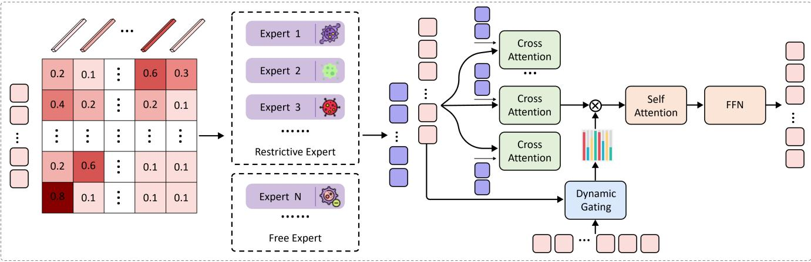
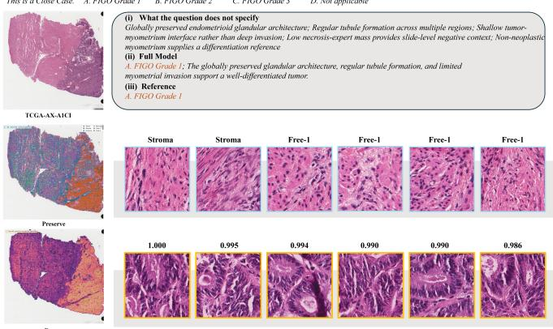
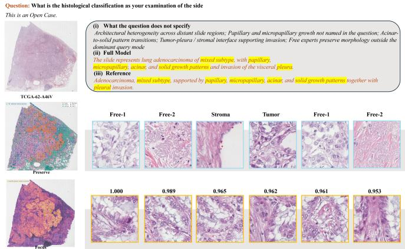
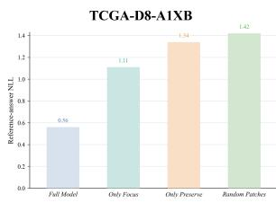
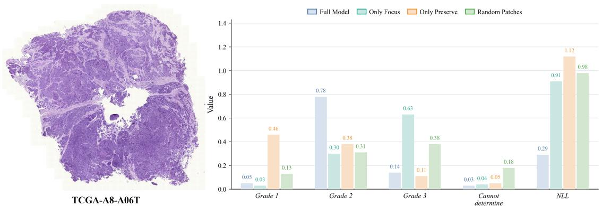
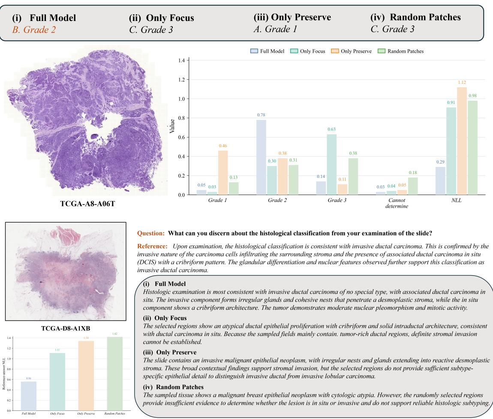

# Look Beyond the Question: Preserve–Focus–Fuse for Whole-Slide Image Question Answering

Xiangyu Li1,2,\* Jincheng Li2,3,4,\* Tianle Du1 Yanheng Li5 Haoxuan Che6 Yuxin Sun4 Long Bai7,9 Liangliang Liu8 Ran Su1,†

1Tianjin University, 2Shanghai AI Laboratory, 3University of Science and Technology of China, 4Nantong University, 5City University of Hong Kong, 6Huawei Technologies Ltd., 7The Chinese University of Hong Kong, 8Henan Agricultural University, 9Alibaba DAMO Academy

\*Equal contribution. †Corresponding author.

## Abstract

A question about a whole-slide image rarely names every morphological finding needed to answer it. Question-guided patch selection can therefore overlook supporting morphology, while slide-level compression can dilute focal evidence. Inspired by how pathologists combine broad slide review, question-directed examination, and integration of their findings, we introduce BeyondPath, a Preserve–Focus–Fuse framework for whole-slide image question answering. Preserve learns a question-agnostic Morphology Bank through answer supervision across multiple questions about each training slide. Focus retrieves questionspecific evidence from all foreground patches, including regions outside the Bank. Fuse integrates the preserved morphology at the retrieved evidence positions through Morphology-on-Visual-Evidence (MoV) Fusion, producing a fixed 96-token visual prefix. On WSI-Bench, BeyondPath achieves an Avg-9 of 0.769 and leads all eight reported report-generation metrics using the same checkpoint. It also achieves 0.639 zero-shot overall accuracy on SlideBench-BCNB. Controlled ablations show complementary benefits from morphology preservation and question-directed retrieval, and support cross-question supervision and fusion at the evidence positions. These results support looking beyond the question’s explicit cues: preserving broader slide morphology while retaining the ability to seek evidence for each question.

## 1. Introduction

Whole-slide image (WSI) question answering requires locating and interpreting evidence distributed across a gigapixel tissue section. Pathology multimodal large language models (MLLMs) have made this task increasingly accessible, supporting natural-language questions, report generation, and interactive slide analysis (Chen et al., 2024c, 2025, Liang et al., 2025, Sun et al., 2025). Yet a question specifies what must be answered without necessarily naming every morphological finding needed to answer it. A question about tumor grade, for example, may leave the relevant tissue architecture and cellular features implicit. Selecting regions that match the question can thus leave out supporting morphology. Efective WSI-VQA must look beyond the question’s explicit cues while remaining focused on the requested decision.

A single WSI can contain thousands to tens of thousands of foreground patches, motivating long-context processing, slide encoders, pooling, resampling, and patch selection (Chen et al., 2025, Liang et al., 2025, Sun et al., 2025, Chen et al., 2024c, Huang et al., 2026). These approaches reduce or reorganize the patch set so that the language model can process the slide. Broad compression can dilute small informative regions, whereas question-conditioned selection can omit morphology not explicitly named in the query. Moreover, restricting question-specific retrieval to an already compressed candidate set prevents it from recovering excluded regions. These dificulties motivate the Relevance–Suficiency Gap: question-matched patches may provide an incomplete set of findings for answering the question (Figure 1(a–b)).

Pathological slide review ofers a useful design cue. Broad inspection forms an initial morphological impression; question-directed examination then seeks pertinent findings; and the observed patterns are brought together when interpreting the slide (Huang et al., 2026). This workflow motivates preserving morphology before narrowing attention to a particular question, while keeping further inspection open to regions be yond those initially selected. We translate these complementary roles into a Preserve–Focus–Fuse paradigm (Figure 1(c)).

We introduce BeyondPath to learn these operations from slide-level question–answer supervision. Preserve selects morphology-bearing patch features without receiving the current question, forming a Morphology Bank that represents the initial slide impression. During training, answers to multiple questions about the same slide supervise this shared Bank, encouraging it to retain morphology useful across diferent questions. Focus retrieves evidence for the current question from all foreground patches, including regions outside the Bank. Fuse, implemented as Morphology-on-Visual-Evidence (MoV) Fusion, lets each retrieved evidence token read from the Bank. The resulting representation combines preserved morphology with focused findings in a fixed 96-token visual prefix for answer generation.

Experiments support the representation and its decomposition: BeyondPath reaches 0.769 Avg-9 versus 0.754 for WSI-LLaVA, leads report generation, and obtains 0.639 zero-shot accuracy on SlideBench-BCNB. Cross-question supervision raises Avg-9 from 0.736 to 0.769, a wrong-slide Bank lowers it to 0.677, and MoV exceeds both concatenate–resample (0.727) and 192-token concatenation (0.739), supporting complementary morphology and evidence-conditioned fusion.

• We identify the need to preserve morphology beyond a question’s explicit cues and formulate a Preserve–Focus–Fuse paradigm inspired by pathological slide review.

• We introduce BeyondPath, which learns a shared Morphology Bank through cross-question answer supervision, retrieves question-specific evidence from all foreground patches, and fuses both at 96 evidence positions through MoV Fusion.

  
Figure 1: Preserve–Focus–Fuse looks beyond explicit question cues. (a) Question-guided selection can miss supporting morphology; (b) broad compression can dilute focal evidence; (c) BeyondPath preserves a question-agnostic Morphology Bank, retrieves evidence from all foreground patches, and fuses both at the retrieved positions. Cross question answer supervision trains the Bank; the output is a 96-token visual prefix. Snowflakes and flames mark frozen and trainable components.

• We evaluate WSI-Bench question answering and report generation, together with zero-shot transfer to SlideBench-BCNB. Controlled comparisons establish the benefits of the two streams, cross-question supervision, and evidence-position fusion within the same backbone.

## 2. Related Work

Pathology vision–language modeling. Pathology vision–language pretraining provides the image–text alignment used by modern pathology assistants. PLIP and CONCH learn transferable representations from histology images and biomedical text (Huang et al., 2023, Lu et al., 2024). LLaVA-Med adapts visual instruction following to biomedical images (Li et al., 2023a), while Quilt-LLaVA uses localized narratives from histopathology videos to construct instruction data (Seyfioglu et al., 2024). These advances improve representation learning and language interaction, but WSI-VQA also requires organizing slide-level morphological evidence for each question.

Whole-slide multimodal reasoning. WSI-VQA models patch relationships and use patch–word co-attention to generate answers (Chen et al., 2024c). SlideChat encodes long patch sequences with LongNet (Chen et al., 2025), WSI-LLaVA aligns global slide representations with text (Liang et al., 2025), and CPath-Omni combines multiscale regional pooling with learned query-token compression (Sun et al., 2025). HistoSelect draws inspiration from pathological slide review and retrieves evidence through a question-guided group sampler followed by patch selection within selected tissue regions (Huang et al., 2026). BeyondPath learns a separate Morphology Bank from answers across a slide’s training questions. Its question-conditioned retriever scores the full foreground set, and MoV integrates the preserved morphology at the retrieved evidence positions. This design retains both a broad morphological impression and access to findings beyond the Bank.

Visual token compression and selection. Visual token reduction considers attention, redundancy, diversity, and instruction relevance when determining what reaches the language model. FastV prunes tokens using language-model attention scores (Chen et al., 2024a), PACT combines pruning with clustering-based merging (Dhouib et al., 2025), and DivPrune selects tokens through a diversity objective (Alvar et al., 2025). CDPruner conditions subset diversity on the instruction (Zhang et al., 2026a), while ToDRE selects diverse tokens after the vision encoder and removes task-irrelevant tokens within the language model (Li et al., 2026). These methods primarily express context and question evidence through one reduced stream or through a staged candidate set. Our focus is the organization of morphological evidence under a fixed language-side token budget. Preserve learns morphology useful across questions, Focus selects findings for each question from the full slide, and MoV combines these two sources within the evidence sequence.

  
Figure 2: Overview of BeyondPath. Preserve–Focus–Fuse draws inspiration from broad slide review, question-directed examination, and integration of findings. Cross-question answer supervision trains Preserve to construct the Morphology Bank. Focus retrieves evidence from all foreground patches, and MoV Fusion integrates the Bank at the retrieved evidence positions, producing a 96-token visual prefix.

## 3. Method

## Overview.

Given the s-th WSI $S _ { s } ,$ tissue filtering and regular tiling produce $N _ { s }$ retained foreground patches $\mathcal { P } _ { s } = \{ p _ { s , i } \} _ { i = 1 } ^ { N _ { s } }$ For a pathology question $q ,$ BeyondPath constructs a fixed-length visual prefix. Stage I learns Preserve, a question-independent Bank constructor shared across questions for the WSI; Stage II freezes Preserve, retrieves current-question evidence through Focus, and fuses it with the slide-specific Bank through MoV Fusion. Preserve forms a question-agnostic Morphology Bank from cross-question answer losses. Focus scores every patch in $\mathcal { P } _ { s }$ , including patches outside the Bank. Fuse uses the retrieved evidence as queries to read the expert banks and incorporate morphology at 96 evidence positions, so only this evidence sequence reaches the language model.

Features for matching and visual content. We retain two feature representations to distinguish pretrained image–text matching from the visual content used in selection and fusion. The frozen CONCH image encoder (Lu et al., 2024) produces $f _ { s , i } = \phi _ { v } ( p _ { s , i } ) \in \mathbb { R } ^ { 5 1 2 }$ and its normalized copy $z _ { s , i } = f _ { s , i } / \lVert f _ { s , i } \rVert _ { 2 }$ . The normalized features are used for cosine similarity in the pretrained CONCH image–text space. An adapter maps $f _ { s , i }$ to a

512-dimensional content feature $x _ { s , i } \colon$

$$
\begin{array} { r } { x _ { s , i } : = \mathrm { L N } ( \mathrm { D r o p o u t } [ \mathrm { G E L U } ( W _ { a } \mathrm { L N } ( f _ { s , i } ) + b _ { a } ) ] ) , \qquad W _ { a } \in \mathbb { R } ^ { 5 1 2 \times 5 1 2 } . } \end{array}\tag{1}
$$

Stacking the content features and normalized CONCH features row-wise gives $X _ { s } , Z _ { s } ^ { \mathrm { v l } } \in \mathbb { R } ^ { N _ { s } \times 5 1 2 }$ , respectively. The frozen CONCH text encoder produces the normalized question embedding $q _ { c } = \phi _ { t } ( q ) / \| \phi _ { t } ( q ) \| _ { 2 } . ~ Z _ { s } ^ { \mathrm { v } 1 }$ supports semantic anchoring and, together with $q _ { c } ,$ , question–patch matching; $X _ { s }$ supplies content for expert transformations, evidence retrieval, and fusion. The adapter is trained in Stage I and frozen in Stage II. Patch indices and slide coordinates are retained for recovering selected regions and for visualization; absolute coordinates are not encoded into the model.

Bank, evidence, and prefix lengths. Preserve constructs expert banks $\mathcal { B } _ { s } = \left\{ B _ { s , e } \right\} _ { e = 1 } ^ { N _ { \mathrm { e x p } } }$ , with $B _ { s , e } \in \mathbb { R } ^ { k _ { e } \times 5 1 2 }$ Their concatenation $M _ { s } \in \mathbb { R } ^ { K _ { m } \times 5 1 2 }$ has length $\begin{array} { r } { K _ { m } = \sum _ { e = 1 } ^ { N _ { \mathrm { e x p } } } k _ { e } } \end{array}$ . Focus selects an evidence sequence $E _ { s , q } \in$ $\mathbb { R } ^ { K _ { q } \times 5 1 2 }$ from all retained foreground patch embeddings, independently of the Bank indices. MoV reads $B _ { s }$ using the evidence sequence and returns $H _ { s , q } \in \mathbb { R } ^ { K _ { q } \times 5 1 2 }$ . A shared visual projector maps $H _ { s , q }$ to the hidden space of Qwen2.5-7B-Instruct (Hui et al., 2024), where it is inserted before the question tokens as a continuous visual prefix (Li et al., 2023b, Liu et al., 2023). The default configuration uses six experts with $k _ { e } = 1 6$ , giving $K _ { m } = 9 6$ , and selects $K _ { q } = 9 6$ evidence tokens. In the fused interface, the $K _ { q }$ MoV outputs form the language model’s visual prefix, while the Bank is read within MoV.

## 3.1. Preserve: Question-Agnostic Morphology Selection

Cross-question answer supervision. Preserve learns a shared morphology selection that supports multiple questions about the same training slide. Let $\mathcal { Q } _ { s } = \{ ( q _ { s , j } , Y _ { s , j } ) \} _ { j = 1 } ^ { m _ { s } }$ denote the question–answer pairs associated with training slide s. During Stage I, Preserve constructs one Morphology Bank $M _ { s }$ from the slide features without receiving a question. The same Bank is paired with each of the $m _ { s }$ questions for answer generation, and the answer losses are averaged to update Preserve. We call this training strategy cross-question answer supervision. For a slide batch ${ \mathcal { S } } ,$ , we optimize

$$
\mathcal { L } _ { \mathrm { C Q } } = \frac { 1 } { | \mathcal { S } | } \sum _ { s \in \mathcal { S } } \frac { 1 } { m _ { s } } \sum _ { j = 1 } ^ { m _ { s } } \ell _ { \mathrm { a n s } } \left( Y _ { s , j } ; q _ { s , j } , \Pi _ { \omega } ( M _ { s } ) \right) ,\tag{2}
$$

where $\Pi _ { \omega }$ is the visual projector and $\ell _ { \mathrm { a n s } }$ is the autoregressive answer-generation loss. The within-slide average gives each slide equal weight in this objective, regardless of its number of question–answer pairs. Questions enter Qwen’s answer-generation branch and supervise Preserve through gradients of this objective; their embeddings do not enter Preserve’s patch-scoring router. The selector is therefore question-agnostic by construction, while its Bank learns to support diferent questions about the same slide.

Morphology experts. Diferent questions can require diferent tissue components, so Preserve reserves Bank capacity for several morphology categories through $N _ { \mathrm { e x p } } = 6$ experts with fixed quotas. Four semantic experts are anchored to tumor, stroma, immune infiltration, and necrosis. Two free experts have no predefined semantic anchors, allowing answer supervision to guide selection beyond these prescribed axes. The semantic anchors cover selected common morphologies, while the free experts allow answer supervision to retain features outside that vocabulary. A shared router forms a 512-dimensional hidden state and produces a logit for each patch–expert pair:

$$
h _ { s , i } ^ { r } = \mathrm { G E L U } ( W _ { r } \operatorname { L N } ( x _ { s , i } ) + b _ { r } ) , \qquad r _ { s , i , e } = w _ { r , e } ^ { \top } h _ { s , i } ^ { r } + b _ { r , e } .\tag{3}
$$

Each expert’s logits are normalized over the patches of the current slide, $g _ { s , : , e } = \mathrm { S o f t m a x } _ { i } ( r _ { s , : , e } / \tau _ { r } )$ . Normalizing over patches allows a region to receive high scores from multiple experts: a tumor–stroma interface, for example, can contribute to more than one morphology axis.

Fixed prompt ensembles in the frozen CONCH image–text space provide semantic targets for the four anchored experts. For each axis, patch–prompt similarities define a target distribution for the corresponding router. The strongest similarities on the slide also yield a soft presence estimate $\rho _ { s , e }$ . This estimate weights the semantic routing loss and controls interpolation with a learned null bank when prompt similarities provide weak support. The free experts use $\rho _ { s , e } = 1$ and are trained through answer supervision and a diversity regularizer. A margin-based penalty on the mean relaxed selection distributions discourages excessive overlap for free–free and semantic–free pairs. Semantic–semantic pairs are excluded to allow overlap between the prescribed morphology axes. The prompt ensembles, presence calculation, and regularization terms are specified in Appendix B. For the expert-subset variants, the two-semantic-expert configuration uses tumor and stroma; the four-semantic-expert configurations additionally use immune infiltration and necrosis.

Sparse selection and Bank construction. Preserve retains explicit patch selections in the forward pass while training the selection scores through a continuous relaxation. For a score vector a, let $\mathbf { P } ^ { \mathrm { h a r d } } ( \mathbf { a } , K )$ be the ordered hard Top-K matrix and $\mathbf { P } ^ { \mathrm { s o f t } } ( \mathbf { a } , K )$ its sequential relaxation, which progressively downweights candidates emphasized by earlier soft selection rows. The straight-through selection matrix is

$$
\mathbf { P } ^ { \mathrm { S T } } ( \mathbf { a } , K ) = \mathbf { P } ^ { \mathrm { s o f t } } ( \mathbf { a } , K ) + { \mathrm { s t o p g r a d } } \left( \mathbf { P } ^ { \mathrm { h a r d } } ( \mathbf { a } , K ) - \mathbf { P } ^ { \mathrm { s o f t } } ( \mathbf { a } , K ) \right) .\tag{4}
$$

Its forward value is the hard selection matrix; gradients with respect to the selection scores follow the relaxed matrix. This operator gathers selected patch features in the forward pass and provides a surrogate gradient for learning their membership. The full relaxation is given in Appendix B.2. With $k _ { e } = 1 6$ slots per expert, the selected sequence is $V _ { s , e } = \mathbf { P } ^ { \mathrm { S I } } ( r _ { s , : , e } , k _ { e } ) X _ { s }$ . Stage I uses this straight-through operator; Stage II and inference use hard Top-K for the frozen Preserve network.

Expert-specific transformations give each selected patch a representation associated with the expert that selected it. Each expert applies a residual 512 → 1024 → 512 feed-forward network,

$$
\mathrm { F F N } _ { e } ( u ) = W _ { 2 , e } \mathrm { G E L U } ( W _ { 1 , e } u + b _ { 1 , e } ) + b _ { 2 , e } ,
$$

and adds a learned identity embedding $\eta _ { e }$ . For a semantic expert, the presence estimate controls interpolation with its learned null bank $N _ { e }$ :

$$
B _ { s , e } = \rho _ { s , e } \left[ V _ { s , e } + \mathrm { F F N } _ { e } \big ( \mathrm { L N } ( V _ { s , e } ) \big ) + \mathbf { 1 } _ { k _ { e } } \eta _ { e } ^ { \top } \right] + ( 1 - \rho _ { s , e } ) N _ { e } .\tag{5}
$$

For free experts, $\rho _ { s , e } = 1$ and the null term vanishes. The expert banks are concatenated into $M _ { s } \ =$ $\mathrm { C o n c a t } _ { e = 1 } ^ { 6 } B _ { s , e } \in \bar { \mathbb { R } } ^ { 9 6 \times 5 1 2 }$ . Fixed quotas reserve slots for every expert. If several experts select the same patch, its expert-specific token instances remain separate. The Bank contains expert-transformed patch features and, for semantic experts, a presence-weighted contribution from learned null banks.

## 3.2. Focus: Question-Conditioned Evidence Retrieval

A Bank learned to support multiple questions can omit a finding required by a particular question. Focus therefore scores all $N _ { s }$ retained foreground patch embeddings for the current question. Its candidate set includes patches both inside and outside the Bank, and its selections may overlap with Preserve’s.

The scoring function combines pretrained image–text similarity with a learned compatibility score. Let $v _ { s , i } ^ { q } = W _ { x } \mathrm { L N } ( x _ { s , i } )$ and $\widetilde { q } = W _ { q } q .$ . With $\lambda _ { \mathrm { v l } } = \operatorname { S o f t p l u s } ( \beta )$ , we compute

$$
s _ { s , i } = \lambda _ { \mathrm { v l } } z _ { s , i } ^ { \top } q _ { c } + w _ { f } ^ { \top } \operatorname { t a n h } \left( v _ { s , i } ^ { q } + \widetilde { q } + b _ { f } \right) .\tag{6}
$$

  
Figure 3: Preserve, Focus, and MoV implement Preserve–Focus–Fuse. Preserve selects four semantic and two free expert banks with relaxed-backward training followed by hard selection. Focus retrieves from all foreground patches. MoV uses evidence tokens to query the banks and position-specific gates while retaining 96 output positions.

The first term uses cosine similarity in the frozen CONCH space; the second learns question–patch compatibility from WSI-VQA supervision. Focus applies the same straight-through selection operator as Preserve:

$$
E _ { s , q } = \mathbf { P } ^ { S \mathrm { T } } \left( s _ { s , : } , K _ { q } \right) X _ { s } + \mathbf { 1 } _ { K _ { q } } \eta _ { \mathrm { e v i } } ^ { \mathrm { \top } } ,\tag{7}
$$

where $\eta _ { \mathrm { e v i } }$ is a learned evidence-type embedding and $K _ { q } = 9 6$ . The combined scores determine which patches are selected, while $X _ { s }$ provides their visual content for fusion. During Stage II training, the scores receive gradients through the relaxed selection path. At inference, Focus uses hard Top-K and retains the selected patch indices for visualization.

## 3.3. Fuse: Morphology-on-Visual-Evidence Fusion

MoV Fusion integrates the morphology retained by Preserve into the evidence retrieved by Focus. The evidence tokens provide the queries, and the expert banks provide the keys and values in a cross-attention interface (Jaegle et al., 2021, Li et al., 2023b). Direct concatenation would expose 192 tokens to the language model. MoV places morphology updates at the $K _ { q } = 9 6$ evidence positions, which carry the fused representation into the language model.

Starting from $H _ { s , q } ^ { ( 0 ) } = E _ { s , q } ,$ each MoV block performs expert-specific cross-attention. The current evidence states provide the queries and $B _ { s , e }$ provides the keys and values, producing $A _ { s , q , e } ^ { ( \ell ) } \in \mathbb { R } ^ { K _ { q } \times 5 1 2 }$ . Each expert bank contains 16 tokens, so its key/value sequence length is independent of the number of foreground patches in the slide.

Morphology updates for each evidence position. Each evidence position receives its own gate weights, allowing diferent anchors to draw on diferent expert banks. For expert $e ,$ the gate concatenates the normalized evidence state, question embedding, mean-pooled bank $\bar { B } _ { s , e }$ , expert identity $\eta _ { e } ,$ , and presence estimate $\rho _ { s , e } .$ . A GELU MLP maps this input to an expert logit; a separate MLP produces a null-path logit. The gates are normalized over the six experts and a seventh path whose attention output is zero. Assigning weight to this null path reduces the combined contribution of the expert-attention outputs. The residual

morphology update is

$$
\widetilde { H } _ { s , q , k } ^ { ( \ell ) } = H _ { s , q , k } ^ { ( \ell ) } + \sum _ { e = 1 } ^ { N _ { \mathrm { e x p } } } \alpha _ { s , q , k , e } ^ { ( \ell ) } A _ { s , q , k , e } ^ { ( \ell ) } .\tag{8}
$$

Each morphology update is followed by pre-normalized self-attention over the evidence sequence and a residual SwiGLU feed-forward block. The default model uses two 512-dimensional MoV blocks with eight attention heads. Only the evidence positions are propagated between blocks, keeping the output length at 96. Each output position is initialized from one Focus-selected patch and is then contextualized by Bank attention and interactions among evidence tokens.

## 3.4. Two-Stage Learning and Inference

The two-stage schedule first learns the initial slide impression through cross-question answer supervision, then learns question-conditioned retrieval and fusion while holding Preserve fixed. Stage I trains Preserve from multiple questions per slide; Stage II trains Focus and MoV to retrieve and contextualize question-specific evidence against the resulting Bank.

Stage I: learning the initial slide impression. The CONCH encoders and Qwen parameters remain frozen. The feature adapter, morphology router, expert transformations, null banks, expert identities, visual boundary embeddings, and shared projector are trained with

$$
\begin{array} { r } { \mathcal { L } _ { 1 } = \mathcal { L } _ { \mathrm { C Q } } + \lambda _ { p } \mathcal { L } _ { \mathrm { p r o t o } } + \lambda _ { d } \mathcal { L } _ { \mathrm { d i v } } . } \end{array}\tag{9}
$$

$\mathcal { L } _ { \mathrm { C Q } }$ supervises answer generation across questions, $\mathcal { L } _ { \mathrm { p r o t o } }$ anchors the semantic experts to prompt-derived targets, and ${ \mathcal { L } } _ { \mathrm { d i v } }$ discourages excessive overlap in selection distributions involving free experts. For each sampled training WSI, the Bank supplies all associated question micro-batches; their answer gradients are averaged before the parameter update. Qwen’s parameters are frozen, but gradients propagate through its computations to the visual prefix, training the projector and Preserve.

Stage II: learning question-directed focus and fusion. Stage II loads and freezes the complete Preserve path, including the feature adapter. Hard expert-wise Top-K constructs the Morphology Bank from the current WSI. Focus, MoV Fusion, the shared projector, and rank-32 Qwen LoRA parameters (Hu et al.) are optimized for question-specific answer generation. The fused prefix provides the primary loss ${ \mathcal { L } } _ { \mathrm { f u s e d } }$ . An auxiliary Focus-only view provides direct answer supervision to the evidence selector: it sets $H _ { s , q } = E _ { s , q }$ and passes the $K _ { q }$ evidence tokens through the projector to Qwen, bypassing Bank cross-attention, evidence self-attention, and the MoV feed-forward sublayers. With $\zeta \sim \mathrm { B e r n o u l l i } ( p _ { \mathrm { a u x } } )$ , the objective is

$$
\begin{array} { r } { \mathcal { L } _ { 2 } = \mathcal { L } _ { \mathrm { f u s e d } } + \zeta \lambda _ { f } \mathcal { L } _ { \mathrm { f o c u s } } . } \end{array}\tag{10}
$$

Sampling the auxiliary view limits the number of additional decoder evaluations during training. The Qwen base parameters remain frozen; LoRA is applied to the query, key, value, and output attention projections.

Inference. Each request constructs a Bank from the current slide’s cached CONCH features using the frozen adapter and hard Preserve selection. Focus scores all foreground features for the question and selects 96 evidence anchors. Two MoV blocks update these anchors before projection and Qwen decoding. Only the current slide and question are needed; multi-question supervision is confined to training. The implementation rebuilds the Bank for every request, including repeated questions about the same slide. Appendices A and B provide optimization settings, module states, prompts, and selection recurrences.

Table 1: WSI-Bench VQA results on the oficial test split. LLM Visual Tokens reports the number of visual tokens supplied to the language model where available. Avg-9 is the unweighted mean of WSI-Precision, WSI-Relevance, and accuracy across the three task groups. Best and second-best results are shown in red and blue, respectively.
<table><tr><td rowspan="3">Method</td><td rowspan="3">LLM Visual Tokens ↓</td><td colspan="3">Morphological Analysis</td><td colspan="3">Diagnosis</td><td colspan="3">Treatment Planning</td><td rowspan="3">Avg-9</td></tr><tr><td colspan="3">WSI- WSI- Precision Relevance Accuracy Precision Relevance Accuracy Precision Relevance Accuracy</td><td colspan="3">WSI- WSI-</td><td colspan="3">WSI- WSI-</td></tr><tr><td></td><td></td><td></td><td></td><td></td><td></td><td></td><td></td><td></td></tr><tr><td>GPT-40</td><td></td><td>0.220</td><td>0.204</td><td>0.471</td><td>0.472</td><td>0.457</td><td>0.530</td><td>0.496</td><td>0.841</td><td>0.875</td><td>0.507</td></tr><tr><td>Quilt-LLaVA (Seyfioglu et al., 2024)</td><td>576</td><td>0.448</td><td>0.447</td><td>0.947</td><td>0.586</td><td>0.604</td><td>0.849</td><td>0.788</td><td>0.816</td><td>1.000</td><td>0.721</td></tr><tr><td>SlideChat (Chen et al., 2025)</td><td>20,480</td><td>0.269</td><td>0.281</td><td>0.870</td><td>0.319</td><td>0.385</td><td>0.767</td><td>0.654</td><td>0.577</td><td>0.333</td><td>0.495</td></tr><tr><td>WSI-LLaVA (Liang et al., 2025)</td><td>576</td><td>0.488</td><td>0.610</td><td>0.951</td><td>0.610</td><td>0.612</td><td>0.863</td><td>0.810</td><td>0.845</td><td>1.000</td><td>0.754</td></tr><tr><td>WSI-VQA (Chen et al., 2024c)</td><td></td><td>0.395</td><td>0.462</td><td>0.758</td><td>0.436</td><td>0.525</td><td>0.577</td><td>0.791</td><td>0.595</td><td>0.771</td><td>0.590</td></tr><tr><td>MLLM-HWSI (Alawode et al., 2026)</td><td>1,941</td><td>0.528</td><td>0.577</td><td>0.989</td><td>0.569</td><td>0.598</td><td>0.962</td><td>0.709</td><td>0.785</td><td>0.986</td><td>0.745</td></tr><tr><td>HistoSelect (Huang et al., 2026)</td><td>5,000</td><td>0.538</td><td>0.589</td><td>0.946</td><td>0.542</td><td>0.587</td><td>0.858</td><td>0.766</td><td>0.801</td><td>0.979</td><td>0.734</td></tr><tr><td>BEYONDPATH</td><td>96</td><td>0.592</td><td>0.645</td><td>0.945</td><td>0.621</td><td>0.639</td><td>0.875</td><td>0.791</td><td>0.815</td><td>1.000</td><td>0.769</td></tr></table>

## 4. Experiments

## 4.1. Experimental Setup

Benchmarks and data partitions. We evaluate within-cohort performance and design choices on WSI-Bench (Liang et al., 2025), then test transfer on SlideBench-BCNB without target-cohort adaptation (Chen et al., 2025). WSI-Bench contains 9,850 WSIs and 179,569 question–answer pairs across 30 TCGA cancer types, with an oficial WSI-level split. Within the oficial training split, we hold out 15% of patients for checkpoint selection by validation Avg-9. Each patient’s slides and their associated questions remain in the same training or validation partition. Main comparisons and controlled ablations use the oficial test split. Parameter sweeps are reported descriptively after that decision and are not used for checkpoint selection or for changing the reported default.

Metrics and evaluation tracks. WSI-Bench VQA covers morphological analysis, diagnosis, and treatment planning. WSI-Precision (WSI-P) and WSI-Relevance (WSI-R) evaluate open-ended answers, while accuracy evaluates closed-ended answers. Avg-9 is the unweighted mean of these three metrics across the three task groups. For SlideBench-BCNB, we report per-task accuracy and question-count-weighted Overall accuracy. For WSI-Bench report generation, the same Stage-II checkpoint is evaluated under a fixed report-generation instruction using BLEU-1/2/3/4, ROUGE-L, METEOR, WSI-P, and WSI-R.

Features and comparison protocols. After foreground filtering, we extract non-overlapping 224 × 224 patches at 20× and encode them with frozen CONCH V1 (Lu et al., 2024). Published baseline results follow their respective oficial protocols. Unless explicitly varied, controlled comparisons share the cached CONCH features, Qwen backbone, training annotations and schedule, evaluator, and oficial WSI-Bench test split, allowing the ablations to isolate design choices within the CONCH–Qwen pipeline. Appendix A provides implementation and evaluation details.

## 4.2. Main Results

WSI-Bench VQA. On WSI-Bench, BeyondPath achieves an Avg-9 of 0.769 with a 96-token visual prefix, compared with 0.754 for WSI-LLaVA, and leads the pathology-oriented WSI-P and WSI-R measures in morphological analysis and diagnosis (Table 1). The pattern spans open-ended and closed-ended evaluation, consistent with an interface that retains both question-specific evidence and the morphology needed to interpret it.

Table 2: Zero-shot accuracy on SlideBench-BCNB. Overall is weighted by the number of questions in each task, as defined in Appendix A.2. General-model rows are local or reproduced evaluations under the normalization and endpoint protocol in Appendix A.3; they are not presented as verbatim model- paper scores. Best and second-best results are shown in red and blue, respectively.
<table><tr><td>Method</td><td>Tumor Type</td><td>ER Status</td><td>PR Status</td><td>HER2 Expression</td><td>HER2 Status</td><td>Grading</td><td>Molecular Subtype</td><td>Overall</td></tr><tr><td></td><td></td><td></td><td>0.494</td><td>0.231</td><td>0.611</td><td>0.385</td><td>0.268</td><td></td></tr><tr><td>GPT-40 GPT-5.4</td><td>0.568 0.604</td><td>0.500 0.504</td><td>0.499</td><td>0.294</td><td>0.596</td><td>0.424</td><td>0.284</td><td>0.438 0.458</td></tr><tr><td>Gemini-3.1-Pro-preview</td><td>0.585</td><td>0.502</td><td>0.496</td><td>0.266</td><td>0.606</td><td>0.409</td><td>0.276</td><td>0.449</td></tr><tr><td>Qwen3.5-4B</td><td>0.494</td><td>0.334</td><td>0.273</td><td>0.298</td><td>0.662</td><td>0.527</td><td>0.192</td><td>0.395</td></tr><tr><td>Qwen3.5-9B</td><td>0.538</td><td>0.364</td><td>0.302</td><td>0.254</td><td>0.696</td><td>0.592</td><td>0.214</td><td>0.420</td></tr><tr><td>Quilt-LLaVA (Seyfioglu et al., 2024)</td><td>0.335</td><td>0.494</td><td>0.441</td><td>0.141</td><td>0.377</td><td>0.350</td><td>0.252</td><td>0.341</td></tr><tr><td>SlideChat (Chen et al., 2025)</td><td>0.899</td><td>0.730</td><td>0.730</td><td>0.251</td><td>0.719</td><td>0.231</td><td>0.206</td><td>0.544</td></tr><tr><td>WSI-LLaVA (Liang et al., 2025)</td><td>0.853</td><td>0.608</td><td>0.608</td><td>0.277</td><td>0.579</td><td>0.463</td><td>0.292</td><td>0.527</td></tr><tr><td>MedDr (He et al., 2026)</td><td>0.596</td><td>0.438</td><td>0.392</td><td>0.160</td><td>0.388</td><td>0.294</td><td>0.208</td><td>0.355</td></tr><tr><td>TITAN (Ding et al., 2025)</td><td>0.852</td><td>0.424</td><td>0.417</td><td>0.244</td><td>0.494</td><td>0.454</td><td>0.225</td><td>0.444</td></tr><tr><td>MedGemma-1.5-4B (Sellergren et al., 2026)</td><td>0.797</td><td>0.524</td><td>0.604</td><td>0.298</td><td>0.660</td><td>0.423</td><td>0.213</td><td>0.504</td></tr><tr><td>Patho-R1 only (Zhang et al., 2026b)</td><td>0.422</td><td>0.546</td><td>0.504</td><td>0.146</td><td>0.366</td><td>0.355</td><td>0.267</td><td>0.373</td></tr><tr><td>MLLM-HWSI (Alawode et al., 2026)</td><td>0.980</td><td>0.793</td><td>0.796</td><td>0.358</td><td>0.726</td><td>0.323</td><td>0.273</td><td>0.612</td></tr><tr><td>HistoSelect (Huang et al., 2026)</td><td>0.915</td><td>0.749</td><td>0.748</td><td>0.288</td><td>0.693</td><td>0.248</td><td>0.225</td><td>0.558</td></tr><tr><td>BEYONDPATH</td><td>0.947</td><td></td><td>0.791 0.751</td><td>0.380</td><td>0.763</td><td>0.477</td><td>0.344</td><td>0.639</td></tr></table>

Table 3: WSI-Bench report-generation results. Best and second-best results are shown in red and blue, respectively.

<table><tr><td>Method</td><td>BLEU-1 BLEU-2</td><td>BLEU-3</td><td></td><td></td><td>BLEU-4 ROUGE-L METEOR WSI-P WSI-R</td><td></td><td></td></tr><tr><td>GPT-40</td><td>0.202</td><td>0.069</td><td>0.030</td><td>0.016</td><td>0.132</td><td>0.167</td><td>0.067 0.138</td></tr><tr><td>MI-Gen (Chen et al., 2024b)</td><td>0.403</td><td>0.306</td><td>0.248</td><td>0.209</td><td>0.446 0.407</td><td>0.310</td><td>0.377</td></tr><tr><td>Hist-Gen (Guo et al., 2024)</td><td>0.406</td><td>0.307</td><td>0.248</td><td>0.208</td><td>0.448</td><td>0.416 0.300</td><td>0.397</td></tr><tr><td>Quilt-LLaVA (Seyfioglu et al., 2024)</td><td>0.474</td><td>0.351</td><td>0.282</td><td>0.236</td><td>0.475</td><td>0.460</td><td>0.324 0.333</td></tr><tr><td>MLLM-HWSI (Alawode et al., 2026)</td><td>0.556</td><td>0.426</td><td>0.348</td><td>0.287</td><td>0.551</td><td>0.513 0.447</td><td>0.479</td></tr><tr><td>SlideChat (Chen et al., 2025)</td><td>0.439</td><td>0.310</td><td>0.277</td><td>0.191</td><td>0.463</td><td>0.422 0.123</td><td>0.168</td></tr><tr><td>WSI-LLaVA (Liang et al., 2025)</td><td>0.480</td><td>0.358</td><td>0.287</td><td>0.240</td><td>0.490</td><td>0.465</td><td>0.380 0.429</td></tr><tr><td>HistoSelect (Huang et al., 2026)</td><td>0.431</td><td>0.324</td><td>0.262</td><td>0.221</td><td>0.463</td><td>0.431 0.340</td><td>0.391</td></tr><tr><td>BEYONDPATH</td><td>0.607</td><td>0.435</td><td>0.364</td><td>0.313</td><td>0.563</td><td>0.541 0.525</td><td>0.552</td></tr></table>

SlideBench-BCNB. Without target-cohort adaptation, BeyondPath reaches 0.639 question-count-weighted Overall accuracy and leads on HER2 expression, HER2 status, and molecular subtype (Table 2). This result supports transfer beyond the WSI-Bench question distribution, although the best-performing model varies by endpoint.

WSI-Bench report generation. The same Stage-II checkpoint leads all eight reported report-generation metrics, including both lexical and pathology-oriented measures (Table 3). The shared checkpoint transfers the same visual interface from focused question answering to longer-form slide description, where the model must organize multiple findings rather than produce a single label.

## 4.3. Controlled Analyses

Table 4 tests stream complementarity, current-slide multi-question Bank supervision, and fusion. Prefixes use 96 tokens unless noted; Appendix C gives variant definitions and per-metric results.

  
Figure 4: FIGO grading: Focus selects glands, while Preserve adds tumor and stromal morphology.

  
Figure 5: Lung classification: Focus selects growth patterns, while Preserve adds heterogeneous morphology.

Table 4: WSI-Bench ablations (Avg-9). LLM prefixes use 96 tokens unless specified. The configuration tuple denotes (tokens, MoV blocks, semantic/free experts). Bank-restricted Focus limits retrieval to patches selected by Preserve. Best and second-best results are shown in red and blue, respectively.
<table><tr><td colspan="2">(a) Preserve &amp; Focus</td><td colspan="2">(b) Bank &amp; Fusion</td><td colspan="2">(c) Configuration</td></tr><tr><td>Setting</td><td>Avg-9</td><td>Setting</td><td>Avg-9</td><td>Setting</td><td>Avg-9</td></tr><tr><td>Focus only</td><td>0.721</td><td>Random same-slide Bank</td><td>0.713</td><td>Budget = 64</td><td>0.760</td></tr><tr><td>Preserve only</td><td>0.713</td><td>Wrong-slide Bank</td><td>0.677</td><td>Budget = 192</td><td>0.772</td></tr><tr><td>Single-stream</td><td>0.739</td><td>Concat. + Resampler (96)</td><td>0.727</td><td>MoV blocks = 1</td><td>0.760</td></tr><tr><td>Bank-restricted Focus</td><td>0.718</td><td>Direct concatenation (192)</td><td>0.739</td><td>MoV blocks = 4</td><td>0.765</td></tr><tr><td>Single-QA Preserve</td><td>0.736</td><td>Uniform expert gate</td><td>0.756</td><td>Experts = 4/0</td><td>0.759</td></tr><tr><td>Full model (all QA)</td><td>0.769</td><td>Full model</td><td>0.769</td><td>Default (96,2,4/2)</td><td>0.769</td></tr></table>

Preserve and Focus complementarity. The full model (0.769 Avg-9) outperforms Focus only (0.721), Preserve only (0.713), and Bank-restricted Focus (0.718); single-stream scoring reaches 0.739.

Bank content and fusion. All-QA Preserve (0.769) improves on Single-QA Preserve (0.736); random same-slide and wrong-slide Banks reduce scores to 0.713 and 0.677. MoV (0.769) outperforms resampling (0.727), 192-token concatenation (0.739), and uniform gates (0.756).

Budget and model configuration. Raising both budgets to 192 yields 0.772; four-block MoV and four semantic-only experts score 0.765 and 0.759. Because both selectors scan all patches, these are interface rather than retrieval-eficiency comparisons (Appendix D).

## 4.4. Qualitative Analysis

The two pathologist-reviewed cases illustrate complementary broad review and question-directed inspection: Focus selects diagnostic patterns, Preserve supplies broader morphology, and MoV combines both at the evidence positions (Figures 4 and 5). Appendix E compares the full model with either stream and random patches.

## 5. Conclusion

We introduced BeyondPath, a Preserve–Focus–Fuse framework inspired by pathologists’ broad review, targeted examination, and evidence integration. Cross-question supervision learns the Morphology Bank, Focus retrieves from the full foreground set, and MoV fuses both in a 96-token prefix. Results across WSI-Bench, report generation, and zero-shot SlideBench-BCNB, together with controlled comparisons, support this design. The resulting principle is to look beyond explicit cues: retain broad morphology, seek the findings needed for each question, and bring them together when answering.

## References

Basit Alawode, Arif Mahmood, Muaz Khalifa Al Radi, Shahad Albastaki, Asim Khan, Muhammad Bilal, Moshira Ali Abdalla, Mohammed Bennamoun, and Sajid Javed. Mllm-hwsi: A multimodal large language model for hierarchical whole slide image understanding. In Proceedings of the IEEE/CVF Conference on Computer Vision and Pattern Recognition, pages 13732–13743, 2026.

Saeed Ranjbar Alvar, Gursimran Singh, Mohammad Akbari, and Yong Zhang. Divprune: Diversity-based visual token pruning for large multimodal models. In 2025 IEEE/CVF Conference on Computer Vision and Pattern Recognition (CVPR), pages 9392–9401. IEEE, 2025.

Liang Chen, Haozhe Zhao, Tianyu Liu, Shuai Bai, Junyang Lin, Chang Zhou, and Baobao Chang. An image is worth 1/2 tokens after layer 2: Plug-and-play inference acceleration for large vision-language models. In European Conference on Computer Vision, pages 19–35. Springer, 2024a.

Pingyi Chen, Honglin Li, Chenglu Zhu, Sunyi Zheng, Zhongyi Shui, and Lin Yang. Wsicaption: Multiple instance generation of pathology reports for gigapixel whole-slide images. In International Conference on Medical Image Computing and Computer-Assisted Intervention, pages 546–556. Springer, 2024b.

Pingyi Chen, Chenglu Zhu, Sunyi Zheng, Honglin Li, and Lin Yang. Wsi-vqa: Interpreting whole slide images by generative visual question answering. In European Conference on Computer Vision, pages 401–417. Springer, 2024c.

Ying Chen, Guoan Wang, Yuanfeng Ji, Yanjun Li, Jin Ye, Tianbin Li, Ming Hu, Rongshan Yu, Yu Qiao, and Junjun He. Slidechat: A large vision-language assistant for whole-slide pathology image understanding. In 2025 IEEE/CVF Conference on Computer Vision and Pattern Recognition (CVPR), pages 5134–5143. IEEE, 2025.

Mohamed Dhouib, Davide Buscaldi, Sonia Vanier, and Aymen Shabou. Pact: Pruning and clustering-based token reduction for faster visual language models. In 2025 IEEE/CVF Conference on Computer Vision and Pattern Recognition (CVPR), pages 14582–14592 IEEE, 2025.

Jiayu Ding, Shuming Ma, Li Dong, Xingxing Zhang, Shaohan Huang, Wenhui Wang, Nanning Zheng, and Furu Wei. Longnet: Scaling transformers to 1,000,000,000 tokens. arXiv preprint arXiv:2307.02486, 2023.

Tong Ding, Sophia J Wagner, Andrew H Song, Richard J Chen, Ming Y Lu, Andrew Zhang, Anurag J Vaidya, Guillaume Jaume, Muhammad Shaban, Ahrong Kim, et al. A multimodal whole-slide foundation model for pathology. Nature medicine, 31(11): 3749–3761, 2025.

Zhengrui Guo, Jiabo Ma, Yingxue Xu, Yihui Wang, Liansheng Wang, and Hao Chen. Histgen: Histopathology report generation via local-global feature encoding and cross-modal context interaction. In International Conference on Medical Image Computing and Computer-Assisted Intervention, pages 189–199. Springer, 2024.

Sunan He, Yuxiang Nie, Hongmei Wang, Shu Yang, Yihui Wang, Zhiyuan Cai, Zhixuan Chen, Yingxue Xu, Linshan Wu, Ngai Shing Cheng, et al. Towards generalizable ai in medicine via generalist–specialist collaboration. Nature Biomedical Engineering, pages 1–15, 2026.

Edward J Hu, Phillip Wallis, Zeyuan Allen-Zhu, Yuanzhi Li, Shean Wang, Lu Wang, Weizhu Chen, et al. Lora: Low-rank adaptation of large language models. In International Conference on Learning Representations.

Wentao Huang, Weimin Lyu, Peiliang Lou, Qingqiao Hu, Xiaoling Hu, Shahira Abousamra, Wenchao Han, Ruifeng Guo, Jiawei Zhou, Chao Chen, et al. Act like a pathologist: Tissue-aware whole slide image reasoning. In Proceedings of the IEEE/CVF Conference on Computer Vision and Pattern Recognition, pages 6972–6981, 2026.

Wenxuan Huang, Zijie Zhai, Yunhang Shen, Shaosheng Cao, Fei Zhao, Xiangfeng Xu, Zheyu Ye, and Shaohui Lin. Dynamic-llava: Eficient multimodal large language models via dynamic vision-language context sparsification. In International Conference on Learning Representations, volume 2025, pages 69927–69955, 2025.

Zhi Huang, Federico Bianchi, Mert Yuksekgonul, Thomas J Montine, and James Zou. A visual–language foundation model for pathology image analysis using medical twitter. Nature medicine, 29(9):2307–2316, 2023.

Binyuan Hui, Jian Yang, Zeyu Cui, Jiaxi Yang, Dayiheng Liu, Lei Zhang, Tianyu Liu, Jiajun Zhang, Bowen Yu, Keming Lu, et al. Qwen2. 5-coder technical report. arXiv preprint arXiv:2409.12186, 2024.

Andrew Jaegle, Felix Gimeno, Andy Brock, Oriol Vinyals, Andrew Zisserman, and Joao Carreira. Perceiver: General perception with iterative attention. In International conference on machine learning, pages 4651–4664. PMLR, 2021.

Chunyuan Li, Clif Wong, Sheng Zhang, Naoto Usuyama, Haotian Liu, Jianwei Yang, Tristan Naumann, Hoifung Poon, and Jianfeng Gao. Llava-med: Training a large language-and-vision assistant for biomedicine in one day. Advances in neural information processing systems, 36:28541–28564, 2023a.

Duo Li, Zuhao Yang, Xiaoqin Zhang, Ling Shao, and Shijian Lu. Todre: Efective visual token pruning via token diversity and task relevance. In European Conference on Computer Vision, pages 635–653. Springer, 2026.

Junnan Li, Dongxu Li, Silvio Savarese, and Steven Hoi. Blip-2: Bootstrapping language-image pre-training with frozen image encoders and large language models. In International conference on machine learning, pages 19730–19742. PmLR, 2023b.

Yuci Liang, Xinheng Lyu, Wenting Chen, Meidan Ding, Jipeng Zhang, Xiangjian He, Song Wu, Xiaohan Xing, Sen Yang, Xiyue Wang, et al. Wsi-llava: A multimodal large language model for whole slide image. In 2025 IEEE/CVF International Conference on Computer Vision (ICCV), pages 22718–22727. IEEE, 2025.

Haotian Liu, Chunyuan Li, Qingyang Wu, and Yong Jae Lee. Visual instruction tuning. Advances in neural information processing systems, 36:34892–34916, 2023.

Ming Y Lu, Drew FK Williamson, Tifany Y Chen, Richard J Chen, Matteo Barbieri, and Faisal Mahmood. Data-eficient and weakly supervised computational pathology on whole-slide images. Nature biomedical engineering, 5(6):555–570, 2021.

Ming Y Lu, Bowen Chen, Drew FK Williamson, Richard J Chen, Ivy Liang, Tong Ding, Guillaume Jaume, Igor Odintsov, Long Phi Le, Georg Gerber, et al. A visual-language foundation model for computational pathology. Nature medicine, 30(3):863–874, 2024.

Kishore Papineni, Salim Roukos, Todd Ward, and Wei-Jing Zhu. Bleu: a method for automatic evaluation of machine translation. In Proceedings of the 40th annual meeting of the Association for Computational Linguistics, pages 311–318, 2002.

Andrew Sellergren, Chufan Gao, Fereshteh Mahvar, Timo Kohlberger, Fayaz Jamil, Madeleine Traverse, Alberto Tono, Bashir Sadjad, Lin Yang, Charles Lau, et al. Medgemma 1.5 technical report. arXiv preprint arXiv:2604.05081, 2026.

Mehmet Saygin Seyfioglu, Wisdom O Ikezogwo, Fatemeh Ghezloo, Ranjay Krishna, and Linda Shapiro. Quilt-llava: Visual instruction tuning by extracting localized narratives from open-source histopathology videos. In 2024 IEEE/CVF Conference on Computer Vision and Pattern Recognition (CVPR), pages 13183–13192. IEEE, 2024.

Yuzhang Shang, Mu Cai, Bingxin Xu, Yong Jae Lee, and Yan Yan. Llava-prumerge: Adaptive token reduction for eficient large multimodal models. In 2025 IEEE/CVF International Conference on Computer Vision (ICCV), pages 22857–22867. IEEE, 2025.

Yuxuan Sun, Yixuan Si, Chenglu Zhu, Xuan Gong, Kai Zhang, Pingyi Chen, Ye Zhang, Zhongyi Shui, Tao Lin, and Lin Yang. Cpath-omni: A unified multimodal foundation model for patch and whole slide image analysis in computational pathology. In 2025 IEEE/CVF Conference on Computer Vision and Pattern Recognition (CVPR), pages 10360–10371. IEEE, 2025.

John N Weinstein, Eric A Collisson, Gordon B Mills, Kenna R Shaw, Brad A Ozenberger, Kyle Ellrott, Ilya Shmulevich, Chris Sander, and Joshua M Stuart. The cancer genome atlas pan-cancer analysis project. Nature genetics, 45(10):1113–1120, 2013.

Chunze Yang, Qidong Liu, Wenjie Zhao, Yue Tang, Jiusong Ge, Di Zhang, Jiashuai Liu, Lei Wu, Junbo Lu, Ni Zhang, et al. Pathnavigate: A training-free pathology agent with surprise-guided scan and shared slide memory for whole-slide image vqa. arXiv preprint arXiv:2605.23559, 2026.

Weihao Ye, Qiong Wu, Wenhao Lin, and Yiyi Zhou. Fit and prune: Fast and training-free visual token pruning for multi-modal large language models. In Proceedings of the AAAI Conference on Artificial Intelligence, volume 39, pages 22128–22136, 2025.

Qizhe Zhang, Mengzhen Liu, Lichen Li, Ming Lu, Yuan Zhang, Junwen Pan, Qi She, and Shanghang Zhang. Beyond attention or similarity: Maximizing conditional diversity for token pruning in mllms. Advances in Neural Information Processing Systems, 38: 25438–25468, 2026a.

Wenchuan Zhang, Penghao Zhang, Jingru Guo, Tao Cheng, Jie Chen, Shuwan Zhang, Zhang Zhang, Yuhao Yi, and Hong Bu. Patho-r1: A multimodal reinforcement learning-based pathology expert reasoner. In Proceedings of the AAAI Conference on Artificial Intelligence, volume 40, pages 28418–28426, 2026b.

Yiwu Zhong, Zhuoming Liu, Yin Li, and Liwei Wang. Aim: Adaptive inference of multi-modal llms via token merging and pruning. In 2025 IEEE/CVF International Conference on Computer Vision (ICCV), pages 20180–20192. IEEE, 2025.

## A. Reproducibility and Evaluation Protocol

This appendix records the implementation and evaluation details omitted from the main paper. It follows the same order as the model: preserve slide-level morphology, retrieve question-specific evidence, and fuse the two streams. Section B expands the non-standard selection and fusion operations, Section C reports the controlled ablations, and Section D gives the computational profiling protocol.

## A.1. Data Partitions and WSI Processing

Data partitions. WSI-Bench covers 30 cancer types from TCGA (Weinstein et al., 2013). We follow its oficial split of 9,642 training WSIs with 175,450 question–answer pairs and 208 test WSIs with 4,119 pairs. Within the oficial training split, 15% of the patients are reserved for checkpoint selection and the remaining 85% are used for optimization. All questions from the same WSI and all WSIs from the same patient remain in the same training or validation partition. The partition, parameter initialization, and patch/question sampling use random seed 42.

The oficial test split is used for the main benchmark comparisons and controlled ablations. Parametersensitivity results are reported descriptively and are not used for checkpoint selection. No test WSI or test question–answer pair is used to update model parameters. For report generation, we preserve the WSI-level split and replace the question with a fixed report-generation instruction. The WSI-Bench-trained VQA model is evaluated directly on SlideBench-BCNB without target-cohort training or checkpoint selection.

## A.2. BCNB Score Aggregation

The seven-task version of SlideBench-BCNB lists 926 grading questions and 1,058 questions for each of the other six tasks (Chen et al., 2025). These unequal task sizes require weighting task accuracies by question count when reporting Overall accuracy.

For task order (tumor type, ER, PR, HER2 expression, HER2 status, grading, molecular subtype), the question counts are $( n _ { 1 } , \ldots , n _ { 7 } ) = ( 1 0 5 8 , 1 0 5 8 , 1 0 5 8 , 1 0 5 8 , 1 0 5 8 , 9 2 6 , 1 0 5 8 )$

Let $c _ { t }$ be the number of correct answers and $A _ { t } = c _ { t } / n _ { t }$ . Overall is

$$
{ \mathrm { O v e r a l l } } = { \frac { \sum _ { t = 1 } ^ { 7 } c _ { t } } { 7 2 7 4 } } = { \frac { 1 0 5 8 \sum _ { t \neq { \mathrm { g r a d i n g ~ } } } A _ { t } + 9 2 6 A _ { \mathrm { g r a d i n g } } } { 7 2 7 4 } } .\tag{11}
$$

HER2 expression and HER2 status are separate tasks and each receives weight 1058/7274. Overall is computed before rounding task scores.

## A.3. Baseline Provenance and BCNB Evaluation Join

The general-model rows in Table 2 use one slide-thumbnail input per question. GPT-4o, GPT-5.4, and Gemini-3.1-Pro-preview are queried through their corresponding named endpoints; Qwen3.5-4B and Qwen3.5-9B use the local checkpoints with the same thumbnail input. Outputs are lower-cased, stripped of surrounding punctuation, and mapped to the oficial seven-label vocabulary; ambiguous or unmappable outputs are counted as incorrect. These rows are therefore local or reproduced evaluations under the present answernormalization and letter-exact BCNB join, not claims that the model papers reported these exact values.

The resulting compact scores agree, after rounding, with the corresponding single-thumbnail comparison reported by PathNavigate (Yang et al., 2026). That comparison reports a merged HER2 score obtained by averaging HER2 status and HER2 expression. We retain the two component tasks separately in Table 2;

each component is computed from its own question set, and the Overall score is computed from all seven task-level counts before rounding. The merged value is not used to reconstruct either component.

Table 5: Use of each benchmark and evaluation track.
<table><tr><td>Dataset / track</td><td>Optimization</td><td>Model selection</td><td>Evaluation</td></tr><tr><td>WSI-Bench training split Stage I and Stage II 15% patient hold-out</td><td></td><td></td><td>Unified multitask training</td></tr><tr><td>WSI-Bench VQA test</td><td>No</td><td>No</td><td>Morphology, diagnosis, and treatment</td></tr><tr><td>WSI-Bench report test</td><td>No</td><td>No</td><td>Report generation with the same checkpoint</td></tr><tr><td>SlideBench-BCNB</td><td>No</td><td>No</td><td>Zero-shot cross-cohort transfer</td></tr></table>

Tissue processing and feature extraction. WSIs are read at 20× magnification. Following the CLAM-style tissue-mask procedure (Lu et al., 2021), the 8-bit HSV saturation channel uses threshold 8, followed by a median filter of size 7 and morphological closing with size 4; Otsu thresholding is disabled. An extracted patch is retained when more than 10% of its area overlaps the tissue mask. Non-overlapping $2 2 4 \times 2 2 4$ patches are extracted from retained tissue, and background tiles are discarded. Each patch stores its slide identifier, extraction level, integer index, and level-0 coordinate. Coordinates are retained for patch recovery and visualization.

Each retained patch is encoded once by the frozen CONCH V1 image encoder. We cache its 512-dimensional pre-normalization feature and its L -normalized copy. The former is adapted for routing and fusion; the latter remains in the CONCH contrastive space for morphology anchoring and question–patch matching. All controlled experiments use the same cached patch features, so the ablations change evidence organization while holding the visual input fixed.

## A.4. Architecture and Optimization

Default architecture. All trainable visual modules use a 512-dimensional workspace. Preserve contains four semantic and two free experts, each retaining 16 patch anchors. Focus selects 96 evidence anchors, and MoV uses two blocks with eight attention heads to fuse the views. The expert FFN has dimensions $5 1 2  1 0 2 4  5 1 2$ , and the visual projector has dimensions $5 1 2  2 0 4 8  3 5 8 4$ . Qwen2.5-7B-Instruct is used through a continuous visual prefix. Its base parameters remain frozen, and Stage II adds rank-32 LoRA to the query, key, value, and output projections of each self-attention layer. The same CONCH encoder is used in every controlled comparison, separating interface changes from backbone changes.

Optimization. Both stages use AdamW, bfloat16 mixed precision, gradient clipping at 1.0, a 5% linear warm-up, cosine learning-rate decay, and weight decay 0.05. Stage I runs for five epochs. The adapter, router, and expert modules use learning rate $1 \times 1 0 ^ { - 4 }$ , while the projector uses $5 \times 1 0 ^ { - 5 }$ . One WSI is sampled per GPU, and gradients from its question micro-batches are averaged before each Preserve update. Stage II runs for three epochs with learning rate $5 \times 1 0 ^ { - 5 }$ for Focus, MoV, and the projector and $2 \times 1 0 ^ { - 5 }$ for Qwen LoRA. Gradient accumulation gives an efective batch size of 32 question–answer pairs. The checkpoint with the highest validation Avg-9 is used for evaluation.

We set $\lambda _ { p } = 0 . 0 1 , \lambda _ { d } = 0 . 0 0 5$ , and $\lambda _ { f } = 0 . 3$ . The Focus-only auxiliary branch is sampled with probability 0.5. The Preserve relaxation temperature is annealed from 1.0 to 0.1 during Stage I. The router temperature is $\tau _ { r } = 1 . 0$ , the semantic-target temperature is $\tau _ { p } = 0 . 0 7$ , and the presence temperature is $\tau _ { \rho } = 0 . 0 5$ . The default Focus temperature is $\tau _ { q } = 0 . 0 7$ , and dropout is 0.1 in the adapter, expert FFNs, and MoV blocks. Training uses three 40-GB NVIDIA A100 GPUs. AdamW uses $( \beta _ { 1 } , \beta _ { 2 } ) = ( 0 . 9 , 0 . 9 9 9 )$ and optimizer $\epsilon = 1 0 ^ { - 8 }$ the Stage-I selection temperature decreases linearly from 1.0 to 0.1 over optimizer updates.

Table 6: Module states during training and inference.
<table><tr><td>Component</td><td>Stage I</td><td>Stage II</td><td>Inference</td></tr><tr><td>CONCH image encoder</td><td>Frozen</td><td>Frozen</td><td>Frozen</td></tr><tr><td>CONCH text encoder</td><td>Frozen</td><td>Frozen</td><td>Frozen</td></tr><tr><td>Feature adapter</td><td>Train</td><td>Frozen</td><td>Frozen</td></tr><tr><td>Morphology router</td><td>Train</td><td>Frozen</td><td>Frozen</td></tr><tr><td>Expert FFNs and identities</td><td>Train</td><td>Frozen</td><td>Frozen</td></tr><tr><td>Semantic null banks</td><td>Train</td><td>Frozen</td><td>Frozen</td></tr><tr><td>Preserve selection</td><td></td><td>ST Top-K Hard Top-K Hard Top-K</td><td></td></tr><tr><td>Focus scorer and selector</td><td>Off</td><td>Train</td><td>Frozen</td></tr><tr><td>MoV Fusion</td><td>Off</td><td>Train</td><td>Frozen</td></tr><tr><td>Visual projector</td><td>Train</td><td>Train</td><td>Frozen</td></tr><tr><td>Qwen base parameters</td><td>Frozen</td><td>Frozen</td><td>Frozen</td></tr><tr><td>Qwen LoRA</td><td>Off</td><td>Train</td><td>Frozen</td></tr></table>

Table 7: Prompt ensembles for the four semantic morphology experts.
<table><tr><td>Expert</td><td>Prompt ensemble</td></tr><tr><td>Tumor</td><td>a histopathology image of tumor tissue; malignant neoplastic cells; invasive tumor morphology;a tumor-rich histology region</td></tr><tr><td>Stroma</td><td>a histopathology image of stromal tissue; fibrous connective tissue stroma; desmoplastic tumor-associated stroma;a stroma-rich histology region</td></tr><tr><td></td><td>Immune infiltration a histopathology image with immune-cell infiltration; lymphocyte-rich tissue; tumor-infiltrating lymphocytes; an inflammatory cell-rich histology region</td></tr><tr><td>Necrosis</td><td>a histopathology image of necrotic tissue; tumor necrosis; coagulative necrosis and cellular debris; a necrosis-rich histology region</td></tr></table>

Decoding and evaluation. Decoding and scoring follow the WSI-Bench and SlideBench-BCNB protocols. VQA uses greedy decoding with at most 128 new tokens; report generation uses at most 512. Closed-ended answers are lower-cased, stripped of surrounding punctuation, and mapped to the oficial label vocabulary; an output that cannot be mapped unambiguously to one allowed label is counted as incorrect. WSI-P and WSI-R use the GPT-4o claim-scoring prompts released with WSI-LLaVA and deterministic decoding with temperature 0 and top-p = 1. Report generation uses greedy decoding with the fixed instruction “Describe the histopathological findings in this whole-slide image.” BLEU-1/2/3/4, ROUGE-L, and METEOR use the oficial WSI-Bench scripts; BLEU follows the original n-gram precision-based definition (Papineni et al., 2002).

## A.5. Morphology Prompt Ensembles

Each semantic expert uses a short prompt ensemble to define its morphology target in the frozen CONCH image–text space. The normalized CONCH text embeddings in each row of Table 7 are averaged and re-normalized. The two free experts do not use text anchors.

## B. Exact Method Details

## B.1. Notation

The notation below fixes the dimensions of the visual interface and keeps the two evidence roles explicit: cross-question answer losses train Preserve to select patches that form the slide-level initial impression,

Table 8: Principal notation and tensor shapes.
<table><tr><td>Symbol Meaning</td><td></td><td>Shape</td></tr><tr><td> $N _ { s }$ </td><td>foreground patches in slide s</td><td>scalar</td></tr><tr><td> $X _ { s }$ </td><td>adapted content features</td><td> $N _ { s } \times 5 1 2$ </td></tr><tr><td> $Z _ { s } ^ { \mathrm { v l } }$ </td><td>normalized CONCH features</td><td> $N _ { s } \times 5 1 2$ </td></tr><tr><td> $q _ { c }$ </td><td>normalized question embedding</td><td> $5 1 2$ </td></tr><tr><td> $B _ { s , e }$ </td><td>bank of expert e</td><td> $k _ { e } \times 5 1 2$ </td></tr><tr><td> $M _ { s }$ </td><td>concatenated Morphology Bank</td><td> $K _ { m } \times 5 1 2$ </td></tr><tr><td> $E _ { s , q }$ </td><td>Focus-selected evidence</td><td> $K _ { q } \times 5 1 2$ </td></tr><tr><td> $H _ { s , q }$ </td><td>MoV output</td><td> $K _ { q } ^ { ' } \times 5 1 2$ </td></tr><tr><td> $\rho _ { s , e }$ </td><td>morphology presence</td><td>scalar</td></tr></table>

whereas Focus retrieves evidence for the current question. MoV uses the resulting Bank to contextualize that evidence, as described in the selection and fusion operations below.

## B.2. Hard-Forward, Relaxed-Backward Top-K

Preserve and Focus use the same subset operator. For scores $\mathbf { a } \in \mathbb { R } ^ { N }$ and budget K, $\mathbf { P } ^ { \mathrm { h a r d } } ( \mathbf { a } , K ) \in \{ 0 , 1 \} ^ { K \times N }$ contains one ordered one-hot row for each of the K highest-scoring indices. The relaxed path starts from $\pmb { \ell } ^ { ( 1 ) } = \mathbf { a }$ and constructs one soft selection row per slot:

$$
\mathbf { p } ^ { ( r ) } = \mathrm { S o f t m a x } \left( \ell ^ { ( r ) } / \tau \right) .\tag{12}
$$

Already selected candidates are suppressed through

$$
\ell ^ { ( r + 1 ) } = \ell ^ { ( r ) } + \log \left( 1 - \mathfrak { p } ^ { ( r ) } + \epsilon \right) , \qquad \epsilon = 1 0 ^ { - 6 } .\tag{13}
$$

Stacking the rows gives $\mathbf { P } ^ { \mathrm { s o f t } } ( \mathbf { a } , K )$ , and the straight-through matrix is

$$
\mathbf { P } ^ { \mathrm { S T } } = \mathbf { P } ^ { \mathrm { s o f t } } + \mathrm { s t o p g r a d } \left( \mathbf { P } ^ { \mathrm { h a r d } } - \mathbf { P } ^ { \mathrm { s o f t } } \right) .\tag{14}
$$

The forward value is the hard subset, while gradients follow the relaxed matrix. Before each Softmax, the largest residual logit is subtracted, and $1 - \mathfrak { p } ^ { ( r ) }$ is clamped below by ϵ. The temperature is the linearly annealed Stage-I Preserve temperature when constructing $M _ { s }$ and is $\tau _ { q } = 0 . 0 7$ for the Stage-II Focus selector. Only hard selection is evaluated after Preserve is frozen and at test time. The operator above specifies the fixed-budget, hard-forward selection used in our experiments.

## B.3. Semantic Presence and Expert Diversity

For semantic expert $e ,$ let $p _ { e }$ be its normalized prompt-ensemble embedding. Patch–anchor similarities $a _ { s , i , e } ^ { \mathrm { s e m } } = z _ { s , i } ^ { \top } p _ { e }$ define

$$
t _ { s , i , e } = \frac { \exp ( a _ { s , i , e } ^ { \mathrm { s e m } } / \tau _ { p } ) } { \sum _ { i ^ { \prime } = 1 } ^ { N _ { s } } \exp ( a _ { s , i ^ { \prime } , e } ^ { \mathrm { s e m } } / \tau _ { p } ) } .\tag{15}
$$

The mean of the 16 largest similarities is converted to a soft presence value, where $I _ { s , e } ^ { p }$ contains those 16   
indices and $\begin{array} { r } { \bar { a } _ { s , e } ^ { \mathrm { s e m } } = 1 6 ^ { - 1 } \sum _ { i \in I _ { s , e } ^ { p } } a _ { s , i , e } ^ { \mathrm { s e m } } } \end{array}$ 2

$$
\rho _ { s , e } = \sigma \bigg ( \frac { \bar { a } _ { s , e } ^ { \mathrm { s e m } } - \delta _ { e } } { \tau _ { \rho } } \bigg ) .\tag{16}
$$

For each semantic expert, candidate values for $\delta _ { e }$ are the 25th, 50th, and 75th percentiles of the trainingslide distribution of mean top-16 prompt similarities. The validation split selects the final value; in the reported configuration the 50th percentile is selected for all four semantic experts, and the resulting four raw thresholds are stored with the checkpoint. Presence weights the prototype loss and the interpolation with the semantic expert’s null bank. Free experts use $\rho _ { s , e } = 1$

For the semantic experts, the router is trained against the normalized prompt-similarity distribution with the presence-weighted objective

$$
\mathcal { L } _ { \mathrm { p r o t o } } ^ { ( s ) } : = \frac { \sum _ { e \in \mathcal { E } _ { \mathrm { s e m } } } \rho _ { s , e } D _ { \mathrm { K L } } \left( t _ { s , : , e } \Vert g _ { s , : , e } \right) } { \sum _ { e \in \mathcal { E } _ { \mathrm { s e m } } } \rho _ { s , e } + \epsilon } .\tag{17}
$$

Let $\mu _ { s , e }$ be the mean of the 16 relaxed selection rows for expert e. The diversity term is

$$
\mathcal { L } _ { \mathrm { d i v } } ^ { ( s ) } = \frac { 1 } { | \mathcal { C } | } \sum _ { ( e , e ^ { \prime } ) \in \mathcal { C } } \left[ \operatorname* { m a x } ( 0 , \cos ( \mu _ { s , e } , \mu _ { s , e ^ { \prime } } ) - \delta _ { \mathrm { o v } } ) \right] ^ { 2 } ,\tag{18}
$$

where $\mathcal { C }$ contains the free–free pair and each semantic–free pair. We use $\delta _ { \mathrm { o v } } = 0 . 5$ . Semantic–semantic pairs are excluded because overlap at composite tissue regions is meaningful. When $\mathcal { C } = \varnothing$ , we define $\mathcal { L } _ { \mathrm { d i v } } ^ { ( s ) } = 0$ rather than evaluating the empty average.

## B.4. MoV and Visual-Prefix Implementation

Our implementation projects the fused evidence into Qwen’s token-embedding space as follows. The visual projector is a two-layer MLP with dimensions 512 → 2048 → 3584:

$$
\Pi ( H ) = W _ { p , 2 } \mathrm { G E L U } \bigl ( W _ { p , 1 } \mathrm { L N } ( H ) + b _ { p , 1 } \bigr ) + b _ { p , 2 } .\tag{19}
$$

It maps each 512-dimensional visual token to the 3584-dimensional Qwen hidden space. Projected tokens are inserted between learned <vis\_start> and <vis\_end> embeddings before the question tokens. We use Qwen’s standard token-embedding interface with one-dimensional positions and causal attention, and apply the loss only to answer tokens.

Each MoV block contains six expert-specific cross-attention modules. The evidence sequence provides queries, and one 16-token expert bank provides keys and values. For block $\ell ,$ expert e computes $A _ { s , q , e } ^ { ( \ell ) } =$ $\mathbf { M H A } _ { e } ^ { ( \ell ) } ( \mathrm { L N } ( H _ { s , q } ^ { ( \ell ) } ) , \mathrm { L N } ( B _ { s , e } ) , \mathrm { L N } ( B _ { s , e } ) )$ . For evidence position $k ,$ the gate input for expert e is $\xi _ { s , q , k , e } =$ $[ \mathrm { L N } ( H _ { s , q , k } ) ; q _ { c } ; \bar { B } _ { s , e } ; \eta _ { e } ; \rho _ { s , e } ]$ . Its logit is $g _ { s , q , k , e } = w _ { g } ^ { \top } \mathrm { G E L U } ( W _ { g } \xi _ { s , q , k , e } + b _ { g } ) + b _ { g , e } ;$ a separate GELU MLP maps $[ \mathrm { L N } ( H _ { s , q , k } ) ; q _ { c } ]$ to the null logit $g _ { s , q , k , 0 }$ . Writing these logits as $g _ { s , q , k , e }$ and $g _ { s , q , k , 0 }$ , respectively, the gate is

$$
\alpha _ { s , q , k , : } = { \mathrm { S o f t m a x } } \left( g _ { s , q , k , 0 } , g _ { s , q , k , 1 } , \ldots , g _ { s , q , k , 6 } \right) , \qquad \sum _ { e = 0 } ^ { 6 } \alpha _ { s , q , k , e } = 1 .\tag{20}
$$

The null path has zero attention output and therefore lets an evidence token retain its current state. The gated update is followed by pre-normalized evidence self-attention and a residual SwiGLU block. Only evidence positions are propagated between blocks, so the output length remains $K _ { q }$ . MoV retains the Focus-selected positions and updates their content; the resampling and concatenation controls below test whether this positional conditioning is necessary.

## B.5. Training and Inference Data Flow

In Stage I, one Morphology Bank is computed from each sampled WSI and shared by all of its question micro-batches. Cross-question answer losses, prototype alignment, and expert diversity update the adapter, router, expert transformations, null banks, identities, and projector while CONCH and Qwen remain frozen.

In Stage II, the complete Preserve path is frozen. Hard expert-wise Top-K instantiates one Bank for each current WSI. Focus scores all retained foreground patches for each question, and ST Top-K retrieves 96 Focus evidence anchors. MoV reads only the Bank produced from the same WSI. The fused and Focus-only visual prefixes train Focus, MoV, the projector, and Qwen LoRA.

At inference, the frozen Preserve network constructs a new Bank for every request, including subsequent questions about the same slide; no Bank is cached across questions. Each question then invokes full-set Focus scoring, hard Top-K, two MoV blocks, and Qwen decoding from the resulting 96-token prefix.

## C. Ablation Analysis

## C.1. Complete Ablation Breakdown

These ablations distinguish the operations in the Preserve–Focus–Fuse paradigm: how Preserve selects morphology, how Focus selects question-specific evidence, and how Bank information reaches the language model. The controls test evidence organization within WSI-VQA while holding the backbone and evaluation split fixed. Prefixes contain 96 tokens except for direct concatenation, which uses 192.

O erational definitions and trainin status. All ablations use the same foreground-patch set, CONCH features, optimizer schedule, five Stage-I epochs, three Stage-II epochs, and validation protocol. Variants that change Preserve, its candidate set, or its supervision are retrained through both stages. Fusion-only variants reuse the same frozen Stage-I checkpoint and retrain Stage II. Random same-slide Bank, Wrong-slide Bank, and Random Focus are inference-time interventions on the full checkpoint and introduce no fitted parameters.

Focus only passes the 96 Focus-selected evidence tokens directly to the projector, without a Morphology Bank or MoV update. Preserve only passes the 96-token Morphology Bank through the projector without question-conditioned Focus retrieval. Single-stream scoring replaces the parallel Preserve–Focus paths with one question-conditioned learned selector over all retained foreground patches and emits a single 96-token stream. Bank-restricted Focus limits retrieval to patch locations selected by Preserve. Compared with full-slide Focus, this control evaluates the efect of restricting question-directed inspection to the initially preserved regions.

For Random Focus, 96 foreground-patch indices are sampled uniformly without replacement once per slide and held fixed across that slide’s questions. For Random same-slide Bank, each expert’s selected indices are replaced by uniformly sampled indices from the same slide before the existing expert transformations and fusion. Wrong-slide Bank uses a fixed random permutation of the test slides with no self-matches and applies the donor slide’s Bank before the unchanged MoV and language-model stages.

Global pooled Bank + residual averages all current-slide Bank tokens, broadcasts the pooled vector to the original $K _ { m }$ positions, and adds a learned 512-dimensional residual adapter. The residual adapter is trained in Stage II while Preserve remains frozen. Concat. + Resampler (96) concatenates $M _ { s }$ and $E _ { s , q }$ into 192 tokens, then applies a two-block eight-head latent resampler with 96 learned queries, model width 512, and FFN width $5 1 2 \to 2 0 4 8 \to 5 1 2$ to return 96 tokens. The resampler and downstream projector are trained in Stage II. Direct concatenation (192) supplies the same 192 concatenated tokens directly to the language-side projector without resampling.

Table 9: Complete ablation and intervention results on WSI-Bench. Direct concatenation uses 192 language-side visua tokens; all other variants use 96. Best and second-best results are shown in red and blue, respectively.
<table><tr><td rowspan="2">Variant</td><td colspan="2">Morphological Analysis</td><td colspan="2">Diagnosis</td><td rowspan="2">Treatment Planning Avg-9</td></tr><tr><td>WSI-P WSI-R</td><td>Acc.</td><td>WSI-P WSI-R Acc.</td><td>WSI-P WSI-R Acc.</td></tr><tr><td>Focus only</td><td>0.520 0.574</td><td>0.919</td><td>0.583 0.599</td><td>0.842 0.732</td><td>0.762 0.958 0.721</td></tr><tr><td>Preserve only</td><td>0.5330.581</td><td>0.916</td><td></td><td>0.5430.561 0.8200.7410.764 0.958 0.713</td><td></td></tr><tr><td>Random same-slide Bank</td><td>0.5100.570</td><td>0.908</td><td>0.5740.5830.8350.725</td><td></td><td>0.7540.958 0.713</td></tr><tr><td>Random Focus</td><td>0.505 0.553</td><td>0.904</td><td></td><td>0.4970.5300.803 0.6980.731 0.917 0.682</td><td></td></tr><tr><td>Single-stream scoring</td><td>0.553 0.613</td><td>0.922</td><td>0.586 0.605 0.851 0.759</td><td>0.783</td><td>0.979 0.739</td></tr><tr><td>Bank-restricted Focus</td><td>0.525 0.582</td><td>0.908</td><td>0.573 0.591</td><td>0.839 0.731 0.755</td><td>0.958 0.718</td></tr><tr><td>Single-QA Preserve</td><td>0.545 0.595</td><td>0.924</td><td>0.591 0.610</td><td>0.855 0.752 0.773</td><td>0.979 0.736</td></tr><tr><td>2 QA per WSI</td><td>0.5640.612</td><td>0.931</td><td>0.601 0.619</td><td>0.861 0.762 0.791</td><td>1.000 0.749</td></tr><tr><td>4 QA per WSI</td><td>0.5750.626</td><td>0.938</td><td>0.610 0.629</td><td>0.867 0.777 0.800</td><td>1.000 0.758</td></tr><tr><td>All QA per WSI</td><td>0.592 0.645</td><td>0.945</td><td>0.621 0.639</td><td>0.875 0.791 0.815</td><td>1.000 0.769</td></tr><tr><td>Wrong-slide Bank</td><td>0.476 0.533</td><td>0.890</td><td>0.526 0.544</td><td>0.808 0.689</td><td></td></tr><tr><td>Global pooled Bank + residual</td><td>0.533 0.578</td><td>0.912</td><td>0.5780.5920.8400.725</td><td></td><td>0.710 0.917 0.677 0.755 0.958 0.719</td></tr><tr><td>Concatenate + Resampler (96)</td><td>0.548 0.597</td><td>0.918</td><td>0.5800.592</td><td>0.8450.739</td><td>0.7660.958 0.727</td></tr><tr><td>Direct concatenation (192)</td><td>0.557 0.611</td><td>0.926</td><td></td><td>0.5900.6090.852 0.7480.779</td><td>0.979 0.739</td></tr><tr><td>Uniform expert gate</td><td>0.580 0.632</td><td>0.936</td><td>0.607 0.625</td><td>0.864 0.770 0.790</td><td>1.000 0.756</td></tr><tr><td>Shared expert FFN</td><td>0.569 0.622</td><td>0.930</td><td>0.596 0.613</td><td>0.857 0.761 0.784</td><td>1.000 0.748</td></tr><tr><td>Full model</td><td>0.592 0.645</td><td>0.945</td><td>0.621 0.639</td><td>0.875 0.791 0.815</td><td>1.000 0.769</td></tr></table>

Uniform expert gate retains the null path. If $\alpha _ { 0 }$ is the learned null-path weight at an evidence position, each of the six real experts receives $\left( 1 - \alpha _ { 0 } \right) / 6$ and the null path keeps $\alpha _ { 0 } .$ . Shared expert FFN ties the six expert-transformation weights while retaining expert-specific routing and quotas; this architecture variant is retrained through both stages.

For the Single-QA, 2-QA, 4-QA, and All-QA rows, questions are first placed in a fixed random order for each WSI. The smaller settings use nested prefixes of that order, while All-QA uses every available question. Stage I still makes five passes over the same WSI set, and the within-slide question losses are averaged before each Preserve update. Thus the comparison changes the number of distinct QA answers supervising one slide while keeping the number of slide-level optimization epochs and the answer-loss normalization fixed.

## C.2. Parameter Sensitivity

The expanded sensitivity table provides a descriptive view of the operating region around the default configuration. Increasing each stream from 32 to 96 tokens is associated with a 0.027 Avg-9 increase, whereas doubling the default budget to 192 changes Avg-9 by 0.003. Two MoV blocks and four semantic plus two free experts correspond to the reported default setting. The prototype and Focus-temperature sweeps show their highest displayed values near the default settings, and an FFN expansion of four changes Avg-9 by only 0.001 relative to expansion two. For the joint budget sweep, $( K _ { m } , K _ { q } )$ changes together. With six experts, the Bank quotas at budgets 32, 64, 96, 128, and 192 are respectively (6, 6, 5, 5, 5, 5), (11, 11, 11, 11, 10, 10), (16, 16, 16, 16, 16, 16), (22, 22, 21, 21, 21, 21), and (32, 32, 32, 32, 32, 32), ordered as tumor, stroma, immune infiltration, necrosis, free 1, and free 2. For expert-count sweeps, both budgets remain 96, giving equal quotas of 48, 24, 16, or 12 for 2, 4, 6, or 8 experts. Configurations that change Preserve are retrained through both stages; Stage-II-only changes reuse the same Stage-I checkpoint.

Table 10: Descriptive parameter sensitivity on the WSI-Bench test split. Bold settings indicate the default configuration; these sweeps are reported for characterization and are not used for checkpoint selection. Within each parameter sweep, the best Avg-9 is in red and the second best is in blue
<table><tr><td rowspan="2">Parameter</td><td rowspan="2">Setting</td><td colspan="2">Morphological Analysis</td><td colspan="2">Diagnosis</td><td colspan="2">Treatment Planning Avg-9</td></tr><tr><td>WSI-P WSI-R</td><td>Acc.</td><td>WSI-P WSI-R</td><td>Acc.</td><td>WSI-P WSI-R</td><td>Acc.</td></tr><tr><td rowspan="5">(Kq = Km)</td><td>32</td><td>0.560 0.613</td><td>0.932</td><td>0.591 0.610</td><td>0.856</td><td>0.765 0.793</td><td>0.958 0.742</td></tr><tr><td>64</td><td>0.5830.635</td><td>0.941</td><td>0.612 0.630</td><td>0.869 0.783</td><td>0.808</td><td>0.979 0.760</td></tr><tr><td>96</td><td>0.5920.645</td><td>0.945</td><td>0.621 0.639</td><td>0.875 0.791</td><td>0.815</td><td>1.000 0.769</td></tr><tr><td>128</td><td>0.5940.648</td><td>0.946</td><td>0.623</td><td>0.641 0.876 0.793</td><td>0.818</td><td>1.000 0.771</td></tr><tr><td>192</td><td>0.596 0.649</td><td>0.947</td><td>0.625 0.642</td><td>0.877</td><td>0.794 0.818</td><td>1.000 0.772</td></tr><tr><td rowspan="4">MoV depth</td><td>1</td><td>0.585 0.636</td><td>0.940</td><td>0.613</td><td>0.631 0.869</td><td>0.781 0.806</td><td>0.979 0.760</td></tr><tr><td>2</td><td>0.592 0.645</td><td>0.945</td><td>0.621 0.639</td><td>0.875</td><td>0.791 0.815</td><td>1.000 0.769</td></tr><tr><td>3</td><td>0.5900.644</td><td>0.944</td><td>0.620 0.638</td><td>0.874 0.789</td><td>0.813</td><td>1.000 0.768</td></tr><tr><td>4</td><td>0.590 0.643</td><td>0.944</td><td>0.619 0.637</td><td>0.873 30.788</td><td>0.812</td><td>0.979 0.765</td></tr><tr><td rowspan="5"></td><td>Semantic/Free 2/0 (tumor, stroma)</td><td>0.565 0.616</td><td>0.932</td><td>0.603 0.620</td><td>0.860 0.767</td><td>0.790</td><td>0.979 0.748</td></tr><tr><td>4/0, total 4</td><td>0.5810.633</td><td>0.939</td><td>0.613</td><td>0.631 0.869 0.781</td><td>0.805</td><td>0.979 0.759</td></tr><tr><td>4/2, total 6</td><td>0.592 0.645</td><td>0.945</td><td>0.621 0.639</td><td>0.875 0.791</td><td>0.815</td><td>1.000 0.769</td></tr><tr><td>4/4, total 8</td><td>0.589 0.642</td><td>0.943</td><td>0.619</td><td>0.637 0.873</td><td>0.788 0.812</td><td>1.000 0.767</td></tr><tr><td>0</td><td>0.565</td><td>0.623 0.934</td><td>0.601</td><td>0.620 0.861 0.777</td><td>0.799</td><td>0.979 0.751</td></tr><tr><td rowspan="5">(λp)</td><td>0.001</td><td>0.5780.632</td><td>0.939</td><td>0.609 0.628</td><td>0.867 0.783</td><td>0.807</td><td>0.979 0.758</td></tr><tr><td>0.01</td><td>0.592</td><td>0.645 0.945</td><td>0.621 0.639</td><td>0.875 0.791</td><td>0.815</td><td>1.000 0.769</td></tr><tr><td>0.05</td><td>0.5860.639</td><td>0.942</td><td>0.616 0.634</td><td>0.872 0.787</td><td>0.812</td><td>0.979 0.763</td></tr><tr><td>0.1</td><td>0.570 0.626</td><td>0.935</td><td>0.604</td><td>0.623 0.865</td><td>0.779 0.805</td><td>0.958 0.752</td></tr><tr><td>Top-1</td><td>0.575</td><td>0.630 0.936</td><td>0.602</td><td>0.623 0.863</td><td>0.769 0.791</td><td>0.958 0.750</td></tr><tr><td rowspan="5">Expert access</td><td>Top-2</td><td>0.5840.638</td><td>0.941</td><td>0.613 0.630</td><td>0.870 0.781</td><td>0.804</td><td>0.958 0.758</td></tr><tr><td>Top-3</td><td>0.5900.643</td><td>0.944</td><td>0.619 0.637</td><td>0.873 0.788</td><td>0.812</td><td>0.979 0.765</td></tr><tr><td>All-6</td><td>0.5920.645</td><td>0.945</td><td>0.621 0.639</td><td>0.875 0.791</td><td>0.815</td><td>1.000 0.769</td></tr><tr><td>Uniform</td><td>0.580</td><td>0.632 0.936</td><td>0.607 0.625</td><td>0.864 0.770</td><td>0.790</td><td>1.000 0.756</td></tr><tr><td></td><td></td><td></td><td></td><td></td><td></td><td></td></tr><tr><td rowspan="5">(τq)</td><td>0.03 0.05</td><td>0.581</td><td>0.634 0.940</td><td>0.610 0.628</td><td>0.869</td><td>0.783 0.807</td><td>0.979 0.759</td></tr><tr><td>0.07</td><td>0.5900.643</td><td>0.944</td><td>0.618 0.636</td><td>0.873 0.789</td><td>0.813</td><td>0.979 0.765</td></tr><tr><td>0.1</td><td>0.592 0.645 0.5880.641</td><td>0.945 0.943</td><td>0.621 0.639</td><td>0.875 0.791</td><td>0.815</td><td>1.000 0.769</td></tr><tr><td>0.2</td><td>0.580</td><td></td><td>0.617</td><td>0.634 0.873 0.868 0.782</td><td>0.788 0.810</td><td>1.000 0.766</td></tr><tr><td></td><td></td><td>0.633 0.940</td><td>0.608</td><td>0.625</td><td>0.807</td><td>0.979 0.758</td></tr><tr><td rowspan="3">FFN expansion 1</td><td></td><td>0.584</td><td>0.636</td><td>0.939 0.612</td><td>0.629 0.869</td><td>0.780</td><td>0.803</td><td>0.979 0.759</td></tr><tr><td>2</td><td>0.5920.645</td><td></td><td>0.945</td><td>0.621 0.639</td><td>0.875 0.791</td><td></td><td>0.815 1.000 0.769</td></tr><tr><td>4</td><td>0.5930.646</td><td></td><td>0.946</td><td>0.622</td><td>0.6400.876 0.792</td><td></td><td>0.815 1.000 0.770</td></tr></table>

## D. Eficiency and Scaling

## D.1. Profiling Protocol

These measurements characterize the visual interface under a fixed profiling protocol rather than a matchedbackbone comparison. We use pre-extracted CONCH features, batch size one, bfloat16 inference, and at most 128 generated answer tokens. Ofline WSI reading, tissue segmentation, patch extraction, and CONCH feature extraction are excluded. For each fixed input and patch count, we discard 20 warm-up requests and measure 100 requests, synchronizing the GPU before and after each timed region. The timed region includes visual selection, fusion, language-model prefill, and generation with EOS stopping and at most 128 new tokens. Latency is summarized by the median and the empirical 2.5th–97.5th percentile interval on an NVIDIA A100 40-GB GPU. Each single-question measurement includes Preserve execution and Bank construction for that request; no Bank is reused across questions. The fixed-input cost profile uses 20,480 foreground patches; FLOPs count matrix multiplications and attention in the visual modules, language-model prefill, and 128 decoding steps, with a multiply-add counted as two FLOPs.

Table 11: Joint evidence and Bank budget. Memory is peak GPU allocation. Higher Avg-9 and lower memory/TFLOPs are better. Best and second-best results are shown in red and blue, respectively.
<table><tr><td>Tokens per stream</td><td>Avg-9</td><td>Memory (GB)</td><td>TFLOPs</td></tr><tr><td>32</td><td>0.742</td><td>15.72</td><td>2.580</td></tr><tr><td>64</td><td>0.760</td><td>15.83</td><td>2.920</td></tr><tr><td>96</td><td>0.769</td><td>15.95</td><td>3.304</td></tr><tr><td>128</td><td>0.771</td><td>16.06</td><td>3.580</td></tr><tr><td>192</td><td>0.772</td><td>16.27</td><td>4.150</td></tr></table>

Table 12: Implementation-level visual-token and computational profiles under the profiling protocol above. “All” indicates that all retained foreground patch features are processed before the compact language interface. “N/A” denotes a quantity that is unavailable or not comparable for the source interface; it is not treated as zero. Lower cost is better. Best and second-best results are shown in red and blue, respectively.
<table><tr><td>Method</td><td>Input Patch Tokens</td><td>Context Latents</td><td>LLM Visual Tokens</td><td>Peak Memory (GB)</td><td>TFLOPs</td></tr><tr><td>GPT-40</td><td>N/A</td><td>N/A</td><td>N/A</td><td>N/A</td><td>N/A</td></tr><tr><td>Quilt-LLaVA</td><td>576</td><td>N/A</td><td>576</td><td>16.35</td><td>10.20</td></tr><tr><td>SlideChat</td><td>20,480</td><td>N/A</td><td>20,480</td><td>18.90</td><td>269.80</td></tr><tr><td>WSI-LLaVA</td><td>All</td><td>Slide encoder</td><td>576</td><td>17.35</td><td>10.49</td></tr><tr><td>WSI-VQA</td><td>All</td><td>All</td><td>N/A</td><td>6.80</td><td>1.60</td></tr><tr><td>MLLM-HWSI</td><td>All</td><td>21</td><td>1,941</td><td>18.60</td><td>28.40</td></tr><tr><td>HistoSelect</td><td>All</td><td>N/A</td><td>5,000</td><td>19.10</td><td>67.80</td></tr><tr><td>BEYONDPATH</td><td>All</td><td>96</td><td>96</td><td>15.95</td><td>3.304</td></tr></table>

## D.2. Visual Budget and Cost

From 96 to 192 tokens per stream, Avg-9 increases by only 0.003 while peak memory rises by 2.0% and TFLOPs by 25.6%. The 96-token setting therefore captures most of the observed gain with a lower computational cost and nearly unchanged memory use. Other visual interface studies combine token pruning and merging (Shang et al., 2025, Zhong et al., 2025), or use context sparsification and visual token pruning (Huang et al., 2025, Ye et al., 2025). These approaches motivate distinguishing token count from the information retained at a given budget.

## D.3. Model-Level Visual Interfaces

BeyondPath examines all retained foreground features in Preserve and Focus, but Qwen receives only 96 fused evidence anchors. Under this profile, it uses 15.95 GB of peak memory and 3.304 TFLOPs. Relative to SlideChat, the implementation uses fewer language-side visual tokens and substantially lower measured TFLOPs under the same profiling setup.

## Question: What is the Nottingham histologic grade of the tumor A. Grade 1 B. Grade 2 C. Grade 3 D. Cannot be determined

<table><tr><td>(i) Full Model</td><td>(ii) Only Focus</td><td>(iii) Only Preserve</td><td>(iv) Random Patches</td></tr><tr><td>B. Grade 2</td><td>C. Grade 3</td><td>A. Grade 1</td><td>C. Grade 3</td></tr></table>

  
Fi ure 6: Qualitative evidence for complementary preservation and retrieval. (a) Case 3 asks for the Nottingham histologic grade. The full model selects Grade 2, whereas Focus-only and random-patch variants favor Grade 3 and Preserve-only favors Grade 1; the full model also has the lowest displayed NLL. (b) Case 4 asks for the histological classification. The full model gives an invasive ductal carcinoma interpretation and cites both invasive glands in desmoplastic stroma and an associated cribriform DCIS component.

## D.4. Scaling with Foreground Patch Count

Long-context methods such as LongNet extend sequence processing through sparse attention (Ding et al., 2023). BeyondPath keeps the downstream visual sequence fixed, while slide-wide scoring remains linear in the foreground patch count. Its measured latency therefore grows gradually over the tested range. At 32,768 patches, BeyondPath requires 2.65 seconds, compared with 10.72 for SlideChat.

## E. Qualitative Analysis

Case 3 illustrates how broad review and focused examination complement one another for a fine-grained grading decision. The reference answer is Grade 2, which is also the full model prediction. Its displayed Grade 2 score is 0.78, whereas the Focus-only, Preserve-only, and random-patch variants assign their largest grade score to Grade 3, Grade 1, and Grade 3, respectively. The full model also reports the smallest NLL value (0.29, compared with 0.91, 1.12, and 0.98), consistent with assigning higher likelihood to the reference answer under the reported scoring procedure. Combining the two views corrects the errors made by either phase alone in this case.

Table 13: Single-question inference latency as the number of retained foreground patches increases. Times are in seconds with 95% intervals and exclude CONCH feature extraction. Lower latency is better. Best and second-best results are shown in red and blue, respectively.
<table><tr><td rowspan="2">Ns</td><td colspan="2">BEYONDPATH</td><td colspan="2">SlideChat</td></tr><tr><td>Time</td><td>95% interval</td><td>Time</td><td>95% interval</td></tr><tr><td>1,024</td><td>2.05</td><td>[1.96, 2.17]</td><td>1.68</td><td>[1.60, 1.80]</td></tr><tr><td>2,048</td><td>2.07</td><td>[1.98, 2.19]</td><td>1.94</td><td>[1.83, 2.08]</td></tr><tr><td>4,096</td><td>2.11</td><td>[2.01, 2.24]</td><td>2.47</td><td>[2.31, 2.67]</td></tr><tr><td>8,192</td><td>2.20</td><td>[2.08, 2.34]</td><td>3.55</td><td>[3.31, 3.84]</td></tr><tr><td>16,384</td><td>2.36</td><td>[2.22, 2.52]</td><td>5.92</td><td>[5.50, 6.43]</td></tr><tr><td>32,768</td><td>2.65</td><td>[2.48, 2.86]</td><td>10.72</td><td>[9.92, 11.70]</td></tr></table>

Case 4 highlights the same Preserve–Focus complementarity for open-ended classification. The reference identifies invasive ductal carcinoma. The full model describes irregular glands and cohesive nests penetrating desmoplastic stroma, together with a cribriform DCIS component and supporting nuclear features. The Focus-only output recognizes ductal carcinoma in situ but explicitly lacks evidence for stromal invasion; the Preserve-only output recognizes invasion but cannot distinguish invasive ductal from invasive lobular carcinoma; and random patches provide insuficient evidence to distinguish in-situ from invasive disease or to identify the subtype. The lower full-model NLL in the accompanying plot (0.56 versus 1.11, 1.34, and 1.42) matches this qualitative diference in answer specificity: the fused answer uses the Focus evidence together with the Morphology Bank.

For a reference answer $Y = \left( y _ { 1 } , \dots , y _ { L } \right)$ , we define the displayed NLL as the teacher-forced, length-normalized negative log-likelihood

$$
\operatorname { N L L } ( Y ) = - { \frac { 1 } { L } } \sum _ { t = 1 } ^ { L } \log p _ { \theta } ( y _ { t } \mid V , q , y _ { < t } ) ,\tag{21}
$$

using natural logarithms and excluding visual, question, boundary, and EOS tokens from the average. For grading, the candidate strings “Grade 1”, “Grade 2”, and “Grade $3 ^ { \mathfrak { n } }$ are scored by $u _ { j } = \exp [ - \mathrm { N L L } ( Y _ { j } ) ] / \sum _ { r = 1 } ^ { 3 } \exp [ - \mathrm { N L L } ( Y _ { r } ) ]$ These normalized candidate scores are not calibrated class probabilities

## F. Limitations

Our evaluation uses retrospective public cohorts, with external transfer assessed only on SlideBench-BCNB. The current implementation is limited to one CONCH–Qwen configuration and a single 20× scale. All reported training and evaluation runs use random seed 42; we do not report multi-seed performance variance or confidence intervals for predictive metrics. The latency intervals in Appendix D describe repeated timing measurements. Since both Preserve and Focus selection are learned from slide-level language supervision, the selected patches are not pathologist-verified localizations. Although the two displayed cases were reviewed by pathologists, selections across the full test set have not been systematically validated against expert-annotated regions. The resulting correspondence is functional, not a claim of clinical equivalence to expert review. Finally, Focus scans all retained foreground patches per question, so the 96-token fused prefix reduces decoder context rather than slide-wide retrieval cost; Focus is compact at the language interface but not a substitute for eficient slide indexing.