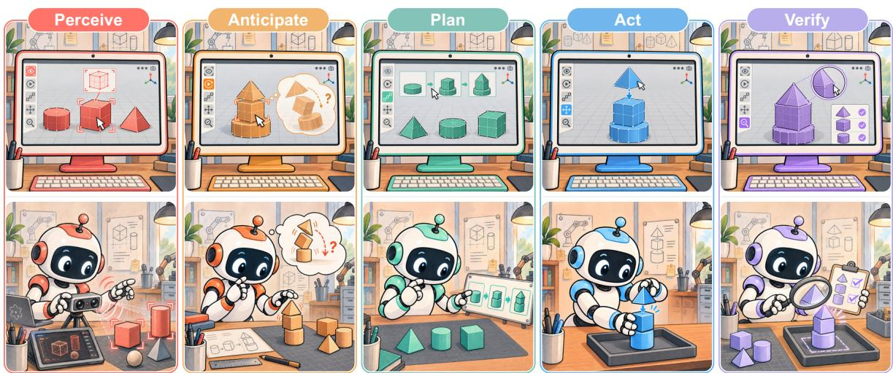
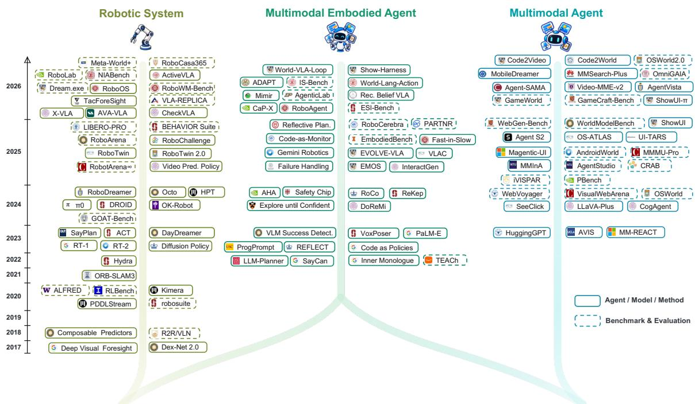
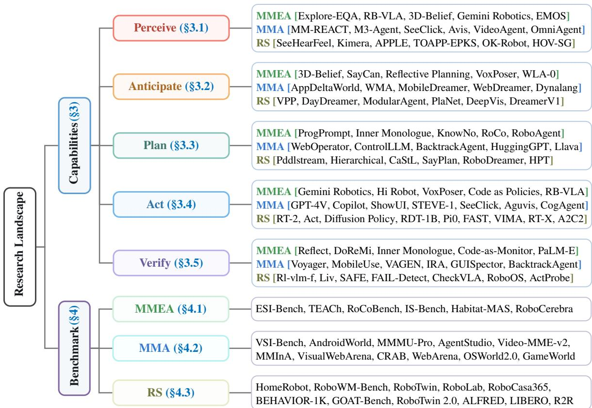
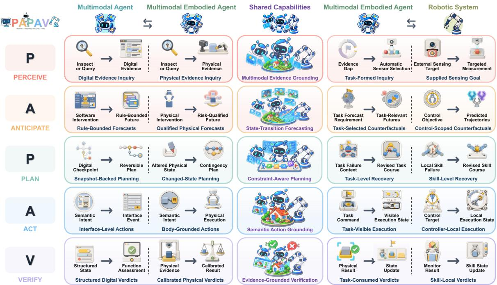
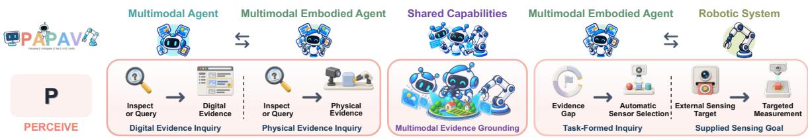
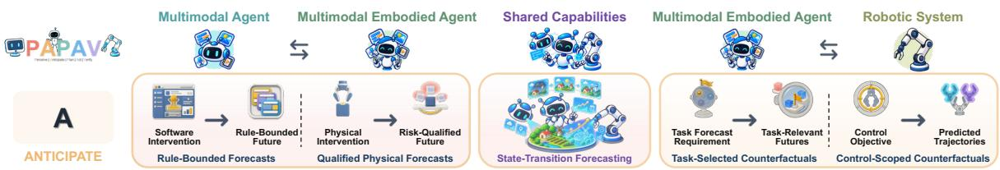
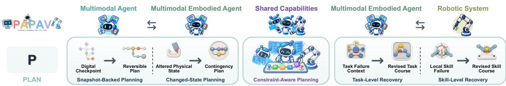
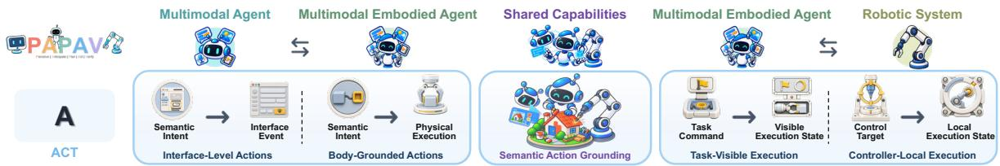
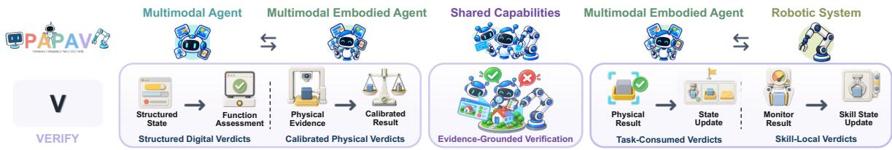
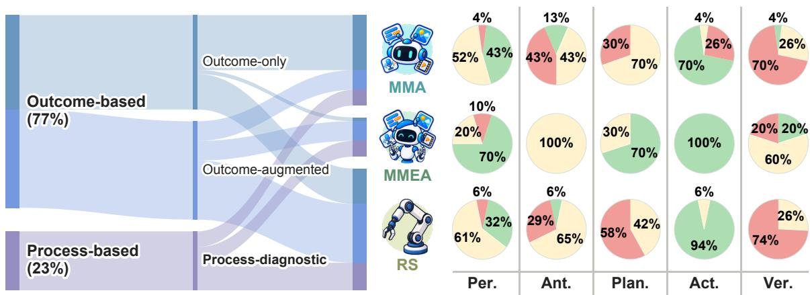

# Multimodal Embodied Agents: A Unified Capability-centric Perspective from Computer-Use to Robot-Use

Yanzhe Chen Ziyi Yang Jifeng Zhu Qiming Huang Ruihe An Peiyao Xu Hesen Yang Runda Liu Chang Gong Zhijun Cao Zechen Bai Wenzheng Zeng Yiqi Lin Guoqiang Liang Kevin Yuchen Ma Kevin Qinghong Lin Mike Zheng Shou†

Show Lab, National University of Singapore

## ABSTRACT

Multimodal agents (MMAs) sustain interaction through reasoning, memory, tools, and feedback, most visibly as computer-use agents, while robotic systems (RSs) couple sensing and actuation under physical dynamics. We define multimodal embodied agents (MMEAs) as goal-directed systems that couple multimodal task reasoning with physical action and revise decisions from the resulting feedback. This raises a central question: what changes when a multimodal agent moves from computer-use to robot-use? We introduce PAPAV, a unified capability-centric framework of five recurring functions: Perceive the current state, Anticipate action efects, Plan a feasible course, Act through an interface or body, and Verify the outcome. Defined by function rather than architecture, these capabilities let PAPAV identify what all three share and then compare MMEAs with MMAs and with RSs. Five physical constraints, from partial observability to unverifiable outcomes, leave fewer choices fixed in advance and less room to reverse errors. Across 64 benchmarks, explicit evaluation centers on Act; only 5 assess Anticipate and 3 assess Verify, leaving both largely hidden behind task success. These constraints also frame the open challenges we identify. PAPAV therefore provides a common basis for designing reliable physical agents and measuring progress across all five capabilities rather than task success alone.

Project Page https://showlab.github.io/Awesome-Multimodal-Embodied-Agent

  
Figure 1. A Unified Capability-centric Perspective (PAPAV) from computer-use to robot-use. Perceive, Anticipate, Plan, Act, and Verify are five functional roles that recur in goal-directed interaction, whether an agent operates a computer (top) or a robot (bottom). Defined by function rather than architecture, they place both settings on a common coordinate and isolate what changes once actions acquire physical consequences.

  
Figure 2. Chronological overview of representative work. Robotic systems progress from visual foresight and task planning to generalist policies, world models, and multi-site evaluation; multimodal agents from tool-augmented reasoning to GUI grounding and computer-use benchmarks. The middle trunk appears in 2022 as language-model planners meet robot skills and keeps widening.

## 1 Introduction

Multimodal agents (MMAs) have grown from one-shot generation into systems that interact over time, use external tools, and revise decisions from feedback, and they now operate browsers, desktops, and phones as computer-use agents [172, 175, 190, 202, 217, 220, 244]. Robotic systems (RSs) have followed a complementary path: foundation models and generalist policies increasingly connect language and perception to physical action across a widening range of tasks [4, 12–14, 37, 84, 91, 111, 152, 153]. Robotics ofers a mature account of how to close the loop under physical dynamics [17, 41, 47, 52, 71, 94, 95], while agent research ofers ways to sustain the loop through longer interactions [28, 29, 31, 69, 101, 175, 190, 220].

We use multimodal embodied agent (MMEA) for a goal-directed system that uses multimodal evidence to guide physical action and feedback from that action to revise later decisions. Bringing the two traditions together changes more than the action interface. Computer-use agents can draw on structured state and direct feedback supplied by software, while conventional robotic systems can rely on constraints chosen for a known operating setting [17, 52, 202, 221, 244]. Open-ended physical interaction ofers neither in full: the same loop becomes less predictable and less forgiving, and more decisions move into the interaction itself. This motivates our central question: What changes when a multimodal agent movesfrom computer-use to robot-use?

A unified basis for cross-domain comparison. Survey taxonomies still tend to follow the field in which they were developed. Surveys of computer-use agents foreground computational architectures and digital interaction [16, 40, 185, 201, 219], whereas surveys of embodied AI, VLA models, and robot autonomy emphasize physical tasks and execution [123, 136, 168, 189]. Several recent accounts cover both computer-use and robot-use [16, 40, 123, 146, 168, 219], but covering both is diferent from drawing the analogy between them (Table 1): existing categories describe systems within each setting and do not show how the same function changes when its actions acquire physical consequences. The need for such an analogy is growing. Foundation models, world models, and broader robot datasets now connect capabilities that were once developed separately [14, 15, 37, 66, 100, 153, 213], yet strong components do not by themselves form a coherent physical agent. Coherence depends on coordination across the full loop as the environment changes, which calls for a unit of comparison that remains stable across both settings. Figure 2 traces the two research paths and their recent convergence.

Table 1. Positioning related surveys. Checks mark dimensions central to a survey; crosses mark those outside it. Six of the ten surveys cover both computer-use and robot-use and four analyze benchmarks, yet none compares the two settings as one capability structure. PAPAV adds that digital–physical analogy as an explicit axis.
<table><tr><td>Survey</td><td>Primary Focus</td><td>Computer- Use</td><td>Robot- Use</td><td>Benchmark Analysis</td><td>Digit.-Phys. Analogy</td></tr><tr><td>Agent AI [40]</td><td>Multimodal interaction</td><td>√</td><td>√</td><td>X</td><td>X</td></tr><tr><td>Multimodal Agents [201]</td><td>Multimodal agent architecture</td><td>√</td><td>X</td><td>√</td><td>X</td></tr><tr><td>Embodied AI [123]</td><td>Multimodal models for embodiment</td><td>√</td><td>√</td><td>X</td><td>X</td></tr><tr><td>GUI Agents [185]</td><td>(M)LLM-based GUI Agents</td><td>√</td><td>X</td><td>√</td><td>X</td></tr><tr><td>VLA Models [136]</td><td>VLA-based embodied AI</td><td>X</td><td>√</td><td>√</td><td>X</td></tr><tr><td>Robot Agents [168]</td><td>LLM/VLM-driven robot autonomy</td><td>√</td><td>√</td><td>X</td><td>X</td></tr><tr><td>Agentic MLLMs [219]</td><td>Agentic multimodal LLMs</td><td>√</td><td>√</td><td>X</td><td>X</td></tr><tr><td>Agentic AI [16]</td><td>Autonomous LLM agents</td><td>√</td><td>√</td><td>X</td><td>X</td></tr><tr><td>Agent Frameworks [146]</td><td>Multimodal agentic frameworks</td><td>√</td><td>√</td><td>√</td><td>X</td></tr><tr><td>LMM-Based Robots [189]</td><td>LMM-based embodied robots</td><td>X</td><td>√</td><td>X</td><td>X</td></tr><tr><td>PAPAV (Ours)</td><td>Capabilities from computer-use to robot-use</td><td>√</td><td>√</td><td>」</td><td>√</td></tr></table>

A capability view of the task loop. We introduce PAPAV, a unified capability-centric perspective built around five functions in a recurring task loop, the cycle through which an agent advances a task one step at a time. Perceive establishes the current state; Anticipate estimates the efects of candidate actions; Plan selects a feasible course; Act realizes that course through an interface or body; and Verify judges the outcome and whether further interaction is needed. Each function is defined by what it contributes to the loop rather than by the component that implements it: one model may support several functions, and one function may be distributed across several models or tools. A click, a skill call, and a robot trajectory difer in form, but PAPAV asks what each contributes to the same task loop rather than whether the systems share an architecture or action space. PAPAV also sharpens two boundaries often folded into a standard observation–decision–action loop: Anticipate asks what a candidate action may cause before Plan chooses a course, and Verify asks whether post-action evidence supports the intended outcome rather than merely recording another observation. These distinctions make prediction and outcome judgment visible as separate functions while remaining compatible with existing agent and control-loop taxonomies [123, 146, 168, 189, 219].

The shared coordinate then isolates what embodiment changes. We study five constraints that recur in physical interaction: partial observability, limited simulatability, irreversibility, real-time coupling, and unverifiable outcomes. Together they make the loop less predictable and less forgiving, increasing the weight of what the agent decides during interaction rather than what the interface or system design fixes in advance. Memory and orchestration keep the five functions connected across time; we call this coordinating substrate the agentic harness rather than a sixth capability.

  
Figure 3. Research landscape and taxonomy of PAPAV. The capability branch groups representative work by non-exclusive evidence lineages; the benchmark branch groups the curated corpus by primary evaluation target.

Position and scope of this survey. Our scope spans MMAs, conventional RSs, and their intersection. We borrow computer-use and robot-use as shorthand for the two ends of this transition [86, 202], and use digital and physical throughout the body for the interaction settings along it. Robot-use here covers any configuration in which multimodal task reasoning acts through a robot body, by remote tool-style control or by an end-to-end policy, and is thus broader than cloud-controlled robots alone. The MMA and RS categories are system classes rather than settings, and they overlap. MMAs commonly operate through software interfaces, including games and simulated worlds [154, 190], whereas RSs center body-specific sensing and control, even when evaluated in simulation. We include virtual embodied work when it informs a capability, while whole-system MMEA membership follows the physica task-loop criteria in Section 2.3. The task loop is therefore the unit of comparison: evidence for one capability does not by itself classify an entire system as an MMEA. Table 1 compares related surveys in terms of computer-use and robot-use coverage, benchmark analysis, and digital–physical analogy, highlighting PAPAV’s emphasis on a shared capability perspective across settings.

Contributions. This survey makes three contributions:

• A unified capability-centric perspective. PAPAV enables unified comparison of MMAs, RSs, and MMEAs through five functional roles in a task loop, spanning computer-use and robot-use.

• A three-way capability comparison. For each capability, we identify what MMAs, RSs, and MMEAs share, then separately analyze MMEA–MMA and MMEA–RS diferences.

• A capability-level benchmark analysis. We analyze PAPAV coverage in 64 benchmarks, distinguishing explicit capability evaluation from evidence available only through task outcomes. Explicit evaluation concentrates on Act, with few benchmarks isolating Anticipate or Verify.

Figure 3 summarizes the research landscape: its capability branch organizes representative evidence by PAPAV relation and literature lineage, and its benchmark branch organizes the curated corpus by primary evaluation target. Neither placement is a shortcut for whole-system MMEA membership.

Organization. Section 2 defines the shared task-loop setting and PAPAV. Section 3 compares the five capabilities across digital and physical systems, with particular attention to the five physical constraints. Section 4 analyzes benchmark coverage at the capability level, Section 5 discusses open challenges for reliable physical interaction, and Section 6 concludes.

## 2 Background and Problem Formulation

We adopt a task-level loop to compare multimodal agents (MMAs) and robotic systems (RSs). Each step contains one operation that advances the task, the evidence used to select it, and the feedback returned after it. In computer-use, this operation may be a GUI action or tool call. In robot-use, it may be a robot skill, waypoint, or trajectory command that a lower-level controller realizes over time. Working at the task level places both settings on a common time scale: a click and a control tick are not comparable, but a task step is. PAPAV describes five functional roles within this loop. It focuses on what each role contributes rather than how the system is implemented. This abstraction allows us to compare systems with diferent architectures and embodiments.

## 2.1 Multimodal Agents

A multimodal agent is a goal-directed system that interacts with the environment through multimodal observations and external actions. Its observations may comprise language, images, structured states, and tool outputs. Its actions may involve language generation, GUI operations, API calls, or tool execution. At task step �, the agent selects an action according to $a _ { k } \sim \pi ( \cdot \mid g , h _ { k } , m _ { k } )$ , where � denotes the task goal, $h _ { k }$ the interaction history, and $m _ { k }$ the persistent memory. The action $a _ { k }$ queries or modifies the external environment and yields a new observation $o _ { k + 1 }$ . The resulting observation is incorporated into the interaction history or persistent memory, providing context for subsequent decisions. This process forms a closed interaction loop in which the agent can adjust its behavior based on environmental feedback [175, 190, 202, 217, 220, 240].

## 2.2 Robotic Systems

A robotic system interacts with the environment through sensing and actuation. Its observations may comprise vision, proprioception, force, and tactile signals. Its task-level actions may be represented as skills, waypoints, trajectories, or motion commands. These actions must be grounded with respect to the robot’s embodiment and estimated state. Their execution is further subject to geometric, dynamic, safety, and control constraints [17, 30, 52, 71].

At task step �, this grounding can be expressed as $a _ { k } \xrightarrow { \mathrm { E x e c } _ { e } } u ( t )$ for $t \in \left[ t _ { k } , t _ { k + 1 } \right)$ . Here, Exec denotes the execution operator conditioned on embodiment �. The control input �(�) may represent joint-position, velocity, or torque commands. This formulation also covers learned and end-to-end policies that implement the grounding process implicitly [12–14, 21].

## 2.3 Multimodal Embodied Agents

A multimodal embodied agent (MMEA) can be characterized by five PAPAV capabilities: multimodal perception, consequence anticipation, task-level planning, embodied action, and outcome verification. The system maintains task state throughout sensing and execution. Execution feedback informs subsequent decisions. These functions operate as a persistent closed loop between multimodal task processing and physical execution. Observed efects may difer from anticipated outcomes during execution. These discrepancies can prompt the agent to revise its task belief, reassess action feasibility, and adjust the remaining plan. Failure of an individual action does not necessarily imply failure of the overall task. The agent can use available evidence to assess recovery options and select an alternative action consistent with the task goal. At step $k , h _ { k }$ denotes the interaction history, $g$ the task goal, and $b _ { k }$ the task-conditioned belief. The PAPAV loop can be formulated as:

$$
( h _ { k } , g ) \xrightarrow { \mathrm { P e r c e i v e } } b _ { k } \xrightarrow { \mathrm { A n t i c i p a t e } } \widehat { \Delta } _ { k } \xrightarrow { \mathrm { P l a n } } p _ { k } \xrightarrow { \mathrm { \# c t } } ( a _ { k } , \rho _ { k } ) \xrightarrow { T _ { d } , O _ { d } } o _ { k + 1 } \xrightarrow { \mathrm { V e r t i p } } \nu _ { k } \cup \ .\tag{1}
$$

Here, $\widehat { \Delta } _ { k }$ is the predicted task-relevant efect, $p _ { k }$ the intended action course, $a _ { k }$ the environment-facing action, and $\rho _ { k }$ its execution progress. The operators $T _ { d }$ and $O _ { d }$ denote the transition and observation models of domain �. Verification produces a verdict $\nu _ { k }$ , such as continue, success, retry, replan, or fail. The observation and verdict provide input to the next interaction step.

We classify a system as an MMEA when multimodal task reasoning forms a persistent feedback loop around physical execution. The evaluated system configuration must satisfy three conditions:

1. Persistent embodied task loop: task-relevant state persists across successive rounds of physical execution, and selected actions can produce observable changes in the physical environment.

2. Task-level capability returns: each claimed PAPAV capability provides a documented output that can influence a subsequent task-level decision within the interaction loop.

3. Embodiment-grounded commitments: task decisions explicitly account for physical feasibility, execution timing, and control constraints imposed by the deployed body and operating environment.

A system is indeterminate when evidence for any condition is missing. An explicitly absent condition places the evaluated configuration outside the MMEA class. The criteria apply to complete system configurations and cover both modular and end-to-end implementations.

Embodiment limits the actions available at each task step. Given belief $b _ { k }$ and embodiment $e ,$ the feasible action set can be expressed as:

$$
\mathcal { H } _ { \mathrm { f e a s } } ( b _ { k } , e ) = \left\{ a \in \mathcal { A } \left| \Gamma _ { j } ( a , b _ { k } , e ) \le 0 , \quad j \in \{ \mathrm { g e o , d y n , s a f e } \} , \right. \right\} .\tag{2}
$$

Here, $\mathcal { A }$ is the space of task-level interventions. The terms $\Gamma _ { \mathrm { g e o } } , \Gamma _ { \mathrm { d y n } }$ , and $\Gamma _ { \mathrm { s a f e } }$ represent geometric feasibility, dynamic feasibility, and safety constraints, respectively. Geometric feasibility covers reachability and collision-free motion. Dynamic feasibility covers motion and actuator limits. Safety constraints capture task- and environment-specific risk bounds. An intervention satisfies a constraint when the corresponding value is non-positive. The term $\tau _ { \mathrm { e x e c } }$ denotes the execution time required by the intervention, and $\tau _ { \mathrm { m a x } }$ the time budget available at the current task step.

  
Figure 4. PAPAV from computer-use to robot-use. Each row contrasts how a shared capability is realized in multimodal agents, multimodal embodied agents, and robotic systems.

## 2.4 PAPAV Roles in the Task Loop

Equation (1) defines five task-level roles by their outputs and uses. Perceive forms a task belief from multimodal evidence. Anticipate estimates the state changes caused by candidate interventions, and need only estimate decision-relevant consequences [195]. Plan selects and organizes actions under task, environmental, and embodiment constraints. Act grounds the selected plan into an executable intervention and reports its progress. Verify converts post-action evidence into a verdict for continuation, termination, retry, or replanning, and must inform subsequent task decisions [38, 84]. The roles may recur at diferent temporal resolutions, be combined or distributed across components, and jointly feed a single decision; throughout, we distinguish them by function and information flow.

## 3 Capabilities: PAPAV

We use PAPAV as a unified capability framework to compare multimodal embodied agents (MMEAs), multimodal agents (MMAs), and robotic systems (RSs). Each capability is a recurring input–output relation within the task loop, defined by its role rather than by a module or a fixed execution order. This lets PAPAV trace the transition from computer-use to robot-use while preserving diferences in implementation, embodiment, and environmental constraints. MMEAs lie at the intersection: physical embodiment constrains agent capabilities, while multimodal reasoning, goal-directed autonomy, and adaptive interaction extend the scope of conventional robotic systems.

Each subsection first identifies the capability shared by MMAs and RSs, then examines how MMEAs integrate and adapt it under physical constraints. Figure 4 serves as the roadmap: each row pairs a shared capability with its MMEA–MMA and MMEA–RS comparisons. The MMEA, MMA, and RS labels in Figure 3 mark non-exclusive evidence lineages.

  
Figure 5. Perceive: MMEA vs. MMA vs. RS. Shared (center): multimodal evidence grounding. Left: digital evidence inquiry vs. embodied physical evidence acquisition. Right: sensing needs formed by the ongoing MMEA task vs. RS acquisition under supplied sensing objectives.

## 3.1 Perceive

Perception maps heterogeneous, partial observations and interaction history to an action-relevant belief about the environment, task, and agent. Across MMAs and RSs, state grounding and estimation exposes entities, relations, afordances, and uncertainties needed for the current objective and subsequent action. Under partial observability, an MMEA must maintain and revise this belief across interactions. Object-centric memories and agent-editable scene graphs retain state beyond the current view, while active-perception policies select observations [5, 57, 127]. The agent preserves identity across viewpoints, answers open-vocabulary queries, records uncertainty and provenance, and revises outdated entries. Embodiment thus changes the responsibility, timing, and evidence for belief maintenance, while Verify separately tests whether goal-specific evidence supports a particular outcome judgment. Figure 5 compares evidence acquisition and the origin of sensing objectives.

## 3.1.1 Perceive: Similarity

From Incomplete Observations across Individual Modalities to Integrated Multimodal Evidence. Each modality reveals diferent state variables and fails in diferent ways. Images contribute appearance and spatial cues; audio and video reveal events and temporal change; depth, proprioception, force, and touch expose geometry, embodiment, and contact. Multimodal agents fuse image regions, text, audio, video, interface state, and tool returns, while robots combine RGB, depth, proprioception, force, touch, and geometric cues. The task may also require temporal or spatial alignment, reconciliation of inconsistent signals, and retrieval of historical context [104, 107, 128, 172, 217]. MM-REACT [217] gathers image and video evidence from specialized tools; M3-Agent [128] stores visual and auditory observations in entity-centered memory; See, Hear, and Feel [107] joins global vision, acoustic events, and local tactile geometry for manipulation. The common relation is evidence integration: complementary sources recover task-relevant information that no single source supplies reliably.

From Observations to Grounded Environment-State Representations. Integrated evidence remains insuficient for downstream reasoning unless it is grounded in an environment-state representation that specifies what currently exists and how it is changing. Perception must therefore associate observations with identifiable entities and events, estimate their current attributes, establish relations among them, and preserve their identities across time [57, 128, 156, 165, 193]. The resulting representation may describe objects, speakers, video events, temporal intervals, digital entities, object poses, spatial configurations, motion, contact, or robot state. Although these variables difer across environments, their representations commonly encode identity, current state, relational structure, and temporal persistence [57, 85, 157, 167, 184, 186]. SeeClick [32] grounds language in screen coordinates; OSWorld [202] requires agents to recover application and interaction states from visual observations;

and Kimera [167] converts continuous visual–inertial measurements into a dynamic scene graph containing persistent objects, agents, places, and spatiotemporal relations.

These mechanisms define Perceive independently of any sensor suite: available evidence is integrated and grounded in a task-relevant state representation [57, 107, 217]. What they leave unresolved is how to seek missing evidence when current observations cannot recover the required state. Embodiment turns observation into a situated, constrained interaction [169]. The comparison must therefore track who formulates the question, who controls acquisition, and how the returned evidence afects later decisions. The two contrasts below examine digital evidence requests [77] and task-conditioned robotic active perception [54, 164] from this task-level perspective.

## 3.1.2 Perceive: Diference

MMA vs. MMEA: From Digital Evidence Inquiry to Physical Evidence Inquiry. Information seeking already forms part of the MMA decision loop. In AVIS [77], tool selection follows from earlier results, returned evidence is interpreted by a reasoner, and working memory carries that evidence into subsequent search. Embodiment relocates the inquiry to the agent’s own sensorimotor relation with the environment. A pending physical commitment may expose an explicit question or an unresolved state variable, while viewpoint, contact, timing, energy, and disturbance constrain how the uncertainty can be resolved. PAPAV records the return as a qualified belief: a task-relevant proposition or state estimate accompanied by the available confidence, provenance, acquisition conditions, and freshness. The fields are analytical criteria, not properties already reported by every cited system. An update becomes task-significant when it changes the plan, the next capability invocation, or the conditions under which physical execution may proceed within the current task loop.

RS vs. MMEA: From Supplied Sensing Goal to Task-Formed Inquiry. Robotic active perception ranges from general acquisition policies to task-conditioned perception; task relevance alone does not distinguish an MMEA. APPLE [169] learns policies across several active-perception problems, while task-oriented perception and planning [54] update beliefs over task propositions and adapt the associated plan. Explore until Confident [164] provides task-integrated embodied evidence: it receives an embodied question, builds a semantic map, selects exploratory motion, and uses calibrated confidence to decide when enough evidence has been collected. The relevant distinction is functional. A persistent task process must issue or revise the information need and later use the qualified return when choosing a capability or physical commitment. A sensing specialist may still control camera poses, tactile trajectories, stopping, and acquisition cost. The trace supports the Perceive relation, whereas whole-system membership requires separate evidence.

## 3.1.3 Perceive: Summary

Perceive closes a task-level information gap with a belief revision that can alter a later decision. Capability coding should trace four links: the information need, embodied acquisition, qualified return, and consuming task decision. These links are observability requirements for analysis, not a common interface attributed to existing systems. Suitable traces can measure calibration, freshness, acquisition cost, and evidence-induced decision changes. Value of information is diferent because it asks what would have happened without the acquired evidence; estimating it requires paired trials, branching replay, or a validated simulator. An active-perception module may therefore belong to either the robotics or embodied-agent evidence lineage. Whether it is task-integrated depends on the route through which the resulting belief reaches and changes the ongoing task process.

  
Figure 6. Anticipate: MMEA vs. MMA vs. RS. Shared (center): action-conditioned state-transition forecasting. Left: relatively rule-bounded digital futures vs. physical forecasts qualified by uncertainty, risk, and applicability. Right: physical counterfactuals selected for the current task vs. control-objective-scoped predictions.

## 3.2 Anticipate

Anticipation estimates consequences of a candidate action before commitment. Given belief $b _ { t }$ and action $\boldsymbol { a } _ { t } .$ , action-conditioned prospective modeling predicts future states, observations, rewards, risks, or task progress. It answers the counterfactual “what follows from this action?”, distinguishing action consequences from unconditional forecasts. Under embodiment, limited simulatability leaves an MMEA without a complete, authoritative simulator for open-ended physical interaction. Predictions span pixels, multi-view video, latent tokens, object state, contact, force, and task progress [96, 113, 181, 227, 235, 247]. A useful forecast must distinguish candidate actions and inform planning or execution; visual plausibility alone cannot establish embodied realizability for the commanded action [214]. Figure 6 compares how forecasts are qualified and task-relevant counterfactuals selected.

## 3.2.1 Anticipate: Similarity

Digital and physical environments instantiate this function at diferent levels of abstraction. For multimodal agents, a candidate action may invoke a text-to-image model, predict a post-action webpage state, synthesize speech or music, generate a video, or call a software tool [19, 43, 59]; for robotic systems, it may change future poses, velocities, contacts, collisions, object motions, rewards, and termination conditions [41, 47, 95, 195]. Nevertheless, both types of systems require a prospective account of how their available actions may change a heterogeneous multimodal environment.

From Current-State Representations to Predicted Environmental Change Through Predictive Models. Anticipate provides Plan with information that cannot be obtained from the current environment state alone by modeling how the environment may change over time, across diferent contexts, or in response to possible external interventions. Starting from the environment state representation constructed by Perceive, both multimodal agents and robotic systems use predictive models to form probabilistic or structured expectations over possible future states. These models may take the form of learned transition models, generative observation models, latent dynamics, structured predictors, analytic or hybrid simulators, and tool or environment emulators [15, 59, 66, 115, 195, 199, 213]. In multimodal agents, predictive models can capture possible changes in language-described environments, video states, webpages, GUI applications, and other interactive digital environments [18, 43, 59]. In robotic systems, they can predict how control inputs may change future visual observations, object configurations, robot states, and task outcomes [41, 76, 95]. A world model is a general form of predictive model that represents reusable environment dynamics. Compared with a conventiona predictor designed to estimate a fixed target for a specific task, a world model can recursively project multiple future steps and condition those projections on diferent contexts or hypothetical interventions, thereby supporting a wider range of prospective queries [64, 115, 170, 199]. Its advantage therefore lies in the generality and reusability of its dynamics representation, rather than in guaranteed predictive accuracy. Similarly, a generative model functions as a world model only when its output is treated as a possible successor state for reasoning, rather than being directly committed to the environment. The output of Anticipate is thus a predictive prior or a set of plausible future states; ranking candidate actions on the basis of those futures belongs to Plan.

From Predicted Change to Semantic or Latent States. A predictor need not expose every pixel, waveform, or sensor reading in a rollout. Passing raw images, video, or multisensory trajectories downstream can be expensive and can obscure the changes that matter to the task [19, 65, 68, 170, 208, 230]. Semantic representations instead name expected changes in entities, events, relations, afordances, constraints, or task progress, sometimes as a delta from the current state [4, 59, 208, 242]. Latent representations preserve decision-relevant dynamics without reconstructing every observation [64, 76, 170]. Either form may encode one future, several alternatives, or uncertainty, and hybrid representations are possible. AppDeltaWorld [208] predicts mobile-GUI transitions as delta code; MuZero [170] retains information for rewards, policies, and values in latent dynamics; and Video Prediction Policy [76] extracts predictive visual features for robot control. Across domains, Anticipate preserves the diferences among possible environmental changes that matter to the next decision.

Predictive models and semantic or latent abstractions thus transform a grounded current state into task-relevant consequences of candidate interventions [65, 208]. In open-ended physical interaction, plausibility alone does not make a forecast decision-worthy: simulator error, uncertain contact, and environmental change can make the same predictor useful in one regime and misleading in another [195, 214, 235]. Robotic prediction already spans control-internal imagination and task-aware semantic–dynamic coupling [195, 229]. The remaining issue is whether a task-level decision selects the counterfactual and consumes its return. The next two contrasts address this question through comparisons with digital future prediction and control-centric robotic prediction.

## 3.2.2 Anticipate: Diference

MMA vs. MMEA: From Rule-Bounded Forecasts to Qualified Physical Forecasts. Actionconditioned prediction supports candidate comparison in digital as well as embodied settings. Web Agents with World Models [19] estimates the next observation and reward for web actions and uses those estimates in policy selection; the software platform and its external services help delimit the transitions for which the model is informative, without making those transitions universally deterministic or reversible. Physical forecasts instead depend on estimated dynamics, contact, embodiment, and disturbances that remain only partly controlled at deployment. Their decision value is bounded by where and how the predictor has been evaluated. An applicability envelope should therefore report the predicted variables and horizon, the tested operating conditions, and any signal used to detect departure from those conditions. This is a reporting requirement that links a forecast to its uncertainty and known limits, not a feature attributed to every physical predictor.

RS vs. MMEA: From Control-Scoped Counterfactuals to Task-Selected Counterfactuals. Robotic world models span rather than stop at control-centric prediction. DayDreamer [195] uses imagined action outcomes to improve a control policy while learning from real interaction, whereas

  
Figure 7. Plan: MMEA vs. MMA vs. RS. Shared (center): hierarchical, constraint-aware course selection. Left: checkpoint-assisted digital backtracking (a representative MMA case) vs. recovery planning from the reached physical state. Right: task-level committed-course revision vs. skill-local recovery.

ModularAgent [229] already couples task semantics and latent dynamics bidirectionally. ModularAgent is therefore a boundary system, not evidence that task-aware prediction is absent from robotics. PAPAV identifies the task-integrated embodied relation through a task-level route: the current decision specifies the candidate physical intervention to be queried, and the returned consequence can change commitment among candidates before execution. A modular interface may expose that route directly; for a fused policy, a prediction trace, controlled intervention, or change in candidate ranking can provide attribution evidence. No particular module boundary or model ablation is required by the definition.

## 3.2.3 Anticipate: Summary

Anticipate is present when a candidate physical intervention conditions a prospective consequence tha reaches the task decision before commitment. Evaluation should separate errors on executed transitions and detection of out-of-envelope cases from counterfactual measures such as ranking agreement or decision regret. Executed outcomes are observable afterward; unchosen alternatives require branching simulation, replay, paired trials, or repeated physical evaluation. Representational adequacy remains task-relative. A compact state delta can outperform a visually detailed rollout for decision support when it preserves the diferences that govern commitment, but this decision-suficiency criterion does not imply greater predictive accuracy across tasks or operating regimes.

## 3.3 Plan

Planning selects and organizes available or candidate actions into a goal-directed course, specifying execution order and dependencies under task constraints. Action schemas, afordances, search, and verification support this process. Language Models as Zero-Shot Planners [81] maps proposed steps to admissible actions; SayCan [4] selects skills using language scores and learned afordances; LLM-Modulo [97] refines candidate plans through verification. The resulting plan links selected actions to their prerequisites and subgoals. This organization determines which actions can proceed independently and which must wait for earlier steps to establish the required conditions. Physical irreversibility requires an MMEA’s action selection and ordering to satisfy spatial, temporal, and safety constraints [62, 83, 163]. As task conditions change, Plan can revise the remaining sequence or select an alternative course. Without a feasible course, planning may call for clarification, assistance, or abstention. Plan determines actions and their relations; Act provides body-specific execution. Figure 7 compares the starting state for recovery and the decision scope for selecting a revised course.

## 3.3.1 Plan: Similarity

From Complex Task Goals to Hierarchically Structured Subgoals. Planning commonly begins from a task goal, a representation of the current state, predicted consequences, and the capabilities available in the environment [4, 51, 59]. Because long-horizon tasks contain complex dependencies and combinatorial choices, both multimodal agents and robotic systems decompose goals into intermediate subgoals, order their dependencies, and progressively refine them into reusable components at finer decision scales [1, 94, 108, 159, 161]. Multimodal agents can construct workflows from GUI operations, tools, APIs, or programs, whereas robotic systems can compose navigation and manipulation stages, motion primitives, and learned skills [111, 120, 159, 174]. ProgPrompt [177] expresses situated task plans as programs, while Code as Policies [111] composes perception and control APIs into executable procedures. Across digital and physical environments, the shared role of abstraction is to express the task goal and environment state against a reusable vocabulary of tools, skills, or programs, while preserving the environment-specific conditions under which each capability is available.

From Candidate Plans to a Selected Course under Constraints. Once the problem is structured, Plan must deliberate over alternatives rather than continue once from the prompt. Candidate courses can be searched, scored under predicted outcomes, rejected on failed preconditions, and revised after new evidence. Multimodal agents compare webpage outcomes, choose tools, or assemble dependency-aware workflows [59, 120, 172, 197]; robots compare skills, symbolic sequences, grasps, and trajectories under afordance, kinematic, collision, and motion constraints [4, 51]. WebOperator [36] ranks web actions and backtracks from unsafe paths, ControlLLM [126] searches a tool graph with parameter and dependency relations, and ReKep [83] optimizes a sequence of relational keypoint constraints for manipulation. A missing API operation and an unreachable grasp thus have the same analytical efect: either can invalidate a goal-relevant candidate. Plan returns the course that survives these checks, with its intermediate objectives, ordering, dependencies, and applicability constraints [72, 126, 172].

Long-horizon decomposition and feasibility-aware selection are shared across the two system classes [4, 94, 126, 172]. They explain coherent selection but not recovery after execution produces a discrepant state [63, 125, 196]. Once a physical commitment alters the world, recoverability becomes a planning variable rather than feedback for an inexpensive retry. The contrasts below compare recovery from physical change with digital plan revision, then distinguish task-level governance of commitment from local robotic replanning during continued interaction [84, 163].

## 3.3.2 Plan: Diference

MMA vs. MMEA: From Snapshot-Backed Planning to Changed-State Planning. Digital and embodied agents both revise plans after execution feedback, but recovery begins from materially diferent states. BacktrackAgent [196] detects GUI errors with verifier and judger modules and uses reflection to recover a productive interaction state using logged outcome pages and interaction history. This example does not make digital actions universally reversible: external services, permissions, and irreversible transactions can also remove options. A failed physical commitment may instead distribute change across geometry, contact, material condition, tool availability, and consumed resources without leaving a complete transaction record. Subsequent planning must reconstruct the state that is actually recoverable, identify efects that require compensation, and account for options removed by the preceding action. Reversibility therefore enters planning before commitment and during recovery, because it determines which remedies remain admissible under the continuing task objective.

RS vs. MMEA: From Skill-Level Recovery to Task-Level Recovery. Robot planning can construct or refine a course within a specified goal and constraint model. PDDLStream [51] integrates symbolic search with black-box samplers, while ReKep [83] optimizes staged relational constraints for manipulation. Task-integrated embodied examples expose the return path: Inner Monologue [84] uses scene and success feedback to select a subsequent skill, and KnowNo [163] makes calibrated help-seeking an admissible planning outcome. This relation does not transfer unlimited orchestration into Plan. Plan remains responsible for authorizing or revising a course under the persistent goal and constraints; Perceive updates the task belief, Verify judges the observed outcome, and a scheduler may route the resulting decision. Assistance, stopping, or recovery belongs to Plan only when it is the selected course returned to the task process. A safety controller or human may retain veto authority without becoming the planner; if the human chooses every subsequent task action, the system instead has a human-in-the-loop Plan profile.

## 3.3.3 Plan: Summary

Plan returns an authorized course under the current goal, belief, anticipated consequences, and constraints. Before commitment, the course may preserve recovery branches or choose assistance instead of physical action. After an outcome, Plan re-enters the loop only when the system selects a revised course. This boundary leaves state estimation to Perceive, outcome adjudication to Verify, and physical realization to Act. Analysis should record preconditions, protected constraints, the selected commitment, and retained recovery branches. Annotated traces can measure precondition coverage and uncompensated persistent errors; option value and expected recovery cost require branching rollouts, replay, or an explicit reachability model. Planning quality can thus reflect both the selected course and the safe, reachable alternatives it preserves, without absorbing every recovery operation into Plan.

## 3.4 Act

Acting executes a selected action through the agent’s interface or body. Action grounding translates intent into targets, parameters, coordinates, or control signals that the environment accepts. Closed-loop execution uses feedback to adjust commands as the action proceeds. Errors in grounding can cause even a correct plan to fail. In physical environments, execution must continue while the agent computes its next action. Asynchronous policies address this by executing one trajectory segment while generating the next. The new segment can adjust or replace the remaining motion [11, 171]. Execution must also account for the robot’s body, since the same instruction may require diferent movements across robot designs. Action representations and tokenization therefore shape how a policy generates executable motion [45, 98]. Figure 8 compares how actions reach the environment and how execution feedback remains available to the ongoing task process.

## 3.4.1 Act: Similarity

From Semantic Interventions to Grounded Action Specifications. Plan supplies a semantic intervention; Act must still ground its target, primitive, arguments, and reference frame in the available action space. For a multimodal agent, “click Submit” may resolve to a GUI element and coordinate, an API call, a typed command, or code [69, 209, 238]. For a robot, “pick up the cup” may resolve to an object, arm, coordinate frame, grasp pose, skill, or control target [27, 91]. OS-Copilot [197] performs this grounding across web, terminal, file, multimedia, and application interfaces, whereas RT-2 [14] maps visual observations and language to robot actions. The targets difer, but the information product is the same: an environment-specific action specification accepted by the relevant interface or controller.

  
Figure 8. Act: MMEA vs. MMA vs. RS. Shared (center): semantic action grounding into environmentcompatible forms. Left: compact agent-facing operations vs. body-grounded execution over physical time. Right: execution progress visible and consequential to the MMEA task process vs. controller-local execution state.

From Grounded Action Specifications to Action Representations Compatible with the Environment. Grounding alone leaves an internal specification that must be decoded at the representation and temporal granularity required by the interface. Digital outputs include screen coordinates, structured GUI operations, commands, tool or API calls, code, and streams of discrete actions [32, 55, 73, 114, 116, 238]; robotic outputs include action tokens, chunks, waypoints, and continuous trajectories [13, 14, 91, 211, 237]. ShowUI [116] emits GUI operations with interface locations, while RT-2 [14] generates robot actions as tokens. STEVE-1 [114] produces keyboard and mouse sequences; ACT [237] predicts short robot-action chunks; Difusion Policy [34] and RDT [121] generate continuous chunks through difusion, whereas �0 [12] uses flow matching. ShowUI-� [75] carries this robotic recipe back into computer-use: a lightweight flow-matching action expert generates continuous cursor trajectories for drags from streaming screenshots, while discrete clicks remain in the same model, so a GUI drag is treated as a closed-loop continuous action rather than a pair of coordinates. These implementations are domain-specific, but each converts intent into executable form and can condition subsequent action on newly observed environmental feedback during execution.

The shared execution relation grounds a selected intervention in an environment-specific target and action space, encodes it at an executable temporal granularity, and permits correction as observations arrive [14, 32, 171]. This explains how intent becomes command, but not how task-level meaning remains connected to body-specific control during physical execution [11]. Relative to MMAs, a compact agent-facing operation [202] must expand into a two-way interface for temporally extended execution [11]. Relative to goal-conditioned robot policies [14, 34, 237], body-specific control becomes task-integrated only when its execution state remains visible to, and consequential for, the ongoing task process throughout the full duration of the embodied intervention.

## 3.4.2 Act: Diference

MMA vs. MMEA: From Interface-Level Actions to Body-Grounded Actions. MMA environments can expose relatively compact agent-facing operations. OSWorld [202], for example, presents clicks, text entry, code, and other platform-defined interfaces to the agent. This compactness is a property of the interface rather than of the setting: dragging a slider or a timeline already demands on-the-fly perception and adjustment, and ShowUI-� [75] meets it with the action expert borrowed from robot policies [12]. Physical execution extends the same requirement across embodiment and time: a particular body must realize the semantic commitment while the task process retains access to its progress. A bidirectional execution contract makes this relation observable. Its downward record identifies the capability, target, parameters, preconditions, and admissible interruption points; its upward record may include controller state, estimated state change, progress, termination status, low-level faults, and observation time. The two directions keep the task meaning of the commitment traceable while leaving implementation and timing to embodiment-specific control. These fields are proposed observability criteria, not a claim that current MMEAs share a standardized execution API.

RS vs. MMEA: From Controller-Local Execution to Task-Visible Execution. Robotic policies already realize compact objectives on particular bodies. RT-2 [14] tokenizes robot actions, whereas ACT [237] and Difusion Policy [34] produce temporally extended motor sequences. Within PAPAV, these systems establish body-specific execution but not, by that fact alone, a task-integrated embodied Act relation. Attribution depends on whether the current task process retains the authorized semantic commitment and can use time-sensitive execution feedback while intervention remains useful. Coding should check whether the downward record identifies the target, intended state change, governing constraints, and interruption conditions, and whether the upward record exposes progress, termination, faults, and timing. Such telemetry neither substitutes for Perceive’s estimate of the physical state nor determines Verify’s postcondition verdict. An explicit API, a modular control stack, or an end-to-end policy can instantiate Act, provided that time-sensitive execution feedback can still modify the course.

## 3.4.3 Act: Summary

Act maintains continuity between an authorized intervention and its body-specific realization. Evaluation should measure grounding correctness, progress observability, termination-state accuracy, interruption latency, and missed deadlines when the interface exposes the necessary evidence. Semantic divergence should compare the authorized target, intended state change, and protected constraints with the execution record rather than compare two free-form explanations. These measures diagnose Act directly; the final task verdict remains Verify’s responsibility. Specialized control is compatible with task-level agency when the authorized commitment remains traceable and timely feedback can still change the course. Because the grounding-and-decoding relation is shared, action machinery also crosses the boundary: ShowUI-� [75] transfers flow-based action generation from robot-use to GUI dragging, illustrating a shared Act mechanism.

## 3.5 Verify

Verification judges intended change, task progress, and constraint satisfaction from post-action evidence [35, 102, 173]. MMAs and RSs compare completion criteria with observed consequences, including GUI states, application data, camera observations, proprioception, contact signals, and execution traces. WebArena [244] and OSWorld [202] check page, application, or execution states; Inner Monologue [84] returns scene and success signals to planning; vision-language success detectors [38] infer outcomes from observations. Embodied verification remains retrospective, but physical interaction often lacks an independent, fully observable success signal. Perceive maintains a task-general belief; Verify tests goal-specific criteria against post-action evidence. Although learned evaluators support action selection [103] and progress rewards for learning [231], within PAPAV, Verify assesses executed actions, supporting task correction and learning. Figure 9 distinguishes the evidence supporting an outcome judgment from the level at which that judgment is consumed.

  
Figure 9. Verify: MMEA vs. MMA vs. RS. Shared (center): evidence-grounded verification against independently specified expectations. Left: structured digital checks vs. physical verdicts calibrated under partial, uncertain, potentially delayed evidence. Right: task-consumed vs. locally used monitor or skill verdicts.

## 3.5.1 Verify: Similarity

From Observed and Expected Outcomes to Verification Judgments. Verification requires two grounded inputs: evidence of what occurred after an action and an independently specified account of what should have occurred [131, 160]. In digital environments, such evidence may include too returns, outcome pages, persistent interface states, and interaction histories; in physical environments, it may additionally include visual, proprioceptive, contact, force, and other temporally accumulated observations. These signals allow GUI agents to inspect state transitions and robots to reconstruct manipulation outcomes [50, 60, 125, 196]. The corresponding reference may be a task goal, predicted next state, subgoal condition, or explicit success criterion. Self-Grounded Verification [7] addresses this problem by first eliciting task-completion criteria independently of the candidate trajectory and only then evaluating the trajectory against those criteria; importantly, the same mechanism is demonstrated across web agents, GUI agents, and robotic manipulation policies. Physical-domain critics additionally require causal, spatial, and afordance awareness, while runtime failure detectors must account for uncertainty and out-of-distribution execution states [203, 204]. Earlier reflection-based methods establish usefu feedback–revision loops, but self-generated critique alone does not guarantee correspondence with the actual environment [137, 175]. Verification should therefore be grounded in independently specified criteria, multimodal observations, tool-accessible states, or calibrated anomaly evidence.

From Verification Judgments to Corrective Feedback. Verification must convert the gap between expected and observed outcomes into feedback that regulates the loop, not merely a detached binary label. The verdict may distinguish terminal success, intermediate progress, recoverable mismatch, insuficient evidence, an invalid expectation, or persistent risk. Language-conditioned success classifiers and multimodal reward models turn observed state changes into execution signals that can also support policy learning [117, 134, 135, 149, 192, 194]. In digital environments, application state or a failed tool return can reveal task progress; Voyager [190] combines environment feedback, execution errors, and self-verification to revise later behavior. Physical verification can instead depend on object relations, poses, or contact. REFLECT [125] summarizes robot experience to diagnose failures, and DoReMi [63] recovers from plan–execution mismatch. An actionable verdict should locate the mismatch and indicate the corrective response, rather than report correctness alone.

Corrective feedback should distinguish outcome assessment from failure attribution. After a placement attempt, an object outside the target region indicates an unmet postcondition, but does not establish whether the cause was incorrect grounding, an unsuitable plan, or execution error. The verifier should report the failed condition and supporting evidence. This distinction helps the task process select an appropriate response without treating every failure as a planning error.

From Outcome Verification to Policy Improvement. Verify can support improvement beyond the current task. In a self-improvement loop, the agent uses evaluated experience to update its policy. The updated policy then generates further attempts and new evidence for verification. Verify supplies evidence for learning; the learning mechanism performs the update.

VERITAS reuses successful trajectories collected under verifier guidance for policy training [232]. VLAC and EVOLVE-VLA use learned progress feedback to support policy updates through interaction [10, 228]. These methods connect evaluation signals to policy improvement. A successful retry alone does not demonstrate a lasting improvement. The claim requires a retained update and better performance in subsequent evaluation. Incorrect judgments can admit failed behavior into training data or reward unhelpful actions.

Verification closes the loop by comparing post-action evidence with independently specified expectations [7, 131] and returning a judgment that can regulate later execution [125]. Physical evidence may be partial or delayed [2, 124], observations uncertain [204], and the verifier dependent on the same evidence as the acting stack. The MMA comparison therefore moves from software-mediated functional checks [109, 244] to physical verdicts whose timing and dependencies shape reliability [203]. The robotics comparison asks whether an outcome signal remains local to monitoring or reaches the task process in time to influence the same episode [38, 63].

## 3.5.2 Verify: Diference

MMA vs. MMEA: From Structured Digital Checks to Evidence-Grounded Physical Verification. Digital evaluation must be separated from agent-side verification. WebArena [244] uses external programs to judge functional correctness, whereas MobileUse [109] places hierarchical reflection and recovery inside the agent’s ongoing task loop. Only the latter establishes an agent-consumed Verify relation. In an MMEA, the judgment rests on post-action physical evidence afected by partial visibility, sensor uncertainty, and delayed consequences. Timeliness becomes part of correctness: a verdict must reach the task process while continuation, renewed perception, replanning, recovery, assistance, or stopping can still change the outcome. Analysis should therefore record the verifier’s evidential-dependency profile. Shared sensors, representations, model backbones, or training data may produce correlated errors despite architectural separation, so verification records should disclose provenance and dependencies and quantify correlated failures wherever the evaluation design supports comparison against the policy that produced the action under evaluation. Uncertain verdicts may become unreliable training targets. Repeated updates can reinforce errors shared by the actor and verifier. Later evaluation should therefore check improvement against observed task outcomes.

RS vs. MMEA: From Skill-Local Outcome Detection to Task-Consumed Verification. Robotic outcome detectors can serve training, ofline evaluation, local control, or the ongoing task process. Vision-Language Models as Success Detectors [38] turns observed behavior into a reward or evaluation signal; this output alone does not show that a task-level agent consumes the verdict during the episode. DoReMi [63], which appears here as task-integrated embodied evidence, instead detects plan–execution mismatch and routes the result into corrective replanning. Verify acquires its task-integrated embodied role when an actionable verdict reaches the current task process before selection of the next course. Coding should record the judged outcome, confidence, supporting evidence, unresolved conditions, consumer, and intervention window. A controller stop, a task-level verdict, and an ofline label may share a detector while retaining diferent responsibilities.

## 3.5.3 Verify: Summary

Verify adjudicates whether post-action evidence satisfies task postconditions and returns a verdict that can change the current episode, including termination. Act may provide execution telemetry and low-level faults; Verify assigns success, failure, partial progress, or unresolved uncertainty against task criteria. Annotated episodes support direct measurement of false acceptance, false rejection, calibration error, and verdict latency. Intervention benefit and recovery utility are causal quantities that require matched runs, randomized verifier use, branching replay, or an explicit causal estimator. Reports should pair verdict accuracy with evidence sources, dependencies on the acting system, and correlated errors. They should also identify who uses the verdict and when intervention remains possible. For self-improvement, evaluation should test whether the retained update improves performance in further trials under comparable conditions.

## 3.6 Synthesis: From Capability Evidence to Evaluation

PAPAV capabilities serve the same core functions across digital and physical systems. Physical embodiment changes how these functions are carried out. The comparison with MMAs shows how physical interaction changes multimodal sensing, prediction, planning, execution, and outcome verification. The comparison with RSs examines how these capabilities inform ongoing task decisions. The analysis considers individual capabilities and how their outputs guide subsequent behavior.

Studies spanning digital and physical environments provide evidence for shared capabilities [182]. Recent work also examines capability coordination, failure diagnosis, and interactive system evaluation [33, 206, 224]. These findings support capability analysis. Classification of complete systems follows the conditions in Section 2.3.

The PAPAV framework guides the analysis of benchmark coverage. For each capability, evaluation should identify its inputs, outputs, and role in task decisions. It should also specify whether the capability is explicitly assessed. Further analysis should examine how uncertainty, execution feedback, and recovery afect later decisions. Some systems continue to learn through interaction. Their evaluation should identify what is updated and whether these changes persist over repeated interactions. Further trials should test their efects on task performance under comparable conditions. A successful retry alone does not demonstrate lasting improvement. Section 4 examines how existing benchmarks assess the five capabilities and where gaps in evaluation remain.

## 4 Benchmarks & Evaluation

This section compares how existing benchmarks evaluate PAPAV capabilities across multimodal embodied agents (MMEAs), multimodal agents (MMAs), and robotic systems (RSs). We distinguish task requirements from explicit evaluation:a task may require a capability, but overall outcome metrics do not reveal how well the agent performs that capability. Our curated corpus contains 64 benchmarks: 10 MMEA, 23 MMA, and 31 RS benchmarks. Table 2 summarizes their information, task settings, and PAPAV coverage. All counts and proportions refer to this corpus unless stated otherwise.

Benchmark Collection and Selection. Candidates were identified through Google Scholar and relevant publication venues. Inclusion required defined tasks or environments, a public protocol with at least one quantitative metric, PAPAV relevance, and suficient evidence for capability labeling. Successor benchmarks were counted separately only if tasks, environments, datasets, or protocols changed substantially. Benchmarks were assigned to mutually exclusive MMEA, MMA, and RS categories by their primary evaluation domains; multimodal input alone did not qualify an RS benchmark as MMEA. The corpus was last updated on 8 Sept 2026.

Capability Labeling Protocol. Each of the curated benchmarks was assessed across the five PAPAV capabilities. The labels have three levels:

• Explicit Evaluation ( ): A dedicated task, metric, controlled comparison, or observable signal provides evidence specific to the capability.

• Implicit Evaluation ( ): The capability is required but appears only in end-to-end performance.

• Not Evaluated ( ): The capability is not required by the task or evaluation protocol.

The following capability boundaries prevent overestimation:

1. Perceive: Perceptual understanding, grounding, or information extraction must be assessed separately. Multimodal input alone is insuficient.

2. Anticipate: Explicit Evaluation of Anticipate requires scored predictions of action consequences, risks, or counterfactual states. Ordinary state changes after actions are insuficient.

3. Plan: Task-level planning, skill organization, or replanning must be assessed. Path planning, motion planning, trajectory generation, and state-space search are not task-level Plan.

4. Act: Action execution, validity, or environmental efects must be assessed. Producing action descriptions or future videos is insuficient.

5. Verify: The agent must judge success or failure from feedback. Checks performed only by external evaluators do not assess Verify.

Table 2. Overview and PAPAV coverage of 64 curated benchmarks (10 MMEA, 23 MMA, and 31 RS). Per./Ant./Ver. denote Perceive/Anticipate/Verify, respectively. ACL-F, CVPRW, and NeurIPS-DB denote Findings of ACL, CVPR Workshop, and NeurIPS Datasets and Benchmarks, respectively.
<table><tr><td>Benchmark</td><td>Venue</td><td>Task</td><td>Per.</td><td>Ant.</td><td>Plan</td><td>Act</td><td>Ver.</td></tr><tr><td colspan="8">Category: Multimodal Embodied Agent</td></tr><tr><td colspan="8">Subcategory: Simulation</td></tr><tr><td>TEACh [155]</td><td>AAAI&#x27;22</td><td>Dialogue-guided tasks</td><td></td><td></td><td></td><td></td><td></td></tr><tr><td>RoCoBench [140]</td><td>ICRA&#x27;24</td><td>Collaborative coordination</td><td></td><td></td><td></td><td></td><td></td></tr><tr><td>PARTNR [20]</td><td>ICLR&#x27;25</td><td>Collaborative planning</td><td></td><td></td><td></td><td></td><td></td></tr><tr><td>EMBODIEDBENCH [212]</td><td>ICML&#x27;25</td><td>Embodied tasks</td><td></td><td></td><td></td><td></td><td></td></tr><tr><td>RoboCerebra [67]</td><td>NeurIPS&#x27;25</td><td>Long-horizon planning</td><td></td><td></td><td></td><td></td><td></td></tr><tr><td>Habitat-MAS [23]</td><td>ICLR&#x27;25</td><td>Multi-robot allocation</td><td></td><td></td><td></td><td></td><td></td></tr><tr><td>IS-Bench [129]</td><td>AAAI&#x27;26</td><td>Hazard mitigation</td><td></td><td></td><td></td><td></td><td></td></tr><tr><td>ESI-Bench [74]</td><td>arXiv&#x27;26</td><td>Spatial intelligence</td><td></td><td></td><td></td><td></td><td></td></tr><tr><td colspan="8">Subcategory: Real</td></tr><tr><td>AgenticLab [61]</td><td>arXiv&#x27;26</td><td>Verified replanning</td><td></td><td></td><td></td><td></td><td></td></tr><tr><td colspan="8">Subcategory: Hybrid</td></tr><tr><td>CaP-Bench [49]</td><td>arXiv&#x27;26</td><td>Robot code refinement</td><td></td><td></td><td></td><td></td><td></td></tr><tr><td colspan="8">Category: Multimodal Agent</td></tr><tr><td colspan="8">Subcategory: Understanding</td></tr><tr><td>MMMU-Pro [226]</td><td>ACL&#x27;25</td><td>Multimodal QA</td><td></td><td></td><td></td><td></td><td></td></tr></table>

Continued on next page

<table><tr><td>Benchmark</td><td>Venue</td><td>Task</td><td>Per.</td><td>Ant.</td><td>Plan</td><td>Act</td><td>Ver.</td></tr><tr><td>VSI-Bench [210]</td><td>CVPR&#x27;25</td><td>Spatial reasoning</td><td></td><td>O</td><td>O</td><td>O</td><td>O</td></tr><tr><td>Video-MME-v2 [48]</td><td>arXiv&#x27;26</td><td>Video QA</td><td></td><td>O</td><td>O</td><td>O</td><td></td></tr><tr><td colspan="8">Subcategory: Interaction</td></tr><tr><td>WebArena [244]</td><td>ICLR&#x27;24</td><td>Web workflows</td><td>O</td><td>0</td><td></td><td></td><td></td></tr><tr><td>GAIA [144]</td><td>ICLR&#x27;24</td><td>General AI Tasks</td><td>L</td><td>O</td><td></td><td></td><td></td></tr><tr><td>VisualWebArena [101]</td><td>ACL&#x27;24</td><td>Visual web tasks</td><td></td><td>0</td><td></td><td></td><td></td></tr><tr><td>WebVoyager [69]</td><td>ACL&#x27;24</td><td>Live web tasks</td><td></td><td></td><td></td><td></td><td></td></tr><tr><td>AndroidWorld [162]</td><td>ICLR&#x27;25</td><td>Android tasks</td><td></td><td></td><td></td><td></td><td></td></tr><tr><td>AgentStudio [241]</td><td>ICLR’25</td><td>Virtual-agent tasks</td><td></td><td></td><td></td><td></td><td></td></tr><tr><td>MMInA [188]</td><td>ACL-F’25</td><td>Multimodal web tasks</td><td></td><td></td><td></td><td></td><td>O</td></tr><tr><td>CRAB [207]</td><td>ACL-F’25</td><td>Cross-device workflows</td><td></td><td></td><td></td><td></td><td>0</td></tr><tr><td>iVISPAR [141]</td><td>EMNLP&#x27;25</td><td>Sliding-tile puzzles</td><td></td><td>L</td><td></td><td></td><td>O</td></tr><tr><td>AgentVista [179]</td><td>arXiv&#x27;26</td><td>Visual agent tasks</td><td></td><td>O</td><td></td><td></td><td>O</td></tr><tr><td>GameWorld [154]</td><td>arXiv&#x27;26</td><td>Browser-game tasks</td><td></td><td>0</td><td></td><td></td><td>O</td></tr><tr><td>MMSearch-Plus [187]</td><td>ICLR&#x27;26</td><td>Multimodal retrieval</td><td></td><td>O</td><td></td><td></td><td></td></tr><tr><td>OmniGAIA [110]</td><td>arXiv&#x27;26</td><td>Omni-modal QA</td><td></td><td>O</td><td></td><td></td><td>O</td></tr><tr><td>OSWorld2.0 [225]</td><td>arXiv&#x27;26</td><td>Computer-use Task</td><td></td><td>0</td><td></td><td></td><td>0</td></tr><tr><td colspan="8">Subcategory: Generation</td></tr><tr><td>SWE-bench [93]</td><td>ICLR&#x27;24</td><td>Repository repair</td><td>0</td><td>O</td><td></td><td></td><td>O</td></tr><tr><td>WebGen-Bench [130]</td><td>NeurIPS-DB’25</td><td>Interactive website generation</td><td>0</td><td>O</td><td></td><td></td><td>O</td></tr><tr><td>PBench [151]</td><td>NVIDIA&#x27;25</td><td>Physical future prediction</td><td>C</td><td></td><td>O</td><td>O</td><td>O</td></tr><tr><td>GameCraft-Bench [133]</td><td>arXiv&#x27;26</td><td>Playable game generation</td><td>0</td><td>O</td><td></td><td></td><td>O</td></tr><tr><td>WorldModelBench [106]</td><td>NeurIPS-DB’25</td><td>Future video generation</td><td>0</td><td></td><td>O</td><td>O</td><td>O</td></tr><tr><td>HarnessEval-W [145]</td><td>arXiv&#x27;26</td><td>Interactive world prediction</td><td>●</td><td></td><td>O</td><td>O</td><td>O</td></tr><tr><td colspan="8">Category: Robotic System</td></tr><tr><td colspan="8">Subcategory: Simulation</td></tr><tr><td>Room-to-Room (R2R) [6]</td><td>CVPR&#x27;18</td><td>Instruction navigation</td><td></td><td>0</td><td>O</td><td></td><td></td></tr><tr><td>ALFRED [176]</td><td>CVPR&#x27;20</td><td>Household tasks</td><td></td><td>C</td><td></td><td></td><td></td></tr><tr><td>RLBench [87]</td><td>RA-L&#x27;20</td><td>Manipulation learning</td><td></td><td></td><td>O</td><td></td><td></td></tr><tr><td>CALVIN [143]</td><td>RA-L&#x27;22</td><td>Instruction sequences</td><td></td><td></td><td>O</td><td></td><td></td></tr><tr><td>BEHAVIOR-1K [105]</td><td>CoRL&#x27;22</td><td>Household activities</td><td></td><td></td><td></td><td></td><td></td></tr><tr><td>ManiSkill2 [56]</td><td>ICLR&#x27;23</td><td>Generalizable manipulation</td><td></td><td></td><td>O</td><td></td><td></td></tr><tr><td>LIBERO [118]</td><td>NeurIPS-DB’23</td><td>Lifelong manipulation</td><td></td><td></td><td></td><td></td><td></td></tr><tr><td>Safety-Gymnasium [89]</td><td>NeurIPS&#x27;23</td><td>Safe control</td><td></td><td></td><td>O</td><td></td><td></td></tr><tr><td>GOAT-Bench [99]</td><td>CVPR&#x27;24</td><td>Multimodal navigation</td><td></td><td></td><td>O</td><td></td><td></td></tr><tr><td>RoboSuite [248]</td><td>arXiv&#x27;25</td><td>Policy training</td><td></td><td></td><td>O</td><td></td><td></td></tr><tr><td>VLABench [233]</td><td>ICCV’25</td><td>Long-horizon manipulation</td><td></td><td></td><td></td><td></td><td></td></tr><tr><td>Meta-World + [142]</td><td>NeurIPS-DB’25</td><td>Multi-skill learning</td><td></td><td>O</td><td></td><td></td><td>O</td></tr><tr><td>LIBERO-Plus [44]</td><td>CVPR&#x27;26</td><td>Robust manipulation</td><td></td><td></td><td></td><td></td><td>O</td></tr><tr><td>LIBERO-PRO [246]</td><td>arXiv&#x27;26</td><td>Robust manipulation</td><td></td><td>1</td><td></td><td></td><td>O O</td></tr><tr><td>SafeManip [80]</td><td>arXiv&#x27;26</td><td>Safe manipulation</td><td></td><td></td><td></td><td></td><td></td></tr><tr><td>Dream.exe [236]</td><td>arXiv&#x27;26</td><td>Future video execution</td><td></td><td></td><td></td><td></td><td></td></tr><tr><td>RoboCasa365 [150]</td><td>ICLR&#x27;26</td><td>Kitchen activities</td><td></td><td></td><td></td><td></td><td></td></tr><tr><td>RoboLab [215]</td><td>RSS&#x27;26</td><td>Robust manipulation</td><td></td><td>L</td><td></td><td></td><td></td></tr><tr><td colspan="8">Subcategory: Real</td></tr><tr><td>FurnitureBench [70]</td><td>RSS&#x27;23</td><td>Furniture assembly</td><td>0</td><td>0</td><td></td><td></td><td>0</td></tr><tr><td>FMB [132]</td><td>IJRR&#x27;24</td><td>Skill composition</td><td>0</td><td>0</td><td></td><td></td><td>O</td></tr><tr><td>RoboArena [8]</td><td>CoRL&#x27;25</td><td>Policy comparison</td><td>0</td><td>O</td><td>C</td><td></td><td>O</td></tr><tr><td>BEHAVIOR Robot Suite [92]</td><td>CoRL&#x27;25</td><td>Household manipulation</td><td>0</td><td>0</td><td></td><td></td><td>0</td></tr></table>

Continued on next page

<table><tr><td>Benchmark</td><td>Venue</td><td>Task</td><td>Per.</td><td>Ant.</td><td>Plan</td><td>Act</td><td>Ver.</td></tr><tr><td>RoboChallenge [166]</td><td>Tech. Rep.&#x27;25</td><td>Policy evaluation</td><td>0</td><td>O</td><td>O</td><td></td><td>O</td></tr><tr><td>VLA-REPLICA [78]</td><td>arXiv&#x27;26</td><td>Reproducible manipulation</td><td>0</td><td>O</td><td>O</td><td></td><td>O</td></tr><tr><td>Subcategory: Hybrid</td><td></td><td></td><td></td><td></td><td></td><td></td><td></td></tr><tr><td>HomeRobot [222]</td><td>CoRL&#x27;23</td><td>Mobile manipulation</td><td></td><td></td><td>0</td><td></td><td></td></tr><tr><td>RoboTwin [148]</td><td>CVPR’25</td><td>Bimanual transfer</td><td></td><td></td><td>O</td><td></td><td></td></tr><tr><td>RobotArena∞ [88]</td><td>ICLR&#x27;26</td><td>Reconstructed evaluation</td><td></td><td></td><td>O</td><td></td><td>O</td></tr><tr><td>RoboTwin 2.0 [25]</td><td>ICML&#x27;26</td><td>Bimanual policy generation</td><td></td><td></td><td>O</td><td></td><td>O</td></tr><tr><td>RoboWM-Bench [90]</td><td>CVPRW&#x27;26</td><td>Future manipulation</td><td></td><td></td><td>O</td><td></td><td></td></tr><tr><td>NIABench [234]</td><td>IROS&#x27;26</td><td>Non-intrusive assistance</td><td>O</td><td></td><td>O</td><td></td><td>O</td></tr><tr><td>RoboDojo [26]</td><td>arXiv&#x27;26</td><td>Sim-to-real evaluation</td><td></td><td>O</td><td>O</td><td></td><td>O</td></tr></table>

Evaluation: Explicit Implicit Not Evaluated.

## 4.1 Multimodal Embodied Agents

Because multimodal embodied tasks often involve several PAPAV capabilities simultaneously, we distinguish capability involvement from Explicit Evaluation, which requires capability-specific evidence but does not necessarily isolate every possible source of failure.

MMEA benchmarks connect vision–language reasoning with physical action. All ten explicitly evaluate Act, and most explicitly evaluate Perceive and Plan. Anticipate is always Implicit; only RoboCerebra [67] and AgenticLab [61] explicitly evaluate Verify. Current protocols cover the main “Perception–Planning–Action” chain but provide weaker diagnosis of predicted consequences and outcome verification. Most rely on simulation, with limited real-world and sim-to-real evaluation.

## 4.1.1 Embodied Perception-Action

IS-Bench [129] evaluates safety risks that dynamically emerge during household tasks. ESI-Bench [74] requires agents to actively acquire spatial information relevant to the task through movement and interaction. CaP-Bench [49] evaluates executable robot control code generated from visual observations and language instructions. Agents can iteratively refine the code using environmental feedback.

All three benchmarks explicitly evaluate Perceive and Act through embodied interaction. Anticipate remains Implicit because predictions of future states are not independently scored. Plan is Implicit in IS-Bench and CaP-Bench because task organization is reflected only in the final outcome. ESI-Bench explicitly evaluates task-level Plan through the selection and sequence of perception, locomotion, and manipulation behaviors. IS-Bench and ESI-Bench do not evaluate Verify. Their agents are not required to judge action success and respond accordingly. Verify is Implicit in CaP-Bench through iterative code refinement based on environmental feedback.

## 4.1.2 Planning and Closed-Loop

TEACh [155] evaluates dialogue-guided household tasks. EMBODIEDBENCH [212] covers household interaction, navigation, manipulation, perception, and long-horizon planning. RoboCerebra [67] uses a hierarchical architecture with planning, control, memory, and verification. AgenticLab [61] evaluates task planning, motion checking, goal verification, and replanning under real-world perturbations.

TEACh explicitly evaluates Act. Its other four capabilities are Implicit. EMBODIEDBENCH explicitly evaluates Perceive, Plan, and Act. Anticipate and Verify are Implicit. RoboCerebra and AgenticLab

explicitly evaluate Plan, Act, and Verify. Perceive is Explicit in AgenticLab and Implicit in RoboCerebra.   
Anticipate is Implicit in both.

## 4.1.3 Multi-Agent Coordination

PARTNR [20] evaluates human-robot collaboration under spatial, temporal, and capability constraints. RoCoBench [140] evaluates collaborative strategies, task assignment, and execution planning. Habitat-MAS [23] evaluates task allocation and coordination among heterogeneous robots.

All three explicitly evaluate Plan and Act. PARTNR and Habitat-MAS also explicitly evaluate Perceive through environmental understanding and capability grounding. RoCoBench uses textual or structured states and does not evaluate Perceive. Anticipate is Implicit because coordination depends on other agents’ actions and constraints. Verify is Implicit through feedback, task progress, and recovery. External collision and simulator checks do not assess verification by the agent.

## 4.2 Multimodal Agents

MMA benchmarks range from multimodal understanding to interactive agents, artifact generation, and world models. Understanding benchmarks primarily evaluate Perceive [48, 210, 226]. Web, computer, mobile, and game benchmarks explicitly evaluate Act and often cover Plan and Anticipate implicitly [154, 162, 225, 244]. Artifact benchmarks treat executable outputs as Act [93, 130, 133], while world model benchmarks explicitly evaluate Anticipate [106, 145, 151]. Verify remains limited despite the post-action feedback available in several benchmarks [141, 154, 187, 188], because such feedback rarely requires the agent to judge success and decide whether to stop, retry, or recover. Checks performed only by the evaluator do not count as Verify.

## 4.2.1 Multimodal Understanding

MMMU-Pro [226], Video-MME-v2 [48], and VSI-Bench [210] target interdisciplinary multimodal question answering, video understanding, and visual-spatial reasoning, respectively. MMMU-Pro reduces the influence of linguistic priors on results by filtering out questions that can be answered from text information alone. Video-MME-v2 evaluates video understanding through visual information aggregation, temporal dynamic modeling, and cross-temporal reasoning. VSI-Bench evaluates spatial relations, distance, orientation, and scene memory based on egocentric indoor video. These benchmarks provide capability-specific evaluation rather than a complete agent loop evaluation.

## 4.2.2 Web Browsing, Computer-Use, and Mobile Interaction

WebArena [244], VisualWebArena [101], WebVoyager [69], MMInA [188], and MMSearch-Plus [187] evaluate web browsing and search. All five explicitly evaluate Act and implicitly evaluate Plan. WebArena uses structured webpage representations and does not evaluate visual perception. VisualWebArena, MMInA, and MMSearch-Plus explicitly evaluate Perceive. Perceive is Implicit in WebVoyager. Anticipate is Implicit in all except MMSearch-Plus. WebArena, VisualWebArena, and WebVoyager implicitly evaluate Verify through action result inspection. MMInA and MMSearch-Plus do not evaluate Verify because their checks are external.

AndroidWorld [162], OSWorld 2.0 [225], and AgentStudio [241] extend the evaluation to mobile devices, desktop systems, and general virtual environments. AndroidWorld and OSWorld 2.0 explicitly evaluate Act. Perceive, Anticipate, Plan, and Verify are Implicit through long-horizon interaction with dynamic interfaces. AgentStudio explicitly evaluates Perceive, Act, and Verify. AgentStudio covers Anticipate and Plan only implicitly.

## 4.2.3 General and Cross-Environment Assistants

GAIA [144] evaluates document understanding, web search, reasoning, and tool use through real-world questions with deterministic answers. CRAB [207] covers workflows across desktop and mobile environments. AgentVista [179] focuses on hybrid tool use guided by visual evidence. OmniGAIA [110] evaluates multimodal reasoning across images, video, and audio.

GAIA evaluates Perceive, Plan, and Act implicitly through final answer accuracy. It does not evaluate Anticipate or Verify. CRAB explicitly evaluates Act through graph-based progress checks. Perceive, Anticipate, Plan, and Verify are Implicit. AgentVista and OmniGAIA explicitly evaluate Perceive and Act. Plan is Implicit through multi-step tool use. Anticipate and Verify are Not Evaluated. Their tools support information acquisition, and their outputs are checked externally.

## 4.2.4 Interactive Games and Spatially Intelligent Agents

GameWorld [154] evaluates visual interaction across multiple browser-based games. Agents continuously process visual feedback and execute keyboard, mouse, or semantic actions in the game environment. iVISPAR [141] uses interactive sliding puzzles to evaluate spatial reasoning and sequential manipulation. It compares agent performance across visual and textual state representations.

Both benchmarks explicitly evaluate Act and implicitly evaluate Anticipate. iVISPAR explicitly evaluates Perceive through controlled representation comparisons. Perceive is Implicit in GameWorld. GameWorld evaluates Plan implicitly through multi-stage objectives. Local moves and state space search in iVISPAR are not task-level Plan. Neither benchmark evaluates Verify. State observation is part of normal interaction, and evaluator checks do not require agent judgment or recovery.

## 4.2.5 Artifact Generation

SWE-bench [93], WebGen-Bench [130], and GameCraft-Bench [133] evaluate software issue resolution, interactive website generation, and playable game generation, respectively. In these tasks, Act extends to generating artifacts that can be compiled, run, or interactively tested.

Perceive and Plan are Implicit because they afect artifact quality but are not evaluated separately. Anticipate and Verify are Not Evaluated because artifact testing is external and does not require prediction, failure detection, or revision.

## 4.2.6 World Model and Physical Prediction

WorldModelBench [106] and PBench [151] evaluate future video generation from initial visual states and textual inputs, focusing on temporal consistency, physical plausibility, and condition compliance. HarnessEval-W [145] evaluates interactive world predictions through observation quality, transition correctness, and world persistence. Its hierarchical evaluator decomposes each case into measurable subproblems and aggregates validated evidence into a traceable score.

All three explicitly evaluate Anticipate through scored future predictions. Perceive is Implicit because understanding the initial scene is required but not assessed separately. Generated observation quality does not independently establish perceptual understanding. Act is Not Evaluated because the model outputs are predicted observations. The protocols do not assess task-level planning or feedback-driven verification by the evaluated models, so Plan and Verify are also Not Evaluated. In HarnessEval-W, planning and evidence validation belong to the external evaluator.

## 4.3 Robotic Systems

The evaluation focus of RS benchmarks is concentrated. Of the 31 benchmarks in Table 2, 29 provide Explicit Act evidence through task outcomes, return, path eficiency, or stage completion. Aggregate scores combine execution errors with perception or planning errors. None explicitly evaluates task-level Plan or the agent’s Verify capability. Path and motion planning, trajectory optimization, and low-level control count as execution unless goal decomposition, skill sequencing, or replanning is assessed. Simulation, physical deployment, and hybrid testing are evaluation settings.

## 4.3.1 Navigation and Exploration

R2R [6] evaluates instruction following from egocentric vision using endpoint success and path eficiency. GOAT-Bench [99] uses sequences of category, language, and image goals, making spatial memory and information reuse part of the task. Both provide Explicit Perceive and Act evidence through visual grounding and navigation. Their aggregate scores still combine target recognition, localization, memory, and movement errors.

Anticipate and Verify are Implicit because state prediction and progress checking afect successful behavior without separate scores. Path search is not treated as task-level Plan. Memory-specific errors and goal-level trajectories would make the diferent episode structures easier to compare.

## 4.3.2 Skill Learning and Policy Generalization

RLBench [87], ManiSkill2 [56], RoboSuite [248], and Meta-World+ [142] provide common manipulation tasks, robot models, controllers, and skill collections. Their main success and return metrics make Act observable but do not isolate individual failure causes. LIBERO [118] evaluates new skill acquisition and retention. LIBERO-PRO [246] adds visual and task perturbations. LIBERO-Plus [44] evaluates manipulation robustness across seven perturbation dimensions with tasks at five dificult levels. CALVIN [143] evaluates language-conditioned skill sequences. RoboCasa365 [150] extends these sequences to varied kitchen tasks. RoboLab [215] introduces controlled task and environment changes. FMB [132] evaluates individual and composed skills on a reproducible physical platform. These benchmarks cover retention, perturbation robustness, skill composition, and physical variation.

CALVIN, LIBERO-PRO, LIBERO-Plus and RoboLab explicitly evaluate Perceive. Perceive is Implicit in most other suites. Meta-World+ uses structured states and does not evaluate Perceive. Plan is Implicit in LIBERO, LIBERO-PRO, LIBERO-Plus, RoboCasa365, RoboLab, and FMB. It is Not Evaluated in RLBench, ManiSkill2, RoboSuite, Meta-World+, and CALVIN. None evaluates Verify because completion checks are external.

## 4.3.3 Long-Horizon and Household Manipulation

ALFRED and VLABench connect language, navigation, and manipulation in multi-stage embodied tasks. A valid individual action can still fail when performed at the wrong point in the task sequence [176, 233]. BEHAVIOR-1K and HomeRobot expand the task space to object search, mobile manipulation, and diverse everyday activities [105, 222]. FurnitureBench and the BEHAVIOR Robot Suite place long-horizon assembly and household tasks on real physical platforms, adding contact errors, hardware tolerances, and reset variation [70, 92].

Reported goal conditions and phase-level progress can help distinguish early failures from near completion. These measures can still conflate semantic, perceptual, navigation, and manipulation errors. Progress is also computed by an external evaluator. It does not necessarily show how the robot organized the task or recognized a failed intermediate state. These aggregate measures do not independently establish task planning or agent verification.

## 4.3.4 Safety-Constrained Control and Human Assistance

Safety-Gymnasium [89] reports task reward and constraint cost. SafeManip [80] checks prohibited states and temporal-ordering violations. NIABench [234] evaluates the utility and timing of assistance, including cases where inaction is preferable.

These protocols evaluate whether actions are safe, extending Act beyond task completion. Anticipate is Implicit because risk afects behavior without a separate score for predicted consequences. Plan is Implicit only in SafeManip, whose ordered constraints provide evidence of task organization. Constraint monitoring and intervention scoring remain external, so none evaluates Verify performed by the agent.

## 4.3.5 Real-World and Sim-to-Real Evaluation

RoboArena [8] distributes pairwise physical-policy comparisons across participating sites, reducing dependence on the task setup of a single laboratory. VLA-REPLICA [78] specifies a lower-cost hardware configuration for repeatable in- and out-of-distribution tests. RoboChallenge [166] organizes centralized evaluation at a larger scale. RoboTwin [148] and RoboTwin 2.0 [25] use digital twins to expand scene and bimanual variation before deployment. RobotArena∞ [88] asks whether policy rankings in reconstructed simulations agree with physical trials. RoboDojo [26] connects simulation with standardized remote robot experiments.

These benchmarks focus on policy performance across sites, hardware platforms, and sim-to-real settings. All explicitly evaluate Act through executed robot behavior. Perceive is Explicit only when a protocol controls and compares visual conditions. Plan and Verify are Not Evaluated because task generation, state checking, and ranking are handled by the evaluation system rather than the policy. Ranking agreement measures sim-to-real validity. Site-level results reveal variations caused by cameras, control frequency, reset procedures, or operators.

## 4.3.6 Robot World Models and Physical Prediction

Dream.exe [236] evaluates generated manipulation futures through video quality, trajectory consistency, and downstream execution. RoboWM-Bench [90] evaluates whether predicted futures are physically plausible and useful for manipulation. Both explicitly evaluate Anticipate. Perceive is Implicit because the initial image is only an input condition. Downstream execution provides indirect evidence for Act.

The evaluated models stop after generating a useful future prediction. They do not complete a full decision loop, which would compare alternative futures, select an action, observe the outcome, and update the next prediction. Plan and Verify are therefore Not Evaluated. A separate control policy remains responsible for action execution. Recording the selected prediction and its later update would better connect Anticipate with closed-loop behavior.

  
Figure 10. Analysis of benchmark metrics and cross-domain PAPAV coverage. Left: Sankey diagram tracing benchmark metric types across MMA, MMEA, and RS benchmarks. Right: Three-level PAPAV capability coverage matrices for MMA, MMEA, and RS benchmarks. Green, yellow, and red denote Explicit Evaluation, Implicit Evaluation, and Not Evaluated, respectively.

## 4.4 Cross-Domain Comparison

Figure 10 summarizes the 64 retained benchmarks. The Sankey diagram groups 49 outcome-based benchmarks (24 outcome-only and 25 outcome-augmented) and 15 process-diagnostic benchmarks by system family. The matrix reports the proportions of Explicit, Implicit, and Not Evaluated labels for each PAPAV capability within each family.

## 4.4.1 Overall PAPAV Coverage

Because the corpus contains 10 MMEA, 23 MMA, and 31 RS benchmarks, comparisons across families are descriptive rather than estimates of the complete literature.

Act has the strongest explicit coverage: 10/10 (100%) MMEA, 16/23 (70%) MMA, and 29/31 (94%) RS benchmarks. Perceive is Explicit in 7/10 (70%) MMEA, 10/23 (43%) MMA, and 10/31 (32%) RS benchmarks. Explicit Perceive requires a dedicated understanding, grounding, or evidence acquisition task. Visual input alone is insuficient.

Plan shows the clearest diference. It is Explicit in 7/10 (70%) MMEA benchmarks and Implicit in the other 3/10 (30%). It is Implicit in 16/23 (70%) MMA and 13/31 (42%) RS benchmarks, with no Explicit cases in either family. The remaining 7/23 (30%) MMA and 18/31 (58%) RS benchmarks do not evaluate Plan. This pattern reflects protocol design, not the planning ability of each system family. Only 5/64 (8%) benchmarks explicitly evaluate Anticipate, and 3/64 (5%) explicitly evaluate Verify. Explicit Evaluation of Anticipate requires a scored prediction of future states or action consequences. Verify requires assessment of the agent’s success or failure judgments from feedback.

## 4.4.2 Diagnosticity and Capability Bottlenecks

Broad capability coverage does not guarantee useful failure diagnosis. A complex task may require perception, planning, and action but still report only a single overall success score. WorldModelBench [106] and PBench [151] use focused protocols to isolate physical future prediction. HarnessEval-W [145] adds evidence-grounded diagnosis of predicted transitions and world persistence. Its evaluation traces explain scoring decisions, but do not expose the evaluated model’s internal decision process or establish its Verify capability. AgentStudio’s CriticBench [241] directly evaluates task success detection. RoboCerebra [67] records hierarchical decisions and intermediate checking signals. AgenticLab [61] evaluates closed-loop replanning after observed execution deviations. These process measures provide more direct evidence and help distinguish poor planning, missed failures, and faulty execution.

Dream.exe [236] and RoboWM-Bench [90] score useful physical predictions but stop before the agent compares alternatives, acts, and updates its forecast from feedback. Unit tests, simulator checkers, and safety monitors assess outcomes for the benchmark. Verify can be assessed through the agent’s success or failure judgments. Further evaluation is needed to determine whether these judgments improve subsequent behavior. Explicit Plan similarly requires scored decomposition, subgoal order, constraints, coordination, or replanning. Controlled input interventions can reveal failures hidden by aggregate success rates. In LIBERO-Plus [44], instruction removal and target replacement tests probe whether successful execution depends on the specified goal. These comparisons provide evidence about grounding, although they do not fully separate perceptual and control errors.

## 4.4.3 Convergence across Domains

Interactive evaluation is becoming more similar across domains. VisualWebArena [101] and OS-World 2.0 [225] evaluate persistent interaction with digital states. RoboCasa365 [150] introduces language and compositional tasks into robotics. RoboTwin [148] uses digital twins to increase environment variation. MMEA benchmarks further combine these directions. EMBODIEDBENCH [212] covers several embodied settings. PARTNR [20] evaluates collaborative planning under heterogeneous constraints. These benchmarks increasingly share persistent states, multi-step interaction, multimoda feedback, and coordinated action.

Overall, across the three domains, Act receives the strongest explicit coverage, while Anticipate and Verify remain less observable. Diferences across domains mainly reflect benchmark design rather than system capability. Process measures provide clearer failure diagnosis than aggregate task scores. Benchmarks from diferent domains also show increasingly similar interaction and evaluation settings.

## 4.5 Evaluation Metrics and Reproducibility

This section examines evaluation metrics and reproducibility of the curated benchmarks. Evaluation metrics afect how well a benchmark can identify the source of failure. Reproducibility shows whether results can be repeated under the same experimental settings. Diferences in tasks, interfaces, and environments make raw scores dificult to compare across benchmarks.

## 4.5.1 Outcome- and Process-Based Evaluation

We classified the benchmarks into three categories based on their evaluation metrics: outcome-only, outcome-augmented, and process-diagnostic. Outcome-only benchmarks report only terminal results, such as answer accuracy [144], task success [143, 244], test pass rate [93], or artifact quality [130, 133]. Outcome-augmented benchmarks also report progress, eficiency, cost, or constraint violations, but these measures do not link performance to a specific capability [6, 99, 176]. Process-diagnostic benchmarks include at least one metric, annotation, intermediate assessment, or failure category that links performance to a specific capability [61, 129, 207].

As shown in the left panel of Figure 10, the corpus contains 24 outcome-only, 25 outcome-augmented, and 15 process-diagnostic benchmarks. Process diagnosis appears in 4/10 (40%) MMEA, 4/23 (17.39%) MMA, and 7/31 (22.58%) RS benchmarks. Outcome-based metrics are easy to interpret but weak at locating PAPAV failures. Process-based metrics improve attribution but require finer annotations, trajectory logging, and evaluator design.

## 4.5.2 Reproducibility

Benchmark reproducibility depends on the stability of task data, execution environments, and evaluators. Static question answering and ofline generation use fixed inputs and often deterministic scoring, making them easier to reproduce. Self-hosted websites, operating systems, and simulated environments ofer more control but remain sensitive to browser, dependency, simulator, and model-interface versions. Real-robot evaluation introduces further variation from hardware, calibration, control frequency, scene configuration, and human intervention.

Procedural success checkers, environment snapshots, simulator reconstruction, and standardized hardware improve stability [78, 162, 244]. Distributed and reconstructed evaluations such as RoboArena [8] and RobotArena∞ [88] still vary with task selection, execution conditions, and evaluator implementation. Benchmarks should report task instances, environment and evaluator versions, trajectories, model and prompt configurations, interfaces, budgets, random seeds, trial counts, and hardware settings. Human or model-based evaluation also requires documented criteria and consistency checks.

For this survey, the corpus was frozen at the stated cutof date. Table 2 provides the retained entities, category assignments, and PAPAV labels needed to reproduce the capability coverage counts.

## 4.6 Discussion and Future Benchmark Design

A recurring limitation in this corpus is limited evaluation granularity. Multimodal, long-horizon, and interactive tasks increasingly couple several PAPAV capabilities across digital and embodied environments [20, 155, 225, 244], yet aggregate outcomes rarely identify the source of failure. Future benchmarks should retain end-to-end performance while adding attributable signals such as grounding correctness, failure recognition, recovery efectiveness, controlled perturbations, and intermediate checkpoints. RoboCerebra [67] and AgenticLab [61] illustrate how checking and replanning signals can improve failure attribution within the PAPAV loop.

Future benchmarks should test how information passes between PAPAV capabilities and changes later decisions. They should record whether predictions afect action selection and whether execution feedback leads to revised plans. Verification requires particular care because an apparently completed action may not satisfy the task goal. A grasp, for example, may look correct while remaining unstable. REFLECT [125] uses observations of robot execution to explain failures and guide correction. Benchmarks should assess both the accuracy of these judgments and their efect on subsequent behavior.

The evidence available to the verifier is central to this evaluation. A dedicated verifier can specialize in detecting success and failure. A shared model can reuse the actor’s representations and context, which may reduce computation. However, separate models may still miss the same failures if they use the same observations or similar training data. Benchmarks should therefore test whether additional evidence helps the verifier detect errors that the actor overlooks. Such evidence may come from another sensing modality, a physical check, a specialized success detector, or human review.

The actor and verifier should then be evaluated together. Benchmarks should report the fraction of failed executions judged successful and the fraction of successful executions judged failed. They should also identify failure types that both components miss. Detection delay, recovery success, and the extra actions or time needed for recovery show whether verification helps the task. Comparisons should control task conditions and report the resources available to each system. Reference judgments should be established independently of the agent’s verdict. These measures assess both the reliability of verification and its contribution to recovery.

These evaluations should also include realistic deployment conditions. RoboArena [8] and RobotArena∞ [88] illustrate how results can vary across sites and reconstructed environments. Benchmarks should combine controlled comparisons with physical trials or environmental perturbations. This would help determine whether verification and recovery remain efective when observations, hardware, or execution conditions change. The objective is to obtain reliable evidence about the capabilities and feedback processes required by each task.

## 5 Open Challenges

The following challenges are not intended to cover every open problem in embodied AI. They instead arise from a common dificulty: PAPAV capabilities must remain coordinated while the agent interacts with a world that is only partially observed, continuously changing, dificult to simulate, and often hard to verify. Under these conditions, it is not enough for each capability to improve in isolation. The agent must decide what information to retain, which future consequences to predict, when to revise a plan, how to act under uncertainty, and how verification can improve later behavior. We organize these five challenges in PAPAV order.

## 5.1 OC1. Persistent Physical Belief: What Should the Agent Remember?

A robot never has the physical world fully available in its current observation. Objects move out of view, properties become hidden by occlusion, and the efects of earlier actions can remain important long after the evidence has disappeared. Classical state estimation and mapping already provide mechanisms for carrying information forward in time [17]; more recent open-vocabulary maps and scene graphs extend this idea toward persistent semantic entities and relations [57, 138]. Yet persistence alone is not enough. Unlike a static log, a physical belief must change when the world changes.

This creates a tension that is easy to overlook. Forgetting too aggressively causes the agent to repeatedly rediscover state it has already observed, while retaining everything allows stale or contradictory information to accumulate. Structured maps make beliefs explicit and editable; latent recurrent states can compress long histories; episodic retrieval can recover fine-grained evidence only when it becomes relevant. None of these properties alone determines what the agent should continue to believe.

Core question: What should an embodied agent retain, revise, or forget as the world changes?

The central issue is therefore not memory capacity, but the quality of the belief that memory supports. A useful memory should preserve information that is temporarily unobservable, revise it when new evidence disagrees, and make past experience available when it can change the next decision. This suggests that future systems may need to combine persistent structured state with compressed or episodic representations rather than choosing a single memory form.

Correspondingly, evaluation should ask whether memory remains useful under occlusion and change: can the agent recover hidden-but-relevant state, correct stale beliefs, resolve contradictions, and make better downstream decisions without memory and retrieval cost growing without bound?

## 5.2 OC2. Decision-Relevant Prediction: What Is Worth Predicting?

Embodied agents can anticipate the future at very diferent levels of detail. Visual foresight predicts future observations under candidate actions [41, 47]; latent world models instead compress the dynamics into an internal state and reason through imagined trajectories [66, 195]. Recent robotic world models further explore learned predictive representations for manipulation and robot imagination [245, 247]. These approaches all support anticipation, but they do not agree on what must actually be predicted.

A high-fidelity future image may contain nearly every visible consequence of an action, yet much of that detail may be irrelevant to the choice at hand. Conversely, a compact latent prediction can be eficient while hiding the very factor that determines whether an action is safe or feasible. For some decisions, predicting an event such as collision likelihood, contact, reachability, progress, or risk may be more useful than reconstructing the future scene itself [95].

Core question: Whatfuture information must an embodied agent predict to make a good decision?

This suggests a diferent objective for world modeling. Rather than asking for the most realistic or complete forecast, the agent should predict enough of the future to preserve the distinctions that matter for action. What counts as suficient prediction may therefore depend on both the task and the decision the agent is trying to make. The desired representation may change accordingly: geometric consequences may dominate navigation, contact and stability may matter for manipulation, and social responses or intent may become more important in human–robot interaction.

A practical way to test such suficiency is to remove predictive detail and ask whether the resulting policy changes. If a simpler forecast preserves action ranking, safety judgments, and task outcomes, the omitted detail was not necessary for that decision. The open problem is to identify such decision-relevant representations without making them so narrow that they fail when the environment changes.

## 5.3 OC3. Adaptive Commitment: When Should the Agent Replan?

The granularity of action has become an increasingly important design choice. Policies such as Action Chunking with Transformers predict temporally coherent action sequences rather than isolated controls [237]. This can reduce repeated high-level inference and produce smoother execution. At the same time, longer chunks create a period during which the world may change while the agent is still committed to an earlier decision. Real-Time Chunking makes this tension explicit by asking how large policies can remain reactive when model inference is slower than physical execution [11].

Neither extreme is satisfactory. Replanning after every small motion is expensive and can make behavior hesitant; committing to a long action sequence can make the agent slow to react to contact, disturbances, or an incorrect belief. Closed-loop systems such as Inner Monologue already show why new scene and success information should feed back into later decisions [84]. What remains unclear is how frequently that loop should be reopened.

Core question: How long should an agent continue executing before observing and replanning?

The appropriate horizon is unlikely to be fixed. Predictable free-space motion may tolerate longer commitment, whereas contact-rich interaction, unexpected motion, high uncertainty, or an irreversible action may justify checking again much sooner. In this view, action granularity becomes a contro variable of the agent itself: the system adapts not only what it does, but also when it should think again.

A convincing solution should therefore gain reactivity where it matters without paying the cost of constant replanning everywhere. Success rate alone will not capture this trade-of; reaction delay, wasted actions, intervention frequency, and inference cost are also important for determining whether adaptive commitment actually improves the closed loop.

## 5.4 OC4. Uncertainty-Conditioned Control: Act, Observe, or Ask?

Uncertainty appears throughout the embodied loop. An object may be partially occluded, an instruction may admit several interpretations, a scene may difer from the training distribution, or the outcome of an action may simply be hard to predict. In each case, uncertainty can afect not only what the agent believes, but also which action it should take and how cautiously it should proceed. Recent work has begun to make this uncertainty actionable: calibrated planners can ask for help [163], active-perception systems can gather additional observations [54, 127], and runtime monitors can use uncertainty to detect situations in which the current policy may be unreliable [112, 204].

These mechanisms point to a control problem. More information is not always worth acquiring, and uncertainty does not always justify stopping. A slightly uncertain but reversible action may be worth attempting; the same uncertainty may be unacceptable before an irreversible or safety-critical action. Likewise, asking for help can prevent failure but defeats autonomy if used whenever confidence drops.

## Core question: When uncertain, should an agent act, gather more information, or ask for help?

The choice depends on more than calibrated confidence. The agent must also consider how costly another observation would be, whether it is likely to resolve the ambiguity, how reversible the proposed action is, and what happens if the decision is wrong. Uncertainty estimation therefore becomes useful only when it changes the control strategy of the loop.

This reframes the goal from “knowing when the model is uncertain” to choosing an appropriate response to that uncertainty. A capable agent should proceed when autonomous action is justified, seek information when it is likely to change the decision, and defer when the potential consequence of a mistake outweighs the cost of asking. The challenge is to achieve this balance without producing either reckless autonomy or a system that continually re-observes and escalates.

## 5.5 OC5. Learning from Verification: How Can the Agent Improve?

Verification judges whether an action achieved its intended outcome. Its role in an improvement loop extends to guiding changes in later behavior. REFLECT [125] uses robot experience to explain failures and support correction. Reflexion [175] stores reflections on task feedback and uses them in later trials. These approaches motivate a broader question: how can feedback produce improvements that remain useful beyond the current attempt and across related tasks?

A central dificulty is deciding what should change. A failed manipulation may result from an incorrect object estimate, a poor prediction, an unsuitable plan, or an execution error. The same failure signal can therefore call for diferent updates across PAPAV. Revising the wrong component may leave the cause untouched or introduce new errors. The agent must connect the observed outcome to the assumptions and decisions that produced it, using evidence from execution.

Core question: How can verification guide reliable improvement across the PAPAV loop?

An efective improvement loop must connect a judgment to a specific revision and test that revision through further interaction before retaining it for reuse. Feedback may correct a belief, update a prediction, revise a planning rule, or refine an execution strategy. Such changes can occur through memory and decision updates without changing model parameters. The dificult step is determining whether a revision addresses the cause of failure and when it remains applicable.

A successful retry alone does not establish lasting improvement. A correction may work in one scene but fail when objects, goals, or conditions change. Repeated feedback may also reinforce an incorrect explanation and spread its efects across the loop. Agents therefore need ways to retain useful lessons, limit their application to relevant situations, and reverse changes when new evidence contradicts them. The open challenge is to accumulate useful improvements while preventing errors in verification from accumulating through repeated updates and undermining previously acquired skills.

## 6 Conclusion

This paper has asked what changes when a multimodal agent moves from computer-use to robot-use. To answer it, we introduced PAPAV, a unified capability-centric perspective that compares multimodal agents, robotic systems, and MMEAs through five functions in a shared task loop. Because each capability is defined by its contribution to the loop rather than by architecture, the digital–physica transition becomes directly comparable across research traditions.

The comparison reveals a consistent shift. Embodiment preserves the task loop but subjects it to partial observability, limited simulatability, irreversibility, real-time coupling, and unverifiable outcomes. Choices that structured interfaces or system design settle in advance for computer-use agents remain open once the same agent uses a robot, so more decisions move into the interaction itself. Reliability therefore depends on how well an agent maintains its beliefs, qualifies its predictions, authorizes its commitments, keeps execution visible, and checks outcomes as physical consequences unfold.

The benchmark analysis points to a broader lesson: end-to-end success is most informative when the underlying capabilities are also observable. Explicit evaluation currently concentrates on Act, while Anticipate and Verify remain largely hidden behind task success. Combining capability-level tests with end-to-end tasks would make failures easier to locate and reported progress easier to interpret. The open challenges we identify, from what an agent should remember to how it should act under uncertainty, follow from the same constraints and mark where the loop must be coordinated rather than merely assembled. We hope PAPAV ofers a common basis for designing reliable physical agents and for measuring progress across the full interaction loop.

## References

[1] Saaket Agashe, Kyle Wong, Vincent Tu, Jiachen Yang, Ang Li, and Xin Eric Wang. Agent S2: A compositional generalist-specialist framework for computer use agents. In arXiv preprint arXiv:2504.00906, 2025.

[2] Christopher Agia, Rohan Sinha, Jingyun Yang, Ziang Cao, Rika Antonova, Marco Pavone, and Jeannette Bohg. Unpacking failure modes of generative policies: Runtime monitoring of consistency and progress. In arXiv preprint arXiv:2410.04640, 2024.

[3] Faseeh Ahmad, Hashim Ismail, Jonathan Styrud, Maj Stenmark, and Volker Krueger. A Unified Framework for Real-Time Failure Handling in Robotics Using Vision-Language Models, Reactive Planner and Behavior Trees. 2025 IEEE 21st International Conference on Automation Science and Engineering (CASE), pages 887–894, 2025.

[4] Michael Ahn, Anthony Brohan, Noah Brown, Yevgen Chebotar, Omar Cortes, Byron David, Chelsea Finn, Chuyuan Fu, Keerthana Gopalakrishnan, Karol Hausman, et al. Do as i can, not as i say: Grounding language in robotic afordances. arXiv preprint arXiv:2204.01691, 2022.

[5] Muhammad Qasim Ali, Saeejith Nair, Alexander Wong, Yuchen Cui, and Yuhao Chen. Graph-Pad: Inference-Time 3D Scene Graph Updates for Embodied Question Answering. arXiv preprint arXiv:2506.01174, 2025.

[6] Peter Anderson, Qi Wu, Damien Teney, Jake Bruce, Mark Johnson, Niko Sünderhauf, Ian Reid, Stephen Gould, and Anton Van Den Hengel. Vision-and-language navigation: Interpreting visually-grounded navigation instructions in real environments. In 2018 IEEE/CVF conference on computer vision and pattern recognition, pages 3674–3683. IEEE, 2018.

[7] Moises Andrade, Joonhyuk Cha, Brandon Ho, Vriksha Srihari, Karmesh Yadav, and Zsolt Kira. Let’s think in two steps: Mitigating agreement bias in mllms with self-grounded verification. In International Conference on Learning Representations, volume 2026, pages 36919–36972, 2026.

[8] Pranav Atreya, Karl Pertsch, Tony Lee, Moo Jin Kim, Arhan Jain, Artur Kuramshin, Clemens Eppner, Cyrus Neary, Edward Hu, Fabio Ramos, Jonathan Tremblay, Kanav Arora, Kirsty Ellis, Luca Macesanu, Marcel Torne Villasevil, Matthew Leonard, Meedeum Cho, Ozgur Aslan, Shivin Dass, Jie Wang, William Reger, Xingfang Yuan, Xuning Yang, Abhishek Gupta, Dinesh Jayaraman, Glen Berseth, Kostas Daniilidis, Roberto Martin-Martin, Youngwoon Lee, Percy Liang, Chelsea Finn, and Sergey Levine. RoboArena: Distributed Real-World Evaluation of Generalist Robot Policies. arXiv preprint arXiv:2506.18123, 2025.

[9] Vaidehi Bagaria, Bijo Sebastian, and Nirav Kumar Patel. Recursive Belief Vision Language Action Models. arXiv preprint arXiv:2602.20659, 2026.

[10] Zechen Bai, Chen Gao, and Mike Zheng Shou. EVOLVE-VLA: Test-Time Training from Environment Feedback for Vision-Language-Action Models. arXiv preprint arXiv:2512.14666, 2025.

[11] Kevin Black, Manuel Galliker, and Sergey Levine. Real-time execution of action chunking flow policies. Advances in Neural Information Processing Systems, 38:33383–33407, 2025.

[12] Kevin Black et al. �0: A vision-language-action flow model for general robot control. arXiv preprint arXiv:2410.24164, 2024.

[13] Anthony Brohan, Noah Brown, Justice Carbajal, et al. RT-1: Robotics transformer for real-world control at scale. In arXiv preprint arXiv:2212.06817, 2022.

[14] Anthony Brohan, Noah Brown, Justice Carbajal, Yevgen Chebotar, Xi Chen, Krzysztof Choromanski, Tianli Ding, Danny Driess, Avinava Dubey, Chelsea Finn, Pete Florence, Chuyuan Fu, Montserrat Gonzalez Arenas, Keerthana Gopalakrishnan, Kehang Han, Karol Hausman, Alexander Herzog, Jasmine Hsu, Brian Ichter, Alex Irpan, Nikhil Joshi, Ryan Julian, Dmitry Kalashnikov, Yuheng Kuang, Isabel Leal, Lisa Lee, Tsang-Wei Edward Lee, Sergey Levine, Yao Lu, Henryk Michalewski, Igor Mordatch, Karl Pertsch, Kanishka Rao, Krista Reymann, Michael Ryoo, Grecia Salazar, Pannag Sanketi, Pierre

Sermanet, Jaspiar Singh, Anikait Singh, Radu Soricut, Huong Tran, Vincent Vanhoucke, Quan Vuong, Ayzaan Wahid, Stefan Welker, Paul Wohlhart, Jialin Wu, Fei Xia, Ted Xiao, Peng Xu, Sichun Xu, Tianhe Yu, and Brianna Zitkovich. RT-2: Vision-language-action models transfer web knowledge to robotic control. In arXiv preprint arXiv:2307.15818, 2023.

[15] Jake Bruce, Michael Dennis, Ashley Edwards, et al. Genie: Generative interactive environments. In Forty-first international conference on machine learning, 2024.

[16] Rajkumar Buyya. Agentic artificial intelligence (AI): Architectures, taxonomies, and evaluation of large language model agents. arXiv preprint arXiv:2601.12560, 2026.

[17] Carlos Campos, Richard Elvira, Juan J. Gómez Rodríguez, José M. M. Montiel, and Juan D. Tardós. ORB-SLAM3: An accurate open-source library for visual, visual-inertial and multi-map SLAM. IEEE transactions on robotics, 37(6):1874–1890, 2021.

[18] Yilin Cao, Yufeng Zhong, Zhixiong Zeng, Liming Zheng, Jing Huang, Haibo Qiu, Peng Shi, Wenji Mao, and Wan Guanglu. Mobiledreamer: Generative sketch world model for gui agent. arXiv preprint arXiv:2601.04035, 2026.

[19] Hyungjoo Chae, Namyoung Kim, Kai Tzu-iunn Ong, Minju Gwak, Gwanwoo Song, Jihoon Kim, Sunghwan Kim, Dongha Lee, and Jinyoung Yeo. Web agents with world models: Learning and leveraging environment dynamics in web navigation. In International Conference on Learning Representations, volume 2025, pages 63707–63738, 2025.

[20] Matthew Chang, Gunjan Chhablani, Alexander Clegg, Mikael Dallaire Cote, Ruta Desai, Michal Hlavac, Vladimir Karashchuk, Jacob Krantz, Roozbeh Mottaghi, Priyam Parashar, et al. Partnr: A benchmark for planning and reasoning in embodied multi-agent tasks. In International Conference on Learning Representations, volume 2025, pages 65205–65268, 2025.

[21] Danze Chen, Yanzhe Chen, Qiming Huang, Zhijun Cao, Chen Gao, and Mike Zheng Shou. Supervise what survives: Geometry-guided vla adaptation from synthetic robot videos. arXiv preprint arXiv:2606.24448, 2026.

[22] Hao Chen, Jiaming Liu, Chenyang Gu, Zhuoyang Liu, Renrui Zhang, Xiaoqi Li, Xiao He, Yandong Guo, Chi-Wing Fu, Shanghang Zhang, and Pheng-Ann Heng. Fast-in-Slow: A Dual-System Foundation Model Unifying Fast Manipulation within Slow Reasoning. In arXiv preprint arXiv:2506.01953, 2025.

[23] Junting Chen, Checheng Yu, Xunzhe Zhou, Tianqi Xu, Yao Mu, Mengkang Hu, Wenqi Shao, Yikai Wang, Guohao Li, and Lin Shao. Emos: Embodiment-aware heterogeneous multi-robot operating system with llm agents. In International Conference on Learning Representations, volume 2025, pages 56670–56690, 2025.

[24] Pei-An Chen, Yong-Ching Liang, Jia-Fong Yeh, Hung-Ting Su, Yi-Ting Chen, Min Sun, and Winston Hsu. ADAPT: Benchmarking Commonsense Planning under Unspecified Afordance Constraints. arXiv preprint arXiv:2604.14902, 2026.

[25] Tianxing Chen, Zanxin Chen, Baijun Chen, Zijian Cai, Yibin Liu, Zixuan Li, Qiwei Liang, Xianliang Lin, Yiheng Ge, Zhenyu Gu, et al. Robotwin 2.0: A scalable data generator and benchmark with strong domain randomization for robust bimanual robotic manipulation. arXiv preprint arXiv:2506.18088, 2025.

[26] Tianxing Chen, Yue Chen, Zixuan Li, Junyuan Tang, Kailun Su, Haoran Lu, Weijie Wan, Baijun Chen, Songling Liu, Haowen Yan, Honghao Su, Zhiyang Dou, Kaixuan Wang, Dandan Zhang, Yunze Liu, Yan Qin, Qiwei Liang, Qiwei Wu, Zijian Lin, Wenwei Lin, Yuran Wang, Minghua He, Tianshu Wu, Ruihai Wu, Jingquan Zhou, Kai-Chong Lei, Haibao Yu, Yuanfeng Ji, Weiyang Jin, Guanyu Lin, Xiaofan Li, Qi Xiong, Renjing Xu, Zhongyu Li, Wenhao Chai, Enze Xie, Ziwei Wang, Yao Mu, Hao Dong, Wojciech Matusik, Mingyu Ding, Wenbo Ding, Ping Luo, and Masayoshi Tomizuka. RoboDojo: A Unified Sim-and-Real Benchmark for Comprehensive Evaluation of Generalist Robot Manipulation Policies. arXiv preprint arXiv:2607.04434, 2026.

[27] Xinzhe Chen, Sihua Ren, Liqi Huang, Haowen Sun, Mingyang Li, Xingyu Chen, Zeyang Liu, and Xuguang Lan. OASIS: Observation-Action Space Alignment via SE(3) Trajectory Prediction for Robotic Manipulation. arXiv preprint arXiv:2605.25829, 2026.

[28] Yanzhe Chen, Kevin Qinghong Lin, and Mike Zheng Shou. Code2video: A code-centric paradigm for educational video generation. arXiv preprint arXiv:2510.01174, 2025.

[29] Yanzhe Chen, Zechen Bai, Zhijun Cao, Wenzheng Zeng, Kevin Qinghong Lin, Yiqi Lin, Guoqiang Liang, Kevin Yuchen Ma, Qiming Huang, and Mike Zheng Shou. Show-harness: Just a vlm agent can play robots. arXiv preprint arXiv:2609.10522, 2026.

[30] Yanzhe Chen, Kevin Yuchen Ma, Qi Lv, Yiqi Lin, Zechen Bai, Chen Gao, and Mike Zheng Shou. Escaping the diversity trap in robotic manipulation via anchor-centric adaptation. arXiv preprint arXiv:2605.07381, 2026.

[31] Yitong Chen, Zezheng Huai, Sixian Li, Yubang Wang, Haozhe Zhang, Yifei Zhang, Hechang Chen, Jingjing Gong, Yu-Gang Jiang, and Xipeng Qiu. Eta: A new agentic paradigm for embodied tasks. arXiv preprint arXiv:2608.03924, 2026.

[32] Kanzhi Cheng, Qiushi Sun, Yougang Chu, Fangzhi Xu, Yantao Li, Jianbing Zhang, and Zhiyong Wu. SeeClick: Harnessing GUI grounding for advanced visual GUI agents. In Proceedings ofthe 62nd Annual Meeting of the Association for Computational Linguistics (Volume 1: Long Papers), pages 9313–9332, 2024.

[33] Zhili Cheng, Ran Li, Jinyi Hu, Yuge Tu, Shiqi Dai, Shengding Hu, Yang Shi, Lei Shi, and Maosong Sun. Embodiedeval: Evaluate multimodal llms as embodied agents. In Proceedings ofthe IEEE/CVF Conference on Computer Vision and Pattern Recognition, pages 11420–11432, 2026.

[34] Cheng Chi, Siyuan Feng, Yilun Du, Zhenjia Xu, Eric Cousineau, Benjamin Burchfiel, and Shuran Song. Difusion policy: Visuomotor policy learning via action difusion. In The International Journal of Robotics Research, volume 44, pages 1684–1704, 2025.

[35] Chaoqun Cui, Jing Huang, Shijing Wang, Liming Zheng, Qingchao Kong, and Zhixiong Zeng. Agentic reward modeling: Verifying gui agent via online proactive interaction. arXiv preprint arXiv:2602.00575, 2026.

[36] Mahir Labib Dihan, Tanzima Hashem, Mohammed Eunus Ali, and Md Rizwan Parvez. WebOperator: Action-Aware Tree Search for Autonomous Agents in Web Environment. arXiv preprint arXiv:2512.12692, 2025.

[37] Danny Driess, Fei Xia, Mehdi S. M. Sajjadi, et al. PaLM-E: An embodied multimodal language model. In arXiv preprint arXiv:2303.03378, 2023.

[38] Yuqing Du, Ksenia Konyushkova, Misha Denil, Akhil Raju, Jessica Landon, Felix Hill, Nando de Freitas, and Serkan Cabi. Vision-language models as success detectors. In arXiv preprint arXiv:2303.07280, 2023.

[39] Jiafei Duan, Wilbert Pumacay, Nishanth Kumar, Yi Ru Wang, Shulin Tian, Wentao Yuan, Ranjay Krishna, Dieter Fox, Ajay Mandlekar, and Yijie Guo. AHA: A vision-language-model for detecting and reasoning over failures in robotic manipulation. In arXiv preprint arXiv:2410.00371, 2024.

[40] Zane Durante, Qiuyuan Huang, Naoki Wake, Ran Gong, Jae Sung Park, Bidipta Sarkar, Rohan Taori, Yusuke Noda, Demetri Terzopoulos, Yejin Choi, Katsushi Ikeuchi, Hoi Vo, Li Fei-Fei, and Jianfeng Gao. Agent AI: Surveying the horizons of multimodal interaction. arXiv preprint arXiv:2401.03568, 2024.

[41] Frederik Ebert, Chelsea Finn, Alex X Lee, and Sergey Levine. Self-supervised visual planning with temporal skip connections. CoRL, 12(16):23, 2017.

[42] Yue Fan, Xiaojian Ma, Rujie Wu, Yuntao Du, Jiaqi Li, Zhi Gao, and Qing Li. Videoagent: A memoryaugmented multimodal agent for video understanding. In European Conference on Computer Vision, pages 75–92. Cham: Springer Nature Switzerland, 2024.

[43] Tianqing Fang, Hongming Zhang, Zhisong Zhang, Kaixin Ma, Wenhao Yu, Haitao Mi, and Dong Yu. Webevolver: Enhancing web agent self-improvement with co-evolving world model. In Proceedings of the 2025 Conference on Empirical Methods in Natural Language Processing, pages 8970–8986, 2025.

[44] Senyu Fei, Siyin Wang, Junhao Shi, Zihao Dai, Jikun Cai, Pengfang Qian, Li Ji, Xinzhe He, Shiduo Zhang, Zhaoye Fei, et al. Libero-plus: In-depth robustness analysis of vision-language-action models. arXiv preprint arXiv:2510.13626, 2025.

[45] Yuchun Feng, Jinliang Zheng, Zhihao Wang, Dongxiu Liu, Jianxiong Li, Jiangmiao Pang, Tai Wang, and Xianyuan Zhan. Demystifying Action Space Design for Robotic Manipulation Policies. arXiv preprint arXiv:2602.23408, 2026.

[46] Yunhai Feng, Jiaming Han, Zhuoran Yang, Xiangyu Yue, Sergey Levine, and Jianlan Luo. Reflective Planning: Vision-Language Models for Multi-Stage Long-Horizon Robotic Manipulation. In arXiv preprint arXiv:2502.16707, 2025.

[47] Chelsea Finn and Sergey Levine. Deep visual foresight for planning robot motion. In 2017 IEEE international conference on robotics and automation (ICRA), pages 2786–2793. IEEE, 2017.

[48] Chaoyou Fu, Haozhi Yuan, Yuhao Dong, Yi-Fan Zhang, Yunhang Shen, Xiaoxing Hu, Xueying Li, Jinsen Su, Chengwu Long, Xiaoyao Xie, et al. Video-mme-v2: Towards the next stage in benchmarks for comprehensive video understanding. arXiv preprint arXiv:2604.05015, 2026.

[49] Letian Fu, Justin Yu, Karim El-Refai, Ethan Kou, Haoru Xue, Huang Huang, Wenli Xiao, Guanzhi Wang, Dantong Niu, Fei-Fei Li, et al. Cap-x: A framework for benchmarking and improving coding agents for robot manipulation. arXiv preprint arXiv:2603.22435, 2026.

[50] Yifei Gao, Jiang Wu, Xiaoyi Chen, Yifan Yang, Zhe Cui, Tianyi Ma, Jiaming Zhang, and Jitao Sang. Guitester: Enabling gui agents for exploratory defect discovery. In Findings of the Association for Computational Linguistics: ACL 2026, pages 18956–18978, 2026.

[51] Caelan Reed Garrett, Tomás Lozano-Pérez, and Leslie Pack Kaelbling. Pddlstream: Integrating symbolic planners and blackbox samplers via optimistic adaptive planning. In Proceedings of the international conference on automated planning and scheduling, volume 30, pages 440–448, 2020.

[52] Caelan Reed Garrett, Rohan Chitnis, Rachel Holladay, Beomjoon Kim, Tom Silver, Leslie Pack Kaelbling, and Tomás Lozano-Pérez. Integrated task and motion planning. Annual review of control, robotics, and autonomous systems, 4(1):265–293, 2021.

[53] Gemini Robotics Team. Gemini robotics 1.5: Pushing the frontier of generalist robots with advanced embodied reasoning, thinking, and motion transfer. arXiv preprint arXiv:2510.03342, 2025.

[54] Mahsa Ghasemi, Erdem Bulgur, and Ufuk Topcu. Task-oriented active perception and planning in environments with partially known semantics. In International conference on machine learning, pages 3484–3493. PMLR, 2020.

[55] Boyu Gou, Ruohan Wang, Boyuan Zheng, Yanan Xie, Cheng Chang, Yiheng Shu, Huan Sun, and Yu Su. Navigating the digital world as humans do: Universal visual grounding for GUI agents. In International Conference on Learning Representations, volume 2025, pages 30851–30883, 2025.

[56] Jiayuan Gu, Fanbo Xiang, Xuanlin Li, Zhan Ling, Xiqiang Liu, Tongzhou Mu, Yihe Tang, Stone Tao, Xinyue Wei, Yunchao Yao, et al. Maniskill2: A unified benchmark for generalizable manipulation skills. arXiv preprint arXiv:2302.04659, 2023.

[57] Qiao Gu, Ali Kuwajerwala, Sacha Morin, Krishna Murthy Jatavallabhula, Bipasha Sen, Aditya Agarwal, Corban Rivera, William Paul, Kirsty Ellis, Rama Chellappa, et al. Conceptgraphs: Open-vocabulary 3d scene graphs for perception and planning. In 2024 IEEE International Conference on Robotics and Automation (ICRA), pages 5021–5028. IEEE, 2024.

[58] Qiao Gu, Yuanliang Ju, Shengxiang Sun, Igor Gilitschenski, Haruki Nishimura, Masha Itkina, and Florian

Shkurti. SAFE: Multitask Failure Detection for Vision-Language-Action Models. In Advances in Neural Information Processing Systems, volume 38, pages 40041–40076, 2025.

[59] Yu Gu, Kai Zhang, Yuting Ning, Boyuan Zheng, Boyu Gou, Tianci Xue, Cheng Chang, Sanjari Srivastava, Yanan Xie, Peng Qi, et al. Is your llm secretly a world model of the internet? model-based planning for web agents. arXiv preprint arXiv:2411.06559, 2024.

[60] Linqiang Guo, Wei Liu, Yi Wen Heng, Tse-Hsun Peter Chen, and Yang Wang. Agent-SAMA: State-aware mobile assistant. In Proceedings of the AAAI Conference on Artificial Intelligence, volume 40(35), pages 29459–29467, 2026.

[61] Pengyuan Guo, Zhonghao Mai, Zhengtong Xu, Kaidi Zhang, Quan Khanh Luu, Heng Zhang, Zichen Miao, Arash Ajoudani, Zachary Kingston, Qiang Qiu, et al. Planar: Planning-language-grounded agentic reasoning for robot manipulation. arXiv preprint arXiv:2602.01662v3, 2026.

[62] Weihang Guo, Zachary Kingston, and Lydia E. Kavraki. CaStL: Constraints as specifications through LLM translation for long-horizon task and motion planning. 2025 IEEE International Conference on Robotics and Automation (ICRA), pages 11957–11964, 2025.

[63] Yanjiang Guo, Yen-Jen Wang, Lihan Zha, and Jianyu Chen. DoReMi: Grounding language model by detecting and recovering from plan-execution misalignment. In 2024 IEEE/RSJ International Conference on Intelligent Robots and Systems (IROS), pages 12124–12131. IEEE, 2024.

[64] Danijar Hafner, Timothy Lillicrap, Jimmy Ba, and Mohammad Norouzi. Dream to control: Learning behaviors by latent imagination. arXiv preprint arXiv:1912.01603, 2019.

[65] Danijar Hafner, Timothy Lillicrap, Ian Fischer, Ruben Villegas, David Ha, Honglak Lee, and James Davidson. Learning latent dynamics for planning from pixels. In International conference on machine learning, pages 2555–2565. PMLR, 2019.

[66] Danijar Hafner, Jurgis Pasukonis, Jimmy Ba, and Timothy Lillicrap. Mastering diverse control tasks through world models. Nature, 640(8059):647–653, 2025.

[67] Songhao Han, Boxiang Qiu, Yue Liao, Siyuan Huang, Chen Gao, Shuicheng Yan, and Si Liu. Robocerebra: A large-scale benchmark for long-horizon robotic manipulation evaluation. Advances in Neural Information Processing Systems, 2025, 38, 2025.

[68] Nicklas Hansen, Hao Su, and Xiaolong Wang. TD-MPC2: Scalable, robust world models for continuous control. In International Conference on Learning Representations, volume 2024, pages 47376–47405, 2024.

[69] Hongliang He, Wenlin Yao, Kaixin Ma, Wenhao Yu, Yong Dai, Hongming Zhang, Zhenzhong Lan, and Dong Yu. Webvoyager: Building an end-to-end web agent with large multimodal models. In Proceedings ofthe 62nd Annual Meeting ofthe Associationfor Computational Linguistics (Volume 1: Long Papers), pages 6864–6890, 2024.

[70] Minho Heo, Youngwoon Lee, Doohyun Lee, and Joseph J. Lim. Furniturebench: Reproducible real-world benchmark for long-horizon complex manipulation. In The International Journal of Robotics Research, volume 44, pages 1863–1891, 2025.

[71] Neville Hogan. Impedance control: An approach to manipulation, part I—theory. 1984 American control conference, pages 304–313, 1984.

[72] Daniel Höller, Gregor Behnke, Pascal Bercher, and Susanne Biundo. The panda framework for hierarchical planning. KI-Künstliche Intelligenz, 35(3):391–396, 2021.

[73] Wenyi Hong, Weihan Wang, Qingsong Lv, Jiazheng Xu, Wenmeng Yu, Junhui Ji, Yan Wang, Zihan Wang, Yuxiao Dong, Ming Ding, and Jie Tang. CogAgent: A visual language model for GUI agents. In 2024 IEEE/CVF Conference on Computer Vision and Pattern Recognition (CVPR), pages 14281–14290. IEEE, 2024.

[74] Yining Hong, Jiageng Liu, Han Yin, Manling Li, Leonidas Guibas, Li Fei-Fei, Jiajun Wu, and Yejin Choi. Esi-bench: Towards embodied spatial intelligence that closes the perception-action loop. arXiv preprint arXiv:2605.18746, 2026.

[75] Siyuan Hu, Kevin Qinghong Lin, and Mike Zheng Shou. ShowUI-�: Flow-based Generative Models as GUI Dexterous Hands. Proceedings of the IEEE/CVF Conference on Computer Vision and Pattern Recognition, pages 8130–8140, 2026.

[76] Yucheng Hu, Yanjiang Guo, Pengchao Wang, Xiaoyu Chen, Yen-Jen Wang, Jianke Zhang, Koushil Sreenath, Chaochao Lu, and Jianyu Chen. Video prediction policy: A generalist robot policy with predictive visual representations. In arXiv preprint arXiv:2412.14803, 2024.

[77] Ziniu Hu, Ahmet Iscen, Chen Sun, Kai-Wei Chang, Yizhou Sun, David Ross, Cordelia Schmid, and Alireza Fathi. Avis: Autonomous visual information seeking with large language model agent. Advances in Neural Information Processing Systems, 36:867–878, 2023.

[78] Alex S Huang, Jiahui Zhang, Shiqing Tang, and Yu Xiang. Vla-replica: A low-cost, reproducible benchmark for real-world evaluation of vision-language-action models. arXiv preprint arXiv:2605.20774, 2026.

[79] Bingjia Huang, Xiangyu Li, Xiang Wang, Liang Mi, Zixu Hao, Weijun Wang, Hao Wu, Kun Li, Yunxin Liu, and Ting Cao. ActProbe: Action-Space Probe for Early Failure Detection of Generative Robot Policies. arXiv preprint arXiv:2606.08508, 2026.

[80] Chengyue Huang, Khang Vo Huynh, Sebastian Elbaum, Zsolt Kira, and Lu Feng. Safemanip: A property-driven benchmark for temporal safety evaluation in robotic manipulation. arXiv preprint arXiv:2605.12386, 2026.

[81] Wenlong Huang, Pieter Abbeel, Deepak Pathak, and Igor Mordatch. Language models as zero-shot planners: Extracting actionable knowledge for embodied agents. In International conference on machine learning, pages 9118–9147. PMLR, 2022.

[82] Wenlong Huang, Chen Wang, Ruohan Zhang, Yunzhu Li, Jiajun Wu, and Li Fei-Fei. VoxPoser: Composable 3D value maps for robotic manipulation with language models. In arXiv preprint arXiv:2307.05973, 2023.

[83] Wenlong Huang, Chen Wang, Yunzhu Li, Ruohan Zhang, and Li Fei-Fei. ReKep: Spatio-temporal reasoning of relational keypoint constraints for robotic manipulation. In arXiv preprint arXiv:2409.01652, 2024.

[84] Wenlong Huang et al. Inner monologue: Embodied reasoning through planning with language models. In arXiv preprint arXiv:2207.05608, 2022.

[85] Nathan Hughes, Yun Chang, and Luca Carlone. Hydra: A real-time spatial perception system for 3D scene graph construction and optimization. In arXiv preprint arXiv:2201.13360, 2022.

[86] Phillip Isola. Robot-use agents. Blog post, https://web.mit.edu/phillipi/www/writing/robot-use-agents. html, 2026.

[87] Stephen James, Zicong Ma, David Rovick Arrojo, and Andrew J Davison. Rlbench: The robot learning benchmark & learning environment. IEEE Robotics and Automation Letters, 5(2):3019–3026, 2020.

[88] Yash Jangir, Yidi Zhang, Kashu Yamazaki, Chenyu Zhang, Kuan-Hsun Tu, Tsung-Wei Ke, Lei Ke, Yonatan Bisk, and Katerina Fragkiadaki. Robotarena∞: Scalable robot benchmarking via real-to-sim translation. arXiv preprint arXiv:2510.23571, 2025.

[89] Jiaming Ji, Borong Zhang, Jiayi Zhou, Xuehai Pan, Weidong Huang, Ruiyang Sun, Yiran Geng, Yifan Zhong, Josef Dai, and Yaodong Yang. Safety gymnasium: A unified safe reinforcement learning benchmark. Advances in Neural Information Processing Systems, 36:18964–18993, 2023.

[90] Feng Jiang, Yang Chen, Kyle Xu, Yuchen Liu, Haifeng Wang, Zhenhao Shen, Jasper Lu, Shengze Huang,

Yuanfei Wang, Chen Xie, et al. Robowm-bench: A benchmark for evaluating world models in robotic manipulation. arXiv preprint arXiv:2604.19092, 2026.

[91] Yunfan Jiang, Agrim Gupta, Zichen Zhang, Guanzhi Wang, Yongqiang Dou, Yanjun Chen, Li Fei-Fei, Anima Anandkumar, Yuke Zhu, and Linxi Fan. VIMA: Robot manipulation with multimodal prompts. arXiv preprint arXiv:2210.03094, 2023.

[92] Yunfan Jiang, Ruohan Zhang, Josiah Wong, Chen Wang, Yanjie Ze, Hang Yin, Cem Gokmen, Shuran Song, Jiajun Wu, and Li Fei-Fei. Behavior robot suite: Streamlining real-world whole-body manipulation for everyday household activities. arXiv preprint arXiv:2503.05652, 2025.

[93] Carlos E Jimenez, John Yang, Alexander Wettig, Shunyu Yao, Kexin Pei, Ofir Press, and Karthik Narasimhan. Swe-bench: Can language models resolve real-world github issues? In International Conference on Learning Representations, volume 2024, pages 54107–54157, 2024.

[94] Leslie Pack Kaelbling and Tomás Lozano-Pérez. Hierarchical task and motion planning in the now. In 2011 IEEE international conference on robotics and automation, pages 1470–1477. IEEE, 2011.

[95] Gregory Kahn, Adam Villaflor, Pieter Abbeel, and Sergey Levine. Composable action-conditioned predictors: Flexible of-policy learning for robot navigation. In Conference on robot learning, pages 806–816. PMLR, 2018.

[96] Kairos Team, Fei Wang, Shan You, Qiming Zhang, Tao Huang, Zuoyi Fu, Zhisheng Zheng, Yunlong Xi, Feng Lv, Xiaoming Wu, Zeyu Liu, Cong Wan, Pu Li, Ruiqing Yang, Xiaoou Li, Wei Wang, Kangkang Zhu, Yuwei Zhang, Shi Fu, Zheng Zhang, Xiaoning Wu, Xuzeng Fan, Dacheng Tao, and Xiaogang Wang. Kairos: A Regret-Aware Native World-Action Model Stack for Physical AI. URL https://arxiv. org/abs/2606.16533, 2026.

[97] Subbarao Kambhampati, Karthik Valmeekam, Lin Guan, Mudit Verma, Kaya Stechly, Siddhant Bhambri, Lucas Paul Saldyt, and Anil B. Murthy. Position: LLMs can’t plan, but can help planning in LLM-modulo frameworks. In arXiv preprint arXiv:2402.01817, 2024.

[98] Miracle Kang, Lights Shi, Lucy Liang, Roy Gan, Dongxiu Liu, Pushi Zhang, Sylas Chen, Shawn Qin, Yinan Zheng, Jinliang Zheng, Hao Wang, Xianyuan Zhan, and Hang Su. X-Tokenizer: A Multimodal Action Tokenizer for Vision-Language-Action Pretraining. arXiv preprint arXiv:2606.14752, 2026.

[99] Mukul Khanna, Ram Ramrakhya, Gunjan Chhablani, Sriram Yenamandra, Theophile Gervet, Matthew Chang, Zsolt Kira, Devendra Singh Chaplot, Dhruv Batra, and Roozbeh Mottaghi. Goat-bench: A benchmark for multi-modal lifelong navigation. In 2024 IEEE/CVF Conference on Computer Vision and Pattern Recognition (CVPR), pages 16373–16383. IEEE, 2024.

[100] Alexander Khazatsky, Karl Pertsch, Suraj Nair, et al. DROID: A large-scale in-the-wild robot manipulation dataset. In arXiv preprint arXiv:2403.12945, 2024.

[101] Jing Yu Koh, Robert Lo, Lawrence Jang, Vikram Duvvur, Ming Chong Lim, Po-Yu Huang, Graham Neubig, Shuyan Zhou, Ruslan Salakhutdinov, and Daniel Fried. VisualWebArena: Evaluating multimodal agents on realistic visual web tasks. In Proceedings ofthe 62nd Annual Meeting ofthe Associationfor Computational Linguistics (Volume 1: Long Papers), pages 881–905, 2024.

[102] Kristian Kolthof, Felix Kretzer, Simone Paolo Ponzetto, Alexander Maedche, and Christian Bartelt. Guispector: An mllm agent framework for automated verification of natural language requirements in gui prototypes. arXiv preprint arXiv:2510.04791, 2025.

[103] Jacky Kwok, Christopher Agia, Rohan Sinha, Matt Foutter, Shulu Li, Ion Stoica, Azalia Mirhoseini, and Marco Pavone. RoboMonkey: Scaling Test-Time Sampling and Verification for Vision-Language-Action Models. arXiv preprint arXiv:2506.17811, 2025.

[104] Michelle A Lee, Brent Yi, Roberto Martín-Martín, Silvio Savarese, and Jeannette Bohg. Multimodal sensor fusion with diferentiable filters. In 2020 IEEE/RSJ International Conference on Intelligent Robots and Systems (IROS), pages 10444–10451. IEEE, 2020.

[105] Chengshu Li, Ruohan Zhang, Josiah Wong, Cem Gokmen, Sanjana Srivastava, Roberto Martín-Martín, Chen Wang, Gabrael Levine, Michael Lingelbach, Jiankai Sun, et al. Behavior-1k: A benchmark for embodied ai with 1,000 everyday activities and realistic simulation. In Conference on Robot Learning, pages 80–93. PMLR, 2023.

[106] Dacheng Li, Yunhao Fang, Yukang Chen, Shuo Yang, Shiyi Cao, Justin Wong, Michael Luo, Xiaolong Wang, Hongxu Yin, Joseph Gonzalez, et al. Worldmodelbench: Judging video generation models as world models. Advances in Neural Information Processing Systems, 2025, 38, 2025.

[107] Hao Li, Yizhi Zhang, Junzhe Zhu, Shaoxiong Wang, Michelle A Lee, Huazhe Xu, Edward Adelson, Li Fei-Fei, Ruohan Gao, and Jiajun Wu. See, hear, and feel: Smart sensory fusion for robotic manipulation. arXiv preprint arXiv:2212.03858, 2022.

[108] Hongxin Li, Jingfan Chen, Jingran Su, Yuntao Chen, Li Qing, and Zhaoxiang Zhang. AutoGUI: Scaling GUI grounding with automatic functionality annotations from LLMs. In Proceedings of the 63rd Annual Meeting ofthe Associationfor Computational Linguistics (Volume 1: Long Papers), pages 10323–10358, 2025.

[109] Ning Li, Xiangmou Qu, Jiamu Zhou, Muning Wen, Kounianhua Du, Xingyu Lou, Qiuying Peng, Jun Wang, and Weinan Zhang. Mobileuse: A hierarchical reflection-driven gui agent for autonomous mobile operation. Advances in Neural Information Processing Systems, 38:40361–40388, 2025.

[110] Xiaoxi Li, Wenxiang Jiao, Jiarui Jin, Haoxuan Li, Hao Wang, Shijian Wang, Guanting Dong, Jiajie Jin, Yinuo Wang, Yuan Lu, et al. Omnigaia: Towards native omni-modal ai agents. arXiv preprint arXiv:2602.22897, 2026.

[111] Jacky Liang, Wenlong Huang, Fei Xia, Peng Xu, Karol Hausman, Brian Ichter, Pete Florence, and Andy Zeng. Code as policies: Language model programs for embodied control. In 2023 IEEE International conference on robotics and automation (ICRA), pages 9493–9500. IEEE, 2023.

[112] Kaiqu Liang, Zixu Zhang, and Jaime Fernández Fisac. Introspective Planning: Aligning Robots’ Uncertainty with Inherent Task Ambiguity. Advances in Neural Information Processing Systems, 37: 71998–72031, 2024.

[113] Yue Liao, Pengfei Zhou, Siyuan Huang, Donglin Yang, Shengcong Chen, Yuxin Jiang, Yue Hu, Jingbin Cai, Si Liu, Jianlan Luo, Liliang Chen, Shuicheng Yan, Maoqing Yao, and Guanghui Ren. Genie Envisioner: A Unified World Foundation Platform for Robotic Manipulation. International Conference on Learning Representations, 2026:88446–88463, 2026.

[114] Shalev Lifshitz, Keiran Paster, Harris Chan, Jimmy Ba, and Sheila McIlraith. Steve-1: A generative model for text-to-behavior in minecraft. Advances in Neural Information Processing Systems, 36:69900–69929, 2023.

[115] Jessy Lin, Yuqing Du, Olivia Watkins, Danijar Hafner, Pieter Abbeel, Dan Klein, and Anca Dragan. Learning to model the world with language. arXiv preprint arXiv:2308.01399, 2023.

[116] Kevin Qinghong Lin, Linjie Li, Difei Gao, Zhengyuan Yang, Shiwei Wu, Zechen Bai, Stan Weixian Lei, Lijuan Wang, and Mike Zheng Shou. ShowUI: One vision-language-action model for GUI visual agent. In 2025 IEEE/CVF Conference on Computer Vision and Pattern Recognition (CVPR), pages 19498–19508. IEEE, 2025.

[117] Kevin Qinghong Lin, Siyuan Hu, Pan Lu, Yu Chen, Yanzhe Chen, Owen Queen, Yupeng Chen, Jialin Yu, Junchi Yu, Zifeng Ding, et al. Paperdoctor: Evidence-grounded and actionable feedback for scientific papers in progress. arXiv preprint arXiv:2609.16995, 2026.

[118] Bo Liu, Yifeng Zhu, Chongkai Gao, Yihao Feng, Qiang Liu, Yuke Zhu, and Peter Stone. Libero: Benchmarking knowledge transfer for lifelong robot learning. Advances in Neural Information Processing Systems, 36:44776–44791, 2023.

[119] Peiqi Liu, Yaswanth Orru, Jay Vakil, Chris Paxton, Nur Muhammad Mahi Shafiullah, and Lerrel Pinto.

OK-Robot: What Really Matters in Integrating Open-Knowledge Models for Robotics. arXiv preprint arXiv:2401.12202, 2024.

[120] Shilong Liu, Hao Cheng, Haotian Liu, Hao Zhang, Feng Li, Tianhe Ren, Xueyan Zou, Jianwei Yang, Hang Su, Jun Zhu, Lei Zhang, Jianfeng Gao, and Chunyuan Li. LLaVA-Plus: Learning to use tools for creating multimodal agents. In European conference on computer vision, pages 126–142. Cham: Springer Nature Switzerland, 2024.

[121] Songming Liu, Lingxuan Wu, Bangguo Li, Hengkai Tan, Huayu Chen, Zhengyi Wang, Ke Xu, Hang Su, and Jun Zhu. RDT-1B: A difusion foundation model for bimanual manipulation. In International Conference on Learning Representations, volume 2025, pages 29982–30009, 2025.

[122] Xiaokang Liu, Zechen Bai, Hai Ci, Kevin Yuchen Ma, and Mike Zheng Shou. World-VLA-Loop: Closed-Loop Learning of Video World Model and VLA Policy. arXiv preprint arXiv:2602.06508, 2026.

[123] Yang Liu, Weixing Chen, Yongjie Bai, Xiaodan Liang, Guanbin Li, Wen Gao, and Liang Lin. Aligning cyber space with physical world: A comprehensive survey on embodied AI. IEEE/ASME Transactions on Mechatronics, 2025.

[124] Yushan Liu, Peibo Sun, Xintao Chao, Zhenyang Yang, Yifan Xie, Lingfeng Zhang, Shoujie Li, Chenyu Tang, Fang Chen, Xiao-Ping Zhang, and Wenbo Ding. CheckVLA: Execution-Time Verification with Action-Conditioned World Model for Long-Horizon Mobile Manipulation. arXiv preprint arXiv:2607.26789, 2026.

[125] Zeyi Liu, Arpit Bahety, and Shuran Song. REFLECT: Summarizing robot experiences for failure explanation and correction. In arXiv preprint arXiv:2306.15724, 2023.

[126] Zhaoyang Liu, Zeqiang Lai, Zhangwei Gao, Erfei Cui, Ziheng Li, Xizhou Zhu, Lewei Lu, Qifeng Chen, Yu Qiao, Jifeng Dai, et al. Controlllm: Augment language models with tools by searching on graphs. In European conference on computer vision, pages 89–105. Cham: Springer Nature Switzerland, 2024.

[127] Zhenyang Liu, Yongchong Gu, Yikai Wang, Xiangyang Xue, and Yanwei Fu. ActiveVLA: Injecting Active Perception into Vision-Language-Action Models for Precise 3D Robotic Manipulation. arXiv preprint arXiv:2601.08325, 2026.

[128] Lin Long, Yichen He, Wentao Ye, Yiyuan Pan, Yuan Lin, Hang Li, Junbo Zhao, and Wei Li. Seeing, listening, remembering, and reasoning: A multimodal agent with long-term memory. In International Conference on Learning Representations, volume 2026, pages 146197–146246, 2026.

[129] Xiaoya Lu, Zeren Chen, Xuhao Hu, Yijin Zhou, Weichen Zhang, Dongrui Liu, Lu Sheng, and Jing Shao. Is-bench: Evaluating interactive safety of vlm-driven embodied agents in daily household tasks. In Proceedings of the AAAI Conference on Artificial Intelligence, volume 40(42), pages 35680–35688, 2026.

[130] Zimu Lu, Yunqiao Yang, Houxing Ren, Haotian Hou, Han Xiao, Ke Wang, Weikang Shi, Aojun Zhou, Mingjie Zhan, and Hongsheng Li. Webgen-bench: Evaluating llms on generating interactive and functional websites from scratch. Advances in Neural Information Processing Systems, 2025, 38, 2025.

[131] Fiona Luo. Vision-language models for robot success detection. In Proceedings of the AAAI Conference on Artificial Intelligence, volume 38(21), pages 23750–23752, 2024.

[132] Jianlan Luo, Charles Xu, Fangchen Liu, Liam Tan, Zipeng Lin, Jefrey Wu, Pieter Abbeel, and Sergey Levine. Fmb: a functional manipulation benchmark for generalizable robotic learning. The International Journal ofRobotics Research, 44(4):592–606, 2025.

[133] Tongxu Luo, Rongsheng Wang, Jiaxi Bi, Chenming Xu, Zhengyang Tang, Jianlong Chen, Juhao Liang, Ke Ji, Shuqi Guo, Yuhao Du, et al. Gamecraft-bench: Can agents build playable games end-to-end in a real game engine? arXiv preprint arXiv:2606.17861, 2026.

[134] Tung Minh Luu, Younghwan Lee, Donghoon Lee, Sunho Kim, Min Jun Kim, and Chang D. Yoo. Enhancing rating-based reinforcement learning to efectively leverage feedback from large vision-language models. In arXiv preprint arXiv:2506.12822, 2025.

[135] Yecheng Jason Ma, Vikash Kumar, Amy Zhang, Osbert Bastani, and Dinesh Jayaraman. Liv: Languageimage representations and rewards for robotic control. In International Conference on Machine Learning, pages 23301–23320. PMLR, 2023.

[136] Yueen Ma, Zixing Song, Yuzheng Zhuang, Jianye Hao, and Irwin King. A survey on vision-language-action models for embodied AI. IEEE Transactions on Neural Networks and Learning Systems, 2026.

[137] Aman Madaan, Niket Tandon, Prakhar Gupta, Skyler Hallinan, Luyu Gao, Sarah Wiegrefe, Uri Alon, Nouha Dziri, Shrimai Prabhumoye, Yiming Yang, et al. Self-refine: Iterative refinement with self-feedback. Advances in neural information processing systems, 36:46534–46594, 2023.

[138] Dominic Maggio, Yun Chang, Nathan Hughes, Matthew Trang, Dan Grifith, Carlyn Dougherty, Eric Cristofalo, Lukas Schmid, and Luca Carlone. Clio: Real-time task-driven open-set 3D scene graphs. IEEE Robotics and Automation Letters, 9(10):8921–8928, 2024.

[139] Jefrey Mahler, Jacky Liang, Sherdil Niyaz, Michael Laskey, Richard Doan, Xinyu Liu, Juan Aparicio Ojea, and Ken Goldberg. Dex-Net 2.0: Deep learning to plan robust grasps with synthetic point clouds and analytic grasp metrics. In arXiv preprint arXiv:1703.09312, 2017.

[140] Zhao Mandi, Shreeya Jain, and Shuran Song. Roco: Dialectic multi-robot collaboration with large language models. In 2024 IEEE International Conference on Robotics and Automation (ICRA), pages 286–299. IEEE, 2024.

[141] Julius Mayer, Mohamad Ballout, Serwan Jassim, Farbod Nosrat Nezami, and Elia Bruni. ivispar—an interactive visual-spatial reasoning benchmark for vlms. In Proceedings of the 2025 Conference on Empirical Methods in Natural Language Processing, pages 26745–26769, 2025.

[142] Reginald McLean, Evangelos Chatzaroulas, Luc McCutcheon, Frank Röder, Tianhe Yu, Zhanpeng He, KR Zentner, Ryan Julian, Jordan Terry, Isaac Woungang, et al. Meta-world+: An improved, standardized, rl benchmark. Advances in Neural Information Processing Systems, 2025, 38, 2025.

[143] Oier Mees, Lukas Hermann, Erick Rosete-Beas, and Wolfram Burgard. Calvin: A benchmark for language-conditioned policy learning for long-horizon robot manipulation tasks. IEEE Robotics and Automation Letters, 7(3):7327–7334, 2022.

[144] Grégoire Mialon, Clémentine Fourrier, Thomas Wolf, Yann LeCun, and Thomas Scialom. Gaia: a benchmark for general ai assistants. In International Conference on Learning Representations, volume 2024, pages 9025–9049, 2024.

[145] MirroS Team. Harnesseval-w: Agentifying the evaluation of visual worlds. arXiv preprint arXiv:2608.16859, 2026.

[146] Neel Mokaria, Rishie Raj, Dheeraj Baiju, Xiaoqian Shen, Shraman Pramanick, Kevin Qinghong Lin, Arda Senocak, Mike Zheng Shou, Philip Torr, Mohamed Elhoseiny, et al. A survey on foundations and frontiers of multimodal agentic frameworks: Techniques and applications. arXiv preprint arXiv:2608.20379, 2026.

[147] Hussein Mozannar, Gagan Bansal, Cheng Tan, Adam Fourney, Victor Dibia, Jingya Chen, Jack Gerrits, Tyler Payne, Matheus Kunzler Maldaner, Madeleine Grunde-McLaughlin, Eric Zhu, Grifin Bassman, Jacob Alber, Peter Chang, Ricky Loynd, Friederike Niedtner, Ece Kamar, Maya Murad, Rafah Hosn, and Saleema Amershi. Magentic-UI: Towards human-in-the-loop agentic systems. arXiv preprint arXiv:2507.22358, 2025.

[148] Yao Mu, Tianxing Chen, Zanxin Chen, Shijia Peng, Zhiqian Lan, Zeyu Gao, Zhixuan Liang, Qiaojun Yu, Yude Zou, Mingkun Xu, et al. Robotwin: Dual-arm robot benchmark with generative digital twins. In 2025 IEEE/CVF Conference on Computer Vision and Pattern Recognition (CVPR), pages 27649–27660. IEEE, 2025.

[149] Suraj Nair, Eric Mitchell, Kevin Chen, Brian Ichter, Silvio Savarese, and Chelsea Finn. Learning language-conditioned robot behavior from ofline data and crowd-sourced annotation. In Conference on Robot Learning, pages 1303–1315. PMLR, 2022.

[150] Soroush Nasiriany, Sep Nasiriany, Abhiram Maddukuri, and Yuke Zhu. Robocasa365: A large-scale simulation framework for training and benchmarking generalist robots. In International Conference on Learning Representations, volume 2026, pages 98643–98667, 2026.

[151] NVIDIA. Pbench: A physical ai benchmark for world models, 2025.

[152] Octo Model Team. Octo: An open-source generalist robot policy. In arXiv preprint arXiv:2405.12213, 2024.

[153] Open X-Embodiment Collaboration. Open X-embodiment: Robotic learning datasets and RT-X models. In Towards Generalist Robots: Learning Paradigms for Scalable Skill Acquisition@ CoRL2023, 2023.

[154] Mingyu Ouyang, Siyuan Hu, Kevin Qinghong Lin, Hwee Tou $\mathrm { N g } .$ , and Mike Zheng Shou. Gameworld: Towards standardized and verifiable evaluation of multimodal game agents. arXiv preprint arXiv:2604.07429, 2026.

[155] Aishwarya Padmakumar, Jesse Thomason, Ayush Shrivastava, Patrick Lange, Anjali Narayan-Chen, Spandana Gella, Robinson Piramuthu, Gokhan Tur, and Dilek Hakkani-Tur. Teach: Task-driven embodied agents that chat. In Proceedings ofthe AAAI Conference on Artificial Intelligence, volume 36(2), pages 2017–2025, 2022.

[156] Songyou Peng, Kyle Genova, Chiyu Jiang, Andrea Tagliasacchi, Marc Pollefeys, and Thomas Funkhouser. Openscene: 3d scene understanding with open vocabularies. In 2023 IEEE/CVF Conference on Computer Vision and Pattern Recognition (CVPR), pages 815–824. IEEE, 2023.

[157] Zhiliang Peng, Wenhui Wang, Li Dong, Yaru Hao, Shaohan Huang, Shuming Ma, and Furu Wei. Kosmos-2: Grounding multimodal large language models to the world. arXiv preprint arXiv:2306.14824, 2023.

[158] Karl Pertsch, Kyle Stachowicz, Brian Ichter, Danny Driess, Suraj Nair, Quan Vuong, Oier Mees, Chelsea Finn, and Sergey Levine. FAST: Eficient Action Tokenization for Vision-Language-Action Models. arXiv preprint arXiv:2501.09747, 2025.

[159] Yujia Qin, Yining Ye, Junjie Fang, Haoming Wang, Shihao Liang, Shizuo Tian, Junda Zhang, Jiahao Li, Yunxin Li, Shijue Huang, Wanjun Zhong, Kuanye Li, Jiale Yang, Yu Miao, Woyu Lin, Longxiang Liu, Xu Jiang, Qianli Ma, Jingyu Li, Xiaojun Xiao, Kai Cai, Chuang Li, Yaowei Zheng, Chaolin Jin, Chen Li, Xiao Zhou, Minchao Wang, Haoli Chen, Zhaojian Li, Haihua Yang, Haifeng Liu, Feng Lin, Tao Peng, Xin Liu, and Guang Shi. UI-TARS: Pioneering automated GUI interaction with native agents. arXiv preprint arXiv:2501.12326, 2025.

[160] Ram Ramrakhya, Andrew Szot, Omar Attia, Bogdan Mazoure, Anh Nguyen, Yuhao Yang, Zhe Gan, Harsh Agrawal, and Alexander Toshev. Scaling synthetic task generation for agents via exploration. In International Conference on Learning Representations, volume 2026, pages 123630–123660, 2026.

[161] Krishan Rana, Jesse Haviland, Sourav Garg, Jad Abou-Chakra, Ian Reid, and Niko Suenderhauf. SayPlan: Grounding Large Language Models using 3D Scene Graphs for Scalable Robot Task Planning. In arXiv preprint arXiv:2307.06135, 2023.

[162] Chris Rawles, Sarah Clinckemaillie, Yifan Chang, Jonathan Waltz, Gabrielle Lau, Marybeth Fair, Alice Li, William Bishop, Wei Li, Folawiyo Campbell-Ajala, et al. Androidworld: A dynamic benchmarking environment for autonomous agents. In International Conference on Learning Representations, volume 2025, pages 406–441, 2025.

[163] Allen Z. Ren, Anushri Dixit, Alexandra Bodrova, Sumeet Singh, Stephen Tu, Noah Brown, Peng Xu, Leila Takayama, Fei Xia, Jake Varley, Zhenjia Xu, Dorsa Sadigh, Andy Zeng, and Anirudha Majumdar. Robots that ask for help: Uncertainty alignment for large language model planners. In arXiv preprint arXiv:2307.01928, 2023.

[164] Allen Z. Ren, Jaden Clark, Anushri Dixit, Masha Itkina, Anirudha Majumdar, and Dorsa Sadigh. Explore until Confident: Eficient Exploration for Embodied Question Answering. In arXiv preprint arXiv:2403.15941, 2024.

[165] Shuhuai Ren, Linli Yao, Shicheng Li, Xu Sun, and Lu Hou. Timechat: A time-sensitive multimodal large language model for long video understanding. In 2024 IEEE/CVF Conference on Computer Vision and Pattern Recognition (CVPR), pages 14313–14323. IEEE, 2024.

[166] RoboChallenge Team. RoboChallenge: Large-scale real-robot evaluation of embodied policies. arXiv preprint arXiv:2510.17950, 2025.

[167] Antoni Rosinol, Marcus Abate, Yun Chang, and Luca Carlone. Kimera: an open-source library for real-time metric-semantic localization and mapping. In 2020 IEEE international conference on robotics and automation (ICRA), pages 1689–1696. IEEE, 2020.

[168] Sahar Salimpour, Lei Fu, Kajetan Rachwał, Pascal Bertrand, Kevin O’Sullivan, Robert Jakob, Farhad Keramat, Leonardo Militano, Giovanni Tofetti, Harry Edelman, and Jorge Peña Queralta. Towards embodied agentic AI: Review and classification of LLM- and VLM-driven robot autonomy and interaction. arXiv preprint arXiv:2508.05294, 2025.

[169] Tim Schneider, Cristiana de Farias, Roberto Calandra, Liming Chen, and Jan Peters. APPLE: Toward general active perception via reinforcement learning. In International Conference on Learning Representations, volume 2026, pages 97598–97624, 2026.

[170] Julian Schrittwieser, Ioannis Antonoglou, Thomas Hubert, Karen Simonyan, Laurent Sifre, Simon Schmitt, Arthur Guez, Edward Lockhart, Demis Hassabis, Thore Graepel, et al. Mastering atari, go, chess and shogi by planning with a learned model. Nature, 588(7839):604–609, 2020.

[171] Kohei Sendai, Maxime Alvarez, Tatsuya Matsushima, Yutaka Matsuo, and Yusuke Iwasawa. Leave No Observation Behind: Real-time Correction for VLA Action Chunks. arXiv preprint arXiv:2509.23224, 2025.

[172] Yongliang Shen, Kaitao Song, Xu Tan, Dongsheng Li, Weiming Lu, and Yueting Zhuang. Hugginggpt: Solving ai tasks with chatgpt and its friends in hugging face. Advances in Neural Information Processing Systems, 36:38154–38180, 2023.

[173] Chenrui Shi, Yuwei Wu, Yang Liu, Ruining Feng, Zirui Shang, Zhi Gao, Lifeng Fan, and Che Sun. Interactive reward agent: Gui task evaluation via environment-state verification. arXiv preprint arXiv:2607.25904, 2026.

[174] Lucy Xiaoyang Shi, Brian Ichter, Michael Equi, Liyiming Ke, Karl Pertsch, Quan Vuong, James Tanner, Anna Walling, Haohuan Wang, Niccolo Fusai, et al. Hi robot: Open-ended instruction following with hierarchical vision-language-action models. arXiv preprint arXiv:2502.19417, 2025.

[175] Noah Shinn, Federico Cassano, Ashwin Gopinath, Karthik Narasimhan, and Shunyu Yao. Reflexion: Language agents with verbal reinforcement learning. In Advances in neural information processing systems, volume 36, pages 8634–8652, 2023.

[176] Mohit Shridhar, Jesse Thomason, Daniel Gordon, Yonatan Bisk, Winson Han, Roozbeh Mottaghi, Luke Zettlemoyer, and Dieter Fox. Alfred: A benchmark for interpreting grounded instructions for everyday tasks. In 2020 IEEE/CVF conference on computer vision and pattern recognition (CVPR), pages 10737–10746. IEEE, 2020.

[177] Ishika Singh, Valts Blukis, Arsalan Mousavian, Ankit Goyal, Danfei Xu, Jonathan Tremblay, Dieter Fox, Jesse Thomason, and Animesh Garg. ProgPrompt: Generating situated robot task plans using large language models. In arXiv preprint arXiv:2209.11302, 2022.

[178] Chan Hee Song, Jiaman Wu, Clayton Washington, Brian M Sadler, Wei-Lun Chao, and Yu Su. Llmplanner: Few-shot grounded planning for embodied agents with large language models. In Proceedings of the IEEE/CVF international conference on computer vision, pages 2998–3009, 2023.

[179] Zhaochen Su, Jincheng Gao, Hangyu Guo, Zhenhua Liu, Lueyang Zhang, Xinyu Geng, Shijue Huang, Peng Xia, Guanyu Jiang, Cheng Wang, et al. Agentvista: Evaluating multimodal agents in ultra-challenging realistic visual scenarios. arXiv preprint arXiv:2602.23166, 2026.

[180] Nan Sun, Bo Mao, Yongchang Li, Chenxu Wang, Di Guo, and Huaping Liu. Transforming Monolithic Foundation Models into Embodied Multi-Agent Architectures for Human-Robot Collaboration. arXiv preprint arXiv:2512.00797, 2025.

[181] Shahram Najam Syed, Arthur Jakobsson, Haoran Hao, and Jefrey Ichnowski. Intercepting the Future: Latent-Space Predictive World Model for Dynamic VLA Manipulation. arXiv preprint arXiv:2606.02486, 2026.

[182] Andrew Szot, Bogdan Mazoure, Omar Attia, Aleksei Timofeev, Harsh Agrawal, Devon Hjelm, Zhe Gan, Zsolt Kira, and Alexander Toshev. From multimodal llms to generalist embodied agents: Methods and lessons. In 2025 IEEE/CVF Conference on Computer Vision and Pattern Recognition (CVPR), pages 10644–10655. IEEE, 2025.

[183] Huajie Tan, Xiaoshuai Hao, Cheng Chi, Minglan Lin, Yaoxu Lyu, Mingyu Cao, Dong Liang, Zhuo Chen, Mengsi Lyu, Cheng Peng, et al. Roboos: A hierarchical embodied framework for cross-embodiment and multi-agent collaboration. arXiv preprint arXiv:2505.03673, 2025.

[184] Changli Tang, Wenyi Yu, Guangzhi Sun, Xianzhao Chen, Tian Tan, Wei Li, Lu Lu, Zejun Ma, and Chao Zhang. Salmonn: Towards generic hearing abilities for large language models. In International Conference on Learning Representations, volume 2024, pages 16607–16629, 2024.

[185] Fei Tang, Haolei Xu, Hang Zhang, Siqi Chen, Xingyu Wu, Yongliang Shen, Wenqi Zhang, Guiyang Hou, Zeqi Tan, Yuchen Yan, Kaitao Song, Jian Shao, Weiming Lu, Jun Xiao, and Yueting Zhuang. A survey on (M)LLM-based GUI agents. arXiv preprint arXiv:2504.13865, 2025.

[186] Keda Tao, Wenjie Du, Bohan Yu, Weiqiang Wang, Jian Liu, and Huan Wang. Active perception agent for omnimodal audio-video understanding. arXiv preprint arXiv:2512.23646, 2025.

[187] Xijia Tao, Teng Yihua, Xinxing Su, Xinyu Fu, Jihao Wu, Chaofan Tao, Ziru Liu, Haoli Bai, Rui Liu, and Lingpeng Kong. Mmsearch-plus: Benchmarking provenance-aware search for multimodal browsing agents. In International Conference on Learning Representations, volume 2026, pages 70385–70422, 2026.

[188] Shulin Tian, Ziniu Zhang, Liang-Yu Chen, and Ziwei Liu. Mmina: Benchmarking multihop multimodal internet agents. In Findings of the Association for Computational Linguistics: ACL 2025, pages 13682–13697, 2025.

[189] Kairong Tu, Xiaoguang Ma, Zhenxing Qian, and Puhong Duan. Large-scale multimodal model based embodied intelligent robots: A survey. Engineering Applications ofArtificial Intelligence, 163:112991, 2026.

[190] Guanzhi Wang, Yuqi Xie, Yunfan Jiang, Ajay Mandlekar, Chaowei Xiao, Yuke Zhu, Linxi Fan, and Anima Anandkumar. Voyager: An open-ended embodied agent with large language models. arXiv preprint arXiv:2305.16291, 2023.

[191] Lirui Wang, Xinlei Chen, Jialiang Zhao, and Kaiming He. Scaling proprioceptive-visual learning with heterogeneous pre-trained transformers. In Advances in neural information processing systems, volume 37, pages 124420–124450, 2024.

[192] Yufei Wang, Zhanyi Sun, Jesse Zhang, Zhou Xian, Erdem Biyik, David Held, and Zackory Erickson. RL-VLM-F: Reinforcement learning from vision language foundation model feedback. In arXiv preprint arXiv:2402.03681, 2024.

[193] Abdelrhman Werby, Chenguang Huang, Martin Büchner, Abhinav Valada, and Wolfram Burgard. Hierarchical open-vocabulary 3d scene graphs for language-grounded robot navigation. In First Workshop on Vision-Language Models for Navigation and Manipulation at ICRA 2024, 2024.

[194] Bohan Wu, Suraj Nair, Li Fei-Fei, and Chelsea Finn. Example-driven model-based reinforcement learning for solving long-horizon visuomotor tasks. In arXiv preprint arXiv:2109.10312, 2021.

[195] Philipp Wu, Alejandro Escontrela, Danijar Hafner, Ken Goldberg, and Pieter Abbeel. DayDreamer: World models for physical robot learning. In Conference on robot learning, pages 2226–2240. PMLR, 2023.

[196] Qinzhuo Wu, Pengzhi Gao, Wei Liu, and Jian Luan. Backtrackagent: Enhancing gui agent with error detection and backtracking mechanism. In Proceedings ofthe 2025 Conference on Empirical Methods in Natural Language Processing, pages 4250–4272, 2025.

[197] Zhiyong Wu, Chengcheng Han, Zichen Ding, Zhenmin Weng, Zhoumianze Liu, Shunyu Yao, Tao Yu, and Lingpeng Kong. Os-copilot: Towards generalist computer agents with self-improvement. arXiv preprin arXiv:2402.07456, 2024.

[198] Zhiyong Wu, Zhenyu Wu, Fangzhi Xu, Yian Wang, Qiushi Sun, Chengyou Jia, Kanzhi Cheng, Zichen Ding, Liheng Chen, Paul Pu Liang, et al. Os-atlas: Foundation action model for generalist gui agents. In International Conference on Learning Representations, volume 2025, pages 5090–5108, 2025.

[199] Jiannan Xiang, Guangyi Liu, Yi Gu, Qiyue Gao, Yuting Ning, Yuheng Zha, Zeyu Feng, Tianhua Tao, Shibo Hao, Yemin Shi, et al. Pandora: Towards general world model with natural language actions and video states. arXiv preprint arXiv:2406.09455, 2024.

[200] Lei Xiao, Jifeng Li, Juntao Gao, Feiyang Ye, Yan Jin, Jingjing Qian, Jing Zhang, Yong Wu, and Xiaoyuan Yu. AVA-VLA: Improving Vision-Language-Action models with Active Visual Attention. Proceedings of the IEEE/CVF Conference on Computer Vision and Pattern Recognition, pages 13453–13463, 2026.

[201] Junlin Xie, Zhihong Chen, Ruifei Zhang, Xiang Wan, and Guanbin Li. Large multimodal agents: A survey. Visual Intelligence, 3(1):24, 2025.

[202] Tianbao Xie, Danyang Zhang, Jixuan Chen, Xiaochuan Li, Siheng Zhao, Ruisheng Cao, Toh Jing Hua, Zhoujun Cheng, Dongchan Shin, Fangyu Lei, Yitao Liu, Yiheng Xu, Shuyan Zhou, Silvio Savarese, Caiming Xiong, Victor Zhong, and Tao Yu. OSWorld: Benchmarking multimodal agents for open-ended tasks in real computer environments. In Advances in Neural Information Processing Systems, volume 37, pages 52040–52094, 2024.

[203] Tianyi Xiong, Shihao Wang, Guilin Liu, Yi Dong, Ming Li, Heng Huang, Jan Kautz, and Zhiding Yu. Phycritic: Multimodal critic models for physical ai. arXiv preprint arXiv:2602.11124, 2026.

[204] Chen Xu, Tony Khuong Nguyen, Emma Dixon, Christopher Rodriguez, Patrick Miller, Robert Lee, Paarth Shah, Rares Ambrus, Haruki Nishimura, and Masha Itkina. Can we detect failures without failure data? uncertainty-aware runtime failure detection for imitation learning policies. arXiv preprint arXiv:2503.08558, 2025.

[205] Haoming Xu, Zhenlin He, Hengyi Wang, Jiafeng Xu, and Hao Dong. Mimir: A Neuro-Symbolic Memory System with Dynamic Grounding for Embodied Agents in Interactive Environments. arXiv preprint arXiv:2608.04933, 2026.

[206] Peiran Xu, Jiaqi Zheng, and Yadong Mu. Roboagent: Chaining basic capabilities for embodied task planning. arXiv preprint arXiv:2604.07774, 2026.

[207] Tianqi Xu, Linyao Chen, Dai-Jie Wu, Yanjun Chen, Zecheng Zhang, Xiang Yao, Zhiqiang Xie, Yongchao Chen, Shilong Liu, Bochen Qian, Anjie Yang, Zhaoxuan Jin, Jianbo Deng, Philip Torr, Bernard Ghanem, and Guohao Li. CRAB: Cross-environment agent benchmark for multimodal language model agents. In Findings ofthe Associationfor Computational Linguistics: ACL 2025, pages 21607–21647, 2025.

[208] Weikai Xu, Yunren Feng, Haoxiang Lei, Kun Huang, Yuxuan Liu, Kang Zhao, Xiaolin Hu, Shuo Shang, and Bo An. Appdeltaworld: Transition-grounded delta code world model for mobile gui agents. arXiv preprint arXiv:2608.05891, 2026.

[209] Yiheng Xu, Zekun Wang, Junli Wang, Dunjie Lu, Tianbao Xie, Amrita Saha, Doyen Sahoo, Tao Yu, and Caiming Xiong. Aguvis: Unified pure vision agents for autonomous gui interaction. arXiv preprint arXiv:2412.04454, 2024.

[210] Jihan Yang, Shusheng Yang, Anjali W. Gupta, Rilyn Han, Li Fei-Fei, and Saining Xie. Thinking in space:

How multimodal large language models see, remember, and recall spaces. In 2025 IEEE/CVF Conference on Computer Vision and Pattern Recognition (CVPR), pages 10632–10643. IEEE, 2025.

[211] Pei Yang, Hai Ci, Yanzhe Chen, Qi Lv, Han Cai, and Mike Zheng Shou. ActionMap: Robot Policy Learning via Voxel Action Heatmap. arXiv preprint arXiv:2606.06904, 2026.

[212] Rui Yang, Hanyang Chen, Junyu Zhang, Mark Zhao, Cheng Qian, Kangrui Wang, Qineng Wang, Teja Venkat Koripella, Marziyeh Movahedi, Manling Li, et al. Embodiedbench: Comprehensive benchmarking multi-modal large language models for vision-driven embodied agents. arXiv preprint arXiv:2502.09560, 2025.

[213] Sherry Yang, Yilun Du, Seyed Ghasemipour, Jonathan Tompson, Leslie Pack Kaelbling, Dale Schuurmans, and Pieter Abbeel. Learning interactive real-world simulators. In arXiv preprint arXiv:2310.06114, 2023.

[214] Tianzhuo Yang, Zihan Shen, Zirui Mi, Zhaoyi Zhang, Jiayi Zhou, Jiaming Ji, Juntao Dai, Jiawei Chen, Boyuan Chen, and Yaodong Yang. MiraBench: Evaluating Action-Conditioned Reliability in Robotic World Models. arXiv preprint arXiv:2605.29360, 2026.

[215] Xuning Yang, Rishit Dagli, Alex Zook, Hugo Hadfield, Ankit Goyal, Stan Birchfield, Fabio Ramos, and Jonathan Tremblay. Robolab: A high-fidelity simulation benchmark for analysis of task generalist policies. arXiv preprint arXiv:2604.09860, 2026.

[216] Yi Yang, Zhihong Liu, Siqi Kou, Yiyang Chen, Yanzhe Hu, Jianbo Zhou, Boyuan Zhao, Zhijie Wei, Xiao Xia, Xueqi Li, Pengfei Liu, and Zhijie Deng. World-Language-Action Model for Unified World Modeling, Language Reasoning, and Action Synthesis. arXiv preprint arXiv:2606.05979, 2026.

[217] Zhengyuan Yang, Linjie Li, Jianfeng Wang, Kevin Lin, Ehsan Azarnasab, Faisal Ahmed, Zicheng Liu, Ce Liu, Michael Zeng, and Lijuan Wang. Mm-react: Prompting chatgpt for multimodal reasoning and action. arXiv preprint arXiv:2303.11381, 2023.

[218] Ziyi Yang, Shreyas Sundara Raman, Ankit Shah, and Stefanie Tellex. Plug in the safety chip: Enforcing constraints for LLM-driven robot agents. In 2024 IEEE International Conference on Robotics and Automation (ICRA), pages 14435–14442. IEEE, 2024.

[219] Huanjin Yao, Ruifei Zhang, Jiaxing Huang, Jingyi Zhang, Yibo Wang, Bo Fang, Ruolin Zhu, Yongcheng Jing, Shunyu Liu, Guanbin Li, and Dacheng Tao. A survey on agentic multimodal large language models. arXiv preprint arXiv:2510.10991, 2025.

[220] Shunyu Yao, Jefrey Zhao, Dian Yu, Nan Du, Izhak Shafran, Karthik Narasimhan, and Yuan Cao. ReAct: Synergizing reasoning and acting in language models. In arXiv preprint arXiv:2210.03629, 2022.

[221] Shunyu Yao, Noah Shinn, Pedram Razavi, and Karthik Narasimhan. �-bench: A benchmark for tool-agent-user interaction in real-world domains. arXiv preprint arXiv:2406.12045, 2024.

[222] Sriram Yenamandra, Arun Ramachandran, Karmesh Yadav, Austin Wang, Mukul Khanna, Theophile Gervet, Tsung-Yen Yang, Vidhi Jain, Alexander William Clegg, John Turner, et al. Homerobot: Openvocabulary mobile manipulation. arXiv preprint arXiv:2306.11565, 2023.

[223] Yifan Yin, Zehao Wen, Suyu Ye, Jieneng Chen, Zehan Zheng, Nanru Dai, Haojun Shi, Aydan Huang, Zheyuan Zhang, Alan Yuille, Jianwen Xie, Ayush Tewari, and Tianmin Shu. 3D-Belief: Embodied Belief Inference via Generative 3D World Modeling. arXiv preprint arXiv:2605.11367, 2026.

[224] Zonghao Ying, Le Wang, Yisong Xiao, Jiakai Wang, Yuqing Ma, Jinyang Guo, Zhenfei Yin, Mingchuan Zhang, Aishan Liu, and Xianglong Liu. Agentsafe: Benchmarking the safety of embodied agents on hazardous instructions. In Proceedings ofthe IEEE/CVF Conference on Computer Vision and Pattern Recognition, pages 37664–37673, 2026.

[225] Mengqi Yuan, Zilong Zhou, Xinzhuang Xiong, Weiming Wu, Jiayang Sun, Jiamin Song, Kaiqian Cui, Bowen Wang, Haoyuan Wu, Yitong Li, et al. Osworld2. 0: Benchmarking computer use agents on long-horizon real-world tasks. arXiv preprint arXiv:2606.29537, 2026.

[226] Xiang Yue, Tianyu Zheng, Yuansheng Ni, Yubo Wang, Kai Zhang, Shengbang Tong, Yuxuan Sun, Botao Yu, Ge Zhang, Huan Sun, et al. Mmmu-pro: A more robust multi-discipline multimodal understanding benchmark. In Proceedings of the 63rd Annual Meeting of the Association for Computational Linguistics (Volume 1: Long Papers), pages 15134–15186, 2025.

[227] Yujie Zang, Yuhang Zheng, Xian Nie, Yupeng Zheng, Shuai Tian, Songen Gu, Chen Gao, Zining Wang, Shuicheng Yan, and Wenchao Ding. TacForeSight: Force-Guided Tactile World Model for Contact-Rich Manipulation. arXiv preprint arXiv:2606.11184, 2026.

[228] Shaopeng Zhai, Qi Zhang, Tianyi Zhang, Fuxian Huang, Haoran Zhang, Ming Zhou, Shengzhe Zhang, Litao Liu, Sixu Lin, and Jiangmiao Pang. A Vision-Language-Action-Critic Model for Robotic Real-World Reinforcement Learning. arXiv preprint arXiv:2509.15937, 2025.

[229] Yu-Wei Zhan, Xin Wang, Pengzhe Mao, Tongtong Feng, Ren Wang, and Wenwu Zhu. Modularagent: A task-aware modular framework for joint optimization of multimodal large language models and world models. In Proceedings ofthe IEEE/CVF Conference on Computer Vision and Pattern Recognition, pages 8087–8096, 2026.

[230] Jianke Zhang, Yanjiang Guo, Yucheng Hu, Xiaoyu Chen, Xiang Zhu, and Jianyu Chen. UP-VLA: A unified understanding and prediction model for embodied agent. In arXiv preprint arXiv:2501.18867, 2025.

[231] Jianshu Zhang, Keliang Wu, Haoran Lu, Anbang Liu, Ce Zhang, Weijie Yin, Chengxuan Qian, Xiyuan Yang, Zhenyu Pan, Guo Ye, and Han Liu. Progress Reward Modeling for Robotic Learning: A Comprehensive Survey. arXiv preprint arXiv:2607.21655, 2026.

[232] Mingtong Zhang and Dhruv Shah. Visual Verification Enables Inference-time Steering and Autonomous Policy Improvement. arXiv preprint arXiv:2606.18247, 2026.

[233] Shiduo Zhang, Zhe Xu, Peiju Liu, Xiaopeng Yu, Yuan Li, Qinghui Gao, Zhaoye Fei, Zhangyue Yin, Zuxuan Wu, Yu-Gang Jiang, et al. Vlabench: A large-scale benchmark for language-conditioned robotics manipulation with long-horizon reasoning tasks. In 2025 IEEE/CVF International Conference on Computer Vision (ICCV), pages 11142–11152. IEEE, 2025.

[234] Yuedi Zhang, Shuanghao Bai, Wanqi Zhou, Haoran Zhang, Qi Zhang, Zhirong Luan, and Badong Chen. Assistance without interruption: A benchmark and llm-based framework for non-intrusive human-robot assistance. arXiv preprint arXiv:2605.01368, 2026.

[235] Zhiyuan Zhang, Pokuang Zhou, Kaidi Zhang, Adeesh Desai, Temitope Amosa, Davood Soleymanzadeh, Jiuzhou Lei, Minghui Zheng, and Yu She. ContactWorld: What Matters in Vision-Tactile World Models for Contact-Rich Manipulation. arXiv preprint arXiv:2606.13877, 2026.

[236] Rui Zhao, Kaiming Yang, Jifeng Zhu, Siyang Chen, Ziqi Wang, Weijia Wu, Kevin Qinghong Lin, Heng Wang, and Mike Zheng Shou. Dream. exe: Can video generation models dream executable robot manipulation? arXiv preprint arXiv:2606.04811, 2026.

[237] Tony Z. Zhao, Vikash Kumar, Sergey Levine, and Chelsea Finn. Learning fine-grained bimanual manipulation with low-cost hardware. In arXiv preprint arXiv:2304.13705, 2023.

[238] Boyuan Zheng, Boyu Gou, Jihyung Kil, Huan Sun, and Yu Su. GPT-4V(ision) is a generalist web agent, if grounded. In arXiv preprint arXiv:2401.01614, 2024.

[239] Jinliang Zheng, Jianxiong Li, Zhihao Wang, Dongxiu Liu, Xirui Kang, Yuchun Feng, Yinan Zheng, Jiayin Zou, Yilun Chen, Jia Zeng, Ya-Qin Zhang, Jiangmiao Pang, Jingjing Liu, Tai Wang, and Xianyuan Zhan. X-VLA: Soft-Prompted Transformer as Scalable Cross-Embodiment Vision-Language-Action Model. International Conference on Learning Representations, 2026:60580–60606, 2026.

[240] Longtao Zheng, Rundong Wang, Xinrun Wang, and Bo An. Synapse: Trajectory-as-exemplar prompting with memory for computer control. In International Conference on Learning Representations, volume 2024, pages 19036–19066, 2024.

[241] Longtao Zheng, Zhiyuan Huang, Zhenghai Xue, Xinrun Wang, Bo An, and Shuicheng Yan. Agentstudio: A toolkit for building general virtual agents. In International Conference on Learning Representations, volume 2025, pages 8044–8085, 2025.

[242] Yuhao Zheng, Li’an Zhong, Yi Wang, Rui Dai, Kaikui Liu, Xiangxiang Chu, Linyuan Lv, Philip Torr, and Kevin Qinghong Lin. Code2world: A gui world model via renderable code generation. arXiv preprint arXiv:2602.09856, 2026.

[243] Enshen Zhou, Qi Su, Cheng Chi, Zhizheng Zhang, Zhongyuan Wang, Tiejun Huang, Lu Sheng, and He Wang. Code-as-Monitor: Constraint-aware Visual Programming for Reactive and Proactive Robotic Failure Detection. In 2025 IEEE/CVF Conference on Computer Vision and Pattern Recognition (CVPR), pages 6919–6929. IEEE, 2025.

[244] Shuyan Zhou, Frank F. Xu, Hao Zhu, Xuhui Zhou, Robert Lo, Abishek Sridhar, Xianyi Cheng, Tianyue Ou, Yonatan Bisk, Daniel Fried, Uri Alon, and Graham Neubig. WebArena: A realistic web environment for building autonomous agents. In International Conference on Learning Representations, volume 2024, pages 15585–15606, 2024.

[245] Siyuan Zhou, Yilun Du, Jiaben Chen, Yandong Li, Dit-Yan Yeung, and Chuang Gan. RoboDreamer: Learning Compositional World Models for Robot Imagination. In arXiv preprint arXiv:2404.12377, 2024.

[246] Xueyang Zhou, Yangming Xu, Guiyao Tie, Yongchao Chen, Guowen Zhang, Duanfeng Chu, Pan Zhou, and Lichao Sun. Libero-pro: Towards robust and fair evaluation of vision-language-action models beyond memorization. arXiv preprint arXiv:2510.03827, 2025.

[247] Fangqi Zhu, Hongtao Wu, Song Guo, Yuxiao Liu, Chilam Cheang, and Tao Kong. IRASim: A Fine-Grained World Model for Robot Manipulation. 2025 IEEE/CVF International Conference on Computer Vision (ICCV), pages 9834–9844, 2025.

[248] Yuke Zhu, Josiah Wong, Ajay Mandlekar, Roberto Martín-Martín, Abhishek Joshi, Kevin Lin, Abhiram Maddukuri, Soroush Nasiriany, and Yifeng Zhu. robosuite: A modular simulation framework and benchmark for robot learning. arXiv preprint arXiv:2009.12293, 2020.