# No Frames, Just Frequencies: Bandwidth-Eficient Deployment-Time Adaptation for Smart Glasses

Francesco Corti Graz University of Technology Graz, Austria francesco.corti@tugraz.at

Moritz Becker   
Graz University of Technology Graz, Austria   
m.becker@student.tugraz.at   
Olga Saukh   
Graz University of Technology   
Complexity Science Hub   
Graz, Vienna, Austria   
saukh@tugraz.at

## Abstract

Deep neural networks deployed on smart glasses must adapt to changes in the distribution of incoming data while adhering to strict privacy and device constraints. We present No Frames, Just Frequencies, a bandwidth-eficient source-assisted adaptation framework that characterizes distribution shifts using compact frequency descriptors computed on-device. Rather than transmitting cam-era frames, the glasses compute and send frequency descriptors to a host device that contains a replica of the model. The host device maps the received frequency descriptor to a distribution shift operator that synthesizes out-of-distribution data and adapts a model replica using a pre-defined adaptation protocol. We eval- uate the framework on mixtures of ImageNet-C corruptions using convolution-based (ConvNeXtV2-Femto), self-attention-based (DeiT-Tiny), and hybrid (TinyViT-5M) vision models, on person classification (Visual Wake Words), and on object detection (MS COCO). Our results reveal that adaptation driven solely by the transmitted descriptors recovers 93 − 95% of the supervised oracle adaptation gain on all three architectures, 82% on Visual Wake Words and 94–98% on MS-COCO. Notably, adaptation quality de-grades gracefully as the descriptor resolution decreases from 224 to 28 pixels, consistently across architectures, enabling bandwidth reductions from 213× to 784× across the frequency descriptors.

## CCS Concepts

• Computing methodologies → Machine learning; • Com-puter systems organization → Embedded systems; • Humancentered computing → Ubiquitous and mobile computing.

## Keywords

Deployment-Time Adaptation, Smart Glasses, Distribution Shift, Edge Computing, Frequency Descriptors

## ACM Reference Format:

Francesco Corti, Moritz Becker, and Olga Saukh. 2026. No Frames, Just Frequencies: Bandwidth-Eficient Deployment-Time Adaptation for Smart Glasses. In Proceedings ofThe 16th International Conference on the Internet ofThings (IoT 2026). ACM, New York, NY, USA, , 9 pages.

## 1 Introduction

Deep neural network (DNN) models deployed at the edge often lack robustness when the input data [11] drift from the training data, de-grading the model’s prediction quality [34]. Practical deployments must additionally cope with dynamic resource constraints (e.g., fluctuating energy budgets and latency requirements), which may require rapid, runtime reconfiguration of the deployed model [4].

Smart glasses represent an especially demanding edge setting: they must continuously process video streams within tight latency and power-eficiency budgets while operating in close physical proximity to the user [14]. The motivation for on-device intelligence is therefore dual: local inference minimizes dependence on network connectivity [56], and processing video data on-device reduces the exposure of raw visual content, which on smart glasses may contain sensitive information (e.g., faces, screens, locations) that should not leave the device.

Privacy is not the only constraint: smart glasses also operate under severe hardware resource limitations. While edge-designed convolutional architectures such as MobileNets [13] and Eficient-Net [40] have made inference practical on edge devices, adaptation remains the bottleneck for both convolution- and attention-based models [23], since gradient-based methods must store intermediate activations and optimizer states, substantially increasing the memory footprint beyond inference alone [37, 49]. As a wearable camera moves through heterogeneous environments, the visual stream experiences rapid changes in illumination and motion blur, producing non-stationary shifts over time [33, 53] that degrade the predictive quality of the deployed model, thus adaptation must operate continuously during deployment.

Test-Time Adaptation (TTA) adapts pre-trained models to changes in data distribution at test time by using each data point once for post-inference adaptation [39]. Existing TTA methods expose two methodological gaps for resource-constrained edge devices, such as smart glasses. First, popular approaches such as entropy minimization [44] may fail under certain shifts and amplify the model’s prediction errors without safeguards [32]. Second, they assume minibatches large enough (or an auxiliary cache) to estimate accurate target statistics. Under realistic on-device constraints, where only a few samples may be available, the model’s performance can de- grade sharply and may even collapse for online adaptation batches due to unreliable statistics estimation or noisy gradient adaptation [31, 38]. Prior work mitigates these methodological gaps by emulating larger efective batches with gradient accumulation [22] or by constructing a virtual batch via test-time augmentations [55], which conflicts with strict memory and privacy restrictions when storing or replaying visual samples on smart glasses.

Our approach to bandwidth-eficient deployment-time adaptation satisfies three requirements: (i) it avoids streaming camera frames over the bandwidth-limited uplink by relying on compact, privacy-enhancing distribution-shift frequency descriptors computed on-device; (ii) it ofloads the gradient adaptation step to a nearby host device to respect the glasses’ tight compute and memory budgets, restricting the adaptation to a small parameter subset; (iii) it couples adaptation with an explicit characterization of the distribution shift afecting the model’s predictions under non-stationary streams. Concretely, the edge device computes a compact frequency descriptor for each frame and transmits it to a host device (Fig. 1). These descriptors capture only the spectral magnitude, discarding the phase information and aggregating the spectrum into as few as 14 floating-point values, so that the perframe uplink fits within a low-bandwidth wireless link budget. The host device maps the received descriptor to a four-stage causal corruption directed acyclic graph (DAG), synthesizes adaptation batches from pre-stored in-distribution data, adapts a model replica on a compact subspace via supervised cross-entropy, and transmits the adapted parameters back to the smart glasses, thereby closing the adaptation loop without transmitting camera frames; we term this setting source-assisted adaptation. Our contributions are:

• We propose No Frames, Just Frequencies (NFJF), a bandwidth-eficient source-assisted adaptation framework for smart glasses that characterizes distribution shifts using compact on-device frequency descriptors and ofloads adaptation to a paired host.

• We design a multi-stage corruption classifier that maps a fre-quency descriptor to a four-stage causal corruption directed acyclic graph (Weather → Blur → Noise → Digital), paired with a synthetic data-generation pipeline that reconstructs the detected distribution shift from labeled in-distribution data samples.

• We conduct a systematic evaluation across three architecture families (convolution, self-attention, and hybrid), three frequency descriptors (RAPSD, DCT, DWT), and four input resolutions, against 63 mixtures of corruptions.

• We extend the framework to person classification and object detection, analyze the adaptation accuracy of the frequency descriptor against model-based distribution shift descriptors, and measure the end-to-end latency of the adaptation loop on smart-glasses class hardware.

## 2 Related Work

Test-Time Adaptation (TTA) methods adapt pre-trained models to distribution shifts at deployment without access to the source training data or target labels [39]. Test-time Adaptation by Entropy Minimization (TENT) [44] minimizes the entropy of model predictions by re-estimating normalization statistics from the test batch and updating the afine parameters of normalization layers. SAR [31] mitigates small-batch instability through sharpness-aware minimization and reliable sample filtering, and SPA [30] enforces a consistency objective between clean and augmented inputs of Vision Transformers. Unlike these methods, which adapt on the unlabeled test stream itself, our framework keeps the test frames on the glasses and ofloads gradient computation to a host that adapts on labeled, in-distribution images; it operates in a source-assisted regime rather than under the source-free, label-free assumption of TTA, in exchange for a bandwidth-eficient wireless transmission.

Adaptation Beyond TTA. Unsupervised domain adaptation as- sumes joint access to labeled source and unlabeled target images [8], whereas source-free domain adaptation discards the source data and adapts on unlabeled target samples alone [21]; continual TTA extends this setting to non-stationary target streams [20]. Predictive domain adaptation infers the parameters of the target model from domain metadata, without any target data [28] and zero-shot domain adaptation generates a model for an unseen domain from a semantic domain descriptor [51]. These approaches either observe target samples or specify the expected target conditions prior to deployment; NFJF instead estimates the shift online from the transmitted frequency descriptors and synthesizes the corresponding labeled adaptation data on the host.

Domain Adaptation via Frequency Manipulation. Prior work [52] shows that swapping the low-frequency amplitude components between source and target images supports semantic seg- mentation domain adaptation: the low-frequency amplitude tends to capture the style and domain-specific characteristics, while the phase encodes semantic content [50]. Subsequent work on the frequency bias of deep neural networks [54] shows that diferent corruption families concentrate their perturbation energy in distinct bands of the spatial-frequency spectrum, a property we exploit to classify corruptions from descriptors. In contrast to prior work, which manipulates frequencies for ofline adaptation, we use frequency descriptors as a bandwidth-eficient communication primitive between an edge device and a host, and as the input to the corruption classifier that drives the synthesis of the labeled adaptation data.

Privacy-Enhancing Edge Intelligence. Edge computing minimizes data transmission to reduce latency and preserve privacy [35, 56]; federated learning [29] exchanges gradients rather than data, which requires on-device gradient computation, often not available on constrained edge devices such as smart glasses. Our framework transmits only frequency descriptors, whose phase is discarded, providing bandwidth savings over camera frame streaming and a privacy-enhancing alternative to gradient-sharing methods.

## 3 Background

We consider a pair of smart glasses equipped with a camera sensor running a pre-trained vision model $f _ { \theta } ,$ with parameters $\theta .$ At each timestep �, the device receives a visual frame � $\mathbf { \Phi } _ { t } \in \mathbb { R } ^ { H \times W \times 3 }$ and produces a prediction $\hat { y } _ { t } = f _ { \theta } ( x _ { t } )$ . Our proposed system (Fig. 1) adapts $f _ { \theta }$ to the predicted environment shift without exposing visual content in six steps:

1 The glasses compute a compact frequency descriptor: $\mathbf { d } _ { t } = $ $\Phi ( x _ { t } ) \in \mathbb { R } ^ { D }$ for each incoming frame $x _ { t } ,$ , where Φ is one of the descriptor functions of Sec. 4. The descriptor d� comprises as few as 14 floats at 28 × 28 input resolution; at the deployed model’s native 224 × 224 input, the DWT descriptor (192 B) replaces the 150,528 B raw RGB frame it summarizes, reducing the transmitted data by 784×; across the three descriptors at the native input, the per-frame reduction ranges from 213× (DCT, 708 B) to 784× (DWT, 192 B).

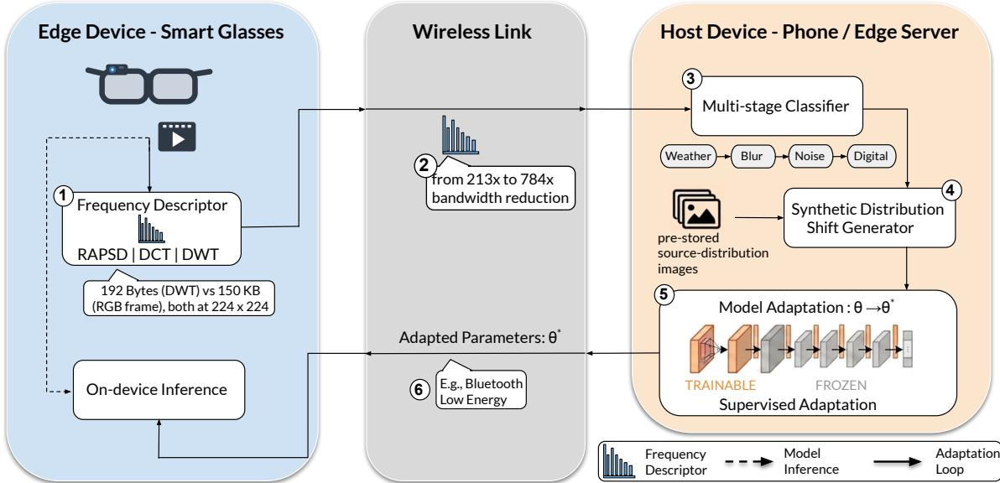  
Figure 1: System overview of the proposed bandwidth-eficient TTA framework. An edge device (i.e., Smart Glasses) computes compact frequency descriptors (RAPSD, DCT, or DWT statistics) from incoming camera frames on-device. Only these descriptors are transmitted to the host device, keeping the per-frame uplink within a low-bandwidth budget instead of streaming raw frames. The host device maps the received descriptor to a synthetic corruption distribution through a sequential pipeline of training corruptions. The host device generates synthetic corrupted data batches from locally stored in-distribution images, and adapts a model replica using a pre-defined adaptation protocol [19, 44]. Finally, the updated parameter subset is transmitted back to the edge device.

2 The descriptor ${ \bf d } _ { t }$ is transmitted to a host device (e.g., a paired phone) over a bandwidth-limited wireless link. Because the phase is discarded and the magnitude pooled, only a lossy summary of the frame leaves the device.

3 The host runs a multi-stage corruption classifier $g _ { \phi } ,$ , pre- trained on descriptors of mixtures of corruptions modeled as Directed Acyclic Graphs (DAGs), which maps, for each stage � d� to a discrete distribution $P ( c _ { s } , \ell _ { s } \mid s , \mathbf { d } _ { t } )$ over the stage’s corruptionseverity pairs, with $\ell _ { s } = 0$ as the inactive stage.

4 A synthetic distribution shift generator constructs labeled adaptation batches by composing the predicted corruptions in the camera’s image signal processing (ISP) order over a set of indistribution pre-stored data (Sec. 4.2).

5 The host device adapts a replica of $f _ { \theta }$ using the synthetic data by minimizing a pre-defined supervised loss over the compact parameter subspace of Sec. 4.3, while all other model parameters remain frozen.

6 The adapted parameters $\theta ^ { * }$ are transmitted back to the smart glasses, which replace the corresponding parameters in their local replica $f _ { \theta } ,$ completing the adaptation cycle. Since only a parameter subset is exchanged, the update payload remains small enough for bandwidth-constrained links such as Bluetooth Low Energy.

## 4 Methodology

## 4.1 Frequency Descriptors

Radially Averaged Power Spectral Density (RAPSD). The Radially Averaged Power Spectral Density [42] characterizes the global distribution of signal energy across spatial frequencies. We compute RAPSD by applying a two-dimensional Fast Fourier Transform to the input image and averaging the power spectral density within concentric rings of increasing radius from the zero-frequency (DC) component, normalized by the number of pixels. This maps the two-dimensional spectrum to a compact one-dimensional vector of length �/2 (for an � × � input), where each index corresponds to a spatial frequency band. $\operatorname { B y }$ explicitly discarding phase and directional magnitude information, this representation becomes rotation-invariant.

Discrete Cosine Transform Statistics (DCT). The Discrete Cosine Transform [1] descriptor relies on the block-based frequency decomposition found in standard image compression pipelines (i.e., JPEG, MPEG) [43]. We partition the input image into non-overlapping 8 × 8 blocks and apply the two-dimensional DCT-II to each block via separable matrix multiplication using an orthonormal basis, and aggregate the coeficients across all blocks into the mean absolute value and standard deviation for each frequency index. This de- scriptor can be computed from the codec’s pipeline. In contrast to RAPSD, this block-wise approach captures direction-specific texture signatures.

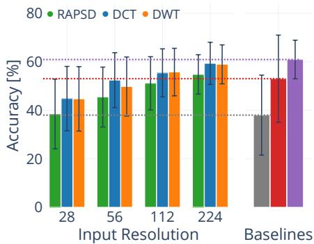  
(a) ConvNeXtV2-Femto.

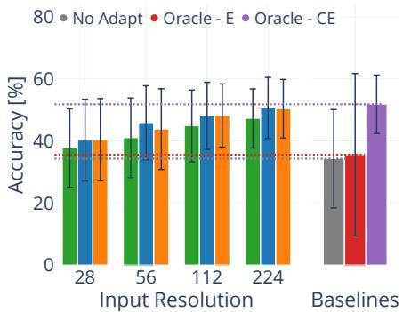  
(b) DeiT-Tiny.

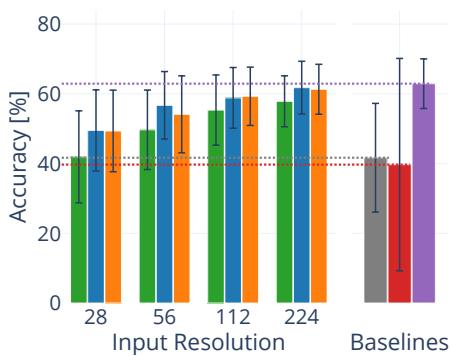  
(c) TinyViT-5M.

Figure 2: Per-architecture accuracy across four input resolutions (28, 56, 112, 224), reported for each frequency descriptor (RAPSD, DCT and DWT). NFJF is compared against three resolution-independent references: No Adapt and Oracle - E baselines and the Oracle - CE empirical upper bound. Bars report the mean over the 63 test DAGs of ImageNet-C; error bars indicate ±�. Oracle - E accuracy markedly improves on NoAdapt only for ConvNeXtV2-Femto and destabilizes on DeiT-Tiny and TinyViT-5M, confirming the fragility of unsupervised entropy-based adaptation under distribution shift. NFJF accuracy improves on No Adapt across all three architectures for resolutions > 28 and it surpasses Oracle - E at all resolutions on DeiT-Tiny and TinyViT 5M. For ConvNeXtV2-Femto, NFJF mostly surpasses Oracle - E at 112 and 224 input resolutions.  
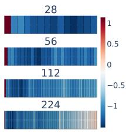  
(a) RAPSD

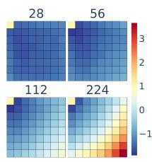  
(b) DCT

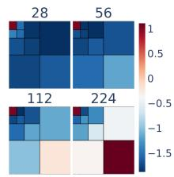  
(c) DWT  
Figure 3: Descriptor visualizations under a sample DAG (brightness → shot noise → contrast, each at severity 2; Section 5.1), normalized with clean-data statistics. Brightness amplifies the DC component across all descriptors and reso- lutions; shot noise amplifies high frequencies, an efect that diminishes at lower resolutions since the reduced-scale JPEG decode acts as a low-pass filter. Contrast reduces the mid- frequency bands left free by the other two corruptions.

Discrete Wavelet Transform Energy (DWT). The Discrete Wavelet Transform (DWT) captures frequency characteristics across multi-ple spatial scales [27]. We use the Haar wavelet for its computational eficiency on edge hardware [17], with three-level recursive decom-position (� = 3); at each level, the image is decomposed into the approximation (LL), horizontal (LH), vertical (HL), and diagonal (HH) detail sub-bands. We retain the three detail sub-bands (LH, HL, HH) as well as the approximation sub-band (LL), at each level. For each sub-band, we compute four statistics (mean square energy, standard deviation, mean magnitude and peak value), yielding a fixed-size descriptor of 48 dimensions (3 levels × 4 sub-bands × 4 stats), regardless of the input resolution. DWT is part of the JPEG2000 standard [36], thus these features could be extracted from existing encoder pipelines.

All descriptors are computed on a single channel (red) of the incoming frame, to which the reported payload sizes refer; Sec. 6.5 quantifies the personal information that these descriptors leak.

## 4.2 Multi-Stage Corruption Classifier

Following the causal-graph corruption synthesis protocol of [7], we model each test-time visual distribution shift as a four-stage DAG: $\mathcal { G } = ( s _ { 1 } , \ell _ { 1 } , s _ { 2 } , \ell _ { 2 } , s _ { 3 } , \ell _ { 3 } , s _ { 4 } , \ell _ { 4 } )$ , for each stage � one corruption $c _ { s } \in C _ { s }$ at severity $\ell _ { s } \in \{ 0 , 1 , 2 \}$ is sampled. The four stages follow the family sequence K = {Weather, Blur, Noise, Digital} following [7], mimicking the chronological order in which real-world visual degradations arise [46].

Architecture. The classifier $g _ { \phi }$ is a multi-head MLP: a shared feature extractor of three fully connected layers followed by one linear head per stage. The head of stage � outputs a distribution over the stage’s corruption-severity pairs plus an inactive-stage class, yielding 3, 5, 9, and 7 classes for the four stages of Table 1. Descriptors are standardized with the statistics computed on the training split. Since the four stages difer in the number of predicted classes and in dificulty, their cross-entropy losses are combined through task-uncertainty weighting [15] rather than a plain sum, avoiding manual tuning of the four loss coeficients. One classifier is trained per descriptor type and input resolution using the same training configuration: AdamW, 100 epochs, learning rate 5×10−4, weight decay 10−4, batch size 200, and a fixed random seed. The sensitivity of the adaptation gain to this seed is reported in Sec. 6.2.

Synthetic Mixture of Corruptions Pipeline. The host maintains a pre-stored labeled set of clean adaptation images. This set is drawn from a range of validation indices strictly disjoint from the descriptor-training, descriptor-test and evaluation pools (Sec. 5.1), preventing data leakage. Given a clean image $f _ { c l e a n }$ and the pre- dicted per-stage corruption-severity distribution from the pre-trained classifier, the synthetic corrupted image is generated by chaining each predicted corruption operator in sequential order. Formally:

Table 1: Four-stage ISP corruption DAG. Each DAG is re- stricted to one corruption per node drawn from the disjoint set $C _ { s } .$ a subset of ImageNet-C [11] corruptions following [7]. Each sample composes one corruption from each stage in the high-order degradation sequence following [46].
<table><tr><td>Stage</td><td>Role</td><td>Pool  $C _ { s }$ </td><td>|Cs|</td></tr><tr><td> $S _ { 1 }$ </td><td>Weather</td><td>{brightness}</td><td>1</td></tr><tr><td> $S _ { 2 }$ </td><td>Blur</td><td>{defocus, gaussian} blur</td><td>2</td></tr><tr><td> $S _ { 3 }$ </td><td>Noise</td><td>{gaussian, shot, speckle, impulse} noise</td><td>4</td></tr><tr><td> $S _ { 4 }$ </td><td>Digital</td><td>{saturate, pixelate, contrast}</td><td>3</td></tr></table>

$$
f _ { \mathrm { s y n t h } } = ( { \tilde { C } } _ { K } \circ { \tilde { C } } _ { K - 1 } \circ \cdot \cdot \cdot \circ { \tilde { C } } _ { 1 } ) ( f _ { \mathrm { c l e a n } } )\tag{1}
$$

where ◦ denotes function composition, and $\tilde { C } _ { k }$ is the conditional corruption operator for the �-th stage.

## 4.3 Source-Assisted Adaptation Protocol

Our proposed bandwidth-eficient adaptation strategy is based on the TENT framework [44], which adapts a model to data distri bution shifts by updating only the afine parameters, � and $\beta ,$ of the normalization layers, while the other parameters remain fixed. TENT minimizes the prediction entropy on the test data on-the-fly, operating under the assumption that confident predictions correlate with test-time accuracy. The entropy loss $\mathcal { L } _ { e n t }$ is defined as:

$$
\mathcal { L } _ { e n t } ( \hat { y } ) = - \sum _ { c } p ( \hat { y } _ { c } ) \log p ( \hat { y } _ { c } )\tag{2}
$$

where $\boldsymbol { p } ( \boldsymbol { \hat { y } } _ { c } )$ is the model’s predicted probability for class �. En- tropy minimization can, however, be unstable, leading to model collapse [32]. Since the host synthesizes the corrupted batches from pre-stored, labeled in-distribution data, ground-truth labels $y ^ { t }$ are available during adaptation, which enables the substitution of the unsupervised entropy loss with the cross-entropy loss:

$$
\mathcal { L } _ { c e } ( x ^ { t } , y ^ { t } ) = - \sum _ { c } y _ { c } ^ { t } \log p ( \hat { y } _ { c } )\tag{3}
$$

The cross-entropy loss yields a stronger supervisory signal than entropy minimization, which relies solely on prediction confidence and ignores class correctness [10], and it does not admit the degen erate constant-prediction solution into which the entropy objective can collapse under severe distribution shift [32], an instability we observe for the entropy-based Oracle - E baseline (Fig. 2). Leveraging the stability of the supervised objective, we extend the adapted parameter set to include the first block of each model [19], which increases the adaptation accuracy gain: at 224 resolution, removing the first block from this subspace costs 3.66±3.19, 3.17±2.43 and 1.15±2.22 pp on ConvNeXtV2-Femto, DeiT-Tiny and TinyViT-5M, and removing the normalization afine parameters costs 1.73±1.02, 1.07±0.48 and 2.96±1.41 pp; every entry is a mean (±�) over the three descriptors and the 63 test DAGs.

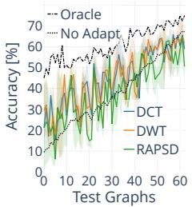

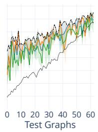

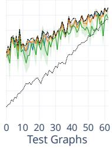

ConvNeXtV2-Femto.  
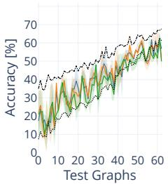

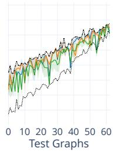

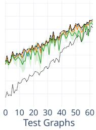

DeiT-Tiny.  
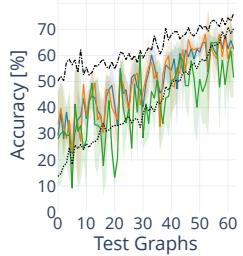

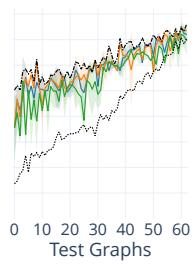

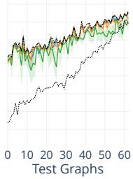  
TinyViT-5M.  
Figure 4: Adaptation accuracy for three architecture paradigms with increasing input resolutions across $G _ { t e s t } .$ Left to right: 28, 112, 224 input resolutions. The frequency descriptors DCT, DWT, and RAPSD (Section 4.1) are compared against the No Adapt and the Oracle baselines. The test graphs are sorted along the x-axis in ascending order of their mean NoAdapt accuracy across all architectures. As the input resolution increases the adaptation gap of NFJF against supervised cross-entropy Oracle adaptation narrows, with fewer $G _ { t e s t }$ shifts falling below No Adapt.

## 5 Experimental Setup

## 5.1 Datasets and DAGs

The multi-stage corruption classifier, $g _ { \phi } ,$ , is trained on a set of 945 corruption mixtures, denoted as $G _ { t r a i n }$ generated via the multi-stage DAG model (Sec. 4.2). To train the classifier $\mathbf { \eta } ( \pmb { \circledast } )$ , these DAGs are ap- plied to the first image of each class within the ImageNet validation dataset [6]. Subsequently, the frequency descriptors are extracted, yielding 945,000 distinct frequency signatures per classifier. This process is repeated for every input resolution and descriptor type.

The test DAGs (denoted as $G _ { t e s t } )$ are a subset of the training mixtures $( G _ { t e s t } \subset G _ { t r a i n } ) ;$ ; moreover to generate the evaluation data for the classifier, $G _ { t e s t }$ is applied to the second image of each class. This ensures a strict train-test descriptor separation while remaining within the trained corruption-mixture distribution.

## 5.2 Adaptation Protocol

Ultimately, $G _ { t e s t }$ evaluates both the corruption classifier and the end-to-end adaptation pipeline performance. For the end-to-end evaluation, we partition the ImageNet validation dataset [6] into datasets drawn from two disjoint image sets:

$D _ { e v a l } ^ { t r u e } ;$ : Formed by applying the ground-truth corruption graphs from $G _ { t e s t }$ to the 3rd to 12th image of each class. This yields 10,000 images per graph, totaling 630,000 images.

$D _ { s y n t h } ^ { p r e d } \colon$ : Constructed by applying the classifier’s predicted corruptions to the 13th through 50th images of each class. This results in 38,000 images per graph, yielding a total of 2,394,000 images. The oracle baselines instead adapt on $D _ { s y n t h } ^ { t r u e }$ produced by the same synthesis pipeline using the ground-truth test DAG instead of the predicted one; these two datasets difer only in the applied corruption graph.

This partitioning strictly separates the evaluation data $( D _ { e v a l } ^ { t r u e } )$ from the synthetic adaptation data $( D _ { s y n t h } ^ { p r e d }$ and $D _ { s y n t h } ^ { t r u e } )$ . The end- to-end adaptation is executed independently for each test DAG, re-initializing each model to its pre-trained parameters. For every test DAG and descriptor configuration, the full adaptation cycle is executed three times with independently sampled descriptors and synthetic batches. For each test DAG the reported value is the mean over these three repetitions; the error bars in all figures indicate the standard deviation of these means across the 63 test DAGs.

## 5.3 Evaluation Baselines

No Adapt (Source-Only). The pre-trained model $f _ { \theta }$ is evaluated on the corrupted evaluation data $D _ { e v a l } ^ { t r u e }$ without any parameter update. This baseline quantifies the accuracy degradation induced by the distribution shift and provides the common reference for the accuracy gain of every adaptation method considered.

Oracle - E (Entropy Minimization). Following Wang et al. [44], we minimize the entropy of the model’s softmax predictions on $D _ { s u n t h } ^ { t r u e } ,$ matching the adaptation budget of Oracle - CE. In line with the adaptation used in our method, the afine parameters of the normalization layers (� and $\beta ) ,$ , as well as the first block [19], are adapted, while all other parameters remain frozen. This base- line serves as the reference for on-device unsupervised adaptation and requires access to all the corrupted data, unrealistic for edge deep learning inference frameworks, which lack gradient computa- tion [23].

Oracle - CE (Supervised Cross Entropy). The Oracle adapts the model on $D _ { s y n t h } ^ { t r u e }$ using ground-truth labels via cross-entropy loss $( \operatorname { E q } . 3 ) ;$ , updating afine parameters of the normalization layers, as well as the model’s first block [19]. Since it has access to both the ground-truth DAG and the corresponding labels, Oracle - CE serves as the empirical upper bound on the adaptation gain within our adaptation framework, and its gap to NFJF isolates the impact of predicting the corruption graph at test time. For the object detection task, the supervised oracle’s adaptation loss (Oracle - CE + Reg.) contains, in addition to the cross-entropy term, the bounding-box regression term, which penalizes the localization error between the predicted and the ground-truth bounding boxes.

## 5.4 Experiments

Architectures. To assess the scalability of the framework across diferent classification models, we evaluate three architectures that span convolution, self-attention and hybrid designs: (i) ConvNeXtV2- Femto [47], a fully convolutional backbone with Layer Normalization; (ii) DeiT-Tiny [41], a Vision Transformer backbone; (iii) TinyViT-5M [48], a hybrid convolution-transformer backbone using Batch Normalization in its convolution layers and Layer Normaliza tion in its self-attention layers. All models contain approximately five million parameters, so that accuracy diferences across the three paradigms reflect architectural design rather than scale. Fol- lowing Lee et al. [19], we use Adam [16], learning rate $1 0 ^ { - 4 }$ , weight decay 10−4 and batch size 64.

Resolution Scaling. Since the cost of computing the descrip- tors depends on the input resolution, we evaluate for each test graph the impact of diferent input resolutions on the adaptation accuracy gain. Each corrupted frame is re-encoded in memory as a JPEG at the maximum quality factor (�=100) and decoded directly at 1/8, 1/4, or $1 / 2$ in the DCT domain with the TJpgDec library [18], mirroring the reduced-scale decode of embedded JPEG decoders; the maximum-quality setting minimizes compression artifacts. This spatial reduction acts as a low-pass filter (Fig. 3): the shot noise signature progressively diminishes as the resolution decreases, whereas contrast and brightness, which perturb the mid-to-low bands and the zero-frequency (DC) component, remain visible at every resolution scale.

## 5.5 Person Classification and Object Detection

Person Classification. We port the framework without modifi- cations to Visual Wake Words [3] (VWW), a binary person/no-person classification task, with a MobileNetV1 (� = 0.25, 96 × 96 input) [13]. The fractional split of Sec. 5.1 applied per class yields disjoint descriptor-classifier training (810) and test (810) datasets, an evaluation dataset of 8,101 images and an adaptation dataset of 30,783 images. The same 63 test DAGs are used, the descriptor resolutions follow the 96 input-halving chain {24, 48, 96}, and the baselines of Sec. 5.3 are reported at resolution 96. This task serves the privacy leakage analysis of Sec. 6.5.

Object Detection. We further port the framework to object detection on MS-COCO [24] with two models: SSDLite-MobileNetV3- Large [12] (3.4M parameters, $3 2 0 ^ { 2 }$ input) and YOLOX-Tiny [9] (5.1M parameters, $4 1 6 ^ { 2 }$ input). We draw all the partition datasets from val2017, since the released weights are trained on train2017. The 5,000 images are partitioned using the fractional split of Sec. 5.1. Since the corruptions of Eq. (1) are pixel-level operations that leave the image geometry unchanged, the adaptation dataset groundtruth boxes remain valid labels for the synthesized batches. The supervised Oracle is the Oracle - CE + Reg. variant of Sec. 5.3. The adapted subspace mirrors the classification one; we use Adam with learning rate $1 0 ^ { - 4 }$ , batch size 16 and a single epoch. We report the COCO box mAP[.50:.95] [24] computed on the evaluation dataset.

Table 2: Framework generality across person classification and object detection. Entries report the mean (box mAP on MS-COCO; accuracy [%] on Visual Wake Words) per-DAG paired gain (±�) over the 63 test DAGs. The No Adapt row reports the absolute performance under shift, the common reference of every adaptation gain. The best per-column adaptation gain is reported in bold. The trends observed in Fig. 2 persist: every adaptation gain is positive and approaches the supervised Oracle as the resolution increases, whereas Oracle - E (VWW) collapses below No Adapt.
<table><tr><td></td><td colspan="4">SSDLite320-MNv3-L</td><td></td><td colspan="3">YOLOX-Tiny</td><td colspan="3">MobileNetV1-0.25, VWW</td></tr><tr><td>No Adapt Oracle</td><td colspan="4">7.4±5.1</td><td colspan="4">8.8±7.1  $+ 8 . 3 { \pm } 2 . 2 \ : \mathrm { ( C E + R e g . ) }$ </td><td colspan="3">65.3±4.2  $+ 9 . 1 \pm 3 . 2 \ ( \mathrm { C E } ) ; - 2 . 6 \pm 4 . 2 \ ( \mathrm { E } )$ </td></tr><tr><td></td><td></td><td> $+ 4 . 7 { \pm } 1 . 4 \ : \mathrm { ( C E + R e g . ) }$ </td><td></td><td></td><td></td><td></td><td></td><td></td><td></td><td></td><td></td></tr><tr><td>Input Resolution</td><td>40</td><td>80</td><td>160</td><td>320 一</td><td>52</td><td>104</td><td>208</td><td>416</td><td>一 24</td><td>48</td><td>96</td></tr><tr><td>RAPSD</td><td> $+ 1 . 6 { \pm } 1 . 9$ </td><td> $+ 2 . 0 { \pm } 1 . 6 $ </td><td> $+ 2 . 6 { \pm } 1 . 8$ </td><td> $+ 3 . 7 { \pm } 1 . 4 $ </td><td>+3.3±3.1</td><td>+4.8±2.5</td><td>+5.4±2.8</td><td> $+ 6 . 8 { \pm } 2 . 2 $ </td><td> $+ 4 . 3 { \pm } 3 . 4 $ </td><td>+5.8±3.5</td><td>+5.8±3.7</td></tr><tr><td>DCT DWT</td><td> $+ 2 . 1 { \pm } 1 . 5$   $+ 1 . 6 { \pm } 1 . 8$ </td><td> $+ 2 . 8 { \pm } 1 . 6 $   $+ 2 . 9 { \pm } 1 . 8$ </td><td> $+ 3 . 4 { \pm } 1 . 7 $   $+ 3 . 9 { \pm } 1 . 8$ </td><td> $+ 4 . 4 { \pm } 1 . 5$   $+ 4 . 4 { \pm } 1 . 5$ </td><td>+4.5±2.1  $+ 4 . 6 { \pm } 2 . 8$ </td><td> $+ 6 . 1 { \pm } 2 . 9$   $+ 5 . 8 { \pm } 2 . 4 $ </td><td> $+ 6 . 9 { \pm } 2 . 5 $   $+ 7 . 0 { \pm } 2 . 6 $ </td><td> $+ 8 . 0 { \pm } 2 . 4 $   $+ 8 . 1 { \pm } 2 . 3$ </td><td> $+ 5 . 8 { \pm } 3 . 6 $   $+ 6 . 4 { \pm } 3 . 2 $ </td><td> $+ 6 . 5 { \pm } 3 . 2 $   $+ 7 . 1 { \pm } 3 . 4 $ </td><td>+7.5±3.2 +7.5±3.8</td></tr></table>

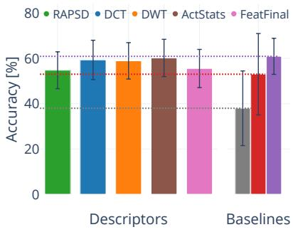  
(a) ConvNeXtV2-Femto.

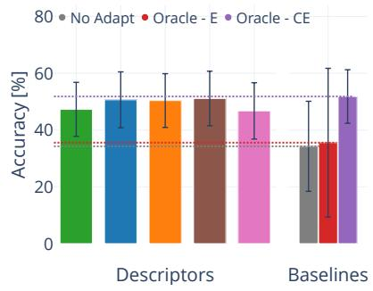  
(b) DeiT-Tiny.

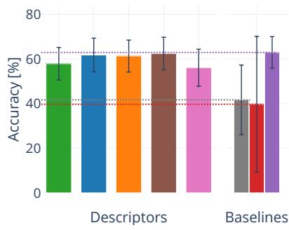  
(c) TinyViT-5M.  
Figure 5: Descriptors ablation at 224 input resolution: the NFJF adaptation loop re-run with the frequency descriptor replaced by the model-based alternatives. ActStats denotes the first layer and block activation statistics and FeatFinal the pooled pre-logits embedding. Same layout as Fig. 2. ActStats attains the highest adaptation accuracy, improving on DCT by 0.67 pp on average and approaching Oracle - CE within 0.71 pp. This adaptation gain costs on average 2.3× the DCT payload (a fixed 708 B versus architecture-dependent 768–3072 B). Computing ActStats requires executing the deployed model’s first layer and block, ≈ 100× the number of DCT FLOPs (∼ 150-180 versus 1.6 MFLOPs), whereas the frequency descriptors need no model execution.

## 6 Results

## 6.1 Adaptation Across Architectures and Resolutions

On ImageNet-C (Fig. 2, Fig. 4), we observe that NFJF recovers most of the supervised oracle adaptation gain. At the native 224 descrip- tor resolution, the strongest descriptor (DCT) recovers 93.1% of the gain on ConvNeXtV2-Femto (59.34% versus Oracle - CE 60.91%, from a No Adapt accuracy of 37.99%), 93.3% on DeiT-Tiny, and 94.7% on TinyViT-5M. In contrast, Oracle - E, despite consuming the full corrupted stream $( D _ { s y n t h } ^ { t r u e } ) _ { : }$ , reports a notable adaptation gain only on the convolution architecture and shows adaptation collapse in the self-attention and hybrid architectures, the known degen- eracy of the entropy objective into a trivial constant-prediction solution [31, 32]. For every architecture the adaptation gains grow monotonically with the descriptor resolution (Fig. 2).

## 6.2 Classifier Seed Sensitivity

We train two additional corruption classifiers per descriptor and in put resolution with diferent random seeds and repeat the ImageNet- C adaptation loop with each classifier on one transmitted descriptor per test DAG. We observe that the three classifiers predict the same

DAG in 4% of the test cases at resolution 28 and in 59% at 224, whereas the standard deviation of the post-adaptation accuracy across the three classifiers (4.4, 3.4, 1.6 and 0.7 pp at 28, 56, 112 and 224) falls below the standard deviation across the three transmitted descriptors of the same DAG (7.3, 5.2, 3.8 and 2.5 pp; Sec. 4.1). The adaptation gain increases monotonically with the resolution for every classifier; thus the trends observed in Fig. 2 do not depend on the classifier seed, and the transmitted frame, rather than the classifier, is the major source of adaptation variability.

## 6.3 Task Generality

Person Classification. On VWW (Table 2), we observe that NFJF improves the corrupted data accuracy from 65.3% to 72.80% (DWT at 96 resolution), closing 82% of the 9.1% adaptation gain of Oracle - CE, whereas Oracle - E falls below No Adapt. We note that the binary task compresses the adaptation gap range: the accuracy under shift is bounded by No Adapt at 65.3% on average, thus the margin recoverable through adaptation is correspondingly small. We believe the fraction of the NFJF versus oracle adaptation gap is therefore a more informative statistic than the adaptation gain.

Object Detection. On MS-COCO (Table 2), we observe that NFJF improves box mAP from 7.4 to 11.8 on SSDLite320 (DWT at 320 input resolution), against an oracle adaptation accuracy of 12.1 (93.6% of the achievable gain), and from 8.8 to 16.9 on YOLOX-Tiny against 17.1 (97%). The adaptation gap closure is highest on detection compared to classification, consistent with the denser per- image supervision detection objective (i.e., per-anchor classification and regression ground-truth boxes).

## 6.4 Descriptor Ablation

To isolate the contribution of the frequency descriptor, we re-run the adaptation loop at the native 224 resolution with the descriptor replaced by model-based alternatives (Fig. 5): ActStats, the first layer and block activation statistics, and FeatFinal, the pre-logits embedding. We observe that ActStats attains the highest adaptation accuracy on every architecture, improving on DCT by 0.67 pp on average and approaching Oracle - CE to within 0.63 pp on average, whereas FeatFinal falls below DCT and DWT on every architecture, 5.1 pp below ActStats on average: the corruption DAG is better identified from the low-level spectral content preserved by the first layers rather than from the pre-logits embedding. We believe the frequency descriptors remain the better choice under deployment constraints, since the 0.67 pp adaptation increase of ActStats costs on average 2.3× the DCT payload and ≈ 100× its FLOPs.

## 6.5 Privacy Leakage Analysis

We consider an eavesdropper on the wireless uplink that observes only the transmitted frequency descriptors. We measure the leak- age with a classifier that predicts a sensitive attribute, the person-presence label of VWW, from the single descriptor [26]. We split the descriptor-classifier test images into training and test (80:20), apply the 63 test DAGs, train a logistic regression, a gradient-boosted tree and an MLP classifier. We repeat the split five times and report the mean (±�) of the most accurate of the three classifiers. We use the balanced accuracy, i.e., the mean of the person and no-person accu-racies, since VWW is not a balanced dataset. We observe that the most accurate eavesdropper obtains 58.5±2.4% (DCT at resolution 48), thus the descriptors carry a weak person-presence signal rather than disclosing the attribute. We note that the leakage is lowest at the lowest descriptor resolution for every descriptor and that it sat- urates as the resolution grows: averaged over the three descriptors, raising the resolution from 24 to 48 increases the adaptation gain by 1.0 pp and the leakage by 1.3 pp, whereas raising it from 48 to 96 increases the gain by 0.4 pp and the leakage by only 0.3 pp. We believe the descriptor resolution therefore trades adaptation gain for leakage mainly at the lowest resolutions range.

## 6.6 Adaptation Latency on Smart Glasses

We measure the end-to-end latency of the adaptation loop on a Seeed Grove Vision AI V2 board (Himax WiseEye2, Cortex-M55), the processor class of the Brilliant Labs Halo smart glasses [2], running the VWW MobileNetV1 architecture as an int8 model [5]. Over 10 adaptation runs (DCT resolution 96, laptop CPU host), one adaptation requires 85±9 s: the synthesis of the image adaptation set (41±3 s) and the cross-entropy forward-backward pass (44±7 s) account for 98% of the time. The descriptor computation, the update of the adapted subspace in SRAM and the first adapted inference require 38 ms on the device. The transfer of the 708 B descriptor and of the 22 kB update requires 0.14 s at the 1.32 Mbit/s measured for BLE 5 [45]. On a Samsung Galaxy S23 (Snapdragon 8 Gen 2) using four CPU cores, the host passes require 84±9 s and 218±7 s over 5 runs. The energy consumption of the host stages and their mobile GPU implementation, for which to the best of our knowledge no of-the-shelf framework exists, are left for future work.

## 7 Discussion

This paper analyzes whether deployment-time model adaptation for smart glasses can be driven by compact frequency descriptors instead of transmitted camera frames. NFJF recovers most of the accuracy gain of supervised adaptation across six backbones and three tasks: it closes 82% of the oracle adaptation gap on VWW, 93% − 95% on ImageNet, and 94% − 98% on MS-COCO detection (Fig. 2, Table 2), while the per-frame uplink never exceeds 832 B. In contrast, the entropy minimization (Oracle - E) destabilizes on the self-attention and hybrid ImageNet architectures and on VWW.

Outlook. There are several directions to extend this work. First, the adaptation loop consumes each test DAG independently, re- initialized from the pre-trained parameters; extending it to DAGs that drift over time would move the framework to a continual set- ting. Second, the descriptor resolution trades adaptation accuracy against uplink bandwidth; a controller that dynamically selects this resolution per-shift and available computational resources could lower the average uplink overhead without sacrificing adaptation accuracy on the hardest DAGs. Third, since progressive JPEG delivers the DCT DC coeficient of each 8 × 8 block in the first decode pass [43], the edge device can compute the lowest-resolution descriptor and transmit it while the frame is decoding, overlapping the host adaptation with the remaining decode.

Limitations. First, the figures and tables use a single classifier seed; Sec. 6.2 shows that the standard deviation of the post- adaptation accuracy across classifier seeds falls below the standard deviation across transmitted descriptors at every resolution. Second, the adaptation loop reproduces only corruptions from the modeled ten-operator DAG family (Table 1): a shift outside this family (e.g., motion blur or fog) is mapped to the most similar modeled DAG in the descriptor space, thus the host adapts on a diferent corruption. We expect part ofthe adaptation gain when similar frequency bands are altered and an accuracy below No Adapt otherwise, as for the incorrectly predicted test DAGs at resolution 28 (Fig. 4). Filtering unreliable stage predictions and extending the corruption family remain future work. Third, whether the adaptation loop transfers to vision-language models increasingly deployed on smart glasses [25] is untested. We hope this work sparks interest in adaptation systems that communicate compact frequency descriptors rather than camera frames, narrowing the gap between bandwidth-eficient and continuous model adaptation.

## Acknowledgments

This research was funded in whole, or in part, by the Austrian Science Fund (FWF) [10.55776/DFH5]. For the purpose of open access, the author has applied a CC BY public copyright license to any Author Accepted Manuscript version arising from this submission. The computational results have been achieved using the Austrian Scientific Computing (ASC) infrastructure.

## References

[1] Nasir Ahmed, T Natarajan, and K R Rao. 1974. Discrete Cosine Transform. IEEE Trans. Comput. C-23, 1 (1974), 90–93.

[2] Brilliant Labs. 2026. Halo Hardware. https://docs.brilliant.xyz/halo/hardware.

[3] Aakanksha Chowdhery, Pete Warden, Jonathon Shlens, Andrew Howard, and Rocky Rhodes. 2019. Visual wake words dataset. arXiv preprint arXiv:1906.05721 (2019).

[4] Francesco Corti, Balz Maag, Joachim Schauer, Ulrich Pferschy, and Olga Saukh. 2026. REDS: Resource-Eficient Deep Subnetworks for Dynamic Resource Constraints . IEEE Transactions on Mobile Computing 25, 01 (Jan. 2026), 451–465. doi:10.1109/TMC.2025.3594214

[5] Robert David, Jared Duke, Advait Jain, Vijay Janapa Reddi, Nat Jefries, Jian Li, Nick Kree er, Ian Na ier, Me hna Natraj, Shlomi Re ev, Rock Rhodes, Tiezhen Wang, and Pete Warden. 2020. TensorFlow Lite Micro: Embedded Machine Learning on TinyML Systems. arXiv:2010.08678 [cs.LG]

[6] Jia Deng, Wei Dong, Richard Socher, Li-Jia Li, Kai Li, and Li Fei-Fei. 2009. Imagenet: A lar e-scale hierarchical ima e database. In CVPR. Ieee, 248–255.

[7] Nathan Drenkow, William Paul, Chris Ribaudo, and Mathias Unberath. 2026. Causalit -driven audits of model robustness. In IEEE/CVF Winter Conference on Applications ofComputer Vision. 5956–5966.

[8] Yaroslav Ganin and Victor Lempitsky. 2015. Unsupervised domain adaptation by backpropagation. In International conference on machine learning. PMLR.

[9] Zheng Ge, Songtao Liu, Feng Wang, Zeming Li, and Jian Sun. 2021. Yolox: Exceedin olo series in 2021. arXiv preprint arXiv:2107.08430 (2021).

[10] Yves Grandvalet and Yoshua Bengio. 2004. Semi-supervised learning by entropy minimization. Advances in neural information processing systems 17 (2004).

[11] Dan Hendr cks and Thomas Dietterich. 2019. Benchmarkin Neural Network Robustness to Common Corruptions and Perturbations. In ICLR.

[12] Andrew Howard, Mark Sandler, Grace Chu, et al. 2019. Searching for mobilenetv3. In ICCV. 1314–1324.

[13] Andrew G Howard, Menglong Zhu, Bo Chen, Dmitry Kalenichenko, et al. 2017. MobileNets: Eficient Convolutional Neural Networks for Mobile Vision Applica tions. arXiv preprint arXiv:1704.04861 (2017). https://arxiv.org/abs/1704.04861

[14] Iason Karakostas et al. 2024. A real-time wearable AR system for egocentric vision on the ed e. Virtual Reality 28 (2024) 44. doi:10.1007/s10055-023-00937-2

[15] Alex Kendall, Yarin Gal, and Roberto Cipolla. 2018. Multi-task learning using uncertainty to weigh losses for scene geometry and semantics. In IEEE conference on computer vision and pattern recognition. 7482–7491.

[16] Diederik P Kingma and Jimmy Ba. 2014. Adam: A method for stochastic opti mization. arXiv preprint arXiv:1412.6980 (2014).

[17] Jaromir Konecny, Jan Choutka, Radim Hercik, Jiri Koziorek, Dangirutis Navikas, Darius Andriukaitis and Michal Prauzek. 2024. Com utational Cost and Im le mentation Analysis of a Wavelet-Based Edge Computing Method for Energy Harvesting Industrial IoT Sensors. IEEE Access (2024).

[18] Patrick Krumpl, Francesco Corti, Dong Wang, and Olga Saukh. 2026. Deploy ing TinyML on Commercial Smart Glasses. In 2026 International Conference on Embedded Wireless Systems and Networks. 267–272.

[19] Yoonho Lee, Annie S Chen, Fahim Tajwar, Ananya Kumar, Huaxiu Yao, Percy Liang, and Chelsea Finn. 2023. Surgical Fine-Tuning Improves Adaptation to Distribution Shifts. In The Eleventh International Conference on Learning Representations. https://openreview.net/forum?id=APuPRxjHvZ

[20] Jian Liang, Ran He, and Tieniu Tan. 2025. A Comprehensive Survey on Test-Time Adaptation Under Distribution Shifts. International Journal ofComputer Vision 133 (2025), 31–64.

[21] Jian Liang, Dapeng Hu, and Jiashi Feng. 2020. Do we really need to access the source data? Source hypothesis transfer for unsupervised domain adaptation. In International conference on machine learning. PMLR, 6028–6039.

[22] Guoliang Lin, Hanjiang Lai, Yan Pan, and Jian Yin. 2023. Improving entropy-based test-time adaptation from a clustering view. arXiv:2310.20327 preprint (2023).

[23] Ji Lin, Ligeng Zhu, Wei-Ming Chen, Wei-Chen Wang, and Song Han. 2023. Tiny machine learning: progress and futures [feature]. IEEE Circuits and Systems Magazine 23, 3 (2023), 8–34.

[24] Tsung-Yi Lin, Michael Maire, Serge Belongie, James Hays, Pietro Perona, Deva Ramanan, Piotr Dollár, and C Lawrence Zitnick. 2014. Microsoft coco: Common objects in context. In European conference on computer vision. Springer, 740–755.

[25] Zhijian Liu, Ligeng Zhu, Baifeng Shi, Zhuoyang Zhang, Yuming Lou, Shang Yang, Haocheng Xi, Shiyi Cao, Yuxian Gu, Dacheng Li, et al. 2025. Nvila: Eficient frontier visual language models. In IEEE/CVF Conference on Computer Vision and Pattern Recognition. 4122–4134.

[26] Mohammad Malekzadeh, Richard G Clegg, Andrea Cavallaro, and Hamed Haddadi. 2019. Mobile sensor data anonymization. In International conference on internet ofthings design and implementation. 49–58.

[27] S.G. Mallat. 1989. A theory for multiresolution signal decomposition: the wavelet representation. IEEE Transactions on Pattern Analysis and Machine Intelligence 11, 7 (1989), 674–693. doi:10.1109/34.192463

[28] Massimiliano Mancini, Samuel Rota Bulo, Barbara Caputo, and Elisa Ricci. 2019. Adagraph: Unifying predictive and continuous domain adaptation through graphs.

In IEEE/CVF Conference on Computer Vision and Pattern Recognition. 6568–6577.

[29] Brendan McMahan, Eider Moore, Daniel Ramage, Seth Hampson, and Blaise Aguera y Arcas. 2017. Communication-eficient learning of deep net works from decentralized data. In AISTATS. 1273–1282.

[30] Shuaicheng Niu, Guohao Chen, Peilin Zhao, Tianyi Wang, Pengcheng Wu, and Zhiqi Shen. 2025. Self-Bootstrapping for Versatile Test-Time Adaptation. arXiv preprint arXiv:2504.08010 (2025).

[31] Shuaicheng Niu, Jiaxiang Wu, Yifan Zhang, Zhiquan Wen, Yaofo Chen, Peilin Zhao, and Mingkui Tan. 2023. Towards Stable Test-Time Adaptation in Dynamic Wild World. In ICLR.

[32] Ori Press, Ravid Shwartz-Ziv, Yann LeCun, and Matthias Bethge. 2024. The Entropy Enigma: Success and Failure of Entropy Minimization. In ICML.

[33] Joaquin Quiñonero-Candela, Masashi Sugiyama, Anton Schwaighofer, and Neil D Lawrence. 2008. Dataset shift in machine learning. The MIT Press.

[34] Olga Saukh, Dong Wang, Xiaoxi He, and Lothar Thiele. 2023. Representing Input Transformations by Low-Dimensional Parameter Subspaces. arXiv preprint arXiv:2305.13536 (2023).

[35] Weisong Shi, Jie Cao, Quan Zhang, Youhuizi Li, and Lanyu Xu. 2016. Edge computing: Vision and challenges. IEEE Internet of Things Journal 3, 5 (2016).

[36] A. Skodras, C. Christopoulos, and T. Ebrahimi. 2001. The JPEG 2000 still image compression standard. IEEE Signal Processing Magazine 18, 5 (2001), 36–58. doi:10.1109/79.952804

[37] Georg Slamanig, Francesco Corti, and Olga Saukh. 2025. From LLMs to Edge: Parameter-Eficient Fine-Tunin on Ed e Devices. In EMERGE Workshop at the International Conference on Embedded Wireless Systems and Networking (EWSN).

[38] Zixian Su, Jingwei Guo, Kai Yao, Xi Yang, Qiufeng Wang, and Kaizhu Huang. 2024. Unraveling batch normalization for realistic test-time adaptation. In AAAI Conference on Artificial Intelligence, Vol. 38. 15136–15144.

[39] Yu Sun, Xiaolong Wang, Zhuang Liu, John Miller, Alexei Efros, and Moritz Hardt. 2020. Test-time trainin with self-su ervision for eneralization under distribution shifts. In International conference on machine learning. PMLR.

[40] Mingxing Tan and Quoc Le. 2019. Eficientnet: Rethinking model scaling for convolutional neural networks. In ICML. PMLR, 6105–6114.

[41] Hugo Touvron, Matthieu Cord, Matthijs Douze, Francisco Massa, Alexandre Sablayrolles, and Hervé Jégou. 2021. Training data-eficient image transformers & distillation through attention. In International conference on machine learning. PMLR, 10347–10357.

[42] van A Van der Schaaf and JH van van Hateren. 1996. Modelling the power spectra of natural images: statistics and information. Vision research 36, 17 (1996).

[43] Gregory K Wallace. 1992. The JPEG still picture compression standard. Commun. ACM 34, 4 (1992), 30–44.

[44] Dequan Wang, Evan Shelhamer, Shaoteng Liu, Bruno Olshausen, and Trevor Darrell. 2021. Tent: Fully Test-Time Adaptation by Entropy Minimization. In ICLR.

[45] Louis Wang. 2020. Bluetooth Low-Energy 5.0 Throughput Testing. EnGenius Technologies, https://www.engeniustech.com/technical-papers/bluetooth-low-energy.pdf.

[46] Xintao Wang, Liangbin Xie, Chao Dong, and Ying Shan. 2021. Real-ESRGAN: Training Real-World Blind Super-Resolution with Pure Synthetic Data. In International Conference on Computer Vision Workshops (ICCVW) (2021).

[47] Sanghyun Woo, Shoubhik Debnath, Ronghang Hu, Xinlei Chen, Zhuang Liu, In So Kweon, and Saining Xie. 2023. Convnext v2: Co-designing and scaling convnets with masked autoencoders. In IEEE/CVF conference on computer vision and pattern recognition. 16133–16142.

[48] Kan Wu, Jinnian Zhang, Houwen Peng, Mengchen Liu, Bin Xiao, Jianlong Fu, and Lu Yuan. 2022. Tinyvit: Fast pretraining distillation for small vision transformers. In European conference on computer vision. Springer, 68–85.

[49] Daliang Xu, Mengwei Xu, Qipeng Wang, Shangguang Wang, et al. 2022. Mandheling: Mixed-precision on-device dnn training with dsp ofloading. In Mobile Computing And Networking.

[50] Qinwei Xu, Ruipeng Zhang, Ya Zhang, Yanfeng Wang, and Qi Tian. 2021. A Fourier-based Framework for Domain Generalization. In CVPR. 14383–14392.

[51] Yongxin Yang and Timothy M Hospedales. 2014. A unified perspective on multi domain and multi-task learning. arXiv preprint arXiv:1412.7489 (2014).

[52] Yanchao Yang and Stefano Soatto. 2020. FDA: Fourier domain adaptation for semantic segmentation. In CVPR. 4085–4095.

[53] Huaxiu Yao, Caroline Choi, Bochuan Cao, Yoonho Lee, Pang Wei W Koh, and Chelsea Finn. 2022. Wild-time: A benchmark of in-the-wild distribution shift over time. Advances in Neural Information Processing Systems 35 (2022), 10309–10324.

[54] Dong Yin, Raphael Gontijo Lopes, Jon Shlens, Ekin D Cubuk, and Justin Gilmer. 2019. A fourier perspective on model robustness in computer vision. In NeurIPS

[55] Marvin Zhang, Sergey Levine, and Chelsea Finn. 2022. Memo: Test time robustness via adaptation and augmentation. Advances in neural information processing systems 35 (2022), 38629–38642.

[56] Zhi Zhou, Xu Chen, En Li, Liekang Zeng, Ke Luo, and Junshan Zhang. 2019. Edge intelligence: Paving the last mile of artificial intelligence with edge computing. IEEE 107, 8 (2019), 1738–1762.