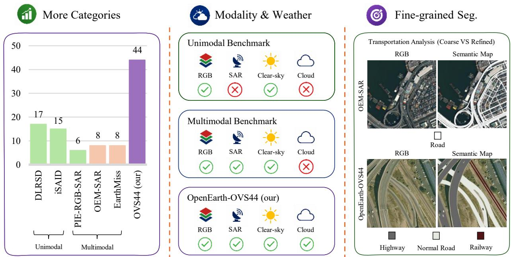
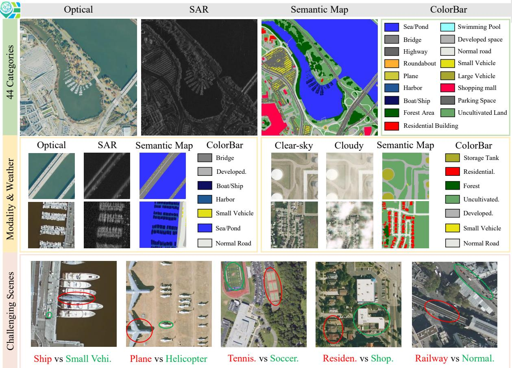
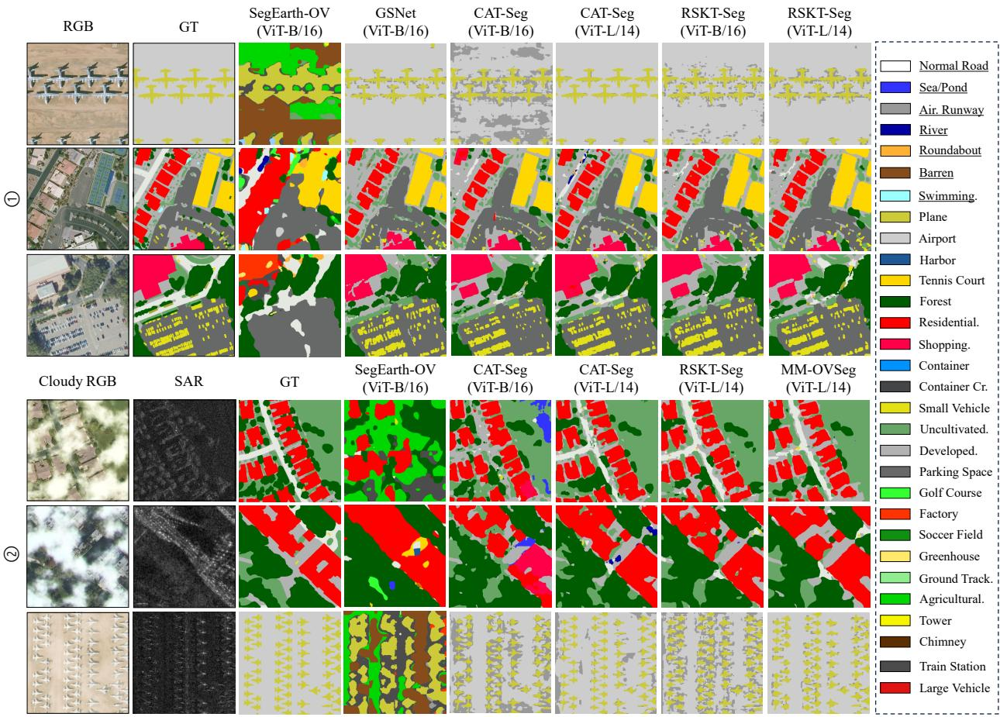
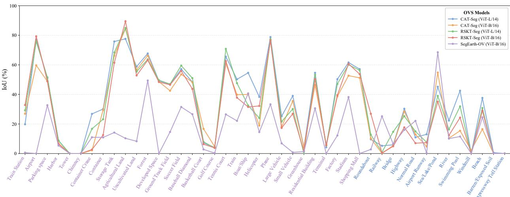

# OPENEARTH-OVS44: A MULTIMODAL REMOTE SENSING DATASET FOR OPEN-VOCABULARY SEGMENTATION

Yimin Wei1,2 Hongruixuan Chen2 Hao Zheng2 Hao Liu3

Jian Song2 Yuting Zhu4 Junshi Xia2 Naoto Yokoya1,2,†

1The University of Tokyo 2RIKEN AIP 3East China Normal University 4Tsinghua University †Corresponding author

## ABSTRACT

In remote sensing, open-vocabulary segmentation is particularly important for flexible and scalable land-cover understanding across diverse regions, as it improves generalization to novel categories without requiring exhaustive pixel-level annotations. Despite its great promise, progress in this area remains largely constrained by existing datasets with limited category coverage and overly coarse taxonomies, and therefore struggles to support fine-grained semantic understanding required in real-world applications such as urban functional zoning, carbon accounting, and post-disaster assessment. To address these challenges, we present OpenEarth-OVS44, a multimodal benchmark with 290,587 expert-verified segments from 2,832 RGB images and 1,341 strictly registered RGB-SAR pairs at sub-meter spatial resolution, covering 40 cities across France, Japan, and the United States under a unified 44-class taxonomy organized into 9 base categories. Three evaluation tracks are provided: an RGB-only fine-grained benchmark, a multimodal track with diverse synthetic cloudy conditions for weather-robust evaluation, and a held-out cross-region track. Extensive experiments on representative open-vocabulary segmentation models demonstrate that training on OpenEarth-OVS44 substantially improves fine-grained segmentation performance over the strongest training-free baseline, with improvements of up to 7.1 mIoU points on unseen categories and 27.6 mIoU points on seen categories. The dataset and code will be released.

Keywords Multimodal Remote Sensing Dataset · Open-Vocabulary Segmentation

## 1 Introduction

Open-vocabulary segmentation (OVS) aims to assign semantic labels to image regions from an open-ended set of textual categories, enabling recognition beyond the classes observed during training. In remote sensing (RS), OVS is particularly valuable for flexible and scalable land-cover understanding across diverse geographical regions, without requiring exhaustive pixel-level annotations and fixed predefined class sets. Recently, OVS has achieved promising progress in unimodal remote sensing through the alignment of visual regions with arbitrary textual concepts [1, 2], and has further been extended to RGB-SAR fusion for handling cloud-degraded optical observations [3].

Despite rapid progress, existing OVS studies in the RS domain [1, 3] remain largely confined to current benchmarks with limited category coverage and overly coarse taxonomies. Specifically, unimodal RGB benchmarks [4, 5] cap at 17 classes and multimodal RGB-SAR benchmarks [6, 7] at 8. Such coarse taxonomies collapse semantically and functionally distinct categories, limiting fine-grained semantic understanding in real-world remote sensing applications (Figure 1). As further demonstrated in Table 5, strong performance under coarse taxonomies can conceal substantial fine-grained recognition failures. This limitation is particularly critical for applications that require distinguishing functionally distinct yet visually similar categories. Furthermore, real-world RS observations are frequently affected by cloud or haze contamination, making multimodal RGB-SAR fusion essential for robust and generalizable scene understanding. Consequently, the lack of fine-grained multimodal remote sensing benchmarks has become a major bottleneck for progress in RS OVS.

  
Figure 1: Existing unimodal and multimodal benchmarks fail to support fine-grained segmentation due to limited categories and coarse taxonomies. In contrast, OpenEarth-OVS44, a multimodal and multi-weather benchmark, offers 44-class high-quality annotations, facilitating real-world RS applications. For example, in existing benchmarks, a single road label may collapse functionally distinct categories such as highway, normal road, and railway, whereas OpenEarth-OVS44 explicitly distinguishes them. DLRSD, iSAID, PIE, EarthMiss and OEM-SAR represent the DLRSD [4], iSAID [5], PIE-RGB-SAR [7], EarthMiss [8] and OpenEarthMap-SAR [6] datasets, respectively.

Closing this gap is considerably more challenging than simply scaling existing annotation pipelines. Fine-grained remote sensing annotation differs from natural-image annotation in three ways that constrain the scalability of such benchmarks. First, the visual signatures separating fine-grained classes are subtle and context-dependent. Greenhouses are recognized by translucent roofs, whereas shopping malls and factories are distinguished mainly through surrounding cues such as parking footprint and loading-dock layout, requiring remote sensing interpretation training that crowdsourced annotators do not possess. Second, RGB-SAR annotation requires expert cross-validation across modalities with different viewing geometry and non-photographic SAR appearance. Third, fine-grained taxonomies amplify inter-annotator ambiguity at boundary cases (e.g., residential building vs. shopping mall, normal road vs. highway), demanding adjudication rather than majority vote. Therefore, introducing a fine-grained multimodal RS benchmark remains an open challenge.

Within these constraints, we introduce OpenEarth-OVS44, a fine-grained multimodal remote sensing benchmark designed for both unimodal and multimodal open-vocabulary segmentation. OpenEarth-OVS44 comprises 290,587 segments annotated from 2,832 RGB images of size 512 × 512, covering 40 cities across France, Japan and the United States. It further includes 1,341 paired RGB-SAR images at sub-meter spatial resolution and manual annotations spanning 44 classes. As illustrated in Figure 2, OpenEarth-OVS44 is characterized by three key properties. (1) Broad category coverage with fine-grained annotations. It provides, to the best of our knowledge, the largest category set among existing remote sensing OVS datasets, comprising 44 fine-grained classes organized into 9 base categories. (2) Multiple modalities and weather conditions. The benchmark includes two sensing modalities, RGB and SAR, and is organized into three evaluation tracks. The first track is an RGB-only OVS benchmark comprising 1,936 RGB-semantic map pairs annotated with 44 fine-grained categories. The second is a multimodal track containing 1,341 strictly registered RGB-SAR-semantic map triplets with 43 shared categories. Its RGB images cover diverse synthetic cloudy conditions, including thin and thick cloud cover, enabling systematic evaluation of multimodal fusion under severely degraded optical observations. All images in these two tracks are sourced from France and the United States. The third is a held-out cross-region track comprising 896 RGB-semantic map pairs acquired over Japan and annotated with 40 fine-grained categories, and is used entirely for cross-domain testing. (3) Highly challenging remote sensing scenes. The benchmark is intentionally designed to be challenging, as multiple fine-grained categories frequently coexist within a single image.

Through comprehensive benchmarking experiments on OpenEarth-OVS44, we observe that cutting-edge training-free RS OVS models struggle with fine-grained RS OVS tasks. In addition, five state-of-the-art OVS models are trained on our dataset, establishing strong baselines across all evaluation tracks. The main contributions of this paper are summarized as follows:

1. To advance both unimodal and multimodal OVS, we propose OpenEarth-OVS44, a multi-weather and multi-sensor remote sensing benchmark with three evaluation tracks. It contains 290,587 manually annotated segments covering 44 classes, derived from 2,832 RGB images and 1,341 paired RGB-SAR images at sub-meter spatial resolution.

2. We systematically evaluate the fine-grained OVS capability of existing models, including two advanced trainingfree RS OVS methods, four unimodal OVS models and a multimodal OVS framework on OpenEarth-OVS44. The comparative analysis reveals their strengths and limitations, while highlighting several critical directions for future progress in RS open-vocabulary segmentation.

3. We establish strong baselines by training five representative OVS models, spanning both natural-image and remotesensing domains, on OpenEarth-OVS44. The top-performing trained models outperform the strongest training-free baseline by up to 7.1 mIoU points on unseen categories and 27.6 mIoU points on seen categories, highlighting the value of OpenEarth-OVS44 as a benchmark for fine-grained remote sensing OVS.

## 2 Related Work

Open-Vocabulary Segmentation Model. Leveraging large-scale vision-language models (VLMs), including CLIP [9] and ALIGN [10], OVS models [11, 12, 13, 14, 15, 16, 17] associate arbitrary textual concepts with visual regions, thereby enabling recognition beyond fixed training categories. Representative OVS methods [18, 19, 20, 21, 22, 23] have achieved remarkable performance on natural-image benchmarks. However, these methods are primarily developed for natural images and do not explicitly address the unique challenges posed by remote sensing imagery, such as large scale variation, arbitrary object orientations, and complex spatial distributions.

Open-Vocabulary Segmentation Model in RS. OVS has recently been extended from natural to RS imagery, where CLIP-based methods are typically grouped into training-free and training-required approaches. Training-free methods adapt CLIP to RS with minimal architectural change, exemplified by SegEarth-OV [24] and its SAM3-based extension SegEarth-OV3 [25] . Training-required methods learn from labeled base classes for better domain adaptation and local detail, including rotation-aware [26] and DINO-augmented [2, 1] designs. All of these remain unimodal and degrade under low-visibility conditions. To address this, MM-OVSeg [3] introduces optical-SAR fusion [27, 28] that aligns complementary RGB and SAR features with text, improving robustness under cloudy conditions. Despite this progress, all current RS OVS methods are evaluated on coarse-taxonomy benchmarks, leaving fine-grained capability essentially unmeasured.

Open-Vocabulary Segmentation Benchmarks. OVS has achieved substantial success in the natural image domain, largely driven by the availability of large-scale semantic segmentation datasets [29, 30, 31] with rich semantic categories, such as COCO-Stuff [32] with 171 classes. In remote sensing, existing OVS benchmarks are typically derived by relabeling mainstream RS semantic segmentation datasets [33, 34, 35, 36, 37, 38, 39, 40, 41, 42, 43] under a seen/unseen split. They fall into two regimes: unimodal RGB benchmarks [4, 5] with up to 17 classes, and multimodal RGB-SAR benchmarks [6, 7] with up to 8 classes. Two limitations persist across both. First, taxonomies are coarse: functionally distinct entities are merged into a single label, preventing fine-grained capability from being measured. Second, multimodal coverage is shallow: the multimodal regime is restricted to a handful of categories, leaving weather-robust fine-grained OVS without a benchmark. OpenEarth-OVS44 addresses both by providing 44 manually verified categories with strictly registered RGB-SAR pairs, enabling fine-grained evaluation in unimodal and multimodal settings under unified protocols.

## 3 OpenEarth-OVS44 Benchmark

## 3.1 Overview

OpenEarth-OVS44 is designed to evaluate fine-grained OVS in remote sensing under three practical challenges: refined semantic granularity, optically degraded observations, and geographic domain shift. Unlike existing RS OVS benchmarks derived mainly from coarse semantic segmentation datasets, it provides expert-verified annotations under a unified 44-class taxonomy and supports both RGB and multimodal RGB-SAR evaluation. The benchmark contains 2,832 RGB images of size $5 1 2 \times 5 1 2$ , among which 1,341 images have strictly registered SAR counterparts. In total, it provides 290,587 annotated segments from 40 cities across France, Japan, and the United States. The 44 categories are hierarchically organized into 9 base categories. OpenEarth-OVS44 consists of three evaluation settings. OpenEarth-OVS44-Optical evaluates fine-grained RGB-only OVS on France and US imagery. OpenEarth-OVS44-Cloudy evaluates

  
Figure 2: Overview of OpenEarth-OVS44. Our benchmark exhibits three key properties: (1) broad category coverage with 44 fine-grained manually annotated classes; (2) multiple remote sensing modalities and weather conditions, including RGB and SAR imagery under clear-sky and synthetic cloudy conditions; and (3) highly challenging scenes in which visually similar fine-grained categories frequently coexist, such as ship vs. small vehicle, plane vs. helicopter, tennis court vs. soccer field, residential building vs. shopping mall, and railway vs. normal road. The co-occurring categories are highlighted by red and green circles, respectively.

RGB-SAR OVS under synthetic thin- and thick-cloud degradation. OpenEarth-OVS44-Cross uses Japan imagery as a held-out geographic domain to evaluate cross-region generalization.

## 3.2 Benchmark Construction

## 3.2.1 Data Collection

We construct OpenEarth-OVS44 using multimodal remote sensing data, including optical and SAR imagery, collected from 40 cities across France, Japan and the United States. The SAR data are acquired from Umbra Space in Spotlight mode, while the optical data are aerial images sourced from the National Agriculture Imagery Program (NAIP) 1, the Geospatial Information Authority of Japan (GSI) 2, and the French National Institute of Geographic and Forest Information (IGN) 3. The optical imagery has a ground sampling distance of 0.15–0.5 m, while the SAR imagery has a spatial resolution of 0.2–0.6 m. The optical imagery contains RGB bands, whereas the SAR imagery mainly provides amplitude information in the VV or HH polarization. After quantization and 8-bit standardization, residual misalignment between the two geocoded modalities is further corrected through expert manual registration and cross-validation. Registration quality is further verified quantitatively, yielding an average RGB-SAR registration RMSE of 1.369 pixels, comparable to that of an established registered RGB-SAR benchmark [44]. To ensure a highly challenging benchmark, all samples were selected through a rigorous screening process conducted by an expert team of six annotators and five PhD researchers. A central criterion was that each image should contain multiple fine-grained categories within the same coarse category. Following this protocol, the dataset comprises 2,832 RGB images and 1,341 paired RGB-SAR images.

Table 1: Base categories and their corresponding refined categories in OpenEarth-OVS44. Color swatches indicate the annotation color of each refined category.  
Base Category #Refined Refined Categories   
Building 6 greenhouse, stadium, shopping mall, factory, terminal, residential building   
Sports Field 6 ground track field, soccer field, baseball diamond, basketball court, tennis   
court, golf course   
Transport Facilities 5 train station, airport, parking space, harbor, expressway toll station   
Industrial Facilities 6 tower, windmill, chimney, container crane, container, storage tank   
Road 6 roundabout, railway, bridge, highway, normal road, airport runway   
Transport Vehicles 6 train, boat/ship, helicopter, plane, large vehicle, small vehicle   
Water 3 sea/lake/pond, river, swimming pool   
Vegetation 3 forest, agricultural land, uncultivated land   
Non-vegetation 3 beach, barren/exposed soil, developed space

## 3.2.2 Annotation and Quality Control

We construct the taxonomy hierarchically by first defining nine base categories (as illustrated in Table 1) based on commonly used category systems in existing remote-sensing datasets [5, 6]. We then expand them into 44 refined categories according to differences in land-cover type and functional use, aiming to cover representative categories in practical remote-sensing applications. For the seen/unseen split, following MM-OVSeg [3], all nine refined classes under the Road and Water base categories are held out as unseen to maintain comparability with prior RS OVS evaluations. To broaden unseen-category coverage, we further include four practically meaningful but underrepresented categories—windmill, beach, barren/exposed soil, and expressway toll station—which are rarely treated as independent classes in existing RS OVS datasets. Including them in the unseen split enables evaluation of model generalization to underrepresented concepts that are not covered by conventional coarse taxonomies. Their annotations are excluded from training, ensuring that no direct class-level supervision is provided. The final split contains 31 seen and 13 unseen classes (as listed in Table 2), approximately a 7:3 ratio, comparable to commonly adopted OVS protocols [3]. Seen and unseen categories account for 79.5% and 20.5% of annotated pixels, respectively.

Based on this taxonomy, annotators labeled all RGB images according to unified category definitions. To mitigate label noise caused by inter-annotator ambiguity, all initial annotations in OpenEarth-OVS44 underwent a rigorous expert review process requiring approximately 512 person-hours. Three PhD researchers reviewed the initial annotations to ensure their accuracy and consistency, while two senior experts performed a cross-check and provided the final adjudication. This procedure ultimately produced 44-class high-quality annotations with 290,587 expert-verified segments.

## 3.2.3 Data Split

The dataset includes three evaluation settings: OpenEarth-OVS44-Optical and OpenEarth-OVS44-Cloudy use training, validation, and test splits, while OpenEarth-OVS44-Cross is reserved for testing.

1). OpenEarth-OVS44-Optical evaluates RGB-only fine-grained OVS on France and US imagery. It contains 1,936 RGB-semantic map pairs with 44 categories, split into 1,008 training, 160 validation, and 768 test images. The 44 categories are divided into 31 seen and 13 unseen classes.

2). OpenEarth-OVS44-Cloudy evaluates multimodal RGB-SAR OVS under optically degraded conditions. It contains 1,341 registered RGB-SAR-semantic map triplets, split into 641 training, 123 validation, and 577 test samples. Since expressway toll station appears only in the RGB modality, it is excluded from the multimodal shared-category evaluation. The final evaluation includes 43 shared categories, with 31 seen and 12 unseen classes. Following the protocol of MM-OVSeg [3], we use SatelliteCloudGenerator [46] to synthesize mixed cloud contamination for each RGB image, resulting in a cloudy benchmark that covers both thick- and thin-cloud conditions. The corresponding SAR image is kept unchanged across these RGB variants.

Table 2: Detailed seen/unseen category division in the OpenEarth-OVS44-Optical benchmark, including 31 seen categories and 13 unseen categories.
<table><tr><td>Type</td><td>Num.</td><td>Category</td></tr><tr><td>Seen</td><td>31</td><td>train station, airport, parking space, harbor, tower, chimney, container crane, container, storage tank, agricultural land, uncultivated land, forest, developed space, ground track field, soccer field, baseball diamond, basketball court, golf course, tennis court, train, boat/ship, helicopter, plane, large vehicle, small</td></tr><tr><td>Unseen</td><td>13</td><td>vehicle, greenhouse, residential building, terminal, factory, stadium, shopping mall roundabout, railway, bridge, highway, normal road, airport runway, sea/lake/pond, river, swimming pool, windmill, beach, barren/exposed soil, expressway toll station</td></tr></table>

Table 3: Comparison with existing datasets used to construct remote sensing open-vocabulary segmentation benchmarks.
<table><tr><td rowspan=1 colspan=1>Dataset</td><td rowspan=1 colspan=1>Proposed Time</td><td rowspan=1 colspan=1>Image Width</td><td rowspan=1 colspan=1># Instances</td><td rowspan=1 colspan=1># Samples</td><td rowspan=1 colspan=1>RGB Res. (m)</td><td rowspan=1 colspan=1>SAR Res. (m)</td><td rowspan=1 colspan=1># Categories</td><td rowspan=1 colspan=1>Paired SAR Image</td></tr><tr><td rowspan=1 colspan=1>DLRSD [4]</td><td rowspan=1 colspan=1>2018</td><td rowspan=1 colspan=1>256</td><td rowspan=1 colspan=1>184,033</td><td rowspan=1 colspan=1>2,100</td><td rowspan=1 colspan=1>0.3</td><td rowspan=1 colspan=1>一</td><td rowspan=1 colspan=1>17</td><td rowspan=1 colspan=1>x</td></tr><tr><td rowspan=1 colspan=1>iSAID [5]</td><td rowspan=1 colspan=1>2019</td><td rowspan=1 colspan=1>800~13,000</td><td rowspan=1 colspan=1>655,451</td><td rowspan=1 colspan=1>2,806</td><td rowspan=1 colspan=1>一</td><td rowspan=1 colspan=1>一</td><td rowspan=1 colspan=1>15</td><td rowspan=1 colspan=1>x</td></tr><tr><td rowspan=1 colspan=1>DDHR-SK [45]</td><td rowspan=1 colspan=1>2022</td><td rowspan=1 colspan=1>256</td><td rowspan=1 colspan=1>76,002</td><td rowspan=1 colspan=1>6,173</td><td rowspan=1 colspan=1>1</td><td rowspan=1 colspan=1>1</td><td rowspan=1 colspan=1>5</td><td rowspan=2 colspan=1>√√</td></tr><tr><td rowspan=1 colspan=1>DDHR-CH [45]</td><td rowspan=1 colspan=1>2022</td><td rowspan=1 colspan=1>256</td><td rowspan=1 colspan=1>25,307</td><td rowspan=1 colspan=1>2,122</td><td rowspan=1 colspan=1>1</td><td rowspan=1 colspan=1>1</td><td rowspan=1 colspan=1>5</td></tr><tr><td rowspan=1 colspan=1>PIE-RGB-SAR [7]</td><td rowspan=1 colspan=1>2024</td><td rowspan=1 colspan=1>256</td><td rowspan=1 colspan=1>43,288</td><td rowspan=1 colspan=1>4,865</td><td rowspan=1 colspan=1>0.5</td><td rowspan=1 colspan=1>3</td><td rowspan=1 colspan=1>6</td><td rowspan=1 colspan=1>√</td></tr><tr><td rowspan=1 colspan=1>OpenEarthMap-SAR [6]</td><td rowspan=1 colspan=1>2025</td><td rowspan=1 colspan=1>1,024</td><td rowspan=1 colspan=1>1,477,625</td><td rowspan=1 colspan=1>5,033</td><td rowspan=1 colspan=1>0.15~ 0.5</td><td rowspan=1 colspan=1>0.2~ 0.6</td><td rowspan=1 colspan=1>8</td><td rowspan=1 colspan=1>√</td></tr><tr><td rowspan=1 colspan=1>OpenEarth-OVS44 (Ours)</td><td rowspan=1 colspan=1>2026</td><td rowspan=1 colspan=1>512</td><td rowspan=1 colspan=1>290,587</td><td rowspan=1 colspan=1>2,832</td><td rowspan=1 colspan=1>0.15~0.5</td><td rowspan=1 colspan=1>0.2 ~ 0.6</td><td rowspan=1 colspan=1>44</td><td rowspan=1 colspan=1>√</td></tr></table>

3). OpenEarth-OVS44-Cross evaluates cross-region generalization. It contains 896 RGB-semantic map pairs acquired over Japan and is used entirely for testing. No Japan image is used for training or validation. Four categories, including helicopter, plane, airport runway, and windmill, are absent from this subset, resulting in 40 evaluated categories with 29 seen and 11 unseen classes.

## 3.3 Dataset Statistics and Comparison

Table 3 compares OpenEarth-OVS44 with existing RS OVS-related datasets. OpenEarth-OVS44 provides substantially finer semantic granularity than prior RGB benchmarks while retaining paired RGB-SAR observations, enabling unified evaluation of RGB-only, weather-robust multimodal, and cross-region OVS. Its 44-class taxonomy covers diverse remote-sensing scenarios and includes both common categories and underrepresented but practically important concepts, such as windmill, container crane, and expressway toll station. This fine-grained design provides a stronger basis for evaluating semantic discrimination in real-world RS applications.

## 4 Benchmark Experiments

## 4.1 Baselines and Experimental Setups

We evaluate representative OVS models from four categories: natural-image OVS methods, including CAT-Seg [21] and EBSeg [22]; unimodal remote sensing OVS methods, including GSNet [2] and RSKT-Seg [1]; training-free remote sensing OVS methods, including SegEarth-OV [24] and SegEarth-OV3 [25]; and the multimodal remote sensing OVS method MM-OVSeg [3]. SegEarth-OV and SegEarth-OV3 are evaluated without additional training, while the remaining models are trained on the corresponding OpenEarth-OVS44 training splits using their official implementations. We report mean Intersection over Union (mIoU) as the primary metric for evaluation of semantic segmentation performance. All experiments are conducted on NVIDIA A100 GPUs with 80 GB memory.

## 4.2 Main Results

Table 4 presents the mIoU scores for seen, unseen, and all categories under the three evaluation settings. We summarize the main observations below.

Current training-free OVS models struggle with fine-grained remote-sensing semantics. The strongest training-free baseline, SegEarth-OV, achieves overall mIoU scores of 14.4 on OpenEarth-OVS44-Optical, 6.1 on OpenEarth-OVS44- Cloudy, and 16.3 on OpenEarth-OVS44-Cross. Moreover, its SAM3-based extension, SegEarth-OV3, exhibits even lower performance across all three evaluation settings, indicating that simply adopting a stronger frozen vision backbone is insufficient for fine-grained remote-sensing recognition. To further isolate the effect of semantic granularity, we evaluate SegEarth-OV on the full OpenEarth-OVS44-Optical test set using both coarse- and fine-grained taxonomies, while keeping all other inference settings unchanged. As shown in Table 5, SegEarth-OV achieves 91.4 and 91.8 IoU on the coarse Road and Water categories, respectively, but only 6.4 and 12.9 mIoU after they are decomposed into finegrained subclasses. This substantial gap indicates that coarse taxonomies can mask the inability of existing OVS models to distinguish semantically and functionally distinct subclasses, thereby overstating their fine-grained recognition capability. Together with the training results in Table 4, these findings highlight the importance of fine-grained taxonomies not only for rigorous evaluation, but also for learning more discriminative remote-sensing semantics.

Table 4: Performance splits for unseen and seen classes. The table reports mIoU scores for each setting. Settings correspond to: ①: OpenEarth-OVS44-Optical; ②: OpenEarth-OVS44-Cloudy; ③: OpenEarth-OVS44-Cross.
<table><tr><td>Method</td><td>|Publication| Backbone</td><td></td><td></td><td colspan="3">①: Clear-sky Condition Unseen Seen Overall</td><td>Unseen Seen Overall</td><td colspan="3">②: Cloudy Condition</td><td colspan="3">③: Cross-region Unseen Seen Overall</td></tr><tr><td colspan="10">Zero-shot Testing</td><td></td><td></td><td></td><td></td><td></td></tr><tr><td>SegEarth-OV [24]</td><td>CVPR&#x27;25</td><td>ViT-B/16</td><td>14.4</td><td>14.4</td><td>14.4</td><td></td><td>6.6</td><td>5.8</td><td>6.1</td><td></td><td>17.0</td><td>16.1</td><td>16.3</td></tr><tr><td>SegEarth-OV3 [25]</td><td>arXiv&#x27;25</td><td>SAM3</td><td>2.6</td><td>0.9</td><td>1.4</td><td></td><td>2.2</td><td>0.6</td><td>1.0</td><td></td><td>4.5</td><td>0.8</td><td>1.8</td></tr><tr><td colspan="10">Train on OpenEarth-OVS44 Benchmark</td><td colspan="3"></td><td></td><td></td></tr><tr><td>CAT-Seg [21]</td><td>CVPR&#x27;24</td><td>ViT-B/16</td><td></td><td>12.4 37.2</td><td>29.8</td><td></td><td>11.6</td><td>27.8</td><td>23.3</td><td></td><td>12.5</td><td>22.3</td><td>19.6</td></tr><tr><td>EBSeg [22]</td><td>CVPR&#x27;24</td><td>ViT-B/16</td><td>3.9</td><td>36.6</td><td>26.9</td><td></td><td>3.1</td><td>25.8</td><td>19.5</td><td></td><td>2.8</td><td>17.7</td><td>13.6</td></tr><tr><td>GSNet [2]</td><td>AAAI&#x27;25</td><td>ViT-B/16</td><td>8.2</td><td>35.9</td><td>27.7</td><td></td><td>4.0</td><td>26.0</td><td>19.8</td><td></td><td>9.3</td><td>18.6</td><td>16.1</td></tr><tr><td>RSKT-Seg [1]</td><td>AAAI&#x27;26</td><td>ViT-B/16</td><td>12.7</td><td>37.1</td><td>29.8</td><td></td><td>8.0</td><td>28.1</td><td>22.5</td><td></td><td>12.1</td><td>20.0</td><td>17.9</td></tr><tr><td>CAT-Seg [21]</td><td>CVPR&#x27;24</td><td>ViT-L/14</td><td>17.2</td><td>41.6</td><td>34.4</td><td></td><td>11.9</td><td>31.7</td><td>26.1</td><td></td><td>19.1</td><td>29.7</td><td>26.8</td></tr><tr><td>RSKT-Seg [1]</td><td>AAAI&#x27;26</td><td>ViT-L/14</td><td>14.9</td><td>39.4</td><td>32.2</td><td></td><td>10.8</td><td>32.2</td><td>26.2</td><td></td><td>16.1</td><td>26.5</td><td>23.7</td></tr><tr><td>MM-OVSeg [3]</td><td>CVPR&#x27;26</td><td>ViT-L/14</td><td></td><td></td><td></td><td></td><td>13.7</td><td>33.4</td><td>27.9</td><td></td><td></td><td></td><td></td></tr></table>

Table 5: Effect of taxonomy granularity on the training-free SegEarth-OV model. For the coarse evaluation, the corresponding fine-grained ground-truth masks are merged into Road and Water, and the model is queried using the coarse class names.
<table><tr><td>Group</td><td>Coarse IoU</td><td>Fine-grained mIoU</td><td>Fine-grained subclasses (IoU)</td></tr><tr><td>Road</td><td>91.4</td><td>6.4</td><td>Roundabout (2.6), Railway (5.3), Bridge (3.4), Highway (13.8), Normal Road (13.2), Airport Runway (0.0)</td></tr><tr><td>Water</td><td>91.8</td><td>12.9</td><td>Sea/Lake/Pond (28.7), River (0.6), Swimming Pool (9.5)</td></tr></table>

OVS models benefit substantially from training on OpenEarth-OVS44 benchmark. All training-required models substantially improve performance on seen categories compared with training-free baselines. Among unimodal models, CAT-Seg with ViT-L/14 achieves the best overall performance on OpenEarth-OVS44-Optical and OpenEarth-OVS44- Cross, reaching 34.4 and 26.8 overall mIoU, respectively. Among unimodal models, RSKT-Seg with ViT-L/14 achieves the largest seen-category improvement on OpenEarth-OVS44-Cloudy, by 26.4 mIoU points. On unseen categories, CAT-Seg with ViT-L/14 consistently outperforms the training-free baseline, exceeding it by 2.8 mIoU points on OpenEarth-OVS44-Optical and 2.1 mIoU points on OpenEarth-OVS44-Cross; under the more challenging OpenEarth OVS44-Cloudy setting, this margin further increases to 5.3 mIoU points. Additionally, CAT-Seg and RSKT-Seg further benefit consistently from scaling the backbone from ViT-B/16 to ViT-L/14, consistent with the visual improvements shown in Figure 3. These substantial improvements demonstrate the effectiveness of our dataset for fine-grained segmentation.

OVS models substantially degrade under low-visibility conditions. Compared with the clear-sky optical setting, all unimodal models suffer substantial performance degradation under cloudy conditions. Among them, SegEarth-OV suffers the largest performance degradation on unseen categories, with a 7.8 drop in mIoU, whereas EBSeg exhibits the largest decline on seen categories, with a 10.8 drop in mIoU. In contrast, MM-OVSeg with ViT-L/14 outperforms all unimodal OVS models on OpenEarth-OVS44-Cloudy, with 27.9 overall mIoU. This improvement can be attributed to its effective integration of complementary SAR information, demonstrating the superior robustness and generalization of multimodal fusion under adverse conditions.

Current OVS models still exhibit several limitations. Figure 4 further presents the per-class IoU results of existing models on OpenEarth-OVS44-Optical. Although CAT-Seg with ViT-L/14 outperforms all competing methods by large margins, its performance on seen categories remains notably higher than that on unseen categories, highlighting the intrinsic difficulty of remote sensing OVS, particularly in preserving robust visual-text alignment. Interestingly, CAT-Seg with ViT-L/14 achieves strong performance on unseen water-related categories. This can be attributed to the strong visual-text alignment capability of CLIP [9] for such concepts. In contrast, for several rare categories, such as tower, chimney, and expressway toll station, CAT-Seg fails to establish effective visual-text correspondence, resulting in inferior performance. These results further demonstrate the rigor of OpenEarth-OVS44 and reveal two promising directions for improving OVS models: 1) stronger visual-text alignment for rare categories: given the poor performance of existing models on rare classes, incorporating category-specific prior knowledge may help strengthen visual-text correspondence and improve recognition of such categories; and 2) refined text prompt design: the text prompts adopted by current OVS models, typically in the form of “a photo of {class name},” are overly simplistic and may introduce textual ambiguity, thereby limiting performance on certain categories. Designing more informative and less ambiguous prompts could further improve fine-grained open-vocabulary segmentation.

  
Figure 3: Visualization of OVS results on OpenEarth-OVS44. Top: results on OpenEarth-OVS44-Optical and OpenEarth-OVS44-Cross. From left to right: input RGB image, ground truth, and segmentation outputs from SegEarth OV (ViT-B/16), GSNet (ViT-B/16), CAT-Seg (ViT-B/16), CAT-Seg (ViT-L/14), RSKT-Seg (ViT-B/16), and RSKT-Seg (ViT-L/14). Bottom: results on OpenEarth-OVS44-Cloudy. From left to right: cloudy RGB image, SAR image, ground truth, and segmentation outputs from SegEarth-OV (ViT-B/16), CAT-Seg (ViT-B/16), CAT-Seg (ViT-L/14), RSKT-Seg (ViT-L/14), and MM-OVSeg (ViT-L/14). In the legend, underlined categories denote unseen classes, while the others denote seen classes. Settings correspond to: ①: OpenEarth-OVS44-Optical; ②: OpenEarth-OVS44-Cloudy; ③: OpenEarth-OVS44-Cross.

## 5 Conclusion

In this work, we present OpenEarth-OVS44, a fine-grained multimodal remote sensing benchmark for unimodal and multimodal open-vocabulary segmentation. It comprises 290,587 annotated segments from 2,832 RGB images and

  
Figure 4: Per-class IoU performance of representative OVS models on OpenEarth-OVS44-Optical. Purple and blue class names represent seen and unseen classes, respectively.

1,341 paired RGB-SAR images at sub-meter spatial resolution, covering 44 categories across 40 cities in France, Japan, and the United States. Three evaluation tracks are provided: an RGB-only fine-grained benchmark, a multimodal track with diverse synthetic cloudy conditions for weather-robust evaluation, and a held-out cross-region track. Extensive experiments on seven advanced OVS models highlight both the potential and the inherent limitations of current methods for fine-grained remote sensing segmentation. Additionally, through training five OVS models on OpenEarth-OVS44, we demonstrate substantial performance enhancements across all evaluation tracks, with improvements of up to 7.1 mIoU points on unseen categories and 27.6 mIoU points on seen categories. We expect OpenEarth-OVS44 and its baselines to provide a strong foundation for future research in fine-grained remote sensing open-vocabulary segmentation.

## References

[1] Bingyu Li, Haocheng Dong, Da Zhang, Zhiyuan Zhao, Hao Sun, and Junyu Gao. Exploring efficient openvocabulary segmentation in the remote sensing. In Proceedings ofthe AAAI Conference on Artificial Intelligence, volume 40, pages 5982–5991, 2026.

[2] Chengyang Ye, Yunzhi Zhuge, and Pingping Zhang. Towards open-vocabulary remote sensing image semantic segmentation. In Proceedings of the AAAI Conference on Artificial Intelligence (AAAI), volume 39, pages 9436–9444, 2025.

[3] Yimin Wei, Aoran Xiao, Hongruixuan Chen, Junshi Xia, and Naoto Yokoya. MM-OVSeg: Multimodal Optical-SAR Fusion for Open-Vocabulary Segmentation in Remote Sensing. In Proceedings ofthe IEEE/CVF Conference on Computer Vision and Pattern Recognition (CVPR), pages 42202–42212, June 2026.

[4] Bindita Chaudhuri, Begüm Demir, Subhasis Chaudhuri, and Lorenzo Bruzzone. Multilabel remote sensing image retrieval using a semisupervised graph-theoretic method. IEEE Transactions on Geoscience and Remote Sensing, 56(2):1144–1158, 2018.

[5] Syed Waqas Zamir, Aditya Arora, Akshita Gupta, Salman Khan, Guolei Sun, Fahad Shahbaz Khan, Fan Zhu, Ling Shao, Gui-Song Xia, and Xiang Bai. isaid: A large-scale dataset for instance segmentation in aerial images. In Proceedings ofthe IEEE/CVF conference on computer vision and pattern recognition workshops, pages 28–37, 2019.

[6] Junshi Xia, Hongruixuan Chen, Clifford Broni-Bediako, Yimin Wei, Jian Song, and Naoto Yokoya. OpenEarthMap-SAR: A benchmark synthetic aperture radar dataset for global high-resolution land cover mapping [software and data sets]. IEEE Geoscience and Remote Sensing Magazine, 13(4):476–487, 2025

[7] Pan Zhang, Baochai Peng, Chaoran Lu, Quanjin Huang, and Dongsheng Liu. Asanet: Asymmetric semantic aligning network for rgb and SAR image land cover classification. ISPRS Journal ofPhotogrammetry and Remote Sensing, 218:574–587, 2024.

[8] Yiheng Zhou, Ailong Ma, Junjue Wang, Zihang Chen, and Yanfei Zhong. Remote sensing meta modal representation for missing modality land cover mapping: From earthmiss dataset to metars method. Remote Sensing of Environment, 333:115132, 2026.

[9] Alec Radford, Jong Wook Kim, Chris Hallacy, Aditya Ramesh, Gabriel Goh, Sandhini Agarwal, Girish Sastry, Amanda Askell, Pamela Mishkin, Jack Clark, et al. Learning transferable visual models from natural language supervision. In International Conference on Machine Learning (ICML), pages 8748–8763. PMLR, 2021.

[10] Chao Jia, Yinfei Yang, Ye Xia, Yi-Ting Chen, Zarana Parekh, Hieu Pham, Quoc Le, Yun-Hsuan Sung, Zhen Li, and Tom Duerig. Scaling up visual and vision-language representation learning with noisy text supervision. In International Conference on Machine Learning (ICML), pages 4904–4916. PMLR, 2021.

[11] Boyi Li, Kilian Q Weinberger, Serge Belongie, Vladlen Koltun, and René Ranftl. Language-driven semantic segmentation. arXiv preprint arXiv:2201.03546, 2022.

[12] Jian Ding, Nan Xue, Gui-Song Xia, and Dengxin Dai. Decoupling zero-shot semantic segmentation. In Proceedings ofthe IEEE/CVF Conference on Computer Vision and Pattern Recognition (CVPR), pages 11583– 11592, 2022.

[13] Mengde Xu, Zheng Zhang, Fangyun Wei, Yutong Lin, Yue Cao, Han Hu, and Xiang Bai. A simple baseline for open-vocabulary semantic segmentation with pre-trained vision-language model. In European Conference on Computer Vision (ECCV), pages 736–753. Springer, 2022.

[14] Zheng Ding, Jieke Wang, and Zhuowen Tu. Open-vocabulary universal image segmentation with maskclip. arXiv preprint arXiv:2208.08984, 2022.

[15] Qihang Yu, Ju He, Xueqing Deng, Xiaohui Shen, and Liang-Chieh Chen. Convolutions die hard: Open-vocabulary segmentation with single frozen convolutional clip. Advances in Neural Information Processing Systems (NeurIPS), 36:32215–32234, 2023.

[16] Mengde Xu, Zheng Zhang, Fangyun Wei, Han Hu, and Xiang Bai. Side adapter network for open-vocabulary semantic segmentation. In Proceedings of the IEEE/CVF Conference on Computer Vision and Pattern Recognition (CVPR), pages 2945–2954, 2023.

[17] Bin Xie, Jiale Cao, Jin Xie, Fahad Shahbaz Khan, and Yanwei Pang. Sed: A simple encoder-decoder for openvocabulary semantic segmentation. In Proceedings ofthe IEEE/CVF Conference on Computer Vision and Pattern Recognition (CVPR), pages 3426–3436, 2024.

[18] Chong Zhou, Chen Change Loy, and Bo Dai. Extract free dense labels from clip. In European Conference on Computer Vision (ECCV), pages 696–712. Springer, 2022.

[19] Golnaz Ghiasi, Xiuye Gu, Yin Cui, and Tsung-Yi Lin. Scaling open-vocabulary image segmentation with image-level labels. In European Conference on Computer Vision (ECCV), pages 540–557. Springer, 2022.

[20] Feng Liang, Bichen Wu, Xiaoliang Dai, Kunpeng Li, Yinan Zhao, Hang Zhang, Peizhao Zhang, Peter Vajda, and Diana Marculescu. Open-vocabulary semantic segmentation with mask-adapted clip. In Proceedings ofthe IEEE/CVF Conference on Computer Vision and Pattern Recognition (CVPR), pages 7061–7070, 2023.

[21] Seokju Cho, Heeseong Shin, Sunghwan Hong, Anurag Arnab, Paul Hongsuck Seo, and Seungryong Kim. CAT-Seg: Cost aggregation for open-vocabulary semantic segmentation. In Proceedings ofthe IEEE/CVF Conference on Computer Vision and Pattern Recognition (CVPR), pages 4113–4123, 2024.

[22] Xiangheng Shan, Dongyue Wu, Guilin Zhu, Yuanjie Shao, Nong Sang, and Changxin Gao. Open-vocabulary semantic segmentation with image embedding balancing. In Proceedings of the IEEE/CVF Conference on Computer Vision and Pattern Recognition (CVPR), pages 28412–28421, 2024.

[23] Bingyu Li, Da Zhang, Zhiyuan Zhao, Junyu Gao, and Xuelong Li. FGAseg: Fine-grained pixel-text alignment for open-vocabulary semantic segmentation. arXiv preprint arXiv:2501.00877, 2025.

[24] Kaiyu Li, Ruixun Liu, Xiangyong Cao, Xueru Bai, Feng Zhou, Deyu Meng, and Zhi Wang. SegEarth-OV: Towards training-free open-vocabulary segmentation for remote sensing images. In Proceedings ofthe IEEE/CVF Conference on Computer Vision and Pattern Recognition (CVPR), pages 10545–10556, 2025.

[25] Kaiyu Li, Shengqi Zhang, Yupeng Deng, Zhi Wang, Deyu Meng, and Xiangyong Cao. SegEarth-OV3: Exploring SAM3 for open-vocabulary semantic segmentation in remote sensing images. arXiv preprint arXiv:2512.08730, 2025.

[26] Qinglong Cao, Yuntian Chen, Chao Ma, and Xiaokang Yang. Open-vocabulary remote sensing image semantic segmentation. arXiv preprint arXiv:2409.07683, 2024.

[27] Xue Li, Guo Zhang, Hao Cui, Shasha Hou, Shunyao Wang, Xin Li, Yujia Chen, Zhijiang Li, and Li Zhang. MCANet: A joint semantic segmentation framework of optical and SAR images for land use classification. International Journal ofApplied Earth Observation and Geoinformation, 106:102638, 2022.

[28] Wenfu Wu, Songjing Guo, Zhenfeng Shao, and Deren Li. CroFuseNet: A semantic segmentation network for urban impervious surface extraction based on cross fusion of optical and SAR images. IEEE Journal ofSelected Topics in Applied Earth Observations and Remote Sensing, 16:2573–2588, 2023.

[29] Bolei Zhou, Hang Zhao, Xavier Puig, Tete Xiao, Sanja Fidler, Adela Barriuso, and Antonio Torralba. Semantic understanding of scenes through the ade20k dataset. Internationaljournal ofcomputer vision, 127(3):302–321, 2019.

[30] Mark Everingham, Luc Van Gool, Christopher KI Williams, John Winn, and Andrew Zisserman. The pascal visual object classes (voc) challenge. International journal ofcomputer vision, 88(2):303–338, 2010.

[31] Roozbeh Mottaghi, Xianjie Chen, Xiaobai Liu, Nam-Gyu Cho, Seong-Whan Lee, Sanja Fidler, Raquel Urtasun, and Alan Yuille. The role of context for object detection and semantic segmentation in the wild. In Proceedings of the IEEE conference on computer vision and pattern recognition, pages 891–898, 2014.

[32] Holger Caesar, Jasper Uijlings, and Vittorio Ferrari. Coco-stuff: Thing and stuff classes in context. In Proceedings of the IEEE conference on computer vision and pattern recognition, pages 1209–1218, 2018.

[33] Junjue Wang, Zhuo Zheng, Ailong Ma, Xiaoyan Lu, and Yanfei Zhong. LoveDA: A remote sensing land-cover dataset for domain adaptive semantic segmentation. arXiv preprint arXiv:2110.08733, 2021.

[34] Junshi Xia, Naoto Yokoya, Bruno Adriano, and Clifford Broni-Bediako. Openearthmap: A benchmark dataset for global high-resolution land cover mapping. In Proceedings of the IEEE/CVF Winter Conference on Applications ofComputer Vision, pages 6254–6264, 2023.

[35] Ye Lyu, George Vosselman, Gui-Song Xia, Alper Yilmaz, and Michael Ying Yang. UAVid: A semantic segmentation dataset for uav imagery. ISPRS journal of photogrammetry and remote sensing, 165:108–119, 2020.

[36] Wenxiao Cai, Ke Jin, Jinyan Hou, Cong Guo, Letian Wu, and Wankou Yang. Vdd: Varied drone dataset for semantic segmentation. Journal ofVisual Communication and Image Representation, 109:104429, 2025.

[37] Yu Chen, Yao Wang, Peng Lu, Yisong Chen, and Guoping Wang. Large-scale structure from motion with semantic constraints of aerial images. In Chinese Conference on Pattern Recognition and Computer Vision (PRCV), pages 347–359. Springer, 2018.

[38] Shunping Ji, Shiqing Wei, and Meng Lu. Fully convolutional networks for multisource building extraction from an open aerial and satellite imagery data set. IEEE Transactions on geoscience and remote sensing, 57(1):574–586, 2018.

[39] Emmanuel Maggiori, Yuliya Tarabalka, Guillaume Charpiat, and Pierre Alliez. Can semantic labeling method generalize to any city? the inria aerial image labeling benchmark. In 2017 IEEE International geoscience and remote sensing symposium (IGARSS), pages 3226–3229. IEEE, 2017.

[40] Ritwik Gupta, Richard Hosfelt, Sandra Sajeev, Nirav Patel, Bryce Goodman, Jigar Doshi, Eric Heim, Howie Choset, and Matthew Gaston. xbd: A dataset for assessing building damage from satellite imagery. arXiv preprint arXiv:1911.09296, 2019.

[41] Qiqi Zhu, Yanan Zhang, Lizeng Wang, Yanfei Zhong, Qingfeng Guan, Xiaoyan Lu, Liangpei Zhang, and Deren Li. A global context-aware and batch-independent network for road extraction from vhr satellite imagery. ISPRS Journal ofPhotogrammetry and Remote Sensing, 175:353–365, 2021.

[42] Volodymyr Mnih. Machine learningfor aerial image labeling. University of Toronto (Canada), 2013.

[43] Adam Van Etten, Dave Lindenbaum, and Todd M Bacastow. Spacenet: A remote sensing dataset and challenge series. arXiv preprint arXiv:1807.01232, 2018.

[44] Hongruixuan Chen, Jian Song, Olivier Dietrich, Clifford Broni-Bediako, Weihao Xuan, Junjue Wang, Xinlei Shao, Yimin Wei, Junshi Xia, Cuiling Lan, Konrad Schindler, and Naoto Yokoya. BRIGHT: a globally distributed multimodal building damage assessment dataset with very-high-resolution for all-weather disaster response. Earth System Science Data, 17(11):6217–6253, 2025.

[45] Bo Ren, Shibin Ma, Biao Hou, Danfeng Hong, Jocelyn Chanussot, Jianlong Wang, and Licheng Jiao. A dualstream high resolution network: Deep fusion of gf-2 and gf-3 data for land cover classification. International Journal ofApplied Earth Observation and Geoinformation, 112:102896, 2022.

[46] Mikolaj Czerkawski, Robert Atkinson, Craig Michie, and Christos Tachtatzis. SatelliteCloudGenerator: Controllable cloud and shadow synthesis for multi-spectral optical satellite images. Remote Sensing, 15(17), 2023.