# F2G-Pose: Geometry-Aware Foundation Feature Lifting for Direct RGB-D Category-Level Object Pose Estimation

Jinyu Zhang1,2∗ Haitao Lin1∗ Jiashu Hou1∗ Xiangyang Xue1 Yanwei Fu1,2† 1Fudan University 2Shanghai Innovation Institute

## Abstract

This paper studies category-level RGB-D object pose estimation, which recovers an object’s 3D rotation and translation without instance-specific CAD models or reference views. This task is highly ambiguous due to intra-class variations, symmetries, and partial observations. Current solutions struggle to balance reliability and efficiency: methods based on intermediate structures are prone to error propagation, while diffusion models suffer from high inference latency and complex post-hoc candidate extraction. To address this, we present F2G-Pose, a real-time direct, single-pass framework that predicts category-level pose, metric size, and camera-frame completed shape from a single RGB-D observation in one feed-forward pass. F2G-Pose lifts dense visual foundation features to partial point clouds, encodes local geometry with DGCNN tokenization, and integrates objectlevel structure with a Mixture-of-Experts Transformer. Joint size prediction and camera-frame shape completion encourage metric consistency through dense geometric supervision. With its task-specific network trained only on pose-annotated synthetic SOPE data and its frozen RADIO backbone externally pretrained, F2G-Pose achieves state-of-the-art accuracy on SOPE and ROPE while running at 28 FPS for pose-only inference, and further demonstrates strong camera-frame geometry on HouseCat6D and real-object transfer on HANDAL. Analyses of latency, robustness, shape completion, and GenPose++ candidate behavior further demonstrate the efficiency and reliability of F2G-Pose, with real-world manipulation experiments demonstrating deployment potential under segmented RGB-D inputs. The project page, code, and pretrained models are made available at https://jrryzh.github.io/F2G-Pose/.

## 1 Introduction

Category-level 6D object pose estimation recovers an object’s 3D rotation and translation without requiring an instance-specific CAD model or reference views at test time. In practical RGB-D perception, this estimate is often coupled with metric size and usable object geometry for benchmark evaluation [9, 42, 51], physical interaction [6, 37, 38], and robotic control [14, 15, 24, 25, 44, 45]. This setting is inherently challenging because partial observations from a single crop or segmented point cloud provide incomplete evidence: symmetries induce rotational ambiguity, occlusions hide discriminative geometry, and intra-class variations alter shape, size, and appearance. Consequently, category-level perception must produce reliable metric predictions from ambiguous, incomplete, and noisy observations.

Previous work has addressed this problem from two complementary directions. Deterministic category-level methods estimate pose and size through canonical coordinates [42], correspondences [2], shape priors [16], deformation models [39], alignment procedures [23], or direct regression [17, 26, 43]. While these methods enable efficient inference, reliance on intermediate structures can lead to compounding errors. Under occlusion, missing depth, intra-class variation, and domain shift, the final metric estimate can become sensitive to the reliability of these intermediate structures. Direct regression can avoid some post-hoc alignment steps, but reliable direct prediction still requires representations that preserve local geometric cues and global object structure under partial observations.

A complementary line of work models pose ambiguity explicitly. GenPose [50] and GenPose++ [51] formulate category-level pose estimation as conditional pose distribution modeling, sampling multiple hypotheses and converting them into a prediction through scoring, filtering, clustering, or aggregation. This is principled for uncertainty representation, but it introduces a candidate-to-decision gap: deployed accuracy depends not only on the sampled hypotheses, but also on whether post-hoc extraction can select or aggregate a reliable representative. Moreover, this conversion must operate under a practical inference budget as in Fig. 3, so sampling quality, candidate extraction, and computational cost become coupled. Joint-RegDiff [20] and RFMPose [32] improve generative pose inference through joint regression–diffusion learning with score-scaling sampling and Riemannian flow-matching trajectories, respectively, but both still rely on iterative generative inference to produce the prediction, so prediction quality remains coupled with sampling dynamics, candidate extraction, and inference cost.

We introduce F2G-Pose, a direct RGB-D framework that jointly estimates category-level pose, size, and camera-frame completed geometry in a single feed-forward pass. By leveraging geometry-aware foundation feature lifting and dense geometric supervision, it bypasses intermediate canonical shape alignment and avoids the sampling and candidate extraction used by sampling-based pose estimators. Specifically, we lift dense visual foundation features [13] to the partial point cloud for semantic cues, encode local geometry via DGCNN tokenization, and integrate object-level structure using a Mixtureof-Experts Transformer that provides conditional capacity across diverse shape regimes. Then, the pose-size head predicts the final metric estimate, while the shape head reconstructs camera-frame geometry as both auxiliary supervision and a usable output. This joint design encourages the shared representation to encode visible local evidence, object extent, and visible-to-complete geometric structure for consistent direct prediction under partial observations.

To evaluate the effectiveness of this design, we train the task-specific network only on pose-annotated synthetic data from 149 SOPE categories [51] and test on SOPE [51], ROPE [51], HANDAL [10], and HouseCat6D [17]. These benchmarks cover synthetic benchmark accuracy, synthetic-to-real transfer, additional real-object evaluation, and camera-frame shape reconstruction. F2G-Pose achieves state-of-the-art accuracy while running at 28 FPS for pose inference. Beyond benchmark accuracy, we evaluate latency, robustness to perturbations and occlusion, shape reconstruction, GenPose++ candidate behavior, and real-world robotic manipulation. These results demonstrate the efficiency and reliability of direct feed-forward prediction, while robotic experiments demonstrate deployment potential under segmented RGB-D inputs.

Contributions. Our contributions are threefold: (1) We present F2G-Pose, a real-time direct RGB-D framework that predicts category-level 6D pose, metric size, and camera-frame completed shape in a single feed-forward pass, sharing its representation across pose, size, and shape learning. (2) We introduce geometry-aware foundation feature lifting to map dense visual features onto partial point clouds. DGCNN encodes local geometry, a Mixture-of-Experts Transformer integrates object-level structure, and camera-frame shape completion provides dense geometric supervision for metric prediction. (3) Extensive evaluations across synthetic benchmarks and real-world datasets demonstrate that F2G-Pose achieves state-of-the-art accuracy, real-time inference, and high-quality shape completion. Furthermore, physical manipulation experiments demonstrate pick-and-place success, timely decision readiness, and deployment feasibility under segmented RGB-D inputs.

## 2 Related work

Category-Level 6D Pose Estimation. Category-level methods aim to generalize pose estimation across unseen object instances within a category [17, 42, 43]. Early works such as NOCS [42] introduced the notion of canonical space to enable pose alignment without requiring CAD models.

Follow-up approaches [2, 23, 26, 50] leveraged point cloud geometry and symmetry-aware losses to improve generalization. Some methods further incorporate shape-aware modeling [16, 39] to jointly predict object size and shape. While these methods remove the need for object-specific models, many rely on intermediate canonical coordinates, correspondences, deformation fields, or shape priors whose reliability can degrade under occlusion, missing depth, and strong intra-category variation. Recent works have attempted to scale category-level 6D learning using larger and more diverse datasets [18, 53], making representation quality and inference efficiency increasingly important. Diffusion-based methods such as GenPose [50] and GenPose++ [51] model pose and size as multimodal distributions, but often rely on auxiliary scoring networks to filter outlier samples. Joint-RegDiff [20] eliminates the need for such scoring networks through time-dependent score scaling, and RFMPose [32] formulates generative category-level pose estimation with Riemannian flow matching; however, both remain limited to 6D pose estimation and still require iterative generative inference, which generally increases inference cost and can limit real-time throughput.

SecondPose [3] also combines foundation-model features with geometry for direct category-level pose and size estimation through an SE(3)-consistent representation. F2G-Pose additionally predicts complete camera-frame shape to provide dense supervision for the shared pose-size representation, and uses MoE encoding to provide conditional capacity across diverse categories.

Instance-Level Novel Object Pose Estimation. Another line of work estimates pose for novel object instances using CAD models [19, 30], single-view references, or multi-view references [11, 21, 27]. They often reconstruct object geometry, either explicitly via 3D modeling [22, 28] or implicitly through image-based retrieval [12, 29]. FoundationPose [46] supports either CAD or reference images, combining model-based and model-free paradigms. Recent foundation reconstruction models such as SAM 3D [35] reconstruct object geometry, texture, and layout from masked single images, targeting image-to-3D asset reconstruction in natural scenes. Together, these methods broaden objectcentric 3D perception, but generally target instance-specific reconstruction or reference-conditioned alignment rather than category-level pose-size estimation under a fixed taxonomy. F2G-Pose targets this complementary category-level setting: it uses category-level canonical supervision during training, but requires only a segmented RGB-D observation at inference time for the evaluated taxonomy.

## 3 Method

Problem Formulation and Overview Given an RGB image crop $\mathbf { I } \in \mathbb { R } ^ { H \times W \times 3 }$ and a segmented partial point cloud $\mathbf { P } \in \mathbb { R } ^ { N \times 3 }$ , F2G-Pose predicts the object’s 6D pose $\mathbf { T } = ( \mathbf { R } , \mathbf { t } ) \in \mathrm { S E } ( 3 )$ , metric size $\mathbf { s } \in \mathbb { R } ^ { 3 }$ , and completed camera-frame shape $\mathbf { P } _ { \mathrm { d e n s e } } ^ { } \in \mathbb { R } ^ { N _ { d } ^ { \bullet } 3 }$ in a single feed-forward pass, without requiring instance-specific CAD models, reference images, or explicit category labels. Here, $\mathbf { R } \in \mathrm { S O } ( 3 )$ and $\mathbf { \bar { t } } \in \mathbb { R } ^ { 3 }$ denote the object rotation and translation, respectively.

The framework directly predicts the outputs, avoiding the test-time sampling and candidate extraction of sampling-based estimators, as shown in Fig. 1. Instead, it lifts dense visual foundation features onto observed 3D points, encodes local geometric structure with DGCNN, aggregates object-leve context with a MoE Transformer, and uses parallel decoder branches for pose-size prediction and camera-frame shape completion. The pose-size branch directly outputs the metric object state used for evaluation and downstream applications, while the shape branch provides dense geometric supervision for the shared RGB-D representation and produces approximate completed geometry in the camera frame.

## 3.1 Geometry-Aware Foundation Feature Lifting

F2G-Pose uses RADIOv2.5 [13] to provide dense visual evidence for the partial RGB-D observation. RADIOv2.5 distills complementary 2D vision models [7, 31, 33, 34], combining dense feature extraction from SAM [34] with semantic features from DINOv2 [31]. Prior work has shown that DINOv2-style local features can support pose-consistent correspondences across object appearance and shape variation [52, 54]. We use these features not as a standalone image prior, but as point-wise appearance and semantic cues attached to metric 3D observations. Given an RGB crop I, we fuse RADIOv2.5 layers $l \in \{ 8 , 1 6 , 2 3 \}$ as $\begin{array} { r } { \mathbf { F } _ { \mathrm { r g b } } = \mathcal { R } \big ( \sum _ { l } \alpha _ { l } \mathcal { C } _ { l } \big ( \mathbf { E } _ { \mathrm { R A D I O } } ( \mathbf { I } ) _ { l } \big ) \big ) \in \mathbb { R } ^ { h \times w \times 1 0 2 4 } } \end{array}$ . Each $1 \times 1$ convolutional block $\mathcal { C } _ { l }$ compresses its map to 512 channels; learned softmax-normalized weights $\alpha _ { l }$ combine the maps, and a $3 \times 3$ convolutional block R refines the sum to 1024 channels.

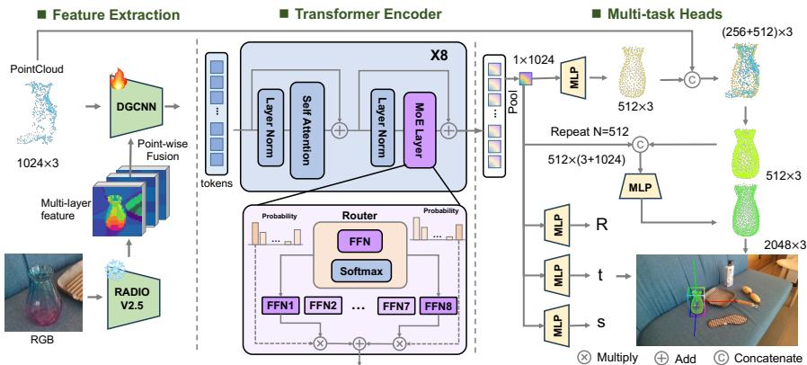  
Figure 1: F2G-Pose Overview. Given a cropped RGB image and segmented partial point cloud, F2G-Pose extracts dense RADIOv2.5 features [13] and lifts them onto 3D points by projection. DGCNN tokenization produces fused RGB-D object tokens, and a MoE Transformer encodes a global object representation. Two parallel decoder branches directly predict (i) 6D pose and metric size and (ii) camera-frame completed shape through coarse-to-fine refinement. The pipeline produces a pose-size-shape estimate in one feed-forward pass.

We then lift the dense image features onto the partial point cloud. For each point $\mathbf { P } _ { i } ,$ , we gather $\mathbf { f } _ { i } = \mathbf { F _ { \mathrm { r g b } } } [ \vert \pi ( \mathbf { P } _ { i } ) / 1 6 \rfloor ]$ at its patch-grid index, where $\pi ( \cdot )$ gives crop-pixel coordinates and 16 is the patch size. Following the point-wise fusion spirit of DenseFusion [41], we concatenate each 3D point with its lifted visual feature (denoted by ⊙) and process the fused point set with a Dynamic Graph Convolutional Neural Network (DGCNN) encoder $\mathbf { E } _ { \mathrm { G C N } } ( \cdot )$ . This yields the fused embedding $\mathbf { F } _ { \mathrm { f u s e } } = \mathbf { E } _ { \mathrm { G C N } } ( \left\{ \mathbf { P } _ { i } \odot \mathbf { f } _ { i } \right\} _ { i = 1 } ^ { N } ) \in \mathbb { R } ^ { n \times d }$ , which serves as local geometry-aware input tokens for the Transformer encoder, where $n = 1 2 8$ and $d = 5 1 2$ denote the number of tokens and the embedding dimension, respectively.

## 3.2 MoE-Based Object Encoding

The DGCNN tokens encode local surface neighborhoods and point-wise visual cues. We process these tokens with a stack of Transformer blocks with multi-head self-attention [40], following the use of Transformers for point cloud completion and geometry modeling [48, 49]. This stage integrates local evidence across the object crop to form an object-level representation for metric prediction.

To increase representation capacity with conditional expert aggregation, we replace the standard feed-forward layers in each Transformer block with Mixture-of-Experts (MoE) layers [4, 5, 8]. Each MoE layer contains an independent set of experts and uses a linear gating network to compute softmax probabilities over $N _ { e } = 8$ experts. For each token, we select the top-2 experts according to the gating scores, route the token to these experts, and aggregate their outputs using the selected probabilities renormalized to sum to one. A soft load-balancing penalty encourages balanced gate probabilities during training [36]. Finally, the encoded tokens are aggregated by global pooling to produce a compact object representation for direct 6D pose, size, and shape prediction.

## 3.3 Direct Pose-Size and Shape Decoding

F2G-Pose uses two lightweight decoding branches on top of the shared object representation. The pose-size branch predicts the metric state directly, while the shape branch predicts complete geometry in the camera frame. Both branches are trained jointly, so dense geometric supervision can regularize the representation used for direct pose and size prediction without adding any test-time optimization or candidate extraction.

Pose and Size Estimation. The pose-size branch regresses rotation, translation, and metric size directly from the global object representation. For rotation, we adopt the continuous 6D representation [56], which uses the first two columns of the rotation matrix $\mathbf { R } \in \mathrm { S O } ( 3 )$ and reconstructs a valid matrix via orthogonalization. This parameterization improves optimization stability while keeping the prediction deterministic and feed-forward. The branch outputs the final pose-size estimate directly, without sampling pose candidates or applying post-hoc aggregation.

Camera-Frame Shape Completion. From the extracted global feature vector, we first regress a coarse complete object shape $\mathbf { \bar { P } } _ { \mathrm { c o a r s e } } \in \mathbb { R } ^ { 5 1 2 \times 3 }$ using a lightweight MLP. Since the input partial point cloud P contains observed metric geometry, we concatenate $\bar { \mathbf { P } } _ { \mathrm { c o a r s e } }$ with farthest-point-sampled observations from P to form a combined point set, which is then processed through another MLP with a Sigmoid activation to produce a confidence score for each point. This selects reliable points for fusion, producing the refined fused point cloud $\mathbf { P } _ { \mathrm { f u s e } } \in \mathbb { R } ^ { 5 1 2 \times 3 }$ . Finally, each point in $\mathbf { P } _ { \mathrm { f u s e } }$ is augmented with the global feature vector and passed through an MLP to predict four local offsets per point, yielding $\mathbf { P } _ { \mathrm { d e n s e } } \in \mathbb { R } ^ { 2 0 4 8 \times 3 }$ . The shape is reconstructed directly in the camera frame, providing a geometry output and a dense auxiliary signal for learning metric-consistent object representations.

## 3.4 Training Objectives

Pose and Size Regression Loss. We supervise pose and size with Smooth L1 losses. For rotation, we account for object symmetries following the benchmark treatment in [51], so symmetry-equivalent rotations are treated as valid targets rather than arbitrary errors. Specifically, for each axis, an object’s symmetry is categorized as no symmetry, 90-degree rotational symmetry, 180-degree rotational symmetry, or arbitrary-angle rotational symmetry. Based on this classification, we generate a set of valid ground-truth rotation matrices and compare the predicted rotation against all candidates. The loss is computed with respect to the closest ground-truth rotation. The pose and size estimation losses are defined as:

$$
\mathcal { L } _ { \mathrm { r o t } } = \operatorname* { m i n } _ { \mathbf { R } _ { i } ^ { \mathrm { g t } } \in \mathcal { G } _ { \mathbf { R } } } \mathrm { S m o o t h L 1 } ( \hat { \mathbf { r } } , \mathbf { r } _ { i } ^ { \mathrm { g t } } ) ,\tag{1}
$$

$$
\ { \mathcal { L } } _ { \mathrm { t r a n s } } = { \mathrm { S m o o t h L 1 } } ( \mathbf { t } , \ \mathbf { t } ^ { \mathrm { g t } } ) ,\tag{2}
$$

$$
\mathcal { L } _ { \mathrm { s i z e } } = \mathrm { S m o o t h L 1 } ( \mathbf { s } , \ \mathbf { s } ^ { \mathrm { g t } } ) .\tag{3}
$$

Here, $\hat { \mathbf { r } } \in \mathbb { R } ^ { 6 }$ is the rotation head’s raw output, and $\mathbf { r } _ { i } ^ { \mathrm { g t } }$ stacks the first two columns of $\mathbf { R } _ { i } ^ { \mathrm { g t } }$ . The translation and size targets are $\mathbf { t } ^ { \mathrm { g t } }$ and $\mathbf { s } ^ { \mathrm { g t } }$ . The set $\mathcal { G } _ { \mathbf { R } } = \{ \mathbf { R } _ { i } ^ { \mathrm { g t } } \} _ { i = 1 } ^ { M }$ contains symmetry-equivalent target rotations; the minimum is taken over their 6D representations before orthogonalization.

Reconstruction Loss. For camera-frame shape completion, we adopt the Chamfer Distance with L1 norm, following [48], to supervise both the coarse and dense point cloud outputs. Specifically, we define two reconstruction losses: one for the selected coarse point cloud $\mathbf { P } _ { \mathrm { f u s e } }$ and another for the final dense reconstruction $\mathbf { P } _ { \mathrm { d e n s e } }$ . The Chamfer Distance measures the average closest-point distance between the predicted and ground-truth point sets, encouraging accurate geometry at different stages of the pipeline.

The reconstruction losses are formulated as follows:

$$
\mathcal { L } _ { \mathrm { r e c o n } } = \mathrm { C h a m f e r } ( \mathbf { P } _ { \mathrm { f u s e } } , \mathbf { P } ^ { \mathrm { g t } } ) + \mathrm { C h a m f e r } ( \mathbf { P } _ { \mathrm { d e n s e } } , \mathbf { P } ^ { \mathrm { g t } } ) .\tag{4}
$$

Here, $\mathbf { P } ^ { \mathrm { g t } }$ is the same ground truth complete point cloud for both terms. These losses jointly guide the model to generate increasingly accurate shapes from coarse to fine resolution.

MoE Balancing Loss. To encourage balanced expert usage in the MoE layers, we incorporate a load-balancing auxiliary loss, following the Switch Transformer design [8]. For each MoE layer with $N _ { e }$ experts, the gating network produces a probability distribution over the experts. The auxiliary loss $\mathcal { L } _ { \mathrm { a u x } }$ is defined to encourage a uniform distribution of tokens across experts:

$$
\mathcal { L } _ { \mathrm { a u x } } = \frac { 1 } { L } \sum _ { l = 1 } ^ { L } \left( N _ { e } \cdot \sum _ { i = 1 } ^ { N _ { e } } f _ { i } ^ { ( l ) } \cdot P _ { i } ^ { ( l ) } \right) ,\tag{5}
$$

Here, L is the number of MoE layers and $P _ { i } ^ { ( l ) }$ is the mean gating probability over all tokens for expert i in layer l. We use the soft variant $f _ { i } ^ { ( l ) } = P _ { i } ^ { ( l ) }$ , so each layer contributes $N _ { e } \sum _ { i } ( P _ { i } ^ { ( l ) } ) ^ { 2 }$

All Losses. Our final objective integrates direct pose-size prediction, camera-frame shape completion, and MoE load balancing:

$$
\mathcal { L } = \mathcal { L } _ { \mathrm { r e c o n } } + \mathcal { L } _ { \mathrm { r o t } } + \mathcal { L } _ { \mathrm { t r a n s } } + \mathcal { L } _ { \mathrm { s i z e } } + \lambda \mathcal { L } _ { \mathrm { a u x } } ,\tag{6}
$$

where λ is a balancing coefficient. In practice, we set $\lambda = 0 . 0 1$

Table 1: Category-level pose-size estimation on ROPE and SOPE under the shared SOPE/ROPE category taxonomy. ‘–’ indicates unavailable or non-hardware-normalized metrics. Joint-RegDiff and RFMPose are report-only comparisons from their papers. \* indicates our pose-only inference mode (shape head disabled); the full model runs at 23.7 FPS including shape completion.
<table><tr><td rowspan="2">Dataset</td><td rowspan="2">Method</td><td colspan="3">AUC↑</td><td colspan="4">VUS ↑</td><td rowspan="2" colspan="2">Mean error ↓ rot(°) trans(cm)</td><td rowspan="2">FPS ↑</td></tr><tr><td>IoU25 IoU50 IoU75</td><td></td><td></td><td>5°2cm 5°5cm 10°2cm 10°5cm</td><td></td><td></td><td></td></tr><tr><td rowspan="9">ROPE</td><td>NOCS [42]</td><td>0.0</td><td>0.0</td><td>0.0</td><td>0.0</td><td>0.0</td><td>0.0</td><td>0.0</td><td></td><td></td><td>5</td></tr><tr><td>SGPA [1]</td><td>10.5</td><td>2.0</td><td>0.0</td><td>4.3</td><td>6.7</td><td>9.3</td><td>15.0</td><td>60.2</td><td>2.81</td><td>6</td></tr><tr><td>IST-Net [26]</td><td>28.7</td><td>10.6</td><td>0.5</td><td>2.0</td><td>3.4</td><td>5.3</td><td>8.8</td><td>78.4</td><td>3.40</td><td>35</td></tr><tr><td>HS-Pose [55]</td><td>31.6</td><td>13.6</td><td>1.1</td><td>3.5</td><td>5.3</td><td>8.4</td><td>12.7</td><td>63.3</td><td>3.02</td><td>50</td></tr><tr><td>GenPose [50]</td><td></td><td></td><td>一</td><td>6.6</td><td>9.6</td><td>13.1</td><td>19.3</td><td>42.2</td><td>2.05</td><td>6</td></tr><tr><td>GenPose++ [51]</td><td>39.0</td><td>19.1</td><td>2.0</td><td>10.0</td><td>15.1</td><td>19.5</td><td>29.4</td><td>30.7</td><td>1.28</td><td>4</td></tr><tr><td>Joint-RegDiff [20]</td><td></td><td></td><td></td><td>10.9</td><td></td><td>20.8</td><td></td><td></td><td></td><td>一</td></tr><tr><td>RFMPose [32]</td><td>42.1</td><td>21.0</td><td>2.2</td><td>10.4</td><td>15.7</td><td>21.0</td><td>30.8</td><td>一</td><td>1</td><td>一</td></tr><tr><td>Ours</td><td>46.5</td><td>27.8</td><td>5.8</td><td>11.3</td><td>15.9</td><td>21.8</td><td>31.1</td><td>27.5</td><td>1.19</td><td>28*</td></tr><tr><td rowspan="7">SOPE</td><td>NOCS [42]</td><td>0.0</td><td>0.0</td><td>0.0</td><td>0.0</td><td>0.0</td><td>0.0</td><td>0.0</td><td></td><td></td><td>5</td></tr><tr><td>SGPA [1]</td><td>13.3</td><td>3.2</td><td>0.0</td><td>7.7</td><td>10.1</td><td>15.0</td><td>20.4</td><td>33.8</td><td>2.09</td><td>6</td></tr><tr><td>IST-Net [26]</td><td>36.5</td><td>16.9</td><td>1.4</td><td>3.6</td><td>5.1</td><td>8.6</td><td>11.4</td><td>60.4</td><td>3.72</td><td>35</td></tr><tr><td>HS-Pose [55]</td><td>40.1</td><td>21.7</td><td>3.2</td><td>6.3</td><td>8.0</td><td>13.6</td><td>17.3</td><td>39.9</td><td>2.46</td><td>50</td></tr><tr><td>GenPose [50]</td><td></td><td></td><td>一</td><td>11.9</td><td>14.4</td><td>21.2</td><td>26.3</td><td>26.1</td><td>1.62</td><td>6</td></tr><tr><td>GenPose++ [51]</td><td>50.1</td><td>31.9</td><td>6.4</td><td>18.4</td><td>23.0</td><td>31.9</td><td>40.2</td><td>19.9</td><td>1.14</td><td>4</td></tr><tr><td>Ours</td><td>59.6</td><td>43.7</td><td>16.5</td><td>20.5</td><td>24.2</td><td>35.2</td><td>42.1</td><td>15.7</td><td>0.88</td><td>28*</td></tr></table>

## 4 Experiments

Datasets. We use SOPE [51] as the training source for F2G-Pose; it contains 5K synthetic object instances from 149 categories with category-level canonical pose, metric size, and complete shape supervision. Pose-size evaluation uses SOPE and ROPE [51]: SOPE measures synthetic benchmark performance, while ROPE evaluates transfer to scanned real objects under the same category taxonomy. For camera-frame geometry evaluation, we use SOPE and HouseCat6D [17], where complete object geometry is available. For additional real-world transfer, we evaluate selected HANDAL objects [10], including hammers, mugs, pans, and wrench-like tools. The 92 instances from seven HANDAL categories map to six SOPE categories; selection follows taxonomy correspondence. Thus, ROPE and this HANDAL subset evaluate seen-category, unseen-instance transfer (Appendix B.4).

Baselines and metrics. For category-level pose-size estimation, we compare with NOCS, SGPA, IST-Net, HS-Pose, GenPose, and GenPose++ using the SOPE/ROPE benchmark results reported by Omni6DPose [51]. Joint-RegDiff [20] and RFMPose [32] are report-only comparisons from their papers, using public metrics available under the SOPE/ROPE taxonomy. For reference-based comparisons on real datasets, we additionally report FoundationPose [46] and Any6D [21]. For runtime comparison, we benchmark executable methods under a unified inference protocol using the same segmentation masks, RGB-D crops, depth preprocessing, batch size 1, and GPU-synchronized timing on one RTX 4090; accuracy results follow the evaluation sources specified above. Pose-size accuracy is evaluated with AUC of 3D bounding-box IoU at thresholds 25/50/75, VUS under joint rotation-translation thresholds, and mean rotation/translation error. Shape completion is evaluated using Chamfer-L1 distance.

## 4.1 Comparison with State-of-the-Art Methods

Pose-size accuracy and latency. Table 1 shows that F2G-Pose improves the accuracy-latency operating point of category-level RGB-D pose estimation. On SOPE, F2G-Pose improves GenPose++ from 31.9 to 43.7 AUC at IoU50 and reduces mean rotation error from 19.9◦ to 15.7◦; on ROPE, it improves AUC across all IoU thresholds and matches or exceeds the available high-precision VUS results. This gain is not only a speedup from removing iterative sampling. The larger improvement on IoU and rotation-sensitive metrics indicates that direct prediction benefits from stronger conditioning: dense image features preserve category and part cues, local point neighborhoods preserve observed surface evidence, and global token interactions integrate these cues into a metric pose-size estimate.

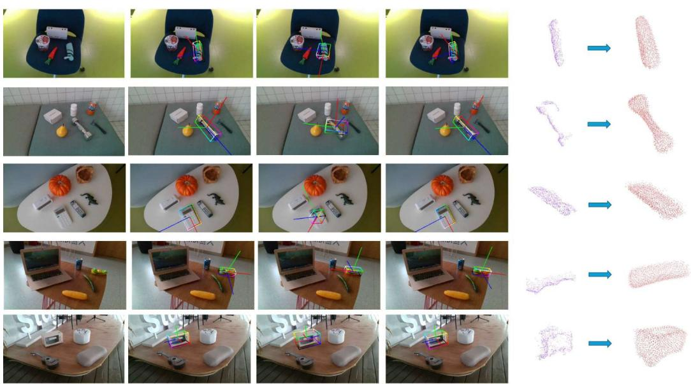  
Figure 2: Qualitative results on ROPE. We show the input RGB image, ground-truth pose, poses from GenPose++ and F2G-Pose, and the predicted camera-frame shape.

Table 2: GenPose++ candidate diagnostics on ROPE. The sampled set can contain accurate hypotheses, but deployed accuracy depends on candidate extraction.
<table><tr><td rowspan="2">Analysis</td><td colspan="3">Rotation Error (degrees)</td></tr><tr><td>| Mean ↓</td><td>Median ↓  $> 4 5 ^ { \circ }$  →  $\leq 5 ^ { \circ } \uparrow$ </td></tr><tr><td>All candidates</td><td>39.3</td><td>8.2 26.9%</td></tr><tr><td>Best-of-50 oracle</td><td>9.0</td><td>34.0% 1.78 6.1% 79.3%</td></tr><tr><td>Final pipeline</td><td>30.7 5.2</td><td>19.1% 48.3%</td></tr></table>

At the same time, F2G-Pose runs at 28 FPS in pose-only mode and 24 FPS in full-model mode, compared with 4 FPS for GenPose++, yielding a single-pass estimate without candidate scoring, filtering, or clustering. More qualitative examples are provided in Appendix A.7.

Candidate-to-decision and time-budget analysis. Table 2 examines the candidate behavior of GenPose++ as a strong generative baseline. Its candidate distribution is heavy-tailed: although the median rotation error is only 8◦, the mean rises to 39◦, with 26.9% of sampled candidates exceeding 45◦. With K = 50 samples, an oracle selects a candidate within 5◦ for 79.3% of instances, achieving a median error of 1.78◦. However, a deployed pipeline must still score, filter, cluster, or aggregate these candidates, so its final prediction can be substantially worse than the oracle. This highlights the candidate-to-decision gap discussed in the introduction: candidate-set quality and deployed prediction quality are related but not equivalent. Candidate quality also varies with object structure; no-symmetry objects have the largest mean rotation error, suggesting that sampling difficulty is driven not only by pose ambiguity but also by distinctive yet partially observed geometry. Additional candidate diagnostics by symmetry are provided in Appendix A.4.

Figure 3 evaluates the same issue under a real-time budget. Reducing diffusion candidates improves responsiveness but lowers final accuracy because candidate extraction becomes less reliable. F2G-Pose avoids this trade-off by optimizing the final pose-size decision directly.

Geometry output and shape completion. Table 3 evaluates camera-frame geometry output. The point-completion baselines are trained on the SOPE training split with the same partial-to-complete camera-frame targets. Compared with these geometry-only baselines [47–49], F2G-Pose achieves substantially lower Chamfer-L1 error on both SOPE and HouseCat6D. The qualitative results in Fig. 2 show that F2G-Pose successfully reconstructs complete object geometries. Unlike these geometry-only completion baselines, F2G-Pose predicts shape from a shared RGB-D representation:

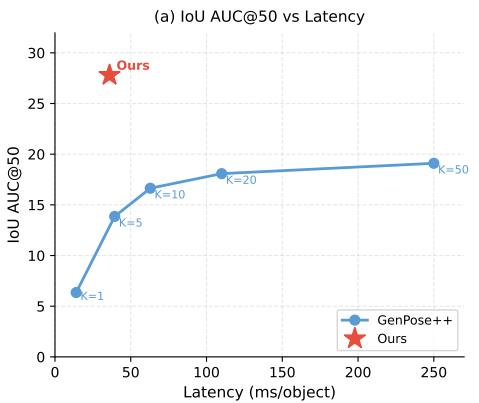

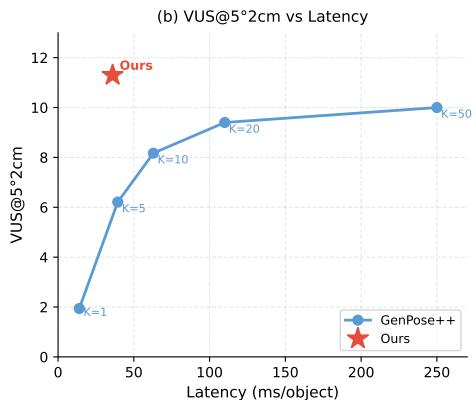  
Figure 3: Pareto analysis of GenPose++ candidate budget on ROPE.

Table 3: Camera-frame shape reconstruction on SOPE and HouseCat6D from observed partial object geometry.
<table><tr><td rowspan="2">Method</td><td colspan="2">Chamfer-L1  $( \times 1 0 ^ { - 3 } ) .$  →</td></tr><tr><td>|SOPE</td><td>HouseCat6D</td></tr><tr><td>FoldingNet</td><td>62.72</td><td>73.2</td></tr><tr><td>Pointr</td><td>29.87</td><td>40.2</td></tr><tr><td>AdaPointr</td><td>24.41</td><td>32.3</td></tr><tr><td>Ours</td><td>5.42</td><td>7.1</td></tr></table>

Table 4: Component ablation on ROPE.
<table><tr><td rowspan="2">Variant</td><td colspan="4">AUC↑ VUS↑</td><td rowspan="2">FPS ↑  $1 0 ^ { \circ } 2 \mathrm { c m } |$ </td></tr><tr><td colspan="5">|IoU25 IoU50 IoU75  $| 5 ^ { \circ } 5 \mathrm { c m }$ </td></tr><tr><td>Full</td><td>46.5</td><td>27.8</td><td>5.8</td><td>15.9</td><td>21.8</td><td>23.7</td></tr><tr><td>w/o RGB</td><td>34.5</td><td>16.2</td><td>2.2</td><td>6.5</td><td>13.2</td><td>29.5</td></tr><tr><td>w/o MoE</td><td>41.0</td><td>24.0</td><td>3.9</td><td>8.7</td><td>17.8</td><td>19.2</td></tr><tr><td>w/o Shape Sup.</td><td>39.5</td><td>23.2</td><td>3.5</td><td>8.1</td><td>16.5</td><td>27.8</td></tr></table>

Table 5: Representation and backbone study on ROPE. Representation variants use RADIO as the default backbone.
<table><tr><td>Variant</td><td> $\scriptstyle \left| \mathbf { A U C _ { I o U 2 5 } } \right.$ </td><td> $\mathbf { A U C _ { I o U 5 0 } }$ </td><td> $\mathrm { V U S } _ { 5 ^ { \circ } 5 \mathrm { c m } }$ </td></tr><tr><td>Representation variants</td><td></td><td></td><td></td></tr><tr><td>Global PointNet</td><td>35.2</td><td>17.8</td><td>6.3</td></tr><tr><td>DGCNN tokens</td><td>38.6</td><td>21.6</td><td>7.8</td></tr><tr><td>DGCNN + Trans.</td><td>41.0</td><td>24.0</td><td>8.7</td></tr><tr><td>DGCNN + MoE w/o Shape</td><td>39.5</td><td>23.2</td><td>8.1</td></tr><tr><td>Backbone variants</td><td></td><td></td><td></td></tr><tr><td>Full + DINOv2</td><td>45.5</td><td>27.0</td><td>13.7</td></tr><tr><td>Full + CLIP</td><td>44.8</td><td>26.3</td><td>12.5</td></tr><tr><td>Full</td><td>46.5</td><td>27.8</td><td>15.9</td></tr></table>

Table 6: MoE routing and capacity analysis on ROPE. Routing entropy is normalized by log 8; higher is more balanced.
<table><tr><td colspan="2">FFN |IoU50 VUS Ent. Load FPS</td></tr><tr><td>Dense FFN</td><td>24.0 8.7 19.2</td></tr><tr><td>MoE top-1</td><td>25.6 13.5 0.89 24% 26.1</td></tr><tr><td>MoE top-2, no balance</td><td>26.0 14.2 0.71 39% 23.9</td></tr><tr><td>MoE top-2</td><td>27.8 15.9 0.9518%23.7</td></tr><tr><td>MoE top-4</td><td>28.0 16.1 0.96 17%18.5</td></tr></table>

depth points anchor the visible metric surface, and lifted RGB foundation features provide category, texture, and part cues for completing occluded regions. Since the completed geometry is predicted directly in the camera frame, it can also be consumed by simple downstream planning modules without an additional canonical-to-camera alignment step. Because the inputs and supervision differ across systems and camera-frame CD also reflects global alignment, Appendix B.1 provides an additional matched RGB-D canonical-frame comparison.

## 4.2 Ablation Studies

Component ablation. Table 4 isolates the main design factors of F2G-Pose on ROPE. Removing RGB foundation features leads to the largest performance drop, particularly on the rotation-sensitive VUS metrics, showing that point-wise visual lifting provides pose-relevant appearance and semantic cues beyond partial geometry alone. Replacing the MoE Transformer with a parameter-equivalent dense FFN also reduces accuracy, suggesting that conditional capacity helps model category-level object diversity. Removing auxiliary shape supervision further degrades pose-size prediction, indicating that dense camera-frame geometry supervision regularizes the shared RGB-D representation and directly benefits the final pose-size estimate.

Representation analysis. Table 5 studies how different RGB-D representations affect direct posesize prediction. All variants are trained with the same pose-size losses, while varying the feature aggregation strategy, contextual encoder, foundation backbone, and the use of auxiliary shape supervision. Replacing global feature pooling with DGCNN tokens improves both IoU and rotation sensitive VUS, showing that local surface neighborhoods provide important geometric cues for direct pose estimation. Adding Transformer context further improves performance by integrating local RGB D evidence into an object-level representation. The full model achieves the best results, indicating that local geometric tokenization, object-level context, and camera-frame geometry supervision are complementary. Finally, replacing RADIO with DINOv2 or CLIP causes only modest degradation in IoU50, suggesting that the improvement is driven primarily by the architecture and supervision rather than by a specific foundation backbone. Additional backbone, routing, and shape-decoder ablations are summarized in Appendix A.6.

Table 7: Performance on reflective and transparent materials across ROPE and HouseCat6D.
<table><tr><td rowspan="2">Category</td><td colspan="4">ROPE</td><td>HouseCat6D</td></tr><tr><td> $\mathrm { \ A U C _ { I o U 2 5 } }$  ↑</td><td> $\mathrm { \ A U C _ { I o U 7 5 } }$  ↑</td><td> $\mathrm { V U S } _ { 5 ^ { \circ } 2 \mathrm { c m } }$ </td><td>↑ Rot. Err. ↓ Trans. Err. ↓</td><td>CD↓</td></tr><tr><td>Transparent</td><td>43.5</td><td>4.7</td><td>10.4</td><td>25.3 1.19</td><td>6.2</td></tr><tr><td>Reflective</td><td>42.6</td><td>4.5</td><td>9.8 25.2</td><td>1.25</td><td>10.1</td></tr><tr><td>Average</td><td>46.5</td><td>5.8</td><td>11.3</td><td>27.5 1.19</td><td>7.1</td></tr></table>

MoE routing analysis. Table 6 shows that top-2 MoE provides a favorable accuracy-latency trade-off. Top-1 routing is faster but less accurate, while top-4 brings only marginal accuracy gains at a higher latency cost. Compared with top-2 routing without balancing, the load-balanced top-2 MoE achieves higher routing entropy, lower load concentration, and better pose accuracy. These results suggest that balanced conditional capacity improves the shared RGB-D representation while keeping inference cost moderate. Further instance-level analysis finds overlapping category-related expert preferences (Appendix B.3).

Robustness under challenging materials. Table 7 reports performance on transparent and reflective objects, which often corrupt depth observations. Compared with the overall ROPE performance, F2G-Pose shows moderate degradation on these material subsets, with reflective objects being more difficult than transparent ones, especially in VUS and Chamfer distance. The performance drop is most apparent in IoU75, where depth holes, specular artifacts, and missing thin structures can perturb the estimated object extent. A similar trend is observed on HouseCat6D, where reconstruction remains accurate for many transparent objects because their shapes are regular despite noisy depth. Overall, F2G-Pose remains reasonably robust under material-induced sensing noise, while precise box alignment is still sensitive to imperfect depth observations. Controlled RGB and depth perturbation results are reported in Appendix A.3, with additional material examples in Fig. 9. SAM-mask and controlled erosion/dilation results are provided in Appendix B.2.

## 4.3 Real-World Evaluation and Deployment

## Cross-dataset real-world evaluation.

Table 8 evaluates cross-dataset transfer on real-world manipulable objects captured under different setups. The zero-/one-reference baseline protocols are detailed in Appendix B.5. On HANDAL, F2G-Pose outperforms the reference-free methods Any6D and Gen-Pose++, while on ROPE it further surpasses the singlereference method FoundationPose and the referencefree method Any6D, without requiring an instance reference. These results complement the controlled SOPE/ROPE benchmark by exposing the model to additional real objects, masks, backgrounds, and sensor noise patterns. Despite these transfer gains, the low IoU75 values show that high-precision box alignment remains challenging under cross-dataset sensing and annotation differences. These results provide additional evidence of F2G-Pose’s robustness under real-world distribution shifts, complementing the controlled category-level analysis on SOPE/ROPE; qualitative HANDAL examples are shown in Fig. 10.

Table 8: Cross-dataset ROPE/HANDAL evaluation.
<table><tr><td>Data</td><td>Method</td><td colspan="3">AUC ↑ IoU25 IoU50</td></tr><tr><td>ROPE</td><td>FoundationPose (1 ref) Any6D (1 ref) Any6D (0 ref) Ours</td><td>35.0 37.2 22.5 46.5</td><td>18.0 19.4 8.1 27.8</td><td>3.1 3.5 0.3 5.8</td></tr><tr><td>HANDAL</td><td>Any6D (0 ref)  $\mathbf { \widetilde { G e n P o s e + + } } \mathbf { \widetilde { ( 0 \ r e f ) } }$  Ours</td><td>14.5 16.7 35.0</td><td>3.8 4.3 11.7</td><td>0.0 0.1 0.3</td></tr></table>

Table 9: Real-world pose-conditioned pick-and-place on ARX (80 trials per method). Lat. is mean perception latency; Ready@50 is the measured percentage of usable decisions returned within 50 ms; Time is mean pick-and-place duration over successful trials.
<table><tr><td colspan="3">Lat.</td><td rowspan="2">Pick Place</td><td rowspan="2">Time (s)</td></tr><tr><td>Method</td><td></td><td>(ms) Ready@50</td></tr><tr><td>GenPose++ full [51]</td><td>256</td><td>0%</td><td>66/80 57/80</td><td>9.8</td></tr><tr><td>GenPose++ time-limited [51]</td><td>49</td><td>100%</td><td>56/80 45/80</td><td>7.6</td></tr><tr><td>Ours depth-only</td><td>31</td><td>100%</td><td>61/80 50/80</td><td>6.2</td></tr><tr><td>Ours w/o shape</td><td>29</td><td>100%</td><td>68/80 57/80</td><td>6.0</td></tr><tr><td>completion Ours full</td><td>36</td><td>100%</td><td>74/80 68/80</td><td>6.1</td></tr></table>

6D Pose Estimation  
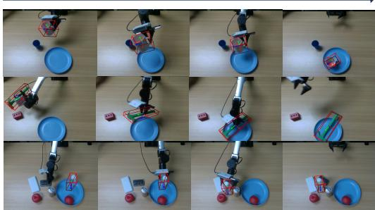  
Figure 4: Real-world ARX manipulation setup and example pick-and-place trials.

Robot manipulation. We validate the final pose-size decision in a real pick-and-place setup using an ARX robotic arm, a parallel-jaw gripper, and an external RealSense RGB-D camera. All methods receive the same object masks and RGB-D crops, and the evaluated objects include bottles, bowls, cans, mugs, cups, hammers, pans, and wrench-like tools. The predicted pose and metric size determine the grasp approach and placement target; the completed camera-frame shape is used only for collision checking. Each trial randomizes object placement within a tabletop start region, and success requires grasping, transporting, and placing the object at the target without dropping or collision. The full model achieves 74/80 successful picks and 68/80 successful placements.

Figure 4 illustrates the physical setup and representative trials, while Table 9 shows that F2G-Pose preserves high manipulation success while meeting a real-time perception budget. GenPose++ is effective when run with its full sampling and clustering pipeline, but the full pipeline is too slow for the 50 ms control budget; reducing candidates improves responsiveness at the cost of lower pick-and-place success. The depth-only and w/o-shape variants further show that dense visual lifting and camera-frame shape supervision improve deployed pick-and-place success.

Failure analysis. In qualitative benchmark cases, failures mainly occur when corrupted depth removes thin or asymmetric parts, severe occlusion hides functional geometry, or symmetric lowtexture objects admit 90◦/180◦ alternatives. Additional examples are shown in Appendix A.5.

## 5 Conclusion

We present F2G-Pose, a direct RGB-D framework that estimates category-level 6D pose, metric size, and camera-frame shape from a single observation. By lifting dense visual foundation features to partial point clouds and encoding local-global geometry with a MoE Transformer, F2G-Pose predicts the deployed pose-size state in one feed-forward pass. Experiments on SOPE, ROPE, HouseCat6D, HANDAL, and ARX manipulation show a favorable balance of accuracy, inference latency, and manipulation success, while the shape branch provides dense geometric supervision and approximate planning geometry.

Limitations. F2G-Pose assumes a segmented RGB-D crop at inference time, so mask failures and severe depth corruption can propagate to pose, size, and shape. The method remains sensitive to thin or asymmetric parts, severe occlusion, and symmetric low-texture objects that admit multiple plausible rotations. High-precision metric alignment remains weak under cross-dataset domain shift, which may require downstream refinement for tasks with tight geometric tolerances. Symmetry-aware supervision does not eliminate ambiguity under severe occlusion or near-symmetry, and the model provides no calibrated uncertainty or abstention mechanism. Future work will address mask-free operation, broader real-object coverage, articulated or deformable categories, and active perception for heavy occlusion.

Broader Impact. F2G-Pose advances category-level object perception for robotics and augmented reality. While improved pose estimation can benefit assistive manipulation and human–robot collaboration, it could also be applied in surveillance or autonomous systems without adequate safety oversight. We encourage responsible deployment with appropriate human supervision.

# Acknowledgments and Disclosure of Funding

This work received no third-party funding or external support. The authors declare no competing interests.

## References

[1] Kai Chen and Qi Dou. SGPA: Structure-guided prior adaptation for category-level 6D object pose estimation. In Proceedings ofthe IEEE/CVF International Conference on Computer Vision, pages 2773–2782, 2021.

[2] Wei Chen, Xi Jia, Hyung Jin Chang, Jinming Duan, Linlin Shen, and Ales Leonardis. FS-Net: Fast shape-based network for category-level 6D object pose estimation with decoupled rotation mechanism. In Proceedings of the IEEE/CVF Conference on Computer Vision and Pattern Recognition, pages 1581–1590, 2021.

[3] Yamei Chen, Yan Di, Guangyao Zhai, Fabian Manhardt, Chenyangguang Zhang, Ruida Zhang, Federico Tombari, Nassir Navab, and Benjamin Busam. SecondPose: SE(3)-Consistent Dual-Stream Feature Fusion for Category-Level Pose Estimation. In Proceedings of the IEEE/CVF Conference on Computer Vision and Pattern Recognition, pages 9959–9969, 2024.

[4] DeepSeek-AI, Aixin Liu, Bei Feng, Bing Xue, Bingxuan Wang, Bochao Wu, Chengda Lu, Chenggang Zhao, Chengqi Deng, Chenyu Zhang, Chong Ruan, et al. DeepSeek-V3 technical report. arXiv preprint arXiv:2412.19437, 2024.

[5] Nan Du, Yanping Huang, Andrew M Dai, Simon Tong, Dmitry Lepikhin, Yuanzhong Xu, Maxim Krikun, Yanqi Zhou, Adams Wei Yu, Orhan Firat, et al. GLaM: Efficient scaling of language models with mixture-of-experts. In International conference on machine learning, pages 5547–5569. PMLR, 2022.

[6] Hugo Durchon, Marius Preda, and Titus Zaharia. 6D pose estimation of unseen objects for industrial augmented reality. In 2024 IEEE 20th International Conference on Intelligent Computer Communication and Processing (ICCP), pages 1–8. IEEE, 2024.

[7] Alex Fang, Albin Madappally Jose, Amit Jain, Ludwig Schmidt, Alexander Toshev, and Vaishaal Shankar. Data filtering networks. arXiv preprint arXiv:2309.17425, 2023.

[8] William Fedus, Barret Zoph, and Noam Shazeer. Switch transformers: Scaling to trillion parameter models with simple and efficient sparsity. Journal of Machine Learning Research, 23 (120):1–39, 2022.

[9] Yang Fu and Xiaolong Wang. Category-level 6D object pose estimation in the wild: A semisupervised learning approach and a new dataset. Advances in Neural Information Processing Systems, 35:27469–27483, 2022.

[10] Andrew Guo, Bowen Wen, Jianhe Yuan, Jonathan Tremblay, Stephen Tyree, Jeffrey Smith, and Stan Birchfield. HANDAL: A dataset of real-world manipulable object categories with pose annotations, affordances, and reconstructions. In 2023 IEEE/RSJ International Conference on Intelligent Robots and Systems (IROS), pages 11428–11435. IEEE, 2023.

[11] Xingyi He, Jiaming Sun, Yuang Wang, Di Huang, Hujun Bao, and Xiaowei Zhou. OnePose++: Keypoint-free one-shot object pose estimation without CAD models. Advances in Neural Information Processing Systems, 35:35103–35115, 2022.

[12] Yisheng He, Yao Wang, Haoqiang Fan, Jian Sun, and Qifeng Chen. FS6D: Few-shot 6D pose estimation of novel objects. In Proceedings ofthe IEEE/CVF Conference on Computer Vision and Pattern Recognition, pages 6814–6824, 2022.

[13] Greg Heinrich, Mike Ranzinger, Hongxu Yin, Yao Lu, Jan Kautz, Andrew Tao, Bryan Catanzaro, and Pavlo Molchanov. RADIOv2.5: Improved baselines for agglomerative vision foundation models. In Proc. CVPR, pages 22487–22497, 2025.

[14] Jingshun Huang, Haitao Lin, Tianyu Wang, Yanwei Fu, Yu-Gang Jiang, and Xiangyang Xue. You only estimate once: Unified, one-stage, real-time category-level articulated object 6D pose estimation for robotic grasping. arXiv preprint arXiv:2506.05719, 2025.

[15] Jingshun Huang, Haitao Lin, Tianyu Wang, Yanwei Fu, Xiangyang Xue, and Yi Zhu. CAP-Net: A unified network for 6D pose and size estimation of categorical articulated parts from a single RGB-D image. arXiv preprint arXiv:2504.11230, 2025.

[16] Muhammad Zubair Irshad, Sergey Zakharov, Rares Ambrus, Thomas Kollar, Zsolt Kira, and Adrien Gaidon. ShAPO: Implicit representations for multi-object shape, appearance, and pose optimization. In European Conference on Computer Vision, pages 275–292. Springer, 2022.

[17] HyunJun Jung, Shun-Cheng Wu, Patrick Ruhkamp, Guangyao Zhai, Hannah Schieber, Giulia Rizzoli, Pengyuan Wang, Hongcheng Zhao, Lorenzo Garattoni, Sven Meier, Daniel Roth, Nassir Navab, and Benjamin Busam. HouseCat6D-a large-scale multi-modal category level 6D object perception dataset with household objects in realistic scenarios. In Proceedings of the IEEE/CVF Conference on Computer Vision and Pattern Recognition, pages 22498–22508, 2024.

[18] Akshay Krishnan, Abhijit Kundu, Kevis-Kokitsi Maninis, James Hays, and Matthew Brown. OmniNOCS: A unified NOCS dataset and model for 3D lifting of 2D objects. In European Conference on Computer Vision, pages 127–145. Springer, 2024.

[19] Yann Labbé, Lucas Manuelli, Arsalan Mousavian, Stephen Tyree, Stan Birchfield, Jonathan Tremblay, Justin Carpentier, Mathieu Aubry, Dieter Fox, and Josef Sivic. MegaPose: 6D pose estimation of novel objects via render & compare. arXiv preprint arXiv:2212.06870, 2022.

[20] Seunghyun Lee and Tae-Kyun Kim. Joint learning of pose regression and denoising diffusion with score scaling sampling for category-level 6D pose estimation, 2025. URL https:// arxiv.org/abs/2510.04125.

[21] Taeyeop Lee, Bowen Wen, Minjun Kang, Gyuree Kang, In So Kweon, and Kuk-Jin Yoon. Any6D: Model-free 6D pose estimation of novel objects. In Proceedings ofthe Computer Vision and Pattern Recognition Conference (CVPR), 2025.

[22] Fu Li, Shishir Reddy Vutukur, Hao Yu, Ivan Shugurov, Benjamin Busam, Shaowu Yang, and Slobodan Ilic. NeRF-Pose: A first-reconstruct-then-regress approach for weakly-supervised 6D object pose estimation. In Proceedings of the IEEE/CVF International Conference on Computer Vision, pages 2123–2133, 2023.

[23] Haitao Lin, Zichang Liu, Chilam Cheang, Yanwei Fu, Guodong Guo, and Xiangyang Xue. SAR-Net: Shape alignment and recovery network for category-level 6D object pose and size estimation. In Proceedings of the IEEE/CVF conference on computer vision and pattern recognition, pages 6707–6717, 2022.

[24] Haitao Lin, Yanwei Fu, and Xiangyang Xue. PourIt!: Weakly-supervised liquid perception from a single image for visual closed-loop robotic pouring. In Proceedings ofthe IEEE/CVF International Conference on Computer Vision, pages 241–251, 2023.

[25] Haitao Lin, Hanyang Yu, Jingshun Huang, He Zhang, Yonggen Ling, Ping Tan, Xiangyang Xue, and Yanwei Fu. Universal pose pretraining for generalizable vision-language-action policies. arXiv preprint arXiv:2602.19710, 2026.

[26] Jianhui Liu, Yukang Chen, Xiaoqing Ye, and Xiaojuan Qi. IST-Net: Prior-free categorylevel pose estimation with implicit space transformation. In Proceedings of the IEEE/CVF International Conference on Computer Vision, pages 13978–13988, 2023.

[27] Mengya Liu, Siyuan Li, Ajad Chhatkuli, Prune Truong, Luc Van Gool, and Federico Tombari. One2Any: One-reference 6D pose estimation for any object. In Proceedings of the Computer Vision and Pattern Recognition Conference, pages 6457–6467, 2025.

[28] Yuan Liu, Yilin Wen, Sida Peng, Cheng Lin, Xiaoxiao Long, Taku Komura, and Wenping Wang. Gen6D: Generalizable model-free 6-DoF object pose estimation from RGB images. In European Conference on Computer Vision, pages 298–315. Springer, 2022.

[29] Van Nguyen Nguyen, Yinlin Hu, Yang Xiao, Mathieu Salzmann, and Vincent Lepetit. Templates for 3D object pose estimation revisited: Generalization to new objects and robustness to occlusions. In Proceedings of the IEEE/CVF conference on computer vision and pattern recognition, pages 6771–6780, 2022.

[30] Van Nguyen Nguyen, Thibault Groueix, Mathieu Salzmann, and Vincent Lepetit. GigaPose: Fast and robust novel object pose estimation via one correspondence. In Proceedings of the IEEE/CVF Conference on Computer Vision and Pattern Recognition, pages 9903–9913, 2024.

[31] Maxime Oquab, Timothée Darcet, Théo Moutakanni, Huy Vo, Marc Szafraniec, Vasil Khalidov, Pierre Fernandez, Daniel Haziza, Francisco Massa, Alaaeldin El-Nouby, et al. DINOv2: Learning robust visual features without supervision. arXiv preprint arXiv:2304.07193, 2023.

[32] Wenzhe Ouyang, Qi Ye, Jinghua Wang, Zenglin Xu, and Jiming Chen. RFMPose: Generative Category-Level Object Pose Estimation via Riemannian Flow Matching. In Advances in Neural Information Processing Systems, 2025. URL https://mlanthology.org/neurips/2025/ ouyang2025neurips-rfmpose/.

[33] Alec Radford, Jong Wook Kim, Chris Hallacy, Aditya Ramesh, Gabriel Goh, Sandhini Agarwal, Girish Sastry, Amanda Askell, Pamela Mishkin, Jack Clark, et al. Learning transferable visual models from natural language supervision. In International conference on machine learning, pages 8748–8763. PmLR, 2021.

[34] Nikhila Ravi, Valentin Gabeur, Yuan-Ting Hu, Ronghang Hu, Chaitanya Ryali, Tengyu Ma, Haitham Khedr, Roman Rädle, Chloe Rolland, Laura Gustafson, et al. SAM 2: Segment anything in images and videos. arXiv preprint arXiv:2408.00714, 2024.

[35] SAM 3D Team, Xingyu Chen, Fu-Jen Chu, Pierre Gleize, Kevin J. Liang, Alexander Sax, Hao Tang, Weiyao Wang, Michelle Guo, Thibaut Hardin, Xiang Li, Aohan Lin, Jiawei Liu, Ziqi Ma, Anushka Sagar, Bowen Song, Xiaodong Wang, Jianing Yang, Bowen Zhang, Piotr Dollár, Georgia Gkioxari, Matt Feiszli, and Jitendra Malik. SAM 3D: 3dfy anything in images, 2025. URL https://arxiv.org/abs/2511.16624.

[36] Noam Shazeer, Azalia Mirhoseini, Krzysztof Maziarz, Andy Davis, Quoc Le, Geoffrey Hinton, and Jeff Dean. Outrageously large neural networks: The sparsely-gated mixture-of-experts layer. arXiv preprint arXiv:1701.06538, 2017.

[37] David Joseph Tan, Nassir Navab, and Federico Tombari. 6D object pose estimation with depth images: A seamless approach for robotic interaction and augmented reality. arXiv preprint arXiv:1709.01459, 2017.

[38] Fulin Tang, Yihong Wu, Xiaohui Hou, and Haibin Ling. 3D mapping and 6D pose computation for real time augmented reality on cylindrical objects. IEEE Transactions on Circuits and Systemsfor Video Technology, 30(9):2887–2899, 2019.

[39] Meng Tian, Marcelo H. Ang, Jr., and Gim Hee Lee. Shape prior deformation for categorical 6D object pose and size estimation. In Computer Vision–ECCV 2020: 16th European Conference, Glasgow, UK, August 23–28, 2020, Proceedings, Part XXI 16, pages 530–546. Springer, 2020.

[40] Ashish Vaswani, Noam Shazeer, Niki Parmar, Jakob Uszkoreit, Llion Jones, Aidan N Gomez, Łukasz Kaiser, and Illia Polosukhin. Attention is all you need. Advances in neural information processing systems, 30, 2017.

[41] Chen Wang, Danfei Xu, Yuke Zhu, Roberto Martín-Martín, Cewu Lu, Li Fei-Fei, and Silvio Savarese. DenseFusion: 6D object pose estimation by iterative dense fusion. In Proceedings of the IEEE/CVF conference on computer vision and pattern recognition, pages 3343–3352, 2019.

[42] He Wang, Srinath Sridhar, Jingwei Huang, Julien Valentin, Shuran Song, and Leonidas J Guibas. Normalized object coordinate space for category-level 6D object pose and size estimation. In Proceedings of the IEEE/CVF Conference on Computer Vision and Pattern Recognition, pages 2642–2651, 2019.

[43] Pengyuan Wang, HyunJun Jung, Yitong Li, Siyuan Shen, Rahul Parthasarathy Srikanth, Lorenzo Garattoni, Sven Meier, Nassir Navab, and Benjamin Busam. PhoCaL: A multi-modal dataset for category-level object pose estimation with photometrically challenging objects. In Proceedings of the IEEE/CVF conference on computer vision and pattern recognition, pages 21222–21231, 2022.

[44] Tianyu Wang, Haitao Lin, Junqiu Yu, and Yanwei Fu. Polaris: Open-ended interactive robotic manipulation via syn2real visual grounding and large language models. arXiv preprint arXiv:2408.07975, 2024.

[45] Bowen Wen, Jonathan Tremblay, Valts Blukis, Stephen Tyree, Thomas Müller, Alex Evans, Dieter Fox, Jan Kautz, and Stan Birchfield. BundleSDF: Neural 6-DoF tracking and 3D reconstruction of unknown objects. In Proceedings ofthe IEEE/CVF Conference on Computer Vision and Pattern Recognition, pages 606–617, 2023.

[46] Bowen Wen, Wei Yang, Jan Kautz, and Stan Birchfield. FoundationPose: Unified 6D pose estimation and tracking of novel objects. In Proceedings of the IEEE/CVF Conference on Computer Vision and Pattern Recognition, pages 17868–17879, 2024.

[47] Yaoqing Yang, Chen Feng, Yiru Shen, and Dong Tian. FoldingNet: Point cloud auto-encoder via deep grid deformation, 2018. URL https://arxiv.org/abs/1712.07262.

[48] Xumin Yu, Yongming Rao, Ziyi Wang, Zuyan Liu, Jiwen Lu, and Jie Zhou. PoinTr: Diverse point cloud completion with geometry-aware transformers. In ICCV, 2021.

[49] Xumin Yu, Yongming Rao, Ziyi Wang, Jiwen Lu, and Jie Zhou. AdaPoinTr: Diverse point cloud completion with adaptive geometry-aware transformers, 2023. URL https://arxiv. org/abs/2301.04545.

[50] Jiyao Zhang, Mingdong Wu, and Hao Dong. GenPose: Generative category-level object pose estimation via diffusion models. arXiv preprint arXiv:2306.10531, 2023.

[51] Jiyao Zhang, Weiyao Huang, Bo Peng, Mingdong Wu, Fei Hu, Zijian Chen, Bo Zhao, and Hao Dong. Omni6DPose: A benchmark and model for universal 6D object pose estimation and tracking. In European Conference on Computer Vision, pages 199–216. Springer, 2025.

[52] Junyi Zhang, Charles Herrmann, Junhwa Hur, Luisa Polania Cabrera, Varun Jampani, Deqing Sun, and Ming-Hsuan Yang. A tale of two features: Stable diffusion complements DINO for zero-shot semantic correspondence. Advances in Neural Information Processing Systems, 36, 2023.

[53] Mengchen Zhang, Tong Wu, Tai Wang, Tengfei Wang, Ziwei Liu, and Dahua Lin. Omni6D: Large-vocabulary 3D object dataset for category-level 6D object pose estimation. In European Conference on Computer Vision, pages 216–232. Springer, 2025.

[54] Ruida Zhang, Ziqin Huang, Gu Wang, Chenyangguang Zhang, Yan Di, Xingxing Zuo, Jiwen Tang, and Xiangyang Ji. LaPose: Laplacian mixture shape modeling for RGB-based categorylevel object pose estimation. arXiv preprint arXiv:2409.15727, 2024.

[55] Linfang Zheng, Chen Wang, Yinghan Sun, Esha Dasgupta, Hua Chen, Aleš Leonardis, Wei Zhang, and Hyung Jin Chang. HS-Pose: Hybrid scope feature extraction for category-level object pose estimation. In Proceedings of the IEEE/CVF Conference on Computer Vision and Pattern Recognition, pages 17163–17173, 2023.

[56] Yi Zhou, Connelly Barnes, Jingwan Lu, Jimei Yang, and Hao Li. On the continuity of rotation representations in neural networks. In Proceedings ofthe IEEE/CVF conference on computer vision and pattern recognition, pages 5745–5753, 2019.

## A Additional Implementation Details

## A.1 Model Details

F2G-Pose receives a segmented RGB crop and its corresponding partial point cloud. We sample 1024 points from the segmented depth observation and concatenate each point coordinate with a lifted visual feature. Frozen RADIOv2.5-L [13] provides feature maps from layers 8, 16, and 23. Independent $1 \times 1$ convolutional blocks compress each map from 1024 to 512 channels. Learned softmax-normalized layer weights combine them by summation, followed by a $\mathbf { \varepsilon } _ { 1 } \mathbf { 3 } \times \mathbf { 3 }$ convolutional block producing 1024 channels; both convolutional stages use BatchNorm and ReLU. We gather each point’s feature by integer-dividing its crop-pixel coordinates by the patch size of 16. This produces an input tensor of size $\mathrm { \dot { B } } \times 1 0 2 4 \mathrm { \times 1 0 2 7 }$

The fused RGB-D point set is tokenized by a DGCNN encoder with two downsampling stages, reducing 1024 input points to 128 object tokens. The tokens are projected to 512 dimensions and processed by 8 Transformer blocks with 8 attention heads. In the full model, each Transformer feed-forward layer is replaced by a top-2 Mixture-of-Experts layer with 8 experts and the loadbalancing loss described in the main paper. A learned softmax-weighted sum combines the block outputs; an MLP projects the tokens to 1024 dimensions before max pooling. The pose-size branch directly regresses rotation, translation, and metric size. The shape branch predicts 512 initial points, concatenates 256 farthest-point-sampled observed points, scores the 768 candidates and retains 512, then predicts four local offsets per retained point for a 2048-point completed shape. The selected 512 points and final 2048 points receive reconstruction supervision. Continuous rotational symmetries use $1 ^ { \circ }$ candidate sampling; objects with at least two continuously symmetric axes are excluded from the rotation loss.

## A.2 Training Details

F2G-Pose is trained only on the SOPE training split used in the main experiments. We train for 100 epochs with batch size 512 using AdamW. The initial learning rate is $1 \dot { 0 } ^ { - 4 }$ , the weight decay is $5 \times 1 \bar { 0 } ^ { - 4 }$ , and a LambdaLR schedule decays the learning rate by a factor of 0.9 every 8 epochs with a lower bound of 2% of the initial value. BatchNorm momentum is decayed from 0.9 by a factor of 0.5 every 3 epochs with a minimum value of 0.01. Training experiments are run with PyTorch 2.4 and CUDA 12.4 using automatic mixed precision, DistributedDataParallel, and synchronized BatchNorm on 4 NVIDIA H200 GPUs.

For runtime comparison, we benchmark executable methods under a unified inference protocol using the same segmentation masks, RGB-D crops, depth preprocessing, batch size 1, and GPUsynchronized timing on one RTX 4090. The pose-only setting disables the shape head after the shared RGB-D encoder, while the full setting keeps the shape branch enabled.

## A.3 Controlled Robustness Evaluation

To complement the material robustness study in the main paper, we evaluate controlled perturbations on ROPE. RGB perturbations simulate common photometric changes, while depth perturbations simulate sensor noise. These results are intended as stress tests of the current SOPE-trained model rather than as a separate dataset contribution.

Photometric perturbations. For RGB inputs, we apply exposure shifts $( \pm 0 . 5 / \pm 1 . 3 / \pm 2 . 2 \ : \mathrm { E V } )$ white-balance shifts $( \pm 8 0 0 / \pm 2 0 0 0 / \pm 4 0 0 0 \ : \mathrm { K } )$ , and synthetic illumination changes (gradient or vignetting at 0.10/0.25/0.40 strength). Table 10 shows that performance changes only mildly under light and moderate perturbations, while heavy perturbations produce a larger but still bounded drop.

Depth perturbations. For depth inputs, we inject heteroscedastic noise

$$
\sigma ( z ) = \alpha + \beta z ^ { 2 } ,
$$

where $\alpha \in \{ 0 . 0 0 1 , 0 . 0 0 2 , 0 . 0 0 3 \}$ and $\beta \in \{ 0 . 0 0 0 , 0 . 0 0 3 , 0 . 0 0 6 \}$ . As summarized in Table 11, depth noise affects the method more strongly than photometric shifts, consistent with the main paper’s observation that precise metric alignment is sensitive to corrupted or missing depth.

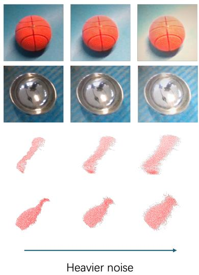  
Figure 5: Examples of controlled RGB and depth perturbations.

Table 10: Controlled robustness under photometric perturbations on ROPE.
<table><tr><td>Perturbation</td><td>IoU25</td><td>IoU50</td><td>IoU75</td><td> $5 ^ { \circ } 2 \mathrm { c m }$ </td><td> $5 ^ { \circ } 5 \mathrm { c m }$ </td><td> $1 0 ^ { \circ } 2 \mathrm { c m }$ </td><td>10°5cm</td><td>∆AUC / ∆VUS (%)</td></tr><tr><td>Clean</td><td>46.5</td><td>27.8</td><td>5.8</td><td>11.3</td><td>15.9</td><td>21.8</td><td>31.1</td><td>+0.0 / +0.0</td></tr><tr><td>Light</td><td>46.3</td><td>27.7</td><td>5.7</td><td>11.3</td><td>15.9</td><td>21.7</td><td>30.8</td><td>-0.5 / -0.6</td></tr><tr><td>Moderate</td><td>46.1</td><td>27.4</td><td>5.6</td><td>11.2</td><td>15.7</td><td>21.5</td><td>30.5</td><td>-1.3 / -1.6</td></tr><tr><td>Heavy</td><td>44.7</td><td>26.4</td><td>5.4</td><td>10.6</td><td>15.2</td><td>20.5</td><td>29.1</td><td>-4.7 / -6.4</td></tr></table>

Table 11: Controlled robustness under heteroscedastic depth noise on ROPE.
<table><tr><td>Perturbation</td><td>α</td><td>β</td><td>IoU25</td><td>IoU50</td><td>IoU75</td><td>5°2cm</td><td>5°5cm</td><td>10°2cm</td><td>10°5cm</td><td>∆AUC / ∆VUS (%)</td></tr><tr><td>Clean</td><td>0.000</td><td>0.000</td><td>46.5</td><td>27.8</td><td>5.8</td><td>11.3</td><td>15.9</td><td>21.8</td><td>31.1</td><td>+0.0/+0.0</td></tr><tr><td>Low</td><td>0.001</td><td>0.000</td><td>46.3</td><td>27.7</td><td>5.7</td><td>11.2</td><td>15.9</td><td>21.9</td><td>31.2</td><td>-0.5 / +0.1</td></tr><tr><td>Moderate</td><td>0.002</td><td>0.003</td><td>43.3</td><td>24.4</td><td>4.5</td><td>10.1</td><td>14.9</td><td>20.3</td><td>29.5</td><td>-10.4/ -7.2</td></tr><tr><td>Heavy</td><td>0.003</td><td>0.006</td><td>39.0</td><td>20.0</td><td>3.3</td><td>8.5</td><td>13.2</td><td>17.6</td><td>26.9</td><td>-23.4 / -20.0</td></tr></table>

## A.4 Additional GenPose++ Candidate Diagnostics

Table 12 breaks down the GenPose++ candidate set by object symmetry. The oracle best-of-50 result in the main paper indicates that the candidate set often contains accurate hypotheses, but the breakdown shows that candidate quality is uneven across object structures. Objects without rotational symmetry are especially difficult: they have fewer near-perfect candidates and a larger average rotation error, so post-hoc scoring or clustering has a harder selection problem.

Table 12: GenPose++ candidate quality by symmetry on ROPE. Values are computed over sampled candidates before the final candidate extraction step.
<table><tr><td>Symmetry type</td><td>Mean rotation error ↓</td><td>Candidates  $\leq 5 ^ { \circ } \uparrow$ </td></tr><tr><td>Continuous</td><td>24.0</td><td>49%</td></tr><tr><td>Quarter-turn</td><td>19.0</td><td>33%</td></tr><tr><td>Half-turn</td><td>45.0</td><td>25%</td></tr><tr><td>None</td><td>57.0</td><td>21%</td></tr></table>

## A.5 Failure Mode Analysis

The qualitative failure cases are drawn from ROPE and are consistent with the limitations stated in the paper: corrupted depth on thin or reflective structures, heavy occlusion, and ambiguous rotations for symmetric or weakly textured objects.

Reflective and transparent materials. Reflective or transparent surfaces often produce missing or distorted depth. RADIO features provide complementary appearance cues, but they cannot fully recover metric extent when the observed point cloud loses thin handles, sharp edges, or asymmetric parts. This leads to high-precision IoU and rotation errors, as shown in Fig. 6.

Occlusion. Under mild or moderate occlusion, the model can often infer pose from visible geometry and lifted semantic cues. Severe occlusion removes too much task-relevant evidence, especially when the hidden region contains the asymmetric part needed to disambiguate orientation.

Category ambiguity. For symmetric, regular, or small low-texture objects, multiple rotations can be visually plausible from a single RGB-D observation. The model may therefore predict a symmetry-related or near-symmetry-related orientation, producing typical 90◦ or 180◦ errors as illustrated in Fig. 7.

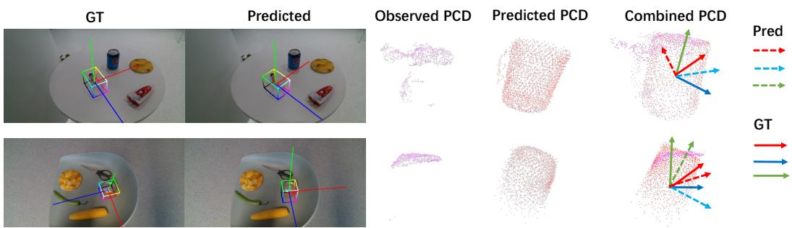  
Figure 6: Failure cases caused by corrupted or incomplete depth on reflective object regions.

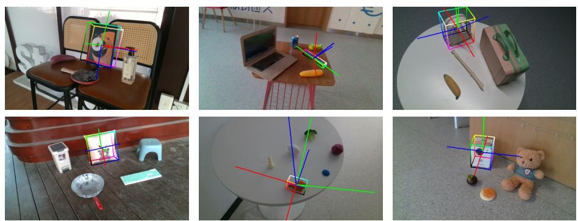  
Figure 7: Failure cases caused by symmetric, geometrically regular, or small objects with ambiguous orientation cues.

## A.6 Supplementary Ablation Results

Table 13 summarizes additional ablations while avoiding new claims beyond the current method. The RGB ablation confirms that lifted foundation features are a major contributor under partial depth. The MoE variants show that top-2 routing is the adopted trade-off: top-4 gives only a marginal gain over top-2 at higher cost, while top-1 is faster but less accurate. The backbone variants show that the framework remains effective with DINOv2 or CLIP, although RADIO gives the best result. The shape-decoder variants indicate that point selection and coarse-to-fine refinement also affect pose-size accuracy through the shared representation.

Table 13: Supplementary pose-size ablations on ROPE. We keep the metric definitions consistent with the main tables; “–” indicates a metric that is not applicable or was not measured for that variant.
<table><tr><td colspan="5">Setting AUC IoU25 AUC IoU50 AUC IoU75 VUS 5°5cm VUS 10°2cm</td></tr><tr><td colspan="5">Main components</td></tr><tr><td>Full</td><td>46.5</td><td>27.8 5.8</td><td>15.9</td><td>21.8</td></tr><tr><td>w/o RGB</td><td>34.5</td><td>16.2 2.2</td><td>6.5</td><td>13.2</td></tr><tr><td>w/o MoE</td><td>41.0</td><td>24.0 3.9</td><td>8.7</td><td>17.8</td></tr><tr><td>w/o Shape Sup.</td><td>39.5</td><td>23.2 3.5</td><td>8.1</td><td>16.5</td></tr><tr><td colspan="5">MoE routing and capacity</td></tr><tr><td>MoE top-1</td><td>25.6 一</td><td>一</td><td>13.5</td><td>一</td></tr><tr><td>MoE top-2, no balance</td><td>一</td><td>26.0 一</td><td>14.2</td><td></td></tr><tr><td>MoE top-4</td><td>一</td><td>28.0 一</td><td>16.1</td><td>一</td></tr><tr><td colspan="5">Backbone and shape-decoder variants</td></tr><tr><td>Full + DINOv2</td><td>45.5 27.0</td><td>一</td><td>13.7</td><td></td></tr><tr><td>Full + CLIP</td><td>44.8</td><td>26.3 一</td><td>12.5</td><td>一</td></tr><tr><td>w/o selection</td><td>45.7</td><td>27.1 5.2</td><td>一</td><td>21.0</td></tr><tr><td>w/o coarse-to-fine</td><td>43.8</td><td>25.6 4.3</td><td>一</td><td>19.9</td></tr></table>

## A.7 Additional Qualitative Results

Fig. 8 provides additional ROPE examples with the input RGB image, ground-truth annotation, GenPose++ prediction, and F2G-Pose prediction.

Fig. 9 supplements the material robustness analysis, and Fig. 10 provides additional cross-dataset real-world examples.

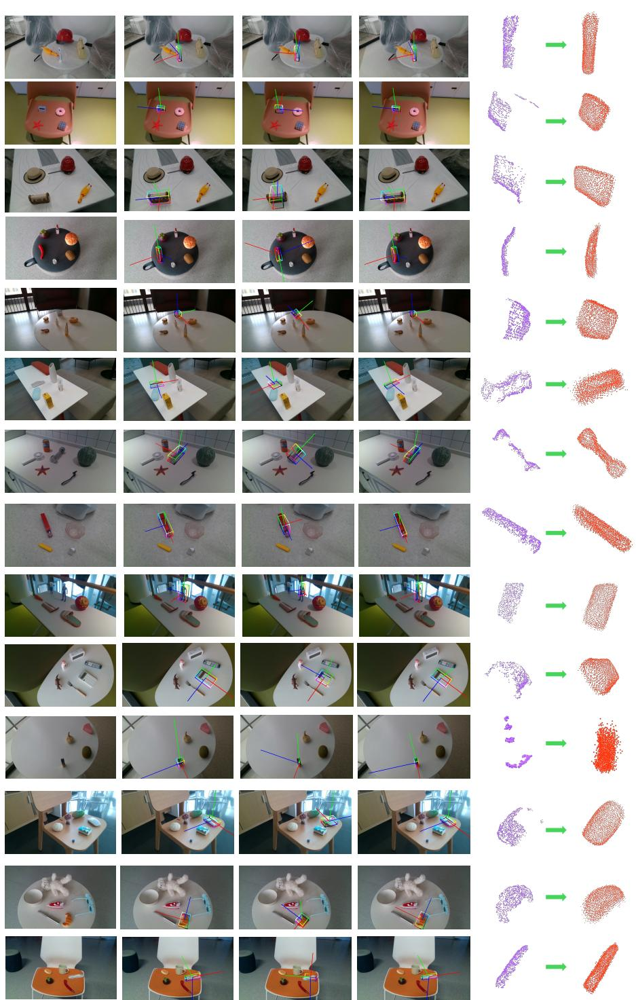  
Figure 8: Additional qualitative examples from ROPE.

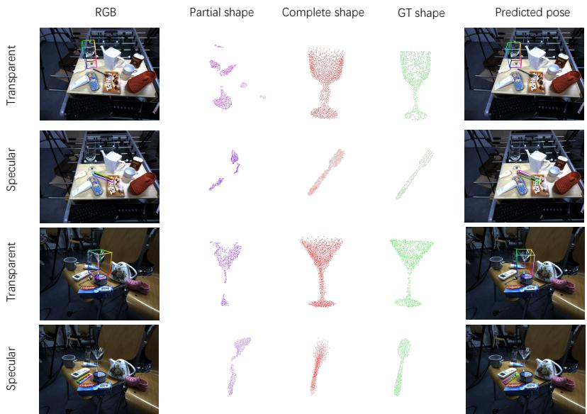  
Figure 9: Reflective and transparent object examples from HouseCat6D. These cases illustrate material-induced depth corruption and the resulting camera-frame shape predictions.

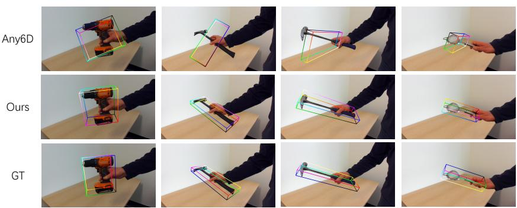  
Figure 10: Qualitative results on HANDAL. We compare ground-truth 3D boxes with predictions from Any6D and F2G-Pose.

## B Additional Evaluations and Protocol Clarifications

## B.1 Matched RGB-D Shape Completion

The camera-frame comparison in Table 3 measures the complete prediction system: its Chamfer distance includes intrinsic reconstruction error and global pose, translation, and scale error. Moreover, the geometry-only baselines and F2G-Pose receive different input information and supervision. To control these factors, we compare F2G-Pose and AdaPoinTr using identical RGB-D inputs, including features from the same frozen RADIO encoder, and predict shapes directly in a normalized canonical frame. Each architecture is evaluated with and without pose-size supervision; no ground-truth pose or scale is supplied as input.

Table 14: Matched RGB-D completion on SOPE. All variants predict normalized canonical shapes. Canonical CD-L1 is shown $\times 1 0 ^ { 3 } ;$ ; rotation and translation errors are in degrees and cm. “–” denotes no evaluated pose output.
<table><tr><td></td><td></td><td>Posel</td><td colspan="3">VUS ↑</td><td colspan="2">Mean error ↓</td><td rowspan="2">Canon. CD↓</td></tr><tr><td>Group</td><td>Model</td><td>size loss</td><td>IoU50</td><td>5°2cm</td><td>10°5cm</td><td>Rot.</td><td>Trans.</td></tr><tr><td>A</td><td>F2G-Pose</td><td>Yes</td><td>41.5</td><td>18.5</td><td>38.5</td><td>17.8</td><td>1.10</td><td>34.1</td></tr><tr><td>B</td><td>F2G-Pose</td><td>No</td><td></td><td></td><td></td><td></td><td></td><td>36.7</td></tr><tr><td>C</td><td>AdaPoinTr</td><td>No</td><td></td><td></td><td></td><td></td><td></td><td>37.2</td></tr><tr><td>D</td><td>AdaPoinTr</td><td>Yes</td><td>38.5</td><td>16.5</td><td>35.019.5</td><td></td><td>1.25</td><td>35.5</td></tr></table>

Table 14 shows that pose-size supervision improves canonical completion for both architectures: $3 6 . 7  3 4 . 1$ for F2G-Pose and $3 \bar { 7 } . 2  3 5 . 5$ for AdaPoinTr. Without this supervision, F2G-Pose retains a modest numerical advantage (36.7 versus 37.2). Under full supervision, it also achieves higher pose accuracy (41.5 versus 38.5 IoU50 AUC). Changing our default camera-frame completion target to normalized canonical completion reduces pose IoU50 AUC from 43.7 to 41.5, supporting the camera-frame target for the pose objective. Canonical and camera-frame CD values use different coordinate systems and scales and are not directly comparable.

## B.2 Segmentation-Mask Sensitivity

We evaluate SAM-predicted masks on ROPE and controlled erosion/dilation of ground-truth masks for pose estimation on ROPE and shape completion on SOPE. Erosion removes foreground evidence, while dilation includes background. Tables 15 and 16 report the results at the stated mask-IoU levels.

Table 15: Sensitivity of pose estimation to segmentation masks on ROPE. Rotation and translation columns report mean errors.
<table><tr><td>Mask IoU50 AUC IoU75 AUC VUS 5°5cm Rot. (°) Trans. (cm)</td></tr><tr><td>GT 27.8 5.8 15.9 27.5</td></tr><tr><td>1.19 SAM 27.2 5.6 15.2 28.1 1.21</td></tr><tr><td>Erosion, IoU 90% 26.6 5.3 14.8 28.3 1.24</td></tr><tr><td></td></tr><tr><td>Erosion, IoU 80% 23.8 4.1 13.7 28.8 1.32 27.5 5.3 15.8 27.6 1.20</td></tr><tr><td>Dilation, IoU 90% Dilation, IoU 80% 25.8 4.0 15.5 27.8 1.21</td></tr></table>

Table 16: Sensitivity of SOPE camera-frame shape completion to segmentation masks. Symmetric CD-L1 is shown ×103.
<table><tr><td>Mask</td><td>Mask IoU</td><td>Shape CD ↓</td></tr><tr><td>GT</td><td>100%</td><td>5.42</td></tr><tr><td>Dilation</td><td>90%</td><td>5.45</td></tr><tr><td>Dilation</td><td>80%</td><td>5.48</td></tr><tr><td>Erosion</td><td>90%</td><td>5.57</td></tr><tr><td>Erosion</td><td>80%</td><td>5.80</td></tr></table>

SAM masks yield results close to the GT-mask baseline. At matched mask IoU, erosion causes greater degradation than dilation on most pose metrics and on shape CD, suggesting that missing foreground is generally more harmful than limited background inclusion. Together with the RGB and

depth perturbations in Appendix A.3, these results characterize input sensitivity; they do not remove the requirement for segmented RGB-D input.

## B.3 MoE Expert Preferences

Beyond load balance, we analyze instance-level routing over 7,466 object samples. Routing exhibits an association with category (Cramér’s $V = 0 . 3 0 6 , p < 0 . 0 0 1 )$ . Different experts show preferences for broad geometry-related groups, including bag-like, flat, and bowl-like objects, with substantial overlap. This suggests distributed specialization rather than a rigid one-expert-per-category partition. Associations with material and visibility are weaker, and no significant independent association with symmetry was found. These observations complement the capacity and balance analysis in Table 6.

## B.4 HANDAL Selection and Per-Category Results

HANDAL is an independent real-world dataset with sensing conditions, capture environments, and object instances distinct from SOPE. Among its 17 categories, we evaluate the seven with direct semantic correspondences to the SOPE taxonomy. Selection is based on taxonomy correspondence, not model performance. The remaining categories have ambiguous mappings or no direct SOPE counterparts and are excluded because no corresponding canonical frame is defined. These seven categories map to six SOPE categories, with both wrench types mapped to spanner.

Table 17: HANDAL per-category IoU AUC for the seven directly matched categories. Counts refer to instances. The last row is the unweighted macro-average over seven HANDAL categories.
<table><tr><td>HANDAL category</td><td>SOPE category</td><td>Instances</td><td>IoU25</td><td>IoU50</td><td>IoU75</td></tr><tr><td>Claw Hammer</td><td>hammer</td><td>19</td><td>35.8</td><td>11.5</td><td>0.1</td></tr><tr><td>Adjustable Wrench</td><td>spanner</td><td>13</td><td>12.1</td><td>1.0</td><td>0.0</td></tr><tr><td>Combination Wrench</td><td>spanner</td><td>12</td><td>11.8</td><td>0.9</td><td>0.0</td></tr><tr><td>Ladle</td><td>spoon</td><td>12</td><td>29.4</td><td>3.9</td><td>0.0</td></tr><tr><td>Measuring Cup</td><td>cup</td><td>12</td><td>45.2</td><td>17.0</td><td>0.3</td></tr><tr><td>Mug</td><td>mug</td><td>12</td><td>68.3</td><td>35.4</td><td>1.6</td></tr><tr><td>Pot/Pan</td><td>pan</td><td>12</td><td>42.4</td><td>12.3</td><td>0.1</td></tr><tr><td>Macro-average</td><td></td><td>92 total</td><td>35.0</td><td>11.7</td><td>0.3</td></tr></table>

The evaluation covers 92 instances. The macro-average AUCs are 35.0, 11.7, and 0.3 at IoU25, IoU50, and IoU75. These results indicate coarse 3D alignment under cross-dataset transfer, while precise joint estimation of pose, size, and extent remains challenging. Both ROPE and this HANDAL subset evaluate seen-category, unseen-instance transfer, rather than unseen-category generalization.

## B.5 Reference-Free and Single-Reference Evaluation Protocols

Any6D (zero reference). “Zero reference” means that no additional reference view is supplied beyond the test RGB-D observation. We use the official repository’s reference-free image-to-3D pathway, which reconstructs a coarse shape from the test observation and subsequently estimates pose using that reconstructed shape.

Any6D (one reference). We randomly sample one additional view of the same object from its ROPE multi-view sequence as the reference image and apply the standard reference-query inference protocol.

FoundationPose (one reference). We evaluate the model-free pathway under the same onereference constraint. One additional real view of the same object is randomly sampled from its ROPE sequence; an object mesh is reconstructed from that view and used for pose estimation.