# GSHeadRelight: Fast Relightability for 3D Gaussian Head Synthesis

HENGLEI LV, Institute of Computing Technology, CAS and University of Chinese Academy of Sciences, China   
BAILIN DENG, Cardif University, United Kingdom   
JIANZHU GUO, Kuaishou Technology, China   
XIAOQIANG LIU, Kuaishou Technology, China   
PENGFEI WAN, Kuaishou Technology, China   
DI ZHANG, Kuaishou Technology, China   
LIN GAO∗, Institute of Computing Technology, CAS and University of Chinese Academy of Sciences, China

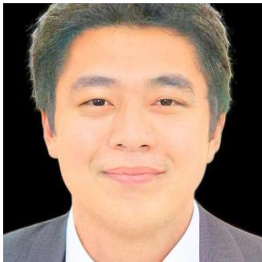

  
Albedo

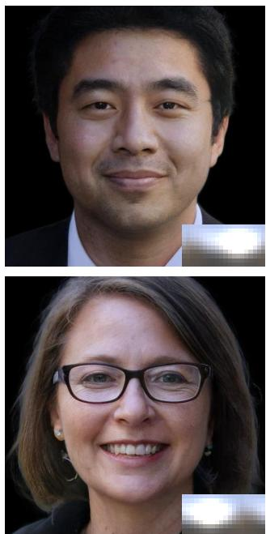

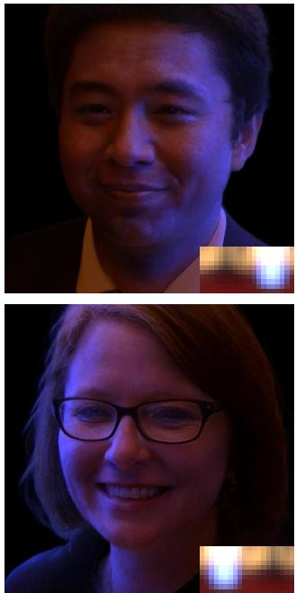  
Novel View Synthesis and Relighting at 240 FPS

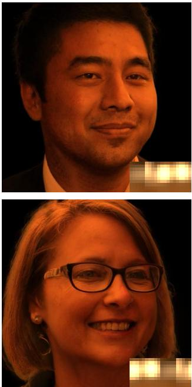

Fig. 1. Our method incorporates an eficient yet efective lighting model into generative 3D Gaussian and can synthesize high-quality relightable 3D Gaussian heads that allow for novel view synthesis and relighting given any HDRI environment maps. Our method does not require expensive light stage data and achieves real-time rendering at 240 FPS, surpassing the previous 3D-aware portrait relighting research by at least 12 times.

∗Corresponding author is Lin Gao (gaolin@ict.ac.cn).

Authors’ Contact Information: Henglei Lv, Institute of Computing Technology, CAS and University of Chinese Academy of Sciences, Haidian Qu, Beijing Shi, China, lvhenglei22s@ict.ac.cn; Bailin Deng, Cardif University, Cardif, United Kingdom, DengB3@cardif.ac.uk; Jianzhu Guo, Kuaishou Technology, Haidian Qu, Beijing Shi, China, guojianzhu1994@gmail.com; Xiaoqiang Liu, Kuaishou Technology, Haidian Qu, Beijing Shi, China, liuxiaoqiang@kuaishou.com; Pengfei Wan, Kuaishou Technology, Haidian Qu, Beijing Shi, China, wanpengfei@kuaishou.com; Di Zhang, Kuaishou Tech nology, Haidian Qu, Beijing Shi, China, zhangdi08@kuaishou.com; Lin Gao, Institute of Computing Technology, CAS and University of Chinese Academy of Sciences, Haidian Qu, Beijing Shi, China, gaolin@ict.ac.cn.

Relighting and novel view synthesis of human portraits are essential in applications such as portrait photography, virtual reality (VR), and augmented reality (AR). Despite recent progress, 3D-aware portrait relighting remains challenging due to the demands for photorealistic rendering, real-time performance, and generalization to unseen subjects. Existing works either rely on supervision from limited and expensive light stage captured data or produce suboptimal results. Moreover, many works are based on generative NeRFs, which sufer from poor 3D consistency and low real-time perfor mance. We resort to recent progress on generative 3D Gaussians and design a lighting model based on a unified neural radiance transfer representation, which responds linearly to incident light. Using only in-the-wild images, our method achieves state-of-the-art relighting results and a significantly faster rendering speed (×12) compared to previous 3D-aware portrait relighting research. Project page: http://www.geometrylearning.com/GSHeadRelight/.

CCS Concepts: • Computing methodologies → Image manipulation.

Additional Key Words and Phrases: 3D portrait relighting, 3D Gaussian splitting, radiance transfer

## ACM Reference Format:

Henglei Lv, Bailin Deng, Jianzhu Guo, Xiaoqiang Liu, Pengfei Wan, Di Zhang, and Lin Gao. 2025. GSHeadRelight: Fast Relightability for 3D Gaussian Head Synthesis. In Special Interest Group on Computer Graphics and Interactive Techniques Conference Conference Papers (SIGGRAPH Conference Papers ’25), August 10–14, 2025, Vancouver, BC, Canada. ACM, New York, NY, USA, 12 pages. https://doi.org/10.1145/3721238.3730614

## 1 Introduction

Relighting and novel view synthesis of human portraits have always been two fundamental demands in various applications. In portrait photography, finding the ideal lighting and viewpoint often requires intensive expert knowledge and extensive trial and error. In virtual reality and augmented reality, virtual avatars need to be rendered under diferent lighting conditions and viewpoints in real-time and high fidelity. These demands drive the rapid development of the emerging field of 3D-aware portrait relighting.

However, 3D-aware portrait relighting remains highly challenging due to its three demands: photorealistic appearance, real-time rendering, and one-shot generalization to unseen subjects. Human heads consist of highly intricate and varied materials that display diferent scattering and reflectance properties, making them among the most challenging objects to model accurately. The demand for real-time rendering significantly constrains algorithm design and model capabilities, and the requirement for sparse data input (single image or video) in many real-world applications brings the ambiguity between lighting and materials. Solving this under-constrained problem inevitably requires leveraging the powerful visual prior from pre-trained generative models.

It has been proven that Generative Adversarial Networks (GANs) [Goodfellow et al. 2014] can provide such a prior. When incorporated with 3D representations, GANs can even learn 3D geometries from mere image datasets. Among them, generative NeRF [Chan et al. 2022; Mildenhall et al. 2021] find the balance between photorealism and 3D consistency. The 3D head priors have enabled 3D-aware manipulation over human portraits such as attribute editing [Gao et al. 2023; Jiang et al. 2025; Sun et al. 2022], style transfer [Yuan et al. 2024] and relighting [Cai et al. 2024a; Jiang et al. 2023; Mei et al. 2024; Rao et al. 2024]. To resolve the ambiguity between lighting and materials, some works [Mei et al. 2024; Rao et al. 2024] employ light stage data as ground truth for supervision. Nevertheless, light-stage captured data are expensive and usually closed source, so they are not accessible to common researchers. For better generalization and scalability, learning from casual image datasets is preferred. Jiang et al. [2023] distill albedo from weakly labeled image datasets at the cost of handling only white light. Deng et al. [2024] propose an inverse rendering framework that models radiance transfer for the difuse term and uses a simple BRDF for the specular term. Impressive as these works are, most of them are based on generative NeRF, which is prone to limited rendering speed and 3D inconsistencies because of volume rendering and upsampling. More importantly, these works rely on neural rendering and need network evaluation for each lighting, which further limits the real-time performance of relighting.

We introduce GSHeadRelight, a relightable 3D head generative model with the latest generative 3D Gaussian backbone [Hyun and

Heo 2024; Kirschstein et al. 2024]. Inspired by precomputed radiance transfer [Sloan et al. 2002], we design a lighting model based on Unified Neural Radiance Transfer. We assign spherical harmonics coeficients for each 3D Gaussian ellipsoid to model the radiance transfer, which handles visibility and global illumination, including self-occlusion and subsurface scattering. By making radiance transfer coeficients a function of view directions, our method can model both difuse terms and low-frequency reflections. However, without explicit supervision of albedo, the ambiguity between albedo and lighting severely afects relighting quality. Since most in-the-wild images are under white illumination, we make a simple white-light assumption during training to mitigate the ambiguity, which provides plausible albedo decoupling. One desirable feature of radiance transfer is that the outgoing radiance, i.e. irradiance, responds to incident light linearly. Although our model is trained solely on white light, it can generalize well to colored illumination during test time. Moreover, since all components are organized as Gaussian attributes independent of lighting, only one forward inference is needed for head synthesis, and relighting can be performed without further generator evaluations. As a result, our method is extremely eficient and significantly reduces hardware requirements.

To summarize, we present three main contributions:

• A relightable 3D Gaussian head generative model based on unified radiance transfer that supports global illumination.

• A regime that distills plausible albedo and light transport functions from in-the-wild images without a heavy light stage setup.

• Extensive experiments show that our method achieves state-ofthe-art 3D-aware relighting results with extreme eficiency. Our model achieves a rendering speed of \~240 FPS on a single NVIDIA H800, with at least 12× speedup over previous methods.

## 2 Related Work

In this section, we review relevant work in the field of 3D-aware portrait synthesis. We then examine deep neural face relighting from two perspectives: studio-captured data and casual image datasets.

3D-aware Portrait Synthesis. Despite Difusion Models (DMs) [Ho et al. 2020] being proven to have stronger model capabilities than GANs [Goodfellow et al. 2014] in synthesizing images [Rombach et al. 2022], videos [Brooks et al. 2024] and 3D assets [Zhang et al. 2024d], GANs excel at 3D-aware portrait synthesis. The sparsity of high-quality 3D head models hinders the training of DMs, whereas 3D-GANs can learn fine geometry from mere image datasets.

Early 3D-GANs directly render pixels from explicit or implicit 3D representations, such as meshes [Chen and Zhang 2019; Henderson et al. 2020; Kanazawa et al. 2018] and voxels [Gadelha et al. 2017; Henzler et al. 2019], or implicit neural radiance fields [Chan et al. 2021; Schwarz et al. 2020]. Some works [Nguyen-Phuoc et al. 2019; Niemeyer and Geiger 2021; Xue et al. 2022] append neural rendering on the image side to improve image fidelity and enable high-resolution rendering. Subsequent works [Chan et al. 2022; Gu et al. 2021; Or-El et al. 2022] mostly adopt StyleGAN [Karras 2019] as the generator due to its success. Among them, EG3D [Chan et al. 2022] proposes a hybrid radiance field representation and applies a super-resolution module to the generated tri-plane features. Despite its high expressiveness, volume rendering is too slow for native high-resolution synthesis, and super-resolution inevitably causes spatial inconsistencies across views.

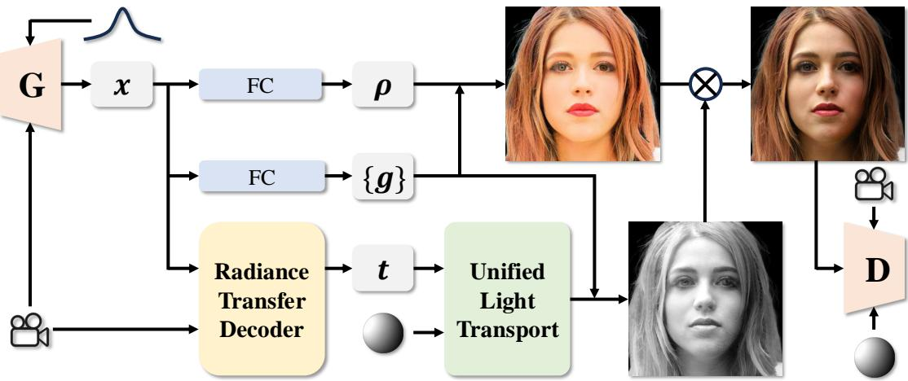  
Fig. 2. We incorporate a lighting model based on unified radiance transfer into a generative 3D Gaussian framework. The generator G takes in Gaussian noise and camera pose as condition and generates for each Gaussian an embedding x, which is then linearly transformed into the albedo � and geometry atributes {g} including position, scale, rotation and opacity. A light-weight decoder conditioned on view direction transforms x into radiance transfer coeficients t, which are used to compute the unified light transport with the light condition. Color is obtained by multiplying the light transport component with the albedo. The image is then rendered by standard splating and sent to the discriminator D, which takes both camera pose and light condition as input. Mapping modules are omited for simplicity. Gaussian noise and camera pose are represented as icons, and light condition as a difuse sphere.

Recent works [Hyun and Heo 2024; Kirschstein et al. 2024] utilize 3D Gaussian Splatting (3DGS) [Kerbl et al. 2023] as the new explicit representation, allowing for native high-resolution head synthesis in real-time. Kirschstein et al. [2024] bind 3D Gaussians to a template mesh and generate UV maps of each Gaussian attribute under the StyleGAN [Karras 2019] backbone. Gaussian ellipsoids are then queried and mapped back onto the template at arbitrary resolution. Hyun and Heo [2024] instead explore a hierarchical generative paradigm without a template mesh, where at each layer 3D Gaussians are constrained by anchor points from the previous layer. A new generative architecture is designed to generate multiple-level anchors and Gaussians. Our method is based on the recent progress in generative 3D Gaussian head synthesis. We refer to [Sun et al. 2024] for more recent advances in 3D Gaussian Splatting.

Deep Neural Face Relighting. Portrait relighting requires decomposition of appearance, geometry, and lighting. To acquire accurate facial reflectance fields, a line of works resort to meticulously calibrated studio equipment, including the widely adopted light stage [Debevec et al. 2000]. Neural networks are incorporated into the light stage processing to enable single image portrait relight ing [Kim et al. 2024; LeGendre et al. 2020; Nestmeyer et al. 2020; Pandey et al. 2021; Sun et al. 2019; Wang et al. 2020; Weir et al. 2022; Zhou et al. 2019]. Novel view synthesis and animation along with relighting are present with the development of 3D representa tions such as mesh [Bi et al. 2021; Lombardi et al. 2018], volumetric primitive [Lombardi et al. 2021; Yang et al. 2023, 2024], NeRF [Rao et al. 2022; Sarkar et al. 2023; Xu et al. 2023] and 3D Gaussian [He et al. 2024; Saito et al. 2024]. Inverse rendering is widely used to decouple intrinsics and enable lighting manipulation [Kim et al. 2024; Nestmeyer et al. 2020; Pandey et al. 2021; Tan et al. 2022;

Zhang et al. 2024c]. Recent development of difusion models enables more lighting condition interfaces like prompt [Zhang et al. 2024b], background [Ren et al. 2024], and scribble [Mei et al. 2023].

While the expensive studio-captured data provides ground truth supervision, easily accessible casual image collections ofer more diversity and scalability. Deep generative neural networks like GANs are usually adopted to learn the priors of appearance and lighting. Early works explore style transfer [Abdal et al. 2021; Deng et al. 2020; Fu et al. 2024; Shih et al. 2014; Shu et al. 2017] to transfer lighting, but fail to maintain identity consistency. The quotient image [Peers et al. 2007; Shashua and Riklin-Raviv 2001] decouples albedo from appearance and is widely used for plausible relighting [Jiang et al. 2023; Pan et al. 2021; Tewari et al. 2020]. Inverse rendering is also explored [Deng et al. 2024] with self-supervised regulation. Relighting with novel view synthesis from casual images [Sun et al. 2021; Tewari et al. 2020; Zhang et al. 2021] is also present with semantic control over GANs. The incorporation of generative NeRF allows for 3D-aware portrait relighting [Cai et al. 2024b,a; Deng et al. 2024; Mei et al. 2024; Pan et al. 2021; Ranjan et al. 2023; Rao et al. 2024; Tan et al. 2022].

## 3 Method

In the following, we first introduce preliminaries including spherical harmonics, precomputed radiance transfer, and 3D Gaussian head synthesis. Then we discuss design choices in generative 3D-GAN relighting. Finally, we introduce the proposed Unified Neural Radiance Transfer and the loss functions.

## 3.1 Preliminaries

Precomputed Radiance Transfer. Computing global illumination is costly because it requires iterative path tracing due to multibounce reflections, refractions, and scattering of light. Sloan et al.

[2002] propose to precompute radiance transfer functions, which are applied to actual incident lighting at run-time. Assuming distant illumination $L _ { \mathrm { i n } } ,$ exit radiance $L _ { \mathrm { o u t } , p }$ from a point � is computed by the rendering equation with light transport:

$$
L _ { \mathrm { o u t } , p } ( \hat { \mathbf { v } } ) = \int _ { \Omega } L _ { \mathrm { i n } } ( \hat { \mathbf { l } } ) V _ { p } ( \hat { \mathbf { l } } ) f _ { r } ( \hat { \mathbf { v } } , \hat { \mathbf { l } } ) \operatorname* { m a x } ( 0 , \hat { \mathbf { n } } \cdot \hat { \mathbf { l } } ) d \hat { \mathbf { l } }\tag{1}
$$

where nˆ is the surface normal at ${ \boldsymbol { \mathit { p } } } ,$ ˆl and vˆ are global light direction and viewing direction, $f _ { r }$ is Bidirectional Reflectance Distribution Function (BRDF) and $V _ { p }$ is the light transport function considering self-occlusion and interreflection.

To eficiently compute the integral in Equation 1, lighting and transfer functions are represented using �th-order spherical harmonics (SH). For specular surfaces, a transfer matrix $\mathbf { M } _ { p }$ including the BRDF and cosine terms describes the radiance transfer via

$$
{ \bf L } _ { \mathrm { o u t } , p } = \sum _ { j = 1 } ^ { n ^ { 2 } } { \bf M } _ { p } ^ { i j } { \bf L } _ { \mathrm { i n } } ^ { j } .\tag{2}
$$

Specifically for difuse surfaces, radiance transfer can be represented by a transfer vector $\mathbf { V } _ { \mathcal { P } }$ producing scalar exit radiance $L _ { \mathrm { o u t } , p }$ by

$$
L _ { \mathrm { o u t } , p } = \sum _ { i = 1 } ^ { n ^ { 2 } } \mathbf { V } _ { p } ^ { i } \mathbf { L } _ { p } ^ { i } .\tag{3}
$$

In modern neural rendering, precomputing transfer functions is often impractical because the geometric and material properties are unknown. Previous works [Deng et al. 2024; Saito et al. 2024; Xing et al. 2024; Zhang et al. 2024a] choose to parameterize and learn difuse radiance transfer vectors, while employing alternative representations for specular terms because the transfer matrix is too large. We instead propose to use a unified representation that models both difuse terms and low-frequency reflections.

3D Gaussian Head Synthesis. 3D Gaussian Splatting [Kerbl et al. 2023] is recently introduced as a point-based 3D representation that assigns to each point 5 attributes: position $\mu \in \mathbb { R } ^ { 3 }$ , scale $s \in \mathbb { R } ^ { 3 }$ rotation quaternion $q \in \mathbb { R } ^ { 4 }$ , opacity $\alpha \in \mathbb { R }$ and color $c \in \mathbb { R } ^ { 3 }$ . A Gaussian ellipsoid is formulated as

$$
G ( x ) = e ^ { - \frac { 1 } { 2 } ( x - \mu ) ^ { \mathrm { T } } \Sigma ^ { - 1 } ( x - \mu ) } , \quad \mathrm { w i t h } \Sigma = R S S ^ { \mathrm { T } } R ^ { \mathrm { T } } ,\tag{4}
$$

where � is the world coordinates, and the scaling matrix � and rotation matrix � are derived from the scaling � and quaternion �. The color � of a pixel in image space is computed by blending � overlapping sorted points:

$$
C = \sum _ { i = 1 } ^ { N } c _ { i } \alpha _ { i } \prod _ { j = 1 } ^ { i - 1 } ( 1 - \alpha _ { j } ) .\tag{5}
$$

Recent works in 3D Gaussian head synthesis [Hyun and Heo 2024; Kirschstein et al. 2024] allow for native high-resolution head synthesis in real time. Kirschstein et al. [2024] bind 3D Gaussians to a template mesh and use StyleGAN2 [Karras et al. 2020] to generate UV maps of each Gaussian attribute. Hyun and Heo [2024] instead explore a hierarchical generative paradigm, where the 3D Gaussians at each layer are constrained by anchor points from the previous layer.

## 3.2 Unified Neural Radiance Transfer

Radiance transfer was primarily used to describe the difuse component of lighting. We show that by incorporating view directions into the generative framework, a Unified Neural Radiance Transfer representation is capable of describing both difuse and low-frequency specular terms. Revisiting Equation 1, by absorbing the light transport, BRDF, and cosine term into a unified radiance transfer function $T _ { p }$ in SH basis, the rendering equation becomes

$$
L _ { \mathrm { o u t } , p } ( \hat { \mathbf { v } } ) = \int _ { \Omega } L _ { \mathrm { i n } } ( \hat { \mathbf { l } } ) T _ { p } ( \hat { \mathbf { v } } , \hat { \mathbf { l } } ) d \hat { \mathbf { l } } \approx \sum _ { i = 1 } ^ { n ^ { 2 } } l _ { \mathrm { i n } } ^ { i } t _ { p } ^ { i } ( \hat { \mathbf { v } } ) ,\tag{6}
$$

where $l _ { \mathrm { i n } } ^ { i }$ and $t _ { p } ^ { i } ( \hat { \mathbf { v } } )$ are the �th-order expansion coeficients. Specifically, we disentangle the albedo $\rho _ { p }$ from $t _ { p } ^ { i } ( \hat { \mathbf { v } } )$ for disentangling appearance from lighting. With minor notation abuse, the viewdependent exit radiance is formulated as

$$
L _ { \mathrm { o u t } , \boldsymbol { p } } ( \hat { \mathbf { v } } ) = \rho _ { \hat { p } } \sum _ { i = 1 } ^ { n ^ { 2 } } l _ { \mathrm { i n } } ^ { i } t _ { \hat { p } } ^ { i } ( \hat { \mathbf { v } } ) .\tag{7}
$$

In this way, both difuse and specular terms can be handled in a unified manner by making radiance transfer coeficients a function of view direction.

Based on 3D Gaussian GAN framework, we additionally assign each Gaussian point � an albedo $\rho _ { p } \in [ 0 , 1 ] ^ { 3 }$ and a transfer vector $\mathbf { t } _ { p } \in \mathbb { R } ^ { 3 \times n ^ { 2 } }$ to replace the original view-independent color. Specifically, as shown in Figure 2, the generator gives each Gaussian point � an embedding $\mathbf { x } _ { p } .$ . The transfer vector $\mathbf { t } _ { p }$ is obtained by concatenating the Gaussian embedding with encoded view direction and sending it to a transfer vector decoder $\Psi _ { t }$

$$
\mathbf { t } _ { \mathcal { P } } ( \hat { \mathbf { v } } ) = \Psi _ { t } ( \mathbf { x } _ { \mathcal { p } } ^ { \prime } | | \mathbf { v } _ { \mathcal { p } } ) ,\tag{8}
$$

where $\mathbf { x } _ { p } ^ { \prime }$ is a shortened embedding transformed linearly from the Gaussian embedding $\mathbf { x } _ { p } .$ . It can be stored to perform real-time rendering with standard 3D Gaussian splatting after generation.

Without explicit supervision of albedo, the ambiguity between albedo and transfer vectors is unavoidable, as demonstrated in Section 4.5. Observing that the illumination in most real images is approximately white light, we propose to train the model under white light conditions. The light and transfer vectors are then reduced to single channel, i.e. $\mathbf { l } , \mathbf { t } \in \mathbb { R } ^ { 1 \times n ^ { 2 } }$ . In this way, the contribution of the transfer vector to the color distribution is discarded, and thus the ambiguity is resolved. We find in the experiment that adversarial training will average out the impact of light color residuals on the albedo. Moreover, due to the linearity of our unified radiance transfer functions, our model can render colored lighting at test-time by channel-wise applying Equation 7.

## 4 Experiments

## 4.1 Implementation Details

Our method is based on GSGAN [Hyun and Heo 2024], which follows the same data preparation pipeline as EG3D [Chan et al. 2022]. The lighting labels, represented as monochromatic 3rd-order spherical harmonics, are extracted using DPR [Zhou et al. 2019], following the approach ofJiang et al. [2023]. We use MODNet [Ke et al. 2022] to extract foreground components to alleviate background leakage. The transfer vector decoder $\Psi _ { t }$ is implemented as a lightweight MLP with one hidden layer of 64 units. We train the models on the

Table 1. Comparison of generative quality and rendering speed. KID is reported by 100×. SR denotes super resolution. For relighting methods, rendering speed is measured under varying illumination and view direction. All methods render at 512 resolution except for Volux-GAN at 256 on a single RTX A6000 GPU. We bold the best score, underline the second, and double-underline the third.
<table><tr><td>Method</td><td>SR</td><td>FID↓</td><td>KID↓</td><td>Rendering Speed ↑</td></tr><tr><td>EG3D</td><td>√</td><td>4.30</td><td>0.132</td><td>42 fps</td></tr><tr><td>GSGAN</td><td>X</td><td>5.60</td><td>0.161</td><td>245 fps</td></tr><tr><td>Volux-GAN</td><td>√</td><td>59.79</td><td>4.124</td><td>21 fps</td></tr><tr><td>ShadeGAN</td><td>√</td><td>9.92</td><td>0.453</td><td>0.5 fps</td></tr><tr><td>LumiGAN</td><td>√</td><td>5.28</td><td>0.251</td><td></td></tr><tr><td>NeRFFaceLighting</td><td>√</td><td>4.16</td><td>0.147</td><td>2.8 fps</td></tr><tr><td>Ours</td><td>X</td><td>5.71</td><td>0.151</td><td>243 fps</td></tr></table>

Table 2. Comparison of lighting quality.
<table><tr><td>Method</td><td>Lighting Error↓</td><td>Lighting Stability↓</td></tr><tr><td>StyleFlow</td><td>0.7523</td><td>0.1530</td></tr><tr><td>DisCoFaceGAN</td><td>0.5860</td><td>0.1335</td></tr><tr><td>GAN-Control</td><td>0.6647</td><td>0.1485</td></tr><tr><td>ShadeGAN</td><td>1.0714</td><td>0.2149</td></tr><tr><td>NeRFFaceLighting</td><td>0.6377</td><td>0.1455</td></tr><tr><td>Ours</td><td>0.6213</td><td>0.1537</td></tr></table>

FFHQ dataset [Karras 2019] from scratch for 15M images with four NVIDIA H800 GPUs.

## 4.2 Quantitative Comparisons

Baselines. We compare our method with previous publicly accessible works for novel view portrait relighting: ShadeGAN [Pan et al. 2021], Volux-GAN [Tan et al. 2022], NeRFFaceLighting [Jiang et al. 2023]. We also include LumiGAN [Deng et al. 2024], which is not accessible, and report results from the original paper if presented.

Generative quality and rendering speed. We follow Chan et al. [2022] and compute Frechnet Inception Distance (FID) [Heusel et al. 2017] and Kernel Inception Distance (KID) [Bińkowski et al. 2018] between 50k generated images and all training images. From Table 1, we see that EG3D-based methods have a higher FID due to the 2D super-resolution module, which upsamples low-resolution volume rendering results at the cost of losing 3D consistency. Our method achieves similar or even better generative quality than our backbone GSGAN [Hyun and Heo 2024]. Moreover, our method maintains a high rendering speed, surpassing other relighting works by at least 12×. This is attributed to the simple yet efective architecture of our unified radiance transfer relighting framework.

Lighting quality. Following Jiang et al. [2023], we measure the relighting performance with an of-the-shelf estimator [Feng et al. 2021] using two metrics: the Lighting Error computes the distance between real lighting and estimated lighting in fake images; the Lighting Stability computes the standard deviation of estimated lighting in 100 fake images generated using the same lighting conditions. The metrics are averaged for 1000 samples. Since these metrics can only be applied to methods with lighting conditions estimated from real images, Volux-GAN and LumiGAN are excluded. Instead, StyleFlow [Abdal et al. 2021], DisCoFaceGAN [Deng et al. 2020], and GAN-Control [Shoshan et al. 2021] are included as 2D generative relighting methods for comparison. Table 2 shows that our method is comparable in lighting quality with state-of-the-art 3D-portrait relighting methods. The 2D relighting method DisCo-FaceGAN has higher lighting scores at the cost of low generative quality. Moreover, our method can perform RGB relighting, thanks to its linear radiance transfer framework. This is not achievable by other methods based on implicit neural relighting.

Table 3. Comparison of spatial consistency. SR denotes super resolution.
<table><tr><td>Method</td><td>SR</td><td>PSNR↑</td><td>SSIM↑</td><td>Id. Sim. (view) ↑</td></tr><tr><td>EG3D</td><td>√</td><td>38.13</td><td>0.9612</td><td>0.7501</td></tr><tr><td>GSGAN</td><td>X</td><td>35.85</td><td>0.9395</td><td>0.7416</td></tr><tr><td>ShadeGAN</td><td>√</td><td>24.23</td><td>0.7316</td><td>0.5238</td></tr><tr><td>Volux-GAN</td><td>√</td><td>31.64</td><td>0.8820</td><td>0.6882</td></tr><tr><td>NeRFFaceLighting</td><td>√</td><td>37.98</td><td>0.9561</td><td>0.7303</td></tr><tr><td>Ours</td><td>X</td><td>35.57</td><td>0.9521</td><td>0.7538</td></tr></table>

Spatial consistency. Following Hyun and Heo [2024], we use a surface estimation model NeUS2 [Wang et al. 2023] to validate the spatial consistency of 3D-aware relighting models. Specifically, we randomly generate 30 views of a lit subject, fit them to surface estimation, and compute the reconstruction error using standard PSNR and SSIM metrics. We generate 30 subjects and record the average metrics. We also include the identity similarity metric proposed by Tan et al. [2022], and report the mean score across 30 views. From Table 3 we see that although EG3D-based methods do not preserve exact 3D consistency due to 2D super resolution, they do not exhibit disadvantages in terms of reconstruction error. This is possibly because EG3D and NeUS2 share a similar implicit representation and volume rendering process. However, in terms of identity similarity, our method achieves the highest score, demonstrating better 3D consistency than other methods. In general, EG3D-based methods sufer from texture flickering when continuously changing viewpoint due to 2D super resolution, while our method renders an explicit 3D Gaussian model and maintains view consistency. We further refer to the video demo for better visual comparison.

## 4.3 Qualitative Comparison

The Lighting Error and Lighting Stability metrics used in Section 4.2 can only evaluate the lighting similarity by an of-the-shelf lighting estimator. To further evaluate lighting quality under colored light conditions and compare the lighting realism under human eyes, we compare our method to previous works in real environment map lighting conditions. We include NeLF [Sun et al. 2021], which is trained using a synthetic lightstage dataset and needs multi-view inputs. Figure 3 shows that our method achieves better relighting quality than previous methods. Volux-GAN [Tan et al. 2022] uses 2D convolution layers to add shadows and details, leading to view inconsistencies. NeRFFaceLighting [Jiang et al. 2023] can only handle white-light conditions and performs poorly on environment map lighting. LumiGAN [Deng et al. 2024] relies on inverse rendering, and incorrect geometry decoupling leads to lighting artifacts, like the unnatural lit parts on the cheek and beside the wings of the nose. NeLF shows poor visual quality and loses facial details like wrinkles and pores. In contrast, our method performs well both in visual quality and relighting quality.

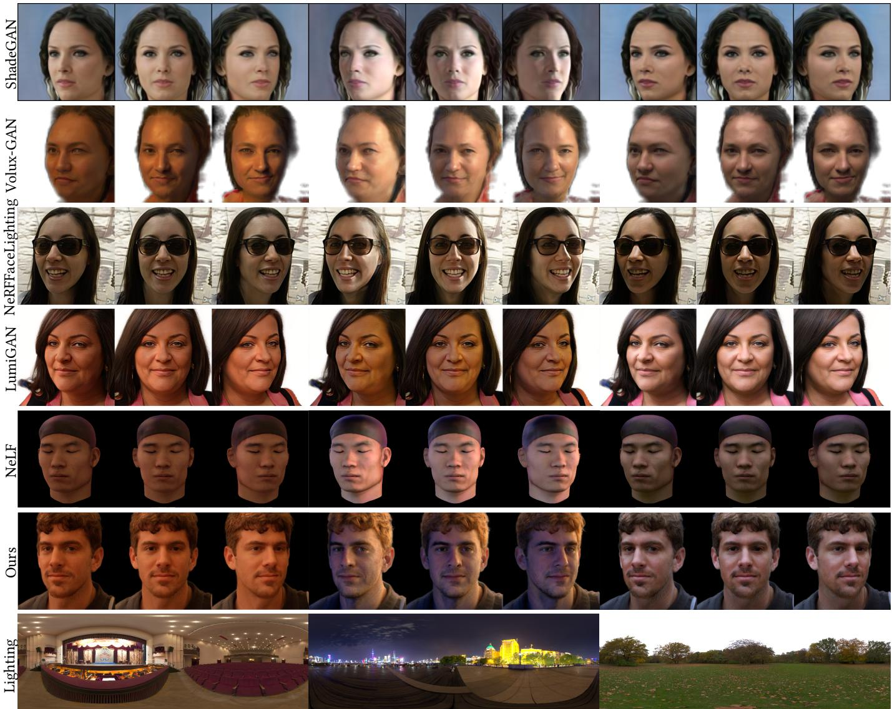  
Fig. 3. Qualitative Comparison. We use the same environment maps as LumiGAN [Deng et al. 2024] for comparison, since it is not publicly accessible.

## 4.4 Visual Relighting Results

Our model presents overall good photorealism under diferent light intensity and directions, as shown in Fig 4. Colored illumination can also be handled correctly, as shown in Figure 5. Given an environment map, image-based lighting requires first converting it to spherical harmonic (SH) coeficients. Specifically, we apply Gauss ian blurring before SH sampling with a radius of 0.1× image width to remove high-frequency details. Image-based lighting results are shown in Figure 6. Thanks to the unified radiance transfer framework, our approach responds linearly to incident light and innately satisfies the light transport consistency. Our method maintains 3D consistency in head poses while delivering plausible albedo and relighting results under various environment maps.

Real portrait relighting. With the help of the GAN inversion technique, our model can relight real-face images. The basic idea is to project a real-face image into the latent space and manipulate lighting during reconstruction. We implement the inversion similar to

Albedo

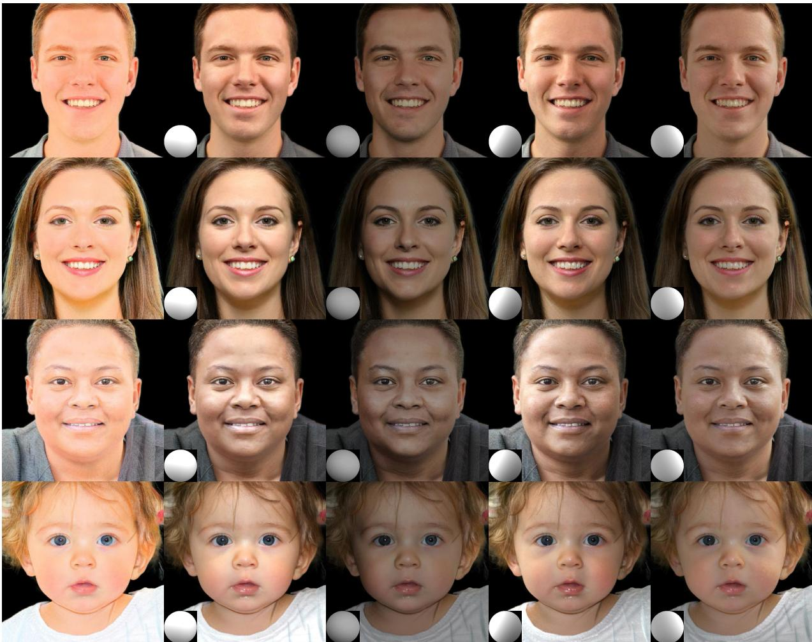  
Albedo  
Light Condition 1  
Light Condition 2  
Light Condition 3  
Light Condition 4

Pivotal Tuning [Roich et al. 2022] and compare the result with NeRF-FaceLighting in Figure 7. Our method produces better photorealism and identity consistency. We also quantitatively evaluate identity consistency using cosine similarity of VGGFace [Parkhi et al. 2015] embedding on a subset of the Goliath dataset [Martinez et al. 2024], which has 4 sets of light-stage head capture. Our method (0.443) significantly outperforms NeRFFaceLighting (0.298).

## 4.5 Other Design Choices and Ablation Study

Multiple design choices exist for implementing unified radiance transfer in the 3D-GAN framework. First, the model could be trained using RGB lighting labels instead of monochromatic ones. Second, difuse and specular reflectance could be modeled separately. We discuss these designs and validate their feasibility. We then conduct an ablation study on our proposed unified radiance transfer.

No white-light assumption. Some works [Fei et al. 2023; Phongthawee et al. 2024] allow extracting estimated RGB lighting conditions

Fig. 4. White lighting samples of our method. Lighting conditions are provided at the lower left corner.  
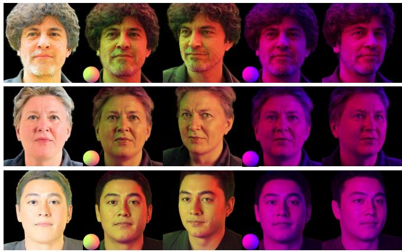  
Colored Illumination 1  
Colored Illumination 2

Fig. 5. RGB lighting samples of our method.

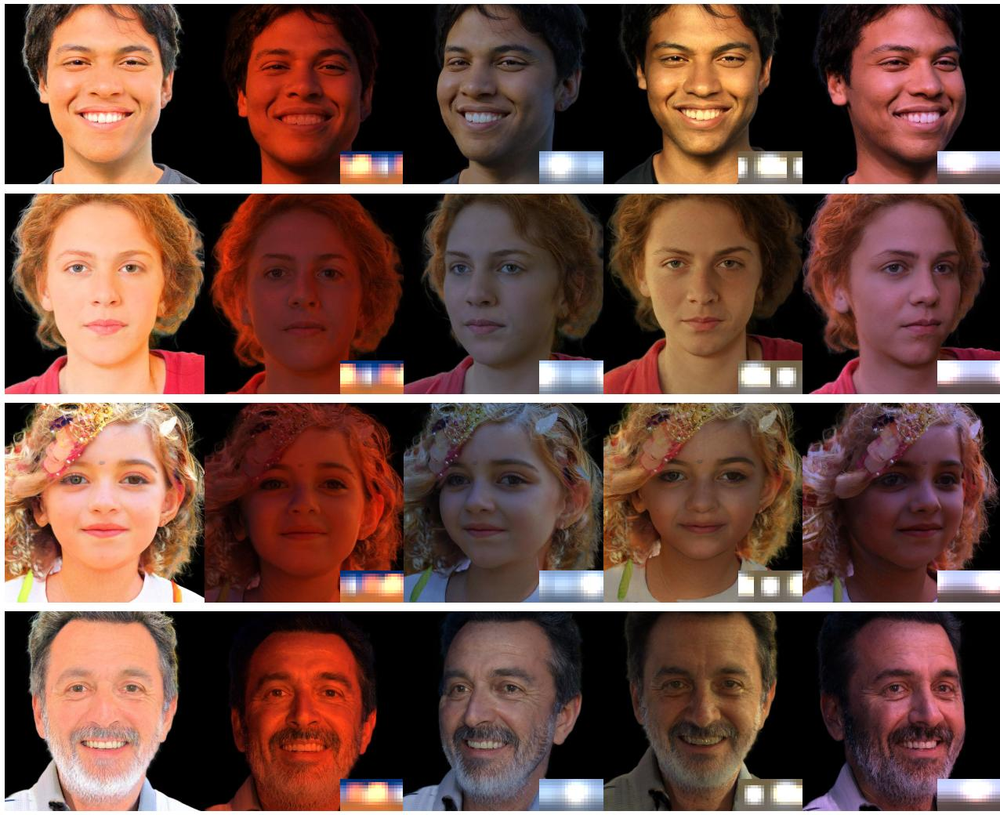  
Environment Map 2  
Environment Map 3  
Environment Map 4

Fig. 6. Environment map relighting samples of our method. The first column presents albedo images and the rest columns present renderings under diferent environment maps and view directions. Environment maps are rotated for diferent rows.

from a single image, which makes training on colored illumination possible. We follow the same setting and modify the parameterization of lighting labels and transfer functions from 1 channel to 3 channels. We use [Fei et al. 2023] to extract HDRI environment maps and turn them into 3rd-order RGB spherical harmonics coeficients. As shown in Figure 8, without explicit supervision of intrinsics, training under RGB lighting conditions leads to faded albedo. In this case, the contribution to appearance is entirely provided by lighting, and relighting becomes a style transfer process. The model overfits on certain lighting conditions, does not learn a physically consistent lighting model, and fails under unseen lighting.

difuse and specular decomposition. Inverse rendering is widely adopted in portrait relighting [Deng et al. 2024; Kim et al. 2024; Saito et al. 2024] to infer physical properties such as geometry, materials, and lighting. Difuse and specular terms are often decoupled using diferent lighting models. We validate this setting in the 3D-GAN framework. We decouple the transfer vector t(vˆ) into view-independent difuse transfer vector tdifuse and view-dependent specular transfer vector $\mathbf { t } _ { \mathrm { s p e c u l a r } } ( \hat { \mathbf { v } } )$ . However, without explicit supervision, albedo, difuse, and specular terms are disentangled incorrectly and exhibit significant inconsistencies, as shown in Figure 9.

Ablation study. We validate the efectiveness of unified radiance transfer in Table 4. Without radiance transfer, we assume the color is directly predicted by a decoder that takes in lighting conditions. All models are trained for 3M images before evaluation. We find that radiance transfer provides strong lighting manipulation ability, demonstrated by the significant increase in Lighting Error in the case without radiance transfer. At the same time, without the view condition, the lighting accuracy also drops since the vanilla vectorbased radiance transfer cannot model specular efects. In this case, the albedo is often observed with specular residuals. In contrast, our complete unified radiance transfer representation achieves the best

LC2 VD1

LC1 VD2

Albedo

LC2 VD2

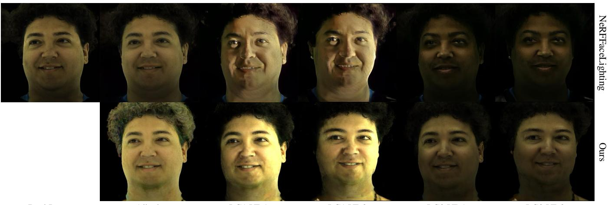  
Real Image  
LC1 VD1

Fig. 7. Results of real portrait relighting and novel view synthesis. LC and VD stand for light condition and view direction, respectively. Our method shows beter photorealism and identity consistency compared to NeRFFaceLighting [Jiang et al. 2023].  
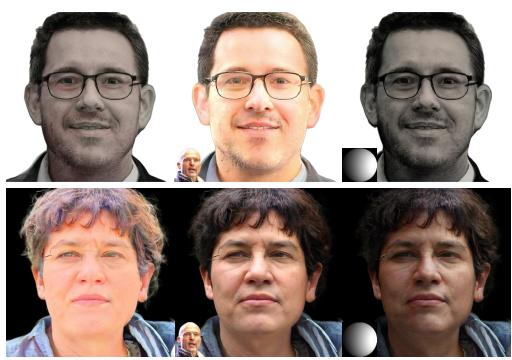  
Seen Lighting  
Fig. 8. Visual comparison between training under RGB light condition (left) and white light condition (right), both trained for 3M images. We present albedo and relighting results under seen lighting and unseen lighting. Lighting conditions are provided at the lower left corner.

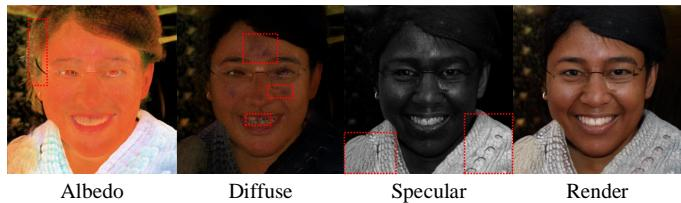  
Fig. 9. Visual demonstration of difuse and specular decomposition. Color inconsistencies are marked by red dashed boxes.

lighting manipulation accuracy and yields smooth albedos. From Figure 10, view conditioning reduces most highlight residuals in albedo and yields more satisfactory relighting results.

(A) w/o View Condition  
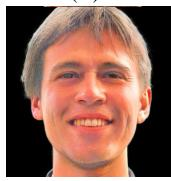

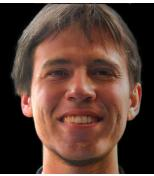  
(B) w/ View Condition  
Left Light

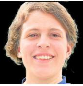

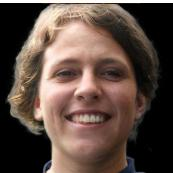  
Fig. 10. Visual ablation of view condition. Albedo and left light renderings with and without view condition are presented. Zoom in for a beter view.

Table 4. Quantitative ablation of unified radiance transfer. R.T. denotes radiance transfer and V.C. denotes view condition.
<table><tr><td>Method</td><td>Lighting Error↓ 1</td><td>Lighting Stability↓</td></tr><tr><td>w/o R.T.</td><td>1.2296</td><td>0.4288</td></tr><tr><td>w/o V.C.</td><td>0.7019</td><td>0.1723</td></tr><tr><td>Ours</td><td>0.6520</td><td>0.1582</td></tr></table>

## 5 Conclusion, Limitation, and Future Work

We present GSHeadRelight, a real-time relightable 3D-aware portrait synthesis framework based on a unified radiance transfer rep resentation, addressing the challenging problem of colored lighting manipulation in the 3D-GAN setting. Our model learns the light transport functions under a white-light assumption from casual image datasets, without requiring expensive and inaccessible lightstage captured data. Since our model responds linearly to incident lighting and innately retains light transport consistency, it general izes well to colored illumination and produces overall high-quality relighting results. The simple model design discards network evaluation for each light condition, adding real-time relightability for 3D head synthesis. Extensive evaluations demonstrate that our method achieves state-of-the-art 3D-aware relighting quality, superior realtime performance, and better spatial consistency compared with previous relighting methods.

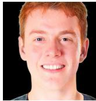  
Albedo

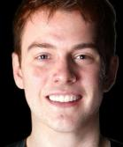  
(A)

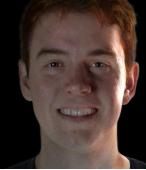  
(B)

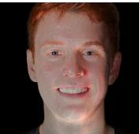  
(C)  
Fig. 11. Failure cases. Albedo with highlight residuals and renderings under illumination from three directions are presented. Zoom in for a beter view.

One limitation of our method is that it mainly models lowfrequency and difuse lighting efects due to the nature of radiance transfer in the spherical harmonics basis. Although the viewconditioned radiance transfer decoder models low-frequency viewdependent efects to some extent, our method is still not expressive enough for high-frequency reflections. In some cases, the model incorrectly learns the specular highlight in the albedo. As shown in Figure 11 (A), highlight on the right cheek remains in the albedo and leads to artifacts. In addition, relighting under illumination from below the face region may seem implausible, as shown in Figure 11 (C). This is because such illumination is scarce in in-the-wild images.

For future work, it is interesting to model high-frequency and largely view-dependent efects on top of this explicit linear lighting model to support more complex lighting conditions other than spherical harmonics. Exploring the adaptation of our method to dynamic human head scenarios is also worth further investigation.

## Acknowledgments

This work was supported by National Natural Science Foundation of China (No. 62322210), Beijing Municipal Science and Technology Commission (No. Z231100005923031), Innovation Funding of ICT, CAS (No. E461020), the Royal Society (IEC\NSFC\233596), Kuaishou Technology and CCF-Kuaishou Large Model Explorer Fund. We would like to thank Chunshuo Qiu for assisting with the demo video production and Zhongming Chen for assisting with figure making. We would also like to acknowledge the Nanjing Institute of InforSuperBahn OneAiNexus for providing the training and evaluation platform.

## References

Rameen Abdal, Peihao Zhu, Niloy J Mitra, and Peter Wonka. 2021. Styleflow: Attribute conditioned exploration of stylegan-generated images using conditional continuous normalizing flows. ACM Transactions on Graphics (ToG) 40, 3 (2021), 1–21

Sai Bi, Stephen Lombardi, Shunsuke Saito, Tomas Simon, Shih-En Wei, Kevyn Mcphail, Ravi Ramamoorthi, Yaser Sheikh, and Jason Saragih. 2021. Deep relightable appearance models for animatable faces. ACM Transactions on Graphics (ToG) 40, 4 (2021), 1–15.

Mikołaj Bińkowski, Danica J Sutherland, Michael Arbel, and Arthur Gretton. 2018. Demystifying mmd gans. arXiv preprint arXiv:1801.01401 (2018).

Tim Brooks, Bill Peebles, Connor Holmes, Will DePue, Yufei Guo, Li Jing, David Schnurr, Joe Taylor, Troy Luhman, Eric Luhman, Clarence Ng, Ricky Wang, and Aditya Ramesh. 2024. Video generation models as world simulators. (2024). https: //openai.com/research/video-generation-models-as-world-simulators

Xiaoxu Cai, Jianwen Lou, Jiajun Bu, Junyu Dong, Haishuai Wang, and Hui Yu. 2024b. Single depth image 3d face reconstruction via domain adaptive learning. Frontiers of Computer Science 18, 1 (2024), 181342.

Ziqi Cai, Kaiwen Jiang, Shu-Yu Chen, Yu-Kun Lai, Hongbo Fu, Boxin Shi, and Lin Gao. 2024a. Real-time 3D-aware portrait video relighting. In Proceedings ofthe IEEE/CVF Conference on Computer Vision and Pattern Recognition. 6221–6231.

Eric R Chan, Connor Z Lin, Matthew A Chan, Koki Nagano, Boxiao Pan, Shalini De Mello, Orazio Gallo, Leonidas J Guibas, Jonathan Tremblay, Sameh Khamis, et al. 2022. Eficient geometry-aware 3d generative adversarial networks. In Proceedings of the IEEE/CVF Conference on Computer Vision and Pattern Recognition. 16123–16133.

Eric R Chan, Marco Monteiro, Petr Kellnhofer, Jiajun Wu, and Gordon Wetzstein. 2021. pi-gan: Periodic implicit generative adversarial networks for 3d-aware image synthesis. In Proceedings of the IEEE/CVF Conference on Computer Vision and Pattern Recognition. 5799–5809.

Zhiqin Chen and Hao Zhang. 2019. Learning implicit fields for generative shape modeling. In Proceedings of the IEEE/CVF Conference on Computer Vision and Pattern Recognition. 5939–5948.

Paul Debevec, Tim Hawkins, Chris Tchou, Haarm-Pieter Duiker, Westley Sarokin, and Mark Sagar. 2000. Acquiring the reflectance field of a human face. In Proceedings of the 27th annual conference on Computer graphics and interactive techniques. 145–156.

Boyang Deng, Yifan Wang, and Gordon Wetzstein. 2024. Lumigan: Unconditional generation of relightable 3d human faces. In 2024 International Conference on 3D Vision (3DV). IEEE, 302–312.

Yu Deng, Jiaolong Yang, Dong Chen, Fang Wen, and Xin Tong. 2020. Disentangled and controllable face image generation via 3d imitative-contrastive learning. In Proceedings ofthe IEEE/CVF Conference on Computer Vision and Pattern Recognition. 5154–5163.

Fan Fei, Yean Cheng, Yongjie Zhu, Qian Zheng, Si Li, Gang Pan, and Boxin Shi. 2023. Split: Single portrait lighting estimation via a tetrad of face intrinsics. IEEE Transactions on Pattern Analysis and Machine Intelligence (2023).

Yao Feng, Haiwen Feng, Michael J Black, and Timo Bolkart. 2021. Learning an animatable detailed 3D face model from in-the-wild images. ACM Transactions on Graphics (ToG) 40, 4 (2021), 1–13.

Qian Fu, Linlin Liu, Fei Hou, and Ying He. 2024. Hierarchical vectorization for facial images. Computational Visual Media 10, 1 (2024), 97–118.

Matheus Gadelha, Subhransu Maji, and Rui Wang. 2017. 3d shape induction from 2d views of multiple objects. In 2017 international conference on 3d vision (3DV). IEEE, 402–411.

Lin Gao, Feng-Lin Liu, Shu-Yu Chen, Kaiwen Jiang, Chunpeng Li, Yukun Lai, and Hongbo Fu. 2023. SketchFaceNeRF: Sketch-based facial generation and editing in neural radiance fields. ACM Transactions on Graphics 42, 4 (2023).

Ian Goodfellow, Jean Pouget-Abadie, Mehdi Mirza, Bing Xu, David Warde-Farley, Sherjil Ozair, Aaron Courville, and Yoshua Bengio. 2014. Generative adversarial nets. Advances in neural information processing systems 27 (2014).

Jiatao Gu, Lingjie Liu, Peng Wang, and Christian Theobalt. 2021. Stylenerf: A style based 3d-aware generator for high-resolution image synthesis. arXiv preprint arXiv:2110.08985 (2021).

Mingming He, Pascal Clausen, Ahmet Levent Taşel, Li Ma, Oliver Pilarski, Wenqi Xian, Laszlo Rikker, Xueming Yu, Ryan Burgert, Ning Yu, et al. 2024. DifFRelight: Difusion-Based Facial Performance Relighting. In SIGGRAPH Asia 2024 Conference Papers. 1–12.

Paul Henderson, Vagia Tsiminaki, and Christoph H Lampert. 2020. Leveraging 2d data to learn textured 3d mesh generation. In Proceedings ofthe IEEE/CVF Conference on Computer Vision and Pattern Recognition. 7498–7507.

Philipp Henzler, Niloy J Mitra, and Tobias Ritschel. 2019. Escaping plato’s cave: 3d shape from adversarial rendering. In Proceedings of the IEEE/CVF International Conference on Computer Vision. 9984–9993.

Martin Heusel, Hubert Ramsauer, Thomas Unterthiner, Bernhard Nessler, and Sepp Hochreiter. 2017. Gans trained by a two time-scale update rule converge to a local nash equilibrium. Advances in neural information processing systems 30 (2017).

Jonathan Ho, Ajay Jain, and Pieter Abbeel. 2020. Denoising difusion probabilistic models. Advances in neural information processing systems 33 (2020), 6840–6851.

Sangeek Hyun and Jae-Pil Heo. 2024. Adversarial Generation of Hierarchical Gaussians for 3D Generative Model. arXiv preprint arXiv:2406.02968 (2024).

Kaiwen Jiang, Shu-Yu Chen, Hongbo Fu, and Lin Gao. 2023. Nerfacelighting: Implicit and disentangled face lighting representation leveraging generative prior in neural radiance fields. ACM Transactions on Graphics 42, 3 (2023), 1–18.

Kaiwen Jiang, Shu-Yu Chen, Feng-Lin Liu, Hongbo Fu, and Lin Gao. 2025. Towards High-Quality and Disentangled Face Editing in a 3D GAN. IEEE Transactions on Pattern Analysis and Machine Intelligence (2025)

Angjoo Kanazawa, Shubham Tulsiani, Alexei A Efros, andJitendra Malik. 2018. Learning category-specific mesh reconstruction from image collections. In Proceedings of the European Conference on Computer Vision (ECCV). 371–386.

Tero Karras. 2019. A Style-Based Generator Architecture for Generative Adversaria Networks. arXiv preprint arXiv:1812.04948 (2019).

Tero Karras, Samuli Laine, Miika Aittala, Janne Hellsten, Jaakko Lehtinen, and Timo Aila. 2020. Analyzing and improving the image quality of stylegan. In Proceedings of the IEEE/CVF Conference on Computer Vision and Pattern Recognition. 8110–8119.

Zhanghan Ke, Jiayu Sun, Kaican Li, Qiong Yan, and Rynson WH Lau. 2022. Modnet: Real-time trimap-free portrait matting via objective decomposition. In Proceedings of the AAAI Conference on Artificial Intelligence, Vol. 36. 1140–1147.

Bernhard Kerbl, Georgios Kopanas, Thomas Leimkühler, and George Drettakis. 2023. 3d gaussian splatting for real-time radiance field rendering. ACM Trans. Graph. 42, 4 (2023), 139–1.

Hoon Kim, Minje Jang, Wonjun Yoon, Jisoo Lee, Donghyun Na, and Sanghyun Woo. 2024. SwitchLight: Co-design of Physics-driven Architecture and Pre-training Framework for Human Portrait Relighting. In Proceedings ofthe IEEE/CVFConference on Computer Vision and Pattern Recognition. 25096–25106.

Tobias Kirschstein, Simon Giebenhain, Jiapeng Tang, Markos Georgopoulos, and Matthias Nießner. 2024. Gghead: Fast and generalizable 3d gaussian heads. In SIGGRAPH Asia 2024 Conference Papers. 1–11.

Chloe LeGendre, Wan-Chun Ma, Rohit Pandey, Sean Fanello, Christoph Rhemann, Jason Dourgarian, Jay Busch, and Paul Debevec. 2020. Learning illumination from diverse portraits. In SIGGRAPH Asia 2020 Technical Communications. 1–4.

Stephen Lombardi, Jason Saragih, Tomas Simon, and Yaser Sheikh. 2018. Deep appearance models for face rendering. ACM Transactions on Graphics (ToG) 37, 4 (2018), 1–13.

Stephen Lombardi, Tomas Simon, Gabriel Schwartz, Michael Zollhoefer, Yaser Sheikh and Jason Saragih. 2021. Mixture of volumetric primitives for eficient neural rendering. ACM Transactions on Graphics (ToG) 40, 4 (2021), 1–13.

Julieta Martinez, Emily Kim, Javier Romero, Timur Bagautdinov, Shunsuke Saito, Shoou I Yu, Stuart Anderson, Michael Zollhöfer, Te-Li Wang, Shaojie Bai, Chenghui Li, Shih En Wei, Rohan Joshi, Wyatt Borsos, Tomas Simon, Jason Saragih, Paul Theodosis, Alexander Greene, Anjani Josyula, Silvio Mano Maeta, Andrew I. Jewett, Simon Venshtain, Christopher Heilman, Yueh-Tung Chen, Sidi Fu, Mohamed Ezzeldin A. Elshaer, Tingfang Du, Longhua Wu, Shen-Chi Chen, Kai Kang, Michael Wu, Youssef Emad, Steven Longay, Ashley Brewer, Hitesh Shah, James Booth, Taylor Koska, Kayla Haidle, Matt Andromalos, Joanna Hsu, Thomas Dauer, Peter Selednik, Tim Godisart, Scott Ardisson, Matthew Cipperly, Ben Humberston, Lon Farr, Bob Hansen, Peihong Guo, Dave Braun, Steven Krenn, He Wen, Lucas Evans, Natalia Fadeeva, Matthew Stewart, Gabriel Schwartz, Divam Gupta, Gyeongsik Moon, Kaiwen Guo, Yuan Dong, Yichen Xu, Takaaki Shiratori, Fabian Prada, Bernardo R. Pires, Bo Peng, Julia Bufalini, Autumn Trimble, Kevyn McPhail, Melissa Schoeller, and Yaser Sheikh. 2024. Codec Avatar Studio: Paired Human Captures for Complete, Driveable, and Generalizable Avatars. NeurIPS Track on Datasets and Benchmarks (2024).

Yiqun Mei, Yu Zeng, He Zhang, Zhixin Shu, Xuaner Zhang, Sai Bi, Jianming Zhang, HyunJoon Jung, and Vishal M Patel. 2024. Holo-Relighting: Controllable Volumetric Portrait Relighting from a Single Image. In Proceedings ofthe IEEE/CVF Conference on Computer Vision and Pattern Recognition. 4263–4273.

Yiqun Mei, He Zhang, Xuaner Zhang, Jianming Zhang, Zhixin Shu, Yilin Wang, Zijun Wei, Shi Yan, HyunJoon Jung, and Vishal M Patel. 2023. LightPainter: interactive portrait relighting with freehand scribble. In Proceedings of the IEEE/CVF Conference on Computer Vision and Pattern Recognition. 195–205.

Ben Mildenhall, Pratul P Srinivasan, Matthew Tancik, Jonathan T Barron, Ravi Ra mamoorthi, and Ren Ng. 2021. Nerf: Representing scenes as neural radiance fields for view synthesis. Commun. ACM 65, 1 (2021), 99–106.

Thomas Nestmeyer, Jean-François Lalonde, Iain Matthews, and Andreas Lehrmann. 2020. Learning physics-guided face relighting under directional light. In Proceedings ofthe IEEE/CVF Conference on Computer Vision and Pattern Recognition. 5124–5133.

Thu Nguyen-Phuoc, Chuan Li, Lucas Theis, Christian Richardt, and Yong-Liang Yang. 2019. Hologan: Unsupervised learning of 3d representations from natural images. In Proceedings ofthe IEEE/CVFInternational Conference on Computer Vision. 7588–7597.

Michael Niemeyer and Andreas Geiger. 2021. Girafe: Representing scenes as composi tional generative neural feature fields. In Proceedings ofthe IEEE/CVF Conference on Computer Vision and Pattern Recognition. 11453–11464.

Roy Or-El, Xuan Luo, Mengyi Shan, Eli Shechtman, Jeong Joon Park, and Ira Kemelmacher-Shlizerman. 2022. Stylesdf: High-resolution 3d-consistent image and geometry generation. In Proceedings ofthe IEEE/CVF Conference on Computer Vision and Pattern Recognition. 13503–13513.

Xingang Pan, Xudong Xu, Chen Change Loy, Christian Theobalt, and Bo Dai. 2021. A shading-guided generative implicit model for shape-accurate 3d-aware image synthesis. Advances in Neural Information Processing Systems 34 (2021), 20002–20013.

Rohit Pandey, Sergio Orts-Escolano, Chloe Legendre, Christian Haene, Sofien Bouaziz, Christoph Rhemann, Paul E Debevec, and Sean Ryan Fanello. 2021. Total relighting: learning to relight portraits for background replacement. ACM Trans. Graph. 40, 4 (2021), 43–1.

Omkar Parkhi, Andrea Vedaldi, and Andrew Zisserman. 2015. Deep face recognition. In BMVC 2015-Proceedings of the British Machine Vision Conference 2015. British Machine Vision Association.

Pieter Peers, Naoki Tamura, Wojciech Matusik, and Paul Debevec. 2007. Post-production facial performance relighting using reflectance transfer. ACM Transactions on Graphics (TOG) 26, 3 (2007), 52–es.

Pakkapon Phongthawee, Worameth Chinchuthakun, Nontaphat Sinsunthithet, Varun Jampani, Amit Raj, Pramook Khungurn, and Supasorn Suwajanakorn. 2024. Diffusionlight: Light probes for free by painting a chrome ball. In Proceedings of the IEEE/CVF Conference on Computer Vision and Pattern Recognition. 98–108.

Anurag Ranjan, Kwang Moo Yi, Jen-Hao Rick Chang, and Oncel Tuzel. 2023. Facelit: Neural 3d relightable faces. In Proceedings ofthe IEEE/CVF Conference on Computer Vision and Pattern Recognition. 8619–8628.

Pramod Rao, Mallikarjun BR, Gereon Fox, Tim Weyrich, Bernd Bickel, Hans-Peter Seidel, Hanspeter Pfister, Wojciech Matusik, Ayush Tewari, Christian Theobalt, et al. 2022. Vorf: Volumetric relightable faces. In 33rd British Machine Vision Conference.

Pramod Rao, Gereon Fox, Abhimitra Meka, Mallikarjun BR, Fangneng Zhan, Tim Weyrich, Bernd Bickel, Hanspeter Pfister, Wojciech Matusik, Mohamed Elgharib, et al. 2024. Lite2Relight: 3D-aware Single Image Portrait Relighting. In ACM SIG-GRAPH 2024 Conference Papers. 1–12.

Mengwei Ren, Wei Xiong, Jae Shin Yoon, Zhixin Shu, Jianming Zhang, HyunJoon Jung, Guido Gerig, and He Zhang. 2024. Relightful Harmonization: Lighting-aware Portrait Background Replacement. In Proceedings of the IEEE/CVF Conference on Computer Vision and Pattern Recognition. 6452–6462.

Daniel Roich, Ron Mokady, Amit H Bermano, and Daniel Cohen-Or. 2022. Pivotal tuning for latent-based editing of real images. ACM Transactions on graphics (TOG) 42, 1 (2022), 1–13.

Robin Rombach, Andreas Blattmann, Dominik Lorenz, Patrick Esser, and Björn Ommer. 2022. High-resolution image synthesis with latent difusion models. In Proceedings of the IEEE/CVF Conference on Computer Vision and Pattern Recognition. 10684–10695.

Shunsuke Saito, Gabriel Schwartz, Tomas Simon, Junxuan Li, and Giljoo Nam. 2024. Relightable gaussian codec avatars. In Proceedings ofthe IEEE/CVF Conference on Computer Vision and Pattern Recognition. 130–141.

Kripasindhu Sarkar, Marcel C Bühler, Gengyan Li, Daoye Wang, Delio Vicini, Jérémy Riviere, Yinda Zhang, Sergio Orts-Escolano, Paulo Gotardo, Thabo Beeler, et al. 2023. LitNeRF: Intrinsic Radiance Decomposition for High-Quality View Synthesis and Relighting of Faces. In SIGGRAPH Asia 2023 Conference Papers. 1–11.

Katja Schwarz, Yiyi Liao, Michael Niemeyer, and Andreas Geiger. 2020. Graf: Generative radiance fields for 3d-aware image synthesis. Advances in Neural Information Processing Systems 33 (2020), 20154–20166.

Amnon Shashua and Tammy Riklin-Raviv. 2001. The quotient image: Class-based re-rendering and recognition with varying illuminations. IEEE Transactions on Pattern Analysis and Machine Intelligence 23, 2 (2001), 129–139.

YiChang Shih, Sylvain Paris, Connelly Barnes, William T Freeman, and Frédo Durand. 2014. Style transfer for headshot portraits. (2014).

Alon Shoshan, Nadav Bhonker, Igor Kviatkovsky, and Gerard Medioni. 2021. Gancontrol: Explicitly controllable gans. In Proceedings ofthe IEEE/CVF international conference on computer vision. 14083–14093.

Zhixin Shu, Sunil Hadap, Eli Shechtman, Kalyan Sunkavalli, Sylvain Paris, and Dimitris Samaras. 2017. Portrait lighting transfer using a mass transport approach. ACM Transactions on Graphics (TOG) 36, 4 (2017), 1.

Peter-Pike Sloan, Jan Kautz, and John Snyder. 2002. Precomputed radiance transfer for real-time rendering in dynamic, low-frequency lighting environments. ACM Trans. Graph. 21, 3 (July 2002), 527–536. doi:10.1145/566654.566612

Jingxiang Sun, Xuan Wang, Yichun Shi, Lizhen Wang, Jue Wang, and Yebin Liu. 2022. Ide-3d: Interactive disentangled editing for high-resolution 3d-aware portrait synthesis. ACM Transactions on Graphics (ToG) 41, 6 (2022), 1–10.

Jia-Mu Sun, Tong Wu, and Lin Gao. 2024. Recent advances in implicit representation based 3d shape generation. Visual Intelligence 2, 1 (2024), 9.

Tiancheng Sun, Jonathan T Barron, Yun-Ta Tsai, Zexiang Xu, Xueming Yu, Graham Fyfe, Christoph Rhemann, Jay Busch, Paul Debevec, and Ravi Ramamoorthi. 2019. Single image portrait relighting. ACM Transactions on Graphics (TOG) 38, 4 (2019), 1–12.

Tiancheng Sun, Kai-En Lin, Sai Bi, Zexiang Xu, and Ravi Ramamoorthi. 2021. Nelf: Neural light-transport field for portrait view synthesis and relighting. arXiv preprint arXiv:2107.12351 (2021).

Feitong Tan, Sean Fanello, Abhimitra Meka, Sergio Orts-Escolano, Danhang Tang, Rohit Pandey, Jonathan Taylor, Ping Tan, and Yinda Zhang. 2022. Volux-gan: A generative model for 3d face synthesis with hdri relighting. In ACM SIGGRAPH2022 Conference Proceedings. 1–9.

Ayush Tewari, Mohamed Elgharib, Gaurav Bharaj, Florian Bernard, Hans-Peter Seidel, Patrick Pérez, Michael Zollhofer, and Christian Theobalt. 2020. Stylerig: Rigging stylegan for 3d control over portrait images. In Proceedings of the IEEE/CVF Conference on Computer Vision and Pattern Recognition. 6142–6151.

Yiming Wang, Qin Han, Marc Habermann, Kostas Daniilidis, Christian Theobalt, and Lingjie Liu. 2023. Neus2: Fast learning of neural implicit surfaces for multi-view reconstruction. In Proceedings ofthe IEEE/CVF International Conference on Computer Vision. 3295–3306.

Zhibo Wang, Xin Yu, Ming Lu, Quan Wang, Chen Qian, and Feng Xu. 2020. Single image portrait relighting via explicit multiple reflectance channel modeling. ACM Transactions on Graphics (ToG) 39, 6 (2020), 1–13.

Joshua Weir, Junhong Zhao, Andrew Chalmers, and Taehyun Rhee. 2022. Deep portrait delighting. In European Conference on Computer Vision. Springer, 423–439.

Youxin Xing, Gaole Pan, Xiang Chen, Ji Wu, Lu Wang, and Beibei Wang. 2024. Real time all-frequency global illumination with radiance caching. Computational Visual Media 10, 5 (2024), 923–936.

Yingyan Xu, Gaspard Zoss, Prashanth Chandran, Markus Gross, Derek Bradley, and Paulo Gotardo. 2023. Renerf: Relightable neural radiance fields with nearfield lighting. In Proceedings ofthe IEEE/CVF International Conference on Computer Vision. 22581–22591.

Yang Xue, Yuheng Li, Krishna Kumar Singh, and Yong Jae Lee. 2022. Girafe hd: A high resolution 3d-aware generative model. In Proceedings ofthe IEEE/CVF Conference on Computer Vision and Pattern Recognition. 18440–18449.

Haotian Yang, Mingwu Zheng, Wanquan Feng, Haibin Huang, Yu-Kun Lai, Pengfe Wan, Zhongyuan Wang, and Chongyang Ma. 2023. Towards practical capture of high-fidelity relightable avatars. In SIGGRAPH Asia 2023 Conference Papers. 1–11.

Haotian Yang, Mingwu Zheng, Chongyang Ma, Yu-Kun Lai, Pengfei Wan, and Haibin Huang. 2024. VRMM: A volumetric relightable morphable head model. In ACM SIGGRAPH 2024 Conference Papers. 1–11.

Yu-Jie Yuan, Xinyang Han, Yue He, Fang-Lue Zhang, and Lin Gao. 2024. Munerf: robust makeup transfer in neural radiance fields. IEEE Transactions on Visualization and

Computer Graphics (2024).

Libo Zhang, Yuxuan Han, Wenbin Lin, Jingwang Ling, and Feng Xu. 2024a. PRTGaussian: Eficient Relighting Using 3D Gaussians with Precomputed Radiance Transfer. arXiv preprint arXiv:2408.05631 (2024).

Lvmin Zhang, Anyi Rao, and Maneesh Agrawala. 2024b. IC-Light GitHub Page.

Longwen Zhang, Ziyu Wang, Qixuan Zhang, Qiwei Qiu, Anqi Pang, Haoran Jiang, Wei Yang, Lan Xu, and Jingyi Yu. 2024d. CLAY: A Controllable Large-scale Generative Model for Creating High-quality 3D Assets. ACM Transactions on Graphics (TOG) 43, 4 (2024), 1–20.

Qian Zhang, Vikas Thamizharasan, and James Tompkin. 2024c. Learning physically based material and lighting decompositions for face editing. Computational Visual Media 10, 2 (2024), 295–308.

Xiuming Zhang, Sean Fanello, Yun-Ta Tsai, Tiancheng Sun, Tianfan Xue, Rohit Pandey, Sergio Orts-Escolano, Philip Davidson, Christoph Rhemann, Paul Debevec, et al. 2021. Neural light transport for relighting and view synthesis. ACM Transactions on Graphics (TOG) 40, 1 (2021), 1–17.

Hao Zhou, Sunil Hadap, Kalyan Sunkavalli, and David W Jacobs. 2019. Deep single image portrait relighting. In Proceedings ofthe IEEE/CVF international conference on computer vision. 7194–7202.