Gated 3D Generation

Observed Image

# Gate3DGen:

# A Pre-processing Model that Selectively Purifies Real-World Images for 3D Generation

Xiaolin Li1,2\* Zihao Huang2\* Fanpeng Meng2 Chen Yang2 Guanjun Wu3,2 Kai Zhang1 Jiemin Fang2‡ Qi Tian2

1Tsinghua University 2Huawei Inc. 3Huazhong University of Science and Technology

\*Equal contribution ‡Project lead Corresponding authors

## Abstract

Single-image 3D generation has achieved high fidelity on curated benchmarks, yet degrades sharply on realworld images with uneven illumination, blur, and occlusions. Purifying such inputs requires deciding when to intervene and preserving the visual cues needed for 3D generation, while leaving clean inputs unchanged. We introduce Gate3DGen, a selective pre-processing model that gates image inputs to existing 3D generators without retraining them. A degradation-aware router bypasses inputs classified as clean and extracts features to guide purification of the remaining inputs. Conditioned on these features, a 3D-oriented one-step purifier purifies degraded inputs with spatial losses that encourage preservation of object identity, contours, and textural cues. To provide paired supervision, we construct a synthetic data engine that renders clean views of 3D assets and synthesises composite degradations. On the synthetic benchmark, the purifier improves image fidelity and downstream 3D geometry in only 2.3 s on average, reducing TRELLIS.2 mesh distance by 61.5% relative to degraded inputs. VLM evaluation and human preferences on real photographs further support identity preservation and degradation correction. More demos and code are available at supra-3d.github.io/gate3dgen.

Purified Image  
3D Generation  
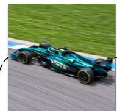  
Observed Image

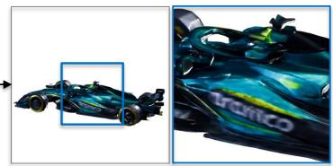  
3D Generation

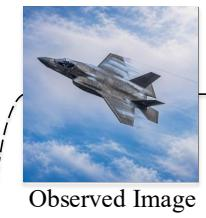

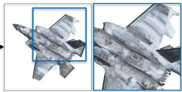

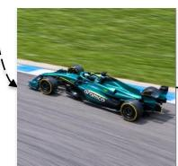

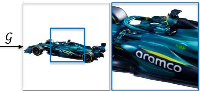  
Gated 3D Generation

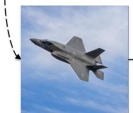

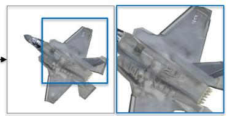

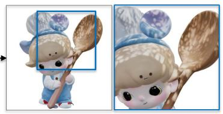  
3D Generation

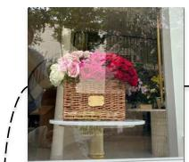

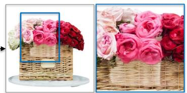

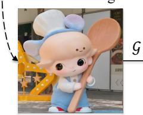  
Purified Image

  
Gated 3D Generation

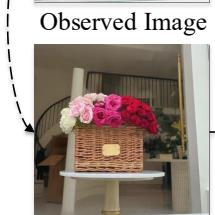  
Purified Image

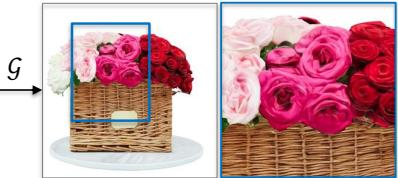  
Gated 3D Generation

Figure 1. Gate3DGen improves 3D generation by purifying real-world image input.

## 1 Introduction

Single-image 3D generative models have achieved remarkable progress on curated benchmarks (Hong et al., 2024; Tochilkin et al., 2024; Xu et al., 2024; Xiang et al., 2026; Li et al., 2026; Yang et al., 2026), yet degrade sharply on real-world images. This vulnerability stems from restrictive assumptions about input images. Contemporary models assume centered, sharp, and fully visible objects under uniform studio lighting (Xu et al., 2024; Xiang et al., 2025; 2026). In real-world scenarios, however, unconstrained photographs routinely exhibit blur, uneven illumination, or occlusions (Cho et al., 2025; Qu et al., 2026), corrupting visual cues and inducing severe artifacts in 3D outputs.

Open-source image-to-3D pipelines commonly use background removal and recentering (Tochilkin et al., 2024; Xu et al., 2024; Xiang et al., 2025; Zhao et al., 2025), which do not directly address photometric corruptions or foreground occlusions. Specialized preprocessing also targets individual factors such as illumination through delighting (Li et al., 2025a; Zhao et al., 2025). When multiple degradations coexist, correcting one factor can leave other sources of ambiguity in the conditioning image. Our comparisons show that generic 2D image editing can alter object appearance or contours, with adverse effects on downstream geometry (Section 4.4). The objective is therefore to recover a suitable observation of the same object, retaining the visible structural evidence that the 3D generator uses to infer shape and appearance. This motivates selective input purification that preserves visual cues for 3D generation while avoiding unnecessary changes to already suitable clean inputs.

We therefore introduce Gate3DGen, a selective pre-processing model that gates real-world images to existing 3D generators (Figure 1). It routes each image through purification or an unchanged bypass, keeping the downstream generators frozen. Gate3DGen couples a degradation-aware router with a 3D-oriented one-step purifier. The router bypasses inputs classified as clean and selects the remaining inputs for purification, while extracting continuous degradation-aware features for the purifier. Conditioned on these features, the one-step purifier purifies degraded inputs in a single forward pass to reduce inference cost, with spatial losses that encourage preservation of object identity and essential geometric and textural cues. Training requires matched ground-truth references, which are unavailable for real-world images. To provide paired training supervision without manual collection, we construct a synthetic data engine from 3D assets. Rendering multi-view anchors from 3,961 3D assets (Zhang et al., 2025) and synthesizing composite corruptions (e.g., uneven illumination, blur, and occlusions) yields 43,936 aligned image pairs and 1,082 held-out cases with 3D ground truth.

We evaluate the purifier on this synthetic benchmark with two pretrained 3D generative models, TRELLIS.2 (Xiang et al., 2026) and Pixal3D (Li et al., 2026). For 2D purification, Gate3DGen reduces foreground LPIPS by 39.1% while preserving subject silhouettes, with an inference time of 2.3 s per image. In comparison, the image editing baselines require 15.6–100.8 s per image and can alter object identity and reduce reconstruction fidelity (Table 2). When used to condition these 3D generative models, the purified images consistently improve all geometry and appearance metrics over the original observations. Specifically, Gate3DGen achieves a 61.5% reduction in all-surface mesh distance, closes 55.5% of the geometry gap to clean references on average (up to 83.1% on TRELLIS.2), and reduces rendering LPIPS by 10.9%. Evaluated separately, the degradation-aware router identifies degraded inputs with 88.45% recall and 93.47% specificity on clean inputs, sending inputs classified as degraded for purification. On real photographs, VLM scores and human preferences further support identity preservation and degradation correction, complementing the reference-based evaluation on synthetic inputs.

Our contributions are as follows:

• We formulate robust single-image 3D generation as selective input purification, improving existing 3D generators through purified inputs without retraining them.

• We introduce Gate3DGen, combining a router that bypasses inputs classified as clean with a one-step purifier. Degradation-aware features and spatial losses guide purification toward preserving object identity, contours, and geometric and textural cues for downstream 3D generation.

• We construct a synthetic data engine providing paired purification supervision from 3D assets and a benchmark with 3D ground truth for 3D evaluation. Our method reduces foreground LPIPS by 39.1% and TRELLIS.2 mesh distance by 61.5% relative to degraded inputs, demonstrating gains in image fidelity and downstream 3D geometry.

## 2 Related Work

Robustness in Single-Image 3D Generation. Modern single-image 3D methods, including feed-forward reconstruction and iterative diffusion or flow models, achieve high fidelity on curated inputs (Hong et al., 2024; Tochilkin et al., 2024; Xu et al., 2024; Boss et al., 2025; Xiang et al., 2025; Zhao et al., 2025; Li et al., 2025b; Lai et al., 2025; Xiang et al., 2026; Wu et al., 2026b; Li et al., 2026; Yang et al., 2026). Blur, uneven illumination, and occlusions can reduce their generation quality. Common input preprocessing operations include foreground segmentation and recentering, which do not directly correct illumination, blur, or foreground occlusions. Specialized methods address illumination through lighting decomposition or delighting (Li et al., 2025a; Lai et al., 2025). Related work investigates recovery of occluded geometry through volumetric reconstruction or multi-view synthesis (Cho et al., 2025; Qu et al., 2026; Shi et al., 2025). Our work focuses on selective input purification before frozen 3D generators, addressing composite degradations involving uneven illumination, blur, and occlusions.

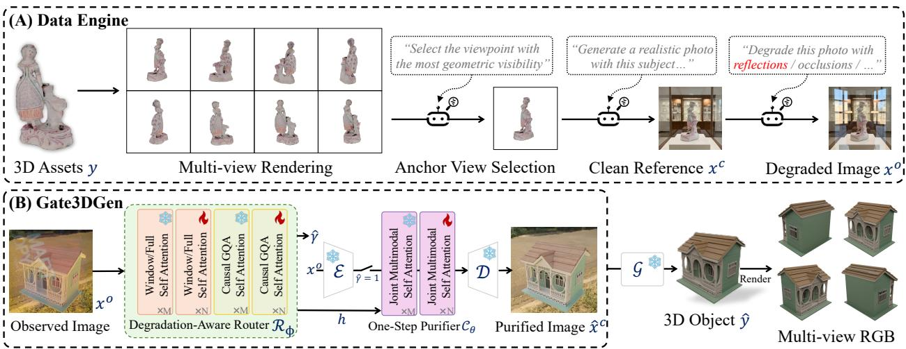  
Figure 2. Overview of Gate3DGen. (A) Data Engine. We render 3D assets from multi-view, select informative anchor views, and apply composite degradations to construct aligned observation-reference pairs $( x ^ { o } , x ^ { c } )$ . (B) Gate3DGen. Router $\mathcal { R } _ { \phi }$ bypasses inputs classified as clean $( \widehat { \gamma } = 0 )$ . Otherwise $( \widehat { \gamma } = 1 )$ , its features h guide the one-step DiT purifier $\mathcal { C } _ { \theta } . \ \widehat { x } ^ { c }$ conditions the frozen 3D generator G. Clean references and spatial losses are used only in training.

2D Image Editing and Degradation Routing. Recent advances in instruction-guided editing (Black Forest Labs et al., 2025; Wu et al., 2025; 2026a; Liu et al., 2025; Zhang et al., 2026; Qiao et al., 2026) and all-in-one restoration (Potlapalli et al., 2023; Conde et al., 2024; Lin et al., 2023; Yu et al., 2024; Guo et al., 2024) synthesize visually compelling images. Their objectives do not explicitly measure downstream 3D fidelity. In our comparisons, generic image editing methods can remove visible degradations while changing object appearance or contours, with adverse effects on downstream geometry (Section 4.4). Editing clean photographs can introduce unwanted changes, motivating selective restoration. No-reference quality metrics (Mittal et al., 2013; Yang et al., 2022; Zhang et al., 2023) and general vision-language models (You et al., 2024; Bai et al., 2025; OpenAI, 2026a) provide candidate quality signals, but their suitability for routing requires evaluation (Section 4.2). Gate3DGen couples a degradation-aware router with a one-step purifier to preserve identity and contours while selectively purifying inputs.

## 3 Method

Gate3DGen is a selective pre-processing model that purifies real-world input images without modifying the downstream 3D generator. It targets images degraded by uneven illumination, blur, and occlusions while encouraging preservation of geometric and textural cues. Figure 2 summarizes its data engine, router, and one-step purifier.

## 3.1 Problem Formulation

Let $\mathcal { G } : \mathcal { X }  \mathcal { Y }$ be a pretrained generator mapping a photograph to a 3D representation $y \in \mathcal { V }$ . A matched clean reference $x ^ { c }$ shows a centered, sharp, fully visible subject under uniform lighting, with $\mathcal { G } ( x ^ { c } )$ ≈ y. An observed image $x ^ { o }$ may be clean or degraded. Uneven illumination, blur, and occlusions can violate these assumptions. These degradations can distort geometry $( \mathcal G ( x ^ { o } ) \not \approx y )$

We learn to purify input images under supervision from matched clean references. The purifier maps $x ^ { o }$ toward the matched clean reference $x ^ { c }$ using reconstruction and spatial losses that encourage preservation of object identity, contours, and textural cues. The objective is given by

$$
\operatorname* { m i n } _ { \mathcal { C } _ { \theta } } \ \mathbb { E } _ { ( x ^ { o } , x ^ { c } ) } \left[ \ell \big ( \mathcal { C } _ { \theta } ( x ^ { o } ) , x ^ { c } \big ) \right] .\tag{1}
$$

Here, ℓ combines the latent, photometric, perceptual, region-weighted reconstruction, and edge losses defined in Section 3.4. To avoid unnecessary purification of clean inputs $( x ^ { o } \approx x ^ { c } )$ , the degradation-aware router $\mathcal { R } _ { \phi }$ predicts a routing decision $\widehat { \gamma } \in \{ 0 , 1 \}$ }. The routing decision determines the pre-processed image as follows

$$
\widehat { \boldsymbol { x } } ^ { c } = \left\{ \boldsymbol { x } ^ { o } , \quad \ \widehat { \boldsymbol { \gamma } } = 0 \quad \ ( \mathrm { K E E P } ) , \right.\tag{2}
$$

The pre-processed image ${ \widehat x ^ { c } }$ is either a purified image from $\mathcal { C } _ { \theta }$ (PURIFY) or the unchanged input (KEEP). To supervise this objective where matched pairs $( x ^ { o } , x ^ { c } , \gamma )$ are unavailable for real-world images, we construct a synthetic data engine from 3D assets (Section 3.2) to supply training data.

## 3.2 Synthetic Data Engine

Learning $\mathcal { C } _ { \theta }$ requires paired images $( x _ { i } ^ { o } , x _ { i } ^ { c } )$ that share identical 3D geometry and viewpoints while differing only in capture quality, whereas learning $\mathcal { R } _ { \phi }$ requires examples labeled by whether purification is necessary. Because real photographs provide neither matched clean counterparts nor controlled routing labels, we use high-fidelity 3D assets to construct this supervision (Figure $2 \mathrm { A } )$

Anchor view selection. From about 4k high-fidelity 3D assets in TexVerse (Zhang et al., 2025), we render eight views under uniform lighting. A vision-language model (VLM) ranks these views by geometric visibility and self-occlusion. The four most informative views per asset serve as multi-view anchors and matched clean references $\boldsymbol { x } _ { i } ^ { c }$

Degradation synthesis. For each anchor, instruction-guided editing produces a matched observation $\boldsymbol { x } _ { i } ^ { o }$ with composite corruptions, including uneven illumination, blur, and occlusions. Each pair is audited by Qwen3-VL (Qwen Team, 2025) for structural consistency, and RMBG-2.0 extracts a soft foreground mask $m _ { i }$ from the clean reference $\boldsymbol { x } _ { i } ^ { c }$ . This pipeline produces roughly 44k image pairs ${ \mathcal { D } } _ { \mathrm { t r a i n } } = \{ ( x _ { i } ^ { o } , x _ { i } ^ { c } , m _ { i } ) \}$ for $\mathcal { C } _ { \theta }$ and 100k routing pairs $\mathcal { D } _ { \mathrm { r o u t e } } = \{ ( x _ { j } , \gamma _ { j } ) \}$ for $\mathcal { R } _ { \phi }$ where $\gamma _ { j } = 1$ denotes PURIFY and $\gamma _ { j } = 0$ denotes KEEP. Training and evaluation assets are disjoint.

## 3.3 Degradation-Aware Router

Purifying clean inputs can introduce unwanted changes. To guide purification of images with spatially varying degradations, we use features extracted from the input image. We therefore design the degradation-aware router $\mathcal { R } _ { \phi }$ based on Qwen2.5-VL (Bai et al., 2025). Trained on $\mathcal { D } _ { \mathrm { r o u t e } }$ , the router predicts whether purification is needed and extracts continuous degradation-aware features.

Logit-based routing. Given input $x ^ { o }$ , the router returns $( p , h ) = \mathcal { R } _ { \phi } ( x ^ { o } )$ , where $p \in [ 0 , 1 ]$ is the predicted probability that purification is needed and h denotes continuous degradation-aware features. Rather than using greedy decoding, we derive the purification probability $p$ directly from the unnormalized logits for the routing decisions PURIFY and KEEP, denoted by $o _ { \mathrm { p u r i f y } }$ and $O _ { \mathrm { k e e p } }$

$$
p = \sigma ( o _ { \mathrm { p u r i f y } } - o _ { \mathrm { k e e p } } ) ,\tag{3}
$$

where $\sigma ( \cdot )$ is the sigmoid function. We apply a threshold τ to obtain the routing indicator

$$
\widehat { \gamma } = \mathbb { I } [ p \geq \tau ] \in \{ 0 , 1 \} ,\tag{4}
$$

where $\mathbb { I } [ \cdot ]$ is the indicator function. Predicted clean inputs bypass purification unchanged.

Degradation-aware conditioning. When purification is triggered $( \widehat { \gamma } = 1 )$ , we extract the final hidden states $h \in \mathbb { R } ^ { N }$ ×d from $\mathcal { R } _ { \phi }$ under a fixed editing instruction. These features condition $\mathcal { C } _ { \theta }$

## 3.4 3D-Oriented One-Step Purifier

The diffusion purifier $\mathcal { C } _ { \theta }$ purifies degraded inputs in a single forward pass with spatial losses that encourage preservation of object identity and geometric and textural cues. Let E and D denote the encoder and decoder of its frozen image autoencoder. We initialize $\mathcal { C } _ { \theta }$ from the released FireRed-Image-Edit-1.1 (Qiao et al., 2026) checkpoint, whose architecture and flow-matching formulation follow the FireRed-Image-Edit-1.0 technical report (Qiao et al., 2026), and condition it on the observation latent $\mathcal { E } ( x ^ { o } )$ and the continuous degradation-aware features h produced by the router.

One-step flow-matching. Standard flow-matching models (Qiao et al., 2026) define a linear probability path between the target latent $z _ { 0 } = \mathcal { E } ( x ^ { c } )$ and Gaussian noise $\varepsilon \sim \mathcal { N } ( 0 , I )$ , given by

$$
z _ { t } = ( 1 - t ) z _ { 0 } + t \varepsilon , \quad t \in [ 0 , 1 ] ,\tag{5}
$$

The velocity network $v _ { \theta } ( z _ { t } , \mathcal { E } ( x ^ { o } ) , h , t )$ is trained to regress $\varepsilon - z _ { 0 }$ . Standard inference integrates from $t = 1$ to $t = 0$ over multiple network evaluations. We train and evaluate $\mathcal { C } _ { \theta }$ at $t = 1$ , where $z _ { 1 } = \varepsilon$ , to reduce inference latency. One prediction yields the latent estimate and decoded image

$$
\widehat { z } _ { 0 } = \varepsilon - v _ { \theta } \big ( \varepsilon , \mathcal { E } ( x ^ { o } ) , h , 1 \big ) , \qquad \widehat { x } ^ { c } = \mathcal { D } ( \widehat { z } _ { 0 } ) ,\tag{6}
$$

where $\mathcal { D }$ is the frozen VAE decoder. Training and inference both use Equation 6, with one evaluation of $v _ { \theta }$ followed by VAE decoding, avoiding iterative denoising during purification. At this endpoint, the noisy latent contains only Gaussian noise. The observation latent and router features provide the image-specific conditioning. The velocity network is supervised using the clean latent and the decoded image, without iterative sampling.

3D-oriented spatial constraints. For a training triple $( x _ { i } ^ { o } , x _ { i } ^ { c } , m _ { i } ) \in \mathcal { D } _ { \mathrm { t r a i n } } .$ , let $z _ { 0 , i } = \mathcal { E } ( x _ { i } ^ { c } )$ , and let $\widehat { z } _ { 0 , i }$ and $\widehat { x } _ { i } ^ { c }$ be obtained from Equation 6. Standard pixel reconstruction losses treat all regions uniformly. Generic image editing methods overwrite uncorrupted regions and blur high-frequency shading cues that 3D generators rely on. The regionweighted reconstruction and edge losses guide purification by supervising the subject, emphasizing degradation-affected regions, and encouraging preservation of edges. We obtain a soft degradation map $r _ { i }$ by smoothing the pairwise residual between $\boldsymbol { x } _ { i } ^ { o }$ and $\boldsymbol { x } _ { i } ^ { c }$ . For an error tensor a and a nonnegative spatial weight w broadcast to the shape of $^ { a , }$ we define the normalized weighted mean

$$
\overline { { \ell } } ( a , w ) = \frac { \sum _ { j } w _ { ( j ) } | a _ { ( j ) } | } { \operatorname* { m a x } \\Big ( \sum _ { j } w _ { ( j ) } , 1 \Big ) } ,\tag{7}
$$

where the parenthesized subscript $( j )$ indexes channel and spatial entries within each tensor after broadcasting, while i indexes training samples. With $\delta _ { i } = \widehat { x } _ { i } ^ { c } - x _ { i } ^ { c }$ , the implemented losses are

$$
\begin{array} { r } { \mathcal { L } _ { \mathrm { r e g i o n } } = \overline { { \ell } } ( \delta _ { i } , m _ { i } ) + \overline { { \ell } } ( \delta _ { i } , r _ { i } ) , \qquad \mathcal { L } _ { \mathrm { e d g e } } = \frac { 1 } { 2 } \big [ \overline { { \ell } } ( D _ { u } \delta _ { i } , m _ { i } ^ { u } ) + \overline { { \ell } } ( D _ { v } \delta _ { i } , m _ { i } ^ { v } ) \big ] , } \end{array}\tag{8}
$$

The two terms in $\mathcal { L } _ { \mathrm { r e g i o n } }$ are normalized independently: the first supervises the full subject through $m _ { i } ,$ while the second focuses on degradation-affected regions through $r _ { i }$ . The edge term matches finite differences along the horizontal (u) and vertical (v) image axes, weighted by adjacent subject-mask values. These weights guide purification, and selectivity refers to image-level routing. Section A details degradation-map pooling and adjacent-mask edge weights.

Total training objective. Combining spatial constraints with the backbone objectives gives the full purifier loss:

$$
\mathcal { L } = \lambda _ { \mathrm { l a t } } \mathcal { L } _ { \mathrm { l a t } } + \lambda _ { 1 } \mathcal { L } _ { 1 } + \lambda _ { \mathrm { l p i p s } } \mathcal { L } _ { \mathrm { l p i p s } } + \lambda _ { \mathrm { r e g i o n } } \mathcal { L } _ { \mathrm { r e g i o n } } + \lambda _ { \mathrm { e d g e } } \mathcal { L } _ { \mathrm { e d g e } } ,\tag{9}
$$

where $\mathcal { L } _ { \mathrm { l a t } } = \mathrm { M S E } ( \widehat { \boldsymbol { z } } _ { 0 , i } , \boldsymbol { z } _ { 0 , i } )$ supervises latent reconstruction at the endpoint, $\mathcal { L } _ { 1 } = \mathrm { m e a n } \left| \widehat { x } _ { i } ^ { c } - x _ { i } ^ { c } \right|$ is the full-image photometric loss, and $\mathcal { L } _ { \mathrm { l p i p s } } = \mathrm { L P I P S } ( \widehat { x } _ { i } ^ { c } , x _ { i } ^ { c } )$ enforces perceptual agreement. The latent term supervises the clean representation, while photometric and perceptual terms supervise the decoded image alongside spatial and gradient constraints. Loss weights appear in Section A.

Clean references and foreground masks are used only during training. Inference uses the observed image and router features. Spatial losses encourage preservation of geometric and textural cues without gradients through the frozen 3D generator, whose output quality is evaluated in Section 4.4.

## 4 Experiments

## 4.1 Experimental Setup

Benchmark and evaluation protocols. Our benchmark contains 1,082 held-out DTC cases (Dong et al., 2025) with 3D ground truth and clean references sharing the degraded observations’ camera poses. We compare 3D outputs from degraded, edited, and clean-reference images against ground truth. Our purifier and all editing baselines process every degraded input. Routing is evaluated separately and does not affect these results.

Baselines. We compare against 7 instruction-guided image editing methods, namely FLUX.1-Kontext (Black Forest Labs et al., 2025), FireRed-Image-Edit (1.1) (Qiao et al., 2026), Mage-Flow-Edit (Zhang et al., 2026), OmniGen2 (Wu et al., 2026a), Qwen-Image-Edit (Wu et al., 2025), Step1X-Edit (Liu et al., 2025), and GPT Image-2.5 (Flare) (OpenAI, 2026b). We evaluate downstream 3D quality with Pixal3D (Li et al., 2026) and TRELLIS.2 (Xiang et al., 2026).

Evaluation metrics. For degradation-aware routing, we report PURIFY-class recall, overall accuracy, and H, defined as their harmonic mean, all expressed as percentages (Table 1). For 2D image fidelity, we report foreground LPIPS, PSNR, SSIM, Sobel gradient MAE, and foreground mask IoU against the clean reference. For 3D metrics, we report all-surface Mesh Distance (MD) (Xiang et al., 2026) and $F _ { 1 } ^ { \mathrm { a l l } } ( F _ { 1 } { \ @ } 1 0 ^ { - 8 } )$ , outer-surface Chamfer Distance (CD) (Fan et al., 2017) and $F _ { 1 } ^ { \mathrm { o u t e r } } ( F _ { 1 } @ 1 0 ^ { - 6 } )$ after ICP alignment to the ground-truth asset, PSNR-N (Wang et al., 2004) on rendered normal maps, and LPIPS (Zhang et al., 2018) on four-view shaded and albedo renderings.

## 4.2 Degradation-Aware Routing Results

Table 1 reports routing results on 1, 082 degraded and 934 clean synthetic inputs and on 96 in-the-wild images. Because real photographs lack explicit routing labels, a GPT-5 agent assigns proxy PURIFY/KEEP labels by comparing multi-view renderings and no-reference metrics for 3D assets generated from the unedited and purified images by Pixal3D and TRELLIS.2. The router should direct degraded inputs to the purifier and leave clean inputs unchanged, as uncorrected degradations can introduce geometric artifacts (Table 3). On the synthetic benchmark, the router attains 88.45% recall and 90.77% accuracy, yielding the highest H of 89.59%, which exceeds the strongest baseline, MANIQA (Yang et al., 2022), by 5.55 percentage points. NIQE (Mittal et al., 2013), mPLUG-Owl2 (Ye et al., 2023), and DepictQA-Wild (You et al., 2024) exceed 98% recall, but their accuracies remain within one percentage point of the 53.7% obtained by outputting PURIFY for all inputs, resulting in H values of only 69.19–70.23%. MANIQA attains 89.04% accuracy but only 79.57% recall. Our router improves both, indicating that its higher H reflects better detection of inputs needing purification alongside more accurate routing overall. Zero-shot Qwen2.5-VL, which shares the backbone of our router, reaches $\mathrm { H } = 7 8 . 6 4 \%$ . Training on $\mathcal { D } _ { \mathrm { r o u t e } }$ raises recall by 4.81 percentage points and accuracy by 16.56 points, improving H by 10.95 points. On the in-the-wild benchmark, the router ranks second in H (70.56%), with 89.29% recall and 58.33% accuracy against the proxy labels. DepictQA-Wild achieves the highest H (73.68%), but its 100% recall and 58.33% accuracy match the strategy of always predicting PURIFY. Thus, a high H alone does not establish effective preservation of KEEP inputs, and our router does not outperform this trivial strategy under the real-image proxy protocol. The high recall and lower accuracy are consistent with over-routing of inputs labeled KEEP to purification. This gap may reflect the use of clean renders for the KEEP class in $\mathcal { D } _ { \mathrm { r o u t e } }$ . Whether adding real photographs to this class improves routing remains to be tested.

Table 1. Degradation-aware routing on synthetic and real images (%). Recall is for PURIFY. Accuracy is overall (PURIFY and KEEP). H = 2 Recall × Accuracy/(Recall + Accuracy).
<table><tr><td rowspan="2">Method</td><td colspan="3">Benchmark</td><td colspan="3">In-the-wild</td></tr><tr><td>Recall</td><td>Accuracy</td><td>H↑</td><td>Recall</td><td>Accuracy</td><td>H↑</td></tr><tr><td>mPLUG-Owl2</td><td>100.00</td><td>54.12</td><td>70.23</td><td>0.00</td><td>41.67</td><td>0.00</td></tr><tr><td>DepictQA-Wild</td><td>99.54</td><td>53.42</td><td>69.53</td><td>100.00</td><td>58.33</td><td>73.68</td></tr><tr><td>LIQE-MIX</td><td>51.66</td><td>65.48</td><td>57.75</td><td>17.86</td><td>48.96</td><td>26.17</td></tr><tr><td>NIQE</td><td>98.52</td><td>53.32</td><td>69.19</td><td>75.00</td><td>54.17</td><td>62.91</td></tr><tr><td>Qwen2.5-VL</td><td>83.64</td><td>74.21</td><td>78.64</td><td>14.29</td><td>43.75</td><td>21.54</td></tr><tr><td>MANIQA</td><td>79.57</td><td>89.04</td><td>84.04</td><td>12.50</td><td>45.83</td><td>19.64</td></tr><tr><td>GPT-5</td><td>72.27</td><td>77.58</td><td>74.83</td><td>一</td><td>一</td><td>一</td></tr><tr><td>Ours</td><td>88.45</td><td>90.77</td><td>89.59</td><td>89.29</td><td>58.33</td><td>70.56</td></tr></table>

Table 2. Synthetic 2D purification. Fidelity metrics use clean references. Input is unedited, Grad. is Sobel gradient MAE, and IoU is foreground mask overlap. denotes the commercial closed-source model.
<table><tr><td>Method</td><td>Time (s)↓</td><td>LPIPS↓</td><td>PSNR↑</td><td>SSIM↑</td><td>Grad.↓</td><td>IoU↑</td></tr><tr><td>Degraded (Input)</td><td>一</td><td>0.2262</td><td>20.254</td><td>0.8323</td><td>0.0584</td><td>0.9537</td></tr><tr><td>FLUX.1</td><td>30.2</td><td>0.2577</td><td>17.992</td><td>0.7907</td><td>0.0688</td><td>0.9373</td></tr><tr><td>OmniGen2</td><td>84.9</td><td>0.4166</td><td>13.491</td><td>0.6478</td><td>0.1123</td><td>0.6238</td></tr><tr><td>Step1X</td><td>100.8</td><td>0.2426</td><td>18.828</td><td>0.7761</td><td>0.0781</td><td>0.8971</td></tr><tr><td>Qwen-Edit</td><td>81.5</td><td>0.2389</td><td>18.710</td><td>0.7812</td><td>0.0727</td><td>0.9537</td></tr><tr><td>Mage-Flow</td><td>15.6</td><td>0.2418</td><td>19.175</td><td>0.7755</td><td>0.0835</td><td>0.9530</td></tr><tr><td>GPT Image-2.5 Flare*</td><td></td><td>0.2710</td><td>16.571</td><td>0.7020</td><td>0.1319</td><td>0.9189</td></tr><tr><td>FireRed</td><td>83.2</td><td>0.2258</td><td>15.868</td><td>0.7677</td><td>0.0814</td><td>0.9604</td></tr><tr><td>Ours</td><td>2.3</td><td>0.1378</td><td>22.514</td><td>0.8708</td><td>0.0488</td><td>0.9758</td></tr></table>

## 4.3 2D Purification Results

Table 2 reports fidelity to clean references. All seven generic editors lower PSNR and SSIM and raise gradient MAE by 17.8%–125.9% relative to unedited inputs. Only FireRed (Qiao et al., 2026) lowers LPIPS, by 0.0004. Degradation removal thus comes with reduced fidelity to clean references. OmniGen2 (Wu et al., 2026a) also reduces silhouette IoU Gate3DGen alone improves all five metrics, lowering LPIPS by 39.1% and gradient MAE by 16.4% while raising IoU to 0.9758. The gains over the FireRed backbone support the benefit of our purification training (Section 3.4).

Inference efficiency. Gate3DGen achieves the best fidelity across all five metrics with an inference time of 2.3 s, compared with 15.6–100.8 s for the 6 baselines. This corresponds to a 6.8× speedup over Mage-Flow, the fastest timed baseline, and a 36.2× speedup over FireRed. Our one-step purifier achieves higher image fidelity and lower inference time than the compared image editing methods.

## 4.4 Downstream 3D Generation Results

On TRELLIS.2 (Xiang et al., 2026) (Table 3), Gate3DGen lowers MD and CD by 61.5% relative to the degraded input, raises $F _ { 1 } ^ { \mathrm { a l l } }$ and $F _ { 1 } ^ { \mathrm { o u t e r } }$ by 3.8% and 6.4%, and lowers shaded and albedo LPIPS by 10.9% and 10.6%, closing 83.1% of the MD gap to the clean-reference oracle. The baselines reveal a trade-off, as six of the seven image editing methods reduce MD yet all seven lower both $F _ { 1 }$ scores below the unedited input. Large geometric artifacts, such as an occluder fused into the object (Figure 3), can increase MD, whereas $F _ { 1 }$ at a small distance threshold is sensitive to local geometric deviations. Generic image editing can therefore reduce large artifacts while introducing local geometric deviations. Only Gate3DGen improves MD and both $F _ { 1 }$ scores among the compared editors, consistent with the spatial constraints in Equation 8. Albedo LPIPS also improves, consistent with removing input illumination effects before they are incorporated into the generated material, while the residual gap to the oracle is largest for $F _ { 1 } ^ { \mathrm { a l l } }$ (11.96 against 12.46), as geometry hidden by occlusion is only partially recoverable from a single view.

Table 3. Downstream 3D metrics on TRELLIS.2. Input is degraded, and Oracle uses clean references. MD, CD, and $F _ { 1 } ^ { \mathrm { a l l } }$ are $\times 1 0 ^ { - 3 }$ , and $F _ { 1 } ^ { \mathrm { o u t e r } } \mathrm { i s } \times 1 0 ^ { - 1 }$ . PSNR-N evaluates normals. LPIPS compares four-view shaded and albedo renderings. ∗ denotes a commercial closed-source model.
<table><tr><td>Method</td><td>MD↓</td><td> $F _ { 1 } ^ { \mathrm { a l l } } \uparrow$ </td><td>CD↓</td><td> $F _ { 1 } ^ { \mathrm { o u t e r } } \uparrow$ </td><td>PSNR-N↑</td><td>LPIPS↓</td><td>Albedo LPIPS↓</td></tr><tr><td>Clean reference (Oracle)</td><td>0.517</td><td>12.46</td><td>0.517</td><td>1.1586</td><td>16.36</td><td>0.1548</td><td>0.1575</td></tr><tr><td>Degraded (Input)</td><td>1.984</td><td>11.52</td><td>1.985</td><td>1.0531</td><td>15.26</td><td>0.1857</td><td>0.1916</td></tr><tr><td>FLUX.1</td><td>1.528</td><td>11.06</td><td>1.528</td><td>1.0238</td><td>15.35</td><td>0.1864</td><td>0.1935</td></tr><tr><td>OmniGen2</td><td>3.485</td><td>6.88</td><td>3.485</td><td>0.6407</td><td>13.11</td><td>0.2362</td><td>0.2411</td></tr><tr><td>Step1X</td><td>1.228</td><td>10.48</td><td>1.229</td><td>0.9637</td><td>15.25</td><td>0.1803</td><td>0.1861</td></tr><tr><td>Qwen-Image-Edit</td><td>1.047</td><td>10.81</td><td>1.047</td><td>1.0123</td><td>15.69</td><td>0.1780</td><td>0.1859</td></tr><tr><td>Mage-Flow</td><td>1.386</td><td>11.42</td><td>1.386</td><td>1.0422</td><td>15.39</td><td>0.1797</td><td>0.1855</td></tr><tr><td>GPT Image-2.5 Flare*</td><td>1.179</td><td>10.39</td><td>1.179</td><td>0.9720</td><td>15.29</td><td>0.1792</td><td>0.1859</td></tr><tr><td>FireRed</td><td>0.835</td><td>10.58</td><td>0.835</td><td>0.9889</td><td>15.82</td><td>0.1701</td><td>0.1781</td></tr><tr><td>Ours</td><td>0.764</td><td>11.96</td><td>0.765</td><td>1.1205</td><td>15.98</td><td>0.1654</td><td>0.1714</td></tr></table>

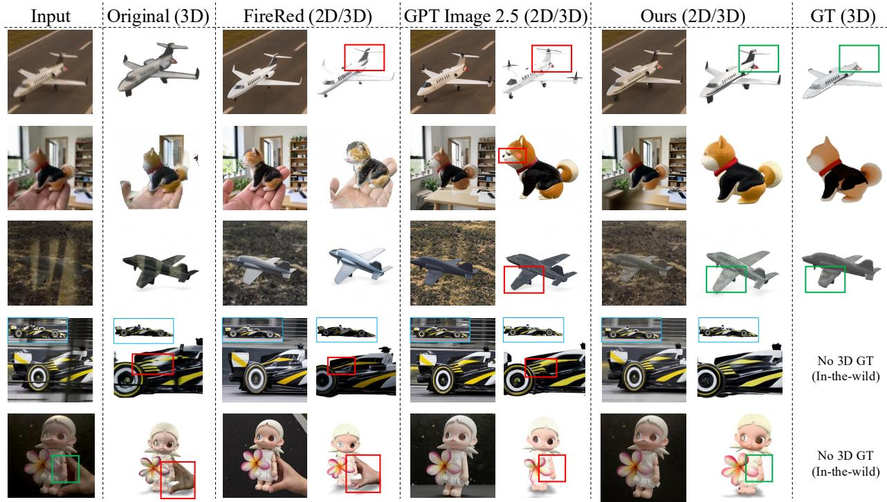  
Figure 3. Comparison of images (2D) and Pixal3D outputs (3D). Original (3D) uses unedited inputs. Ours (2D) uses purified images. Boxes mark structure and appearance changes.

Figure 3 shows Pixal3D reconstructions. Unedited inputs fuse the hand into the doll. FireRed retains the occluder or recolors the teapot, while GPT Image-2.5 Flare removes degradations but re-synthesizes objects (red boxes). Gate3DGen purifies inputs and retains the objects (green boxes).

## 4.5 In-the-Wild Results

We evaluate 96 mobile and web photographs without ground-truth meshes using VLM assessment, human preferences, and FD-DINOv2 (Stein et al., 2023). Qwen3.8-27B serves as the VLM judge (Chen et al., 2024), scoring Identity (object preservation), Purification (degradation removal), and Quality (asset quality independent of the input). Identity and Purification average 2D and 3D scores, while Quality averages 3D scores over four views and both frozen generators.

Table 4. In-the-wild comparisons against 2D editing baselines. FD-DINOv2 is calculated on multi-view renders per method. VLM scores span 0–10. Purification measures degradation removal in both VLM evaluation and the user study. Pref% reports preferences for Gate3DGen over each baseline. ∗ marks commercial closed-source models.
<table><tr><td rowspan="2">Method</td><td colspan="2">FD-DINOv2↓</td><td colspan="3">VLM Scores↑</td><td colspan="3">User Study (Pref%)↑</td></tr><tr><td>Pixal3D</td><td>TRELLIS.2</td><td>Identity</td><td>Purification</td><td>Quality</td><td>Identity</td><td>Purification</td><td>Quality</td></tr><tr><td>FLUX.1</td><td>0.795</td><td>0.790</td><td>7.31</td><td>6.22</td><td>6.24</td><td>77.5%</td><td>81.0%</td><td>72.1%</td></tr><tr><td>OmniGen2</td><td>0.893</td><td>0.902</td><td>5.43</td><td>4.51</td><td>4.72</td><td>86.0%</td><td>93.2%</td><td>92.3%</td></tr><tr><td>Step1X</td><td>0.788</td><td>0.789</td><td>7.91</td><td>7.09</td><td>5.98</td><td>81.8%</td><td>83.3%</td><td>86.8%</td></tr><tr><td>Qwen-Image-Edit</td><td>0.792</td><td>0.810</td><td>8.09</td><td>6.99</td><td>6.60</td><td>91.7%</td><td>94.6%</td><td>82.1%</td></tr><tr><td>Mage-Flow</td><td>0.739</td><td>0.769</td><td>8.50</td><td>7.55</td><td>6.22</td><td>84.2%</td><td>88.1%</td><td>80.0%</td></tr><tr><td>GPT Image-2.5 Flare*</td><td>0.733</td><td>0.722</td><td>6.95</td><td>6.31</td><td>6.92</td><td>58.5%</td><td>57.1%</td><td>57.5%</td></tr><tr><td>FireRed</td><td>0.771</td><td>0.796</td><td>8.00</td><td>7.08</td><td>6.92</td><td>66.7%</td><td>63.6%</td><td>63.6%</td></tr><tr><td>Ours</td><td>0.716</td><td>0.757</td><td>8.62</td><td>8.00</td><td>6.58</td><td>一</td><td></td><td>一</td></tr></table>

Table 5. Purifier ablations on our synthetic benchmark. We report 2D image fidelity and downstream 3D metrics from TRELLIS.2. Checkmarks indicate the use of router features (h) and spatial losses (region-weighted reconstruction and edge). MD, CD, and $F _ { 1 } ^ { \mathrm { a l l } } \ \mathrm { a r e } \times 1 0 ^ { - 3 }$ , and $F _ { 1 } ^ { \mathrm { o u t e r } }$ is $\times 1 0 ^ { - 1 }$ . Shaded and albedo LPIPS use the corresponding four-view renderings.
<table><tr><td>Method</td><td> $h$ </td><td>Spatial losses</td><td>2D LPIPS↓</td><td>2D PSNR↑</td><td>MD↓</td><td> $F _ { 1 } ^ { \mathrm { a l l } } \uparrow$ </td><td>CD↓</td><td> $F _ { 1 } ^ { \mathrm { o u t e r } } \uparrow$ </td><td>Shaded LPIPS↓</td><td>Albedo LPIPS↓</td></tr><tr><td>A</td><td></td><td></td><td>0.1351</td><td>22.292</td><td>0.820</td><td>12.06</td><td>0.820</td><td>1.1012</td><td>0.1794</td><td>0.1781</td></tr><tr><td>B</td><td> $\checkmark$ </td><td></td><td>0.1363</td><td>22.572</td><td>0.755</td><td>11.96</td><td>0.755</td><td>1.1210</td><td>0.1658</td><td>0.1716</td></tr><tr><td>Full</td><td> $\checkmark$ </td><td> $\checkmark$ </td><td>0.1378</td><td>22.514</td><td>0.764</td><td>11.96</td><td>0.765</td><td>1.1205</td><td>0.1654</td><td>0.1714</td></tr></table>

For FD-DINOv2, we fit Gaussians per generator to L2-normalized DINOv2 ViT-L/14-reg CLS features from the 96 photographs and 384 shaded renders (four per asset). Images are resized to 224 × 224 and ImageNet-normalized Rendered views are separate samples without pooling.

In Table 4, Gate3DGen leads in VLM Identity (8.62) and Purification (8.00). FireRed and GPT Image-2.5 Flare score higher on Quality (6.92 versus 6.58), but lower on Identity (8.00 and 6.95, respectively). The VLM scores support object preservation and degradation removal.

The human study uses 341 valid ratings from pairwise comparisons with each image editing baseline. Preferences for Gate3DGen exceed 50% on all three criteria against every baseline. Rates are lowest against GPT Image-2.5 Flare (58.5%, 57.1%, and 57.5% for Identity, Purification, and Quality). Human Quality preferences differ from the VLM ranking.

Among image editing methods, Gate3DGen ranks first in FD-DINOv2 on Pixal3D and second on TRELLIS.2, but none improves over unedited inputs. FD-DINOv2 compares feature distributions of inputs and renders, without directly measuring degradation removal or per-object fidelity. Interpret its rankings alongside VLM scores and human preferences.

## 4.6 Ablation Studies

3D-oriented one-step purifier. Table 5 compares router features h and spatial losses, with $\mathcal { L } _ { 1 }$ retained in all variants. A removes both components, B retains only $h ,$ and Full uses both. A achieves the best 2D LPIPS (0.1351) and $F _ { 1 } ^ { \mathrm { a l l } }$ (12.06), but the worst MD, CD, $F _ { 1 } ^ { \mathrm { o u t e r } }$ , and rendering LPIPS scores. Its rendered LPIPS (0.1794) is comparable to Mage-Flow and GPT Image-2.5 Flare (Table 3), despite at least 0.1 lower 2D LPIPS. Thus, image similarity alone is insufficient to predict 3D quality. Adding h lowers MD from 0.820 to 0.755 (7.9%) and rendered LPIPS from 0.1794 to 0.1658 (7.6%), while increasing 2D LPIPS by 0.0012. With the spatial losses, Full has slightly higher MD (0.764 versus 0.755) and lower 2D PSNR than Variant B, but achieves the lowest shaded and albedo LPIPS (0.1654 and 0.1714). Full also preserves contours more faithfully than B, supporting this configuration. Sections B and D report routing and Pixal3D results.

## 5 Conclusion

Trained on image pairs synthesized from 3D assets, Gate3DGen combines a degradation-aware router and a 3D-oriented one-step purifier before frozen 3D generators. On 1,082 cases, its purifier outperforms seven image editing methods in image fidelity and surface geometry for TRELLIS.2 and Pixal3D, closing up to 83.1% of the mesh-distance gap to clean-reference inputs. VLM scores and human preferences on real photographs support identity preservation and degradation correction. Ablations and real-image comparisons motivate evaluating purification through downstream surface geometry, rendered appearance, and object fidelity beyond image similarity or visual quality alone.

## References

Shuai Bai, Keqin Chen, Xuejing Liu, Jialin Wang, Wenbin Ge, Sibo Song, Kai Dang, Peng Wang, Shijie Wang, Jun Tang, Humen Zhong, Yuanzhi Zhu, Ming-Hsuan Yang, Zhaohai Li, Jianqiang Wan, Pengfei Wang, Wei Ding, Zheren Fu, Yiheng Xu, Jiabo Ye, Xi Zhang, Tianbao Xie, Zesen Cheng, Hang Zhang, Zhibo Yang, Haiyang Xu, and Junyang Lin. Qwen2.5-VL technical report. arXiv preprint arXiv:2502.13923, 2025.

Black Forest Labs, Stephen Batifol, Andreas Blattmann, Frederic Boesel, Saksham Consul, Cyril Diagne, Tim Dockhorn, Jack English, Zion English, Patrick Esser, Sumith Kulal, Kyle Lacey, Yam Levi, Cheng Li, Dominik Lorenz, Jonas Müller, Dustin Podell, Robin Rombach, Harry Saini, Axel Sauer, and Luke Smith. FLUX.1 Kontext: Flow matching for in-context image generation and editing in latent space. arXiv preprint arXiv:2506.15742, 2025.

Mark Boss, Zixuan Huang, Aaryaman Vasishta, and Varun Jampani. SF3D: Stable fast 3D mesh reconstruction with UV-unwrapping and illumination disentanglement. In Proceedings ofthe IEEE/CVF Conference on Computer Vision and Pattern Recognition, pp. 16240–16250, 2025.

Dongping Chen, Ruoxi Chen, Shilin Zhang, Yaochen Wang, Yinuo Liu, Huichi Zhou, Qihui Zhang, Yao Wan, Pan Zhou, and Lichao Sun. MLLM-as-a-Judge: Assessing multimodal LLM-as-a-Judge with vision-language benchmark. In International Conference on Machine Learning, volume 235, pp. 6562–6595, 2024.

Junhyeong Cho, Kim Youwang, Hunmin Yang, and Tae-Hyun Oh. Robust 3D shape reconstruction in zero-shot from a single image in the wild. In Proceedings ofthe IEEE/CVF Conference on Computer Vision and Pattern Recognition, pp. 22786–22798, 2025.

Marcos V. Conde, Gregor Geigle, and Radu Timofte. InstructIR: High-quality image restoration following human instructions. In European Conference on Computer Vision, pp. 1–21, 2024.

Zhao Dong, Ka Chen, Zhaoyang Lv, Hong-Xing Yu, Yunzhi Zhang, Cheng Zhang, Yufeng Zhu, Stephen Tian, Zhengqin Li, Geordie Moffatt, Sean Christofferson, James Fort, Xiaqing Pan, Mingfei Yan, Jiajun Wu, Carl Yuheng Ren, and Richard A. Newcombe. Digital twin catalog: A large-scale photorealistic 3D object digital twin dataset. In Proceedings ofthe IEEE/CVF Conference on Computer Vision and Pattern Recognition, pp. 753–763, 2025.

Haoqiang Fan, Hao Su, and Leonidas J. Guibas. A point set generation network for 3D object reconstruction from a single image. In Proceedings of the IEEE Conference on Computer Vision and Pattern Recognition, pp. 2463–2471, 2017.

Hang Guo, Tao Dai, Yuanchao Bai, Bin Chen, Xudong Ren, Zexuan Zhu, and Shu-Tao Xia. Parameter efficient adaptation for image restoration with heterogeneous mixture-of-experts. In Advances in Neural Information Processing Systems, 2024.

Yicong Hong, Kai Zhang, Jiuxiang Gu, Sai Bi, Yang Zhou, Difan Liu, Feng Liu, Kalyan Sunkavalli, Trung Bui, and Hao Tan. LRM: large reconstruction model for single image to 3D. In International Conference on Learning Representations, 2024.

Zeqiang Lai, Yunfei Zhao, Haolin Liu, Zibo Zhao, Qingxiang Lin, Huiwen Shi, Xianghui Yang, Mingxin Yang, Shuhui Yang, Yifei Feng, Sheng Zhang, Xin Huang, Di Luo, Fan Yang, Fang Yang, Lifu Wang, Sicong Liu, Yixuan Tang, Yulin Cai, Zebin He, Tian Liu, Yuhong Liu, Jie Jiang, Linus, Jingwei Huang, and Chunchao Guo. Hunyuan3D 2.5: Towards high-fidelity 3D assets generation with ultimate details. arXiv preprint arXiv:2506.16504, 2025.

Dong-Yang Li, Wang Zhao, Yuxin Chen, Wenbo Hu, Meng-Hao Guo, Fang-Lue Zhang, Ying Shan, and Shi-Min Hu. Pixal3D: Pixel-aligned 3D generation from images. In ACM SIGGRAPH 2026 Conference Papers, pp. 8:1–8:12, 2026.

Xiang Li, Zirui Wang, Zixuan Huang, and James M. Rehg. Cue3D: Quantifying the role of image cues in single-image 3D generation. In Advances in Neural Information Processing Systems, 2025a.

Yangguang Li, Zi-Xin Zou, Zexiang Liu, Dehu Wang, Yuan Liang, Zhipeng Yu, Xingchao Liu, Yuan-Chen Guo, Ding Liang, Wanli Ouyang, and Yan-Pei Cao. TripoSG: High-fidelity 3D shape synthesis using large-scale rectified flow models. arXiv preprint arXiv:2502.06608, 2025b.

Xinqi Lin, Jingwen He, Ziyan Chen, Zhaoyang Lyu, Ben Fei, Bo Dai, Wanli Ouyang, Yu Qiao, and Chao Dong. DiffBIR: Towards blind image restoration with generative diffusion prior. arXiv preprint arXiv:2308.15070, 2023.

Shiyu Liu, Yucheng Han, Peng Xing, Fukun Yin, Rui Wang, Wei Cheng, Jiaqi Liao, Yingming Wang, Honghao Fu, Chunrui Han, Guopeng Li, Yuang Peng, Quan Sun, Jingwei Wu, Yan Cai, Zheng Ge, Ranchen Ming, Lei Xia, Xianfang Zeng, Yibo Zhu, Binxing Jiao, Xiangyu Zhang, Gang Yu, and Daxin Jiang. Step1X-Edit: A practical framework for general image editing. arXiv preprint arXiv:2504.17761, 2025.

Anish Mittal, Rajiv Soundararajan, and Alan C. Bovik. Making a "completely blind" image quality analyzer. IEEE Signal Processing Letters, 20(3):209–212, 2013.

OpenAI. OpenAI GPT-5 system card. arXiv preprint arXiv:2601.03267, 2026a.

OpenAI. GPT Image-2.5 Flare model documentation. OpenAI API documentation, 2026b. URL https://developers. openai.com/api/docs/models/gpt-image-2.5-flare.

Vaishnav Potlapalli, Syed Waqas Zamir, Salman H. Khan, and Fahad Shahbaz Khan. PromptIR: Prompting for all-in-one image restoration. In Advances in Neural Information Processing Systems, 2023.

Changhao Qiao, Chao Hui, Chen Li, Cunzheng Wang, Dejia Song, Jiale Zhang, Jing Li, Qiang Xiang, Runqi Wang, Shuang Sun, Wei Zhu, Xu Tang, Yao Hu, Yibo Chen, Yuhao Huang, Yuxuan Duan, Zhiyi Chen, and Ziyuan Guo. FireRed-Image-Edit-1.0 technical report. arXiv preprint arXiv:2602.13344, 2026.

Yansong Qu, Shaohui Dai, Xinyang Li, Yuze Wang, You Shen, Shengchuan Zhang, and Liujuan Cao. DeOcc-1-to-3: 3D de-occlusion from a single image via self-supervised multi-view diffusion. In Proceedings ofthe AAAI Conference on Artificial Intelligence, pp. 8677–8685, 2026.

Qwen Team. Qwen3-VL technical report. arXiv preprint arXiv:2511.21631, 2025.

Yukai Shi, Weiyu Li, Zihao Wang, Hongyang Li, Xingyu Chen, Ping Tan, and Lei Zhang. SceneMaker: Open-set 3D scene generation with decoupled de-occlusion and pose estimation model. arXiv preprint arXiv:2512.10957, 2025.

George Stein, Jesse C. Cresswell, Rasa Hosseinzadeh, Yi Sui, Brendan Leigh Ross, Valentin Villecroze, Zhaoyan Liu, Anthony L. Caterini, J. Eric T. Taylor, and Gabriel Loaiza-Ganem. Exposing flaws of generative model evaluation metrics and their unfair treatment of diffusion models. In Advances in Neural Information Processing Systems, 2023.

Dmitry Tochilkin, David Pankratz, Zexiang Liu, Zixuan Huang, Adam Letts, Yangguang Li, Ding Liang, Christian Laforte, Varun Jampani, and Yan-Pei Cao. TripoSR: Fast 3D object reconstruction from a single image. arXiv preprint arXiv:2403.02151, 2024.

Zhou Wang, Alan C. Bovik, Hamid R. Sheikh, and Eero P. Simoncelli. Image quality assessment: from error visibility to structural similarity. IEEE Transactions on Image Processing, 13(4):600–612, 2004.

Chenfei Wu, Jiahao Li, Jingren Zhou, Junyang Lin, Kaiyuan Gao, Kun Yan, Shengming Yin, Shuai Bai, Xiao Xu, Yilei Chen, Yuxiang Chen, Zecheng Tang, Zekai Zhang, Zhengyi Wang, An Yang, Bowen Yu, Chen Cheng, Dayiheng Liu, Deqing Li, Hang Zhang, Hao Meng, Hu Wei, Jingyuan Ni, Kai Chen, Kuan Cao, Liang Peng, Lin Qu, Minggang Wu, Peng Wang, Shuting Yu, Tingkun Wen, Wensen Feng, Xiaoxiao Xu, Yi Wang, Yichang Zhang, Yongqiang Zhu, Yujia Wu, Yuxuan Cai, and Zenan Liu. Qwen-Image technical report. arXiv preprint arXiv:2508.02324, 2025.

Chenyuan Wu, Jiahao Wang, Pengfei Zheng, Ruiran Yan, Shitao Xiao, Xin Luo, Yueze Wang, Wanli Li, Xiyan Jiang, Yexin Liu, Junjie Zhou, Ziyi Xia, Ze Liu, Chaofan Li, Haoge Deng, Kun Luo, Bo Zhang, Jiajun Zhang, Dong Liu, Defu Lian, Xinlong Wang, Zhongyuan Wang, Tiejun Huang, and Zheng Liu. OmniGen2: Towards instruction-aligned multimodal generation. In Proceedings of the IEEE/CVF Conference on Computer Vision and Pattern Recognition, pp. 21964–21975, 2026a.

Guanjun Wu, Jiemin Fang, Chen Yang, Sikuang Li, Taoran Yi, Jia Lu, Zanwei Zhou, Jiazhong Cen, Lingxi Xie, Xiaopeng Zhang, Wei Wei, Wenyu Liu, Xinggang Wang, and Qi Tian. UniLat3D: Geometry-appearance unified latents for single-stage 3D generation. In Proceedings ofthe IEEE/CVF Conference on Computer Vision and Pattern Recognition (Findings), 2026b. URL https://arxiv.org/abs/2509.25079.

Jianfeng Xiang, Zelong Lv, Sicheng Xu, Yu Deng, Ruicheng Wang, Bowen Zhang, Dong Chen, Xin Tong, and Jiaolong Yang. Structured 3D latents for scalable and versatile 3D generation. In Proceedings of the IEEE/CVF Conference on Computer Vision and Pattern Recognition, pp. 21469–21480, 2025.

Jianfeng Xiang, Xiaoxue Chen, Sicheng Xu, Ruicheng Wang, Zelong Lv, Yu Deng, Hongyuan Zhu, Yue Dong, Hao Zhao, Nicholas Jing Yuan, and Jiaolong Yang. Native and compact structured latents for 3D generation. In Proceedings of the IEEE/CVF Conference on Computer Vision and Pattern Recognition, pp. 14419–14429, 2026.

Jiale Xu, Weihao Cheng, Yiming Gao, Xintao Wang, Shenghua Gao, and Ying Shan. InstantMesh: Efficient 3D mesh generation from a single image with sparse-view large reconstruction models. arXiv preprint arXiv:2404.07191, 2024.

Chen Yang, Jiemin Fang, Fanpeng Meng, Zihao Huang, Jichen Pang, Guanjun Wu, Zhikuan Bao, and Qi Tian. SUPRA-Tex: 3D generation with super-aligned texture. arXiv preprint arXiv:2610.22352, 2026. URL https: //arxiv.org/abs/2610.22352.

Sidi Yang, Tianhe Wu, Shuwei Shi, Shanshan Lao, Yuan Gong, Mingdeng Cao, Jiahao Wang, and Yujiu Yang. MANIQA: Multi-dimension attention network for no-reference image quality assessment. In Proceedings of the IEEE/CVF Conference on Computer Vision and Pattern Recognition Workshops, pp. 1190–1199, 2022.

Qinghao Ye, Haiyang Xu, Jiabo Ye, Ming Yan, Anwen Hu, Haowei Liu, Qi Qian, Ji Zhang, Fei Huang, and Jingren Zhou. mPLUG-Owl2: Revolutionizing multi-modal large language model with modality collaboration. arXiv preprint arXiv:2311.04257, 2023.

Zhiyuan You, Jinjin Gu, Zheyuan Li, Xin Cai, Kaiwen Zhu, Tianfan Xue, and Chao Dong. Descriptive image quality assessment in the wild. arXiv preprint arXiv:2405.18842, 2024.

Fanghua Yu, Jinjin Gu, Zheyuan Li, Jinfan Hu, Xiangtao Kong, Xintao Wang, Jingwen He, Yu Qiao, and Chao Dong. Scaling up to excellence: Practicing model scaling for photo-realistic image restoration in the wild. In Proceedings of the IEEE/CVF Conference on Computer Vision and Pattern Recognition, pp. 25669–25680, 2024.

Richard Zhang, Phillip Isola, Alexei A. Efros, Eli Shechtman, and Oliver Wang. The unreasonable effectiveness of deep features as a perceptual metric. In Proceedings ofthe IEEE Conference on Computer Vision and Pattern Recognition, pp. 586–595, 2018.

Weixia Zhang, Guangtao Zhai, Ying Wei, Xiaokang Yang, and Kede Ma. Blind image quality assessment via visionlanguage correspondence: A multitask learning perspective. In Proceedings ofthe IEEE/CVF Conference on Computer Vision and Pattern Recognition, pp. 14071–14081, 2023.

Xinjie Zhang, Peng Zhang, Shicheng Zheng, Jinghao Guo, Zhaoyang Jia, Yifei Shen, Xun Guo, Yuxuan Luo, Jiahao Li, Wenxuan Xie, Fanyi Pu, Xiaoyi Zhang, Kaichen Zhang, Zongyu Guo, Tianci Bi, Dongnan Gui, Zhening Liu, Zimo Wen, Zihan Zheng, Senqiao Yang, Xiao Li, Jinglu Wang, Bin Li, and Yan Lu. Mage-Flow: An efficient native-resolution foundation model for image generation and editing. arXiv preprint arXiv:2607.19064, 2026.

Yibo Zhang, Li Zhang, Rui Ma, and Nan Cao. TexVerse: A universe of 3D objects with high-resolution textures. arXiv preprint arXiv:2508.10868, 2025.

Zibo Zhao, Zeqiang Lai, Qingxiang Lin, Yunfei Zhao, Haolin Liu, Shuhui Yang, Yifei Feng, Mingxin Yang, Sheng Zhang, Xianghui Yang, Huiwen Shi, Sicong Liu, Junta Wu, Yihang Lian, Fan Yang, Ruining Tang, Zebin He, Xinzhou Wang, Jian Liu, Xuhui Zuo, Zhuo Chen, Biwen Lei, Haohan Weng, Jing Xu, Yiling Zhu, Xinhai Liu, Lixin Xu, Changrong Hu, Tianyu Huang, Lifu Wang, Jihong Zhang, Meng Chen, Liang Dong, Yiwen Jia, Yulin Cai, Jiaao Yu, Yixuan Tang, Hao Zhang, Zheng Ye, Peng He, Runzhou Wu, Chao Zhang, Yonghao Tan, Jie Xiao, Yangyu Tao, Jianchen Zhu, Jinbao Xue, Kai Liu, Chongqing Zhao, Xinming Wu, Zhichao Hu, Lei Qin, Jianbing Peng, Zhan Li, Minghui Chen, Xipeng Zhang, Lin Niu, Paige Wang, Yingkai Wang, Haozhao Kuang, Zhongyi Fan, Xu Zheng, Weihao Zhuang, YingPing He, Tian Liu, Yong Yang, Di Wang, Yuhong Liu, Jie Jiang, Jingwei Huang, and Chunchao Guo. Hunyuan3D 2.0: Scaling diffusion models for high resolution textured 3D assets generation. arXiv preprint arXiv:2501.12202, 2025.

# Gate3DGen: A Pre-processing Model that Selectively Purifies Real-World Images for 3D Generation

Supplementary Materials

## A Method Details

Under a fixed prompt, the degradation-aware router is trained to output the PURIFY/KEEP decision described in Section 3.3. These decisions correspond to the implementation tokens Purify and Keep, respectively. It updates language-transformer layers 24–27 and the final language normalization. The language-model head and visual backbone are frozen except for rank-16 LoRA adapters in vision blocks 28–31. Training uses token-level supervision with higher weights on the decision tokens and the end-of-sequence token, and with higher sample weights on rare degradation families and on subtle degradations. The discrete routing indicator $\widehat { \gamma } _ { i }$ follows Equation 4, with the threshold τ frozen on the development set. The language-only router variant omits the vision LoRA adapters.

For the purifier $\mathcal { C } _ { \theta } .$ , image-transformer blocks 1–28 remain frozen and blocks 29–49 are updated together with the cross-attention projection layers receiving h. Training uses the flow-matching endpoint at $t = 1$ in Equation $5 ,$ estimates $\widehat { z } _ { 0 }$ , and reconstructs $\widehat { \boldsymbol { x } } ^ { c } = \mathcal { D } ( \widehat { \boldsymbol { z } } _ { 0 } )$ by Equation 6. The subject mask $m _ { i }$ is the 8-bit soft alpha predicted by RMBG-2.0 from $\boldsymbol { x } _ { i } ^ { c }$ . It is normalized to [0, 1] and receives the same resize and random crop as the paired images. The degradation map $r _ { i }$ averages $| x _ { i } ^ { o } - x _ { i } ^ { c } | / 2$ over RGB channels and applies $7 \times 7$ average pooling with stride 1 and padding 3. In Equation $^ { 7 , }$ the single-channel weight is broadcast over RGB channels, and each weighted sum is divided by its own broadcast weight sum, clamped below at 1. For the edge term, $D _ { u }$ and $D _ { v }$ are one-pixel forward differences, with $m _ { i } ^ { u }$ and $m _ { i } ^ { v }$ given by the products of the two subject-mask values adjacent to each horizontal or vertical edge, respectively. The loss weights in Equation 9 are $\lambda _ { \mathrm { l a t } } = 0 . 1 , \lambda _ { 1 } = 1 , \lambda _ { \mathrm { l p i p s } } = 0 . 5 , \lambda _ { \mathrm { r e g i o n } } = 1$ , and $\lambda _ { \mathrm { e d g e } } = 1$ . We train at 1024 × 1024 resolution for 15,000 updates on 32 GPUs (global batch size 32, BF16 precision, AdamW optimizer, cosine learning-rate schedule, peak learning rate $5 \times 1 0 ^ { - 7 } )$ . At inference, image purification uses a single forward pass with guidance scale 1.0, an empty negative prompt, and a fixed random seed.

## B Router Ablation

Table 6 compares the full router with an MLP on VAE latents and with a language-only variant that omits vision LoRA. The MLP achieves 53.42% recall. Removing vision LoRA raises recall to 97.04% but lowers accuracy to 75.30%, indicating a stronger bias toward PURIFY. The full router achieves 88.45% recall and 90.77% accuracy. Vision LoRA reduces this bias with high recall.

Table 6. Router ablations on synthetic evaluation inputs. Variants use an MLP on VAE latents or omit vision LoRA. Recall and accuracy are percentages. Bold marks column maxima.
<table><tr><td>Method</td><td>Recall↑</td><td>Accuracy↑</td></tr><tr><td>MLP on VAE latents</td><td>53.42</td><td>71.48</td></tr><tr><td>Without vision LoRA</td><td>97.04</td><td>75.30</td></tr><tr><td>Full router</td><td>88.45</td><td>90.77</td></tr></table>

## C Relative Performance across 2D and 3D Metrics

Figure 4 provides a unified view of the 2D purification metrics in Table 2 and the downstream TRELLIS.2 metrics in Table 3. The observed degraded input is the zero reference and the matched clean input is the oracle reference at one. The direction of lower-is-better metrics is reversed so that larger radial values consistently indicate better performance. Among the representative editing baselines shown, Gate3DGen makes positive progress toward the clean oracle on every metric. In contrast, FireRed, GPT Image-2.5 Flare, and Mage-Flow exhibit negative changes on several 2D fidelity or fine-grained 3D geometry measures, illustrating the trade-off between visible degradation removal and preservation of reconstruction cues.

## D Additional Pixal3D Results

The main paper reports downstream 3D metrics on TRELLIS.2 (Table 3). Table 7 repeats the same evaluation on Pixal3D (Li et al., 2026), using the same 1, 082 cases and the same metric definitions. Gate3DGen obtains the best

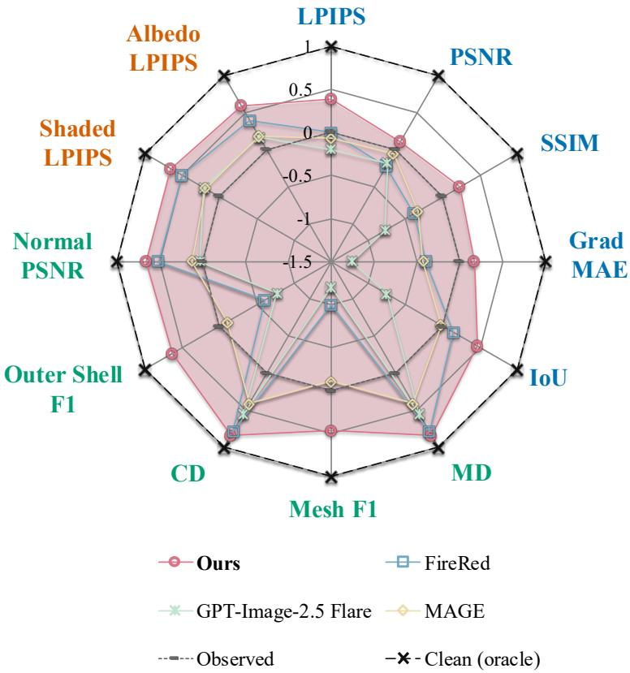  
Figure 4. Oracle-normalized comparison of 2D purification and downstream 3D generation. The radar plot summarizes percentage progress from the observed degraded input (0) toward the matched clean-reference oracle (1) using the metrics reported in Tables 2 and 3. Negative values indicate deterioration relative to the observed input. Blue labels denote 2D image metrics, green labels denote 3D geometry and normal metrics, and orange labels denote rendered-appearance metrics. Lower-is-better metrics are direction-adjusted so that farther outward is always better.

Table 7. Downstream 3D metrics on Pixal3D. Input and Oracle use degraded and clean-reference images, respectively. MD and $\mathrm { C D \ a r e \times 1 0 ^ { - 3 } . \ } F _ { 1 } ^ { \mathrm { a l l } }$ is all-surface $F _ { 1 } @ 1 0 ^ { - 8 } ( \times 1 0 ^ { - 3 } )$ $F _ { 1 } ^ { \mathrm { o u t e r } }$ is outer-surface $F _ { 1 } @ 1 0 ^ { - 6 } ( \times 1 0 ^ { - 1 } )$ . PSNR-N evaluates rendered normals. LPIPS and albedo LPIPS use four-view shaded and albedo renderings, respectively. Bold and underline mark the best and second-best editing results, excluding Input and Oracle. ∗ denotes a commercial closed-source model.
<table><tr><td>Method</td><td>MD↓</td><td> $F _ { 1 } ^ { \mathrm { a l l } } \uparrow$ </td><td>CD↓</td><td> $F _ { 1 } ^ { \mathrm { o u t e r } } \uparrow$ </td><td>PSNR-N↑</td><td>LPIPS↓</td><td>Albedo LPIPS↓</td></tr><tr><td>Degraded (Input)</td><td>1.221</td><td>9.37</td><td>1.221</td><td>0.8821</td><td>10.31</td><td>0.2824</td><td>0.2805</td></tr><tr><td>Clean reference (Oracle)</td><td>0.753</td><td>10.75</td><td>0.753</td><td>1.0086</td><td>10.42</td><td>0.2760</td><td>0.2713</td></tr><tr><td>FLUX.1</td><td>1.214</td><td>9.06</td><td>1.214</td><td>0.8582</td><td>10.26</td><td>0.2916</td><td>0.2906</td></tr><tr><td>Mage-Flow</td><td>1.259</td><td>8.88</td><td>1.259</td><td>0.8428</td><td>10.30</td><td>0.2883</td><td>0.2864</td></tr><tr><td>OmniGen2</td><td>3.204</td><td>6.00</td><td>3.204</td><td>0.5700</td><td>10.03</td><td>0.3051</td><td>0.3047</td></tr><tr><td>Step1X</td><td>1.411</td><td>8.79</td><td>1.412</td><td>0.8289</td><td>10.20</td><td>0.2911</td><td>0.2897</td></tr><tr><td>GPT Image-2.5 Flare*</td><td>1.467</td><td>8.29</td><td>1.468</td><td>0.7864</td><td>10.53</td><td>0.2825</td><td>0.2836</td></tr><tr><td>Qwen-Image-Edit</td><td>1.150</td><td>9.29</td><td>1.150</td><td>0.8757</td><td>10.31</td><td>0.2889</td><td>0.2883</td></tr><tr><td>FireRed</td><td>1.148</td><td>9.12</td><td>1.149</td><td>0.8639</td><td>10.77</td><td>0.2759</td><td>0.2775</td></tr><tr><td>Ours</td><td>1.091</td><td>10.16</td><td>1.091</td><td>0.9588</td><td>10.36</td><td>0.2796</td><td>0.2773</td></tr></table>

MD, $F _ { 1 } ^ { \mathrm { a l l } } , \mathrm { C D } , F _ { 1 } ^ { \mathrm { o u t e r } } ,$ , and albedo LPIPS among image editing methods. Despite these gains in surface geometry, Gate3DGen does not achieve the best results on all rendering metrics on Pixal3D. FireRed obtains higher normal-map PSNR and lower shaded LPIPS, while our albedo LPIPS is only marginally lower (0.2773 versus 0.2775). Despite gains in surface geometry, improvements in rendered appearance are smaller on Pixal3D than on TRELLIS.2.