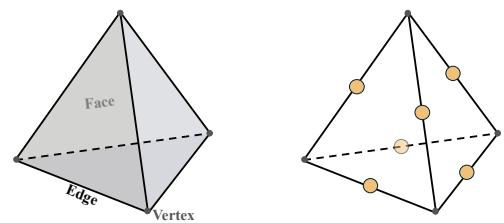
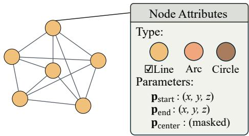
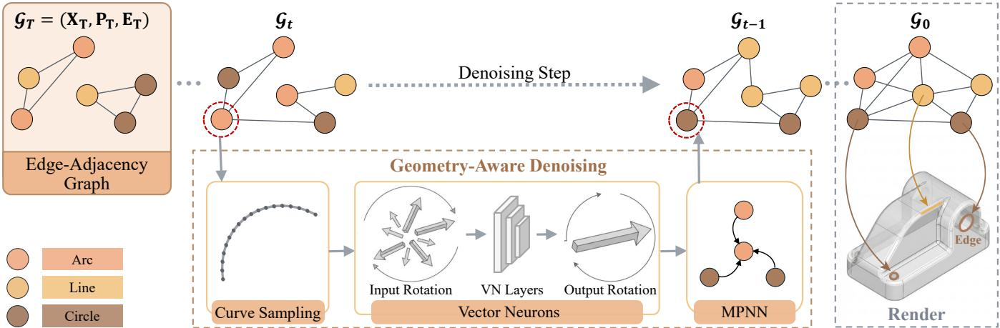
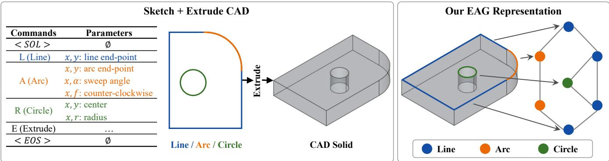
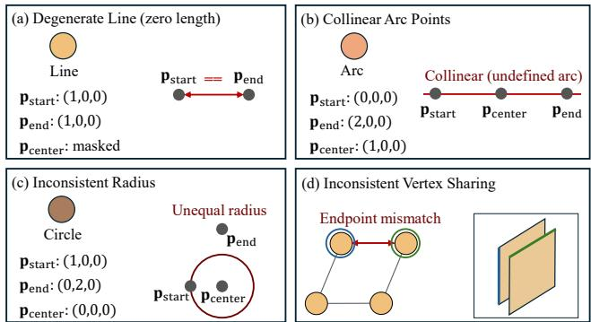
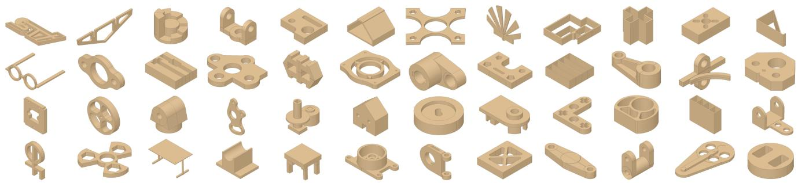
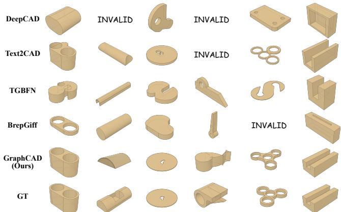

# GraphCAD: Geometry-Aware Difusion on Edge-Adjacency Graphs for CAD Generation

Wenhao Zheng College of Computer Science, Sichuan University Chengdu, China zhengwenhao@stu.scu.edu.cn

Xianggen Liu∗†   
College of Computer Science, Sichuan   
University   
Chengdu, China   
liuxianggen@scu.edu.cn

Jiancheng Shi Southwest China Research Institute of Electronic Equipment Chengdu, China shijcbit@163.com

Li Yue   
Dongfang Electric (Chengdu)   
Innovation Research Co., Ltd.   
Chengdu, China   
liy1383@dongfang.com

Jiancheng Lv∗† College of Computer Science, Sichuan University Chengdu, China lvjiancheng@scu.edu.cn

## Abstract

Generative modeling for Computer-Aided Design (CAD) remains fundamentally challenged by the need to capture the intricate inter play between discrete topological connectivity and precise spatial geometry inherent in Boundary Representations (B-reps). Existing generative approaches largely formulate CAD construction as a sequence modeling problem, but consequently lack an explicit topological inductive bias. In this work, we present GraphCAD, a geometry-aware generative framework that centers modeling on the Edge-Adjacency Graph (EAG), a novel graph-based CAD representation tailored for generative tasks. GraphCAD adopts a hybrid graph difusion formulation to jointly model the discrete and continuous components of EAG and introduces a geometry-aware denoising mechanism that “renders” node attributes into spatial point sets. These point sets are encoded by an SE(3)-equivariant backbone and fused into the node representations, thereby ground ing the generative process in physical geometry. To support this study, we construct EAGBench, a large-scale dataset of engineering CAD models. Extensive experiments show that GraphCAD can gen erate complex CAD models with more than 50 faces and achieves state-of-the-art performance in geometric fidelity and distributional alignment compared with sequence-based baselines.

## CCS Concepts

• Computing methodologies → Shape representations; Reconstruction.

## Keywords

Computer-Aided Design (CAD), Graph Difusion, Representation Learning

ACM Reference Format: Wenhao Zheng, Xianggen Liu, Li Yue, Jiancheng Shi, and Jiancheng Lv. 2026. GraphCAD: Geometry-Aware Difusion on Edge-Adjacency Graphs for CAD Generation. In Proceedings of the 34th ACM International Conference on Multimedia (MM ’26), November 10–14, 2026, Rio de Janeiro, Brazil. ACM, New York, NY, USA, 10 pages. https://doi.org/10.1145/3767308.3836073

## 1 Introduction

The foundation of modern engineering and manufacturing depends critically on Computer-Aided Design (CAD) models for the rigorous specification of physical objects [7, 40, 41]. Although automating the synthesis of such models is highly desirable for accelerating de- sign workflows, the inherently hybrid structure of CAD data makes this problem particularly challenging [3, 26, 34]. In practice, CAD data is most commonly represented in the Boundary Representation (B-rep) format [15], which defines 3D models through parameterized faces, edges, and vertices, jointly encoding the geometric and topological information necessary for a complete description of the shape [18, 22, 30]. As a result, directly synthesizing B-reps remains notoriously dificult, since it requires modeling continuous geometric parameters and discrete topological connectivity in a unified manner [12, 28, 29].

Prevailing approaches typically model B-reps either as sequences of commands [19, 23, 37] or as Constructive Solid Geometry (CSG) programs [36, 39, 54]. While these paradigms are intuitive, they often struggle to preserve strict topological integrity [24, 51]. In sequence-based generation, for example, a small error in an early operation can propagate through the entire construction process, ultimately producing disjoint loops, non-manifold edges, or entirely invalid geometries. More recently, methods such as BrepGif [11] and GraphBRep [21] have sought to mitigate these topological issues by abstracting B-reps into Face-Adjacency Graphs [16]. By leveraging the structural advantages ofgraph representations, these methods have shown promising results. However, because they typically rely on UV-domain sampling to approximate geometry and do not explicitly anchor generation to a 1D wireframe scafold, they remain limited in enforcing the precise boundary constraints required for high-fidelity industrial CAD models.

To address these limitations, we revisit prevailing graph formulations and introduce GraphCAD. In contrast to prior approaches based on Face-Adjacency Graphs, where nodes correspond to com-plex trimmed surfaces, our method adopts a new graph construction paradigm centered on 1D wireframe edges. Specifically, we propose the Edge-Adjacency Graph (EAG), which redefines the fundamental graph unit from faces to edges. Under this formulation, each node represents a topological edge augmented with hybrid attributes, including curve types and spatial parameters.

  
(a) Boundary representation.  
(b) EAG construction.

  
(c) EAG representation.  
Figure 1: Construction of the Edge-Adjacency Graph (EAG) representation. (a) A Boundary Representation (B-rep) of a CAD solid. (b) Construction of the Edge-Adjacency Graph, where each graph node corresponds to a topological edge in the B-rep and graph edges indicate shared B-rep vertices. (c) The EAG representation with node attributes, where each node encodes the curve type together with compact analytic geometric parameters.

To synthesize the proposed EAG representation, GraphCAD employs a geometry-aware hybrid graph difusion framework. To accommodate the heterogeneous nature of EAG, we formulate a hybrid difusion process that jointly models the distribution of discrete topological attributes and continuous geometric parameters. Unlike standard graph difusion models, which treat node attributes as in- dependent numerical vectors, our method explicitly interprets them as spatial geometry. During difusion, we “render” the numerical attributes associated with topological B-rep edges into 3D curves, sample local point sets from these curves, and encode them with an SE(3)-equivariant backbone. This design grounds abstract parameters in their physical realization, enabling the model to capture the intricate interplay between topological connectivity and geometric fidelity inherent to the EAG representation. To validate our approach, we introduce EAGBench, a large-scale unified dataset constructed by aggregating and standardizing component-level B-reps from existing repositories such as DeepCAD [47] and the Fusion 360 Gallery [46].

Our contributions can be summarized as follows:

• We introduce the Edge-Adjacency Graph (EAG), a novel graph representation of Boundary Representations (B-reps) specifically designed for CAD generation.

• We present GraphCAD, a geometry-aware graph difusion framework for CAD generation. Its SE(3)-equivariant denoising network produces predictions that transform consistently under rigid transformations while efectively model- ing the hybrid distribution of EAG data.

• We propose a novel geometry rendering mechanism that bridges abstract graph attributes and physical shape realiza- tion. By “rendering” node attributes into 3D curves and sam-pling spatial point sets, this mechanism enables the graph neural network to better perceive and encode the underlying CAD geometry.

• We construct EAGBench, a large-scale unified benchmark built upon the EAG representation. Extensive experiments on EAGBench show that GraphCAD achieves state-of-the-art performance in geometric fidelity and distributional alignment, while maintaining highly competitive topological validity compared with leading sequence-based baselines.

## 2 Related Work

## 2.1 Generative CAD Modeling

The generation of CAD models has attracted increasing attention in recent years [2, 38, 50]. Early approaches often represented CAD shapes using Constructive Solid Geometry (CSG) [33, 53, 55]. Although theoretically expressive, CSG-based methods are generally regarded as overly complex and insuficiently flexible for typical industrial design scenarios [1]. As a result, much of the recent literature has shifted toward feature-based modeling paradigms in which shapes are represented as sequences of commands [25, 45, 52, 56]. Recent methods such as Text2CAD [20] and CADDreamer [27] have substantially improved controllability and geometric fidelity within this paradigm. Nevertheless, these approaches still rely on sequential or implicit formulations. Because they primarily encode command histories rather than explicit geometric-topological structure, they ofer limited direct access to topological and geometric information and therefore lack an explicit topological inductive bias. Consequently, a critical gap remains for generative methods that can directly synthesize robust CAD representations.

## 2.2 Representation Learning for B-reps

Boundary Representation (B-rep) defines a solid through geometric primitives, such as parametric curves and surfaces, together with topological entities including vertices, edges, and faces [31]. While discrete representations, such as point clouds [35], voxels [48], meshes [13], and sequences [10], have been extensively studied, they lack the exact geometric precision required for engineering design. To bridge the gap between deep learning and precise CAD modeling, prior work has sought to encode B-reps into learnable graph structures [4, 5, 49]. UV-Net [16] pioneered the representation of B-reps as Face-Adjacency Graphs (FAGs), in which nodes are associated with 2D surface features extracted from UV grids. This face-centric formulation was later adopted and extended by generative methods such as BrepGif [11] and GraphBRep [21], which leverage graph structures to preserve complex topological relationships during generation. However, because these methods typically represent nodes as complex trimmed surfaces and decom- pose generation into multiple submodules, they often sufer from computational redundancy, error accumulation across stages, and substantial dificulty in enforcing precise 1D boundary constraints.

  
Figure 2: Overview of the GraphCAD framework. Top: The generative pipeline. The model synthesizes CAD models by iteratively denoising the Edge-Adjacency Graph (EAG), our proposed topological representation of B-rep geometry. Bottom: The Geometry-Aware Denoising module. Unlike standard graph-based methods that treat node attributes as abstract vectors, our approach explicitly “renders” these attributes into spatial point sets through “Curve Sampling”. The sampled point sets are then processed by an $\mathbf { S E } ( 3 )$ -equivariant Vector Neuron backbone to extract rotation-robust geometric embeddings.

## 2.3 Graph Difusion and Equivariance

Difusion models [8, 14] have achieved state-of-the-art performance across a wide range of generative tasks. In the graph domain, meth ods such as GDSS [17] and DiGress [44] have successfully extended difusion modeling to continuous and discrete graph structures, respectively. However, applying these generic frameworks to CAD requires addressing domain-specific engineering constraints, particularly the physical symmetries of 3D space. SE(3)-equivariant networks [9] have demonstrated strong efectiveness in applications such as molecular dynamics by ensuring robustness to rotations. In this work, we bring these advances into the CAD domain. Building upon discrete graph difusion, we develop an SE(3)-equivariant hybrid model specifically tailored to the Edge-Adjacency Graph. This design enables the generation of rigorous engineering geometries with invariant likelihoods, a property that remains largely overlooked in existing graph generative models.

## 3 Method

We present a novel generative framework for CAD models (see Figure 2). To introduce a stronger topological inductive bias in sequence-based methods, we shift the representation paradigm from parametric CAD sequences to the Edge-Adjacency Graph (EAG). This formulation introduces strong structural inductive biases that naturally promote topological integrity and, in turn, improve generation quality. Based on this representation, we develop a geometry-aware hybrid graph difusion model that jointly generates both structural connectivity and precise 3D geometry, treating them as physical spatial entities rather than independent abstract variables.

## 3.1 Edge-Adjacency Graph Representation

Conventional graph-based representations of B-reps typically adopt a Face-Adjacency Graph, in which nodes correspond to parametric surfaces. Although efective for discriminative tasks, the intrin- sic complexity of these high-dimensional surface features makes learning their joint distribution computationally prohibitive for generative modeling. To address this limitation, we identify the wireframe as the primary structural skeleton of a solid. Accordingly, as illustrated in Figure 1, we shift the graph formulation from faces to edges.

Formally, given a Boundary Representation B, we construct an undirected graph $\mathcal { G } = ( \mathcal { V } , \mathcal { E } )$

Definition 3.1 (Edge Nodes). Let $\mathcal { V } = \{ v _ { 1 } , \ldots , v _ { N } \}$ be the set of nodes, where each node $v _ { i }$ corresponds to a unique topological edge $e _ { i } ^ { t o p o }$ in B. Associated with each node �� is a compact geometric feature vector $\mathbf { h } _ { i } \in \mathbb { R } ^ { 1 2 }$

In our specific implementation, we adopt a concise analytical pa-rameterization. The feature vector is structured as a concatenation of primitive attributes:

$$
\mathbf { h } _ { i } = [ \mathbf { x } _ { \mathrm { t y p e } } , \mathbf { p } _ { \mathrm { s t a r t } } , \mathbf { p } _ { \mathrm { e n d } } , \mathbf { p } _ { \mathrm { c e n t e r } } ] ,\tag{1}
$$

where $\mathbf { x } _ { \mathrm { t y p e } } \in \{ 0 , 1 \} ^ { 3 }$ is a one-hot encoding of the curve type. In our representation, edge primitives are categorized into three analytical types: Line, $A r c ,$ and Circle. For Spline curves, we adopt a piecewise-arc approximation and represent each spline as a se-quence of arc segments in the graph. Each $\mathbf { p } \in \mathbb { R } ^ { 3 }$ denotes a 3D spatial point. For Line primitives, pcenter is masked. For Circle primitives, $\mathbf { p } _ { \mathrm { s t a r t } }$ and $\mathbf { p } _ { \mathrm { e n d } }$ are sampled on the circumference such that the chord connecting them does not pass through $\scriptstyle { \mathrm { p } } _ { \mathrm { c e n t e r } }$ . This geo-metric constraint ensures that the three points are non-collinear, thereby uniquely determining the circle’s 3D plane and curvature. As illustrated in Figure 3, these primitives capture the line, arc, and circle boundaries produced by common sketch-and-extrude opera- tions, including solids with curved boundaries. The corresponding surfaces are recovered during B-rep reconstruction.

  
Figure 3: Relationship between sketch-and-extrude CAD and the EAG representation. EAG encodes the resulting line, arc, and circle boundary primitives as typed nodes, while graph edges capture their topological adjacency.

Definition 3.2 (Topological Connectivity). The set of graph edges E defines the connectivity between physical CAD edges. We define an edge $( v _ { i } , v _ { j } ) \in \mathcal { E }$ if the corresponding CAD edges $e _ { i } ^ { t o p o }$ and $e _ { j } ^ { t o p o }$ share a common vertex in the B-rep data structure.

## 3.2 Hybrid Graph Difusion

To efectively model the distribution of this graph representation, we introduce a hybrid graph difusion model $M _ { \theta }$ for EAG genera- tion. Specifically, we extend the discrete graph difusion framework to a hybrid state space that jointly captures the distribution of discrete semantic attributes and continuous geometric parameters (see Appendix B for the detailed mathematical derivation).

Data Formulation. Let $G = ( \mathcal { V } , \mathcal { E } )$ be the Edge-Adjacency Graph with � nodes. Unlike standard discrete difusion models that operate solely on categorical data, our node attributes lie in a product space of discrete semantics and continuous geometry, represented by spaces X and $\mathcal { P } _ { : }$ , respectively. We use $\mathbf { x } _ { i } \in \{ 0 , 1 \} ^ { d _ { x } }$ to denote the one-hot encoded semantic type (Line, Arc, Circle) of node �, where $d _ { x } = 3 ,$ , organized in a matrix $\mathbf { X } \in \mathbb { R } ^ { n \times d _ { x } }$ . Similarly, we use $\mathbf { p } _ { i } \in \mathbb { R } ^ { d _ { p } }$ to denote the continuous geometric parameters (e.g., coordinates, radii), organized in a parameter matrix $\mathbf { P } \in \mathbb { R } ^ { n \times d _ { p } }$ where $d _ { p } = 9 .$ . The tensor $\mathbf { E } _ { t } \in \mathbb { R } ^ { n \times n \times d _ { e } }$ is the one-hot encoding of the edge set E. The complete state of the graph at time � is thus denoted by the tuple $\mathcal { G } _ { t } = ( \mathbf { X } _ { t } , \mathbf { P } _ { t } , \mathbf { E } _ { t } )$

Forward Process. We define a forward difusion process � that progressively corrupts the clean graph $\mathcal { G } _ { 0 }$ over � timesteps. Cru- cially, the noise is applied independently to the discrete, continuous, and topological components. The joint transition distribution factorizes as:

$$
\begin{array} { r } { q ( \mathcal { G } _ { t } \mid \mathcal { G } _ { t - 1 } ) = q _ { \mathrm { d i s c } } ( \mathbf { X } _ { t } \mid \mathbf { X } _ { t - 1 } ) \qquad } \\ { \qquad \times \ q _ { \mathrm { c o n t } } ( \mathbf { P } _ { t } \mid \mathbf { P } _ { t - 1 } ) \times q _ { \mathrm { e d g e } } ( \mathbf { E } _ { t } \mid \mathbf { E } _ { t - 1 } ) . } \end{array}\tag{2}
$$

For the discrete components (semantics $\mathbf { X } _ { t }$ and topology $\mathbf { E } _ { t } )$ , we adopt the matrix transition formulation from DiGress. The noise is defined by a sequence of Markov transition matrices $\mathbf { Q } _ { t }$ . The forward transition applies the noise independently to each node (or edge), sampling from a categorical distribution:

$$
\mathbf { X } _ { t } \sim C a t ( \mathbf { X } _ { t - 1 } \mathbf { Q } _ { t } ) .\tag{3}
$$

A key property of this Markov chain is that the marginal distribution at any arbitrary timestep � can be computed in closed form as $\mathbf { X } _ { t } \sim C a t ( \mathbf { X } _ { 0 } \overline { { \mathbf { Q } } } _ { t } )$ , where $\overline { { \mathbf { Q } } } _ { t } = \mathbf { Q } _ { 1 } \ldots \mathbf { Q } _ { t }$

For the continuous component P, we employ a standard Gaussian difusion process with a variance schedule $\beta _ { t }$ . The transition kernel for the parameter matrix is defined as:

$$
\mathbf { P } _ { t } = \sqrt { 1 - \beta _ { t } } \mathbf { P } _ { t - 1 } + \sqrt { \beta _ { t } } \pmb { \mathcal { E } } , \quad \pmb { \mathcal { E } } \sim \pmb { N } ( \mathbf { 0 } , \mathbf { I } ) ,\tag{4}
$$

where $\mathcal { E } \in \mathbb { R } ^ { n \times d _ { p } }$ is the sampled Gaussian noise matrix.

Reverse Process. During generation, the reverse transition is conditionally factorized as

$$
\begin{array} { r l } & { { p } _ { \theta } ( \mathcal { G } _ { t - 1 } \mid \mathcal { G } _ { t } ) = q ( { \mathbf { P } _ { t - 1 } } \mid { \mathbf { P } _ { t } } , \boldsymbol { \epsilon } _ { \theta } ) } \\ & { \qquad \times q ( { \mathbf { X } _ { t - 1 } } \mid { \mathbf { X } _ { t } } , \hat { \mathbf { X } } _ { 0 } ) q ( { \mathbf { E } _ { t - 1 } } \mid { \mathbf { E } _ { t } } , \hat { \mathbf { E } } _ { 0 } ) . } \end{array}\tag{5}
$$

Here, $( \hat { \mathbf { X } } _ { 0 } , \hat { \mathbf { E } } _ { 0 } , \pmb { \epsilon } _ { \theta } ) = M _ { \theta } ( G _ { t } , t )$ . Although conditionally factorized for tractable sampling, the three components remain coupled through the shared denoising network $M _ { \theta } ( G _ { t } , t )$ , which processes the com- plete noisy graph and jointly predicts $( \hat { \mathbf { X } } _ { 0 } , \hat { \mathbf { E } } _ { 0 } , \epsilon _ { \theta } )$

## 3.3 Geometry-Aware Denoising

To fully leverage the geometric priors inherent in the EAG representation, we design a geometry-aware denoising network $\boldsymbol { \mathcal { M } } _ { \boldsymbol { \theta } } ( \boldsymbol { \mathcal { G } } _ { t } , t )$ that explicitly grounds latent attributes in their physical realization. Standard graph difusion architectures typically treat node features as abstract numerical vectors. In our framework, however, these attributes encode explicit spatial definitions that are essential for valid construction. To efectively capture this geometric structure, we adopt a modular architecture composed of three stages: Geometric Feature Extraction, Equivariant Backbone, and Hybrid Prediction Heads.

Geometric Feature Extraction. To provide grounded spatial guidance, we explicitly “render” the noisy latent parameters into a point-based representation before feeding them to the backbone. For every node $v _ { i }$ at timestep �:

• Bézier Instantiation: We interpret the noisy parameters $\mathbf { p } _ { i , t }$ as control points for Quadratic Bézier curves conditioned on ${ \bf x } _ { i , t } .$ . This relaxation robustly generates valid, diferen- tiable 3D loci even when intermediate states violate strict geometric invariants (e.g., unequal radii).

• Point Sampling: We uniformly sample � = 100 points along this reconstructed noisy curve to generate a local dis- crete point set:

$$
\mathcal { P } _ { i , t } = \left\{ \mathbf { u } _ { k } \right\} _ { k = 1 } ^ { K } ,\tag{6}
$$

where $\mathcal { P } _ { i , t }$ comprises � sampled coordinates ${ \mathbf { u } } _ { k } \in \mathbb { R } ^ { 3 }$ for node $v _ { i }$ at timestep �.

• Geometric Encoding: To ensure SE(3) equivariance (see Sec. 3.4), we process $\mathcal { P } _ { i , t }$ using a Vector Neuron [6] encoder $\psi _ { \mathrm { v n } } .$ . This module maps the point set to a rotation-equivariant embedding $\mathbf { g } _ { i , t } = \psi _ { \mathrm { v n } } ( \mathcal { P } _ { i , t } ) \in \mathbb { R } ^ { d _ { g } \times 3 }$ , comprising $d _ { g }$ distinct 3D vector features. This embedding satisfies

$$
\psi _ { \mathrm { v n } } ( { \bf R } \cdot \mathcal { P } _ { i , t } ) = \mathbf { R } \cdot \psi _ { \mathrm { v n } } ( \mathcal { P } _ { i , t } ) ,\tag{7}
$$

for any rotation matrix R ∈ ��(3), where the rotation is applied to the spatial dimension of each feature vector.

Equivariant Backbone. The backbone Φbackbone processes the node attributes $\mathbf { h } _ { i }$ (defined in Eq. 1) by partitioning them into two distinct feature streams: a scalar stream s� containing rotationinvariant features (specifically, one-hot node types), and a vector stream $\mathbf { V } _ { i } \in \mathbb { R } ^ { ( d _ { g } + 3 ) \times \bar { 3 } }$ formed by concatenating the geometric parameters p� with the rendered point-set embeddings $\mathbf { g } _ { i }$ . Inside the network, these streams are updated in parallel: $\mathbf { s } _ { i }$ via standard MLPs and $\mathbf { V } _ { i }$ via SE(3)-equivariant operations. This dual-stream design preserves rotational equivariance within the denoising backbone while maintaining geometric consistency.

Hybrid Prediction Heads. The network outputs are generated by hybrid prediction heads �h d: classifiers for the discrete node types and edge topology, and a regressor for the continuous pa- rameters. Specifically, we train the model to predict the clean start state for both discrete structures $( \mathbf { X } _ { 0 } , \mathbf { E } _ { 0 } )$ and the noise term � for the continuous parameters via a hybrid loss function:

$$
\mathcal { L } = \mathcal { L } _ { \mathrm { C E } } ( \mathbf { X } _ { 0 } , \hat { \mathbf { X } } _ { \theta } ) + \mathcal { L } _ { \mathrm { C E } } ( \mathbf { E } _ { 0 } , \hat { \mathbf { E } } _ { \theta } ) + \lambda \| \mathbf { M } \mathbf { a } \mathbf { s } \mathbf { k } \odot ( \boldsymbol { \epsilon } - \boldsymbol { \epsilon } _ { \theta } ) \| ^ { 2 } .\tag{8}
$$

Here, the first two terms represent the cross-entropy losses for node semantic types and edge connectivity. The third term supervises the continuous geometry, weighted by �. Crucially, Mask is a semantic-aware binary mask derived from the ground truth types $\mathbf { X } _ { 0 } ,$ . It zeros out the loss for geometric attributes that are undefined for a specific curve type (e.g., the center parameter for a Line), preventing the model from hallucinating gradients for non-existent geometry.

## 3.4 SE(3) Equivariance

We focus on the SE(3)-equivariance of the denoising network $M _ { \theta } ( G _ { t } , t )$ Let G denote the space of Edge-Adjacency Graphs.

Definition 3.3 (SE(3) Group Action). We define the action of a rigid body transformation $r = ( \mathbf { R } , \mathbf { t } ) \in S E ( 3 )$ on an edge-adjacency graph $G _ { t } \in \mathcal { G }$ , denoted as $r \circ G _ { t }$ . Formally, let $\Gamma : \mathcal { G }  \mathcal { B }$ be the mapping from EAGs to solid B-reps. The action is defined by the commutative property via the underlying geometric coordinates:

$$
r \circ G _ { t } \triangleq \Gamma ^ { - 1 } ( r \cdot \Gamma ( G _ { t } ) ) .\tag{9}
$$

This formulation ensures that transforming the abstract graph representation corresponds to rotating and translating the underly- ing CAD geometry. By handling translation through input canonicalization and rotation through an SO(3)-equivariant backbone, the denoising network satisfies the following equivariance property.

  
Figure 4: Visual categorization of the primary failure modes encountered during EAG-to-B-rep reconstruction.

Theorem 3.4 (SE(3) Eqivariance). Let $G _ { t } \in \mathcal { G }$ be a noisy graph and� ∈ ��(3) be a rigid transformation. The denoising network M� satisfies (detailed proofin Appendix A):

$$
\boldsymbol { \mathcal { M } } _ { \boldsymbol { \theta } } ( \boldsymbol { r } \circ \boldsymbol { G } _ { t } ) = \boldsymbol { r } \circ \boldsymbol { \mathcal { M } } _ { \boldsymbol { \theta } } ( \boldsymbol { G } _ { t } ) .\tag{10}
$$

Remark. The theorem states that transforming the input EAG produces a correspondingly transformed network prediction. This claim applies specifically to the denoising network and does not assume strict SE(3)-equivariance of the subsequent sampling and B-rep reconstruction operations.

## 4 Experiments

## 4.1 Setup

4.1.1 Dataset Construction. We introduce EAGBench, a comprehensive benchmark suite specifically designed for graph-based CAD generative modeling. EAGBench consists of two distinct datasets, EAGBench-DC and EAGBench-FS, enabling robust evaluation ofgen-erative performance across diferent data distributions and levels of modeling complexity.

We collect raw B-rep models from two major public repositories: DeepCAD [47] and the Fusion 360 Gallery [46]. To ensure compatibility with our framework, we first perform geometric dedupli- cation to remove redundant samples and further exclude models for which valid surface area or volume cannot be parsed. For each remaining model, we extract the hybrid attributes required by the Edge-Adjacency Graph. In particular, we parse the topology to ensure that each graph node corresponds to a unique topological edge in the B-rep. The geometric parameters (pstart, pend, pcenter) are then extracted and normalized to the unit cube [−1, 1]3. The resulting benchmarks exhibit diverse topological characteristics:

EAGBench-DC: Derived from the DeepCAD repository, this subset contains 95,392 unique models. It has an average of 16.6 nodes per graph and an average node degree of 3.7. The dataset is dominated by line segments, which account for 85.5% of all prim- itives, reflecting the prevalence of prismatic features in standard mechanical components.

EAGBench-FS: Derived from the Fusion 360 Gallery, this subset contains 2,839 models. Compared with DeepCAD, these models exhibit greater geometric complexity. The dataset has an average node degree of 3.4, and its primitive distribution contains a higher pro-portion of curved geometries, including 14.3% circles and 8.0% arcs.

Table 1: Quantitative evaluation of unconditional generation across two benchmarks. We measure distributional alignment between generated and reference Edge-Adjacency Graphs (EAGs) using maximum mean discrepancy over node degree (Deg), clustering coeficient (Clus), and orbit counts (Orb). Generative quality is further evaluated in terms of Validity, Uniqueness, and Novelty. Best results are shown in bold.
<table><tr><td>Model</td><td>Deg↓</td><td>Clus ↓</td><td>Orb ↓</td><td>Validity ↑</td><td>Uniqueness ↑</td><td>Novelty ↑</td></tr><tr><td colspan="7">EAGBench-DC</td></tr><tr><td>GraphNVP</td><td>0.836</td><td>0.749</td><td>1.634</td><td>52.79</td><td>89.79</td><td>81.96</td></tr><tr><td>GDSS</td><td>0.659</td><td>0.721</td><td>1.310</td><td>80.08</td><td>85.21</td><td>79.50</td></tr><tr><td>ConGress</td><td>0.313</td><td>0.399</td><td>0.559</td><td>71.97</td><td>91.20</td><td>85.18</td></tr><tr><td>DiGress</td><td>0.242</td><td>0.383</td><td>0.183</td><td>95.31</td><td>93.42</td><td>89.34</td></tr><tr><td>GraphCAD (Ours)</td><td>0.176</td><td>0.248</td><td>0.120</td><td>98.05</td><td>95.76</td><td>92.21</td></tr><tr><td colspan="7">EAGBench-FS</td></tr><tr><td>GraphNVP</td><td>0.202</td><td>0.402</td><td>0.172</td><td>30.03</td><td>88.26</td><td>83.14</td></tr><tr><td>GDSS</td><td>0.199</td><td>0.297</td><td>0.159</td><td>54.08</td><td>87.19</td><td>84.25</td></tr><tr><td>ConGress</td><td>0.178</td><td>0.244</td><td>0.131</td><td>53.12</td><td>93.27</td><td>92.13</td></tr><tr><td>DiGress</td><td>0.169</td><td>0.239</td><td>0.127</td><td>77.45</td><td>95.16</td><td>95.82</td></tr><tr><td>GraphCAD (Ours)</td><td>0.162</td><td>0.233</td><td>0.114</td><td>96.58</td><td>99.12</td><td>98.96</td></tr></table>

This subset therefore serves as a challenging testbed for generating complex nonlinear structures.

4.1.2 Baselines. We evaluate our framework against two cate-gories of baselines to assess both topological correctness and geo- metric fidelity. For graph generation, we compare against state-of-the-art autoregressive and difusion-based models, including GraphNVP [32], GDSS [17], ConGress [44], and DiGress [44], to validate the structural quality of the generated EAGs. For CAD gen- eration, we benchmark against DeepCAD [47], a representative sequence-based method, as well as Text2CAD [20] and TGBFN [57]. We further compare with graph-based CAD generation methods, including BrepGif [11] and GraphBRep [21].

4.1.3 Metrics. We employ a comprehensive set of metrics covering both graph topology and geometric fidelity. For graph structure, following standard protocols [44], we report Validity, Uniqueness, and Novelty, along with maximum mean discrepancy on degree distribution (Deg), clustering coeficient (Clus), and orbit counts (Orb). For CAD geometry, we follow the evaluation protocol of NURBGen [42]. Specifically, we measure the Invalidity Ratio (IR), as well as the squared Chamfer Distance (CD) and the Hausdorf Distance (HD), computed on 8,192 uniformly sampled surface points after normalizing each shape to the $[ - 1 , \dot { 1 } ] ^ { 3 }$ unit cube. To further assess distributional alignment and generative diversity, we report the Jensen-Shannon Divergence (JSD) and the Minimum Matching Distance (MMD). Note that Validity in Table 1 and IR in Table 2, 3 are complementary measures computed using the same EAG-to-B-rep reconstruction pipeline.

4.1.4 B-rep Reconstruction. Given a generated EAG ${ \mathcal { G } } _ { 0 } ,$ we instantiate lines, arcs, and circles using BRepBuilderAPI\_MakeEdge and assemble adjacent edges into closed wires using BRepBuilder-$A P I _ { - }$ MakeWire. We then reconstruct compatible surfaces from these wires and stitch the resulting faces into a shell. Its watertightness is verified using BRepCheck\_Analyzer, after which valid shells are converted into solids for uniform surface sampling. Sequence-based baselines use their oficial reconstruction implementations, whereas all graph-based methods share the pipeline above. The resulting B-reps are evaluated using identical metrics.

4.1.5 Implementation Details. We implement a hybrid graph diffusion framework with � = 500 timesteps. The SE(3)-equivariant VNEncoder processes local point sets via a three-stage hierarchy (32, 64, 128 channels) using VN-LeakyReLU activations. Rotationinvariant embeddings are derived via VN-Max-Pooling followed by an invariant linear projection. For difusion, we utilize Markov transition matrices for discrete variables and a Gaussian variance schedule $\beta _ { t }$ for continuous parameters. Training is conducted on 3 NVIDIA A800 GPUs. Please refer to Appendix C for additional configurations.

4.1.6 Failure Mode Analysis ofEAG-to-B-rep Reconstruction. We categorize reconstruction failures into four primary types, as illustrated in Fig. 4: (i) degenerate primitives (Fig. 4a), where coincident endpoints $( { \bf p } _ { \mathrm { s t a r t } } \approx { \bf p } _ { \mathrm { e n d } } )$ produce zero-length edges that cannot be incorporated into the B-rep wireframe; (ii) undefined arc parametrization (Fig. 4b), where collinear pstart, pend, and pcenter fail to uniquely determine the plane and curvature of an arc or circle; (iii) geometric inconsistency (Fig. 4c), where the constraint $\lVert \mathbf { p } _ { \mathrm { s t a r t } } - \mathbf { p } _ { \mathrm { c e n t e r } } \rVert \approx \lVert \mathbf { p } _ { \mathrm { e n d } } - \mathbf { p } _ { \mathrm { c e n t e r } } \rVert$ is violated beyond the CAD kernel tolerance, resulting in invalid primitives; and (iv) topological mismatch (Fig. 4d), where graph-connected edges have non-coincident endpoints, producing an open wire that fails the watertightness check required for solid B-rep construction.

## 4.2 Unconditional Topological Generation

We evaluate the ability of GraphCAD to capture the latent distribution of Edge-Adjacency Graphs (EAGs). As shown in Table 1, GraphCAD consistently outperforms both flow-based (GraphNVP) and difusion-based (GDSS, ConGress, DiGress) baselines across all evaluation metrics. In particular, our model achieves the lowest Deg, Clus, and Orb scores, indicating a closer match to the reference topological distribution. The advantage is especially pronounced on the more challenging EAGBench-FS benchmark: whereas the strongest baseline, DiGress, attains a validity of 77.45%, GraphCAD preserves a substantially higher validity of 96.58%. This large mar-gin suggests that our geometry-aware formulation is particularly efective at modeling the intricate connectivity constraints inherent in engineering components.

  
Figure 5: Unconditional generation results on the EAGBench dataset. GraphCAD generates realistic CAD models with complex geometry and topology.

Table 2: Quantitative comparison of conditional generation. We evaluate reconstructed B-rep models in terms of topological validity (IR), geometric fidelity (CD, HD), and distributional quality (JSD, MMD). Note: For readability, CD, JSD, and MMD are each reported after scaling by 102 within the [−1, 1]3 unit cube.
<table><tr><td rowspan="2">Model</td><td colspan="4">EAGBench-DC</td><td rowspan="2"></td><td colspan="4">EAGBench-FS</td><td rowspan="2"></td></tr><tr><td>IR↓</td><td>CD↓</td><td>HD↓ JSD↓</td><td></td><td>MMD↓</td><td>IR↓ CD↓</td><td></td><td>HD↓ JSD↓</td></tr><tr><td>Sequence-based</td><td></td><td></td><td></td><td></td><td></td><td></td><td></td><td></td><td></td><td></td></tr><tr><td>Transformer [43]</td><td>12.02</td><td>11.83</td><td>0.48</td><td>83.94</td><td>4.02</td><td>19.11</td><td>17.51</td><td>0.81</td><td>84.01</td><td>5.33</td></tr><tr><td>DeepCAD [47]</td><td>9.29</td><td>6.76</td><td>0.51</td><td>98.40</td><td>4.25</td><td>13.07</td><td>14.98</td><td>0.79</td><td>92.53</td><td>5.91</td></tr><tr><td>Text2CAD [20]</td><td>3.87</td><td>3.36</td><td>0.45</td><td>59.63</td><td>3.98</td><td>8.29</td><td>4.62</td><td>0.63</td><td>70.38</td><td>4.78</td></tr><tr><td>TGBFN [57]</td><td>0.78</td><td>2.34</td><td>0.37</td><td>65.92</td><td>3.40</td><td>6.48</td><td>5.35</td><td>0.72</td><td>74.73</td><td>5.08</td></tr><tr><td>Graph-based</td><td></td><td></td><td></td><td></td><td></td><td></td><td></td><td></td><td></td><td></td></tr><tr><td>GraphBRep [21]</td><td>9.08</td><td>7.69</td><td>0.66</td><td>96.39</td><td>4.16</td><td>16.88</td><td>15.71</td><td>0.80</td><td>88.59</td><td>5.36</td></tr><tr><td>BrepGiff [11]</td><td>2.17</td><td>2.27</td><td>0.39</td><td>67.23</td><td>3.62</td><td>6.53</td><td>4.72</td><td>0.74</td><td>73.91</td><td>4.29</td></tr><tr><td>GraphCAD (Ours)</td><td>1.67</td><td>1.73</td><td>0.28</td><td>33.22</td><td>1.97</td><td>5.42</td><td>3.37</td><td>0.59</td><td>64.97</td><td>3.52</td></tr></table>

Table 3: Ablation study on the EAGBench-DC dataset evaluating the contribution of individual components in GraphCAD. We compare the full model with variants that remove the SE(3)-equivariant backbone (w/o SE(3) Equivariance), semantic loss masking (w/o Loss Masking), and point-based geometric rendering (w/o Geometric Rendering).
<table><tr><td></td><td colspan="6">Graph Metrics</td><td colspan="4">CAD Metrics</td></tr><tr><td>Model</td><td>Deg ↓</td><td>Clus ↓</td><td>Orb ↓</td><td>Validity ↑</td><td>Uniqueness ↑</td><td>Novelty ↑</td><td>CD↓</td><td>HD↓</td><td>JSD↓</td><td>MMD↓</td></tr><tr><td>Full Method (Ours)</td><td>0.164</td><td>0.236</td><td>0.119</td><td>98.33</td><td>96.71</td><td>90.38</td><td>1.73</td><td>0.28</td><td>33.22</td><td>1.97</td></tr><tr><td>w/o SE(3) Equivariance</td><td>0.234</td><td>0.377</td><td>0.166</td><td>97.27</td><td>93.98</td><td>89.16</td><td>2.17</td><td>0.44</td><td>42.37</td><td>2.67</td></tr><tr><td>w/o Loss Masking</td><td>0.316</td><td>0.395</td><td>0.582</td><td>73.17</td><td>92.11</td><td>88.46</td><td>2.48</td><td>0.51</td><td>47.56</td><td>2.93</td></tr><tr><td>w/o Geometric Rendering</td><td>0.352</td><td>0.411</td><td>0.612</td><td>66.45</td><td>87.93</td><td>80.38</td><td>5.70</td><td>0.66</td><td>67.23</td><td>3.62</td></tr></table>

Beyond structural validity, the consistently high Uniqueness (> 95%) and Novelty (> 92%) scores across both datasets indicate that GraphCAD produces diverse samples without evident overfitting or mode collapse. Qualitative results in Figure 5 further show that GraphCAD, trained on the graph-based EAGBench dataset, generates realistic and diverse CAD B-reps with complex topology and geometry. Together, these results validate that the EAG repre sentation, coupled with our hybrid difusion process, successfully grounds topological generation in physical geometric constraints, thereby promoting both structural soundness and sample diversity.

## 4.3 Conditional CAD Generation

We further evaluate the ability of GraphCAD to generate precise 3D CAD models under specific input constraints, following the protocol of TGBFN [57]. As shown in Table 2, our framework achieves a more favorable balance between topological validity and geo- metric accuracy. Although TGBFN attains a slightly lower IR on EAGBench-DC, GraphCAD consistently delivers superior geometric fidelity, reducing CD by approximately 26% (2.34 to 1.73).

On EAGBench-DC, GraphCAD achieves the best performance on all geometric and distributional metrics, attaining the lowest

Table 4: Impact ofpoint sampling density (�). Trade-of between inference computational cost and generation quality on EAGBench-DC. Computational cost is measured on a sin-gle batch of 256 samples.
<table><tr><td>Points (K)</td><td colspan="2">Computational Cost VRAM (GB) Time (s)</td><td>Generation Quality IR (↓) CD (↓)</td></tr><tr><td>0</td><td> $4 . 4 0 \pm 0 . 0 3$ </td><td> $1 3 1 \pm 1$ </td><td>27.59 5.47</td></tr><tr><td>10</td><td> $4 . 6 0 \pm 0 . 0 2$ </td><td> $1 4 5 \pm 2$ </td><td>2.52 2.81</td></tr><tr><td>20</td><td> $4 . 6 4 \pm 0 . 0 2$ </td><td> $1 4 6 \pm 1$ </td><td>2.67 2.23</td></tr><tr><td>50</td><td> $4 . 9 3 \pm 0 . 0 1$ </td><td> $1 4 9 \pm 2$ </td><td>1.84 2.29</td></tr><tr><td>100</td><td> $5 . 0 6 \pm 0 . 0 3$ </td><td> $1 5 1 \pm 2$ </td><td>1.78 1.94</td></tr></table>

CD, HD, JSD, and MMD. In particular, compared with TGBFN, it reduces CD from 2.34 to 1.73 and substantially lowers JSD from 65.92 to 33.22. Although TGBFN achieves the lowest IR (0.78%), our method remains highly competitive in validity (1.67%) while providing clearly stronger geometric reconstruction quality.

On the more challenging EAGBench-FS benchmark, GraphCAD consistently outperforms all baselines across all five metrics. Our method achieves the lowest IR (5.42%), CD (3.37), HD (0.59), JSD (64.97), and MMD (3.52), surpassing both sequence-based methods, such as Text2CAD, and graph-based methods such as GraphBRep and BrepGif. These results indicate that GraphCAD is not only more robust in preserving valid topology under complex conditions but also more accurate in recovering fine-grained geometry and the overall data distribution. The qualitative results in Figure 6 further support this conclusion, showing that GraphCAD generates more coherent and geometrically faithful solids, whereas baseline methods more frequently exhibit structural or geometric artifacts.

## 4.4 Ablation Study

To validate our architectural design, we compare GraphCAD against variants lacking specific components. The results in Table 3 confirm the necessity of each module. As shown in Table 3, the full GraphCAD model performs best overall, achieving the strongest balance between topological quality and geometric fidelity. Remov ing SE(3) equivariance leads to a moderate yet consistent decline across both graph and CAD metrics, with lower validity and worse reconstruction quality, indicating that equivariant geometric encoding improves robustness to spatial variation. Removing loss masking leads to a much larger drop in validity and noticeably weaker geometric consistency, confirming that suppressing super-vision on undefined attributes is essential for stable learning. The most damaging ablation is removing geometric rendering, which causes the largest deterioration in validity, geometric fidelity, and distributional alignment, indicating that directly grounding node attributes in sampled spatial geometry is critical to the model. Over-all, the ablation study shows that GraphCAD derives its advantage primarily from explicit geometry awareness, which tightly couples topological generation with faithful CAD reconstruction.

Table 4 further examines the efect of the point sampling density �. Without explicit rendering (� = 0), the model struggles to satisfy structural constraints, resulting in a high invalidity ratio of 27.59%. Introducing even a sparse point set (� = 10) reduces this failure rate to 2.52%, underscoring the importance of spatial grounding for preserving topological consistency. Increasing � to 100 further improves both geometric fidelity (CD decreases to 1.94) and validity (1.78% IR), while incurring only a modest computational overhead. In particular, VRAM usage increases by 0.66 GB (from 4.40 GB to 5.06 GB), supporting � = 100 as a practical trade-of between reconstruction quality and eficiency.

  
Figure 6: Qualitative comparison of CAD models from conditional generation. From top to bottom, we show results produced by DeepCAD, Text2CAD, TGBFN, BrepGif, our proposed GraphCAD, and the Ground Truth (GT).

## 5 Limitations

Several limitations remain. First, EAG models 1D boundary curves rather than explicit 2D surface patches. Although it supports curved boundaries and non-planar surfaces through line, arc, and circle primitives, complete surface definitions, such as NURBS control points, are recovered through post-processing. This reconstruction may introduce errors in regions with complex curvature. Second, the iterative difusion process requires � denoising steps, making inference slower than single-pass generative methods. Finally, our experiments focus on component-level parts. Scaling EAG gen-eration to large assemblies with thousands of topological edges remains challenging because of the substantially larger discrete state space.

## 6 Conclusion

In this paper, we introduced GraphCAD, a geometry-aware hy- brid graph difusion framework for CAD generation built upon the proposed Edge-Adjacency Graph (EAG) representation. By combining a curve rendering mechanism with an SE(3)-equivariant backbone, our model grounds abstract node attributes in spatial geometry, thereby promoting robust topological and geometric consistency. Extensive experiments on the EAGBench benchmark demonstrate that GraphCAD achieves state-of-the-art performance in both validity and fidelity compared with existing sequence-based and graph-based baselines. In future work, we plan to extend this probabilistic formulation to infer full surface definitions, moving beyond wireframe generation toward complete solid reconstruc- tion.

## Acknowledgments

This work is supported by the National Key R&D Program of China under Grant 2024YFB3312503, the National Major Scientific Instruments and Equipments Development Project of National Natural Science Foundation of China under Grant 62427820, the Science Fund for Creative Research Groups of Sichuan Province Natural Science Foundation under Grant 2024NSFTD0035, the Ministry of Education Engineering Research Center Guiding Project for Machine Learning and Industrial Intelligence Applications under Grant SCU2024D013, the Science and Technology Major Project of Sichuan Province under Grant 2024ZDZX0003 and 2025ZDZX0140. We also acknowledge the support of the Sichuan Province Engi neering Technology Research Center of Broadband Electronics Intelligent Manufacturing.

## References

[1] C. Andújar, P. Brunet, A. Chica, I. Navazo, and À. Vinacua. 2022. Solid Modelling for Manufacturing: From Voelcker’s Boundary Evaluation to Discrete Paradigms. Computer-Aided Design 152 (2022), 103370. doi:10.1016/j.cad.2022.103370

[2] Evan Casey, Tianyu Zhang, Shu Ishida, John Roger Thompson, Amir Khasahmadi, Joseph George Lambourne, Pradeep Kumar Jayaraman, and Karl D.D. Willis. 2025. Aligning Constraint Generation with Design Intent in Parametric CAD. In Proceedings of the IEEE/CVF International Conference on Computer Vision (ICCV). 8613–8622.

[3] Tianrun Chen, Chunan Yu, Yuanqi Hu, Jing Li, Tao Xu, Runlong Cao, Lanyun Zhu, Ying Zang, Yong Zhang, Zejian Li, and Lingyun Sun. 2025. Img2CAD: Conditioned 3-D CAD Model Generation From Single Image With Structured Visual Geometry. IEEE Transactions on Industrial Informatics 21, 11 (2025), 8539– 8549. doi:10.1109/TII.2025.3584476

[4] Andrew R. Colligan, Trevor T. Robinson, Declan C. Nolan, Yang Hua, and Weijuan Cao. 2022. Hierarchical CADNet: Learning from B-Reps for Machining Feature Recognition. Computer-Aided Design 147 (2022), 103226. doi:10.1016/j.cad.2022. 103226

[5] Yongkang Dai, Xiaoshui Huang, Yunpeng Bai, Hao Guo, Hongping Gan, Ling Yang, and Yilei Shi. 2025. BRepFormer: Transformer-Based B-Rep Geometric Feature Recognition. In Proceedings ofthe 2025 International Conference on Multimedia Retrieval (Chicago, IL, USA) (ICMR ’25). Association for Computing Machinery, New York, NY, USA, 155–163. doi:10.1145/3731715.3733283

[6] Congyue Deng, Or Litany, Yueqi Duan, Adrien Poulenard, Andrea Tagliasacchi, and Leonidas J. Guibas. 2021. Vector Neurons: A General Framework for SO(3)- E uivariant Networks. In Proceedings ofthe IEEE/CVF International Conference on Computer Vision (ICCV). 12200–12209.

[7] Liyuan Deng, Yunpeng Bai, Yongkang Dai, Xiaoshui Huang, Hongping Gan, Dongshuo Huang, Hao Jiacheng, and Yilei Shi. 2025. MamTif-CAD: Multi-Scale Latent Difusion with Mamba+ for Complex Parametric Sequence. In Proceedings of the IEEE/CVF International Conference on Computer Vision (ICCV). 10517–10526.

[8] Prafulla Dhariwal and Alexander Nichol. 2021. Difusion Models Beat GANs on Image Synthesis. In Advances in Neural Information Processing Systems, M. Ran zato, A. Beygelzimer, Y. Dauphin, P.S. Liang, and J. Wortman Vaughan (Eds.), Vol. 34. Curran Associates, Inc., 8780–8794. https://proceedings.neurips.cc/ paper\_files/paper/2021/file/49ad23d1ec9fa4bd8d77d02681df5cfa-Paper.pdf

[9] Fabian Fuchs, Daniel Worrall, Volker Fischer, and Max Welling. 2020. SE(3)- Transformers: 3D Roto-Translation Equivariant Attention Networks. In Advances in Neural Information Processing Systems, H. Larochelle, M. Ranzato, R. Hadsell, M.F. Balcan, and H. Lin (Eds.), Vol. 33. Curran Associates, Inc., 1970–1981. https://proceedings.neurips.cc/paper\_files/paper/2020/file/ 15231a7ce4ba789d13b722cc5c955834-Paper.pdf

[10] Yaroslav Ganin, Sergey Bartunov, Yujia Li, Ethan Keller, and Stefano Saliceti. 2021. Computer-Aided Design as Language. In Advances in Neural Information Processing Systems, M. Ranzato, A. Beygelzimer, Y. Dauphin, P.S. Liang, and J. Wortman Vaughan (Eds.), Vol. 34. Curran Associates, Inc., 5885–5897. https://proceedings.neurips.cc/paper\_files/paper/2021/file 2e92962c0b6996add9517e4242ea9bdc-Paper.pdf

[11] Hao Guo, Xiaoshui Huang, Hao jiacheng, Yunpeng Bai, Hongping Gan, and Yilei Shi. 2025. BrepGif: Lightweight Generation of Complex B-rep with 3D GAT Difusion. In Proceedings ofthe IEEE/CVF Conference on Computer Vision and Pattern Recognition (CVPR). 26587–26596.

[12] Haoxiang Guo, Shilin Liu, Hao Pan, Yang Liu, Xin Tong, and Baining Guo. 2022. ComplexGen: CAD reconstruction by B-rep chain complex generation. ACM Trans. Graph. 41, 4, Article 129 (Jul 2022), 18 a es. doi:10.1145/3528223.3530078

[13] Rana Hanocka, Amir Hertz, Noa Fish, Raja Giryes, Shachar Fleishman, and Daniel Cohen-Or. 2019. MeshCNN: A Network with an Edge. ACM Trans. Graph. 38, 4,

Article 90 (July 2019), 12 pages. doi:10.1145/3306346.3322959

[14] Jonathan Ho, Ajay Jain, and Pieter Abbeel. 2020. Denoising Difusion Probabilistic Models. In Advances in Neural Information Processing Systems, H. Larochelle, M. Ranzato, R. Hadsell, M.F. Balcan, and H. Lin (Eds.), Vol. 33. Curran Associates, Inc., 6840–6851. https://proceedings.neurips.cc/paper\_files/paper/2020/ file/4c5bcfec8584af0d967f1ab10179ca4b-Paper.pdf

[15] Pradeep Kumar Jayaraman, Joseph George Lambourne, Nishkrit Desai, Karl Willis, Aditya Sanghi, and Nigel J. W. Morris. 2023. SolidGen: An Autoregressive Model for Direct B-rep Synthesis. Transactions on Machine Learning Research (2023). Featured Certification. https://openreview.net/forum?id=ZR2CDgADRo

[16] Pradeep Kumar Jayaraman, Aditya Sanghi, Joseph G. Lambourne, Karl D.D. Willis, Thomas Davies, Hooman Shayani, and Nigel Morris. 2021. UV-Net: Learning from Boundary Representations. In Proceedings ofthe IEEE/CVF Conference on Computer Vision and Pattern Recognition (CVPR). 11703–11712.

[17] Jaehyeong Jo, Seul Lee, and Sung Ju Hwang. 2022. Score-based Generative Modeling of Graphs via the System of Stochastic Diferential Equations. In Proceedings ofthe 39th International Conference on Machine Learning (Proceedings ofMachine Learning Research, Vol. 162), Kamalika Chaudhuri, Stefanie Jegelka, Le Son Csaba Sze esvari Gan Niu and Sivan Sabato (Eds.). PMLR 10362– 10383. https://proceedings.mlr.press/v162/jo22a.html

[18] Benjamin Jones, James Noeckel, Milin Kodnongbua, Ilya Baran, and Adriana Schulz. 2023. B-rep Matching for Collaborating Across CAD Systems. ACM Trans. Graph. 42, 4, Article 104 (July 2023), 13 pages. doi:10.1145/3592125

[19] Mohammad Sadil Khan, Elona Dupont, Sk Aziz Ali, Kseniya Cherenkova, Anis Kacem, and Djamila Aouada. 2024. CAD-SIGNet: CAD Language Inference from Point Clouds Using Layer-Wise Sketch Instance Guided Attention. In 2024 IEEE/CVF Conference on Computer Vision and Pattern Recognition (CVPR). 4713– 4722. doi:10.1109/CVPR52733.2024.00451

[20] Mohammad Sadil Khan, Sankalp Sinha, Talha Uddin Sheikh, Didier Stricker, Sk Aziz Ali, and Muhammad Zeshan Afzal. 2024. Text2CAD: Generatin Se uen tial CAD Designs from Beginner-to-Ex ert Level Text Prom ts. In Advances in Neural Information Processing Systems, A. Globerson, L. Mackey, D. Belgrave, A. Fan, U. Paquet, J. Tomczak, and C. Zhang (Eds.), Vol. 37. Curran Associates, Inc., 7552–7579. doi:10.52202/079017-0242

[21] Weilin Lai, Tie Xu, Ben Niu, and Hu Wang. 2025. GraphBRep: Explicit Graph Difusion of B–Rep Topology for Eficient CAD Generation. Journal of Computational Design and Engineering 13, 1 (12 2025), 259–274. doi:10.1093/jcde/qwaf136

[22] Mingi Lee, Dongsu Zhang, Clément Jambon, and Young Min Kim. 2025. BrepDif: Single-Stage B-rep Difusion Model. In Proceedings ofthe Special Interest Group on Computer Graphics and Interactive Techniques Conference Conference Papers (SIGGRAPH Conference Papers ’25). Association for Computing Machinery, New York, NY, USA, Article 103, 11 pages. doi:10.1145/3721238.3730698

[23] Changjian Li, Hao Pan, Adrien Bousseau, and Niloy J. Mitra. 2022. Free2CAD: parsing freehand drawings into CAD commands. ACM Trans. Graph. 41, 4, Article 93 (July 2022), 16 pages. doi:10.1145/3528223.3530133

[24] Jing Li, Yihang Fu, and Falai Chen. 2025. DTGBrepGen: A Novel B-rep Generative Model through Decoupling Topology and Geometry. In Proceedings of the IEEE/CVF Conference on Computer Vision and Pattern Recognition (CVPR). 21438–21447.

[25] Jiahao Li, Weijian Ma, Xueyang Li, Yunzhong Lou, Guichun Zhou, and Xiangdong Zhou. 2025. CAD-Llama: Leveraging Large Language Models for Computer-Aided Design Parametric 3D Model Generation. In Proceedings ofthe IEEE/CVF Conference on Computer Vision and Pattern Recognition (CVPR). 18563–18573.

[26] Pu Li, Wenhao Zhang, Jinglu Chen, and Dongming Yan. 2025. Stitch-A-Shape: Bottom-up Learning for B-Rep Generation. In Proceedings ofthe Special Interest Group on Computer Graphics and Interactive Techniques Conference Conference Papers (SIGGRAPH Conference Papers ’25). Association for Computing Machinery, New York, NY, USA, Article 104, 12 pages. doi:10.1145/3721238.3730661

[27] Yuan Li, Cheng Lin, Yuan Liu, Xiaoxiao Long, Chenxu Zhang, Ningna Wang, Xin Li, Wenping Wang, and Xiaohu Guo. 2025. CADDreamer: CAD Object Generation from Sin le-view Ima es. In Proceedings ofthe IEEE/CVF Conference on Computer Vision and Pattern Recognition (CVPR). 21448–21457.

[28] Yilin Liu, Jiale Chen, Shanshan Pan, Daniel Cohen-Or, Hao Zhang, and Hui Huang. 2024. Split-and-Fit: Learning B-Reps via Structure-Aware Voronoi Partitioning. ACM Trans. Graph. 43, 4, Article 108 (July 2024), 13 pages. doi:10.1145/3658155

[29] Yujia Liu, Anton Obukhov, Jan Dirk Wegner, and Konrad Schindler. 2024. Point2CAD: Reverse Engineering CAD Models from 3D Point Clouds . In 2024 IEEE/CVF Conference on Computer Vision and Pattern Recognition (CVPR). IEEE Computer Society, Los Alamitos, CA, USA, 3763–3772. doi:10.1109/CVPR52733. 2024.00361

[30] Yilin Liu, Duoteng Xu, Xingyao Yu, Xiang Xu, Daniel Cohen-Or, Hao Zhang, and Hui Huang. 2025. HoLa: B-Rep Generation using a Holistic Latent Representation. ACM Trans. Graph. 44, 4, Article 116 (July 2025), 25 pages. doi:10.1145/3730842

[31] Yunzhong Lou, Xueyang Li, Haotian Chen, and Xiangdong Zhou. 2023. BRep BERT: Pre-training Boundary Representation BERT with Sub-graph Node Contrastive Learning. In Proceedings of the 32nd ACM International Conference on Information and Knowledge Management (Birmingham, United Kingdom) (CIKM ’23). Association for Computing Machinery, New York, NY, USA, 1657–1666.

doi:10.1145/3583780.3614795

[32] Kaushalya Madhawa, Katushiko Ishiguro, Kosuke Nakago, and Motoki Abe. 2019. GraphNVP: An Invertible Flow Model for Generating Molecular Graphs. arXiv:1905.11600 [stat.ML] https://arxiv.org/abs/1905.11600

[33] Maximilian Mews, Ansar Aynetdinov, Vivian Schiller, Peter Eisert, and Alan Akbik. 2025. Don’t Mesh with Me: Generating Constructive Solid Geometry Instead of Meshes by Fine-Tuning a Code-Generation LLM. arXiv:2411.15279 [cs.LG] https://arxiv.org/abs/2411.15279

[34] Paresh S. Patel, David L. Marcum, and Michael G. Remotigue. 2006. Automatic CAD model topology generation. International Journal for Numerical Methods in Fluids 52, 8 (2006), 823– 841. arXiv:https://onlinelibrary.wiley.com/doi/pdf/10.1002/fld.1166 doi:10.1002/fld.1166

[35] Charles R. Qi, Hao Su, Kaichun Mo, and Leonidas J. Guibas. 2017. PointNet: Deep Learning on Point Sets for 3D Classification and Segmentation. In Proceedings of the IEEE Conference on Computer Vision and Pattern Recognition (CVPR).

[36] Daxuan Ren, Jianmin Zheng, Jianfei Cai, Jiatong Li, Haiyong Jiang, Zhongang Cai, Junzhe Zhang, Liang Pan, Mingyuan Zhang, Haiyu Zhao, and Shuai Yi. 2021. CSG-Stump: A Learning Friendly CSG-Like Representation for Interpretable Shape Parsing . In 2021 IEEE/CVF International Conference on Computer Vision (ICCV). IEEE Computer Society, Los Alamitos, CA, USA, 12458–12467. doi:10. 1109/ICCV48922.2021.01225

[37] Daxuan Ren, Jianmin Zheng, Jianfei Cai, Jiatong Li, and Junzhe Zhang. 2022. ExtrudeNet: Unsupervised Inverse Sketch-and-Extrude for Shape Parsing. In Computer Vision – ECCV2022, Shai Avidan, Gabriel Brostow, Moustapha Cissé, Giovanni Maria Farinella, and Tal Hassner (Eds.). Springer Nature Switzerland, Cham, 482–498.

[38] Danila Rukhovich, Elona Dupont, Dimitrios Mallis, Kseniya Cherenkova, Anis Kacem, and Djamila Aouada. 2025. CAD-Recode: Reverse Engineering CAD Code from Point Clouds. In Proceedings of the IEEE/CVF International Conference on Computer Vision (ICCV). 9801–9811.

[39] Gopal Sharma, Rishabh Goyal, Difan Liu, Evangelos Kalogerakis, and Subhransu Maji. 2018. CSGNet: Neural Shape Parser for Constructive Solid Geometry . In 2018 IEEE/CVF Conference on Computer Vision and Pattern Recognition (CVPR). IEEE Computer Society, Los Alamitos, CA, USA, 5515–5523. doi:10.1109/CVPR. 2018.00578

[40] Monika Dyavenahalli Shivegowda, Pawinee Boonyasopon, Sanjay Mavinkere Rangappa, and Suchart Siengchin. 2022. A Review on Computer-Aided Design and Manufacturing Processes in Design and Architecture. Archives ofComputational Methods in Engineering 29, 6 (01 Oct 2022), 3973–3980. doi:10.1007/s11831-022- 09723-w

[41] Yonghao Su, Yantao Gan, Junfeng Long, Caiyang Yu, Wenhao Zheng, Jiancheng Lv, and Xianggen Liu. 2026. EquiCAD: A Geometric Equivariant Neural Network for 3D Shape Classification. In Forty-third International Conference on Machine Learning. https://openreview.net/forum?id=FK2SZbz1YE

[42] Muhammad Usama, Mohammad Sadil Khan, Didier Stricker, and Muhammad Ze-shan Afzal. 2025. NURBGen: High-Fidelity Text-to-CAD Generation through LLM-Driven NURBS Modeling. arXiv:2511.06194 [cs.CV] https://arxiv.org/abs/ 2511.06194

[43] Ashish Vaswani, Noam Shazeer, Niki Parmar, Jakob Uszkoreit, Llion Jones, Aidan N Gomez, Ł ukasz Kaiser, and Illia Polosukhin. 2017. Attention is All you Need. In Advances in Neural Information Processing Systems, I. Guyon, U. Von Luxburg, S. Bengio, H. Wallach, R. Fergus, S. Vishwanathan, and R. Garnett (Eds.), Vol. 30. Curran Associates, Inc. https://proceedings.neurips.cc/paper\_files/paper/ 2017/file/3f5ee243547dee91fbd053c1c4a845aa-Paper.pdf

[44] Clement Vignac, Igor Krawczuk, Antoine Siraudin, Bohan Wang, Volkan Cevher, and Pascal Frossard. 2023. DiGress: Discrete Denoising Difusion for Graph Generation. In The Eleventh International Conference on Learning Representations. htt s://o enreview.net/forum?id=UaAD-Nu86WX

[45] Ruiyu Wang, Yu Yuan, Shizhao Sun, and Jiang Bian. 2025. Text-to-CAD Generation Through Infusing Visual Feedback in Large Language Models. In Forty-second International Conference on Machine Learning. https://openreview.net/forum? id=DW8oTCk2nF

[46] Karl D. D. Willis, Yewen Pu, Jieliang Luo, Hang Chu, Tao Du, Joseph G. Lambourne, Armando Solar-Lezama, and Wojciech Matusik. 2021. Fusion 360 Gallery: A Dataset and Environment for Programmatic CAD Construction from Human Design Sequences. ACM Trans. Graph. 40, 4, Article 54 (July 2021), 24 pages. doi:10.1145/3450626.3459818

[47] Rundi Wu, Chang Xiao, and Changxi Zheng. 2021. DeepCAD: A Deep Generative Network for Computer-Aided Design Models. In Proceedings ofthe IEEE/CVF International Conference on Computer Vision (ICCV). 6772–6782.

[48] Zhirong Wu, Shuran Song, Aditya Khosla, Fisher Yu, Linguang Zhang, Xiaoou Tang, and Jianxiong Xiao. 2015. 3D ShapeNets: A Deep Representation for Volumetric Shapes. In Proceedings of the IEEE Conference on Computer Vision and Pattern Recognition (CVPR).

[49] Mingyuan Xia, Xianwen Zhao, and Xiaofeng Hu. 2024. Machining feature and topological relationship recognition based on a multi-task graph neural network. Advanced Engineering Informatics 62 (2024), 102721. doi:10.1016/j.aei.2024.102721

[50] Xiang Xu, Pradeep Kumar Jayaraman, Joseph George Lambourne, Karl D.D. Willis, and Yasutaka Furukawa. 2023. Hierarchical Neural Coding for Controllable CAD Model Generation. In Proceedings ofthe 40th International Conference on Machine Learning (Proceedings ofMachine Learning Research, Vol. 202), Andreas Krause, Emma Brunskill, Kyunghyun Cho, Barbara Engelhardt, Sivan Sabato, and Jonathan Scarlett (Eds.). PMLR, 38443–38461. https://proceedings.mlr.press/ v202/xu23f.html

[51] Xiang Xu, Joseph Lambourne, Pradeep Jayaraman, Zhengqing Wang, Karl Willis, and Yasutaka Furukawa. 2024. BrepGen: A B-rep Generative Difusion Model with Structured Latent Geometry. ACM Trans. Graph. 43, 4, Article 119 (July 2024), 14 pages. doi:10.1145/3658129

[52] Xiang Xu, Karl D.D. Willis, Joseph G Lambourne, Chin-Yi Cheng, Pradeep Kumar Jayaraman, and Yasutaka Furukawa. 2022. SkexGen: Autoregressive Generation of CAD Construction Sequences with Disentangled Codebooks. In Proceedings of the 39th International Conference on Machine Learning (Proceedings ofMachine Learning Research, Vol. 162), Kamalika Chaudhuri, Stefanie Jegelka, Le Song, Csaba Szepesvari, Gang Niu, and Sivan Sabato (Eds.). PMLR, 24698–24724. https: //proceedings.mlr.press/v162/xu22k.html

[53] Ge Yin, Xiao Xiao, and Fehmi Cirak. 2020. Topologically robust CAD model generation for structural optimisation. Computer Methods in Applied Mechanics and Engineering 369 (2020), 113102. doi:10.1016/j.cma.2020.113102

[54] Fen en Yu, Qimin Chen, Maham Tanveer, Ali Mahdavi Amiri, and Hao Zhan . 2023. Dˆ2CSG: Unsu ervised Learning of Com act CSG Trees with Dual Com le ments and Dropouts. In Advances in Neural Information Processing Systems, A. Oh, T. Naumann, A. Globerson, K. Saenko, M. Hardt, and S. Levine (Eds.), Vol. 36. Curran Associates, Inc., 22807–22819. https://proceedings.neurips.cc/paper\_files/ paper/2023/file/4732d425125832887f6c5a9675d49ead-Paper-Conference.pdf

[55] Fenggen Yu, Zhiqin Chen, Manyi Li, Aditya Sanghi, Hooman Shayani, Ali Mahdavi-Amiri, and Hao Zhang. 2022. CAPRI-Net: Learning Compact CAD Shapes With Adaptive Primitive Assembly. In Proceedings ofthe IEEE/CVF Conference on Computer Vision and Pattern Recognition (CVPR). 11768–11778.

[56] Yu Yuan, Shizhao Sun, Qi Liu, and Jiang Bian. 2025. CAD-Editor: A Locate-then Infill Framework with Automated Training Data Synthesis for Text-Based CAD Editing. In Forty-second International Conference on Machine Learning. https: //openreview.net/forum?id=eYBA77XorT

[57] Wenhao Zheng, Chenwei Sun, Wenbo Zhang, Jiancheng Lv, and Xianggen Liu. 2025. Target-Guided Bayesian Flow Networks for Quantitatively Constrained CAD Generation. In Proceedings ofthe 33rd ACM International Conference on Multimedia (Dublin, Ireland) (MM ’25). Association for Computing Machinery, New York, NY, USA, 3330–3339. doi:10.1145/3746027.3755052