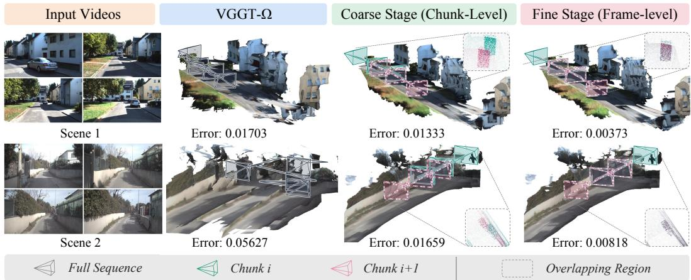
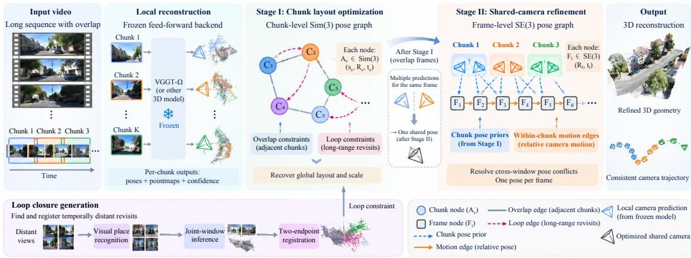
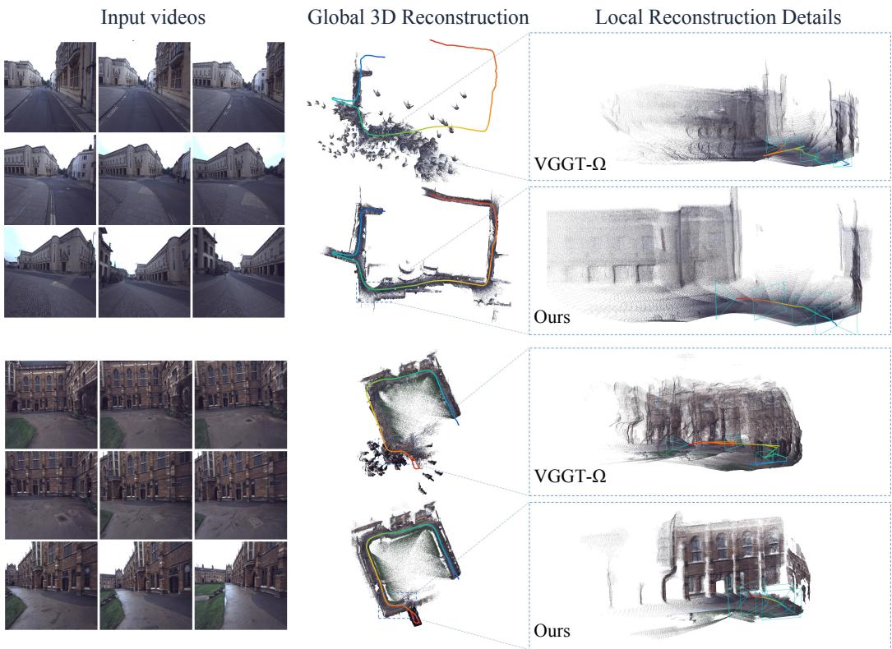
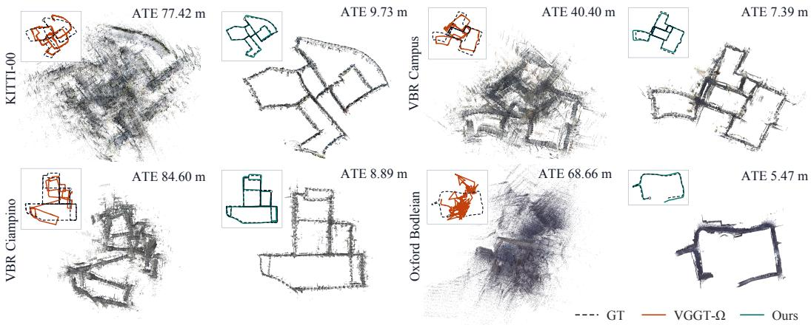

# HIP3R: HIERARCHICAL POSE GRAPHS FOR LONG-HORIZON 3D RECONSTRUCTION

Zunnan Xu1 Shangchen Zhou2 Yihang Luo1 Chen Change Loy1,3,∗

1S-Lab, Nanyang Technological University 2Imperial College London 3ACE Robotics https://kkakkkka.github.io/HiP3R

## ABSTRACT

Feed-forward models accurately estimate camera motion and 3D geometry from short video windows. However, computational and memory costs prevent direct inference on sequences containing thousands of frames. Long videos must therefore be processed as overlapping chunks. This division produces independent local reconstructions with inconsistent coordinate frames and duplicate estimates of shared cameras. Achieving global consistency requires propagating constraints from adjacent overlaps and distant revisits across the sequence. This requirement naturally motivates pose graph optimization. However, the choice of graph level creates a trade-off. Chunk-level graphs efficiently resolve scale drift and close large loops. Yet, their rigid transformations cannot correct internal errors or conflicting frame predictions. Conversely, frame-level optimization offers local flexibility, but scaling it globally is computationally expensive and can break metric scale. HIP3R resolves this trade-off using a hierarchical pose graph. HIP3R first optimizes a robust chunk-level Sim(3) graph to establish the global layout and scale. It then holds this layout fixed and estimates one shared SE(3) camera per frame, turning overlapping window predictions into a single trajectory. Experiments across multiple benchmarks demonstrate the effectiveness of HIP3R in improving camera trajectories and 3D reconstruction. Our method applies to both chunk-based and streaming backends without additional training or fine-tuning.

## 1 INTRODUCTION

Recovering globally consistent 3D geometry and camera trajectories from video is fundamental to computer vision. This capability supports autonomous navigation, robotic mapping, and spatial artificial intelligence. Recent 3D foundation models (Wang et al., 2024; 2025a; 2026b) have significantly advanced visual geometry. By jointly predicting camera poses and dense pointmaps in a single forward pass, they bypass classical handcrafted matching. These models achieve high accuracy on short video clips without per-scene calibration or optimization. However, the quadratic complexity of visual attention limits them to short temporal windows. Directly scaling transformers to extended multi-kilometer sequences remains too expensive.

To process long videos, modern systems adopt a divide-and-conquer strategy (Deng et al., 2025). Long sequences are divided into overlapping video chunks, which are processed independently and stitched together. While chunking bounds GPU memory, sequential alignment introduces severe computational and numerical bottlenecks. Dense overlapping points share high spatial redundancy, making all-pixel alignment computationally expensive. Furthermore, pairwise alignment errors compound along the sequential chain, causing severe scale and orientation drift. Loop closures are essential to eliminate cumulative drift and enforce global topological consistency. However, when the chains are not yet aligned, applying multiple long-range loop constraints at once can make the non-convex optimization unstable. The solver may diverge or converge to poor local minima.

As shown in Figure 1, even after global chunk placement is resolved, a conflict remains at the frame level. Existing alignment methods (Deng et al., 2025; Zhang et al., 2026b; Xiong et al., 2026) optimize similarity transformations per chunk. However, a single similarity transform preserves internal camera configurations up to scale. Consequently, it cannot resolve cross-window camerapose inconsistency. Overlapping chunks produce multiple, conflicting pose estimates of the same frame under differing visual contexts. A chunk is an inference unit, whereas the true trajectory contains only one camera pose per frame. Arbitrarily selecting one prediction discards multi-view evidence and causes velocity jumps across chunk boundaries. Conversely, full bundle adjustment is too expensive, while relative motion alone drifts from the recovered global layout.

  
Figure 1: Overlapping predictions recover local geometry in inconsistent frames. Coarse layout optimization corrects global placement and scale, but keeps each chunk’s internal cameras. Sharedcamera trajectory refinement estimates one trajectory from predictions and within-chunk motion.

To overcome these challenges, we introduce HIP3R, a Hierarchical Pose-graph optimization method for long-horizon 3D Reconstruction. HIP3R decomposes reconstruction into coarse chunk layout recovery and fine frame trajectory refinement. The coarse stage optimizes a chunk-level Sim(3) pose graph over adjacent overlaps and distant loop closures. This stage establishes a globally consistent layout and eliminates accumulated scale drift. Holding this coarse layout fixed, the fine stage optimizes a frame-level shared-camera SE(3) pose graph, representing each physical frame with a single camera variable to resolve cross-window pose inconsistency. Placement priors keep that camera on the recovered layout, while within-chunk motion factors resolve conflicting predictions from overlapping windows. We evaluate HIP3R across seven public benchmarks spanning diverse indoor and outdoor environments. Under matched backends and windows, HIP3R improves long-horizon trajectory accuracy over loop-enabled VGGT-Long. Controlled ablations show that bounded point sampling reduces graph construction and optimization time with little change in accuracy. Additional evaluations show that the method also works with streaming backends such as LingBot-MAP. We summarize our main contributions as follows:

• We show that chunk-level similarity alignment alone cannot ensure cross-window camera-pose consistency, as overlapping windows may yield conflicting estimates for the same frame.

• We develop a hierarchical pose graph that first recovers a globally consistent chunk layout and scale, then estimates one shared SE(3) camera pose for each frame.

• We introduce progressive loop closure and bounded point sampling to achieve stable and scalable optimization on long sequences without retraining.

## 2 RELATED WORK

Feed-forward 3D vision models. Feed-forward 3D models have emerged as an alternative to classical Structure-from-Motion (SfM). Pioneering architectures like DUSt3R (Wang et al., 2024) and MASt3R (Leroy et al., 2024) directly regress dense pointmaps from uncalibrated image pairs. Recent multi-view transformers such as VGGT (Wang et al., 2025a) and VGGT-Omega (Wang et al., 2026b) extend feed-forward predictions across broader view collections. Subsequent models explore permutation invariance (Wang et al., 2025c), sparse attention (Wang et al., 2026a), and learned scene actions (Wang & Agapito, 2026). These models achieve high local geometric accuracy without per-scene numerical optimization. However, quadratic attention restricts them to short windows, so long sequences yield overlapping local reconstructions.

  
Figure 2: Overview of HIP3R. Frozen backends predict overlapping chunks. Stage I builds a chunklevel Sim(3) graph from overlap and loop constraints to recover layout and scale. Stage II estimates one shared SE(3) camera per frame under that layout.

Streaming and recurrent video geometry. To extend temporal context beyond static windows, another line of research develops streaming and recurrent architectures. Early methods such as Spann3R (Wang & Agapito, 2025) and CUT3R (Wang et al., 2025b) maintain persistent spatial memory states. Recent methods like StreamVGGT (Zhuo et al., 2026), STream3R (Lan et al., 2026), and WinT3R (Li et al., 2026b) process video frames causally with temporal key-value caching. LingBot-MAP (Chen et al., 2026a) structures geometric context across anchor frames, local windows, and trajectory memory. Other approaches explore test-time training, memory compression, and feature retrieval (Chen et al., 2026b; Zhang et al., 2026a; Xie et al., 2026; Jin et al., 2026; Liu et al., 2026; Zou et al., 2026). Causal streaming still accumulates drift on long trajectories. As post-processing, HIP3R adds global loops and per-frame pose consistency without retraining.

Multi-window fusion and Structure-from-Motion. Scaling feed-forward predictions to extended trajectories connects to classical global Structure-from-Motion and pose graph optimization. Chunkbased methods like VGGT-Long (Deng et al., 2025), VGGT-Align (Zhang et al., 2026b), and VGGT-Motion (Xiong et al., 2026) align adjacent chunks via pairwise Sim(3) alignment. A rigid Sim(3) per chunk preserves internal cameras up to scale and cannot resolve overlapping-frame disagreements. GlueMap (Pan et al., 2026) couples feed-forward star reconstructions with global motion averaging and bundle adjustment over virtual tracks. HIP3R resolves overlapping camera predictions through a shared frame-level pose graph after chunk alignment, without optimizing 3D tracks.

## 3 METHOD

## 3.1 PROBLEM FORMULATION

Let ${ \mathcal { T } } = \{ I _ { t } \} _ { \underline { { t } } \equiv 1 } ^ { T }$ denote an input video sequence of $T$ frames. We partition I into K overlapping chunks $\{ C _ { k } \} _ { k = 1 } ^ { K }$ of at most $\dot { C }$ frames with overlap O. Chunk starts advance by $C - O$ frames; the final chunk may be shorter than C. Each chunk is processed independently by a feed-forward 3D vision model (Wang et al., 2026b). For chunk $C _ { k }$ , the backend predicts dense pointmaps $X _ { k , i }$ confidence maps $\gamma _ { k , i } .$ , and camera-to-chunk poses $P _ { k , i }$ . Here $i \in \{ 1 , \overline { { \ldots } } , | C _ { k } | \}$ indexes local frames within the chunk. Let $g ( k , i ) \in \{ 1 , . . . , T \}$ map local frame i in chunk $C _ { k }$ to its global video index. The goal is to recover a single camera trajectory $\mathcal { F } = \{ F _ { t } \in \mathrm { S E } ( 3 ) \} _ { t = 1 } ^ { T }$ together with consistent 3D pointmaps. Figure 2 gives an overview.

Decoupled optimization. Directly optimizing all camera and point variables across thousands of frames is expensive. Unconstrained bundle adjustment loses the efficiency of feed-forward models. HIP3R uses a two-level hierarchical pose graph. Stage I solves a chunk-level Sim(3) pose graph for a globally aligned layout (Section 3.2). Stage II then optimizes a frame-level SE(3) pose graph with one shared camera variable per frame while holding the layout fixed (Section 3.3).

## 3.2 COARSE LAYOUT OPTIMIZATION WITH PROGRESSIVE LOOP SCHEDULING

We formulate global layout recovery as optimization over a similarity pose graph $\mathcal { G } _ { c } = ( \nu _ { c } , \mathcal { E } _ { c } )$ Each node $k \in \mathcal { V } _ { c }$ represents a chunk $C _ { k }$ and is associated with a similarity transformation $A _ { k } =$ $( s _ { k } , R _ { k } , t _ { k } ) \ \in \ \mathrm { S i m } ( \bar { 3 } )$ . This transformation maps local chunk coordinates to a common world coordinate system as $A _ { k } ( x ) = s _ { k } R _ { k } x + t _ { k }$ . An edge $( i , j ) \in \mathcal { E } _ { c }$ represents a measured relative transformation $\widehat { Z } _ { i j }$ from the coordinate system of chunk i to that of chunk $j .$ The corresponding predicted relative transformation is $A _ { i } ^ { - 1 } A _ { i }$ . Overlap edges connect consecutive chunks, while loop edges connect retrieved chunk pairs that observe the same physical scene. Relative constraints determine scale only up to a global factor, so we fix $A _ { 1 }$ as the world frame and scale reference. Scale errors in independent chunk predictions accumulate on long trajectories, so we optimize the remaining $s _ { k }$ jointly with rotation and translation.

Dense overlapping 3D points are spatially redundant, so all-pixel alignment is unnecessary. For adjacent chunks, identical pixels in overlapping frames yield paired 3D predictions. We estimate relative similarities with confidence-weighted iteratively reweighted least squares (IRLS) rather than unweighted Umeyama alignment on all dense pixels (Deng et al., 2025). Each iteration runs a weighted Umeyama alignment (Umeyama, 1991) and updates Huber weights from spatial residuals. We bound alignment cost by limiting the number of point correspondences used in each fit.

Visual place recognition proposes candidate loop closures across temporal separations (Izquierdo & Civera, 2024). For each selected pair of revisiting frames, we combine temporal neighborhoods from both endpoints into one backend input. The resulting joint reconstruction connects the two visits in a common local coordinate system. We align the predicted geometry at each endpoint to the corresponding original chunk, obtaining transformations $B _ { i }$ and $B _ { j }$ from the joint reconstruction to chunks i and $j ,$ respectively. The relative loop measurement is $\widehat { Z } _ { i j } = B _ { j } B _ { i } ^ { - 1 }$ . We assign each loop constraint a bounded weight $w _ { i j }$ based on the registration residuals at its two endpoints, reducing the influence of poorly aligned loops. Appendix D specifies loop retrieval and window settings, point sampling, pairwise alignment, and loop weighting.

Combining sequential overlap and loop constraints, we define the objective over active edges $\mathcal { E } _ { c }$ Let $E _ { i j } ^ { c } = \widehat { Z } _ { i j } ^ { - 1 } A _ { j } ^ { - 1 } A _ { i }$ denote the relative similarity error. We define the residual vector as

$$
r _ { i j } ^ { c } = \big ( \mathrm { L o g } _ { \mathrm { S O ( 3 ) } } R ( E _ { i j } ^ { c } ) , \tau ( E _ { i j } ^ { c } ) , \log s ( E _ { i j } ^ { c } ) \big ) \in \mathbb { R } ^ { 7 } ,\tag{1}
$$

where $\tau$ extracts Euclidean translation error, and log s evaluates log-scale error. Because feedforward backends predict geometry without analytical pose covariances, $w _ { i j }$ provides a data-driven confidence weight per edge. The coarse layout objective minimizes the robust loss

$$
A ^ { \star } = \arg \operatorname* { m i n } _ { A } \sum _ { ( i , j ) \in { \mathcal { E } _ { c } } } \sum _ { \ell = 1 } ^ { 7 } \rho _ { \delta } \left( \sqrt { w _ { i j } } r _ { i j , \ell } ^ { c } \right) ,\tag{2}
$$

where $\rho _ { \delta }$ denotes the Huber penalty, applied coordinate-wise to suppress large outliers.

Activating all distant loops on an unaligned chain can make the non-convex optimization unstable. We initialize chunk placements from sequential alignments, then introduce loop constraints in order of increasing temporal span. Adjacent edges remain active throughout, and each stage starts from the solution of the preceding stage. When most loop edges have short temporal spans, additional stages introduce the longer-span constraints more gradually.

We solve Eq. (2) with bounded trust-region reflective least squares, limiting log-scale changes relative to initialization. Each edge residual depends only on the transformations of the two connected chunks, yielding a sparse Jacobian. We compute the corresponding Jacobian blocks using automatic differentiation. Appendix D provides the parameterization, scheduling rules, and restart settings.

## 3.3 SHARED-CAMERA TRAJECTORY REFINEMENT

Given the recovered layout $A ^ { \star }$ , overlapping frames still have multiple conflicting pose estimates. Selecting one prediction discards alternative observations and causes velocity jumps across chunk

boundaries. We therefore introduce a shared camera-to-world variable $F _ { t } \in \mathrm { S E } ( 3 )$ for each frame t. We represent each camera pose $P _ { k , i }$ by its rotation $R _ { k , i } \in \mathrm { S O } ( 3 )$ and camera center $c _ { k , i } \in \mathbb { R } ^ { 3 }$ writing $\dot { P } _ { k , i } = [ R _ { k , i } \ | \ c _ { k , i } ]$ . Its placement $Q _ { k , i }$ in the world frame is

$$
R ( Q _ { k , i } ) = R _ { k } R _ { k , i } , \qquad c ( Q _ { k , i } ) = s _ { k } R _ { k } c _ { k , i } + t _ { k } ,\tag{3}
$$

with $A _ { k } = A _ { k } ^ { \star }$ . The chunk scale applies to camera centers. The shared pose is rigid with no scale variable. For each shared camera, we use one coarse-placed prediction as its initial pose. The placement priors retain the predictions from every chunk that observes that frame.

As shown in Figure 2, the camera graph uses two types of geometric factors. For consecutive frames $i , j$ retained as graph nodes within chunk k, define the relative motion measurement $M _ { k , i  j } =$ $Q _ { k , j } ^ { - 1 } Q _ { k , i }$ . With $E ^ { f } = M _ { k , i \to j } ^ { - 1 } F _ { g ( k , j ) } ^ { - 1 } F _ { g ( k , i ) }$ , the relative motion edge residual is

$$
r _ { k , i , j } ^ { f } = \left( \mathrm { L o g } _ { \mathrm { S O ( 3 ) } } R ( E ^ { f } ) , \tau ( E ^ { f } ) \right) \in \mathbb { R } ^ { 6 } .\tag{4}
$$

Here τ extracts Euclidean translation, and the rotation residual uses the standard rotation logarithm (Sola et al., 2018). Each placed prediction also provides a unary chunk pose prior on its\` shared camera, with $E ^ { p } = Q _ { k , i } ^ { - 1 } \dot { F _ { g ( k , i ) } }$ and

$$
r _ { k , i } ^ { p } = \left( \mathrm { L o g } _ { \mathrm { S O ( 3 ) } } R ( E ^ { p } ) , \tau ( E ^ { p } ) \right) \in \mathbb { R } ^ { 6 } .\tag{5}
$$

When a physical frame appears in multiple overlapping chunks, their respective chunk pose priors jointly constrain the same shared variable $F _ { t }$ . Relative motion edges connected to this node join local chunk trajectories across chunk boundaries. The fine objective therefore combines both relative motion constraints and placement priors,

$$
F ^ { \star } = \arg \operatorname* { m i n } _ { F } \sum _ { ( k , i , j ) \in \mathcal { E } _ { f } } \sum _ { \ell = 1 } ^ { 6 } \rho _ { \delta } \Big ( \sqrt { \lambda _ { f } } r _ { k , i , j , \ell } ^ { f } ( A ^ { \star } , F ) \Big ) + \sum _ { ( k , i ) \in \mathcal { E } _ { p } } \sum _ { \ell = 1 } ^ { 6 } \rho _ { \delta } \Big ( \sqrt { \lambda _ { p } } r _ { k , i , \ell } ^ { p } ( A ^ { \star } , F ) \Big ) .\tag{6}
$$

Motion constraints preserve relative poses within each chunk, while placement priors keep the refined trajectory close to the recovered global layout. Initialization and solver settings are given in Appendix D, and closed-form Jacobian blocks in Appendix B.

For long sequences, we optimize a keyframe subgraph for efficiency. Let $Q _ { t }$ denote the coarseplaced pose used to initialize frame t, and define its correction as $\dot { \Delta _ { t } } = \dot { F _ { t } } \dot { Q } _ { t } ^ { - 1 }$ . We interpolate corrections between keyframes and set $F _ { t } = \Delta _ { t } Q _ { t }$ . This recovers a trajectory for all frames while retaining their local pose predictions as the baseline. To update the geometry, we first place each pointmap in world coordinates using $A _ { k } ^ { \star }$ , then apply the rigid correction $F _ { g ( k , i ) } Q _ { k , i } ^ { - 1 }$ . The corrected pointmaps follow the shared camera poses while preserving the predicted depth and recovered chunk scale. Appendix C describes keyframe selection and correction interpolation.

## 4 EXPERIMENTS

We evaluate trajectory accuracy across seven public benchmarks comprising 61 diverse sequences. The benchmark spans indoor room-scale environments, including 7-Scenes (Shotton et al., 2013) and Neural RGB-D (Azinovic et al., 2022). It also includes high-precision multi-scale scenes from´ ETH3D (Schops et al., 2017) and Tanks and Temples (Knapitsch et al., 2017). Finally, it includes ex-¨ tended outdoor driving and campus traversals from Oxford Spires (Tao et al., 2025), KITTI (Geiger et al., 2012), and VBR (Brizi et al., 2024). Dense surface geometry is evaluated on ETH3D, Neural RGB-D, and 7-Scenes, which provide dense 3D ground truth. Appendix E details dataset compositions and sequence splits. Baselines in Table 1 use released checkpoints and recommended window policies on identical sequences. VGGT-Long and VGGT-Align are evaluated from public implementations, while VGGT-Motion (Xiong et al., 2026) is not publicly available.

We evaluate trajectory accuracy using ATE, $\mathrm { R P E } _ { \mathrm { r o t } }$ , and ${ \mathrm { R P E } } _ { \mathrm { t r a n s } }$ (lower is better). ATE is translation RMSE after a per-sequence Sim(3) alignment that corrects rotation, translation, and scale. Relative errors use all consecutive frame pairs $( \Delta = 1$ frame). Rotation RPE is in degrees, and translation RPE applies the same $\mathrm { S i m ( 3 ) }$ correction. Pairwise pose AUC (higher is better) evaluates all $i < j$ camera pairs using the maximum of relative rotation and translation-direction angular errors at thresholds of

5◦, 15◦, and $3 0 ^ { \circ }$ . Reconstructed 3D pointmaps are evaluated using the mean of accuracy and completeness (Chamfer, meters) after Umeyama and ICP. F1 uses a hit distance of 0.25 m on ETH3D and 0.05 m on Neural RGB-D and 7-Scenes. Appendix H provides per-dataset geometric breakdowns.

We apply HIP3R to the camera poses and dense geometry produced by VGGT-Omega (Wang et al., 2026b) and LingBot-MAP (Chen et al., 2026a). Both backends use the same graph formulation without fine-tuning. Unless otherwise stated, we use VGGT-Omega 1B with a chunk size of 60 frames and an overlap size of 30 frames. LingBot-MAP uses windowed inference with a chunk size of 120 frames and an overlap size of 32 frames.

We use the same refinement weights across backends. For short sequences, the fine stage optimizes all camera poses; for long sequences, it optimizes a keyframe subgraph and interpolates pose corrections for the remaining frames. Appendix details the keyframe selection rules and solver settings.

## 4.1 BENCHMARK EVALUATION ACROSS PUBLIC DATASETS

Table 1 reports tracking metrics macro-averaged across the seven datasets. With VGGT-Omega, HIP3R reduces ATE by 74%, from 18.555 to 4.906 m, $\mathrm { R P E } _ { \mathrm { r o t } }$ from $1 . 8 2 0 ^ { \circ }$ to 0.590◦, and $\mathrm { R P E } _ { \mathrm { t r a n s } }$ by 94%, from 0.9878 to 0.0622 m. On long traversals, sequential stitching accumulates scale and orientation drift. Progressive loop scheduling in the coarse layout stage (Section 3.2) corrects global drift and drives much of the ATE reduction in Table 1. Shared-camera refinement (Section 3.3) further improves relative pose accuracy while preserving the layout. On compact indoor benchmarks such as 7-Scenes and Neural RGB-D, native VGGT-Omega already achieves ATE of 0.037 m and 0.019 m, leaving limited room for further global correction. With LingBot-MAP, HIP3R reduces macro ATE by 52%, from 8.288 to 4.017 m, without retraining.

Table 1: Trajectory evaluation across indoor and outdoor benchmarks. Values are dataset-macro averages of ATE (m), ${ \mathrm { R P E } } _ { \mathrm { r o t } } \left( { \mathrm { ^ \circ } } \right)$ , and $\mathrm { R P E } _ { \mathrm { t r a n s } }$ (m). Bold marks the best result.
<table><tr><td>Method</td><td>Mean ATE ↓</td><td>Mean  $\bf R P E _ { r o t }$  →</td><td>Mean  $\mathbf { R P E _ { t r a n s } } \downarrow$ </td></tr><tr><td>CUT3R (Wang et al., 2025b)</td><td>44.894</td><td>4.469</td><td>1.4600</td></tr><tr><td>TTT3R (Chen et al., 2026b)</td><td>23.775</td><td>5.077</td><td>0.8077</td></tr><tr><td>LoGeR (Zhang et al., 2026a)</td><td>40.691</td><td>2.086</td><td>1.1035</td></tr><tr><td>VGGT (Wang et al., 2025a)</td><td>20.914</td><td>3.159</td><td>1.6396</td></tr><tr><td>ZipMap (Jin et al., 2026)</td><td>28.230</td><td>2.792</td><td>0.9454</td></tr><tr><td>LingBot-MAP (Chen et al., 2026a)</td><td>8.288</td><td>1.818</td><td>1.4152</td></tr><tr><td>VGGT-Long (Deng et al., 2025)</td><td>22.713</td><td>1.449</td><td>0.2537</td></tr><tr><td>VGGT-Align (Zhang et al., 2026b)</td><td>25.584</td><td>1.714</td><td>2.3608</td></tr><tr><td>VGGT-Omega (Wang et al., 2026b)</td><td>18.555</td><td>1.820</td><td>0.9878</td></tr><tr><td> $\pi ^ { 3 }$  (Wang et al., 2025c)</td><td>24.029</td><td>1.592</td><td>0.3614</td></tr><tr><td>GlueMap (Pan et al., 2026)</td><td>45.281</td><td>1.561</td><td>1.9132</td></tr><tr><td>Scal3R (Xie et al., 2026)</td><td>27.612</td><td>1.376</td><td>0.1703</td></tr><tr><td>HiP3R (LingBot-MAP)</td><td>4.017</td><td>1.055</td><td>0.1824</td></tr><tr><td>HIP3R (VGGT-Omega)</td><td>4.906</td><td>0.590</td><td>0.0622</td></tr></table>

## 4.2 CONTROLLED LONG-HORIZON RECONSTRUCTION

We compare HIP3R with two VGGT-Long (Deng et al., 2025) variants, with and without loop closures. All three use the same VGGT-Omega backend and the default chunk and overlap sizes specified above. Table 2 reports ATE on KITTI, VBR, and Oxford and the mean over these three datasets. For reference, it also includes the released VGGT-Long and VGGT-Align (Zhang et al., 2026b) results using VGGT predictions.

HIP3R achieves lower ATE than both VGGT-Long variants using VGGT-Omega on all three datasets. Loop closures reduce VGGT-Long ATE from 110.3 to 10.19 m on KITTI and from 85.50 to 41.27 m on VBR. HIP3R further reduces these errors to 9.730 and 22.44 m, nearly halving the remaining VBR error. VGGT-Long applies loops as rigid Sim(3) transforms to entire chunks. HIP3R instead jointly optimizes a sparse global layout graph with progressive loop scheduling. Appendix K shows that the complete solver further improves accuracy and convergence efficiency, while Appendix F reports stage-wise runtimes.

Table 2: Trajectory comparison on KITTI, VBR, and Oxford, alongside the long-horizon mean.
<table><tr><td rowspan="2">Backend</td><td rowspan="2">Method</td><td colspan="4">ATE↓</td></tr><tr><td>Oxford</td><td>KITTI</td><td>VBR</td><td>Mean</td></tr><tr><td rowspan="4">VGGT-Omega</td><td>Baseline</td><td>9.861</td><td>77.42</td><td>41.91</td><td>43.06</td></tr><tr><td>VGGT-Long (w/o loops)</td><td>1.777</td><td>110.3</td><td>85.50</td><td>65.86</td></tr><tr><td>VGGT-Long (w/ loops)</td><td>1.665</td><td>10.19</td><td>41.27</td><td>17.71</td></tr><tr><td>+ HIP3R (Ours)</td><td>1.579</td><td>9.730</td><td>22.44</td><td>11.25</td></tr><tr><td rowspan="2">VGGT</td><td>VGGT-Long (released)</td><td>9.451</td><td>48.84</td><td>99.83</td><td>52.71</td></tr><tr><td>VGGT-Align</td><td>8.567</td><td>69.80</td><td>99.87</td><td>59.41</td></tr></table>

  
Figure 3: Qualitative comparison between VGGT-Omega chunk placement and HIP3R.

## 4.3 END-TO-END POSE ACCURACY AND 3D GEOMETRY

Inconsistent poses place walls and corridors at conflicting locations, causing duplicated surfaces and ghosting. Table 3 reports pose AUC and surface metrics on both backends. With VGGT-Omega, HIP3R reduces Chamfer by 64%, from 0.0759 to 0.0272 m, and raises F1 from 65.92 to 91.26. The stage-wise comparison in Appendix M, Table 21, shows that coarse alignment accounts for most of the Chamfer reduction, with improvements from shared-camera refinement on both backends.

## 4.4 QUALITATIVE DENSE 3D RECONSTRUCTION

Figure 3 compares VGGT-Omega and HIP3R (VGGT-Omega) on Oxford Bodleian Library and Keble College. Sequential placement drifts across long temporal gaps, reconstructing unclosed loops as offset surfaces several meters apart. Coarse layout optimization aligns distant revisits and collapses these surfaces onto single facades. As shown in the local views, shared-camera refinement further reconciles overlapping camera predictions. Figure 4 shows four long sequences with identical VGGT-Omega points. Native placement stretches streets into duplicated structures, while HIP3R recovers closed street networks with lower trajectory error.

## 4.5 ABLATION STUDIES

Ablations isolate point sampling, progressive loop scheduling, and placement-motion interaction.

Point sampling bound. Table 4 reports point sampling on cached predictions. Bounding sampled points cuts graph build and solve time from 12232.18 to $2 0 0 4 . 2 0 \mathrm { ~ \AA ~ } ( 8 3 . 6 2 \% )$ , while ATE changes from 21.7751 to 21.7569 m. Total time includes measurement construction and layout solves.

Table 3: Pose AUC and dense geometry on both backends.
<table><tr><td>Method</td><td>AUC@5↑</td><td>AUC@15↑</td><td>AUC@30↑</td><td>Chamfer↓</td><td>F1↑</td></tr><tr><td>VGGT-Omega</td><td>29.77</td><td>50.24</td><td>63.22</td><td>0.0759</td><td>65.92</td></tr><tr><td>HiP3R (VGGT-Omega)</td><td>50.75</td><td>67.98</td><td>75.21</td><td>0.0272</td><td>91.26</td></tr><tr><td>LingBot-MAP</td><td>17.83</td><td>38.61</td><td>53.19</td><td>0.1423</td><td>61.13</td></tr><tr><td>HiP3R (LingBot-MAP)</td><td>22.01</td><td>51.35</td><td>66.90</td><td>0.1042</td><td>74.60</td></tr></table>

Progressive loop scheduling and solver stabilization. Table 4 compares residual-fit weighting, progressive loop scheduling, and the complete solver. Progressive loop scheduling reduces graph build and solve time from 2077.49 to 1477.59 s. The complete configuration reaches 17.4708 m ATE in 753.43 s, with a 41.28 s final solve. Progressive scheduling mainly reduces runtime in this comparison, while the complete configuration improves both runtime and trajectory accuracy. Appendix K details the additional solver components evaluated together in the complete configuration.

Table 4: Ablation of point sampling and progressive layout solver on extended sequences. Rows add components cumulatively. Appendix K details all test conditions.
<table><tr><td>Configuration</td><td>ATE↓</td><td>Graph Build &amp; Solve (s) ↓</td><td>Final solve (s)</td></tr><tr><td>Baseline</td><td>21.7751</td><td>12232.18</td><td>1404.54</td></tr><tr><td>+ Bounded sampling</td><td>21.7569</td><td>2004.20</td><td>1345.43</td></tr><tr><td>+ Fit weighting</td><td>21.7770</td><td>2077.49</td><td>1387.14</td></tr><tr><td>+ Progressive loops</td><td>21.5241</td><td>1477.59</td><td>688.02</td></tr><tr><td>Complete</td><td>17.4708</td><td>753.43</td><td>41.28</td></tr></table>

Table 5: Trajectory comparison on identical predictions and one optimized coarse layout.
<table><tr><td rowspan="2"></td><td colspan="3">VGGT-Omega</td><td colspan="3">LingBot-MAP</td></tr><tr><td>ATE</td><td> $\mathrm { R P E } _ { \mathrm { r o t } }$ </td><td> $\mathrm { R P E } _ { \mathrm { t r a n s } }$ </td><td>ATE</td><td> $\mathrm { R P E } _ { \mathrm { r o t } }$ </td><td> $\mathrm { R P E } _ { \mathrm { t r a n s } }$ </td></tr><tr><td>Layout Only</td><td>4.9143</td><td>0.6412</td><td>0.0817</td><td>4.0517</td><td>1.1837</td><td>0.2126</td></tr><tr><td>Single</td><td>4.9079</td><td>0.6238</td><td>0.0695</td><td>4.0256</td><td>1.1131</td><td>0.1930</td></tr><tr><td>Unary</td><td>4.9067</td><td>0.6010</td><td>0.0674</td><td>4.0192</td><td>1.0871</td><td>0.1828</td></tr><tr><td>Motion</td><td>11.6776</td><td>0.5877</td><td>0.0619</td><td>6.5007</td><td>1.0464</td><td>0.1816</td></tr><tr><td>Shared</td><td>4.9061</td><td>0.5899</td><td>0.0622</td><td>4.0168</td><td>1.0549</td><td>0.1824</td></tr></table>

Interaction of placement priors and motion constraints. Table 5 compares four ways of forming a camera trajectory, Single, Unary, Motion, and Shared, from identical predictions and optimized coarse layouts, with Layout Only as a reference. Layout Only takes the first available prediction for each frame in chunk order. Single selects the prediction farthest from its chunk boundaries. Neither performs frame-level optimization. Unary uses overlapping pose observations in a robust unary-only objective without relative-motion factors. Motion uses within-chunk motion factors without placement priors. Shared combines both factors as in Eq. (6). On both backends, Shared reduces relative errors over Single and Unary, with a small ATE gain. Motion yields slightly lower relative errors, but without placement priors, ATE increases to 11.678 and 6.501 m. Placement priors preserve the recovered layout, while motion factors improve local smoothness.

Stage-wise results across layout recovery and trajectory refinement. Table 6 reports the Layout Only and Full outputs on identical VGGT-Omega predictions. Layout Only recovers global layout and scale, reducing ATE by 87% on KITTI, 84% on Oxford, and 46% on VBR. Full then adds shared-camera trajectory refinement on that fixed layout. It reduces $\mathrm { R P E } _ { \mathrm { r o t } }$ by 24% on KITTI, 30% on Oxford, and 5% on VBR, and $\mathrm { R P E } _ { \mathrm { t r a n s } }$ by 29%, 40%, and 22%.

  
Figure 4: Trajectory comparison on four long sequences with identical VGGT-Omega points.

Table 6: Stage-wise results on identical VGGT-Omega predictions. Layout Only is the direct coarselayout output; Full adds shared-camera trajectory refinement on the same layout. Oxford and VBR timings are means per sequence. Inference times include all inference required for each output; solver times are reported per stage. Error subscripts give reductions relative to the preceding stage.
<table><tr><td rowspan="2">Dataset</td><td rowspan="2">Stage</td><td colspan="3">Tracking Error</td><td colspan="2">Runtime (s)</td></tr><tr><td>ATE↓</td><td> $\mathbf { R P E _ { r o t } } \left( { } ^ { \circ } \right) \downarrow$ </td><td> $\mathbf { R P E _ { t r a n s } } \downarrow$ </td><td>Inference</td><td>Stage solve</td></tr><tr><td rowspan="3">KITTI (T=4541)</td><td>Baseline</td><td>77.42</td><td>0.895</td><td>2.358</td><td>825.745</td><td></td></tr><tr><td>Layout Only</td><td> $9 . 7 5 0 _ { ( - 8 7 \% ) }$ </td><td> $0 . 2 0 2 _ { ( - 7 7 \% ) }$ </td><td> $0 . 1 3 1 _ { ( - 9 4 \% ) }$ </td><td>896.785</td><td>5.40</td></tr><tr><td>Full</td><td> $\mathbf { 9 . 7 3 0 } _ { ( - 0 . 2 \% ) }$ </td><td> $\mathbf { 0 . 1 5 4 } _ { ( - 2 4 \% ) }$ </td><td> $\mathbf { 0 . 0 9 3 } _ { ( - 2 9 \% ) }$ </td><td>896.785</td><td>0.08</td></tr><tr><td rowspan="3">VBR (T≈12,383)</td><td>Baseline</td><td>41.91</td><td>2.117</td><td>0.256</td><td>2283.438</td><td></td></tr><tr><td>Layout Only Full</td><td> $2 2 . 4 4 _ { ( - 4 6 \% ) }$ </td><td> $0 . 6 1 7 _ { ( - 7 1 \% ) }$ </td><td> $0 . 0 7 5 _ { ( - 7 1 \% ) }$ </td><td>2511.460</td><td>200.0</td></tr><tr><td></td><td> $\mathbf { 2 2 . 4 4 } _ { ( - 0 . 0 \% ) }$ </td><td> $\mathbf { 0 . 5 8 7 } _ { ( - 5 \% ) }$ </td><td> $\mathbf { 0 . 0 5 9 } _ { ( - 2 2 \% ) }$ </td><td>2511.460</td><td>0.16</td></tr><tr><td rowspan="3">Oxford (T≈320)</td><td>Baseline</td><td>9.861</td><td>5.757</td><td>4.044</td><td>53.297</td><td></td></tr><tr><td>Layout Only</td><td> $1 . 5 9 9 _ { ( - 8 4 \% ) }$ </td><td> $0 . 5 7 9 _ { ( - 9 0 \% ) }$ </td><td> $0 . 1 7 3 _ { ( - 9 6 \% ) }$ </td><td>54.919</td><td>0.03</td></tr><tr><td>Full</td><td>1.579(-1%)</td><td> $\mathbf { 0 . 4 0 8 } _ { ( - 3 0 \% ) }$ </td><td> $\mathbf { 0 . 1 0 4 } _ { ( - 4 0 \% ) }$ </td><td>54.919</td><td>0.02</td></tr></table>

## 5 CONCLUSION

HIP3R turns overlapping local predictions into a globally consistent reconstruction of long video sequences through a hierarchical pose graph. The method first recovers global layout and scale through a chunk-level Sim(3) graph, then refines a shared-camera SE(3) graph with the chunk transforms held fixed. This separation allows distant loop closures to correct accumulated drift while reconciling conflicting predictions of the same camera across windows. Evaluations on indoor and outdoor benchmarks show improvements in overall trajectory accuracy and surface reconstruction with both VGGT-Omega and LingBot-MAP. Extending this hierarchy to online updates and improving its robustness to unreliable loop closures are promising directions for future work.

## REFERENCES

Dejan Azinovic, Ricardo Martin-Brualla, Dan B. Goldman, Matthias Nießner, and Justus Thies.´ Neural RGB-D surface reconstruction. In CVPR, 2022.

Leonardo Brizi, Emanuele Giacomini, Luca Di Giammarino, Simone Ferrari, Omar Salem, Lorenzo De Rebotti, and Giorgio Grisetti. VBR: A vision benchmark in Rome. In ICRA, 2024.

Lin-Zhuo Chen, Jian Gao, Yihang Chen, Ka Leong Cheng, Yipengjing Sun, Liangxiao Hu, Nan Xue, Xing Zhu, Yujun Shen, Yao Yao, and Yinghao Xu. Geometric context transformer for streaming 3D reconstruction. arXiv preprint arXiv:2604.14141, 2026a.

Xingyu Chen, Yue Chen, Yuliang Xiu, Andreas Geiger, and Anpei Chen. TTT3R: 3D reconstruction as test-time training. In ICLR, 2026b.

A. R. Curtis, M. J. D. Powell, and J. K. Reid. On the estimation of sparse Jacobian matrices. IMA Journal ofApplied Mathematics, 13(1):117–119, 1974.

Kai Deng, Zexin Ti, Jiawei Xu, Jian Yang, and Jin Xie. VGGT-Long: Chunk it, loop it, align it – pushing VGGT’s limits on kilometer-scale long RGB sequences. arXiv preprint arXiv:2507.16443, 2025.

Andreas Geiger, Philip Lenz, and Raquel Urtasun. Are we ready for autonomous driving? The KITTI vision benchmark suite. In CVPR, 2012.

Sergio Izquierdo and Javier Civera. Optimal transport aggregation for visual place recognition. In CVPR, 2024.

Haian Jin, Rundi Wu, Tianyuan Zhang, Ruiqi Gao, Jonathan T. Barron, Noah Snavely, and Aleksander Holynski. ZipMap: Linear-time stateful 3D reconstruction via test-time training. In CVPR, 2026.

Arno Knapitsch, Jaesik Park, Qian-Yi Zhou, and Vladlen Koltun. Tanks and temples: Benchmarking large-scale scene reconstruction. ACM Transactions on Graphics, 36(4), 2017.

Yushi Lan, Yihang Luo, Fangzhou Hong, Shangchen Zhou, Honghua Chen, Zhaoyang Lyu, Shuai Yang, Bo Dai, Chen Change Loy, and Xingang Pan. STream3R: Scalable sequential 3D reconstruction with causal transformer. In ICLR, 2026.

Vincent Leroy, Yohann Cabon, and Jerome Revaud. Grounding image matching in 3D with MASt3R. In ECCV, 2024.

Moyang Li, Zihan Zhu, Marc Pollefeys, and Daniel Bar ´ ath. DROID-SLAM in the wild. In ´ CVPR, 2026a.

Zizun Li, Jianjun Zhou, Yifan Wang, Haoyu Guo, Wenzheng Chang, Yang Zhou, Haoyi Zhu, Junyi Chen, Chunhua Shen, and Tong He. WinT3R: Window-based streaming reconstruction with camera token pool. In ICLR, 2026b.

Xuanyi Liu, Chunan Yu, Deyi Ji, Qi Zhu, Lingyun Sun, Xuanfu Li, Jin Ma, Tianrun Chen, and Lanyun Zhu. StreamCacheVGGT: Streaming visual geometry transformers with robust scoring and hybrid cache compression. arXiv preprint arXiv:2604.15237, 2026.

Linfei Pan, Johannes Schonberger, and Marc Pollefeys. Global structure-from-motion meets feed-¨ forward reconstruction. arXiv preprint arXiv:2605.26103, 2026.

Thomas Schops, Johannes L. Sch¨ onberger, Silvano Galliani, Torsten Sattler, Konrad Schindler, Marc¨ Pollefeys, and Andreas Geiger. A multi-view stereo benchmark with high-resolution images and multi-camera videos. In CVPR, 2017.

Jamie Shotton, Ben Glocker, Christopher Zach, Shahram Izadi, Antonio Criminisi, and Andrew Fitzgibbon. Scene coordinate regression forests for camera relocalization in RGB-D images. In CVPR, 2013.

Joan Sola, Jeremie Deray, and Dinesh Atchuthan. A micro Lie theory for state estimation in robotics.\` arXiv preprint arXiv:1812.01537, 2018.

Yifu Tao, Miguel Angel Mu ´ noz-Ba ˜ n˜on, Lintong Zhang, Jiahao Wang, Lanke Frank Tarimo Fu, and ´ Maurice Fallon. The Oxford Spires dataset: Benchmarking large-scale LiDAR-visual localisation, reconstruction and radiance field methods. The International Journal ofRobotics Research, 2025.

Shinji Umeyama. Least-squares estimation of transformation parameters between two point patterns. IEEE Transactions on Pattern Analysis and Machine Intelligence, 13(4):376–380, 1991.

Chung-Shien Brian Wang, Christian Schmidt, Jens Piekenbrinck, and Bastian Leibe. Block-sparse global attention for efficient multi-view geometry transformers. In CVPR, 2026a.

Hengyi Wang and Lourdes Agapito. 3D reconstruction with spatial memory. In 3DV, 2025.

Hengyi Wang and Lourdes Agapito. AMB3R: Accurate feed-forward metric-scale 3D reconstruction with backend. In CVPR, 2026.

Jianyuan Wang, Minghao Chen, Nikita Karaev, Andrea Vedaldi, Christian Rupprecht, and David Novotny. VGGT: Visual geometry grounded transformer. In CVPR, 2025a.

Jianyuan Wang, Minghao Chen, Shangzhan Zhang, Nikita Karaev, Johannes Schonberger, Patrick¨ Labatut, Piotr Bojanowski, David Novotny, Andrea Vedaldi, and Christian Rupprecht. VGGT-Ω. In CVPR, 2026b.

Qianqian Wang, Yifei Zhang, Aleksander Holynski, Alexei A. Efros, and Angjoo Kanazawa. Continuous 3D perception model with persistent state. In CVPR, 2025b.

Shuzhe Wang, Vincent Leroy, Yohann Cabon, Boris Chidlovskii, and Jerome Revaud. DUSt3R: Geometric 3D vision made easy. In CVPR, 2024.

Yifan Wang, Jianjun Zhou, Haoyi Zhu, Wenzheng Chang, Yang Zhou, Zizun Li, Junyi Chen, Jiangmiao Pang, Chunhua Shen, and Tong He. π3: Permutation-equivariant visual geometry learning. arXiv preprint arXiv:2507.13347, 2025c.

Tao Xie, Peishan Yang, Yudong Jin, Yingfeng Cai, Wei Yin, Weiqiang Ren, Qian Zhang, Wei Hua, Sida Peng, Xiaoyang Guo, and Xiaowei Zhou. Scal3R: Scalable test-time training for large-scale 3D reconstruction. In CVPR, 2026.

Zhuang Xiong, Chen Zhang, Qingshan Xu, and Wenbing Tao. VGGT-Motion: Motion-aware calibration-free monocular SLAM for long-range consistency. arXiv preprint arXiv:2602.05508, 2026.

Junyi Zhang, Charles Herrmann, Junhwa Hur, Chen Sun, Ming-Hsuan Yang, Forrester Cole, Trevor Darrell, and Deqing Sun. LoGeR: Long-context geometric reconstruction with hybrid memory. arXiv preprint arXiv:2603.03269, 2026a.

Wei Zhang, Yihang Wu, Songhua Li, and Qi Wang. VGGT-Align: Bridging local reconstruction and global consistency for long-sequence 3D reconstruction. arXiv preprint arXiv:2608.15260, 2026b.

Dong Zhuo, Wenzhao Zheng, Jiahe Guo, Yuqi Wu, Jie Zhou, and Jiwen Lu. Streaming visual geometry transformer. In ICLR, 2026.

Zichen Zou, Xiaosong Jia, Zuxuan Wu, and Yu-Gang Jiang. Attention Itself Could Retrieve. RetrieveVGGT: Training-free long context streaming 3D reconstruction via query-key similarity retrieval. arXiv preprint arXiv:2605.09644, 2026.

## A APPENDIX

In this supplementary material, we provide mathematical derivations, implementation details, and extended experimental analyses. Appendix B details closed-form Jacobian derivations and graph coloring. Appendix C specifies the keyframe subgraph and residual interpolation for long sequences. Appendix D details public solver settings and optimization hyperparameters. Appendix E provides dataset compositions and evaluation splits across all seven benchmarks. Appendix F breaks down stage-wise execution times across competing methods. Appendices G and H report per-dataset tracking and dense 3D geometry results. Finally, Appendices I through M present window diagnostics, solver ablations, and dense geometry comparisons.

## B GRAPH COLORING AND CLOSED-FORM JACOBIAN BLOCKS

This appendix provides mathematical derivations for the sparse Jacobian blocks in Section 3.3. Derivative identities follow standard Lie-group calculus (Sola et al., 2018). We first analyze Jaco-\` bian sparsity and compare finite-difference graph coloring with analytic derivatives. We then derive closed-form blocks for $\operatorname { S E } ( 3 )$ residuals and describe automatic differentiation for $\mathrm { S i m ( 3 ) }$ residuals.

Jacobian sparsity and manifold structure. Nonlinear least-squares iterations linearize $r ( x )$ at current poses. Jacobian $J = \partial r / \partial x$ has one row per residual coordinate and one column per pose parameter. For a 20,000-frame graph, n reaches $\mathrm { \dot { \Omega } _ { 1 0 } { 5 } }$ and m spans millions. A dense J consists mostly of zeros. A relative residual between frames a and b depends only on those two cameras under fixed chunk transforms.

Graph coloring baseline for finite differences. Without closed-form derivatives, J can be approximated via finite differences. Evaluating columns individually costs n residual passes. Sparsity enables a more efficient approach. Two columns are structurally orthogonal if they share no residual rows. Perturbing orthogonal variables simultaneously isolates each column after differencing. Each residual experiences at most one perturbation (Curtis et al., 1974). Coloring the column-intersection graph groups mutually orthogonal columns together. The number of residual sweeps equals the chromatic number. This depends on graph topology instead of total parameter count. On a 735- frame scene, coloring cuts post-processing from 10,228 to 172 s. The closed-form derivatives below eliminate these colored sweeps for SE(3) residuals.

Lie group calculus and rotation identities. Let $[ u ] _ { \times }$ denote the skew-symmetric matrix where $[ { \boldsymbol { u } } ] _ { \times } { \boldsymbol { v } } = { \boldsymbol { u } } \times { \boldsymbol { v } }$ . Let Exp and Log denote the SO(3) exponential and logarithm. We use three standard Lie identities (Sola et al., 2018).\`

$$
\begin{array} { r } { \mathrm { E x p } ( \phi + \delta ) \approx \mathrm { E x p } ( \phi ) \mathrm { E x p } \big ( J _ { r } ( \phi ) \delta \big ) , } \end{array}\tag{7}
$$

$$
\operatorname { L o g } ( R \operatorname { E x p } ( \delta ) ) \approx \operatorname { L o g } ( R ) + J _ { r } ^ { - 1 } \big ( \operatorname { L o g } ( R ) \big ) \delta ,
$$

$$
\operatorname { L o g } ( \operatorname { E x p } ( \delta ) R ) \approx \operatorname { L o g } ( R ) + J _ { l } ^ { - 1 } \big ( \operatorname { L o g } ( R ) \big ) \delta ,\tag{8}
$$

$$
A \operatorname { E x p } ( u ) = \operatorname { E x p } ( A u ) A , \qquad A \in \operatorname { S O } ( 3 ) .\tag{9}
$$

The right Jacobian and its inverse have the closed forms $( \theta = \left\| \phi \right\| )$

$$
\begin{array} { r l r } { J _ { r } ( \phi ) = I - \frac { 1 - \cos \theta } { \theta ^ { 2 } } [ \phi ] _ { \times } + \frac { \theta - \sin \theta } { \theta ^ { 3 } } [ \phi ] _ { \times } ^ { 2 } , } & { } & { J _ { r } ^ { - 1 } ( \phi ) = I + \frac { 1 } { 2 } [ \phi ] _ { \times } + \left( \frac { 1 } { \theta ^ { 2 } } - \frac { 1 + \cos \theta } { 2 \theta \sin \theta } \right) [ \phi ] _ { \times } ^ { 2 } , } \end{array}\tag{10}
$$

and $J _ { l } ^ { - 1 } ( \omega ) = J _ { r } ^ { - 1 } ( \omega ) ^ { \top }$ . Identity (7) differentiates global rotation vectors, where frame t carries $x _ { t } = ( \phi _ { t } , \tau _ { t } ) \in \mathbb { R } ^ { 6 }$ with $R _ { t } = \operatorname { E x p } ( \phi _ { t } )$

Closed-form factorized SE(3) residual. Consider a fine edge between source a and target b with measurement $M = ( R _ { M } , t _ { M } )$ . Expanding $M ^ { - 1 } F _ { b } ^ { - 1 } F _ { a }$ into rotation and translation yields

$$
r _ { R } = \mathrm { L o g } \bigl ( \underbrace { R _ { M } ^ { \top } R _ { b } ^ { \top } R _ { a } } _ { E _ { R } } \bigr ) , \qquad r _ { t } = R _ { M } ^ { \top } \bigl ( R _ { b } ^ { \top } ( \tau _ { a } - \tau _ { b } ) - t _ { M } \bigr ) .\tag{11}
$$

This factorization provides favorable sparsity. Specifically, $r _ { R }$ never depends on translation, while $r _ { t }$ never depends on source rotation. A dense $6 \bar { \times } 1 2$ local Jacobian exceeds residual requirements. After the coarse stage, M remains constant.

Analytic rotation derivatives. Perturbing $\phi _ { a } ~  ~ \phi _ { a } + \delta$ and applying (7) gives $E _ { R } \quad $ $E _ { R } \exp ( J _ { r } ( \phi _ { a } ) \delta )$ , so by (8)

$$
\frac { \partial r _ { R } } { \partial \phi _ { a } } = J _ { r } ^ { - 1 } ( r _ { R } ) J _ { r } ( \phi _ { a } ) .\tag{12}
$$

Perturbing $\phi _ { b }$ gives $R _ { b } ^ { \top }  \mathrm { E x p } ( - J _ { r } ( \phi _ { b } ) \delta ) R _ { b } ^ { \top }$ . Transporting the perturbation through $R _ { M } ^ { \top }$ with (9) yields $E _ { R }  \mathrm { E x p } ( - R _ { M } ^ { \top } J _ { r } ( \phi _ { b } ) \delta ) E _ { R }$ and hence

$$
\frac { \partial r _ { R } } { \partial \phi _ { b } } = - J _ { l } ^ { - 1 } ( r _ { R } ) R _ { M } ^ { \top } J _ { r } ( \phi _ { b } ) .\tag{13}
$$

Each block multiplies at most three $3 { \times } 3$ matrices. These include the inverse log Jacobian, a frametransport rotation, and the target right Jacobian.

Analytic translation derivatives. The translation residual is linear in translations.

$$
\frac { \partial r _ { t } } { \partial \tau _ { a } } = R _ { M } ^ { \top } R _ { b } ^ { \top } , \qquad \frac { \partial r _ { t } } { \partial \tau _ { b } } = - R _ { M } ^ { \top } R _ { b } ^ { \top } ,\tag{14}
$$

depending on rotation only through the target. Using $- [ u ] _ { \times } v = [ v ] _ { \times } u .$

$$
\frac { \partial r _ { t } } { \partial \phi _ { b } } = R _ { M } ^ { \top } \big [ R _ { b } ^ { \top } ( \tau _ { a } - \tau _ { b } ) \big ] _ { \times } J _ { r } ( \phi _ { b } ) , \qquad \frac { \partial r _ { t } } { \partial \phi _ { a } } = 0 .\tag{15}
$$

A fine edge contributes five nonzero $3 { \times } 3$ blocks. The prior residual from Eq. (5) with placement $Q = ( \bar { R _ { Q } } , t _ { Q } )$ factorizes similarly. Specifically, $r _ { R } ^ { p } = \dot { \mathrm { L o g } } ( R _ { Q } ^ { \top } R _ { g } )$ and $r _ { t } ^ { p } \stackrel { _ { - } } { = } R _ { Q } ^ { \top } ( \tau _ { g } - \stackrel { _ { - } } { t } _ { Q } )$ . This yields two diagonal blocks.

$$
\frac { \partial r _ { R } ^ { p } } { \partial \phi _ { g } } = J _ { r } ^ { - 1 } ( r _ { R } ^ { p } ) J _ { r } ( \phi _ { g } ) , \qquad \frac { \partial r _ { t } ^ { p } } { \partial \tau _ { g } } = R _ { Q } ^ { \top } .\tag{16}
$$

Sparsity pattern assembly and reuse. Quantities $R _ { t }$ and $J _ { r } ( \phi _ { t } )$ appear in every factor incident to frame t. They are computed once per iteration in batch and shared. Per-edge terms $J _ { r } ^ { - 1 } ( r _ { R } )$ and $J _ { l } ^ { - 1 } ( r _ { R } )$ are evaluated in batch from current residuals. The CSR sparsity structure depends only on graph topology, requiring a single initialization. Subsequent iterations update only numeric block values. Jacobian construction requires only a few batched $3 { \times } 3$ multiplications per edge, scaling linearly without residual sweeps.

Coarse Sim(3) residual formulation. Let $A _ { i } ~ = ~ ( s _ { i } , R _ { i } , t _ { i } )$ and $A _ { j } ~ = ~ ( s _ { j } , R _ { j } , t _ { j } )$ . Relative similarity $\widehat { Z } _ { i j } = ( \widehat { s } , \widehat { R } , \widehat { t } )$ comes from confidence-weighted Umeyama alignment on overlap or loop pointmaps. The coarse residual in Eq. (2) is

$$
E _ { i j } = \widehat { Z } _ { i j } ^ { - 1 } A _ { j } ^ { - 1 } A _ { i } , \qquad \widetilde { r } _ { i j } ^ { c } = \sqrt { w _ { i j } } r _ { i j } ^ { c } = \sqrt { w _ { i j } } \left[ \begin{array} { c } { \mathrm { L o g } _ { \mathrm { S O } ( 3 ) } R ( E _ { i j } ) } \\ { \tau ( E _ { i j } ) } \\ { \log s ( E _ { i j } ) } \end{array} \right] \in \mathbb { R } ^ { 7 } ,\tag{17}
$$

ordered as $\left( \omega , \tau , \log s \right)$ with $\boldsymbol \omega \in \mathbb { R } ^ { 3 }$ and translation $\tau \in \mathbb { R } ^ { 3 }$ . Edge weights apply prior to the Huber penalty. Fixing $A _ { 1 }$ leaves $7 ( K - 1 )$ active parameters. Huber loss is coordinate-wise with $\delta = 1$ Adaptive Jacobi scaling normalizes parameter updates across rotation, translation, and scale.

Coarse Sim(3) blocks via automatic differentiation. Similarity composition couples scales, rotations, and translations between endpoints. We differentiate per-edge residuals using vectorized float64 automatic differentiation. This outputs one 7×14 block per edge, assembled into CSR format. The closed-form $\operatorname { S E } ( 3 )$ blocks and automatically differentiated Sim(3) blocks match numerical derivatives within $1 . 1 \times \mathrm { i } 0 ^ { - 8 }$ . Because the fine stage holds $A ^ { \star }$ fixed, chunk columns drop before the SE(3) solve.

## C LONG-SEQUENCE KEYFRAME SUBGRAPH

For sequences exceeding 2000 frames, optimizing camera variables at every single frame is computationally unnecessary. Camera motion across adjacent video frames is temporally smooth. Therefore, the fine stage solves the objective over an active keyframe subgraph. Dense per-frame corrections are recovered by interpolating their rotation and translation components.

Keyframe selection rules. Let T denote frame count and $s { = } 5$ the default stride. Keyframe selection in this appendix uses zero-based frame indices. Target indices include $\{ 0 , s , 2 s , \ldots \}$ and $\{ T - 1 \}$ Each chunk $[ a , b )$ also contributes boundary frames a and $b { - } 1$ . For adjacent chunk overlap $\mathcal { O } =$ $\{ t : t \in C _ { k } \overset { \cdot } { \cap } \dot { C } _ { k + 1 } \}$ , we check existing samples. If fewer than $m = \mathrm { m i n } ( 3 , | \mathcal { O } | )$ indices lie in ${ \mathcal { O } } _ { : }$ , we insert m linearly spaced frames. Within-chunk edges connect consecutive keyframes, and placement priors attach only to retained nodes.

Rotation and translation interpolation of pose corrections. Let $Q _ { t }$ denote the first-occurrence coarse pose for frame t in chunk order. A solved keyframe pose $F _ { t _ { i } }$ defines correction $\begin{array} { r l } { \Delta _ { t _ { i } } } & { { } = } \end{array}$ $F _ { t _ { i } } Q _ { t _ { i } } ^ { - 1 }$ in world coordinates. Between keyframes $t _ { i } < t _ { i + 1 }$ with weight $\alpha = ( t - t _ { i } ) / ( t _ { i + 1 } - t _ { i } )$

$$
R ( \Delta _ { t } ) = \mathrm { S l e r p } \big ( R ( \Delta _ { t _ { i } } ) , R ( \Delta _ { t _ { i + 1 } } ) , \alpha \big ) , \qquad \tau ( \Delta _ { t } ) = ( 1 - \alpha ) \tau ( \Delta _ { t _ { i } } ) + \alpha \tau ( \Delta _ { t _ { i + 1 } } ) ,\tag{18}
$$

and $F _ { t } = \Delta _ { t } Q _ { t }$

Stride sensitivity and comparisons. Overlap averaging computes consensus poses before applying residual interpolation, while omitting the fine optimization stage. Table 7 compares uniform $s { = } 1 0$ with motion-spaced s=10. Motion spacing allocates targets by accumulated motion instead of frame indices. Table 8 further extends this evaluation across three long sequences. Table 9 evaluates dense versus keyframe graphs on the KITTI dataset.

Table 7: Keyframe subgraph on KITTI after the same coarse $A ^ { \star }$
<table><tr><td>Refinement graph</td><td>ATE↓</td><td> $\mathrm { R P E } _ { \mathrm { r o t } } \downarrow$ </td><td> $\mathrm { R P E } _ { \mathrm { t r a n s } } \downarrow$ </td><td> $| \kappa |$ </td><td> $t _ { \mathrm { f } } \ \mathrm { ( s ) }$ </td></tr><tr><td>Overlap averaging</td><td>9.735</td><td>0.202</td><td>0.131</td><td></td><td></td></tr><tr><td>Uniform stride 10</td><td>9.728</td><td> $0 . 1 5 8 _ { ( - 2 2 \% ) }$ </td><td> $0 . 0 9 4 _ { ( - 2 8 \% ) }$ </td><td>605</td><td>0.055</td></tr><tr><td>Motion stride 10</td><td>9.729</td><td> $0 . 1 5 6 _ { ( - 2 3 \% ) }$ </td><td> $0 . 0 9 4 _ { ( - 2 8 \% ) }$ </td><td>725</td><td>0.104</td></tr><tr><td>Uniform stride 5</td><td>9.730</td><td> $0 . 1 5 4 _ { ( - 2 4 \% ) }$ </td><td> $0 . 0 9 3 _ { ( - 2 9 \% ) }$ </td><td>1059</td><td>0.075</td></tr></table>

Table 8: The same keyframe comparison on additional long sequences.
<table><tr><td></td><td></td><td colspan="2">Consensus</td><td colspan="2">Uniform s=10</td><td colspan="2">Uniform  $s { = } 5$ </td></tr><tr><td>Scene</td><td>T</td><td> $\mathrm { R P E } _ { \mathrm { r o t } }$ </td><td> ${ \mathrm { R P E } } _ { \mathrm { t r a n s } }$ </td><td> $\mathrm { R P E } _ { \mathrm { r o t } }$ </td><td> $\mathrm { R P E } _ { \mathrm { t r a n s } }$ </td><td> $\mathrm { R P E } _ { \mathrm { r o t } }$ </td><td> $\mathrm { R P E } _ { \mathrm { t r a n s } }$ </td></tr><tr><td>campus_train0</td><td>12,042</td><td>0.204</td><td>0.129</td><td>0.122</td><td>0.118</td><td>0.119</td><td>0.117</td></tr><tr><td>spagna_train0</td><td>14,141</td><td>0.542</td><td>0.048</td><td>0.535</td><td>0.035</td><td>0.535</td><td>0.034</td></tr><tr><td>downtown2</td><td>2200</td><td>3.509</td><td>0.083</td><td>3.507</td><td>0.082</td><td>3.507</td><td>0.082</td></tr></table>

Uniform stride $s { = } 5$ yields comparable or lower relative errors than $s { = } 1 0$ in these comparisons. On KITTI, solve times are 0.075 and 0.055 s, respectively.

Table 9: Dense fine graph versus uniform stride 5 on VGGT-Omega predictions and coarse $A ^ { \star }$
<table><tr><td></td><td></td><td colspan="3">Dense  $F _ { t }$ </td><td colspan="3">Uniform  $s { = } 5$ </td></tr><tr><td>Scene</td><td> $T$ </td><td>ATE</td><td> $\mathrm { R P E } _ { \mathrm { r o t } }$ </td><td> $\mathrm { R P E } _ { \mathrm { t r a n s } }$ </td><td>ATE</td><td> $\mathrm { R P E } _ { \mathrm { r o t } }$ </td><td> $\mathrm { R P E } _ { \mathrm { t r a n s } }$ </td></tr><tr><td>Courthouse</td><td>1106</td><td>2.599</td><td>10.82</td><td>0.517</td><td>2.600</td><td>10.81</td><td>0.517</td></tr><tr><td>downtown1</td><td>1427</td><td>3.223</td><td>3.940</td><td>0.0875</td><td>3.223</td><td>3.940</td><td>0.0876</td></tr><tr><td>KITTI</td><td>4541</td><td>9.731</td><td>0.144</td><td>0.086</td><td>9.730</td><td>0.154</td><td>0.093</td></tr></table>

Table 9 compares dense and keyframe graphs. On Courthouse and downtown1 (1106 and 1427 frames), stride 5 yields errors comparable to the dense graph. On KITTI (4541 frames), dense solving improves $\mathrm { R P E } _ { \mathrm { r o t } }$ and $\mathrm { R P E } _ { \mathrm { t r a n s } }$ by $6 \%$ and 8% with unchanged ATE. The default configuration retains the keyframe subgraph on long sequences.

## D HYPERPARAMETERS AND SOLVER SETTINGS

Table 10 lists the default settings for the main benchmark.

Table 10: Solver hyperparameters and optimization settings across backends. We use the public configurations of VGGT-Omega (Wang et al., 2026b), LingBot-MAP (Chen et al., 2026a), and SALAD (Izquierdo & Civera, 2024).
<table><tr><td>Quantity</td><td>Value</td></tr><tr><td>VGGT-Omega default window</td><td> $C { = } 6 0 , O { = } 3 0$  frames</td></tr><tr><td>LingBot-MAP default window</td><td> $C { = } 1 2 0 , O { = } 3 2$  frames, windowed inference</td></tr><tr><td>Loop window</td><td>20 frames per endpoint</td></tr><tr><td>SALAD retrieval</td><td>similarity 0.85, top-5, NMS 25 frames, minimum chunk separation 1, one pair per chunk pair (first hit)</td></tr><tr><td>Loop-constraint addition</td><td>4 configured span-ordered stages, expanded to at most 8 by adaptive continuation</td></tr><tr><td>Keyframe subgraph (T &gt; 2000)</td><td>uniform stride 5, all chunk endpoints, at least min  $\mathbf { \varepsilon } _ { \mathrm { 1 } } ( 3 , | \mathcal { O } | )$  frames in each overlap O, correction interpolation (Appendix C)</td></tr><tr><td>Refinement weights (Eq. (6))</td><td> $\lambda _ { f } = 1 , \lambda _ { p } = 0 . 2 5 .$  fixed across backends and windows</td></tr><tr><td>Coarse Sim(3)</td><td>Huber  $f _ { \mathrm { s c a l e } } { = } 1 ,$  adaptive Jacobi scaling  $( \mathrm { x } _ { - } \mathrm { s c a l e } = ^ { \circ } \mathrm { j a c } ^ { \circ } ) ,$   $\mathtt { m a x \_ n f e v = 5 0 0 0 }$   $\scriptstyle { \hat { \mathtt { f } } } \mathtt { t } \circ 1 = \mathbf { x } \mathtt { t } \circ 1 = { \mathtt { g t } } { \overset { \cdot } { \circ } } 1 = 1 0 ^ { - 8 }$  (SciPy defaults)</td></tr><tr><td>Coarse continuation</td><td>intermediate stages (100 evals), adaptive full solve (500), full fallback (5000)</td></tr><tr><td>Active-bound restarts</td><td>at most 2 passes of 1000 evaluations, initial log-scale bounds ± log 100, recentered on restart</td></tr><tr><td>Shared-camera  $\operatorname { S E } ( 3 )$ </td><td>fixed  $A ^ { \star }$  , Huber scale  $\delta = 1 , \mathrm { m a x \_ n f e v = 1 0 0 , }$   $\scriptstyle \mathtt { f t o l } = \mathtt { x t o l } = \mathtt { g t o l } = 1 0 ^ { - 8 }$  , translation_scale=1</td></tr><tr><td>Jacobian</td><td>closed-form 3×3 SE(3) blocks in CSR, coarse Sim(3) by float64 automatic differentiation</td></tr></table>

Backend inputs. The graph uses camera poses and pointmaps from each inference chunk. When a backend provides depth rather than pointmaps, we unproject its depth predictions into 3D points. For LingBot-MAP, we decode camera-to-world poses and unproject depth within inference windows.

Trajectory evaluation. We compute trajectory errors with evo, enabling correct scale for the per-sequence Sim(3) alignment used to evaluate ATE.

Point sampling and pairwise alignment. For adjacent alignment, we sample at most $2 \times 1 0 ^ { 5 }$ point pairs evenly from the flattened arrays, excluding invalid points and pairs with non-positive confidence scores. Paired confidence scores are combined by their geometric mean. Alignment uses at most 10 IRLS iterations with an adaptive Huber threshold.

Loop-constraint weighting. The alignment fit statistic $q _ { i j }$ is the larger of the two endpoint IRLS residual 95th percentiles $( p _ { 9 5 } )$ . If $p _ { 9 5 }$ is unavailable at either endpoint, we use the larger endpoint 90th percentile $\left( p _ { 9 0 } \right)$ . We convert this statistic to a bounded edge weight,

$$
w _ { i j } = \mathrm { c l i p } \bigg ( \frac { \sigma } { \sigma + \mathrm { m a x } ( q _ { i j } , 0 ) } , w _ { \mathrm { m i n } } , w _ { \mathrm { m a x } } \bigg ) ,
$$

where cli $\operatorname { p } ( x , a , b ) = \operatorname* { m i n } \{ b , \operatorname* { m a x } \{ a , x \} \}$ restricts the weight to the interval $[ a , b ]$ . We use $\sigma = 0 . 0 5$ $w _ { \mathrm { m i n } } = 0 . 0 5$ , and $w _ { \mathrm { m a x } } = 1$

Camera initialization and placement priors. For each frame $t ,$ we select its first occurrence in chunk order and apply the coarse placement to obtain $Q _ { t }$ . We initialize the shared camera as $F _ { t } = Q _ { t }$ and use $Q _ { t }$ as the reference for correction interpolation in Appendix C. For every frame retained in the optimization, each chunk prediction $Q _ { k , i }$ with $g ( k , i ) ~ = ~ t$ contributes a separate placement prior to the same shared camera $F _ { t } ,$ , as defined in Eq. (5). The first camera is fixed to its coarse placement as the coordinate reference.

Solver configuration. Each free chunk is parameterized by an absolute rotation vector, a translation vector, and log-scale. Coarse graph optimization uses bounded trust-region reflective least squares. Adaptive Jacobi scaling accounts for differences in parameter sensitivity across rotation, translation, and scale. Initial log-scale bounds are centered on the sequential initialization. The fine stage hold the recovered chunk transformations fixed and optimizes camera poses, with the first camera held as the reference. Table 10 gives the loss scales, residual weights, evaluation budgets, and termination tolerances. Keyframe selection and correction interpolation follow Appendix C.

Table 11: Dataset composition and experimental splits.
<table><tr><td>Dataset</td><td>Domain</td><td>#Seq. What it tests</td><td></td></tr><tr><td>7-Scenes</td><td>Indoor RGB-D</td><td></td><td>Textureless rooms, motion blur</td></tr><tr><td>ETH3D</td><td>Indoor and outdoor</td><td></td><td>38 Mixed-scale laser-scanned scenes</td></tr><tr><td>Neural RGB-D</td><td>Indoor RGB-D</td><td></td><td>Cluttered rooms, fine geometry</td></tr><tr><td>Tanks and Temples</td><td>; Outdoor structures</td><td></td><td>6 Large objects and buildings</td></tr><tr><td>Oxford Spires</td><td>Campus indoor and outdoor</td><td></td><td>9 Loops and scale change (T≈320)</td></tr><tr><td>KITTI seq00 VBR</td><td>Driving</td><td></td><td>1 Long outdoor loop (T=4541)</td></tr><tr><td></td><td>City-scale Rome</td><td></td><td>7 Extreme length (T up to 18,846)</td></tr><tr><td colspan="2">Total</td><td colspan="2">61</td></tr></table>

Adaptive schedule and restarts. Let L denote the number of loop edges, $n _ { \mathrm { m i n } }$ the shortest span count, and S = 4 the configured stage count. When loop spans vary and $n _ { \mathrm { m i n } } S \ge L ( S - \mathrm { \bar { 1 } } )$ the schedule expands to min(2S, L) stages. Longer-span constraints then enter through additional intermediate layouts. Intermediate stages and the adaptive full-graph solve use the separate budgets in Table 10. If the full solve reaches its evaluation ceiling without converging, the solver invokes the full-budget fallback. Active scale bounds trigger the restart routine instead. Restarts warmstart from the latest estimate and recenter scale bounds. They continue while the problem remains unconverged and bounds remain active, subject to the restart limits in Table 10.

## E DATASETS AND SPLITS

We evaluate HIP3R across seven public benchmarks spanning 61 diverse sequences. Table 11 lists dataset compositions, sensor domains, and evaluation properties.

Indoor room-scale and multi-scale sequences. These three datasets evaluate performance across local and multi-scale settings with varying sequence lengths and scene complexity. With the default VGGT-Omega chunk size of 60 frames and overlap size of 30 frames, 10 of the 11 ETH3D still sequences fit within a single chunk. For these sequences, the layout and shared-camera graphs remain inactive, and the Native, Layout Only, and Full trajectories coincide. Neural RGB-D spans 2–11 chunks per sequence, while 7-Scenes spans 3–6. 7-Scenes (Shotton et al., 2013) consists of seven Kinect-captured rooms: Chess, Fire, Heads, Office, Pumpkin, Kitchen, and Stairs. ETH3D (Schops¨ et al., 2017) includes high-resolution indoor and outdoor still sequences with laser-scanner ground truth, covering offices, reliefs, facades, playgrounds, and gardens. Neural RGB-D (Azinovic et al.,´ 2022) contains nine room-scale indoor scenes with structured-light depth, including kitchens, staircases, and apartments.

Outdoor structures and buildings. Tanks and Temples (Knapitsch et al., 2017) evaluates Barn, Caterpillar, Courthouse, Ignatius, Meeting Room, and Truck.

Extended traversals and driving loops. Oxford Spires (Tao et al., 2025) provides nine campus sequences with LiDAR-inertial ground truth, subsampled to T≈320 frames. The sequences mix outdoor courtyards, interiors, and staircases, with revisits after long temporal gaps. KITTI (Geiger et al., 2012) uses odometry sequence 00 only (T=4541), a standard benchmark for long driving loops. VBR (Brizi et al., 2024) contains seven long urban sequences through Rome, 8,815–18,846 frames per sequence (dataset-mean T=12,383).

Additional keyframe and layout-solver experiments use the downtown1, downtown2, and downtown5 sequences from Droid-W (Li et al., 2026a).

Aggregation. Trajectory benchmark metrics are averaged within each dataset and then equally across the seven datasets. Dense geometry metrics use an equal-weight average over the 38 evaluated sequences, as detailed in Appendix H.

Table 12: Mean pipeline component times (s) on Oxford, KITTI, and VBR. For HIP3R, component sums include chunk and loop inference and coarse and fine solves.
<table><tr><td rowspan="2">Method</td><td rowspan="2">Component</td><td colspan="3">Split</td></tr><tr><td>Oxford (T≈320)</td><td>KITTI seq00 (T=4541)</td><td>VBR (T≈12,383)</td></tr><tr><td rowspan="4">HIP3R (Ours)</td><td>Local baseline chunk inference  $( t _ { \mathrm { g } } ^ { \mathrm { N } } )$ </td><td>53.3</td><td>825.7</td><td>2283.4</td></tr><tr><td>Loop-window inference  $\left( t _ { \mathrm { l o o p } } \right)$ </td><td>1.6</td><td>71.0</td><td>228.0</td></tr><tr><td>CPU coarse + fine solves  $\scriptstyle ( t _ { \mathrm { s o l v e } } )$ </td><td>0.05</td><td>5.5</td><td>200.2</td></tr><tr><td>Component sum</td><td>55.0</td><td>902.3</td><td>2711.6</td></tr><tr><td rowspan="4">VGGT-Long (w/ loops), on Omega windows</td><td>Chunk inference</td><td>57.2</td><td>924.2</td><td>2664.0</td></tr><tr><td>Loop-window inference</td><td>0.5</td><td>75.3</td><td>252.7</td></tr><tr><td>Chunk alignment (Sim(3) IRLS)</td><td>139.9</td><td>2882.0</td><td>9489.5</td></tr><tr><td>Component sum</td><td>197.6</td><td>3881.5</td><td>12,406.2</td></tr><tr><td rowspan="3">VGGT-Long (w/o loops), on Omega windows</td><td>Chunk inference</td><td>67.5</td><td>910.1</td><td>2919.0</td></tr><tr><td>Chunk alignment (Sim(3) IRLS)</td><td>185.6</td><td>2457.1</td><td>8237.7</td></tr><tr><td>Component sum</td><td>253.1</td><td>3367.2</td><td>11,156.7</td></tr><tr><td rowspan="3">VGGT-Long (released)</td><td>Chunk inference</td><td>67.4</td><td>794.6</td><td>2329.4</td></tr><tr><td>Chunk alignment (Sim(3) IRLS)</td><td>169.2</td><td>2228.8</td><td>5036.7</td></tr><tr><td>Component sum</td><td>236.6</td><td>3023.3</td><td>7366.2</td></tr><tr><td rowspan="4">GlueMap (Pi3 coarse)</td><td>Star forward (Pi3)</td><td>280.9</td><td>2913.2</td><td>7803.2</td></tr><tr><td>VGGSfM tracking</td><td>996.2</td><td>11,947.8</td><td>38,762.2</td></tr><tr><td>Coarse mapping</td><td>215.2</td><td>1935.8</td><td>5077.2</td></tr><tr><td>Component sum</td><td>1492.3</td><td>16,796.8</td><td>51,642.6</td></tr></table>

## F REPORTED PIPELINE-STAGE TIMINGS

Table 12 reports pipeline component times with inference on a single GPU and HIP3R graph solves on CPU. The HIP3R timings are calculated from Table 6, with $t _ { \mathrm { l o o p } } ~ = ~ t _ { \mathrm { g } } - t _ { \mathrm { g } } ^ { \mathrm { N } }$ and $t _ { \mathrm { s o l v e } } ~ =$ $t _ { \mathrm { c } } + t _ { \mathrm { f } }$ . For VGGT-Long, reported components include chunk inference, loop-window inference when enabled, and pairwise Sim(3) alignment. We report VGGT-Long with and without loops on the default VGGT-Omega windows, alongside its released configuration. GlueMap component times include Pi3 star forwards, tracking, and coarse mapping on one GPU.

The large alignment times in VGGT-Long show pairwise 3D point alignment to be a dominant computational bottleneck. Contrastly, HIP3R accelerates pairwise alignment via bounded sampling while using a fast sparse graph solver. Dense point tracking accounts for most of GlueMap runtime.

## G PER-DATASET COMPARISON

Table 1 in the main text summarizes macro-averaged tracking metrics across all seven public bench marks. Tables 13, 14, and 15 report detailed per-dataset tracking errors for ATE, $\mathrm { R P E } _ { \mathrm { r o t } }$ , and ${ \mathrm { R P E } } _ { \mathrm { t r a n s } }$ , respectively. In each column, bold and underline mark the best and second-best results across all evaluated methods. On VGGT-Omega, HIP3R improves relative rotation and translation accuracy across all seven datasets. Trajectory ATE improvements are largest on extended outdoor traversals (KITTI and VBR). In these environments, global loop constraints effectively eliminate accumulated drift. On compact indoor scenes, baseline predictions already achieve centimeter-level trajectory accuracy. For LingBot-MAP, HIP3R acts as a modular post-processing method. It reduces macro-averaged ATE from 8.288 to 4.017 m.

Table 13: Per-dataset ATE on the seven public datasets (lower is better). NRGBD is Neural RGB-D, 7S is 7-Scenes, T&T is Tanks and Temples. Bold and underline mark the full-table best and secondbest values in each column.
<table><tr><td>Method</td><td>7S</td><td>ETH</td><td>KITTI</td><td>NRGBD</td><td>Oxford</td><td>T&amp;T</td><td>VBR</td></tr><tr><td>VGGT-Omega (Wang et al., 2026b)</td><td>0.0370</td><td>0.118</td><td>77.42</td><td>0.0190</td><td>9.861</td><td>0.518</td><td>41.914</td></tr><tr><td> $\pi ^ { 3 }$  (Wang et al., 2025c)</td><td>0.0574</td><td>0.104</td><td>68.22</td><td>0.0244</td><td>12.06</td><td>0.467</td><td>87.269</td></tr><tr><td>GlueMap (Pan et al., 2026)</td><td>0.0624</td><td>0.810</td><td>193.5</td><td>0.0232</td><td>16.65</td><td>0.521</td><td>105.4</td></tr><tr><td>Scal3R (Xie et al., 2026)</td><td>0.0720</td><td>0.236</td><td>86.25</td><td>0.0471</td><td>4.573</td><td>0.572</td><td>101.535</td></tr><tr><td>VGGT-Long (Deng et al., 2025)</td><td>0.0743</td><td>0.204</td><td>48.84</td><td>0.0374</td><td>9.451</td><td>0.550</td><td>99.832</td></tr><tr><td>VGGT-Align (Zhang et al., 2026b)</td><td>0.0731</td><td>0.209</td><td>69.80</td><td>0.0374</td><td>8.567</td><td>0.537</td><td>99.867</td></tr><tr><td>LingBot-MAP (Chen et al., 2026a)</td><td>0.0789</td><td>0.441</td><td>23.40</td><td>0.0554</td><td>2.391</td><td>0.518</td><td>31.129</td></tr><tr><td>ZipMap (Jin et al., 2026)</td><td>0.0702</td><td>0.236</td><td>127.22</td><td>0.0735</td><td>28.33</td><td>0.692</td><td>40.987</td></tr><tr><td>VGGT (Wang et al., 2025a)</td><td>0.0705</td><td>0.237</td><td>79.87</td><td>0.164</td><td>21.40</td><td>0.536</td><td>44.123</td></tr><tr><td>LoGeR (Zhang et al., 2026a)</td><td>0.118</td><td>0.370</td><td>174.96</td><td>0.138</td><td>5.522</td><td>1.078</td><td>102.650</td></tr><tr><td>TTT3R (Chen et al., 2026b)</td><td>0.104</td><td>1.189</td><td>46.93</td><td>0.191</td><td>12.51</td><td>1.302</td><td>104.199</td></tr><tr><td>CUT3R (Wang et al., 2025b)</td><td>0.296</td><td>1.376</td><td>190.19</td><td>0.546</td><td>16.26</td><td>1.839</td><td>103.748</td></tr><tr><td>HIP3R (VGGT-Omega)</td><td>0.0381</td><td>0.0546</td><td>9.730</td><td>0.0219</td><td>1.579</td><td>0.476</td><td>22.443</td></tr><tr><td>HIP3R (LingBot-MAP)</td><td>0.0901</td><td>0.488</td><td>6.063</td><td>0.126</td><td>2.346</td><td>1.026</td><td>17.978</td></tr></table>

Table 14: Per-dataset $\mathrm { R P E } _ { \mathrm { r o t } }$ on the same seven datasets (lower is better). Bold and underline mark the full-table best and second-best values in each column.
<table><tr><td>Method</td><td>7S</td><td>ETH</td><td>KITTI</td><td>NRGBD</td><td>Oxford</td><td>T&amp;T</td><td>VBR</td></tr><tr><td>VGGT-Omega (Wang et al., 2026b)</td><td>0.501</td><td>0.868</td><td>0.895</td><td>0.146</td><td>5.757</td><td>2.458</td><td>2.117</td></tr><tr><td> $\pi ^ { 3 }$  (Wang et al., 2025c)</td><td>0.510</td><td>0.729</td><td>0.218</td><td>0.0999</td><td>6.912</td><td>2.036</td><td>0.636</td></tr><tr><td>GlueMap (Pan et al., 2026)</td><td>0.507</td><td>1.755</td><td>0.535</td><td>0.0984</td><td>4.337</td><td>2.308</td><td>1.388</td></tr><tr><td>Scal3R (Xie et al., 2026)</td><td>0.520</td><td>2.036</td><td>0.215</td><td>0.0957</td><td>2.193</td><td>1.985</td><td>2.589</td></tr><tr><td>VGGT-Long (Deng et al., 2025)</td><td>0.535</td><td>1.257</td><td>0.264</td><td>0.118</td><td>5.135</td><td>2.027</td><td>0.806</td></tr><tr><td>VGGT-Align (Zhang et al., 2026b)</td><td>0.536</td><td>1.258</td><td>2.141</td><td>0.118</td><td>5.109</td><td>2.027</td><td>0.808</td></tr><tr><td>LingBot-MAP (Chen et al., 2026a)</td><td>0.579</td><td>3.345</td><td>1.051</td><td>0.254</td><td>1.106</td><td>2.162</td><td>4.226</td></tr><tr><td>ZipMap (Jin et al., 2026)</td><td>0.632</td><td>1.098</td><td>1.495</td><td>0.161</td><td>11.84</td><td>2.531</td><td>1.786</td></tr><tr><td>VGGT (Wang et al., 2025a)</td><td>0.605</td><td>1.284</td><td>2.186</td><td>0.232</td><td>12.30</td><td>2.849</td><td>2.656</td></tr><tr><td>LoGeR (Zhang et al., 2026a)</td><td>0.702</td><td>1.791</td><td>2.552</td><td>0.407</td><td>2.185</td><td>3.043</td><td>3.919</td></tr><tr><td>TTT3R (Chen et al., 2026b)</td><td>0.711</td><td>21.19</td><td>0.441</td><td>0.305</td><td>4.798</td><td>3.457</td><td>4.638</td></tr><tr><td>CUT3R (Wang et al., 2025b)</td><td>0.907</td><td>10.91</td><td>6.485</td><td>0.851</td><td>4.644</td><td>2.979</td><td>4.510</td></tr><tr><td>HIP3R (VGGT-Omega)</td><td>0.468</td><td>0.476</td><td>0.154</td><td>0.0710</td><td>0.408</td><td>1.965</td><td>0.587</td></tr><tr><td>HIP3R (LingBot-MAP)</td><td>0.586</td><td>2.287</td><td>0.275</td><td>0.280</td><td>1.080</td><td>2.209</td><td>0.668</td></tr></table>

## H PER-DATASET DENSE 3D GEOMETRY

This appendix provides per-dataset surface reconstruction metrics for the dense geometry benchmark. The dense-geometry evaluation set comprises 38 sequences with dense 3D ground truth. It includes 11 sequences from ETH3D, 9 from Neural RGB-D, and 18 from 7-Scenes. After Umeyama alignment, ICP uses a correspondence threshold of 0.25 m on ETH3D and 0.10 m on Neural RGB-D and 7-Scenes. To weight each physical evaluation scene equally, Table 3 reports sequence-macro averages over these 38 sequences. Under unweighted dataset-macro averaging across the three datasets, VGGT-Omega baseline versus HIP3R scores are 0.0796 versus 0.0269 for Chamfer distance, and 65.97 versus 92.06 for F1 score. LingBot-MAP baseline versus HIP3R scores are 0.1439 versus 0.1014 for Chamfer distance, and 61.34 versus 74.58 for F1 score. Table 21 isolates the relative geometric contributions of layout alignment and camera refinement.

Table 15: Per-dataset $\mathrm { R P E } _ { \mathrm { t r a n s } }$ on the same seven datasets (lower is better). Bold and underline mark the full-table best and second-best values in each column.
<table><tr><td>Method</td><td>7S</td><td>ETH</td><td>KITTI</td><td>NRGBD</td><td>Oxford</td><td>T&amp;T</td><td>VBR</td></tr><tr><td>VGGT-Omega (Wang et al., 2026b)</td><td>0.0172</td><td>0.101</td><td>2.358</td><td>0.0109</td><td>4.044</td><td>0.128</td><td>0.2557</td></tr><tr><td> $\pi ^ { 3 }$  (Wang et al., 2025c)</td><td>0.0158</td><td>0.091</td><td>0.150</td><td>0.0091</td><td>1.999</td><td>0.106</td><td>0.1591</td></tr><tr><td>GlueMap (Pan et al., 2026)</td><td>0.0145</td><td>0.583</td><td>1.805</td><td>0.0079</td><td>2.268</td><td>0.115</td><td>8.599</td></tr><tr><td>Scal3R (Xie et al., 2026)</td><td>0.0176</td><td>0.238</td><td>0.335</td><td>0.0092</td><td>0.259</td><td>0.107</td><td>0.2260</td></tr><tr><td>VGGT-Long (Deng et al., 2025)</td><td>0.0188</td><td>0.190</td><td>0.221</td><td>0.0098</td><td>0.997</td><td>0.110</td><td>0.2292</td></tr><tr><td>VGGT-Align (Zhang et al., 2026b)</td><td>0.0188</td><td>0.191</td><td>14.88</td><td>0.0098</td><td>1.053</td><td>0.110</td><td>0.2633</td></tr><tr><td>LingBot-MAP (Chen et al., 2026a)</td><td>0.0205</td><td>0.495</td><td>6.004</td><td>0.0189</td><td>0.523</td><td>0.124</td><td>2.7208</td></tr><tr><td>ZipMap (Jin et al., 2026)</td><td>0.0217</td><td>0.239</td><td>3.039</td><td>0.0160</td><td>3.005</td><td>0.144</td><td>0.1530</td></tr><tr><td>VGGT (Wang et al., 2025a)</td><td>0.0221</td><td>0.244</td><td>4.708</td><td>0.0196</td><td>5.955</td><td>0.165</td><td>0.3632</td></tr><tr><td>LoGeR (Zhang et al., 2026a)</td><td>0.0223</td><td>0.289</td><td>4.110</td><td>0.0180</td><td>0.547</td><td>0.182</td><td>2.5563</td></tr><tr><td>TTT3R (Chen et al., 2026b)</td><td>0.0263</td><td>1.229</td><td>0.329</td><td>0.0239</td><td>0.803</td><td>0.181</td><td>3.0620</td></tr><tr><td>CUT3R (Wang et al., 2025b)</td><td>0.0351</td><td>0.799</td><td>4.964</td><td>0.0397</td><td>1.054</td><td>0.172</td><td>3.1564</td></tr><tr><td>HIP3R (VGGT-Omega)</td><td>0.0148</td><td>0.0567</td><td>0.0931</td><td>0.0049</td><td>0.104</td><td>0.103</td><td>0.0591</td></tr><tr><td>HiP3R (LingBot-MAP)</td><td>0.0211</td><td>0.465</td><td>0.231</td><td>0.0196</td><td>0.285</td><td>0.147</td><td>0.108</td></tr></table>

Table 16: Dense 3D reconstruction metrics (Chamfer distance and F1 score) on VGGT-Omega versus HIP3R evaluated on datasets with dense 3D ground truth.
<table><tr><td rowspan="2">Dataset</td><td colspan="2">Chamfer ↓</td><td colspan="2">F1↑</td></tr><tr><td>Baseline</td><td>HIP3R</td><td>Baseline</td><td>HIP3R</td></tr><tr><td>ETH3D</td><td>0.0339</td><td>0.0334</td><td>98.92</td><td>99.00</td></tr><tr><td>Neural RGB-D</td><td>0.1310</td><td>0.0205</td><td>40.53</td><td>90.05</td></tr><tr><td>7-Scenes</td><td>0.0739</td><td>0.0269</td><td>58.45</td><td>87.13</td></tr></table>

## I CHUNK AND OVERLAP EXPERIMENTS

Table 18 compares selected chunk and overlap sizes against fixed defaults in an exploratory sweep. The default chunk size and overlap size are 60 and 30 frames for VGGT-Omega, and 120 and 32 frames for LingBot-MAP. Each window configuration produces its own chunk predictions and optimized coarse layout, which is then held fixed during camera processing. The coarse solve follows Appendix D, with a limit of 5000 function evaluations.

Both window configurations use dense fine optimization for $T \leq 2 0 0 0$ and overlap consensus for longer sequences. Overlap consensus averages rotations and translations at stride-10 frames, retains the final frame, and interpolates pose corrections to the remaining frames. For long sequences, this replaces the stride-5 keyframe optimization used in the main benchmark.

On KITTI, LingBot-MAP achieves 3.508 m with overlap consensus, compared with 6.063 m for Full in Table 13. Selected versus default macro-averaged ATE across the seven datasets is 4.403 versus 4.908 m for VGGT-Omega, and 3.822 versus 3.825 m for LingBot-MAP.

## J ABLATION ON THE COARSE-ONLY LAYOUT

Table 19 compares camera accuracy after the coarse layout stage alone against the Full pipeline on three long sequences. Shared-camera refinement lowers $\mathrm { R P E } _ { \mathrm { r o t } }$ and $\mathrm { R P E } _ { \mathrm { t r a n s } }$ on all three sequences while leaving ATE close to the coarse-stage result.

Table 17: Dense 3D reconstruction metrics (Chamfer distance and F1 score) on LingBot-MAP versus HIP3R evaluated on datasets with dense 3D ground truth.
<table><tr><td></td><td colspan="2">Chamfer↓</td><td colspan="2">F1↑</td></tr><tr><td>Dataset</td><td>Baseline</td><td>HIP3R</td><td>Baseline</td><td>HIP3R</td></tr><tr><td>ETH3D</td><td>0.1295</td><td>0.1295</td><td>86.49</td><td>86.49</td></tr><tr><td>Neural RGB-D</td><td>0.1620</td><td>0.0675</td><td>42.66</td><td>65.24</td></tr><tr><td>7-Scenes</td><td>0.1403</td><td>0.1071</td><td>54.87</td><td>72.01</td></tr></table>

Table 18: Chunk and overlap comparison. $C / O$ denotes chunk size and overlap size in frames. The $\mathbf { \tilde { \Sigma } } ^ { 6 6 } \mathbf { V } \mathbf { S } ^ { 7 }$ columns report ATE with the indicated default sizes. Bold marks a change from Table 10.
<table><tr><td rowspan="2">Dataset</td><td colspan="3">VGGT-Omega (Wang et al., 2026b)</td><td colspan="3">LingBot-MAP (Chen et al., 2026a)</td></tr><tr><td>C/O</td><td>ATE</td><td>vs 60/30</td><td> $C / O$ </td><td>ATE</td><td>vs 120/32</td></tr><tr><td>7-Scenes</td><td>90/30</td><td>0.0366</td><td>0.0381</td><td>120/8</td><td>0.0801</td><td>0.0793</td></tr><tr><td>ETH3D</td><td>60/30</td><td>0.0546</td><td>0.0546</td><td>120/32</td><td>0.479</td><td>0.479</td></tr><tr><td>KITTI</td><td>60/16</td><td>9.352</td><td>9.736</td><td>120/32</td><td>3.508</td><td>3.508</td></tr><tr><td>NRGBD</td><td>60/30</td><td>0.0219</td><td>0.0219</td><td>160/32</td><td>0.0608</td><td>0.0776</td></tr><tr><td>Oxford</td><td>60/30</td><td>1.579</td><td>1.579</td><td>120/32</td><td>1.651</td><td>1.651</td></tr><tr><td>T&amp;T</td><td>60/30</td><td>0.476</td><td>0.476</td><td>120/32</td><td>0.587</td><td>0.587</td></tr><tr><td>VBR</td><td>120/30</td><td>19.30</td><td>22.45</td><td>120/32</td><td>20.39</td><td>20.39</td></tr></table>

## K CONTROLLED LAYOUT-SOLVER COMPARISON

The layout-solver study uses ten long sequences: KITTI sequence 00, all seven VBR sequences, and Droid-W downtown2 and downtown5 (Li et al., 2026a). All evaluated configurations share identical model predictions, candidate revisit pairs, and initialization. Camera refinement and point corrections are disabled to isolate layout optimization. The full coarse solve allows at most 5000 function evaluations. The five configurations evaluate baseline pairwise alignment, bounded point sampling, residual-fit weighting, progressive loop scheduling, and the complete optimization solver. The final step combines adaptive continuation, Huber loss, and bounded restarts. Appendix D specifies the continuation and restart rules and their evaluation budgets.

We test solver robustness against noisy loop measurements by perturbing loop closures. Specifically, synthetic noise is injected into 25% of detected loop edges using a fixed random seed. For each selected edge, we apply a 10◦ rotation error. We also inject a 25% translation offset and a 0.10 log-scale distortion. The evaluation confirms efficiency gains from bounded sampling, alongside accuracy and runtime gains from the complete solver. The complete configuration reduces clean mean ATE by 19.77% relative to the baseline. This improvement concentrates in VBR, where mean error falls from 28.6017 to 22.4461 m. Peak host memory remains comparable across configurations.

## L PLACEMENT AND MOTION ABLATION SETTINGS

The four controls in Table 5 evaluate different strategies for resolving multiple camera predictions under identical optimized coarse layouts. Layout Only selects the first available coarse-placed pose for each frame in chunk order. Single selects the occurrence that maximizes the minimum distance, in frames, to either boundary of its chunk. Ties are broken by the smaller chunk index. Both Layout Only and Single directly output the selected coarse-placed poses without frame-level optimization. Unary computes a robust pose average over all coarse-placed occurrences of each frame using deterministic Huber IRLS, without relative-motion factors. Motion optimizes withinchunk relative-motion factors without placement priors. It fixes the first camera to its coarse placement and uses $\lambda _ { f } ~ = ~ 1$ and $\lambda _ { p } = 0$ This control allows up to 5000 function evaluations with $\mathtt { f t o l } = \mathtt { x t o l } = \mathtt { g t o l } = 1 0 ^ { - 8 }$ . Shared jointly optimizes placement priors and relative-motion constraints as formulated in Eq. (6), and corresponds to Full in the main benchmark. All configurations use the same evaluation protocol, and results are macro-averaged across all seven datasets.

Table 19: Trajectory accuracy of Layout Only versus Full on the same feed-forward predictions.
<table><tr><td></td><td></td><td colspan="3">Layout Only</td><td colspan="3">Full</td></tr><tr><td>Sequence</td><td>T</td><td>ATE</td><td> $\mathrm { R P E } _ { \mathrm { r o t } }$ </td><td> $\mathrm { R P E } _ { \mathrm { t r a n s } }$ </td><td>ATE</td><td> $\mathrm { R P E } _ { \mathrm { r o t } }$ </td><td> $\mathrm { R P E } _ { \mathrm { t r a n s } }$ </td></tr><tr><td>KITTI seq00</td><td>4541</td><td>9.750</td><td>0.202</td><td>0.131</td><td>9.730</td><td>0.154</td><td>0.093</td></tr><tr><td>spagna_train0</td><td>14,141</td><td>10.256</td><td>0.542</td><td>0.048</td><td>10.261</td><td>0.535</td><td>0.034</td></tr><tr><td>campus_train1</td><td>11,671</td><td>7.381</td><td>0.230</td><td>0.076</td><td>7.387</td><td>0.157</td><td>0.045</td></tr></table>

Table 20: Ablation of layout-solver components on extended sequences. Total time includes measurement construction and all layout solves. Final solve is the duration of the final least-squares call.
<table><tr><td>Configuration</td><td>ATE</td><td> $\mathrm { R P E } _ { \mathrm { r o t } }$ </td><td> $\mathrm { R P E } _ { \mathrm { t r a n s } }$ </td><td>Graph Build &amp; Solve (s)</td><td>Final solve (s)</td></tr><tr><td>Clean loop measurements</td><td></td><td></td><td></td><td></td><td></td></tr><tr><td>Baseline</td><td>21.7751</td><td>1.31094</td><td>0.11296</td><td>12232.18</td><td>1404.54</td></tr><tr><td>+ Bounded sampling</td><td>21.7569</td><td>1.31093</td><td>0.11280</td><td>2004.20</td><td>1345.43</td></tr><tr><td>+ Fit weighting</td><td>21.7770</td><td>1.31084</td><td>0.11262</td><td>2077.49</td><td>1387.14</td></tr><tr><td>+ Progressive loop scheduling</td><td>21.5241</td><td>1.31077</td><td>0.11070</td><td>1477.59</td><td>688.02</td></tr><tr><td>Complete</td><td>17.4708</td><td>1.30972</td><td>0.09834</td><td>753.43</td><td>41.28</td></tr><tr><td>Perturbed loop measurements</td><td></td><td></td><td></td><td></td><td></td></tr><tr><td>Baseline</td><td>20.4767</td><td>1.33444</td><td>0.11078</td><td>9343.00</td><td>1226.62</td></tr><tr><td>+ Bounded sampling</td><td>20.5269</td><td>1.33447</td><td>0.11109</td><td>1641.88</td><td>1220.56</td></tr><tr><td>+ Fit weighting</td><td>21.2226</td><td>1.33061</td><td>0.11627</td><td>1798.38</td><td>1284.72</td></tr><tr><td>+ Progressive loop scheduling</td><td>19.1915</td><td>1.32976</td><td>0.10568</td><td>1032.27</td><td>461.17</td></tr><tr><td>Complete</td><td>16.9298</td><td>1.32951</td><td>0.10280</td><td>794.13</td><td>31.31</td></tr></table>

## M DENSE GEOMETRY ACROSS OPTIMIZATION STAGES

Table 21 extends the trajectory comparison in Table 6 to dense surface geometry on ETH3D, Neural RGB-D, and 7-Scenes. Native sequentially stitches chunks through their overlaps without coarse or fine graph optimization. Layout Only applies the optimized coarse chunk placements without frame-level corrections. Full uses the same coarse layout and adds shared-camera corrections to the pointmaps, preserving their predicted depth and chunk scale. Shared-camera refinement produces additional gains in Chamfer and F1 on both backends. Native sequentially stitches chunks through their overlaps without coarse or fine graph optimization. Layout Only applies the optimized coarse chunk placements without frame-level corrections. Full uses the same coarse layout and adds shared camera corrections to the pointmaps, preserving their predicted depth and chunk scale. Sharedcamera refinement produces additional gains in Chamfer and F1 on both backends.

Table 21: Dense geometry across optimization stages. F1 is reported in percent.
<table><tr><td colspan="3">VGGT-Omega</td><td colspan="3">LingBot-MAP</td></tr><tr><td>Output</td><td>Chamfer ↓</td><td>F1↑</td><td>Output</td><td>Chamfer↓</td><td>F1↑</td></tr><tr><td>Native</td><td>0.0759</td><td>65.92</td><td>Native</td><td>0.1423</td><td>61.13</td></tr><tr><td>Layout Only</td><td>0.0273</td><td>91.20</td><td>Layout Only</td><td>0.1049</td><td>74.49</td></tr><tr><td>Full</td><td>0.0272</td><td>91.26</td><td>Full</td><td>0.1042</td><td>74.60</td></tr></table>