# I2-KAN: Interpretable Intra- and Inter-Modal Multi-Pathway Representation Learning for Multimodal Sentiment Analysis

Xiaoting Xie, Feng Qiao, Xianwei Zhang, Hailong Chen, Kaiwen Zheng, Joemon M. Jose, Xuri Ge†, Yujun Li†

Abstract—Multimodal sentiment analysis (MSA) aims to infer sentiment by integrating linguistic, acoustic, and visual information. However, many fusion methods integrate modality-specific representations and cross-modal interactions into joint representations, making it difficult to determine whether predictive utility arises from a modality itself or from its interactions with others. More fundamentally, a modality’s standalone predictive utility may not faithfully reflect its interaction-conditioned predictive utility. To address this issue, we propose I2-KAN, an interpretable multi-pathway framework that explicitly maintains intra-modal and pairwise inter-modal information in separate structural pathways. Each pathway is refined by a Task-Decoupled Linear-Gated Denoising Bottleneck (TDL-GDB) to learn compact and taskrelevant representations, followed by structured Kolmogorov– Arnold Network fusion that retains explicit pathway associations and supports multi-level interpretation. Extensive experiments on CMU-MOSI, CMU-MOSEI, and CH-SIMS v2 demonstrate strong overall performance. Ablation and interpretability analyses consistently show across the three benchmarks that low standalone predictive utility does not necessarily imply low interaction-conditioned predictive utility: a modality that appears weak in isolation can remain informative through pairwise interactions. These findings highlight the interaction-dependent nature of multimodal utility and suggest that modality utility should be characterized from both standalone and interactionconditioned perspectives.

Index Terms—Multimodal sentiment analysis, multimodal representation learning, cross-modal interaction, interpretable machine learning, Kolmogorov–Arnold networks.

## I. INTRODUCTION

ULTIMODAL sentiment analysis (MSA) aims to infer signals, typically including language, acoustics, and vision.

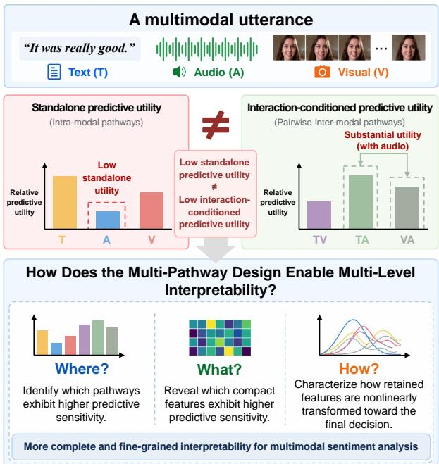  
Fig. 1. Motivation of I2-KAN. Standalone predictive utility does not necessarily reflect interaction-conditioned predictive utility: a modality that exhibits limited utility in isolation can still provide substantial predictive utility through pairwise interactions. By explicitly maintaining intra-modal and pairwise inter-modal information within a multi-pathway structure, I2- KAN supports three complementary levels of interpretation: where predictive sensitivity is concentrated across pathways, what compact features exhibit higher sensitivity within each pathway, and how those features are nonlinearly transformed toward the final decision.

These modalities provide complementary affective cues, making their joint modeling important for understanding multimodal sentiment [1]. Owing to its relevance to human– computer interaction [2], social media understanding [3], conversational agents [4], and human-centered artificial intelligence [5], MSA has become an important problem in multimodal learning.

A substantial body of research has investigated how to represent and fuse heterogeneous modalities. Early tensorbased methods explicitly modeled high-order multimodal interactions [6], [7], while Transformer-based approaches captured long-range cross-modal dependencies through attention mechanisms [8]. Later studies further explored modalityspecific representation learning, auxiliary supervision, mutualinformation maximization, and interaction-aware optimization [9]–[13]. Despite this progress, cross-modal relations are often used as intermediate representations during prediction, making it difficult to separately trace the roles of standalone modalities and pairwise interactions within a unified decision structure.

A key issue is that a modality’s standalone predictive utility does not necessarily reflect its utility when interacting with other modalities. As illustrated in Fig. 1, the acoustic modality may exhibit limited standalone predictive utility, whereas the Text–Audio and Visual–Audio pathways can exhibit substantially greater predictive utility in multimodal contexts. Thus, a modality that appears weak in isolation may still provide useful information through its interactions with other modalities. Evaluating only the original modalities may therefore provide an incomplete characterization of multimodal utility. Meanwhile, existing interpretability approaches mainly provide modality-level importance or analyze nonlinear fusion behavior [14], [15], making it difficult to jointly trace standalone and pairwise information sources throughout the decision process. More importantly, this discrepancy raises an interpretability requirement: a multimodal model should not only characterize the utility of different information sources, but also reveal where predictive sensitivity is concentrated, what compact features the prediction is sensitive to within each pathway, and how those features are transformed toward the final decision.

To address these issues, we propose I2-KAN, an interpretable intra- and inter-modal multi-pathway framework that explicitly maintains standalone and pairwise inter-modal information as separate structural pathways. I2-KAN consists of four stages. Modality-specific encoders first extract textual, acoustic, and visual representations, which are organized into a structured multi-pathway representation. A Task-Decoupled Linear-Gated Denoising Bottleneck (TDL-GDB) then independently refines each pathway through denoising compression, information-preserving shortcuts, and task-specific gated projections. Finally, the compact pathway representations are fused through a structured KAN [16]. By retaining explicit pathway associations throughout fusion, the framework supports pathway-level analysis of where predictive sensitivity is concentrated, compressed-feature analysis of what compact features the prediction is most sensitive to, and functional-edge analysis of how those features are nonlinearly transformed toward the final prediction.

Extensive experiments on CMU-MOSI, CMU-MOSEI, and CH-SIMS v2 demonstrate competitive performance across different sentiment evaluation settings. Interaction-pathway and component-wise ablations validate the effectiveness of the multi-pathway representation, TDL-GDB, and KAN-based fusion. Multi-level analyses consistently show that low standalone predictive utility does not necessarily imply low interaction-conditioned predictive utility, supporting a more comprehensive characterization of modality utility beyond isolated modalities, while the structured multi-pathway design provides a traceable view of where, what, and how multimodal information participates in the learned decision process.

The main contributions can be summarized as follows:

• We show across three benchmarks that standalone predictive utility and interaction-conditioned predictive utility can differ substantially. Motivated by this observation, we propose a multi-pathway framework (I2-KAN) that separately maintains intra-modal and pairwise inter-modal information, enabling both forms of multimodal utility to be modeled and analyzed within a unified structure.

• We design a Task-Decoupled Linear-Gated Denoising Bottleneck (TDL-GDB) to learn compact and taskrelevant representations for heterogeneous pathways. By combining denoising compression, an informationpreserving shortcut, and task-specific gated projections, TDL-GDB allows different sentiment objectives to selectively preserve complementary information before subsequent global fusion.

• We construct a structured KAN fusion mechanism that retains explicit pathway associations throughout nonlinear fusion. Together with pathway-level, compressed-feature, and functional-edge analyses, this design provides a traceable view of how standalone and interaction-conditioned information participates in the final sentiment decision.

## II. RELATED WORK

## A. Multimodal Fusion and Interaction Modeling

Multimodal fusion is central to multimodal sentiment analysis because affective information is distributed across linguistic, acoustic, and visual signals. Early studies mainly focused on constructing expressive joint representations. Tensor Fusion Network (TFN) explicitly modeled unimodal, bimodal, and trimodal interactions through tensor products [6], Low-rank Multimodal Fusion (LMF) reduced the computational cost of tensor-based fusion through low-rank decomposition [7], and Recurrent Multistage Fusion Network (RMFN) decomposed cross-modal fusion into multiple recurrent stages [17]. MulT further employed directional cross-modal attention to effectively model long-range dependencies between unaligned multimodal sequences [8].

Subsequent studies increasingly emphasized modalityspecific information and structured cross-modal relationships. MISA separated modality-invariant and modality-specific representations [9], Self-MM introduced unimodal auxiliary supervision [10], and MMIM retained task-relevant information through mutual-information maximization [11]. MTAG modeled temporal and cross-modal relations using a heterogeneous attention graph [18]. Related multimodal tasks have similarly explored explicit relational structures: Li et al. introduced dual-gated fusion for task-oriented intra- and inter-modal associations [19], developed an inductive framework for textvideo representation alignment [20], and further modeled highorder intra- and inter-modal correlations through a variational multimodal hypergraph [21].

More recent studies have explicitly investigated intra- and inter-modal relational learning in MSA. HGraph-CL models intra-modal structures using unimodal graphs and further captures inter-modal relations through hierarchical graph contrastive learning [22]. Semi-IIN independently captures intra- and inter-modal interactions through masked attention and dynamically regulates their importance using a gating mechanism under a semi-supervised learning framework [23].

TEMSA employs text-guided pairwise cross-modal mapping and reconstruction to jointly model inter-modal consistency and modality-specific information [24]. More recently, I2RL progressively learns intra- and inter-modality relations through multi-scale intra-modal modeling, cross-modality shuffling, and reconstruction [25]. These studies demonstrate the importance of explicitly considering different forms of multimodal relations rather than relying solely on holistic fusion.

Interaction-oriented analyses have also shown that strong multimodal performance does not necessarily imply effective cross-modal reasoning [26]. MRO decomposes predictions into unimodal, bimodal, and trimodal effects [27], while MPID [13], TriagedMSA [12], and CACR [28] further explore modality-preserving, disagreement-aware, and interaction-aware representation learning. However, these approaches primarily focus on learning, selecting, or decomposing intra- and inter-modal relations during representation construction or prediction. In contrast, I2-KAN explicitly maintains intra-modal and pairwise inter-modal representations as separate structural pathways throughout pathway-specific refinement and nonlinear fusion. This design preserves the source association of each compact representation and enables standalone modality behavior to be examined separately from pairwise interaction behavior at the pathway, compressedfeature, and functional-edge levels.

## B. Modality Imbalance and Robust Representation Learning

Different modalities often exhibit unequal information density, noise levels, and optimization difficulty, causing multimodal learning to be dominated by stronger modalities. Existing approaches address this issue through auxiliary supervision or optimization coordination. Self-MM constructs unimodal supervision signals from multimodal labels [10], while MMPareto coordinates unimodal and multimodal gradient directions through Pareto optimization [29]. More recent methods improve weak or under-optimized modalities through representation enhancement and reliability-aware optimization, including MFON [30], PaSE [31], and EBMC [32].

Robust representation learning further seeks to suppress redundant or noisy multimodal information. The text-guided hierarchical noise eliminator t-HNE reduces intra- and intermodal noise [33], MISR learns stable sentiment representations under distribution shifts and cross-modal conflicts [34], and KAN-MCP combines a denoising information bottleneck with multimodal optimization to obtain compact unimodal representations for KAN fusion [15]. However, these methods primarily regulate modalities or their joint optimization and do not explicitly consider that standalone and interaction pathways may require different information preservation strategies. Moreover, different sentiment objectives may rely on different low-dimensional evidence. Our TDL-GDB therefore independently refines each intra-modal and interaction pathway while using task-decoupled gated projections to preserve taskrelevant information before global fusion.

## C. Interpretability in Multimodal Sentiment Analysis

As multimodal fusion networks become increasingly complex, understanding how different information sources affect prediction has become important. Multimodal Routing provides global and instance-level modality explanations through routing weights [14], MTAG visualizes salient temporal and cross-modal graph connections [18], and MRO quantitatively decomposes unimodal and multimodal interaction effects [27]. However, such importance scores or interaction decompositions do not directly reveal how individual compact features are nonlinearly transformed during fusion.

Kolmogorov–Arnold Networks (KANs) offer an intrinsically interpretable alternative by replacing scalar connection weights with learnable univariate functions on network edges [16]. KAN-MCP introduced KAN into MSA to visualize nonlinear mappings from compressed unimodal representations to sentiment predictions [15], but its inputs remain limited to the three original modalities. In contrast, I2-KAN preserves associations for both intra-modal and pairwise inter-modal pathways throughout KAN fusion, enabling interpretation at the pathway, compressed-feature, and functional-edge levels and allowing the roles of standalone and interaction-conditioned information to be traced toward the final prediction.

## III. PROPOSED METHOD

In this section, we present I2-KAN, an interpretable intraand inter-modal multi-pathway framework for multimodal sentiment analysis, as illustrated in Fig. 2. For notational simplicity, the Text, Audio, and Visual pathways are hereafter denoted as T, A, and V, respectively, while the Text–Visual, Text–Audio, and Visual–Audio interaction pathways are denoted as TV, TA, and VA.

## A. Overall Framework

Given a multimodal utterance, I2-KAN organizes multimodal affective evidence into source-traceable intra-modal and pairwise inter-modal pathways and processes them through four stages: Feature Extraction, Semantic Pathway Construction, Task-Decoupled Linear-Gated Denoising Bottleneck, and Interaction-Aware KAN Fusion. Modality-specific encoders first produce textual, acoustic, and visual representations, which are organized into three intra-modal and three pairwise inter-modal pathways. Each pathway is then independently refined by TDL-GDB into a compact task-adaptive representation. Finally, the six compact pathway representations are integrated by KAN in a fixed pathway order to produce the sentiment prediction while retaining explicit source-pathway associations for subsequent interpretation. The following subsections provide detailed formulations of these components.

## B. Feature Extraction and Semantic Pathway Construction

Multimodal sentiment evidence can arise from both standalone modalities and their pairwise relationships. To preserve these two information sources explicitly, I2-KAN organizes modality-specific representations into separate intra-modal and pairwise inter-modal pathways rather than immediately mixing them within a joint latent representation. Each pathway is subsequently refined and fused while retaining its structural source association.

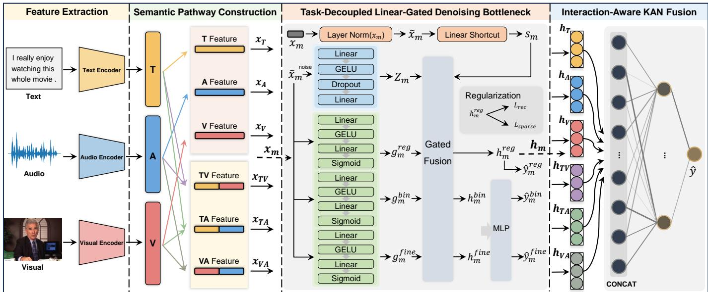  
Fig. 2. Overview of the proposed I2-KAN framework. Modality-specific features are first organized into three intra-modal and three pairwise inter-modal semantic pathways. TDL-GDB independently refines each pathway into compact task-adaptive representations, which are subsequently integrated by the Interaction-Aware KAN Fusion module for sentiment prediction and multi-level interpretation.

Given a multimodal utterance, the textual, acoustic, and visual inputs are denoted as $X _ { t } , \ X _ { a } ,$ , and $X _ { v } ,$ , respectively. Three modality-specific encoders are first employed to obtain the corresponding utterance-level representations:

$$
z _ { t } = E _ { t } ( X _ { t } ) , \quad z _ { a } = E _ { a } ( X _ { a } ) , \quad z _ { v } = E _ { v } ( X _ { v } ) ,\tag{1}
$$

where $E _ { t } ( \cdot ) , E _ { a } ( \cdot )$ , and $E _ { v } ( \cdot )$ denote the textual, acoustic, and visual feature extraction functions, respectively.

To explicitly preserve both standalone modality information and pairwise cross-modal information, the extracted representations are organized into six architecturally designated semantic pathways. The three intra-modal pathways are directly defined as

$$
x _ { T } = z _ { t } , \quad x _ { A } = z _ { a } , \quad x _ { V } = z _ { v } .\tag{2}
$$

The three pairwise inter-modal pathways are constructed by concatenating the corresponding modality representations:

$$
\begin{array} { r } { x _ { T V } = [ z _ { t } ; z _ { v } ] , \quad x _ { T A } = [ z _ { t } ; z _ { a } ] , \quad x _ { V A } = [ z _ { v } ; z _ { a } ] , } \end{array}\tag{3}
$$

where $\left[ \cdot ; \cdot \right]$ denotes feature concatenation. These pairwise pathways do not assume that concatenation itself constitutes cross-modal interaction; rather, they preserve paired modality sources, from which pathway-specific nonlinear interactions are subsequently learned by TDL-GDB. No additional learnable interaction operator is introduced at this stage. Instead, each concatenated pairwise representation is subsequently processed by its own TDL-GDB, allowing modality-pair-specific information to be refined independently before global fusion.

The resulting six-pathway representation is therefore compactly written as

$$
\mathcal { X } = \{ x _ { T } , x _ { A } , x _ { V } , x _ { T V } , x _ { T A } , x _ { V A } \} .\tag{4}
$$

This construction preserves the structural source of each pathway throughout subsequent refinement and fusion, allowing standalone modality pathways and pairwise inter-modal

pathways to remain distinguishable for task-specific modeling and subsequent interpretability analysis.

## C. Task-Decoupled Linear-Gated Denoising Bottleneck

Although the six semantic pathways preserve the structural origins of different affective information sources, their representations remain heterogeneous and may contain redundant or task-irrelevant components. Moreover, continuous sentiment regression, polarity discrimination, and finegrained sentiment recognition may rely on different cues even within the same pathway. We therefore introduce the Task-Decoupled Linear-Gated Denoising Bottleneck (TDL-GDB), which combines perturbation-based denoising, nonlinear compression, an information-preserving shortcut, and task-specific gated projections. Each semantic pathway is equipped with an independently parameterized TDL-GDB, while the three task branches within the same pathway share the compressed candidates before task-specific selection.

For each semantic pathway $m \in { \mathcal { M } } .$ , where

$$
\mathcal { M } = \{ T , A , V , T V , T A , V A \} ,\tag{5}
$$

let $\boldsymbol { x } _ { m } \in \mathbb { R } ^ { d _ { m } }$ denote its input representation. TDL-GDB first performs feature normalization,

$$
\widetilde { x } _ { m } = \mathrm { L N } ( x _ { m } ) ,\tag{6}
$$

followed during training by Gaussian perturbation,

$$
\widetilde { x } _ { m } ^ { \mathrm { n o i s e } } = \widetilde { x } _ { m } + \epsilon _ { m } , \qquad \epsilon _ { m } \sim \mathcal { N } \big ( \mathbf { 0 } , \sigma ^ { 2 } \mathbf { I } _ { d _ { m } } \big ) ,\tag{7}
$$

where $\mathrm { L N } ( \cdot )$ denotes layer normalization, σ controls the perturbation intensity, and $\mathbf { I } _ { d _ { m } }$ is the $d _ { m }$ -dimensional identity matrix. The perturbation is disabled during inference.

The perturbed representation is projected into a compact space through the nonlinear denoising encoder shown in Fig. 2:

$$
z _ { m } = W _ { m } ^ { e , 2 } \mathcal { D } \left[ \delta \left( W _ { m } ^ { e , 1 } \widetilde { x } _ { m } ^ { \mathrm { n o i s e } } + b _ { m } ^ { e , 1 } \right) \right] + b _ { m } ^ { e , 2 } ,\tag{8}
$$

where $\delta ( \cdot )$ and $\mathcal { D } ( \cdot )$ denote GELU activation and dropout, respectively, and $z _ { m } ~ \in ~ \mathbb { R } ^ { d _ { c } }$ is the denoised compact representation. To reduce the risk of discarding discriminative cues during nonlinear compression, a parallel linear shortcut directly maps the normalized input into the same compact latent space:

$$
s _ { m } = W _ { m } ^ { s } \widetilde { x } _ { m } + b _ { m } ^ { s } ,\tag{9}
$$

where $s _ { m } \in \mathbb { R } ^ { d _ { c } }$ . Hence, $z _ { m }$ captures noise-robust nonlinear information, whereas $s _ { m }$ provides a direct informationpreserving projection.

TDL-GDB subsequently decouples the compact representation according to three sentiment objectives. Let $\kappa \_ =$ $\{ \mathrm { r e g } , \mathrm { b i n } , \mathrm { f i n e } \}$ denote continuous regression, binary polarity classification, and fine-grained sentiment classification, respectively. For each task $k \in \mathcal { K }$ , an independent two-layer gate is computed from the normalized pathway representation:

$$
g _ { m } ^ { k } = \sigma \left[ W _ { m , k } ^ { g , 2 } \delta \left( W _ { m , k } ^ { g , 1 } \widetilde x _ { m } + b _ { m , k } ^ { g , 1 } \right) + b _ { m , k } ^ { g , 2 } \right] ,\tag{10}
$$

where $\sigma ( \cdot )$ denotes the sigmoid function and $g _ { m } ^ { k } \in ( 0 , 1 ) ^ { d _ { c } }$ controls the element-wise selection between the nonlinear and shortcut representations. The gated fusion is formulated as

$$
u _ { m } ^ { k } = g _ { m } ^ { k } \odot z _ { m } + \left( \mathbf { 1 } - g _ { m } ^ { k } \right) \odot s _ { m } ,\tag{11}
$$

where $\odot$ denotes element-wise multiplication. Each task further employs an independent linear projection:

$$
h _ { m } ^ { k } = W _ { m } ^ { k } u _ { m } ^ { k } + b _ { m } ^ { k } , \qquad k \in { \cal K } .\tag{12}
$$

Accordingly, $h _ { m } ^ { \mathrm { r e g } } , \ h _ { m } ^ { \mathrm { b i n } }$ , and $h _ { m } ^ { \mathrm { f i n e } }$ in Fig. 2 denote the regression-, polarity-, and fine-grained-specific representations, respectively.

During training, each task-specific representation is mapped to a pathway-level prediction through a lightweight MLP head:

$$
\begin{array} { r } { \widehat { y } _ { m } ^ { k } = P _ { m } ^ { k } \left( h _ { m } ^ { k } \right) , \qquad k \in \mathcal { K } . } \end{array}\tag{13}
$$

Accordingly, $\widehat { y } _ { m } ^ { \mathrm { r e g } } , \widehat { y } _ { m } ^ { \mathrm { b i n } }$ , and ${ \widehat { \mathbf { y } } } _ { m } ^ { \mathrm { f i n e } }$ denote continuous, binary, and fine-grained sentiment predictions, respectively. Their pathway-level training objectives are compactly written as

$$
\begin{array} { r l } & { \mathcal { L } _ { m } ^ { \mathrm { r e g } } = \mathrm { S m o o t h L 1 } \left( \widehat { y } _ { m } ^ { \mathrm { r e g } } , y \right) , } \\ & { \mathcal { L } _ { m } ^ { \mathrm { b i n } } = \mathrm { B C E } \left( \widehat { y } _ { m } ^ { \mathrm { b i n } } , q ^ { \mathrm { b i n } } \right) , } \\ & { \mathcal { L } _ { m } ^ { \mathrm { f i n e } } = \mathrm { C E } \left( \widehat { \mathbf { y } } _ { m } ^ { \mathrm { f i n e } } , \mathbf { q } ^ { \mathrm { f i n e } } \right) , } \end{array}\tag{14}
$$

where $y , q ^ { \mathrm { b i n } }$ , and ${ \bf q } ^ { \mathrm { f i n e } }$ denote the corresponding supervision targets for the three tasks.

In addition to task-specific supervision, the regression representation is regularized through the reconstruction and sparsity constraints shown in Fig. 2. A lightweight reconstructor recovers the normalized pathway representation as

$$
\begin{array} { r } { \widehat { x } _ { m } = R _ { m } ( h _ { m } ^ { \mathrm { r e g } } ) , } \end{array}\tag{15}
$$

and the two regularization terms are defined as

$$
\begin{array} { r } { \mathcal { L } _ { m } ^ { \mathrm { r e c } } = \left. \widehat { x } _ { m } - \widetilde { x } _ { m } \right. _ { 2 } ^ { 2 } , \qquad \mathcal { L } _ { m } ^ { \mathrm { s p a r s e } } = \left. h _ { m } ^ { \mathrm { r e g } } \right. _ { 1 } . } \end{array}\tag{16}
$$

The pathway-level TDL-GDB objective is therefore

$$
\begin{array} { r } { \mathcal { L } _ { m } ^ { \mathrm { T D L } } = \mathcal { L } _ { m } ^ { \mathrm { r e g } } + \lambda _ { \mathrm { b i n } } \mathcal { L } _ { m } ^ { \mathrm { b i n } } + \lambda _ { \mathrm { f i n e } } \mathcal { L } _ { m } ^ { \mathrm { f n e } } } \\ { + \lambda _ { \mathrm { r e c } } \mathcal { L } _ { m } ^ { \mathrm { r e c } } + \lambda _ { \mathrm { s p a r s e } } \mathcal { L } _ { m } ^ { \mathrm { s p a r s e } } , } \end{array}\tag{17}
$$

where the λ coefficients control the relative strengths of the corresponding auxiliary objectives.

Only the regression-specialized representation $h _ { m } ^ { \mathrm { r e g } }$ is forwarded to the subsequent KAN fusion module, while the binary and fine-grained branches provide auxiliary supervision during training. For notational simplicity, we henceforth write

$$
h _ { m } \equiv h _ { m } ^ { \mathrm { r e g } } .\tag{18}
$$

The six compact representations entering KAN are therefore

$$
\left\{ h _ { T } , h _ { A } , h _ { V } , h _ { T V } , h _ { T A } , h _ { V A } \right\} .\tag{19}
$$

## D. Interaction-Aware KAN Fusion

After obtaining the refined representations of the six semantic pathways from TDL-GDB, I2-KAN performs interactionaware fusion through a structured Kolmogorov–Arnold Network (KAN). In conventional multimodal fusion methods, heterogeneous modality representations are commonly projected into a shared latent space through fusion operations, where modality-specific and cross-modal interaction information is implicitly mixed [6]–[8]. Although these methods effectively capture multimodal dependencies, the structural origin of each modality and interaction pathway becomes difficult to trace during the fusion process. Therefore, I2-KAN maintains explicit pathway assignments throughout nonlinear fusion, enabling a more transparent analysis of how different information sources participate in the final sentiment decision.

The six refined pathway representations generated by TDL-GDB are denoted as $h _ { T } , \ h _ { A } , \ h _ { V } , \ h _ { T V } , \ h _ { T A }$ , and $h _ { V A } ,$ where each $h _ { m } \in \mathbb { R } ^ { d _ { c } }$ denotes the compact representation of the corresponding pathway. They are concatenated in a fixed pathway order to form

$$
H = [ h _ { T } , h _ { A } , h _ { V } , h _ { T V } , h _ { T A } , h _ { V A } ] ,\tag{20}
$$

where $H ~ \in ~ \mathbb { R } ^ { 6 d _ { c } }$ . This structured formulation retains the source association of each compact representation, allowing intra-modal and pairwise inter-modal pathways to remain distinguishable during nonlinear fusion.

Unlike conventional MLPs with scalar connection weights, KAN associates each edge with a learnable univariate function $\phi _ { i j } ( \cdot )$ [16]. For two adjacent layers, the transformation is written as

$$
y _ { j } = \sum _ { i } \phi _ { i j } ( x _ { i } ) ,\tag{21}
$$

where $x _ { i }$ and $y _ { j }$ denote the input and output neurons, respectively, and $\phi _ { i j } ( \cdot )$ represents the learnable function associated with the edge connecting them. The internal functional parameterization follows the adopted KAN implementation, with the corresponding configuration reported in Sec. IV-B.

The final sentiment prediction is obtained as

$$
\begin{array} { r } { \hat { y } = \mathrm { K A N } ( H ; \Theta _ { \mathrm { K A N } } ) , } \end{array}\tag{22}
$$

where $\Theta _ { \mathrm { K A N } }$ denotes the learnable parameters of KAN. During training, the final KAN prediction is supervised by the continuous sentiment label, while the pathway-level objectives defined in Eq. (17) provide auxiliary supervision. Because each KAN input dimension retains an explicit association with its source pathway, the fusion process remains traceable from pathway-level inputs to learned nonlinear edge transformations. This structured representation supports subsequent pathway-level, compressed-feature, and functional-edge analyses at different levels of granularity, while the learned edge functions characterize how compact features are nonlinearly transformed toward the final prediction.

TABLE I  
COMPARISON WITH BASELINES ON CMU-MOSI AND CMU-MOSEI.
<table><tr><td rowspan="2">Model</td><td colspan="5">CMU-MOSI</td><td colspan="5">CMU-MOSEI</td></tr><tr><td>Acc7↑</td><td>Acc2↑</td><td>F1↑</td><td>MAE↓</td><td>Corr↑</td><td>Acc7↑</td><td>Acc2↑</td><td>F1↑</td><td>MAE↓</td><td>Corr↑</td></tr><tr><td>Graph-MFN [35]</td><td>34.4</td><td>80.2</td><td>80.1</td><td>0.939</td><td>0.656</td><td>51.9</td><td>84.0</td><td>83.8</td><td>0.569</td><td>0.725</td></tr><tr><td>MMIM [11]</td><td>45.0</td><td>85.1</td><td>85.0</td><td>0.738</td><td>0.781</td><td>53.1</td><td>85.1</td><td>85.0</td><td>0.547</td><td>0.752</td></tr><tr><td>UniMSE [36]</td><td>48.7</td><td>86.9</td><td>86.4</td><td>0.691</td><td>0.809</td><td>54.4</td><td>87.5</td><td>87.5</td><td>0.523</td><td>0.773</td></tr><tr><td>HGraph-CL [22]</td><td></td><td>86.2</td><td>86.2</td><td>0.717</td><td>0.799</td><td></td><td>85.9</td><td>85.8</td><td>0.527</td><td>0.769</td></tr><tr><td>HyCon [37]</td><td>46.6</td><td>85.2</td><td>85.1</td><td>0.741</td><td>0.779</td><td>52.8</td><td>85.4</td><td>85.6</td><td>0.554</td><td>0.751</td></tr><tr><td>ConFEDE [38]</td><td>42.3</td><td>85.5</td><td>85.5</td><td>0.742</td><td>0.782</td><td>54.9</td><td>85.8</td><td>85.8</td><td>0.522</td><td>0.780</td></tr><tr><td>MGCL [39]</td><td>49.3</td><td>86.7</td><td>86.7</td><td>0.685</td><td>0.707</td><td>53.9</td><td>86.4</td><td>86.4</td><td>0.535</td><td>0.772</td></tr><tr><td>MFM [40]</td><td>33.3</td><td>80.0</td><td>80.1</td><td>0.948</td><td>0.664</td><td>50.8</td><td>83.4</td><td>83.4</td><td>0.580</td><td>0.722</td></tr><tr><td>ITHP [41]</td><td>47.7</td><td>88.5</td><td>88.5</td><td>0.663</td><td>0.856</td><td>52.2</td><td>87.1</td><td>87.1</td><td>0.550</td><td>0.792</td></tr><tr><td>ULMD [42]</td><td>47.8</td><td>85.8</td><td>85.7</td><td>0.700</td><td>0.799</td><td>53.8</td><td>86.0</td><td>85.9</td><td>0.531</td><td>0.770</td></tr><tr><td>MFON [30]</td><td>44.9</td><td>86.9</td><td>86.9</td><td>0.725</td><td>0.797</td><td>53.7</td><td>86.3</td><td>86.3</td><td>0.528</td><td>0.780</td></tr><tr><td>KAN-MCP [15]</td><td>48.3</td><td>89.4</td><td>89.4</td><td>0.615</td><td>0.857</td><td>53.9</td><td>87.7</td><td>87.6</td><td>0.522</td><td>0.788</td></tr><tr><td>I2RL [25]</td><td>47.2</td><td>86.9</td><td>86.6</td><td>0.697</td><td>0.802</td><td>54.7</td><td>86.6</td><td>86.5</td><td>0.532</td><td></td></tr><tr><td>MDF [43]</td><td>48.3</td><td>85.8</td><td>85.9</td><td>0.692</td><td>0.810</td><td>54.8</td><td>86.6</td><td>86.4</td><td>0.525</td><td>0.788</td></tr><tr><td>FUSE-Net [44]</td><td>49.2</td><td>85.8</td><td>85.9</td><td>0.688</td><td>0.798</td><td>54.3</td><td>85.8</td><td>86.1</td><td>0.527</td><td>0.772</td></tr><tr><td>PSA-MF [45]</td><td>46.5</td><td>86.4</td><td>86.2</td><td>0.686</td><td>0.807</td><td>55.0</td><td>86.3</td><td>86.3</td><td>0.521</td><td>0.774</td></tr><tr><td>I2-KAN</td><td>50.3</td><td>90.0</td><td>90.0</td><td>0.589</td><td>0.866</td><td>54.4</td><td>88.2</td><td>88.1</td><td>0.515</td><td>0.798</td></tr></table>

TABLE II  
COMPARISON WITH BASELINES ON THE CH-SIMS V2 DATASET.
<table><tr><td rowspan="2">Model</td><td colspan="5">CH-SIMS v2</td></tr><tr><td>Acc3↑</td><td>Acc2↑</td><td>F1↑</td><td>MAE↓</td><td>Corr↑</td></tr><tr><td>EF-LSTM [46]</td><td>73.5</td><td>80.1</td><td>80.0</td><td>0.309</td><td>0.700</td></tr><tr><td>LF-DNN [47]</td><td>71.2</td><td>77.8</td><td>77.9</td><td>0.322</td><td>0.668</td></tr><tr><td>TFN [6]</td><td>70.9</td><td>78.1</td><td>78.1</td><td>0.322</td><td>0.662</td></tr><tr><td>LMF [7]</td><td>70.0</td><td>77.8</td><td>77.8</td><td>0.327</td><td>0.651</td></tr><tr><td>MFN [48]</td><td>72.7</td><td>79.4</td><td>79.4</td><td>0.301</td><td>0.712</td></tr><tr><td>Graph-MFN [35]</td><td>68.6</td><td>76.6</td><td>76.6</td><td>0.334</td><td>0.644</td></tr><tr><td>MulT [8]</td><td>74.2</td><td>80.8</td><td>80.7</td><td>0.300</td><td>0.738</td></tr><tr><td>MISA [9]</td><td>68.9</td><td>78.2</td><td>78.3</td><td>0.342</td><td>0.671</td></tr><tr><td>MAG-BERT [49]</td><td>70.6</td><td>77.1</td><td>77.1</td><td>0.346</td><td>0.641</td></tr><tr><td>Self-MM [10]</td><td>72.7</td><td>78.7</td><td>78.6</td><td>0.315</td><td>0.691</td></tr><tr><td>MMIM [11]</td><td>70.4</td><td>77.8</td><td>77.8</td><td>0.339</td><td>0.641</td></tr><tr><td>AV-MC [50]</td><td>73.2</td><td>80.6</td><td>80.7</td><td>0.301</td><td>0.721</td></tr><tr><td>KuDA [51]</td><td>74.3</td><td>80.2</td><td>80.1</td><td>0.289</td><td>0.741</td></tr><tr><td>KAN-MCP [15]</td><td>75.0</td><td>81.6</td><td>81.7</td><td>0.281</td><td>0.742</td></tr><tr><td>FUSE-Net [44]</td><td>73.7</td><td>79.6</td><td>79.5</td><td>0.297</td><td>0.712</td></tr><tr><td>CmIR [52]</td><td>75.0</td><td>81.9</td><td>82.0</td><td>0.286</td><td>0.742</td></tr><tr><td>I2-KAN</td><td>72.4</td><td>85.6</td><td>85.6</td><td>0.280</td><td>0.746</td></tr></table>

## IV. EXPERIMENTS

## A. Datasets and Evaluation Metrics

CMU-MOSI [53]. CMU-MOSI is a widely used English multimodal sentiment analysis benchmark containing 2,199 opinion utterances extracted from 93 videos. Each utterance is annotated with a continuous sentiment score ranging from −3 to +3. Following the standard split, 1,284 utterances are used for training, 229 for validation, and 686 for testing.

CMU-MOSEI [35]. CMU-MOSEI is a large-scale English multimodal sentiment dataset with sentiment annotations ranging from −3 to +3. Although the dataset also provides emotion labels, only sentiment annotations are considered in this work. We follow the standard partition containing 16,326 training, 1,871 validation, and 4,659 test utterances.

CH-SIMS v2 [50]. CH-SIMS v2 is a Chinese multimodal sentiment dataset collected from diverse scenarios, including films, television programs, interviews, and talk shows. Each sample is annotated with a continuous sentiment score ranging from −1 to 1. We use the official split containing 2,722 training, 647 validation, and 1,034 test samples.

For CMU-MOSI and CMU-MOSEI, we report seven-class accuracy (Acc7), binary accuracy (Acc2), weighted F1 score, mean absolute error (MAE), and Pearson correlation coefficient (Corr). Acc7 maps continuous sentiment predictions to seven levels from −3 to +3. Following the commonly adopted positive/negative evaluation protocol, samples with zero ground-truth sentiment are excluded when computing Acc2 and F1. For CH-SIMS v2, we report three-class accuracy (Acc3), Acc2, weighted F1, MAE, and Corr. Acc3 divides the sentiment space into negative, neutral, and positive classes using −0.2 and 0.2 as thresholds. Higher Acc7/Acc3, Acc2, F1, and Corr and lower MAE indicate better performance.

## B. Implementation Details

All experiments are implemented in PyTorch. For CMU-MOSI and CMU-MOSEI, DeBERTa-v3-base, COVAREP, and FaceNet512 are adopted to extract textual, acoustic, and visual representations, respectively. For CH-SIMS v2, Chinese BERT, OpenSMILE, and OpenFace are used for the three modalities. Temporal mean pooling is applied when necessary to obtain utterance-level representations. The compact dimension of each semantic pathway is set to 3 for all datasets. The intermediate dimension of TDL-GDB is set to 1024, 518, and 1024 for CMU-MOSI, CMU-MOSEI, and CH-SIMS v2, respectively, while the number of hidden nodes in KAN is set to 4, 4, and 3. The internal functional parameterization of KAN follows the default configuration of the adopted implementation [16].

TABLE III  
ANALYSIS OF PAIRWISE INTERACTION PATHWAYS ON CMU-MOSI AND CMU-MOSEI. ALL CONFIGURATIONS RETAIN THE INTRA-MODAL PATHWAYS T, A, AND V.
<table><tr><td rowspan="2">Interactions</td><td colspan="5">CMU-MOSI</td><td colspan="5">CMU-MOSEI</td></tr><tr><td>Acc7↑</td><td>Acc2↑</td><td>F1↑</td><td>MAE↓</td><td>Corr↑</td><td>Acc7↑</td><td>Acc2↑</td><td>F1↑</td><td>MAE↓</td><td>Corr↑</td></tr><tr><td>None</td><td>44.9</td><td>86.5</td><td>86.5</td><td>0.704</td><td>0.808</td><td>49.2</td><td>86.7</td><td>86.6</td><td>0.578</td><td>0.753</td></tr><tr><td>VA</td><td>47.4</td><td>86.2</td><td>86.2</td><td>0.699</td><td>0.811</td><td>52.6</td><td>87.7</td><td>87.7</td><td>0.539</td><td>0.763</td></tr><tr><td>TV</td><td>47.0</td><td>88.2</td><td>88.1</td><td>0.648</td><td>0.841</td><td>54.2</td><td>88.1</td><td>88.1</td><td>0.516</td><td>0.789</td></tr><tr><td>TA</td><td>47.8</td><td>88.7</td><td>88.6</td><td>0.631</td><td>0.856</td><td>54.8</td><td>87.1</td><td>87.0</td><td>0.523</td><td>0.784</td></tr><tr><td>TV+VA</td><td>48.1</td><td>89.4</td><td>89.4</td><td>0.628</td><td>0.856</td><td>54.2</td><td>87.7</td><td>87.7</td><td>0.521</td><td>0.787</td></tr><tr><td>TV+TA</td><td>49.1</td><td>89.0</td><td>88.9</td><td>0.620</td><td>0.855</td><td>54.1</td><td>87.4</td><td>87.4</td><td>0.519</td><td>0.787</td></tr><tr><td>TA+VA</td><td>48.3</td><td>88.7</td><td>88.6</td><td>0.627</td><td>0.853</td><td>53.0</td><td>87.5</td><td>87.3</td><td>0.525</td><td>0.785</td></tr><tr><td>Full</td><td>50.3</td><td>90.0</td><td>90.0</td><td>0.589</td><td>0.866</td><td>54.4</td><td>88.2</td><td>88.1</td><td>0.515</td><td>0.798</td></tr></table>

TABLE IV  
ANALYSIS OF PAIRWISE INTERACTION PATHWAYS ON CH-SIMS V2.
<table><tr><td rowspan="2">Interactions</td><td colspan="5">CH-SIMS v2</td></tr><tr><td>Acc3↑</td><td>Acc2↑</td><td>F1↑</td><td>MAE↓</td><td>Corr↑</td></tr><tr><td>None</td><td>66.1</td><td>81.4</td><td>81.4</td><td>0.316</td><td>0.703</td></tr><tr><td>VA</td><td>70.4</td><td>83.8</td><td>83.8</td><td>0.300</td><td>0.736</td></tr><tr><td>TV</td><td>71.0</td><td>84.6</td><td>84.6</td><td>0.298</td><td>0.734</td></tr><tr><td>TA</td><td>70.4</td><td>84.3</td><td>84.3</td><td>0.301</td><td>0.738</td></tr><tr><td>TV+VA</td><td>71.0</td><td>84.6</td><td>84.5</td><td>0.308</td><td>0.727</td></tr><tr><td>TV+TA</td><td>70.3</td><td>84.1</td><td>84.0</td><td>0.305</td><td>0.721</td></tr><tr><td>TA+VA</td><td>69.5</td><td>84.0</td><td>84.0</td><td>0.298</td><td>0.734</td></tr><tr><td>Full</td><td>72.4</td><td>85.6</td><td>85.6</td><td>0.280</td><td>0.746</td></tr></table>

All models are optimized using AdamW with a weight decay of 0.01. For CMU-MOSI, the batch size is 8 and the model is trained for 35 epochs, with learning rates of $1 \times 1 0 ^ { - 5 }$ for the text-related parameters and $1 \times 1 0 ^ { - 3 }$ for the remaining parameters. For CMU-MOSEI, the batch size is 64 and the model is trained for 10 epochs, with learning rates of $2 \times 1 0 ^ { - 5 }$ and $1 \times 1 0 ^ { - 2 }$ for the text-related and remaining parameters, respectively. A linear learning-rate scheduler with a warmup ratio of 0.5 is applied to both datasets. For CH-SIMS v2, the batch size is 32 and the model is trained for 50 epochs using a learning rate of $1 \times 1 0 ^ { - 3 }$ without an additional learning-rate scheduler. For auxiliary supervision, the finegrained branch follows the seven-level sentiment targets on CMU-MOSI and CMU-MOSEI and the corresponding threelevel targets on CH-SIMS v2, while the binary branch follows the corresponding positive–negative polarity definition. All reported results of I2-KAN and its variants are averaged over five runs with different random seeds.

## C. Performance Comparison

Baselines. We compare I2-KAN with representative and recent methods covering multimodal fusion, representation learning, modality optimization, and interaction modeling. The compared methods and their corresponding references are summarized in Tables I and II. The best and second-best results are highlighted in bold and underlined, respectively.

As shown in Table I, I2-KAN achieves the best results across all five metrics on CMU-MOSI. In particular, it improves both classification-oriented metrics (Acc7, Acc2, and F1) and regression-oriented metrics (MAE and Corr), demonstrating consistent performance across discrete and continuous sentiment evaluation.

On CMU-MOSEI, $\mathrm { I } ^ { 2 } { \mathrm { - } } \mathrm { K A N }$ achieves the best Acc2, F1, MAE, and Corr while remaining competitive in Acc7. These results indicate that the proposed framework maintains strong performance on the substantially larger CMU-MOSEI benchmark across both classification and regression metrics.

As shown in Table II, I2-KAN achieves the best results in Acc2, F1, MAE, and Corr on CH-SIMS v2. In particular, the improvements in Acc2 and F1 indicate a clear advantage in sentiment polarity discrimination. Overall, the results across the three benchmarks confirm the effectiveness of $\mathrm { I ^ { 2 } { - } K A N }$ under different languages and sentiment annotation settings.

## D. Analysis of Pairwise Interaction Pathways

To examine the effect of explicit pairwise interaction pathways and how different pathway combinations affect sentiment prediction, we evaluate all possible combinations of T V , TA, and VA. All configurations retain the three intra-modal pathways T, A, and V and use the same TDL-GDB and KAN fusion mechanism. The None configuration contains no pairwise pathway, the single- and two-pathway configurations retain one or two pairwise pathways, respectively, and Full includes all three. The results on CMU-MOSI and CMU-MOSEI are reported in Table III, while those on CH-SIMS $\mathbf { v } 2$ are reported in Table IV.

The comparison between None and Full shows that incorporating all three pairwise pathways consistently improves performance over the intra-modal-only configuration under the current architecture. On CMU-MOSI, the full configuration improves Acc7 and Acc2 by 5.4 and 3.5 percentage points, respectively. The corresponding gains are 5.2 and 1.5 points on CMU-MOSEI, while improvements of 6.3 and 4.2 points are observed for Acc3 and Acc2 on CH-SIMS v2. Consistent reductions in MAE across all three datasets further indicate that the observed overall benefit is not limited to categorical sentiment prediction.

The single- and two-pathway configurations further show that the effectiveness of a particular interaction varies across datasets and evaluation criteria. On CMU-MOSEI, TA achieves the highest Acc7 among the single-pathway variants, whereas TV performs better in Acc2, F1, MAE, and Corr. On CMU-MOSI, the text-centered pathways TV and TA generally provide larger gains than V A, while V A becomes comparatively more effective on CH-SIMS v2. These results suggest that the utility of a modality pair is context-dependent rather than fixed across datasets.

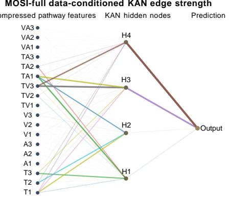  
(a) CMU-MOSI

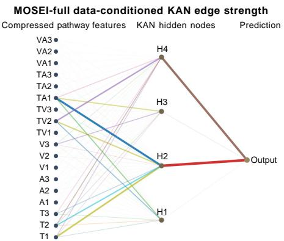  
(b) CMU-MOSEI

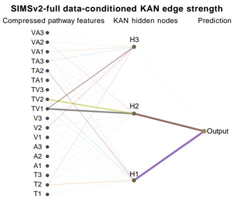  
(c) CH-SIMS v2  
Fig. 3. Data-conditioned KAN functional-edge visualization on the three datasets. The left column of each subfigure contains the compressed features from the six intra- and inter-modal pathways, the middle column contains the KAN hidden nodes, and the right node denotes the final sentiment prediction. Edge width and opacity indicate the normalized functional-edge strength.

Overall, the Full configuration provides the most consistent performance across the three benchmarks, although the individual pathways contribute differently under different conditions. Retaining all three pairwise pathways therefore provides the most consistent overall configuration across the three benchmarks for subsequent fusion. This finding motivates the following interpretability analysis, where we further examine how the six pathways and their compressed features participate in the learned KAN decision process.

## E. Interpretability Analysis

The structured six-pathway representation of I2-KAN enables the inference process to be examined at three complementary levels: pathway-level predictive sensitivity, compressed-feature predictive sensitivity, and KAN functional-edge behavior. Since each of the six semantic pathways contributes three compressed dimensions to the KAN input, the resulting decision process remains traceable from pathway-level information sources to individual compact features and their nonlinear propagation through KAN.

1) KAN Functional-Edge Analysis: Each KAN connection is associated with a learned univariate transformation rather than a conventional scalar weight. To characterize its dataconditioned behavior, we evaluate the variation of each edge response over the test set and normalize the resulting strength within each KAN layer. Accordingly, thicker and more opaque edges in Fig. 3 indicate stronger data-dependent functional responses. Edge colors are used only for visual distinction, and the edge strength should not be interpreted as sentiment polarity or causal contribution.

As shown in Fig. 3, the learned functional responses are concentrated in a subset of nonlinear routes rather than being uniformly distributed across all connections. The input nodes correspond to the compressed dimensions of T, A, V, TV, TA, and VA, while the hidden nodes represent learned aggregation routes without predefined semantic meanings. CMU-MOSI mainly exhibits stronger hidden-to-output responses through $H _ { 3 }$ and $H _ { 4 } ,$ , CMU-MOSEI through $H _ { 2 }$ and $H _ { 4 }$ , and CH-SIMS $\mathbf { v } 2$ through $H _ { 1 }$ and $H _ { 2 }$ . Since the models are trained independently, these hidden-node indices should not be interpreted as semantically aligned across datasets.

The distinct routing patterns are consistent with the different distributions of affective evidence across the three benchmarks. CMU-MOSEI shows a stronger reliance on standalone textual information, whereas CMU-MOSI and CH-SIMS v2 exhibit more interaction-oriented structures, as further confirmed by the pathway-level analysis below. This suggests that KAN does not impose a fixed fusion topology but adapts its nonlinear aggregation routes to dataset-specific multimodal characteristics. The following analysis further quantifies which semantic pathways the final prediction is most sensitive to.

2) Pathway-Level Predictive Sensitivity Analysis: To quantify the predictive dependence on each semantic pathway, we mask all three compressed dimensions of one pathway at a time and measure the resulting change in model output. The obtained scores are normalized across the six pathways for comparison, as shown in Fig. 4.

As shown in Fig. 4, pairwise interaction pathways constitute a substantial part of the learned decision structure across all three datasets. A particularly consistent pattern appears for the acoustic modality: although the standalone A pathway exhibits low predictive sensitivity, the audio-related interaction pathways TA and VA can exhibit considerably higher predictivesensitivity scores. This observation across different datasets supports our central argument that low standalone predictive utility does not necessarily imply low interaction-conditioned predictive utility.

The dominant pathways also differ across datasets. CMU-MOSI is strongly interaction-oriented, with TA and TV exhibiting the highest predictive-sensitivity scores, whereas CMU-MOSEI shows markedly higher sensitivity to the standalone textual pathway, with $T$ reaching a normalized score of 0.398. This is consistent with the large-scale opinion-video setting of CMU-MOSEI, where explicit linguistic sentiment often provides stable direct evidence [35]. In contrast, CH-SIMS v2 exhibits higher predictive sensitivity to T V and V A, which is consistent with its richer nonverbal affective cues and greater reliance on cross-modal contextual information [50].

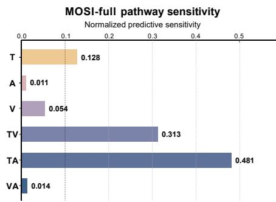  
(a) CMU-MOSI

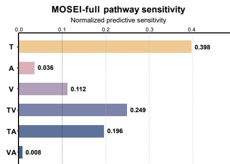  
(b) CMU-MOSEI

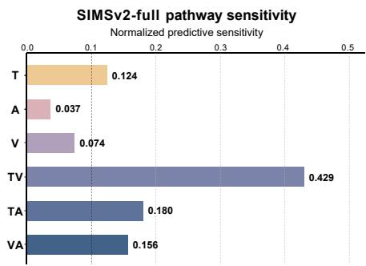  
(c) CH-SIMS v2  
Fig. 4. Normalized masking-based predictive sensitivity of the six semantic pathways, obtained by masking all three compressed dimensions belonging to one pathway at a time

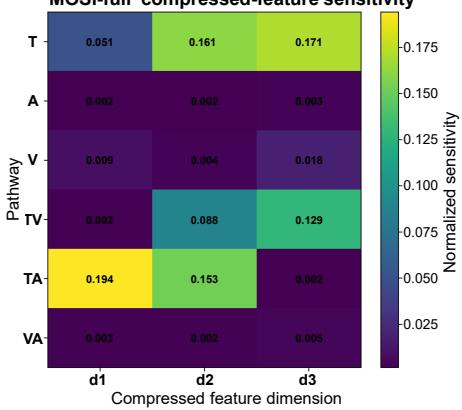  
(a) CMU-MOSI

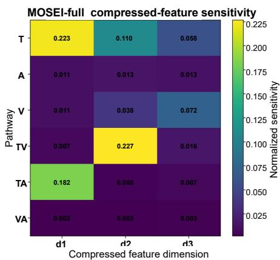  
(b) CMU-MOSEI

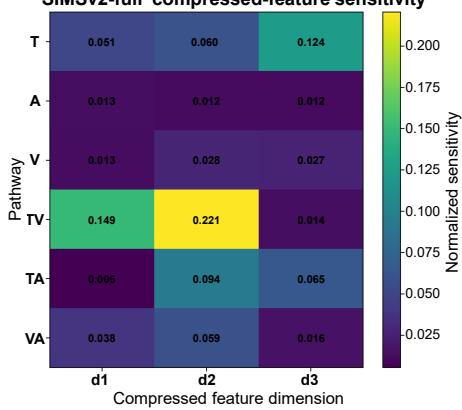  
(c) CH-SIMS v2  
Fig. 5. Normalized masking-based predictive sensitivity of individual compressed dimensions within each pathway.

Despite these dataset-specific differences, text remains an important semantic anchor. These results suggest that textual information often exerts its influence not only through the standalone T pathway, but also through explicit interactions with acoustic and visual evidence.

3) Compressed-Feature Predictive Sensitivity Analysis: To further examine how predictive information is distributed within each semantic pathway, we mask one compressed dimension at a time and measure the resulting change in model output. The normalized results are visualized in Fig. 5.

As shown in Fig. 5, the three compressed dimensions within the same pathway exhibit clearly different predictivesensitivity patterns. The dimensions with higher sensitivity also vary across semantic pathways and datasets rather than following a fixed pattern, suggesting that the bottleneck captures compact features with differentiated predictive roles rather than uniformly redundant representations.

The variation suggests that feature specialization depends jointly on the semantic source of a pathway and the underlying data distribution. For example, text-related dimensions are more prominent on CMU-MOSEI, whereas interaction-related dimensions are more prominent on CMU-MOSI and CH-SIMS v2, consistent with the pathway-level findings above. Since these compact dimensions are learned independently for each dataset, their indices should not be interpreted as carrying fixed semantic meanings across models.

TABLE V  
LEAVE-ONE-COMPONENT-OUT ABLATION RESULTS ON CMU-MOSEI.
<table><tr><td>Configuration</td><td>Acc7↑</td><td>Acc2↑</td><td>F1↑</td><td>MAE↓</td><td>Corr↑</td></tr><tr><td>w/o Pairwise Interactions</td><td>49.2</td><td>86.7</td><td>86.6</td><td>0.578</td><td>0.753</td></tr><tr><td>w/o TDL-GDB</td><td>53.8</td><td>85.6</td><td>85.6</td><td>0.525</td><td>0.778</td></tr><tr><td>w/o KAN</td><td>53.0</td><td>86.7</td><td>86.6</td><td>0.524</td><td>0.780</td></tr><tr><td>I2-KAN</td><td>54.4</td><td>88.2</td><td>88.1</td><td>0.515</td><td>0.798</td></tr></table>

Together with the pathway-level analysis, these results show that the information retained by I2-KAN is structured not only across semantic pathways but also within each pathway, providing a finer-grained view of how the final prediction depends on compact multimodal features.

## F. Ablation Study

We conduct a leave-one-component-out study on CMU-MOSEI, the largest benchmark considered in this work, to examine the roles of pairwise interaction pathways, TDL-GDB, and KAN fusion. Each variant modifies only one major component while keeping the remaining settings unchanged. The w/o Pairwise Interactions variant removes TV, TA, and VA while retaining the three intra-modal pathways with TDL-

GDB and KAN. The w/o TDL-GDB variant retains all six pathways and KAN but replaces TDL-GDB with a standard low-dimensional bottleneck of the same output dimensionality. The w/o KAN variant retains the six pathways and TDL-GDB but replaces KAN with an MLP of comparable hidden width.

The corresponding ablation results are reported in Table V. As shown in Table V, removing the pairwise interaction pathways leads to a clear performance degradation across all metrics, indicating that incorporating TV, TA, and VA is beneficial beyond the intra-modal-only configuration under the current architecture. This result is consistent with the interaction-combination study and the pathway-level interpretation presented above.

Replacing TDL-GDB with a conventional bottleneck also degrades performance, showing that simple dimensionality reduction is insufficient for learning compact representations from heterogeneous intra-modal and interaction pathways. This comparison supports the effectiveness of task-decoupled denoising and gated information selection in TDL-GDB.

Finally, replacing KAN with a comparable-width MLP results in lower performance while retaining the same six pathways and TDL-GDB representations. This suggests that the gains of I2-KAN do not arise solely from introducing additional interaction pathways, and that KAN provides an effective nonlinear fusion mechanism for the structured pathway representation while retaining the functional interpretability analyzed in Section IV-E.

## V. CONCLUSION

In this paper, we proposed I2-KAN, an interpretable multimodal sentiment analysis framework that explicitly organizes intra-modal and pairwise inter-modal information within a structured multi-pathway representation. TDL-GDB learns compact and task-adaptive representations for heterogeneous pathways, while structured KAN fusion retains explicit pathway associations during nonlinear sentiment prediction. Experiments on CMU-MOSI, CMU-MOSEI, and CH-SIMS v2 demonstrate the effectiveness of the proposed framework, with interaction-pathway and component-wise ablations further supporting the proposed architectural design. More importantly, the multi-level analyses consistently show that standalone predictive utility does not necessarily reflect interaction-conditioned predictive utility. These findings highlight the interaction-dependent nature of multimodal information and suggest that modality utility should be considered from both standalone and interaction-conditioned perspectives. By maintaining traceable pathway associations throughout representation refinement and fusion, I2-KAN provides a finergrained view of multimodal sentiment reasoning.

## REFERENCES

[1] S. Lai, X. Hu, H. Xu, Z. Ren, and Z. Liu, “Multimodal sentiment analysis: A survey,” Displays, vol. 80, p. 102563, 2023.

[2] M. Pantic, N. Sebe, J. F. Cohn, and T. Huang, “Affective multimodal human-computer interaction,” in Proceedings of the 13th annual ACM international conference on Multimedia, 2005, pp. 669–676.

[3] Y. Wei, S. Yuan, R. Yang, L. Shen, Z. Li, L. Wang, and M. Chen, “Tackling modality heterogeneity with multi-view calibration network for multimodal sentiment detection,” in Proceedings of the 61st annual meeting of the Association for Computational Linguistics (volume 1: Long papers), 2023, pp. 5240–5252.

[4] H. Rashkin, E. M. Smith, M. Li, and Y.-L. Boureau, “Towards empathetic open-domain conversation models: A new benchmark and dataset,” in Proceedings of the 57th annual meeting of the association for computational linguistics, 2019, pp. 5370–5381.

[5] M. O. Riedl, “Human-centered artificial intelligence and machine learning,” Human Behavior and Emerging Technologies, vol. 1, no. 1, pp. 33–36, 2019.

[6] A. Zadeh, M. Chen, S. Poria, E. Cambria, and L.-P. Morency, “Tensor fusion network for multimodal sentiment analysis,” in Proceedings ofthe 2017 conference on empirical methods in natural language processing, 2017, pp. 1103–1114.

[7] Z. Liu, Y. Shen, V. B. Lakshminarasimhan, P. P. Liang, A. B. Zadeh, and L.-P. Morency, “Efficient low-rank multimodal fusion with modalityspecific factors,” in Proceedings of the 56th Annual Meeting of the Association for Computational Linguistics (Volume 1: Long Papers), 2018, pp. 2247–2256.

[8] Y.-H. H. Tsai, S. Bai, P. P. Liang, J. Z. Kolter, L.-P. Morency, and R. Salakhutdinov, “Multimodal transformer for unaligned multimodal language sequences,” in Proceedings of the 57th annual meeting of the association for computational linguistics, 2019, pp. 6558–6569.

[9] D. Hazarika, R. Zimmermann, and S. Poria, “MISA: Modality-invariant and -specific representations for multimodal sentiment analysis,” in Proceedings of the 28th ACM international conference on multimedia, 2020, pp. 1122–1131.

[10] W. Yu, H. Xu, Z. Yuan, and J. Wu, “Learning modality-specific representations with self-supervised multi-task learning for multimodal sentiment analysis,” in Proceedings of the AAAI conference on artificial intelligence, vol. 35, no. 12, 2021, pp. 10 790–10 797.

[11] W. Han, H. Chen, and S. Poria, “Improving multimodal fusion with hierarchical mutual information maximization for multimodal sentiment analysis,” in Proceedings of the 2021 conference on empirical methods in natural language processing, 2021, pp. 9180–9192.

[12] Y. Luo, W. Liu, Q. Sun, S. Li, J. Li, R. Wu, and X. Tang, “TriagedMSA: Triaging sentimental disagreement in multimodal sentiment analysis,” IEEE Transactions on Affective Computing, vol. 16, no. 3, pp. 1557– 1569, 2025.

[13] T. Li and D. Liu, “MPID: A modality-preserving and interaction-driven fusion network for multimodal sentiment analysis,” in Proceedings of the 31st International Conference on Computational Linguistics, 2025, pp. 4313–4322.

[14] Y.-H. H. Tsai, M. Ma, M. Yang, R. Salakhutdinov, and L.-P. Morency, “Multimodal routing: Improving local and global interpretability of multimodal language analysis,” in Proceedings of the 2020 conference on empirical methods in natural language processing (EMNLP), 2020, pp. 1823–1833.

[15] M. Luo, Y. Jiang, and S. Mai, “Towards explainable fusion and balanced learning in multimodal sentiment analysis,” in Proceedings of the 33rd ACM international conference on multimedia, 2025, pp. 1997–2006.

[16] Z. Liu, Y. Wang, S. Vaidya, F. Ruehle, J. Halverson, M. Soljacic, T. Hou, and M. Tegmark, “KAN: Kolmogorov–Arnold networks,” in International Conference on Learning Representations, vol. 2025, 2025, pp. 70 367–70 413.

[17] P. P. Liang, Z. Liu, A. B. Zadeh, and L.-P. Morency, “Multimodal language analysis with recurrent multistage fusion,” in Proceedings of the 2018 conference on empirical methods in natural language processing, 2018, pp. 150–161.

[18] J. Yang, Y. Wang, R. Yi, Y. Zhu, A. Rehman, A. Zadeh, S. Poria, and L.-P. Morency, “MTAG: Modal-temporal attention graph for unaligned human multimodal language sequences,” in Proceedings of the 2021 conference of the North American chapter of the association for computational linguistics: human language technologies, 2021, pp. 1009– 1021.

[19] Q. Li, S. Guo, C. Ji, X. Peng, S. Cui, J. Li, and L. Wang, “Dualgated fusion with prefix-tuning for multi-modal relation extraction,” in Findings of the Association for Computational Linguistics: ACL 2023, 2023, pp. 8982–8994.

[20] Q. Li, Y. Zhou, C. Ji, F. Lu, J. Gong, S. Wang, and J. Li, “Multi-modal inductive framework for text-video retrieval,” in Proceedings of the 32nd ACM international conference on multimedia, 2024, pp. 2389–2398.

[21] Q. Li, C. Ji, S. Guo, K. Peng, Q. Mao, and S. Wang, “Variational multimodal hypergraph attention network for multi-modal relation extraction,” in Proceedings of the Thirty-Fourth International Joint Conference on

Artificial Intelligence, IJCAI-25. International Joint Conferences on Artificial Intelligence Organization, 2025, pp. 8159–8167.

[22] Z. Lin, B. Liang, Y. Long, Y. Dang, M. Yang, M. Zhang, and R. Xu, “Modeling intra- and inter-modal relations: Hierarchical graph contrastive learning for multimodal sentiment analysis,” in Proceedings of the 29th International Conference on Computational Linguistics, 2022, pp. 7124–7135.

[23] J. Lin, Y. Wang, Y. Xu, and Q. Liu, “Semi-IIN: Semi-supervised intrainter modal interaction learning network for multimodal sentiment analysis,” in Proceedings of the AAAI Conference on Artificial Intelligence, vol. 39, no. 2, 2025, pp. 1411–1419.

[24] J. Chen, S. Song, Y. Tan, and H. Xia, “TEMSA: Text enhanced modal representation learning for multimodal sentiment analysis,” Computer Vision and Image Understanding, vol. 258, p. 104391, 2025.

[25] J. Li, Z. Wu, and Q. Wang, “Progressive intra- and inter-modality relation learning for multimodal sentiment analysis,” Knowledge-Based Systems, vol. 334, p. 115088, 2026.

[26] J. Hessel and L. Lee, “Does my multimodal model learn cross-modal interactions? it’s harder to tell than you might think!” in Proceedings of the 2020 Conference on Empirical Methods in Natural Language Processing (EMNLP), 2020, pp. 861–877.

[27] T. Wortwein, L. Sheeber, N. Allen, J. Cohn, and L.-P. Morency, “Be-¨ yond additive fusion: Learning non-additive multimodal interactions,” in Findings of the Association for Computational Linguistics: EMNLP 2022, 2022, pp. 4681–4696.

[28] Y. Wang, F. Cao, and X. Zhao, “Conflict-aware adaptive crossreconstruction for multimodal sentiment analysis,” in Proceedings of the IEEE/CVF Conference on Computer Vision and Pattern Recognition, 2026, pp. 15 880–15 889.

[29] Y. Wei and D. Hu, “MMPareto: Boosting multimodal learning with innocent unimodal assistance,” in Proceedings of the 41st International Conference on Machine Learning, ser. Proceedings of Machine Learning Research, vol. 235. PMLR, 2024, pp. 52 559–52 572.

[30] X. Zhang, W. Wei, and S. Zou, “Modal feature optimization network with prompt for multimodal sentiment analysis,” in Proceedings of the 31st International Conference on Computational Linguistics, 2025, pp. 4611–4621.

[31] K. He, B. Chen, Y. Ding, F. Li, C. Teng, and D. Ji, “PaSE: Prototypealigned calibration and Shapley-based equilibrium for multimodal sentiment analysis,” in Proceedings of the AAAI Conference on Artificial Intelligence, vol. 40, no. 37, 2026, pp. 30 960–30 968.

[32] K. He, Y. Ding, X. Wang, F. Li, C. Teng, and D. Ji, “Enhancethen-balance modality collaboration for robust multimodal sentiment analysis,” in Proceedings of the IEEE/CVF Conference on Computer Vision and Pattern Recognition, 2026, pp. 30 183–30 193.

[33] Z. Li and L. Li, “t-HNE: A text-guided hierarchical noise eliminator for multimodal sentiment analysis,” in Proceedings of the 31st international conference on computational linguistics, 2025, pp. 2834–2844.

[34] A. Zhu, M. Hu, X. Wang, J. Yang, Y. Tang, and N. An, “Multimodal invariant sentiment representation learning,” in Findings of the Association for Computational Linguistics: ACL 2025, 2025, pp. 14 743–14 755.

[35] A. B. Zadeh, P. P. Liang, S. Poria, E. Cambria, and L.-P. Morency, “Multimodal language analysis in the wild: CMU-MOSEI dataset and interpretable dynamic fusion graph,” in Proceedings of the 56th annual meeting ofthe associationfor computational linguistics (volume 1: Long papers), 2018, pp. 2236–2246.

[36] G. Hu, T.-E. Lin, Y. Zhao, G. Lu, Y. Wu, and Y. Li, “UniMSE: Towards unified multimodal sentiment analysis and emotion recognition,” in Proceedings of the 2022 conference on empirical methods in natural language processing, 2022, pp. 7837–7851.

[37] S. Mai, Y. Zeng, S. Zheng, and H. Hu, “Hybrid contrastive learning of tri-modal representation for multimodal sentiment analysis,” IEEE Transactions on Affective Computing, vol. 14, no. 3, pp. 2276–2289, 2023.

[38] J. Yang, Y. Yu, D. Niu, W. Guo, and Y. Xu, “ConFEDE: Contrastive feature decomposition for multimodal sentiment analysis,” in Proceedings of the 61st Annual Meeting of the Association for Computational Linguistics (Volume 1: Long Papers), 2023, pp. 7617–7630.

[39] S. Mai, Y. Zeng, and H. Hu, “Learning from the global view: Supervised contrastive learning of multimodal representation,” Information Fusion, vol. 100, p. 101920, 2023.

[40] S. Sun, G. Xu, and S. Lu, “MFM: Multimodal sentiment analysis based on modal focusing model,” in 2024 IEEE International Conference on Systems, Man, and Cybernetics (SMC). IEEE, 2024, pp. 1524–1529.

[41] X. Xiao, G. Liu, G. Gupta, D. Cao, S. Li, Y. Li, T. Fang, M. Cheng, and P. Bogdan, “Neuro-inspired information-theoretic hierarchical perception

for multimodal learning,” in International Conference on Learning Representations, vol. 2024, 2024, pp. 30 072–30 100.

[42] L. Zhu, H. Zhao, Z. Zhu, C. Zhang, and X. Kong, “Multimodal sentiment analysis with unimodal label generation and modality decomposition,” Information Fusion, vol. 116, p. 102787, 2025.

[43] Z. Jian, W. Lv, Y. Chen, G. Luo, W. Qiu, S. Wang, B. Hu, and Q. Wu, “MDF: A modality-aware disentanglement and fusion framework for multimodal sentiment analysis,” in Proceedings of the AAAI Conference on Artificial Intelligence, vol. 40, no. 37, 2026, pp. 31 292–31 300.

[44] Z. Yang and M. Li, “Factorize, reconstruct, enhance: A unified framework for multimodal sentiment analysis,” in Proceedings of the IEEE/CVF Conference on Computer Vision and Pattern Recognition, 2026, pp. 15 860–15 868.

[45] H. Xie, K. Zhu, Z. Wen, J. Tao, X. Liu, R. Fu, and C. Li, “PSA-MF: Personality-sentiment aligned multi-level fusion for multimodal sentiment analysis,” in Proceedings of the AAAI Conference on Artificial Intelligence, vol. 40, no. 3, 2026, pp. 2191–2199.

[46] J. Williams, S. Kleinegesse, R. Comanescu, and O. Radu, “Recognizing emotions in video using multimodal DNN feature fusion,” in Proceedings of grand challenge and workshop on human multimodal language (Challenge-HML), 2018, pp. 11–19.

[47] J. Williams, R. Comanescu, O. Radu, and L. Tian, “DNN multimodal fusion techniques for predicting video sentiment,” in Proceedings of grand challenge and workshop on human multimodal language (Challenge-HML), 2018, pp. 64–72.

[48] A. Zadeh, P. P. Liang, N. Mazumder, S. Poria, E. Cambria, and L.-P. Morency, “Memory fusion network for multi-view sequential learning,” in Proceedings of the AAAI conference on artificial intelligence, vol. 32, no. 1, 2018.

[49] W. Rahman, M. K. Hasan, S. Lee, A. B. Zadeh, C. Mao, L.-P. Morency, and E. Hoque, “Integrating multimodal information in large pretrained transformers,” in Proceedings of the 58th annual meeting of the association for computational linguistics, 2020, pp. 2359–2369.

[50] Y. Liu, Z. Yuan, H. Mao, Z. Liang, W. Yang, Y. Qiu, T. Cheng, X. Li, H. Xu, and K. Gao, “Make acoustic and visual cues matter: CH-SIMS v2.0 dataset and AV-Mixup consistent module,” in Proceedings of the 2022 international conference on multimodal interaction, 2022, pp. 247– 258.

[51] X. Feng, Y. Lin, L. He, Y. Li, L. Chang, and Y. Zhou, “Knowledgeguided dynamic modality attention fusion framework for multimodal sentiment analysis,” in Findings of the association for computational linguistics: EMNLP 2024, 2024, pp. 14 755–14 766.

[52] S. Mai and S. Han, “Learning invariant modality representation for robust multimodal learning from a causal inference perspective,” in Proceedings of the 64th Annual Meeting of the Association for Computational Linguistics (Volume 1: Long Papers), 2026, pp. 45 698–45 721.

[53] A. Zadeh, R. Zellers, E. Pincus, and L.-P. Morency, “Multimodal sentiment intensity analysis in videos: Facial gestures and verbal messages,” IEEE Intelligent Systems, vol. 31, no. 6, pp. 82–88, 2016.