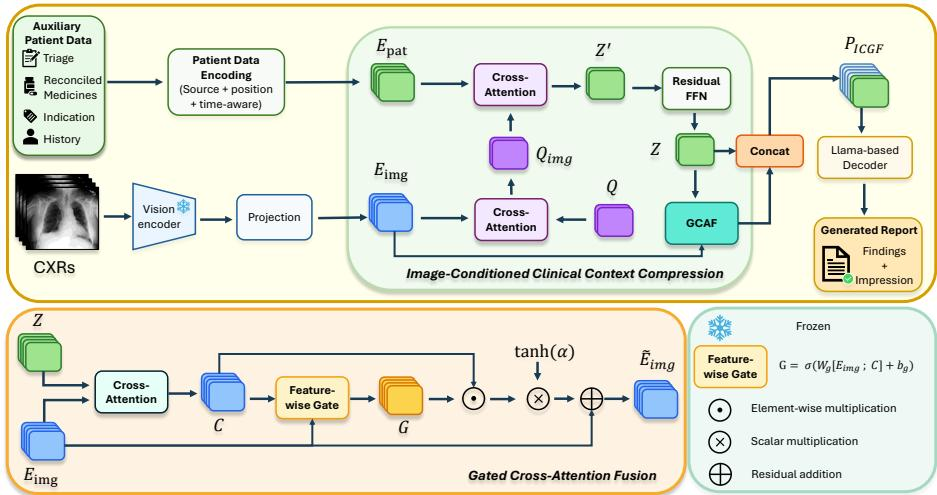
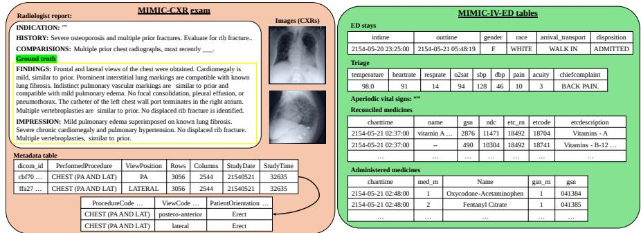
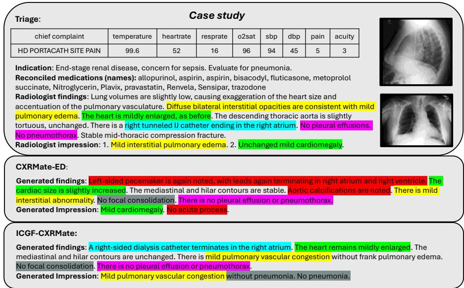

# ICGF-CXRMate: Image-Conditioned Clinical Context Compression and Gated Fusion for Chest X-ray Report Generation

Vu Minh Tran1,2,∗, Thuc Huynh1,2,∗, Son Thanh Luu1,2, Doanh C. Bui1,2

1University of Information Technology 2Viet Nam National University Ho Chi Minh City These authors contributed equally to this work

Abstract. Auxiliary patient data can improve chest X-ray report generation, but directly concatenating heterogeneous clinical information with visual tokens produces long, variable-length decoder prompts and may expose the model to redundant or image-irrelevant context. We propose ICGF-CXRMate, an image-conditioned clinical context compression and gated fusion framework. Learnable queries are first conditioned on the current chest X-ray representations and then attend to the patient-data sequence, compressing it into a fixed number of clinical context tokens. Gated cross-attention selectively integrates these tokens into the visual stream, while the compressed tokens are retained in the decoder prompt as a direct clinical pathway. Experiments on linked MIMIC-CXR and MIMIC-IV-ED examinations show that ICGF-CXRMate improves report quality while reducing the average prompt length. In Stage 2, it improves RadGraph-F1 from 24.00 to 28.86, CXR-BERT similarity from 56.86 to 62.80, and BLEU-4 from 5.14 to 7.96 compared with CXRMate-ED, while reducing the average prompt length from 373.89 to 288.37 tokens, corresponding to a 22.9% reduction. After self-critical sequence training, ICGF-CXRMate outperforms CXRMate-ED on six of eight report-quality metrics in Stage 3. Ablation studies confirm the complementary contributions of image-conditioned compression, gated fusion, and direct retention of the compressed clinical tokens.

Keywords: Radiology report generation · Chest X-ray · Multimodal learning · Clinical context compression

## 1 Introduction

Chest X-ray (CXR) report generation aims to automatically produce a radiology report from one or more images in a CXR examination. Such systems may assist radiologists and improve reporting eficiency amid increasing imaging workloads [11]. The field has progressed from conventional image-to-text models toward approaches that jointly process multiple radiographs, optimize clinical consistency, and employ radiology-specific large vision-language models [2, 5, 7, 17, 24].

Recent studies further incorporate information beyond the current radiographs. Longitudinal methods use prior examinations to model interval changes and disease progression [6, 19, 28, 30], while other approaches use the examination indication to guide generation toward patient-specific clinical concerns [16,18]. These findings show that contextual information can improve the clinical relevance of generated reports.

In clinical practice, radiologists interpret images together with presenting symptoms, examination indication, clinical history, and medication records [4]. CXRMate-ED [20] introduced a unified representation for heterogeneous patient data and identified triage, reconciled medicines, indication, and clinical history as efective inputs for CXR report generation. Following this evidence, we adopt the same four sources and focus on improving how their variable-length representations are compressed and integrated with visual tokens.

CXRMate-ED directly concatenates the complete patient-data sequence with the visual tokens, producing a decoder prompt whose length grows with the available clinical information. Larger inputs may degrade performance due to prompt growth, attention dilution, and potentially confounding auxiliary evidence [20, 25]. This motivates a mechanism that selects image-relevant clinical context and controls its influence on the visual representations.

To address these limitations, we propose ICGF-CXRMate, an image-conditioned clinical context compression and gated fusion framework. Learnable queries are conditioned on the current CXR representations and then retrieve relevant information from the patient sequence, producing a fixed number of clinical context tokens. Gated cross-attention selectively integrates this context into the visual stream, while the compressed tokens are retained as a direct clinical pathway to the decoder.

Experiments on linked MIMIC-CXR and MIMIC-IV-ED examinations show that ICGF-CXRMate reduces the average prompt length from 373.89 to 288.37 tokens, corresponding to a 22.9% reduction. In Stage 2, it improves RadGraph-F1 from 24.00 to 28.86, CXR-BERT similarity from 56.86 to 62.80, and BLEU-4 from 5.14 to 7.96 over CXRMate-ED. After self-critical sequence training, it outperforms CXRMate-ED on six of eight report-quality metrics in Stage 3.

The main contributions are as follows:

We propose an image-conditioned clinical context compression module that converts variable-length auxiliary patient data into a fixed number of radiographically relevant clinical tokens.

We introduce gated cross-attention fusion to selectively integrate the compressed context into the visual stream while preserving a direct clinical-token pathway to the decoder.

– Experiments and ablation studies demonstrate improved report quality, a 22.9% reduction in average prompt length, and consistent benefits after selfcritical sequence training.

## 2 Related Work

Chest X-ray Report Generation. CXR report generation has progressed from conventional image encoder–language decoder models toward clinically informed multimodal architectures. Semantic rewards based on clinical entities and relations improve factual completeness and consistency [5, 17], while entropyregularized self-critical sequence training reduces overfitting to common report expressions [21]. Recent approaches increasingly employ large language models, radiology-specific visual representations, and external knowledge. RaDialog supports report generation and interactive assistance, MAIRA-1 and MAIRA-2 adapt large multimodal models to CXR reporting and spatial grounding, and KARGEN incorporates disease-related knowledge graphs [2, 7, 14, 24]. These methods improve visual understanding and clinical grounding, but primarily focus on the current radiographs.

Longitudinal and Clinical Context. Longitudinal methods incorporate previous examinations to capture interval changes and disease progression. CXR-Mate processes prior images and reports, RECAP models observation progression across consecutive radiographs, and HERGen and Libra integrate historical information through visit-level or temporal alignment mechanisms [6,19,28,30]. Clinical text can also guide generation toward the purpose of the current examination. Pragmatic report generation uses the indication section, while SEI combines CXR images, similar historical cases, and patient-specific indications [16, 18]. CXRMate-ED further represents numerical, categorical, textual, temporal, and image data in a unified multimodal prompt [20]. However, it provides the complete patient-data sequence directly to the decoder, making prompt length dependent on the available records and potentially introducing confounding evidence. In contrast, our work compresses this sequence and controls its interaction with the visual representations.

Context Compression and Multimodal Fusion. Prompt-compression methods reduce input length while preserving information required for generation. LLMLingua performs coarse-to-fine token-level compression for long textual prompts [8], but does not explicitly model whether clinical context is relevant to the current radiographic evidence. Multimodal architectures also use learnable queries and latent tokens to produce compact representations. Flamingo transforms variable-sized visual inputs into a fixed number of tokens using a Perceiver Resampler and gated cross-attention [1], while BLIP-2 uses a Querying Transformer to bridge a frozen image encoder and language model [12].

ICGF-CXRMate difers in both the compressed modality and the conditioning signal. Rather than compressing visual representations or text-only prompts, it conditions learnable queries on the current CXR representations and uses them to compress heterogeneous patient data. The resulting clinical tokens are selectively fused into the visual stream while remaining directly accessible to the report decoder.

  
Fig. 1: Overview of ICGF-CXRMate. The model encodes CXR images and heterogeneous auxiliary patient data into visual and clinical representations. Image-conditioned clinical context compression (Sec. 3.2) uses image-adapted queries to summarize the variable-length patient sequence into a fixed set of clinical tokens Z. Gated cross-attention fusion (Sec. 3.3) selectively integrates the compressed context into the visual representations to obtain $\widetilde { E } _ { \mathrm { i m g } }$ . The resulting multimodal prompt $P _ { \mathrm { I C G F } } = [ Z ; \widetilde { E } _ { \mathrm { i m g } } ]$ is passed to the Llama-based decoder for report generation.

## 3 Methodology

We present ICGF-CXRMate, an extension of CXRMate-ED for chest X-ray report generation using auxiliary patient data. As illustrated in Fig. 1, the proposed method first uses radiographic evidence to guide the compression of heterogeneous clinical information and subsequently integrates the compressed context into the visual representations through gated cross-attention. This design reduces the patient-data portion of the decoder prompt while preserving direct access to both visual evidence and compact clinical context.

## 3.1 Baseline: CXRMate-ED

CXRMate-ED [20] generates radiology reports from chest radiographs and heterogeneous auxiliary patient data. Given a CXR study $\mathcal { T } = \{ I _ { s } \} _ { s = 1 } ^ { S }$ containing S images, a vision encoder followed by a layer-normalized projection produces the visual token sequence

$$
E _ { \mathrm { i m g } } = [ \pi ( f _ { \mathrm { i m g } } ( I _ { 1 } ) ) ; \dots ; \pi ( f _ { \mathrm { i m g } } ( I _ { S } ) ) ] \in \mathbb { R } ^ { L _ { \mathrm { i m g } } \times H } ,\tag{1}
$$

where $L _ { \mathrm { i m g } }$ is the total number of image tokens and H is the decoder hidden dimension. Auxiliary information, including triage, reconciled medicines, indication, and clinical history, is encoded as a variable-length patient sequence $E _ { \mathrm { p a t } } ~ \in ~ \mathbb { R } ^ { L _ { \mathrm { p a t } } \times H }$ . Numerical and categorical variables are represented using source-specific feed-forward encoders, whereas textual variables use the decoder token embeddings. Source-type and temporal embeddings are incorporated to identify the origin and temporal relevance of each clinical input.

CXRMate-ED directly concatenates the complete patient sequence with the visual tokens to form the decoder prompt:

$$
P _ { \mathrm { b a s e } } = [ E _ { \mathrm { p a t } } ; E _ { \mathrm { i m g } } ] .\tag{2}
$$

Consequently, the prompt contains $L _ { \mathrm { p a t } } + L _ { \mathrm { i m g } }$ tokens and grows with the amount of available patient information. This variable-length formulation increases the decoder input size and may expose the model to redundant or imageirrelevant clinical information.

## 3.2 Image-Conditioned Clinical Context Compression

To obtain a compact patient representation that is relevant to the current radiographic evidence, we condition a fixed set of learnable queries on the image embeddings before retrieving information from the patient sequence.

Let $Q \in \mathbb { R } ^ { K \times H }$ denote a set of K learnable clinical queries. The queries first attend to the source-aware visual representations:

$$
Q _ { \mathrm { i m g } } = \mathrm { L N } \left( Q + \mathrm { M H A } \left( \mathrm { L N } ( Q ) , E _ { \mathrm { i m g } } ^ { q } , E _ { \mathrm { i m g } } ^ { q } \right) \right) ,\tag{3}
$$

where MHA(·) denotes multi-head cross-attention, LN(·) denotes layer normalization, and $E _ { \mathrm { i m g } } ^ { q }$ denotes the visual tokens augmented with image tokentype embeddings for cross-attention, while the original $E _ { \mathrm { i m g } }$ is retained as the residual visual stream. This operation adapts the initially generic queries to the radiographic content of the current study.

The image-conditioned queries subsequently retrieve relevant information from the variable-length patient sequence:

$$
Z ^ { \prime } = \mathrm { L N } \left( Q _ { \mathrm { i m g } } + \mathrm { M H A } \left( \mathrm { L N } ( Q _ { \mathrm { i m g } } ) , E _ { \mathrm { p a t } } , E _ { \mathrm { p a t } } \right) \right) .\tag{4}
$$

The retrieved representations are further refined by a residual feed-forward block:

$$
Z = \mathrm { L N } \left( Z ^ { \prime } + \mathrm { F F N } \left( \mathrm { L N } ( Z ^ { \prime } ) \right) \right) , \qquad Z \in \mathbb { R } ^ { K \times H } ,\tag{5}
$$

where FFN(·) is a two-layer feed-forward network with SiLU activation. The resulting sequence $Z$ contains a fixed number of clinical context tokens, regardless of the original patient-data length $L _ { \mathrm { p a t } }$ . Attention masks are applied during both cross-attention operations so that padded or unavailable inputs do not contribute to the compressed representations.

Unlike direct query-based compression, the proposed module explicitly conditions the retrieval of patient information on the current radiographic evidence. Consequently, the same clinical source can be represented diferently depending on the visual findings of the corresponding study.

## 3.3 Gated Cross-Attention Fusion

To control how auxiliary clinical information influences the visual representations, we introduce a gated cross-attention module that allows each image token to selectively retrieve information from the compressed clinical context Z.

The clinical context corresponding to each visual token is first computed as

$$
C = \mathrm { M H A } \left( \mathrm { L N } ( E _ { \mathrm { i m g } } ^ { q } ) , \mathrm { L N } ( Z ) , \mathrm { L N } ( Z ) \right) , \qquad C \in \mathbb { R } ^ { L _ { \mathrm { i m g } } \times H } .\tag{6}
$$

A feature-wise gate then determines how much of the retrieved clinical context should be introduced into each dimension of the visual representation:

$$
G = \sigma \left( W _ { g } \left[ E _ { \mathrm { i m g } } ; C \right] + b _ { g } \right) ,\tag{7}
$$

where $\sigma ( \cdot )$ denotes the sigmoid function, [·; ·] denotes concatenation along the feature dimension, and $G ^ { ' } \in \mathbb { R } ^ { L _ { \mathrm { i m g } } \times H }$

The fused visual representation is defined as

$$
\widetilde { E } _ { \mathrm { i m g } } = E _ { \mathrm { i m g } } + \operatorname { t a n h } ( \alpha ) \left( G \odot C \right) ,\tag{8}
$$

where $\odot$ denotes element-wise multiplication and α is a learnable scalar residual coeficient. The coeficient is initialized as $\alpha = 0 .$ , such that tanh $. ( \alpha ) = 0$ and

$$
\widetilde { E } _ { \mathrm { i m g } } = E _ { \mathrm { i m g } }\tag{9}
$$

at initialization. The fusion module therefore behaves as an exact identity mapping at the beginning of Stage 2 training and gradually learns how strongly the clinical context should modify the pretrained visual representations.

The final multimodal prompt retains both the compressed clinical context and the fused visual tokens:

$$
P _ { \mathrm { I C G F } } = \left[ Z ; \widetilde { E } _ { \mathrm { i m g } } \right] .\tag{10}
$$

The resulting prompt contains $K + L _ { \mathrm { i m g } }$ tokens, compared with $L _ { \mathrm { p a t } } + L _ { \mathrm { i m g } }$ tokens in CXRMate-ED. Retaining $Z$ provides the decoder with direct access to the compact patient context, while $\bar { E } _ { \mathrm { i m g } }$ provides visual features selectively enhanced by the same clinical information.

A Llama-based decoder autoregressively generates the Findings and Impression sections as a single sequence separated by a dedicated section token. The multimodal prompt uses non-causal attention, whereas causal masking is applied to the generated report tokens.

## 3.4 Training Objectives

The model is trained in three stages. In Stage 1, the vision encoder, imageprojection module, and language decoder are trained using CXR images only. In Stage 2, the proposed model is initialized from the best Stage 1 checkpoint and extended with the patient-data encoders, image-conditioned compressor, and gated fusion module. The UniFormer backbone is frozen during Stage 2, while the remaining modules are optimized.

Stages 1 and 2 use teacher forcing with token-level negative log-likelihood:

$$
\mathcal { L } _ { \mathrm { T F } } = - \sum _ { t = 1 } ^ { T } \log p _ { \theta } \left( y _ { t } \mid y _ { < t } , P \right) ,\tag{11}
$$

where $Y = ( y _ { 1 } , \dots , y _ { T } )$ is the reference report, $P = E _ { \mathrm { i m g } }$ in Stage 1, and $P = P _ { \mathrm { I C G F } }$ in Stage 2.

In Stage 3, the model is initialized from the Stage 2 checkpoint and further optimized using self-critical sequence training to improve report quality. The model generates a sampled report $\widehat { Y } ^ { s }$ , while a greedily decoded report $\widehat { Y } ^ { g }$ is used as the baseline. The reinforcement-learning objective is defined as

$$
\mathcal { L } _ { \mathrm { R L } } = - \left[ r \left( \widehat { Y } ^ { s } , Y \right) - r \left( \widehat { Y } ^ { g } , Y \right) \right] \sum _ { t = 1 } ^ { \widehat { T } } \log p _ { \theta } \left( \widehat { y } _ { t } ^ { s } \mid \widehat { y } _ { < t } ^ { s } , P _ { \mathrm { I C G F } } \right) ,\tag{12}
$$

where $\widehat { T }$ is the length of the sampled report and $r ( \cdot )$ denotes the report-level reward. Since the Findings and Impression sections have diferent reporting functions, the reward is computed separately for the two sections and combined using section-specific weights:

$$
r \left( \widehat { Y } , Y \right) = \alpha _ { f } r _ { f } \left( \widehat { Y } _ { f } , Y _ { f } \right) + \alpha _ { i } r _ { i } \left( \widehat { Y } _ { i } , Y _ { i } \right) ,\tag{13}
$$

where subscripts $f$ and i denote the Findings and Impression sections, respectively. For each section $j \in \{ f , i \}$ , the composite reward is defined as

$$
r _ { j } \left( \widehat { Y } _ { j } , Y _ { j } \right) = \lambda _ { 1 } \mathrm { C B } \left( \widehat { Y } _ { j } , Y _ { j } \right) + \lambda _ { 2 } \mathrm { B S } \left( \widehat { Y } _ { j } , Y _ { j } \right) + \lambda _ { 3 } \mathrm { A R N } \left( \widehat { Y } _ { j } \right) ,\tag{14}
$$

where CB, BS, and ARN denote CXR-BERT similarity, BERTScore, and the absence of repeated n-grams, respectively.

## 4 Experiments

## 4.1 Datasets

We use a CXR report generation dataset constructed from two publicly available sources, MIMIC-CXR and MIMIC-IV-ED [9, 10]. Chest X-ray exams from MIMIC-CXR are linked with the corresponding emergency department records from MIMIC-IV-ED to provide additional clinical context for report generation [20]. Each sample consists of one or more CXR images from the same examination, the reference radiology report, and four auxiliary patient-data sources: triage, reconciled medicines, indication, and clinical history. We adopt these sources following CXRMate-ED [20], whose source-wise evaluation identified them as efective inputs and showed that their combination without prior examinations achieved the strongest overall performance among the evaluated patientdata configurations. We only include CXR exams performed within the time interval of an ED stay and remove events occurring after the imaging time [20]. After preprocessing, the train/validation/test splits contain 76,398/556/958 exams, respectively. The task is to generate the two main sections of a radiology report: Findings, which describes detailed observations from the images, and Impression, which summarizes the key clinical conclusions. An example of a linked CXR examination and its corresponding ED record is shown in Fig. 2.

  
Fig. 2: Example of a linked MIMIC-CXR examination and MIMIC-IV-ED stay. The left panel shows the CXR images, radiologist report, and image metadata, while the right panel shows the associated ED stay, triage, vital-sign, and medication records. The Findings and Impression sections are used as the report-generation targets.

## 4.2 Metrics

We evaluate generated reports using two groups of metrics. Clinical metrics include RadGraph-F1 (RG) [5] for clinical entity and relation overlap, CheXbert-F1 (CX) [26] for pathology-label agreement, CXR-BERT similarity (CB) [3] for clinical semantic similarity, and GREEN (G) [22] for clinically significant errors. Language generation metrics include BERTScore-F1 (BS) [29] for semantic similarity, ROUGE-L (R-L) [15] for longest-common-subsequence overlap, and BLEU-4 (B4) [23] for n-gram overlap. We additionally report Absence of Repeated N-grams [20] (ARN) to measure repetition avoidance, and the average prompt length to assess compression eficiency.

## 4.3 Implementation Details

Our implementation follows CXRMate-ED and uses the architecture shown in Fig. 1. We implement ICGF-CXRMate with UniFormer [13] as the image encoder and a Llama-based decoder [27] as the language decoder. The model is trained in three stages, as described in Section 3.4. Stage 1 and Stage 2 are trained for 10 epochs, while Stage 3 is trained for 5 epochs. In Stage 2, we use CXR images together with clinical information, including triage, reconciled medicines, indication, and history; the image encoder is frozen to focus on learning patientdata-related components. In Stage 3, the reward weights are set to $\lambda _ { 1 } = 0 . 4 5$ $\lambda _ { 2 } ~ = ~ 0 . 4 5 , ~ \lambda _ { 3 } ~ = ~ 0 . 1 0 , ~ \alpha _ { f } ~ = ~ 0 . 7 5$ , and $\alpha _ { i } ~ = ~ 0 . 2 5$ . The model is optimized using AdamW with a learning rate of $5 \times 1 0 ^ { - 5 }$ for Stage 1 and Stage 2, and $5 \times 1 0 ^ { - 6 }$ for Stage 3. The proposed image-conditioned compressor uses $K = 1 6$ learnable queries and eight-head cross-attention to produce fixed-length clinical context tokens, which are integrated with the visual representations through an eight-head gated cross-attention module. All experiments are conducted on an NVIDIA L40 (46GB) GPU.

## 5 Main Results

Table 1 reports report-level performance on the combined Findings and Impression sections. For CXRMate-ED, incorporating auxiliary patient data in Stage 2 improves several metrics over the image-only Stage 1 model, including CB from 53.85 to 56.86 and BLEU-4 from 4.26 to 5.14. However, direct concatenation increases the average prompt length by 119.23 tokens, from 254.66 to 373.89, illustrating the additional input cost of the complete patient-data sequence.

In Stage 2, ICGF-CXRMate outperforms CXRMate-ED across all seven clinical and language-generation metrics. In particular, it improves RG from 24.00 to 28.86, CB from 56.86 to 62.80, BS from 21.47 to 25.82, and BLEU-4 from 5.14 to 7.96. Meanwhile, the average prompt length decreases from 373.89 to 288.37 tokens, corresponding to a reduction of 85.52 tokens, or 22.9%, with only a small decrease in ARN from 96.18 to 95.69. These results show that the proposed compression and fusion mechanisms improve report quality while substantially reducing the decoder input.

After self-critical sequence training in Stage 3, ICGF-CXRMate outperforms CXRMate-ED on six of eight report-quality metrics while preserving the shorter prompt. The largest improvements are observed in RG, GREEN, ROUGE-L, and BLEU-4, whereas CX and ARN are slightly lower. This indicates that the proposed architecture remains efective under sequence-level optimization, although small trade-ofs remain in pathology classification agreement and repetition avoidance.

## 5.1 Additional Analysis

Component Ablation Img.-cond. indicates whether the queries are conditioned on the CXR representations before retrieving patient information. Gated

Table 1: Report-level performance on the combined Findings and Impression sections. Best results within each training stage are shown in bold.
<table><tr><td>Method</td><td>RG↑</td><td>CX↑</td><td>CB↑</td><td>G↑</td><td>BS↑</td><td>R-L↑</td><td></td><td></td><td>B4↑ ARN↑ Prompt</td></tr><tr><td colspan="10">Stage 1: Images only</td></tr><tr><td>CXRMate-ED</td><td>23.46</td><td>27.16</td><td>53.85</td><td>31.44</td><td>20.25</td><td>24.44</td><td>4.26</td><td>95.00</td><td>254.66</td></tr><tr><td colspan="10">Stage 2: Images + triage, reconciled medicines, indication, and history</td></tr><tr><td>CXRMate-ED</td><td>24.00</td><td>27.32</td><td>56.86</td><td>32.75</td><td>21.47</td><td>25.46</td><td>5.14</td><td>96.18</td><td>373.89</td></tr><tr><td>ICGF-CXRMate (Ours)</td><td>28.86</td><td>30.90</td><td>62.80</td><td>35.25</td><td>25.82</td><td>28.43</td><td>7.96</td><td>95.69</td><td>288.37</td></tr><tr><td colspan="10">Stage 3: Reinforcement learning from Stage 2</td></tr><tr><td>CXRMate-ED</td><td>30.12</td><td>32.61</td><td>73.07</td><td>36.53</td><td>29.08</td><td>26.51</td><td>4.29</td><td></td><td>373.89</td></tr><tr><td>ICGF-CXRMate (Ours) 33.90</td><td></td><td>32.34</td><td>74.12</td><td>40.00</td><td>32.07</td><td>31.49</td><td>8.02</td><td>95.89 95.15</td><td>288.37</td></tr></table>

Table 2: Component ablation on the combined Findings and Impression sections in Stage 2. Best and second-best results are shown in bold and underlined, respectively.
<table><tr><td>Img.-cond.</td><td>Gated Fusion</td><td>Direct Z</td><td>RG↑</td><td>CX↑</td><td>CB↑</td><td>G↑</td><td>BS↑</td><td>R-L↑</td><td>B4↑</td><td>ARN↑</td><td>Prompt</td></tr><tr><td>×</td><td>×</td><td>√</td><td>28.39</td><td>28.99</td><td>60.75</td><td>34.70</td><td>25.35</td><td>28.15</td><td>8.13</td><td>95.54</td><td>288.37</td></tr><tr><td>√</td><td>×</td><td>√</td><td>24.58</td><td>26.39</td><td>55.82</td><td>32.99</td><td>21.97</td><td>25.81</td><td>5.19</td><td>95.09</td><td>288.37</td></tr><tr><td>×</td><td>√</td><td>√</td><td>28.35</td><td>30.79</td><td>59.41</td><td>34.28</td><td>25.48</td><td>28.10</td><td>7.74</td><td>95.86</td><td>288.37</td></tr><tr><td>√</td><td>√</td><td>×</td><td>25.84</td><td>28.84</td><td>53.06</td><td>34.94</td><td>22.62</td><td>26.52</td><td>5.54</td><td>95.42</td><td>272.37</td></tr><tr><td>√</td><td>√</td><td>√</td><td>28.86</td><td>30.90</td><td>62.80</td><td>35.25</td><td>25.82</td><td>28.43</td><td>7.96</td><td>95.69</td><td>288.37</td></tr></table>

Fusion indicates whether Z updates the visual tokens through gated crossattention, while Direct Z indicates whether Z is also included as a separate token sequence in the decoder prompt. Therefore, disabling Direct Z removes only the direct clinical-token pathway; Z may still influence the decoder through the fused visual tokens. Table 2 shows that the full model achieves the best overall performance, confirming the complementary roles of image conditioning and gated fusion. Removing Direct Z shortens the prompt by 16 tokens but substantially reduces several metrics. This indicates that the direct clinical-token pathway complements the indirect pathway through the fused visual representations.

Efect of the Number of Clinical Context Tokens Table 3 shows that K = 16 provides the best overall trade-of, achieving the highest scores on six metrics with a relatively compact prompt. Although K = 8 yields the shortest prompt and the best GREEN and ARN scores, it performs worse on most other metrics. Increasing K to 32 or 48 lengthens the prompt without consistent improvements, although K = 48 obtains the highest BLEU-4 score. We therefore use K = 16 in the final model.

Qualitative Case Study As shown in Fig. 3, the patient presented with endstage renal disease and pain at the hemodialysis catheter site. CXRMate-ED hallucinated a left-sided pacemaker and failed to capture the acute interstitial abnormality. In contrast, ICGF-CXRMate correctly identified the right-sided dialysis catheter terminating in the right atrium and preserved the finding of mild cardiomegaly. It also detected mild pulmonary vascular congestion, although this only partially matched the reference finding of mild interstitial pulmonary edema. Overall, this case demonstrates that image-conditioned clinical context improves examination-relevant device identification and cardiopulmonary interpretation.

Table 3: Efect of the number of clinical context tokens K on the combined Findings and Impression sections in Stage 2. Prompt denotes the average number of input prompt tokens. Best and second-best results are shown in bold and underline, respectively.
<table><tr><td>No. Tokens</td><td>RG↑</td><td>CX↑</td><td>CB↑</td><td>G↑</td><td>BS↑</td><td>R-L↑</td><td>B4↑</td><td>ARN↑</td><td>Prompt</td></tr><tr><td> $K = 8$ </td><td>25.56</td><td>26.40</td><td>52.93</td><td>35.53</td><td>22.85</td><td>25.98</td><td>5.19</td><td>96.71</td><td>280.37</td></tr><tr><td> $K = 1 6$ </td><td>28.86</td><td>30.90</td><td>62.80</td><td>35.25</td><td>25.82</td><td>28.43</td><td>7.96</td><td>95.69</td><td>288.37</td></tr><tr><td> $K = 3 2$ </td><td>27.81</td><td>28.82</td><td>59.13</td><td>34.13</td><td>25.16</td><td>27.88</td><td>7.57</td><td>95.87</td><td>304.37</td></tr><tr><td> $K = 4 8$ </td><td>28.50</td><td>30.88</td><td>60.58</td><td>34.26</td><td>25.64</td><td>28.12</td><td>8.13</td><td>95.55</td><td>320.37</td></tr></table>

## 6 Conclusion

We introduced ICGF-CXRMate, a framework for incorporating heterogeneous auxiliary patient data into chest X-ray report generation through image-conditioned clinical context compression and gated cross-attention fusion. The proposed compressor transforms variable-length patient information into a fixed number of radiographically relevant clinical tokens, while gated fusion selectively integrates this context into the visual representations. Retaining both the compressed clinical tokens and the fused visual tokens provides complementary direct and indirect clinical pathways to the language decoder.

Experiments on linked MIMIC-CXR and MIMIC-IV-ED examinations demonstrate that ICGF-CXRMate improves report quality while reducing the average prompt length by 22.9% compared with CXRMate-ED. The model also outperforms CXRMate-ED on six of eight report-quality metrics after self-critical sequence training. Ablation studies confirm the complementary roles of image conditioning, gated fusion, and direct retention of the compressed clinical context. The current evaluation is limited to the linked MIMIC benchmark and does not include external validation. Future work will investigate adaptive compression and evaluation on multi-institutional datasets.

## References

1. Alayrac, J.B., Donahue, J., Luc, P., Miech, A., Barr, I., Hasson, Y., Lenc, K., Mensch, A., Millican, K., Reynolds, M., Ring, R., Rutherford, E., Cabi, S., Han,

  
Fig. 3: Case study comparing CXRMate-ED and ICGF-CXRMate (K = 16).

T., Gong, Z., Samangooei, S., Monteiro, M., Menick, J., Borgeaud, S., Brock, A., Nematzadeh, A., Sharifzadeh, S., Binkowski, M., Barreira, R., Vinyals, O., Zisserman, A., Simonyan, K.: Flamingo: A visual language model for few-shot learning. In: Advances in Neural Information Processing Systems. vol. 35, pp. 23716–23736 (2022)

2. Bannur, S., Bouzid, K., Castro, D.C., Schwaighofer, A., Thieme, A., Bond-Taylor, S., Ilse, M., Pérez-García, F., Salvatelli, V., Sharma, H., Meissen, F., Ranjit, M., Srivastav, S., Gong, J., Codella, N.C.F., Falck, F., Oktay, O., Lungren, M.P., Wetscherek, M.T., Alvarez-Valle, J., Hyland, S.L.: MAIRA-2: Grounded radiology report generation. arXiv preprint arXiv:2406.04449 (2024)

3. Boecking, B., Usuyama, N., Bannur, S., Castro, D.C., Schwaighofer, A., Hyland, S., Wetscherek, M., Naumann, T., Nori, A., Alvarez-Valle, J., Poon, H., Oktay, O.: Making the most of text semantics to improve biomedical vision–language processing. In: European Conference on Computer Vision. pp. 1–21 (2022)

4. Castillo, C., Stefens, T., Sim, L., Cafery, L.: The efect of clinical information on radiology reporting: a systematic review. J. Med. Radiat. Sci. 68(1), 60–74 (2021)

5. Delbrouck, J.B., Chambon, P., Bluethgen, C., Tsai, E., Almusa, O., Langlotz, C.: Improving the factual correctness of radiology report generation with semantic rewards. In: Proceedings of the 2022 Conference on Empirical Methods in Natural Language Processing. pp. 4348–4360 (2022)

6. Hou, W., Cheng, Y., Xu, K., Li, W., Liu, J.: RECAP: Towards precise radiology report generation via dynamic disease progression reasoning. In: Findings of the Association for Computational Linguistics: EMNLP 2023. pp. 2134–2147. Association for Computational Linguistics (2023). https://doi.org/10.18653/v1/2023.findingsemnlp.140

7. Hyland, S.L., Bannur, S., Bouzid, K., Castro, D.C., Ranjit, M., Schwaighofer, A., Pérez-García, F., Salvatelli, V., Srivastav, S., Thieme, A., Codella, N.C.F., Lungren, M.P., Wetscherek, M.T., Oktay, O., Alvarez-Valle, J.: MAIRA-1: A specialised large multimodal model for radiology report generation. arXiv preprint arXiv:2311.13668 (2023)

8. Jiang, H., Wu, Q., Lin, C.Y., Yang, Y., Qiu, L.: LLMLingua: compressing prompts for accelerated inference of large language models. In: Proceedings of the 2023 Conference on Empirical Methods in Natural Language Processing. pp. 13358– 13376 (2023)

9. Johnson, A., Bulgarelli, L., Pollard, T., Celi, L.A., Mark, R., Horng, S.: MIMIC-IV-ED (2023), physioNet

10. Johnson, A.E.W., Pollard, T.J., Berkowitz, S.J., Greenbaum, N.R., Lungren, M.P., Deng, C.Y., Mark, R.G., Horng, S.: MIMIC-CXR, a de-identified publicly available database of chest radiographs with free-text reports. Sci. Data 6, 317 (2019). https://doi.org/10.1038/s41597-019-0322-0

11. Jones, C.M., Buchlak, Q.D., Oakden-Rayner, L., Milne, M., Seah, J., Esmaili, N., Hachey, B.: Chest radiographs and machine learning—past, present and future. J. Med. Imaging Radiat. Oncol. 65(5), 538–544 (2021)

12. Li, J., Li, D., Savarese, S., Hoi, S.: BLIP-2: Bootstrapping language-image pretraining with frozen image encoders and large language models. In: Proceedings of the 40th International Conference on Machine Learning. Proceedings of Machine Learning Research, vol. 202, pp. 19730–19742. PMLR (2023)

13. Li, K., Wang, Y., Zhang, J., Gao, P., Song, G., Liu, Y., Li, H., Qiao, Y.: UniFormer: unifying convolution and self-attention for visual recognition. IEEE Trans. Pattern Anal. Mach. Intell. 45(10), 12581–12600 (2023)

14. Li, Y., Wang, Z., Liu, Y., Wang, L., Liu, L., Zhou, L.: KARGEN: Knowledgeenhanced automated radiology report generation using large language models. In: Medical Image Computing and Computer Assisted Intervention – MICCAI 2024. pp. 382–392. Springer (2024). https://doi.org/10.1007/978-3-031-72086-4\_36

15. Lin, C.Y.: ROUGE: a package for automatic evaluation of summaries. In: Text Summarization Branches Out. pp. 74–81 (2004)

16. Liu, K., Ma, Z., Kang, X., Zhong, Z., Jiao, Z., Baird, G., Bai, H., Miao, Q.: Structural entities extraction and patient indications incorporation for chest x-ray report generation. In: Medical Image Computing and Computer Assisted Intervention – MICCAI 2024. Lecture Notes in Computer Science, vol. 15003, pp. 433–443. Springer (2024). https://doi.org/10.1007/978-3-031-72384-1\_41

17. Miura, Y., Zhang, Y., Tsai, E., Langlotz, C., Jurafsky, D.: Improving factual completeness and consistency of image-to-text radiology report generation. In: Proceedings of the 2021 Conference of the North American Chapter of the Association for Computational Linguistics. pp. 5288–5304 (2021)

18. Nguyen, D., Chen, C., He, H., Tan, C.: Pragmatic radiology report generation. In: Proceedings of the 3rd Machine Learning for Health Symposium. pp. 385–402 (2023)

19. Nicolson, A., Dowling, J., Anderson, D., Koopman, B.: Longitudinal data and a semantic similarity reward for chest X-ray report generation. Inform. Med. Unlocked 50, 101585 (2024)

20. Nicolson, A., Zhuang, S., Dowling, J., Koopman, B.: The impact of auxiliary patient data on automated chest X-ray report generation and how to incorporate it. In: Proceedings of the 63rd Annual Meeting of the Association for Computational Linguistics. vol. 1, pp. 177–203 (2025)

21. Nicolson, A., Liu, J., Dowling, J., Nguyen, A., Koopman, B.: e-health CSIRO at RRG24: Entropy-augmented self-critical sequence training for radiology report generation. In: Proceedings of the 23rd Workshop on Biomedical Natural Language Processing. pp. 99–104. Association for Computational Linguistics (2024). https://doi.org/10.18653/v1/2024.bionlp-1.8

22. Ostmeier, S., Xu, J., Chen, Z., Varma, M., Blankemeier, L., Bluethgen, C., Michalson, A.E., Moseley, M., Langlotz, C., Chaudhari, A.S., Delbrouck, J.B.: GREEN: generative radiology report evaluation and error notation. In: Findings of the Association for Computational Linguistics: EMNLP. pp. 374–390 (2024)

23. Papineni, K., Roukos, S., Ward, T., Zhu, W.J.: BLEU: a method for automatic evaluation of machine translation. In: Proceedings of the 40th Annual Meeting of the Association for Computational Linguistics. pp. 311–318 (2002)

24. Pellegrini, C., Özsoy, E., Busam, B., Navab, N., Keicher, M.: RaDialog: A large vision-language model for radiology report generation and conversational assistance. arXiv preprint arXiv:2311.18681 (2023)

25. Qin, Z., Han, X., Sun, W., Li, D., Kong, L., Barnes, N., Zhong, Y.: The devil in linear transformer. In: Proceedings of the 2022 Conference on Empirical Methods in Natural Language Processing. pp. 7025–7041 (2022)

26. Smit, A., Jain, S., Rajpurkar, P., Pareek, A., Ng, A., Lungren, M.: Combining automatic labelers and expert annotations for accurate radiology report labeling using BERT. In: Proceedings of the 2020 Conference on Empirical Methods in Natural Language Processing. pp. 1500–1519 (2020)

27. Touvron, H., Lavril, T., Izacard, G., Martinet, X., Lachaux, M.A., Lacroix, T., Roziere, B., Goyal, N., Hambro, E., Azhar, F., Rodriguez, A., Joulin, A., Grave, E., Lample, G.: LLaMA: open and eficient foundation language models (2023), preprint at https://arxiv.org/abs/2302.13971

28. Wang, F., Du, S., Yu, L.: HERGen: Elevating radiology report generation with longitudinal data. In: Computer Vision – ECCV 2024. Lecture Notes in Computer Science, vol. 15113, pp. 183–200. Springer (2025). https://doi.org/10.1007/978-3- 031-73001-6\_11

29. Zhang, T., Kishore, V., Wu, F., Weinberger, K.Q., Artzi, Y.: BERTScore: evaluating text generation with BERT. In: International Conference on Learning Representations (2020)

30. Zhang, X., Meng, Z., Lever, J., Ho, E.S.L.: Libra: Leveraging temporal images for biomedical radiology analysis. In: Findings of the Association for Computational Linguistics: ACL 2025. pp. 17275–17303. Association for Computational Linguistics (2025). https://doi.org/10.18653/v1/2025.findings-acl.888