# Learning from Next-Frame Prediction: Towards Unified and Scalable Visual Representation Learning

Yifeng Yao1,2, Jinghan Li2, Zhihao Zhang2,3, Yajiao Xiong1,2, Yang Jin2,∗, Kun Xu2,∗, Huishuai Zhang1, Dongyan Zhao1

1Peking University 2ByteDance 3UNC-Chapel Hill

## Abstract

Video provides a natural source of supervision: what happens next serves as a learning signal for visual world modeling. Yet masked video pretraining focuses on recovering missing content from surrounding context rather than predicting the future from the past. Autoregressive methods instead predict forward one token at a time, but have yet to match joint-embedding methods in representation quality. This gap motivates us to revisit the granularity and space of future prediction. In this work, we introduce VANE, a self-supervised visual pretraining framework built on next-frame prediction in embedding space. A causal encoder summarizes past observations for a state predictor that infers the representation of the entire next frame, making temporal evolution the primary learning signal. This prediction is carried out in a fixed embedding space provided by a frozen semantic tokenizer, emphasizing scene content and structure. To retain fine-grained spatial detail alongside semantic content, a lightweight auxiliary generative decoder reconstructs future-frame patches conditioned on the predicted representations. To unify visual modeling across images and videos, we construct a local-to-global crop sequence for still images, allowing the same encoder to predict newly revealed regions from earlier crops under the same objective. Experiments show that VANE improves with model and data scaling, achieving SOTA on most anticipation, recognition, and dense perception benchmarks among unified encoders. Especially on EPIC-KITCHENS-100 action anticipation, it surpasses V-JEPA 2.1 by 7.1 points in mean-class recall@5. These results demonstrate that next-frame prediction in embedding space is efective and scalable for visual world modeling.

## 1. Introduction

Humans come to understand the world by watching it unfold, mapping a continuous stream of sensory input into a stable sense of objects, motion, and events. What they acquire is not merely a catalogue of appearances, but an internal model of how the world evolves (Rao and Ballard, 1999; LeCun, 2022): what a scene contains, what is happening within it, and what is likely to happen next. Video captures the world in precisely this form, with temporal order providing a natural learning signal that requires no annotation. Predicting what comes next therefore requires a model to represent both the appearance and the dynamics of the visual world.

Yet most video retrainin methods do not learn b redictin what comes next. Masked video mod- els (Feichtenhofer et al., 2022), such as VideoMAE (Tong et al., 2022), hide a large fraction of spatiotemporal patches and reconstruct their pixels from the visible ones (He et al., 2022). Joint-embedding methods (Assran et al., 2023), such as V-JEPA (Bardes et al., 2024; Assran et al., 2025), likewise mask part of the video, but predict representations of the masked regions instead of their pixels (Fig. 1a). Both remain forms of contextual recover : the model infers what is missin from surroundin observations rather than redictin the future from the past. Autoregressive pretraining (Chen et al., 2020; El-Nouby et al., 2024), extended to video by Toto (Rajasegaran et al., 2025), instead predicts forward in time by treating video as a sequence of visual tokens and learning through next-token prediction. While viable and scalable, this formulation has not matched joint-embedding methods in representation quality (Rajasegaran et al., 2025). This raises a central question: at what granularity, and in what space, should the future be predicted?

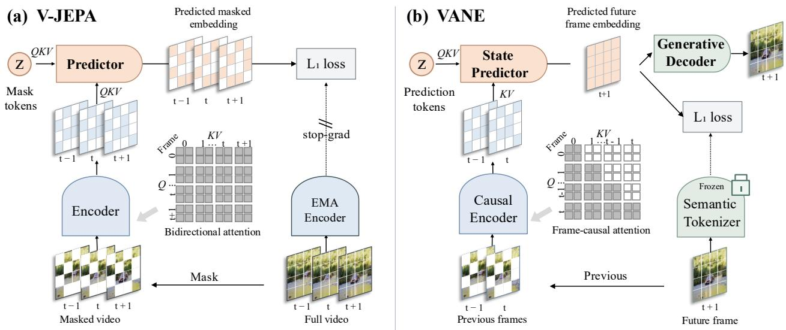  
Figure 1 | From masked completion to next-frame prediction in embedding space. (a) V-JEPA masks part of a clip, encodes the visible patches with bidirectional attention, and predicts the embeddings of the masked regions, supervised by an EMA encoder of the full video. (b) VANE encodes previous frames with frame-causal attention and predicts the embedding of the entire next frame from them, with targets from a frozen semantic tokenizer. An auxiliary generative decoder, used only during pretraining, regularizes the predicted embedding to retain fine-grained spatial detail.

In this work, we answer this question with VANE, a self-supervised visual pretraining framework built on next-frame prediction in embedding space. S ecificall , VANE shifts rediction from individual tokens to the frame level and performs it in a semantic representation space. At the frame level, the distinction between spatial and temporal structure becomes explicit: structure within a frame is largely spatial, whereas changes across consecutive frames capture how objects, actions, and scenes evolve over time. Frame-level prediction therefore places temporal evolution at the center of the learning objective, rather than devoting much of the objective to completing individual tokens within the same frame. Additionally, prediction is carried out in semantic embedding space, building on the principle of joint-embedding learning (Assran et al., 2023; Bardes et al., 2024). Semantic representations emphasize the higher-level content and structure of a scene, allowing the model to focus on the aspects of the visual world that persist and evolve over time.

We instantiate this objective with four com onents (Fi . 1b). A causal encoder summarizes the observed history through frame-causal attention, with each frame attending only to itself and preceding frames. From this temporal context, a state predictor infers the representation of the next frame. A frozen semantic tokenizer, implemented as a pretrained image encoder (Oquab et al., 2024), provides a fixed semantic space in which future scene content and structure are predicted. As in generative models operating in fixed latent spaces (Rombach et al., 2022), we keep the tokenizer frozen to provide fixed prediction targets and support stable optimization. Finally, a lightweight generative decoder reconstructs each future-frame patch conditioned on its predicted embedding. This auxiliary reconstruction objective complements semantic prediction by encouraging the model to learn representations that preserve fine-grained spatial detail.

To unify visual modeling across images and videos, we extend the same predictive objective to still images. Unlike videos, still images lack a temporal order, so we introduce local-to-global observation: each image is presented as a sequence of local-to-global crops, and the model predicts representations of newly revealed regions in the next crop from preceding crops, just as it predicts the next frame from preceding frames in video. This enables joint image–video training, yielding a unified visual encoder without separate pretraining stages or modality-specific objectives.

Extensive experiments demonstrate that VANE unifies predictive and perceptual understanding within a single pretrained visual model. VANE achieves state-of-the-art performance among unified image–video encoders on most evaluated benchmarks spanning anticipation, global recognition, and dense perception. On EPIC-KITCHENS-100 (Damen et al., 2022), VANE achieves 45.5 action mean-class recall@5, improving over

V-JEPA 2.1 (Mur-Labadia et al., 2026) by 7.1 points. Beyond its broad transferability, VANE scales consistently with both model capacity and pretraining data. Together, these results establish next-frame prediction in embedding space as a unified and scalable pretraining paradigm for visual foundation models.

Our contributions are as follows:

• We formulate visual pretraining as next-frame prediction in embedding space. Instead of completing masked content or reconstructing pixels, the model predicts the semantic embedding of the next frame from past frames, learnin directl from how scenes evolve over time.

• We instantiate this objective by combining a causal encoder–predictor, a semantic tokenizer, and auxiliary generative decoding, then extend it to images through local-to-global observation for unified and scalable image–video pretraining.

• We demonstrate that next-frame prediction in embedding space is an efective and scalable visual pretraining paradigm, achieving state-of-the-art performance among unified encoders across most anticipation, global recognition, and dense perception benchmarks.

## 2. Related Work

Masked visual pretraining. Masked visual pretraining learns representations by recovering content withheld from an observation. Building on masked autoencoding (He et al., 2022), VideoMAE (Tong et al., 2022; Wang et al., 2023a) and MAE-ST (Feichtenhofer et al., 2022) reconstruct masked spatiotemporal patches in pixel space, while the InternVideo series (Wang et al., 2022, 2024, 2025) incorporates masked modeling into broader video pretraining frameworks. The Joint-Embedding Predictive Architecture (JEPA) (LeCun, 2022) formulates prediction in representation space rather than pixel space. I-JEPA (Assran et al., 2023) instantiates this principle for images, while the V-JEPA family (Bardes et al., 2024; Assran et al., 2025; Mur-Labadia et al., 2026) extends it to video, scaling masked feature prediction and improving global and dense representations. Related methods distill pretrained visual features (Wang et al., 2023b; Li et al., 2023b), and Rethinking JEPA (Li et al., 2026) shows that a frozen target encoder can support efective masked latent prediction. InternVideo-Next (Wang et al., 2026) combines semantic alignment, generative reconstruction, and fixed-target feature prediction within a two-stage masked modeling framework. Despite diferences in target construction and supervision, these pretraining objectives remain centered on recovering or matching content within the observed clip rather than explicitly predicting its temporal continuation. By predicting future-frame embeddings from past observations, VANE makes temporal evolution central to pretraining while preserving fine-grained spatial structure through auxiliary reconstruction.

Autoregressive and predictive visual learning. Autoregressive visual pretraining depends on how visual observations are represented and ordered. iGPT (Chen et al., 2020) and AIM (El-Nouby et al., 2024) predict pixels or patches, while Toto (Rajasegaran et al., 2025) learns from images and videos through next-token prediction over discrete visual codes. Alternative formulations vary the prediction order, granularity, or target space: ARVideo (Ren et al., 2025) randomizes spatiotemporal ordering, VAR (Tian et al., 2024) predicts progressively finer-resolution token maps, and NEPA (Xu et al., 2025) predicts successive image patch embeddings with stop-gradient targets. A complementary line learns from future visual features through regression (Vondrick et al., 2016) or contrastive objectives (van den Oord et al., 2018; Han et al., 2019). More recently, DINO-Foresight (Karypidis et al., 2025) and DINO-world (Baldassarre et al., 2025) forecast future features for scene understanding, while DINO-WM (Zhou et al., 2025) uses action-conditioned feature prediction for planning. Causal-JEPA (Nam et al., 2026) explores object-level latent masking to learn interaction-aware dynamics. These recent world models learn prediction on top of pretrained visual encoders that remain fixed during dynamics learnin . VANE instead uses next-frame embeddin rediction to train the causal encoder itself extendin the same objective to unified image–video pretraining through local-to-global image views.

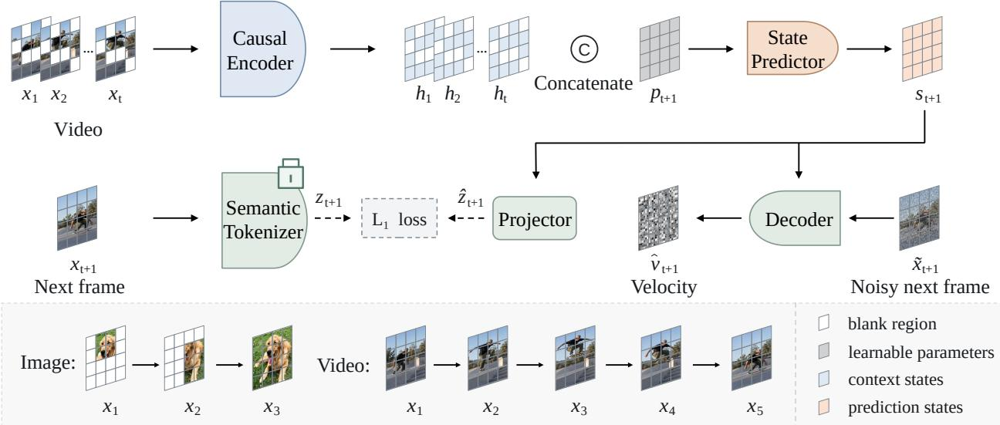  
Figure 2 | Overview of VANE. VANE predicts the embedding of the next frame from the frames observed so far. Top: the causal encoder maps the observed frames $x _ { 1 } , \ldots , x _ { t }$ to context states $h _ { 1 } , \ldots , h _ { t } ,$ , which are concatenated with prediction tokens $p _ { t + 1 } ;$ the state predictor uses the context states only as keys and values and outputs the predicted state $s _ { t + 1 }$ . Middle: a projector maps $s _ { t + 1 }$ to the embedding space of the frozen semantic tokenizer, where it is supervised by the embedding of the next frame $x _ { t + 1 }$ with an $L _ { 1 }$ loss; the generative decoder, conditioned on $s _ { t + 1 }$ , predicts the flow velocity $\hat { \upsilon } _ { t + 1 }$ from the noisy next frame $\tilde { x } _ { t + 1 }$ . Bottom: images are presented as local-to-global crops and videos as frame sequences, so both share the same objective.

## 3. Method

This section presents VANE (Fig. 2). We first formulate next-frame prediction in embedding space (Sec. 3.1). Realizing this objective raises three questions, which we address in turn: how to encode the observed frames without access to the future (Sec. 3.2), how to predict the next frame from this encoding (Sec. 3.3), and how to retain the fine-grained spatial detail that semantic targets abstract away (Sec. 3.4). Finally, we extend the objective to still images, which lack temporal order, for unified image–video pretraining (Sec. 3.5).

## 3.1. Next-Frame Prediction in Embedding Space

To make temporal evolution the primary learning signal, VANE learns by predicting what comes next. Given a video clip $( x _ { 1 } , \ldots , x _ { N } )$ of � frames, the model predicts each frame $x _ { t + 1 }$ from the frames observed so far, $x _ { \leq t } .$ Every transition in the clip thus provides supervision, and each intermediate frame serves both as a target given its predecessors and as context for its successors.

Rather than predicting pixels, which would require modeling low-level appearance details, we predict the next frame in a semantic embedding space. This space is defined by a frozen semantic tokenizer �, a pretrained image encoder that maps each frame to embeddings representing its content and structure while abstracting over appearance variation. We keep � fixed throughout pretraining so that the target space cannot co-adapt with the model to simplify the prediction task, as in generative models trained in fixed latent spaces (Rombach et al., 2022). The objective is thus

$$
\operatorname* { m i n } _ { f } \sum _ { t = 1 } ^ { N - 1 } d \Big ( \underbrace { f \big ( x _ { \le t } \big ) } _ { \mathrm { p r e d i c t i o n } } , \underbrace { F \big ( x _ { t + 1 } \big ) } _ { \mathrm { t a r g e t } } \Big ) ,\tag{1}
$$

where � is the predictive model and � is a distance in the embedding space (instantiated in Sec. 3.3).

## 3.2. Causal Encoder

We realize � with a causal encoder followed by a state predictor. To supervise every transition in a clip within a single forward pass, the encoder must represent each frame using only the frames observed so far; otherwise the target of a transition would leak into its own context. The encoder $E _ { \theta }$ therefore processes the context frames $x _ { 1 } , \ldots , x _ { N - 1 }$ with frame-causal attention (Fig. 1b): attention is unidirectional across frames, so that tokens of frame � never attend to later frames, and bidirectional within each frame, since the patches of a frame are observed at the same time and have no natural order. The resulting context state $h _ { t }$ thus depends only on frames up to �:

$$
h _ { t } = E _ { \theta } \big ( x _ { \le t } \big ) , \qquad 1 \le t < N .\tag{2}
$$

We apply tube masking (Tong et al., 2022; Bardes et al., 2024) to the context frames, so that $E _ { \theta }$ receives only their visible patches, while the prediction targets remain unmasked (Appendix B.3).

## 3.3. State Predictor and Semantic Objective

The state predictor $P _ { \phi }$ then infers the representation of the next frame from the encoded history. It places copies of a learned token $p$ at the positions of frame � + 1, forming prediction tokens $p _ { t + 1 }$ . As in the encoder, the prediction tokens of all target frames are processed together in a single for- ward pass, under two attention constraints (Fig. 3). Under context isolation, context states supply only keys and values and are not updated inside the predictor, so that the encoder, rather than the predictor, must carry the historical informa- tion needed for prediction. Under target isolation, prediction tokens for frame � + 1 attend only to $h _ { \leq t } = \left( h _ { 1 } , \ldots , h _ { t } \right)$ and to one another, so that each frame is predicted jointly over its spatial extent from its own history alone, independently of the other targets:

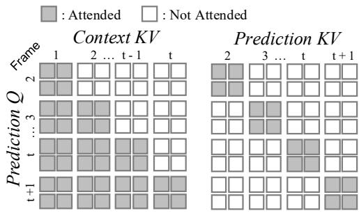  
Figure 3 | State predictor attention. Context states supply only keys and values; prediction tokens attend within their own target frame.

$$
s _ { t + 1 } = P _ { \phi } \bigl ( p _ { t + 1 } ; h _ { \le t } \bigr ) , \qquad 1 \le t < N ,\tag{3}
$$

where $s _ { t + 1 }$ is the predicted state of frame � + 1. To supervise the prediction in the semantic embedding space, a learned projection $g _ { \omega }$ maps the predicted state to the tokenizer space, $\hat { z } _ { t + 1 } = g _ { \omega } ( s _ { t + 1 } )$ , and we minimize its distance to the frozen target $\boldsymbol { z } _ { t + 1 } = \boldsymbol { F } ( \boldsymbol { x } _ { t + 1 } )$ with an $L _ { 1 }$ loss:

$$
\mathcal { L } _ { \mathrm { s e m } } = \left\| \hat { z } _ { t + 1 , j } - z _ { t + 1 , j } \right\| _ { 1 } ,\tag{4}
$$

where $\hat { z } _ { t + 1 , j }$ and $\boldsymbol { z } _ { t + 1 , j }$ denote the prediction and target at patch � of frame � + 1, averaged over all transitions � and supervised patches $j .$ The encoder, predictor, and projection thus together form the predictive model of Eq. (1): $f ( x _ { \le t } ) = g _ { \omega } \big ( P _ { \phi } ( p _ { t + 1 } ; h _ { \le t } ) \big )$ , with $h _ { \leq t }$ given by Eq. (2).

## 3.4. Auxiliary Generative Reconstruction

Semantic prediction emphasizes abstract visual content but may underrepresent fine-grained spatial information useful for dense perception. We therefore introduce a lightweight auxiliary generative decoder $D _ { \psi }$ that regularizes each predicted state through patch-level reconstruction. Let $x _ { t + 1 , j }$ and $s _ { t + 1 , \ j }$ denote the pixels and predicted state of patch � of frame � + 1. The decoder reconstructs each supervised patch conditioned on $s _ { t + 1 , j } .$ and the reconstruction loss is back-propagated through the predictor into the encoder.

Since the next frame is not fully determined by the past, a deterministic pixel regressor would be driven toward the average of plausible outcomes. We therefore model the distribution of each patch given its predicted state as in er-token difusion heads (Li et al. 2024) and formulate the decoder as a conditional flow matching model (Lipman et al., 2023). Each supervised patch is corrupted as $\begin{array} { r } { \tilde { x } _ { t + 1 , j } = ( 1 - \tau ) x _ { t + 1 , j } + \tau \epsilon _ { t + 1 , j } } \end{array}$ with $\epsilon _ { t + 1 , j } \sim { \cal N } ( 0 , I )$ and $\tau \sim \mathcal { U } [ 0 , 1 ]$ , and the decoder predicts the velocity $\epsilon _ { t + 1 , j } - x _ { t + 1 , j }$ with an $L _ { 1 }$ loss:

$$
\mathcal { L } _ { \mathrm { f l o w } } = \mathbb { E } _ { \tau , \epsilon } \big \| D _ { \psi } \big ( \tilde { x } _ { t + 1 , j } , \tau , s _ { t + 1 , j } \big ) - \big ( \epsilon _ { t + 1 , j } - x _ { t + 1 , j } \big ) \big \| _ { 1 } ,\tag{5}
$$

averaged over the same transitions and supervised patches as $\mathcal { L } _ { \mathrm { { s e m } } }$

## 3.5. Unified Image–Video Pretraining

To train a unified encoder on both images and videos with the same objective, we arrange each still image into an ordered sequence of views through local-to-global observation. The sequence consists of two local crops $x _ { 1 }$ and $x _ { 2 }$ of increasing area followed by a larger global crop $x _ { 3 } \ ( K = 3 ;$ Appendix B.2). Like successive frames, successive crops reveal new content that must be inferred from what has been observed so far (examples in Appendix Fig. 7). Each crop is treated as one frame by the encoder and predictor, and all crops are aligned to the patch grid of the full image. Let $c _ { t }$ be the binary mask of the region covered by crop � on this grid. Supervision is restricted to the newly revealed region, i.e., the part of crop � + 1 covered by none of the preceding crops:

$$
m _ { t + 1 } = c _ { t + 1 } \odot \prod _ { i = 1 } ^ { t } \big ( 1 - c _ { i } \big ) ,\tag{6}
$$

where ⊙ denotes element-wise multiplication, and both losses are averaged over the positions where $m _ { t + 1 } = 1$ Regions covered by earlier crops are excluded because they are already visible in the context, so predicting them would amount to reconstructing the input rather than inferring unseen content. This progressively expanding context transfers better than both a fixed order over image cells and masked-image completion (Table 5b).

Training objective. We jointly pretrain on images and videos by combining semantic prediction and generative reconstruction:

$$
\mathcal { L } = \mathcal { L } _ { \mathrm { s e m } } + \lambda _ { \mathrm { f l o w } } \mathcal { L } _ { \mathrm { f l o w } } ,\tag{7}
$$

where $\lambda _ { \mathrm { f l o w } }$ weights the reconstruction loss. Both losses are computed separately on video and image batches and averaged with equal weight, and all components except the frozen tokenizer are optimized jointly (Appendix B).

## 4. Experiments

We evaluate whether next-frame prediction provides an efective objective for visual world modeling on anticipation, global classification, and dense perception tasks, and then ablate the design choices.

Implementation details. Our main model pairs a 1B-parameter ViT-g encoder with a frozen DINOv2 ViT-L (O uab et al. 2024) semantic tokenizer. It is retrained on VISTA our curated ima e–video cor us which combines public image datasets (ImageNet-21K (Deng et al., 2009), SA-1B (Kirillov et al., 2023)) and video datasets (SSv2 (Goyal et al., 2017), K710 (Kay et al., 2017; Li et al., 2023a), HowTo100M (Miech et al., 2019)) with additional retrieved and class-balanced data. Training proceeds in four stages: warm-up and base pretraining on 16-frame clips at $2 5 6 \times 2 5 6$ , long-video post-training on 64-frame clips, and a high-resolution cooldown at $3 8 4 \times 3 8 4$ . The first two stages take about 26.6k GPU-hours and the last two a further 30.7k.

Evaluation protocol. All evaluations use frozen features: the pretrained encoder is kept fixed, and a lightweight probe is trained on its features for each task. Probes follow the protocols of V-JEPA 2.1 (Mur-Labadia et al., 2026) unless otherwise stated. We compare primarily with V-JEPA 2 and V-JEPA 2.1 at the same 1B scale; other encoders are either taken from the literature or re-evaluated under the same protocol, as marked in each table.

## 4.1. Anticipation

We first examine whether next-frame pretraining supports anticipation, on action anticipation (EK100) and short-term object-interaction anticipation (Ego4D).

Action anticipation. On EPIC-KITCHENS-100 (EK100) (Damen et al., 2022), we follow the V-JEPA 2.1 (Mur-Labadia et al., 2026) protocol with a one-second anticipation gap and report mean-class recall@5 on the validation set. The attentive probe uses only frozen encoder features; the state predictor is not used. VANE reaches 45.5 on actions, exceeding the 1B V-JEPA 2.1 and V-JEPA 2 by 7.1 and 5.8 points, respectively (Table 1), with the largest gain on nouns (67.6 vs. 56.2). It also outperforms the 8B PlausiVL by 17.9 points. These gains suggest that next-frame prediction in embedding space encourages representations that capture how visual events evolve and what is likely to happen next.

Table 1 | Action anticipation on EPIC-KITCHENS-100. Mean-class recall@5 (%) for verb, noun, and action on the validation set, with a one-second anticipation gap. Bold denotes the best result.
<table><tr><td>Method</td><td>Param.</td><td>Verb</td><td>Noun</td><td>Action</td></tr><tr><td>InAViT (Roy et al., 2024)</td><td>160M</td><td>51.9</td><td>52.0</td><td>25.8</td></tr><tr><td>Video-LLaMA (Zhang et al., 2023)</td><td>7B</td><td>52.9</td><td>52.0</td><td>26.0</td></tr><tr><td>PlausiVL (Mittal et al., 2024)</td><td>8B</td><td>55.6</td><td>54.2</td><td>27.6</td></tr><tr><td>V-JEPA 2 ViT-g (Assran et al., 2025)</td><td>1B</td><td>63.6</td><td>57.1</td><td>39.7</td></tr><tr><td>V-JEPA 2.1 ViT-g (Mur-Labadia et al., 2026)</td><td>1B</td><td>63.6</td><td>56.2</td><td>38.4</td></tr><tr><td>VANE (ours)</td><td>1B</td><td>65.7</td><td>67.6</td><td>45.5</td></tr></table>

Table 2 | Short-term object-interaction anticipation on Ego4D STA v2. The model localizes the next-active object and predicts its noun, the interaction verb, and the time to contact. Each column reports Top-5 AP or mAP counting a prediction as correct only if all listed components are correct: box (�), noun (�), verb (�), and time to contact (�). Bold denotes the best results.
<table><tr><td>Model</td><td>AP b</td><td>AP b+N</td><td>AP b+V</td><td>AP b+δ</td><td>AP b+N+V</td><td>AP b+δ+N</td><td>AP b+δ+V</td><td>AP All</td><td>mAP N</td><td>mAP N+V</td><td>mAP N+8</td><td>mAP All</td></tr><tr><td>Results reported in the literature</td><td></td><td></td><td></td><td></td><td></td><td></td><td></td><td></td><td></td><td></td><td></td><td></td></tr><tr><td>StillFast (Ragusa et al., 2023)</td><td></td><td></td><td></td><td></td><td></td><td></td><td></td><td></td><td>20.2</td><td>10.3</td><td>7.17</td><td>3.96</td></tr><tr><td>STAformer (Mur-Labadia et al., 2024)</td><td>38.3</td><td>28.3</td><td>16.6</td><td>12.3</td><td>12.8</td><td>8.89</td><td>5.47</td><td>4.06</td><td>29.4</td><td>15.3</td><td>9.94</td><td>5.67</td></tr><tr><td>Evaluated using the same protocol</td><td></td><td></td><td></td><td></td><td></td><td></td><td></td><td></td><td></td><td></td><td></td><td></td></tr><tr><td>DINOv2 ViT-g (Oquab et al., 2024)</td><td>47.8</td><td>38.1</td><td></td><td>23.614.1</td><td>19.1</td><td>10.9</td><td>7.29</td><td>5.73</td><td>30.6</td><td>16.8</td><td>9.37</td><td>5.44</td></tr><tr><td>DINOv3 ViT-H+ (Siméoni et al., 2025)</td><td>48.9</td><td>40.2</td><td>23.4</td><td>13.6</td><td>19.4</td><td>10.8</td><td>6.71</td><td>5.45</td><td>32.4</td><td>17.2</td><td>9.53</td><td>5.20</td></tr><tr><td>DINOv3 ViT-7B (Siméoni et al., 2025)</td><td>50.2</td><td>40.9</td><td>23.8</td><td>14.2</td><td>19.8</td><td>11.5</td><td>7.33</td><td>5.82</td><td>33.8</td><td>17.4</td><td>10.3</td><td>5.68</td></tr><tr><td>V-JEPA 2 ViT-g (Assran et al., 2025)</td><td>45.7</td><td>34.4</td><td>22.2</td><td>16.7</td><td>16.9</td><td>12.1</td><td>8.56</td><td>6.26</td><td>27.2</td><td>14.9</td><td>10.4</td><td>6.02</td></tr><tr><td>V-JEPA 2.1 ViT-g (Mur-Labadia et al., 2026)</td><td>47.3</td><td>36.5</td><td>23.6</td><td>18.1</td><td>18.2</td><td>13.5</td><td>9.55</td><td>7.21</td><td>28.7</td><td>15.5</td><td>11.4</td><td>6.75</td></tr><tr><td>VANE ViT-g</td><td>57.9</td><td>46.4</td><td>24.6 21.8</td><td></td><td>19.9</td><td>17.1</td><td>10.2</td><td>8.18</td><td>37.6</td><td>17.7</td><td>14.7</td><td>7.81</td></tr></table>

Short-term object-interaction anticipation. Ego4D STA v2 (Grauman et al., 2022) additionally requires localizing the next-active object and predicting its category, the interaction verb, and the time to contact. Following V-JEPA 2.1, we train an attentive probe with frame-guided temporal pooling and a detection head on frozen features and report Top-5 AP and mAP. VANE reaches 7.81 mAP All, compared with 6.75 for V-JEPA 2.1 and 6.02 for V-JEPA 2, and improves box AP by 10.6 points over V-JEPA 2.1 (Table 2). It outperforms all encoders evaluated under the same protocol, including DINOv3 ViT-7B, on all twelve metrics. Together with EK100, these results suggest that VANE anticipates not only what happens next but also where and when it happens. Qualitative examples are provided in Appendix C.1.

## 4.2. Global Classification

To assess recognition beyond anticipation, we evaluate image classification on IN1K (Deng et al., 2009) and action recognition on K400, SSv2, and Diving-48 (Kay et al., 2017; Goyal et al., 2017; Li et al., 2018). Following V-JEPA 2.1, we train four-layer attentive probes on frozen features with 256 × 256 inputs and report top-1 accuracy. Under the same protocol, VANE outperforms V-JEPA 2.1 on all four benchmarks, by 3.8 points on IN1K, 2.4 on K400, 0.6 on SSv2, and 0.7 on Diving-48, raising the average from 83.6 to 85.4 (Table 3); V-JEPA 2 remains slightly better on Diving-48 (90.1 vs. 89.7). VANE also exceeds the published results of Toto, which autoregressively predicts future visual tokens, by 12.2 points on IN1K and 14.2 on K400. Against image encoders, VANE nearly matches DINOv3 ViT-H+ on IN1K (87.5 vs. 88.2) while exceeding it by 12.8 points

Table 3 | Global classification. Top-1 accuracy (%) of attentive probes on frozen features, covering appearance understanding (IN1K, K400) and motion understanding (SSv2, Diving-48). Avg. is reported for models evaluated on all four tasks. Bold denotes the best result in image–video encoders.
<table><tr><td rowspan="2">Method</td><td rowspan="2">Param.</td><td colspan="2">Appearance Understanding</td><td colspan="2">Motion Understanding</td><td rowspan="2">Avg.</td></tr><tr><td>IN1K</td><td>K400</td><td>SSv2</td><td>Diving-48</td></tr><tr><td>Results reported in the literature</td><td></td><td></td><td></td><td></td><td></td><td></td></tr><tr><td>Toto (Rajasegaran et al., 2025)</td><td>1B</td><td>75.3</td><td>74.4</td><td></td><td></td><td></td></tr><tr><td>VideoMAEv2 (Wang et al., 2023a)</td><td>1B</td><td>71.4</td><td>82.8</td><td>56.1</td><td></td><td></td></tr><tr><td>InternVideo2-1B (Wang et al., 2024)</td><td>1B</td><td>一</td><td>87.9</td><td>67.3</td><td></td><td></td></tr><tr><td>VideoPrism (Zhao et al., 2024)</td><td>1B</td><td></td><td>87.6</td><td>68.5</td><td>71.3</td><td></td></tr><tr><td>DINOv3 (Siméoni et al., 2025)</td><td>7B</td><td>88.4</td><td>87.8</td><td>70.1</td><td>一</td><td></td></tr><tr><td colspan="3">Image encoders evaluated under the same protocol</td><td></td><td></td><td></td><td></td></tr><tr><td>DINOv2 (Oquab et al., 2024)</td><td>1.1B</td><td>86.1</td><td>83.6</td><td>50.7</td><td>82.5</td><td>75.7</td></tr><tr><td>DINOv3 ViT-H+ (Siméoni et al., 2025)</td><td>0.8B</td><td>88.2</td><td>86.6</td><td>63.1</td><td>85.3</td><td>80.8</td></tr><tr><td> $\mathrm { P E _ { c o r e } }$  G (Bolya et al., 2025)</td><td>1.9B</td><td>87.6</td><td>88.5</td><td>55.4</td><td>76.9</td><td>77.1</td></tr><tr><td>SigLIP 2 (Tschannen et al., 2025)</td><td>1.2B</td><td>88.0</td><td>87.3</td><td>49.9</td><td>75.3</td><td>75.1</td></tr><tr><td colspan="3">Image-video encoders evaluated under the same protocol</td><td></td><td></td><td></td><td></td></tr><tr><td>V-JEPA (Bardes et al., 2024)</td><td>630M</td><td>75.9</td><td>82.0</td><td>71.4</td><td>87.9</td><td></td></tr><tr><td>V-JEPA 2 (Assran et al., 2025)</td><td>1B</td><td>84.6</td><td>86.5</td><td>75.5</td><td>90.1</td><td>79.3 84.2</td></tr><tr><td>V-JEPA 2.1 (Mur-Labadia et al., 2026)</td><td>1B</td><td>83.7</td><td>86.2</td><td>75.3</td><td>89.0</td><td>83.6</td></tr><tr><td>VANE (ours)</td><td>1B</td><td>87.5</td><td>88.6</td><td>75.9</td><td>89.7</td><td>85.4</td></tr></table>

on SSv2 (75.9 vs. 63.1), suggesting that unified image–video pretraining retains appearance understanding while adding motion understanding. Notably, it also surpasses DINOv2 $\operatorname { V i T - g } ,$ a larger variant of its own frozen tokenizer, by 25.2 points on SSv2 (75.9 vs. 50.7), indicating that next-frame prediction learns temporal structure absent from its targets.

## 4.3. Dense Perception

To assess spatial detail beyond global recognition, we evaluate semantic segmentation on ADE20K, Cityscapes, and VOC (Zhou et al., 2017; Cordts et al., 2016; Everingham et al., 2010) and monocular depth estimation on NYUv2 and KITTI (Silberman et al., 2012; Geiger et al., 2012). Following DINOv3 (Siméoni et al., 2025) and V-JEPA 2.1 (Mur-Labadia et al., 2026), we train a dense linear projection on frozen final-layer patch features for each task and report mIoU for segmentation and RMSE for depth. Compared with V-JEPA 2.1 (Table 4), VANE improves ADE20K and Cityscapes by 3.2 and 3.6 mIoU, respectively, while remaining comparable on VOC (84.5 vs. 84.7). It also reduces depth RMSE from 0.350 to 0.329 on NYUv2 and from 2.601 to 2.431 on KITTI, the lowest errors among all encoders in Table 4, including image encoders. Since these benchmarks consist of still images, we attribute the gains mainly to next-crop prediction and the generative decoder, both of which improve ADE20K in our ablations (Table $^ { 5 \mathrm { b } , \mathrm { c } ) }$ . Figure 4 further shows that

Image  
Ground-truth  
V-JEPA 2.1  
VANE  
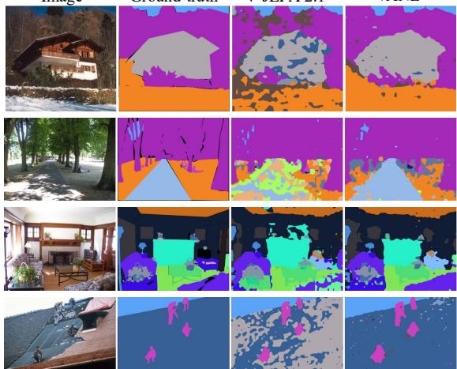  
Figure 4 | Qualitative comparison on ADE20K. V-JEPA 2.1 and VANE with the same dense linear probe on frozen features.

VANE produces cleaner and more coherent segments than V-JEPA 2.1.

Table 4 | Dense perception. Semantic segmentation (mIoU, %) and monocular depth estimation (RMSE, lower is better) with a linear probe on frozen final-layer patch features. Param./patch denotes encoder size/patch size. Bold denotes the best result among image–video encoders.
<table><tr><td rowspan="2">Method</td><td rowspan="2">Param./patch</td><td colspan="3">Segmentation</td><td colspan="2">Depth</td></tr><tr><td>ADE20K</td><td>Citysc.</td><td>VOC</td><td>NYUv2↓</td><td>KITTI↓</td></tr><tr><td colspan="7">Image encoders evaluated under the same protocol</td></tr><tr><td> $\mathrm { P E _ { c o r e } }$  (Bolya et al., 2025)</td><td>2B/14</td><td>38.9</td><td>61.1</td><td>69.2</td><td>0.590</td><td>4.119</td></tr><tr><td> $\mathrm { P E } _ { \mathrm { s p a t i a l } }$  (Bolya et al., 2025)</td><td>2B/14</td><td>49.3</td><td>73.2</td><td>82.7</td><td>0.362</td><td>3.082</td></tr><tr><td>AM-RADIOv2.5 (Ranzinger et al., 2024)</td><td>1B/14</td><td>53.0</td><td>78.4</td><td>85.4</td><td>0.340</td><td>2.918</td></tr><tr><td>SigLIP 2 (Tschannen et al., 2025)</td><td>1B/16</td><td>42.7</td><td>64.8</td><td>72.7</td><td>0.494</td><td>3.273</td></tr><tr><td>DINOv2 (Oquab et al., 2024)</td><td>1B/14</td><td>49.5</td><td>75.6</td><td>83.1</td><td>0.372</td><td>2.624</td></tr><tr><td>DINOv3 ViT-H+ (Siméoni et al., 2025)</td><td>0.8B/16</td><td>54.8</td><td>79.5</td><td>85.8</td><td>0.352</td><td>2.635</td></tr><tr><td colspan="7">Image-video encoders evaluated under the same protocol</td></tr><tr><td>InternVideo2-1B (Wang et al., 2024)</td><td>1B/14</td><td>28.4</td><td>35.6</td><td>65.2</td><td>0.471</td><td>4.739</td></tr><tr><td>V-JEPA 2 (Assran et al., 2025)</td><td>1B/16</td><td>24.4</td><td>45.9</td><td>63.9</td><td>0.642</td><td>4.650</td></tr><tr><td>V-JEPA 2.1 (Mur-Labadia et al., 2026)</td><td>1B/16</td><td>47.8</td><td>71.8</td><td>84.7</td><td>0.350</td><td>2.601</td></tr><tr><td>VANE (ours)</td><td>1B/16</td><td>51.0</td><td>75.4</td><td>84.5</td><td>0.329</td><td>2.431</td></tr></table>

Table 5 | Ablation studies. Top-1 accuracy on IN1K/SSv2 and mIoU on ADE20K with a ViT-L encoder trained for 50K iterations. (a) Prediction space and granularity; next-frame and next-token variants share the frozen DINOv2 ViT-L target space. (b) Image objectives, with the video objective, tokenizer, and generative decoder fixed. (c) Auxiliary generative decoder.

(a) Prediction space and granularity
<table><tr><td>Target</td><td>Prediction IN1K SSv2 ADE20K</td></tr><tr><td>Reference</td><td></td></tr><tr><td>Online EMA</td><td>Next frame 81.0 67.5 35.3</td></tr><tr><td>Pixels</td><td>Next frame 75.8 56.1 24.1</td></tr><tr><td>Semantic tokenizers</td><td></td></tr><tr><td>VA-VAE</td><td>Next frame 81.8 68.0 37.1</td></tr><tr><td>SigLIP 2</td><td>Next frame 77.5 65.5 29.6</td></tr><tr><td>DINOv2 ViT-L</td><td>Next frame 84.5 72.3 45.1</td></tr><tr><td>DINOv2 ViT-L</td><td>Next token 80.8 53.2 22.4</td></tr><tr><td>DINOv3 ViT-L</td><td>Next frame 84.0 71.8 45.2</td></tr></table>

(b) Image objectives
<table><tr><td>Image objective</td><td>IN1K SSv2 ADE20K</td></tr><tr><td>Masked image</td><td>81.069.3 38.3</td></tr><tr><td>Next cell</td><td>83.771.6 43.1</td></tr><tr><td>Next crop (default)</td><td>84.5 72.3 45.1</td></tr></table>

(c) Generative decoder
<table><tr><td>Setting</td><td>IN1K SSv2</td><td></td><td>ADE20K</td></tr><tr><td>w/o Decoder</td><td>84.3</td><td>72.0</td><td>42.8</td></tr><tr><td>w/ Decoder</td><td>84.5</td><td>72.3</td><td>45.1</td></tr></table>

## 4.4. Ablation Studies

We ablate the ke desi n choices of VANE. Unless otherwise s ecified, all ablations use a ViT-L encoder trained for 50K iterations. Additional ablations on the predictor attention and the number of image crops, as well as a matched comparison with V-JEPA 2.1, are provided in Appendix D.

Prediction space and granularity. Replacing pixel targets with frozen DINOv2 ViT-L embeddings improves SSv2 by 16.2 points and ADE20K by 21.0 mIoU (Table 5a). Among alternative targets, DINOv2 outperforms SigLIP 2 and VA-VAE (Yao et al., 2025) by 6.8 and 4.3 points on SSv2, and the online EMA target by 4.8 points, suggesting that efective targets should capture the content and local structure of a scene while abstracting over appearance variation. We adopt DINOv2 as the default tokenizer because it performs best on IN1K and SSv2, whereas DINOv3 is only slightly better on ADE20K (45.2 vs. 45.1). To isolate the efect of prediction granularity, we also compare next-frame prediction with standard next-token prediction, which predicts each visual token from the preceding tokens (Appendix D.4). With the target space fixed, next-frame prediction improves IN1K, SSv2, and ADE20K by 3.7, 19.1, and 22.7 points, respectively, showing that the gains stem from the prediction objective rather than from the target encoder itself.

Unified image prediction. Table 5b compares three image objectives under the same video objective: maskedimage completion, next-cell prediction, and local-to-global next-crop prediction. For next-cell prediction, we uniformly partition an image into a 2 × 2 grid, treat the four cells as an ordered sequence, and predict each cell from the preceding ones; next-crop prediction instead orders views from local to global and supervises only newly revealed regions. Next-crop prediction performs best on all three benchmarks, improving ADE20K by 2.0 and 6.8 mIoU over next-cell prediction and masked-image completion, respectively. Both ordered objectives outperform masked completion, indicating that images benefit from the same predictive structure as videos, and the further gain of next-crop prediction suggests that progressively expanding context is preferable to a fixed grid.

Generative supervision for spatial detail. We test whether the auxiliary generative objective helps preserve spatial information beyond semantic prediction. Adding the generative decoder raises ADE20K from 42.8 to 45.1 mIoU (Table 5c), with smaller gains of 0.2 points on IN1K and 0.3 on SSv2. The larger gain on dense perception suggests reconstructing visual content in pixel space complements semantic prediction by preserving fine-grained spatial structure.

Scaling and the training recipe. Figure 5 summarizes the cumulative efects of model scaling, data expansion, and post-training. Scaling the encoder from 300M to 1B parameters improves both SSv2 and ADE20K, while data expansion brings further gains. Long-video post-training yields the clearest improvement on SSv2 (73.8 to 75.6), suggesting that longer temporal context strengthens next- frame prediction by exposing the model to richer visual evolution. The final 384×384 cooldown further improves SSv2 and ADE20K. Overall, the complete recipe improves SSv2 and ADE20K by 3.6 and 5.9 points, respectively, highlighting complementary benefits from model and data scaling, longer temporal context, and higher spatial resolution.

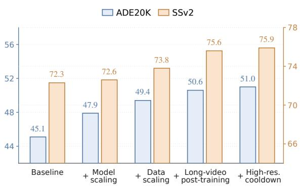  
Figure 5 | Cumulative training recipe.

## 5. Conclusion

We presented VANE, a self-supervised visual pretraining framework that predicts the next frame in embedding space rather than recovering missing content within an observed context, making temporal evolution the primary learning signal. Extending this objective to images through local-to-global next-crop prediction enables unified image–video pretraining. Across anticipation, global recognition, and dense perception, VANE achieves state-of-the-art performance among unified encoders on most benchmarks and improves consistently with model and data scale, supporting next-frame prediction in embedding space as a scalable principle for visual world modeling that captures both what the visual world contains and how it evolves.

## AI use statement

Generative AI tools were used solely to assist with information search, language editing, and polishing of the manuscri t. All AI-assisted content was reviewed and revised b the authors, who take full res onsibilit for the final content of the paper.

## Reproducibility statement

We provide the details required to reproduce our method and experiments throughout the main paper and appendix. The main paper specifies the learning objectives, model components, training procedure, and downstream evaluation protocols. The appendix provides additional details on dataset construction and sampling, model architecture, video context masking, stage-wise training configurations and hyperparameters, and evaluation settings. For standard downstream benchmarks, we follow the established protocols cited in the corresponding experimental sections.

## References

Mahmoud Assran, Quentin Duval, Ishan Misra, Piotr Bojanowski, Pascal Vincent, Michael Rabbat, Yann LeCun, and Nicolas Ballas. Self-supervised learning from images with a joint-embedding predictive architecture. In CVPR, 2023.

Mido Assran, Adrien Bardes, David Fan, Quentin Garrido, Russell Howes, Mojtaba Komeili, Matthew Muckley, Ammar Rizvi, Claire Roberts, Koustuv Sinha, et al. V-JEPA 2: Self-supervised video models enable understanding, prediction and planning. arXiv preprint arXiv:2506.09985, 2025.

Federico Baldassarre, Marc Szafraniec, Basile Terver, Vasil Khalidov, Francisco Massa, Yann LeCun, Patrick Labatut, Maximilian Seitzer, and Piotr Bojanowski. Back to the features: DINO as a foundation for video world models. arXiv preprint arXiv:2507.19468, 2025.

Adrien Bardes, Quentin Garrido, Jean Ponce, Xinlei Chen, Michael Rabbat, Yann LeCun, Mahmoud Assran, and Nicolas Ballas. Revisiting feature prediction for learning visual representations from video. TMLR, 2024.

Daniel Bolya, Po-Yao Huang, Peize Sun, Jang Hyun Cho, Andrea Madotto, Chen Wei, Tengyu Ma, Jiale Zhi, Jathushan Rajasegaran, Hanoona Bangalath, et al. Perception encoder: The best visual embeddings are not at the output of the network. In NeurIPS, 2025.

Mark Chen, Alec Radford, Rewon Child, Jefrey Wu, Heewoo Jun, David Luan, and Ilya Sutskever. Generative pretraining from pixels. In ICML, 2020.

Marius Cordts, Mohamed Omran, Sebastian Ramos, Timo Rehfeld, Markus Enzweiler, Rodrigo Benenson, Uwe Franke, Stefan Roth, and Bernt Schiele. The Cityscapes dataset for semantic urban scene understanding. In CVPR, 2016.

Dima Damen, Hazel Doughty, Giovanni Maria Farinella, Antonino Furnari, Evangelos Kazakos, Jian Ma, Davide Moltisanti, Jonathan Munro, Toby Perrett, Will Price, et al. Rescaling egocentric vision: Collection, pipeline and challenges for EPIC-KITCHENS-100. IJCV, 2022.

Jia Deng, Wei Dong, Richard Socher, Li-Jia Li, Kai Li, and Li Fei-Fei. ImageNet: A large-scale hierarchical image database. In CVPR, 2009.

Alaaeldin El-Nouby, Michal Klein, Shuangfei Zhai, Miguel Angel Bautista, Vaishaal Shankar, Alexander Toshev, Joshua M. Susskind, and Armand Joulin. Scalable pre-training of large autoregressive image models. In ICML, 2024.

Mark Everingham, Luc Van Gool, Christopher K. I. Williams, John Winn, and Andrew Zisserman. The PASCAL visual object classes (VOC) challenge. IJCV, 2010.

Christoph Feichtenhofer, Haoqi Fan, Yanghao Li, and Kaiming He. Masked autoencoders as spatiotemporal learners. In NeurIPS, 2022.

Andreas Geiger, Philip Lenz, and Raquel Urtasun. Are we ready for autonomous driving? the KITTI vision benchmark suite. In CVPR, 2012.

Raghav Goyal, Samira Ebrahimi Kahou, Vincent Michalski, Joanna Materzyńska, Susanne Westphal, Heuna Kim, Valentin Haenel, Ingo Fruend, Peter Yianilos, Moritz Mueller-Freitag, et al. The “something something” video database for learning and evaluating visual common sense. In ICCV, 2017.

Kristen Grauman, Andrew Westbury, Eugene Byrne, Zachary Chavis, Antonino Furnari, Rohit Girdhar, Jackson Hamburger, Hao Jiang, Miao Liu, Xingyu Liu, et al. Ego4D: Around the world in 3,000 hours of egocentric video. In CVPR, 2022.

Tengda Han, Weidi Xie, and Andrew Zisserman. Video representation learning by dense predictive coding. In ICCV Workshops, 2019.

Kaiming He, Xinlei Chen, Saining Xie, Yanghao Li, Piotr Dollár, and Ross Girshick. Masked autoencoders are scalable vision learners. In CVPR, 2022.

Efstathios Karypidis, Ioannis Kakogeorgiou, Spyros Gidaris, and Nikos Komodakis. DINO-Foresight: Looking into the future with DINO. In NeurIPS, 2025.

Will Kay, João Carreira, Karen Simonyan, Brian Zhang, Chloe Hillier, Sudheendra Vijayanarasimhan, Fabio Viola, Tim Green, Trevor Back, Paul Natsev, et al. The kinetics human action video dataset. arXiv preprint arXiv:1705.06950, 2017.

Alexander Kirillov, Eric Mintun, Nikhila Ravi, Hanzi Mao, Chloe Rolland, Laura Gustafson, Tete Xiao, Spencer Whitehead, Alexander C. Berg, Wan-Yen Lo, et al. Segment anything. In ICCV, 2023.

Yann LeCun. A path towards autonomous machine intelligence. OpenReview, 2022.

Kunchang Li, Yali Wang, Yinan He, Yizhuo Li, Yi Wang, Limin Wang, and Yu Qiao. UniFormerV2: Unlocking the potential of image ViTs for video understanding. In ICCV, 2023a.

Kunchang Li, Yali Wang, Yizhuo Li, Yi Wang, Yinan He, Limin Wang, and Yu Qiao. Unmasked teacher: Towards training-eficient video foundation models. In ICCV, 2023b.

Tianhong Li, Yonglong Tian, He Li, Mingyang Deng, and Kaiming He. Autoregressive image generation without vector quantization. In NeurIPS, 2024.

Xianhang Li, Chen Huang, Chun-Liang Li, Eran Malach, Josh Susskind, Vimal Thilak, and Etai Littwin. Rethinking JEPA: Compute-eficient video self-supervised learning with frozen teachers. In ICLR, 2026.

Yingwei Li, Yi Li, and Nuno Vasconcelos. RESOUND: Towards action recognition without representation bias. In ECCV, 2018.

Yaron Lipman, Ricky T. Q. Chen, Heli Ben-Hamu, Maximilian Nickel, and Matt Le. Flow matching for generative modeling. In ICLR, 2023.

Antoine Miech, Dimitri Zhukov, Jean-Baptiste Alayrac, Makarand Tapaswi, Ivan Laptev, and Josef Sivic. HowTo100M: Learning a text-video embedding by watching hundred million narrated video clips. In ICCV, 2019.

Himangi Mittal, Nakul Agarwal, Shao-Yuan Lo, and Kwonjoon Lee. Can’t make an omelette without breaking some eggs: Plausible action anticipation using large video-language models. In CVPR, 2024.

Lorenzo Mur-Labadia, Ruben Martinez-Cantin, Josechu Guerrero, Giovanni Maria Farinella, and Antonino Furnari. AFF-ttention! afordances and attention models for short-term object interaction anticipation. In ECCV, 2024.

Lorenzo Mur-Labadia, Matthew Muckley, Amir Bar, Mido Assran, Koustuv Sinha, Mike Rabbat, Yann LeCun, Nicolas Ballas, and Adrien Bardes. V-JEPA 2.1: Unlocking dense features in video self-supervised learning. arXiv preprint arXiv:2603.14482, 2026.

Heejeong Nam, Quentin Le Lidec, Lucas Maes, Yann LeCun, and Randall Balestriero. Causal-JEPA: Learning world models through object-level latent masking. In ICML, 2026.

Maxime Oquab, Timothée Darcet, Théo Moutakanni, Huy Vo, Marc Szafraniec, Vasil Khalidov, Pierre Fernandez, Daniel Haziza, Francisco Massa, Alaaeldin El-Nouby, et al. DINOv2: Learning robust visual features without supervision. TMLR, 2024.

Francesco Ragusa, Giovanni Maria Farinella, and Antonino Furnari. StillFast: An end-to-end approach for short-term object interaction anticipation. In CVPR Workshops, 2023.

Jathushan Rajasegaran, Ilija Radosavovic, Rahul Ravishankar, Yossi Gandelsman, Christoph Feichtenhofer, and Jitendra Malik. An empirical study of autoregressive pre-training from videos. In ICCV, 2025.

Mike Ranzinger, Greg Heinrich, Jan Kautz, and Pavlo Molchanov. AM-RADIO: Agglomerative vision foundation model – reduce all domains into one. In CVPR, 2024.

Rajesh P. N. Rao and Dana H. Ballard. Predictive coding in the visual cortex: a functional interpretation of some extra-classical receptive-field efects. Nature Neuroscience, 1999.

Sucheng Ren, Hongru Zhu, Chen Wei, Yijiang Li, Alan Yuille, and Cihang Xie. ARVideo: Autoregressive pretraining for self-supervised video representation learning. TMLR, 2025.

Robin Rombach, Andreas Blattmann, Dominik Lorenz, Patrick Esser, and Björn Ommer. High-resolution image synthesis with latent difusion models. In CVPR, 2022.

Debaditya Roy, Ramanathan Rajendiran, and Basura Fernando. Interaction region visual transformer for egocentric action anticipation. In WACV, 2024.

Nathan Silberman, Derek Hoiem, Pushmeet Kohli, and Rob Fergus. Indoor segmentation and support inference from RGBD images. In ECCV, 2012.

Oriane Siméoni, Huy V. Vo, Maximilian Seitzer, Federico Baldassarre, Maxime Oquab, Cijo Jose, Vasil Khalidov, Marc Szafraniec, Seungeun Yi, Michaël Ramamonjisoa, et al. DINOv3. arXiv preprint arXiv:2508.10104, 2025.

Keyu Tian, Yi Jiang, Zehuan Yuan, Bingyue Peng, and Liwei Wang. Visual autoregressive modeling: Scalable image generation via next-scale prediction. In NeurIPS, 2024.

Zhan Tong, Yibing Song, Jue Wang, and Limin Wang. VideoMAE: Masked autoencoders are data-eficient learners for self-supervised video pre-training. In NeurIPS, 2022.

Michael Tschannen, Alexey Gritsenko, Xiao Wang, Muhammad Ferjad Naeem, Ibrahim Alabdulmohsin, Nikhil Parthasarathy, Talfan Evans, Lucas Beyer, Ye Xia, Basil Mustafa, et al. SigLIP 2: Multilingual visionlanguage encoders with improved semantic understanding, localization, and dense features. arXiv preprint arXiv:2502.14786, 2025.

Aaron van den Oord, Yazhe Li, and Oriol Vinyals. Representation learning with contrastive predictive coding. arXiv preprint arXiv:1807.03748, 2018.

Carl Vondrick, Hamed Pirsiavash, and Antonio Torralba. Anticipating visual representations from unlabeled video. In CVPR, 2016.

Chenting Wang, Yuhan Zhu, Yicheng Xu, Jiange Yang, Lang Lin, Ziang Yan, Yali Wang, Yi Wang, and Limin Wang. InternVideo-Next: Towards world-understanding video models. In CVPR, 2026.

Limin Wang, Bingkun Huang, Zhiyu Zhao, Zhan Tong, Yinan He, Yi Wang, Yali Wang, and Yu Qiao. VideoMAE V2: Scaling video masked autoencoders with dual masking. In CVPR, 2023a.

Rui Wang, Dongdong Chen, Zuxuan Wu, Yinpeng Chen, Xiyang Dai, Mengchen Liu, Lu Yuan, and Yu-Gang Jiang. Masked video distillation: Rethinking masked feature modeling for self-supervised video representation learning. In CVPR, 2023b.

Yi Wang, Kunchang Li, Yizhuo Li, Yinan He, Bingkun Huang, Zhiyu Zhao, Hongjie Zhang, Jilan Xu, Yi Liu, Zun Wang, et al. InternVideo: General video foundation models via generative and discriminative learning. arXiv preprint arXiv:2212.03191, 2022.

Yi Wang, Kunchang Li, Xinhao Li, Jiashuo Yu, Yinan He, Chenting Wang, Guo Chen, Baoqi Pei, Ziang Yan, Rongkun Zheng, et al. InternVideo2: Scaling foundation models for multimodal video understanding. In ECCV, 2024.

Yi Wan , Xinhao Li, Zian Yan, Yinan He, Jiashuo Yu, Xian u Zen , Chentin Wan , Chan lian Ma, Haian Huang, Jianfei Gao, et al. InternVideo2.5: Empowering video MLLMs with long and rich context modeling. arXiv preprint arXiv:2501.12386, 2025.

Sihan Xu, Ziqiao Ma, Wenhao Chai, Xuweiyi Chen, Weiyang Jin, Joyce Chai, Saining Xie, and Stella X. Yu. Next-embedding prediction makes strong vision learners. arXiv preprint arXiv:2512.16922, 2025.

Jingfeng Yao, Bin Yang, and Xinggang Wang. Reconstruction vs. generation: Taming optimization dilemma in latent difusion models. In CVPR, 2025.

Hang Zhang, Xin Li, and Lidong Bing. Video-LLaMA: An instruction-tuned audio-visual language model for video understanding. In EMNLP (System Demonstrations), 2023.

Long Zhao, Nitesh B. Gundavarapu, Liangzhe Yuan, Hao Zhou, Shen Yan, Jennifer J. Sun, Luke Friedman, Rui Qian, Tobias Weyand, Yue Zhao, et al. VideoPrism: A foundational visual encoder for video understanding. In ICML 2024.

Bolei Zhou, Hang Zhao, Xavier Puig, Sanja Fidler, Adela Barriuso, and Antonio Torralba. Scene parsing through ADE20K dataset. In CVPR, 2017.

Gaoyue Zhou, Hengkai Pan, Yann LeCun, and Lerrel Pinto. DINO-WM: World models on pre-trained visual features enable zero-shot planning. In ICML, 2025.

## Appendix

## A. Model Architecture

VANE consists of a shared causal visual encoder, a context-isolated state predictor, a frozen semantic tokenizer, and a lightweight generative decoder. The encoder is the only component retained for downstream evaluation; the state predictor, semantic tokenizer, and generative decoder are used only during pretraining.

Table 6 summarizes the model configurations. Unless otherwise specified, the predictor uses the same depth and hidden dimension across encoder scales.

Causal encoder. The encoder processes all observations in a sequence in a single forward pass. Under frame-causal attention, tokens in observation � may attend to tokens from observations $1 , \ldots , t ,$ but never to future observations. Tokens within the same observation are processed jointly. For videos, the input is patchified into $2 \times 1 6 \times 1 6$ temporal-spatial tubelets $( T \times H \times W )$ , such that each temporal encoder position spans two consecutive sampled raw frames. For images, each local-to-global crop constitutes one observation. Images and videos use separate patch embeddings and a learned modality embedding, while all other components are shared; image sequences use no context masking. Fig. 6 (left) illustrates the attention mask.

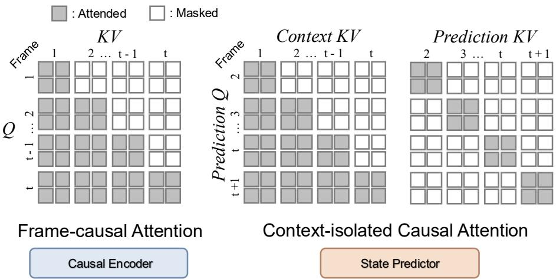  
Figure 6 | Attention masks. Left: frame-causal attention in the causal encoder, bidirectional within each frame and unidirectional across frames. Right: context-isolated causal attention in the state predictor. Prediction tokens for frame � + 1 read the context states of frames up to $t ,$ which supply only keys and values, and attend to each other only within the same target frame.

Context-isolated state predictor. The state predictor receives encoded historical states as read-only context. Since the encoder and predictor use diferent hidden dimensions, encoder states are first projected from the encoder width to the 384-dimensional predictor space. Historical context states then provide keys and values but are never updated inside the predictor. Prediction tokens are obtained by duplicating a learned token and assigning the corresponding target patch positions.

Prediction tokens for observation � +1 attend to the context states of observations $1 , \ldots , 1$ � and to one another, while predictions belonging to diferent future observations remain isolated (Fig. 6, right). The resulting predictor states are projected back to the encoder width before being passed to the semantic and generative objectives. This design separates representation learning from future-state readout: the predictor can only use information already encoded by the causal backbone.

Semantic tokenizer. We use a frozen DINOv2 ViT-L as the semantic tokenizer for the main model. We take its final patch tokens after removing special tokens and normalize each patch feature with a LayerNorm without afine parameters; no additional $\ell _ { 2 }$ normalization is applied.

To align tokenizer targets with the encoder patch grid, we resize the tokenizer input so that its 14 × 14 patchification produces the same $H _ { p } \times W _ { p }$ spatial grid, without interpolating tokenizer features. For example, a $2 5 6 \times 2 5 6$ encoder input produces a $1 6 \times 1 6 ~ \mathrm { g r i d }$ , while the corresponding tokenizer input is resized to 224 × 224.

Table 6 | Model architectures. The main model uses a ViT-g causal encoder, a 12-layer context-isolated state predictor, a frozen DINOv2 ViT-L semantic tokenizer, and a six-layer patch-isolated DifMLP decoder.
<table><tr><td></td><td>ViT-L</td><td>ViT-g</td></tr><tr><td>Causal Encoder</td><td></td><td></td></tr><tr><td>Block</td><td>ViT Block</td><td></td></tr><tr><td>Depth</td><td>24</td><td>40</td></tr><tr><td>Width</td><td>1024</td><td>1408</td></tr><tr><td>Num. Heads</td><td>16</td><td>22</td></tr><tr><td>MLP Ratio</td><td>4.0</td><td>4.36</td></tr><tr><td>Parameters</td><td>300M</td><td>1B</td></tr><tr><td>Patch Size</td><td></td><td>16× 16</td></tr><tr><td>Video Tubelet Size</td><td colspan="2">2 frames</td></tr><tr><td>Normalization</td><td colspan="2">LayerNorm</td></tr><tr><td>Position Encoding</td><td colspan="2">3D RoPE</td></tr><tr><td>Attention Mask</td><td colspan="2">Frame-causal</td></tr><tr><td>State Predictor</td><td colspan="2"></td></tr><tr><td>Block</td><td colspan="2">Context-isolated attention block</td></tr><tr><td>Depth</td><td colspan="2">12</td></tr><tr><td>Width</td><td colspan="2">384</td></tr><tr><td>Num. Heads</td><td colspan="2">12</td></tr><tr><td>Input Projection</td><td colspan="2">Encoder width → 384</td></tr><tr><td>Output Projection</td><td colspan="2">384 → Encoder width</td></tr><tr><td>Normalization</td><td colspan="2">LayerNorm</td></tr><tr><td>Position Encoding</td><td colspan="2">3D RoPE</td></tr><tr><td>Prediction-token Init.</td><td colspan="2">Learned token duplicated at target positions</td></tr><tr><td>Dropout / DropPath</td><td colspan="2">0.0 / 0.0</td></tr><tr><td>Semantic Tokenizer</td><td></td><td></td></tr><tr><td>Architecture</td><td colspan="2">DINOv2 ViT-L</td></tr><tr><td>Patch Size</td><td colspan="2">14× 14</td></tr><tr><td>Optimization</td><td colspan="2">Frozen throughout pretraining</td></tr><tr><td>Feature</td><td colspan="2">Final patch-token representation</td></tr><tr><td>Per-frame Feature Dim.</td><td colspan="2">1024</td></tr><tr><td></td><td colspan="2">Video: two-frame concatenation; Image: duplication</td></tr><tr><td>Target Packing</td><td colspan="2">2048</td></tr><tr><td>Target Dimension Semantic Projection</td><td colspan="2">1024 → 2048 1408 → 2048</td></tr><tr><td></td><td colspan="2"></td></tr><tr><td colspan="3">Patch-Isolated Generative Decoder</td></tr><tr><td colspan="2">Block</td><td>DiffMLP</td></tr><tr><td colspan="2">Depth</td><td>6</td></tr><tr><td colspan="2">Hidden Dimension</td><td>1536</td></tr><tr><td colspan="2">Image Pixel Packing</td><td>Duplicate along temporal dimension</td></tr><tr><td colspan="2">Video Pixel Packing</td><td>Two-frame tubelet</td></tr><tr><td colspan="2">Noisy Pixel Dimension</td><td>1536</td></tr><tr><td colspan="2">Condition Injection</td><td>Concatenation</td></tr><tr><td colspan="2">Input Projection 2560 → 1536</td><td>2944 → 1536</td></tr><tr><td colspan="2">Time Embedding</td><td>256 → 1536 → 1536</td></tr><tr><td colspan="2">Activation</td><td>SiLU</td></tr><tr><td colspan="2"></td><td></td></tr><tr><td colspan="2">Conditioning</td><td>Predicted state  $s _ { t , j }$  and flow time τ</td></tr><tr><td colspan="2">Noisy Input</td><td> $\tilde { x } _ { t , j } ( \tau ) \in \mathbb { R } ^ { 1 5 3 6 }$ </td></tr><tr><td colspan="2">Output</td><td>1536-d flow velocity  $\hat { \upsilon } _ { t , j }$ </td></tr><tr><td colspan="2">Patch Interaction</td><td>None (patch-isolated)</td></tr></table>

For images, the tokenizer encodes the full image once, and crop targets are indexed from the aligned full-image grid at their corresponding patch positions. For videos, it encodes individual frames independently. Each normalized patch feature is 1024-dimensional; features at the same spatial position in a two-frame video tubelet are concatenated into a 2048-dimensional target, while image features are duplicated to the same dimension. Both modalities therefore share the same semantic projection head, which maps the predictor output to the 2048-dimensional tokenizer target space.

Patch-isolated generative decoder. The auxiliary generative decoder is implemented as a six-layer DifMLP with hidden dimension 1536. To share the same decoder across modalities, each image is duplicated along the temporal dimension before pixel patchification, forming a two-frame input with identical image content. Consequently, both image patches and video tubelets are represented by $2 \times 3 \times 1 6 \times 1 6 = 1 5 3 6$ pixel values.

For the main ViT-g model, the 1408-dimensional predicted state is concatenated with the 1536-dimensional noisy pixel token and projected from 2944 to the 1536-dimensional decoder space. Flow time is encoded using a 256-dimensional sinusoidal embedding followed by a 256 → 1536 → 1536 SiLU MLP. Each DifMLP block contains LayerNorm, an MLP, SiLU activations, and adaptive shift, scale, and gate modulation. The final layer predicts a 1536-dimensional flow velocity. Target patches are decoded independently, without access to neighboring target patches or encoder context other than through the predicted state.

## B. Multi-Stage Training Strategy

Our training recipe contains four consecutive stages (Table 7): (1) learning-rate warm-up, (2) large-scale base pretraining, (3) long-video post-training, and (4) high-resolution cooldown. The first two stages learn the main representation using 16-frame clips at 256 × 256 resolution, while the last two stages progressively increase temporal and spatial context.

## B.1. Input Sampling and Augmentation

Video sampling. Videos are sampled at a target rate of 4 FPS. Base pretraining uses 16-frame clips and long-video post-training increases the observation window to 64 frames. The encoder uses a temporal tubelet size of two, so each temporal patch corresponds to two consecutive sampled frames. For videos longer than the required observation window, a clip window is randomly selected during training.

Image and video augmentation. At 256 × 256 resolution, both image and video inputs use random resized cropping with an area range of [0.3, 1.0] and aspect-ratio range of [0.75, 1.35], followed by horizontal flipping with probability 0.5. We do not use AutoAugment, random erasing, or additional color jitter in this training configuration. The same spatial augmentation principle is retained when increasing the input resolution during high-resolution cooldown.

## B.2. Local-to-Global Image Sampling

We first apply the image augmentation described in Appendix B.1 to obtain a base image. Local-to-global views are then sampled from its patch grid without resizing the individual crops. All view coordinates and semantic targets are defined relative to this shared base image.

For image pretraining, we construct an ordered sequence of � = 3 local-to-global crops. Two local crops are sampled with area ratios in [0.2, 0.6], followed by a global crop sampled with an area ratio in [0.8, 1.0]. All crops use aspect ratios in [0.75, 1.35] and are sampled on the image patch grid.

The two local crops are ordered by area. Successive crops cover increasingly broad and complementary scene regions, and may partially overlap or extend to adjacent regions. To encourage complementary observations, local-crop sampling favors pairs whose intersection occupies at most 0.4 of the larger local crop. The final global crop provides substantially broader scene context but is not required to coincide exactly with the full uncropped image. Semantic and generative supervision are applied only to patch positions newly revealed relative to preceding observations.

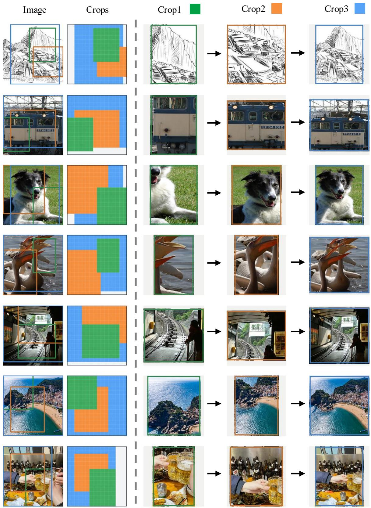  
Figure 7 | Visualization of local-to-global next-crop prediction. Each row shows the spatial layout of three sampled crops and the corresponding prediction sequence $\mathrm { C r o p } _ { 1 }  \mathrm { C r o p } _ { 2 }  \mathrm { C r o p } _ { 3 }$ . The first two observations are local crops and the last provides broader scene context. At each step, supervision is restricted to spatial regions newly revealed by the next crop. Crops are resized to a common display size for visualization only; their original spatial coordinates are used during training.

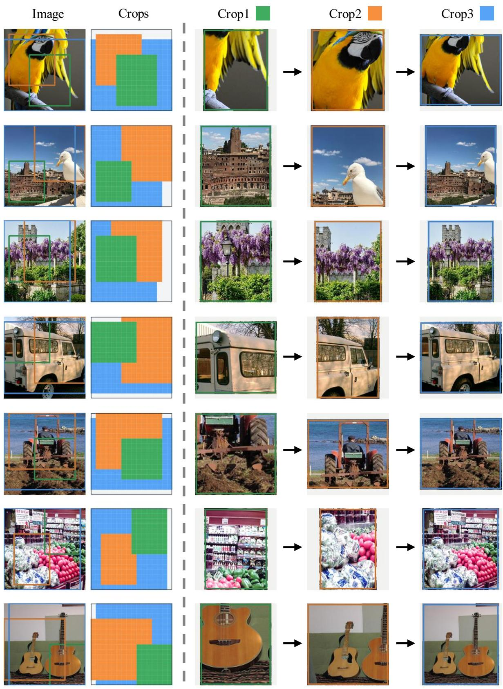  
Figure 8 | Additional examples of local-to-global next-crop prediction. We show additional sampled crop sequences following the same local-to-global sampling strategy as in Fig. 7. Supervision is applied only to regions newly revealed by each subsequent crop. Crops are resized to a common display size for visualization only; their original spatial coordinates are used during training.

Figure 7 and Figure 8 visualize representative local-to-global crop sequences and their spatial relationships in the original image coordinate system.

## B.3. Video Context Masking

To increase the dificulty of next-frame prediction, we apply random multi-block tube masking to the historical video context while keeping future targets fully supervised, following V-JEPA 2.1 (Mur-Labadia et al., 2026).

We follow the two multi-block mask configurations used in V-JEPA 2.1. One samples eight spatial blocks with scale 0.15 while retaining at least 5% of tokens; the other samples two larger blocks with spatial scale 0.70. For both configurations, the temporal scale is 1.0 and the block aspect ratio is sampled from [0.75, 1.5]. Block positions are sampled randomly and may overlap, so the resulting fraction of masked context tokens varies across samples rather than being defined by a single fixed mask ratio. The spatial masking pattern is extended temporally to form tube masks across the observed clip.

## B.4. Warm-Up

Training starts from randomly initialized VANE parameters while the semantic tokenizer remains frozen. During the first 12K updates, the learning rate is linearly increased from $1 \times 1 0 ^ { - 4 } \mathrm { t o } 6 \times 1 0 ^ { - 4 }$ . We use 16-frame video clips and $2 5 6 \times 2 5 6$ inputs, with global batch sizes of 1536 videos and 4608 images. The warm-up stabilizes optimization before large-scale joint image–video pretraining.

## B.5. Base Pretraining

After warm-up, we continue training for 180K updates using the same 16-frame, $2 5 6 \times 2 5 6$ input configuration and a constant learning rate of $6 \times 1 0 ^ { - 4 }$ . This stage constitutes the main representation-learning phase and uses the complete data mixture described in Appendix ??.

Image and video batches are processed independently in separate forward/backward passes. Their gradients are accumulated before one optimizer step, allowing the shared encoder and predictor to learn from both modalities without requiring image and video samples to be packed into the same sequence.

## B.6. Long-Video Post-Training

We next increase the temporal context from 16 to 64 frames while retaining the $2 5 6 \times 2 5 6$ spatial resolution. This stage runs for 60K additional updates with a global video batch size of 768, providing a longer observation window for predictive pretraining.

## B.7. High-Resolution Cooldown

The final stage increases the spatial input resolution from $2 5 6 \times 2 5 6$ to $3 8 4 \times 3 8 4$ for 12K updates while retaining the 64-frame observation window introduced during long-video post-training. It starts from the long-video checkpoint and linearly decays the learning rate during this stage.

The warm-up and base-pretraining stages together require approximately 26.6K GPU-hours, while the two post-training stages require approximately 30.7K GPU-hours in total.

Table 7 | Multi-stage training strategy. The base model is first trained with 16-frame clips at $2 5 6 \times 2 5 6 ,$ followed by long-video post-training with 64-frame clips and a final high-resolution stage.
<table><tr><td></td><td>Warm-up</td><td>Base Pretrain</td><td>Long-Video Post-train</td><td>High-Res. Cooldown</td></tr><tr><td>Input Configuration</td><td colspan="4"></td></tr><tr><td>Video Frames</td><td>16</td><td>16 4 FPS</td><td>64</td><td>64</td></tr><tr><td>Video Sampling Rate Video Tubelet Size</td><td colspan="4"></td></tr><tr><td>Resolution</td><td>256²</td><td>2 frames 2562</td><td>256²</td><td>3842</td></tr><tr><td>Image Views K</td><td>3</td><td>3</td><td>3</td><td>3</td></tr><tr><td>Video Context Mask</td><td colspan="4">Random multi-block tube masking</td></tr><tr><td>Optimization</td><td colspan="4">180K 60K</td></tr><tr><td>Updates</td><td colspan="4">12K</td></tr><tr><td>Global Video Batch</td><td>1536</td><td>1536</td><td>768</td><td>12K 768</td></tr><tr><td>Global Image Batch</td><td>4608</td><td>4608</td><td>4608 6× 10-4</td><td>4608 6 × 10−4 → 6 × 10−5</td></tr><tr><td>Learning Rate Optimizer</td><td colspan="4">1 × 10−4 → 6 × 10−4 6 × 10-4</td></tr><tr><td>AdamWβ</td><td colspan="4">AdamW (0.9, 0.95)</td></tr><tr><td>AdamW € Weight Decay</td><td colspan="4">10-8</td></tr><tr><td>Gradient Clipping</td><td colspan="4">0.04 1.0</td></tr><tr><td>Precision</td><td colspan="4">BF16</td></tr><tr><td>Objectives</td><td></td><td></td><td></td><td>1.0</td></tr><tr><td>Semantic Loss Weight</td><td colspan="4">1.0 1.0</td></tr><tr><td></td><td colspan="4">0.25 0.25</td></tr><tr><td>λflow</td><td colspan="4">0.25</td></tr><tr><td></td><td colspan="4"></td></tr><tr><td>Semantic Tokenizer</td><td colspan="4">Frozen DINOv2 ViT-L</td></tr></table>

## C. Additional Results

## C.1. Qualitative Short-Term Anticipation

Figure 9 shows qualitative results on Ego4D STA v2, obtained with the same frozen-feature probe as in Table 2. Each prediction consists of a bounding box for the next-active object and a label combining the interaction verb, the object noun, and the time to contact (TTC). In every example shown, one of the top-scoring predictions matches the ground-truth verb–noun pair and localizes the correct object with a comparable time to contact. The remaining candidates are typically plausible alternatives in the same scene, such as holding rather than marking the wood, or adjusting the garment rather than taking the scissors.

## C.2. Qualitative Dense Perception

We provide additional qualitative results for semantic segmentation and monocular depth estimation. All predictions are produced using the same frozen-feature evaluation protocol as in the quantitative experiments in the main paper. These examples complement aggregate metrics by showing how well pretrained features preserve object boundaries, fine-grained scene structure, and geometric layout.

Semantic segmentation. Figures 10 and 11 show representative examples from ADE20K and Cityscapes. We visualize the input image, ground-truth annotation, and predictions obtained from identical dense readouts trained on frozen visual features.

Monocular depth estimation. Figures 12 and 13 provide corresponding qualitative results on NYUv2 and KITTI. NYUv2 emphasizes indoor geometric structure, whereas KITTI provides long-range outdoor scenes and substantially diferent depth statistics.

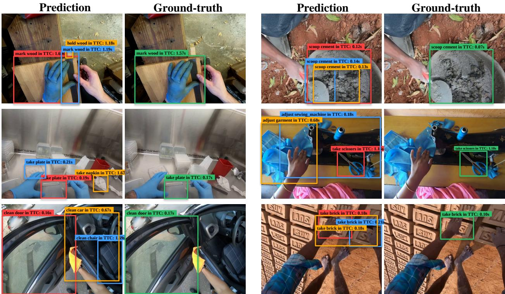  
Figure 9 | Qualitative short-term anticipation results on Ego4D STA v2. Each example pairs the top-scoring predictions of VANE (left) with the ground truth (right). Each box marks a next-active object and is labeled with the interaction verb, the object noun, and the time to contact (TTC). Predictions are produced by a probe trained on frozen VANE features.

## D. Additional Ablation Studies

The main paper studies prediction targets, image prediction strategies, generative supervision, scaling, and the training schedule. Here we first provide a controlled comparison with V-JEPA 2.1 under matched pretraining conditions, followed by further analyses of image crops, state-predictor attention, and prediction granularity. Unless otherwise specified, all ablations use a ViT-L encoder trained for 50K iterations.

## D.1. Masked versus Next-Frame Prediction under Matched Pretraining

We perform a controlled comparison with V-JEPA 2.1 (Mur-Labadia et al., 2026) to examine whether the gains of VANE persist after accounting for diferences in pretraining data and prediction targets. All models use ViT-L encoders trained on VISTA (Appendix ??) for 50K iterations under the same training budget. V-JEPA 2.1 retains its bidirectional masked feature-prediction formulation, whereas VANE uses next-frame prediction. We evaluate frozen encoder features using the same downstream protocols as in the main paper, and report top-1 accuracy on IN1K and SSv2 and mIoU on ADE20K.

Matching the pretraining data. We first compare VANE with the standard V-JEPA 2.1 formulation while matching the pretraining corpus, encoder scale, and iteration budget. As shown in Table 8, VANE improves IN1K accuracy by 2.7 points and ADE20K by 6.7 mIoU, while achieving slightly higher SSv2 accuracy (72.3% vs. 72.0%). Thus, the performance diferences persist when both methods are trained on the same data at the same model scale and training budget.

Matching the semantic prediction space. We further re lace the EMA tar et encoder of V-JEPA 2.1 with the same frozen DINOv2 ViT-L (Oquab et al., 2024) tokenizer used by VANE. This variant retains V-JEPA 2.1’s bidirectional masked feature-prediction objective while predicting targets in the same semantic embedding

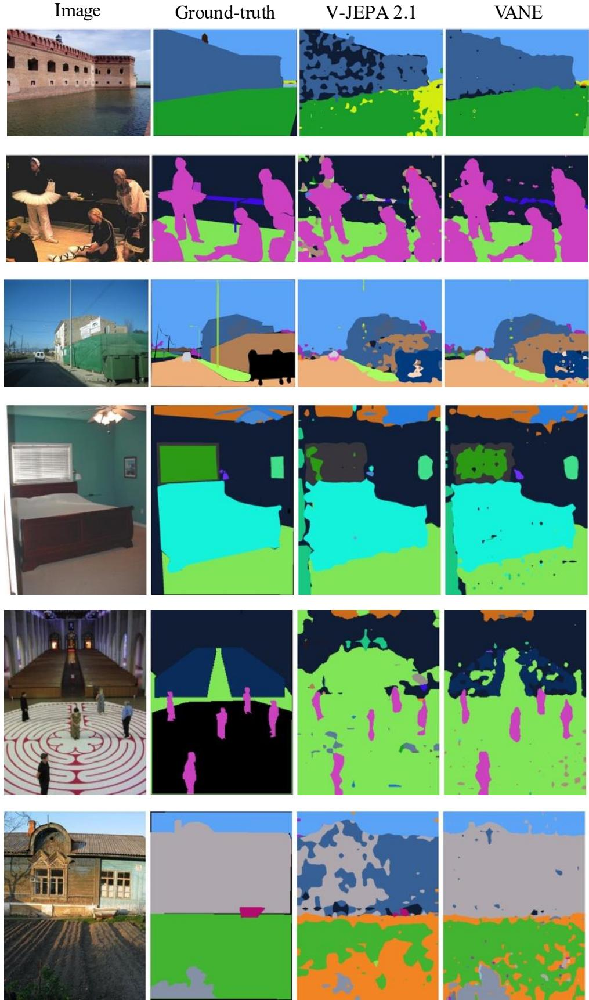  
Figure 10 | Qualitative semantic segmentation results on ADE20K. Each example shows the input image, ground truth, and predictions from dense probes trained on frozen features. All compared encoders use the same downstream protocol.

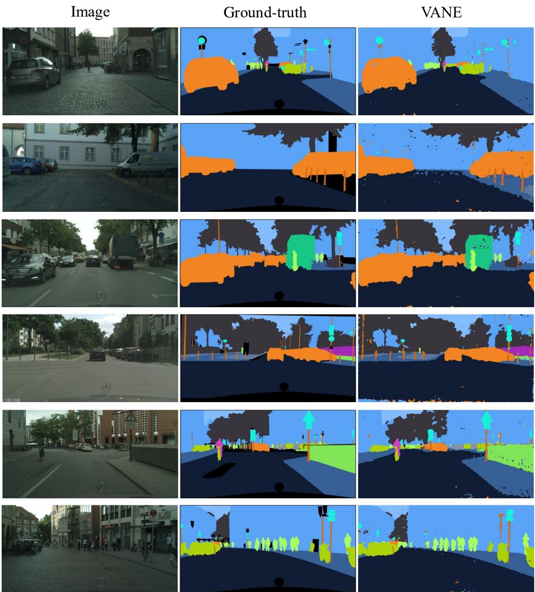  
Figure 11 | Qualitative semantic segmentation results on Cityscapes. Each example shows the input image, ground truth, and the prediction from a dense linear probe trained on frozen VANE features.

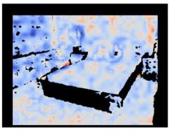  
1.0

Image  
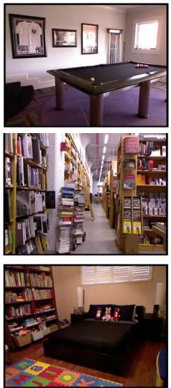  
depth(m):

Ground-truth  
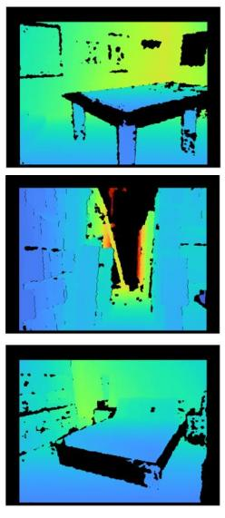  
0.0  
2.5

V-JEPA 2.1  
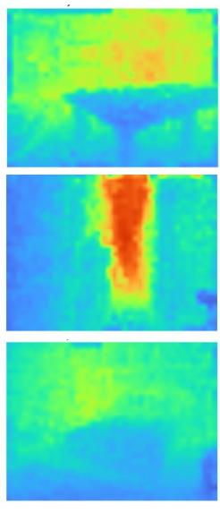  
5.0

VANE  
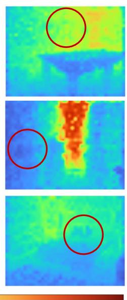  
7.5

Error  
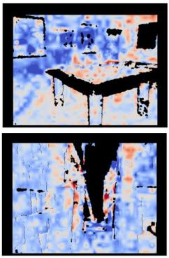  
10.0-1.0

Figure 12 | Qualitative monocular depth estimation on NYUv2. The error column shows $\Delta e = \left| \hat { d } _ { V A N E } - d _ { \mathrm { g t } } \right| -$ $\Big | \hat { d } _ { \mathrm { V - J E P A } 2 . 1 } - d _ { \mathrm { g t } } \Big | ;$ blue favors VANE, while red favors V-JEPA 2.1.  
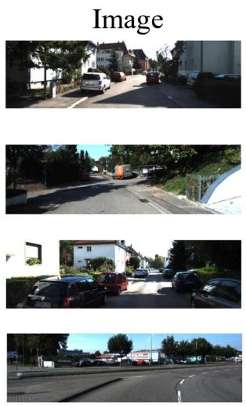  
depth(m):

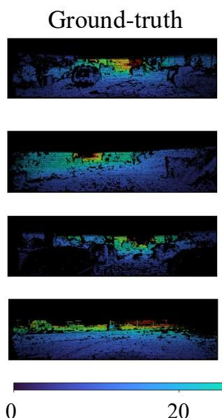  
20

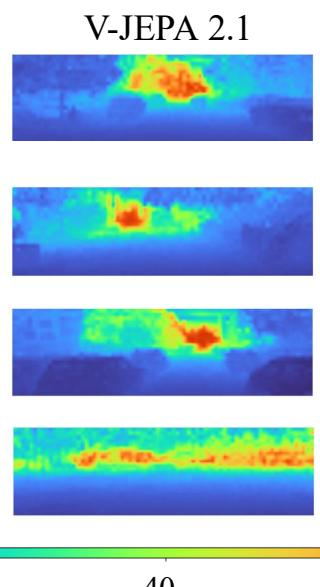  
40

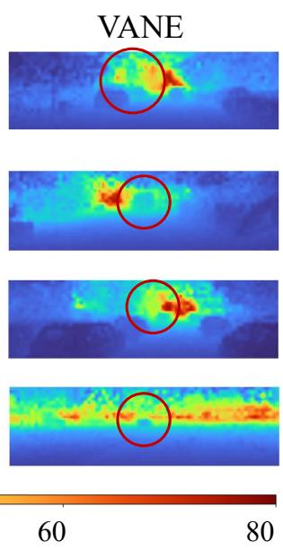  
Figure 13 | Qualitative monocular depth estimation results on KITTI. Predicted depth maps are obtained from dense readouts trained on frozen visual features using the same protocol as the quantitative evaluation.

Table 8 | Masked versus next-frame prediction under matched pretraining. All models use ViT-L encoders trained on VISTA for 50K iterations. The frozen-tar et V-JEPA 2.1 variant uses the same DINOv2 ViT-L semantic tokenizer as VANE. We report top-1 accuracy (%) on IN1K and SSv2 and mIoU (%) on ADE20K.
<table><tr><td>Method</td><td>Objective</td><td>Target</td><td>IN1K</td><td>SSv2</td><td>ADE20K</td></tr><tr><td>V-JEPA 2.1</td><td>Masked</td><td>EMA</td><td>81.8</td><td>72.0</td><td>38.4</td></tr><tr><td>V-JEPA 2.1</td><td>Masked</td><td>Frozen DINOv2</td><td>82.7</td><td>70.6</td><td>41.5</td></tr><tr><td>VANE</td><td>Next frame</td><td>Frozen DINOv2</td><td>84.5</td><td>72.3</td><td>45.1</td></tr></table>

Table 9 | Ablation of the number of image crops. We vary the number of local-to-global views � while keeping the remaining training configuration fixed.
<table><tr><td>Number of Crops K</td><td>IN1K</td><td>SSv2</td><td>ADE20K</td></tr><tr><td>2</td><td>84.3</td><td>72.1</td><td>44.4</td></tr><tr><td>3 (default)</td><td>84.5</td><td>72.3</td><td>45.1</td></tr><tr><td>4</td><td>84.4</td><td>71.9</td><td>44.7</td></tr></table>

space as VANE.

The frozen DINOv2 target improves the masked baseline on IN1K and ADE20K, from 81.8 to 82.7 and from 38.4 to 41.5, respectively, while SSv2 decreases from 72.0 to 70.6. With both the pretraining corpus and semantic target matched, VANE retains gains of 1.8 points on IN1K, 1.7 points on SSv2, and 3.6 mIoU on ADE20K. Thus, neither the pretraining corpus nor the frozen DINOv2 target alone explains the performance gap between masked and next-frame pretraining.

## D.2. Number of Image Crops

Our default local-to-global image objective uses � = 3 local-to-global crops. We additionally vary the number of crops to examine how the amount of intermediate visual context afects representation learning. For all settings, crops are ordered from local to global, and supervision is restricted to regions newly revealed by the next crop. The video objective, semantic tokenizer, model architecture, and training schedule are kept fixed.

As shown in Table 9, performance is relatively stable across the three settings, with � = 3 providing the best overall results. Using only two views provides less intermediate context during local-to-global prediction, while increasing to four views brings no further improvement. We therefore use � = 3 as the default throughout the main experiments.

## D.3. State-Predictor Attention

We next study how the state predictor should interact with historical encoder states. Our default predictor uses context-isolated cross-attention, where encoded historical states are treated as read-only context and provide keys and values to the predictor. Prediction tokens are updated by attending to this historical context to produce the future visual state, while the encoded context itself is not jointly updated inside the predictor.

As a control, we replace context-isolated attention with causal self-attention that jointly updates historical states and prediction tokens. Both variants enforce the same causal boundary: the prediction for observa- tion � depends only on observations preceding �, and prediction-token groups remain isolated across target observations. The predictor depth, hidden dimension, target positions, and training objective are otherwise unchanged.

Table 10 shows that context-isolated prediction consistently improves downstream representation quality. Compared with causal self-attention, it improves IN1K accuracy by 3.3 points and SSv2 accuracy by 5.5 points, with a larger gain of 9.6 mIoU on ADE20K.

Table 10 | Ablation of state-predictor attention. Context-isolated prediction treats historical encoder states as read-only context rather than jointly updating them with prediction tokens inside the predictor.
<table><tr><td>Predictor Attention</td><td>IN1K</td><td>SSv2</td><td>ADE20K</td></tr><tr><td>Causal self-attention</td><td>81.2</td><td>66.8</td><td>35.5</td></tr><tr><td>Context-isolated cross-attention</td><td>84.5</td><td>72.3</td><td>45.1</td></tr></table>

These results favor a separation between history encoding and future-state prediction. Causal self-attention allows the predictor to further transform historical states before producing the target representation. Context isolation instead requires the encoder outputs to carry the historical information needed for prediction, leaving the predictor to read these states and construct the future representation. This division of roles improves frozen-feature transfer in our experiments, particularly for dense perception.

## D.4. Prediction Granularity

We provide implementation details for the next-token baseline used in the prediction-granularity comparison in Table 5. We compare our next-frame objective with standard next-token prediction (NTP), while keeping the frozen DINOv2 ViT-L semantic target, encoder scale, training schedule, batch size, input resolution, and clip length fixed.

In standard NTP, visual patches are ordered first temporally and then spatially. When predicting the �-th token of frame �, the model observes all preceding frames and the first � − 1 tokens of the current frame, but not later tokens. The encoder therefore follows token-causal attention, analogous to a conventional autoregressive Transformer.

Next-frame prediction instead treats the entire frame as the prediction unit. All patches within an observed frame are jointly available, while no patch from the target frame is observed. Accordingly, the encoder uses frame-causal attention, allowing tokens to interact within each observed frame and attend to preceding frames, but not future frames. The target frame is then predicted jointly from the preceding observations.

Both variants use the same semantic and generative objectives and difer in how the visual sequence is factorized for prediction: NTP predicts successive visual tokens from prior tokens, whereas next-frame prediction predicts the next visual observation from preceding observations.