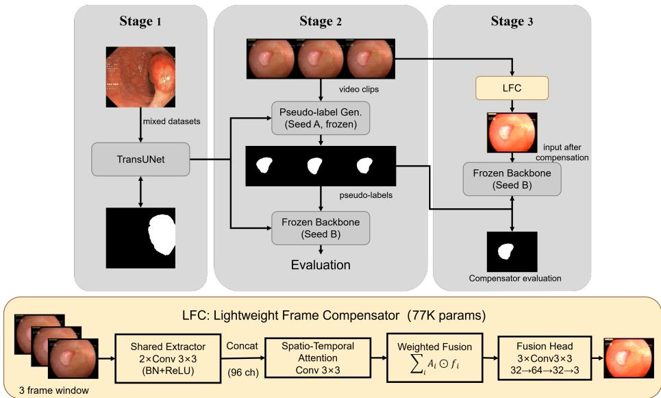

# Lightweight Frame Compensation for Real-Time Polyp Segmentation under Frame Skipping

Weihao Gao

School of Computer Science and Artificial Intelligence, Guangdong University of Education, Guangzhou 510303, China weihaomeva@163.com

Abstract. Real-time polyp segmentation in computer-assisted colonoscop is hampered by the dificulty of deploying high-accuracy models under strict latency budgets. Frame skipping, which performs inference every K frames and reuses or interpolates the rest, improves throughput but introduces motion blur and lesion misalignment that degrade temporal consistency. To close this gap, we propose the Lightweight Frame Compensator (LFC), a ∼77K-parameter plug-and-play module inserted before a frozen segmentation backbone. Operating on a three-frame window, LFC fuses consecutive frames via spatio-temporal attention into a single compensated frame, and is trained only on pseudo-labels generated by a diferently seeded model, without any expert annotation. Experiments on three polyp video benchmarks show that LFC recovers most of the accuracy degraded by direct frame skipping and, in several settings, reaches the accuracy of frame-by-frame inference, while retaining a 2.05×–2.55× throughput gain. We further evaluate the temporal stability of three backbones spanning CNN, pyramid Transformer, and global-attention Transformer architectures, revealing a spectrum of sensitivity to frame skipping that arises from how locally or globally each architecture aggregates misaligned input. The compensation gain of LFC follows this spectrum: it is largest for high-capacity Transformer backbones, which achieve the best static accuracy but sufer the most under skip-frame inference. LFC thus ofers a lightweight, pluggable, and deployment-friendly route to real-time polyp segmentation.

Keywords: Polyp Segmentation · Frame Skipping · Temporal Compensation · Transformer · Real-Time Inference.

## 1 Introduction

Colorectal cancer remains one of the most prevalent and lethal malignancies worldwide, with a substantial proportion of cases arising from the malignant transformation of colorectal polyps [18]. Colonoscopy serves as the primary screening modality for these polyps, enabling direct visualization of lesion morphology and facilitating resection during the same procedure [20, 5]. However, the intricate anatomy of the colon, characterized by complex fold patterns and frequent luminal occlusion, contributes to non-negligible miss rates even in expert hands. While recent work has explored image classification and object detection techniques to assist real-time video interpretation [1, 16, 22, 17], polyp segmentation ofers a more granular level of assistance: it supplies pixel-level location and contour information, provides richer visual cues for intra-operative resection, and enables models to learn deeper pixel-wise representations that can benefit downstream diagnostic tasks [10]. Accurate and timely polyp segmentation is therefore essential for the early detection and management of colorectal cancer.

Nevertheless, polyp segmentation remains a challenging task. Polyps frequently exhibit indistinct boundaries and highly variable size, shape, and color distribution, endowing them with strong camouflage characteristics [15]. Traditional manual segmentation depends on the clinician’s subjective experience and sustained attention, resulting in limited inter-observer consistency. Early computer-assisted methods predominantly exploited low-level features such as shape, texture, or color; although computationally eficient, their accuracy and robustness proved insuficient when the contrast between polyps and surrounding mucosa is low [3].

In recent years, convolutional neural networks (CNNs) have become the dominant paradigm in polyp segmentation, with U-Net standing out as the most representative architecture [19]. More recently, Transformer-based backbones have been introduced to this field and quickly became a strong alternative: TransUNet, which integrates self-attention into a U-shaped encoder–decoder framework, consistently outperforms its CNN counterparts on multiple polyp benchmarks [7], and task-specific designs such as Polyp-PVT [9] further push the accuracy frontier. However, the accuracy advantage of Transformer-based models comes with markedly higher computational overhead and latency, which poses a severe challenge for real-time deployment, where high frame-rate processing is required.

Meanwhile, real-time surgical video segmentation is not confined to colonoscopy polyp segmentation; it represents a broader clinical and engineering domain encompassing laparoscopic surgery, robotic-assisted intervention, and other videoguided procedures. At the system deployment level, a widely adopted strategy to improve GPU throughput, whether for multi-channel video streams or highframe-rate processing, is frame skipping: rather than executing the full segmentation model on every frame, inference is performed every K frames, with the remaining frames filled by reuse or interpolation. This strategy can substantially increase throughput, but it introduces motion blur and lesion misalignment in segments involving rapid motion, instrument occlusion, or abrupt morphological changes, degrading temporal consistency and compromising real-time performance.

This problem is particularly pronounced for Transformer-based architectures. Unlike CNNs, whose convolution kernels inherently provide local spatial smoothing, Transformer models rely on self-attention with a global receptive field. Patch-level misalignments introduced by frame skipping propagate globally through attention, causing more severe frame-to-frame prediction jitter. Despite this, to our knowledge, no prior work has systematically quantified the temporal stability

of diferent architectural families, from CNNs to pyramid and global-attention Transformers, under frame-skipping inference, nor has any lightweight compensation scheme been proposed to address the resulting accuracy loss.

To tackle these issues, this paper makes the following contributions:

We propose the Lightweight Frame Compensator (LFC). LFC is a plug-and-play module with only ∼77K parameters, inserted before a frozen segmentation backbone. Taking a window of three consecutive frames as input, it fuses them into a single compensated frame via spatio-temporal attention. Under a one-inference-per-three-frames regime, LFC recovers most of the accuracy loss caused by frame skipping and, in several settings, matches the accuracy of frame-by-frame inference, while being trained solely on pseudolabels from a diferently seeded model without any expert annotation.

We achieve a better eficiency–accuracy trade-of. With a negligible increase of 0.07M parameters, LFC retains a 2.05×–2.55× throughput gain over per-frame inference while substantially improving segmentation accuracy under frame skipping, providing a lightweight, pluggable, and deployment-friendly solution for real-time colonoscopy polyp segmentation.

We systematically evaluate the temporal stability of three backbones under frame skipping. Spanning a CNN, a pyramid Transformer, and a global-attention Transformer, our analysis shows that the compensation gain of LFC is governed by two factors: the sensitivity of the backbone to frame-to-frame jitter artifacts, measured by the per-video standard deviation of frame-wise predictions, and the accuracy of the backbone itself. This spectrum explains why high-capacity Transformer models, despite their superior static accuracy, benefit from LFC the most.

## 2 Method

## 2.1 Problem formulation and overall framework

Given an endoscopic video sequence, we adopt a fixed skip-frame interval $K = 3 .$ i.e., the segmentation backbone is invoked only once every three consecutive frames. We fix $K = 3$ as it is the most widely adopted skip-frame interval in real-time endoscopic deployment and matches the three-frame window of LFC; the efect of larger K is left for future work.

Denote the input window as $\left\{ \mathbf { x } _ { t - 1 } , \mathbf { x } _ { t } , \mathbf { x } _ { t + 1 } \right\} \in \mathbb { R } ^ { B \times 3 \times 3 \times H \times W }$ , where B is the batch size, $C = 3$ the RGB channels, and $T = 3$ the temporal dimension. The proposed LFC takes this window as input and generates a single compensated frame $\tilde { \mathbf { x } } _ { t } \in \mathbb { R } ^ { B \times 3 \times H \times W }$ , which is then fed into a frozen segmentation backbone for forward inference. Since LFC does not increase the invocation frequency of the backbone, the overall throughput remains comparable to direct skip-frame (DSF) inference.

Unlike probability-level propagation methods that operate on segmentation outputs, LFC works in the input space: the compensated frame can be interpreted as a learned, content-adaptive estimate of the scene, constructed from a window that carries at least as much task-relevant information as any single observed frame.

## 2.2 Experimental pipeline

As illustrated in Fig. 1, our training pipeline consists of three stages.

  
Fig. 1. Proposed pipeline and LFC model structure.

Stage 1. We first consolidate all publicly available expert-annotated polyp segmentation datasets into a unified mixed dataset, which serves as the development set for model training. In this stage, we report the segmentation performance of various baseline models trained with ground-truth annotations, which establishes the reference performance under the fully supervised setting.

Stage 2. Taking TransUNet as a representative example, we first employ a pretrained model (Seed A) as the pseudo-label generator to generate pseudo-labels for every frame of the continuous video frames in the VIM-Polyp and HyperKvasir datasets. Subsequently, we use another model (Seed B), pretrained under the fully supervised setting on the same mixed dataset but with a diferent random seed and a frozen backbone, to perform inference on both datasets. Since Seed A and Seed B share identical model architectures trained on the same mixed dataset with diferent seeds, we obtain two sets of results via the inference of Seed B: (i) the frame-by-frame (FBF) inference performance, and (ii) the performance of direct pixel-wise averaging over K skipped frames, in which inference is performed once every three frames.

Stage 3. On the VIM-Polyp dataset, we freeze the backbone of Seed B and insert the proposed LFC module in front of it, feeding three consecutive frames into the LFC module for training. Notably, throughout the entire LFC training process, the segmentation backbone remains frozen and receives no gradient updates. This design preserves the plug-and-play nature of the LFC module and ensures a fair comparison. Once the LFC module is trained, we evaluate the segmentation performance on both the VIM-Polyp test set and the HyperKvasir dataset. In this setting, the model still performs inference once every three frames; however, the inference is now conducted on LFC-compensated images reconstructed from three consecutive video frames. Through this stage, we verify whether the LFC module can enable skip-frame inference to achieve segmentation accuracy comparable to per-frame inference, while retaining a 2.05×–2.55× throughput improvement depending on the backbone.

## 2.3 LFC architecture

As illustrated in Fig. 1, LFC consists of three sequential components: a shared frame-wise feature extractor, a spatio-temporal attention estimator, and a multilayer fusion head. The total parameter count is 77K.

Feature Extractor. The extractor $\mathcal { F } _ { \mathrm { e x t } }$ independently encodes each frame in the window using two $3 \times 3$ convolutional layers (each followed by batch normalization and ReLU), mapping the input from 3 channels to a 32-dimensional feature space. This yields a set of feature maps $\{ \mathbf { f } _ { t - 1 } , \mathbf { f } _ { t } , \mathbf { f } _ { t + 1 } \}$ , where $\mathbf { f } \in \mathbb { R } ^ { B \times 3 2 \times H \times W }$ The extractor shares weights across the three frames to ensure computational eficiency.

Spatio-Temporal Attention. The attention estimator $\mathcal { F } _ { \mathrm { a t t } }$ concatenates the three frame features along the channel dimension, producing $\mathbf { f } _ { \mathrm { c a t } } \in \mathbb { R } ^ { B \times 9 6 \times H \times W }$ After two $3 \times 3$ convolutional layers, it outputs a 3-channel spatial attention map $\mathbf { A } \in \mathbb { R } ^ { B \times 3 \times H \times W }$ , normalized by a Sigmoid function to (0, 1). The attention map adaptively weights the three frame features at the pixel level:

$$
\mathbf { f } _ { \mathrm { f u s e d } } = \sum _ { i = 1 } ^ { 3 } \mathbf { A } _ { i } \odot \mathbf { f } _ { i } ,\tag{1}
$$

where $\mathbf { A } _ { i }$ denotes the attention weight for the i-th frame and ⊙ is element-wise multiplication. This mechanism enables implicit motion compensation and noise suppression by allowing the network to decide, per pixel, which frame contributes most to the fused result.

Fusion Head. The fusion head $\mathcal { F } _ { \mathrm { f u s e } }$ performs deep integration of the attended features. It employs three $3 \times 3$ convolutional layers with an intermediate channel expansion from 32 to 64 and subsequent compression back to 3 channels, followed by a Sigmoid activation to produce the compensated frame $\tilde { \mathbf { x } } _ { t } \in$ (0, 1)B×3×H×W . The multi-layer non-linear transformation allows the model to learn complex spatio-temporal feature interactions beyond simple linear averaging, and the Sigmoid guarantees that the output remains a valid image within the normalized intensity range.

## 2.4 Training setup

During training, the segmentation backbone (TransUNet, Polyp-PVT, or ResNet-UNet) is completely frozen; only the LFC parameters are updated via backpropagation. Supervision is provided by pseudo-labels generated from a frozen frameby-frame (FBF) model on the video frames. The loss function is the standard Dice loss computed between the segmentation prediction of the compensated frame $\tilde { \mathbf { x } } _ { t }$ and the pseudo-label of the corresponding middle frame. This training strategy ensures that LFC learns general temporal priors rather than adapting to specific backbone parameters. Moreover, because the backbone requires no retraining, LFC can be directly deployed on any existing pre-trained segmentation model.

## 3 Results

## 3.1 Datasets and evaluation metrics

This study constructs the development set using four publicly available polyp segmentation datasets with pixel-level gold-standard annotations: CVC-ClinicDB [ Kvasir-SEG [13], PolypGen [2], PolypDB [14]. Among them, CVC-ClinicDB and Kvasir-SEG are single-center, single-device datasets; PolypGen aggregates images from six medical centers; and PolypDB contains five imaging modalities (BLI, FICE, LCI, NBI, WLI) from three centers. We merge these four datasets into a unified development set and split them into training, validation, and test sets at a ratio of 7:1:2.

BKAI-IGH [21] also provides ground-truth segmentation annotations, which we use as an external dataset to evaluate the robustness of the backbone model’s segmentation performance.

For the training of LFC, we adopt two colonoscopy video datasets: VIM-Polyp [8] for model training, HyperKvasir [6] and Colon-Bench [11] for external validation. VIM-Polyp is an endoscopic video dataset without ground-truth segmentation annotations, comprising 133 video clips in total. We split it into training (79 clips), validation (13 clips), and test (41 clips) sets at a ratio of 6:1:3. Given the varying lengths of the videos, all frames are extracted and saved as individual images. The aforementioned methods, trained on reference datasets with gold-standard annotations, are then used to generate pseudo-labels for each frame, which serve as supervision targets for video training.

For external validation, we adopt the polyp-labeled videos from the Hyper-Kvasir dataset. We randomly select 5 videos and segment them into 5-second clips, yielding 125 video segments as the external validation set. As the continuous videos in HyperKvasir do not provide segmentation labels, we generate pseudo-labels for validation using Seed A of the same backbone model.

For a second external validation, we adopt the polyp-labeled videos from the Colon-Bench dataset. We randomly select 8 polyp-labeled videos. Notably, the segmentation labels in Colon-Bench are AI-generated and subsequently verified by clinicians over continuous video sequences, making them a fully independent third-party standard that difers from VIM-Polyp and HyperKvasir. An overview of the datasets is provided in Table 1.

Table 1. Overview of datasets used in this study.
<table><tr><td>Dataset</td><td>Data Source</td><td>Task</td><td>Num. of Images / Videos</td><td>Usage</td></tr><tr><td>CVC-ClinicDB</td><td>Single-center, single-device</td><td>Polyp segmentation</td><td>612 images</td><td>Development</td></tr><tr><td>Kvasir-SEG</td><td>Single-center, single-device</td><td>Polyp segmentation</td><td>1,000 images</td><td>Development</td></tr><tr><td>PolypGen</td><td>Multi-center (6 institutions)</td><td>Polyp segmentation</td><td>1,537 images</td><td>Development</td></tr><tr><td>PolypDB</td><td>Multi-modality (5 modalities)</td><td>Polyp segmentation</td><td>3,934 images</td><td>Development</td></tr><tr><td>BKAI-IGH</td><td>Single-center, single-device</td><td>Polyp segmentation</td><td>1,000 images</td><td>Development</td></tr><tr><td>VIM-Polyp</td><td>Single-center, video</td><td>Video-level pseudo-labeling</td><td>133 videos (79/13/41)</td><td>Training / Val / Test</td></tr><tr><td>HyperKvasir (polyp clips)</td><td>Single-center, video</td><td>External validation</td><td>125 clips (5s each)</td><td>External validation of LFC</td></tr><tr><td>Colon-Bench (polyp clips)</td><td>Single-center, video</td><td>External validation</td><td>8 videos</td><td>External validation of LFC</td></tr></table>

In this study, the Dice coeficient is employed as the evaluation metric for all experiments. The corresponding formulas are given below:

$$
{ \mathrm { D i c e } } = { \frac { 2 | X \cap Y | } { | X | + | Y | } } = { \frac { \mathrm { 2 T P } } { \mathrm { 2 T P } + { \mathrm { F P } } + { \mathrm { F N } } } }\tag{2}
$$

where X and Y denote the predicted and ground truth segmentation masks, respectively; TP, FP, FN represent true positives, false positives, and false negatives; $d ( \cdot , \cdot )$ denotes the Euclidean distance, and $P _ { 9 5 }$ denotes the 95th percentile. Notably, Dice and IoU measure region overlap, where higher values indicate better segmentation accuracy. Conversely, HD95 quantifies boundary discrepancy, where lower values signify superior boundary alignment and reduced outlier sensitivity.

## 3.2 Backbone models

This work compares three segmentation models that span the architectural spectrum from pure CNN to global self-attention: ResNet-UNet, a UNet with a ResNet-50 encoder [12, 19]; TransUNet, which replaces the encoder with a plain Vision Transformer (ViT) that operates on non-overlapping patches with a global self-attention mechanism [7]; and Polyp-PVT [9], a polyp-specific segmentation model built upon the Pyramid Vision Transformer. Unlike the plain ViT in TransUNet, which processes a single-scale sequence of hard-partitioned patches, PVTv2 introduces a pyramid structure with spatial-reduction attention, progressively shrinking the feature maps across stages and thereby retaining a degree of local spatial context. Polyp-PVT further equips this encoder with a lightweight decoder tailored to the challenges of polyp segmentation, such as indistinct boundaries and highly variable lesion scales.

The encoders of all three models are pretrained on ImageNet. We deliberately select one representative per point on this spectrum—pure convolution (ResNet-UNet), pyramid multi-scale attention (Polyp-PVT), and global patchbased attention (TransUNet), so that the comparison of temporal stability under frame-skipping inference reflects architectural inductive biases rather than idiosyncrasies of a single model. All experiments were conducted on a single NVIDIA 5090 GPU under PyTorch. Each experiment was run three times with fixed random seeds, and the default setting is $3 5 2 \times 3 5 2$ resolution, batch size 4, Adam optimizer with learning rate $3 \times 1 0 ^ { - 4 }$ , 100 epochs, and early stopping after 10 epochs without validation Dice improvement.

For inference on a given video, we adopt frame-by-frame inference (FBF) as the accuracy upper bound. To mimic real-time deployment under limited computational budget, we consider a frame-skipping setting in which one inference is performed every three frames, i.e., each prediction covers a window of $K { = } 3$ consecutive frames $\{ x _ { t - 1 } , x _ { t } , x _ { t + 1 } \}$ . Under this shared schedule, we compare LFC against three training-free fusion baselines.

DSF (Direct Skip-Frame). DSF performs pixel-wise averaging over the window and feeds the averaged frame to the backbone:

$$
\tilde { x } _ { t } ^ { \mathrm { { D S F } } } = \frac { 1 } { K } \sum _ { i = 1 } ^ { K } x _ { i } .\tag{3}
$$

Linear (Linear Interpolation). Linear interpolation discards the intermediate frame and synthesizes the target frame by averaging the first and last frames with equal weights:

$$
\tilde { x } _ { t } ^ { \mathrm { L i n e a r } } = \frac { 1 } { 2 } \left( x _ { t - 1 } + x _ { t + 1 } \right) .\tag{4}
$$

EMA (Exponential Moving Average). Unlike the input-space fusion above, EMA operates on the segmentation probability maps. Let $P _ { t }$ denote the softmax output of the backbone at window t. EMA maintains a running average $\hat { P } _ { t }$ with smoothing factor $\alpha \in ( 0 , 1 )$ :

$$
\begin{array} { r } { \hat { P } _ { t } = \alpha P _ { t } + ( 1 - \alpha ) \hat { P } _ { t - 1 } . } \end{array}\tag{5}
$$

The final prediction is obtained by taking the argmax of $\hat { P } _ { t }$ . We set $\alpha { = } 0 . 7$ in all experiments.

All three baselines follow the same three-frame inference schedule as LFC; therefore, the comparison isolates the efect of the fusion strategy rather than the inference frequency.

## 3.3 Basic segmentation results

Table 2 reports the performance of the representative models at a resolution of 352×352. All models are trained with three independent seeds (41, 42, 888), and the mean results are reported.

These results confirm that the specialized model Polyp-PVT exhibits a clear advantage in polyp segmentation, while TransUNet, with its Transformer-based

Table 2. Static gold-standard segmentation performance on the mixed development dataset and the external BKAI-IGH dataset.
<table><tr><td rowspan="2">Model</td><td rowspan="2">Params (M)</td><td colspan="2">Mixed Dataset</td><td colspan="2">BKAI-IGH External</td></tr><tr><td>DICE↑ IOU↑</td><td>HD95↓</td><td>DICE↑ IOU↑ HD95↓</td><td></td></tr><tr><td>Polyp-PVT</td><td>25</td><td>0.9538 0.9189</td><td>25.27</td><td>0.9258 0.8735</td><td>24.40</td></tr><tr><td>ResNet-UNet</td><td>86</td><td>0.8730 0.7882</td><td>36.65</td><td>0.8260 0.7189</td><td>32.57</td></tr><tr><td>TransUNet</td><td>105</td><td>0.88960.8151</td><td>31.44</td><td>0.8484 0.7474</td><td>26.87</td></tr></table>

encoder, achieves competitive segmentation performance. In contrast, ResNet-UNet substantially underperforms both Transformer-based competing models in both internal testing and external zero-shot inference.

## 3.4 Main results

Table 3 shows that frame skipping severely degrades TransUNet, with the overall Dice dropping by 6.27 and 9.00 percentage points on VIM-Polyp and HyperKvasir, respectively. LFC not only fully recovers these losses under the same inference schedule but exceeds the per-frame baseline on both datasets (0.7265 vs. 0.6923; 0.7063 vs. 0.6971), with the largest gains concentrated in Medium and Hard cases. On Colon-Bench, which provides third-party labels never involved in LFC’s supervision, LFC restores skip-frame inference to within 0.39 points of the FBF performance, confirming that the learned compensation generalizes across datasets and label sources rather than overfitting to the training distribution. This supports our interpretation that the compensated frame preserves at least the task-relevant information of a single frame, allowing skip-frame inference to reach, rather than merely approach, per-frame accuracy.

For Polyp-PVT (Table 4), the picture is diferent. It attains the strongest frame-by-frame baseline among all three backbones on every dataset, together with the largest number of Easy videos and the lowest prediction jitter, reflecting its task-specific design. Nevertheless, it remains vulnerable to skipping, losing 6.98, 8.37, and 6.51 points under DSF, which shows that a high FBF accuracy alone does not confer robustness to skipping. LFC recovers the majority of the loss on the pseudo-label benchmarks and, on the third-party Colon-Bench, fully restores the FBF performance (0.7649 vs. 0.7616). Its relative gain over FBF is smaller than that of TransUNet, which we analyze in Section 3.5.

ResNet-UNet (Table 5) exhibits the smallest efect size. On VIM-Polyp, LFC improves the overall Dice from 0.6160 (DSF) to 0.6431, recovering most of a 4.20-point skipping loss, and similar recoveries are observed on HyperKvasir and Colon-Bench. The gain, however, is markedly smaller than on the two Transformer backbones, consistent with the inherent robustness of convolutional architectures analyzed in Section 3.5.

Finally, Table 6 reports the inference speed measured over 1000 video frames on a single NVIDIA 5090 GPU. Training-free fusion strategies achieve the theoretical 3× speedup by invoking the backbone once per three frames. LFC introduces merely 0.07M additional parameters and retains 292.8 FPS (2.55×) on TransUNet and 427.4 FPS (2.05×) on Polyp-PVT, confirming that the accuracy recovery is obtained at only a modest cost of the skip-frame throughput, across backbones of very diferent capacities.

Table 3. Video polyp segmentation with TransUNet under frame-skipping inference (K=3). Dificulty stratified by per-video FBF Dice.
<table><tr><td rowspan="2">Dataset</td><td rowspan="2">Method</td><td colspan="3">Difficulty Breakdown</td><td rowspan="2"></td><td rowspan="2">∆F</td></tr><tr><td>Easy</td><td>Medium</td><td>Hard Overall</td></tr><tr><td rowspan="5">VIM-Polyp</td><td>FBF</td><td>0.9666</td><td>0.8381</td><td>0.5195</td><td>0.6923</td><td></td></tr><tr><td>DSF</td><td>0.9317</td><td>0.7559</td><td>0.4565</td><td>0.6296</td><td>-6.27</td></tr><tr><td>Linear</td><td>0.9331</td><td>0.7573</td><td>0.4624</td><td>0.6334</td><td>-5.89</td></tr><tr><td>EMA</td><td>0.9194</td><td>0.7465</td><td>0.4653</td><td>0.6293</td><td>-6.30</td></tr><tr><td>LFC</td><td>0.9641</td><td>0.8430</td><td>0.5818</td><td>0.7265</td><td>+3.42</td></tr><tr><td rowspan="5">HyperKvasir</td><td>FBF</td><td>0.9537</td><td>0.8328</td><td>0.4592</td><td>0.6971</td><td></td></tr><tr><td>DSF</td><td>0.8765</td><td>0.7221</td><td>0.3685</td><td>0.6071</td><td>-9.00</td></tr><tr><td>Linear</td><td>0.8830</td><td>0.7245</td><td>0.3866</td><td>0.6183</td><td>-7.88</td></tr><tr><td>EMA</td><td>0.8680</td><td>0.7135</td><td>0.3712</td><td>0.6039</td><td>-9.32</td></tr><tr><td>LFC</td><td>0.9568</td><td>0.8320</td><td>0.4769</td><td>0.7063</td><td>+0.92</td></tr><tr><td rowspan="5">Colon-Bench</td><td>FBF</td><td></td><td>0.8258</td><td>0.5507</td><td>0.7227</td><td></td></tr><tr><td>DSF</td><td></td><td>0.7484</td><td>0.5113</td><td>0.6595</td><td>-6.32</td></tr><tr><td>Linear</td><td></td><td>0.7489</td><td>0.5107</td><td>0.6596</td><td>-6.31</td></tr><tr><td>EMA</td><td></td><td>0.7346</td><td>0.5013</td><td>0.6471</td><td>-7.56</td></tr><tr><td>LFC</td><td></td><td>0.7994</td><td>0.5844</td><td>0.7188</td><td>-0.39</td></tr></table>

†Dificulty thresholds: Easy (>0.90), Medium (0.75–0.90), Hard (<0.75), based on per-video FBF Dice. VIM-Polyp: 8/11/22 videos; HyperKvasir: 42/24/59 videos; Colon-Bench: 0/5/3 videos

## 3.5 An architectural spectrum of temporal stability under frame skipping

We now analyze why LFC compensates the three backbones to diferent extents. Two factors jointly determine the efectiveness of compensation: how strongly a backbone is afected by frame-to-frame jitter artifacts, and how accurate its own predictions are in the first place. Table 7 isolates the first factor. Under the same cross-seed pseudo-label protocol on VIM-Polyp and HyperKvasir, TransUNet exhibits the highest per-video frame-wise Dice standard deviation, indicating that its predictions fluctuate the most under jitter. This aligns with the mechanism discussed above: hard patch partitioning and global self-attention propagate misaligned tokens to the entire feature space. The stronger the jitter sensitivity, the more room LFC has to recover, which explains why LFC benefits TransUNet the most.

Table 4. Video polyp segmentation with Polyp-PVT under frame-skipping inference (K=3). Dificulty stratified by per-video FBF Dice.
<table><tr><td colspan="2"></td><td colspan="3">Difficulty Breakdown</td><td colspan="2"></td></tr><tr><td>Dataset</td><td>Method</td><td>Easy</td><td>Medium</td><td>Hard</td><td>Overall</td><td>∆F</td></tr><tr><td rowspan="3">VIM-Polyp</td><td>FBF</td><td>0.9516</td><td>0.8272</td><td>0.6303</td><td>0.7994</td><td></td></tr><tr><td>DSF</td><td>0.8964</td><td>0.7565</td><td>0.5478</td><td>0.7296</td><td>-6.98</td></tr><tr><td>LFC</td><td>0.9436</td><td>0.7953</td><td>0.5769</td><td>0.7677</td><td>-3.17</td></tr><tr><td rowspan="3">HyperKvasir</td><td>FBF</td><td>0.9640</td><td>0.8183</td><td>0.5616</td><td>0.7671</td><td></td></tr><tr><td>DSF</td><td>0.8741</td><td>0.7109</td><td>0.4911</td><td>0.6834</td><td>-8.37</td></tr><tr><td>LFC</td><td>0.9546</td><td>0.7680</td><td>0.5317</td><td>0.7431</td><td>-2.40</td></tr><tr><td rowspan="3">Colon-Bench</td><td>FBF</td><td>0.9220</td><td>0.8315</td><td>0.6692</td><td>0.7616</td><td></td></tr><tr><td>DSF</td><td>0.8386</td><td>0.7576</td><td>0.6151</td><td>0.6965</td><td>-6.51</td></tr><tr><td>LFC</td><td>0.9176</td><td>0.8335</td><td>0.6753</td><td>0.7649</td><td>+0.33</td></tr></table>

†Dificulty thresholds: Easy (>0.90), Medium (0.75–0.90), Hard (<0.75), based on per-video FBF Dice. VIM-Polyp: 13/14/14 videos; HyperKvasir: 53/17/55 videos; Colon-Bench: 1/3/4 videos.

ResNet-UNet shows a lower standard deviation, but this should not be read as superior temporal robustness. Its stability is confounded by two facts: the local smoothing efect of convolutions inherently absorbs mild input perturbations, and its absolute segmentation accuracy is markedly lower than the other two backbones, so its predictions have less accuracy to lose. Its smaller DSF loss and smaller LFC gain are therefore consistent with a less accurate, but inherently less sensitive model.

Polyp-PVT occupies the other end. It achieves the highest overall FBF Dice on all three datasets, the lowest prediction jitter on both video benchmarks, and the largest number of Easy videos. It is already accurate and robust before any compensation. Consequently, the marginal benefit of fusing three frames into one is limited: LFC still substantially recovers the skipping loss on the pseudo-label benchmarks and matches the FBF performance on the third-party Colon-Bench labels, but its relative gain over an already strong FBF baseline is naturally smaller than that on TransUNet. In short, the compensation gain of LFC is inversely related to how much accuracy and stability a backbone already possesses, which is exactly what the spectrum in Table 7 reveals.

## 3.6 Ablation study

Table 8 ablates the two core components of LFC on the frozen TransUNet backbone. The spatial attention is the primary source of the compensation gain: removing it consistently degrades performance on both datasets (VIM-Polyp: 0.7265 to 0.7241; HyperKvasir: 0.7063 to 0.7022), which confirms that pixel-level adaptive weighting of the three frames, rather than the fusion head, accounts for the implicit motion compensation. The role of the multi-layer fusion head is dataset-dependent. It contributes a clear gain on the in-domain VIM-Polyp test set (0.7265 vs. 0.7013 without it), particularly in Medium and Hard cases, whereas on the zero-shot HyperKvasir set the configuration without the fusion head performs comparably (0.7170 vs. 0.7063). A plausible explanation is that the additional non-linear capacity helps resolve dificult, low-quality frames seen during training but ofers less benefit when the input distribution shifts. Removing both components causes a severe collapse on both datasets (0.6714 and 0.6185), showing that a lightweight encoder alone cannot learn meaningful temporal fusion.

Table 5. Video polyp segmentation with ResNet-UNet under frame-skipping inference (K=3). Dificulty stratified by per-video FBF Dice.
<table><tr><td rowspan="2"></td><td rowspan="2">Method</td><td colspan="3">Difficulty Breakdown</td><td rowspan="2"></td><td rowspan="2">Overall ∆F</td></tr><tr><td>Easy</td><td>Medium</td><td>Hard</td></tr><tr><td rowspan="3">VIM-Polyp</td><td>FBF</td><td>0.9604</td><td>0.8102</td><td>0.5297</td><td>0.6580</td><td></td></tr><tr><td>DSF</td><td>0.9259</td><td>0.7422</td><td>0.4937</td><td>0.6160</td><td>-4.20</td></tr><tr><td>LFC</td><td>0.9299</td><td>0.7682</td><td>0.5275</td><td>0.6431</td><td>-1.49</td></tr><tr><td rowspan="3">HyperKvasir</td><td>FBF</td><td>0.9572</td><td>0.8373</td><td>0.3879</td><td>0.6358</td><td></td></tr><tr><td>DSF</td><td>0.8674</td><td>0.6980</td><td>0.3443</td><td>0.5640</td><td>-7.18</td></tr><tr><td>LFC</td><td>0.8901</td><td>0.7527</td><td>0.3788</td><td>0.5973</td><td>-3.85</td></tr><tr><td rowspan="3">Colon-Bench DSF</td><td>FBF</td><td></td><td>0.8241</td><td>0.6390</td><td>0.6853</td><td></td></tr><tr><td></td><td></td><td>0.6601</td><td>0.5358</td><td>0.5669</td><td>-11.84</td></tr><tr><td>LFC</td><td></td><td>0.7501</td><td>0.6005</td><td>0.6379</td><td>-4.74</td></tr></table>

†Dificulty thresholds: Easy (>0.90), Medium (0.75–0.90), Hard (<0.75), based on per-video FBF Dice. VIM-Polyp: 7/8/26 videos; HyperKvasir: 41/17/67 videos; Colon-Bench: 0/2/6 videos.

Table 6. Inference eficiency of diferent frame-skipping strategies on two backbones.
<table><tr><td></td><td></td><td>Backbone Method Params (M) FrameFPS Speedup</td><td></td><td></td></tr><tr><td rowspan="5"></td><td>FBF</td><td>105.50</td><td>114.9</td><td>1.00×</td></tr><tr><td>DSF</td><td>105.50</td><td>344.4</td><td>3.00×</td></tr><tr><td>TransUNet Linear</td><td>105.50</td><td>343.3</td><td>2.99×</td></tr><tr><td>EMA</td><td>105.50</td><td>341.9</td><td>2.97×</td></tr><tr><td>LFC</td><td>105.57</td><td>292.8</td><td>2.55×</td></tr><tr><td rowspan="4">Polyp-PVT DSF</td><td>FBF</td><td>25.10</td><td>208.7</td><td>1.00×</td></tr><tr><td></td><td>25.10</td><td>531.7</td><td>2.55×</td></tr><tr><td>LFC</td><td>25.18</td><td>427.4</td><td>2.05×</td></tr><tr><td></td><td></td><td></td><td></td></tr></table>

We retain the complete LFC structure for two reasons. First, the full model achieves the best average performance across the two evaluation sets (0.7164 vs. 0.7132, 0.7092, and 0.6450 for the other variants), and in deployment the in-domain behavior is typically the primary concern. Second, the fusion head does not hurt zero-shot performance beyond a marginal diference, whereas its absence notably degrades in-domain accuracy. The full configuration therefore ofers the most reliable trade-of across domains.

Table 7. Frame-to-frame prediction stability measured by per-video Dice standard deviation.
<table><tr><td>Backbone</td><td colspan="2">VIM-Polyp HyperKvasir</td></tr><tr><td>TransUNet</td><td>0.2886</td><td>0.2429</td></tr><tr><td>Polyp-PVT</td><td>0.2673</td><td>0.1953</td></tr><tr><td>ResNet-UNet</td><td>0.2582</td><td>0.2445</td></tr></table>

Standard deviation computed across frames within each video, then averaged across all videos. Both datasets are evaluated under the same cross-seed pseudo-label protocol, isolating the efect of the backbone architecture.

Table 8. Ablation study of LFC components on TransUNet under frame-skipping inference (K=3).
<table><tr><td>Configuration</td><td>VIM-Polyp HyperKvasir</td><td></td></tr><tr><td>LFC (Full)</td><td>0.7265</td><td>0.7063</td></tr><tr><td>w/o Spatial Attention</td><td>0.7241</td><td>0.7022</td></tr><tr><td>w/o Fusion Head</td><td>0.7013</td><td>0.7170</td></tr><tr><td>Light (w/o Both)</td><td>0.6714</td><td>0.6185</td></tr></table>

All variants use the same frozen TransUNet backbone and are evaluated under K=3 skip-frame inference. HyperKvasir is evaluated zero-shot with pseudolabels.

## 4 Conclusion

In this work, we present LFC, a lightweight plug-and-play module for accurate skip-frame polyp segmentation in endoscopic videos. Inserted before a frozen segmentation backbone and trained only on cross-seed pseudo-labels, LFC fuses a three-frame window into a single compensated frame through spatio-temporal attention, recovering most of the accuracy loss caused by frame skipping while retaining a 2.05×–2.55× throughput gain over per-frame inference. Cross-dataset validation confirms that the learned temporal fusion generalizes beyond the training distribution rather than overfitting to a specific dataset, and in several settings the compensated predictions even reach the accuracy of frame-by-frame inference, indicating that temporal fusion also acts as implicit denoising.

Our analysis across three backbones further reveals an architectural spectrum of temporal stability under frame skipping. The compensation gain of LFC is governed by two factors, namely the sensitivity of the backbone to frame-toframe jitter artifacts and its own prediction accuracy: global self-attention propagates misaligned patches across the entire feature space, making TransUNet both the most sensitive and the largest beneficiary of compensation, whereas the pyramid structure and strong accuracy of Polyp-PVT leave less room for improvement, and the convolutional smoothing of ResNet-UNet provides partial inherent robustness. LFC is therefore of greatest value for high-capacity Transformer backbones, which achieve the best static accuracy but sufer the most under skip-frame inference. As a generalizable temporal compensation strategy, LFC is readily applicable to other surgical endoscopic video tasks beyond polyp segmentation. Future work will extend LFC to laparoscopic and bronchoscopic video analysis and explore adaptive skip strategies.

## References

1. Ahmad, A., Wilson, A., Haycock, A., Humphries, A., Monahan, K., Suzuki, N., Thomas-Gibson, S., Vance, M., Bassett, P., Thiruvilangam, K., et al.: Evaluation of a real-time computer-aided polyp detection system during screening colonoscopy: Ai-detect study. Endoscopy 55(04), 313–319 (2023)

2. Ali, S., Jha, D., Ghatwary, N., Realdon, S., Cannizzaro, R., Salem, O., Lamarque, D., Daul, C., Riegler, M., Anonsen, K., et al.: Polypgen: A multi-center polyp detection and segmentation dataset for generalisability assessment. arxiv 2021. arXiv preprint arXiv:2106.04463 (2021)

3. Bernal, J., Sánchez, J., Vilarino, F.: Towards automatic polyp detection with a polyp appearance model. Pattern Recognition 45(9), 3166–3182 (2012)

4. Bernal, J., Sánchez, F.J., Fernández-Esparrach, G., Gil, D., Rodríguez, C., Vilariño, F.: Cvc-clinicdb (2015), https://polyp.grand-challenge.org/CVCClinicDB/

5. Bifi, C., Salvagnini, P., Dinh, N.N., Hassan, C., Sharma, P., Cherubini, A.: A novel ai device for real-time optical characterization of colorectal polyps. NPJ digital medicine 5(1), 84 (2022)

6. Borgli, H., Thambawita, V., Smedsrud, P.H., Hicks, S., Jha, D., Eskeland, S.L., Randel, K.R., Pogorelov, K., Lux, M., Nguyen, D.T.D., et al.: Hyperkvasir, a comprehensive multi-class image and video dataset for gastrointestinal endoscopy. Scientific data 7(1), 283 (2020)

7. Chen, J., Mei, J., Li, X., Lu, Y., Yu, Q., Wei, Q., Luo, X., Xie, Y., Adeli, E., Wang, Y., et al.: Transunet: Rethinking the u-net architecture design for medical image segmentation through the lens of transformers. Medical Image Analysis 97, 103280 (2024)

8. Doğan, R.S., Akay, E., Doğan, S., Yılmaz, B.: Vim-polyp: Multimodal colon polyp dataset with video, histopathology, and protein expression. Scientific Data 12(1), 1903 (2025)

9. Dong, B., Wang, W., Fan, D.P., Li, J., Fu, H., Shao, L.: Polyp-pvt: Polyp segmentation with pyramid vision transformers. arXiv preprint arXiv:2108.06932 (2021)

10. Goh, W.W., Chia, K.Y., Cheung, M.F., Kee, K.M., Lwin, M.O., Schulz, P.J., Chen, M., Wu, K., Ng, S.S., Lui, R., et al.: Risk perception, acceptance, and trust of using ai in gastroenterology practice in the asia-pacific region: web-based survey study. JMIR AI 3(1), e50525 (2024)

11. Hamdi, A., Yang, C., Gao, X.: Colon-Bench: An Agentic Workflow for Scalable Dense Lesion Annotation in Full-Procedure Colonoscopy Videos . In: Medical Image Computing and Computer Assisted Intervention – MICCAI 2026. Springer Nature Switzerland (2026)

12. He, K., Zhang, X., Ren, S., Sun, J.: Deep residual learning for image recognition. In: Proceedings of the IEEE conference on computer vision and pattern recognition. pp. 770–778 (2016)

13. Jha, D., Smedsrud, P.H., Riegler, M.A., Halvorsen, P., de Lange, T., Johansen, D., Johansen, H.D.: Kvasir-seg: A segmented polyp dataset. In: International Conference on Multimedia Modeling. pp. 451–462. Springer (2020)

14. Jha, D., Tomar, N.K., Sharma, V., Trinh, Q.H., Biswas, K., Pan, H., Jha, R.K., Durak, G., Hann, A., Varkey, J., et al.: Polypdb: A curated multi-center dataset for development of ai algorithms in colonoscopy. arXiv preprint arXiv:2409.00045 (2024)

15. Jong, M.R., Boers, T.G., Fockens, K.N., Jukema, J.B., Kusters, C.H., Jaspers, T.J., van Heslinga, R.v.E., Slooter, F.C., Struyvenberg, M.R., Bisschops, R., et al.: Gastronet-5m: A multicenter dataset for developing foundation models in gastrointestinal endoscopy. Gastroenterology (2025)

16. Lalinia, M., Sahafi, A.: Colorectal polyp detection in colonoscopy images using yolo-v8 network. Signal, Image and Video Processing 18(3), 2047–2058 (2024)

17. Li, M.D., Huang, Z.R., Shan, Q.Y., Chen, S.L., Zhang, N., Hu, H.T., Wang, W.: Performance and comparison of artificial intelligence and human experts in the detection and classification of colonic polyps. BMC gastroenterology 22(1), 517 (2022)

18. Morgan, E., Arnold, M., Gini, A., Lorenzoni, V., Cabasag, C., Laversanne, M., Vignat, J., Ferlay, J., Murphy, N., Bray, F.: Global burden of colorectal cancer in 2020 and 2040: incidence and mortality estimates from globocan. Gut 72(2), 338–344 (2023)

19. Ronneberger, O., Fischer, P., Brox, T.: U-net: Convolutional networks for biomedical image segmentation. In: Medical Image Computing and Computer-Assisted Intervention–MICCAI 2015: 18th International Conference, Munich, Germany, October 5-9, 2015, Proceedings, Part III 18. pp. 234–241. Springer (2015)

20. Saraiva, S., Rosa, I., Fonseca, R., Pereira, A.D.: Colorectal malignant polyps: a modern approach. Annals of Gastroenterology 35(1), 17 (2021)

21. Son, T.H., Hung, P.D.: Polyps segmentation in colonoscopy images using Seg-Former transformer. In: International Conference on Artificial Intelligence and Soft Computing. pp. 368–378. Springer Nature Switzerland, Cham (Jun 2024)

22. Wang, A., Mo, J., Zhong, C., Wu, S., Wei, S., Tu, B., Liu, C., Chen, D., Xu, Q., Cai, M., et al.: Artificial intelligence-assisted detection and classification of colorectal polyps under colonoscopy: a systematic review and meta-analysis. Annals of Translational Medicine 9(22), 1662 (2021)