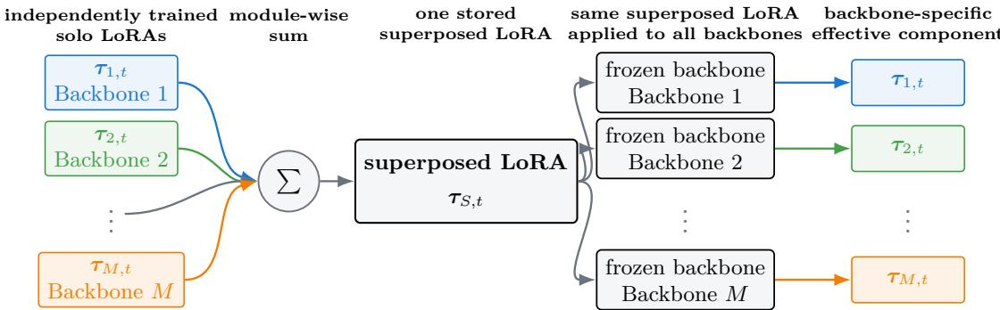
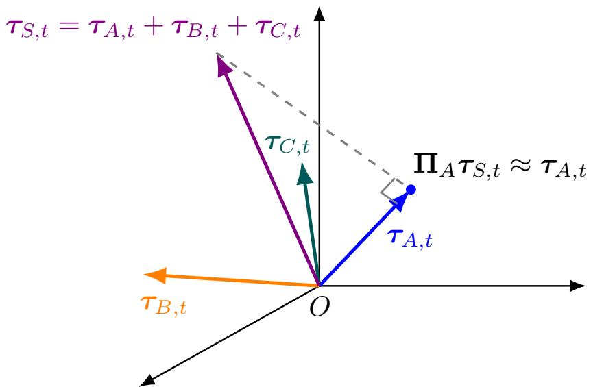
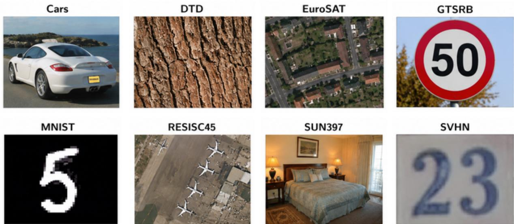
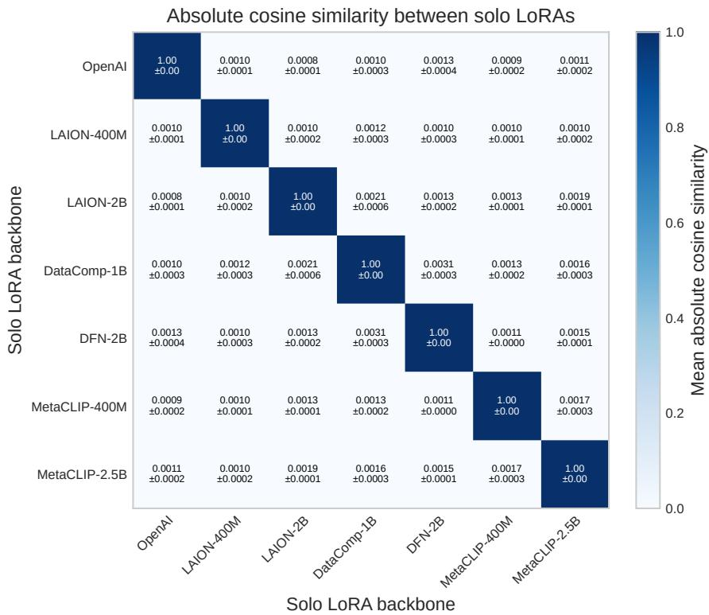
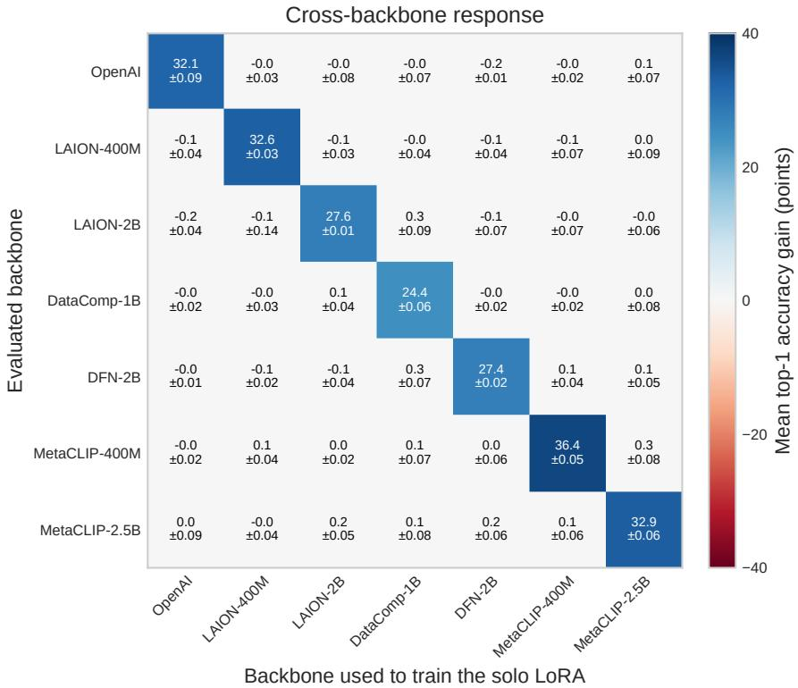

# LoRA Superposition across Pretrained Models

Keigo Watanabe1 ∗ Hiroshi Kera1,2 Kazuhiko Kawamoto1 ∗

1Chiba University, Chiba, Japan

2National Institute of Informatics, Tokyo, Japan

{keigo.watanabe,kera}@chiba-u.jp kawa@faculty.chiba-u.jp

## Abstract

Low-rank adaptation (LoRA) is usually tied to the pretrained backbone on which it is learned. We ask whether LoRAs trained independently for the same task on diferent pretrained backbones can be summed and applied unchanged to all contributing backbones. We call this construction LoRA superposition. Across seven ViT-B/16 CLIP backbones and eight image-classification tasks, the exact sum improves all 56 backbone–task pairs and achieves a mean accuracy gain of 30.21 percentage points over the unadapted backbone. The exact sum achieves a mean accuracy only 0.28 percentage points below that of individually trained solo LoRAs. In contrast, a leave-one-model-out (LOMO) sum produces a mean gain of only 0.06 percentage points over the unadapted backbones. Backbone-specific solo LoRAs are nearly orthogonal in parameter space, while pairwise cross-backbone responses are strongly concentrated on the diagonal. These results support a component-wise non-interference hypothesis, under which the frozen backbone acts as an implicit selector of its own component without explicit routing or cross-model alignment.

Keywords: low-rank adaptation; LoRA; parameter superposition; model merging; vision transformer; pretrained models.

## 1 Introduction

Low-rank adaptation (LoRA) [9] adapts a pretrained model through low-rank parameter updates while keeping the original backbone fixed. A LoRA update can also be viewed as a task vector [11] and reused through parameter-space operations. However, a LoRA is typically tied to the backbone on which it was trained. Even for backbones with the same architecture, diferent pretrained weights generally require separate adapters. Supporting T tasks with M pretrained backbones therefore usually requires M × T adapters, limiting the reuse of LoRA libraries across pretrained models.

Existing approaches address related forms of parameter reuse. Task-vector merging [25, 26] and adapter-library methods [10, 17] typically combine updates on a common pretrained backbone. Cross-model transfer instead maps updates between backbones through orthogonal alignment [13], parameter re-basing [19], or shared subspaces [5]. Model-superposition methods store multiple models or tasks in shared parameters, but require contexts, masks, or explicit selection mechanisms [2, 22, 27]. It therefore remains unclear whether backbone-specific LoRAs can coexist directly in one update without alignment or explicit routing.

We study LoRAs trained independently for the same task on backbones with the same architecture but diferent pretrained weights. We refer to each backbone-specific LoRA as a solo LoRA and define LoRA superposition by simply summing their parameter updates. The same summed LoRA is then applied unchanged to every contributing backbone. For each task, only the summed update is saved and distributed as one shared adapter. No additional optimization, calibration data, model identifier, or target-specific transformation is required after the solo LoRAs have been trained. Figure 1 illustrates the construction. Our central hypothesis is component-wise non-interference. Backbone-specific solo LoRAs occupy nearly orthogonal directions in parameter space, while each frozen backbone responds primarily to its own component. The frozen backbone can therefore act as an implicit selector within the superposed update. This hypothesis predicts that the full sum should retain the performance of the target backbone’s solo LoRA, whereas a leave-one-model-out (LOMO) sum that excludes its own component should have little efect.

  
Figure 1: Cross-backbone LoRA superposition. Backbone-specific solo LoRAs for the same task are summed into one shared adapter, which is stored and applied unchanged to all contributing frozen backbones. Under the non-interference hypothesis, each backbone responds mainly to its own component in the superposed update. The exact sum is a composite update whose rank can grow with the number of contributing backbones.

We evaluate LoRA superposition on seven ViT-B/16 CLIP backbones and eight image  
classification tasks. The exact sum improves all 56 backbone–task pairs and achieves a mean   
accuracy gain of 30.21 percentage points. Its accuracy remains close to Solo, whereas LOMO sum   
improves over Backbone by only 0.06 percentage points on average. Parameter-space similarity and   
pairwise cross-backbone response further support the component-wise non-interference hypothesis. Our contributions are twofold Our contributions are twofold

• We formulate LoRA superposition, which sums same-task, backbone-specific solo LoRAs and applies the resulting update unchanged to all contributing backbones without alignment or explicit routing.

• We characterize component-wise non-interference through parameter-space similarity, pairwise cross-backbone response, and target-excluded LOMO analysis across seven backbones and eight tasks.

## 2 Related Work

## 2.1 Task Vectors and LoRA Composition

Task arithmetic [11] represents a fine-tuning displacement as a reusable direction in parameter space and shows that task-specific updates can be combined through simple arithmetic operations. TIES-Merging [25] and DARE [26] address interference when combining multiple task vectors. Task Singular Vectors [7] further exploit low-dimensional structure in task updates to reduce interference during model merging. For LoRA adapters, LoRAHub [10] and Arrow [17] select or compose adapters from a library according to the target task. These approaches demonstrate that parameter updates can be reused and combined efectively, but they generally assume that the updates are defined relative to a common pretrained backbone. Our setting instead considers same-task updates learned independently from diferent pretrained backbones.

## 2.2 Cross-Model Adaptation

Cross-model task-vector methods aim to make an update learned on one pretrained model usable on another. Existing approaches transport updates between models through subspace projection [5], parameter re-basing [19], or learned orthogonal alignment [13]. These methods address the mismatch between the parameter spaces or representations of independently pretrained models. However, cross-model adaptation generally requires a model-pair correspondence, target-side subspace, or calibration data. The resulting transformation is therefore constructed for a particular source–target relationship. LoRA superposition considers a diferent setting: no update is transformed for another backbone, and the same summed update is applied unchanged to all contributing backbones.

## 2.3 Model and Parameter Superposition

Parameter superposition (PSP) [2] stores multiple task-specific networks in shared parameters and uses context vectors to recover the desired network. Supermasks in Superposition (SupSup) [22] represents each task with a binary mask over a fixed network and selects or infers the active mask at test time. SuperFormer [27] extends context-based superposition to Transformer models for continual learning. These methods show that multiple parameter configurations can coexist within a shared representation. However, existing model-superposition methods require a context, mask, or task-selection mechanism to retrieve the desired component. In our setting, no explicit selector is introduced; instead, the frozen backbone itself is hypothesized to respond selectively to its own component in the summed LoRA.

## 2.4 LoRA Merging

LoRA-LEGO [28] merges LoRAs through rank-wise clustering, while KnOTS [21] aligns LoRA updates before applying model-merging methods. These methods address interference or incompatibility among multiple LoRA updates and generally consider LoRAs defined for a common backbone. In contrast, our setting sums same-task LoRAs trained independently for diferent pretrained backbones.

LoRA superposition therefore difers from task-vector merging, cross-model transfer, conventional parameter superposition, and LoRA merging. The same summed update is applied unchanged to all contributing backbones without parameter alignment, context vectors, or explicit routing. Our focus is whether the backbone-specific efects remain functionally separable after this direct addition.

## 3 LoRA Superposition

## 3.1 Problem Formulation

Consider a fixed downstream task t and a closed set $S \subseteq \{ 1 , \dots , M \}$ of $K = | S |$ pretrained backbones. The backbones have the same architecture and the same ordered set of J corresponding weight matrices. Their pretrained weights may difer. All backbone parameters remain frozen. A separate solo LoRA is trained for each backbone in S on task t.

For backbone m and module $j ,$ a rank-r solo LoRA produces

$$
W _ { m , j } ^ { \prime } = W _ { m , j } + \Delta W _ { m , t , j } , \quad \Delta W _ { m , t , j } = B _ { m , t , j } A _ { m , t , j } .\tag{1}
$$

The LoRA scaling factor is absorbed into $B _ { m , t , j }$

We represent the complete solo LoRA as a vector obtained by vectorizing and concatenating all module updates:

$$
\begin{array} { r } { \tau _ { m , t } = \left[ \begin{array} { c } { \mathrm { v e c } \left( \Delta W _ { m , t , 1 } \right) } \\ { \vdots } \\ { \mathrm { v e c } \left( \Delta W _ { m , t , J } \right) } \end{array} \right] . } \end{array}\tag{2}
$$

We use the efective updates $\Delta W _ { m , t , j } = B _ { m , t , j } A _ { m , t , j }$ rather than the LoRA factors themselves.   
This avoids the non-uniqueness of the LoRA factorization.

LoRA superposition is defined as the sum of the solo LoRA vectors:

$$
\tau _ { S , t } = \sum _ { m \in S } \tau _ { m , t } .\tag{3}
$$

Equivalently, each corresponding module update is summed as

$$
\Delta W _ { S , t , j } = \sum _ { m \in S } \Delta W _ { m , t , j } .\tag{4}
$$

For deployment, we store only the summed module matrices $\{ \Delta W _ { S , t , j } \} _ { j = 1 } ^ { J }$ as one shared adapter. The individual solo LoRAs are not needed after the sum is formed. Each saved matrix has the same dimensions as the corresponding backbone weight, independent of K. Because each component has rank at most r, the summed matrix has rank at most $K r$ , or 112 in our setting with $K = 7$ and $r = 1 6 .$ . The single stored adapter can therefore have higher-rank updates than a solo LoRA.

The same superposed LoRA is applied unchanged to every contributing backbone:

$$
\begin{array} { r } { W _ { i , j } ^ { \operatorname* { s u p } } = W _ { i , j } + \Delta W _ { S , t , j } , \quad i \in S . } \end{array}\tag{5}
$$

After the solo LoRAs are trained, the construction requires no additional data, optimization, model identifier, or target-specific transformation. A same-architecture backbone $i \not \in S$ serves as a target-excluded control.

## 3.2 Non-Interference Hypothesis

Let $a _ { i , t } ( \tau )$ denote the accuracy of backbone i on task t after applying LoRA τ . The notation $a _ { i , t } ( \mathbf { 0 } )$ denotes the accuracy without a LoRA update.

Our hypothesis is motivated by the geometry of the backbone-specific LoRA updates. Solo LoRAs trained for diferent backbones are nearly orthogonal in parameter space. At the same time, each frozen backbone is sensitive only to a limited set of update directions that are useful for that backbone. We therefore interpret backbone i as inducing an implicit projection onto its efective update directions. Figure 2 schematically illustrates this interpretation: nearly orthogonal solo LoRAs coexist in the superposed update, while backbone i efectively retains its own component. If $\Pi _ { i }$ denotes this conceptual projection, the expected behavior is

$$
\begin{array} { r } { \pmb { \Pi } _ { i } \pmb { \tau } _ { i , t } \approx \pmb { \tau } _ { i , t } , \quad \pmb { \Pi } _ { i } \pmb { \tau } _ { m , t } \approx \pmb { 0 } \quad ( m \neq i ) . } \end{array}\tag{6}
$$

No projection is explicitly computed in our method. Equation (6) only describes how the frozen backbone responds to diferent update directions.

  
Figure 2: Schematic geometry of LoRA superposition. For backbone A, the superposed update is projected onto $\tau _ { A , t } ,$ giving $\Pi _ { A } \tau _ { S , t } \approx \tau _ { A , t }$

For the superposed LoRA $\textstyle \tau _ { S , t } = \sum _ { m \in S } \tau _ { m , t }$ , this interpretation gives

$$
\Pi _ { i } \tau _ { S , t } = \sum _ { m \in { S } } \Pi _ { i } \tau _ { m , t } \approx \tau _ { i , t } , \quad i \in S .\tag{7}
$$

Thus, multiple nearly orthogonal LoRA components can coexist in the same update, while each backbone efectively selects the component aligned with its own useful directions.

This geometric interpretation leads to two empirical predictions. First, backbone i should respond only weakly to a solo LoRA trained for another backbone:

$$
a _ { i , t } ( \tau _ { m , t } ) \approx a _ { i , t } ( \mathbf { 0 } ) , \quad m \neq i .\tag{8}
$$

Second, the superposed LoRA should preserve the accuracy obtained by the target backbone’s own solo LoRA:

$$
a _ { i , t } ( \pmb { \tau } _ { S , t } ) \approx \left\{ \begin{array} { l l } { a _ { i , t } ( \pmb { \tau } _ { i , t } ) , } & { i \in S , } \\ { a _ { i , t } ( \mathbf { 0 } ) , } & { i \notin S . } \end{array} \right.\tag{9}
$$

For an included backbone i, define the other-backbone sum as

$$
\tau _ { S \backslash \{ i \} , t } = \sum _ { m \in S \backslash \{ i \} } \tau _ { m , t } .\tag{10}
$$

The hypothesis therefore predicts

$$
\begin{array} { r l r } & { } & { a _ { i , t } \left( \tau _ { i , t } + \tau _ { S \backslash \{ i \} , t } \right) \approx a _ { i , t } ( \tau _ { i , t } ) , } \\ & { } & { a _ { i , t } \left( \tau _ { S \backslash \{ i \} , t } \right) \approx a _ { i , t } ( \mathbf { 0 } ) . } \end{array}\tag{11}
$$

A model-invariant direction should remain efective after the target backbone’s own component is removed. The target-excluded case therefore distinguishes such a direction from closed-set superposition.

  
Figure 3: Representative samples from the eight downstream datasets.

## 4 Experiments

## 4.1 Setup

Datasets. We evaluate eight image-classification datasets: Cars [14], DTD [3], EuroSAT [8], GTSRB [20], MNIST [15], RESISC45 [1], SUN397 [23], and SVHN [16]. Representative samples are shown in Fig. 3. We follow the dataset splits used in task arithmetic [11]. Validation data are not used for hyperparameter tuning or early stopping.

Backbones. We use seven publicly available ViT-B/16 CLIP backbones distributed through OpenCLIP [12, 18]: OpenAI, LAION-400M, LAION-2B, DataComp-1B [6], DFN-2B [4], MetaCLIP-400M, and MetaCLIP-2.5B [24]. All backbones share the same vision-transformer architecture but difer in their pretraining data and curation strategies, as summarized in Table 1. For each backbone, we construct fixed task-specific classifiers by prompt ensembling with its pretrained text encoder [11, 18]. We use the same standard OpenCLIP training and evaluation transforms for all backbones.

Training. For both Solo and Joint shared, LoRA is applied only to the Q and V projections in all 12 attention blocks, giving J = 24 modules, with rank r = 16 for each module. We use LoRA scaling $\alpha / r$ with $\alpha = 3 2$ . All backbone parameters remain frozen. We minimize the cross-entropy loss. For Solo, a separate LoRA is trained for each backbone–task pair using AdamW with a learning rate of $1 0 ^ { - 5 }$ , weight decay of 0.1, batch size 64, and approximately 2,000 optimization steps. For Joint shared, the same mini-batch is evaluated by all seven backbones at each step. The seven losses are averaged with equal weights, and the common LoRA is updated once. Joint shared uses the same optimizer settings and approximately 2,000 joint optimization steps.

Compared methods. We compare the proposed Exact sum with three reference settings—Backbone, Solo, and Joint shared— and a target-excluded diagnostic, LOMO sum.

• Backbone applies no LoRA update and provides the unadapted reference.

• Solo applies the backbone-specific LoRA $\tau _ { i , t }$

• Joint shared jointly trains one common rank-16 LoRA across all seven frozen backbones for each task with equal weighting.

Table 1: Pretraining data of the seven CLIP backbones. All datasets contain web-scale image–text pairs but difer in source pools, filtering criteria, and dataset sizes.
<table><tr><td>Backbone</td><td>Data scale</td><td>Source</td><td>Main curation strategy</td></tr><tr><td>OpenAI</td><td>400M</td><td>Public Web data</td><td>Proprietary collection and filtering</td></tr><tr><td>LAION-400M</td><td>400M</td><td>Common Crawl</td><td>CLIP-score filtering</td></tr><tr><td>LAION-2B</td><td>2.3B</td><td>Common Crawl</td><td>CLIP-score and language filtering</td></tr><tr><td>DataComp-1B</td><td>1.4B</td><td>CommonPool</td><td>Image-based and CLIP-score filtering</td></tr><tr><td>DFN-2B</td><td>2B</td><td>CommonPool</td><td>Learned data-filtering network</td></tr><tr><td>MetaCLIP-400M</td><td>400M</td><td>Common Crawl</td><td>Metadata-based concept balancing</td></tr><tr><td>MetaCLIP-2.5B</td><td>2.5B</td><td>Common Crawl</td><td>Metadata-based concept balancing</td></tr></table>

Table 2: Top-1 accuracy (%) averaged over seven backbones. Average denotes the unweighted mean over the eight datasets. The top and bottom values denote the mean and standard deviation, respectively, over three random seeds.
<table><tr><td>Method</td><td>Cars</td><td>DTD</td><td>EuroSAT</td><td>GTSRB</td><td>MNIST</td><td>RESISC</td><td>SUN397</td><td>SVHN</td><td>Average</td></tr><tr><td>Backbone</td><td>81.82</td><td>55.13</td><td>54.17</td><td>45.12</td><td>61.21</td><td>67.63</td><td>69.10</td><td>44.61</td><td>59.85</td></tr><tr><td>Solo</td><td>85.14 ±0.06</td><td>78.54 ±0.11</td><td>98.55 ±0.04</td><td>96.22 ±0.03</td><td>99.09 ±0.01</td><td>91.23 ±0.04</td><td>79.30 ±0.02</td><td>94.67 ±0.02</td><td>90.34 ±0.02</td></tr><tr><td>Joint shared</td><td>84.63 ±0.08</td><td>76.68 ±0.02</td><td>98.09 ±0.03</td><td>94.63 ±0.04</td><td>98.74 ±0.04</td><td>89.79 ±0.07</td><td>78.25 ±0.01</td><td>93.96 ±0.01</td><td>89.34 ±0.02</td></tr><tr><td>Exact sum</td><td>85.03 ±0.13</td><td>77.89 ±0.14</td><td>98.49 ±0.03</td><td>95.91 ±0.03</td><td>99.03 ±0.01</td><td>91.03 ±0.03</td><td>78.54 ±0.02</td><td>94.55 ±0.05</td><td>90.06 ±0.03</td></tr><tr><td>LOMO sum</td><td>81.72 ±0.03</td><td>55.07 ±0.09</td><td>54.60 ±0.26</td><td>45.27 ±0.21</td><td>61.33 ±0.33</td><td>67.63 ±0.06</td><td>68.53 ±0.05</td><td>45.10 ±0.13</td><td>59.91 ±0.13</td></tr></table>

• Exact sum applies the post-hoc superposition $\tau _ { S , t }$ defined in Eq. (3).

• LOMO sum applies the target-excluded superposition

$$
\tau _ { S \backslash \{ i \} , t } = \sum _ { m \in S \backslash \{ i \} } \tau _ { m , t }\tag{12}
$$

to target backbone i. The target backbone’s own solo LoRA is therefore excluded. With six included components, the LOMO sum has rank at most (K − 1)r = 96 per module.

After the solo LoRAs have been trained, constructing Exact sum and LOMO sum requires no additional optimization, validation data for combination, or backbone-specific combination weights. Evaluation. We evaluate all methods using top-1 classification accuracy (%). For the crossbackbone response analysis, we report the accuracy gain over Backbone. Each experiment is conducted with three random seeds, and we report the mean and standard deviation over the three runs. The pretrained backbones are evaluated without training and are therefore reported without a standard deviation.

## 4.2 Main Results

Table 2 compares Backbone, Solo, Joint shared, Exact sum, and LOMO sum. Based on the mean accuracy over three seeds, Exact sum improves all 56 backbone–task pairs over Backbone. Its average accuracy is 0.28 percentage points below Solo. In contrast, LOMO sum remains close to Backbone. Together, these results support the hypothesis that each backbone responds mainly to its own component in the superposed update.

Joint shared provides a jointly optimized rank-16 reference. Once the seven solo LoRAs have been trained, Exact sum reaches 90.06% accuracy, compared with 89.34% for Joint shared, and its construction requires no further access to the training data. However, the comparison is not rank-matched: Exact sum has rank at most 112 per module, whereas Joint shared has rank 16. This comparison therefore concerns functional performance rather than adapter size or parameter eficiency. The two approaches also difer when a new backbone is added. Joint shared requires additional joint optimization involving the expanded backbone set. By contrast, Exact sum requires training only a solo LoRA for the new backbone and then adding its update to the stored superposition. The previously trained solo LoRAs need not be stored or retrained.

## 4.3 Geometric Relation of Solo LoRAs

To examine the geometric basis of non-interference, we measure the cosine similarity between solo LoRAs trained for diferent backbones. Using all corresponding module updates, we define

$$
\cos ( \tau _ { i , t } , \tau _ { m , t } ) = \frac { \pmb { \tau } _ { i , t } ^ { \top } \pmb { \tau } _ { m , t } } { \Vert \pmb { \tau } _ { i , t } \Vert _ { 2 } \Vert \pmb { \tau } _ { m , t } \Vert _ { 2 } } .\tag{13}
$$

Figure 4 shows the absolute cosine similarity averaged over the eight tasks. Small of-diagonal values indicate that solo LoRAs trained for diferent backbones occupy nearly orthogonal directions in parameter space. The mean absolute cosine similarity across diferent backbones is $1 . 3 4 \times 1 0 ^ { - 3 }$ For reference, the expected absolute cosine similarity between two independent isotropic Gaussian vectors in $\mathbb { R } ^ { \dot { D } }$ is approximately $\sqrt { 2 / ( \pi D ) }$ , which is $2 . 1 2 \times 1 0 ^ { - 4 }$ for $D = 2 4 \times 7 6 8 ^ { 2 }$ . In comparison, the mean absolute cosine similarity between solo LoRAs trained on the same backbone and task with diferent random seeds is 0.424. Thus, the cross-backbone cosine similarities are substantially smaller than the within-backbone, cross-seed similarity. However, low cosine similarity alone does not establish functional independence.

## 4.4 Pairwise Cross-Backbone Response

The aggregate LOMO result tests whether the collection of other-backbone components afects a target backbone. We further examine the response to each individual solo LoRA. For every pair of backbones $( i , m )$ , we apply $\tau _ { m , t }$ to backbone i and compute

$$
a _ { i , t } ( \tau _ { m , t } ) - a _ { i , t } ( \mathbf { 0 } ) .\tag{14}
$$

Figure 5 reports this accuracy gain averaged over the eight tasks. A diagonal response indicates that a solo LoRA mainly afects the backbone on which it was trained, while small of-diagonal responses support pairwise non-interference.

## 5 Discussion and Limitations

The results suggest that backbone-specific LoRAs can coexist in a shared update because each frozen backbone responds primarily to its own component. However, near-orthogonality of the LoRA updates alone does not explain this behavior. Joint shared achieves competitive performance with one common update across all seven backbones. This shows that an update can be useful across multiple backbones. The small of-diagonal responses in Fig. 5 may therefore reflect both backbone-specific sensitivity and the separate training of the solo LoRAs. The key unresolved question is how the geometry of parameter updates interacts with the backbone-specific directions to which each model is functionally sensitive. Our implicit-projection interpretation provides a useful description of the observed behavior, but the efective subspace induced by each backbone is not explicitly characterized. Furthermore, it remains unclear whether the observed near-orthogonality is a general property of independently trained LoRAs or depends on the particular backbones, tasks, and training conditions. Understanding this relationship would provide a more principled explanation of when LoRA superposition succeeds or fails.

  
Figure 4: Absolute cosine similarity between backbone-specific solo LoRAs, averaged over eight tasks. The top and bottom values denote the mean and standard deviation, respectively, over three random seeds.

Another fundamental question is how non-interference scales with the number and diversity of pretrained backbones. Small pairwise responses do not necessarily imply that the sum of many foreign components remains negligible, because weak interactions may accumulate as the backbone set grows. The present study also considers backbones with the same ViT-B/16 architecture, where corresponding LoRA modules are directly compatible. Extending the superposition principle beyond this setting would require understanding whether analogous backbone-specific efective subspaces can be identified across diferent architectures, rather than merely aligning their parameters [5, 13, 19].

The trained solo LoRAs can be combined into one shared adapter without additional optimization. The same adapter can be distributed and applied unchanged to all contributing backbones, removing the need to select a backbone-specific adapter. However, the rank of the superposed update can grow with the number of backbones, with an upper bound of 112 in our setting. Future work could explore compression to rank 16. In factorized form, the compressed update would have the same storage cost as a single solo LoRA. Whether this compression preserves adaptation performance across all contributing backbones remains to be evaluated.

  
Figure 5: Cross-backbone response of individual solo LoRAs. Each cell shows the top-1 accuracy gain in percentage points, averaged over eight tasks, when the solo LoRA trained for the column backbone is applied to the row backbone. The top and bottom values denote the mean and standard deviation, respectively, over three random seeds.

## 6 Conclusion

We study whether backbone-specific solo LoRAs for the same task can be summed and applied unchanged to a closed set of pretrained models. The results support LoRA superposition: each frozen backbone responds mainly to its own component in the summed update. The near-orthogonal geometry of solo LoRAs, pairwise cross-backbone responses, and target-excluded results together suggest that backbone-specific adaptations can coexist in a shared parameter update without explicit routing or cross-model alignment.

This finding provides a diferent perspective on the backbone dependence of LoRA. Rather than treating backbone-specific adapters as mutually incompatible objects, LoRA superposition suggests that their efects can remain functionally separable after addition, with the frozen backbone itself acting as an implicit selector. This opens a route toward modular reuse of adapter libraries across multiple pretrained models without joint retraining.

A central question for future research is why this implicit selection emerges from the interaction between LoRA update geometry and backbone-specific functional sensitivity. Understanding this mechanism may clarify when non-interference holds, how it scales with the number and diversity of backbones, and whether an analogous superposition principle extends beyond models with identical architectures.

## Acknowledgments

This work was supported by JSPS KAKENHI Grant Number JP26K02967, and the Support Center for Advanced Telecommunications Technology Research (SCAT).

## References

[1] Cheng, G., Han, J., Lu, X.: Remote sensing image scene classification: Benchmark and state of the art. Proceedings of the IEEE 105(10), 1865–1883 (2017)

[2] Cheung, B., Terekhov, A., Chen, Y., Agrawal, P., Olshausen, B.: Superposition of many models into one. In: Advances in Neural Information Processing Systems. vol. 32 (2019)

[3] Cimpoi, M., Maji, S., Kokkinos, I., Mohamed, S., Vedaldi, A.: Describing textures in the wild. In: Proceedings of the IEEE Conference on Computer Vision and Pattern Recognition. pp. 3606–3613 (2014)

[4] Fang, A., Jose, A.M., Jain, A., Schmidt, L., Toshev, A., Shankar, V.: Data filtering networks. In: International Conference on Learning Representations (2024)

[5] Farhadzadeh, F., Das, D., Borse, S., Porikli, F.: LoRA-X: Bridging foundation models with training-free cross-model adaptation. In: International Conference on Learning Representations (2025)

[6] Gadre, S.Y., et al.: DataComp: In search of the next generation of multimodal datasets. In: Advances in Neural Information Processing Systems. vol. 36, pp. 27092–27112 (2023)

[7] Gargiulo, A.A., Crisostomi, D., Bucarelli, M.S., Scardapane, S., Silvestri, F., Rodolà, E.: Task singular vectors: Reducing task interference in model merging. In: Proceedings of the IEEE/CVF Conference on Computer Vision and Pattern Recognition. pp. 18695–18705 (2025)

[8] Helber, P., Bischke, B., Dengel, A., Borth, D.: EuroSAT: A novel dataset and deep learning benchmark for land use and land cover classification. IEEE Journal of Selected Topics in Applied Earth Observations and Remote Sensing 12(7), 2217–2226 (2019)

[9] Hu, E.J., Shen, Y., Wallis, P., Allen-Zhu, Z., Li, Y., Wang, S., Wang, L., Chen, W.: LoRA: Low-rank adaptation of large language models. In: International Conference on Learning Representations (2022)

[10] Huang, C., Liu, Q., Lin, B.Y., Pang, T., Du, C., Lin, M.: LoraHub: Eficient cross-task generalization via dynamic LoRA composition. In: First Conference on Language Modeling (2024)

[11] Ilharco, G., Ribeiro, M.T., Wortsman, M., Gururangan, S., Schmidt, L., Hajishirzi, H., Farhadi, A.: Editing models with task arithmetic. In: International Conference on Learning Representations (2023)

[12] Ilharco, G., Wortsman, M., Carlini, N., Taori, R., Dave, A., Shankar, V., Namkoong, H., Miller, J., Hajishirzi, H., Farhadi, A., Schmidt, L.: OpenCLIP (2021). https://doi.org/10.5281/zenodo.5143773

[13] Kawamoto, K., Endo, A., Kera, H.: Cross-model transfer of task vectors via few-shot orthogonal alignment. arXiv preprint arXiv:2505.12021 (2025)

[14] Krause, J., Stark, M., Deng, J., Fei-Fei, L.: 3d object representations for fine-grained categorization. In: Proceedings of the IEEE International Conference on Computer Vision Workshops. pp. 554–561 (2013)

[15] LeCun, Y., Bottou, L., Bengio, Y., Hafner, P.: Gradient-based learning applied to document recognition. Proceedings of the IEEE 86(11), 2278–2324 (1998)

[16] Netzer, Y., Wang, T., Coates, A., Bissacco, A., Wu, B., Ng, A.Y.: Reading digits in natural images with unsupervised feature learning. In: NIPS Workshop on Deep Learning and Unsupervised Feature Learning (2011)

[17] Ostapenko, O., Su, Z., Ponti, E., Charlin, L., Roux, N.L., Caccia, L., Sordoni, A.: Towards modular LLMs by building and reusing a library of LoRAs. In: Proceedings of the 41st International Conference on Machine Learning. vol. 235, pp. 38885–38904 (2024)

[18] Radford, A., Kim, J.W., Hallacy, C., Ramesh, A., Goh, G., Agarwal, S., Sastry, G., Askell, A., Mishkin, P., Clark, J., Krueger, G., Sutskever, I.: Learning transferable visual models from natural language supervision. In: Proceedings of the 38th International Conference on Machine Learning. vol. 139, pp. 8748–8763 (2021)

[19] Rinaldi, F., Capitani, G., Bonicelli, L., Crisostomi, D., Bolelli, F., Ficarra, E., Rodolà, E., Calderara, S., Porrello, A.: Update your transformer to the latest release: Re-basin of task vectors. In: Proceedings of the 42nd International Conference on Machine Learning. vol. 267, pp. 51688–51702 (2025)

[20] Stallkamp, J., Schlipsing, M., Salmen, J., Igel, C.: The german trafic sign recognition benchmark: A multi-class classification competition. In: International Joint Conference on Neural Networks. pp. 1453–1460 (2011)

[21] Stoica, G., Ramesh, P., Ecsedi, B., Choshen, L., Hofman, J.: Model merging with SVD to tie the knots. In: International Conference on Learning Representations (2025)

[22] Wortsman, M., Ramanujan, V., Liu, R., Kembhavi, A., Rastegari, M., Yosinski, J., Farhadi, A.: Supermasks in superposition. In: Advances in Neural Information Processing Systems. vol. 33, pp. 15173–15184 (2020)

[23] Xiao, J., Hays, J., Ehinger, K.A., Oliva, A., Torralba, A.: SUN database: Large-scale scene recognition from abbey to zoo. In: Proceedings of the IEEE Conference on Computer Vision and Pattern Recognition. pp. 3485–3492 (2010)

[24] Xu, H., Xie, S., Tan, X., Huang, P.Y., Howes, R., Sharma, V., Li, S.W., Ghosh, G., Zettlemoyer, L., Feichtenhofer, C.: Demystifying CLIP data. In: International Conference on Learning Representations (2024)

[25] Yadav, P., Tam, D., Choshen, L., Rafel, C., Bansal, M.: TIES-merging: Resolving interference when merging models. In: Advances in Neural Information Processing Systems. vol. 36 (2023)

[26] Yu, L., Yu, B., Yu, H., Huang, F., Li, Y.: Language models are super mario: Absorbing abilities from homologous models as a free lunch. In: Proceedings of the 41st International Conference on Machine Learning. vol. 235, pp. 57755–57775 (2024)

[27] Zeman, M., Pucer, J.F., Kononenko, I., Bosnić, Z.: SuperFormer: Continual learning superposition method for text classification. Neural Networks 161, 418–436 (2023)

[28] Zhao, Z., Shen, T., Zhu, D., Li, Z., Su, J., Wang, X., Wu, F.: Merging LoRAs like playing LEGO: Pushing the modularity of LoRA to extremes through rank-wise clustering. In: International Conference on Learning Representations (2025)