# Loop to Look Better: Learning Adaptive Depth for Question-Guided Perception in Vision-Language Models

Wencheng Ye1,∗, Anning Hu2,∗, Hongye Fang1, Tianyi Wang1, Junchi Yan2,† 1Tongji University 2Shanghai Jiao Tong University ∗Equal contribution †Corresponding author

## Abstract

Visual perception should be iterative and task-directed, with representations refined in response to the question and the needforfurther processing. While Vision-Language Models (VLMs) increasingly support extended reasoning, their visual tokens are still typically acquired in a single, taskagnostic encoder pass. This creates an evidence-acquisition bottleneck: models may reason longer without refining the visual evidence needed to answer the question. We propose LoopLook, a lightweight encoder-side recurrent perception framework that equips pretrained VLMs with adaptive visual depth. LoopLook recurrently revisits a middle-to-late window ofthe vision encoder, injecting question representations at each loop to guide visual refinement. A learned stopping mechanism adaptively determines the recurrent depth, while a token-wise Mixture-of-Looks (MoL) combines representationsfrom different loops, allowing each visual token to selectively integrate information acquired across recurrent steps. Across four backbones and eight benchmarks, LoopLook consistently improves performance over the baseline, yielding gains ofup to 8.6% on MMStar and 8.1% on HallusionBench. Our analysis shows that LoopLook progressively refines visual attention and adaptively allocates depth according to task difficulty. It also better preserves task-relevant visual information under reduced input resolution, while increasing TTFT by only 5.1–6.5%. By bringing recurrencefrom reasoning back into perception, LoopLook transforms visual perception from a one-shot glimpse into an adaptive process ofrecurrent refinement.

## 1. Introduction

Visual perception is inherently iterative and task-directed: an initial observation provides a coarse understanding of a scene, while subsequent processing refines this understanding according to the task [34, 52]. In human vision, this process involves revisiting ambiguous regions, inspecting small objects, and actively seeking relevant cues [22, 73]. Drawing on this interplay between iterative refinement and task guidance, we ask a natural question for Vision-Language Models (VLMs): How can visual processing be precisely guided by the question and adaptively extended when needed?

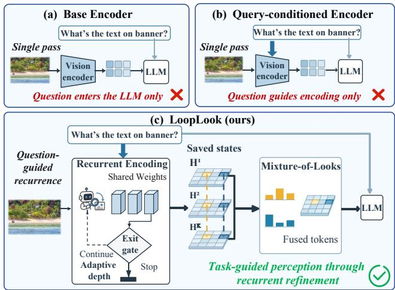  
Figure 1. Comparison of visual encoding paradigms. (a) The base encoder processes inputs in a single pass. (b) Queryconditioned encoding incorporates the question into encoding but remains single-pass. (c) LoopLook enables task-guided refinement with adaptive computation depth.

Recent advances have explored additional computation in VLMs, expanding the reasoning budget through explicit reasoning traces [25, 59, 68, 69], recursive refinement [13, 23, 65], and latent recurrent computation [29, 36, 54]. These methods give models more opportunities to interpret multimodal context after the image has been encoded. Still, the visual evidence itself is acquired in a single, task-agnostic pass: the image is converted into visual tokens before the model can determine which regions, details, or relations are required by the question [14, 55]. This creates an evidenceacquisition bottleneck between perception and cognition: a VLM may reason longer, yet still lack task-critical visual evidence that was inadequately captured during the initial encoding, potentially leading to insufficient visual grounding or overreliance on linguistic priors [44, 62, 70, 74]. Such a bottleneck is particularly consequential for tasks requiring fine-grained perception or image-dependent reasoning, where additional reasoning cannot compensate for underprocessed visual information [12, 71].

A direct way to address this limitation is to improve visual representations and their interface to the language model. Existing methods have pursued this goal by increasing input resolution [39, 40, 47], aggregating features from multiple encoder layers [51, 72], or using the instruction to fuse taskrelevant visual layers [32, 42, 71]. These advances show that VLM performance depends critically on how visual evidence is extracted, selected, and exposed. However, better selection and delivery of visual features do not, by themselves, enable the encoder to iteratively refine visual representations according to each question’s perceptual demands.

Adaptive recurrent computation provides exactly the mechanism needed to bring this missing flexibility into visual perception. Looped Transformers repeatedly apply a shared block to the hidden state, increasing effective computation depth without introducing separate parameters [16, 19]. Such recurrence has proven especially effective for language modeling [66, 78], with adaptive variants further adjust computation through learned halting [16, 20], budget-conditioned trajectories [28], or token-level routing [3, 75]. In vision and vision-language models, early explorations of looped architectures suggest that repeated computation can likewise refine visual representations and improve abstract or multimodal reasoning [9, 56, 60]. Together, these findings point to the potential of revisiting encoder layers to iteratively refine visual representations.

To realize this potential, we propose LoopLook, a lightweight encoder-side recurrent perception framework that equips pretrained VLMs with adaptive visual depth. LoopLook reuses a middle-to-late encoder window to iteratively update the visual state with shared weights (Figure 1). At each loop, the instruction representation, current visual summary, and loop-step embedding jointly generate layerwise affine modulation, adapting the shared transformations to the task and the evolving state. A learned exit gate evaluates the visual state after each update to determine whether another loop should be executed. Once execution stops, LoopLook constructs the final visual representation from the accumulated states rather than relying solely on the last update. To accommodate regional differences in how features evolve across loops, token-wise Mixture-of-Looks (MoL) learns a separate weighting over these states for each visual token. By combining LoRA with trainable modulation and keeping the language model frozen, LoopLook enables taskguided iterative refinement through lightweight adaptation.

We evaluate LoopLook on four pretrained VLM backbones across eight downstream benchmarks. LoopLook consistently improves average performance across all backbones, with gains of up to 8.6% on MMStar and 8.1% on

HallusionBench over the base model. Across recurrent loops, LoopLook progressively refines visual attention toward taskrelevant evidence, while its token-wise Mixture-of-Looks selectively integrates representations from different loops. Under reduced input resolution, LoopLook mitigates visual degradation by allocating greater recurrent depth and better preserving task-relevant information. Analysis of exit depths further shows that LoopLook assigns more loops to fine-grained and hallucination-prone tasks. This adaptive perception incurs only modest overhead, increasing time to first token (TTFT) by 5.1–6.5% while leaving autoregressive decoding essentially unchanged. Our contributions are summarized as follows:

• Bottleneck Identification. We formulate the one-shot evidence-acquisition bottleneck in VLMs, where cognition can receive additional computation while visual evidence remains fixed after a single, task-agnostic encoder pass.

• Recurrent Framework. We propose LoopLook, a recurrent perception framework that reuses a middle-to-late visual encoder window with task-conditioned modulation, adaptive exit, and Mixture-of-Looks.

• Comprehensive Evaluation. We evaluate LoopLook on four VLM backbones and eight benchmarks, demonstrating consistent gains, robustness to reduced resolution, learned depth allocation, and modest runtime overhead.

## 2. Related Work

Vision Encoders in Multimodal Models. VLMs typically integrate pretrained visual encoders with language models through a modality-alignment interface that maps visual features into the language model’s representation space [5, 14, 47, 64], with CLIP and SigLIP exemplifying visual encoders pretrained to align image representations with natural language supervision [57, 76]. To understand the resulting representations, studies further examine cross-modal convergence [26], develop tools for measuring representation similarity [33], and analyze the structure and utility of intermediate visual features [7, 10, 55, 58]. However, extracting the visual evidence needed for grounded perception and reasoning remains challenging for VLMs [11, 55, 62]. Two complementary lines of work address this challenge. One incorporates language conditions into feature extraction, ranging from early feature-wise modulation [15, 53] to question-aware visual encoders [1, 18, 31, 48, 49]. The other improves how visual features are selected and passed to the language model through visual token packing, multi-layer aggregation, layer fusion, and routing [32, 37, 42, 51, 72].

Adaptive Computation in Recurrent Networks. ACT introduced learned halting for recurrent computation [20], while Universal Transformers combined weight-shared updates with adaptive processing depth [16]. In language models, recurrent-depth architectures explore latent reasoning and compute-efficient scaling through repeated updates [19, 66, 78], while other approaches adapt pretrained models for shared-depth execution [2, 50]. Beyond increasing effective depth, recent work studies how to control this computation through budget-conditioned execution [28], token-specific recursion depths [3], and learned stopping for test-time scaling [75]. In vision, recurrent processing has been explored for convolutional feature refinement [41, 45], image classification [35], abstract visual reasoning [60], and multi-view reconstruction [9]. Within recursive vision architectures, block-recurrent designs re-execute a shared transformer block across depths [27]. Building on this view, reViT programs depth-specific experts into the shared block [8]. Extending recurrence to multimodal modeling, LoopVL combines loops to iteratively update a unified vision–language state [56].

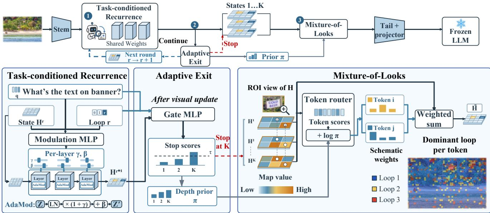  
Figure 2. Overview of LoopLook framework.

Positioning of Our Work. LoopLook connects these two research directions by making visual feature extraction both question-conditioned and recurrent. While most recurrent approaches train architectures from scratch, it requires only lightweight adaptation, preserving the pretrained visual representations while enabling iterative refinement.

## 3. Method

LoopLook refines visual representations through taskconditioned recurrence within a pretrained vision encoder before answer generation (Figure 2). Its design combines a shared recurrent window, loop-dependent feature modulation, and a Mixture-of-Looks module for adaptive stopping and token-wise state fusion. In this section, we first introduce the visual encoding formulation, then describe these components and the training objective.

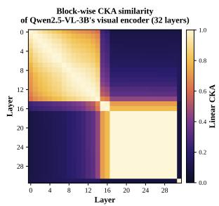

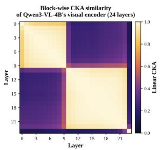  
Figure 3. Block structure in pretrained visual towers. Layerwise linear CKA forms coherent diagonal blocks, indicating contiguous encoder phases with aligned visual transformations. LoopLook places recurrence inside a middle-to-late block, reusing a consistent visual operation across loops.

## 3.1. Preliminary

Given an image I and an instruction x, a pretrained VLM first encodes the image into visual tokens and then generates the answer conditioned on them:

$$
\mathbf { V } = P _ { \psi } ( E _ { \theta } ( \mathbf { I } ) ) , \qquad \mathbf { Y } \sim D _ { \phi } ( \mathbf { Y } \mid \mathbf { x } , \mathbf { V } ) .\tag{1}
$$

Here $E _ { \theta }$ is the vision encoder, $P _ { \psi }$ is the projector, and $D _ { \phi }$ is the language model. Once produced, the visual tokens V remain fixed throughout language generation. Visual perception is therefore effectively a one-shot, task-agnostic decision: the representation must preserve the evidence needed for the downstream task before the model has an opportunity to reason about what the image requires. This can be limiting when useful evidence is fine-grained or degraded.

To address this bottleneck, we allow the visual representation to undergo further encoder-side processing, enabling adaptive and purposeful computation through recurrent perception with shared parameters. LoopLook formulates this process as recursive visual encoding:

$$
\mathbf { H } ^ { r + 1 } = F _ { \theta } ^ { s : e } ( \mathbf { H } ^ { r } ; \mathbf { x } , r ) , \quad r = 0 , \ldots , R _ { \mathrm { m a x } } - 1 ,\tag{2}
$$

where $R _ { \mathrm { m a x } }$ is the maximum number of loops, $\begin{array} { r l } { \mathbf { H } ^ { r } } & { { } = } \end{array}$ $\{ \mathbf { h } _ { i } ^ { r } \} _ { i = 1 } ^ { N }$ denotes the visual token states at the r-th loop, and $F _ { \theta } ^ { s : e }$ is the encoder window reused across loops and conditioned on the instruction x.

## 3.2. Recurrent Visual Encoding

LoopLook inserts recurrence inside the vision encoder. We decompose the encoder into an early stem $E _ { \theta } ^ { 0 : s }$ , a recurrent window $F _ { \theta } ^ { s : \epsilon }$ , and a readout tail $E _ { \theta } ^ { e : L }$

$$
E _ { \theta } = E _ { \theta } ^ { e : L } \circ F _ { \theta } ^ { s : e } \circ E _ { \theta } ^ { 0 : s } .\tag{3}
$$

The early stem extracts the initial visual state $\mathbf { H } ^ { 0 } = E _ { \boldsymbol { \theta } } ^ { 0 : s } ( \mathbf { I } )$ The same window $F _ { \theta } ^ { s : e }$ is then applied for up to $R _ { \mathrm { m a x } }$ loops, producing a sequence of visual states $\mathbf { H } ^ { 1 } , \ldots , \mathbf { H } ^ { R _ { \mathrm { m a x } } }$ . The readout tail and projector map each recurrent state back to the standard VLM interface: $\mathbf { \bar { V } } ^ { r } = P _ { \psi } \left( E _ { \theta } ^ { e : L } ( \mathbf { H } ^ { r } ) \right)$ .

We place the recurrent window in a middle-to-late region of the encoder, where features move toward semantic integration and become suitable for task-conditioned refinement. Following the block-recurrent view of ViTs [27], we treat a coherent CKA phase as a visual block: a set of adjacent layers with aligned transformations. Looping within one block gives the recurrent window a consistent operation to reuse. Figure 3 shows this block structure for two Qwen visual towers with complete details in Sec. A.

## 3.3. Task-Conditioned Modulation

LoopLook further supplies each loop with a compact condition that specifies the task, the current visual state, and the loop step. We first obtain a task state q by mean-pooling the instruction input embeddings from the language model’s embedding layer and project the pooled vector to the visual hidden dimension. At loop r, we concatenate this task state with the current visual summary and a learnable loop-step embedding $\mathbf { e } _ { r } \colon$

$$
\begin{array} { r } { \mathbf { z } ^ { r } = M _ { z } ( [ \mathbf { q } ; \mathrm { P o o l } ( \mathbf { H } ^ { r } ) ; \mathbf { e } _ { r } ] ) . } \end{array}\tag{4}
$$

Here $\mathbf { z } ^ { r }$ is the recurrent modulation state. The task state gives the visual encoder the instruction context, the pooled visual state summarizes what has been encoded so far, and $\mathbf { e } _ { r }$ marks the current loop step.

For each block ℓ in the recurrent window, $\mathbf { z } ^ { r }$ is mapped to affine parameters and applied to normalized visual features: $\gamma _ { \ell } ^ { r } , \beta _ { \ell } ^ { r } = M _ { \ell } ( \mathbf { z } ^ { r } ) , \mathrm { ~ A d a M o d } _ { \ell } ^ { r } ( \mathbf { Z } ) = ( 1 + \gamma _ { \ell } ^ { r } ) \odot \mathrm { L N } ( \mathbf { Z } ) + \beta _ { \ell } ^ { r } ,$ . (5)

The same recurrent window is therefore reused with a loopdependent modulation state. As the loop unfolds, the visual state evolves, the modulation state is recomputed, and the next update is conditioned on both the instruction and the current visual evidence.

## 3.4. Mixture-of-Looks

Mixture-of-Looks (MoL) couples adaptive stopping with token-wise state fusion: an exit gate determines the execution depth, and a router combines the available states for each visual token. After each loop, the gate predicts a conditional stopping score:

$$
s ^ { r } = \sigma ( h _ { \omega } ( \mathrm { P o o l } ( \mathbf { H } ^ { r } ) , \mathbf { q } , \mathbf { e } _ { r } ) ) , \ r = 1 , \ldots , R _ { \mathrm { m a x } } .\tag{6}
$$

The score $s ^ { r }$ represents the probability of exiting at loop r after reaching that loop. We set $s ^ { R _ { \mathrm { m a x } } } = 1$ to terminate at the maximum depth. At inference, the encoder exits at the first loop with $s ^ { r } > \tau$ , yielding an exit depth ${ \hat { R } } .$ The gate scores also define a stopping prior over loops:

$$
\pi _ { r } = s ^ { r } \prod _ { t < r } ( 1 - s ^ { t } ) , \qquad \sum _ { r = 1 } ^ { R _ { \operatorname* { m a x } } } \pi _ { r } = 1 .\tag{7}
$$

Each prior mass $\pi _ { r }$ is computed from the gate scores observed through loop r.

The token-wise router integrates all $R _ { \mathrm { m a x } }$ recurrent states during training and only the executed prefix at inference. The number of available states is $K = R _ { \mathrm { m a x } }$ during training and $K = { \hat { R } }$ at inference. The router computes token-specific scores $g _ { i , r } = g _ { \eta } ( \mathbf h _ { i } ^ { r } , \mathbf q , \mathbf p _ { i } , r )$ , combines them with the stopping prior, and normalizes over these K loops:

$$
\begin{array} { c l } { \displaystyle \alpha _ { i , r } = \mathrm { s o f t m a x } _ { r \leq K } \left( g _ { i , r } + \log ( \pi _ { r } + \epsilon ) \right) , } \\ { \displaystyle \tilde { \mathbf { h } } _ { i } = \sum _ { r = 1 } ^ { K } \alpha _ { i , r } \mathbf { h } _ { i } ^ { r } . } \end{array}\tag{8}
$$

Here $\mathbf { p } _ { i }$ is the spatial position of token $i ,$ and $\epsilon > 0$ stabilizes the logarithm. The stopping prior provides a sample-level preference over loops, while the token-specific scores allow each visual token to form its own mixture. The fused sequence $\tilde { \mathbf { H } } = \{ \tilde { \mathbf { h } } _ { i } \} _ { i = 1 } ^ { N }$ passes through the readout tail and projector to produce the visual tokens for answer generation:

$$
{ \bf V } = P _ { \psi } \left( E _ { \theta } ^ { e : L } ( \tilde { \bf H } ) \right) .\tag{9}
$$

## 3.5. Training Objective

During training, we unroll all $R _ { \mathrm { m a x } }$ loops and retain differentiable fusion across their states, allowing the answer loss to jointly train recurrent refinement, routing, and halting. This separates full-unroll optimization from early-exit inference, following the design principle of differentiable adaptive computation [6, 17]. We optimize the autoregressive next-token prediction loss together with an expected-depth penalty. Given target response tokens $\mathbf { Y } = \{ y _ { t } \} _ { t = 1 } ^ { T _ { y } }$ , where $T _ { y }$ is the response length, the objective is

$$
\begin{array} { l } { { \displaystyle { \mathcal { L } } = - \sum _ { t = 1 } ^ { T _ { y } } \log p _ { \phi } ( y _ { t } \mid y _ { < t } , \mathbf { x } , \mathbf { V } ) + \lambda _ { d } \mathbb { E } _ { \pi } [ r ] } , \ ~ } \\ { { \displaystyle { \mathbb { E } } _ { \pi } [ r ] = \sum _ { r = 1 } ^ { R _ { \operatorname* { m a x } } } r \pi _ { r } } . } \end{array}\tag{10}
$$

The next-token loss jointly trains the recurrent visual states, the token-wise router, and the exit gate, while the depth term encourages a lower expected loop count under π.

We gradually introduce the depth penalty using a linear ramp $\begin{array} { r } { \lambda _ { d } ( u ) = \lambda _ { d } ^ { \star } \cdot \operatorname* { m i n } \Bigl ( 1 , \operatorname* { m a x } \Bigl ( 0 , \frac { u - t _ { w } } { t _ { r } } \Bigr ) \Bigr ) } \end{array}$ , where u is the training step, $t _ { w }$ is the warmup length, $t _ { r }$ is the ramp length, and $\lambda _ { d } ^ { \star }$ is the target depth penalty. Both lengths are specified relative to the total number of training steps $T _ { \mathrm { t r a i n } }$ . This schedule first emphasizes learning useful visual updates and then introduces the cost of recurrent depth. Appendix E summarizes the training and inference workflows.

## 4. Experiments

## 4.1. Experimental Setup

Implementation Details. We implement experiments on four pretrained VLMs: Qwen2.5-VL-3B [5], Qwen3-VL-4B [4], InternVL3.5-4B [67], and LLaVA-1.5-7B [46], placing the recurrent window in the phase-identified middle-tolate visual blocks (layers 17–30, 10–22, 12–22, and 11–19, respectively). We train LoopLook on 100K Visual CoT [59] samples, using LoRA [24] with a rank of $r = 8$ and a scaling factor of $\alpha = 1 6$ for the vision encoder and fully training the newly introduced LoopLook modules. With the language model frozen, this adaptation trains only 14.9M, 10.6M, 10.1M, and 11.1M parameters respectively, corresponding to approximately 0.16%–0.40% of their total parameters. Each backbone completes training in roughly 1.5–5.5 hours on eight RTX 5090 GPUs. We set the maximum loop depth to $R _ { \operatorname* { m a x } } = 4$ and use an exit threshold of 0.4 at inference time. The depth penalty uses a linear ramp with ${ \lambda } _ { d } ^ { \star } = 0 . 0 0 0 5$ $t _ { w } = 0 . 6 T _ { \mathrm { t r a i n } }$ , and $t _ { r } = 0 . 4 T _ { \mathrm { t r a i n } }$ , where $T _ { \mathrm { t r a i n } }$ denotes the total number of training steps. Full details are provided in Appendix C.

Baselines and Benchmarks. We report performance across four backbones and reasoning-side prompting/decoding strategies, including Base direct answering, CoT prompting [69], and Self-Consistency with five samples [68]. We use LLaVA-1.5-7B as the primary setting to compare LoopLook with existing VLM visual-side enhancement methods, including Dense Connector [72] (multi-layer feature concatenation), TGIF [42] (instruction-guided layer fusion), and DeepStack [51] (anyres multi-crop encoding with intermediate-layer injection). We evaluate LoopLook on eight extensive downstream benchmarks covering three main abilities: general understanding (MMStar [11], VM-CBench [77], AI2D [30]), perception and reasoning $\mathrm { ( V ^ { * } \ [ 7 1 ] }$ BabyVision [12], VisualPuzzles [61]), and hallucination robustness (POPE [38], HallusionBench [21]). Full details are provided in Appendix F.

## 4.2. Main Results

Table 1 shows that LoopLook consistently improves average performance across all four backbones, with gains of up to 4.6%. On Qwen2.5-VL-3B, the improvements are particularly pronounced on MMStar and HallusionBench, rising by 8.6 and 8.1%, respectively, with a further 5.7% gain on $\mathrm { V } ^ { \ast }$ CoT and self-consistency often fail to improve fine-grained perception, suggesting that additional language-side computation alone is insufficient when visual evidence requires task-conditioned refinement. We further compare LoopLook with existing VLM enhancement methods using LLaVA-1.5- 7B in Table 2. LoopLook achieves the highest average score of 48.5, improving the baseline by 3.3%, and delivers the strongest performance on five benchmarks: MMStar, VM-CBench, BabyVision, POPE, and HallusionBench. Notably, its gains reach 6.9% on MMStar and 6.2% on BabyVision, while HallusionBench improves by 4.1%. Overall, these results demonstrate the effectiveness of combining questionguidance and adaptive recurrence for refining visual evidence and improving perception across diverse VLM backbones.

## 4.3. Analysis

## 4.3.1. Adaptive Looping Behaviors

Progressive Refinement of Visual Attention. Figure 4 visualizes attention heatmaps of the base VLM and LoopLook on $\mathbf { V } ^ { * }$ examples. Without question guidance, the original visual encoder favors general semantic features, resulting in diffuse attention that can overlook small, task-relevant details. By conditioning recurrent perception on the input question, LoopLook focuses attention on relevant visual regions. Across successive recurrent looks, attention is further deliberately refined and becomes increasingly concentrated on the queried evidence, enabling more precise localization for answer generation.

Low-Resolution Robustness. We next stress-test LoopLook by reducing the input resolution, which makes local details harder to preserve in a single encoder pass. Table 3 studies whether recurrent visual depth can mitigate the loss of visual evidence under this degradation. On Qwen2.5-VL-3B, LoopLook retains higher MMStar accuracy than the single-pass base at all tested resolutions, with the largest margin at the lowest resolution: at 50K, LoopLook retains 54.9 overall accuracy compared with 48.6 for Base, and the margin reaches 12.4% on fine-grained

Table 1. Performance across backbones and traditional prompting/decoding strategies on eight benchmarks.
<table><tr><td rowspan="2">Backbone</td><td rowspan="2">Method</td><td colspan="3">General Understanding</td><td colspan="3">Perception and Reasoning</td><td colspan="2">Hallucination Robustness</td><td rowspan="2"> $\mathbf { A v } \mathbf { g } .$ </td></tr><tr><td>MMStar</td><td>VMCBench</td><td>AI2D</td><td> $\mathbf { V } ^ { * }$ </td><td>BabyVision</td><td>VisualPuzzles</td><td>POPE</td><td>HalluBench</td></tr><tr><td rowspan="4">Qwen2.5 VL-3B</td><td>Base</td><td> $5 5 . 9$ </td><td> $7 4 . 9$ </td><td> $8 1 . 5$ </td><td> $\underline { { 7 2 . 8 } }$ </td><td> $1 4 . 9$ </td><td> $3 1 . 2$ </td><td>88.8</td><td>54.3</td><td>59.3</td></tr><tr><td>CoT</td><td> ${ \underline { { 5 6 . 2 } } } _ { \hat { \Pi } } 0 . 3$ </td><td> $7 3 . 5 _ { \downarrow 1 . 4 }$ </td><td> $8 2 . 8 _ { \uparrow 1 . 3 }$ </td><td> $6 5 . 4 _ { \downarrow 7 . 4 }$ </td><td> $1 3 . 9 _ { \downarrow 1 . 0 }$ </td><td> $3 0 . 1 _ { \downarrow 1 . 1 }$ </td><td> $\underline { { 8 9 . 0 } } _ { \cdot \mathrm { ( 0 . 2 } }$ </td><td> $5 4 . 5 _ { \uparrow 0 . 2 }$ </td><td> $5 8 . 2 _ { \downarrow 1 . 1 }$ </td></tr><tr><td>SC@5</td><td> $5 4 . 6 _ { \downarrow 1 . 3 }$ </td><td> $\underline { { 7 6 . 3 } } _ { \uparrow \uparrow 1 . 4 }$ </td><td> $\underline { { 8 3 . 9 } } _ { \uparrow 2 . 4 }$ </td><td> $6 7 . 0 _ { \downarrow 5 . 8 }$ </td><td> $\underline { { 1 6 . 5 } } _ { \uparrow 1 . 6 }$ </td><td> $\underline { { 3 1 . 8 } } _ { \uparrow 0 . 6 }$ </td><td> $8 8 . 6 _ { \downarrow 0 . 2 }$ </td><td> $5 8 . 7 \substack { \uparrow 4 . 4 }$ </td><td> $\underline { { 5 9 . 7 } } _ { \mathrm { \uparrow 0 . 4 } }$ </td></tr><tr><td>LoopLook</td><td> ${ \bf 6 4 . 5 } _ { \uparrow 8 . 6 }$ </td><td> $7 8 . 8 _ { \uparrow 3 . 9 }$ </td><td> ${ \bf 8 4 . 3 _ { \uparrow 2 . 8 } }$ </td><td> $7 8 . 5 _ { \uparrow 5 . 7 }$ </td><td> ${ \bf 1 8 . 6 } _ { \uparrow 3 . 7 }$ </td><td> $3 4 . 4 _ { \uparrow 3 . 2 }$ </td><td> ${ \bf 8 9 . 5 } _ { \uparrow 0 . 7 }$ </td><td> ${ \bf 6 2 . 4 } _ { \uparrow 8 . 1 }$ </td><td> ${ \bf 6 3 . 9 _ { \uparrow 4 . 6 } }$ </td></tr><tr><td rowspan="4">Qwen3 VL-4B</td><td>Base</td><td> $6 9 . 2$ </td><td> $7 6 . 7$ </td><td> $\underline { { 8 2 . 6 } }$ </td><td>74.9</td><td>17.8</td><td>34.1</td><td>90.1</td><td>60.8</td><td>63.3</td></tr><tr><td>CoT</td><td> $\underline { { 7 0 . 6 } } _ { \uparrow \uparrow . 4 }$ </td><td> $7 6 . 9 _ { \uparrow 0 . 2 }$ </td><td> $8 2 . 0 _ { \downarrow 0 . 6 }$ </td><td> $7 4 . 3 _ { \downarrow 0 . 6 }$ </td><td> $1 3 . 4 _ { \downarrow 4 . 4 }$ </td><td> ${ \underline { { 3 5 . 1 } } } _ { \mathrm { \uparrow 1 . 0 } }$ </td><td> $8 6 . 9 _ { \downarrow 3 . 2 }$ </td><td> $5 4 . 9 _ { \downarrow 5 . 9 }$ </td><td> $6 1 . 8 _ { \downarrow 1 . 5 }$ </td></tr><tr><td>SC@5</td><td> $7 0 . 3 _ { \uparrow \uparrow . 1 . 1 }$ </td><td> $\underline { { 7 8 . 4 } } _ { \uparrow \uparrow . 7 }$ </td><td> $8 2 . 1 _ { \downarrow 0 . 5 }$ </td><td> $\underline { { 7 6 . 4 } } _ { \uparrow \uparrow 1 . 5 }$ </td><td> $\underline { { 1 5 . 5 } } _ { \downarrow 2 . 3 }$ </td><td> $3 3 . 9 _ { \downarrow 0 . 2 }$ </td><td> $8 8 . 6 _ { \downarrow 1 . 5 }$ </td><td> $6 0 . 4 _ { \downarrow 0 . 4 }$ </td><td> $6 3 . 2 _ { \downarrow 0 . 1 }$ </td></tr><tr><td>LoopLook</td><td> $7 3 . 7 _ { \uparrow 4 . 5 }$ </td><td> ${ \bf 8 1 . 3 _ { \uparrow 4 . 6 } }$ </td><td> ${ \bf 8 4 . 8 _ { \uparrow 2 . 2 } }$ </td><td> $7 9 . 6 _ { \uparrow 4 . 7 }$ </td><td> $1 4 . 4 _ { \downarrow , 3 . 4 }$ </td><td> ${ \bf 3 7 . 0 _ { \uparrow 2 . 9 } }$ </td><td> $\mathbf { 9 0 . 8 _ { \uparrow 0 . 7 } }$ </td><td> ${ \bf 6 3 . 1 } _ { \uparrow 2 . 3 }$ </td><td> ${ \bf 6 5 . 6 } _ { \uparrow 2 . 3 }$ </td></tr><tr><td rowspan="4">InternVL 3.5-4B</td><td>Base</td><td> $6 5 . 0$ </td><td> $7 8 . 2$ </td><td>82.6</td><td>78.0</td><td> $1 4 . 9$ </td><td>30.3</td><td>88.9</td><td>59.2</td><td>62.1</td></tr><tr><td>CoT</td><td> $\underline { { 6 6 . 9 } } _ { \mathrm { \uparrow 1 . 9 } }$ </td><td> $\underline { { 8 0 . 8 } } _ { \uparrow 2 . 6 }$ </td><td> ${ \bf 8 4 . 9 } _ { \uparrow 2 . 3 }$ </td><td> $\underline { { 7 8 . 5 } } _ { \mathrm { \uparrow 0 . 5 } }$ </td><td> $1 7 . 5 _ { \uparrow 2 . 6 }$ </td><td> $2 7 . 5 _ { \downarrow 2 . 8 }$ </td><td> $8 7 . 4 _ { \downarrow 1 . 5 }$ </td><td> $5 8 . 8 _ { \downarrow 0 . 4 }$ </td><td> $\underline { { 6 2 . 8 } } _ { \uparrow 0 . 7 }$ </td></tr><tr><td>SC@5</td><td> $6 6 . 7 \substack { \uparrow 1 . 7 }$ </td><td> $7 9 . 2 _ { \uparrow \uparrow . 0 }$ </td><td> $\underline { { 8 4 . 6 } } _ { \uparrow 2 . 0 }$ </td><td> $7 7 . 0 _ { \downarrow 1 . 0 }$ </td><td> $\underline { { 1 7 . 8 } } _ { \uparrow 2 . 9 }$ </td><td> $2 7 . 3 _ { \downarrow 3 . 0 }$ </td><td> $8 8 . 5 _ { \downarrow 0 . 4 }$ </td><td> $5 7 . 3 _ { \downarrow 1 . 9 }$ </td><td> $6 2 . 3 _ { \uparrow 0 . 2 }$ </td></tr><tr><td>LoopLook</td><td> ${ \bf 6 9 . 6 } _ { \uparrow 4 . 6 }$ </td><td> ${ \bf 8 1 . 1 } _ { \uparrow 2 . 9 }$ </td><td> $\underline { { 8 4 . 6 } } _ { \uparrow 2 . 0 }$ </td><td> ${ \bf 8 1 . 7 } _ { \uparrow 3 . 7 }$ </td><td> $\mathbf { 1 9 . 6 } _ { \uparrow 4 . 7 }$ </td><td> $3 3 . 8 _ { \uparrow 3 . 5 }$ </td><td> $\mathbf { 9 0 . 2 } _ { \uparrow \uparrow . 3 }$ </td><td> ${ \bf 6 1 . 5 } _ { \uparrow 2 . 3 }$ </td><td> ${ \bf 6 5 . 3 } _ { \uparrow 3 . 2 }$ </td></tr><tr><td rowspan="4">LLaVA 1.5-7B</td><td>Base</td><td> $\underline { { 3 2 . 3 } }$ </td><td>53.8</td><td>53.7</td><td>49.7</td><td>10.8</td><td>23.9</td><td>89.7</td><td> $4 7 . 3$ </td><td>45.2</td></tr><tr><td>CoT</td><td> $3 0 . 4 _ { \downarrow 1 . 9 }$ </td><td> ${ \underline { { 5 5 . 2 } } } _ { \hat { \imath } \hat { \bf { \to } } 1 \cdot 4 }$ </td><td> ${ \underline { { 5 4 . 0 } } } _ { \uparrow 0 . 3 }$ </td><td> $4 8 . 2 _ { \downarrow 1 . 5 }$ </td><td> $1 2 . 9 _ { \uparrow 2 . 1 }$ </td><td> $2 4 . 4 _ { \uparrow 0 . 5 }$ </td><td> $9 0 . 1 _ { \uparrow \uparrow 0 . 4 }$ </td><td> $4 4 . 6 _ { \downarrow 2 . 7 }$ </td><td> $4 5 . 0 _ { \downarrow 0 . 2 }$ </td></tr><tr><td>SC@5</td><td> $3 0 . 8 _ { \downarrow 1 . 5 }$ </td><td> ${ \bar { \mathbf { 5 6 . 5 } } } _ { \uparrow 2 . 7 }$ </td><td> $5 1 . 7 _ { \downarrow 2 . 0 }$ </td><td> $5 1 . 8 _ { \uparrow 2 . 1 }$ </td><td> $\underline { { 1 4 . 4 } } \uparrow 3 . 6$ </td><td> $2 4 . 6 _ { \uparrow 0 . 7 }$ </td><td> $8 8 . 3 _ { \downarrow 1 . 4 }$ </td><td> $4 8 . 9 \substack { \uparrow 1 . 6 }$ </td><td> $4 5 . 9 \ L _ { \uparrow 0 . 7 }$ </td></tr><tr><td>LoopLook</td><td> $3 9 . 2 _ { \uparrow 6 . 9 }$ </td><td> $5 5 . 1 _ { \uparrow \uparrow . 3 }$ </td><td> $5 5 . 8 _ { \uparrow 2 . 1 }$ </td><td> $5 4 . 5 _ { \uparrow 4 . 8 }$ </td><td> ${ \bf 1 7 . 0 _ { \uparrow 6 . 2 } }$ </td><td> ${ \bf 2 4 . 8 _ { \uparrow 0 . 9 } }$ </td><td> $\mathbf { 9 0 . 2 _ { \uparrow 0 . 5 } }$ </td><td> ${ \bf 5 1 . 4 } _ { \uparrow 4 . 1 }$ </td><td> ${ \bf 4 8 . 5 } _ { \uparrow 3 . 3 }$ </td></tr></table>

Table 2. Performance comparison against existing VLM enhancement methods. The first three columns summarize whether each method supports adaptive computation, task guidance, and depth recurrence. Since all existing baselines provide LLaVA-based checkpoints, we use $\mathrm { L L a V A – 1 } . 5 – 7 \mathrm { B }$ as the base model in this experiment.
<table><tr><td>Method</td><td>Adaptive computation</td><td>Task- guided</td><td>Depth recurrence</td><td>MMStar</td><td>VMC Bench</td><td>AI2D</td><td> $\mathbf { V } ^ { * }$ </td><td>Baby  $\mathrm { V i s i o n }$ </td><td>Visual Puzzles</td><td>POPE</td><td>Hallusion Bench</td><td> $\mathbf { A v } \mathbf { g } .$ </td></tr><tr><td>Base</td><td>x</td><td>x</td><td>x</td><td> $3 2 . 3$ </td><td> $\underline { { 5 3 . 8 } }$ </td><td> $5 3 . 7$ </td><td> $4 9 . 7$ </td><td>10.8</td><td> $2 3 . 9$ </td><td> $\underline { { 8 9 . 7 } }$ </td><td> $4 7 . 3$ </td><td> $4 5 . 2$ </td></tr><tr><td>Dense Connector</td><td>x</td><td>x</td><td>x</td><td> $2 7 . 9 _ { \downarrow 4 . 4 }$ </td><td> $4 6 . 6 _ { \downarrow 7 . 2 }$ </td><td> $5 0 . 6 _ { \perp 3 . 1 }$ </td><td> $4 4 . 5 _ { \downarrow 5 . 2 }$ </td><td> $\underline { { 1 3 . 7 } } _ { \uparrow 2 . 9 }$ </td><td> $2 3 . 2 _ { \downarrow 0 . 7 }$ </td><td> $7 7 . 2 _ { \downarrow 1 2 . 5 }$ </td><td> $\underline { { 4 9 . 3 } } _ { \uparrow 2 . 0 }$ </td><td> $4 1 . 6 _ { \downarrow 3 . 6 }$ </td></tr><tr><td>TGIF</td><td>x</td><td>√</td><td>x</td><td> $3 3 . 9 \substack { \uparrow 1 . 6 }$ </td><td> $5 2 . 8 _ { \downarrow 1 . 0 }$ </td><td> ${ \underline { { 5 6 . 7 } } } _ { \uparrow 3 . 0 }$ </td><td> ${ \bar { \bf 5 } } { \bar { \bf 5 } } . { \bf 0 } _ { \uparrow 5 . 3 }$ </td><td> $1 0 . 3 _ { \downarrow 0 . 5 }$ </td><td> $2 5 . 0 _ { \uparrow 1 . 1 }$ </td><td> $8 9 . 6 _ { \perp 0 . 1 }$ </td><td> $4 6 . 2 _ { \downarrow 1 . 1 }$ </td><td> ${ \underline { { 4 6 . 2 } } } _ { \hat { \Gamma } ^ { 1 } \cdot 0 }$ </td></tr><tr><td>DeepStack</td><td>x</td><td>x</td><td>x</td><td> $3 1 . 7 _ { \downarrow 0 . 6 }$ </td><td> $4 9 . 4 _ { \downarrow 4 . 4 }$ </td><td> ${ \bf 6 0 . 6 _ { \mathrm { \uparrow 6 . 9 } } }$ </td><td> $4 9 . 2 _ { \downarrow 0 . 5 }$ </td><td> $9 . 8 _ { \downarrow 1 . 0 }$ </td><td> $2 5 . 3 _ { \uparrow 1 . 4 }$ </td><td> $8 6 . 7 _ { \perp 3 . 0 }$ </td><td> $4 5 . 3 _ { \downarrow 2 . 0 }$  </td><td> $4 4 . 8 _ { \downarrow 0 . 4 }$ </td></tr><tr><td>LoopLook</td><td>√</td><td>√</td><td>√</td><td> $3 9 . 2 _ { \uparrow 6 . 9 }$ </td><td> ${ \bar { 5 } } 5 . 1 _ { \uparrow 1 . 3 }$ </td><td> $5 5 . 8 _ { \uparrow 2 . 1 }$ </td><td> ${ \underline { { 5 4 . 5 } } } _ { \uparrow \ 4 . 8 }$ </td><td> $\mathbf { 1 7 . 0 } _ { \uparrow 6 . 2 }$ </td><td> $2 4 . 8 _ { \uparrow 0 . 9 }$ </td><td> $\mathbf { 9 0 . 2 _ { \uparrow 0 . 5 } }$ </td><td> ${ \bar { \bf s } } 1 . 4 _ { \uparrow 4 . 1 }$ </td><td> $4 8 . 5 _ { \uparrow 3 . 3 }$ </td></tr></table>

Table 3. Robustness to reduced resolution on MMStar. We report accuracy for six categories and overall, along with the average number of visual loops. Base denotes a single pass through the visual block.
<table><tr><td>Resolution</td><td>Method CP</td><td>FP IR LR Math</td><td>S&amp;T</td><td>Overall Loops</td><td></td></tr><tr><td rowspan="2">50K</td><td>Base</td><td>61.2 37.2 61.2 48.4</td><td>50.0 33.6</td><td>48.6</td><td>1.0</td></tr><tr><td>LoopLook</td><td>68.4 49.6 63.2 55.2 54.0</td><td>39.2</td><td>54.9</td><td>2.3</td></tr><tr><td rowspan="2">200K</td><td>Base</td><td>64.4 46.0 61.2 48.4</td><td>53.2 36.0</td><td>51.5</td><td>1.0</td></tr><tr><td>LoopLook 68.4 50.4</td><td>64.4 56.4</td><td>53.2 38.4</td><td>55.2</td><td>1.8</td></tr><tr><td rowspan="2">450K</td><td>Base</td><td>68.8 45.6 64.4 54.8</td><td>54.4 39.6</td><td>54.6</td><td>1.0</td></tr><tr><td>LoopLook 69.6 59.6 68.0 59.2</td><td></td><td>60.8 45.2</td><td>60.4</td><td>1.6</td></tr></table>

Loop-Depth Allocation. Figure 5 reports the average number of executed loops across benchmarks. The learned exit policy assigns the largest visual depth to V∗ (2.62), HallusionBench (2.35), and BabyVision (2.18), where answers often depend on small details, visual traps, or weak localized evidence. POPE (1.28), AI2D (1.42), MMStar (1.51), and VMCBench (1.55) exit earlier on average, suggesting that many samples in these benchmarks can be resolved with limited additional visual processing. This pattern supports the intended behavior of LoopLook: recurrent computation is used selectively, with harder perception cases receiving more encoder-side depth.

CP: Coarse Perception; FP: Fine-grained Perception; IR: Instance Reasoning; LR: Logical Reasoning; S&T: Science & Technology.

perception. The average number of executed loops also decreases as resolution increases, from 2.3 at 50K to 1.8 at 200K and 1.6 at 450K. This behavior echoes human vision, in which insufficiently clear visual evidence can prompt further inspection, whereas sufficiently informative views require less additional scrutiny. Similarly, LoopLook allocates more computation when visual evidence is weak and exit earlier when the input provides enough detail.

Token-wise Routing Patterns. Figure 6 visualizes the token-wise Mixture-of-Looks decision by assigning each image token to the loop state with the largest routing weight. The routing maps show that many background tokens are read from early recurrent states, while tokens near questionrelevant regions are more frequently routed to later states. This behavior complements the sample-level exit policy: after deciding how many loops to execute for an image, LoopLook still selects visual depth separately for each token, allowing localized evidence to benefit from deeper recurrent representations without forcing the entire image representation to rely on the last loop.

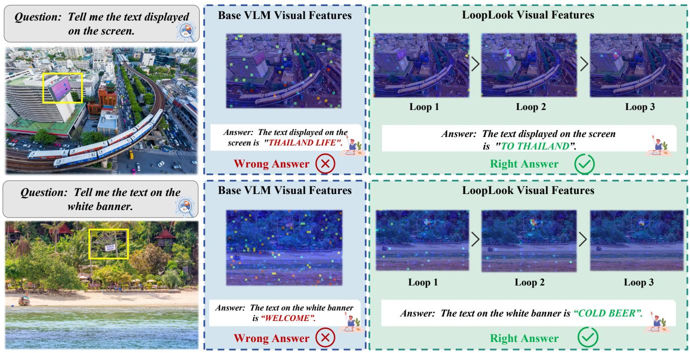  
Figure 4. Attention heatmap visualization of progressive visual refinement. We visualize the penultimate encoder layer of Qwen2.5-VL-3B at the end of each loop, providing a comparable view of the evolving visual state, and compare the base VLM with LoopLook on V∗ cases. The base encoder produces diffuse attention heatmaps and incorrect answers, while LoopLook progressively concentrates attention on task-relevant evidence across recurrent loops.

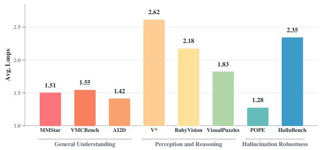  
Figure 5. Adaptive loop-depth allocation across benchmarks. LoopLook assigns more recurrent visual processing to fine-grained and hallucination-prone benchmarks, while easier or more direct recognition tasks exit earlier.

## 4.3.2. Computational Efficiency

Runtime Overhead. We measure inference latency on a single NVIDIA RTX 5090 using 200 randomly sampled examples across downstream benchmarks. Before timing, we warm up each model with five forward passes and evaluate Base and LoopLook in an interleaved order to mitigate thermal drift or measurement bias. LoopLook allocates additional computation only to a window of the visual encoder, which contributes a limited fraction of the overall VLM computation while playing a critical role in visual perception, leaving autoregressive decoding unchanged. As shown in Table 4, this design increases TTFT by only 5.1%-6.5%. The decoding latency remains essentially unchanged, and the end-to-end latency is nearly identical because decoding dominates the total generation time. This makes encoder-side recurrence an efficient place to spend additional computation: it improves the quality of visual evidence before generation while adding only a small prefill-side cost.

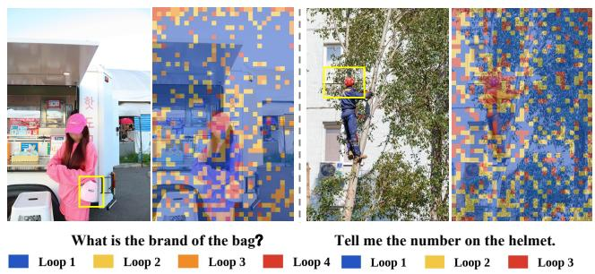  
Figure 6. Token-wise routing patterns in Mixture-of-Looks. For each image token, we visualize the loop state with the largest routing weight. Earlier loops cover broad background regions, while later-loop assignments appear around local evidence required by the question, such as the bag region and the helmet area.

Table 4. Runtime overhead evaluated on Qwen2.5-VL-3B. We report time to first token (TTFT), per-token decoding latency, and end-to-end (E2E) runtime for generating 64 tokens.
<table><tr><td>Resolution</td><td>Method</td><td>TTFT</td><td>Overhead</td><td>Decode</td><td>E2E</td></tr><tr><td rowspan="2">300K</td><td>Base</td><td>67.2 ms</td><td></td><td>21.6 ms/tok</td><td>1.425 s</td></tr><tr><td>LoopLook</td><td>71.6 ms</td><td>+6.5%</td><td>21.7 ms/tok</td><td>1.435 s</td></tr><tr><td rowspan="2">550K</td><td>Base</td><td>84.9 ms</td><td></td><td>21.8 ms/tok</td><td>1.459 s</td></tr><tr><td>LoopLook 89.2 ms</td><td></td><td>+5.1%</td><td>21.5 ms/tok</td><td>1.447 s</td></tr></table>

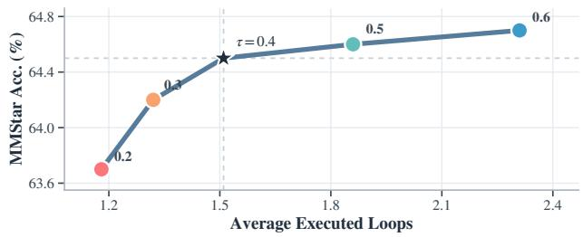  
Figure 7. Accuracy–compute tradeoff under exit thresholds. Each point corresponds to one exit threshold on MMStar.

Table 5. Component ablations and fixed-depth comparisons. Avg. Loops denotes the sample-weighted average number of loops.
<table><tr><td>Variant</td><td>MMStar</td><td> $\mathbf { V } ^ { * }$ </td><td>HallusionBench</td><td>Avg.</td><td>Loops</td></tr><tr><td>LoopLook (Full)</td><td>64.5</td><td>78.5</td><td>62.4</td><td>68.5</td><td>1.89</td></tr><tr><td>Param.-matched</td><td> $5 7 . 2 _ { \downarrow 7 . 3 }$ </td><td> $7 3 . 8 _ { \downarrow 4 . 7 }$ </td><td> $5 3 . 6 _ { \downarrow 8 . 8 }$ </td><td> $6 1 . 5 _ { \downarrow 7 . 0 }$ </td><td>1.00</td></tr><tr><td>FLOPs-matched</td><td> $5 8 . 6 _ { \downarrow 5 . 9 }$ </td><td> $7 3 . 8 _ { \downarrow 4 . 7 }$ </td><td> $5 8 . 7 _ { \downarrow 3 . 7 }$ </td><td> $6 3 . 7 _ { \downarrow 4 . 8 }$ </td><td>1.00</td></tr><tr><td>w/o recurrence</td><td> $5 9 . 7 _ { \downarrow 4 . 8 }$ </td><td> $7 4 . 9 _ { \downarrow 3 . 6 }$ </td><td> $5 7 . 8 _ { \downarrow 4 . 6 }$ </td><td> $6 4 . 1 _ { \downarrow 4 . 4 }$ </td><td>1.00</td></tr><tr><td>w/o task condition</td><td> $5 8 . 8 _ { \downarrow 5 . 7 }$ </td><td> $7 3 . 8 _ { \downarrow 4 . 7 }$ </td><td> $5 8 . 7 _ { \downarrow 3 . 7 }$ </td><td> $6 3 . 8 _ { \downarrow 4 . 7 }$ </td><td>2.12</td></tr><tr><td>w/o token fusion</td><td> $6 2 . 2 _ { \downarrow , 2 . 3 }$ </td><td> $7 6 . 4 _ { \downarrow 2 . 1 }$ </td><td> $6 0 . 0 _ { \downarrow 2 . 4 }$ </td><td> $6 6 . 2 _ { \downarrow , 2 . 3 }$ </td><td>1.86</td></tr><tr><td>Fixed-1</td><td> $5 4 . 8 _ { \downarrow 9 . 7 }$ </td><td> $7 4 . 9 _ { \downarrow 3 . 6 }$ </td><td> $5 9 . 9 _ { \downarrow 2 . 5 }$ </td><td> $6 3 . 2 _ { \downarrow 5 . 3 }$ </td><td>1.00</td></tr><tr><td>Fixed-2</td><td> $6 3 . 2 _ { \downarrow 1 . 3 }$ </td><td> $\underline { { 7 8 . 5 } }$ </td><td> $6 2 . 0 _ { \downarrow 0 . 4 }$ </td><td> $6 7 . 9 _ { \downarrow 0 . 6 }$ </td><td>2.00</td></tr><tr><td>Fixed-3</td><td> $6 3 . 8 _ { \downarrow 0 . 7 }$ </td><td> $7 7 . 5 _ { \downarrow 1 . 0 }$ </td><td> ${ \bf 6 2 . 7 _ { \uparrow 0 . 3 } }$ </td><td> $6 8 . 0 _ { \downarrow 0 . 5 }$ </td><td>3.00</td></tr><tr><td>Fixed-4</td><td> $\underline { { 6 4 . 3 } } _ { \downarrow 0 . 2 }$ </td><td> ${ \bf 8 1 . 2 } _ { \uparrow 2 . 7 }$ </td><td> $6 1 . 8 _ { \downarrow 0 . 6 }$ </td><td> ${ \bf 6 9 . 1 _ { \uparrow 0 . 6 } }$ </td><td>4.00</td></tr></table>

Accuracy–Compute Tradeoff. Figure 7 shows the accuracy–compute frontier induced by the exit threshold. A higher threshold makes early exit harder, increasing the average number of executed loops and gradually improving MMStar accuracy. The curve saturates after the default threshold $\tau = 0 . 4 \colon$ moving from $\tau = 0 . 4$ to larger thresholds adds more recurrent visual computation but yields only marginal accuracy gains. We therefore use 0.4 as the default setting, which preserves most of the performance benefit while avoiding unnecessary visual depth.

## 4.4. Ablation Studies

## 4.4.1. Contribution of Individual Components

Table 5 compares fine-tuning baselines, component ablations, and fixed-depth execution on Qwen2.5-VL-3B. We include parameter- and training-FLOPs-matched fine-tuning, remove recurrence, task conditioning, or token-wise fusion, and compare adaptive execution with fixed budgets of one to four loops. Detailed protocols are given in Sec. D.

Table 6. Recurrent window ablations.
<table><tr><td>Window</td><td></td><td>Layers MMStar</td><td> $\mathbf { V } ^ { * }$ </td><td>HalluBench</td><td> $\mathbf { A v g } .$ </td></tr><tr><td>Mid-Late (Default) 17–30</td><td></td><td>64.5</td><td>78.5</td><td> $6 2 . 4$ </td><td>68.5</td></tr><tr><td>Cross-block</td><td>14-27</td><td> $5 8 . 4 _ { \downarrow 6 . 1 }$ </td><td> $7 4 . 3 \downarrow 4 . 2$ </td><td> $5 6 . 9 _ { \downarrow 5 . 5 }$ </td><td> $6 3 . 2 _ { \downarrow 5 . 3 }$ </td></tr><tr><td>Early</td><td>0-13</td><td> $6 2 . 0 _ { \downarrow 2 . 5 }$ </td><td> $7 7 . 0 _ { \downarrow 1 . 5 }$ </td><td> $6 2 . 5 _ { \uparrow 0 . 1 }$ </td><td> $6 7 . 2 _ { \downarrow 1 . 3 }$ </td></tr><tr><td>Early-Mid</td><td>3-16</td><td> ${ \underline { { 6 3 . 1 } } } _ { \downarrow 1 . 4 }$ </td><td> $\underline { { 7 7 . 5 } } _ { \downarrow 1 . 0 }$ </td><td> ${ \bf 6 2 . 7 _ { \uparrow 0 . 3 } }$ </td><td> $\underline { { 6 7 . 8 } } _ { \downarrow 0 . 7 }$ </td></tr></table>

Param-Matched FT reaches an average accuracy of 61.5, while FLOPs-Matched FT reaches 63.7 after extending the baseline training schedule by 1.5× steps. LoopLook achieves 68.5, outperforming both fine-tuning baselines.

Removing recurrence reduces the average score by 4.4 points. Removing task conditioning lowers accuracy by 4.7 points and increases the average loop count from 1.89 to 2.12. Replacing token-wise Mixture-of-Looks with a shared cross-loop readout lowers the average score by 2.3 points. These results show the contributions of recurrent refinement, question guidance, and token-specific state fusion.

Using the same trained checkpoint, fixed-depth execution reaches average accuracies of 63.2, 67.9, and 68.0 at one, two, and three loops, respectively. Adaptive execution achieves 68.5 with an average of 1.89 loops, outperforming both fixed two- and three-loop settings with fewer loops. Fixed four-loop execution reaches 69.1, but at substantially greater computational depth, highlighting the efficiency of adaptive depth allocation.

## 4.4.2. Recurrent Window Placement

To investigate the effect of recurrent window placement, we sweep the recurrent window while keeping all other settings fixed on Qwen2.5-VL-3B. Table 6 shows that the middleto-late CKA block achieves the best average performance, outperforming Early-Mid, Early, and Cross-block windows by 0.7, 1.3, and 5.3 points, respectively. This suggests that the default window provides a favorable balance: its features are semantically organized enough to respond to the question, yet still retain visual detail that can be refined through recurrent computation. Earlier windows are less effective because they mainly process local appearance and low-level patterns, so recurrence may repeat generic visual extraction and provide weaker task-critical refinement. The cross-block window performs worst, dropping to 63.2 on average. This supports our phase-aware design: recurrence is most effective when the shared window repeatedly applies a coherent visual transformation. A window that crosses strong CKA boundaries may mix layers with different functional roles, making the repeated update less stable and less aligned with the transformations learned during pretraining.

## 5. Conclusion

We introduced LoopLook, a task-conditioned recurrent visual encoding framework that allocates additional computation to perception. By combining a shared encoder window with question-guided modulation, adaptive stopping, and token-wise Mixture-of-Looks, LoopLook refines visual representations with only lightweight additional training. Experiments across backbones and benchmarks show consistent improvements in performance, while additional evaluations demonstrate adaptive depth allocation, robustness to reduced resolution, and modest latency overhead. Future work could explore finer-grained spatial control and tighter integration with ongoing reasoning to further enhance perception. We hope our findings highlight the value of adaptive visual computation for enhancing multimodal understanding.

## References

[1] Ofir Abramovich, Niv Nayman, Sharon Fogel, Inbal Lavi, Ron Litman, Shahar Tsiper, Royee Tichauer, Srikar Appalaraju, Shai Mazor, and R Manmatha. Visfocus: Promptguided vision encoders for ocr-free dense document understanding. In European Conference on Computer Vision, pages 241–259. Springer, 2024. 2

[2] Sangmin Bae, Adam Fisch, Hrayr Harutyunyan, Ziwei Ji, Seungyeon Kim, and Tal Schuster. Relaxed recursive transformers: Effective parameter sharing with layer-wise lora. In International Conference on Learning Representations, pages 34282–34327, 2025. 3

[3] Sangmin Bae, Yujin Kim, Reza Bayat, Sungnyun Kim, Jiyoun Ha, Tal Schuster, Adam Fisch, Hrayr Harutyunyan, Ziwei Ji, Aaron Courville, et al. Mixture-of-recursions: Learning dynamic recursive depths for adaptive token-level computation. Advances in Neural Information Processing Systems, 38:96572–96617, 2026. 2, 3

[4] Shuai Bai, Yuxuan Cai, Ruizhe Chen, Keqin Chen, Xionghui Chen, Zesen Cheng, Lianghao Deng, Wei Ding, Chang Gao, Chunjiang Ge, et al. Qwen3-vl technical report. arXiv preprint arXiv:2511.21631, 2025. 5, 13

[5] Shuai Bai, Keqin Chen, Xuejing Liu, Jialin Wang, Wenbin Ge, Sibo Song, Kai Dang, Peng Wang, Shijie Wang, Jun Tang, Humen Zhong, Yuanzhi Zhu, Mingkun Yang, Zhaohai Li, Jianqiang Wan, Pengfei Wang, Wei Ding, Zheren Fu, Yiheng Xu, Jiabo Ye, Xi Zhang, Tianbao Xie, Zesen Cheng, Hang Zhang, Zhibo Yang, Haiyang Xu, and Junyang Lin. Qwen2.5- vl technical report, 2025. 2, 5, 13

[6] Andrea Banino, Jan Balaguer, and Charles Blundell. Pondernet: Learning to ponder. arXiv preprint arXiv:2107.05407, 2021. 4

[7] Daniel Bolya, Po-Yao Huang, Peize Sun, Jang Hyun Cho, Andrea Madotto, Chen Wei, Tengyu Ma, Jiale Zhi, Jathushan Rajasegaran, Hanoona Bangalath, et al. Perception encoder: The best visual embeddings are not at the output of the network. Advances in Neural Information Processing Systems, 38:60884–60937, 2026. 2

[8] Adrian Bulat, Yassine Ouali, and Georgios Tzimiropoulos. One block, multiple depths: Recurrent vision transformers with depth-programmed experts. arXiv preprint arXiv:2610.12448, 2026. 3

[9] Alessandro Burzio, Tobias Fischer, Sven Elflein, Qunjie Zhou, Riccardo de Lutio, Jiawei Ren, Jiahui Huang, Shengyu Huang, Marc Pollefeys, Laura Leal-Taixé, Zan Gojcic, and Haithem Turki. Déjà view: Looping transformers for multi-view 3d reconstruction, 2026. 2, 3

[10] Mathilde Caron, Hugo Touvron, Ishan Misra, Hervé Jégou, Julien Mairal, Piotr Bojanowski, and Armand Joulin. Emerging properties in self-supervised vision transformers. In 2021 IEEE/CVF international conference on computer vision (ICCV), pages 9630–9640. IEEE, 2021. 2

[11] Lin Chen, Jinsong Li, Xiaoyi Dong, Pan Zhang, Yuhang Zang, Zehui Chen, Haodong Duan, Jiaqi Wang, Yu Qiao, Dahua Lin, et al. Are we on the right way for evaluating large vision-language models? Advances in Neural Information Processing Systems, 37:27056–27087, 2024. 2, 5, 21

[12] Liang Chen, Weichu Xie, Yiyan Liang, Hongfeng He, Hans Zhao, Zhibo Yang, Zhiqi Huang, Haoning Wu, Haoyu Lu, Yiping Bao, et al. Babyvision: Visual reasoning beyond language. arXiv preprint arXiv:2601.06521, 2026. 2, 5, 21

[13] Kanzhi Cheng, Li YanTao, Fangzhi Xu, Jianbing Zhang, Hao Zhou, and Yang Liu. Vision-language models can selfimprove reasoning via reflection. In Proceedings ofthe 2025 Conference of the Nations of the Americas Chapter of the Association for Computational Linguistics: Human Language Technologies (Volume 1: Long Papers), pages 8876–8892, 2025. 1

[14] Wenliang Dai, Junnan Li, Dongxu Li, Anthony Tiong, Junqi Zhao, Weisheng Wang, Boyang Li, Pascale N Fung, and Steven Hoi. Instructblip: Towards general-purpose visionlanguage models with instruction tuning. Advances in neural information processing systems, 36:49250–49267, 2023. 1, 2

[15] Harm De Vries, Florian Strub, Jérémie Mary, Hugo Larochelle, Olivier Pietquin, and Aaron Courville. Modulating early visual processing by language. Advances in neural information processing systems, 30, 2017. 2

[16] Mostafa Dehghani, Stephan Gouws, Oriol Vinyals, Jakob Uszkoreit, and Łukasz Kaiser. Universal transformers. arXiv preprint arXiv:1807.03819, 2018. 2, 13

[17] Cristobal Eyzaguirre and Alvaro Soto. Differentiable adaptive computation time for visual reasoning. In 2020 IEEE/CVF Conference on Computer Vision and Pattern Recognition (CVPR), pages 12814–12822. IEEE, 2020. 4

[18] Roy Ganz, Yair Kittenplon, Aviad Aberdam, Elad Ben Avraham, Oren Nuriel, Shai Mazor, and Ron Litman. Question aware vision transformer for multimodal reasoning. In Proceedings ofthe IEEE/CVF conference on computer vision and pattern recognition, pages 13861–13871, 2024. 2

[19] Jonas Geiping, Sean McLeish, Neel Jain, John Kirchenbauer, Siddharth Singh, Brian Bartoldson, Bhavya Kailkhura, Abhinav Bhatele, and Tom Goldstein. Scaling up test-time compute with latent reasoning: A recurrent depth approach. Advances in Neural Information Processing Systems, 38:41340– 41391, 2026. 2, 3

[20] Alex Graves. Adaptive computation time for recurrent neural networks. arXiv preprint arXiv:1603.08983, 2016. 2

[21] Tianrui Guan, Fuxiao Liu, Xiyang Wu, Ruiqi Xian, Zongxia Li, Xiaoyu Liu, Xijun Wang, Lichang Chen, Furong Huang, Yaser Yacoob, et al. Hallusionbench: an advanced diagnostic suite for entangled language hallucination and visual illusion in large vision-language models. In 2024 IEEE/CVF Conference on Computer Vision and Pattern Recognition (CVPR), pages 14375–14385. IEEE, 2024. 5, 21

[22] Mary Hayhoe and Dana Ballard. Eye movements in natural behavior. Trends in cognitive sciences, 9(4):188–194, 2005. 1

[23] Jiayi He, Hehai Lin, Qingyun Wang, Yi R Fung, and Heng Ji. Self-correction is more than refinement: A learning framework for visual and language reasoning tasks. In Findings of the Association for Computational Linguistics: ACL 2025, pages 6405–6421, 2025. 1

[24] Edward J Hu, Yelong Shen, Phillip Wallis, Zeyuan Allen-Zhu, Yuanzhi Li, Shean Wang, Lu Wang, and Weizhu Chen. Lora: Low-rank adaptation of large language models. arXiv preprint arXiv:2106.09685, 2021. 5, 13

[25] Lianyu Hu, Ma Xiaoyu, Zeqin Liao, and Yang Liu. TVI-CoT: Text-visual interleaved chain-of-thought reasoning for multimodal understanding. In Proceedings ofthe 43rd International Conference on Machine Learning, pages 45820–45831. PMLR, 2026. 1

[26] Minyoung Huh, Brian Cheung, Tongzhou Wang, and Phillip Isola. The platonic representation hypothesis. arXiv preprint arXiv:2405.07987, 2024. 2

[27] Mozes Jacobs, Thomas Fel, Richard Hakim, Alessandra Brondetta, Demba Ba, and T Anderson Keller. Block recurrent dynamics in vision transformers. In International Conference on Learning Representations, pages 51617–51642, 2026. 3, 4, 13

[28] Ahmadreza Jeddi, Marco Ciccone, and Babak Taati. Loopformer: Elastic-depth looped transformers for latent reasoning via shortcut modulation. arXiv preprint arXiv:2602.11451, 2026. 2, 3

[29] Byungwoo Jeon, Yoonwoo Jeong, Hyunseok Lee, Minsu Cho, and Jinwoo Shin. Vision-aligned latent reasoning for multi-modal large language model. arXiv preprint arXiv:2602.04476, 2026. 1

[30] Aniruddha Kembhavi, Mike Salvato, Eric Kolve, Minjoon Seo, Hannaneh Hajishirzi, and Ali Farhadi. A diagram is worth a dozen images. In Computer Vision – ECCV 2016, pages 235–251, Cham, 2016. Springer International Publishing. 5, 21

[31] Jongha Kim, Minseong Bae, Sanghyeok Lee, Jinsung Yoon, and Hyunwoo J Kim. Tabflash: Efficient table understanding with progressive question conditioning and token focusing. In Proceedings of the AAAI Conference on Artificial Intelligence, pages 22573–22581, 2026. 2

[32] Jeonghwan Kim, Sofia Stoica, Jiwan Chung, Ansel Blume, Hyeonjeong Ha, Zhenhailong Wang, Xin Luna Dong, and Heng Ji. Mixture of layers: Dynamic layer routing for visual reasoning, 2026. 2

[33] Simon Kornblith, Mohammad Norouzi, Honglak Lee, and Geoffrey Hinton. Similarity of neural network representations

revisited. In International conference on machine learning, pages 3519–3529. PMlR, 2019. 2, 13

[34] Victor A.F. Lamme and Pieter R. Roelfsema. The distinct modes of vision offered by feedforward and recurrent processing. Trends in Neurosciences, 23(11):571–579, 2000. 1

[35] Sang In Lee and Jihun Park. Soft mixture-of-recursions: Going deeper with recursive vision transformers. arXiv preprint arXiv:2607.00774, 2026. 3

[36] Bangzheng Li, Ximeng Sun, Jiang Liu, Ze Wang, Jialian Wu, Xiaodong Yu, Emad Barsoum, Muhao Chen, and Zicheng Liu. Latent visual reasoning. In International Conference on Learning Representations, pages 148076–148090, 2026. 1

[37] Wentong Li, Yuqian Yuan, Jian Liu, Dongqi Tang, Song Wang, Jie Qin, Jianke Zhu, and Lei Zhang. Tokenpacker: Efficient visual projector for multimodal llm. International Journal ofComputer Vision, 133(10):6794–6812, 2025. 2

[38] Yifan Li, Yifan Du, Kun Zhou, Jinpeng Wang, Xin Zhao, and Ji-Rong Wen. Evaluating object hallucination in large visionlanguage models. In Proceedings of the 2023 conference on empirical methods in natural language processing, pages 292–305, 2023. 5, 21

[39] Yanwei Li, Yuechen Zhang, Chengyao Wang, Zhisheng Zhong, Yixin Chen, Ruihang Chu, Shaoteng Liu, and Jiaya Jia. Mini-gemini: Mining the potential of multi-modality vision language models. IEEE Transactions on Pattern Analysis and Machine Intelligence, 2025. 2

[40] Zhang Li, Biao Yang, Qiang Liu, Zhiyin Ma, Shuo Zhang, Jingxu Yang, Yabo Sun, Yuliang Liu, and Xiang Bai. Monkey: Image resolution and text label are important things for large multi-modal models. In 2024 IEEE/CVF Conference on Computer Vision and Pattern Recognition (CVPR), pages 26753–26763. IEEE, 2024. 2

[41] Ming Liang and Xiaolin Hu. Recurrent convolutional neural network for object recognition. In Proceedings ofthe IEEE conference on computer vision and pattern recognition, pages 3367–3375, 2015. 3

[42] Chenchen Lin, Sanbao Su, Rachel Luo, Yuxiao Chen, Yan Wang, Marco Pavone, and Fei Miao. Text-guided layer fusion mitigates hallucination in multimodal llms. arXiv preprint arXiv:2601.03100, 2026. 2, 5, 19

[43] Tsung-Yi Lin, Michael Maire, Serge Belongie, James Hays, Pietro Perona, Deva Ramanan, Piotr Dollár, and C Lawrence Zitnick. Microsoft coco: Common objects in context. In European conference on computer vision, pages 740–755. Springer, 2014. 21

[44] Zhiqiu Lin, Xinyue Chen, Deepak Pathak, Pengchuan Zhang, and Deva Ramanan. Revisiting the role of language priors in vision-language models. In Proceedings of the 41st International Conference on Machine Learning, pages 29914–29934. PMLR, 2024. 1

[45] Drew Linsley, Junkyung Kim, Vijay Veerabadran, Charles Windolf, and Thomas Serre. Learning long-range spatial dependencies with horizontal gated recurrent units. Advances in neural information processing systems, 31, 2018. 3

[46] Haotian Liu, Chunyuan Li, Yuheng Li, and Yong Jae Lee. Improved baselines with visual instruction tuning. In 2024

IEEE/CVF Conference on Computer Vision and Pattern Recognition (CVPR), pages 26286–26296. IEEE, 2024. 5, 13

[47] Haotian Liu, Chunyuan Li, Yuheng Li, Bo Li, Yuanhan Zhang, Sheng Shen, and Yong Jae Lee. Llava-next: Improved reasoning, ocr, and world knowledge, 2024. 2, 21

[48] Hanpeng Liu, Yaqian Li, Zidan Wang, Shuoxi Zhang, Zihao Bo, Rinyoichi Takezoe, Kaiwen Long, and Kun He. igvlm: Dynamic instruction-guided vision encoding for question-aware multimodal understanding. arXiv preprint arXiv:2603.02748, 2026. 2

[49] Chengzhi Mao, Xudong Lin, and Wen-Sheng Chu. Languageinstructed vision embeddings for controllable and generalizable perception. arXiv preprint arXiv:2606.19584, 2026. 2

[50] Sean McLeish, Ang Li, John Kirchenbauer, Dayal Singh Kalra, Brian R Bartoldson, Bhavya Kailkhura, Avi Schwarzschild, Jonas Geiping, Tom Goldstein, and Micah Goldblum. Teaching pretrained language models to think deeper with retrofitted recurrence. arXiv preprint arXiv:2511.07384, 2025. 3

[51] Lingchen Meng, Jianwei Yang, Rui Tian, Xiyang Dai, Zuxuan Wu, Jianfeng Gao, and Yu-Gang Jiang. Deepstack: Deeply stacking visual tokens is surprisingly simple and effective for lmms. Advances in Neural Information Processing Systems, 37:23464–23487, 2024. 2, 5, 19

[52] Thomas Parr and Karl J. Friston. The active construction of the visual world. Neuropsychologia, 104:92–101, 2017. 1

[53] Ethan Perez, Florian Strub, Harm De Vries, Vincent Dumoulin, and Aaron Courville. Film: Visual reasoning with a general conditioning layer. In Proceedings of the AAAI conference on artificial intelligence, 2018. 2

[54] Tan-Hanh Pham and Chris Ngo. Multimodal chain of continuous thought for latent-space reasoning in vision-language models. arXiv preprint arXiv:2508.12587, 2025. 1

[55] Nedyalko Prisadnikov, Danda Pani Paudel, Yuqian Fu, and Luc Van Gool. Vision encoders should be image size agnostic and task driven. arXiv preprint arXiv:2508.16317, 2025. 1, 2

[56] Zhe Qian, Ziyang Gong, Zhongxing Xu, Hehan Li, Zhonghua Wang, Fei Luo, Mingxuan Wang, Xue Yang, Yanbiao Ma, Junchi Yan, et al. Loopvl: Recurrent visual intelligence. arXiv preprint arXiv:2609.38426, 2026. 2, 3, 13

[57] Alec Radford, Jong Wook Kim, Chris Hallacy, Aditya Ramesh, Gabriel Goh, Sandhini Agarwal, Girish Sastry, Amanda Askell, Pamela Mishkin, Jack Clark, et al. Learning transferable visual models from natural language supervision. In International conference on machine learning, pages 8748–8763. PmLR, 2021. 2, 21

[58] Maithra Raghu, Thomas Unterthiner, Simon Kornblith, Chiyuan Zhang, and Alexey Dosovitskiy. Do vision transformers see like convolutional neural networks? Advances in neural information processing systems, 34:12116–12128, 2021. 2

[59] Hao Shao, Shengju Qian, Han Xiao, Guanglu Song, Zhuofan Zong, Letian Wang, Yu Liu, and Hongsheng Li. Visual cot: Advancing multi-modal language models with a comprehensive dataset and benchmark for chain-of-thought reasoning. Advances in Neural Information Processing Systems, 37:8612– 8642, 2024. 1, 5, 14

[60] Wen-Jie Shu, Xuerui Qiu, Rui-Jie Zhu, Harold Haodong Chen, Yexin Liu, and Harry Yang. Loopvit: Scaling visual arc with looped transformers. arXiv preprint arXiv:2602.02156, 2026. 2, 3

[61] Yueqi Song, Tianyue Ou, Yibo Kong, Zecheng Li, Graham Neubig, and Xiang Yue. Visualpuzzles: Decoupling multimodal reasoning evaluation from domain knowledge, 2025. 5, 21

[62] Shengbang Tong, Zhuang Liu, Yuexiang Zhai, Yi Ma, Yann LeCun, and Saining Xie. Eyes wide shut? exploring the visual shortcomings of multimodal llms. In 2024 IEEE/CVF Conference on Computer Vision and Pattern Recognition (CVPR), pages 9568–9578. IEEE, 2024. 1, 2

[63] Hugo Touvron, Louis Martin, Kevin Stone, Peter Albert, Amjad Almahairi, Yasmine Babaei, Nikolay Bashlykov, Soumya Batra, Prajjwal Bhargava, Shruti Bhosale, Dan Bikel, Lukas Blecher, Cristian Canton Ferrer, Moya Chen, Guillem Cucurull, David Esiobu, Jude Fernandes, Jeremy Fu, Wenyin Fu, Brian Fuller, Cynthia Gao, Vedanuj Goswami, Naman Goyal, Anthony Hartshorn, Saghar Hosseini, Rui Hou, Hakan Inan, Marcin Kardas, Viktor Kerkez, Madian Khabsa, Isabel Kloumann, Artem Korenev, Punit Singh Koura, Marie-Anne Lachaux, Thibaut Lavril, Jenya Lee, Diana Liskovich, Yinghai Lu, Yuning Mao, Xavier Martinet, Todor Mihaylov, Pushkar Mishra, Igor Molybog, Yixin Nie, Andrew Poulton, Jeremy Reizenstein, Rashi Rungta, Kalyan Saladi, Alan Schelten, Ruan Silva, Eric Michael Smith, Ranjan Subramanian, Xiaoqing Ellen Tan, Binh Tang, Ross Taylor, Adina Williams, Jian Xiang Kuan, Puxin Xu, Zheng Yan, Iliyan Zarov, Yuchen Zhang, Angela Fan, Melanie Kambadur, Sharan Narang, Aurelien Rodriguez, Robert Stojnic, Sergey Edunov, and Thomas Scialom. Llama 2: Open foundation and fine-tuned chat models, 2023. 21

[64] Pavan Kumar Anasosalu Vasu, Fartash Faghri, Chun-Liang Li, Cem Koc, Nate True, Albert Antony, Gokula Santhanam, James Gabriel, Peter Grasch, Oncel Tuzel, et al. Fastvlm: Efficient vision encoding for vision language models. In Proceedings ofthe IEEE/CVF Conference on Computer Vision and Pattern Recognition, pages 19769–19780, 2025. 2

[65] Haozhe Wang, Chao Qu, Zuming Huang, Wei Chu, Fangzhen Lin, and Wenhu Chen. Vl-rethinker: Incentivizing selfreflection of vision-language models with reinforcement learning. Advances in Neural Information Processing Systems, 38: 30865–30891, 2026. 1

[66] Shaowen Wang, Ge Zhang, Kairong Luo, Yuhao Wu, Shaofan Liu, Jiaheng Liu, Wenhao Huang, Shen Yan, and Jian Li. Smelt: Scaling laws for compute-matched moe looped transformers. arXiv preprint arXiv:2609.01343, 2026. 2, 3

[67] Weiyun Wang, Zhangwei Gao, Lixin Gu, Hengjun Pu, Long Cui, Xingguang Wei, Zhaoyang Liu, Linglin Jing, Shenglong Ye, Jie Shao, et al. Internvl3. 5: Advancing open-source multimodal models in versatility, reasoning, and efficiency. arXiv preprint arXiv:2508.18265, 2025. 5, 13

[68] Xuezhi Wang, Jason Wei, Dale Schuurmans, Quoc Le, Ed Chi, Sharan Narang, Aakanksha Chowdhery, and Denny Zhou. Self-consistency improves chain of thought reasoning in language models. arXiv preprint arXiv:2203.11171, 2022. 1, 5

[69] Jason Wei, Xuezhi Wang, Dale Schuurmans, Maarten Bosma, Fei Xia, Ed Chi, Quoc V Le, Denny Zhou, et al. Chain-ofthought prompting elicits reasoning in large language models. Advances in neural information processing systems, 35:24824– 24837, 2022. 1, 5

[70] Juncheng Wu, Hardy Chen, Haoqin Tu, Xianfeng Tang, Freda Shi, Hui Liu, Hanqing Lu, Cihang Xie, and Yuyin Zhou. From seeing to thinking: Decoupling perception and reasoning improves post-training of vision-language models. In Proceedings ofthe 43rd International Conference on Machine Learning, pages 135672–135690. PMLR, 2026. 1

[71] Penghao Wu and Saining Xie. V\*: Guided visual search as a core mechanism in multimodal llms. In 2024 IEEE/CVF Conference on Computer Vision and Pattern Recognition (CVPR), pages 13084–13094. IEEE, 2024. 2, 5, 21

[72] Huanjin Yao, Wenhao Wu, Taojiannan Yang, YuXin Song, Mengxi Zhang, Haocheng Feng, Yifan Sun, Zhiheng Li, Wanli Ouyang, and Jingdong Wang. Dense connector for mllms. Advances in Neural Information Processing Systems, 37:33108–33140, 2024. 2, 5, 19

[73] Alfred L Yarbus. Eye movements and vision. Springer, 2013. 1

[74] Wencheng Ye, Yi Bin, Yujuan Ding, Hongye Fang, Zheng Wang, Xing Xu, Jingkuan Song, Yun Zhang, Sirui Da, and Heng Tao Shen. The ebb and flow of multimodal focus: Scheduling visual relay windows for grounded vlm reasoning. arXiv preprint arXiv:2607.11436, 2026. 1

[75] Yichen You, Tianyu Fu, Aosong Feng, Xingtai Lv, Xuefei Ning, Ning Ding, and Yu Wang. Improving test-time scaling with adaptive looped transformers, 2026. 2, 3

[76] Xiaohua Zhai, Basil Mustafa, Alexander Kolesnikov, and Lucas Beyer. Sigmoid loss for language image pre-training. In 2023 IEEE/CVF International Conference on Computer Vision (ICCV), pages 11941–11952. IEEE, 2023. 2, 21

[77] Yuhui Zhang, Yuchang Su, Yiming Liu, Xiaohan Wang, James Burgess, Elaine Sui, Chenyu Wang, Josiah Aklilu, Alejandro Lozano, Anjiang Wei, Ludwig Schmidt, and Serena Yeung-Levy. Automated generation of challenging multiplechoice questions for vision language model evaluation, 2025. 5, 21

[78] Rui-Jie Zhu, Zixuan Wang, Kai Hua, Tianyu Zhang, Ziniu Li, Haoran Que, Boyi Wei, Zixin Wen, Fan Yin, He Xing, et al. Scaling latent reasoning via looped language models. arXiv preprint arXiv:2510.25741, 2025. 2, 3

## A. Phase-Aware Recurrent Window Selection

## A.1. Layer Similarity and Visual Blocks

We analyze the internal block structure of each vision tower with layer-wise centered linear CKA [33]. For a model with L visual layers, we collect token representations from each layer on a small shared image set and compute an L × L similarity matrix. Bright diagonal regions indicate contiguous phases of layers with aligned representations. We refer to each coherent phase as a visual block, following the block-recurrent view that Transformer depth can often be described by a small number of reusable computational blocks [16, 27].

This analysis is used as a structural guide for recurrent window placement. A window inside one block applies a visually consistent transformation across loops. A window that spans several blocks mixes different stages of visual processing, such as local appearance extraction and semantic integration. The main paper therefore uses middle-to-late blocks as the default search region and validates the choice with window sweeps.

## A.2. CKA Maps Across Backbones

Figure 8 shows the full CKA maps for the six visual towers analyzed in this work, covering Qwen2.5-VL [5], Qwen3- VL [4], InternVL3.5 [67], LoopVL [56], and LLaVA [46] backbones. Across these models, the matrices consistently exhibit a small number of bright diagonal blocks, suggesting that pretrained visual encoders organize depth into coherent computational phases. Table 7 summarizes the corresponding CKA blocks, whose locations vary by architecture and motivate phase-aware window selection for each backbone.

## A.3. Window Sweep Protocol

For each backbone, we sweep recurrent windows around the middle and late encoder regions and compare their downstream performance under matched training and inference settings. The CKA maps serve as a guide for selecting candidate windows; the final claim is based on the window sweep. In practice, windows that remain inside a coherent middle-to-late block give more stable gains, while very early windows and windows that cross strong block boundaries are less reliable. This supports the use of block-consistent recurrent visual encoding in the main method.

## B. More Case Studies

This section collects qualitative case studies. Section B.1 presents two open-ended BabyVision questions answered correctly by InternVL3.5-4B, where the free-form responses can be verified step by step. Section B.2 presents failure-tosuccess comparisons between the base VLM and LoopLook, visualizing how the recurrent visual features progressively refine attention onto the evidence region.

Table 7. CKA blocks for the visual towers analyzed in this work. Layer ranges are zero-indexed and interpreted from the CKA maps; singleton ranges denote isolated readout-style layers. Bold layer ranges indicate the blocks selected in our experiments for recurrent processing in each backbone.
<table><tr><td>Backbone</td><td>Layers</td><td>CKA blocks</td></tr><tr><td>Qwen2.5-VL-3B</td><td>32</td><td>0–14, 15–16, 17–30, 31</td></tr><tr><td>Qwen3-VL-4B</td><td>24</td><td>0–9, 10–22, 23</td></tr><tr><td>InternVL3.5-4B</td><td>24</td><td>0–11, 12–22, 23</td></tr><tr><td>InternVL3.5-8B</td><td>24</td><td>0–11, 12–22, 23</td></tr><tr><td>LoopVL-1B</td><td>28</td><td>0–18, 19–26, 27</td></tr><tr><td>LLaVA-1.5-7B</td><td>24</td><td>0–10, 11–19, 20–23</td></tr></table>

## B.1. BabyVision Open-Ended Cases

Case A: Counting stacked cubes. An example is shown in Fig. 9.

Case B: Subtracting two groups of planets. Another example is shown in Fig. 10.

## B.2. Attention Refinement Cases

Figure 11 shows representative cases in which the base VLM answers incorrectly while LoopLook succeeds. Each panel visualizes the attention distribution of the base VLM and of LoopLook at every recurrent step. In all cases, the base attention spreads over background regions, whereas the looped features progressively concentrate onto the evidence region. The number of loops actually used varies with the difficulty of localization (two loops for Figs. 11a and 11b, three loops for Figs. 11c and 11d).

## B.3. Per-Token Loop Tier Visualization

Figure 12 further visualizes the token-wise Mixture-of-Looks decision by assigning each image token to the loop state with the largest routing weight.

## C. Implementation Details

## C.1. Backbones and Trainable Parameters

We implement LoopLook on four pretrained VLM backbones: Qwen2.5-VL-3B [5], Qwen3-VL-4B [4], InternVL3.5-4B [67], and LLaVA-1.5-7B [46]. For each backbone, the recurrent window is placed in the middle-tolate visual block selected by the phase analysis in Sec. A. During training, we fine-tune the pretrained vision encoder using LoRA [24] with a rank of r = 8, a scaling factor of α = 16, and a dropout rate of 0.05. The resulting trainable budgets are 14.9M, 10.6M, 10.1M, and 11.1M parameters for Qwen2.5-VL-3B, Qwen3-VL-4B, InternVL3.5-4B, and LLaVA-1.5-7B respectively, all below 0.4% of each backbone’s total parameters (see Tab. 8). All parameters of the encoder-side LoopLook modules are fully trainable, including the recurrent perception components, adaptive feature integration modules, and exit mechanisms. The language model is kept frozen throughout training. This configuration combines parameter-efficient adaptation of the pretrained vision encoder with full optimization of the newly introduced LoopLook modules. This setting keeps the original language generation interface unchanged and concentrates adaptation on visual perception.

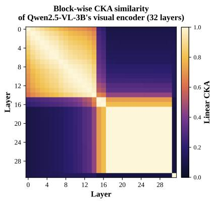  
(a) Qwen2.5-VL-3B

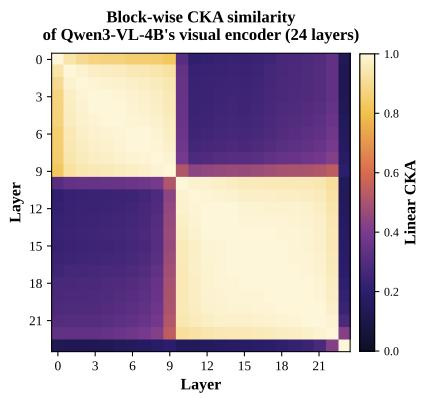  
(b) Qwen3-VL-4B

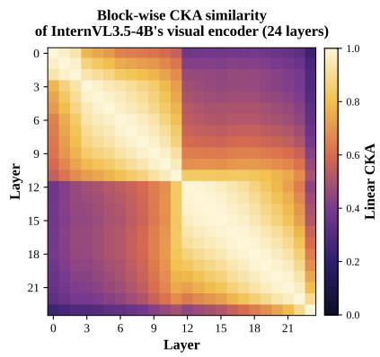  
(c) InternVL3.5-4B

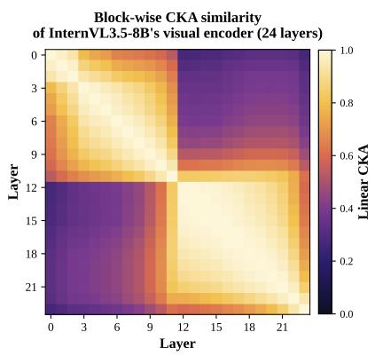  
(d) InternVL3.5-8B

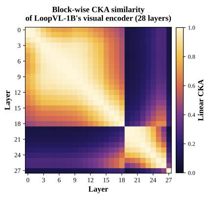  
(e) LoopVL-1B

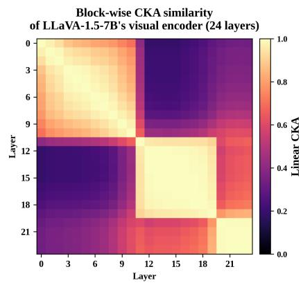  
(f) LLaVA-1.5-7B  
Figure 8. Layer-wise linear CKA maps for six visual towers. Across backbones, the encoder depth is organized into a small number of coherent visual blocks.

## C.2. LoopLook Hyperparameters

For all backbones, we set the maximum loop depth to $R _ { \mathrm { m a x } } ~ = ~ 4$ and use an exit threshold of 0.4 at inference time. The modulation state $\mathbf { z } ^ { r }$ lies in a compact subspace of dimension $d / 8 ,$ and the loop-step embedding er shares this dimension. For each recurrent block $\ell , M _ { \ell }$ is a single linear map from this state to the 2d affine coefficients $( \gamma _ { \ell } ^ { r } , \beta _ { \ell } ^ { r } )$ . We use mean pooling over visual tokens to obtain the visual summary in both the modulation module and the exit gate. The token-wise Mixture-of-Looks router is implemented as a two-layer MLP with hidden size $d / 4 ;$ the exit head uses the same hidden width and outputs a scalar sigmoid score after each loop.

## C.3. Training Setup

We train LoopLook with 100K Visual CoT [59] samples for one epoch using a global batch size of 8. We use AdamW with learning rate $3 \times 1 0 ^ { - 5 } , \beta = ( 0 . 9 , 0 . 9 5 )$ , and weight decay $1 0 ^ { - 2 }$ . The depth penalty uses a linear ramp with $\lambda _ { d } ^ { \star } =$ 0.0005, $t _ { w } = 0 . 6 T _ { \mathrm { t r a i n } }$ , and $t _ { r } = 0 . 4 T _ { \mathrm { t r a i n } }$ , where $T _ { \mathrm { t r a i n } }$ denotes the total number of training steps. Experiments are trained in parallel on eight RTX 5090 GPUs. We apply global gradient clipping with norm 1.0.

## C.4. Evaluation Settings

We evaluate all models with VLM-EvalKit1. For the Base and CoT baselines, we use greedy decoding with max\_new\_tokens=512. For Self-Consistency, we sample 5 CoT responses with temperature 0.5 and max\_new\_tokens=512, then predict by majority vote. All reported LoopLook results use the same benchmark

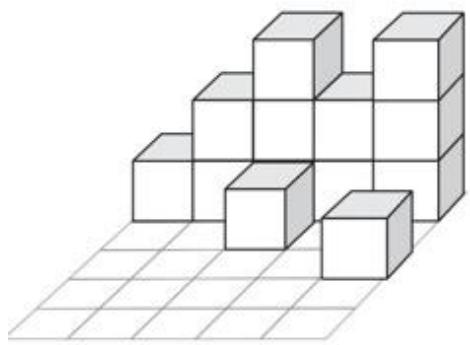

## Question

The image shows a three-dimensional shape made of stacked cubes. None of the cubes are suspended in the air. How many cubes are there at least?

## Response (correct; ground truth: 13)

To determine the minimum number of cubes in the given three-dimensional shape, we need to carefully analyze the structure and ensure that we account for all visible and hidden cubes. The shape has a base layer with several cubes; on top of some of these base cubes, there are additional cubes. The base layer has a total of 7 cubes, and there are 6 cubes in the second and third layer. Therefore, the total number of cubes is $7 + 6 = 1 3$ . Thus, the minimum number of cubes in the shape is \boxed{13}.

Figure 9. A correct LoopLook open-ended counting case. The model decomposes the stacked-cube structure into a base layer and upper layers, verifies that every upper cube is supported, and reaches the minimum count of 13.  
Table 8. Trainable-parameter composition of LoopLook (millions).
<table><tr><td>Component</td><td>Qwen2.5-VL-3B</td><td>Qwen3-VL-4B</td><td>InternVL3.5-4B</td><td>LLaVA-1.5-7B</td></tr><tr><td>LoRA (vision tower, r=8)</td><td>4.37</td><td>3.15</td><td>3.15</td><td>3.15</td></tr><tr><td>Task projection  $( d _ { l } \to d )$ </td><td>2.62</td><td>2.62</td><td>2.62</td><td>4.20</td></tr><tr><td> $M _ { z }$ </td><td>0.44</td><td>0.28</td><td>0.28</td><td>0.28</td></tr><tr><td> $M _ { \ell }$  (all recurrent blocks)</td><td>5.77</td><td>3.43</td><td>2.91</td><td>2.38</td></tr><tr><td>Loop-step embeddings  ${ \bf e } _ { r }$ </td><td>0.001</td><td>0.001</td><td>0.001</td><td>0.001</td></tr><tr><td>Exit head</td><td>0.87</td><td>0.56</td><td>0.56</td><td>0.56</td></tr><tr><td>Mixture-of-Looks router</td><td>0.87</td><td>0.56</td><td>0.56</td><td>0.56</td></tr><tr><td>Total (% of backbone)</td><td>14.9 (0.40%)</td><td>10.6 (0.25%)</td><td>10.1 (0.24%)</td><td>11.1 (0.16%)</td></tr></table>

prompts and answer extraction protocol as the corresponding backbone evaluations.

## C.5. Efficiency Measurement

We evaluate the inference efficiency of Base and LoopLook on a single NVIDIA GeForce RTX 5090 GPU (32 GB). We randomly sample 200 examples from the downstream benchmarks and use the same examples and decoding configuration for both methods. For each model, we perform five warm-up forward passes before timing, excluding warmup runs from the measurements. We evaluate Base and LoopLook in an interleaved order to mitigate thermal drift and order-dependent measurement bias. CUDA operations are synchronized at timing boundaries to ensure accurate wall-clock measurements.

For each input resolution, we generate 64 tokens per example using identical decoding settings. We report three metrics: (1) time tofirst token (TTFT), measured from the start

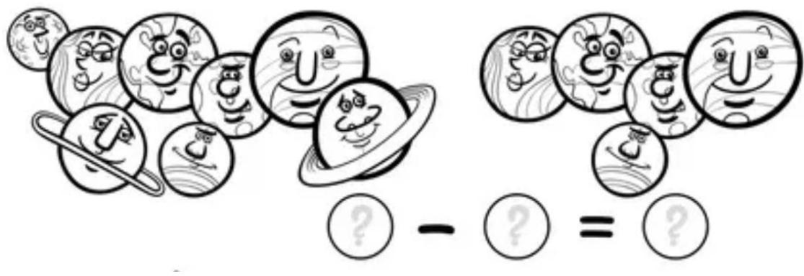

## Question

Based on the number of cartoon planets in the left and right groups, list the subtraction equation and calculate the result, and write it in the answer in the following format, for example: 3-1=2.

Response (correct; ground truth: 8-5=3)

To solve the problem, we need to count the number of cartoon planets in each group. On the left side, there are 8 cartoon planets. On the right side, there are 5 cartoon planets. The subtraction equation is: 8 - 5 = 3. So, the answer is: \boxed $\{ 8 - 5 = 3 \}$

Figure 10. A correct LoopLook open-ended subtraction case. The model counts the two groups of cartoon planets separately and forms the correct subtraction equation.

of the timed inference request to the return of the first generated token; (2) decoding latency, measured as the average wall-clock time per generated token during autoregressive decoding; and (3) end-to-end (E2E) latency, measured from the start of the timed inference request to the completion of 64-token generation. We repeat the measurements and report the mean latency across runs.

All measurements are conducted using Python 3.13.5, Py-Torch 2.14.0+cu130, CUDA 13.0, cuDNN 9.24, and Transformers 5.16.1, with NVIDIA driver version 580.95.05.

## D. Ablation Protocol

## D.1. Shared Training and Evaluation Settings

We evaluate controls on Qwen2.5-VL-3B targeting additional fine-tuning (Param-Matched FT and FLOPs-Matched FT), recurrent visual processing, task conditioning, tokenwise readout, and adaptive stopping. The five training-based controls are trained independently from the same pretrained backbone initialization, while the fixed-depth w/o adaptive exit variants reuse the full LoopLook checkpoint and change only the inference policy. Task-conditioned variants derive the visual task state from the instruction. All configurations follow the training and evaluation protocols in Sec. C, including prompts, answer extraction, and benchmark scoring. We report MMStar, V∗, and HallusionBench, with Avg. defined

as their arithmetic mean.

## D.2. Param- and FLOPs-Matched Fine-Tuning

Param-Matched FT. This control measures the gains from additional visual-side fine-tuning under a comparable trainable-parameter budget. We retain the original one-pass visual path,

$$
\mathbf { V } = P _ { \psi } ( E _ { \theta } ( \mathbf { I } ) ) ,\tag{11}
$$

including its original feature selection and projector interface. No recurrent window execution, task-conditioned modulation, exit gate, or Mixture-of-Looks module is added. The baseline is trained on the same image–instruction–response examples using the autoregressive answer loss, without a depth penalty.

To match the full model’s trainable-parameter budget, the baseline uses visual LoRA with rank 28 and scaling 56, preserving $\alpha / r \ = \ 2$ . LoRA injection locations and dropout remain unchanged. The baseline has approximately 15.3M trainable parameters, compared with 14.9M for the full LoopLook model.

FLOPs-Matched FT. Param-matched training does not guarantee equal computational budgets: LoopLook executes its recurrent window $R _ { \operatorname* { m a x } } = 4$ times per sample, while Param-Matched FT processes the vision tower only once.

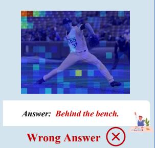  
Answer: The number on the second coins is 500. Wrong Answer  
Answer: The dog is on the right side ofthe crosswalk Right Answer

## Question: What three numbers can be seen on the second coin?

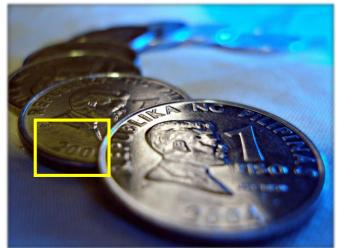

## Base VLM Visual Features

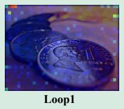

## LoopLook Visual Features

  
(a) Reading the numbers on a coin. The base attention scatters over the coin face and misreads the digits as “500”; the looped features sharpen onto the stamped region and recover all three digits (“200”).

## Question: Is the dog on the left or right side ofthe crosswalk?

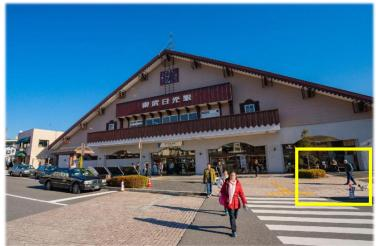

## Base VLM Visual Features

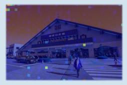

## LoopLook Visual Features

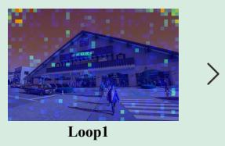

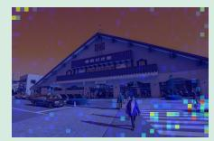  
(b) Localizing a dog relative to a crosswalk. The base attention locks onto the storefront and answers “left”; the looped features re-anchor onto the dog beside the crossing and correct the answer to “right”.

## Question: Tell me the number on the white board.

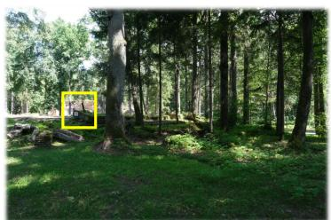

## Base VLM Visual Features

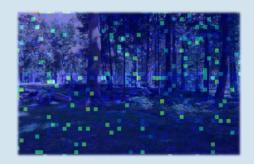  
Answer: The number on the white board is 1. Wrong Answer

## LoopLook Visual Features

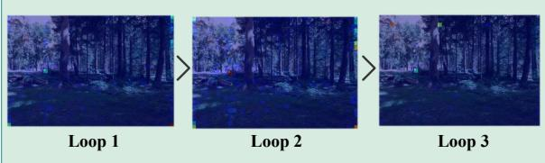  
(c) Reading a number on a whiteboard deep inside a forest scene. The base attention diffuses over the tree canopy; the looped features refine onto the small whiteboard and read the digit correctly.

## Question: Where is the seatedperson visible in the image?

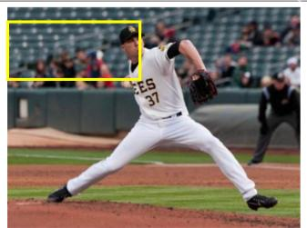

## Base VLM Visual Features

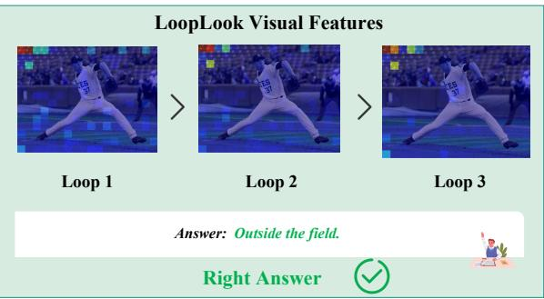  
(d) Finding a seated person in a baseball scene. The base attention follows the pitcher in the foreground; the looped features expand toward the spectator area outside the field and localize the seated person correctly.  
Figure 11. Failure-to-success comparisons between the base VLM and LoopLook. Yellow boxes mark the queried evidence region.

Loop 1 Loop 2 Loop 3  
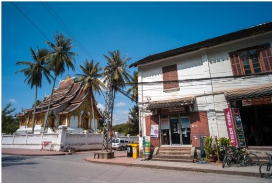  
Is the yellow trash can on the left or right side of the motorcycle?

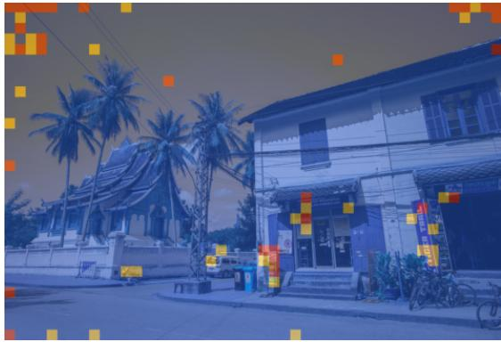  
Loop 1 Loop 2 Loop 3

(a) Relative-position case.  
  
Tell me the number on the boat.

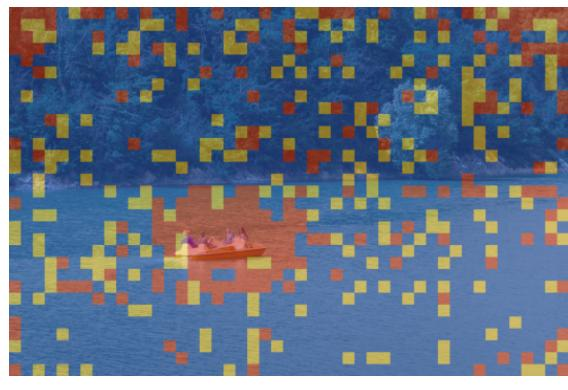

(b) Fine-grained OCR case.  
  
Tell me the text on the white banner.

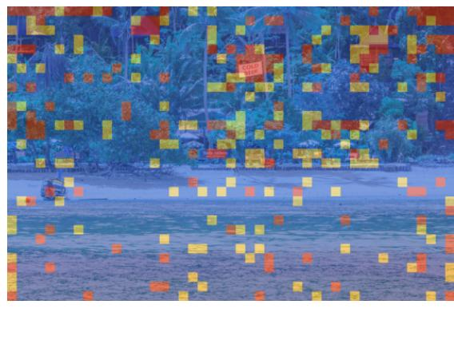  
Loop 1 Loop 2 Loop 3

(c) Text-reading case.

Figure 12. Per-token dominant-loop tier maps on three additional cases. Blue/yellow/red denote tokens whose evidence is dominated by Loop 1/2/3 respectively.

We estimate training FLOPs using 4NT per linear layer with N parameters and T tokens, accounting for both forward and backward passes. Since the language model is frozen, backward computation only requires input gradients. We distinguish visual patches $T _ { p }$ from merged visual tokens $T _ { m } = T _ { p } / 4$ processed by the language model. For Qwen2.5- VL-3B, with $N _ { \mathrm { L L M } } = 3 . 0 9 \mathrm { B } , N _ { \mathrm { V i T } } = 0 . 4 9 \mathrm { B }$ across 32 layers, and $N _ { \mathrm { W } } = 2 1 4 \mathrm { M }$ across the 14-layer window (blocks

17–30), we use $T _ { p } \approx 1 5 3 1 , T _ { m } \approx 3 8 3$ , and $T _ { t } \approx 2 5 0$ at   
300K pixels:

$$
\begin{array} { r } { F _ { \mathrm { b a s e } } = 4 N _ { \mathrm { L L M } } ( T _ { m } + T _ { t } ) + 4 N _ { \mathrm { V i T } } T _ { p } \approx 1 0 . 8 ~ \mathrm { T F } , } \\ { F _ { \mathrm { L o o p L o o k } } = F _ { \mathrm { b a s e } } + ( R _ { \mathrm { m a x } } - 1 ) 4 N _ { \mathrm { W } } T _ { p } \approx 1 4 . 8 ~ \mathrm { T F } . } \end{array}\tag{12}
$$

Only three window executions add extra FLOPs, as the first is included in the full tower pass. The trainable LoopLook modules $( M _ { z } , M _ { \ell }$ , exit head, and router; approximately 10.5M parameters) add less than 0.5% to the estimated budget. Under the same estimate, the LoopLook-to-baseline FLOPs ratio is ≈ 1.36× for Qwen2.5-VL-3B, ≈ 1.25× for Qwen3-VL-4B and InternVL3.5-4B, and $\approx 1 . 0 3 \times$ for LLaVA-1.5-7B, whose frozen language model dominates computation. To ensure a fair comparison, we train the same Param-Matched FT baseline for 1.5× as many optimization steps under the native cosine schedule, giving it a slightly larger training compute budget than LoopLook’s estimated overhead requires across all evaluated backbones.

## D.3. w/o Recurrence

We set $R _ { \operatorname* { m a x } } = 1$ throughout training, so the visual window executes only once. The task representation, initial visual state, modulation networks, and first-step embedding are retained:

$$
{ \bf H } ^ { 1 } = F _ { \theta } ^ { s : e } ( { \bf H } ^ { 0 } ; { \bf x } , 0 ) , \qquad { \tilde { \bf H } } = { \bf H } ^ { 1 } .\tag{13}
$$

The update uses the same block-wise adaptive modulation as the full model, followed by the standard readout tail and projector. Visual LoRA and task-conditioned modulation remain trainable. This control compares a single taskconditioned visual update with recurrent refinement.

## D.4. w/o Task Conditioning

We replace the visual-side task vector with a fixed zero vector, $\mathbf { q } _ { \mathrm { v i s u a l } } = \mathbf { 0 } .$ , while preserving the original interfaces and dimensions. This replacement is applied to the modulation network $M _ { z }$ , exit head $h _ { \omega } .$ , and readout router $g _ { \eta }$ . The language model still receives the original instruction, and the target response and answer supervision remain unchanged.

Visual-state conditioning, loop-step embeddings, the modulation architecture, adaptive exit, token-wise MoL, and the original training objective are retained. The model can adapt its visual computation to the image without question guidance. Comparing this variant with the full model measures the contribution of task conditioning across the three visual-side branches.

## D.5. w/o Token-Wise Fusion

The w/o token-wise fusion variant replaces token-specific fusion weights with a shared set of weights for each image. We retain the original scoring network and aggregate its

token-wise logits:

$$
\begin{array} { l } { { \displaystyle \ell _ { i , r } = g _ { \eta } \big ( \mathbf h _ { i } ^ { r } , \mathbf q , \mathbf p _ { i } , r \big ) , } } \\ { { \displaystyle \quad \bar { \ell } _ { r } = \frac { 1 } { N } \sum _ { i = 1 } ^ { N } \ell _ { i , r } . } } \end{array}\tag{14}
$$

The averaged logits and stopping prior define a shared distribution over the available loops. With $K = { { R } _ { \operatorname* { m a x } } }$ during training and $K = { \hat { R } }$ at inference, its weights are

$$
\begin{array} { r } { \beta _ { r } = \mathrm { s o f t m a x } _ { r \le K } \left( \bar { \ell } _ { r } + \log ( \pi _ { r } + \epsilon ) \right) , } \end{array}\tag{15}
$$

and the same weights are applied to every token:

$$
\tilde { \mathbf { h } } _ { i } = \sum _ { r = 1 } ^ { K } \beta _ { r } \mathbf { h } _ { i } ^ { r } .\tag{16}
$$

The loop distribution varies across images but is shared across tokens within each image. The scoring network and parameter count are unchanged.

## D.6. Fixed-Depth Execution (w/o Adaptive Exit)

We use the full LoopLook checkpoint trained with $R _ { \mathrm { m a x } } =$ 4 and set a fixed inference depth $K \in \{ 1 , 2 , 3 , 4 \}$ . For each setting, every sample executes exactly K loops, and Mixture-of-Looks combines the resulting states. The exit head supplies the stopping prior with the original $R _ { \operatorname* { m a x } } = 4$ setting:

$$
\begin{array} { l } { \displaystyle \alpha _ { i , r } = \mathrm { s o f t m a x } _ { r = 1 , \ldots , K } \left( g _ { i , r } + \log ( \pi _ { r } + \epsilon ) \right) , } \\ { \displaystyle \tilde { \bf h } _ { i } = \sum _ { r = 1 } ^ { K } \alpha _ { i , r } { \bf h } _ { i } ^ { r } . } \end{array}\tag{17}
$$

The adaptive variant uses the same checkpoint and readout, with $K = { \hat { R } }$ selected by the exit gate.

## E. LoopLook Training and Inference Algorithm

Algorithm 1 summarizes task-conditioned recurrence, adaptive stopping, and Mixture-of-Looks readout. Training unrolls all recurrent steps, while inference computes the prefix selected by the exit gate. In both modes, the router fuses the available states using token-specific scores and the stopping prior, then passes the fused representation through the tail and projector. Training applies the answer loss and depth penalty to optimize the visual-side parameters.

## F. Baselines and Benchmark Details

## F.1. Baseline Methods

We compare LoopLook with three visual-side enhancement methods: Dense Connector [72], TGIF [42], and DeepStack [51]. All three provide public checkpoints built on the same

Algorithm 1: Training and inference workflow of LoopLook   
Input: Image I, instruction x, mode m ∈ {train, infer}; encoder stem $E _ { \theta } ^ { 0 : s }$ , shared window $F _ { \theta } ^ { s : e }$ , tail $E _ { \theta } ^ { e : L } ,$ , projector $P _ { \psi }$   
language model $D _ { \phi } .$ , and LoopLook modules; maximum depth $R _ { \mathrm { m a x } } .$ , exit threshold τ, and $\epsilon > 0 .$ . Training additionally   
receives target response Y and optimization step u.   
Output: Training loss L, or visual tokens V and inference exit depth ${ \hat { R } } .$   
/\* Shared initialization \*/   
1 q ← TaskEncode(x), $\mathbf { H } ^ { 0 }  E _ { \theta } ^ { 0 : s } ( \mathbf { I } ) , \quad K  R \mathrm { m a x }$   
/\* Task-conditioned recurrent perception \*/   
2 for $r = 0 , \ldots , R _ { \mathrm { m a x } } - 1$ do   
3 $\mathbf { z } ^ { r } \gets M _ { z } ( [ \mathbf { q } ; \mathrm { P o o l } ( \mathbf { H } ^ { r } ) ; \mathbf { e } _ { r } ] )$   
4 $( \gamma _ { \ell } ^ { r } , \beta _ { \ell } ^ { r } ) \gets M _ { \ell } ( \mathbf { z } ^ { r } )$ for each block ℓ in the recurrent window   
5 $\mathrm { A d a M o d } _ { \ell } ^ { r } ( \mathbf { Z } ) : = ( 1 + \gamma _ { \ell } ^ { r } ) \odot \mathrm { L N } ( \mathbf { Z } ) + \boldsymbol { \beta } _ { \ell } ^ { r }$ for each block ℓ   
6 $\mathbf { H } ^ { r + 1 } \gets \dot { F } _ { \theta } ^ { s : e } ( \mathbf { H } ^ { r } ; \{ \mathrm { A d a M o d } _ { \ell } ^ { r } \} _ { \ell } )$   
7 $s ^ { r + 1 } \gets \sigma ( h _ { \omega } ( \mathrm { P o o l } ( \mathbf { H } ^ { r + 1 } ) , \mathbf { q } , \tilde { \mathbf { e } } _ { r + 1 } ) )$   
8 i $\dot { \cdot } r + 1 = R _ { \mathrm { m a x } }$ then   
9 $s ^ { r + 1 }  1$   
10 if $m =$ infer and $( s ^ { r + 1 } > \tau o r r + 1 = R _ { \mathrm { { m a x } } } )$ then   
11 $K \gets r + 1$   
12 break   
/\* Shared prior-aware Mixture-of-Looks readout \*/   
13 if $m =$ infer then   
14 $\lfloor \hat { \textit { R } } \gets K$   
15 $\textstyle \pi _ { r } \gets s ^ { r } \prod _ { j < r } ( 1 - s ^ { j } )$ for $r = 1 , \ldots , K$   
16 for $i = 1 , \ldots , N$ do   
17 $\Big \vert \mathrm { \textit { \alpha } } \alpha _ { i , r } \gets \mathrm { s o f t m a x } _ { r = 1 , \dots , K } \big ( g _ { \eta } \big ( \mathbf { h } _ { i } ^ { r } , \mathbf { q } , \mathbf { p } _ { i } , r \big ) + \log ( \pi _ { r } + \epsilon ) \big )$   
18 $\begin{array} { r } { \tilde { \mathbf { h } } _ { i }  \sum _ { r = 1 } ^ { K } \alpha _ { i , r } \mathbf { h } _ { i } ^ { r } } \end{array}$ for $i = 1 , \ldots , N ,$ H˜ $\gets \{ \tilde { \mathbf { h } } _ { i } \} _ { i = 1 } ^ { N }$   
19 $\mathbf { V }  P _ { \psi } ( E _ { \theta } ^ { e : L } ( \tilde { \mathbf { H } } ) )$   
/\* Training objective or standard language generation \*/   
20 if m = train then   
21 $\lambda _ { d } ( u )  \lambda _ { d } ^ { \star }$ min $\begin{array} { r } { \bigg ( 1 , \operatorname* { m a x } \Bigl ( 0 , \frac { u - t _ { w } } { t _ { r } } \Bigr ) \bigg ) } \end{array}$   
22 LNTP $ - \textstyle \sum _ { t = 1 } ^ { T _ { y } }$ log $p _ { \phi } ( y _ { t } \mid y _ { < t } , \mathbf { x } , \mathbf { V } )$   
23 $\begin{array} { r } { \mathcal { L } \gets \mathcal { L } _ { \mathrm { N T P } } + \lambda _ { d } ( u ) \sum _ { r = 1 } ^ { R _ { \mathrm { m a x } } } r \pi _ { r } } \end{array}$   
24 return L   
25 else   
26 return $( \mathbf { V } , { \hat { R } } )$ for generation with $D _ { \phi } ( \cdot \mid \mathbf { x } , \mathbf { V } )$

Table 9. Benchmarks used in our evaluation.
<table><tr><td>Benchmark</td><td>Group</td><td># Samples</td><td>Format</td></tr><tr><td>MMStar</td><td>General</td><td>1,500</td><td>MC (letter)</td></tr><tr><td>VMCBench (DEV)</td><td>General</td><td>1,000</td><td>MC (letter)</td></tr><tr><td>AI2D</td><td>General</td><td>3,088</td><td>MC (letter)</td></tr><tr><td>V*</td><td>Perception and Reasoning</td><td>191</td><td>MC (letter)</td></tr><tr><td>BabyVision</td><td>Perception and Reasoning</td><td>388</td><td>MC (letter) / Open-ended</td></tr><tr><td>VisualPuzzles</td><td>Perception and Reasoning</td><td>1,168</td><td>MC (letter)</td></tr><tr><td>POPE</td><td>Hallucination</td><td>9,000</td><td>Yes/no</td></tr><tr><td>HallusionBench</td><td>Hallucination</td><td>951</td><td>Yes/no</td></tr></table>

Vicuna-7B-v1.5 [63] language backbone, enabling comparison with existing approaches to multi-layer visual feature integration, instruction-guided layer fusion, and intermediate visual feature injection. Their visual pathways differ: Dense Connector adopts a SigLIP-SO400M tower, and DeepStack uses the LLaVA-NeXT [47] recipe with AnyRes encoding.

Dense Connector. We use the released DenseConnector-v1.5-7B checkpoint. The original LLaVA-1.5-7B uses CLIP ViT-L/14-336 [57]; this variant employs SigLIP-SO400M [76] at $3 8 4 ^ { 2 }$ resolution. It aggregates features from three groups of encoder depths and concatenates them channel-wise before the MLP projector. The resulting representation has 3 × 1152 = 3456 dimensions per patch, producing 729 visual tokens per image. The fusion is independent of the input instruction, and the visual token count is fixed.

TGIF. TGIF (Text-Guided Layer Fusion) uses the input instruction to determine the contribution of each vision encoder layer. A two-layer MLP maps the mean-pooled prompt embeddings to 24 layer weights, which are normalized by softmax. The weighted layer features are combined with the penultimate-layer features and passed through the standard MLP projector. TGIF retains the CLIP ViT-L/14-336 backbone and produces 576 visual tokens, without changing the encoder depth or token count at inference time.

DeepStack. We use the released high-resolution checkpoint deepstack-l-hd-vicuna-7b. DeepStack employs AnyRes-style multi-crop encoding and injects additional visual features into the early layers of the language model through residual connections. Its visual sequence includes a global image view and local crops, and auxiliary features provide additional visual detail at multiple scales. DeepStack therefore also changes how visual information enters the language model. Its visual token count varies with input resolution.

## F.2. Benchmark Details

We evaluate all methods on eight benchmarks covering general visual understanding, perception and reasoning, and hallucination robustness. We use the same prompts and answer extraction rules across methods. We follow the prescribed answer format for each benchmark. Multiple-choice questions are evaluated by option accuracy, while open-ended questions are evaluated against their reference answers. POPE and HallusionBench use binary yes/no answers.

General understanding. MMStar [11] comprises 1,500 multiple-choice questions across diverse visual understanding categories, including visual reasoning, mathematics, and knowledge-intensive tasks. Its construction filters out questions that can be answered from text alone, making it useful for assessing whether models can effectively ground their answers in visual evidence. VMCBench [77] consolidates existing visual question answering datasets into a unified multiple-choice format, covering diverse sources such as charts, documents, OCR, and natural images. We use its DEV split of 1,000 samples to evaluate performance across heterogeneous visual question answering tasks. AI2D [30] focuses on grade-school science diagrams, where answering questions requires interpreting diagram structure, textual annotations, and spatial relations indicated by visual elements such as arrows. It complements natural-image benchmarks by testing the understanding of structured visual representations.

Perception and Reasoning. V∗ [71] evaluates finegrained visual perception through questions about local attributes, relative positions, text within images, and challenging examples drawn from the GPT-4V evaluation set. These questions require models to identify specific visual evidence beyond global scene understanding. BabyVision [12] targets basic visual abilities through questions designed to minimize dependence on external knowledge, covering elementary forms of visual recognition and reasoning. Its tasks help assess whether models can reliably interpret simple visual evidence, even when they perform well on broader vision-language benchmarks. VisualPuzzles [61] consists of non-verbal visual puzzles that emphasize pattern induction, spatial composition, and counting. By reducing reliance on linguistic context and specialized knowledge, it probes the ability to infer visual rules and reason over image structure.

Hallucination robustness. POPE [38] evaluates object hallucination by asking binary questions about whether specified objects are present in COCO [43] images. Its random, popular, and adversarial sampling strategies vary the difficulty of negative examples, testing whether a model distinguishes actual visual evidence from object co-occurrence priors. HallusionBench [21] examines whether models are misled by visual illusions, misleading image-text associations, and conflicts between visual evidence and language priors. Its questions cover cases in which intuitive or language-driven answers can contradict what the image actually depicts.

## F.3. Benchmark Prompts

All eight benchmarks follow the prompt templates released in VLMEvalKit, and we adopt them verbatim in every evaluated setting. Here we list each template: {question} and {options} denote the per-sample question and choice list, and the image is prepended to the text prompt. Yes/no benchmarks (POPE, HallusionBench) use the annotation question as released by VLMEvalKit without any additional suffix.

## MMStar / AI2D / V∗ (multiple-choice template)

## Template

Question: {question}

Options:

A. {option\_A}

B. {option\_B}

Please select the correct answer from the options above.

## VMCBench (multiple-choice template)

## Template

Question: {question}

Options:

A. {option\_A}

B. {option\_B}

Answer with the option’s letter from the given choices directly.

## VisualPuzzles

## Template

{question}

Options:

(A) {option\_A}

(B) {option\_B}

(C) {option\_C}

(D) {option\_D}

Solve the multiple-choice question and then answer with the option letter from the given choices. The last line of your response should be of the following format: ‘Answer: \$LET-TER’ (without quotes) where LETTER is one of the options. Think step by step before answering.

## POPE / HallusionBench (yes/no)

## Template

{annotation question}

e.g., POPE: Is there a {object} in the image?

## BabyVision

## Template

{question} (open-ended items)

{question}

Choices:

(A) {option\_A}

(B) {option\_B}

Think about the question and give your final answer in \boxed{Answer} format.