# MIXPT: POINT TRANSFORMER WITH INTERLEAVED WINDOW AND GLOBAL ATTENTION

Minkyun Seo1 Hyungtae Lim2 Jaesik Park1 1Seoul National University 2Massachusetts Institute of Technology {minkyunseo00,hyungtaelim.us}@gmail.com jaesik.park@snu.ac.kr

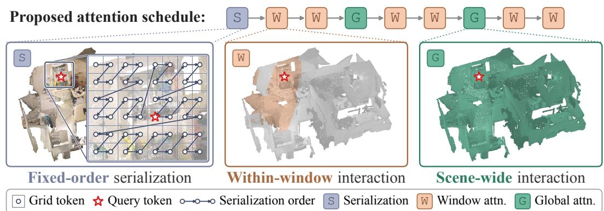  
Figure 1: Serialize once, mix window and global attention. MixPT-S serializes tokens once (S) and reuses that order throughout its WWGWWGWW attention schedule. For the same query, window attention restricts interaction to its fixed window, whereas global attention enables scene-wide interaction. For clarity, the left panel provides a 2D schematic of 3D serialization around the query token.

## ABSTRACT

Point cloud transformers aim to capture detailed local geometry and relationships across a scene at a manageable computational cost. Two common approaches are window attention and global attention. They differ in how they enable scene-wide interaction, which refers to information exchange among tokens across a scene. Window attention reduces computational cost by restricting self-attention to groups of tokens called windows; in serialized designs, each window contains a fixed number of consecutive tokens from a spatially ordered sequence. Because each block only directly connects tokens within the same window, information exchange across windows relies on changes in window membership across blocks and hierarchical pooling. Global attention, in contrast, directly connects all tokens within a scene, but computing attention over all token pairs can be costly when the number of tokens is large. To balance computational cost and scene-wide interaction, we introduce MixPT, a point transformer that uses a mix of window and global attention blocks in an interleaved schedule, while retaining a single fixed serialization pattern for its window blocks. For scenes with a large number of tokens, MixPT applies global attention to spatially pooled tokens and returns residual updates to the original-resolution stream. Across indoor and outdoor benchmarks, MixPT achieves competitive accuracy with lower latency than representative window and global attention baselines. We further demonstrate the feasibility of scaling the attention stage in depth by repeating the interleaved pattern of window and global attention blocks.

## 1 INTRODUCTION

Deep learning for point clouds has advanced through architectures that learn geometric representations from point sets or sparse spatial grids (Qi et al., 2017a;b; Wang et al., 2019; Wu et al., 2019;

Thomas et al., 2019; Graham et al., 2018; Choy et al., 2019; Hu et al., 2020). More recently, point transformers (Zhao et al., 2021; Wu et al., 2022; 2024) use attention to exchange information among tokens at different spatial locations. At a fixed spatial resolution (i.e., after voxel sampling with the same voxel size), larger 3D scenes typically retain more points and therefore require more input tokens, increasing the computational cost of attention.

Two common approaches make different choices in the trade-off between attention cost and scenewide interaction: window attention and global attention. Window attention reduces computational cost by restricting self-attention to groups of tokens called windows, so each block only directly connects tokens within the same window (Wu et al., 2024; Yue et al., 2026). Global attention, in contrast, directly connects all tokens within a scene, but computing attention over all token pairs can be costly when the number of tokens is large (Yilmaz et al., 2026). This contrast motivates using a mix of window and global attention blocks: can window attention retain its computational efficiency while selected global blocks directly exchange information across windows?

Introducing global blocks also provides an opportunity to simplify how window blocks exchange information across windows. Serialized window attention spatially orders tokens and groups consecutive tokens into fixed-size windows. To indirectly exchange information across windows, these designs change serialization patterns across blocks to alter window membership and use hierarchical pooling to aggregate features at coarser resolutions (Wu et al., 2024; Yue et al., 2026). Keeping a single serialization pattern instead allows token ordering and window grouping to be reused across blocks, reducing processing overhead, but removes the interaction paths created by changing window membership. Interleaving global attention blocks allows tokens in different windows to directly exchange information while keeping window membership fixed across window attention blocks.

We therefore introduce MixPT, a point transformer that uses a mix of window and global attention blocks in an interleaved schedule. Its window blocks reuse a single fixed serialization pattern, while global blocks periodically enable direct information exchange across windows. For scenes with a large number of tokens, MixPT applies global attention to spatially pooled tokens and returns only the resulting residual updates to the original-resolution stream. This design retains window attention at the original stage resolution while controlling the cost of global attention through the frequency of global blocks and the number of pooled tokens.

MixPT-S, which is our smallest model variant, uses the WWGWWGWW attention schedule illustrated in Fig. 1, where W and G denote window and global attention blocks, respectively. Across indoor and outdoor 3D scene understanding benchmarks, MixPT-S achieves competitive accuracy with lower latency per forward pass than representative window and global attention baselines. Our ablations show accuracy gains from periodically introducing global blocks compared with using fixed windows alone. We further demonstrate the feasibility of increasing the attention stage’s depth by repeating the interleaved pattern of window and global attention blocks.

In sum, our contributions are threefold. First, we analyze how cross-window communication develops in serialized window attention and how the use of scene-wide support varies across global attention blocks. Second, we propose MixPT, which interleaves fixed-order window and global attention, with pooled global attention for large token sets. Finally, we demonstrate a favorable accuracy-latency trade-off across indoor and outdoor benchmarks and analyze the effects of block arrangement, pooling resolution, and model scaling.

## 2 RELATED WORK

Point Cloud Backbones. Early point-based backbones learned permutation-invariant features directly from unordered point sets and introduced hierarchical neighborhood aggregation to capture local geometry (Qi et al., 2017a;b). Subsequent methods developed richer local point operators, scal able sampling strategies, and efficient model scaling (Wang et al., 2019; Wu et al., 2019; Thomas et al., 2019; Hu et al., 2020; Thomas et al., 2024; Qian et al., 2022), while sparse voxel approaches (Graham et al., 2018; Choy et al., 2019; Zhu et al., 2021) and an octree-based approach (Riegler et al., 2017) restricted feature storage and computation to occupied regions. These approaches established local aggregation and hierarchical processing as effective foundations for large-scale point cloud understanding, which later point transformers build upon.

Point Cloud Transformers. Scaling point cloud transformers to large scenes requires controlling the number of point interactions and the cost of organizing them. Early point transformers restrict attention to local neighborhoods, using nearest neighbors or spatial partitions to capture local geometry at manageable cost (Zhao et al., 2021; Wu et al., 2022; Park et al., 2022). Later methods improve scalability by sharing spatial groups across queries (Fan et al., 2022; Lai et al., 2022; Yang et al., 2023), adapting window geometry (Lai et al., 2023; Duan et al., 2023), and forming fixed-size token groups for efficient batched attention (Liu et al., 2023; Wang, 2023; Wang et al., 2023). PTv3 (Wu et al., 2024) adopts serialized windows and changes serialization patterns across blocks to facilitate communication between groups. We refer to its attention patches as windows throughout this paper. Efficiency also depends on the spatial resolution at which attention operates. LitePT (Yue et al., 2026) uses sparse convolution at high resolution and retains serialized window attention in later stages. Volt (Yilmaz et al., 2026) instead applies global attention to volumetric patch tokens, controlling attention cost through token count rather than restricting the interaction range.

Interleaving Window and Global Attention. Interleaving local and global attention provides a way to preserve efficient local processing while introducing broader communication only at selected layers. Global context can be introduced through compact representations that interact with local features (Chu et al., 2021; Hatamizadeh et al., 2024; 2023), or through sparse connections between distant tokens (Tu et al., 2022). These designs reduce the cost of global communication while preserving detailed features within each window. A complementary strategy retains full global attention but reserves it for selected layers, using window attention elsewhere, as adopted in vision backbones (Li et al., 2022; Kirillov et al., 2023; Ravi et al., 2025; Carion et al., 2026; Bai et al., 2025). This principle also extends to language modeling, where sliding window attention is interleaved with causal attention over the full context (Gemma Team et al., 2024; 2025). However, the studies discussed above primarily explore this design principle in image and language models. Thus, in this paper, we study its application to serialized point cloud backbones, focusing on fixed window grouping and the spatial resolution of global attention.

Rotary Positional Encoding for 3D Points. Rotary positional embedding (RoPE) (Su et al., 2024) has been extended to 3D points using axial formulations (Li & Harada, 2022). Recent point cloud transformers use both symmetric (Yue et al., 2026; Choy et al., 2026; Zhang et al., 2026) and asymmetric (Yilmaz et al., 2026) channel allocations across the three spatial axes. We adopt an asymmetric allocation in MixPT and examine its effect in our ablations.

## 3 METHODOLOGY

## 3.1 PRELIMINARIES: REVISITING WINDOW AND GLOBAL ATTENTION

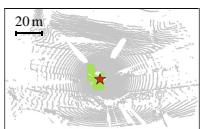  
Attention block 1: Z

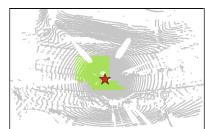  
Attention block 2: TZ

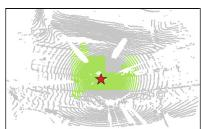  
Attention block 3: H

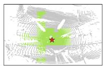  
Attention block 4: TH

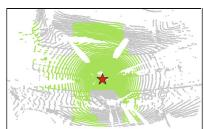  
Attention block 5: Z

Figure 2: Information propagation through the first five blocks of encoder stage 3 of LitePT on the Waymo validation set (Sun et al., 2020) (stages indexed from zero; blocks indexed from one; random order shuffling disabled). Green marks tokens reachable from the red-star token through attention connections within this stage; gray marks those not yet reached.

Revisiting Window Attention. Given N tokens, window attention partitions them into windows of $N _ { \mathrm { w } }$ tokens each and computes self-attention only within each window, reducing the number of pairwise interactions from $\bar { \mathcal { O } ( N ^ { 2 } ) }$ to $\mathcal { O } ( N N _ { \mathrm { w } } )$ . Because tokens in different windows cannot interact directly, serialized window transformers rely on changes in serialization pattern and hierarchical pooling for cross-window communication (Wu et al., 2024; Yue et al., 2026). Alternating the serialization pattern changes window membership across blocks, while hierarchical pooling aggregates information at coarser resolutions. PTv3 (Wu et al., 2024, Table 2) reports lower segmentation accuracy with a single fixed serialization pattern than with multiple patterns, suggesting that varying serialization patterns can be beneficial in practice.

To assess these mechanisms, we examine how token reachability expands across successive blocks. Here, a token is considered reachable if it can be connected to the selected token through preceding attention blocks and hierarchical pooling transitions. We measure this structural reachability from the attention stage input tokens, excluding receptive fields accumulated in the preceding convolutional stages. As shown in Fig. 2 and Fig. 3, LitePT-S (Yue et al., 2026), a representative window attention backbone, did not achieve 100% mean token reachability on the Waymo validation set (Sun et al., 2020) even in its deepest attention blocks, despite hierarchical pooling and changes in serialization pattern. In contrast, Volt-S (Yilmaz et al., 2026), a representative global attention backbone, has full structural reachability from its first block. These observations motivate introducing global attention early in the stage to establish full structural reachability without relying solely on gradual propagation through window attention and hierarchical transitions. MixPT-S therefore places its first global block after two window blocks, while retaining a fixed serialization for its window blocks.

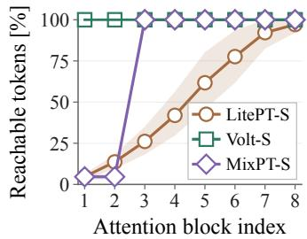  
Figure 3: Structural reachability across blocks on the Waymo validation set (Sun et al., 2020). Lines show scene-level means; shading indicates the 10th to 90th percentiles.

Revisiting Global Attention. As shown in Fig. 3, global attention achieves full structural reachability, but we ask whether its weights are also broadly distributed across tokens in every block. To this end, we analyze a) how concentrated attention is within each block and b) where a selected query assigns its attention within the scene. First, normalized attention entropy measures how evenly a query distributes attention over the keys it can attend to (Oh & Schuler, 2022; Zhai et al., 2023): a value of one indicates uniform attention over the available keys, while lower values indicate greater concentration on a subset. For each block, we compute this quantity for every query and head, average over queries and heads within each scene, and then average the scene-level values equally across scenes. Fig. 4 shows higher entropy in the early

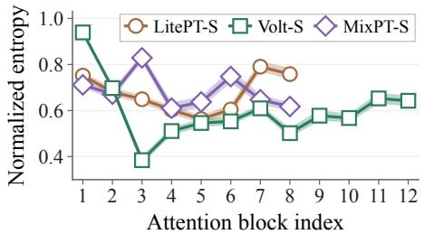  
Figure 4: Normalized attention entropy within each block’s available support on the Waymo validation set (Sun et al., 2020). Lines show scene-level means; shading indicates the 10th to 90th percentiles.

Volt-S blocks and lower entropy in several later blocks, indicating that the concentration of attention varies across depth.

Second, we visualize the relative attention weights for a selected Volt query to show where attention concentrates within each block (Fig. 5). Although each block allowed global interactions, attention for this query tended to concentrate on localized regions in later blocks. Together, these observations suggest that attention can become more concentrated at some depths despite having scene-wide support at every block. These two key observations motivate the periodic use of global attention in MixPT-S for direct cross-window information exchange without computing attention between all token pairs in every block.

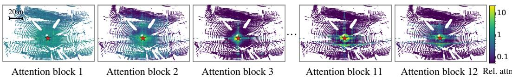  
Figure 5: Attention patterns across Volt (Yilmaz et al., 2026) blocks on the Waymo validation set (Sun et al., 2020). For a selected query, each token is colored by its relative attention weight (“Rel. attn.”), the ratio of its head-averaged attention weight to the uniform weight over the available keys. Values of 1 and 10 indicate weights equal to and ten times the uniform weight, respectively. Attention is broadly distributed in the first block and more concentrated in several later blocks, particularly in the central regions of the visualized scene.

Global attn. (G)  
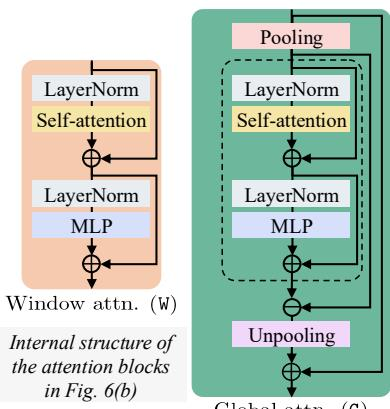

## 3.2 MIXPT: INTERLEAVED WINDOW AND GLOBAL ATTENTION

Architecture Overview. Panels (a)–(c) of Fig. 6 illustrate the overall architecture of MixPT. We retain the high-resolution sparse convolutional stages (Fig. 6(a)) and remaining decoder structure (Fig. 6(c)) of LitePT (Yue et al., 2026). Our main architectural change centers on the attention stage (Fig. 6(b)). We consolidate LitePT’s multiple attention stages (Fig. 6(d)) into a single stage by removing the intermediate pooling transition and the corresponding decoder upsampling. We denote window and global attention blocks by W and G, respectively. Within this stage, all window blocks reuse a single fixed serialization pattern, while global attention blocks are periodically interleaved following the WWGWWGWW schedule. Both block types use the same number of heads and the same per-head dimension. We next describe the fixed-order window and global attention blocks that form this stage.

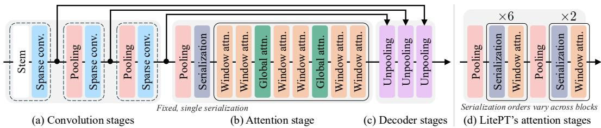  
Figure 6: Block-level overview of MixPT: (a) sparse convolution stages, (b) attention stage, and (c) decoder stages. Our attention stage follows the WWGWWGWW schedule, where W and G denote window and global attention blocks, respectively. (d) LitePT’s attention stages (Yue et al., 2026). Unlike LitePT’s varying serialization patterns, MixPT uses one fixed serialization within a single attention stage and directly connects tokens across windows through global attention blocks.

Fixed-Order Window Attention. We follow LitePT (Yue et al., 2026) in applying self-attention within serialized windows containing a fixed number of tokens, followed by an MLP. We omit its additional block-entry LayerNorm on the residual stream and use a standard pre-norm design with LayerNorm only before the attention and MLP sublayers (Fig. 7). Formally, let $\pmb { x } _ { l } \in \mathbb { R } ^ { N \times C }$ denote the input features to block l, where N is the number of tokens in the current attention stage for a scene and C is the feature dimension. Let $N _ { \mathrm { w } }$ denote the fixed number of tokens per window, and let $\mathcal { A } _ { l } ( \pmb { X } ; m )$ denote self-attention applied independently within groups of m consecutive serialized tokens. Let $\mathrm { M L P } _ { l }$ denote the MLP in block l. For window attention, we set $m = N _ { \mathrm { w } }$ and apply the attention residual followed by the MLP residual:

$$
\widetilde { \pmb { x } } _ { l } = \pmb { x } _ { l } + \mathcal { A } _ { l } \big ( \mathrm { L N } ( \pmb { x } _ { l } ) ; N _ { \mathrm { w } } \big ) ,\tag{1}
$$

$$
\pmb { x } _ { l + 1 } = \pmb { x } _ { l } + \mathcal { A } _ { l } \big ( \mathrm { L N } ( \pmb { x } _ { l } ) ; N _ { \mathrm { w } } \big ) + \mathrm { M L P } _ { l } \big ( \mathrm { L N } ( \widetilde { \pmb { x } } _ { l } ) \big ) .\tag{2}
$$

Figure 7: Window attention (left) and pooled global attention (right) blocks in MixPT.

Unlike PTv3 (Wu et al., 2024) and LitePT (Yue et al., 2026),

which vary serialization patterns across blocks, we use a

single fixed pattern throughout the attention stage. This allows the serialization and window-index mappings to be reused across window attention blocks. Our default is Trans Z-order (TZ); we discuss sensitivity to this choice in Appendix C.

Interleaved Global Attention with Pooling. A global block enables scene-wide communication across fixed windows. When the number of stage tokens is manageable, we apply global attention directly at the original stage resolution. Prior work has reduced the cost of long-range attention by representing distant or global context at a coarser spatial resolution (Chu et al., 2021; Yang et al., 2021; Fan et al., 2021). For large token sets, we apply global attention to spatially pooled tokens and return only the resulting residual updates to the original-resolution stream, as illustrated in Fig. 7. We use s to denote the global pooling stride on the current attention-stage grid, with s = 1 indicating the unpooled case and $s > 1$ the pooled case. Let $N _ { \mathrm { g } }$ denote the number of tokens used by global attention, with $N _ { \mathrm { g } } = N$ when $s = 1$ . For $s > 1 , \mathcal { P } _ { s } \bar { ( } \cdot { ) }$ pools tokens within each stride-s grid cell, while $\mathcal { U } _ { s } ( \cdot )$ maps coarse residual updates back to the corresponding original tokens. These operators include the learned projections and pooling normalization omitted from the diagram.

Formally, the pooled global attention block is defined as

$$
{ } ^ { \mathrm { c } } \pmb { x } _ { l } = \mathcal { P } _ { s } ( \pmb { x } _ { l } ) , \qquad { } ^ { \mathrm { c } } \widetilde { \pmb { x } } _ { l } = { } ^ { \mathrm { c } } \pmb { x } _ { l } + A _ { l } \big ( \mathrm { L N } ( { } ^ { \mathrm { c } } \pmb { x } _ { l } ) ; N _ { \mathrm { g } } \big ) ,\tag{3}
$$

$$
\begin{array} { r } { \pmb { x } _ { l + 1 } = \pmb { x } _ { l } + \mathcal { U } _ { s } \Big ( A _ { l } \big ( \mathrm { L N } \big ( ^ { \mathrm { c } } \pmb { x } _ { l } \big ) ; N _ { \mathrm { g } } \big ) + \mathrm { M L P } _ { l } \big ( \mathrm { L N } \big ( ^ { \mathrm { c } } \widetilde { \pmb { x } } _ { l } \big ) \big ) \Big ) . } \end{array}\tag{4}
$$

Here, the left superscript c denotes features at the coarse resolution after pooling. Only the attention and MLP residual updates are mapped back to the original tokens, preserving $\mathbf { \Delta } _ { \mathbf { \mathcal { X } } \mathbf { \mathcal { l } } }$ as the outer residual stream. We examine how the pooling stride affects segmentation accuracy and latency in Sec. 4.3.

Rotary Positional Encoding for 3D Points. We follow the axial PointROPE formulation used in LitePT (Yue et al., 2026), while using an asymmetric allocation of RoPE dimensions across the three spatial axes in our default configurations. Specifically, one-dimensional RoPE is applied independently to the $x \cdot , y \cdot$ , and z-axis subspaces of each attention head’s query and key vectors. Let $d _ { h }$ denote the per-head dimension, which is partitioned into axis-specific dimensions $d _ { x } , d _ { y }$ , and $d _ { z }$ , such that $d _ { x } + d _ { y } + d _ { z } = d _ { h }$ . Allocations with $d _ { x } = d _ { y } = d _ { z }$ are considered symmetric; all others are asymmetric. Each axis dimension is even to support the pairwise rotations in RoPE. We examine the effect of the allocation in Sec. 4.3.

## 4 EXPERIMENTS

## 4.1 SEMANTIC SEGMENTATION

Table 1: Median latency for a single model forward pass over voxelized validation scenes (ms), measured with batch size one and FP16 autocast on an RTX A6000. For MixPT, -S, -B, and -L denote the small, base, and large variants, respectively.
<table><tr><td>Method</td><td>Attention</td><td>#Params</td><td>Sem.KITTI</td><td>Waymo</td><td>nuScenes</td><td>ScanNet</td></tr><tr><td>PTv3 (Wu et al., 2024)</td><td>Window</td><td>46.1M</td><td>63.6</td><td>87.8</td><td>38.3</td><td>48.1</td></tr><tr><td>LitePT-S (Yue et al., 2026)</td><td>Window</td><td>12.7M</td><td>36.4</td><td>53.0</td><td>27.8</td><td>25.7</td></tr><tr><td>Volt-S (Yilmaz et al., 2026)</td><td>Global</td><td>23.7M</td><td>140.3</td><td>295.5</td><td>40.0</td><td>23.0</td></tr><tr><td>MixPT-S (Ours)</td><td>Window + Global</td><td>14.1M</td><td>28.2</td><td>42.8</td><td>19.2</td><td>17.5</td></tr><tr><td>MixPT-B (Ours)</td><td>Window + Global</td><td>51.8M</td><td>56.4</td><td>90.3</td><td>33.8</td><td>30.2</td></tr><tr><td>MixPT-L (Ours)</td><td>Window + Global</td><td>89.4M</td><td>72.4</td><td>120.1</td><td>45.7</td><td>33.4</td></tr></table>

Table 2: Semantic segmentation w/o TTA (mIoU/ mAcc, %). Bold and underline indicate the best and second-best results, respectively, among the baselines and MixPT-S.
<table><tr><td></td><td></td><td colspan="2">Sem.KITTI</td><td colspan="2">Waymo</td><td colspan="2">nuScenes</td><td colspan="2">ScanNet</td></tr><tr><td>Method</td><td>#Params</td><td>mIoU</td><td>mAcc</td><td>mIoU</td><td>mAcc</td><td>mIoU</td><td>mAcc</td><td>mIoU</td><td>mAcc</td></tr><tr><td>PTv3 (Wu et al., 2024)</td><td>46.1M</td><td>69.6</td><td>77.2</td><td>70.7</td><td>81.3</td><td>79.6</td><td>86.6</td><td>76.5</td><td>85.3</td></tr><tr><td>LitePT-S (Yue et al., 2026)</td><td>12.7M</td><td>69.8</td><td>76.8</td><td>71.7</td><td>82.8</td><td>80.3</td><td>87.1</td><td>75.5</td><td>83.4</td></tr><tr><td>Volt-S (Yilmaz et al., 2026)</td><td>23.7M</td><td>69.4</td><td>77.0</td><td>70.5</td><td>80.3</td><td>80.5</td><td>87.5</td><td>76.4</td><td>84.9</td></tr><tr><td>MixPT-S (Ours)</td><td>14.1M</td><td>70.0</td><td>77.3</td><td>72.1</td><td>83.0</td><td>80.6</td><td>87.4</td><td>76.0</td><td>84.3</td></tr><tr><td>MixPT-B (Ours)</td><td>51.8M</td><td>70.4</td><td>77.2</td><td>72.1</td><td>84.1</td><td>81.1</td><td>87.3</td><td>76.4</td><td>84.9</td></tr><tr><td>MixPT-L (Ours)</td><td>89.4M</td><td>70.6</td><td>77.4</td><td>72.4</td><td>83.7</td><td>81.5</td><td>87.9</td><td>76.7</td><td>85.1</td></tr></table>

Setup. We evaluated semantic segmentation on the validation sets of SemanticKITTI (Behley et al., 2019), Waymo (Sun et al., 2020), nuScenes (Caesar et al., 2020), and ScanNet (Dai et al., 2017), covering both outdoor LiDAR scans and indoor RGB-D scenes. We abbreviate SemanticKITTI as

Sem.KITTI in all tables for brevity. The comparison includes PTv3 (Wu et al., 2024) and LitePT-S (Yue et al., 2026) as representative window attention baselines, and Volt-S (Yilmaz et al., 2026) as a global attention baseline. The main comparison reports results without test-time augmentation (TTA), using mean intersection over union (mIoU) and mean class accuracy (mAcc). For semantic segmentation, we followed Volt (Yilmaz et al., 2026) in using an exponential moving average (EMA) of model weights and applied the same protocol to MixPT and all reproduced baselines. Training, evaluation, and baseline reproduction details are provided in Appendix B. Full semantic segmentation results with TTA are reported in Table A4.

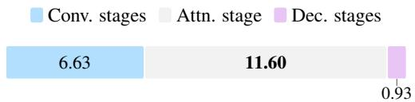  
(a) Overall stage breakdown [ms]

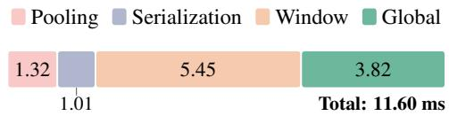  
(b) Attention stage breakdown [ms]  
Figure 8: MixPT-S latency breakdown on nuScenes: (a) across model stages and (b) across individual components within the attention stage.

Accuracy and Efficiency. First, we demonstrate how MixPT balances semantic segmentation accuracy and inference latency relative to window and global attention baselines. As shown in Table 1, MixPT-S achieved the lowest latency across all four datasets, reducing latency by 19% to 32% relative to LitePT-S. The gap was larger relative to Volt-S, the global attention baseline, on outdoor datasets where MixPT-S was 2.1 to 6.9× faster. A key source of efficiency is that MixPT constructs the serialization order and stage layout once and reuses them across window attention blocks. Token reorganization therefore occurs only at stage entry and exit, whereas LitePT repeatedly gathers and scatters tokens across blocks. On nuScenes, these serialization-related operations took 1.01 ms in MixPT-S (Fig. 8), compared with 10.61 ms in LitePT-S; further analysis is provided in Appendix C. Since the semantic segmentation head contributes only 0.04–0.25% of the full forward latency, the measured latency primarily reflects backbone computation. Despite these latency reductions, MixPT-S matched or improved upon LitePT-S in mIoU across all four datasets when evaluated without TTA (Table 2). Together, these results demonstrate a favorable accuracy-latency trade-off across both indoor and outdoor scenes.

Scaling the Model. We scaled MixPT by increasing model depth and per-head dimension while retaining 16 attention heads. MixPT-B and MixPT-L generally improved performance across the evaluated benchmarks (Table 2). Detailed model configurations are provided in Table A1 in Appendix A.

## 4.2 INSTANCE SEGMENTATION

Table 3: Indoor instance segmentation on ScanNet and ScanNet200 (%).  
We evaluate different backbones using PointGroup (Jiang et al., 2020).
<table><tr><td></td><td></td><td colspan="3">ScanNet</td><td colspan="3">ScanNet200</td></tr><tr><td>Backbone</td><td>#Params</td><td> $\mathrm { \ m A P _ { 2 5 } }$ </td><td>mAP50</td><td>mAP</td><td>mAP25</td><td>mAP50</td><td>mAP</td></tr><tr><td>PTv3 (Wu et al., 2024)</td><td>46.2M</td><td>77.5</td><td>61.7</td><td>40.9</td><td>40.1</td><td>33.2</td><td>23.1</td></tr><tr><td>LitePT-S* (Yue et al., 2026)</td><td>16.0M</td><td>78.5</td><td>64.9</td><td>41.7</td><td>40.3</td><td>33.1</td><td>22.2</td></tr><tr><td>Volt-S (Yilmaz et al., 2026)</td><td>23.7M</td><td>77.4</td><td>62.7</td><td>40.2</td><td>38.2</td><td>32.1</td><td>21.1</td></tr><tr><td>MixPT-S* (Ours)</td><td>18.4M</td><td>78.9</td><td>65.1</td><td>41.1</td><td>38.5</td><td>32.5</td><td>22.4</td></tr></table>

Setup and Results. We evaluated MixPT on the validation sets of ScanNet and ScanNet200 using a common PointGroup (Jiang et al., 2020) head (Table 3) to focus the comparison on backbone representations. For Volt (Yilmaz et al., 2026), we replaced its original SPFormer (Sun et al., 2023) task decoder with PointGroup. Following the instance segmentation setup of LitePT (Yue et al., 2026), we used MixPT-S\*, which extends MixPT-S with additional attention and convolution blocks, without applying EMA during instance segmentation training. Overall, MixPT-S\* remained competitive with the baselines across both datasets, suggesting that the interleaved window-global design extends beyond semantic segmentation. Model configurations are detailed in Appendix A, while training and evaluation settings are provided in Appendix B.3.

## 4.3 ABLATION STUDIES AND ANALYSIS

We provide empirical support for four design choices: i) fixed serialization with periodic global attention; ii) the arrangement of window and global attention blocks; iii) the global pooling stride; and iv) the allocation of RoPE dimensions across spatial axes.

Table 4: Fixed serialization and global attention ablation (w/o TTA, mIoU/ mAcc, %). Attention-stage depth and width were held fixed across variants.  
Z: Z-order; TZ: Trans Z-order; H: Hilbert; TH: Trans Hilbert; W/G: window/global attention.
<table><tr><td></td><td></td><td colspan="4">Sem.KITTI (s = 4)</td><td colspan="4">ScanNet (s = 1)</td></tr><tr><td>Serialization</td><td>Block layout #Params</td><td></td><td>Latency (ms)</td><td>mIoU</td><td>mAcc</td><td>#Params</td><td>Latency (ms)</td><td>mIoU</td><td>mAcc</td></tr><tr><td>Z + TZ + H + TH WWWWWWWW</td><td></td><td>13.6M</td><td>32.99</td><td>68.5</td><td>75.6</td><td>13.6M</td><td>21.28</td><td>74.8</td><td>84.0</td></tr><tr><td>TZ</td><td>WWWWWWWW</td><td>13.6M</td><td>27.88</td><td>68.6</td><td>76.3</td><td>13.6M</td><td>17.16</td><td>73.7</td><td>83.5</td></tr><tr><td>TZ</td><td>WWGWWGWW</td><td>14.1M</td><td>28.20</td><td>70.0</td><td>77.3</td><td>13.6M</td><td>17.48</td><td>76.0</td><td>84.3</td></tr><tr><td>一</td><td>GGGGGGGG</td><td>15.6M</td><td>27.36</td><td>68.0</td><td>75.8</td><td>13.6M</td><td>17.60</td><td>75.7</td><td>84.0</td></tr></table>

Fixed Serialization and Global Attention. As presented in Table 4, fixing the serialization pattern reduced latency on both datasets, while leaving mIoU nearly unchanged on SemanticKITTI and decreasing it on ScanNet. Changing two of the eight window blocks to global blocks raised mIoU to 70.0% and 76.0%, respectively, with only a small increase in full-model latency. On SemanticKITTI, the global-only reference was slightly faster but less accurate than the interleaved design. Unlike the interleaved design, this variant applied attention only to pooled tokens, without window attention at the original stage resolution. Overall, periodic global attention improved the accuracy of fixed serialization while preserving its latency advantage over multi-pattern window attention.

Table 5: Block arrangement ablation for semantic segmentation (w/o TTA, mIoU/ mAcc, %).
<table><tr><td></td><td></td><td></td><td colspan="4">nuScenes</td><td colspan="4">ScanNet</td></tr><tr><td>Block layout</td><td>#W #G</td><td></td><td></td><td>#Params Latency (ms)</td><td>mIoU</td><td>mAcc</td><td>#Params</td><td>Latency (ms)</td><td>) mIoU mAcc</td><td></td></tr><tr><td>WWGWWGWW</td><td>6</td><td>2</td><td>14.1M</td><td>19.16</td><td>80.6</td><td>87.4</td><td>13.6M</td><td>17.48</td><td>76.0</td><td>84.3</td></tr><tr><td>WWWGWWWG</td><td>6</td><td>2</td><td>14.1M</td><td>19.39</td><td>80.4</td><td>87.1</td><td>13.6M</td><td>17.61</td><td>75.1</td><td>83.9</td></tr><tr><td>WWWWGGGG</td><td>4</td><td>4</td><td>14.6M</td><td>21.05</td><td>80.0</td><td>87.2</td><td>13.6M</td><td>17.44</td><td>75.6</td><td>83.9</td></tr><tr><td>WGWGWGWG</td><td>4</td><td>4</td><td>14.6M</td><td>21.46</td><td>79.7</td><td>86.9</td><td>13.6M</td><td>17.42</td><td>75.6</td><td>84.3</td></tr><tr><td>WWWGWWWGWW</td><td>8</td><td>2</td><td>17.1M</td><td>21.00</td><td>80.8</td><td>87.6</td><td>16.6M</td><td>18.54</td><td>75.6</td><td>83.6</td></tr></table>

How Should Window and Global Blocks Be Arranged? We varied the number and placement of window and global blocks to examine their effect on accuracy and latency (Table 5). Among the eight-block schedules, WWGWWGWW provided a favorable accuracy-latency trade-off on nuScenes and achieved the highest mIoU on ScanNet. Increasing the number of global blocks did not consistently improve accuracy and incurred additional latency on nuScenes, supporting the use of global attention only periodically. A deeper ten-block variant slightly improved nuScenes accuracy, but with more parameters and higher latency.

How Much Pooling Should Precede Global Attention? We examined how the global pooling stride s affected accuracy, latency, and memory. On Waymo, pooling reduced full-model latency and, at s = 2, even improved mIoU over full-resolution global attention (Fig. 9(a)). Global block latency decreased with pooling across all three datasets, with the largest absolute reduction on Waymo (Fig. 9(b)). For $s \geq 2 ,$ , peak memory during global blocks fell below that of window blocks, while further pooling provided only modest additional reductions in global block memory (Fig. 9(c)). Overall, these results suggest that global attention need not operate at full resolution. An appropriate pooling stride can reduce its computational cost while preserving, or in some cases improving, segmentation accuracy.

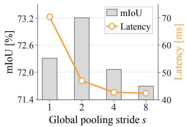  
(a) Accuracy-latency trade-off

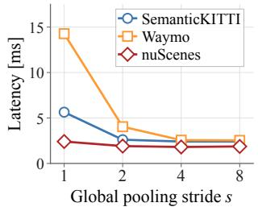  
(b) Global block latency

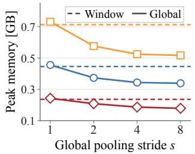  
(c) Attn. block peak memory  
Figure 9: Effect of global pooling stride s (w/o TTA). (a) Waymo mIoU (gray bars) and full-model latency (orange line), with separate training per stride under the same protocol. (b) Mean latency per global block. (c) Peak allocated memory for global (solid) and window (dashed) attention blocks.

Table 6: Axial RoPE allocation ablation (w/o TTA, mIoU/ mAcc, %).
<table><tr><td></td><td></td><td></td><td></td><td></td><td></td><td colspan="3">nuScenes</td><td colspan="3">ScanNet</td></tr><tr><td>RoPE</td><td>#Heads Head dim.</td><td></td><td> $d _ { x }$ </td><td> $d _ { y }$ </td><td> $d _ { z }$ </td><td>#Params</td><td>mIoU</td><td>mAcc</td><td>#Params mIoU</td><td></td><td>mAcc</td></tr><tr><td>Axial (symmetric)</td><td>16</td><td>18</td><td>6</td><td>6</td><td>6</td><td>10.0M</td><td>79.8</td><td>87.3</td><td>9.7M</td><td>75.2</td><td>84.0</td></tr><tr><td>Axial (symmetric)</td><td>16</td><td>24</td><td>8</td><td>8</td><td>8</td><td>16.5M</td><td>80.6</td><td>87.3</td><td>15.9M</td><td>75.7</td><td>84.2</td></tr><tr><td>Axial (asymmetric)</td><td>16</td><td>20</td><td>6</td><td>6</td><td>8</td><td>12.0M</td><td>80.1</td><td>86.8</td><td>11.6M</td><td>75.4</td><td>84.3</td></tr><tr><td>Axial (asymmetric)</td><td>16</td><td>22</td><td>8</td><td>8</td><td>6</td><td>14.1M</td><td>80.6</td><td>87.4</td><td>13.6M</td><td>76.0</td><td>84.3</td></tr><tr><td>Axial (asymmetric)</td><td>16</td><td>26</td><td>10</td><td>10</td><td>6</td><td>19.1M</td><td>80.8</td><td>87.2</td><td>18.4M</td><td>75.5</td><td>84.0</td></tr></table>

How Should RoPE Dimensions Be Allocated Across 3D Axes? Table 6 compares symmetric and asymmetric axial RoPE allocations and their model sizes. The 8:8:6 allocation matched 8:8:8 on nuScenes and outperformed it on ScanNet with fewer parameters, consistent with the larger horizontal than vertical extents observed in the point clouds and attention regions. Fig. 10 shows representative examples, with validation set statistics provided in Appendix C. These results suggest that RoPE dimensions need not be allocated symmetrically across the three spatial axes.

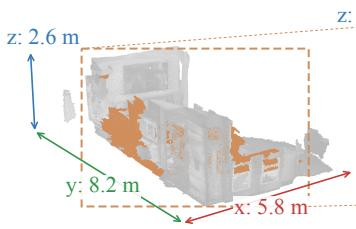

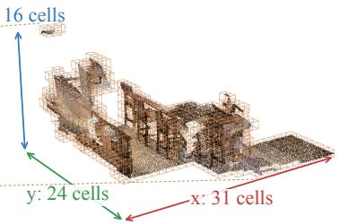

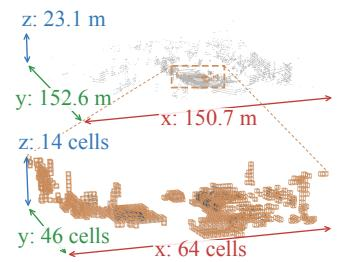  
Figure 10: Spatial extents of representative scenes (metres) and serialized windows (grid cells) on ScanNet (left) and nuScenes (right). Dashed lines connect the selected window in each scene to its corresponding window view. Window extents include empty grid cells.

## 5 CONCLUSION

We introduced MixPT, a point transformer that combines fixed-order window attention with periodi cally interleaved global attention blocks. Our analysis motivates direct cross-window communication at selected layers, while spatial pooling reduces global attention cost for large token sets, with residual updates returned to the original-resolution stream. Across indoor and outdoor 3D scene understanding benchmarks, MixPT achieves competitive accuracy, and MixPT-S shows lower per-forward latency than representative window and global attention baselines in semantic segmentation. Ablations examine global block placement, pooling resolution, and scaling through repeated interleaved patterns, illustrating how MixPT controls when and at what spatial resolution global interaction occurs.

## REFERENCES

Shuai Bai, Keqin Chen, Xuejing Liu, Jialin Wang, Wenbin Ge, Sibo Song, Kai Dang, Peng Wang, Shijie Wang, Jun Tang, Humen Zhong, Yuanzhi Zhu, Mingkun Yang, Zhaohai Li, Jianqiang Wan, Pengfei Wang, Wei Ding, Zheren Fu, Yiheng Xu, Jiabo Ye, Xi Zhang, Tianbao Xie, Zesen Cheng, Hang Zhang, Zhibo Yang, Haiyang Xu, and Junyang Lin. Qwen2.5-VL technical report, 2025. URL https://arxiv.org/abs/2502.13923.

Jens Behley, Martin Garbade, Andres Milioto, Jan Quenzel, Sven Behnke, Cyrill Stachniss, and Jurgen Gall. SemanticKITTI: A dataset for semantic scene understanding of LiDAR sequences. In Proceedings of the IEEE/CVF International Conference on Computer Vision (ICCV), October 2019.

Maxim Berman, Amal Rannen Triki, and Matthew B. Blaschko. The Lovasz-Softmax loss: A´ tractable surrogate for the optimization of the intersection-over-union measure in neural networks. In Proceedings of the IEEE Conference on Computer Vision and Pattern Recognition (CVPR), June 2018.

Holger Caesar, Varun Bankiti, Alex H. Lang, Sourabh Vora, Venice Erin Liong, Qiang Xu, Anush Krishnan, Yu Pan, Giancarlo Baldan, and Oscar Beijbom. nuScenes: A multimodal dataset for autonomous driving. In Proceedings of the IEEE/CVF Conference on Computer Vision and Pattern Recognition (CVPR), June 2020.

Nicolas Carion, Laura Gustafson, Yuan-Ting Hu, Shoubhik Debnath, Ronghang Hu, Didac Suris Coll-Vinent, Chaitanya Ryali, Kalyan Vasudev Alwala, Haitham Khedr, Andrew Huang, Jie Lei, Tengyu Ma, Baishan Guo, Arpit Kalla, Markus Marks, Joseph Greer, Meng Wang, Peize Sun, Roman Radle, Triantafyllos Afouras, Effrosyni Mavroudi, Katherine Xu, Tsung-Han Wu,¨ Yu Zhou, Liliane Momeni, RISHI HAZRA, Shuangrui Ding, Sagar Vaze, Francois Porcher, Feng Li, Siyuan Li, Aishwarya Kamath, Ho Kei Cheng, Piotr Dollar, Nikhila Ravi, Kate Saenko, Pengchuan Zhang, and Christoph Feichtenhofer. SAM 3: Segment anything with concepts. In C. Vondrick, B. Hariharan, C. Raffel, L. Pinto, D. Yang, and A. Faust (eds.), International Conference on Learning Representations, volume 2026, pp. 138846–138923, 2026. URL https://proceedings.iclr.cc/paper\_files/paper/2026/file/ e0982cbc81401df3430ee1ff780dc7a2-Paper-Conference.pdf.

Chris Choy, Junha Lee, Chunghyun Park, Minsu Cho, and Jan Kautz. SpaCeFormer: Fast proposalfree open-vocabulary 3D instance segmentation. In Proceedings ofthe International Conference on Machine Learning (ICML), 2026.

Christopher Choy, JunYoung Gwak, and Silvio Savarese. 4D spatio-temporal ConvNets: Minkowski convolutional neural networks. In Proceedings of the IEEE/CVF Conference on Computer Vision and Pattern Recognition (CVPR), June 2019.

Xiangxiang Chu, Zhi Tian, Yuqing Wang, Bo Zhang, Haibing Ren, Xiaolin Wei, Huaxia Xia, and Chunhua Shen. Twins: Revisiting the design of spatial attention in vision transformers. In M. Ranzato, A. Beygelzimer, Y. Dauphin, P.S. Liang, and J. Wortman Vaughan (eds.), Advances in Neural Information Processing Systems, volume 34, pp. 9355–9366. Curran Associates, Inc., 2021. URL https://proceedings.neurips.cc/paper\_files/paper/ 2021/file/4e0928de075538c593fbdabb0c5ef2c3-Paper.pdf.

Angela Dai, Angel X. Chang, Manolis Savva, Maciej Halber, Thomas Funkhouser, and Matthias Niessner. ScanNet: Richly-annotated 3D reconstructions of indoor scenes. In Proceedings ofthe IEEE Conference on Computer Vision and Pattern Recognition (CVPR), July 2017.

Lunhao Duan, Shanshan Zhao, Nan Xue, Mingming Gong, Gui-Song Xia, and Dacheng Tao. ConDaFormer: Disassembled transformer with local structure enhancement for 3D point cloud understanding. In A. Oh, T. Naumann, A. Globerson, K. Saenko, M. Hardt, and S. Levine (eds.), Advances in Neural Information Processing Systems, volume 36, pp. 23886–23901. Curran Associates, Inc., 2023. doi: 10.52202/ 075280-1037. URL https://proceedings.neurips.cc/paper\_files/paper/ 2023/file/4b4f1272c73d5afd222b6dd3391c3f77-Paper-Conference.pdf.

Haoqi Fan, Bo Xiong, Karttikeya Mangalam, Yanghao Li, Zhicheng Yan, Jitendra Malik, and Christoph Feichtenhofer. Multiscale vision transformers. In Proceedings of the IEEE/CVF International Conference on Computer Vision (ICCV), pp. 6824–6835, October 2021.

Lue Fan, Ziqi Pang, Tianyuan Zhang, Yu-Xiong Wang, Hang Zhao, Feng Wang, Naiyan Wang, and Zhaoxiang Zhang. Embracing single stride 3D object detector with sparse transformer. In Proceedings ofthe IEEE/CVF Conference on Computer Vision and Pattern Recognition (CVPR), pp. 8458–8468, June 2022.

Gemma Team, Morgane Riviere, Shreya Pathak, Pier Giuseppe Sessa, Cassidy Hardin, Surya Bhupatiraju, Leonard Hussenot, Thomas Mesnard, Bobak Shahriari, Alexandre Ram´ e, Johan´ Ferret, Peter Liu, Pouya Tafti, Abe Friesen, Michelle Casbon, Sabela Ramos, Ravin Kumar, Charline Le Lan, Sammy Jerome, Anton Tsitsulin, Nino Vieillard, Piotr Stanczyk, Sertan Girgin, Nikola Momchev, Matt Hoffman, Shantanu Thakoor, Jean-Bastien Grill, Behnam Neyshabur, Olivier Bachem, Alanna Walton, Aliaksei Severyn, Alicia Parrish, Aliya Ahmad, Allen Hutchison, Alvin Abdagic, Amanda Carl, Amy Shen, Andy Brock, Andy Coenen, Anthony Laforge, Antonia Paterson, Ben Bastian, Bilal Piot, Bo Wu, Brandon Royal, Charlie Chen, Chintu Kumar, Chris Perry, Chris Welty, Christopher A. Choquette-Choo, Danila Sinopalnikov, David Weinberger, Dimple Vijaykumar, Dominika Rogozinska, Dustin Herbison, Elisa Bandy, Emma Wang, Eric´ Noland, Erica Moreira, Evan Senter, Evgenii Eltyshev, Francesco Visin, Gabriel Rasskin, Gary Wei, Glenn Cameron, Gus Martins, Hadi Hashemi, Hanna Klimczak-Plucinska, Harleen Batra,´ Harsh Dhand, Ivan Nardini, Jacinda Mein, Jack Zhou, James Svensson, Jeff Stanway, Jetha Chan, Jin Peng Zhou, Joana Carrasqueira, Joana Iljazi, Jocelyn Becker, Joe Fernandez, Joost van Amersfoort, Josh Gordon, Josh Lipschultz, Josh Newlan, Ju yeong Ji, Kareem Mohamed, Kartikeya Badola, Kat Black, Katie Millican, Keelin McDonell, Kelvin Nguyen, Kiranbir Sodhia, Kish Greene, Lars Lowe Sjoesund, Lauren Usui, Laurent Sifre, Lena Heuermann, Leticia Lago, Lilly McNealus, Livio Baldini Soares, Logan Kilpatrick, Lucas Dixon, Luciano Martins, Machel Reid, Manvinder Singh, Mark Iverson, Martin Gorner, Mat Velloso, Mateo Wirth, Matt Davidow,¨ Matt Miller, Matthew Rahtz, Matthew Watson, Meg Risdal, Mehran Kazemi, Michael Moynihan, Ming Zhang, Minsuk Kahng, Minwoo Park, Mofi Rahman, Mohit Khatwani, Natalie Dao, Nenshad Bardoliwalla, Nesh Devanathan, Neta Dumai, Nilay Chauhan, Oscar Wahltinez, Pankil Botarda, Parker Barnes, Paul Barham, Paul Michel, Pengchong Jin, Petko Georgiev, Phil Culliton, Pradeep Kuppala, Ramona Comanescu, Ramona Merhej, Reena Jana, Reza Ardeshir Rokni, Rishabh Agarwal, Ryan Mullins, Samaneh Saadat, Sara Mc Carthy, Sarah Cogan, Sarah Perrin, Sebastien´ M. R. Arnold, Sebastian Krause, Shengyang Dai, Shruti Garg, Shruti Sheth, Sue Ronstrom, Susan Chan, Timothy Jordan, Ting Yu, Tom Eccles, Tom Hennigan, Tomas Kocisky, Tulsee Doshi, Vihan Jain, Vikas Yadav, Vilobh Meshram, Vishal Dharmadhikari, Warren Barkley, Wei Wei, Wenming Ye, Woohyun Han, Woosuk Kwon, Xiang Xu, Zhe Shen, Zhitao Gong, Zichuan Wei, Victor Cotruta, Phoebe Kirk, Anand Rao, Minh Giang, Ludovic Peran, Tris Warkentin, Eli Collins, Joelle Barral, Zoubin Ghahramani, Raia Hadsell, D. Sculley, Jeanine Banks, Anca Dragan, Slav Petrov, Oriol Vinyals, Jeff Dean, Demis Hassabis, Koray Kavukcuoglu, Clement Farabet, Elena Buchatskaya, Sebastian Borgeaud, Noah Fiedel, Armand Joulin, Kathleen Kenealy, Robert Dadashi, and Alek Andreev. Gemma 2: Improving open language models at a practical size, 2024. URL https://arxiv.org/abs/2408.00118.

Gemma Team, Aishwarya Kamath, Johan Ferret, Shreya Pathak, Nino Vieillard, Ramona Merhej, Sarah Perrin, Tatiana Matejovicova, Alexandre Rame, Morgane Rivi´ ere, Louis Rouillard, Thomas\` Mesnard, Geoffrey Cideron, Jean bastien Grill, Sabela Ramos, Edouard Yvinec, Michelle Casbon, Etienne Pot, Ivo Penchev, Gael Liu, Francesco Visin, Kathleen Kenealy, Lucas Beyer, Xiaohai ¨ Zhai, Anton Tsitsulin, Robert Busa-Fekete, Alex Feng, Noveen Sachdeva, Benjamin Coleman, Yi Gao, Basil Mustafa, Iain Barr, Emilio Parisotto, David Tian, Matan Eyal, Colin Cherry, Jan-Thorsten Peter, Danila Sinopalnikov, Surya Bhupatiraju, Rishabh Agarwal, Mehran Kazemi, Dan Malkin, Ravin Kumar, David Vilar, Idan Brusilovsky, Jiaming Luo, Andreas Steiner, Abe Friesen, Abhanshu Sharma, Abheesht Sharma, Adi Mayrav Gilady, Adrian Goedeckemeyer, Alaa Saade, Alex Feng, Alexander Kolesnikov, Alexei Bendebury, Alvin Abdagic, Amit Vadi, Andras´ Gyorgy, Andr¨ e Susano Pinto, Anil Das, Ankur Bapna, Antoine Miech, Antoine Yang, Antonia´ Paterson, Ashish Shenoy, Ayan Chakrabarti, Bilal Piot, Bo Wu, Bobak Shahriari, Bryce Petrini, Charlie Chen, Charline Le Lan, Christopher A. Choquette-Choo, CJ Carey, Cormac Brick, Daniel Deutsch, Danielle Eisenbud, Dee Cattle, Derek Cheng, Dimitris Paparas, Divyashree Shivakumar Sreepathihalli, Doug Reid, Dustin Tran, Dustin Zelle, Eric Noland, Erwin Huizenga, Eugene

Kharitonov, Frederick Liu, Gagik Amirkhanyan, Glenn Cameron, Hadi Hashemi, Hanna Klimczak-Plucinska, Harman Singh, Harsh Mehta, Harshal Tushar Lehri, Hussein Hazimeh, Ian Ballantyne,´ Idan Szpektor, Ivan Nardini, Jean Pouget-Abadie, Jetha Chan, Joe Stanton, John Wieting, Jonathan Lai, Jordi Orbay, Joseph Fernandez, Josh Newlan, Ju yeong Ji, Jyotinder Singh, Kat Black, Kathy Yu, Kevin Hui, Kiran Vodrahalli, Klaus Greff, Linhai Qiu, Marcella Valentine, Marina Coelho, Marvin Ritter, Matt Hoffman, Matthew Watson, Mayank Chaturvedi, Michael Moynihan, Min Ma, Nabila Babar, Natasha Noy, Nathan Byrd, Nick Roy, Nikola Momchev, Nilay Chauhan, Noveen Sachdeva, Oskar Bunyan, Pankil Botarda, Paul Caron, Paul Kishan Rubenstein, Phil Culliton, Philipp Schmid, Pier Giuseppe Sessa, Pingmei Xu, Piotr Stanczyk, Pouya Tafti, Rakesh Shivanna, Renjie Wu, Renke Pan, Reza Rokni, Rob Willoughby, Rohith Vallu, Ryan Mullins, Sammy Jerome, Sara Smoot, Sertan Girgin, Shariq Iqbal, Shashir Reddy, Shruti Sheth, Siim Poder, Sijal Bhatnagar,˜ Sindhu Raghuram Panyam, Sivan Eiger, Susan Zhang, Tianqi Liu, Trevor Yacovone, Tyler Liechty, Uday Kalra, Utku Evci, Vedant Misra, Vincent Roseberry, Vlad Feinberg, Vlad Kolesnikov, Woohyun Han, Woosuk Kwon, Xi Chen, Yinlam Chow, Yuvein Zhu, Zichuan Wei, Zoltan Egyed, Victor Cotruta, Minh Giang, Phoebe Kirk, Anand Rao, Kat Black, Nabila Babar, Jessica Lo, Erica Moreira, Luiz Gustavo Martins, Omar Sanseviero, Lucas Gonzalez, Zach Gleicher, Tris Warkentin, Vahab Mirrokni, Evan Senter, Eli Collins, Joelle Barral, Zoubin Ghahramani, Raia Hadsell, Yossi Matias, D. Sculley, Slav Petrov, Noah Fiedel, Noam Shazeer, Oriol Vinyals, Jeff Dean, Demis Hassabis, Koray Kavukcuoglu, Clement Farabet, Elena Buchatskaya, Jean-Baptiste Alayrac, Rohan Anil, Dmitry, Lepikhin, Sebastian Borgeaud, Olivier Bachem, Armand Joulin, Alek Andreev, Cassidy Hardin, Robert Dadashi, and Leonard Hussenot. Gemma 3 technical report,´ 2025. URL https://arxiv.org/abs/2503.19786.

Benjamin Graham, Martin Engelcke, and Laurens van der Maaten. 3D semantic segmentation with submanifold sparse convolutional networks. In Proceedings ofthe IEEE Conference on Computer Vision and Pattern Recognition (CVPR), June 2018.

Ali Hatamizadeh, Hongxu Yin, Greg Heinrich, Jan Kautz, and Pavlo Molchanov. Global context vision transformers. In Andreas Krause, Emma Brunskill, Kyunghyun Cho, Barbara Engelhardt, Sivan Sabato, and Jonathan Scarlett (eds.), Proceedings ofthe 40th International Conference on Machine Learning, volume 202 of Proceedings ofMachine Learning Research, pp. 12633–12646. PMLR, 23–29 Jul 2023. URL https://proceedings.mlr.press/v202/hatamizadeh23a. html.

Ali Hatamizadeh, Greg Heinrich, Hongxu Yin, Andrew Tao, Jose M. Alvarez, Jan Kautz, and Pavlo Molchanov. FasterViT: Fast vision transformers with hierarchical attention. In B. Kim, Y. Yue, S. Chaudhuri, K. Fragkiadaki, M. Khan, and Y. Sun (eds.), International Conference on Learning Representations, volume 2024, pp. 29368–29391, 2024. URL https://proceedings.iclr.cc/paper\_files/paper/2024/file/ 7e49642375e3315467fa33120813547f-Paper-Conference.pdf.

Qingyong Hu, Bo Yang, Linhai Xie, Stefano Rosa, Yulan Guo, Zhihua Wang, Niki Trigoni, and Andrew Markham. RandLA-Net: Efficient semantic segmentation of large-scale point clouds. In Proceedings of the IEEE/CVF Conference on Computer Vision and Pattern Recognition (CVPR), June 2020.

Li Jiang, Hengshuang Zhao, Shaoshuai Shi, Shu Liu, Chi-Wing Fu, and Jiaya Jia. PointGroup: Dualset point grouping for 3D instance segmentation. In Proceedings of the IEEE/CVF Conference on Computer Vision and Pattern Recognition (CVPR), June 2020.

Alexander Kirillov, Eric Mintun, Nikhila Ravi, Hanzi Mao, Chloe Rolland, Laura Gustafson, Tete Xiao, Spencer Whitehead, Alexander C. Berg, Wan-Yen Lo, Piotr Dollar, and Ross Girshick. Segment anything. In Proceedings ofthe IEEE/CVF International Conference on Computer Vision (ICCV), pp. 4015–4026, October 2023.

Xin Lai, Jianhui Liu, Li Jiang, Liwei Wang, Hengshuang Zhao, Shu Liu, Xiaojuan Qi, and Jiaya Jia. Stratified transformer for 3D point cloud segmentation. In Proceedings of the IEEE/CVF Conference on Computer Vision and Pattern Recognition (CVPR), pp. 8500–8509, June 2022.

Xin Lai, Yukang Chen, Fanbin Lu, Jianhui Liu, and Jiaya Jia. Spherical transformer for LiDAR-based 3D recognition. In Proceedings of the IEEE/CVF Conference on Computer Vision and Pattern Recognition (CVPR), pp. 17545–17555, June 2023.

Yang Li and Tatsuya Harada. Lepard: Learning partial point cloud matching in rigid and deformable scenes. In Proceedings of the IEEE/CVF Conference on Computer Vision and Pattern Recognition (CVPR), pp. 5554–5564, June 2022.

Yanghao Li, Hanzi Mao, Ross Girshick, and Kaiming He. Exploring plain vision transformer backbones for object detection. In Shai Avidan, Gabriel Brostow, Moustapha Cisse, Giovanni Maria´ Farinella, and Tal Hassner (eds.), Computer Vision – ECCV 2022, pp. 280–296, Cham, 2022. Springer Nature Switzerland. ISBN 978-3-031-20077-9.

Zhijian Liu, Xinyu Yang, Haotian Tang, Shang Yang, and Song Han. FlatFormer: Flattened window attention for efficient point cloud transformer. In Proceedings of the IEEE/CVF Conference on Computer Vision and Pattern Recognition (CVPR), pp. 1200–1211, June 2023.

Byung-Doh Oh and William Schuler. Entropy- and distance-based predictors from GPT-2 attention patterns predict reading times over and above GPT-2 surprisal. In Yoav Goldberg, Zornitsa Kozareva, and Yue Zhang (eds.), Proceedings ofthe 2022 Conference on Empirical Methods in Natural Language Processing, pp. 9324–9334, Abu Dhabi, United Arab Emirates, December 2022. Association for Computational Linguistics. doi: 10.18653/v1/2022.emnlp-main.632. URL https://aclanthology.org/2022.emnlp-main.632/.

Chunghyun Park, Yoonwoo Jeong, Minsu Cho, and Jaesik Park. Fast point transformer. In Proceedings of the IEEE/CVF Conference on Computer Vision and Pattern Recognition (CVPR), pp. 16949– 16958, June 2022.

Charles R. Qi, Hao Su, Kaichun Mo, and Leonidas J. Guibas. PointNet: Deep learning on point sets for 3D classification and segmentation. In Proceedings of the IEEE Conference on Computer Vision and Pattern Recognition (CVPR), July 2017a.

Charles Ruizhongtai Qi, Li Yi, Hao Su, and Leonidas Guibas. PointNet++: Deep hierarchical feature learning on point sets in a metric space. In I. Guyon, U. Von Luxburg, S. Bengio, H. Wallach, R. Fergus, S. Vishwanathan, and R. Garnett (eds.), Advances in Neural Information Processing Systems, volume 30. Curran Associates, Inc., 2017b. URL https://proceedings.neurips.cc/paper\_files/paper/2017/ file/d8bf84be3800d12f74d8b05e9b89836f-Paper.pdf.

Guocheng Qian, Yuchen Li, Houwen Peng, Jinjie Mai, Hasan Hammoud, Mohamed Elhoseiny, and Bernard Ghanem. PointNeXt: Revisiting PointNet++ with improved training and scaling strategies. In S. Koyejo, S. Mohamed, A. Agarwal, D. Belgrave, K. Cho, and A. Oh (eds.), Advances in Neural Information Processing Systems, volume 35, pp. 23192–23204. Curran Associates, Inc., 2022. doi: 10.52202/ 068431-1685. URL https://proceedings.neurips.cc/paper\_files/paper/ 2022/file/9318763d049edf9a1f2779b2a59911d3-Paper-Conference.pdf.

Nikhila Ravi, Valentin Gabeur, Yuan-Ting Hu, Ronghang Hu, Chaitanya Ryali, Tengyu Ma, Haitham Khedr, Roman Radle, Chloe Rolland, Laura Gustafson, Eric Mintun, Junting Pan, Kalyan Vasudev¨ Alwala, Nicolas Carion, Chao-Yuan Wu, Ross Girshick, Piotr Dollar, and Christoph Feichtenhofer. SAM 2: Segment anything in images and videos. In Y. Yue, A. Garg, N. Peng, F. Sha, and R. Yu (eds.), International Conference on Learning Representations, volume 2025, pp. 28085–28128, 2025. URL https://proceedings.iclr.cc/paper\_files/paper/2025/file/ 45c1f6a8cbf2da59ebf2c802b4f742cd-Paper-Conference.pdf.

Gernot Riegler, Ali Osman Ulusoy, and Andreas Geiger. OctNet: Learning deep 3D representations at high resolutions. In Proceedings of the IEEE Conference on Computer Vision and Pattern Recognition (CVPR), July 2017.

David Rozenberszki, Or Litany, and Angela Dai. Language-grounded indoor 3D semantic segmentation in the wild. In Shai Avidan, Gabriel Brostow, Moustapha Cisse, Giovanni Maria Farinella, and´ Tal Hassner (eds.), Computer Vision – ECCV 2022, pp. 125–141, Cham, 2022. Springer Nature Switzerland. ISBN 978-3-031-19827-4.

Jianlin Su, Murtadha Ahmed, Yu Lu, Shengfeng Pan, Wen Bo, and Yunfeng Liu. RoFormer: Enhanced transformer with rotary position embedding. Neurocomputing, 568:127063, February 2024. ISSN

0925-2312. doi: 10.1016/j.neucom.2023.127063. URL http://dx.doi.org/10.1016/j. neucom.2023.127063.

Jiahao Sun, Chunmei Qing, Junpeng Tan, and Xiangmin Xu. Superpoint transformer for 3D scene instance segmentation. Proceedings of the AAAI Conference on Artificial Intelligence, 37(2): 2393–2401, June 2023. ISSN 2159-5399. doi: 10.1609/aaai.v37i2.25335. URL http://dx. doi.org/10.1609/aaai.v37i2.25335.

Pei Sun, Henrik Kretzschmar, Xerxes Dotiwalla, Aurelien Chouard, Vijaysai Patnaik, Paul Tsui, James Guo, Yin Zhou, Yuning Chai, Benjamin Caine, Vijay Vasudevan, Wei Han, Jiquan Ngiam, Hang Zhao, Aleksei Timofeev, Scott Ettinger, Maxim Krivokon, Amy Gao, Aditya Joshi, Yu Zhang, Jonathon Shlens, Zhifeng Chen, and Dragomir Anguelov. Scalability in perception for autonomous driving: Waymo open dataset. In Proceedings ofthe IEEE/CVF Conference on Computer Vision and Pattern Recognition (CVPR), June 2020.

Hugues Thomas, Charles R. Qi, Jean-Emmanuel Deschaud, Beatriz Marcotegui, Francois Goulette, and Leonidas J. Guibas. KPConv: Flexible and deformable convolution for point clouds. In Proceedings of the IEEE/CVF International Conference on Computer Vision (ICCV), October 2019.

Hugues Thomas, Yao-Hung Hubert Tsai, Timothy D. Barfoot, and Jian Zhang. KPConvX: Modernizing kernel point convolution with kernel attention. In Proceedings ofthe IEEE/CVF Conference on Computer Vision and Pattern Recognition (CVPR), pp. 5525–5535, June 2024.

Zhengzhong Tu, Hossein Talebi, Han Zhang, Feng Yang, Peyman Milanfar, Alan Bovik, and Yinxiao Li. MaxViT: Multi-axis vision transformer. In Shai Avidan, Gabriel Brostow, Moustapha Cisse,´ Giovanni Maria Farinella, and Tal Hassner (eds.), Computer Vision – ECCV 2022, pp. 459–479, Cham, 2022. Springer Nature Switzerland. ISBN 978-3-031-20053-3.

Haiyang Wang, Chen Shi, Shaoshuai Shi, Meng Lei, Sen Wang, Di He, Bernt Schiele, and Liwei Wang. DSVT: Dynamic sparse voxel transformer with rotated sets. In Proceedings ofthe IEEE/CVF Conference on Computer Vision and Pattern Recognition (CVPR), pp. 13520–13529, June 2023.

Peng-Shuai Wang. OctFormer: Octree-based transformers for 3D point clouds. ACM Transactions on Graphics, 42(4):1–11, July 2023. ISSN 1557-7368. doi: 10.1145/3592131. URL http: //dx.doi.org/10.1145/3592131.

Yue Wang, Yongbin Sun, Ziwei Liu, Sanjay E. Sarma, Michael M. Bronstein, and Justin M. Solomon. Dynamic graph CNN for learning on point clouds. ACM Transactions on Graphics, 38(5):1–12, October 2019. ISSN 1557-7368. doi: 10.1145/3326362. URL http://dx.doi.org/10. 1145/3326362.

Wenxuan Wu, Zhongang Qi, and Li Fuxin. PointConv: Deep convolutional networks on 3D point clouds. In Proceedings of the IEEE/CVF Conference on Computer Vision and Pattern Recognition (CVPR), June 2019.

Xiaoyang Wu, Yixing Lao, Li Jiang, Xihui Liu, and Hengshuang Zhao. Point transformer V2: Grouped vector attention and partition-based pooling. In S. Koyejo, S. Mohamed, A. Agarwal, D. Belgrave, K. Cho, and A. Oh (eds.), Advances in Neural Information Processing Systems, volume 35, pp. 33330–33342. Curran Associates, Inc., 2022. doi: 10.52202/ 068431-2415. URL https://proceedings.neurips.cc/paper\_files/paper/ 2022/file/d78ece6613953f46501b958b7bb4582f-Paper-Conference.pdf.

Xiaoyang Wu, Li Jiang, Peng-Shuai Wang, Zhijian Liu, Xihui Liu, Yu Qiao, Wanli Ouyang, Tong He, and Hengshuang Zhao. Point transformer V3: Simpler faster stronger. In Proceedings ofthe IEEE/CVF Conference on Computer Vision and Pattern Recognition (CVPR), pp. 4840–4851, June 2024.

Jianyun Xu, Ruixiang Zhang, Jian Dou, Yushi Zhu, Jie Sun, and Shiliang Pu. RPVNet: A deep and efficient range-point-voxel fusion network for LiDAR point cloud segmentation. In Proceedings of the IEEE/CVF International Conference on Computer Vision (ICCV), pp. 16024–16033, October 2021.

Jianwei Yang, Chunyuan Li, Pengchuan Zhang, Xiyang Dai, Bin Xiao, Lu Yuan, and Jianfeng Gao. Focal attention for long-range interactions in vision transformers. In M. Ranzato, A. Beygelzimer, Y. Dauphin, P.S. Liang, and J. Wortman Vaughan (eds.), Advances in Neural Information Processing Systems, volume 34, pp. 30008–30022. Curran Associates, Inc., 2021. URL https://proceedings.neurips.cc/paper\_files/paper/ 2021/file/fc1a36821b02abbd2503fd949bfc9131-Paper.pdf.

Yu-Qi Yang, Yu-Xiao Guo, Jian-Yu Xiong, Yang Liu, Hao Pan, Peng-Shuai Wang, Xin Tong, and Baining Guo. Swin3D: A pretrained transformer backbone for 3D indoor scene understanding, 2023. URL https://arxiv.org/abs/2304.06906.

Kadir Yilmaz, Adrian Kruse, Tristan Hofer, Daan de Geus, and Bastian Leibe. Volume Trans-¨ former: Revisiting Vanilla Transformers for 3D Scene Understanding. In European Conference on Computer Vision (ECCV), 2026.

Yuanwen Yue, Damien Robert, Jianyuan Wang, Sunghwan Hong, Jan Dirk Wegner, Christian Rupprecht, and Konrad Schindler. LitePT: Lighter yet stronger point transformer. In Proceedings of the IEEE/CVF Conference on Computer Vision and Pattern Recognition (CVPR), pp. 24173– 24184, June 2026.

Shuangfei Zhai, Tatiana Likhomanenko, Etai Littwin, Dan Busbridge, Jason Ramapuram, Yizhe Zhang, Jiatao Gu, and Joshua M. Susskind. Stabilizing transformer training by preventing attention entropy collapse. In Andreas Krause, Emma Brunskill, Kyunghyun Cho, Barbara Engelhardt, Sivan Sabato, and Jonathan Scarlett (eds.), Proceedings ofthe 40th International Conference on Machine Learning, volume 202 of Proceedings ofMachine Learning Research, pp. 40770–40803. PMLR, 23–29 Jul 2023. URL https://proceedings.mlr.press/v202/zhai23a.html.

Yujia Zhang, Xiaoyang Wu, Yunhan Yang, Xianzhe Fan, Han Li, Yuechen Zhang, Zehao Huang, Naiyan Wang, and Hengshuang Zhao. Utonia: Toward one encoder for all point clouds. In Proceedings ofthe International Conference on Machine Learning (ICML), 2026.

Hengshuang Zhao, Li Jiang, Jiaya Jia, Philip H.S. Torr, and Vladlen Koltun. Point transformer. In Proceedings ofthe IEEE/CVF International Conference on Computer Vision (ICCV), pp. 16259– 16268, October 2021.

Xinge Zhu, Hui Zhou, Tai Wang, Fangzhou Hong, Yuexin Ma, Wei Li, Hongsheng Li, and Dahua Lin. Cylindrical and asymmetrical 3D convolution networks for LiDAR segmentation. In Proceedings ofthe IEEE/CVF Conference on Computer Vision and Pattern Recognition (CVPR), pp. 9939–9948, June 2021.

## A ARCHITECTURE AND IMPLEMENTATION DETAILS

Table A1: MixPT model configurations.
<table><tr><td>Setting</td><td>MixPT-S</td><td>MixPT-S*</td><td>MixPT-B</td><td>MixPT-L</td></tr><tr><td>Encoder channels (0–3)</td><td>(36, 72, 144, 352)</td><td></td><td></td><td>(36, 72, 144, 352)(54, 108, 216, 512)(72, 144, 288,672)</td></tr><tr><td>Encoder pooling strides</td><td colspan="4">(2, 2,2)</td></tr><tr><td>Encoder blocks (0–3)</td><td>(2, 2, 2,8)</td><td>(2, 2, 2, 10)</td><td>(3, 3, 3, 14)</td><td>(3, 3, 3, 14)</td></tr><tr><td>Encoder attention</td><td>(WWG)2WW</td><td>(WWG)3G</td><td>(WWG)4WW</td><td>(WWG)4WW</td></tr><tr><td>Decoder channels (2–0)</td><td>(144, 72, 72)</td><td>(144, 72, 72)</td><td>(216, 108, 108)</td><td>(288, 144, 144)</td></tr><tr><td>Decoder conv. blocks (2–0)</td><td>(0,0,0)</td><td>(2,2,2)</td><td>(0,0,0)</td><td>(0,0,0)</td></tr><tr><td>Window size  $( N _ { \mathrm { w } } )$ </td><td colspan="4">1,024</td></tr><tr><td>Attention heads</td><td colspan="4">16</td></tr><tr><td>Head dimension</td><td>22</td><td>22</td><td>32</td><td>42</td></tr><tr><td>MLP expansion ratio</td><td colspan="4">4</td></tr><tr><td>RoPE  $( d _ { x } , d _ { y } , d _ { z } )$ </td><td>(8, 8,6)</td><td>(8,8,6)</td><td>(12, 12,8)</td><td>(16, 16, 10)</td></tr></table>

The notation $\begin{array} { r } { \big ( \mathbb { W } \mathbb { W } \mathbb { G } \big ) _ { 2 } \mathbb { W } \mathbb { W } , } \end{array}$ for example, expands to WWGWWGWW. Table A1 lists the configurations for the architecture in Fig. 6; shared convolutional and decoder operators follow LitePT (Yue et al., 2026). MixPT-B and MixPT-L increase stage widths and convolutional depths and extend the attention schedule to $\big ( W W G \big ) _ { 4 } W W$ . For instance segmentation, MixPT-S\* extends the MixPT-S encoder attention stage from eight to ten blocks by appending two global blocks and adds two convolutional blocks after unpooling at each decoder stage.

For $s > 1$ , global pooling applies a linear projection, channel-wise max pooling within each grid cell, and batch normalization. A second linear projection maps the global block’s residual update to the stage width; the update is then broadcast to the cell’s member tokens and added to their features using the stored pooling assignments. Dataset-specific pooling strides are listed in Tables A2 and A3.

## B EXPERIMENTAL PROTOCOLS

## B.1 SEMANTIC SEGMENTATION

Datasets and Training Settings. We evaluate on SemanticKITTI (Behley et al., 2019), Waymo (Sun et al., 2020), nuScenes (Caesar et al., 2020), and ScanNet (Dai et al., 2017) under full supervision, following their standard training and validation splits. We follow the training recipe of LitePT (Yue et al., 2026), with dataset-specific settings summarized in Tables A2 and A3. Following Volt (Yilmaz et al., 2026), we apply an exponential moving average (EMA) to model weights with a decay rate of 0.999 when training MixPT and reproducing all baselines. All MixPT results reported in this section use the EMA weights. For each baseline and dataset, we report the result with higher mIoU between the original authors’ report and our EMA-based reproduction, retaining the corresponding mAcc from the same source. We use cross-entropy with the Lovasz-Softmax loss (Berman et al., 2018). On´ SemanticKITTI, we additionally use class weighting and InstanceCutMix (Xu et al., 2021), applying the same protocol to MixPT and all reproduced baselines.

Evaluation. We follow the evaluation protocols of PTv3 (Wu et al., 2024) and LitePT (Yue et al., 2026), including their fragment-based prediction aggregation procedures. A TTA view is a transformed version of the input scene, whereas a fragment is a voxelized realization of a view obtained by selecting different representative points from occupied voxels; fragments do not spatially partition the scene. In addition to results with TTA, we report results without TTA by disabling all test-time transformations and using only the identity view. Voxelization, fragment construction, and prediction aggregation remain unchanged. The dataset-specific TTA settings follow these protocols and are summarized in Tables A2 and A3. The listed view counts include the identity view; XY flip denotes negating both horizontal coordinates. For the outdoor datasets, an initial 0.025 m grid sampling reduces the input while retaining a mapping to the original points. Class probabilities are summed at corresponding point indices across fragments and views, and the resulting predictions are mapped back to the original validation points to compute mIoU and mAcc. Thus, evaluation without TTA can still require multiple forward passes, as illustrated in Appendix B.4.

Table A2: Outdoor semantic segmentation training and evaluation settings for MixPT-S.
<table><tr><td>Setting</td><td>Sem.KITTI</td><td>Waymo</td><td>nuScenes</td></tr><tr><td>Input feature</td><td colspan="3">XYZ + intensity</td></tr><tr><td>Grid size</td><td colspan="3">0.05 m</td></tr><tr><td>Global pooling stride (s)</td><td>4</td><td>4</td><td>2</td></tr><tr><td>Head (framework)</td><td colspan="3">Linear segmentor</td></tr><tr><td>Loss</td><td>Class-weighted cross-entropy + Lovász</td><td>Cross-entropy + Lovász</td><td>Cross-entropy + Lovász</td></tr><tr><td colspan="3">Optimizer</td><td></td></tr><tr><td>Weight decay</td><td colspan="3">0.005</td></tr><tr><td>Scheduler</td><td colspan="3">OneCycleLR</td></tr><tr><td>Peak learning rate</td><td colspan="3">0.002</td></tr><tr><td>Block learning rate</td><td colspan="3">0.0002</td></tr><tr><td>Total batch size</td><td>12</td><td>8</td><td>12</td></tr><tr><td>Epochs</td><td>40</td><td>50</td><td>75</td></tr><tr><td>Number of GPUs</td><td colspan="3">2</td></tr><tr><td>EMA decay</td><td colspan="3">0.999</td></tr><tr><td>Data augmentation</td><td colspan="3">Random rotation, scaling, flips, jitter, scene mixing + InstanceCutMix</td></tr><tr><td>TTA transformations</td><td>Scales 0.90–1.10 (step 0.05), each with / without XY flip</td><td>z-rotations: 0°, 90°, 180°, 270°</td><td>Scales 0.90–1.10 (step 0.05), each with / without XY flip</td></tr><tr><td>TTA views</td><td>10</td><td>4</td><td>10</td></tr></table>

## B.2 EFFICIENCY MEASUREMENT

Latency in Table 1 is measured on an NVIDIA RTX A6000 with batch size one and FP16 autocast, using evaluation mode with gradients disabled. All methods use the native sparse convolution kernels in spconv. We time one complete model forward per voxelized validation scene, excluding input preprocessing, data transfer, loss computation, and prediction aggregation. After warm-up on eight scenes, each input is timed three times using synchronized CUDA events, and we report the median over the validation split of the per-scene median latency. These timings exclude repeated forwards for fragments and TTA. Under the same conditions, the semantic segmentation head accounts for 0.14%, 0.11%, 0.04%, and 0.25% of the full forward latency on SemanticKITTI, Waymo, nuScenes, and ScanNet, respectively. Parameter counts cover the entire model, including the encoder, decoder, and prediction head. For the semantic segmentation comparison tables, we report the pooled (s > 1) parameter count for each MixPT variant; the count differs slightly from the unpooled (s = 1) case due to the pooling and return projections. Peak allocated GPU memory in Fig. 9(c) is measured in a sepa rate forward pass under the same conditions using torch.cuda.max memory allocated(). Forward hooks delimit non-overlapping regions; we reset the peak-memory counter at each region’s entry and read it on exit, so the reported peaks include memory already allocated at region entry.

## B.3 INSTANCE SEGMENTATION

Datasets and Training Settings. Instance segmentation uses the PointGroup (Jiang et al., 2020) framework on ScanNet (Dai et al., 2017) and ScanNet200 (Rozenberszki et al., 2022). The training settings are summarized alongside those for indoor semantic segmentation in Table A3.

Table A3: Indoor training and evaluation settings for MixPT-S (semantic segmentation) and MixPT-S\* (instance segmentation).
<table><tr><td rowspan="2">Setting</td><td>Semantic segmentation</td><td colspan="2">Instance segmentation</td></tr><tr><td>ScanNet</td><td>ScanNet</td><td>ScanNet200</td></tr><tr><td>Input feature</td><td></td><td>RGB + normals</td><td></td></tr><tr><td>Grid size</td><td colspan="3">0.02 m</td></tr><tr><td>Global pooling stride (s)</td><td></td><td>1</td><td></td></tr><tr><td>Head (framework)</td><td>Linear segmentor</td><td>PointGroup (Jiang et al., 2020)</td><td>PointGroup (Jiang et al., 2020)</td></tr><tr><td>Loss</td><td>Cross-entropy + Lovász</td><td>Cross-entropy + Lovász + offset regression  $( L _ { 1 } + { \mathrm { c o s i n e } } )$ </td><td>Cross-entropy + Lovász + offset regression  $( L _ { 1 } + \mathrm { c o s i n e } )$ </td></tr><tr><td>Optimizer</td><td></td><td>AdamW</td><td></td></tr><tr><td>Weight decay</td><td colspan="3">0.05</td></tr><tr><td>Scheduler</td><td colspan="3">OneCycleLR</td></tr><tr><td>Peak learning rate</td><td>0.006</td><td>0.006</td><td>0.01</td></tr><tr><td>Block learning rate</td><td>0.0006</td><td>0.0006</td><td>0.001</td></tr><tr><td>Total batch size</td><td colspan="3">12</td></tr><tr><td>Epochs</td><td>1200 800</td><td></td><td>800</td></tr><tr><td>Number of GPUs</td><td colspan="3">2</td></tr><tr><td>EMA decay</td><td>0.999</td><td>一</td><td></td></tr><tr><td>Data augmentation</td><td>Center shift, dropout, random rotation, scaling, flips, jitter, elastic distortion, color auto-contrast, color translation/jitter,</td><td colspan="2">sphere crop, color normalization, scene mixing</td></tr><tr><td>TTA transformations</td><td>Semantic segmentation only: z-rotations 0°, 90°, 180°, 270° at scales 0.95, 1.00, 1.05;</td><td colspan="2"></td></tr><tr><td>TTA views</td><td>one extra XY flip (scale 1, no rotation) 13</td><td colspan="2"></td></tr></table>

Model Adaptation. The backbone includes both the encoder and the feature decoder that restores spatial resolution before the PointGroup head. PTv3 (Wu et al., 2024) retains its hierarchical decoder with attention blocks. The asterisk (\*) denotes variants augmented with additional attention and convolution blocks in LitePT-S\* (Yue et al., 2026) and MixPT-S\*. LitePT-S\* uses attention at its coarsest decoder stage and convolutions at the three finer stages. MixPT-S\* appends two global attention blocks to the encoder and uses two convolutional blocks at each of its three decoder stages without decoder attention. Volt (Yilmaz et al., 2026) restores voxel features through a lightweight decoder based on linear projection and voxel shuffling. Its published instance segmentation model additionally uses an SPFormer (Sun et al., 2023) task decoder. For our reproduction, we retain the voxel feature decoder and replace SPFormer with the common PointGroup head. For PTv3, LitePT-S\*, and MixPT-S\*, the backbone and PointGroup head are jointly trained from scratch for instance segmentation. In contrast, following Volt’s pretraining protocol, we initialize its backbone and feature decoder from the EMA weights of its ScanNet or ScanNet200 semantic segmentation model trained with CNN distillation, using the checkpoint corresponding to each dataset. The pretrained backbone and feature decoder are then jointly fine-tuned with the PointGroup head without further EMA updates.

Evaluation. We follow the instance segmentation evaluation protocols of PTv3 (Wu et al., 2024) and LitePT (Yue et al., 2026), reporting $\mathrm { \ m A P _ { 2 5 } }$ , mAP , and mAP on ScanNet and ScanNet200. All results in the main comparison are evaluated without EMA.

## B.4 TEST-TIME AUGMENTATION AND FRAGMENTS

As described in Appendix B.1, a TTA view is a transformed input scene, whereas fragments are test-time voxelized realizations obtained by selecting different representative points from occupied voxels rather than by spatially partitioning the scene. At batch size one, each fragment requires a separate forward, with predictions aggregated first across fragments and then across TTA views. Fig. A1 shows the mean number of fragments per TTA view; across all TTA views, the total number of fragment forwards is 11.9×, 12.3×, and 13.1× that of the identity view on SemanticKITTI, nuScenes, and ScanNet, respectively. Because of this additional cost, our main comparisons use results without TTA. Disabling TTA removes only the transformed views; fragment aggregation is retained to reduce sensitivity to the representative points selected during test-time voxelization.

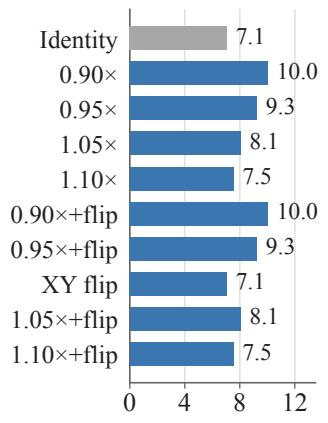  
(a) SemanticKITTI

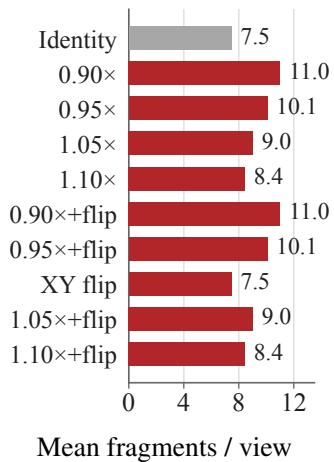  
(b) nuScenes

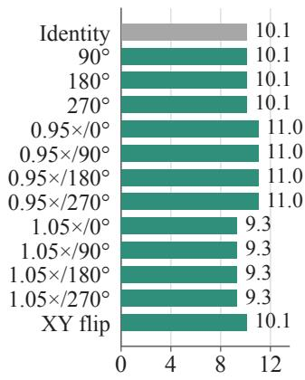  
(c) ScanNet  
Figure A1: Fragment counts across TTA views for SemanticKITTI, nuScenes, and ScanNet. Each fragment requires one model forward at batch size one.

## C ADDITIONAL RESULTS AND ABLATIONS

Table A4: Semantic segmentation w/ TTA and w/o TTA (mIoU/ mAcc, %). Bold and underline indicate the best and second-best results, respectively, among the baselines and MixPT-S within each TTA setting.
<table><tr><td rowspan="2" colspan="2">Method</td><td rowspan="2"></td><td colspan="2">Sem.KITTI</td><td colspan="2">Waymo</td><td colspan="2">nuScenes</td><td colspan="2">ScanNet</td></tr><tr><td>#Params mIoU</td><td>mAcc</td><td>mIoU</td><td>mAcc</td><td>mIoU</td><td>mAcc</td><td>mIoU</td><td>mAcc</td></tr><tr><td rowspan="6">WTA</td><td>PTv3 (Wu et al., 2024)</td><td>46.1M</td><td>71.0</td><td>77.9</td><td>71.3</td><td>80.5</td><td>81.2</td><td>87.5</td><td>77.6</td><td>85.9</td></tr><tr><td>LitePT-S (Yue et al., 2026)</td><td>12.7M</td><td>71.3</td><td>77.7</td><td>73.1</td><td>83.8</td><td>82.2</td><td>88.1</td><td>76.5</td><td>84.2</td></tr><tr><td>Volt-S (Yilmaz et al., 2026)</td><td>23.7M</td><td>70.5</td><td>77.6</td><td>71.5</td><td>80.9</td><td>81.0</td><td>87.7</td><td>77.3</td><td>85.5</td></tr><tr><td>MixPT-S (Ours)</td><td>14.1M</td><td>71.2</td><td>78.1</td><td>72.9</td><td>83.4</td><td>81.8</td><td>87.9</td><td>76.9</td><td>84.9</td></tr><tr><td>MixPT-B (Ours)</td><td>51.8M</td><td>71.8</td><td>78.1</td><td>73.0</td><td>84.5</td><td>81.7</td><td>87.8</td><td>77.4</td><td>85.4</td></tr><tr><td>MixPT-L (Ours)</td><td>89.4M</td><td>71.6</td><td>78.0</td><td>73.1</td><td>82.9</td><td>82.4</td><td>88.3</td><td>77.7</td><td>85.7</td></tr><tr><td rowspan="6">VTA</td><td>PTv3 (Wu et al., 2024)</td><td>46.1M</td><td>69.6</td><td>77.2</td><td>70.7</td><td>81.3</td><td>79.6</td><td>86.6</td><td>76.5</td><td>85.3</td></tr><tr><td>LitePT-S (Yue et al., 2026)</td><td>12.7M</td><td>69.8</td><td>76.8</td><td>71.7</td><td>82.8</td><td>80.3</td><td>87.1</td><td>75.5</td><td>83.4</td></tr><tr><td>Volt-S (Yilmaz et al., 2026)</td><td>23.7M</td><td>69.4</td><td>77.0</td><td>70.5</td><td>80.3</td><td>80.5</td><td>87.5</td><td>76.4</td><td>84.9</td></tr><tr><td>MixPT-S (Ours)</td><td>14.1M</td><td>70.0</td><td>77.3</td><td>72.1</td><td>83.0</td><td>80.6</td><td>87.4</td><td>76.0</td><td>84.3</td></tr><tr><td>MixPT-B (Ours)</td><td>51.8M</td><td>70.4</td><td>77.2</td><td>72.1</td><td>84.1</td><td>81.1</td><td>87.3</td><td>76.4</td><td>84.9</td></tr><tr><td>MixPT-L (Ours)</td><td>89.4M</td><td>70.6</td><td>77.4</td><td>72.4</td><td>83.7</td><td>81.5</td><td>87.9</td><td>76.7</td><td>85.1</td></tr></table>

Semantic Segmentation with TTA. Table A4 reports the complete semantic segmentation results with and without TTA. TTA improves MixPT-S by 0.8–1.2 mIoU points across the four datasets, while our main comparison focuses on results without TTA due to the higher evaluation cost discussed in Appendix B.4.

Table A5: Serialization order ablation of MixPT-S (w/o TTA, mIoU/ mAcc, %).
<table><tr><td></td><td colspan="3">Sem.KITTI</td><td colspan="3">nuScenes</td><td colspan="3">ScanNet</td></tr><tr><td>Order</td><td>Latency (ms)</td><td>mIoU</td><td>mAcc</td><td>Latency (ms)</td><td>mIoU</td><td>mAcc</td><td>Latency (ms)</td><td>mIoU</td><td>mAcc</td></tr><tr><td>Z</td><td>27.83</td><td>69.2</td><td>76.3</td><td>18.92</td><td>80.4</td><td>87.0</td><td>17.51</td><td>75.4</td><td>83.9</td></tr><tr><td>TZ</td><td>28.20</td><td>70.0</td><td>77.3</td><td>19.16</td><td>80.6</td><td>87.4</td><td>17.48</td><td>76.0</td><td>84.3</td></tr><tr><td>H</td><td>30.15</td><td>69.1</td><td>76.8</td><td>21.34</td><td>80.4</td><td>87.0</td><td>18.97</td><td>75.5</td><td>83.8</td></tr><tr><td>TH</td><td>30.22</td><td>69.2</td><td>76.1</td><td>21.02</td><td>80.3</td><td>87.2</td><td>18.95</td><td>75.2</td><td>84.2</td></tr></table>

Serialization Order. We use Trans Z-order (TZ) as the default serialization pattern. Across all three datasets, performance varies only modestly across the tested fixed orders, with TZ achieving the highest mIoU. Serialization overhead consists of two main components: code construction and stage layout. Code construction encodes coordinates into serialization codes, sorts them to obtain the serialization order, and builds the inverse mapping, while the stage layout reorders features and coordinates once when entering the attention stage and restores the original order when leaving it. The stage layout cost remains similar across serialization orders, whereas code construction is more expensive for the Hilbert-based alternatives in our implementation.

Table A6: Median axis ranges over the complete validation sets. Scene ranges are measured in metres, while window and global ranges are measured in cells of their respective attention grids.
<table><tr><td rowspan="2">Dataset</td><td colspan="3">Scene [m]</td><td colspan="3">Window extent [cells]</td><td colspan="3">Global extent [cells]</td></tr><tr><td>x</td><td>y</td><td>z</td><td>x</td><td>y</td><td>z</td><td>x</td><td>y</td><td>z</td></tr><tr><td>Sem.KITTI</td><td>157.3</td><td>109.8</td><td>9.7</td><td>79</td><td>63</td><td>11</td><td>99</td><td>69</td><td>7</td></tr><tr><td>Waymo</td><td>148.6</td><td>132.4</td><td>8.5</td><td>72</td><td>63</td><td>14</td><td>93</td><td>83</td><td>6</td></tr><tr><td>nuScenes</td><td>145.0</td><td>188.3</td><td>24.3</td><td>126</td><td>120</td><td>31</td><td>182</td><td>236</td><td>31</td></tr><tr><td>ScanNet</td><td>5.6</td><td>5.1</td><td>2.5</td><td>30</td><td>23</td><td>16</td><td>35</td><td>32</td><td>16</td></tr></table>

Scene and Attention Geometry. For window attention, we measure the axis ranges of each full 1,024-token serialized window on the attention-stage grid. Across all four datasets, these windows span wider ranges along the horizontal axes than along the vertical axis. For global attention, we measure the axis ranges of the scene-wide token set after dataset-specific pooling when s > 1, or at the original attention-stage resolution when s = 1. A similar horizontal-vertical imbalance is observed on the resulting global-attention grid. Because window and global ranges are measured on grids with different cell sizes, their cell counts should not be compared directly as physical distances.

## D LIMITATIONS

This study focuses on establishing the effectiveness of interleaving window and global attention rather than exhaustively optimizing their arrangement. Although we evaluate several block layouts, the best schedule may depend on the dataset, task, or model scale, and a more systematic search for when global interaction should be introduced remains an open direction.

Global attention is currently made more efficient through spatial grid pooling, which provides a simple way to compress the token set before scene-wide interaction. More generally, the key challenge is to reduce the number of tokens while preserving the information needed for effective scene-wide interaction. Exploring alternative pooling, token selection, or learned compact representations may further improve this efficiency-accuracy trade-off.

## E QUALITATIVE RESULTS

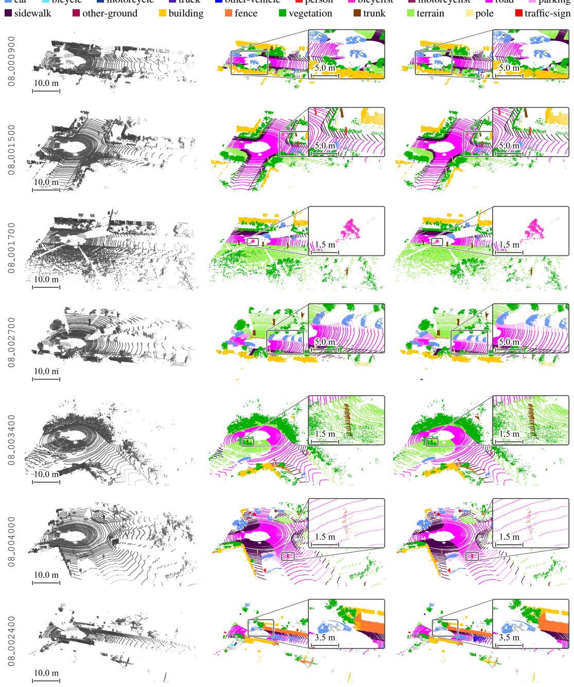  
(a) Input  
(b) Ours  
(c) GT  
Figure A2: Qualitative semantic segmentation on SemanticKITTI. Columns show (a) input point clouds, (b) MixPT-S predictions, and (c) ground truth. Insets highlight representative regions.

wall

floor

picture

cabinet

counter

desk

bed

curtain

refrigerator

sofa

table

shower curtain

door

toilet

bookshelf

window

sink

other furniture

bathtub

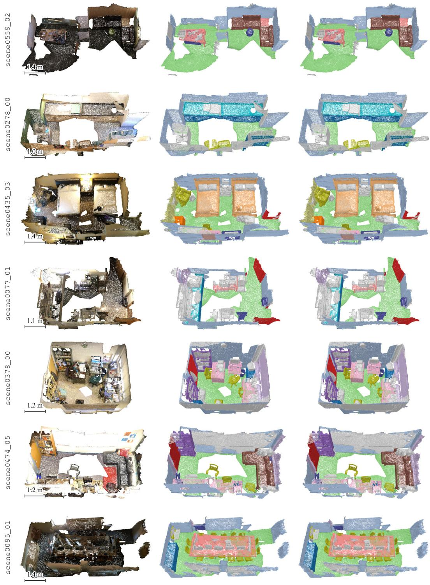  
(a) Input  
(b) Ours  
(c) GT  
Figure A3: Qualitative semantic segmentation on ScanNet. Columns show (a) input point clouds, (b) MixPT-S predictions, and (c) ground truth.

scene0621\_00

scene0427\_00

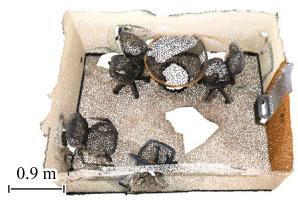

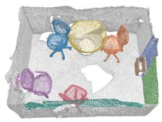

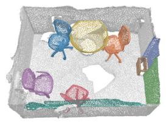

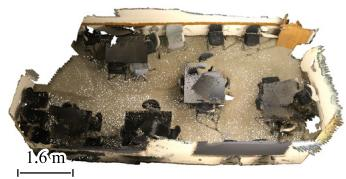

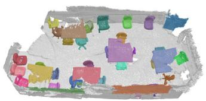

scene0488\_01 scene0599\_00 scene0217\_00 scene0578\_02 scene0645\_02

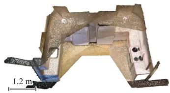

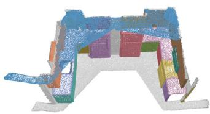

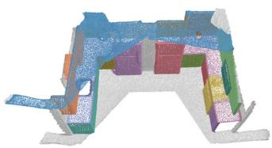

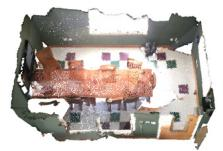

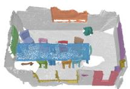

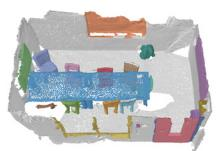

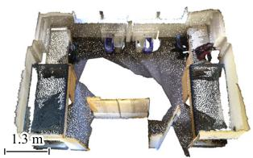

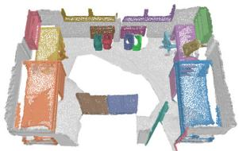

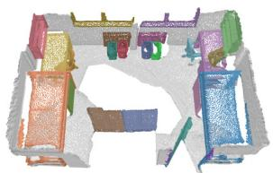

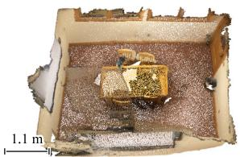

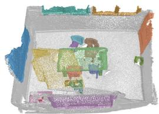

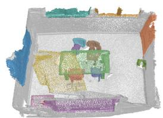

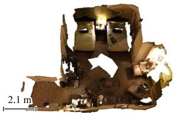  
(a) Input

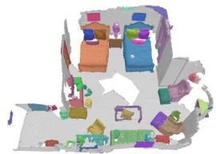  
(b) Ours

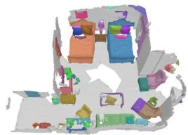  
(c) GT  
Figure A4: Qualitative instance segmentation on ScanNet200. Columns show (a) input point clouds, (b) MixPT-S\* predictions, and (c) ground truth. Colors distinguish instances rather than semantic classes. For visualization, prediction-GT pairs matched one-to-one within the same class at mask IoU $> 0 . 5$ share colors; unmatched instances receive distinct colors. Gray indicates background or unassigned points.