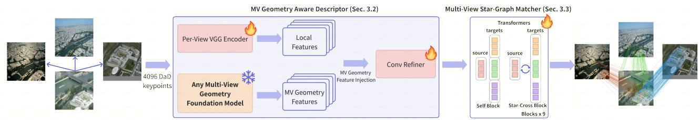
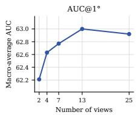
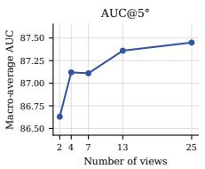
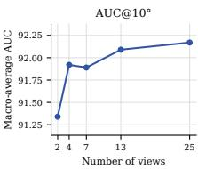
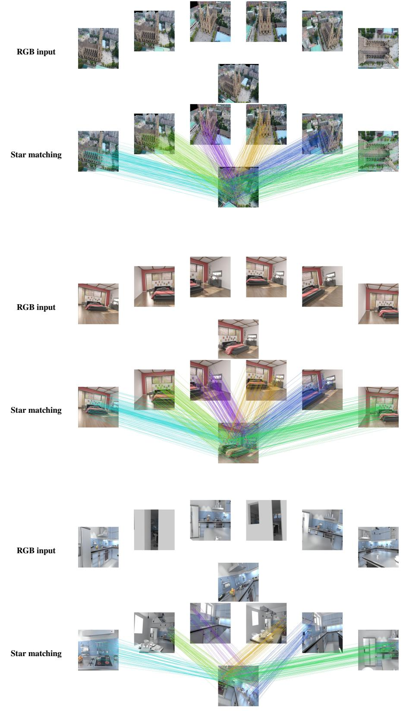
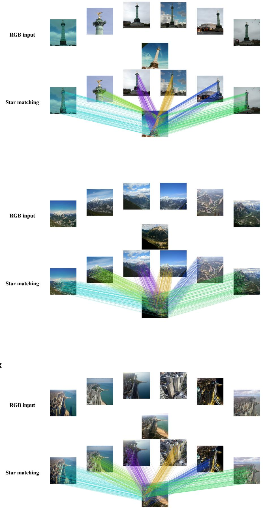
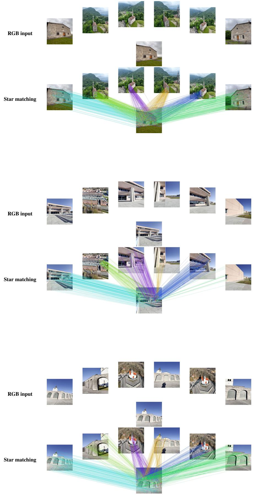
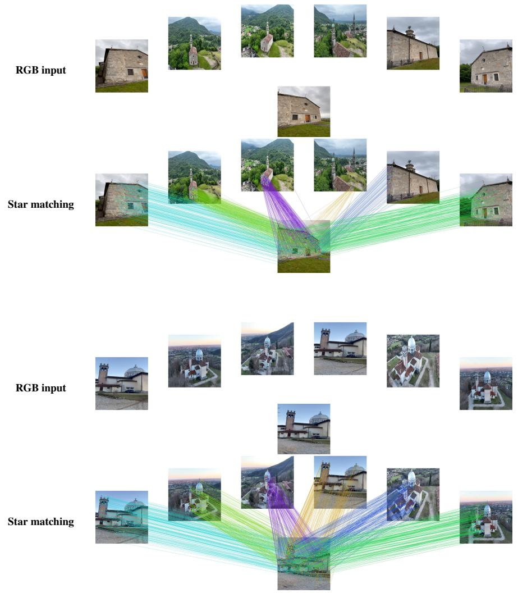

# MVLoMa: Multi-View Local Feature Matching with Any Geometry Foundation Model

Xinyang Lu1,2, Shengzhe Wei1, Sheng Tang1, Weiqi Zhang3, Juntong Fang3, Zesong Li1

1Kosmo Research 2School of Astronautics, Harbin Institute of Technology 3School of Software, Tsinghua University

## Abstract

Local feature matching is typically formulated for image pairs, although structure-from-motion and visual localization commonly match one reference image against many retrieved or covisible neighbours. Applying a pairwise matcher independently to these centre–neighbour edges duplicates reference-side computation and prevents the matcher from exploiting complementary multi-view geometric evidence from the remaining observations. To address these limitations, we introduce MVLoMa, a sparse star-graph matcher that extends LoMa from image pairs to multiple views. MVLoMa first uses a frozen multi-view geometry model to jointly describe all images in a star, then injects the resulting cross-view geometric context into local descriptors. It then matches the centre image to all neighbours in a single forward pass through per-view self-attention and bidirectional centre–neighbour cross-attention. For supervision, we derive positive correspondences only from depth-valid, mutually visible dense warps and explicitly penalize high-confidence matches that violate epipolar geometry. On 25-view star graphs from HyperSim, ScanNet++, Mip-NeRF 360, and Tanks and Temples, MVLoMa obtains the best macro-average relative-pose AUC among the compared methods at all three thresholds (58.65/85.41/90.99). Its matcher is 2.20× faster than sequential evaluation of the 24 centre–neighbour edges. The same design supports four tested frozen geometry encoders—DA3, π3, VGGT, and VGGT-Ω—with DA3-Giant performing best on all reported encoder-ablation metrics. Controlled ablations further isolate the efects of geometry-aware descriptors, visibility filtering, geometric negative supervision, and joint multi-view inference.

Keywords: local feature matching, multi-view geometry, star graph, geometry foundation models, relative pose estimation Project page: https://kosmoresearch.github.io/MVLoMa/

## 1 Introduction

Reliable correspondence is the interface through which im- ages become geometric constraints. It underlies camera pose estimation, mapping, visual localization, and structure-from- motion (SfM). Learned sparse matchers (Sarlin et al., 2020; Lindenberger et al., 2023; Nordström et al., 2026) combine local descriptors with contextual assignment, while detector free and dense methods predict a broader set of correspon- dences (Sun et al., 2021; Edstedt et al., 2024, 2026). This progress has made two-view pose estimation substantially more robust. Yet it also leaves a mismatch between the unit of computation used by a matcher—an image pair—and the unit of evidence available to downstream geometry—a group of mutually overlapping images.

Consider the ubiquitous star graph: a reference image and its retrieved neighbours. This topology occurs when SfM builds local subproblems, when localization matches a query to a covisible map neighbourhood, and when a keyframe asso- ciates observations over time. A pairwise matcher is invoked once for every reference–neighbour edge. It consequently re- computes the reference descriptor and reference-side matcher branch, and it must decide each correspondence before seeing supporting or conflicting evidence from the remaining neigh- bours. The limitation is not merely redundant computation.

Repetitive texture, partial occlusion, and a weak baseline can make a match ambiguous in one pair while a third image resolves the ambiguity.

Existing multi-view matchers move contextualization from isolated pairs to collaborative groups or tracks (Zhang et al., 2025; Lee et al., 2026). However, their dense or groupwise out-puts are not designed for the repeated sparse centre–neighbour assignments of a star graph. Simply batching pairwise match- ers preserves that sparse interface but prevents communication between edges. We therefore seek a matcher that reasons jointly over a star while retaining explicit pairwise outputs for RANSAC.

There is a second, largely independent source of unused information. Recent 3D foundation models predict pose, depth, and geometry from arbitrary view collections by exchanging information across image tokens (Wang et al., 2025, 2026b; Lin et al., 2025). Their spatially aligned final-layer tokens already encode multi-view geometric context, yet local match ing commonly starts from a separate frozen 2D descriptor backbone. Reusing these tokens exposes geometry to the matcher without introducing another frozen feature stream. Keeping the foundation encoder fixed also avoids optimizing its large parameter set and preserves a reusable geometric representation.

These observations suggest a simple principle: jointly match a star once, and reuse thefrozen geometric representation that the star has already produced. We instantiate this principle in MVLoMa, a multi-view extension of LoMa (Nordström et al., 2026). A light trainable descriptor head replaces LoMa’s frozen DINOv2 stream with last-layer tokens from a frozen 3D foundation encoder. A star-structured matcher then shares the centre representation across all edges and alternates per-view self-attention with bidirectional centre–neighbour cross-attention. It outputs a conventional score matrix for every edge, so its matches can be consumed directly by standard robust pose estimation.

Joint reasoning alone does not guarantee useful super- vision. Sparse assignment is a classification problem: high- confidence but geometrically wrong matches can survive mutual matching and disproportionately harm RANSAC. We therefore construct positives only from depth-valid, mutually- visible dense warps, and explicitly penalize predicted matches whose epipolar error exceeds 3 px. These changes comple- ment the multi-view architecture rather than replace LoMa’s matching and matchability objectives.

Our experiments follow a 25-view star-graph protocol and evaluate the same centre–neighbour edges for every method. Under this protocol, MVLoMa leads the macro-average at all three AUC thresholds and improves strict AUC over LoMa-L on both HyperSim and ScanNet++. A controlled backbone ablation isolates the efect of geometry-aware features, su- pervision ablations evaluate visibility filtering and geometric negatives, and a view-count study shows that additional views can improve joint multi-view inference. The results also delin-eate the scope of the method: dense two-view RoMa remains stronger on Mip-NeRF 360 at the strictest threshold, while MVLoMa provides a sparse multi-view alternative that oper- ates on all 25 views in our protocol.

Our contributions are summarized as follows:

• We formulate sparse matching over a star so that MVLoMa produces all centre–neighbour matches in one forward pass rather than evaluating each edge inde- pendently.

• We use frozen features from a multi-view foundation model—DA3-Giant by default—as geometry-aware de- scriptor inputs, so matching shares the representation already used for multi-view geometry.

• We adopt RoMa v2 visibility-filtered ground truth for star-graph training (Edstedt et al., 2026) and introduce a geometric negative loss for high-confidence epipolar violations. Experiments and ablations show consistent improvements from these components and from multi- view context.

## 2 Related Work

## 2.1 Sparse and Dense Feature Matching

Local matching has evolved from independently comparing hand-designed features to learned descriptor and assignment pipelines. SuperGlue contextualizes detected keypoints with graph attention (Sarlin et al., 2020); LightGlue improves the same family with adaptive depth and pruning (Lindenberger et al., 2023). LoFTR removes the detector by matching coarse image features (Sun et al., 2021). In parallel, RoMa and RoMa v2 obtain robust dense correspondence from foundation fea- tures and coarse-to-fine refinement (Edstedt et al., 2024, 2026). LoMa shows that a carefully scaled local-feature recipe re- mains highly competitive (Nordström et al., 2026). These methods difer in sparsity and representation, but their assign- ment is fundamentally pairwise. MVLoMa inherits LoMa’s local descriptor refinement and dual-softmax interface while moving contextual reasoning from an image pair to a star graph.

## 2.2 Multi-View Correspondence and Tracks

Multi-view information has long been used after matching to merge pairwise correspondences into tracks. More recent learned methods use it inside the matcher. CoMatcher employs groupwise interaction to make keypoint matching collabora- tive (Zhang et al., 2025), whereas MV-RoMa aggregates dense multi-view correspondence into tracks (Lee et al., 2026). These approaches establish that complementary observations can reduce pairwise ambiguity. Our setting is deliberately more structured: a star has one centre whose features participate in every output edge. We therefore use a centre–neighbour communication pattern rather than full neighbour–neighbour interaction. The resulting model retains a score matrix and confidence for each individual edge, enabling the usual sparse matching and RANSAC interface without a post-hoc track snapping stage.

## 2.3 Multi-View Geometric Foundation Models

DUSt3R and MASt3R learn feedforward geometric represen- tations from image pairs (Wang et al., 2024; Leroy et al., 2024). VGGT, π3, and DA3 extend the input from pairs to view collections and exchange token information across views (Wang et al., 2025, 2026b; Lin et al., 2025). These models are typ- ically used to decode camera and scene geometry, while a separate matching system constructs explicit correspondences. We instead ask whether their last-layer, cross-view-fused to- kens can serve as a frozen geometry-aware input to a sparse matcher. This choice is distinct from directly decoding tracks with a foundation model: it preserves a specialized assignment head and leaves the geometry encoder unchanged.

## 2.4 Matching in Reconstruction Systems

Optimization-based SfM obtains global geometry by matching image pairs, building tracks, and geometrically verifying them (Schönberger and Frahm, 2016; Pan et al., 2024). Hybrid systems couple these explicit constraints with feedforward geometry priors (Duisterhof et al., 2025; Pan et al., 2026). They motivate star subgraphs as a scalable local unit, but the correspondence module is still often assembled from independent pairwise matchers or heterogeneous track sources. MVLoMa addresses this upstream bottleneck; it is a matching primitive rather than a replacement for global optimization.

## 3 Method

## 3.1 Problem Formulation

Given a star ${ { S } _ { l } } = \left\{ { { I } _ { l } } , { { I } _ { 1 } } , . . . , { { I } _ { N - 1 } } \right\}$ with centre image $I _ { l } ,$ our goal is to simultaneously predict the correspondence sets $\mathsf { \bar { \{ M ( l , j ) \} } } _ { j = 1 } ^ { N - 1 }$ . Each $M ( l , j )$ contains sparse centre– neighbour matches. A pairwise matcher instead makes $N - 1$ independent calls, each with a duplicate centre descriptor and centre-side attention computation. More importantly, it commits to an edge without observations from the other edges. MVLoMa is designed around the opposite data flow: frozen foundation features first encode the complete star, a shared centre representation then communicates with all neighbours, and conventional pairwise assignment is recovered only at the output (Figure 1). The following sections describe these three stages and their geometric supervision.

## 3.2 Geometry-Aware Multi-View Descriptors

The first design question is where multi-view context should enter a local matcher. Recomputing independent 2D descrip- tors for every edge would preserve LoMa’s pairwise bottleneck. Conversely, fine-tuning a large geometry encoder solely for matching is costly and can disturb its general-purpose prior. We instead reuse the representation already available after a foundation model has processed the star.

Multi-view geometry models tokenize each image with a ViT and interleave within-view self-attention with cross- view attention. Let $\mathbf { F } _ { i } \in \mathbb { R } ^ { h \times w \times d _ { f } }$ be the final alternating- attention feature map for $I _ { i } .$ . Its tokens are spatially aligned and include information from the other star views. The original LoMa DeDoDe-G descriptor (Nordström et al., 2026) fuses a trainable VGG stream and convolutional refiners with frozen DINOv2-L features (Oquab et al., 2024). MVLoMa keeps this trainable structure, replacing only the frozen DINOv2-L stream with frozen foundation features:

$$
\mathbf { D } _ { i } = g _ { \psi } \big ( \mathrm { V G G } ( I _ { i } ) , \mathbf { F } _ { i } \big ) , \quad \mathbf { D } _ { i } \in \mathbb { R } ^ { h \times w \times d } ,\tag{1}
$$

for $i \in \{ l , 1 , \ldots , N - 1 \}$ . Here $g _ { \psi }$ comprises the Conv Refiner and MLP projection, which also maps encoder-specific feature dimensions to a common descriptor dimension. LoMa’s DaD keypoints are detected and descriptors are sampled from $\mathbf { D } _ { i }$ Thus multi-view context enters the descriptor field before assignment, while the subsequent matcher can focus on se- lecting sparse correspondences. The same star-graph encoder pass also produces the geometry features used by its original pose/depth heads; MVLoMa introduces no separate frozen descriptor backbone. Compatibility requires a frozen encoder to expose spatially aligned per-image tokens after multi-view fusion. We use DA3-Giant by default and evaluate $\pi ^ { 3 }$ , VGGT, and VGGT-Ω (Wang et al., 2026b, 2025, 2026a) in Section 4.

## 3.3 Star-Graph Attention and Assignment

The descriptor fields are geometry-aware, but matching still benefits from task-specific communication at the selected key- points. Running LoMa on each edge would retain independent centre states. Full all-to-all attention is also unnecessary for a star: the outputs only connect the centre with a neighbour, and allowing every neighbour pair to interact increases the attention workload without providing a direct output edge. We therefore use the star topology itself as the attention pattern (Figure 1).

Starting from sampled descriptors, we stack L matcher layers. Each layer first forms an intermediate state by applying self-attention independently within every view, with rotary position encoding:

$$
\mathbf { H } _ { i } ^ { ( \ell ) } = \mathbf { D } _ { i } ^ { ( \ell - 1 ) } + \mathrm { S e l f A t t n } ( \mathbf { D } _ { i } ^ { ( \ell - 1 ) } ) .\tag{2}
$$

We then concatenate neighbour descriptors, writing ${ \mathbf { X } } _ { 1 : N - 1 } =$ $[ \mathbf { X } _ { 1 } , \dots , \mathbf { X } _ { N - 1 } ]$ for the stacked neighbour tokens. The centre queries all neighbours, after which all neighbours query the updated centre:

$$
\mathbf { D } _ { l } ^ { ( \ell ) } = \mathbf { H } _ { l } ^ { ( \ell ) } + \mathrm { C r o s s A t t n } \Big ( \mathbf { H } _ { l } ^ { ( \ell ) } ; \mathbf { H } _ { 1 : N - 1 } ^ { ( \ell ) } \Big ) ,\tag{3}
$$

$$
\mathbf { D } _ { 1 : N - 1 } ^ { ( \ell ) } = \mathbf { H } _ { 1 : N - 1 } ^ { ( \ell ) } + \mathrm { C r o s s A t t n } \Big ( \mathbf { H } _ { 1 : N - 1 } ^ { ( \ell ) } ; \mathbf { D } _ { l } ^ { ( \ell ) } \Big ) .\tag{4}
$$

Neighbours never attend to one another and no view embed- ding is used; cross-attention has no positional encoding. The centre can nevertheless aggregate evidence from all observa- tions before assignment. A point ambiguous in one pair can consequently be supported or contradicted by a third view, while each edge retains its own sparse output.

For each neighbour $j ,$ , we form $S _ { p q } ^ { l j } = \langle \mathbf { d } _ { p } ^ { l } , \mathbf { d } _ { q } ^ { j } \rangle$ and calcu- late a pairwise dual-softmax confidence:

$$
P _ { p q } ^ { l j } = \mathrm { s o f t m a x } _ { p } ( \tau ^ { - 1 } S _ { p q } ^ { l j } ) \odot \mathrm { s o f t m a x } _ { q } ( \tau ^ { - 1 } S _ { p q } ^ { l j } ) .\tag{5}
$$

Normalization is restricted to the current image pair; neigh- bours therefore compete only for correspondences on their own edge. Mutually maximal entries above the matching threshold $\mu$ form $M ( l , j )$ . Since the centre descriptors have been shared across all $j ,$ , the same centre keypoint can consistently asso- ciate to several neighbours, inducing a candidate star track without a separate track-snapping operation.

  
Figure 1. Overview of MVLoMa. Given one source (centre) image and multiple target (neighbour) images, a trainable per-view VGG branch extracts local features, while a frozen multi-view geometry foundation model supplies geometry-aware patch features for the same views. A trainable convolutional refiner fuses the two streams into descriptors sampled at 4096 keypoints per image. The multi-view star-graph matcher then jointly processes the centre and all neighbours and outputs sparse centre–neighbour correspondences for every edge. Flames denote trainable modules and the snowflake denotes the frozen foundation model.

## 3.4 Visibility-Filtered Ground Truth and Geo metric Negatives

The attention pattern establishes how evidence is exchanged; supervision must ensure that this evidence is geometrically meaningful. We obtain LoMa-style positive correspondences by reprojecting ground-truth depth with ground-truth pose. A naive dense warp, however, treats occluded, out-of-image, and invalid-depth pixels as if they had a valid target. Following RoMa v2 (Edstedt et al., 2026), we retain a positive only when its source depth is valid, its reprojection lies inside the target image, and the prescribed occlusion and target-depth consistency checks are satisfied. This filtering removes label noise before it reaches either the descriptor or the assignment head.

The original dual-softmax matching loss suppresses non- matches implicitly through row and column competition, and matchability indicates whether a keypoint has a true correspon- dence. Neither objective explicitly punishes a high-confidence false match that survives the final mutual selection. Such outliers are particularly consequential for sparse geometric estimation. We therefore mine predictions that violate ground- truth epipolar geometry and use them as explicit negatives.

For $( I _ { l } , I _ { j } )$ , ground-truth relative extrinsics define $E ^ { l j } =$ $[ t ^ { l j } ] _ { \times } R ^ { l j }$ and the fundamental matrix at the network output resolution is $F ^ { l j } = K _ { j } ^ { - \top } E ^ { l j } K _ { l } ^ { - \top }$ 1. For homogeneous coordi- nates $\bar { x } _ { p } ^ { l } , \bar { x } _ { q } ^ { j }$ , the point-to-epipolar-line error is

$$
e _ { p q } ^ { l j } = \frac { \lvert ( \bar { x } _ { q } ^ { j } ) ^ { \top } F ^ { l j } \bar { x } _ { p } ^ { l } \rvert } { \lVert ( F ^ { l j } \bar { x } _ { p } ^ { l } ) _ { 1 : 2 } \rVert _ { 2 } } .\tag{6}
$$

Let $\mathcal { M } ^ { l j }$ denote final-layer mutually maximal matches whose confidence exceeds $\mu .$ . We define geometric negatives as

$$
\mathcal { N } ^ { l j } = \big \{ ( p , q ) \in \mathcal { M } ^ { l j } \ | \ e _ { p q } ^ { l j } > \tau _ { \mathrm { e p i } } \big \} ,\tag{7}
$$

and use $\tau _ { \mathrm { e p i } } = 3 \mathrm { p x }$ by default. At every layer, their loss is

$$
\mathcal { L } _ { \mathrm { n e g } } ^ { l j , \ell } = - \frac { 1 } { | \mathcal { N } ^ { l j } | } \sum _ { ( p , q ) \in \mathcal { N } ^ { l j } } \log ( 1 - P _ { p q } ^ { l j , \ell } ) ,\tag{8}
$$

and is zero for an empty set. Mining at the final layer focuses on mistakes that the matcher would actually output, while su- pervising the same set at every layer propagates the corrective signal throughout the matcher.

Each matcher layer is trained with the LoMa dual-softmax matching loss, matchability loss, and the geometric negative loss. With $\lambda _ { \mathrm { n e g } } = 1 / ( N - 1 )$ ), the objective is

$$
\begin{array} { r } { \mathcal { L } _ { \mathrm { m a t c h e r } } = \displaystyle \frac { 1 } { L } \sum _ { \ell = 1 } ^ { L } ( \mathcal { L } _ { \mathrm { g l u e } } ^ { \ell } + \mathcal { L } _ { \mathrm { m a t c h a b i l i t y } } ^ { \ell }  } \\ { \displaystyle  +  \lambda _ { \mathrm { n e g } } \sum _ { j = 1 } ^ { N - 1 } \mathcal { L } _ { \mathrm { n e g } } ^ { l j , \ell } ) . } \end{array}\tag{9}
$$

The cross-attention layers are jointly supervised over all neighbours. The foundation encoder stays frozen; we train the descriptor head $g _ { \psi }$ and matcher attention layers. Section 4 isolates the efect of GT filtering and the negative loss.

## 4 Experiments

## 4.1 Protocol and Implementation

We evaluate multi-view matching on 25-frame sets from HyperSim, ScanNet++, Mip-NeRF 360, and Tanks and Tem- ples (Roberts et al., 2021; Yeshwanth et al., 2023; Barron et al., 2022; Knapitsch et al., 2017). HyperSim and ScanNet++ provide challenging indoor geometry and appearance; Mip- NeRF 360 and Tanks and Temples add outdoor and large-scale scenes. The encoder and view-count ablations additionally use MegaDepth-X and TerraSky3D (Li et al., 2026; D’Urso et al., 2026) to probe transfer beyond the four primary bench-marks. The controlled descriptor-backbone ablation also uses AerialMD (AerialMegaDepth) evaluation pairs (Vuong et al., 2025). In that ablation, overlap o is computed following the definition of RoMa v2 (Edstedt et al., 2026), and we report subsets with $o > 0 . 3 5$ and $o > 0 . 0 5$

For every 25-frame set, frame 0 is the star centre and frames 1–24 give 24 centre–neighbour edges. This protocol evaluates matching as it is used in a local multi-view subprob- lem rather than sampling unrelated pairs. For a multi-view method that accepts K + 1 < 25 images, we partition the 24 neighbours into groups of size K. The groups cover exactly the same centre–neighbour edges as a two-view baseline, so any diference cannot be attributed to easier pair selection. MV-RoMa exhausts memory at 25 views and is evaluated with 13-view groups under this same coverage rule.

For each edge, we estimate relative pose with PoseLib RANSAC (Larsson and contributors, 2020) at a 2.5 px thresh-old. We report $\mathrm { A U C @ 1 ^ { \circ } / 5 ^ { \circ } / 1 0 ^ { \circ } }$ , where the pose error com- bines rotation and translation errors. The strict 1◦ threshold exposes precise correspondence failures that may be con- cealed by coarse thresholds. Each baseline is evaluated at the input resolution prescribed by its original paper; MVLoMa is reported at DA3-G encoder resolutions 504 and 784.

Unless stated otherwise, MVLoMa uses a frozen DA3-G encoder, LoMa-L initialization, and 4096 DaD keypoints per image. The matcher architecture and optimization hyperpa- rameters otherwise follow LoMa-L. Unlike LoMa, we jointly optimize the trainable descriptor components and matcher end-to-end, while keeping the geometry foundation encoder frozen. All reported variants are trained for 100k iterations with batch size 1. The GT/loss ablation uses fixed four-view training. The encoder and view-count experiments use dy- namic 2–8-view training, testing whether a model exposed to variable local context can generalize to substantially larger stars.

## 4.2 Comparison to Matching Baselines

Table 1 compares sparse and dense baselines under identical centre–neighbour edge coverage. MV-RoMa is evaluated with 13 views because its 25-view configuration exhausts available memory.

At 784 resolution, MVLoMa improves AUC@1◦ over LoMa-L by 1.91 points on HyperSim and 0.76 points on ScanNet++. The gains are consistent with the value of jointly contextualizing centre features and using cross-view founda- tion features before assignment, although this comparison does not separate the two factors. It also achieves the best macro-average at all three thresholds (58.65/85.41/90.99), di-rectly supporting the aggregate claim in the abstract. The 784 model obtains a higher strict HyperSim score than the 504 model (53.90 versus 53.35); on the remaining benchmarks, the two resolutions are close.

The comparison also identifies meaningful boundaries. On Mip-NeRF 360, dense two-view RoMa remains strongest at AUC@1◦, indicating that fine dense localization can still dominate for this scene distribution. At the coarser 5- and 10-degree thresholds, MVLoMa is the strongest multi-view method. On Tanks and Temples, LoMa-L retains the best score and MVLoMa stays within a small margin. Rather than sug- gesting that multi-view reasoning universally replaces pairwise dense matching, these results support it as a complementary sparse design for star-structured geometric estimation.

## 4.3 Ablations

Ground-truth filtering and negative supervision. Table 2 shows that both components improve matching. The geometric negative loss produces the larger HyperSim AUC@1◦ change (52.84 to 51.04 when removed), compared with 52.84 to 51.93 without GT filtering. The two modifications address diferent failures: filtering prevents invalid dense warps from becoming positives, whereas the negative term targets the high-confidence false matches that remain after assignment. Their improvements on both HyperSim and Mip-NeRF 360 show that the efect is observed beyond the synthetic indoor setting. The larger strict-threshold drop without the negative term is consistent with epipolar-inconsistent outliers degrading robust pose estimation.

Descriptor backbone. Table 3 isolates the frozen descriptor input while keeping the training data, resolution, star matcher, losses, and optimization configuration fixed. DA3-G consis- tently outperforms both DINOv2 variants. Compared with DINOv2-G, it improves AUC@1◦ by 1.16, 11.44, 0.41, and 0.65 points across the four test subsets, respectively. The smaller diferences between DINOv2-G and DINOv2-L in- dicate that scaling the frozen 2D backbone alone does not explain the improvement.

Foundation encoder. Table 4 evaluates frozen geometry encoders under the same 2–8-view training setup. DA3-G is best on all reported metrics, while VGGT-Ω is close on MegaDepth-X and TerraSky3D. Thus, the benefits are not solely from the multi-view matcher: the quality of the frozen geometry-aware token representation matters. In particular, DA3-G exceeds the other encoders on HyperSim AUC@1◦ by 1.62–2.40 points. This indicates that the choice of frozen representation remains consequential after the same trainable descriptor head and matcher are applied. The result supports the use of a geometry-aware encoder as an input to a lightweight local matching head, without establishing that any individual property of DA3-G is solely responsible for the diference.

Number of inference views. Table 5 varies the input-star size at test time and reports the dataset-level scores, while Fig- ure 2 isolates their macro-average trend. Under the fixed-edge protocol, the view count changes only how many neighbours are processed jointly in each star. We observe a clear and consistent performance drop at two views: the macro-average AUC falls to 62.21/86.63/91.34 at $1 ^ { \circ } / 5 ^ { \circ } / 1 0 ^ { \circ }$ , approximately 0.8 points below the best multi-view result at every threshold. In the two-view setting, each star contains only one centre and one neighbour, so star matching degenerates to pair matching and can no longer aggregate evidence across multiple neigh- bours. Since the number of evaluated pairs remains unchanged, the observed drop isolates the loss of joint multi-view interaction rather than a change in evaluation scale, providing direct empirical evidence for the benefit of star-graph matching over its pairwise counterpart.

Table 1. Relative pose AUC on 25-view star graphs; each cell reports AUC@ $1 ^ { \circ } / 5 ^ { \circ } / 1 0 ^ { \circ }$ in that order. MV-RoMa uses 13 views owing to out-of-memory at 25 views. Best and second-best values are bold and underlined. Average is the macro-average over the four benchmarks at each threshold; T&T denotes Tanks and Temples.
<table><tr><td>Method</td><td>HyperSim</td><td>ScanNet++</td><td>Mip-NeRF 360</td><td>T&amp;T</td><td>Average</td></tr><tr><td>Two-view</td><td></td><td></td><td></td><td></td><td></td></tr><tr><td>LightGlue</td><td>20.20/47.34/55.72</td><td>22.84/61.83/74.49</td><td>51.28/83.46/90.02</td><td>52.42/84.69/91.08</td><td>36.69/69.33/77.83</td></tr><tr><td>LoMa-L</td><td>51.99/77.00/82.86</td><td>37.68/75.57/85.14</td><td>71.69/93.25/96.50</td><td>68.22/91.96/95.74</td><td>57.40/84.44/90.06</td></tr><tr><td>RoMa</td><td>45.06/64.82/69.78</td><td>36.81/73.88/83.70</td><td>75.42/93.27/95.88</td><td>66.56/90.99/95.01</td><td>55.96/80.74/86.09</td></tr><tr><td>RoMa v2</td><td>52.93/80.65/86.92</td><td>33.02/73.33/84.58</td><td>74.81/94.16/97.00</td><td>67.06/91.32/95.37</td><td>56.95/84.87/90.97</td></tr><tr><td>Multi-view</td><td></td><td></td><td></td><td></td><td></td></tr><tr><td>MV-RoMa (13v)</td><td>37.00/58.51/64.51</td><td>35.80/71.57/81.67</td><td>74.45/92.93/95.61</td><td>66.04/90.56/94.75</td><td>53.32/78.39/84.14</td></tr><tr><td>MVLoMA (504)</td><td>53.35/78.99/84.76</td><td>38.03/74.72/84.67</td><td>73.90/94.04/96.97</td><td>68.08/91.91/95.74</td><td>58.34/84.91/90.53</td></tr><tr><td>MVLoMA (784)</td><td>53.90/80.02/85.99</td><td>38.44/75.68/85.33</td><td>74.29/94.08/96.97</td><td>67.96/91.84/95.68</td><td>58.65/85.41/90.99</td></tr></table>

Table 2. GT filtering and geometric negative loss (DA3-G; fourview training; test at 784). Best and second-best values are bold and underlined.
<table><tr><td></td><td colspan="3">HyperSim</td><td colspan="3">Mip-NeRF 360</td></tr><tr><td>Variant</td><td>@1</td><td>@5</td><td>@10</td><td>@1</td><td>@5</td><td>@10</td></tr><tr><td>Full</td><td>52.84</td><td>78.42</td><td>84.34</td><td>73.85</td><td>93.96</td><td>96.92</td></tr><tr><td>w/o GT filtering</td><td>51.93</td><td>77.75</td><td>83.77</td><td>73.69</td><td>93.85</td><td>96.83</td></tr><tr><td>w/o negative loss</td><td>51.04</td><td>76.96</td><td>83.19</td><td>72.72</td><td>93.42</td><td>96.55</td></tr></table>

Table 3. Controlled frozen-backbone ablation at resolution 784. We report $\operatorname { A U C } \ @ 1 ^ { \circ }$ at two RoMa v2 overlap thresholds (Edstedt et al., 2026). Best and second-best values are bold and underlined.
<table><tr><td></td><td colspan="2">HyperSim</td><td colspan="2">AerialMD</td></tr><tr><td>Backbone</td><td> $o > 0 . 3 5$ </td><td> $o > 0 . 0 5$ </td><td> $o > 0 . 3 5$ </td><td> $o > 0 . 0 5$ </td></tr><tr><td>DA3-G</td><td>69.27</td><td>61.14</td><td>77.97</td><td>48.16</td></tr><tr><td>DINOv2-G</td><td>68.11</td><td>49.70</td><td>77.56</td><td>47.51</td></tr><tr><td>DINOv2-L</td><td>67.72</td><td>48.29</td><td>77.33</td><td>47.08</td></tr></table>

Beyond two views, the gains depend on the dataset and threshold. HyperSim improves from 52.51 at two views to 54.47 at 13 views, while TerraSky3D improves through 25 views. The trend is not monotonic: the HyperSim 1◦ score is lower at 25 than at 13 views despite improving at the coarser thresholds. Additional observations may provide com- plementary support but can also introduce distractors or harder baselines. The results therefore demonstrate extrapolation be- yond the 2–8-view training range without implying that every added view is beneficial.

  
Figure 2. Macro-average relative pose AUC from Table 5 versus the number of inference views. Each panel averages the corresponding AUC threshold over HyperSim, Mip-NeRF 360, Tanks and Temples, and TerraSky3D.

Matching complexity. Let a star contain V views, each with K keypoints, and let the matcher hidden dimension be d. Cross-attention has the same quadratic cost in both implementations because $( V - 1 ) ( K { \times } K ) = K { \times } ( ( V - 1 ) K )$ The savings instead come from avoiding repeated centre-side self-attention, linear projections, and feed-forward networks. Ignoring LayerNorm, RoPE, and softmax, one LoMa-L pair costs approximately 76K $d ^ { 2 } + 1 6 K ^ { 2 } d$ FLOPs per layer. Across L layers, sequential pairwise and star matching require

$$
C _ { \mathrm { p a i r } } \approx L ( V - 1 ) ( 7 6 K d ^ { 2 } + 1 6 K ^ { 2 } d ) ,\tag{10}
$$

$$
C _ { \mathrm { s t a r } } \approx L \big ( 3 8 V K d ^ { 2 } + ( 1 2 V - 8 ) K ^ { 2 } d \big ) .\tag{11}
$$

With $K = 2 0 4 8 , d = 5 1 2$ , and $L = 9$ , their theoretical com- pute ratio is $C _ { \mathrm { p a i r } } / C _ { \mathrm { s t a r } } = 7 0 ( V - 1 ) / ( 4 3 V - 1 6 )$ . Table 6 compares this estimate with matcher-only wall-clock time.

At 25 views, star matching reduces the Transformer FLOP count by 37.0%, an architectural saving that is independent of whether the pairwise edges are executed sequentially or batched: batching can amortize launch overhead, but it still repeats the centre-side self-attention, projections, and feedforward networks for every edge. Relative to sequential pair- wise evaluation, the measured latency is reduced by 54.6% (2.20× speedup). This measured gain is larger than the theoretical 1.59× compute ratio because the 24 pairwise calls additionally incur repeated Python/module and kernel-launch overhead, whereas the star implementation uses larger con- tiguous matrices with better GPU utilization. The two-view outputs are identical, providing an implementation sanity check. These compute and latency savings come at the cost of higher peak memory: at 25 views, matcher-only peak memory is 979 MiB for the star matcher versus 176 MiB for sequential pairwise evaluation.

Table 4. Frozen foundation encoder ablation for MVLoMa (2–8 train views, 25 test views, resolution 784). Best and second-best values are bold and underlined.
<table><tr><td></td><td colspan="3">HyperSim</td><td colspan="3">MegaDepth-X</td><td colspan="3">TerraSky3D</td></tr><tr><td>Encoder</td><td>@1</td><td>@5</td><td>@10</td><td>@1</td><td>@5</td><td>@10</td><td>@1</td><td>@5</td><td>@10</td></tr><tr><td>DA3-G</td><td>53.90</td><td>80.02</td><td>85.99</td><td>18.88</td><td>52.97</td><td>65.77</td><td>55.53</td><td>83.88</td><td>90.04</td></tr><tr><td> $\pi ^ { 3 }$ </td><td>51.50</td><td>76.56</td><td>82.57</td><td>18.37</td><td>52.78</td><td>65.42</td><td>53.77</td><td>82.81</td><td>89.45</td></tr><tr><td>VGGT</td><td>52.28</td><td>78.17</td><td>84.26</td><td>18.05</td><td>52.22</td><td>64.70</td><td>53.21</td><td>81.92</td><td>88.56</td></tr><tr><td>VGGT-Ω</td><td>52.07</td><td>77.70</td><td>83.46</td><td>18.43</td><td>52.91</td><td>65.58</td><td>55.21</td><td>83.38</td><td>89.78</td></tr></table>

Table 5. Inference view count for DA3-G MVLoMa trained with 2–8 views at resolution 784; each cell reports $\mathsf { A U C @ 1 ^ { \circ } / 5 ^ { \circ } / 1 0 ^ { \circ } }$ . Average is the macro-avera e over the four benchmarks at each threshold. Best and second-best values are bold and underlined; T&T denotes Tanks and Temples.
<table><tr><td># views</td><td>HyperSim</td><td>Mip-NeRF 360</td><td>T&amp;T</td><td>TerraSky3D</td><td>Average</td></tr><tr><td>2</td><td>52.51/77.63/83.29</td><td>73.96/94.02/96.95</td><td>67.63/91.86/95.73</td><td>54.76/83.01/89.37</td><td>62.21/86.63/91.34</td></tr><tr><td>4</td><td>53.79/79.43/85.68</td><td>74.31/94.02/96.95</td><td>67.85/91.89/95.78</td><td>54.58/83.13/89.29</td><td>62.63/87.12/91.92</td></tr><tr><td>7</td><td>53.90/79.13/85.14</td><td>74.32/94.06/96.97</td><td>67.89/91.82/95.70</td><td>54.97/83.42/89.75</td><td>62.77/87.11/91.89</td></tr><tr><td>13</td><td>54.47/80.12/85.88</td><td>74.20/94.04/96.96</td><td>67.92/91.82/95.66</td><td>55.39/83.47/89.85</td><td>63.00/87.36/92.09</td></tr><tr><td>25</td><td>53.90/80.02/85.99</td><td>74.29/94.08/96.97</td><td>67.96/91.84/95.68</td><td>55.53/83.88/90.04</td><td>62.92/87.45/92.17</td></tr></table>

Table 6. Transformer compute and matcher-only runtime for nine LoMa-L layers. FLOPs count a multiply–add as two operations. Runtime uses one NVIDIA A800, batch size 1, and 2048 keypoints; values average 46 of 50 trials after dropping the two fastest and two slowest.
<table><tr><td colspan="2"></td><td colspan="3">Theory (TFLOPs)</td><td colspan="3">A800 (ms)</td></tr><tr><td>Views</td><td>Edges</td><td>Pair</td><td>Star</td><td>Sp.</td><td>Pair</td><td>Star</td><td>Sp.</td></tr><tr><td>2</td><td>1</td><td>0.676</td><td>0.676</td><td>1.00×</td><td>20.95</td><td>21.18</td><td>0.99×</td></tr><tr><td>4</td><td>3</td><td>2.029</td><td>1.508</td><td>1.35×</td><td>57.98</td><td>37.15</td><td>1.56×</td></tr><tr><td>7</td><td>6</td><td>4.059</td><td>2.754</td><td>1.47×</td><td>113.81</td><td>60.50</td><td>1.88×</td></tr><tr><td>13</td><td>12</td><td>8.117</td><td>5.247</td><td>1.55×</td><td>237.60</td><td>105.78</td><td>2.25×</td></tr><tr><td>25</td><td>24</td><td>16.235</td><td>10.234</td><td>1.59×</td><td>446.96</td><td>203.09</td><td>2.20×</td></tr></table>

## 5 Reproducibility and Limitations

We describe the architecture, loss, evaluation topology, RANSAC setting, keypoint budget, frozen/trainable compo- nents, and reported training schedules in the main paper, with further detail in Appendix A. The method builds directly on publicly available LoMa-style matching components and multi-view 3D foundation encoders. We will release the im- plementation and evaluation configuration upon publication.

MVLoMa depends on the geometric quality of the frozen foundation features; textureless or uncertain regions can still yield sparse or ambiguous matches. The centre–neighbour topology does not directly exchange information between neighbours, and the memory requirement still grows with the number of keypoints and views. Our 2–8-view training range is also smaller than the 25-view evaluation star. Al- though the view-count ablation shows useful extrapolation, it is not uniformly monotonic and does not establish that all additional observations are beneficial. Learning view selection or confidence-aware neighbour aggregation is a promising direction for larger stars. Finally, we evaluate the matcher through relative pose estimation; its interaction with complete global SfM systems is outside the scope of this work.

## 6 Conclusion

We presented MVLoMa to resolve a mismatch in current geometric pipelines: pairwise assignment discards evidence and foundation features that are already available across a view collection. MVLoMa reuses frozen geometry-aware tokens and shares the centre representation across a star, while preserving ordinary sparse pairwise outputs for robust pose estimation. Across four benchmarks, the 784 model attains the strongest macro-average AUC among the compared methods at all three thresholds, and its 25-view matcher is 2.20× faster than sequential pairwise evaluation. The ablations further show that the gains depend on both the frozen representation and the proposed supervision, while the non-monotonic view- count results clarify that additional context is useful but not uniformly beneficial.

## References

Jonathan T. Barron, Ben Mildenhall, Dor Verbin, Pratul P. Srinivasan, and Peter Hedman. Mip-NeRF 360: Unbounded anti-aliased neural radiance fields. In CVPR, 2022.

Bardienus Duisterhof, Lojze Zust, Philippe Weinzaepfel, Vincent Leroy, Yohann Cabon, and Jérôme Revaud. MASt3R-SfM: a fully-integrated solution for unconstrained structure-from-motion. In 3DV, 2025.

Mattia D’Urso, Yuxi Hu, Mattia Rossi, Christian Sormann, and Friedrich Fraundorfer. TerraSky3D: Multi-view reconstructions of european landmarks in 4k. In CVPR Workshops, 2026.

Johan Edstedt, Qiyu Sun, Georg Bökman, Mårten Wadenbäck, and Michael Felsberg. RoMa: Robust dense feature matching. In CVPR, 2024.

Johan Edstedt, David Nordström, Yushan Zhang, Georg Bökman, Jonathan Astermark, Viktor Larsson, Anders Heyden, Fredrik Kahl, Mårten Wadenbäck, and Michael Felsberg. RoMa v2: Harder better faster denser feature matching. In ECCV, 2026.

Arno Knapitsch, Jaesik Park, Qian-Yi Zhou, and Vladlen Koltun. Tanks and temples: Benchmarking large-scale scene reconstruction. ACM Transactions on Graphics, 36(4), 2017.

Viktor Larsson and contributors. PoseLib – minimal solvers for camera pose estimation. https://github.com/PoseLib/ PoseLib, 2020.

Jongmin Lee, Seungyeop Kang, and Sungjoo Yoo. MV-RoMa: From pairwise matching into multi-view track reconstruction. In CVPR, 2026.

Vincent Leroy, Yohann Cabon, and Jérôme Revaud. Grounding image matching in 3d with MASt3R. In ECCV, 2024.

Yuan Li, Yuanbo Xiangli, Hadar Averbuch-Elor, Noah Snavely, and Ruojin Cai. Long-tail internet photo reconstruction. arXiv preprint arXiv:2604.22714, 2026.

Zhengqi Li and Noah Snavely. MegaDepth: Learning single-view depth prediction from internet photos. In CVPR, 2018.

Haotong Lin, Sili Chen, Jun Hao Liew, Donny Y. Chen, Zhenyu Li, Guang Shi, Jiashi Feng, and Bingyi Kang. Depth anything 3: Recovering the visual space from any views. arXiv preprint arXiv:2511.10647, 2025.

Philipp Lindenberger, Paul-Edouard Sarlin, and Marc Pollefeys. LightGlue: Local feature matching at light speed. In ICCV, 2023.

David Nordström, Johan Edstedt, Georg Bökman, Jonathan Aster- mark, Anders Heyden, Viktor Larsson, Mårten Wadenbäck,¨ Michael Felsberg, and Fredrik Kahl. LoMa: Local feature matching revisited. arXiv preprint arXiv:2604.04931, 2026.

Maxime Oquab, Timothée Darcet, Théo Moutakanni, et al. DINOv2: Learning robust visual features without supervision. Transactions on Machine Learning Research, 2024.

Linfei Pan, Daniel Barath, Marc Pollefeys, and Johannes L. Schön- berger. GLOMAP: Global structured-from-motion revisited. In ECCV, 2024.

Linfei Pan, Johannes L. Schönberger, and Marc Pollefeys. Global structure-from-motion meets feedforward reconstruction. arXiv preprint arXiv:2605.26103, 2026.

Mike Roberts, Jason Ramapuram, Anurag Ranjan, Atulit Kumar, Miguel Angel Bautista, Nathan Paczan, Russ Webb, and Joshua M. Susskind. Hypersim: A photorealistic synthetic dataset for holistic indoor scene understanding. In ICCV, 2021.

Paul-Edouard Sarlin, Daniel DeTone, Tomasz Malisiewicz, and Andrew Rabinovich. SuperGlue: Learning feature matching with graph neural networks. In CVPR, 2020.

Johannes L. Schönberger and Jan-Michael Frahm. Structure-from- motion revisited. In CVPR, 2016.

Jiaming Sun, Zehong Shen, Yuang Wang, Hujun Bao, and Xiaowei Zhou. LoFTR: Detector-free local feature matching with trans- formers. In CVPR, 2021.

Khiem Vuong, Anurag Ghosh, Deva Ramanan, Srinivasa Narasimhan, and Shubham Tulsiani. AerialMegaDepth: Learning aerial-ground reconstruction and view synthesis. In CVPR, 2025.

Jianyuan Wang, Minghao Chen, Nikita Karaev, Andrea Vedaldi, Christian Rupprecht, and David Novotny. VGGT: Visual geometry grounded transformer. In CVPR, 2025.

Jianyuan Wang, Minghao Chen, Shangzhan Zhang, Nikita Karaev, Johannes L. Schönberger, Patrick Labatut, Piotr Bojanowski, David Novotny, Andrea Vedaldi, and Christian Rupprecht. VGGT-ω. In CVPR, 2026a.

Shuzhe Wang, Vincent Leroy, Yohann Cabon, Boris Chidlovskii, and Jérôme Revaud. DUSt3R: Geometric 3d vision made easy. In CVPR, 2024.

Wenshan Wang, Delong Zhu, Xiangwei Wang, Yaoyu Hu, Yuheng Qiu, Chen Wang, Yafei Hu, Ashish Kapoor, and Sebastian Scherer. TartanAir: A dataset to push the limits of visual slam. In IROS, 2020.

Yifan Wang, Jianjun Zhou, Haoyi Zhu, Wenzheng Chang, Yang Zhou, Zizun Li, Junyi Chen, Jiangmiao Pang, Chunhua Shen, and Tong He. π3: Permutation-equivariant visual geometry learning. In ICLR, 2026b.

Yao Yao, Zixin Luo, Shiwei Li, Jingyang Zhang, Yufan Ren, Lei Zhou, Tian Fang, and Long Quan. BlendedMVS: A large-scale dataset for generalized multi-view stereo networks. In CVPR, 2020.

Chandan Yeshwanth, Yueh-Cheng Liu, Matthias Nießner, and Angela Dai. ScanNet++: A high-fidelity dataset of 3d indoor scenes. In ICCV, 2023.

Jintao Zhang, Zimin Xia, Mingyue Dong, Shuhan Shen, Linwei Yue, and Xianwei Zheng. CoMatcher: Multi-view collaborative feature matching. In CVPR, 2025.

## A Implementation Details

At inference, we use 4096 DaD keypoints per image. The trainable VGG stream, convolutional refiner, descriptor projection, and matcher are optimized jointly, while the foundation encoder remains frozen. Geometric negatives use a 3 px epipolar threshold and weight $1 / ( N - 1 )$ ). The fixed-view GT/loss ablation uses LoMa-L initialization, four views, batch size one, and 100k iterations at resolution 784. Encoder and view-count ablations sample 2–8 views; evaluation covers all 24 centre–neighbour edges in each 25-frame set.

Training datasets. Table 7 lists the final DA3-G data mixture. Intervals denote visible-overlap ranges. In addition to datasets cited in the main text, the mixture uses MegaDepth, BlendedMVS, and TartanAir (Li and Snavely, 2018; Yao et al., 2020; Wang et al., 2020); MegaDepth (Re-MVS) follows the LoMa recomputation (Nordström et al., 2026).

Table 7. Training data mixture for the final DA3-G model. MVS denotes multi-view stereo; Sample w. and Neg. w. are dataset-sampling and geometric negative-loss weights.
<table><tr><td>Dataset</td><td>Domain</td><td>GT source</td><td>Sample w.</td><td>Overlap sampling</td><td>Neg. w.</td></tr><tr><td>MegaDepth</td><td>Outdoor</td><td>MVS</td><td>1.0</td><td>5–35 / 35–100 (0.5 each)</td><td>1.0</td></tr><tr><td>MegaDepth (Re-MVS)</td><td>Outdoor</td><td>MVS</td><td>1.0</td><td>1–35 / 35–100 (0.5 each)</td><td>1.0</td></tr><tr><td>MegaDepth-X</td><td>Outdoor</td><td>MVS</td><td>1.0</td><td>1–35 / 35–100 (0.5 each)</td><td>0.01</td></tr><tr><td>HyperSim</td><td>Indoor</td><td>Graphics</td><td>1.0</td><td>5–50 / 50–100 (0.5 each)</td><td>0.01</td></tr><tr><td>ScanNet++</td><td>Indoor</td><td>Mesh</td><td>0.5</td><td>20–100 only</td><td>0.1</td></tr><tr><td>BlendedMVS</td><td>Aerial</td><td>Mesh</td><td>1.0</td><td>5–20 / 20–100 (0.5 each)</td><td>1.0</td></tr><tr><td>AerialMD</td><td>Aerial</td><td>MVS</td><td>1.0</td><td>5–20 / 20–100 (0.5 each)</td><td>1.0</td></tr><tr><td>TerraSky3D</td><td>Aerial</td><td>MVS</td><td>0.5</td><td>Open-source JSON split</td><td>0.01</td></tr><tr><td>TartanAir</td><td>Outdoor</td><td>Graphics</td><td>0.5</td><td>5–20 / 20–100 (0.25 each)</td><td>1.0</td></tr></table>

Optimization and initialization. All final experiments use 784 × 784 inputs and the publicly released LoMa-L checkpoin as initialization. The descriptor and matcher learning rates are $1 0 ^ { - 4 } { \mathrm { ~ a n d } } 2 \times 1 0 ^ { - 4 }$ , respectively. We use AdamW with weight decay $5 \times 1 0 ^ { - 5 }$ and an exponential-moving-average decay of 0.999. Training uses one NVIDIA A800 GPU, batch size one, and 200k iterations: the first 100k iterations use fixed four-view stars, followed by 100k iterations with the number of views sampled uniformly from 2–8. MegaDepth-X has sparse depth supervision, so its auxiliary matchability loss is disabled; its geometric negative-loss weight remains as reported in Table 7.

## B Qualitative Visualizations

This appendix collects qualitative MVLoMa visualizations from the development experiments. For each star, the original RGB views are shown above the corresponding star-matching visualization. Examples are grouped by dataset.

Blended MVS

  
MegaDepth-X

