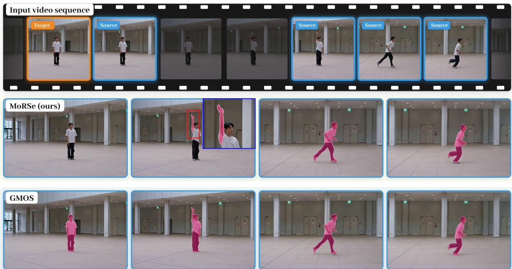
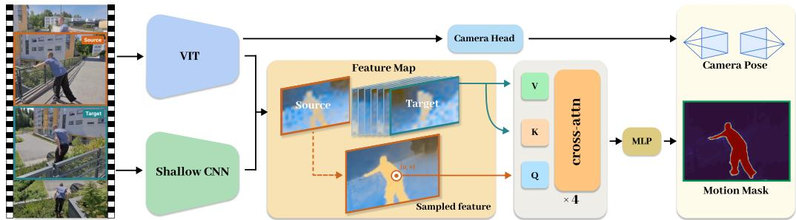
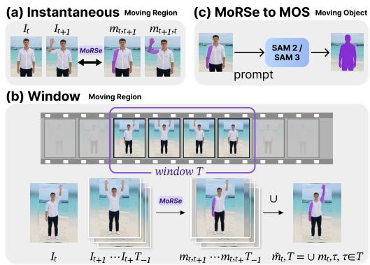
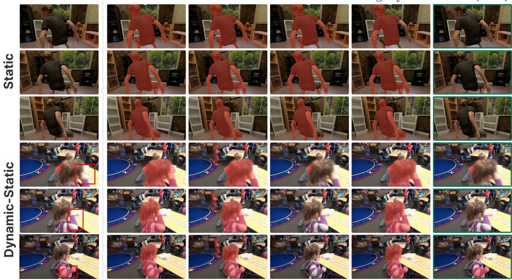
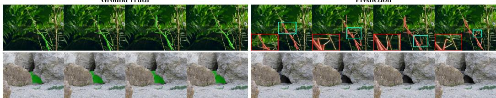
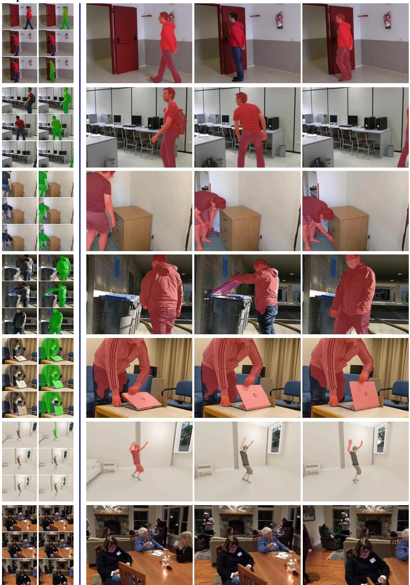
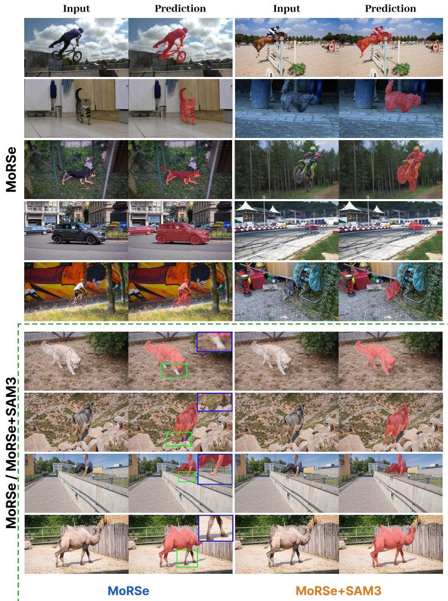

# Moving Regions, Not Moving Objects: Segmenting What Actually Moves under Camera Motion

Wenhua Jin1,2, Tiancheng Chen1, Sheng Tang1, Jiahao Li1,3, Yupeng Liu1,2, Weiqi Zhang4, Juntong Fang4, Zesong Li1

1 Kosmo Research 2 Automotive Engineering Department, Jilin University 3 Xiamen University 4 School of Software, Tsinghua University

## Abstract

Moving object segmentation is conventionally formulated at the sequence and object level, marking an entire instance as moving once it moves anywhere in a video. Recent instantaneous formulations distinguish moving from stationary intervals, but still generate masks at the object level through frozen segmentation foundation models. Because the mask is derived from an instance-level proposal, motion is typically attributed to the entire instance rather than localized to the regions that actually move. Moreover, such instance-level predictions can produce masks even when no part of the instance is actually moving, revealing a more fundamental issue: motion is not an intrinsic property of an instance; it can only be determined by comparing at least two frames. Building on this premise, we introduce MoRSe, which jointly interprets two frames to predict a moving-region mask, distinguishing actual scene motion from apparent motion induced by the camera. A single RGB encoder replaces multi-stage foundation stacks, so no optical flow, point tracks, or separate mask generator is needed at inference. We release MoRSe-5K, a benchmark of 42 sequences with Static, Dynamic-Static, and Dynamic settings designed to evaluate the model’s ability to distinguish and localize moving and stationary regions under diferent camera and scene motion conditions. MoRSe outperforms both specialized moving object segmentation methods and dense 4D reconstruction methods with motion-thresholded predictions, while producing the fewest false positives on sequences where nothing moves

Project page: https://kosmoresearch.github.io/MoRSe/

  
Figure 1: Motion is a pair relation, not an object property. Motion needs two observations, so we condition on an ordered source–target pair. Holding the source fixed and advancing the target through the sequence, MoRSe returns an empty mask while the person stands still, then the moving region alone when only an arm lifts, then the whole body once it walks. GMOS marks the same person in every frame, whatever the target.

## 1 INTRODUCTION

Separating independently moving regions from camera-induced image motion is a core problem in dynamic scene understanding. It prevents dynamic correspondences from corrupting structure from motion and SLAM, and provides physically grounded signals for 4D reconstruction. Whether a region is moving cannot be determined from its appearance alone: the same object may be stationary for one frame pair and moving for another, while a static wall may appear to move when the camera moves.

Existing benchmarks and models focus on moving object segmentation, treating motion as a property of an object rather than of a frame pair. Many video segmentation datasets label an object throughout a sequence once it moves at any time, so an appearance model can label a stationary instance as moving. GMOS takes an important step toward instantaneous evaluation by annotating moving and stationary intervals (Xie et al., 2026), but couples motion reasoning to a frozen SAM2 encoder and an object-level motion head, which can introduce false positives for visible but stationary objects.

We therefore define motion with respect to an ordered pair of frames. Given a source frame Is and a target frame $I _ { t } ,$ a source pixel is moving if its corresponding scene point changes independently of the camera between the two frames. The same $I _ { s }$ should activate when the object has displaced between the two frames, and stay suppressed when both lie in the same stationary interval, including $I _ { t } = I _ { s }$

Existing methods usually follow one of two pipelines. Some estimate motion with optical flow or point tracks and then use a segmentation model to complete the mask. Geometry explains camera motion, while the segmentation stage recovers object extent (Xie et al., 2024b;a; Huang et al., 2025; Goli et al., 2025; He et al., 2026). Errors can accumulate across correspondence, prompting, and mask propagation. Other methods reconstruct dense 4D motion and obtain a mask by thresholding the predicted displacement. Feed-forward 4D models predict per-pixel motion in world coordinate that already absorb camera motion (Karhade et al., 2026; Luo et al., 2026; Lin et al., 2026a; Liu et al., 2026; Qian et al., 2026), but a single displacement threshold must handle very different cases, such as a distant vehicle and a nearby moving limb.

MoRSe (Moving-Region Segmentation) directly predicts a moving-region mask for each source coordinate by attending to the target. A UniQuery4R-initialized encoder (Chen et al., 2026) jointly processes the selected frames alongside a shallow convolutional branch. The target provides motion evidence, while multi-scale source features preserve boundary detail. The encoder also predicts per-view camera pose as an auxiliary task, but the predicted pose is not used to build the mask: we do not warp features, subtract a rigid flow, or threshold a geometric residual (Section 3.2).

Motion labels are therefore conditional on the observations rather than attached to an object once for an entire clip. This lets one source frame probe three capabilities along separate axes: temporal sensitivity, by varying the target; spatial localization, by responding only where an instance actually moves; and robustness to egomotion, by staying silent when apparent displacement is fully explained by the camera. Camera motion thus becomes a measurable negative case rather than an artifact absorbed into a sequence-level label, motivating the benchmark and model below.

Our contributions are as follows:

• We formulate motion on an ordered source–target pair and decode each source coordinate using target-conditioned attention, without flow, point tracks, or a segmentation foundation model at inference. A single target gives an instantaneous region, while a target window gives a long-term region through a union over targets; a promptable segmenter can recover whole moving objects (Sections 3.1, 3.4).

• We construct and will release MoRSe-5K: 42 sequences and 5,431 frames whose Static, Dynamic-Static, and Dynamic settings evaluate distinct model capabilities along separate axes. The Static setting has empty ground truth throughout, allowing ego-motion false positives to be measured directly—a failure mode that sequence-level MOS benchmarks do not express (Section 4.2).

• On MoRSe-5K, MoRSe performs best on moving-region segmentation and remains competitive on conventional sequence-level MOS benchmarks outside its target formulation (Section 4.4).

## 2 RELATED WORK

## 2.1 FLOW- AND TRACK-BASED SEGMENTATION

Moving object segmentation (MOS) identifies objects that move in a video; in the single-foreground setting it becomes a binary motion-segmentation problem similar to ours. It differs from unsupervised video object segmentation (UVOS), which targets salient foreground objects. The two tasks share benchmarks such as DAVIS (Perazzi et al., 2016), whose sequence-level labels can reward appearance shortcuts. GMOS adds frame-level moving/static states and false-positive penalties (Xie et al., 2026), but uses a frozen geometric encoder (Wang et al., 2026), frozen SAM2 features, an object-level head, and mask propagation; its binary GMOS-S variant retains this design. We instead condition the mask on an ordered source–target pair. Other MOS systems first obtain motion proposals and then complete them with a segmenter: FlowSAM uses flow with SAM (Xie et al., 2024b), Appearance-Based Refinement corrects incomplete masks (Xie et al., 2024a), and SegAnyMo prompts SAM2 from long-term point trajectories (Karazija et al., 2024; Huang et al., 2025; Ravi et al., 2025). Our model learns pair-conditioned evidence and mask prediction jointly.

## 2.2 GEOMETRIC MOTION REASONING

Geometric methods test whether correspondences agree with a static scene under camera motion. RoMo fits a per-video classifier to flow-based epipolar residuals (Goli et al., 2025); the cue is interpretable but requires robust fitting and test-time adaptation and is less reliable under pure rotation or low parallax. Easi3R derives dynamic cues from cross-view attention in a pretrained reconstruction model (Chen et al., 2025), while VGGT4D reads attention maps from a frozen VGGT (Wang et al., 2025) without extra training (Hu et al., 2026). These cues were learned for reconstruction, so a separate statistic is needed to obtain a mask. GeoMotion combines latent geometry, appearance, and precomputed flow (He et al., 2026); MegaSaM estimates motion probabilities from camera and depth (Li et al., 2025), MonST3R (Zhang et al., 2025b) and DAS3R (Xu et al., 2024) predict motion regions with reconstruction, and MoRe uses mask-guided attention (Fang et al., 2026). These methods usually define masks per frame or sequence to support reconstruction. We make the source–target pair the basic input; our geometry-pretrained encoder (Chen et al., 2026) predicts camera parameters only as an auxiliary task, without using them to compensate mask features.

## 2.3 SCENE FLOW FROM 4D RECONSTRUCTION

Feed-forward 4D models—Any4D (Karhade et al., 2026), 4RC (Luo et al., 2026), MoVieS (Lin et al., 2026a), Trace Anything (Liu et al., 2026), and Flow4R (Qian et al., 2026)—predict dense world-coordinate geometry and motion. Trace Anything represents each pixel with a continuous trajectory field. Their outputs can be thresholded into masks, but that conversion is separate from the learned output. MoRSe uses the same family of geometry-pretrained encoders (Chen et al., 2026) and directly supervises a pair-conditioned mask.

## 3 METHOD

## 3.1 PROBLEM FORMULATION AND OVERVIEW

Let $I _ { s } , I _ { t } \in \mathbb { R } ^ { H _ { 0 } \times W _ { 0 } \times 3 }$ be a source and target frame. For a normalized source coordinate $\mathbf { p } =$ $( u , v ) \in [ 0 , 1 ] ^ { 2 }$ , the pair-conditioned label $m _ { s , t } ( \mathbf { p } ) \in \{ 0 , 1 \}$ indicates whether the scene point observed at $I _ { s } ( \mathbf { p } )$ moves independently of the camera between the two frames. Camera-induced image displacement alone therefore has label zero. The label is tied to an ordered pair, so changing t can change $m _ { s , t }$ while leaving $I _ { s }$ fixed. Our model predicts the logit $L _ { s , t } ( \mathbf { p } ) = f _ { \Theta } ( I _ { s } , I _ { t } , \mathbf { p } )$ and probability $\hat { m } _ { s , t } ( \mathbf { p } ) = \sigma ( L _ { s , t } ( \mathbf { p } ) )$ on the source grid.

Real-video pair labels inherit object-level granularity from the annotated instances, a consequence we return to in Section 5.

The architecture has three parts (Figure 2): a joint encoder for the frame pair, sampled source coordinates that become decoder queries, and cross-attention blocks that update each query from target features before a final motion-logit readout.

  
Figure 2: MoRSe architecture. Both frames pass jointly through a UniQuery4R-initialized ViT and a shallow convolutional branch; the two are fused and split into source and target feature pyramids. A camera head reads the ViT camera tokens and predicts per-view pose and field of view as auxiliary outputs that never enter the mask path. Sampled source coordinates form the decoder queries; target features provide keys and values, and four cross-attention blocks refine each query before a shared MLP predicts the motion logit.

Temporal granularity at inference. Because the pair is the smallest unit in which motion is defined, coarser granularities are obtained by querying different target frames without changing the model. For a source frame s and any target set $\tau$

$$
\hat { m } _ { s , \mathcal { T } } ( \mathbf { p } ) = \operatorname* { m a x } _ { t \in \mathcal { T } } \hat { m } _ { s , t } ( \mathbf { p } ) ,\tag{1}
$$

This aggregation takes the largest predicted probability over the targets in $\check { \tau }$ (Figure 3). After thresholding, a single target gives the instantaneous mask, a window the moving region over that window, and $\tau$ spanning the video the sequence-level mask that conventional MOS benchmarks assume (Section 4.3). Fine-grained predictions can therefore be aggregated, whereas sequence-level training cannot recover when mo tion occurred. Adding targets cannot remove an already selected region, but may introduce a false positive from another pair, so target selection sets the precision–recall trade-off without retraining. Whole-object masks follow by prompting a segmenter (Ravi et al., 2025; Carion et al., 2026); it does not decide whether the region is moving.

  
Figure 3: Inference granularity. Target selection sets the granularity without changing the weights: one pair, a target window, or a promptable segmenter.

## 3.2 JOINT

## ENCODER AND CAMERA PREDICTION

We initialize the visual encoder from UniQuery4R (Chen et al., 2026). All selected frames, source and target alike, are passed jointly through the ViT and, in parallel, through a shallow convolutional branch that retains high-resolution detail the patch-tokenized ViT discards. The two branches are fused and split into per-view features, $( \{ F _ { s } ^ { ( \ell ) } \} _ { \ell = 1 } ^ { K } , \{ F _ { t } ^ { ( \ell ) } \} _ { \ell = 1 } ^ { K } , c _ { s } , c _ { t } ) = E _ { \phi } ( I _ { s } , I _ { t } )$ , where $F _ { v } ^ { ( \ell ) } \in \mathbb { R } ^ { H _ { \ell } \times W _ { \ell } \times C _ { \ell } }$ is the level-ℓ feature map, $c _ { v }$ is a camera token, and the ordering is fine-to-coarse so $F ^ { ( K ) }$ has the smallest spatial resolution.

A lightweight camera head reads the ViT camera tokens and predicts a per-view pose together with a scalar field of view, $( \widehat { T } _ { v } , \widehat { \phi } _ { v } ) = H _ { \mathrm { c a m } } ( c _ { v } )$ , following the initialization’s native design. This auxiliary task uses the shared encoder, but its predictions never enter the mask decoder; we compute no rigid flow, epipolar residual, or compensated feature map.

## 3.3 TARGET MEMORY

Rather than summarizing the pair into a single source-indexed map, we keep the target features as an explicit memory that every query reads individually. Let $T = \mathrm { v e c } ( F _ { t } ^ { ( K ) } ) \in \mathbb { R } ^ { N _ { t } \times C }$ be the flattened coarsest target field, projected pointwise by a layer-normalized linear map with a GELU nonlinearity. Each cross-attention block forms its own keys and values $K _ { T } , V _ { T }$ from this memory. The target memory is constructed once for the pair and reused by all source queries.

Query-resolution reads matter when a small moving part and a nearby static region fall in the same coarse feature cell.

The decoder additionally receives the source-indexed fields $\mathcal { X } _ { s } = \{ F _ { s } ^ { ( 1 ) } , \dots , F _ { s } ^ { ( K ) } \}$ . At each queried coordinate, these fields are sampled and fused into the initial query state, while the target memory supplies the keys and values used by the cross-attention blocks.

## 3.4 SPARSE QUERY DECODER

For every source feature field $F _ { s } ^ { ( \ell ) }$ , let $\tau _ { \ell } ( \mathbf { p } )$ map a normalized image coordinate to the corresponding continuous coordinate in that field. Each field is projected to a common channel width, upsampled, layer-normalized, and refined by a small convolutional stack. Bilinear sampling at $\tau _ { \ell } ( \mathbf { p } )$ gives a per-level vector $z _ { \ell } ( \mathbf { p } )$ . The samples are merged from fine to coarse by gated hierarchical fusion: each level mixes the running state with the incoming sample using a per-channel sigmoid gate, followed by layer normalization and a feed-forward update. A final layer-normalized linear projection gives the initial query state $q ^ { ( 0 ) } ( \mathbf { p } ) \in \mathbb { R } ^ { C }$ . The gate lets each channel decide how much fine detail and how much coarse context to admit; Section 4.7 measures it against additive fusion and concatenation.

The query is then refined by $B = 4$ pre-normalized cross-attention blocks. Each block reads the target memory $\bar { K } _ { T } , V _ { T }$ and applies a pointwise feed-forward update at p. A layer-normalized linear readout maps $q ^ { ( B ) } ( \mathbf { p } )$ to a feature, and the motion-mask logit is one scalar output of a shared multi-task MLP head applied to it, $f _ { \Theta } ( I _ { s } , I _ { t } , \mathbf { p } ) = h _ { \mathrm { m a s k } } ( q ^ { ( B ) } ( \mathbf { p } ) )$ ). Each block mixes a query with the target memory but never with another query. Attention is computed against the fixed key/value set $K _ { T } , \bar { V } _ { T }$ and all other operations act on one coordinate. A prediction is therefore independent of which other coordinates are decoded alongside it, while a batch of $Q$ coordinates can be evaluated in parallel. The decoder does not use query–query attention, decoder-side spatial convolution, or coarse-to-fine refinement, so a coordinate cannot recruit its neighbours for spatial context (Section 5).

## 3.5 SAMPLING AND OBJECTIVES

Given a sampled clip, we supervise all directed, non-identity source–target pairs in both temporal directions. The supervision then follows the data regime. On trajectory data every query inherits the label of its tracked 3D point: positive exactly when the point’s displacement between the two frames exceeds 7 mm in the current training recipe. On real videos, the labels come from the source frame’s annotations—the interaction instances are positive, the rest of the frame is negative—so the same source support keeps its label across the targets it is paired with. Static-scene clips contribute all-negative supervision, which teaches the decoder to abstain when nothing moves.

A pair is supervised on a bank of $Q = 1 0 2 4$ coordinates in its source frame, composed per data regime. Sampling changes which coordinates receive supervision, while the prediction function remains unchanged. A flat mixture sampler draws clips from curated mask sources, trajectory sources, and pseudo-static clips; only datasets with motion labels contribute to the motion branch. Mixture probabilities, clip lengths, and auxiliary task weights are in Appendix $\mathrm { C } ;$ curation and the split audit are in Section 4.1.

The motion head emits one raw logit per source–target query, thresholded at zero at inference. The mask loss pairs a point-wise binary cross-entropy with a soft Dice term over the valid queries,

$$
\mathcal { L } _ { \mathrm { m a s k } } = \frac { 1 } { 2 } \overline { { \mathrm { B C E W i t h L o g i t s } ( \ell _ { q } , m _ { q } ) } } + \frac { 1 } { 2 } \left[ 1 - \frac { 2 \sum _ { q } \sigma ( \ell _ { q } ) m _ { q } + 1 } { \sum _ { q } \sigma ( \ell _ { q } ) + \sum _ { q } m _ { q } + 1 } \right] ,\tag{2}
$$

where $\ell _ { q } = f _ { \Theta } ( I _ { s } , I _ { t } , \mathbf { p } _ { q } )$ and the average and sums run over the valid queries, pooled across pairs. Queries for points that are not observed in the target frame receive the visibility handling specified in Appendix C. We retain the camera objective from the initialization and optimize ${ \mathcal { L } } =$ $\lambda _ { \mathrm { m a s k } } \mathcal { L } _ { \mathrm { m a s k } } + \lambda _ { \mathrm { c a m } } \mathcal { L } _ { \mathrm { c a m } }$ , setting $\lambda _ { \mathrm { { c a m } } }$ to zero on datasets whose poses are not trustworthy. The camera loss touches only the shared encoder and camera head, so pose accuracy stays a diagnostic rather than a proxy for mask quality.

## 4 EXPERIMENTS

## 4.1 TRAINING-DATA CURATION

Training uses 28 source entries: 19 predominantly synthetic 3D point-tracking sources (92.3% of sampling mass) whose motion labels threshold ground-truth 3D displacement, seven mask-source entries (6.0%), and two static-scene sources (1.7%). For mask supervision, much MOS annotation conflicts with the moving-region definition, leaving a second mover unlabelled so that real motion becomes a negative, or outlining an instance that is mostly still so that static pixels become positive. A two-stage funnel therefore retains 392 of 5,231 candidate clips (41,474 frames) from DAVIS 2017 (Pont-Tuset et al., 2017), MoCA-Mask (Cheng et al., 2022), OVIS (Qi et al., 2021), YouTube-VOS 2019 (Xu et al., 2018), and HOI4D (Liu et al., 2022). The full inventory, split provenance, and sequence-level no-leak audit are in Appendix A.

## 4.2 THE MORSE-5K BENCHMARK

MoRSe-5K has 42 video sequences and 5,431 frames, partitioned by the combination of camera and scene motion. Static has a moving camera but no moving region, so its empty ground truth measures suppression of ego-motion false positives. Dynamic-Static contains motion regions that intermittently appear and disappear, while Dynamic contains camera, object, and background motion throughout the scene.

Of these, 21 sequences (2,236 frames) are rendered in Blender (Blender Online Community, 2024), with motion masks taken as pixels whose inter-frame displacement exceeds 10 mm and then dilated. The other 21 (3,195 frames) are real, from Mannequin Challenge (Li et al., 2019), LASIESTA (Cuevas et al., 2016), and D3D-HOI (Xu et al., 2021); we adopt the first two benchmarks’ frame-wise masks and annotate D3D-HOI ourselves.

## 4.3 DATASETS, METRICS, AND BASELINES

Metrics. In the Static setting every ground-truth mask is empty, so region similarity is undefined and every predicted pixel is a false positive. Let S be the Static frames and $\hat { M } _ { i } = \{ \mathbf { p } : \hat { m } _ { i } ( \mathbf { p } ) > \frac { 1 } { 2 } \}$ the moving set predicted on frame i of size $H _ { i } \times W _ { i }$ . The pixel error rate and the frame error rate are

$$
\mathrm { P E R } = \frac { \sum _ { i \in \mathcal { S } } \vert \hat { M } _ { i } \vert } { \sum _ { i \in \mathcal { S } } H _ { i } W _ { i } } , \qquad \mathrm { F E R } = \frac { 1 } { \vert \mathcal { S } \vert } \sum _ { i \in \mathcal { S } } \vert \mathcal { H } \Big [ \vert \hat { M } _ { i } \vert > \tau _ { a } \Big ] , \qquad \tau _ { a } = 2 0 \mathrm { p x } ,\tag{3}
$$

which separate leaking a few pixels everywhere from hallucinating a large region occasionally. The Dynamic-Static and Dynamic settings are scored with the standard DAVIS region similarity $\mathcal { I }$ contour accuracy ${ \mathcal F } ,$ and their mean (Perazzi et al., 2016), pooled by frame count (1,904:182), against the two ground-truth variants MoRSe-5K provides for the same frames; wJF denotes the pooled moving-region ${ \mathcal { I } } \& { \mathcal { F } } .$ , which the ablations report. Moving region annotates the pixels that actually move; moving object annotates whole instances, an object counting as moving if any part of it does. Rows that emit a region or a thresholded scene flow reach the object variant through one shared SAM 3 readout (Carion et al., 2026); the rest use the instance output their pipelines already produce. That readout expands whatever it receives, so a false positive grows into a whole spurious instance. Only the region variant reads every method’s native output, so we treat it as primary.

Scene-flow baselines. Trace Anything (Liu et al., 2026), Any4D (Karhade et al., 2026), 4RC (Luo et al., 2026), and MoVieS (Lin et al., 2026a) output dense motion rather than masks, and the UniQuery4R scene-flow comparison is converted the same way. Every criterion is frozen when the prediction PNGs are generated and never reselected per ground-truth variant. Any4D and 4RC use their released default cutoffs, and Trace Anything and VGGT4D use automatic criteria that expose

Table 1: Main results on MoRSe-5K (%). Metrics and the two ground-truth variants follow Section 4.3. “Scene flow” rows are thresholded into masks by each model’s own released or automatic criterion, frozen before evaluation and never re-tuned per variant. †: matched-window rerun from released code. ∗: the moving-object score comes from the shared SAM 3 readout; unmarked rows are scored on their own instance output. best , second , third per column.
<table><tr><td rowspan="3">Method</td><td rowspan="3"></td><td colspan="2">Static</td><td colspan="6">Dynamic-Static + Dynamic</td></tr><tr><td rowspan="2">PER↓</td><td rowspan="2">FER↓</td><td colspan="3">Moving region</td><td colspan="3">Moving object</td></tr><tr><td>J↑</td><td>F↑</td><td>J&amp;F↑</td><td>J↑</td><td>F↑</td><td>J&amp;F↑</td></tr><tr><td colspan="10">Native output Dense 4D reconstruction: predict scene flow, converted to a mask by thresholding</td></tr><tr><td colspan="10"></td></tr><tr><td>Trace Anything† Any4D†</td><td>trajectory field scene flow</td><td>21.01 0.46</td><td>100.00 18.70</td><td>32.10 27.30</td><td>35.90 29.80</td><td>34.00 28.60</td><td>30.18*  $3 3 . 8 0 ^ { * }$ </td><td>38.23* 38.28*</td><td>34.21* 36.04*</td></tr><tr><td>4RC†</td><td>scene flow</td><td>0.53</td><td>18.20</td><td>40.50</td><td>41.50</td><td>41.00</td><td>39.56*</td><td>43.69*</td><td>41.62*</td></tr><tr><td> $\mathrm { M o V i e S ^ { \dagger } }$ </td><td></td><td>0.64</td><td>43.80</td><td>39.80</td><td>48.50</td><td>44.10</td><td> $4 0 . 4 2 ^ { * }$ </td><td>49.38*</td><td>44.90*</td></tr><tr><td>UniQuery4R</td><td>scene flow scene flow</td><td>0.10</td><td>57.92</td><td>47.13</td><td>61.22</td><td>54.18</td><td>47.17*</td><td>58.28*</td><td>52.72*</td></tr><tr><td colspan="10">Moving object segmentation: predict a mask directly</td></tr><tr><td colspan="10"></td></tr><tr><td>FlowSAM† SegAnyMo†</td><td>motion mask</td><td>32.26 10.25</td><td>100.00</td><td>13.24</td><td>18.84</td><td>16.04 43.13</td><td>16.35</td><td>22.03</td><td>19.19</td></tr><tr><td>RoMo†</td><td>motion mask motion mask</td><td>4.22</td><td>93.28 27.67</td><td>38.50 44.85</td><td>47.76 51.22</td><td>48.03</td><td>42.77 46.79</td><td>53.29</td><td>48.03</td></tr><tr><td>Easi3R†</td><td></td><td>12.58</td><td>94.05</td><td></td><td></td><td>31.80</td><td>37.34</td><td>54.76</td><td>50.77</td></tr><tr><td> $\mathrm { V G G T 4 D ^ { \dag } }$ </td><td>motion mask motion mask</td><td>4.91</td><td>99.94</td><td>33.21 35.14</td><td>30.39 40.61</td><td>37.88</td><td>43.84</td><td>33.71</td><td>35.52</td></tr><tr><td> $\mathbf { M o R e } ^ { \dagger }$ </td><td>motion mask</td><td>9.78</td><td>99.89</td><td>50.81</td><td>58.24</td><td>54.52</td><td>58.76</td><td>46.72</td><td>45.28</td></tr><tr><td> $\mathbf { G e o M o t i o n } ^ { \dagger }$ </td><td>motion mask</td><td>9.29</td><td>99.87</td><td>55.52</td><td>61.98</td><td>58.75</td><td>64.33</td><td>64.45</td><td>61.60</td></tr><tr><td></td><td>motion mask</td><td>1.71</td><td>20.37</td><td>57.56</td><td>63.41</td><td>60.49</td><td></td><td>68.67</td><td>66.50</td></tr><tr><td> $\mathbf { G M O S } ^ { \dagger }$   $\mathrm { G M O S } – S ^ { \dagger }$ </td><td>motion mask</td><td>0.60</td><td>6.82</td><td>66.65</td><td>72.64</td><td>69.64</td><td>67.41 76.30</td><td>70.64</td><td>69.03</td></tr><tr><td></td><td></td><td></td><td></td><td></td><td></td><td></td><td></td><td>79.56</td><td>77.93</td></tr><tr><td>MoRSe</td><td>motion mask</td><td>0.0009</td><td>0.75</td><td>73.91</td><td>82.06</td><td>77.98</td><td>75.84*</td><td>82.79*</td><td>79.32*</td></tr></table>

no threshold. MoVieS is the single departure, since its official renderer-flow value floods the frame under window-maximum aggregation, so we calibrate $\tau = 0 . 0 5$ once and freeze it. Appendix Table 7 lists every criterion and its provenance.

Other datasets and baselines. Section 4.6 also reports sequence-level MOS on DAVIS16-M (Perazzi et al., 2016), FBMS-59 (Ochs et al., 2014), and MoCA (Lamdouar et al., 2020). Appendix D states the full protocol and baseline list.

## 4.4 MOVING-REGION SEGMENTATION ON MORSE-5K

Ego-motion false positives. Most baselines respond to camera motion on the Static split. Their errors either cover many pixels or recur across frames, whereas MoRSe largely suppresses them (Table 1). Figure 4 shows the same behavior qualitatively. Region accuracy. MoRSe gives the strongest moving-region scores, with a particularly clear advantage on boundaries over overlap. Granularity. The advantage is smaller for moving-object evaluation, where completing an instance from partial motion evidence favors GMOS-S on one of the two components. MoRSe runs at 13.7 FPS with 9.4 GB of peak memory on one A800-80GB at bf16.

## 4.5 WINDOW AGGREGATION

Equation 1 composes pairs by a maximum, so recall cannot fall as T grows. To isolate this inference effect, we form every target set from the same cached source–target predictions and change only which masks are unioned. Table 2 gives the first three window sizes: the added targets recover more motion at a modest cost in precision, and the mean $\mathcal { T } \& \mathcal { F }$ stays within a point, because false positives are largely shared across

Table 2: Union-mask inference. Mean precision, recall, and $\mathcal { T } \& \mathcal { F }$ over five benchmarks when masks from |T | target frames are unioned per source (Equation 1).
<table><tr><td>|T|</td><td>Precision↑</td><td>Recall↑  $\mathcal { T } \& \mathcal { F } \uparrow$ </td></tr><tr><td>2</td><td>86.7</td><td>80.4 72.1</td></tr><tr><td>4</td><td>86.0</td><td>82.2 72.9</td></tr><tr><td>8</td><td>84.8</td><td>83.3 73.0</td></tr></table>

targets rather than accumulating. Appendix Table 8 gives the benchmark-wise sweep.

Ground Truth  
GeoMotion  
GMOS  
GMOS-S  
SegAnyMo  
MoRSe (Ours)  
  
Figure 4: Moving regions under a moving camera. Top (Static): the camera moves while the person stands still; every baseline paints the whole person, while MoRSe leaves the frame empty. Bottom (Dynamic-Static): only the child’s hand moves; MoRSe marks that hand alone, whereas the baselines cover the whole child.

## 4.6 CONVENTIONAL MOS BENCHMARKS

Unioning masks over adjacent targets in both directions transfers MoRSe to sequence-level MOS without retraining (Equation 1). These benchmarks annotate whole instances, so parts of an object that hold still count as misses against a region output. The shared SAM 3 readout expands the region to the instance, which gains 4.2 points on DAVIS16-M and roughly doubles the MoCA score, but costs 4.5 points on FBMS-59. GMOS, which predicts instances natively, leads all three benchmarks.

Table 3: Comparison with moving object segmentation (MOS) baselines. Conventional foreground–background MOS under one protocol across three benchmarks, with instance outputs unioned before evaluation. Every baseline is a controlled rerun from released code, so the numbers are mutually comparable but need not match the original papers. Within each column, best , second best , and third best . ‡: MoRSe emits a moving region rather than instances, so its row is shown in grey for reference only and is left out of the ranking; the object-level entry is MoRSe + SAM 3.
<table><tr><td></td><td colspan="3">DAVIS16-M</td><td colspan="3">FBMS-59</td><td colspan="3">MoCA</td></tr><tr><td>Method</td><td>J</td><td>F</td><td> $\mathcal { I } \& \mathcal { F }$ </td><td>J</td><td>F</td><td> $\mathcal { I } \& \mathcal { F }$ </td><td>J</td><td>F</td><td>J&amp;F</td></tr><tr><td>OCLR† (Xie et al., 2022)</td><td>70.25</td><td>69.60</td><td>69.92</td><td>61.71</td><td>62.87</td><td>62.29</td><td>12.08</td><td>17.86</td><td>14.97</td></tr><tr><td>ABR† (Xie et al., 2024a)</td><td>74.02</td><td>71.81</td><td>72.91</td><td>73.48</td><td>75.32</td><td>74.40</td><td>8.80</td><td>14.71</td><td>11.75</td></tr><tr><td>FlowSAM† (Xie et al., 2024b)</td><td>37.56</td><td>38.18</td><td>37.87</td><td>40.00</td><td>41.89</td><td>40.95</td><td>29.81</td><td>24.54</td><td>27.17</td></tr><tr><td>SegAnyMo† (Huang et al., 2025)</td><td>75.89</td><td>80.82</td><td>78.35</td><td>68.80</td><td>76.07</td><td>72.44</td><td>58.81</td><td>66.10</td><td>62.46</td></tr><tr><td>RoMo† (Goli et al., 2025)</td><td>70.11</td><td>73.87</td><td>71.99</td><td>58.86</td><td>61.07</td><td>59.96</td><td>11.50</td><td>12.39</td><td>11.94</td></tr><tr><td>Easi3R† (Chen et al., 2025)</td><td>65.61</td><td>62.15</td><td>63.88</td><td>62.87</td><td>60.03</td><td>61.45</td><td>23.17</td><td>21.32</td><td>22.25</td></tr><tr><td>VGGT4D† (Hu et al., 2026)</td><td>56.47</td><td>52.01</td><td>54.24</td><td>44.31</td><td>44.23</td><td>44.27</td><td>33.52</td><td>35.57</td><td>34.54</td></tr><tr><td>MoRe† (Fang et al., 2026)</td><td>52.01</td><td>50.75</td><td>51.38</td><td>53.29</td><td>48.58</td><td>50.93</td><td>11.99</td><td>12.47</td><td>12.23</td></tr><tr><td>GeoMotion† (He et al., 2026)</td><td>84.49</td><td>83.77</td><td>84.13</td><td>74.78</td><td>76.44</td><td>75.61</td><td>23.69</td><td>27.02</td><td>25.36</td></tr><tr><td>GMOs† (Xie et al., 2026)</td><td>87.33</td><td>88.29</td><td>87.81</td><td>88.10</td><td>91.25</td><td>89.68</td><td>61.49</td><td>66.40</td><td>63.95</td></tr><tr><td>MoRSe‡</td><td>80.25</td><td>81.88</td><td>81.07</td><td>78.34</td><td>81.79</td><td>80.06</td><td>22.96</td><td>25.15</td><td>24.06</td></tr><tr><td>MoRSe + SAM 3</td><td>84.78</td><td>85.83</td><td>85.31</td><td>74.11</td><td>77.08</td><td>75.60</td><td>45.24</td><td>51.47</td><td>48.35</td></tr></table>

Table 4: Ablations on MoRSe-5K (%). Each row changes one component. Entries average two seeds; the default row averages repeated runs, unlike its single run in Table 1. All ablations are trained on a single A800 GPU. Per-seed spread (± std) in Table 9.
<table><tr><td>Variant</td><td>wJF↑</td><td>PER↓  $( \times 1 0 ^ { - 4 } )$ </td><td>FER↓ (%)</td><td>Variant</td><td>wJF↑</td><td>PER↓  $( \times 1 0 ^ { - 4 } )$ </td><td>FER↓ (%)</td></tr><tr><td>Default (MoRSe)</td><td>77.39</td><td>0.273</td><td>1.45</td><td>Encoder initialization</td><td></td><td></td><td></td></tr><tr><td>Low-level branch</td><td></td><td></td><td></td><td>DA3, official</td><td>74.80</td><td>0.250</td><td>0.48</td></tr><tr><td>ResNet-18</td><td>77.27</td><td>0.348</td><td>2.07</td><td>DINOv2 ViT-g/14</td><td>53.89</td><td>225.10</td><td>14.41</td></tr><tr><td>ResNet-34</td><td>77.41</td><td>1.448</td><td>2.64</td><td>DINOv3 ViT-L/16</td><td>48.38</td><td>213.19</td><td>14.47</td></tr><tr><td>ResNet-50</td><td>78.23</td><td>2.428</td><td>2.80</td><td>Fusion</td><td></td><td></td><td></td></tr><tr><td>removed</td><td>76.38</td><td>1.898</td><td>2.52</td><td>Ungated pooling</td><td>76.73</td><td>3.117</td><td>4.43</td></tr><tr><td>Auxiliary camera head</td><td></td><td></td><td></td><td>Concat</td><td>76.84</td><td>0.789</td><td>2.60</td></tr><tr><td>removed</td><td>76.52</td><td>1.657</td><td>5.47</td><td></td><td></td><td></td><td></td></tr></table>

## 4.7 ABLATIONS

Low-level branch. Removing the convolutional branch degrades both region quality and static-scene suppression. ResNet replacements trade a small change in region quality for more false positives, so the default branch is preferable for the target operating point.

Auxiliary camera head. Removing the camera objective harms both region accuracy and background suppression, supporting its role as a useful regularizer for camera-induced image change.

Encoder initialization. Initialization is the most consequential choice. DINOv2 (Oquab et al., 2024) and DINOv3 (Simeoni et al., 2025) perform much worse than geometry-pretrained encoders, while´ our initialization improves on Depth Anything 3 (Lin et al., 2026b).

Fusion. Ungated pooling and concatenation remain close to the default within the reported seed spread; the main gain comes from retaining the low-level branch (Table 9).

## 5 LIMITATIONS

Boundary quality. Masks from a promptable segmenter inherit its boundaries; ours are predicted directly and are softer along hair or clothing of similar colour.

Uniform and repetitive surfaces. A blank wall or tiled floor looks alike at matched and mismatched positions, so the decoder keys on the outer edge and fills the interior inconsistently.

Small-displacement motion. When a region moves by a very small amount between the source and target frames, MoRSe may fail to detect it, yielding missed detections.

Scarcity of real-scene region-level labels. Benchmarks outline whole instances once any part moves, so region-level masks on real footage must be drawn by hand. Synthetic corpora parse directly into motion masks from their per-point 3D trajectories, so the bottleneck is real-scene supervision. Most of our training data is rendered, and its transfer is untested at scale.

## 6 CONCLUSION

We introduced moving-region segmentation as a pair-conditioned task, using an ordered source–target pair as the smallest unit in which motion is defined. MoRSe decodes each source coordinate by attending to the target, separating scene motion from camera-induced change without optical flow, point tracks, or a separate segmentation foundation model at inference. MoRSe-5K evaluates this distinction under three motion settings. Experiments show improved region accuracy and background suppression over specialized motion-segmentation and scene-flow baselines; real-scene supervision and small displacements remain open.

## AI USE STATEMENT

Generative AI was used as an assistive tool at several stages of this work. For the manuscript, it assisted with literature organization, language polishing, and editing. For the research itself, it was used as a coding and brainstorming aid: discussing candidate architectural choices, suggesting refactorings during model iteration, and helping implement and debug training and evaluation code. All design decisions were made by the authors, and every suggestion was reviewed, tested, and accepted or rejected on the basis of empirical results. Generative AI did not generate data, produce experimental results, or determine any reported finding. The authors verified all claims and citations and take full responsibility for the work.

## REPRODUCIBILITY STATEMENT

We will release the code, trained weights, and the pair-index files and query banks used for training. We will also publicly release the MoRSe-5K benchmark, including all 42 video sequences, the Blender scene configurations used for the synthetic split, the frame-wise motion-region annotations, and the evaluation scripts, so that the three camera-motion settings can be reproduced exactly (Section 4.2). Training objectives and query sampling are defined in Section 3.5, and every numeric constant they depend on—bank size and positive fraction, auxiliary camera weight, target-memory resolution, decoder depth and width, the empty-mask area threshold, and the morphological cleanup applied to the ground truth and to the scene-flow conversion—is tabulated in Appendix C. Dataset construction and the evaluation protocol are detailed in Section 4. All other benchmarks used are publicly available.

## ETHICS STATEMENT

This work uses publicly available video segmentation benchmarks and raises no issues involving human subjects, private data, or harmful insights. No new data were collected from human participants.

## REFERENCES

Blender Online Community. Blender: A 3D modelling and rendering package. Blender Foundation, Stichting Blender Foundation, Amsterdam, 2024. http://www.blender.org.

Yohann Cabon, Naila Murray, and Martin Humenberger. Virtual KITTI 2. arXiv preprint arXiv:2001.10773, 2020.

Nicolas Carion, Laura Gustafson, Yuan-Ting Hu, Shoubhik Debnath, Ronghang Hu, Didac Suris, Chaitanya Ryali, Kalyan Vasudev Alwala, Haitham Khedr, Andrew Huang, Jie Lei, Tengyu Ma, Baishan Guo, Arpit Kalla, Markus Marks, Joseph Greer, Meng Wang, Peize Sun, Roman Radle, Triantafyllos Afouras, Effrosyni Mavroudi, Katherine Xu, Tsung-Han Wu, Yu Zhou,¨ Liliane Momeni, Rishi Hazra, Shuangrui Ding, Sagar Vaze, Francois Porcher, Feng Li, Siyuan Li, Aishwarya Kamath, Ho Kei Cheng, Piotr Dollar, Nikhila Ravi, Kate Saenko, Pengchuan ´ Zhang, and Christoph Feichtenhofer. SAM 3: Segment anything with concepts. In International Conference on Learning Representations (ICLR), 2026.

Tiancheng Chen, Sheng Tang, Wenhua Jin, Weiqi Zhang, Juntong Fang, Junsheng Zhou, and Zesong Li. UniQuery4R: Unified 4D scene reconstruction from a single query. arXiv preprint arXiv:2608.17283, 2026.

Xingyu Chen, Yue Chen, Yuliang Xiu, Andreas Geiger, and Anpei Chen. Easi3R: Estimating disentangled motion from DUSt3R without training. In IEEE/CVF International Conference on Computer Vision (ICCV), pp. 9158–9168, 2025.

Xuelian Cheng, Huan Xiong, Deng-Ping Fan, Yiran Zhong, Mehrtash Harandi, Tom Drummond, and Zongyuan Ge. Implicit motion handling for video camouflaged object detection. In Proceedings of the IEEE/CVF Conference on Computer Vision and Pattern Recognition (CVPR), pp. 13864–13873, 2022.

Carlos Cuevas, Eva Mar´ıa Ya´nez, and Narciso Garc˜ ´ıa. Labeled dataset for integral evaluation of moving object detection algorithms: LASIESTA. Computer Vision and Image Understanding, 152: 103–117, 2016.

Juntong Fang, Zequn Chen, Weiqi Zhang, Donglin Di, Xuancheng Zhang, Chengmin Yang, and Yu-Shen Liu. MoRe: Motion-aware feed-forward 4D reconstruction transformer. In IEEE/CVF Conference on Computer Vision and Pattern Recognition (CVPR), pp. 28914–28924, 2026.

Flock4D dataset contributors. Flock4D dataset. Hugging Face Datasets repository, 2026. URL https://huggingface.co/datasets/ZhengGuangze/Flock4D. Dataset release; no accompanying paper available.

Lily Goli, Sara Sabour, Mark Matthews, Marcus A. Brubaker, Dmitry Lagun, Alec Jacobson, David J. Fleet, Saurabh Saxena, and Andrea Tagliasacchi. RoMo: Robust motion segmentation improves structure from motion. In IEEE/CVF International Conference on Computer Vision (ICCV), pp. 6155–6164, 2025.

Klaus Greff et al. Kubric: A scalable dataset generator. In Proceedings ofthe IEEE/CVF Conference on Computer Vision and Pattern Recognition (CVPR), pp. 3749–3761, 2022.

Xiankang He, Peile Lin, Ying Cui, Dongyan Guo, Chunhua Shen, and Xiaoqin Zhang. GeoMotion: Rethinking motion segmentation via latent 4D geometry. In IEEE/CVF Conference on Computer Vision and Pattern Recognition (CVPR), pp. 28145–28155, 2026.

Yu Hu, Chong Cheng, Sicheng Yu, Xiaoyang Guo, and Hao Wang. VGGT4D: Mining motion cues in visual geometry transformers for 4D scene reconstruction. In Proceedings of the IEEE/CVF Conference on Computer Vision and Pattern Recognition (CVPR), pp. 414–424, 2026.

Nan Huang, Wenzhao Zheng, Chenfeng Xu, Kurt Keutzer, Shanghang Zhang, Angjoo Kanazawa, and Qianqian Wang. Segment any motion in videos. In IEEE/CVF Conference on Computer Vision and Pattern Recognition (CVPR), pp. 3406–3416, 2025.

Zeren Jiang, Yushi Lan, Yihang Luo, Yufan Deng, Zihang Lai, Edgar Sucar, Christian Rupprecht, Iro Laina, Diane Larlus, Chuanxia Zheng, and Andrea Vedaldi. Syn4D: A multiview synthetic 4D dataset. In European Conference on Computer Vision (ECCV), 2026.

Linyi Jin, Richard Tucker, Zhengqi Li, David Fouhey, Noah Snavely, and Aleksander Holynski. Stereo4D: Learning how things move in 3D from internet stereo videos. In Proceedings of the IEEE/CVF Conference on Computer Vision and Pattern Recognition (CVPR), pp. 10497–10509, 2025.

Nikita Karaev, Ignacio Rocco, Benjamin Graham, Natalia Neverova, Andrea Vedaldi, and Christian Rupprecht. DynamicStereo: Consistent dynamic depth from stereo videos. In Proceedings ofthe IEEE/CVF Conference on Computer Vision and Pattern Recognition (CVPR), pp. 13229–13239, 2023.

Nikita Karaev, Yuri Makarov, Jianyuan Wang, Natalia Neverova, Andrea Vedaldi, and Christian Rupprecht. CoTracker3: Simpler and better point tracking by pseudo-labelling real videos. In Proceedings of the IEEE/CVF International Conference on Computer Vision (ICCV), pp. 6013– 6022, 2025.

Laurynas Karazija, Iro Laina, Christian Rupprecht, and Andrea Vedaldi. Learning segmentation from point trajectories. In Advances in Neural Information Processing Systems (NeurIPS), 2024.

Jay Karhade, Nikhil Keetha, Yuchen Zhang, Tanisha Gupta, Akash Sharma, Sebastian Scherer, and Deva Ramanan. Any4D: Unified feed-forward metric 4D reconstruction. In Proceedings of the IEEE/CVF Conference on Computer Vision and Pattern Recognition (CVPR), pp. 14578–14589, 2026.

Hala Lamdouar, Charig Yang, Weidi Xie, and Andrew Zisserman. Betrayed by motion: Camouflaged object discovery via motion segmentation. In Asian Conference on Computer Vision (ACCV), pp. 488–503, 2020.

Fuxin Li, Taeyoung Kim, Ahmad Humayun, David Tsai, and James M. Rehg. Video segmentation by tracking many figure-ground segments. In IEEE International Conference on Computer Vision (ICCV), pp. 2192–2199, 2013.

Zhengqi Li, Tali Dekel, Forrester Cole, Richard Tucker, Noah Snavely, Ce Liu, and William T. Freeman. Learning the depths of moving people by watching frozen people. In IEEE/CVF Conference on Computer Vision and Pattern Recognition (CVPR), pp. 4521–4530, 2019.

Zhengqi Li, Richard Tucker, Forrester Cole, Qianqian Wang, Linyi Jin, Vickie Ye, Angjoo Kanazawa, Aleksander Holynski, and Noah Snavely. MegaSaM: Accurate, fast, and robust structure and motion from casual dynamic videos. In Proceedings ofthe IEEE/CVF Conference on Computer Vision and Pattern Recognition (CVPR), pp. 10486–10496, 2025.

Chenguo Lin, Yuchen Lin, Panwang Pan, Yifan Yu, Tao Hu, Honglei Yan, Katerina Fragkiadaki, and Yadong Mu. MoVieS: Motion-aware 4D dynamic view synthesis in one second. In Proceedings of the IEEE/CVF Conference on Computer Vision and Pattern Recognition (CVPR), pp. 295–306, 2026a.

Haotong Lin, Sili Chen, Jun Hao Liew, Donny Y. Chen, Zhenyu Li, Yang Zhao, Sida Peng, Hengkai Guo, Xiaowei Zhou, Guang Shi, Jiashi Feng, and Bingyi Kang. Depth anything 3: Recovering the visual space from any views. In International Conference on Learning Representations (ICLR), 2026b.

Lu Ling, Yichen Sheng, Zhi Tu, Wentian Zhao, Cheng Xin, Kun Wan, Lantao Yu, Qianyu Guo, Zixun Yu, Yawen Lu, Xuanmao Li, Xingpeng Sun, Rohan Ashok, Aniruddha Mukherjee, Hao Kang, Xiangrui Kong, Gang Hua, Tianyi Zhang, Bedrich Benes, and Aniket Bera. DL3DV-10K: A large-scale scene dataset for deep learning-based 3D vision. In Proceedings ofthe IEEE/CVF Conference on Computer Vision and Pattern Recognition (CVPR), pp. 22160–22169, 2024.

Xinhang Liu, Yuxi Xiao, Donny Y. Chen, Jiashi Feng, Yu-Wing Tai, Chi-Keung Tang, and Bingyi Kang. Trace anything: Representing any video in 4D via trajectory fields. In International Conference on Learning Representations (ICLR), 2026.

Yunze Liu, Yun Liu, Che Jiang, Kangbo Lyu, Weikang Wan, Hao Shen, Boqiang Liang, Zhoujie Fu, He Wang, and Li Yi. HOI4D: A 4D egocentric dataset for category-level human-object interaction. In Proceedings ofthe IEEE/CVF Conference on Computer Vision and Pattern Recognition (CVPR), pp. 21013–21022, 2022.

Yihang Luo, Shangchen Zhou, Yushi Lan, Xingang Pan, and Chen Change Loy. 4RC: 4D reconstruction via conditional querying anytime and anywhere. In Proceedings of the International Conference on Machine Learning (ICML), 2026.

Peter Ochs, Jitendra Malik, and Thomas Brox. Segmentation of moving objects by long term video analysis. IEEE Transactions on Pattern Analysis and Machine Intelligence, 36(6):1187–1200, 2014.

Maxime Oquab, Timothee Darcet, Th´ eo Moutakanni, Huy Vo, Marc Szafraniec, Vasil Khalidov,´ Pierre Fernandez, Daniel Haziza, Francisco Massa, Alaaeldin El-Nouby, Mahmoud Assran, Nicolas Ballas, Wojciech Galuba, Russell Howes, Po-Yao Huang, Shang-Wen Li, Ishan Misra, Michael Rabbat, Vasu Sharma, Gabriel Synnaeve, Hu Xu, Herve Jegou, Julien Mairal, Patrick Labatut, Ar-´ mand Joulin, and Piotr Bojanowski. DINOv2: Learning robust visual features without supervision. Transactions on Machine Learning Research, 2024.

Federico Perazzi, Jordi Pont-Tuset, Brian McWilliams, Luc Van Gool, Markus Gross, and Alexander Sorkine-Hornung. A benchmark dataset and evaluation methodology for video object segmentation. In IEEE Conference on Computer Vision and Pattern Recognition (CVPR), pp. 724–732, 2016.

Jordi Pont-Tuset, Federico Perazzi, Sergi Caelles, Pablo Arbelaez, Alexander Sorkine-Hornung, and´ Luc Van Gool. The 2017 DAVIS challenge on video object segmentation. In Proceedings of the IEEE Conference on Computer Vision and Pattern Recognition Workshops (CVPRW), 2017.

Jiyang Qi, Yan Gao, Yao Hu, Xinggang Wang, Xiaoyu Liu, Xiang Bai, Serge Belongie, Alan Yuille, Philip H. S. Torr, and Song Bai. Occluded video instance segmentation: Dataset and ICCV 2021 challenge. In NeurIPS Datasets and Benchmarks Track, 2021.

Shenhan Qian, Ganlin Zhang, Shangzhe Wu, and Daniel Cremers. Flow4R: Unifying 4D reconstruction and tracking with scene flow. In European Conference on Computer Vision (ECCV), 2026.

Nikhila Ravi, Valentin Gabeur, Yuan-Ting Hu, Ronghang Hu, Chaitanya Ryali, Tengyu Ma, Haitham Khedr, Roman Radle, Chloe Rolland, Laura Gustafson, Eric Mintun, Junting Pan, Kalyan Vasudev¨ Alwala, Nicolas Carion, Chao-Yuan Wu, Ross Girshick, Piotr Dollar, and Christoph Feichtenhofer.´ SAM 2: Segment anything in images and videos. In International Conference on Learning Representations (ICLR), 2025.

Mike Roberts, Jason Ramapuram, Anurag Ranjan, Atulit Kumar, Miguel Angel Bautista, Nathan Paczan, Russ Webb, and Joshua M. Susskind. Hypersim: A photorealistic synthetic dataset for holistic indoor scene understanding. In Proceedings ofthe IEEE/CVF International Conference on Computer Vision (ICCV), pp. 10912–10922, 2021.

Oriane Simeoni, Huy V. Vo, Maximilian Seitzer, Federico Baldassarre, Maxime Oquab, Cijo Jose,´ Vasil Khalidov, Marc Szafraniec, Seungeun Yi, Michael Ramamonjisoa, Francisco Massa, Daniel¨ Haziza, Luca Wehrstedt, Jianyuan Wang, Timothee Darcet, Th´ eo Moutakanni, Leonel Sentana,´ Claire Roberts, and Andrea Vedaldi. DINOv3. arXiv preprint arXiv:2508.10104, 2025.

Pei Sun, Henrik Kretzschmar, Xerxes Dotiwalla, Aurelien Chouard, Vijaysai Patnaik, Paul Tsui, James Guo, Yin Zhou, Yuning Chai, Benjamin Caine, Vijay Vasudevan, Wei Han, Jiquan Ngiam, Hang Zhao, Aleksei Timofeev, Scott Ettinger, Maxim Krivokon, Amy Gao, Aditya Joshi, Yu Zhang, Jonathon Shlens, Zhifeng Chen, and Dragomir Anguelov. Scalability in perception for autonomous driving: Waymo Open Dataset. In Proceedings ofthe IEEE/CVF Conference on Computer Vision and Pattern Recognition (CVPR), 2020.

Jianyuan Wang, Minghao Chen, Nikita Karaev, Andrea Vedaldi, Christian Rupprecht, and David Novotny. VGGT: Visual geometry grounded transformer. In IEEE/CVF Conference on Computer Vision and Pattern Recognition (CVPR), 2025.

Yifan Wang, Jianjun Zhou, Haoyi Zhu, Wenzheng Chang, Yang Zhou, Zizun Li, Junyi Chen, Jiangmiao Pang, Chunhua Shen, and Tong He. π3: Permutation-Equivariant visual geometry learning. In International Conference on Learning Representations (ICLR), 2026.

Junyu Xie, Weidi Xie, and Andrew Zisserman. Segmenting moving objects via an object-centric layered representation. In Advances in Neural Information Processing Systems (NeurIPS), 2022.

Junyu Xie, Weidi Xie, and Andrew Zisserman. Appearance-based refinement for object-centric motion segmentation. In European Conference on Computer Vision (ECCV), 2024a.

Junyu Xie, Charig Yang, Weidi Xie, and Andrew Zisserman. Moving object segmentation: All you need is SAM (and flow). In Asian Conference on Computer Vision (ACCV), pp. 162–178, 2024b.

Junyu Xie, Tengda Han, Weidi Xie, and Andrew Zisserman. GMOS: Grounding moving object segmentation in 3D space and time. arXiv preprint arXiv:2605.30352, 2026.

Kai Xu, Tze Ho Elden Tse, Jizong Peng, and Angela Yao. DAS3R: Dynamics-aware gaussian splatting for static scene reconstruction. arXiv preprint arXiv:2412.19584, 2024.

Ning Xu, Linjie Yang, Yuchen Fan, Jianchao Yang, Dingcheng Yue, Yuchen Liang, Brian Price, Scott Cohen, and Thomas Huang. YouTube-VOS: Sequence-to-sequence video object segmentation. In European Conference on Computer Vision (ECCV), pp. 585–601, 2018.

Xiang Xu, Hanbyul Joo, Greg Mori, and Manolis Savva. D3D-HOI: Dynamic 3D human-object interactions from videos. arXiv preprint arXiv:2108.08420, 2021.

Bowei Zhang, Lei Ke, Adam W. Harley, and Katerina Fragkiadaki. TAPIP3D: Tracking any point in persistent 3D geometry. In Advances in Neural Information Processing Systems (NeurIPS), 2025a.

Junyi Zhang, Charles Herrmann, Junhwa Hur, Varun Jampani, Trevor Darrell, Forrester Cole, Deqing Sun, and Ming-Hsuan Yang. MonST3R: A simple approach for estimating geometry in the presence of motion. In International Conference on Learning Representations (ICLR), 2025b.

Weiguang Zhao, Haoran Xu, Xingyu Miao, Qin Zhao, Rui Zhang, Kaizhu Huang, Ning Gao, Peizhou Cao, Mingze Sun, Mulin Yu, Tao Lu, Linning Xu, Junting Dong, and Jiangmiao Pang. SynthVerse: A large-scale diverse synthetic dataset for point tracking. In Proceedings of the SIGGRAPH Conference Papers, 2026. doi: 10.1145/3799902.3811183.

Yang Zheng, Adam W. Harley, Bokui Shen, Gordon Wetzstein, and Leonidas J. Guibas. PointOdyssey: A large-scale synthetic dataset for long-term point tracking. In Proceedings of the IEEE/CVF International Conference on Computer Vision (ICCV), pp. 19855–19865, 2023.

## APPENDIX

## A TRAINING-DATA CONSTRUCTION AND SPLIT AUDIT

Corpus composition. Training draws on twenty-eight source entries in three families. Nineteen 3D point-tracking sources store per-frame trajectories with visibility and validity flags, and motion labels are generated online by thresholding the ground-truth 3D displacement at 7 mm; they carry 92.3% of the sampling mass. Seven mask sources store a per-frame binary moving-object mask that seeds the query bank (6.0%), and two static-scene sources carry depth, point maps, and camera poses with neither masks nor tracks (1.7%). Table 5 lists them.

Table 5: Training corpus inventory. Family headers carry the normalized sampling-weight share. LASIESTA and MannequinChallenge are listed for evaluation provenance and excluded from training.
<table><tr><td>Source</td><td>Seq.</td><td>Frames</td><td>Source</td><td>Seq.</td><td>Frames</td></tr><tr><td colspan="6">3D point tracking — 19 entries, 137,103 sequences, 19,260,636 frames; 92.3% of training samples</td></tr><tr><td>PointOdyssey</td><td>111</td><td>207,968</td><td>Kubric4D</td><td>808</td><td>48,480</td></tr><tr><td>CoTracker3-Kubric</td><td>5,827</td><td>699,240</td><td>Flock4D</td><td>950</td><td>434,003</td></tr><tr><td>TAPIP3D-Kubric</td><td>10,950</td><td>262,800</td><td>DynamicReplica</td><td>8</td><td>2,400</td></tr><tr><td>SynthVerse</td><td>26,187</td><td>4,934,809</td><td>Stereo4D</td><td>81,962</td><td>12,128,259</td></tr><tr><td>Syn4D</td><td>565</td><td>168,787</td><td>Waymo</td><td>5,497</td><td>131,928</td></tr><tr><td>Internal synthetic</td><td>3,094</td><td>214,506</td><td>VKITTI2</td><td>1,144</td><td>27,456</td></tr><tr><td colspan="6">Moving-object masks — 5 training entries plus 2 evaluation-only entries; 94,199 inventory frames</td></tr><tr><td>DAVIS 2017</td><td>26</td><td>1,735</td><td>HOI4D</td><td>106</td><td>31,800</td></tr><tr><td>MoCA-Mask</td><td>37</td><td>1,378</td><td>LASIESTA</td><td>46</td><td>17,625</td></tr><tr><td>YouTube-VOS 2019</td><td>184</td><td>4,647</td><td>MannequinChallenge</td><td>585</td><td>35,100</td></tr><tr><td>OVIS</td><td>39</td><td>1,914</td><td></td><td></td><td></td></tr><tr><td colspan="6">Static scene — - 2 entries, 9,924 sequences, 3,200,269 frames; 1.7% of training samples</td></tr><tr><td>DL3DV-10K</td><td>9,156</td><td>3,125,750</td><td>Hypersim</td><td>768</td><td>74,519</td></tr></table>

Corpus provenance. The named point-tracking sources trace to PointOdyssey (Zheng et al., 2023), Kubric (Greff et al., 2022), CoTracker3 (Karaev et al., 2025), TAPIP3D (Zhang et al., 2025a), Dynamic Replica (Karaev et al., 2023), SynthVerse (Zhao et al., 2026), Stereo4D (Jin et al., 2025), Syn4D (Jiang et al., 2026), the Waymo Open Dataset (Sun et al., 2020), Virtual KITTI 2 (Cabon et al., 2020), and the Flock4D dataset release (Flock4D dataset contributors, 2026). The latter is cited as a dataset repository because no accompanying paper is currently available. The static sources are DL3DV-10K (Ling et al., 2024) and Hypersim (Roberts et al., 2021). Names ending in “-Kubric” identify the corresponding Kubric-based release; internal synthetic data is ours.

Mask-source curation. Five mask sources are curated from public video. DAVIS 2017, MoCA-Mask, OVIS, YouTube-VOS 2019, and HOI4D all use their official training partitions; from the HOI4D training split we draw a pool of 1,022 clips. A two-stage funnel keeps 392 of 5,231 candidate clips (43.3% of DAVIS 2017, 52.1% of MoCA-Mask, 6.4% of OVIS, 5.3% of YouTube-VOS 2019, 10.4% of the HOI4D pool), which is where the 41,474 frames those five contribute come from. Both stages target the same mismatch between object-level annotation and the moving-region definition. One failure mode is an unlabelled second mover, which places real motion among the negatives; the other is an outlined instance that is mostly still, which places static pixels among the positives. The first stage uses long-baseline geometric motion consistency for DAVIS 2017 and MoCA, with $\mathrm { I O U } _ { \mathrm { P R E D } } = 0 . 8 5 , \mathrm { C D } _ { \mathrm { P R E D } } = 0 . 0 5$ , minimum presence fraction 0.7, and windows $W = 1 2 / 4 ;$ OVIS and YouTube-VOS 2019 use interval-level surface-motion consistency based on IoU, surfacefeature motion, and camera-compensated centroid displacement. The second stage is sequence-level manual review. Retained masks are used as moving-object support masks: annotated instance pixels are positive on the source frame and other pixels are negative. They are not treated as fine-grained annotations that identify independently moving subregions.

No-leak audit. Every retained sequence is checked against the official training split and an explicit no-leak manifest, at the sequence level and before frame or pair sampling. The retained DAVIS 2017, MoCA-Mask, OVIS, YouTube-VOS 2019, and HOI4D sequences all belong to their official training partitions and share no sequence with the corresponding evaluation sets; HOI4D is additionally never evaluated on in this paper. LASIESTA and MannequinChallenge also supply the real half of MoRSe-5K, so their training sequences are intersected against the evaluation manifest and every implicated clip is removed, including LASIESTA I CA 01 and I MB 01 and the MoCA clips crab 2, grasshopper 1, plaice, seal, and wolf. The released manifest records the source dataset, split, sequence identifier, filtering outcome, and no-leak status for every candidate.

## B COMPUTATIONAL STRUCTURE

Let $N _ { t }$ be the number of target memory tokens, Q the number of decoded queries, and B the number of decoder blocks. Building the target memory costs $\mathcal { O } ( N _ { t } C )$ once per frame pair, and decoding costs $\mathcal { O } ( B Q N _ { t } C )$ . Because each query attends to the target independently, this term scales with the number of decoded coordinates, so concentrating supervision on $Q$ informative locations is what makes interaction at query resolution affordable to train.

These expressions cover the decoder, not the entire system. The joint encoder and the once-per-pair target memory are paid regardless of how many coordinates are decoded and may dominate runtime for a large initialization. Appendix G measures both terms separately and sweeps $Q , N _ { t }$ , and the window length against wall-clock cost.

## C IMPLEMENTATION DETAILS

Table 6 lists every constant referenced in the main text in one place: the query-sampling mixture weights, the loss balance, the auxiliary camera weight, the target-memory resolution, the decoder width and depth, the empty-mask area threshold $\tau _ { a } ,$ and the morphological cleanup used both to build the synthetic ground truth (Section 4.2) and to post-process the thresholded scene-flow baselines (Section 4.3). The two cleanups share a $7 \times 7$ elliptical structuring element but not their operators. Ground-truth masks are dilated ten times and clipped to the annotated instance silhouette, with no component filter, so that a thin moving part is never erased. Thresholded scene-flow predictions instead receive one opening followed by one closing, and components below 300 px are dropped, because the per-pixel magnitude otherwise leaves isolated speckle that no baseline intends as a prediction. That filter discards small false and true positives alike, so on the static split—where any prediction is an error—it works in the baselines’ favour.

Training recipe. The motion-head experiments fine-tune UniQuery4R-initialized weights; the motion-mask output head is randomly initialized and loaded non-strictly. A sample is a ${ \bf \breve { \cal V } } .$ -frame clip, with $V \in [ 4 , \dot { 1 } 2 ]$ for mask sources and $V = 4$ for most synthetic sources. Mask sources use one query bank per selected frame (“each frame is a clip”), with 1,024 queries per bank. Training uses batch size one clip per GPU, AdamW, base learning rates $1 0 ^ { - 4 }$ for the model and $1 0 ^ { - 5 }$ for the fuse encoder, 1,000 warm-up iterations, cosine decay, gradient-norm clipping at 1.0, bf16 arithmetic, and 20,000 iterations in the current recipe.

The sampler mixes mask, trajectory, and pseudo-static datasets using the probabilities in the released configuration. Representative probabilities are 0.12 (PointOdyssey), 0.10 (Kubric-4D), 0.12 (CoTracker3-Kubric), 0.11 (TAPIP3D-Kubric), 0.11 (SynthVerse), about 0.11 across the six in-house HASIM entries, 0.066 for the later-added HASIM-static entry, and 0.0684 summed over the seven moving-object-mask sources. The motion branch is gated by an explicit dynamic-dataset name list; unregistered mask datasets do not contribute motion loss.

Label and prediction implementation. For trajectory sources, the pair label is computed online from the ground-truth 3D displacement using a 7 mm threshold. For real mask sources, the mask bank is sampled from 255/127/0 moving, stationary-object, and background pixels, respectively;

127-valued stationary objects are negative, and all-negative frames are retained. A sixth of each bank is drawn from moving pixels; the negatives fill the rest by taking stationary objects first, then background, then any remaining non-moving pixel, so the hardest negatives enter before the easy ones. The sampler also supports a band of queries hugging the motion boundary, which the released configuration leaves switched off. On the five named mask entries (DAVIS17, LASIESTA, MoCA, YouTube-VOS 2019, OVIS) the camera, depth, and trajectory auxiliary losses are zero-weighted, while trajectory sources use their full tracking supervision. The later-added HOI4D and HASIMstatic entries inherit the name-keyed defaults in the current configuration; all reported runs use these settings. The query-pair MLP emits one raw motion logit (the motion component of a 16-dimensional multi-task head). The current recipe uses 0.5 BCEWithLogits + 0.5 Dice scaled by $\lambda _ { \mathrm { m a s k } } = 3 . 0 ;$ identity activation is used in the head, sigmoid is applied inside the loss, and inference thresholds the raw logit at 0. At evaluation, a regular UV grid at 504-pixel input resolution is decoded with downsample 4, pair logits are aggregated by maximum, interpolated in logit space, and thresholded.

Table 6: Hyperparameters and protocol constants.
<table><tr><td>Group</td><td>Quantity</td><td>Value</td></tr><tr><td>Query sampler</td><td>Motion-region share αm Boundary-band share αb Static/background share αh</td><td>1/6 (171 of 1,024) 0 (band disabled) 5/6 (uniform, static first)</td></tr><tr><td>Objectives</td><td>Dice weight λdice BCE weight λbce Mask loss scale λmask Camera weight λcam</td><td>0.5 0.5 3.0 0.03</td></tr><tr><td>Architecture</td><td>Target-memory stride Target-memory tokens Nt Decoder blocks B Decoder width C</td><td>14 px  $\lfloor H / 1 4 \rfloor \lfloor W / 1 4 \rfloor$  4 256</td></tr><tr><td>Training</td><td>Training queries per pair Q Input resolution Optimizer Schedule</td><td>1,024 504 px (multiples of 14) AdamW,  $1 0 ^ { - 4 } ( \dot { 1 } 0 ^ { - 5 }$  encoder) cosine, 20k iters, 1k warm-up</td></tr><tr><td>Protocol</td><td>Empty-mask area threshold τa Synthetic displacement threshold Ground-truth cleanup Baseline minimum component</td><td>20 px 10 mm 7 × 7 ellipse, 10 dilations 300 px</td></tr></table>

## D EVALUATION PROTOCOL AND BASELINE REPRODUCTION

Scene-flow conversion and threshold provenance. The mask conversion is performed once, when the prediction PNGs are generated. The same PNGs are then reused for all ground-truth variants, and no threshold is reselected during evaluation. Table 7 lists, per method, the conversion criterion, its value, and its provenance: released defaults for Any4D and 4RC, fully automatic criteria without a hand-set threshold for Trace Anything and VGGT4D, and one documented substitution for MoVieS, whose official renderer-flow value floods the frame after the window-maximum aggregation this benchmark requires.

Scene-flow conversion. For each dense-motion baseline we reduce the predicted world-coordinate displacement between the evaluated source and target to a per-pixel magnitude before thresholding, then apply an opening followed by a closing with the same 7×7 elliptical element used to build the synthetic ground truth and drop components below 300 px (Appendix C). For Trace Anything, whose native output is a per-pixel trajectory field rather than a single displacement, we evaluate the trajectory at the source and target timestamps and take the difference before applying the same reduction.

Pair-conditioned scoring. Because MoRSe predicts one binary source mask rather than instance identities, we union every baseline’s instances before scoring rather than adopting the official MOS-I protocol, which requires an instance association stage. The pairs themselves are the label-consistent moving, stationary, and identity pairs of Section 3.1.

Runtime measurement. Runtime comparisons separate the final predictor’s latency from the flow, tracking, reconstruction, segmentation, and test-time optimization its inputs require, measured on one machine with synchronized timing and fixed resolution and frame count.

Table 7: Scene-flow-to-mask conversion provenance. “Auto” rows follow the released pipeline and expose no hand-set threshold.
<table><tr><td>Method</td><td>Criterion</td><td>Value</td><td>Provenance and rationale</td></tr><tr><td>Any4D</td><td>Scene-flow magnitude</td><td>0.1</td><td>Official default. Released custom-data path (demo_inference.py, FLOW_THRESH) with use_scene_flow_mask_refined. Its gates are kept: MoGe mask eroded 3×, ±0.5σ depth consistency, one dilation.</td></tr><tr><td>4RC</td><td>Max world displacement maxt ||x(t) − x(0)||</td><td>0.025</td><td>Official default. Released track visualizer (viser_visualizer_track.py,DISP_THRESH).</td></tr><tr><td>MoVieS</td><td>Window maximum of predicted motion</td><td>0.05</td><td>Substituted. The released mask_by_mot ion value of 0.005 is calibrated for rendered splat flow and floods the frame under window-maximum aggregation. We take 0.05 from an 11-value sweep over [0.04, 0.06], a plateau minimizing full-resolution</td></tr><tr><td>Trace Anything</td><td>Control-point variance map, segment-wise log-Otsu</td><td>Auto</td><td>Automatic. Released inference protocol (infer. py); no manual parameter.</td></tr><tr><td>VGGT4D</td><td>QK-clustering score, window-wise adaptive multi-Otsu, then RefineDynMask pruning</td><td>Auto</td><td>Automatic. Released demo pipeline; no manual parameter.</td></tr><tr><td>UniQuery4R (backbone)</td><td>warp3d-delta magnitude</td><td>0.005</td><td>Swept. A smooth sweep over [0.0005, 0.02] peaks at the same value under both ground-truth variants of Table 1.</td></tr></table>

Static-semantic subset. The subset contains annotated objects that are stationary for the evaluated pair but belong to visually salient, commonly movable categories: parked vehicles, resting animals, stationary people, and manipulated objects before or after contact. It is selected using ground-truth motion intervals and masks, never model predictions.

## E UNION OVER TARGETS

Equation 1 reduces a target set to one mask with a maximum, so a false positive produced for any single target survives into the union. This section measures what that costs as T grows. We take the 115 sequences of the five conventional MOS benchmarks that hold at least 33 frames, sample source frames at a stride of 8, and dump the logits of every source-target pair once. Target sets are then assembled offline, so all columns of Table 8 share one forward pass and differ only in which targets are unioned. Because the subset keeps long sequences only, absolute values sit above Table 3 and the two should not be compared.

Table 8: Union over targets, on the five conventional MOS benchmarks. Recall is monotone in |T | by construction; precision is not.
<table><tr><td>|T|</td><td>2</td><td>4</td><td>8</td><td>16</td><td>32</td></tr><tr><td>Precision</td><td></td><td></td><td></td><td></td><td></td></tr><tr><td>DAVIS16-M</td><td>87.4</td><td>87.1</td><td>86.6</td><td>86.0</td><td>85.2</td></tr><tr><td>DAVIS17-M</td><td>88.2</td><td>87.8</td><td>87.3</td><td>86.8</td><td>85.9</td></tr><tr><td>SegTrackv2 (Li et al., 2013)</td><td>80.8</td><td>79.8</td><td>77.8</td><td>75.1</td><td>72.6</td></tr><tr><td>FBMS-59</td><td>89.8</td><td>89.5</td><td>89.2</td><td>89.0</td><td>89.0</td></tr><tr><td>MoCA</td><td>87.5</td><td>86.0</td><td>83.2</td><td>80.3</td><td>76.6</td></tr><tr><td>Recall</td><td></td><td></td><td></td><td></td><td></td></tr><tr><td>DAVIS16-M</td><td>93.2</td><td>93.4</td><td>93.6</td><td>93.8</td><td>94.1</td></tr><tr><td>DAVIS17-M</td><td>90.2</td><td>91.1</td><td>91.8</td><td>92.5</td><td>93.3</td></tr><tr><td>SegTrackv2 (Li et al., 2013)</td><td>81.6</td><td>87.4</td><td>89.3</td><td>90.4</td><td>91.6</td></tr><tr><td>FBMS-59</td><td>87.3</td><td>88.3</td><td>88.8</td><td>89.1</td><td>89.1</td></tr><tr><td>MoCA</td><td>49.7</td><td>50.6</td><td>53.0</td><td>55.0</td><td>57.1</td></tr><tr><td>J&amp;F</td><td></td><td></td><td></td><td></td><td></td></tr><tr><td>DAVIS16-M</td><td>83.5</td><td>83.3</td><td>83.1</td><td>82.7</td><td>82.3</td></tr><tr><td>DAVIS17-M</td><td>81.5</td><td>81.8</td><td>82.0</td><td>82.1</td><td>82.0</td></tr><tr><td>SegTrackv2 (Li et al., 2013)</td><td>70.6</td><td>73.9</td><td>73.5</td><td>71.2</td><td>69.4</td></tr><tr><td>FBMS-59</td><td>80.8</td><td>81.1</td><td>81.5</td><td>81.6</td><td>81.6</td></tr><tr><td>MoCA</td><td>44.1</td><td>44.3</td><td>45.0</td><td>44.8</td><td>44.6</td></tr></table>

False positives do not compound. An independent-error model would predict rapidly growing false-positive area as more targets are unioned. The measured union grows much more slowly because different targets tend to fail on the same pixels. Error therefore saturates rather than accumulating, which makes a maximum a usable window operator.

Table 9: Per-seed spread behind Table 4. Mean ± std over two seeds; the default row averages repeated runs.
<table><tr><td>Variant</td><td>wJF↑</td><td> $\mathrm { P E R \downarrow } ( \times 1 0 ^ { - 4 } )$ </td><td>FER↓ (%)</td></tr><tr><td>Default (MoRSe)</td><td> $7 7 . 3 9 \pm 0 . 8 5$  </td><td>一  $0 . 2 7 3 \pm 0 . 2 6 3$  一</td><td> $1 . 4 5 \pm 0 . 9 9$ </td></tr><tr><td colspan="4">Low-level branch</td></tr><tr><td>ResNet-18</td><td> $7 7 . 2 7 \pm 0 . 7 0$ </td><td> $0 . 3 4 8 \pm 0 . 0 4 9$ </td><td> $2 . 0 7 \pm 0 . 5 1$ </td></tr><tr><td>ResNet-34</td><td> $7 7 . 4 1 \pm 0 . 7 4$ </td><td> $1 . 4 4 8 \pm 1 . 6 0 5$ </td><td> $2 . 6 4 \pm 0 . 9 0$ </td></tr><tr><td>ResNet-50</td><td> $7 8 . 2 3 \pm 0 . 5 5$ </td><td> $2 . 4 2 8 \pm 2 . 9 8 5$ </td><td> $2 . 8 0 \pm 1 . 4 6$ </td></tr><tr><td>removed</td><td> $7 6 . 3 8 \pm 0 . 0 3$ </td><td> $1 . 8 9 8 \pm 1 . 2 1 2$ </td><td> $2 . 5 2 \pm 0 . 6 8$ </td></tr><tr><td colspan="4">Auxiliary camera head</td></tr><tr><td>removed Encoder initialization</td><td> $7 6 . 5 2 \pm 1 . 5 8$ </td><td> $1 . 6 5 7 \pm 1 . 4 6 2$ </td><td> $5 . 4 7 \pm 2 . 9 1$ </td></tr><tr><td colspan="4">DA3, official</td></tr><tr><td></td><td> $7 4 . 8 0 \pm 1 . 0 8$   $5 3 . 8 9 \pm 1 . 1 2$ </td><td> $0 . 2 5 0 \pm 0 . 1 9 4$   $2 2 5 . 1 0 \ \pm 3 8 . 2 7$ </td><td> $0 . 4 8 \pm 0 . 1 0$   $1 4 . 4 1 \pm 5 . 7 1$ </td></tr><tr><td>DINOv2 ViT-g/14 DINOv3 ViT-L/16</td><td> $4 8 . 3 8 \pm 0 . 9 6$ </td><td> $2 1 3 . 1 9 \ \pm 2 7 . 8 2$ </td><td> $1 4 . 4 7 \pm 2 . 1 7$ </td></tr><tr><td>Fusion</td><td></td><td></td><td></td></tr><tr><td colspan="4"></td></tr><tr><td>Ungated pooling</td><td> $7 6 . 7 3 \pm 1 . 2 0$   $7 6 . 8 4 \pm 1 . 1 2$ </td><td> $3 . 1 1 7 \pm 1 . 1 6 3$ </td><td> $4 . 4 3 \pm 0 . 5 7$ </td></tr><tr><td>Concat</td><td></td><td> $0 . 7 8 9 \pm 0 . 5 1 8$ </td><td> $2 . 6 0 \pm 1 . 2 6$ </td></tr></table>

Table 10: End-to-end inference cost on one A800-80GB at bf16. Precompute is joint encoding and target-memory construction, amortized over a four-frame window; Core is coordinate decoding and mask assembly.
<table><tr><td>Model</td><td>Total params. (M)↓</td><td>Precompute (ms)↓</td><td>Core (ms)↓</td><td>Total (ms)</td><td>FPS↑</td><td>Peak mem. (GB)</td></tr><tr><td>MoRSe</td><td>1,651</td><td>30.5</td><td>42.4</td><td>72.9</td><td>13.7</td><td>9.4</td></tr></table>

The gain is concentrated in the first ring. The first expansion of the target set recovers useful additional motion; subsequent targets contribute progressively more false positives, so precision declines while recall rises. Mean quality peaks at a modest window and then changes little, motivating the adjacent-target protocol used in Section 4.3.

Reruns and controls. Every baseline in Table 3 is rerun from released code under our common protocol and marked †, so the comparison is internally consistent even where a number differs from the one published by its authors. Baselines that consume a temporal window rather than an isolated pair receive a matched-window rerun in which the input window spans the evaluated source and target frames. The architectural controls are the variants of Table 4, covering the low-level branch, the auxiliary camera head, the encoder initialization, and the fusion rule. Each is trained from the same UniQuery4R initialization and optimization schedule as the default, so they separate the gain contributed by the pretrained backbone from the gain contributed by the surrounding architecture.

## F ABLATION DETAILS

The branch, initialization, and fusion controls are in Table 4; all variants share the data split and training schedule.

How the ViT and convolutional pyramids are combined matters less than whether they are combined at all. Ungated pooling and query-level concatenation remain within the default seed spread, whereas removing the convolutional pyramid causes the clearest degradation. The result supports retaining a separate low-level branch while keeping the fusion mechanism simple.

## G EFFICIENCY

Table 10 reports one MoRSe inference pass on a single A800-80GB at bf16, timed with CUDA events over 30 repeats after ten warm-up windows. The figure covers the single encoder, the pair memory, and the decoder; nothing else runs at inference. Host-side decoding and resizing add 7.6 ms per frame on the same machine and are excluded, as is metric computation. The full evaluation loop is slower than the model pass because it also includes data loading, preprocessing, scoring, and window bookkeeping.

Table 11 varies one factor at a time, over ten repeats after three warm-up windows, so its default row differs slightly from the longer protocol of Table 10. Precompute is insensitive to decoding stride, so a single encoded pair can be interrogated at different query densities. Decoder cost grows with the number of queries, while larger encoding windows increase per-pair cost because each query reads a larger target memory; encoder amortization partly offsets this increase. The sweep therefore exposes a smooth accuracy–latency trade-off rather than a change in model behavior.

Table 11: One factor varied at a time, on one A800-80GB at bf16. Default setting in bold; query counts in the stride block are per frame.
<table><tr><td>Setting</td><td>Precompute (ms)↓</td><td>Core (ms)↓</td><td>Total (ms)↓</td><td>FPS↑</td></tr><tr><td colspan="5">Processed shape  $( W _ { \mathrm { e n c } } = 4 ,$  stride 4)</td></tr><tr><td>280×504</td><td>26.1</td><td>35.4</td><td>61.5</td><td>16.3</td></tr><tr><td>504×280</td><td>26.2</td><td>35.4</td><td>61.7</td><td>16.2</td></tr><tr><td>378×504</td><td>33.5</td><td>47.1</td><td>80.5</td><td>12.4</td></tr><tr><td>406× 504</td><td>35.2</td><td>50.6</td><td>85.8</td><td>11.7</td></tr><tr><td>504×504</td><td>42.9</td><td>62.7</td><td>105.6</td><td>9.5</td></tr><tr><td colspan="5">Encoding window  $W _ { \mathrm { e n c } }$  (378 × 504, stride 4)</td></tr><tr><td> $W _ { \mathrm { e n c } } = 2$ </td><td>46.2</td><td>26.2</td><td>72.3</td><td>13.8</td></tr><tr><td> $\mathbf { W _ { \mathrm { e n c } } } = 4$ </td><td>33.6</td><td>47.2</td><td>80.8</td><td>12.4</td></tr><tr><td> $W _ { \mathrm { e n c } } = 8$ </td><td>30.4</td><td>75.2</td><td>105.6</td><td>9.5</td></tr><tr><td> $W _ { \mathrm { e n c } } = 1 6$ </td><td>31.5</td><td>122.5</td><td>153.9</td><td>6.5</td></tr><tr><td colspan="5">Decoding stride (378 × 504,  $W _ { \mathrm { e n c } } = 4 )$ </td></tr><tr><td>8 (2,961 queries)</td><td>33.6</td><td>33.3</td><td>66.8</td><td>15.0</td></tr><tr><td>4 (11,844)</td><td>33.5</td><td>47.1</td><td>80.5</td><td>12.4</td></tr><tr><td>2 (47,628)</td><td>33.8</td><td>131.1</td><td>165.0</td><td>6.1</td></tr><tr><td>1 (190,512)</td><td>33.7</td><td>493.3</td><td>526.9</td><td>1.9</td></tr></table>

Ground Truth  
Prediction  
Figure 5: Failure on small-displacement motion. Ground truth (green, left) and MoRSe prediction (red, right) over five consecutive frames. Top: a swaying branch. Bottom: a small animal behind a rock.

The remaining controls show the same pattern: mixed-precision execution is effectively accuracyneutral, and image resolution affects cost through both token count and query count.

## H DIAGNOSTICS AND FAILURE CASES

Ambiguity in a single pair is a property of the formulation rather than a failure: the pair is the smallest unit in which motion is defined, so an object that returns to its start within the interval is read as not moving. Synthetic pairs whose endpoints are individually consistent with a static scene—occluded, ray-aligned, and returning—are excluded from supervision for the same reason; pairing one source with several targets widens the window when a longer observation is needed. The defect this section illustrates is the lack of spatial coupling between decoded coordinates: the coordinate-wise decoder is most exposed on thin structures and low-texture support, where a single query has little local evidence to draw on.

Small-displacement motion. MoRSe does not reliably predict the mask of a region that moves by only a few pixels. Figure 5 shows a branch that sways by a few pixels, which MoRSe recovers only in part, and a small animal that shifts behind a rock, which it misses entirely. Both are annotated as moving, and the region is never activated rather than mislocalized.

## I MORE QUALITATIVE RESULTS

Figure 6 shows MoRSe-5K sequences in groups of one source and three targets, where ground truth (green) and prediction (red) both follow the target-dependent extent rather than the whole person. On the conventional MOS benchmarks of Table 3 (Figure 7), which label an instance as moving if any

part of it does, MoRSe recovers the moving region—reading as an incomplete object whenever a limb or a wheel stays put—and SAM 3 completes it to the instance the benchmark expects.

Input GT  
Prediction  
  
Figure 6: Qualitative results on MoRSe-5K. Left: source frames with their ground-truth moving regions (green). Right: MoRSe predictions (red). Within a group the source is shared and the target changes.

  
Figure 7: Qualitative results on the conventional MOS benchmarks. Columns alternate input and prediction. Top: MoRSe. Bottom (dashed): the same sources under MoRSe (left) and MoRSe + SAM 3 (right).