# Navigating human-robot interaction challenges in private and residential aged care homes

David Ahmedt-Aristizabal,a,b, Mohammad Ali Armina, Akila Pemasirib, Harshala Gammulleb, Tharindu Fernandob, David Silvera-Tawilc,d and Simon Denmanb

aCSIRO, Imaging and Computer Vision Group, Canberra, Australia

bQueensland University of Technology, School of Electrical Engineering and Robotics, Signal Processing, Artificial Intelligence and Vision Technologies (SAIVT Lab), Brisbane, Australia

cCSIRO, Australian e-Health Research Centre, Sydney, Australia

dUNSW Medicine & Health, International Centre for Future Health Systems, Sydney, Australia

## Abstract:

This chapter explores how robotic systems and ambient intelligence can enhance care for older adults in residential aged care (RAC) homes and private homes. Although these settings difer, we frame both as extreme and challenging environments for human–robot interaction (HRI), characterised by cluttered and dynamic layouts, diverse resident needs, and limited on-site technical support. We review embodied and non-embodied systems that assist with daily living, safety monitoring, and social engagement, highlighting hybrid deployments where robots complement fixed and wearable sensors. To ensure these technologies are usable and efective, design considerations consider the cognitive, physical, and social needs of older adults. Interaction design prioritises accessibility for older adults with low digital literacy, using robust but simple voice interfaces, small sets of non-verbal cues, accessible screen-based companions, and safe object handovers. Privacy, trust, and acceptability are addressed via practical strategies such as on-device inference, data minimisation, visible consent controls, and transparent data handling aligned with emerging artificial intelligence (AI) and privacy regulation. Evaluation emphasises real-world metrics including false alarms per day, time to recover from faults, staf workload, and long-term system reliability. We close by outlining open research challenges and future directions for scalable, regulation-ready deployments that support aging with dignity, safety, and independence.

## Key points:

• Characterises residential aged care and private homes as "extreme" HRI settings, with clutter, mobility aids, low digital literacy, and limited technical support.

• Maps the ecosystem of assistive, service, social and telepresence robots working alongside ambient and wearable sensors in real care environments.

• Describes core perception and learning technologies for safety, monitoring, and personalisation under privacy, compute, and data constraints.

• Translates privacy, trust, and acceptability requirements into concrete interaction patterns and privacy-by-design safeguards.

• Proposes evaluation approaches that go beyond accuracy, capturing workload, alarm burden, recovery from faults, and long-term engagement.

• Identifies open research and deployment challenges for scalable, regulation-ready assistive robotics in RAC and private homes.

## 1 Introduction

Human–robot interaction (HRI) in residential aged care (RAC) and private homes is gaining importance as populations age, and more people seek to remain in familiar environments while receiving safe, respectful support (WHO, 2021). At the same time, care providers face mounting pressures from stafing shortages and rising costs, while families seek care solutions that are dependable, dignified, and easy to use (Pu et al., 2019). Robots and artificial intelligence (AI) systems ofer promising assistance for everyday tasks, social engagement, and safety monitoring, with the overarching goal of enhancing quality of life while preserving autonomy (Pu et al., 2019; De Graaf et al., 2019). However, these environments present unique challenges for HRI. Private homes are highly heterogeneous, cluttered, and subject to varying lighting conditions, while residents often have diverse physical, cognitive, and sensory needs. RAC homes add further complexity through shared spaces, rotating staf, and formal care routines that must integrate with existing workflows (Carros et al., 2022; Cavallo et al., 2018; Coradeschi et al., 2013). Taken together, these factors make HRI demanding, yet highly promising. We therefore consider RAC and private homes to be extreme HRI environments, characterised by high day-to-day variability, limited on-site technical support, and stringent expectations around safety, privacy, and usability. Fig. 1 illustrates typical RAC corridors and private living rooms, highlighting clutter, mobility aids, and variable lighting that shape sensing and interaction demands.

In such a context, privacy and safety are not optional. They are fundamental design constraints that determine what can be sensed, stored, and shared in daily life. Clear consent controls, data minimisation, and transparent system behaviour help build trust and support long-term acceptance. Equally critical are robust operation, fault tolerance, graceful degradation, and reliable recovery mechanisms that protect dignity and reduce caregiver burden (WHO, 2024; Jin et al., 2022). These principles underpin the design and evaluation strategies explored throughout this chapter.

This chapter takes a primarily technical perspective on HRI to support older adults in both private and RAC homes. Our focus is on the sensors, perception algorithms, and robotic systems that enable safe and efective operation in these complex environments. While we acknowledge that human factors, usability, and organisational workflows are critical to success, the emphasis here is on the technical foundations that make these systems viable in practice, and we refer interested readers to complementary work on human factors, acceptability, co-design, and organisational implementation in care and home HRI (Zhao et al., 2025; Jones et al., 2025; Felber et al., 2024; Sumner et al., 2021; Backåberg et al., 2025).

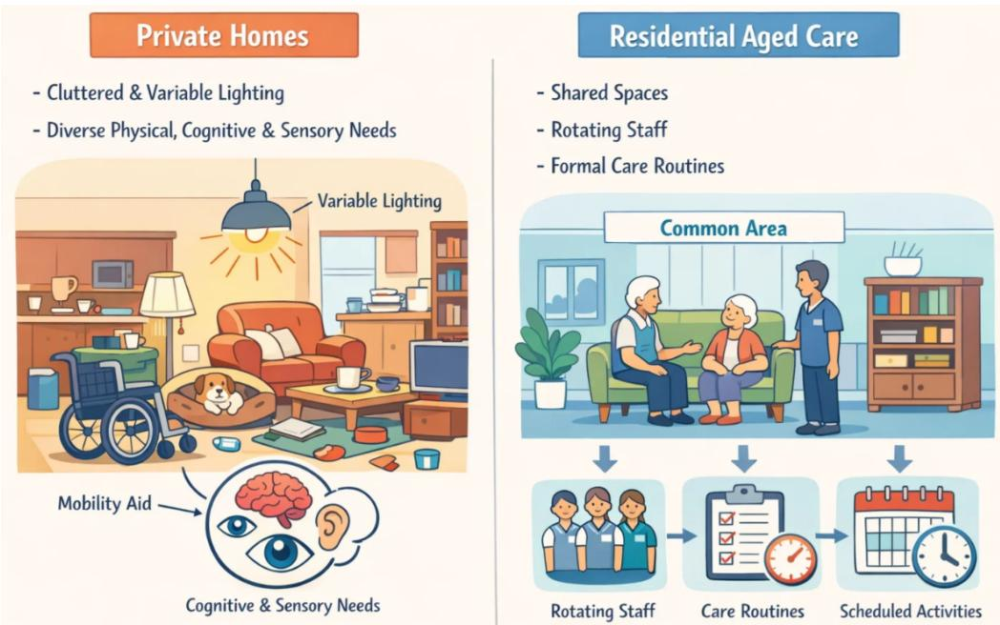  
Fig. 1: Example aged care environments illustrating clutter, mobility aids, and variable lighting that shape sensing and interaction: a private home living room (left) and a residential aged care corridor (right).

We review robotic platforms, vision-based perception, and ambient sensing systems designed for domestic and care-home contexts, examining how these technologies interact with people and identifying scenarios where embodied systems—such as physical robots— are essential for delivering meaningful support. Our analysis centres on practical challenges that constrain deployment, including robust perception in cluttered, lived-in spaces; interaction design for older adults with low digital literacy; and seamless integration with smarthome and care infrastructure. Alongside these technical considerations, we address cross-cutting factors such as safety, privacy, and trust, which are indispensable for sustained acceptance and long-term reliability.

This chapter makes three main contributions.

1. It organises the design space for private and RAC homes into clear themes, including perception in lived-in spaces, interaction modalities tailored to diverse users, and deployment patterns that scale in practice.

2. It maps privacy and trust requirements to concrete design strategies, translating ethical and regulatory expectations into actionable choices such as on-device inference, minimal data flows, visible consent and mute controls, and transparent data handling aligned with emerging AI and privacy regulations.

3. It proposes practical evaluation considerations for real-world settings. These cover technical performance, safety, usability, and long-term reliability.

Together, these contributions provide a roadmap for designing and evaluating robots and ambient intelligence systems that are usable, trustworthy, and regulation-ready, enabling older adults to age with dignity, safety, and independence.

The remainder of this chapter is organised as follows. We begin by establishing the background, definitions, and constraints of res idential aged care and private home environments, clarifying system types, care settings, stakeholder roles, and the unique challenges these spaces pose for HRI. We then explore interaction modalities and integration, including voice interfaces, simple non-verbal cues, and accessible screen-based companions. Next, we turn to technologies for perception and ambient sensing, covering people and scene understanding, sensor choices, and edge and cloud design patterns, with a focus on hybrid robot and sensor configurations. This is followed by a discussion of privacy, trust, and acceptability, translating ethical expectations into practical design strategies such as on-device processing, visible controls, and transparent data handling. We then address benchmarking and evaluation, moving beyond accuracy to real-world implementation, including safety events, usability, and long-term reliability. Finally, we identify open research challenges, including robust multi-modal fusion, privacy-preserving learning, and safe manipulation and operation in confined and cluttered spaces. We then outline fu ture research directions, proposing reference architectures, evaluation standards, deployment playbooks, and pathways to regulation-ready evidence. Fig. 2 summarises these themes and how they interconnect across the chapter.

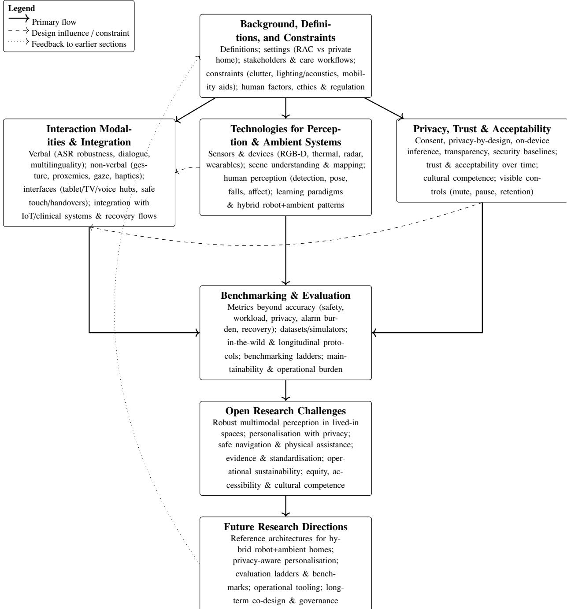  
Fig. 2: Concept map of the chapter. Boxes summarise core sections; arrows show the primary reading flow, key cross-section design influences, and how future directions feed back into background assumptions as the field evolves.

## 2 Background, definitions, and constraints

Before comparing specific technologies, it is essential to establish a shared understanding of the systems under discussion: what they are, where they operate, who interacts with them, and what successful deployment looks like. This section defines key system categories, situates them within RAC and private homes, clarifies stakeholder roles, and outlines the physical and human constraints that shape HRI in practice.

Table 1: Contrasting residential care homes and private homes as deployment contexts for HRI.
<table><tr><td>Dimension</td><td>Residential care homes</td><td>Private homes</td></tr><tr><td>Supervision and presence of staff</td><td>Staff are usually on-site, with scheduled Monitoring can be continuous in some areas</td><td>No formal on-site staff. Support is typically rounds and defined escalation pathways. provided by family, visiting carers, or com- munity services, often with long gaps be-</td></tr><tr><td>Policy and governance context</td><td>and intermittent in others. Operate under aged care regulations, clin- ical governance, infection prevention poli- cies, and facility-level procedures. Technol- ogy must fit accreditation and audit require- ments.</td><td>tween visits. Governed mainly by consumer protection, tenancy or home ownership arrangements, and general privacy and safety laws. Policies and record-keeping practices vary widely by household.</td></tr><tr><td>Environmental variability</td><td>Layouts are somewhat standardised within a facility, with repeated room types and shared areas, although furniture and equipment may still move.</td><td>Highly heterogeneous and personalised. Floor plans, furniture, lighting, and clutter vary from home to home and change over time.</td></tr><tr><td>Available technical and care sup- port</td><td>tion devices when trained.</td><td>Some access to internal information tech- Very limited technical support on site. nology and maintenance teams, plus nursing Households rely on remote support, ad hoc and care staff who can help reset or reposi- local help, or do it themselves, often with low digital literacy.</td></tr><tr><td>Mobility aids and assistive equip- ment</td><td>High prevalence of walkers, wheelchairs, hoists, oxygen stands, and shared medical equipment in corridors and rooms, with as- sociated trip and collision risks.</td><td>Mobility aids may be present but are more idiosyncratic and less standardised. Distri- bution across homes is uneven, and storage locations can change frequently.</td></tr></table>

## 2.1 Settings and deployment context

We consider two primary settings: residential aged care (RAC) homes and private homes (ageing-in-place), as summarised in Table 1. RAC homes ofer structured environments with shared spaces, rotating staf, and formal procedures, enabling more managed deployments but requiring alignment with clinical governance, infection control, and the needs of multiple residents. In contrast, private homes are highly heterogeneous in layout, lighting, furnishings, and daily routines with minimal technical support and informal care arrangements.

In both environments, tasks can be clinical, such as rehabilitation exercises or vital sign monitoring prompts; or non-clinical, including companionship, reminders, and safety checks. While clinical tasks require stricter documentation and oversight, non-clinical tasks are also essential for supporting well-being and daily routines. These tasks must demonstrate clear benefits to users and carers, while systems must remain low efort to operate and maintain (Zieni et al., 2025; Boudouraki et al., 2025; AlShamsi et al., 2022). In addition, both settings impose stringent expectations around safety, privacy, and usability, making them extreme environments for HRI (Carros et al., 2022).

## 2.2 Robotic and ambient systems considered

We adopt the nomenclature introduced in (Silvera-Tawil, 2024), and group assistive technologies into five categories. Socially-assistive robots (SARs) provide support primarily through social interaction rather than physical intervention. They aim to engage users emotionally and cognitively, ofering companionship, therapeutic support, and motivation for tasks such as medication adherence, exercise, or learning. Assistive robots support individuals with physical disabilities in performing activities of daily living (ADLs), including mobility, personal hygiene, eating, and rehabilitation. This category includes robotic arms, smart wheelchairs, exoskeletons, and wearable devices that directly influence these movements and physical function. Teleoperated robots enable remote delivery of healthcare or support services. These systems are controlled by clinicians or carers at a distance and include telepresence platforms such as mobile video call devices that allow remote staf to navigate through a space and interact with residents. Service robots assist with logistical, repetitive, or physically demanding tasks such as delivering medications or disinfecting rooms. These robots typically have limited interactions with patients and pose minima safety risks. Ambient intelligence systems, while not robots in a strict sense, include wearable and environmental sensors (e.g., cameras, microphones, radar, pressure mats) that monitor activities and detect risks in the background. In practice, these categories often overlap (Cruces et al., 2024; Sandhu et al., 2024). For example, a mobile robot may be paired with ambient sensors and a smart display to form an integrated system for reminders, safety monitoring, and family communication (Yeo et al., 2023; Carros et al., 2022).

## 2.3 Stakeholders and roles

HRI in these contexts involves multiple stakeholders with diferent priorities (De Graaf et al., 2019; Sharkey and Sharkey, 2012; Boudouraki et al., 2025; Veling and Villing, 2024).

Older adults are usually the intended beneficiaries, but not always the primary interface users. In both settings, older adults may interact directly with socially assistive robots, voice interfaces, and screen-based companions, while ambient sensors such as wearables and environmental devices operate unobtrusively in the background. In care facilities, residents may engage with robots during activities or therapy, but many functions—such as alert dashboards or sensor data interpretation—are mediated through staf.

Care staf and clinicians depend on these systems for actionable insights rather than raw data. Robots may deliver medication reminders or enable telepresence consultations, while ambient sensors provide fall alerts or routine monitoring. Integration with existing workflows is critical; alerts must be clear, reliable, and low-burden, and recovery from faults should not require technical expertise.

Families and informal carers often manage setup and troubleshooting in private homes. They value systems that are easy to install. require minimal maintenance, and provide reassurance without compromising privacy. Hybrid deployments—combining robots for social engagement with ambient sensors for safety—must balance functionality with transparency and control.

Finally, facility managers, vendors, and regulators shape deployment and governance. Managers prioritise reliability, infection control, and compliance. Vendors ensure interoperability, updates, and remote support. Regulators set privacy and safety baselines, influencing design choices such as on-device inference, visible sensing indicators, and consent mechanisms. Together, these roles underscore the need for technical solutions that align with human routines and regulatory obligations.

Due to diferent priorities in these groups, their interests can conflict. Clinicians may request granular data to support monitoring, while residents may prefer strong limits on what is recorded and shared. Staf may value automation that saves time, while families may prioritise human contact. To make such trade-ofs explicit, we explore in later sections a simple task, risk, and burden lens that weighs outcomes against cognitive load for users and staf, as well as data exposure needs (Yeo et al., 2023; Carros et al., 2022).

## 2.4 Physical and environmental constraints

Both private and RAC homes present significant physical challenges for HRI, but the nature of these challenges difers across settings. Private homes are highly individualised and dynamic. Lighting conditions shift throughout the day, and the presence of pets, mobility aids, and visitors introduces unpredictability. These environments can feature uneven flooring, steps, tight spaces, cluttered surfaces, and narrow corridors, all of which complicate robot navigation and sensing. They can also be noisy, making speech recognition and sound-based alerts less reliable. Field studies consistently show that these everyday details shape how people use robots, often diverging from lab-based expectations (Carros et al., 2022; Yeo et al., 2023).

RAC homes, while more standardised, involve shared spaces, equipment, infection control protocols, and frequent furniture changes. Robots and sensors must feature wipe-down surfaces, docking stations, and cable management solutions that do not obstruct movement or create new hazards (Castelli et al., 2022; Australian Commission on Safety and Quality in Health Care, 2024). Robots must cope with narrow corridors, occlusions, and strong lighting variations, while maintaining compliance with safety and hygiene requirements. Although care homes may ofer more predictable layouts, they still involve frequent changes: assistive equipment is moved, chairs and bl i i d d f kfl hif h l i li i h i d l h dli requirements, which limit where larger mobile platforms can wait, turn, or dock between tasks.

Across both settings, robust perception, adaptive mapping, and conservative motion planning are essential. Sensor fusion, combining radar, vision, and audio, is often necessary to maintain reliability (Yeo et al., 2023; Piaggio et al., 2023). Ultimately, successful HRI relies on systems that are resilient to physical variability, respectful of user routines, and compatible with the practical realities of home and facility care.

## 2.5 Human factors

Older adults often face barriers such as limited digital literacy, sensory impairment (e.g., hearing or vision), and varying degrees of cognitive decline. In private homes, these challenges are compounded by the absence of on-site technical support (Zhao et al., 2025). Therefore, systems must be intuitive, require minimal setup, and degrade gracefully under faults. Interaction should favour simple, repeatable cues over complex dialogues, and sensing behaviour must be transparent to maintain trust. Staf need predictable alerts that do not add cognitive load or disrupt workflows, or systems risk being disabled despite technical capability.

These conditions have direct design implications for HRI:

• Perception must adapt to real lived-in spaces, supporting robust tracking with partial views, variable lighting, and coping with tight cluttered spaces.

• Interaction should prioritise simplicity and consistency. Short prompts, large font sizes, and clear confirmation phrases often work better than complex dialogue structures.

• Cognitive and sensory load must be managed by limiting unnecessary prompts and notifications, ensuring that alerts are meaningful and actionable.

• Workflows should degrade gracefully. If network connectivity is lost, core local functions should continue to operate, and the system should clearly flag which services are delayed or unavailable.

• Privacy should be a default, with blurred or abstracted views when high detail is unnecessary, summaries stored instead of raw data, and visible indicators showing what is sensed and who can access the data (Carros et al., 2022).

• Personalisation should be transparent and reversible, for example, allowing adjustments such as approach distance or prompt timing while providing clear controls to reset, pause, or review adaptations (Papadopoulos et al., 2020; Yeo et al., 2023).

In RAC homes, configuration and logging tools should align with existing roles and documentation practices so care workers can understand and adjust behaviour without specialist support. In private homes, setup and control should be simple enough for older people, family carers, and installers to manage with minimal ongoing efort. These principles align with universal design and accessibility standards such as WCAG 2.2 (World Wide Web Consortium (W3C), 2023).

## 2.6 Ethical, legal, and cultural considerations

Designing HRI for residential aged care and private homes is not only a technical challenge but also an ethical and regulatory one. Systems must comply with privacy, safety, and accessibility standards while operating in highly personal environments. Principles such as data minimisation, transparency, and informed consent are foundational, ensuring that sensing and decision-making respect user autonomy. These principles extend beyond interface design to system architecture, influencing choices such as on-device inference, short retention periods, and clear indicators of active sensing. Recent guidance for AI-enabled technology in health and disability settings expands on practical principles that align with HRI in care contexts (WHO, 2024; Silvera-Tawil et al., 2025).

Compliance with emerging AI governance frameworks is increasingly critical. Regulatory and standards baselines are converging on risk-based governance. Teams can draw on the EU AI Act for duties applied to higher-risk systems, such as transparency, human oversight, post-market monitoring, and on ISO and IEC guidance, such as ISO and IEC 23894:2023 for risk management through the lifecycle of AI systems (European Parliament and the Council of the European Union, 2024; International Organization for Standardization and International Electrotechnical Commission, 2023). In Australia, the Ofice of the Australian Information Commissioner’s Australian Privacy Principles sets duties on collection, consent, access, and security, including for audio and video from homes; and ofers practical guidance for informed consent, retention limits, and access logs (Ofice of the Australian Information Commissioner, 2022). Residential care homes may also trigger additional obligations under health, aged care, or medical device regulations, whereas in private homes, many deployments are currently framed as consumer or lifestyle technologies even when they influence care, which creates a grey zone that designers should treat cautiously.

Beyond legal compliance, cultural competence and fairness are essential for inclusivity. Homes are personal spaces. People difer in language, routines, family roles, and how they read touch, direct their gaze, and the distance at which they interact with others. Trials of culturally competent social robots show that adapting greetings, topics, and forms of address can improve comfort and engagement, but only when changes are transparent and not deceptive (Papadopoulos et al., 2020). Over-personalisation, particularly if it is perceived a manipulative or uncanny, can reduce trust and acceptance rather than improve it.

## 3 Interaction modalities and integration

In this section, we focus on how factors such as cluttered layouts, variable lighting, and the residents’ diverse sensory and cognitive abilities shape interaction design for robots in RAC and private home care. We examine verbal and non-verbal modalities, fallback mechanisms, and integration patterns that aim to ensure reliability and accessibility in real-world conditions. Fig. 3 illustrates a typical interaction scenario in a residential aged care lounge, with a social robot embedded within a wider ambient sensing infrastructure and operating under these real-world constraints.

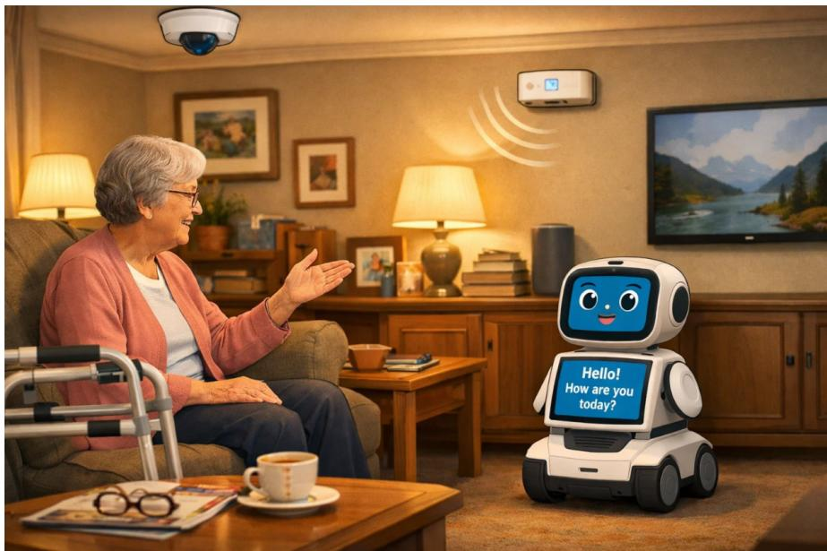  
Fig. 3: Example interaction scenario in a residential aged care lounge, showing a mobile social robot engaging an older adult via speech and on-screen prompts, alongside ambient devices such as a smart speaker, wall-mounted tablet, television, and ceiling and wall sensors. The scene illustrates how multimodal interaction, distributed sensing, clutter, mobility aids, and uneven lighting jointly shape design choices.

## 3.1 Interaction with robotic systems

## 3.1.1 Verbal interaction

Verbal interfaces ofer an intuitive way for older adults to interact with digital systems, particularly when hands are occupied or mobility is limited. However, these interfaces must be designed for the realities of home and RAC environments, where background noise, overlapping conversations, and age-related changes in speech are common. Far-field microphones often struggle with television or radio crosstalk and multi-party dialogue can further degrade recognition accuracy. Large multilingual models trained on diverse data (e.g., Whisper and SeamlessM4T v2) have improved robustness to noise and support accented or code-mixed speech (Radford et al., 2023; Barrault et al., 2023).

Despite these advances, recent benchmarks show that Automatic Speech Recognition (ASR) systems continue to underperform with older adult speech in noisy home settings, especially when speech is monotone or hesitant (Escolano et al., 2024). Field studies confirm these limitations, reporting lower accuracy rates and occasional delays. To mitigate these risks, designs should incorporate confirmation steps for safety-critical actions, provide fallback options such as a tablet, and favour short unambiguous utterances such as yes, no, or stop (Cao et al., 2024; Wang et al., 2023; Yeo et al., 2023). Reliability improves when systems combine on-device voice-activity detection with basic beamforming. Providing an optional press-to-talk or hold-to-listen mode for critical intents, and applying diarisation and barge-in suppression for robots to ignore irrelevant audio sources, further enhances performance (Radford et al., 2023; Barrault et al., 2023).

Interfaces should make microphone states visible (e.g., listening or muted), request explicit confirmations for irreversible actions such as calling an ambulance, and, where possible, perform on-device ASR while transmitting only transcripts or event summaries. Accessibility defaults remain essential, including large targets, high-contrast captions, and clear error messages (World Wide Web Consortium (W3C), 2023). Interfaces should announce state changes (e.g., microphone muted or unmuted) for users with low vision. Finally, every interaction flow should include an error recovery ladder to maintain usability under failure conditions: Plan B, a fallback to a screen prompt, and Plan R, a retry step before escalation to human support.

## 3.1.2 Non-verbal interaction

Non-verbal cues, such as gestures, gaze, and posture, play an important role in making robots intuitive and socially acceptable. These modalities complement speech and provide alternative channels of communication for users with hearing impairments or limited verbal ability. However, their design must account for the sensory and cognitive diversity of older adults and the physical constraints of cluttered environments, as subtle cues can be missed (Morillo-Mendez et al., 2023, 2024; Urakami and Seaborn, 2023).

Efective HRI in care settings favours a small and consistent, for example, point, wave, and open-hand stop, with slow, exaggerated motion profiles that remain legible under glare, clutter, and low light. Eye gaze and head orientation can support turn-taking and guidance, but should be complemented by redundant channels such as expressive lighting bands and large on-screen icons. These backups become primary when gesture confidence drops due to occlusion or poor lighting, with verbal confirmation where needed.

Physical interaction requires additional safeguards. Approach distance should be personalised rather than fixed, and interactions should remain natural to support engagement. For physical contact, such as handovers, robots could announce their intent verbally (e.g., "I’m passing the cup") and implement retreat behaviours when unexpected contact is detected (Duan et al., 2024). It is important to keep interactions natural to improve engagement and enjoyment.

In cluttered rooms, gesture recognition should rely on short temporal consistency (around one second of a stable pose) and conservative confidence thresholds to avoid false positives. When gestures fail, expressive lighting and on-screen prompts should remain legible for users with low vision or higher cognitive load (Urakami and Seaborn, 2023; Morillo-Mendez et al., 2024).

Cultural factors also influence non-verbal interaction. Cross-cultural studies show that gesture preferences vary between cultures, especially for greetings and abstract commands (Shen and Johal, 2025). For hygiene and safety, robots should use smooth, wipeable covers. Charging and docking stations should be placed away from spill zones, and from paths used by walking aids to reduce incidents (Australian Commission on Safety and Quality in Health Care, 2024).

## 3.2 Integration with the home and care ecosystem

Integration in home and care environments must address multi-actor workflows and limited on-site technical support. Systems should minimise setup burden and align with existing clinical and care data pathways to avoid creating isolated technology silos. Robots rarely operate alone; they function as part of a broader ecosystem that includes ambient sensors, local hubs, and cloud services. Fig. 4 illustrates this architecture, where robots interact with IoT devices and clinical systems to enable edge processing, enforce privacy policies, and support data exchange.

Smart-home and IoT sensors, such as radar, wearables, and door or bed sensors, provide valuable context signals, including occupancy, routines, and sleep patterns. Robots can consume these signals while acting as mobile sensors and actuators, bridging gaps between fixed infrastructure and dynamic user needs. This hybrid approach improves robustness and enables richer interaction, for example, by combining fall detection from ambient sensors with verbal prompts or physical assistance from a robot.

When clinical data must flow (e.g., fall alerts or adherence summaries to a clinician), standards-based integration is essential. Interfaces built on Fast Healthcare Interoperability Resources (FHIR) ensure events are recorded in existing electronic health record systems rather than bespoke pipelines (Pavão et al., 2023; Li et al., 2024a). A practical pattern is to publish minimal event payloads (e.g., an Observation or Detected Issue with timestamp, severity, and a short rationale), maintain an audit log of “who saw what and when”, and default to edge processing with only upstream summaries. Raw audio or video should be shared only under explicit consent and with clear retention limits, as elaborated in Section 5. Edge AI enables real-time decision-making but operates under constraints of compute, memory, and battery life (Tahir and Parasuraman, 2025). Early deployments benefit from limiting the integration surface to a small set of well-defined events (e.g., possible fall, missed medication prompt, and failed dock), each with severity levels and human-readable rationales. This reduces maintenance and accelerates clinical sign-of. Aligning with national interoperability plans (e.g., Australia’s, 2023 to 2028 roadmap) and provider incentives for remote monitoring will further reduce deployment friction and support scalable adoption (Australian Digital Health Agency, 2024).

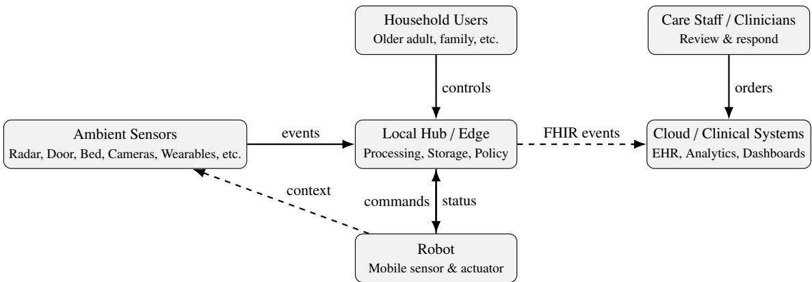  
Fig. 4: System architecture: robot and ambient sensors feed a local hub for edge processing and policy enforcement, while clinical sum maries flow to cloud/Electronic Health Record (EHR) systems via standard interfaces built on Fast Healthcare Interoperability Resource (FHIR).

## 3.3 Design patterns and deployment insights

Field deployments in private and RAC homes consistently reveal patterns that improve reliability and acceptance. Across recent studies, fou principles stand out: (i) Schedule interactions rather than relying on ad hoc use, as structured routines improve engagement and predictabil ity; (ii) provide fast caregiver controls for setup and content customisation, reducing dependence on technical staf; (iii) enable fallback mechanisms so speech failures revert to large-screen prompts or alternative modalities; and (iv) instrument operations, including docking success, false speech activations, and alert rates to enable iterative improvement. These patterns create a direct bridge to the evaluation priorities in Section 6, where reliability, recovery, and workflow fit become measurable outcomes rather than informal observations. Fig. 5 illustrates four representative robot platforms that recur across residential aged care and home deployments, spanning humanoid service robots, pet-like therapeutic devices, tabletop companions, and mobile telepresence or assistant robots.

## 3.3.1 Mobile social robots in RAC homes.

Deployments of social robots such as Pepper (in a UK RAC home) highlight the importance of reliability and ease of customisation over feature breadth (Manavi et al., 2025). In a three-month in-situ study, Pepper was used regularly, around 1 h/day, mostly in one-to-one sessions. Staf success depended on how easily they could tailor activities and routines, with reliability and time pressure acting as barriers. Follow-up work showed that providing care professionals with a lightweight mobile application to configure content and behaviours across multiple facilities increased appropriation and reduced reliance on technical staf (Manavi et al., 2025).

## 3.3.2 Telepresence for connection and clinical touchpoints.

Telepresence robots are valued for maintaining social contact and enabling remote clinical interactions, provided navigation is smooth and controls remain simple (Yeo et al., 2023). A 2024 qualitative study with frontline staf in hospitals and long-term care homes emphasised workflow fit, training, and clear escalation procedures as requirements for routine use in dementia care (Ren et al., 2024). Smaller trials indicate that repeated exposure improves comfort and perceived usefulness, although in-person contact remains important (Arthanat et al., 2024). In practice, pairing autonomous navigation with scheduled sessions and a short menu of common tasks (e.g., check-in, family call, and medication prompt) reduces cognitive load for staf and residents.

## 3.3.3 Companion/therapeutic robots.

Meta-analytic evidence suggests that PARO, the robotic seal, can reduce agitation and improve mood in dementia care when sessions are structured and integrated into activity schedules rather than left as ad-hoc interactions (Rashid et al., 2023). Recent clinical studies confirm i d b fi f hi i d i l h i i d d f i d d k 5 h et al., 2025). These findings underscore that companion devices should be treated as part of a program with a defined dose and frequency and facilitator training, rather than simply being a device left in a common room.

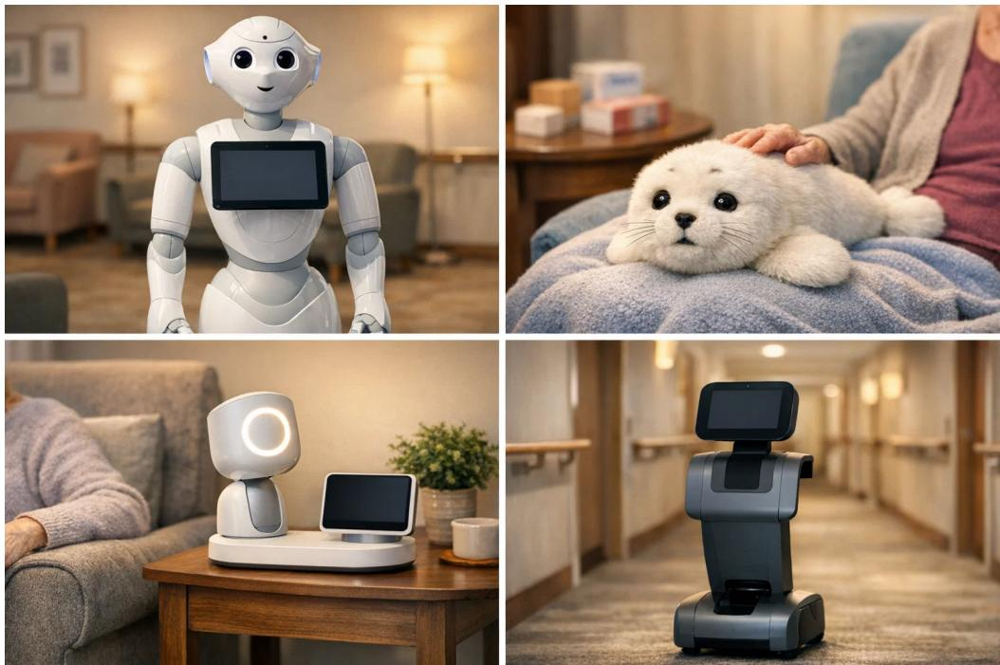  
Fig. 5: Examples of robot form factors used in residential aged care and private homes. Top left: humanoid service robot similar to Pepper. Top right: pet-like therapeutic robot similar to PARO. Bottom left: tabletop social companion similar to ElliQ. Bottom right: mobil telepresence/assistant robot similar to Temi.

## 3.3.4 Home-focused social companions.

Deployments of ElliQ report reductions in loneliness and improved daily engagement when the device is proactive, uses short, forgiving dialogues, and hands of to phone or video channels when needed. Published design notes emphasise clear boundaries, avoiding overly human-like presentation, and multi-modal prompts, combining voice and visual cues, to support diverse users (Broadbent et al., 2024). Studies show that anthropomorphic cues can both increase trust and trigger discomfort depending on context and user expectations (Chen, 2025). Systems should therefore be proactive but bounded, announcing intentions, ofering opt-outs, and handing over to human channels when system confidence is low.

## 3.3.5 Telepresence platforms in aged care (e.g., temi robots).

Early implementation and Quality Improvement (QI) reports from long-term care show resident interest in self-navigating telepresence for activities and check-ins, provided sessions are scheduled and content is staf-curated. The key technical needs are robust voice control, vital-sign connectors, and Electronic Health Record (EHR) integration (Weigand et al., 2022). A pragmatic starting point is a minimal clinical payload that includes device vitals and brief encounter notes, easing adoption while building toward deeper integration.

Section 6 revisits these interaction patterns and evaluates their real-world performance, using metrics such as dock success rate, false activations in speech, false alarms per day, and time to recover after faults, alongside usability and workload scores.

## 4 Technologies for perception and ambient systems

## 4.1 Sensors and devices

Perception technologies are central to enabling robots and ambient systems to operate efectively in RAC and private homes. These environments impose unique constraints—cluttered layouts, variable lighting, mobility aids, and diverse sensory abilities—that shape sensing choices and integration strategies. Robust perception supports social engagement, health monitoring, safe navigation, and assistance with daily activities. The choice of sensors determines not only the functionality of these systems but also their acceptability, as issues of privacy, safety, cost, and usability are particularly sensitive in this context (Costanzo et al., 2024). Fig. 6 summarises the main sensor categories across four system types: 1) Assistive/social robots, 2) Telepresence robots, 3) Domestic service robots, and 4) Ambient intelligence. While this taxonomy is useful for mapping device types, the following discussion focuses on functional roles and design considerations across five themes: vision-based sensing, auditory and speech-based sensing, tactile and physical interaction sensing, physiological and environmental sensing, and enabling infrastructure.

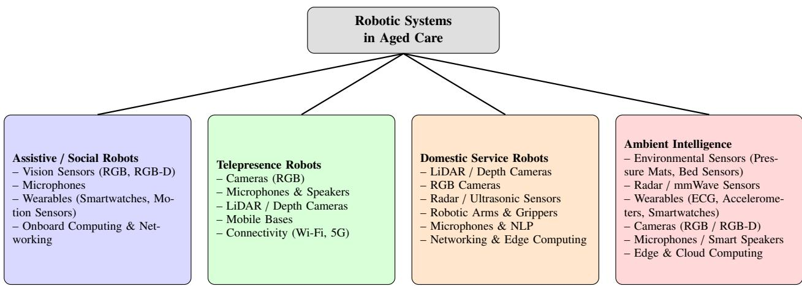  
Fig. 6: Taxonomy of sensors and devices across robotic systems in aged care.

## 4.1.1 Vision-based systems

Vision sensors form the perceptual foundation of robotic systems. They enable scene understanding (Fischinger et al., 2016), object recognition(Fischinger et al., 2016), navigation(Fischinger et al., 2016), and social interaction (McColl et al., 2016). They provide rich detail but raise strong privacy concerns, requiring safeguards such as restricted fields of view, on-device processing, and selective triggering. Vision sensors include:

• RGB cameras: RGB cameras are widely used in HRI systems. They enable functions such as face recognition (Fahn et al., 2022), activity recognition (Sawik et al., 2023), gesture interaction (Sawik et al., 2023), and fall detection (Benkaci et al., 2024), which are critical in aged care. Challenges include privacy risks from continuous recording, sensitivity to lighting changes, and high computational demands. Despite these challenges, RGB cameras remain a foundational sensing modality across multiple robotic systems in aged care due to their versatility and rich visual information. Mitigation strategies include on-device analysis, privacy preserving video summarisation, and sparse event triggers that limit continuous recording in private spaces.

• RGB-D cameras and depth cameras: RGB-D cameras combine colour and depth information to create a three-dimensional view of the environment, allowing robots to interpret spatial structures, recognise human postures, and navigate safely in cluttered or dynamic environments (Fanello et al., 2014; Yang et al., 2020). In aged care, RGB-D sensors have been successfully applied to fall detection, posture estimation, and gesture-based human-robot interaction. Limitations include sensitivity to ambient lighting and reflective surfaces (Sarbolandi et al., 2015) and increased computational demands. Although depth maps are less intrusive than RGB imagery, continuous 3D monitoring still raises privacy and acceptability concerns, and deployments often restrict depth capture to zones like beds or doorways.

• LiDAR sensors: In aged care, LiDAR is primarily employed for safe robot navigation, environment mapping, and obstacle avoidance. Its ability to generate accurate spatial models independent of lighting conditions makes it well-suited for both day and night operation, overcoming some of the limitations of camera-based systems (Frøvik et al., 2021). However, LiDAR sensors are typically more expensive and power-intensive, which limits their inclusion in compact or low-cost devices. They also lack semantic detail, necessitating fusion with vision or auditory data for full situational awareness.

## 4.1.2 Auditory and speech-based sensing

Auditory sensors enable robots to perceive and interpret sound, speech, and tone, facilitating natural interactions. Microphones, speaker arrays, and smart audio systems are commonly embedded in social and telepresence robots to facilitate communication, emotional engagement, and safety monitoring (Christoforou et al., 2019; Costanzo et al., 2024). While speech interfaces are intuitive, they remain vulnerable to noise and overlapping conversations

• Microphones: Microphones serve as the audio input in assistive robots (Fahn et al., 2022), capturing speech and environmental sounds for tasks such as voice navigation, speech recognition, and distress detection (Sawik et al., 2023). Many systems use simple classifiers to detect salient events such as shouts, glass breaking, or repeated coughing, which can be performed at a lower computational cost and with reduced privacy exposure compared with continuous speech transcription. Challenges include background noise, multi-speaker interference, and continuous audio monitoring that can feel intrusive to residents and caregivers (Xu et al., 2025). Designs that favour short bufered windows, on-device processing, and event summaries rather than raw audio streams can partially mitigate these concerns (see Section 5).

• Speakers: Speakers enable robots to communicate verbally by delivering alerts, reminders, and navigation cues, as well as engaging in conversational interactions that support users’ mental and emotional well-being. Speech synthesis further facilitates naturalistic communication with residents, thereby improving both user acceptance and overall system usability (Baltus et al., 2000). However, speaker-based systems must be designed to avoid disruption or annoyance. Volume, tone, and clarity are critical considerations. Coordinating speech output with visual or contextual cues from other sensors ensures coherent communication. Ethical considerations include avoiding deceptive or overly persuasive speech and ensuring that users can control or mute robot communication as desired (Oliveira et al., 2017). In practice, acoustic design for prompts and alerts should follow the accessibility and escalation principles in Section 3.

## 4.1.3 Tactile and physical interaction sensing

Tactile and force sensors allow robots to physically interact with users and their surroundings safely. They are crucial for tactile communication and for applications such as robotic feeding and mobility assistance, where physical contact is integral to function (Topping, 2002). Most current care home deployments involve limited or no physical manipulation, but safe touch sensing is a necessary condition for future assistance, for example, transfers, dressing, or feeding.

• Force and pressure sensors: Force and pressure sensors are critical for detecting contact forces during interaction with humans or objects. In aged care applications, they are integrated into robot joints, grippers, and support surfaces such as robotic arms, exoskeletons, or assistive beds to ensure gentle handling and to prevent injury (Popovic, 2019). Force and pressure sensors can be sensitive to calibration drift and mechanical wear, which may afect precision and reliability. Ensuring consistent performance requires careful sensor design, regular calibration, and the integration of redundant sensing modalities (Billard and Kragic, 2019).

• Artificial skins and touch sensors: Artificial skins are arrays of distributed sensors that mimic human skin, enabling robots to detect contact location, magnitude, and texture (Silvera-Tawil et al., 2015). These sensors enhance safety by allowing robots to react immediately upon close proximity or touch, halting motion or adapting force before discomfort occurs. However, developing tactile materials and mechanisms that are durable, flexible, and sensitive remains an ongoing challenge. Many tactile sensors are prone to damage from wear, temperature changes, or humidity, limiting their long-term usability in domestic environments (Silvera-Tawil et al., 2015; Kim et al., 2022).

• Proximity and contact sensors: Proximity sensors, such as infrared, capacitive, or ultrasonic sensors, allow robots to detect nearby obstacles and anticipate physical contact before it occurs (Topping, 2002). In care robots, they are vital for collision avoidance, safe navigation around people, and pre-contact detection during assistive interactions. While proximity sensors enhance safety, they often provide limited spatial resolution and may be influenced by environmental factors like lighting or surface reflectivity, which necessitates combining proximity data with other complementary information (Sawik et al., 2023).

## 4.1.4 Physiological and environmental sensing

Wearables and ambient sensors monitor vital signs and environmental conditions, supporting context-aware assistance (Song, 2024; Lee et al., 2025). While these sensors enhance safety, they introduce challenges around accuracy, calibration, and privacy. Data typically flows through local hubs that aggregate signals and trigger alerts without exposing raw streams.

• Physiological sensors: Physiological sensors measure biological signals such as heart rate, respiration, temperature or blood oxygen levels (Mukhopadhyay and Gupta, 2007). These can be embedded in wearable devices or integrated directly into robotic systems. In aged care, physiological sensing enables real-time monitoring of vital signs to detect abnormalities such as cardiac irregularities or respiratory distress. Challenges include reduced accuracy afected by motion, sweat, and inconsistent skin contact, while discomfort may reduce long-term use (Heikenfeld et al., 2018). Reliable data interpretation remains challenging due to substantial individual variability, and the use of such information raises significant privacy concerns given the sensitivity of the associated health data.

• Environmental sensors: Devices tracking temperature, humidity, air quality, and light provide context for safe and adaptive behaviour (Duthie et al., 2024). They complement physiological sensing by providing contextual awareness, but face challenges such as sensor calibration, drift, and false alarms caused by environmental fluctuations. Combining multiple streams of data requires sophisticated sensor fusion and decision-making frameworks to ensure reliable, actionable insights. Privacy concerns extend to continuous environmental monitoring, particularly when combined with vision or audio sensing that may inadvertently reveal personal habits or routines

In practice, most sensing occurs through ambient or wearable devices rather than the robot alone, feeding into shared event and alert channels (Section 3), with the privacy implications discussed in Section 5.

## 4.1.5 Technology enabling infrastructure

Enabling infrastructure comprises the foundational systems that support sensing and robotic technologies, including IoT frameworks, wireless networks, edge and cloud computing, and data management architectures (Costanzo et al., 2024). These components enable seamless coordination and responsive care environments. Architectural patterns should prioritise local inference, minimal data flows, and resilience under network loss, aligning with privacy-by-design principles discussed in Section 3.

## 4.2 Scene understanding and mapping

Scene understanding and mapping are critical capabilities for robotic systems operating in RAC and home environments. These systems must navigate safely around residents, mobility aids, and personal belongings while performing tasks such as fetch-and-carry, monitoring, social interaction, and fall detection (Ni et al., 2023). Unlike controlled laboratory settings, aged-care settings are highly dynamic and unpredictable environments, so robots require robust, context-aware scene understanding tailored to care scenarios rather than generic indoor navigation (see Section 2).

Current approaches rely on multi-modal sensing using the devices described in Section 4.1 to combine visual, depth, and non-visual information. RGB-D cameras are commonly used for capturing both appearance and geometry, supporting depth-based object detection and mapping. Complementary sensors such as inertial units, thermal cameras, radar, and ambient IoT devices add resilience when visual sensing is impaired (Duncan et al., 2024). Beyond 2D perception, semantic simultaneous localisation and mapping (SLAM) integrates geometric mapping with object labels, allowing robots to reason about spatial relationships such as the proximity of a walking frame to a bed or the typical route between a resident’s chair and the bathroom (Hing et al., 2020).

Despite recent progress, reliable scene understanding in care environments remains challenging because clutter, dynamic lighting, and frequent occlusions degrade perception (Schuster et al., 2010; Hung et al., 2022b). Layouts difer across homes, furniture and personal items move over time, and residents may use mobility aids or medical devices that complicate visual interpretation. Models trained on public datasets often fail to generalise without extensive adaptation, and long-term deployment introduces further complexity as robots must track gradual environmental and behavioural changes rather than assuming a static map.

Privacy introduces additional constraints (Rigaud et al., 2024). In this vein, privacy-preserving perception has become an increasingly active area of research within mapping and scene understanding (Taras et al., 2024). Many systems now avoid storing raw RGB data and instead rely on mapping data to privacy-preserving representations such as texture-free geometric maps, semantic maps without visual appearance, blurred or downsampled point clouds, and topological maps that encode only key locations (e.g., “bed area” or “bathroom entrance”), without detailed imagery (Taras et al., 2024). These maps allow robots to perform navigation and assistive tasks while reducing risks related to surveillance, consent, or data retention.

From a technical perspective, real-time processing on embedded hardware poses further limitations. Achieving accurate perception under power and latency constraints is challenging, especially when robots must process multi-modal data continuously in shared spaces. Eficient architectures, model compression, and on-device inference strategies are therefore essential for practical deployment (Rout et al., 2024; Zijiang et al., 2022).

## 4.3 Human perception

Robotic and intelligent systems provide a suite of capabilities that enable machines to interpret and respond to human presence, actions, and emotional states. Recent advances in computer vision and machine learning have significantly improved performance across detection, tracking, pose estimation, gesture recognition, fall detection, and afect recognition, making these technologies increasingly viable for assistive and aged care environments.

• Human detection and tracking: Contemporary human detection and tracking systems leverage deep learning object detectors such as YOLO (Reis et al., 2023) and transformer-based architectures (Meinhardt et al., 2022; Gopal and Amer, 2024), often integrated with multi-object tracking algorithms like ByteTrack (Zhang et al., 2022b) for robust performance in dynamic environments. These systems excel in multi-camera setups, enabling persistent tracking across viewpoints despite occlusions and illumination changes, and in care settings, they support tasks such as monitoring corridor use or checking whether a resident has returned to bed. LiDAR-assisted detection (Du and Beltrame, 2024) and radar-based sensing are emerging as privacy-preserving alternatives, ofering resilience under poor lighting and clutter. Challenges remain in achieving real-time performance on resource-constrained platforms and ensuring robustness under diverse environmental conditions.

• Pose and gesture recognition: Human pose estimation has evolved from 2D keypoint detection to 3D reconstruction using monocular RGB inputs (Yiannakides et al., 2019), multi-view systems, and hybrid sensor fusion (Bao et al., 2024). Deep learning approaches incorporating convolutional neural networks (Luo et al., 2018), graph-based models (Zou and Tang, 2021), and transformers (Fu et al., 2023) dominate the field, with recent innovations such as difusion models (Cheng et al., 2024) and eficient tokenization strategies (Li et al., 2024b) reducing computational overhead while maintaining accuracy. These methods enable finegrained gesture recognition critical for natural human-robot interaction. Despite progress, occlusion handling and generalisation to real-world scenarios remain open challenges, particularly in aged care settings where mobility aids and furniture introduce visual complexity and where residents may have a limited range of motion.

• Fall detection: Vision-based fall detection systems increasingly integrate pose estimation with anomaly detection frameworks to distinguish falls from normal activities. Transformer-based architectures (Al-qaness et al., 2024; McCall et al., 2024) combined with lightweight deployment strategies (e.g., on edge devices) have demonstrated high accuracy while preserving privacy through local processing. Emerging approaches also explore multi-modal sensing, including radar and depth cameras (Cippitelli et al., 2017), to overcome limitations of RGB imaging under occlusion or poor lighting. Nonetheless, dataset scarcity for real-world falls and the need for unobtrusive monitoring remain significant barriers to widespread adoption in care homes and private houses.

• Afect recognition: Afect recognition has progressed beyond facial expression analysis to incorporate body pose (Filntisis et al., 2019), contextual cues (Han and Gratch, 2025), and multi-modal fusion of visual, vocal, and physiological signals (Udahemuka et al., 2024). Vision-language models (Bhattacharyya and Wang, 2025) and difusion-based frameworks (Hassan et al., 2024) now enable context-aware emotion inference, addressing limitations of earlier facial-only approaches. Micro-expression detection (Verburg and Menkovski, 2019) and transformer-based architectures (Zhang et al., 2022a; Vazquez-Rodriguez et al., 2022) further enhance robustness in real-world conditions. However, challenges persist in data availability, cultural variability in emotional expression, and ethical considerations surrounding privacy and consent in continuous monitoring, especially when systems infer afect implicitly rather than through explicit check-ins.

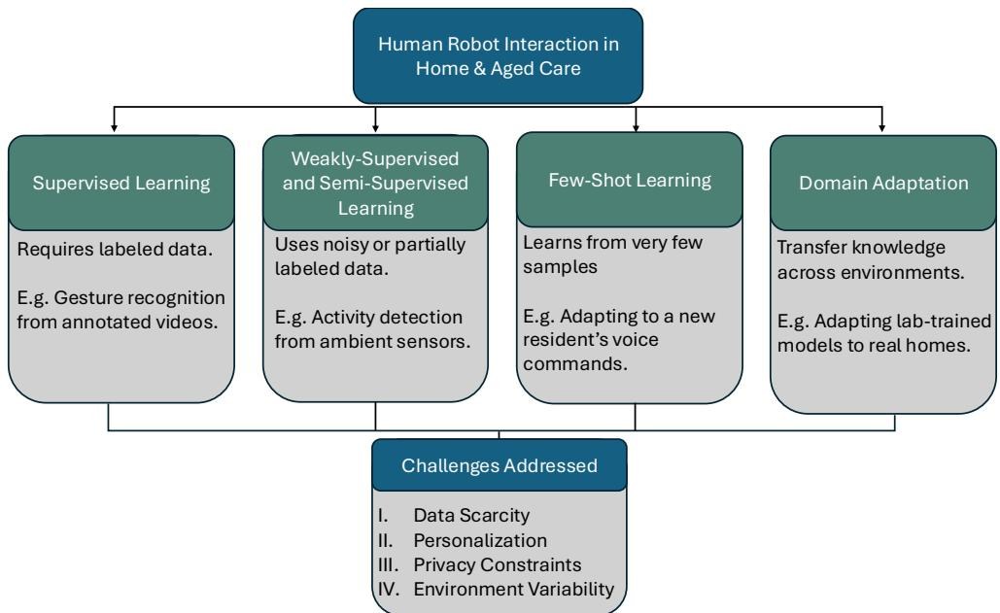  
Fig. 7: Overview of the practical challenges of HRI in home and aged care, and how existing learning paradigms address these challenges.

## 4.4 Learning paradigms in robotics for RAC and home care

## 4.4.1 Introduction to learning paradigms in HRI

As assistive technologies enter home and RAC settings, robots must learn and adapt to dynamic, personalised environments. Learning paradigms, the frameworks through which robots acquire and refine knowledge, are central to this adaptability. These range from supervised learning, reliant on labelled data, to weakly-supervised, self-supervised, and few-shot approaches that reduce annotation needs. Domain adaptation enables models trained in controlled settings to function in diverse real homes. Fig. 7 illustrates these techniques and their challenges.

## 4.4.2 Supervised learning approaches

Supervised learning remains one of the most fundamental and widely used paradigms in robotics in care settings. It trains models on datasets where each input is paired with a corresponding label, enabling the system to learn a mapping from inputs to outputs. In typical pipelines, multimodal data streams (e.g., RGB video, audio, inertial data) are annotated with ground-truth labels such as activities, spoken commands, or gestures, and used to train deep architectures (e.g., CNNs, RNNs, Transformers) that minimise a task loss via back-propagation. Once validated on held-out data, these models are deployed and may be fine-tuned for specific homes or devices.

In home and RAC HRI, this pipeline underpins many core capabilities, for example, activity recognition for monitoring, speech recognition for voice commands, and gesture interpretation for safe interaction. Rather than detailing the generic pipeline, we focus on representative state-of-the-art extensions and applications that illustrate how these methods address care-specific challenges.

• Activity recognition: Supervised learning enables robots to identify ADLs like eating or walking. Recent work uses multi-modal fusion of RGB, depth, and inertial data for robust classification. Robinson and Nejat (Robinson and Nejat. 2023) introduced spatial mid-fusion for integrating geometric and semantic features, while RNNs mitigate observation noise (Mihoub, 2021). Modern models like DeepConvLSTM and attention-based architectures improve temporal reasoning and interpretability in cluttered homes.

• Speech recognition: Transformer-based ASR systems such as Conformer (Gulati et al., 2020) and Whisper (Radford et al., 2023) achieve state-of-the-art by combining convolution and self-attention. Parameter-eficient prompt tuning (Ma et al., 2024) enables personalisation with minimal overhead. Domain-specific fine-tuning and end-to-end pipelines improve robustness in home-care contexts (Pallavoor et al., 2024).

• Gesture recognition: Shifted from rule-based to deep learning using RGB-D cameras and graph neural networks (Swietlicka, 2025).´ DiG-Net (Beeri et al., 2025) achieves 97.3% accuracy with depth-conditioned alignment for long-range gestures, while GestLLM (Kobzarev et al., 2025) combines MediaPipe features with LLMs to interpret culturally nuanced gestures without retraining.

Despite its widespread success, supervised learning faces major hurdles in home and RAC robotics. Data annotation is a key barrier: creating labelled datasets is costly and time-intensive. Annotating RGB-D video, LiDAR, and audio streams demands expertise and specialised tools, especially for segmenting continuous video and verifying object interactions. Domain mismatch compounds this challenge, with models trained in labs often failing in the real world.

Generalisation remains limited. Supervised models tend to overfit to training data and struggle with rare activities or atypical gestures, or speech patterns common in older adults. Finally, scalability and privacy introduce ethical constraints. Collecting large-scale labelled data in private homes conflicts with autonomy and data protection principles, making continuous monitoring impractical and reinforcing the need for privacy-preserving alternatives.

## 4.4.3 Weakly-supervised and self-supervised learning approaches

Traditional supervised learning relies on large, fully annotated datasets, which are expensive and time-consuming to create. Weaklysupervised learning (WSL) relaxes this requirement by using incomplete, inexact, or noisy labels, for example, coarse timestamps or video-level tags instead of frame-level annotations. Self-supervised learning (SSL) goes a step further by eliminating manual labels entirely. It leverages the intrinsic structure of the data to create pseudo-labels or predictive tasks, such as predicting missing frames in a video o reconstructing masked audio segments. Both paradigms aim to exploit unlabelled or weakly labelled data that can be collected passively, reducing annotation costs.

WSL has gained traction in HRI for tasks where fine-grained annotation is impractical. For example, in action segmentation, Yang et al. (2023) introduced Action-Union Learning, which uses timestamp-level annotations instead of frame-wise labels, achieving near-supervised performance with less than 1% of full labels. In object detection, Maiettini et al. (2021) proposed a teacher-learner pipeline for humanoid robots, combining weak supervision with online learning to adapt detection models in real time, reducing labelling efort while leveraging robot usage for active data acquisition. Similarly, domain adaptation with weak supervision has been explored by Wilson et al. (2020), who developed CoDATS, a multi-source adaptation framework for time-series sensor data that incorporates weak supervision signals such as label distributions, improving activity recognition across heterogeneous home environments. Finally, for activity recognition, semantic guided attention mechanisms have been used to eliminate the need for bounding box annotations and reduce computational overhead (Liu et al., 2023).

SSL enables robots to learn rich representations from raw sensory streams without manual labels, making it highly relevant for HRI in low-resource and privacy-sensitive settings. In speech and multi-modal interaction, SSL has transformed automatic speech recogni tion (ASR) through models such as wav2vec 2.0 and HuBERT, which learn robust audio embeddings by predicting masked segments, significantly reducing dependence on labelled speech data. These embeddings are now integrated into multi-modal HRI systems for voice enabled assistive robots (Mohamed et al., 2022). Similarly, Pan et al. (2022) leveraged unimodal SSL for audio-visual speech recognition, pretraining audio and visual encoders separately and then fusing them for lip-reading tasks, improving robustness in noisy environments where visual cues complement degraded audio. Beyond speech, SSL has advanced robotic manipulation and self-modelling: Florence et al. (2019) introduced a video prediction-based approach that enables robots to anticipate object trajectories and arm movements, sup porting zero-shot transfer to new tasks in home environments. Likewise, Mezghani et al. (2023) demonstrated goal-conditioned SSL for manipulation, allowing robots to infer task goals from visual cues and adapt actions accordingly, reducing reliance on human-provided demonstrations.

Despite their promise, WSL and SSL have notable limitations. WSL often relies on heuristic labels or coarse annotations, which can introduce noise and ambiguity; models may overfit to incorrect patterns, reducing reliability in safety-critical assistive tasks. It also does not eliminate the need for domain adaptation; models trained on partially labelled datasets may still struggle with cultural and environmental variability in homes.

SSL, while reducing annotation costs, introduces diferent challenges. Designing efective pretext tasks that transfer well to downstream HRI applications remains dificult, since predicting masked video frames or audio segments may not directly improve gesture recognition or activity classification without extensive fine-tuning. SSL methods also demand significant computational resources for large-scale pretraining, which may be impractical for resource-constrained robots. Both paradigms share issues of limited interpretability, raising concerns about transparency and trust in care contexts. Finally, collecting raw sensory data for pretraining raises privacy-related ethical concerns.

## 4.4.4 Few-shot and meta-learning approaches

In RAC and home care, robots must adapt quickly to new users, layouts, and routines with only a handful of examples. Unlike traditional systems needing large datasets, few-shot and meta-learning enable rapid adaptation with minimal input. Few-shot learning generalises from limited examples, ideal for scenarios where collecting extensive data is impractical or intrusive. A robot might learn routines, dietary needs, or communication styles from just a few interactions, supporting personalised assistance and trust. Compared to supervised learning, which demands labelled data, few-shot learning is inherently suited to data-scarce environments.

Few-shot learning is most useful during onboarding or change, when residents move rooms or adopt new routines, allowing robots to update behaviours without full retraining. Meta-learning underpins this capability by teaching robots how to adapt across tasks rather than memorising routines. Frameworks like MAML and Prototypical Networks train on diverse scenarios, enabling quick fine-tuning in rea homes. In this chapter, meta-learning is considered not as an abstract concept but as a practical tool for safe, low-efort personalisation across varied homes, languages, and care routines.

Few-shot learning has advanced significantly for aged care applications. The VITAL framework (Kasaei and Kasaei, 2024) combines few-shot imitation learning with human-in-the-loop corrections, enabling robots to learn tasks such as setting trays or stacking objects from only a few demonstrations, augmented by simulation and feedback. Similarly, Wi-Fi-based sensing (Wang et al., 2024) applies few-shot learning to detect activities like falls without intrusive sensors, supporting privacy-preserving monitoring. For personalisation, preferencebased action representation (Wang et al., 2025) allows robots to fine-tune behaviours—such as feeding angles or tone—from minimal user feedback. Meta-learning further drives cross-task adaptability: approaches like variational meta-RL (Ballou et al., 2023) help robots adjust to diferent reward functions, while trust modelling (Gao et al., 2019) fosters rapport in long-term care. Meta-imitation learning enables skill generalisation from limited demonstrations, supported by benchmarks such as Meta-World (Yu et al., 2020). Finally, meta-learning integrates with adaptive control for fine motor tasks, as in peg-in-hole assembly (Johannsmeier et al., 2019), combining skill formalism with meta-parameter learning for precision tasks like assistive device maintenance.

Despite their promise, few-shot and meta-learning approaches face several challenges. First, task diversity and complexity can limit generalisation: while these methods excel at adapting to simple routines or object manipulation, highly variable activities (e.g., culturally nuanced interactions) remain dificult to learn from only a few examples. Robustness and interpretability are also concerns; systems can be brittle and opaque, limiting caregiver oversight. Moreover, meta-learning adds complexity: training across diverse tasks demands large datasets or simulations, which are costly. Models may overfit to seen tasks and fail when behaviours difer, as assumptions about shared structure often break in personalised care. Both paradigms rely on limited or implicit feedback, yet older adults may provide unclear signals, and caregivers lack time for fine-tuning. This gap between theory and practice raises ethical risks: incorrect adaptation could harm or undermine dignity.

In summary, while promising for personalisation, few-shot and meta-learning face hurdles in data quality, robustness, interpretability, computational cost, and ethics that must be addressed for real-world deployment.

## 4.4.5 Domain adaptation for home environments

As robots move from lab settings to home and RAC settings, they face a number of challenges. Domain adaptation (DA) addresses these gaps so models trained in one domain (e.g., simulation or benchmark datasets) remain reliable in real-world settings. Unlike supervised learning, which assumes independent and identically distributed (i.i.d.) data, DA explicitly handles covariate and conditional shifts, enabling robust perception, manipulation, and interaction under variability (HassanPour Zonoozi and Seydi, 2023). In home-care, DA reduces costly data collection and relabelling, improving safety and consistency.

Core DA methods learn domain-invariant yet task-relevant representations. Techniques include discrepancy minimisation (e.g., MMD), adversarial alignment (e.g., DANN), and self-training with pseudo-labels, as well as active-learning loops that selectively query caregivers or clinicians for labels on uncertain or safety-critical events. For example, adversarial DA confuses a domain discriminator to strip domainspecific cues (e.g., furniture textures) while preserving semantics like object categories or grasp points. These approaches support reliable activity recognition and control across diverse homes. Additionally, compared to supervised learning, which degrades under target shift, DA is purpose-built for cross-domain generalisation. SSL and WSL reduce annotation needs but do not guarantee invariance. DA directly targets distribution mismatch, making it well suited for highly variable HRI environments and personalised care contexts (HassanPour Zonoozi and Seydi, 2023).

Recent DA research focuses on embodied AI and home robotics, where sim-to-real transfer and non-stationary targets are common. Simulators such as Habitat and iGibson, along with photorealistic datasets like Matterport3D and Replica, enable large-scale source training, while DA mitigates real-world gaps through feature alignment. style transfer, and test-time adaptation (Sayva et al., 2019: Li et al., 2021) For manipulation tasks, sim-to-real pipelines incorporate dynamics randomisation and visual perturbations to improve pick-and-place and assistive behaviours despite household variability (Peng et al., 2018). Adversarial DA methods (e.g., DANN, ADDA) combined with multi target adaptation help avoid catastrophic interference (HassanPour Zonoozi and Seydi, 2023), while test-time adaptation (Wang et al., 2022) and batch-normalisation alignment (Chang et al., 2019) enable on-the-fly adjustments to lighting or sensor drift. Discrepancy-based DA (e.g., MMD) and pseudo-label self-training further enhance segmentation of cluttered scenes for safe navigation (Zou et al., 2018).

Beyond perception, reinforcement learning is increasingly combined with DA for policy-level adaptation and personalisation over time. In home and aged-care deployments, RL policies can adjust reminder timing, navigation strategies, or escalation thresholds based on longitudinal feedback from residents and staf, efectively treating changes in routines, mobility, or furniture layouts as a form of temporal domain shift. Meta-reinforcement learning approaches for social robotics and robotic skill adaptation show how policies can be quickly re-tuned when reward functions or dynamics change across environments. Examples of such an approach include variational meta-RL for social robots (Finn et al., 2017; Zintgraf et al., 2019) and variational information-bottleneck regularised deep RL for robotic skills adaptation (Xiang et al., 2023).

Vision–language models for household tasks (e.g., “find medicine box”) also benefit from DA across viewpoints and linguistic variations, improving instruction following without exhaustive retraining. Combined with few-shot personalisation and active learning during deployment, DA supports rapid adaptation to user routines while maintaining robustness.

Despite its advantages, domain adaptation faces several challenges. Negative transfer can occur when source and target distributions difer substantially (e.g., minimal overlap between training homes and a target residence with unique layouts or cultural artifacts). Without reliable measures of transferability, alignment may degrade task performance or induce spurious invariances (Ng et al., 2024). Similarly, adversarial alignment can also overemphasise domain indistinguishability at the expense of fine-grained semantics, harming safety-critical tasks such as medication recognition or fall-risk area detection in cluttered rooms (Wang et al., 2020; Zhu et al., 2024).

Label scarcity and annotation noise remain problematic: pseudo-labels can propagate errors when target conditions are highly variable (moving furniture, seasonal lighting changes, sensor ageing). Robust self-training, uncertainty estimation, and curriculum-style adaptation are needed to mitigate confirmation bias (Huang et al., 2024; Ko et al., 2025).

For long-term deployment, RL-based DA introduces additional dificulties: reward signals may be sparse or delayed, user preferences and mobility can drift over months, and safe exploration is heavily constrained in care settings. Practical personalisation therefore relies on conservative update rules, explicit human-in-the-loop feedback, and continual-learning schemes that view temporal drift as a sequence of related domains rather than a single stationary environment (Garcıa and Fernández, 2015; Liu et al., 2022).

Finally, in RAC and private homes, these methods must also operate under strict privacy and consent constraints, further limiting the volume and granularity of target data available for adaptation and reinforcing the need for conservative, well-audited DA strategies.

## 5 Privacy, trust and acceptability

Privacy, trust, and acceptability are foundational requirements for deploying robots and ambient intelligence in private and RAC homes. These systems operate in intimate spaces, observing sensitive routines and often supporting people with reduced capacity to monitor or control technology, so they must protect dignity, choice, and control, not just deliver useful support. As a result, privacy expectations are not abstract ethical ideals but concrete design constraints that shape sensing, data flows, and interaction patterns. Trust shapes whether residents, families, and staf feel confident in the system, combining cognitive factors (e.g., reliability) and afective factors (e.g., perceived intentions and emotional connection) (Rossi et al., 2021). Acceptability refers to whether users perceive the system as suitable and useful in their context, balancing functional utility and emotional comfort (Felding et al., 2023; Zhao et al., 2025). These concepts are tightly linked: ambiguous privacy erodes trust, and low trust can lead to rejection even when systems are technically capable.

Building on the constraints outlined in Section 2 and the sensing and learning choices in Section 4, this section examines how these capabilities translate into practical safeguards, drawing on older adults’ perspectives on privacy and governance (Slane and Pedersen, 2025) and ethics-of-care frameworks that emphasise relational dynamics and vulnerability in aged care settings (Yuan et al., 2023). Together, these perspectives define a practical goal for this chapter: to advocate for systems that are useful, respectful, and explainable in the environments where people live.

Within this section, we outline the core privacy risks and corresponding design responses, the mechanisms that build and calibrate trust, and the factors that sustain acceptance over time. Users need clarity about what the system senses, when it is active, and how decisions are made; families and clinicians must be able to rely on alerts without the burden of frequent false alarms; and facility operators must ensure compliance with regional legal and policy frameworks. These themes connect directly to the interaction patterns in Section 3 and underpin the evaluation lenses explored in Section 6. The discussion is informed by recent studies on safe interaction methods (Zhao et al., 2023), utility and acceptability in home care (Zhao et al., 2025), and systematic reviews of assistive robot acceptance (Jones et al., 2025).

## 5.1 Privacy

## 5.1.1 Conceptual overview

Privacy in socially-assistive robots and smart home systems has three dimensions. First, informational privacy, or control over personal data such as faces, voices, and routines. Second, contextual privacy which requires respecting social norms in sensitive spaces like bedrooms, bathrooms, or shared lounges. Third, decisional privacy, the right to refuse, pause, or mute a device. For older adults, these concerns surface in clear questions: What does the robot record? Who will see it? How can I stop it (Slane and Pedersen, 2025)?

## 5.1.2 Challenges

Common risks in home care settings include always-on microphones, video recording, and silent background uploads. Consent is rarely a one-time event; cognitive changes, rotating staf, and visiting family complicate ongoing agreement. Some people feel safer with monitoring and accept intrusion, while others reject sensing even when it could help. This is the privacy paradox. Designs should respect both choices by making settings visible and reversible (Yuan et al., 2023). In practice, this means avoiding hidden sensing, setting conservative defaults, and allowing simple ways to pause or narrow sensing scope, all aligned with the interaction hooks described in Section 3.

## 5.1.3 User perspectives

Studies with older adults report a consistent trade-of: people value safety through fall detection or check-in calls, but resist constant recording. Comfort improves when systems provide visible states, such as a light that shows when audio is live, short default retention periods, and clear explanations. People also value ways to review what was captured and to delete it (Zhao et al., 2025; Slane and Pedersen, 2025). These expectations are similar in both RAC and private homes, though shared settings raise additional governance questions: who decides the rules, and how will disagreements be resolved?

## 5.1.4 Policy and legal frameworks

Teams should align with regional rules without reducing design to a compliance exercise. In the European Union, the AI Act sets risk-based obligations for systems that influence health and safety, including requirements for risk management, data governance, transparency, and human oversight (European Parliament and the Council of the European Union, 2024). ISO and IEC provide complementary guidance on managing risk in artificial intelligence systems (International Organization for Standardization and International Electrotechnical Commission, 2023). In Australia, the Ofice of the Australian Information Commissioner explains duties for collection, consent, access, and security for personal information, including audio and video (Ofice of the Australian Information Commissioner, 2022). Accessibility guidance such as WCAG 2.2 ensures controls remain visible and usable for people with low vision or hearing loss (World Wide Web Consortium (W3C), 2023). These frameworks establish baselines for consent, logging, and access that technical and clinical teams can share.

## 5.1.5 Privacy-by-design

Privacy by design translates principles into concrete safeguards. Key practices include minimising data collection, preferring on-device inference, storing summaries instead of raw audio or video, applying face and voice blurring for data leaving the device, limiting retention with visible settings, and providing role-based access so carers see only what they need. A simple pipeline illustrates this: sense only what is needed, process data locally where possible, convert signals into filtered events (e.g., suspected falls or missed medication prompts), share events only with consented parties, and delete underlying data on a clear schedule. Privacy-preserving learning methods, such as federated learning and related approaches, can improve models without pooling raw personal data (Casado, 2024). Transparency should be embedded, with live indicators when sensing is active and an easy one-touch pause (Marchang et al., 2023). These ideas align with interaction hooks in Section 3, and uphold the principle that people should always be able to see and control what the system is doing

Threat models for home robots and ambient sensors highlight risks such as unauthorised access, inference attacks, and silent data leakage (Hung et al., 2022a; Zieni et al., 2025). These risks should be mitigated through conservative defaults, secure update mechanisms, and clear incident reporting paths that facility operators can follow when something goes wrong.

## 5.2 Trust

## 5.2.1 Definition and dimensions

Trust in human-robot interaction has two key dimensions: performance-based trust reflects confidence that the system works reliably, while relational trust reflects confidence that the system respects the person and will not deceive or harm them. In both private and RAC homes, these dimensions are inseparable: a robot that is accurate but opaque will not be welcome, and a robot that is friendly but unreliable will be ignored.

## 5.2.2 Design considerations

Ethical frameworks such as care-centred and value-sensitive design ofer practical guidance for trustworthy HRI, emphasising transparency, autonomy, and emotional safety. Systems should clearly communicate what they sense and how decisions are made, while ofering control and reversibility. When confidence is low, such as during fall detection or ambiguous commands, the system should defer to a human rather than act autonomously, as also reflected in recent reviews (Yuan et al., 2023; Rossi et al., 2021). Designers should avoid overstating capabilities and instead calibrate expectations through simple feedback, for example, by showing what the robot saw and why it responded. These principles align with fallback and recovery strategies discussed in Section 3 and support relational trust, where users feel respected and safe.

## 5.2.3 Interaction factors

Three design choices shape trust in daily use. First, ensure operation transparent: indicate when microphones or cameras are active, and announce state changes with both light and speech so people with low vision or hearing can follow. Second, prioritise reliability and graceful recovery: apply the recovery ladder from Section 3 with a Plan B that falls back to a large-screen prompt and a Plan R that retries before ofering handover to a human contact. Third, aim for emotional fit: avoid human-like imitation that feels deceptive or stigmatising; instead, use a consistent voice, gentle motion, and simple expressive lighting that users can understand (Rossi et al., 2021; Zhao et al., 2025). Trust is built gradually through honest behaviour, clear explanation of faults, and visible learning from incidents.

## 5.2.4 Stakeholder collaboration

Trust must be established with all stakeholders. Residents and families need clear consent and control. Care workers need actionable alerts and simple tools to adjust routines. Facility operators need logs and reports. Designers and vendors need ways to learn from field data without exposing personal information. Efective projects use short co-design cycles with staf and residents, then expand once routines are stable (Zhao et al., 2023). Longitudinal studies show that trust evolves over time and must be maintained through consistent behaviour and transparent updates (Van Maris et al., 2020; Campagna and Rehm, 2025), motivating the longitudinal evaluation measures discussed in Section 6.

## 5.3 Acceptability

## 5.3.1 Frameworks

Acceptability in RAC and private homes is commonly assessed with two families of models. The Theoretical Framework of Acceptability (TFA) comprises seven constructs—afective attitude, burden, perceived efectiveness, ethicality, intervention coherence, opportunity cost, and self-eficacy—and has been recently applied to social robots supporting community-dwelling older adults (Zhao et al., 2025). The Almere Model, adapted from the Technology Acceptance Model (TAM) and the Unified Theory of Acceptance and Use of Technology (UTAUT), extends these ideas with social-interaction factors such as trust, social presence, and perceived sociability, as demonstrated in nursing-home deployments (Felding et al., 2023).

Qualitative extensions further highlight reliability, anxiety, and relational aspects in caregiver–user contexts (Felber et al., 2024). Across these traditions, acceptance constructs converge around four recurrent domains: (1) perceived efectiveness, (2)burden and usability, (3) ethical and relational fit, and (4) afective engagement, which together provide a unifying lens for evaluating social robots in care. These relationships are summarised conceptually in Fig. 8, which illustrates the four recurrent domains and their theoretical roots in the TFA, Almere, and TAM/UTAUT model families.

## 5.3.2 User studies

Community trials show that acceptance improves when benefits are immediate and visible. For example, features such as easier family contact, routine reminders, and fall alerts that work without constant recording. Acceptance improves when the system is proactive but bounded, and when users can opt out at any time (Zhao et al., 2025). Reviews also stress clear design rules for contact and navigation in

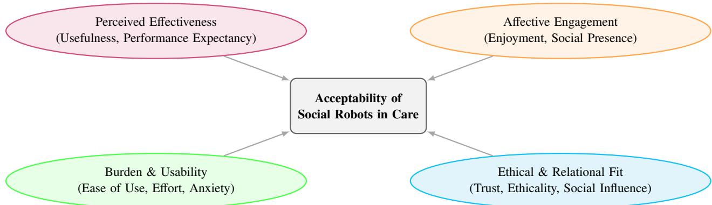  
Fig. 8: Integrative acceptability framework for social robots in RAC and private homes. The four domains perceived efectiveness, bur den and usability, ethical and relational fit, and afective engagement represent recurring constructs shared across the TFA, Almere, and TAM/UTAUT model families (Zhao et al., 2025; Felber et al., 2024; Felding et al., 2023).

tight spaces (Zhao et al., 2023). Negative experiences often relate less to raw accuracy and more to frustration, interruption, or feelings of being monitored, which underscores the importance of the privacy and trust controls above.

## 5.3.3 Influencing factors

Acceptance is shaped by culture, language, and prior experience. Stigma is a real risk if a device looks like a medical alarm. Simple and friendly shapes fare better than humanoid imitations. Multilingual prompts and easy name customisation help in diverse homes. Training for staf and family is critical: acceptance grows when carers can adjust schedules and content without technical help (Jones et al., 2025). Designers should therefore plan for configuration tools that fit care workflows, rather than assuming a technician will always be available.

## 5.3.4 Long-term engagement

Many projects experience a novelty efect in the first weeks, followed by a decline. Sustained use requires measuring daily participation over months and refreshing content regularly. Some people report discomfort when robots try to mimic humans too closely. This uncanny valley efect can be reduced with honest design that avoids human imitation and by setting clear boundaries on system capabilities (Rossi et al., 2021). Ultimately, robots should be treated as part of a care program led by people, not as replacements.

## 5.3.5 Co-design methods

Participatory design approaches involving older adults and caregivers are essential for tailoring systems to real needs and improving long term acceptability. Co-design helps uncover subtle preferences, cultural norms, and usability barriers that standard testing may miss. Studies show that early user involvement leads to more trusted and usable systems (Sumner et al., 2021; Backåberg et al., 2025). These methods also support emotional engagement and ownership, which are key to sustained use in domestic and care settings. Co-design activities can also uncover privacy and trust expectations early, avoiding costly redesign when deployments reach the field.

## 5.4 Intersections and trade-offs

Privacy, trust, and acceptability are independent but interconnected. Strong privacy defaults can reduce data for learning, which may lower performance, while aggressive automation may boost short-term eficiency but erode trust if people feel excluded from decisions. The balance depends on context: in a private home, a person may choose stronger privacy and accept fewer features; in an RAC, shared rules may be needed for fairness and consistency across residents.

These balances also difer across stakeholder groups. Older adults often prioritise agency, independence, and dignity even when this entails some residual risk; whereas clinicians and care staf emphasise safety, reliability, and eficiency within constrained workflows. Families may value reassurance and frequent updates, sometimes favouring more intensive monitoring than the resident themselves would prefer. Field studies in care homes repeatedly report such tensions between resident-centred and staf-centred goals, and show how they shape the configuration and day-to-day use of robots and ambient systems (De Graaf et al., 2019; Sharkey and Sharkey, 2012; Yeo et al., 2023; Carros et al., 2022).

A practical path emerges from earlier sections: make sensing and state visible, keep data local, ofer simple explanations and controls, and evaluate beyond accuracy by considering burden, recovery, and long-term acceptance (Slane and Pedersen, 2025; Yuan et al., 2023; Rossi et al., 2021). In practice, handling conflicting functional and ethical requirements means making these trade-ofs explicit and negotiated rather than implicit. Co-design and governance processes should surface where resident agency, staf workload, clinical risk, and family reassurance pull in diferent directions; and the use of a simple task, risk, and burden lens to justify which compromises are adopted in a given deployment should be considered (Sumner et al., 2021). Privacy trade-ofs become concrete when teams decide what to log, how long to keep logged data, and which errors they are willing to tolerate, which is why Section 6 treats evaluation as part of governance rathe than a separate technical step.

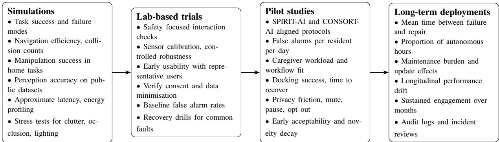  
Fig. 9: A staged evaluation timeline for assistive and social robots and ambient AI in private and care homes. The emphasis shifts from dataset and simulator metrics to safety, workflow, privacy, and long-term reliability measures as systems progress toward sustained deployment.

## 5.5 Risk management and governance

Risk management for RAC and private homes should connect design choices to governance duties and daily practice. It begins by defining the intended use and context, and then identifying the main classes of risk, such as physical safety, data protection, and psychosocial or dignity impacts. Controls should be simple and auditable: local inference where possible, short retention with clear settings, visible states for listening and recording, and conservative motion near people. Plans must include recovery from common faults (e.g., low battery, network loss, or obstructed sensors) and specify how human oversight intervenes when confidence is low. During deployment, teams monitor and report a small set of field metrics that matter to residents and staf, including near misses, false alarms per day, docking success, and time to recover after faults. These should be reviewed with caregivers at regular intervals. A brief, regularly updated risk register helps track ownership and changes. This approach aligns with the European Union Artificial Intelligence Act and with ISO or IEC guidance on risk management for artificial intelligence, and helps prepare evidence for privacy and accessibility expectations in local regulations and standards (European Parliament and the Council of the European Union, 2024; International Organization for Standardization and International Electrotechnical Commission, 2023; Ofice of the Australian Information Commissioner, 2022; World Wide Web Consortium (W3C), 2023).

## 6 Benchmarking and evaluation

RAC homes and private homes are dynamic, cluttered, and resource-constrained environments. Systems that are designed and evaluated only in labs often fail to capture what matters in daily use, including alarm fatigue, recovery after faults, caregiver workload, and dignity or privacy trade-ofs. Benchmarking must therefore move beyond accuracy to include operational, ethical, and usability dimensions that reflect real-world conditions.

This section proposes a staged evaluation framework that connects interaction choices (Section 3) and privacy controls (Section 5) with measurable outcomes so that pilot studies can be compared over time and across sites. It is organised around four progressively complex deployment scenarios, plus a consolidated view of performance and reporting metrics: simulations and ofline evaluations, lab-based trials, pilot studies, and long-term deployments. Fig. 9 provides a simple illustration of these stages, and clarifies which families of measures become most informative as systems progress toward sustained autonomy. Across all stages, standard machine learning metrics such as accuracy, sensitivity, or area under the curve remain necessary but insuficient in aged care HRI. To support consistent comparison across sites, teams should carry a core set of operational measures through the full ladder, including safety events and near misses, false alarm burden per resident per day, caregiver workload change, time to recover after failures, privacy friction such as mute, pause, or opt out actions, and acceptability traces such as minutes of use per day and participation rate over weeks. For social and companion robots, additional indicators include reports on acceptability, usability, discomfort or rejection (e.g., uncanny valley efects), and how changes in appearance, voice, or behaviour impact engagement (Damiano and Dumouchel, 2018).

## 6.1 Simulations and offline evaluations

Simulation and dataset-driven evaluation provide a low-risk way to test feasibility and bound failure modes before any exposure to residents or staf. At this stage, teams can stress-test perception and planning under clutter, occlusion, and lighting variation, and establish baseline compute and power profiles that will later constrain on-device deployment. These ideas are often implemented in simulation testbeds that combine 3D care-home environments, mapping views, and ofline evaluation dashboards for replay and analysis, as illustrated in Fig. 10.

Results here should be treated as necessary evidence for progression to lab trials, not as proof of real-world reliability. Development and evaluation in an ofline setting using simulation platforms or pre-collected datasets is a key first step for any new technology. Within the home care domain, a number of datasets and tools exist to support this stage. Key resources include:

• Ambient and smart-home datasets. The CASAS program provides large, longitudinal ambient datasets from real homes (motion, door, environmental sensors with some activity labels). Newer releases extend through 2024 and are useful for routine and changepoint modelling, but have limited video or audio data for privacy reasons (Cook et al., 2012; Cook, 2025). These datasets are helpful for testing routine detection, anomaly detection, and basic workload estimates before moving to in-person trials.

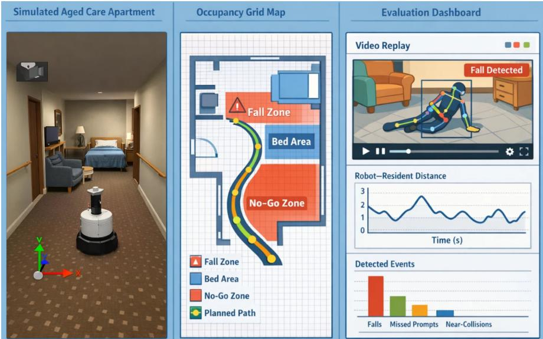  
Fig. 10: Simulation testbeds for assistive robots in aged care. Left: 3D simulation of a residential aged care apartment, with a mobile robot navigating around furniture, mobility aids, and narrow corridors. Middle: top-down occupancy grid and planned trajectory, with marked fall zones, bed areas, and no-go regions. Right: ofline evaluation dashboard showing replay of robot–resident interactions alongside safety and performance metrics (distance to residents, detected events, and alert statistics) used to refine policies before real-world deployment.

• Falls and activity recognition datasets (vision). Recent reviews catalogue vision-based fall datasets and methods; these reveal small sample sizes, staged data, and limited demographics. While datasets are useful for model pruning or ablation, they ofer no proof of reliability. When using such data, one should expect domain shift in real deployments and plan for small, local validation sets with older adults (Benkaci et al., 2024; Inturi et al., 2025).

• Embodied and simulation test beds. For navigation and manipulation in houses, Habitat (fast photorealistic rendering) (Savva et al., 2019), AI2-THOR (interactive kitchen/living scenes) (Kolve et al., 2017), iGibson and OmniGibson (interactive, physics-rich home scenes) (Li et al., 2021), and BEHAVIOR-1K (everyday household activities with evaluation protocols) (Li et al., 2023) provide rich test beds. These tools are useful for stress tests and ablations before field trials, for example, checking how quickly a robot recovers from localisation loss or how navigation time changes with clutter. However, teams should still plan for the reality gap and validate behaviours with small staged pilots in real-world settings.

Gaps remain: Privacy-labelled HRI datasets with per-frame tags are rare. Long-term multi-modal sequences with ground truth are scarce, especially when synchronised with caregiver actions, clinical outcomes, or workload. Datasets with older voices and atypical speech patterns are also limited, as are corpora that combine robot logs with ambient sensors and user-reported outcomes. These gaps motivate careful local data collection under the privacy safeguards discussed in Section 5.

## 6.2 Lab-based trials

Lab trials extend simulations into small-scale, highly controlled environments. The goal is to validate safety-critical interaction loops, sensor calibration, and consent practices with representative users before introducing full household or ward complexity. These trials should adopt proportionate, plain-language consent and capacity-aware processes, following national guidance for adults who may lack decisional capacity (e.g., Australia’s NHMRC National Statement (National Health and Medical Research Council, 2025)). These frameworks specify ongoing consent checks and data minimisation for audio or video, which aligns with the privacy by design approach in Section 5. Team should also validate safety-critical interaction loops, such as emergency stop behaviour, conservative approach distances, and basic fault recovery drills, before exposure to full ward routines

## 6.3 Pilot studies

Pilot studies evaluate feasibility in situ over weeks or months, and provide early signs of eficacy. In line with Fig. 9, pilots should prioritise workflow fit, false alarm burden, early acceptability, and practical privacy controls that residents and staf can understand and reverse. When a system may influence care decisions, for example, through alerts, adherence reports, or behaviour change coaching, study protocols and reports should follow existing health-AI guidelines and protocols for transparency in algorithm updates, input handling, and human oversight (e.g., SPIRIT AI (Rivera et al., 2020) and CONSORT AI (Liu et al., 2020)). For interventions that aim to change behaviour, brief descriptions following the TIDieR checklist help others reproduce content, dose, and facilitation. Cross-domain lessons from industrial HRI (e.g., near-miss recording, structured risk assessment) and smart home research (e.g., routines and change detection metrics) can inform pilot designs (Lu et al., 2025; Duarte et al., 2024; Lorenzini et al., 2023; Wu et al., 2023; Yao et al., 2023). However, consent and governance models present within industrial settings are often lighter than those expected in care homes, so any imported methods should be adapted with clinical and ethical oversight.

## 6.4 Long-term deployments

Long-term deployments reveal impact, reliability gaps, and maintenance burdens that short trials rarely expose, building on the earlier stages in Fig. 9. From the outset, teams should plan to log errors explicitly, including docking misses, network drops, time drifts, and the time taken to recover from failure (Hawes et al., 2017). This stage is also where engagement stability, alert burden, and real caregiver workload efects can be assessed with enough duration to separate novelty from sustained value. Moreover, it provides the opportunity to conduct randomised-controlled trials (Lu et al., 2025), ofering a rigorous evaluation of impact and eficacy beyond short-term pilots.

## 6.5 Measuring performance and metrics

Evaluation should evolve without discarding core signals. Beyond the core measures introduced earlier, additional dimensions include economic considerations, performance beyond accuracy, privacy and security assurance, ethical and regulatory compliance, explainability and transparency, and emerging benchmarking toolkits and open standards.

## 6.5.1 Economic considerations

For costly automation systems afecting staf workload and service models, track the total cost of ownership. This should include installation time, staf training, replacement parts and consumables, cleaning and infection control, software updates, and support hours. Long-term studies (e.g., STRANDS) show that simple behaviours with reliable docking and easy staf customisation produce more sustained use than feature-rich systems that require frequent intervention (Hawes et al., 2017). Maintenance logs can be used to compute mean time between failure and mean time to repair, autonomous hours, the number of remote resets, and the number of support tickets per week.

## 6.5.2 Performance metrics beyond accuracy

Accuracy alone is insuficient. Modern benchmarks increasingly incorporate latency, energy consumption, robustness under occlusion, and adaptability to routine changes. Latency is critical for interactive systems, where sub-second response times often determine usability and safety. Energy eficiency matters for mobile robots and edge devices operating under power constraints, while robustness under occlusion and clutter ensures reliability in small, shared spaces. Adaptability metrics capture how systems maintain performance when furniture moves, lighting changes, or residents begin using new mobility aids. Fairness audits are critical to avoid demographic bias. Frameworks such as CLEAR (Cost, Latency, Eficacy, Assurance, Reliability) for enterprise AI (Mehta, 2025) illustrate how technical metrics can be tied to operational goals; an analogous approach can be used for care robots. As large language models are used for dialogue and planning become more common, pilots should also track conversational safety, hallucination-resistant escalation, and the quality of human handover when system confidence is low.

## 6.5.3 Privacy and security benchmarks

Privacy-preserving design is a cornerstone of ethical deployment and links directly to Section 5. Benchmarks can quantify the proportion of local versus cloud processing, the fraction of events logged as summaries rather than raw audio or video, and the typical retention period for diferent data types. Anonymisation and pseudonymisation methods should be checked with spot audits. Security stress tests evaluate resilience against threats such as unauthorised access, replay attacks on networked sensors, or adversarial inputs that trigger false alerts. Guidance from security communities (e.g., OWASP (Bunzel and Göller, 2024) and NIST (Ahmed, 2024)) emphasises layered defences, encryption at rest and in transit, and robust identity management for AI-enabled applications. For generative and perception systems, runtime safeguards such as input validation and anomaly detection help prevent leakage of sensitive information. These benchmarks should be aligned with international privacy frameworks (e.g., GDPR, HIPAA) and technical reports such as ETSI TR 104 225, which outline privacy aspects of AI/ML systems (Ahmed, 2024).

## 6.5.4 Ethical and regulatory compliance checks

AI influencing care decisions must follow reporting standards like SPIRIT-AI (Rivera et al., 2020) and CONSORT-AI (Liu et al., 2020), ensuring transparency in algorithm description, input handling, and human-AI interaction. These extensions address AI-specific risks such as bias, drift, and error analysis, complementing traditional clinical trial standards and benchmarks for AI-enabled assistive technology (Silvera-Tawil et al., 2025). For reproducibility of behaviour change interventions, the TIDieR framework specifies reporting of content, dose, and facilitation. Compliance checks should also include privacy impact assessments and consent audit trails, particularly for vulnerable populations, to meet national and international ethical requirements.

## 6.5.5 Explainability and transparency

Benchmarks assess explanation fidelity (alignment with actual model logic) (Yeh et al., 2019), user comprehensibility, and compliance with regulatory principles like those outlined in NIST’s Four Principles of Explainable AI (Quinn et al., 2020). Tools such as SHAP (Lundberg

and Lee, 2017) and LIME (Ribeiro et al., 2016) provide quantitative measures of feature attribution, while domain-specific frameworks emphasise interpretability in safety-critical contexts like healthcare and robotics. Transparency audits should ensure explanations are resistant to manipulation and meaningful for end-users, balancing interpretability with operational performance.

## 6.5.6 Benchmarking toolkits and open standards

Frameworks are emerging to support reproducible and fair evaluation of AI systems. MLPerf (Mattson et al., 2020), developed by ML Commons, ofers benchmarks for inference and training across cloud and edge platforms, including latency and throughput tests relevant to real-time care robotics. However, gaps remain in HRI-specific metrics, particularly for social interaction quality, privacy compliance, and long-term autonomy. Future standards should integrate technical, ethical, and human-centric indicators to enable comprehensive evaluation of care robotics.

## 7 Open research challenges

Despite rapid progress in sensing, perception, and interaction design, deploying assistive robots and ambient intelligence in private and RAC homes remains a demanding frontier. These environments expose gaps in robustness, personalisation, safety, and governance that current systems only partially address. We highlight five open challenges that require sustained research attention, summarised in Fig. 11.

## 7.1 Robust multimodal perception in lived-in spaces

Homes and RAC facilities remain dificult environments for perception. Lighting varies, furniture moves, and people use mobility aids that occlude bodies or alter gait. Radar, thermal, and depth sensors help, but fusing these signals reliably under uncertainty is still an open problem. Systems that perform well in controlled settings often struggle when views are partial, audio is noisy, or sensors are intermittently occluded. Radar, thermal, and depth sensors can mitigate some of these issues, but reliably fusing heterogeneous signals under uncertainty is still an open problem.

A central dificulty is multimodal fusion under uncertainty and occlusion. Domestic environments routinely produce partial views, motion blur, and conflicting signals from voice, vision, and ambient sensors. The unsolved challenge is ensuring stable behaviour when inputs disagree or drop out, and presenting uncertainty in ways that older adults and non-technical staf can interpret quickly without increasing cognitive load or alarm fatigue. These issues connect directly to the interaction patterns in Section 3 and depend on the sensing and learning choices described in Section 4.

Sustaining performance as conditions drift over days and weeks is another open problem. This links directly to the interaction patterns in Section 3 and will draw on sensing and learning choices in Section 4. Long-running autonomy studies show that real performance depends on recovery after faults, docking reliability, and the ability to continue service under network loss (Hawes et al., 2017). Yet the field lack methods to quantify how robustness degrades over time and how those shifts translate into user-visible impacts such as false alarms and missed assistance.

Generalisation across homes is equally dificult. Models trained in one set of environments often fail in another due to diferences in layout, objects, accents, and routines. Robust domain-shift handling and simple ways to communicate uncertainty to users and carers are essential for deployments that span both private homes and RAC facilities, where procurement expects repeatable performance despite local variation.

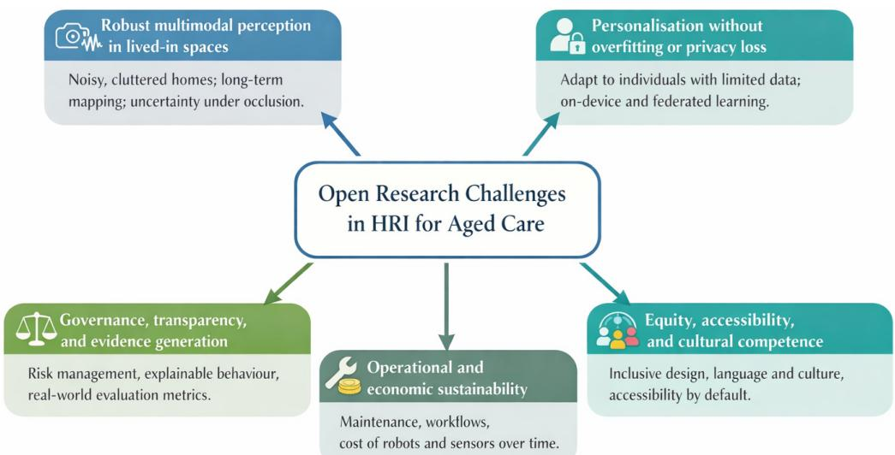  
Fig. 11: Schematic overview of five open research challenges in assistive human–robot interaction for private and residential aged care homes: robust multimodal perception, personalisation without privacy loss, governance and evidence, operational and economic sustainability, and equity and cultural competence.

These challenges extend to navigation and manipulation as well. Domestic spaces are dense and narrow. Walkers, wheelchairs, cables, and pets create hazards. Dependable navigation and manipulation near people, with predictable approach distances and safe, reversible handovers in small rooms, remains challenging. Navigation in such spaces remains a limiting factor for many tasks that require physical help (Duan et al., 2024).

Finally, many activities can be sensed without a robot, using vision and ambient systems for falls, routines, and unusual events. The open question is how to transfer these strengths into human-robot interaction without losing privacy and clarity. We need principled ways to determine when a robot adds value bevond a fixed sensor network, and when it does not, using measures that matter in real life (Benkaci et al., 2024). This comparison should include governance burden, not only technical performance.

Together, these gaps point to the need for advances in multimodal fusion, online calibration, fault-tolerant mapping, and uncertainty-aware interaction, all operating without expert intervention and all understandable to older adults and non-technical staf.

## 7.2 Personalisation without overfitting or privacy loss

There are open questions on how to personalise systems safely over time while respecting privacy and working with very limited data. Older adults difer in language, hearing, vision, cognition, routines, and preferences. Personalisation improves usability but raises privacy concerns and can lead to brittle models when data is scarce. Methods such as federated learning, continual adaptation, and uncertainty-aware policy updates show promise, yet remain dificult to deploy safely in small, heterogeneous datasets typical of home environments (Casado, 2024). Balancing adaptation with predictability—and doing so transparently—remains a central challenge.

This connects to the privacy by design in Section 5 and to edge learning choices detailed in Section 4. Equally important is safe rollback and auditability, so that a system can revert to a stable baseline when an adaptation harms performance, safety, or user comfort.

## 7.3 Governance, transparency, and evidence generation

Regulation for AI-enabled care technologies is evolving rapidly. Designers must demonstrate safety, privacy, and fairness while keeping systems understandable to residents, families, and staf. This creates open questions around explainability for non-experts, auditable decision pipelines, and evaluation protocols that reflect real-world risk. There is also a need for shared and unified benchmarks, reference architectures, and deployment playbooks that help teams generate regulation-ready evidence without reinventing foundational components.

Evidence gaps are closely linked to the dataset and benchmark limitations summarised in Section 6. Few studies report benefits from large-scale, long-term deployments across diverse sites, and many rely on proxy metrics such as engagement rather than clinical or operational outcomes. Health style reporting, such as SPIRIT AI and CONSORT AI, helps reviewers judge bias, drift, and the role of human oversight, but adoption in human-robot interaction remains uneven (Liu et al., 2020; Rivera et al., 2020). Section 6 proposed a multi-dimensional suite of metrics that could be used to evaluate performance. The open methodological challenge is to normalise these measures across heterogeneous sites so that results can be pooled or compared without losing context, while still respecting local privacy, workflow, and stafing constraints.

Dataset limitations further constrain governance and evidence generation. There are very few privacy-labelled HRI datasets, few longhorizon multi-modal recordings with ground truth, and limited speech data from older voices and atypical speech for automatic speech recognition. Public datasets that link robot logs, ambient sensors, and human outcomes are rare. Although simulation resources cover many domestic scenes, the reality gap remains, and there is a need for structured datasets and protocols that bridge from small-scale pilots to in-the-wild trials (Cook et al., 2012; Cook, 2025; Savva et al., 2019; Li et al., 2021, 2023). A further gap is the limited availability of datasets that document configuration changes, staf handovers, and consent state over time, even though these factors strongly shape real-world reliability and acceptability.

## 7.4 Operational and economic sustainability

Upfront costs attract attention, but the true cost of ownership includes installation, training, cleaning, consumables, software updates, and support. In practice, systems that are slightly less capable but much easier to maintain often outperform more advanced alternatives. Open questions include how to design systems for low support burden, how to predict maintenance from telemetry, and how to compare robots with non-embodied alternatives in honest cost-benefit terms. Lessons from long-running deployments suggest that simple behaviours with reliable docking and easy staf configuration sustain use better than complex features that require tinkering (Hawes et al., 2017). A persistent research gap is the lack of standard reporting on maintenance time, remote-support frequency, and failure categories in domestic trials, which limits realistic comparison across platforms and sites.

## 7.5 Equity, accessibility and cultural competence

Older adults are not a homogeneous group. Language, culture, income, and digital literacy shape expectations and comfort. Accessibility defaults such as large targets, announced state changes, and visible controls help, but the field lacks strong evidence on culturally competent interaction styles that remain transparent and do not mislead. The open task is to build libraries of content and behaviours that can be tailored by staf without technical help and that are evaluated for fairness and inclusion over months rather than days (World Wide Web Consortium (W3C), 2023; Slane and Pedersen, 2025). This requires multilingual and low-literacy evaluation protocols that treat accessibility as a core performance dimension, and that assess whether adaptation and personalisation benefit all user groups equally rather than reinforcing

existing disparities.

Equity also depends on access to hardware and infrastructure, not just on interface design. Robots, depth cameras and dense ambient sensor networks remain expensive capital items and typically require reliable Wi-Fi, suficient power, secure networking and specialist technical support. Larger metropolitan providers or well-resourced pilots can often absorb these costs; whereas smaller organisations, rural and remote services and low-income households may only be able to deploy basic pendant alarms, tablets or consumer smart speakers. Without careful design, this risks concentrating advanced HRI capabilities in already advantaged sites and widening gaps in quality of care.

To mitigate this, extreme-environment HRI work should prioritise modular systems that can reuse existing infrastructure (for example, televisions, of-the-shelf tablets and home routers), operate gracefully under intermittent connectivity, and be serviced remotely rather than relying on onsite engineers. Procurement and funding models should explicitly budget for long-term maintenance, device refresh and staf training, so that accessibility to robots and sensing infrastructure does not depend solely on local champions or short-term grants.

## 8 Future research directions

The previous section outlined open challenges that currently hinder the dependable use of HRI in RAC and private home environments. These challenges span robustness in lived-in spaces, personalisation with privacy, risk management, evidence beyond accuracy, and questions of equity and cultural fit, but they also point to a smaller set of practical research levers that can help to close multiple gaps at once. In this section, we focus on a smaller set of shared directions that can help the field move from promising prototypes to dependable practice. Rather than mapping one future direction to each open challenge, we describe a selection of cross-cutting levers that can support many projects: reference architectures, privacy-aware personalisation, evaluation ladders and benchmarks, operational tooling, and long-term co-design with stakeholders.

## 8.1 Reference architectures for hybrid robot and ambient homes

Many tasks can be met by ambient sensing, while others truly require a robot. A shared, modular architecture would help teams combine both approaches while keeping boundaries between sensing, decision-making, and data sharing explicit. At minimum, such an architecture should define how local perception and intent run on-device, how events are filtered into minimal summaries for a local care gateway that aggregates devices within a private home or a facility unit, what data are retained locally versus forwarded, and when to escalate to clinicians through standards aligned with health data exchange, including FHIR resources such as Observation or Detected Issue (Pavão et al., 2023; Li et al., 2024a). Development could be supported by publishing a small set of event schemas covering common tasks such as falls, adherence, and welfare checks; and by defining latency, access, and retention targets that match the privacy by design principles from Section 5. Where systems interface with clinical services, these schemas should be documented in ways that support audit and safe handover, so that the same interaction and privacy assumptions can be traced from sensing to alerting to review (Ofice of the Australian Information Commissioner, 2022).

## 8.2 Personalisation that stays private

The field needs worked examples of long-horizon adaptation that run for months with very little labelled data, clear consent, and conservative safety envelopes. Promising directions include federated or split learning for voice and activity models, identity-disentangled representations for expression or engagement cues, and privacy-preserving training that never pools raw personal data (Casado, 2024; Brauneck et al., 2023). To make these approaches credible in care settings, future systems should publish explicit adaptation budgets, safe rollback mechanisms, and simple tests that detect when personalisation risks increase false alarms or reduce user comfort. Each method should include simple diagnostics that show when the system is uncertain, how behaviour was adapted, and how a resident or caregiver can pause, reset, or override the model. To remain consistent with the governance constraints outlined earlier in Sections 5 and 7, adaptation should be paired with clear role-based controls that distinguish resident, family, and staf permissions, and log when personalisation is enabled, paused, or reverted.

## 8.3 Evaluation ladders that bridge the reality gap

Research should develop shared evaluation ladders that move from simulation to lab checks to micro-pilots and then in-the-wild studies, with a small set of core measures carried across stages, as emphasised in Section 6. For simulation, development can lean on domestic platforms such as Habitat, AI2-THOR, and OmniGibson to stress-test perception and policies (Savva et al., 2019; Li et al., 2021). For lab and early pilots, staged sessions that test occlusion, clutter, and audio noise, and verify privacy controls before broader deployment are required. For field studies, adopting health-style reporting allows reviewers to judge bias, drift, the role of human oversight, and how missing data were handled (Liu et al., 2020; Rivera et al., 2020). Recent long-horizon studies in care contexts also reinforce the value of pairing these reporting standards with practical operational measures, such as maintenance burden and staf-facing configuration logs, to support comparability across sites (Otaka et al., 2024).

## 8.4 Co-design with caregivers and residents that lasts beyond the pilot

Early co-design improves fit, but long-term fit depends on who can change content, schedules, and thresholds after the researchers leave. Future studies should provide simple tools for staf and family to configure systems, use planned reviews with caregivers every few weeks, and report what settings were changed in practice and how those changes afected safety events, false alarm burden, and engagement.

Evidence from recent care home deployments suggests that staf perceptions of workload, trust, and accountability evolve over time, so co-design should be treated as a continuing operational capability and not only a pre-deployment activity (Ruan et al., 2025; Otaka et al., 2024).

## 8.5 Summary

Together, these future directions suggest a practical roadmap from prototypes to regulation-ready evidence. In the near term, teams can publish and adopt shared event schemas, on-device processing patterns, and minimal data flows that make systems easier to integrate and audit. In the medium term, privacy-aware personalisation should be demonstrated in multi-month deployments with clear uncertainty signals and low-burden override tools for residents and staf. In the longer term, multi-site studies that follow SPIRIT AI and CONSORT AI can link technical improvements to measurable outcomes such as reduced false alarms, lower caregiver workload, and safer recovery after faults. This pathway builds directly on the interaction, technology, privacy, and benchmarking foundations established earlier in the chapter, and keeps the emphasis on systems that remain useful, respectful, and sustainable in everyday care.

## 9 Conclusion

This chapter examined how robots and ambient intelligence can support older adults in RAC and private homes, focusing on the technical, human, and organisational constraints that shape real-world deployment. We argued that these environments constitute extreme HRI settings because they are cluttered, dynamic, have low support, and are governed by strong expectations of safety, privacy, and dignity. Designing for such contexts requires more than accurate perception or engaging interaction; it demands systems that remain robust, transparent, and respectful throughout everyday use. Three themes emerged across the chapter. First, robust perception and interaction in lived-in spaces are essential, given occlusion, mobility aids, shifting layouts, and diverse sensory and cognitive needs. Second, privacy, trust, and acceptability must be built into system architecture and interaction design from the outset. Third, evaluation must extend beyond accuracy, incorporating metrics that reflect the realities of care, such as burden, recovery, maintainability, and long-term reliability We also emphasised that dependable deployment depends on hybrid thinking, including operational fit and governance (not only technical capability). Hybrid robot-and-ambient architectures, privacy-aware personalisation, evaluation ladders, and long-term co-design can help bridge the gap between prototypes and sustained use, while supporting regulation-ready evidence and interoperability with existing care systems. Evaluation must also reflect real-life outcomes. Practical study ladders should link simulation and lab tests to in-the-wild pilots and long-term deployments, with common measures such as false alarms per resident per day, caregiver workload, recovery after faults, and sustained engagement. These metrics help teams compare systems across sites and ensure that improvements translate into meaningful benefits for residents and staf. Ultimately, the goal is to create assistive technologies that support ageing with dignity, safety, and inde pendence. By grounding innovation in the realities of home and care environments, and by treating privacy, trust, and usability as core engineering requirements, the community can move toward systems that are not only intelligent but genuinely welcome in the places people live.

## References

Ahmed F (2024). Cybersecurity policy frameworks for ai in government: Balancing national security and privacy concerns. Int. J. Multidiscip. Sci. Manag 1 (4): 43–53.

Al-qaness MA, Dahou A, Abd Elaziz M and Helmi AM (2024). Human activity recognition and fall detection using convolutional neural network and transformer-based architecture. Biomedical Signal Processing and Control 95: 106412.

AlShamsi S, AlSuwaidi L and Shaalan K (2022). Robotics and ai in healthcare: A systematic review. Recent Innovations in Artificial Intelligence and Smart Applications : 319–343.

Arthanat S, Rossignol H, Preble E, Grimm K, Corvini M, Wilcox J, Aytur S and Doyle M (2024). Perspectives on a telepresence robot at an independent living facility: lessons learned and implications. Journal of Enabling Technologies 18 (1): 1–12.

Australian Commission on Safety and Quality in Health Care (2024). Aged care infection prevention and control guide — chapter 6. https://www.safetyandquality.gov.au/.

Australian Digital Health Agency. Connecting australian healthcare – national healthcare interoperability plan 2023–2028: Quarterly progress report (july 2024 to september 2024). , Australian Digital Health Agency, Sydney, Australia (2024). Issued 31 October 2024, https://www.digitalhealth.gov.au/sites/default/files/documents/australian-digital-health-agency-national-healthcare

-interoperability-plan-and-national-healthcare -identifiers-roadmap-q1-july-september-2024-progress-report-v003.pdf.

Backåberg S, Strandberg S, Freeman G, Katz L, Rafiei Milajerdi H, Wylant B, Oehlberg L and Ekstedt M (2025). Facilitating co-design among older adults in a digital setting: methodological challenges and opportunities. CoDesign 21 (1): 118–135.

Ballou A, Alameda-Pineda X and Reinke C (2023). Variational meta reinforcement learning for social robotics. Applied Intelligence 53 (22): 27249–27268.

Baltus G, Fox D, Gemperle F, Goetz J, Hirsch T, Magaritis D, Montemerlo M, Pineau J, Roy N, Schulte J and et al. (2000), Towards persona service robots for the elderly, Proc. of the Workshop on Interactive Robotics and Entertainment (WIRE-2000).

Bao Y, Zhao X and Qian D (2024). Hybrid 3d human pose estimation with monocular video and sparse imus. arXiv preprint arXiv:2404.17837 .

Barrault L. Chung YA. Meglioli MC. Dale D. Dong N. Duguenne PA. Elsahar H. Gong H. Heffernan K. Hoffman J and et al. (2023), Seamlessm4t: massively multilingual & multimodal machine translation. arXiv preprint arXiv:2308.11596 .

Beeri EB, Nissinman E and Sintov A (2025). Dig-net: Enhancing quality of life through hyper-range dynamic gesture recognition in assistive robotics. arXiv preprint arXiv:2505.24786 .

Benkaci A, Sliman L and Dellys HN (2024). Vision-based human fall detection systems: a review. Procedia Computer Science 241: 203–211.

Bhattacharyya S and Wang JZ (2025). Evaluating vision-language models for emotion recognition. arXiv preprint arXiv:2502.05660 .

Billard A and Kragic D (2019). Trends and challenges in robot manipulation. Science 364 (6446): eaat8414.

Boudouraki A, Waheed M, Mestre R, Landowska A, Georgara A, Deshmukh J, Singh L, Abioye AO, Nguyen TVT, Dong Y and et al. (2025). Responsible and adaptive robots in care home settings: an implementation framework analysis of a workshop with public and professionals. Frontiers in Robotics and A/12: 1610329

Brauneck A, Schmalhorst L, Kazemi Majdabadi MM, Bakhtiari M, Völker U, Baumbach J, Baumbach L and Buchholtz G (2023). Federated machine learning, privacy-enhancing technologies, and data protection laws in medical research: scoping review. Journal ofmedical Interne research 25: e41588

Broadbent E. Loveys K. Ilan G. Chen G. Chilukuri M. Boardman S. Doraiswamy P and Skuler D (2024). Ellig, an ai-driven social robot to alleviate loneliness: progress and lessons learned. The Journal of Aging Research & Lifestyle 13: 22–28.

Bunzel N and Göller N (2024), Bridging the gap: The role of owasp ai exchange in ai standardization, INFORMATIK 2024, 263–273.

Campagna G and Rehm M (2025). A systematic review of trust assessments in human–robot interaction. ACM Transactions on Human-Robot Interaction 14 (2): 1–35.

Cao X, Zhang H, Zhou B, Wang D, Cui C and Bai X (2024). Factors influencing older adults’ acceptance of voice assistants. Frontiers in Psychology 15: 1376207.

Carros F, Schwaninger I, Preussner A, Randall D, Wieching R, Fitzpatrick G and Wulf V (2022), Care workers making use of robots: results of a three-month study on human-robot interaction within a care home, Proceedings of the 2022 CHI conference on human factors in computing systems, 1–15.

Casado FE (2024). Towards privacy-aware and personalised assistive robots: A user-centred approach. arXiv preprint arXiv:2405.14528 .

Castelli A, Norville P, Kiernan M, Maillard JY and Evans SL (2022). Review of decontamination protocols for shared non-critical objects in 35 policies of uk nhs acute care organizations. Journal of Hospital Infection 120: 65–72.

Cavallo F, Esposito R, Limosani R, Manzi A, Bevilacqua R, Felici E, Di Nuovo A, Cangelosi A, Lattanzio F, Dario P and et al. (2018). Robotic services acceptance in smart environments with older adults: user satisfaction and acceptability study. Journal of medical Internet research 20 (9): e9460.

Chang WG, You T, Seo S, Kwak S and Han B (2019), Domain-specific batch normalization for unsupervised domain adaptation, Proceedings of the IEEE/CVF conference on Computer Vision and Pattern Recognition, 7354–7362.

Che RP, Ruan YX, Kodate N, Shi Y, Liu X, Donnelly S, Suwa S, Yu W, Kong D and Cheung MC (2025). Effectiveness and usability of care robots in supporting older adults living with frailty: A systematic review. Digital Health 11.

Chen K (2025). Does ascribing robots with mental capacities increase or decrease trust in middle-aged and older adults? International Journal of Social Robotics : 1–15.

Cheng W, Tang H, Van Gool L and Ko JH (2024), Handdiff: 3d hand pose estimation with diffusion on image-point cloud, Proceedings of the IEEE/CVF Conference on Computer Vision and Pattern Recognition, 2274–2284.

Christoforou EG, Panayides AS, Avgousti S, Masouras P and Pattichis CS (2019), An overview of assistive robotics and technologies for elderly care, Mediterranean Conference on Medical and Biological Engineering and Computing, 971–976.

Cippitelli E, Fioranelli F, Gambi E and Spinsante S (2017). Radar and rgb-depth sensors for fall detection: A review. IEEE Sensors Journal 17 (12): 3585–3604.

Cook D (2025), Jun. Casas smart home dataset - free living, motion, door, activity labels. https://doi.org/10.5281/zenodo.15708568.

Cook DJ, Crandall AS, Thomas BL and Krishnan NC (2012). Casas: A smart home in a box. Computer 46 (7): 62–69.

Coradeschi S, Cesta A, Cortellessa G, Coraci L, Gonzalez J, Karlsson L, Furfari F, Loutfi A, Orlandini A, Palumbo F and et al. (2013), Giraffplus: Combining social interaction and long term monitoring for promoting independent living, 2013 6th international conference on Human System Interactions (HSI), 578–585.

Costanzo M, Smeriglio R and Di Nuovo S (2024). New technologies and assistive robotics for elderly: A review on psychological variables. Archives of Gerontology and Geriatrics plus 1 (4): 100056.

Cruces A, Jerez A, Bandera JP and Bandera A (2024). Socially assistive robots in smart environments to attend elderly people—a survey. Applied Sciences 14 (12): 5287.

Damiano L and Dumouchel P (2018). Anthropomorphism in human–robot co-evolution. Frontiers in psychology 9: 363437.

De Graaf MM, Ben Allouch S and Van Dijk JA (2019). Why would i use this in my home? a model of domestic social robot acceptance. Human–Computer Interaction 34 (2): 115–173.

Du W and Beltrame G (2024). Lidar-based real-time object detection and tracking in dynamic environments. arXiv preprint arXiv:2407.04115 .

Duan H, Yang Y, Li D and Wang P (2024). Human–robot object handover: Recent progress and future direction. Biomimetic Intelligence and Robotics 4 (1): 100145.

Duarte L, Neves M and Neto P (2024). Benchmarking human-robot collaborative assembly tasks. Results in Engineering 22: 102042.

Duncan JA, Alambeigi F and Pryor MW (2024). A survey of multimodal perception methods for human–robot interaction in social environments. ACM Transactions on Human-Robot Interaction 13 (4): 1–50.

Duthie N, Ansari K, Wang M and Ray PK (2024). Design of a shared context-aware assistive robot for personalised aged-care services. Digital Medicine 10 (1): e23–00017.

Escolano C, Barrué C, Picas J and Alenyà G (2024), Studying the performance of automatic speech recognition systems on older adults, 2024 IEEE International Symposium on Robot and Human Interactive Communication (RO-MAN), Workshop in Trends in Socially Assistive Robotics: Human-centered Approach.

European Parliament and the Council of the European Union. Regulation (eu) 2024/1689 of the european parliament and of the council of 13 june 2024 laying down harmonised rules on artificial intelligence (artificial intelligence act) and amending regulations (ec) no 300/2008 and (eu) no 167/2013 and directives 2014/30/eu and 2014/53/eu. Regulation of the European Parliament and of the Council EU 2024/1689, European Union (2024). Official Journal of the European Union, https://eur-lex.europa.eu/eli/reg/2024/1689/oj.

Fahn CS, Chen SC, Wu PY, Chu TL, Li CH, Hsu DQ, Wang HH and Tsai HM (2022), Image and speech recognition technology in the development of an elderly care robot: Practical issues review and improvement strategies, Healthcare, 10, 11, pp. 2252.

Fanello SR, Keskin C, Izadi S, Kohli P, Kim D, Sweeney D, Criminisi A, Shotton J, Kang SB and Paek T (2014). Learning to be a depth camera for close-range human capture and interaction. ACM Transactions on Graphics (TOG) 33 (4): 1–11.

Felber NA, Lipworth W, Tian YJ, Roulet Schwab D and Wangmo T (2024). Informing existing technology acceptance models: a qualitative study with older persons and caregivers. European Journal of Ageing 21 (1): 12.

Felding SA, Koh WQ, Teupen S, Budak KB, Laporte Uribe F and Roes M (2023). A scoping review using the almere model to understand factors facilitating and hindering the acceptance of social robots in nursing homes. International Journal of Social Robotics 15 (7): 1115–1153.

Filntisis PP, Efthymiou N, Koutras P, Potamianos G and Maragos P (2019). Fusing body posture with facial expressions for joint recognition of affect in child–robot interaction. IEEE Robotics and automation letters 4 (4): 4011–4018.

Finn C, Abbeel P and Levine S (2017), Model-agnostic meta-learning for fast adaptation of deep networks, International conference on machine learning, 1126–1135.

Fischinger D, Einramhof P, Papoutsakis K, Wohlkinger W, Mayer P, Panek P, Hofmann S, Koertner T, Weiss A, Argyros A and et al. (2016). Hobbit, a care robot supporting independent living at home: First prototype and lessons learned. Robotics and autonomous systems 75: 60-78.

Florence P, Manuelli L and Tedrake R (2019). Self-supervised correspondence in visuomotor policy learning. IEEE Robotics and Automation Letters 5 (2): 492–499.

Frøvik N, Malekzai BA and Øvsthus K (2021). Utilising lidar for fall detection. Healthcare Technology Letters 8 (1): 11–17.

Fu Q, Liu X, Xu R, Niebles JC and Kitani KM (2023), Deformer: Dynamic fusion transformer for robust hand pose estimation, Proceedings of the IEEE/CVF International Conference on Computer Vision, 23600–23611.

G Y Sibi E C ll G d K i D ( ) F d i i h i f l i f d lli i h b interaction, 2019 IEEE/RSJ International Conference on Intelligent Robots and Systems (IROS), 305–312.

Garcıa J and Fernández F (2015). A comprehensive survey on safe reinforcement learning. Journal of Machine Learning Research 16 (1): 1437–1480.

Gopal GY and Amer MA (2024), Separable self and mixed attention transformers for efficient object tracking, Proceedings of the IEEE/CVF winter conference on applications of computer vision, 6708–6717.

Gulati A, Qin J, Chiu CC, Parmar N, Zhang Y, Yu J, Han W, Wang S, Zhang Z, Wu Y and et al. (2020). Conformer: Convolution-augmented transformer for speech recognition. arXiv preprint arXiv:2005.08100 .

Han B and Gratch J (2025), Salience adjustment for context-based emotion recognition, 2025 IEEE 19th International Conference on Automatic Face and Gesture Recognition (FG), 1–6.

Hassan S, Ullah M, Imran AS, Mujtaba G, Yamin MM, Hashmi E, Cheikh FA and Beghdadi A (2024), A self-supervised diffusion framework for facial emotion recognition, 2024 IEEE International Conference on Image Processing (ICIP), 465–471.

HassanPour Zonoozi M and Seydi V (2023). A survey on adversarial domain adaptation. Neural Processing Letters 55 (3): 2429–2469.

Hawes N, Burbridge C, Jovan F, Kunze L, Lacerda B, Mudrova L, Young J, Wyatt J, Hebesberger D, Kortner T and et al. (2017). The strands project: Long-term autonomy in everyday environments. IEEE Robotics & Automation Magazine 24 (3): 146–156.

Heikenfeld J, Jajack A, Rogers J, Gutruf P, Tian L, Pan T, Li R, Khine M, Kim J and Wang J (2018). Wearable sensors: modalities, challenges, and prospects. Lab on a Chip 18 (2): 217–248.

Hing SY, Hung CC, Fat LK and et al. (2020), Smart elderly care robot, 2020 IEEE 2nd International Workshop on System Biology and Biomedical Systems (SBBS), 1–4.

Huang F, Yao Z and Zhou W (2024). Dtbs: Dual-teacher bi-directional self-training for domain adaptation in nighttime semantic segmentation. arXiv preprint arXiv:2401.01066 .

Hung L, Mann J, Perry J, Berndt A and Wong J (2022a). Technological risks and ethical implications of using robots in long-term care. Journal of Rehabilitation and Assistive Technologies Engineering 9: 20556683221106917.

Hung L, Wong J, Smith C, Berndt A, Gregorio M, Horne N, Jackson L, Mann J, Wada M and Young E (2022b). Facilitators and barriers to using telepresence robots in aged care settings: a scoping review. Journal of Rehabilitation and Assistive Technologies Engineering 9: 20556683211072385

International Organization for Standardization and International Electrotechnical Commission. Information technology — artificial intelligence — risk management. International Standard ISO/IEC 23894:2023, International Organization for Standardization, Geneva, Switzerland (2023). Prepared by ISO/IEC JTC 1/SC 42, https://www.iso.org/standard/77304.html.

Inturi AR, Manikandan V and Hu YC (2025). Technical insights into vision-based fall detection systems: performances, challenges, and constraints. AI & SOCIETY: 1–13.

Jin H, Guo B, Roychoudhury R, Yao Y, Kumar S, Agarwal Y and Hong JI (2022), Exploring the needs of users for supporting privacy-protective behaviors in smart homes, Proceedings of the 2022 CHI Conference on Human Factors in Computing Systems, 1–19.

Johannsmeier L, Gerchow M and Haddadin S (2019), A framework for robot manipulation: Skill formalism, meta learning and adaptive control, 2019 International Conference on Robotics and Automation (ICRA), 5844–5850.

Jones NL, Loizides F and Jones K (2025). Acceptance of needy socially assistive robots: a systematic review. International Journal of Social Robotics : 1–15.

Kasaei H and Kasaei M (2024). Vital: Interactive few-shot imitation learning via visual human-in-the-loop corrections. arXiv preprint arXiv:2407.21244 .

Kim JW, Choi YL, Jeong SH and Han J (2022). A care robot with ethical sensing system for older adults at home. Sensors 22 (19): 7515.

Ko H, Kim S, Oh G, Yoon J, Lee H, Jang S, Kim S and Kim S (2025). Active test-time vision-language navigation. arXiv preprint arXiv:2506.06630

Kobzarev O, Lykov A and Tsetserukou D (2025), Gestllm: Advanced hand gesture interpretation via large language models for human-robo interaction, 2025 20th ACM/IEEE International Conference on Human-Robot Interaction (HRI), 1413–1417.

Kolve E, Mottaghi R, Han W, VanderBilt E, Weihs L, Herrasti A, Deitke M, Ehsani K, Gordon D, Zhu Y and et al. (2017). Ai2-thor: An interactive 3d environment for visual ai. arXiv preprint arXiv:1712.05474 .

Lee SH, Yu S and et al. (2025). The impact of care robots on older adults: A systematic review. Geriatric Nursing 65: 103507.

Li C, Xia F, Martín-Martín R, Lingelbach M, Srivastava S, Shen B, Vainio K, Gokmen C, Dharan G, Jain T and et al. (2021). igibson 2.0: Object-centric simulation for robot learning of everyday household tasks. arXiv preprint arXiv:2108.03272 .

Li C, Zhang R, Wong J, Gokmen C, Srivastava S, Martín-Martín R, Wang C, Levine G, Lingelbach M, Sun J and et al. (2023), Behavior-1k: A benchmark for embodied ai with 1,000 everyday activities and realistic simulation, Conference on Robot Learning, 80–93.

Li C, Wang J, Wang S and Zhang Y (2024a). A review of iot applications in healthcare. Neurocomputing 565: 127017.

Li W, Liu M, Liu H, Wang P, Cai J and Sebe N (2024b), Hourglass tokenizer for efficient transformer-based 3d human pose estimation, Proceed ings of the IEEE/CVF Conference on Computer Vision and Pattern Recognition, 604–613.

Liu X, Rivera SC, Moher D, Calvert MJ, Denniston AK, Ashrafian H, Beam AL, Chan AW, Collins GS, Deeks ADJ and et al. (2020). Reporting guidelines for clinical trial reports for interventions involving artificial intelligence: the consort-ai extension. The Lancet Digital Health 2 (10): e537–e548.

Liu Z, Guo Z, Cen Z, Zhang H, Tan J, Li B and Zhao D (2022). On the robustness of safe reinforcement learning under observational perturbations. arXiv preprint arXiv:2205.14691 .

Liu T, Xiang Y, Wu L and Shi G (2023), Semantic guided attention for weakly supervised group activity recognition, Chinese Conference on Image and Graphics Technologies, 220–235.

Lorenzini M, Lagomarsino M, Fortini L, Gholami S and Ajoudani A (2023). Ergonomic human-robot collaboration in industry: A review. Frontiers in Robotics and AI 9: 813907.

Lu W, Silvera-Tawil D, Yoon HJ, Higgins L, Zhang Q, Karunanithi M, Bomke J, Byrnes J, Hewitt J, Smallbon V and et al. (2025). Impact of the smarter safer homes solution on quality of life and health outcomes in older people living in their own homes: randomized controlled trial. Journal of medical Internet research 27: e59921.

Lundberg SM and Lee SI (2017). A unified approach to interpreting model predictions. Advances in neural information processing systems 30. Luo C, Chu X and Yuille A (2018). Orinet: A fully convolutional network for 3d human pose estimation. arXiv preprint arXiv:1811.04989 .

Ma H, Peng Z, Shao M, Li J and Liu J (2024), Extending whisper with prompt tuning to target-speaker asr, ICASSP 2024-2024 IEEE International Conference on Acoustics, Speech and Signal Processing (ICASSP), 12516–12520.

Maiettini E, Tikhanoff V and Natale L (2021), Weakly-supervised object detection learning through human-robot interaction, 2020 IEEE-RAS 20th International Conference on Humanoid Robots (Humanoids), 392–399.

Manavi M, Carros F, Schwaninger I, Paluch R, Randall D, Krueger M, Tufan I, Wieching R, Tolmie P, Mueller C and et al. (2025). “making robots usable”: Empowering care professionals to customize social robots in care. International Journal of Social Robotics : 1–22.

Marchang J, Di Nuovo A, Elliott C, Meese H, Vinanzi S and Zecca M. Security and privacy in assistive robotics: cybersecurity challenges for healthcare. UK-RAS White Paper WP2023.1, EPSRC UK-RAS Network (2023).

Mattson P, Cheng C, Diamos G, Coleman C, Micikevicius P, Patterson D, Tang H, Wei GY, Bailis P, Bittorf V and et al. (2020). Mlperf training benchmark. Proceedings of Machine Learning and Systems 2: 336–349.

McCall S, Kolawole SS, Naz A, Gong L, Ahmed SW, Prasad PS, Yu M, Wingate J and Ardakani SP (2024). Computer vision based transfer learning-aided transformer model for fall detection and prediction. IEEE Access 12: 28798–28809.

McColl D, Hong A, Hatakeyama N, Nejat G and Benhabib B (2016). A survey of autonomous human affect detection methods for social robots engaged in natural hri. Journal of Intelligent & Robotic Systems 82 (1): 101–133.

Mehta S (2025). Beyond accuracy: A multi-dimensional framework for evaluating enterprise agentic ai systems. arXiv preprint arXiv:2511.14136

Meinhardt T, Kirillov A, Leal-Taixe L and Feichtenhofer C (2022), Trackformer: Multi-object tracking with transformers, Proceedings of the IEEE/CVF conference on computer vision and pattern recognition, 8844–8854.

Mezghani L, Sukhbaatar S, Bojanowski P, Lazaric A and Alahari K (2023), Learning goal-conditioned policies offline with self-supervised reward shaping, Conference on robot learning, 1401–1410.

Mihoub A (2021). A deep learning-based framework for human activity recognition in smart homes. Mobile Information Systems 2021 (1): 6961343.

Mohamed A, Lee Hy, Borgholt L, Havtorn JD, Edin J, Igel C, Kirchhoff K, Li SW, Livescu K, Maaløe L and et al. (2022). Self-supervised speech representation learning: A review. IEEE Journal of Selected Topics in Signal Processing 16 (6): 1179–1210.

Morillo-Mendez L, Mozos OM and Schrooten MG (2023). Gaze cueing in older and younger adults is elicited by a social robot seen from the back. Cognitive Systems Research 82: 101149.

Morillo-Mendez L, Schrooten MG, Loutfi A and Mozos OM (2024). Age-related differences in the perception of robotic referential gaze in humanrobot interaction. Internationaljournal of social robotics 16 (6): 1069–1081.

Mukhopadhyay S and Gupta GS (2007), Sensors and robotic environment for care of the elderly, 2007 International Workshop on Robotic and Sensors Environments, 1–6.

Nam SJ and Park EY (2025). Effectiveness of robot care intervention and maintenance for people with dementia: A systematic review and meta-analysis. Innovation in Aging 9 (3).

National Health and Medical Research Council (2025). National statement on ethical conduct in human research. https://www.nhmrc.gov.au/about-us/publications/national-statement-ethical-conduct-human-research-2025.

Ng WW, Zhang Q, Zhong C and Zhang J (2024). Improving domain generalization by hybrid domain attention and localized maximum sensitivity. Neural Networks 171: 320–331.

Ni J, Chen Y, Tang G, Shi J, Cao W and Shi P (2023). Deep learning-based scene understanding for autonomous robots: A survey. Intelligence & Robotics 3 (3): 374–401.

Office of the Australian Information Commissioner. Australian privacy principles (app) guidelines. , Canberra, Australia (2022). https://www.oaic.gov.au/privacy/australian-privacy-principles/app-guidelines.

Oliveira J, Martins GS, Jegundo A, Dantas C, Wings C, Santos L, Dias J and Perdigão F (2017), Speaking robots: The challenges of acceptance by the ageing society, 2017 26th IEEE International Symposium on Robot and Human Interactive Communication (RO-MAN), 1285–1290.

Otaka E, Sato K, Shimotori D, Ninomiya T, Sugimoto N, Nakabo Y, Matsumoto Y, Yoshida T and Kondo I (2024). Longitudinal changes following the introduction of socially assistive robots in nursing homes: a qualitative study with icf framework and causal loop diagramming. BMC geriatrics 24 (1): 1026.

Pallavoor A, Jalan A, Ballapur SC, Kiran S, Anantharaman P and Shylaja S (2024), Gesture and speech recognition for real-time multi-modal human–robot interaction using deep learning based approach, International Conference on Computing and Machine Learning, 251–266.

Pan X, Chen P, Gong Y, Zhou H, Wang X and Lin Z (2022), Leveraging unimodal self-supervised learning for multimodal audio-visual speech recognition, Proceedings of the 60th Annual Meeting of the Association for Computational Linguistics (Volume 1: Long Papers), 4491–4503.

Papadopoulos C, Hill T, Battistuzzi L, Castro N, Nigath A, Randhawa G, Merton L, Kanoria S, Kamide H, Chong NY and et al. (2020). The caresses study protocol: testing and evaluating culturally competent socially assistive robots among older adults residing in long term care homes through a controlled experimental trial. Archives of Public Health 78 (1): 26.

Pavão J, Bastardo R and Rocha NP (2023), The fast health interoperability resources (fhir) and integrated care, a scoping review, Proceedings of International Conference on Information Technology and Applications: ICITA 2022, 521–532.

Peng XB, Andrychowicz M, Zaremba W and Abbeel P (2018), Sim-to-real transfer of robotic control with dynamics randomization, 2018 IEEE international conference on robotics and automation (ICRA), 3803–3810.

Piaggio D, Zarro M, Pagliara S, Andellini M, Almuhini A, Maccaro A and Pecchia L (2023). The use of smart environments and robots for infection prevention control: A systematic literature review. American Journal of Infection Control 51 (10): 1175–1181.

Popovic MB (2019). Feeding systems, assistive robotic arms, robotic nurses, robotic massage. Biomechatronics (2019) 419.

Pu L, Moyle W, Jones C and Todorovic M (2019). The effectiveness of social robots for older adults: a systematic review and meta-analysis of randomized controlled studies. The gerontologist 59 (1): e37–e51.

Quinn M, Piper B, Bliss JP and Keever D (2020), Recommended methods for using the 2020 nist principles for ai explainability, 2020 IEEE International Conference on Big Data (Big Data), 2034–2037.

Radford A, Kim JW, Xu T, Brockman G, McLeavey C and Sutskever I (2023), Robust speech recognition via large-scale weak supervision, International conference on machine learning, 28492–28518.

Rashid NLA, Leow Y, Klainin-Yobas P, Itoh S and Wu VX (2023). The effectiveness of a therapeutic robot,‘paro’, on behavioural and psychological symptoms, medication use, total sleep time and sociability in older adults with dementia: a systematic review and meta-analysis. International Journal of Nursing Studies 145: 104530.

Reis D, Kupec J, Hong J and Daoudi A (2023). Real-time flying object detection with yolov8. arXiv preprint arXiv:2305.09972 .

Ren LH. Wong KLY, Wong J. Kleiss S. Berndt A. Mann J. Hussein A. Hu G. Wong L. Khong R and et al. (2024). Working with a robot in hospital and long-term care homes: staff experience. BMC nursing 23 (1): 317.

Ribeiro MT, Singh S and Guestrin C (2016), " why should i trust you?" explaining the predictions of any classifier, Proceedings of the 22nd ACM SIGKDD international conference on knowledge discovery and data mining, 1135–1144.

Rigaud AS, Dacunha S, Harzo C, Lenoir H, Sfeir I, Piccoli M and Pino M (2024). Implementation of socially assistive robots in geriatric care institutions: healthcare professionals’ perspectives and identification of facilitating factors and barriers. Journal ofRehabilitation and Assistive Technologies Engineering 11: 20556683241284765.

Rivera SC, Liu X, Chan AW, Denniston AK, Calvert MJ, Ashrafian H, Beam AL, Collins GS, Darzi A, Deeks JJ and et al. (2020). Guidelines for clinical trial protocols for interventions involving artificial intelligence: the spirit-ai extension. The Lancet Digital Health 2 (10): e549–e560.

Robinson F and Nejat G (2023), A deep learning human activity recognition framework for socially assistive robots to support reablement of older adults, 2023 IEEE International Conference on Robotics and Automation (ICRA), 6160–6167.

Rossi A, Holthaus P, Perugia G, Moros S and Scheunemann M (2021). Trust, acceptance and social cues in human–robot interaction (scrita). International Journal of Social Robotics 13 (8): 1833–1834.

Rout A, Reddy H, Raj SV, Reddy B, Naidu L and et al. (2024), Development of lidar-slam integrated low cost health care monitoring robot with sustainable material, 2024 9th International Conference on Control and Robotics Engineering (ICCRE), 12–16.

Ruan YX, Che RP, Kodate N, Donnelly S, Shi Y, Liu X, Suwa S, Yu W, Kong D and Cheung MC (2025). A scoping review on long-term care workers’ perceptions of robot-assisted care for older adults in long-term care facilities. Journal of Advanced Nursing 81 (12): 8409–8431.

Sandhu M, Silvera-Tawil D, Borges P, Zhang Q and Kusy B (2024). Internet of robotic things for independent living: Critical analysis and future directions. Internet of Things 25: 101120.

Sarbolandi H, Lefloch D and Kolb A (2015). Kinect range sensing: Structured-light versus time-of-flight kinect. Computer vision and image understanding 139: 1–20.

Savva M, Kadian A, Maksymets O, Zhao Y, Wijmans E, Jain B, Straub J, Liu J, Koltun V, Malik J and et al. (2019), Habitat: A platform for embodied ai research, Proceedings of the IEEE/CVF international conference on computer vision, 9339–9347.

Sawik B, Tobis S, Baum E, Suwalska A, Kropinska S, Stachnik K, Pérez-Bernabeu E, Cildoz M, Agustin A and Wieczorowska-Tobis K (2023),´ Robots for elderly care: review, multi-criteria optimization model and qualitative case study, Healthcare, 11, 9, pp. 1286.

Schuster MJ, Okerman J, Nguyen H, Rehg JM and Kemp CC (2010), Perceiving clutter and surfaces for object placement in indoor environments, 2010 10th IEEE-RAS International Conference on Humanoid Robots, 152–159.

Sharkey A and Sharkey N (2012). Granny and the robots: ethical issues in robot care for the elderly. Ethics and information technology 14 (1): 27–40.

Shen Y and Johal W (2025). Ted-culture: culturally inclusive co-speech gesture generation for embodied social agents. Frontiers in Robotics and AI 12: 1546765.

Silvera-Tawil D (2024). Robotics in healthcare: A survey. SN Computer Science 5 (189).

Silvera-Tawil D, Rye D and Velonaki M (2015). Artificial skin and tactile sensing for socially interactive robots: A review. Robotics andAutonomous Systems 63: 230–243.

Sil T il D Hi i L P k K B AA W lk JG Li J Ni P Kh S B J B df d D d F J ( ) Ai bl d at framework: a principles-based approach to emerging assistive technology. Disability and Rehabilitation: Assistive Technology 20 (7): 1955–1974. doi: .

Slane A and Pedersen I (2025). Bringing older people’s perspectives on consumer socially assistive robots into debates about the future of privacy protection and ai governance. AI & SOCIETY40 (2): 691–710.

Song S (2024). Emotion detection of elderly people in nursing homes based on ai robot vision. Soft Computing-A Fusion of Foundations, Methodologies & Applications 28 (23).

Sumner J, Chong LS, Bundele A and Wei Lim Y (2021). Co-designing technology for aging in place: A systematic review. The Gerontologist 61 (7): e395–e409.

Swietlicka A (2025). A survey on artificial neural networks in human—robot interaction.´ Neural Computation 37 (7): 1193–1255.

Tahir N and Parasuraman R (2025). Edge computing and its application in robotics: A survey. Journal of Sensor and Actuator Networks 14 (4): 65.

Taras AK, Sünderhauf N, Corke P and Dansereau DG (2024). Inherently privacy-preserving vision for trustworthy autonomous systems: Needs and solutions. Journal of Responsible Technology 17: 100079.

Topping M (2002). An overview of the development of handy 1, a rehabilitation robot to assist the severely disabled. Journal of intelligent and robotic systems 34 (3): 253–263.

Udahemuka G, Djouani K and Kurien AM (2024). Multimodal emotion recognition using visual, vocal and physiological signals: a review. Applied Sciences 14 (17): 8071.

Urakami J and Seaborn K (2023). Nonverbal cues in human–robot interaction: A communication studies perspective. ACM Transactions on Human-Robot Interaction 12 (2): 1–21.

Van Maris A, Zook N, Caleb-Solly P, Studley M, Winfield A and Dogramadzi S (2020). Designing ethical social robots—a longitudinal field study with older adults. Frontiers in Robotics and AI 7: 1.

Vazquez-Rodriguez J, Lefebvre G, Cumin J and Crowley JL (2022), Transformer-based self-supervised learning for emotion recognition, 2022 26th international conference on pattern recognition (ICPR), 2605–2612.

Veling L and Villing R (2024). Assistive robotics needs for older care: Using authentic citations to bridge the gap between understanding older persons’ needs and defining solutions. International Journal of Social Robotics 16 (4): 775–790.

Verburg M and Menkoyski V (2019). Micro-expression detection in long videos using optical flow and recurrent neural networks. 2019 14th IEEE International conference on automatic face & gesture recognition (FG 2019), 1–6.

Wang H, Shen T, Zhang W, Duan LY and Mei T (2020), Classes matter: A fine-grained adversarial approach to cross-domain semantic segmentation, European conference on computer vision, 642–659.

Wang Q, Fink O, Van Gool L and Dai D (2022), Continual test-time domain adaptation, Proceedings of the IEEE/CVF Conference on Computer Vision and Pattern Recognition, 7201–7211.

Wang T, Hu S, Deng J, Jin Z, Geng M, Wang Y, Meng H and Liu X (2023). Hyper-parameter adaptation of conformer asr systems for elderly and dysarthric speech recognition. arXiv preprint arXiv:2306.15265 .

Wang Z, Li J, Wang W, Dong Z, Zhang Q and Guo Y (2024). Review of few-shot learning application in csi human sensing. Artificial Intelligence Review 57 (8): 195.

Wang R, Zhao D, Suh D, Yuan Z, Chen G and Min BC (2025), Personalization in human-robot interaction through preference-based action representation learning, 2025 IEEE International Conference on Robotics and Automation (ICRA), 7377–7384.

Weigand C, Flemming D, Zweyer G, Borutta P, Hofmann F, Wieland G, Hayir E, Seuß D and Wittenberg T (2022), A concept and technica requirements for the temi platform supporting care and nursing, Current Directions in Biomedical Engineering, 8, 2, 241–244.

WHO (2021). Decade of healthy ageing: baseline report, World Health Organization.

WHO (2024). Ethics and governance of artificial intelligence for health: large multi-modal models. WHO guidance, World Health Organization.

Wilson G, Doppa JR and Cook DJ (2020), Multi-source deep domain adaptation with weak supervision for time-series sensor data, Proceedings of the 26th ACM SIGKDD international conference on knowledge discovery & data mining, 1768–1778.

World Wide Web Consortium (W3C) (2023), October. Web content accessibility guidelines (wcag) 2.2. https://www.w3.org/TR/WCAG22/.

Wu D, Feng W, Li T and Yang Z (2023). Evaluating the intelligence capability of smart homes: A conceptual modeling approach. Data & Knowledge Engineering 148: 102218.

Xiang G, Dian S, Du S and Lv Z (2023). Variational information bottleneck regularized deep reinforcement learning for efficient robotic skill adaptation. Sensors 23 (2): 762.

Xu Z, Vergez S, Esmaeili E, Zolnour A, Briggs KA, Scroggins JK, Ebrahimabad SFH, Noble JM, Topaz M, Bakken S and et al. (2025). Voice fo all: Evaluating the accuracy and equity of automatic speech recognition systems in transcribing patient communications in home healthcare. Studies in health technology and informatics 329: 1904–1906.

Yang G, Pang Z, Deen MJ, Dong M, Zhang YT, Lovell N and Rahmani AM (2020). Homecare robotic systems for healthcare 4.0: Visions and enabling technologies. IEEEjournal of biomedical and health informatics 24 (9): 2535–2549.

Yang F, Odashima S, Masui S and Jiang S (2023), Is weakly-supervised action segmentation ready for human-robot interaction? no, let’s improve it with action-union learning, 2023 IEEE/RSJ International Conference on Intelligent Robots and Systems (IROS), 9800–9807.

Yao Y, Huang L, He Y, Ma Z, Xu X and Mi H (2023), Reviewing and reflecting on smart home research from the human-centered perspective, Proceedings of the 2023 CHI Conference on Human Factors in Computing Systems, 1–21.

Yeh CK, Hsieh CY, Suggala A, Inouye DI and Ravikumar PK (2019). On the (in) fidelity and sensitivity of explanations. Advances in neura information processing systems 32.

Yeo Y, Lau Y, Ang WW, Wong QF, Tam HL, Loh WL, Wong SH and Lau ST (2023). Unpacking older adults’ experiences using mobile telepresence robots: A systematic mixed-studies review. Geriatric Nursing 54: 280–301.

Yiannakides A, Aristidou A and Chrysanthou Y (2019). Real-time 3d human pose and motion reconstruction from monocular rgb videos. Computer Animation and Virtual Worlds 30 (3-4): e1887.

Yu T, Quillen D, He Z, Julian R, Hausman K, Finn C and Levine S (2020), Meta-world: A benchmark and evaluation for multi-task and meta reinforcement learning, Conference on robot learning, 1094–1100.

Yuan S, Coghlan S, Lederman R and Waycott J (2023). Ethical design of social robots in aged care: A literature review using an ethics of care perspective. International Journal of Social Robotics 15 (9): 1637–1654.

Zhang L, Hong X, Arandjelovic O and Zhao G (2022a). Short and long range relation based spatio-temporal transformer for micro-expression´ recognition. IEEE Transactions on Affective Computing 13 (4): 1973–1985.

Zhang Y, Sun P, Jiang Y, Yu D, Weng F, Yuan Z, Luo P, Liu W and Wang X (2022b), Bytetrack: Multi-object tracking by associating every detection box, European conference on computer vision, 1–21.

Zhao D, Sun X, Shan B, Yang Z, Yang J, Liu H, Jiang Y and Hiroshi Y (2023). Research status of elderly-care robots and safe human-robot interaction methods. Frontiers in Neuroscience 17: 1291682.

Zhao IY, Leung AYM, Huang Y and Liu Y (2025). A social robot in home care: Acceptability and utility among community-dwelling older adults. Innovation in Aging 9 (5).

Zhu X, Liang J, Huang PY and Hauptmann A (2024). Adversarially masked video consistency for unsupervised domain adaptation. arXivpreprint arXiv:2403.16242 .

Zieni B, Ritchie MA, Mandalari AM and Boem F (2025). An interdisciplinary overview on ambient assisted living systems for health monitoring at home: Trade-offs and challenges. Sensors 25 (3): 853.

Zijiang Z, Jingwen W, Haoran C, Lin J and Shuo Y (2022). Mapping method of single lidar for indoor degraded environment. Computers and Electrical Engineering 103: 108284.

Zintgraf L, Shiarlis K, Igl M, Schulze S, Gal Y, Hofmann K and Whiteson S (2019). Varibad: A very good method for bayes-adaptive deep rl via meta-learning. arXiv preprint arXiv:1910.08348 .

Zou Z and Tang W (2021), Modulated graph convolutional network for 3d human pose estimation, Proceedings of the IEEE/CVF international conference on computer vision, 11477–11487.

Zou Y, Yu Z, Kumar B and Wang J (2018), Unsupervised domain adaptation for semantic segmentation via class-balanced self-training, Proceedings of the European conference on computer vision (ECCV), 289–305.