# OMNIRAY: CAMERA-AGNOSTIC MONOCULAR 3D RE-CONSTRUCTION WITH COMPOSITE RAY FIELDS

Namitha Guruprasad1 Abhay Yadav1 Cheng Peng2 Rama Chellappa1† Anand Bhattad1†

1Johns Hopkins University 2University of Virginia

‚ Project Page: https://nam1410.github.io/omniray/

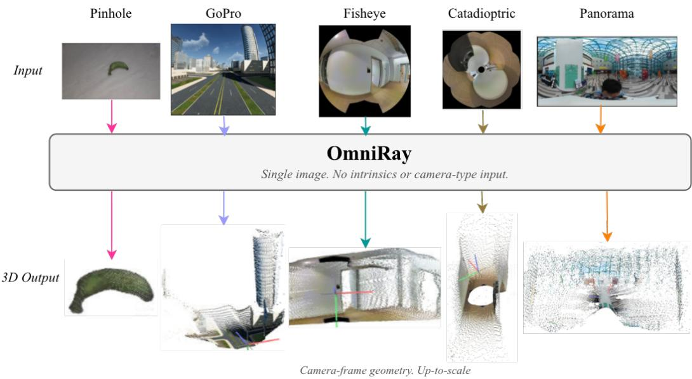  
Figure 1: OmniRay reconstructs 3D geometry from a single image across diverse camera geometries. A single model predicts an up-to-scale, camera-frame point cloud without camera intrinsics or camera-type input. Columns show inputs and reconstructions for pinhole, GoPro, fisheye, catadioptric, and panoramic cameras, respectively. Note that the GoPro and catadioptric camera configurations are withheld from training.

## ABSTRACT

Monocular models recover 3D geometry from a single image in one pass, but most assume a pinhole camera and produce distorted geometry on the wide-angle imagery produced by fisheye and panoramic lenses. Camera-aware models remove this assumption by predicting a per-pixel ray field. However, they represent different camera geometries using a singlefixed basis to capture both the overall camera projection and its finer variations. We argue that camera geometry can be viewed as having a hierarchy of complexity for representing rays. We present Omni-Ray, a feed-forward model whose Ray Module is composed of three components: a monotone radial base that captures radially symmetric structure, a sphericalharmonic residual for smooth deviations from it, and a free-form residual for remaining local variation. These components are composed as successive rotations on the sphere, allowing the representation to accommodate diverse camera geometries. Given a single image, OmniRay predicts a ray direction and an up-to-scale radial distance for every pixel, from which a 3D point cloud is recovered without needing camera information at inference time. Extensive experiments across different camera configurations demonstrate that OmniRay establishes a new stateof-the-art in camera-agnostic monocular 3D reconstruction.

## 1 INTRODUCTION

Monocular 3D reconstruction recovers a 3D point for each pixel in an image. We consider central cameras, in which all viewing rays pass through a single optical center, so each 3D point splits into a ray direction and a distance along that ray. The ray direction depends only on the camera geometry, while the distance depends on the scene under observation. Recent feed-forward models perform well on monocular 3D estimation (Yang et al., 2024; Wang et al., 2025b), but their architectures or training data focus on pinhole cameras. When applied to wide-angle images, these assumptions often lead to distorted reconstructed geometry. Wide-angle cameras are common in robotics (Yogamani et al., 2019), augmented and virtual reality (Engel et al., 2023), and 360◦ capture (Liao et al., 2022), making this a practical limitation. One way to handle these images is to calibrate the camera and rectify them to a pinhole view before reconstruction, but a pinhole cannot represent rays at or beyond 90◦ from its optical axis. As such, undistortion typically leads to cropping away part of the field of view or strongly stretching the image near its periphery, leading to low-confidence predictions from conventional depth estimation or 3D foundation models (Guo et al., 2026).

Camera-aware models instead account for camera geometry directly (Bogdan et al., 2018; Tirado-Gar´ın & Civera, 2025; Piccinelli et al., 2025). DeepFocal (Workman et al., 2015) and Deep-Calib (Bogdan et al., 2018) first use convolutional neural networks (CNNs) to estimate focal length and distortion of fixed camera models. Follow-up works generalize camera parameter estimation to arbitrary camera models by estimating ray fields directly. In particular, UniK3D (Piccinelli et al., 2025) predicts a per-pixel ray field using a spherical-harmonic (SH) basis and a radial distance along each ray. It can therefore reconstruct pinhole, fisheye, and panoramic images without camera metadata. In this formulation, the same basis must describe both the overall camera projection and its finer variations. We argue that there exists a hierarchy of complexity in camera geometry estimation, which can lead to more efficient and performant design. Many camera projections have a simple structure: for approximately radially symmetric lenses, a smooth radial function is sufficient to describe how viewing directions change across the image. Spherical harmonics can be used to complement radial functions.

We therefore propose OmniRay – that takes a single image and predicts a dense, up-to-scale 3D reconstruction without intrinsics or camera-type input (Fig. 1). A shared image encoder feeds two modules. The Ray Module predicts a monotone radial base and the two residuals, each of which refines the preceding ray field. The Distance Module predicts the radial distance of each pixel, and the corresponding 3D point is obtained by scaling its predicted ray. We train OmniRay on cameras ranging from pinhole to panorama and evaluate it on held-out scenes, datasets, and camera configurations. An oracle analysis examines which ray fields each representation can express, while benchmark experiments and ablations test the performance of the proposed components.

In summary, our contributions are:

1. A composite ray representation built from a monotone radial base, a spherical-harmonic residual, and a free-form residual.

2. OmniRay, a feed-forward model for single-image 3D reconstruction across central camera geometries, without needing intrinsics or camera-type input.

3. An oracle analysis of ray representations, and experiments across seen and held-out scenes, datasets, and camera configurations show that OmniRay improves over the evaluated baselines in ray field estimation and monocular 3D reconstruction.

## 2 RELATED WORK

Camera calibration. Camera calibration determines the mapping from image pixels to rays in the camera frame. Classical methods parameterize this mapping with a low-dimensional model whose parameters are estimated from geometric observations (Zhang, 2000; Scaramuzza et al., 2006). Different camera geometries are handled by different parametric models: pinhole model with radial and tangential distortion for conventional lenses, Kannala & Brandt (2006) model for wide-angle optics, and unified camera models (Geyer & Daniilidis, 2000; Mei & Rives, 2007; Khomutenko et al., 2015; Usenko et al., 2018) for omnidirectional cameras. Each of these models fixes a particular functional form, so a lens whose behavior departs from that form introduces residual error. Generic models relax these assumptions with more degrees of freedom and capture complex lens behavior (Schops et al., 2020) at the cost of a higher-dimensional calibration problem.

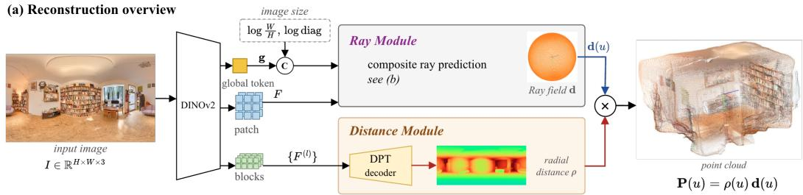

(b) Composite ray representation  
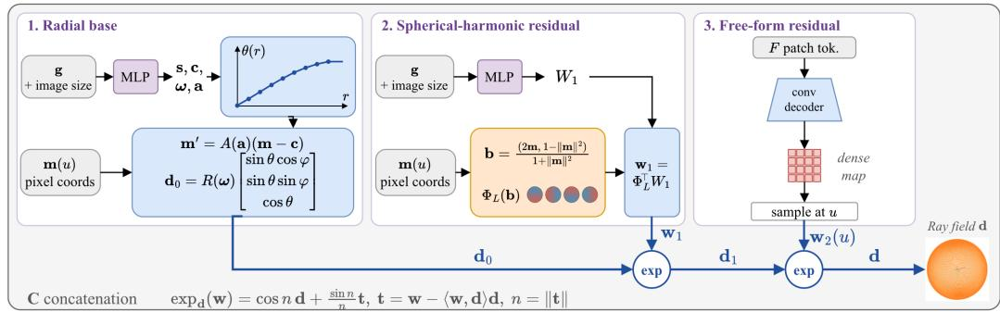  
Figure 2: OmniRay Overview. Given a single image, a DINOv2 ViT-L/14 encoder produces global and dense features that drive two branches. The Ray Module progressively builds a camera-agnostic ray field from a monotone radial base, a spherical-harmonic residual, and a free-form residual. The Distance Module predicts a positive radial distance for each pixel. Combining the final ray d and distance ρ yields the local pointmap P = ρ d, recovering 3D geometry up to scale without camera intrinsics or a camera-type label.

Learning-based methods offer an alternative to this high-dimensional calibration process by learning camera geometry directly from images without input calibration. DeepCalib (Bogdan et al., 2018) regresses camera parameters, while Perspective Fields (Jin et al., 2023), GeoCalib (Veicht et al., 2024), and AnyCalib (Tirado-Gar´ın & Civera, 2025) move toward dense geometric cues: a per-pixel up-vector and latitude field (Jin et al., 2023; Veicht et al., 2024), or per-pixel rays (Tirado-Gar´ın & Civera, 2025), each of which describes the camera more generally than a parameter vector. Neural Ray Surfaces (Vasiljevic et al., 2020) take it further by learning a free-form ray surface from video observations and directly representing the pixel-to-ray mapping. These calibration approaches shift from explicit parameter estimation toward learning the pixel-to-ray mapping, but leave open how this mapping should be represented to remain both compact and expressive simultaneously.

Monocular 3D. Recent foundation models have improved depth estimation through large-scale training and distillation (Yang et al., 2024), but do not explicitly model the camera geometry. Depth Anything 3 (Lin et al., 2025a) instead predicts depth with per-pixel rays by modeling camera geometry alongside scene structure. Camera-aware models specifically account for camera geometry in monocular depth estimation. UniK3D (Piccinelli et al., 2025) represents a per-pixel ray field with spherical-harmonics and predicts radial distance along each ray to handle diverse camera geometries without camera metadata. Depth Any Camera (Guo et al., 2025) and UniDAC (Ganesan et al., 2026) instead transform images into a common equirectangular representation to process different camera types before depth estimation, but require input camera intrinsics for the transformation. CAM3R (Guruprasad et al., 2026) and Wid3R (Jung et al., 2026) extend the spherical-harmonic ray representation to multi-view feed-forward 3D reconstruction. Together, these works highlight the value of explicitly accounting for the pixel-to-ray mapping for camera-agnostic 3D geometry, while leaving open whether a single ray representation is necessaryfor all camera geometries.

## 3 METHOD

Given a single image $I \in \mathbb { R } ^ { H \times W \times 3 }$ from an arbitrary central camera, with no intrinsics, distortion parameters or camera-type label, OmniRay predicts for every pixel $\boldsymbol { u } = \left( u _ { x } , u _ { y } \right)$ a unit ray $\mathbf { d } ( u ) \in$ $S ^ { 2 }$ and a radial distance $\rho ( u ) > 0$

A DINOv2 backbone (Oquab et al., 2023) encodes the image, and its features drive two branches (Fig. 2): the Ray Module composes d from radial, spherical-harmonic, and free-form components, while the Distance Module predicts $\rho .$ Their combination gives the 3D point in the camera frame:

$$
\mathbf { P } ( u ) = \rho ( u ) \mathbf { d } ( u ) .\tag{1}
$$

We predict radial distance $\rho$ rather than perpendicular depth $Z ,$ related by $\rho = Z / d _ { z }$ , since $d _ { z }  0$ as the ray approaches $9 0 ^ { \circ }$ from the optical axis and changes sign beyond it; $\rho$ therefore remains well-defined across wide fields of view.

Notation. The DINOv2 backbone produces a dense feature map $F$ and a pooled global token $\mathbf { g } .$ We use the normalized image coordinate m $( u ) = ( u - c _ { \mathrm { i m g } } ) / D$ , where $c _ { \mathrm { i m g } }$ is the image center and D is the image half-diagonal in pixels. This normalization places the image corners at $\mathbf { \hat { \mathbf { \| } } m \| } = 1$ for any resolution and aspect ratio. Image scale is provided separately to $\mathbf { g }$ through $\log ( \ddot { W } / \ddot { H } )$ and the logarithm of the image diagonal. Ground-truth quantities are marked with a star, $\mathbf { d } ^ { \star }$ and $\rho ^ { \star }$ , and $V$ denotes the set of pixels at which they are defined.

## 3.1 RAY MODULE

The module comprises three stages, $\mathbf { d } _ { 0 }  \mathbf { d } _ { 1 }  \mathbf { d } ,$ in which the radial base and the sphericalharmonic residual are predicted from the global token $\mathbf { g } ,$ and the free-form residual from the dense feature map $F .$

Radial base models the approximately radially symmetric structure of conventional central cameras with a monotone mapping from image radius to incidence angle.

Monotonicity restricts the base to injective radius-to-angle maps, so no two radii in the modeled range receive the same incidence angle, and the profile is evaluated directly rather than inverted numerically as a parametric projection model would require. A head maps g to $K + 8$ values $( { \mathrm { F i g . } }$ 2b): K increments s $\in \mathbb { R } ^ { K }$ between fixed knot radii $0 = r _ { 0 } < \cdots < r _ { K }$ , with a principal-point offset $\mathbf { c } ,$ an axis-angle rotation $\omega ,$ and three parameters forming an upper-triangular map $A ( \mathbf { a } )$ for anisotropic scaling and shear. These give the transformed coordinate $\mathbf { m } ^ { \prime } = A ( \mathbf { a } ) \bar { ( } \mathbf { m - c } )$ , with radius $r$ and azimuth $\varphi .$ The increments are passed through a softplus to ensure positivity, accumulated into knot heights, and linearly interpolated,

$$
\theta _ { k } = \sum _ { j \leq k } \mathrm { s o f t p l u s } ( s _ { j } ) , \quad \theta _ { 0 } = 0 , \qquad \theta ( r ) = \mathrm { l e r p } \big ( \mathrm { c l i p } ( r ; r _ { 0 } , r _ { K } ) ; \{ r _ { k } \} , \{ \theta _ { k } \} \big ) ,\tag{2}
$$

so that $\theta ( r )$ is strictly increasing within the knot span and constant outside it. We use $K = 1 6$ knots spanning $r \in [ 0 , 1 . 3 ]$ in half-diagonal units. The corresponding ray is

$$
\mathbf { d } _ { 0 } = R ( \omega ) \left[ \begin{array} { c } { \sin \theta ( r ) \cos \varphi } \\ { \sin \theta ( r ) \sin \varphi } \\ { \cos \theta ( r ) } \end{array} \right] ,\tag{3}
$$

where $R ( \omega )$ is the rotation matrix of $\omega .$ . The largest angle the base can produce is the sum of its increments, so nothing caps $\theta$ at $9 0 °$ and the base already represents lenses whose rays pass the equator.

Spherical-harmonic residual. The radial base restricts the incidence angle to a monotone function of image radius, which becomes insufficient when the image covers a large portion of the viewing sphere (Fig. 3b). A spherical-harmonic residual supplies an angular correction to it (Fig. 2b). A head maps $\mathbf { g }$ to a single coefficient matrix $\mathbf { W } _ { 1 } \in \mathbb { R } ^ { ( L + 1 ) ^ { 2 } \times 3 }$ for a real spherical-harmonic basis of maximum degree $L ,$ shared across all pixels. Thus, the correction field is represented by $3 ( L + 1 ) ^ { 2 }$ predicted coefficients rather than an independent vector at each pixel. Each pixel evaluates the basis at an address on $S ^ { 2 }$ obtained from its normalized image coordinate through the inverse-stereographic lift,

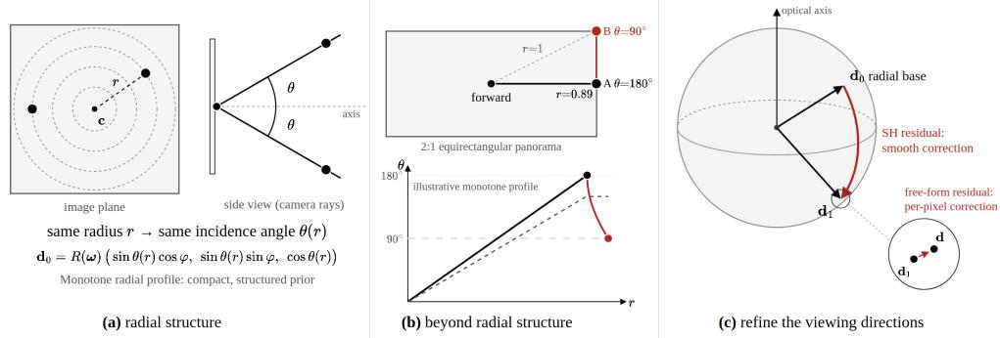  
Figure 3: Why combine the radial construction with the residual corrections? (a) The radial representation gives the same incidence angle to pixels that lie at the same radius in the base coordinates. (b) In the centered 2:1 equirectangular projection, point A is closer to the center of the image than point B, yet has a higher incidence angle. A monotone radial function cannot accommodate such ordering under fixed coordinate transformation and orientation. (c) The spherical-harmonic and free-form residuals improve upon the base direction via iterative correction on the unit sphere.

$$
\mathbf { b } ( \mathbf { m } ) = \frac { \big ( 2 \mathbf { m } , \ 1 - \| \mathbf { m } \| ^ { 2 } \big ) } { 1 + \| \mathbf { m } \| ^ { 2 } } , \qquad \mathbf { w } _ { 1 } ( u ) = \mathbf { W } _ { 1 } ^ { \top } \boldsymbol { \Phi } _ { L } \big ( \mathbf { b } ( \mathbf { m } ( u ) ) \big ) ,\tag{4}
$$

where $\Phi _ { L }$ stacks the $( L + 1 ) ^ { 2 }$ basis values. We use $L = 7 ,$ , giving 192 coefficients per image.

The correction is applied through the exponential map on $S ^ { 2 }$ . For any ray d, only the component of w orthogonal to d is a tangent direction, so the remaining component is discarded, leaving $\mathbf { t } =$ $\mathbf { w } - \langle \mathbf { w } , \mathbf { d } \rangle \mathbf { d }$ . Its norm $n = \bar { { \bf { \parallel } } } \mathbf { t } \|$ is the rotation angle in radians, and the ray is transported that far along the great circle through d in the direction of t,

$$
\exp _ { \mathbf { d } } ( \mathbf { w } ) = \cos n \mathbf { d } + { \frac { \sin n } { n } } \mathbf { t } .\tag{5}
$$

Free-form residual. The spherical-harmonic residual provides a compact global correction but remains limited by the finite-order basis. The free-form residual captures the remaining local varia tion using a lightweight convolutional decoder on the dense feature map $F .$ . The resulting correction map is interpolated at each pixel to obtain $\mathbf { w } _ { 2 } ( u )$ , so its spatial detail is limited by the resolution of $F .$ . The two residuals are applied in turn through equation 5, giving the composite ray field

$$
\begin{array} { r } { \mathbf { d } _ { 1 } = \exp _ { \mathbf { d } _ { 0 } } ( \mathbf { w } _ { 1 } ) , \qquad \mathbf { d } = \exp _ { \mathbf { d } _ { 1 } } ( \mathbf { w } _ { 2 } ) , } \end{array}\tag{6}
$$

with ${ \bf d } _ { 0 }$ given by equation 3, and with $\mathbf { t } _ { 1 }$ and $\mathbf { t } _ { 2 }$ the tangential parts of $\mathbf { w } _ { 1 }$ at ${ \bf d } _ { 0 }$ and of $\mathbf { w } _ { 2 }$ at ${ \bf d } _ { 1 }$ Both residual heads are zero-initialized, so the composition starts from the radial base, and the norms $\| \mathbf { t } _ { 1 } \|$ and $\| \mathbf { t } _ { 2 } \|$ are the rotation angles each residual applies, measuring how far a camera departs from the representation beneath it and letting the representation adapt without model selection or routing.

## 3.2 DISTANCE MODULE

The Ray Module determines the direction d along which each pixel observes the scene, but not how far along that ray the surface lies. The Distance Module predicts this remaining quantity: the up-to-scale radial distance $\rho ( u )$ from the optical center. It reuses the same encoder pass, fusing four intermediate blocks with a Dense Prediction Transformer (DPT) decoder (Ranftl et al., 2021) into a dense prediction sampled at each pixel, where a softplus gives a positive distance $\rho ( u ) =$ softplus $( f _ { \rho } ( u ) ) \ > \ 0$ . Scaling each predicted ray by its distance as in equation 1 produces the camera-frame point cloud $\{ \mathbf { P } ( \bar { u } ) \}$ in a single forward pass.

## 3.3 TRAINING OBJECTIVE

Angular ray loss supervises the final ray field and the two intermediate fields with the mean cosine residual $\begin{array} { r } { \ell ( \dot { \mathbf { x } } ) = \frac { 1 } { | V | } \sum _ { i \in V } \left( 1 - \big \langle \mathbf { x } _ { i } , \mathbf { d } _ { i } ^ { \star } \big \rangle \right) } \end{array}$ ,

$$
\mathcal { L } _ { \mathrm { r a y } } = \ell ( \mathbf { d } ) + \gamma _ { 0 } \ell ( \mathbf { d } _ { 0 } ) + \gamma _ { 1 } \ell ( \mathbf { d } _ { 1 } ) + \mathcal { L } _ { \mathrm { r e g i o n } }\tag{7}
$$

Table 1: Oracle representation fitting. Mean angular error in degrees after fitting each representation directly to ground-truth rays; lower is better. #Params denotes parameters per camera; the SH row adds three rotation parameters to the $3 ( L + 1 ) ^ { 2 } = 1 9 2$ coefficients for the base direction, which the residual inherits from the radial base. Best results among compact representations are bold. The free field is shown separately as a high-capacity reference.
<table><tr><td></td><td></td><td colspan="3">Angular error (°) ↓</td></tr><tr><td>Representation</td><td>#Params</td><td>Fisheye</td><td>Equirectangular</td><td>Catadioptric</td></tr><tr><td>Pinhole</td><td>6</td><td>5.731</td><td>48.080</td><td>50.434</td></tr><tr><td>Double sphere</td><td>8</td><td>0.021</td><td>22.932</td><td>41.876</td></tr><tr><td>Radial  $( K = 1 6 )$ </td><td>24</td><td>0.002</td><td>22.802</td><td>0.104</td></tr><tr><td>Radial  $( K = 3 2 )$ </td><td>40</td><td>0.002</td><td>22.801</td><td>0.023</td></tr><tr><td>SH  $( L = 7 )$ </td><td>195</td><td>0.276</td><td>0.641</td><td>0.295</td></tr><tr><td>Radial  $\mathbf { \sigma } _ { 1 6 } + \mathbf { S } \mathbf { H } _ { 7 }$  residual (ours)</td><td>216</td><td>0.075</td><td>0.217</td><td>0.174</td></tr><tr><td>Free field</td><td>76.8k</td><td>0.005</td><td>0.013</td><td>0.015</td></tr></table>

with stage weights $\gamma _ { 0 } , \gamma _ { 1 } > 0$ . This deep supervision of ${ \bf d } _ { 0 }$ and ${ \bf d } _ { 1 }$ keeps each stage responsible for the structure it represents, so a correct final ray cannot be reached through an arbitrary base.

$\mathcal { L } _ { \mathrm { r e g i o n } }$ weights the same per-pixel error more heavily where it is largest.

With e¯(S) denoting the mean error over a pixel set $S ,$ it is $\lambda _ { \mathrm { c } } \bar { e } ( C ) + \lambda _ { \mathrm { p } } \bar { e } ( Q ) + \lambda _ { \mathrm { t } } \bar { e } ( T )$ over an inner region $C ,$ , an outer region $Q ,$ , and tail $\dot { T }$ of the 5% of pixels with the largest error, with $\lambda _ { \mathrm { p } }$ the largest of the three since error concentrates at the periphery for wide fields of view. The regions are thresholds on the image radius $\| \mathbf { m } \|$ relative to its maximum, so the split follows the imaged region of a circular fisheye as well as a rectangular frame and does not move with the predicted principal point.

point cloud loss supervises rays and distances jointly. Each cloud is normalized by its own mean point norm, $\begin{array} { r } { z _ { \mathrm { p r e d } } = \frac { 1 } { | V | } \sum _ { i \in V } \lVert \rho _ { i } \mathbf { d } _ { i } \rVert } \end{array}$ for the prediction and $\begin{array} { r } { z _ { \mathrm { g t } } = \frac { 1 } { | V | } \sum _ { i \in V } \lVert \rho _ { i } ^ { \star } \dot { \mathbf { d } _ { i } ^ { \star } } \rVert } \end{array}$ for the ground truth, which removes the global scale that a single image leaves undetermined,

$$
\mathcal { L } _ { \mathrm { p c } } = \frac { 1 } { | V | } \sum _ { i \in V } \Big \| \frac { \rho _ { i } \mathbf { d } _ { i } } { z _ { \mathrm { p r e d } } } - \frac { \rho _ { i } ^ { \star } \mathbf { d } _ { i } ^ { \star } } { z _ { \mathrm { g t } } } \Big \| _ { 2 } .\tag{8}
$$

It is evaluated on $\mathbf { P } = \rho \mathbf { d }$ with the ray attached, so a ray error displaces the point even for an exact distance and the gradient reaches both modules.

Overall objective. $\mathcal { L } = \lambda _ { \mathrm { { r a y } } } \mathcal { L } _ { \mathrm { { r a y } } } + \lambda _ { \mathrm { { p c } } } \mathcal { L } _ { \mathrm { { p c } } }$ . Both modules and the shared encoder are trained end-to-end under this objective. Sec. A.1 gives the head architectures and the full training schedule.

## 4 EXPERIMENTS

## 4.1 ORACLE TEST: REPRESENTATION CEILINGS

Before training anything, we measure what each candidate representation can express at all, by fitting its parameters directly to analytic ground-truth rays; Sec. A.2 gives the fitting protocol. Table 1 shows that compact parametric models succeed only on the geometries their assumptions match, and that increasing the number of knots in the monotone radial profile reduces the catadioptric error but leaves the equirectangular error at $2 2 . 8 ^ { \circ }$ , the ceiling identified in Sec. 3.1. The sphericalharmonic field removes that ceiling but remains two orders of magnitude behind the radial profile on the fisheye. Among the compact representations, only the composition is below $0 . 2 5 ^ { \circ }$ on all three geometries, and since it reduces to the radial base when the residual vanishes, its capacity is bounded below by that of the base.

## 4.2 DATASETS AND CAMERA TYPES

We train on two panoramic datasets, 2D3DS (Armeni et al., 2017), of indoor offices and corridors, and 360Loc (Huang et al., 2024), of larger indoor and outdoor environments, rendering perspective, fisheye, and panoramic views from each panorama; the 2D3DS perspective images are the real captures provided with the dataset. We evaluate on held-out scenes of both, and on two unseen datasets, PanoCity (Guo et al., 2026), of outdoor street-level captures, and CO3Dv2 (Reizenstein et al., 2021), of object-centric images. Two camera configurations are withheld from training entirely, a GoPro fisheye and a Nayar catadioptric camera (Nayar, 1997; Baker & Nayar, 1999), both satisfying our central-camera assumption. Sec. A.2 gives the splits and the camera specifications.

Table 2: Main benchmark. Results on seen cameras, held-out cameras, and held-out domains. Ang. denotes mean ray error in degrees; CD denotes median relative Chamfer distance, normalized by each scene’s mean point norm. Metrics are macro-averaged over test images, and all methods use per-image median scale alignment. Lower is better; best results are bold. AUG denotes randomlens augmentation, and RG denotes ray guidance. † denotes exclusion from our training data; a dash indicates that the method does not predict scene geometry. Full per-camera and per-dataset results and additional metrics are provided in Sec. A.3.
<table><tr><td></td><td colspan="2">Seen cameras</td><td colspan="4">Held-out cameras</td><td colspan="4">Held-out domains</td></tr><tr><td></td><td colspan="2">Aggregate</td><td colspan="2">Catadioptric†</td><td colspan="2">GoPro†</td><td colspan="2">PanoCity†</td><td colspan="2">CO3Dv2†</td></tr><tr><td>Method</td><td>Ang. (°) ↓</td><td>CD↓</td><td>Ang. (°) ↓</td><td>CD↓</td><td>Ang. (°) ↓</td><td>CD↓</td><td>Ang. (°) ↓</td><td>CD↓</td><td>Ang. (°) ↓</td><td>CD↓</td></tr><tr><td>GeoCalib (Veicht et al., 2024)</td><td>30.997</td><td>一</td><td>119.662</td><td></td><td>14.126</td><td>=</td><td>47.132</td><td></td><td>3.713</td><td></td></tr><tr><td>AnyCalib (Tirado-Garín &amp; Civera, 2025)</td><td>28.655</td><td>=</td><td>107.129</td><td>=</td><td>10.031</td><td>一</td><td>42.335</td><td>=</td><td>2.711</td><td>一</td></tr><tr><td>DA3 (Lin et al., 2025a)</td><td>33.028</td><td>0.1999</td><td>121.566</td><td>1.0412</td><td>16.637</td><td>0.1097</td><td>50.533</td><td>0.3677</td><td>2.041</td><td>0.0288</td></tr><tr><td>UniK3D (Piccinelli et al., 2025)</td><td>6.336</td><td>0.0760</td><td>75.702</td><td>0.5948</td><td>6.342</td><td>0.0454</td><td>21.220</td><td>0.2120</td><td>2.676</td><td>0.0277</td></tr><tr><td>OmniRay w/o AUG</td><td>1.385</td><td>0.0592</td><td>30.867</td><td>0.3440</td><td>7.965</td><td>0.0641</td><td>6.352</td><td>0.0984</td><td>2.825</td><td>0.0330</td></tr><tr><td>OmniRay + RG</td><td>0.356</td><td>0.0205</td><td>1.118</td><td>0.0113</td><td>5.180</td><td>0.0375</td><td>1.592</td><td>0.0277</td><td>2.935</td><td>0.0411</td></tr><tr><td>OmniRay</td><td>0.140</td><td>0.0179</td><td>1.120</td><td>0.0131</td><td>5.533</td><td>0.0392</td><td>1.350</td><td>0.0240</td><td>2.967</td><td>0.0380</td></tr></table>

Random-lens Augmentation. During training we augment each panorama with randomly sampled synthetic central cameras, each defined by a viewing direction, a monotone radial profile drawn from positive spline increments, and an imaged sensor region. This single family covers filled and annular domains, from pinhole to wide-angle lenses. Draws whose profile falls close to a held-out geometry are rejected, so neither withheld camera nor its neighborhood appears in training. Sec. A.2 gives the sampling ranges and the rejection criteria, and Fig. 8 shows sampled examples.

## 4.3 BENCHMARK AND ABLATION

Baselines. UniK3D (Piccinelli et al., 2025) and Depth Anything 3 (DA3) (Lin et al., 2025a) jointly predict camera geometry and scene structure and are evaluated on all metrics; we fine-tune UniK3D on the 2D3DS and 360Loc panoramas so that it sees the same source imagery we train on. Geo-Calib (Veicht et al., 2024) and AnyCalib (Tirado-Gar´ın & Civera, 2025) calibrate the camera without predicting scene geometry. We convert their estimated cameras to dense ray fields for evaluation so all methods are scored identically.

Metrics. We evaluate the predicted ray fields, radial distance, and 3D point clouds using the following metrics: Ray accuracy is the mean angular error arccos⟨d, d⋆⟩ in degrees, and radial distance is evaluated with absolute relative error (AbsRel) and $\delta < 1 . 2 5$ . For point clouds, accuracy and completeness are the median nearest-neighbor distances normalized by the scene’s mean point norm, and their mean is the Chamfer distance (CD). Predictions in different depth gauges are aligned per image by $s = \mathrm { m e d i a n } ( \rho ^ { \star } ) / \quad$ median(ρ), and perpendicular depth is converted to radial distance by $\rho = Z / d _ { z }$ using the predicted rays. All metrics are computed over pixels with valid ground truth.

Results. Table 2 summarizes performance across camera configurations and domains. On the seen camera types, OmniRay achieves a mean ray error of 0.14◦ and relative Chamfer distance of 0.0179, compared with $6 . 3 4 ^ { \circ }$ and 0.0760 for UniK3D and $3 3 . 0 3 ^ { \circ }$ and 0.1999 for Depth Anything 3. On the held-out configurations, for the Nayar catadioptric camera, all baselines exceed $7 \bar { 5 } ^ { \circ }$ while ours achieves $1 . 1 2 ^ { \circ }$ and 0.0131 CD; on GoPro, ours achieves $5 . 5 3 ^ { \circ }$ versus $6 . 3 4 ^ { \circ }$ for UniK3D. On PanoCity, ours achieves 1.35◦ ray error versus 21.22◦ and 50.53◦ for UniK3D and DA3, respectively. On CO3Dv2, our $2 . 9 7 ^ { \circ }$ ray error remains within a degree of both baselines.

The w/o AUG row isolates the random-lens sampling of Sec. 4.2. Without it the seen cameras remain strong at 1.39◦, but the held-out catadioptric and GoPro errors rise to $3 0 . 8 7 ^ { \circ }$ and 7.97◦; restoring it recovers 1.12◦ and 5.53◦ and improves the seen cameras to 0.14◦. Fig. 5a shows the same effect

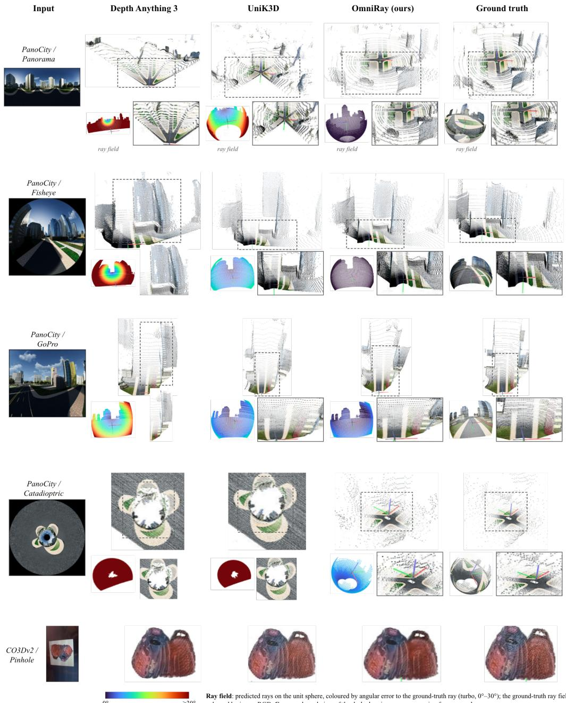  
Rav field: predicted ravs on the unit sphere, coloured by angular error to the ground-truth ray (turbo, 0°–30°): the ground-truth ray field is coloured by image RGB. Crops: enlarged view of the dashed region, same processing for every column

Figure 4: Qualitative reconstructions on unseen datasets. We compare OmniRay with Depth Anything 3 and UniK3D on PanoCity and CO3Dv2 across five camera configurations. Small visualizations show viewing-ray fields; larger renderings show the corresponding point clouds, with ground truth in the rightmost column. OmniRay better preserves scene structure in the panoramic and catadioptric examples without camera intrinsics or camera-type input.

on a catadioptric example, where the unaugmented model exhibits larger ray-field and geometric errors. These results indicate that random-lens sampling is important for extending the composite representation beyond the camera configurations encountered during training. Adding ray guidance to each DPT scale following Lin et al. (2025b) (+ RG) does not change the metrics consistently. The injection is zero-initialized, so the guided head could exploit the prompt if it were beneficial, and we therefore omit it from the final model.

Fig. 4 compares ray fields and camera-frame point clouds on unseen PanoCity and CO3Dv2 images, with each ray field colored by its angular error. On the panorama, OmniRay keeps the road contin-

Radial base +SH + Freeform (a) Catadioptric Image

Panorama Image

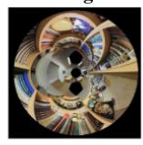

UniK3D  
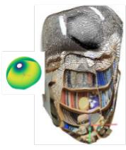  
OmniRay w/o AUG

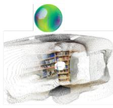  
OmniRay

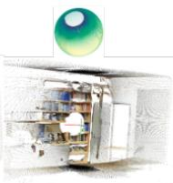  
GT Ray & Pointcloud

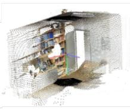

(b)  
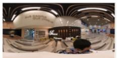

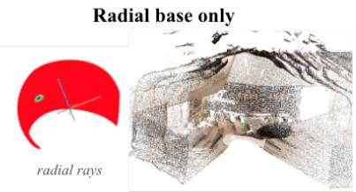

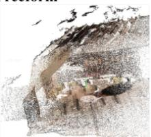  
Figure 5: Ablation. (a) Held-out catadioptric camera: predicted ray field and point cloud for UniK3D, OmniRay trained without random-lens augmentation, and the full model, against the ground truth. (b) Panoramic image: the radial base alone covers only part of the sphere (orange) and leaves the reconstruction torn, while the spherical-harmonic and free-form residuals complete the field (blue) and close the geometry.

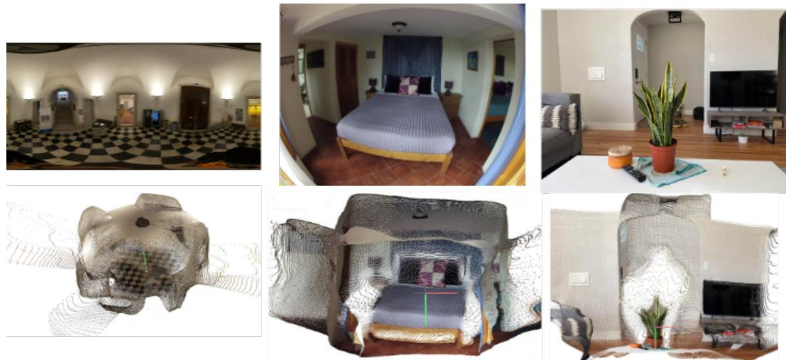  
Figure 6: In-the-wild reconstructions. Qualitative reconstructions on photographs collected from the internet, shown in order as a panorama, a fisheye image, and a pinhole image. Although these camera families are represented during training, the images come from different camera instances with unknown intrinsics and lens parameters. OmniRay requires no camera metadata at inference.

uous while UniK3D breaks it across the image and DA3 fails to recover the ground structure. On the fisheye and GoPro rows, OmniRay keeps the road, pavement, and lane markings straight where UniK3D bends them and DA3 also distorts the surrounding buildings. On the held-out catadioptric camera both baselines produce degraded reconstructions. On the CO3Dv2 pinhole example, Omni Ray remains comparable to the baselines, demonstrating that the additional flexibility for wide-angle cameras does not come at the expense of pinhole imagery. On in-the-wild images, OmniRay also recovers coherent 3D structure, as shown in Fig. 6.

Ablation. Table 3 isolates and analyzes different ray representations. The radial base performs well on fisheye and pinhole cameras (1.761◦ and 0.788◦) but gives 21.825◦ on panoramas, where a monotone radial profile assigns one incidence angle per image radius, an ordering that a panoramic projection does not follow (Fig. 3b). The spherical base reduces panoramic error to 5.088◦, while the free-form field performs best among single representations on panoramas, fisheye, and pinhole, but reaches 11.335◦ on the held-out catadioptric configuration. These results motivate combining a structured radial base with flexible residuals.

Table 3: Ray representation ablation. Mean angular ray error in degrees (↓) at native resolution. Seen camera families are evaluated on held-out configurations; † denotes configurations excluded from training. Only the Ray Module is trained and evaluated. Best results are bold.
<table><tr><td colspan="2"></td><td colspan="3">Seen cameras</td><td colspan="2">Held-out config†</td></tr><tr><td>Ray representation</td><td>Training</td><td>Panorama</td><td>Fisheye</td><td>Pinhole</td><td>Catadioptric</td><td>GoPro</td></tr><tr><td>Radial base</td><td></td><td>21.825</td><td>1.761</td><td>0.788</td><td>6.039</td><td>5.377</td></tr><tr><td>Spherical base</td><td></td><td>5.088</td><td>1.540</td><td>0.790</td><td>13.327</td><td>5.962</td></tr><tr><td>Free-form field</td><td></td><td>0.783</td><td>1.508</td><td>0.621</td><td>11.335</td><td>5.191</td></tr><tr><td>Radial + SH residual</td><td>Joint</td><td>0.796</td><td>1.784</td><td>0.581</td><td>1.879</td><td>6.566</td></tr><tr><td> $\mathrm { R a d i a l } + \mathrm { S H r e s i d u a l }$ </td><td>Staged</td><td>0.610</td><td>1.545</td><td>0.675</td><td>1.680</td><td>3.393</td></tr><tr><td> $\mathrm { R a d i a l + f r e e - f o r m }$ </td><td>Joint</td><td>1.018</td><td>1.394</td><td>0.403</td><td>3.038</td><td>3.667</td></tr><tr><td> $\mathrm { R a d i a l + f r e e - f o r m }$ </td><td>Staged</td><td>1.111</td><td>1.605</td><td>0.386</td><td>1.797</td><td>4.248</td></tr><tr><td> $\mathrm { S H } + \mathrm { f r e e } { \cdot } \mathrm { f o r m }$ </td><td>Joint</td><td>1.114</td><td>1.747</td><td>1.250</td><td>2.568</td><td>3.739</td></tr><tr><td>SH + free-form</td><td>Staged</td><td>1.026</td><td>2.567</td><td>0.553</td><td>2.316</td><td>5.142</td></tr><tr><td> $\mathrm { R a d i a l + S H + f r e e } .$  form</td><td>Joint</td><td>0.728</td><td>1.963</td><td>0.688</td><td>2.525</td><td>3.636</td></tr><tr><td>Radial + SH + free-form</td><td> $\mathrm { J o i n t } , \gamma _ { 0 } = \gamma _ { 1 } = 0$ </td><td>0.451</td><td>1.864</td><td>0.705</td><td>1.838</td><td>3.604</td></tr><tr><td> $\mathrm { R a d i a l + S H + f r e e \mathrm { - } f o r m }$ </td><td>Staged, VGGT init</td><td>0.486</td><td>1.630</td><td>0.330</td><td>2.576</td><td>5.096</td></tr><tr><td> $\mathbf { R a d i a l + S H + f r e e - f o r m }$ </td><td>Staged</td><td>0.399</td><td>1.322</td><td>0.418</td><td>1.538</td><td>3.462</td></tr></table>

Adding an SH residual to the radial base improves panoramic and held-out accuracy; staged training achieves $0 . 6 1 0 ^ { \circ }$ and 1.680◦, respectively, and the best GoPro result (3.393◦). Adding the free-form residual further improves the panorama (0.399◦), fisheye (1.322◦), and catadioptric results (1.538◦) in the full staged model, which also outperforms both jointly trained three-term variants across all five configurations.

On pinhole cameras, the full model remains competitive at 0.418◦. The additional spherical residual offers little benefit for this narrow-field geometry, while potentially providing greater flexibility across wide-field cameras. The VGGT-initialized variant (Wang et al., 2025a) illustrates a similar trade-off: it achieves the best pinhole error (0.330◦) but performs worse than the full model on the other four configurations. Since VGGT is pretrained for multi-view geometry on perspective imagery, its initialization may favor narrow-field projections over the broader range of camera geometries considered here. As the backbone is fine-tuned end-to-end in both settings, this comparison suggests an effect of initialization rather than a limitation in model capacity.

Overall, these results support the staged radial → SH → free-form composition as a balance between geometric structure and representational flexibility.

## 5 CONCLUSION

We began with two questions: how the pixel-to-ray mapping can remain both compact and expressive, and whether a single representation is necessary for every camera geometry. OmniRay explores both by composing the ray field. A monotone radial base captures the structure of conventional lenses, a spherical-harmonic residual models smooth deviations that a radial profile cannot express, and a free-form residual accounts for remaining local variation. Each component is applied as a rotation on $S ^ { 2 }$ , allowing the representation to adapt to different camera geometries without camera-type input or model selection. A shared distance module scales the predicted rays into a point cloud in a single forward pass, and sampling lenses continuously during training helps the composition generalize to held-out camera configurations.

Limitation. A qualitative zero-shot example reveals a limitation on panoramic views that differ from the training distribution. The training images are captured near ground level, with horizons approximately aligned across images. As shown in Fig. 7, on an in-the-wild aerial panorama with the horizon near the top of the frame, the predicted rays cover only a bounded, forward-facing region rather than the full viewing sphere. This example suggests that generalization depends not only on camera-projection diversity but also on the distribution of viewing altitudes represented during training.

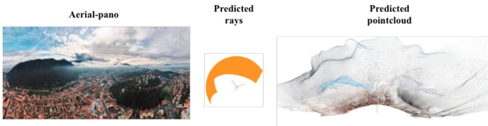  
Figure 7: Limitation: zero-shot in-the-wild reconstruction of an aerial panorama sourced from the internet. With the horizon near the top of the image, the predicted rays cover a bounded, forwardfacing region.

Future work. A natural next step is to extend OmniRay to multi-view reconstruction and broaden the training distribution to include views with more varied camera orientations and altitudes.

## ACKNOWLEDGMENTS

This research is based upon work supported by the Office of the Director of National Intelligence (ODNI), Intelligence Advanced Research Projects Activity (IARPA), via IARPA R&D Contract No. 140D0423C0076. The views and conclusions contained herein are those of the authors and should not be interpreted as necessarily representing the official policies or endorsements, either expressed or implied, of the ODNI, IARPA, or the U.S. Government. The U.S. Government is authorized to reproduce and distribute reprints for Governmental purposes notwithstanding any copyright annotation thereon.

## AI USE STATEMENT

In this work, we used generative AI tools to help with the implementation code and to polish grammar in the paper to improve readability. We have reviewed all AI-assisted work. We reviewed LLM-generated text to ensure it was consistent with our findings. We take responsibility for the final content of this work, including text, claims, or artifacts produced with the aid of generative AI.

## REFERENCES

Iro Armeni, Sasha Sax, Amir R Zamir, and Silvio Savarese. Joint 2d-3d-semantic data for indoor scene understanding. arXiv preprint arXiv:1702.01105, 2017.

Simon Baker and Shree K Nayar. A theory of single-viewpoint catadioptric image formation. International journal ofcomputer vision, 35(2):175–196, 1999.

Oleksandr Bogdan, Viktor Eckstein, Francois Rameau, and Jean-Charles Bazin. Deepcalib: A deep learning approach for automatic intrinsic calibration of wide field-of-view cameras. In Proceedings of the 15th ACM SIGGRAPH European conference on visual media production, pp. 1–10, 2018.

Jakob Engel, Kiran Somasundaram, Michael Goesele, Albert Sun, Alexander Gamino, Andrew Turner, Arjang Talattof, Arnie Yuan, Bilal Souti, Brighid Meredith, et al. Project aria: A new tool for egocentric multi-modal ai research. arXiv preprint arXiv:2308.13561, 2023.

Girish Chandar Ganesan, Yuliang Guo, Liu Ren, and Xiaoming Liu. Unidac: universal metric depth estimation for any camera. In Proceedings ofthe IEEE/CVF Conference on Computer Vision and Pattern Recognition, pp. 26953–26963, 2026.

Christopher Geyer and Kostas Daniilidis. A unifying theory for central panoramic systems and practical implications. In European conference on computer vision, pp. 445–461. Springer, 2000.

Yijing Guo, Mengjun Chao, Luo Wang, Tianyang Zhao, Haizhao Dai, Yingliang Zhang, Jingyi Yu, and Yujiao Shi. Panovggt: Feed-forward 3d reconstruction from panoramic imagery. arXiv preprint arXiv:2603.17571, 2026.

Yuliang Guo, Sparsh Garg, S Mahdi H Miangoleh, Xinyu Huang, and Liu Ren. Depth any camera: Zero-shot metric depth estimation from any camera. In 2025 IEEE/CVF Conference on Computer Vision and Pattern Recognition (CVPR), pp. 26996–27006. IEEE, 2025.

Namitha Guruprasad, Abhay Yadav, Rama Chellappa, and Cheng Peng. Cam3r: Camera-agnostic model for 3d reconstruction. In European Conference on Computer Vision, pp. 247–264. Springer, 2026.

Huajian Huang, Changkun Liu, Yipeng Zhu, Hui Cheng, Tristan Braud, and Sai-Kit Yeung. 360loc: A dataset and benchmark for omnidirectional visual localization with cross-device queries. In Proceedings ofthe IEEE/CVF conference on computer vision andpattern recognition, pp. 22314– 22324, 2024.

Linyi Jin, Jianming Zhang, Yannick Hold-Geoffroy, Oliver Wang, Kevin Blackburn-Matzen, Matthew Sticha, and David F Fouhey. Perspective fields for single image camera calibration. In 2023 IEEE/CVF Conference on Computer Vision and Pattern Recognition (CVPR), pp. 17307– 17316. IEEE, 2023.

Dongki Jung, Jaehoon Choi, Adil Qureshi, Somi Jeong, Dinesh Manocha, and Suyong Yeon. Wid3r: Wide field-of-view 3d reconstruction via camera model conditioning. In European Conference on Computer Vision, pp. 665–684. Springer, 2026.

Juho Kannala and Sami S Brandt. A generic camera model and calibration method for conventional, wide-angle, and fish-eye lenses. IEEE transactions on pattern analysis and machine intelligence, 28(8):1335–1340, 2006.

Bogdan Khomutenko, Gaetan Garcia, and Philippe Martinet. An enhanced unified camera model.¨ IEEE Robotics and Automation Letters, 1(1):137–144, 2015.

Yiyi Liao, Jun Xie, and Andreas Geiger. Kitti-360: A novel dataset and benchmarks for urban scene understanding in 2d and 3d. IEEE Transactions on Pattern Analysis and Machine Intelligence, 45 (3):3292–3310, 2022.

Haotong Lin, Sili Chen, Junhao Liew, Donny Y Chen, Zhenyu Li, Guang Shi, Jiashi Feng, and Bingyi Kang. Depth anything 3: Recovering the visual space from any views. arXiv preprint arXiv:2511.10647, 2025a.

Haotong Lin, Sida Peng, Jingxiao Chen, Songyou Peng, Jiaming Sun, Minghuan Liu, Hujun Bao, Jiashi Feng, Xiaowei Zhou, and Bingyi Kang. Prompting depth anything for 4k resolution accurate metric depth estimation. In 2025 IEEE/CVF Conference on Computer Vision and Pattern Recognition (CVPR), pp. 17070–17080. IEEE, 2025b.

Christopher Mei and Patrick Rives. Single view point omnidirectional camera calibration from planar grids. In Proceedings 2007 IEEE International Conference on Robotics and Automation, pp. 3945–3950. IEEE, 2007.

Shree K Nayar. Catadioptric omnidirectional camera. In Proceedings of IEEE computer society conference on computer vision and pattern recognition, pp. 482–488. IEEE, 1997.

Maxime Oquab, Timothee Darcet, Th´ eo Moutakanni, Huy Vo, Marc Szafraniec, Vasil Khalidov,´ Pierre Fernandez, Daniel Haziza, Francisco Massa, Alaaeldin El-Nouby, et al. Dinov2: Learning robust visual features without supervision. arXiv preprint arXiv:2304.07193, 2023.

Luigi Piccinelli, Christos Sakaridis, Mattia Segu, Yung-Hsu Yang, Siyuan Li, Wim Abbeloos, and Luc Van Gool. Unik3d: Universal camera monocular 3d estimation. In 2025 IEEE/CVF Conference on Computer Vision and Pattern Recognition (CVPR), pp. 1028–1039. IEEE, 2025.

Rene Ranftl, Alexey Bochkovskiy, and Vladlen Koltun. Vision transformers for dense prediction. In´ 2021 IEEE/CVF International Conference on Computer Vision (ICCV), pp. 12159–12168. IEEE, 2021.

Jeremy Reizenstein, Roman Shapovalov, Philipp Henzler, Luca Sbordone, Patrick Labatut, and David Novotny. Common objects in 3d: Large-scale learning and evaluation of real-life 3d category reconstruction. In Proceedings of the IEEE/CVF international conference on computer vision, pp. 10901–10911, 2021.

Davide Scaramuzza, Agostino Martinelli, and Roland Siegwart. A toolbox for easily calibrating omnidirectional cameras. In 2006 IEEE/RSJ International Conference on Intelligent Robots and Systems, pp. 5695–5701. IEEE, 2006.

Thomas Schops, Viktor Larsson, Marc Pollefeys, and Torsten Sattler. Why having 10,000 parameters in your camera model is better than twelve. In Proceedings of the IEEE/CVF Conference on Computer Vision and Pattern Recognition, pp. 2535–2544, 2020.

Javier Tirado-Gar´ın and Javier Civera. Anycalib: On-manifold learning for model-agnostic singleview camera calibration. In 2025 IEEE/CVF International Conference on Computer Vision (ICCV), pp. 8044–8055. IEEE, 2025.

Vladyslav Usenko, Nikolaus Demmel, and Daniel Cremers. The double sphere camera model. In 2018 International Conference on 3D Vision (3DV), pp. 552–560. IEEE, 2018.

Igor Vasiljevic, Vitor Guizilini, Rares Ambrus, Sudeep Pillai, Wolfram Burgard, Greg Shakhnarovich, and Adrien Gaidon. Neural ray surfaces for self-supervised learning of depth and ego-motion. In 2020 International Conference on 3D Vision (3DV), pp. 1–11. IEEE, 2020.

Alexander Veicht, Paul-Edouard Sarlin, Philipp Lindenberger, and Marc Pollefeys. Geocalib: Learning single-image calibration with geometric optimization. In European Conference on Computer Vision, pp. 1–20. Springer, 2024.

Jianyuan Wang, Minghao Chen, Nikita Karaev, Andrea Vedaldi, Christian Rupprecht, and David Novotny. Vggt: Visual geometry grounded transformer. In 2025 IEEE/CVF Conference on Computer Vision and Pattern Recognition (CVPR), pp. 5294–5306. IEEE, 2025a.

Ruicheng Wang, Sicheng Xu, Cassie Dai, Jianfeng Xiang, Yu Deng, Xin Tong, and Jiaolong Yang. Moge: Unlocking accurate monocular geometry estimation for open-domain images with optimal training supervision. In 2025 IEEE/CVF Conference on Computer Vision and Pattern Recognition (CVPR), pp. 5261–5271. IEEE, 2025b.

Scott Workman, Connor Greenwell, Menghua Zhai, Ryan Baltenberger, and Nathan Jacobs. Deepfocal: A method for direct focal length estimation. In 2015 IEEE International Conference on Image Processing (ICIP), pp. 1369–1373. IEEE, 2015.

Lihe Yang, Bingyi Kang, Zilong Huang, Xiaogang Xu, Jiashi Feng, and Hengshuang Zhao. Depth anything: Unleashing the power of large-scale unlabeled data. In 2024 IEEE/CVF Conference on Computer Vision and Pattern Recognition (CVPR), pp. 10371–10381. IEEE, 2024.

Senthil Yogamani, Ciaran Hughes, Jonathan Horgan, Ganesh Sistu, Padraig Varley, Derek O’Dea,´ Michal Uricar, Stefan Milz, Martin Simon, Karl Amende, et al. Woodscape: A multi-task, multi-´ camera fisheye dataset for autonomous driving. In Proceedings of the IEEE/CVF international conference on computer vision, pp. 9308–9318, 2019.

Zhengyou Zhang. A flexible new technique for camera calibration. IEEE Transactions on pattern analysis and machine intelligence, 22(11):1330–1334, 2000.

## A APPENDIX

## A.1 IMPLEMENTATION AND TRAINING

Architecture. The encoder is DINOv2 ViT-L/14 (Oquab et al., 2023) with 1024-dimensional features. The radial head is a two-layer multilayer perceptron (MLP) with width 256 operating on the global token augmented with (log aspect, log diagonal), while the spherical head is a one-layer MLP of the same width on the same input. The radial head predicts $\bar { K + 8 }$ values with $K = 1 6$ knots spanning $r \in [ 0 , 1 . 3 ]$ in half-diagonal units; the spherical head predicts $( L + 1 ) ^ { 2 } \times 3$ coefficients with $L = 7$ . These coefficients are shared across all pixels of an image. The free head is a convolutional decoder over the dense feature map. The Distance Module uses a width-256 DPT decoder (Ranftl et al., 2021) over encoder blocks {4, 11, 17, 23} to predict the radial distance. Both residual heads are zero-initialized, while the radial head is initialized to a canonical camera, so training starts from a single radial lens.

Training. Images range from $8 9 6 \times 1 7 9 2$ equirectangular panoramas to $5 1 2 ^ { 2 }$ lens crops. We train with a token cap of 8192 using a sampler for camera-type balancing. Within each image, we supervise 4096 pixels drawn round-robin over the occupied cells of a 32×32 grid, ensuring coverage across the image. Training proceeds in two phases. We first train the Ray Module alone, activating its three components in order, and then attach the Distance Module at the final stage and train the full model end-to-end. In this second phase we use AdamW with weight decay 0.01 and cosine decay after a warm-up, with learning rates of $5 \times 1 0 ^ { - 6 }$ for the encoder and ray heads and $5 \times 1 0 ^ { - 5 }$ for the distance decoder. The encoder runs in $\mathtt { b f l o a t 1 6 }$ , while the heads and losses remain in full precision. Training uses 8 NVIDIA A40 GPUs with distributed data parallelism.

## A.2 EXPERIMENTAL DETAILS

Oracle fitting protocol. Each representation is fitted to the analytic ground-truth rays of a single camera by minimizing the mean cosine residual in Sec. 3.3, with a multi-start sweep over the axis sign, roll and, where the representation uses one, the focal length. Every row is an independent fit under a fixed optimization budget, so each entry upper-bounds that representation’s ceiling. The fitted error is the representation’s approximation capacity for that camera and lower-bounds the error of any predictor built on it.

Splits and Camera sampling. For 2D3DS we train on areas 1-4 and evaluate on areas $5 \ – 6 ;$ for 360Loc we train on the Atrium and Piatrium scenes and evaluate on Concourse and Hall. Each synthetic camera samples a viewing orientation, an aspect ratio, a principal-point offset, an optional central blind spot, a rectangular or circular sensor boundary, and inner and outer incidence angles; panoramic cameras instead sample a vertical field of view, an azimuth and a small latitude stretch, with the horizon kept gravity-aligned as in the source captures. Draws near a held-out geometry are rejected: for the GoPro, any profile within $\delta = 1 5 ^ { \circ }$ of its incidence-angle curve at every radius; for the catadioptric camera, any sample with an inner angle in $[ 2 5 ^ { \circ } , 5 5 ^ { \circ } ]$ and a rim angle in $[ \mathrm { 1 4 0 ^ { \circ } , 1 7 0 ^ { \circ } } ]$ Note: The Nayar catadioptric camera (Nayar, 1997; Baker & Nayar, 1999) is a paraboloid mirror with orthographic projection, imaging $\mathrm { 1 ~ 4 0 ^ { \circ } - 1 5 5 ^ { \circ } }$ annulus about its axis; the mirror and camera share a single viewpoint. For PanoCity and CO3Dv2 we use the calibration provided with each dataset to obtain ground-truth rays. Ground-truth rays and distances follow analytically from each sampled camera. Fig. 8 shows images rendered under cameras drawn from this distribution.

## A.3 ADDITIONAL RESULTS

Tables 4, 5 and 6 report every metric of Sec. 4.3 broken out per camera type, per dataset, and over the aggregate seen and held-out splits. Figures 9 and 10 show reconstructions on the 2D3DS and 360Loc test scenes, which share the camera families used in training but none of their scenes, complementing the unseen-dataset comparison of Fig. 4. Figure 11 provides additional visualizations of OmniRay on in-the-wild examples.

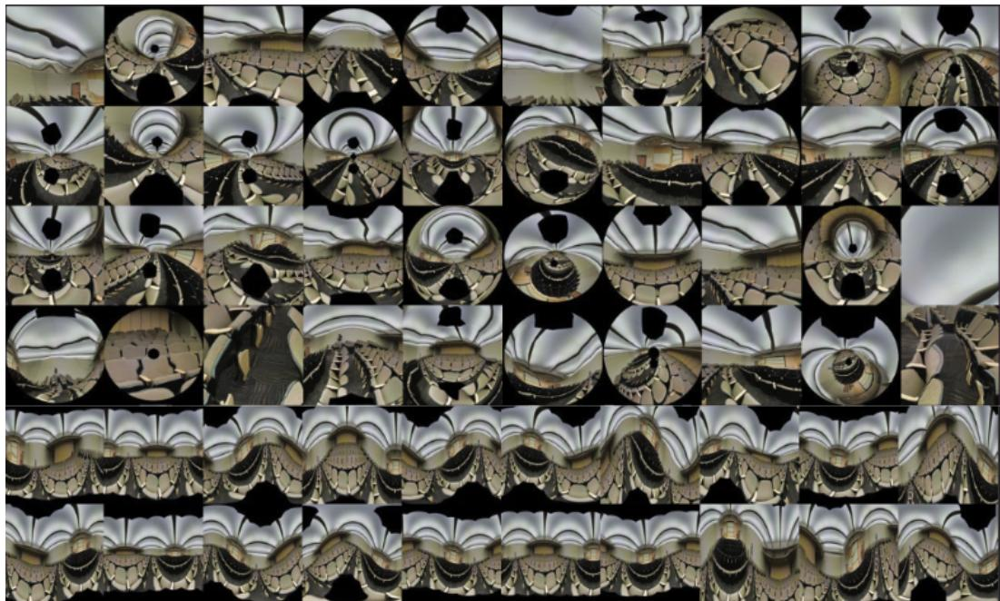  
Figure 8: Random-lens augmentation. Images rendered from a single panorama under cameras drawn from the sampling distribution of Sec. 4.2. A camera is a viewing direction, a monotone radial profile and an imaged sensor region, so one family spans narrow perspective crops, wideangle and fisheye views, off-center and anisotropic sensors, and annular domains. The projection varies continuously from sample to sample, so no fixed map from image position to ray direction fits more than one of them. Draws falling close to either held-out geometry are rejected and never enter training.

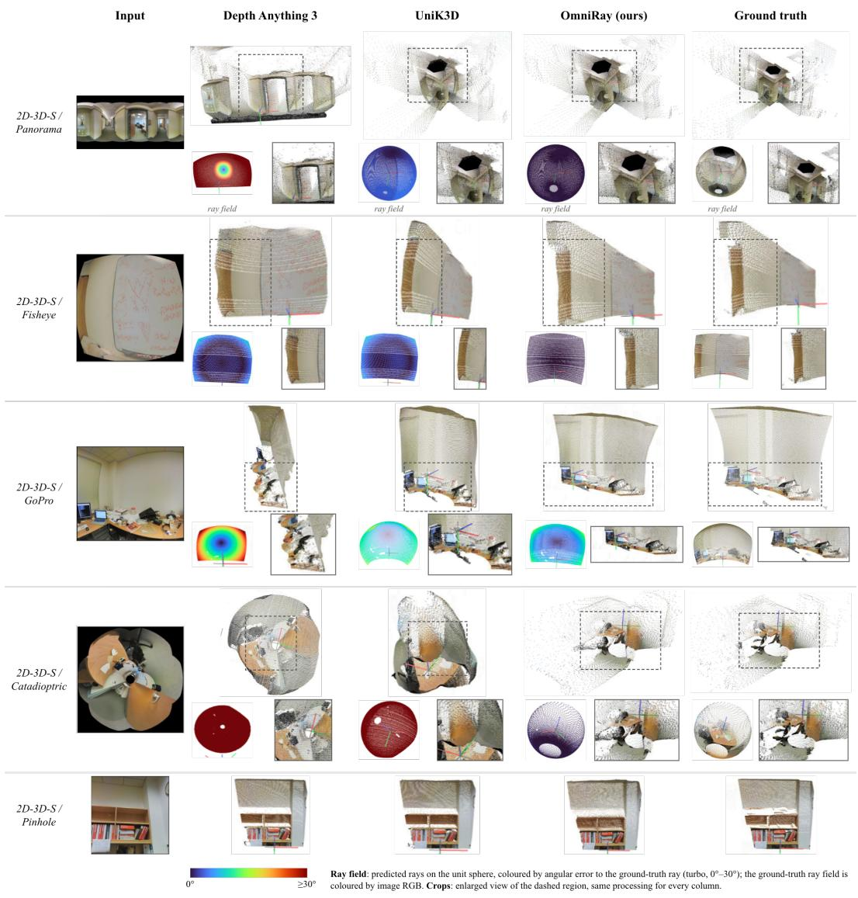  
Figure 9: Qualitative reconstructions on seen dataset: 2D3DS

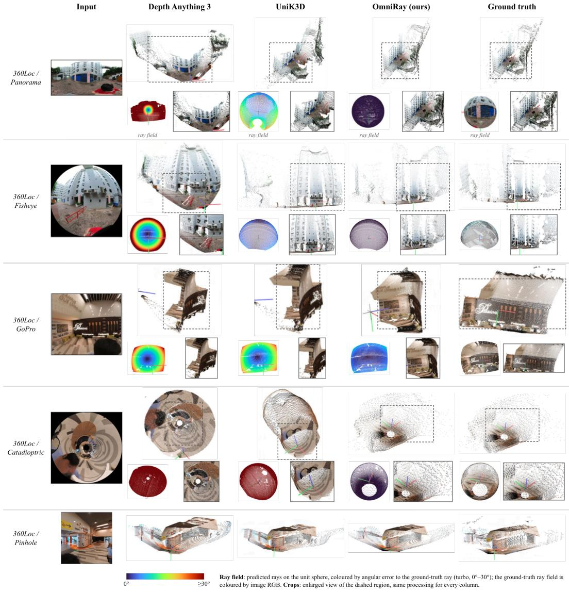

Figure 10: Qualitative reconstructions on seen dataset: 360Loc  
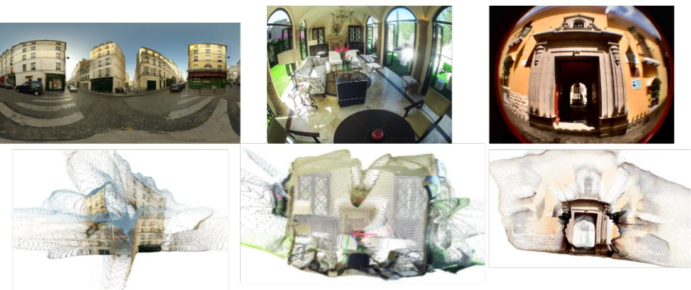  
Figure 11: Additional in-the-wild reconstructions.

Table 4: Per-camera results, all metrics. Macro-averaged over test images. † geometry withheld from training. Baselines are median-scale-aligned per image. Acc, Comp and CD are medians of the relative distance, divided by each scene’s mean point norm. $\delta _ { 1 }$ is $\delta < 1 . 2 5$ . F@10cm is the point-cloud F-score at a 10 cm distance threshold, the harmonic mean of precision and recall over nearest-neighbor distances. A dash means the method predicts no scene geometry.
<table><tr><td rowspan="2">Camera</td><td rowspan="2">Method</td><td>Ray  $\mathbf { a n g } ^ { \circ } \downarrow$ </td><td rowspan="2">Radial Dist. AbsRel↓</td><td rowspan="2">δ1↑</td><td colspan="4">point cloud Quality</td></tr><tr><td></td><td>CD↓</td><td>Acc↓</td><td>Comp↓ F@10cm↑</td><td></td></tr><tr><td>pinhole</td><td>GeoCalib</td><td>2.196</td><td></td><td></td><td></td><td>一</td><td></td><td></td></tr><tr><td></td><td>AnyCalib</td><td>1.043</td><td></td><td></td><td></td><td></td><td></td><td></td></tr><tr><td></td><td>DA3</td><td>6.604</td><td>0.1508</td><td>0.862</td><td>0.0701</td><td>0.0862</td><td>0.0540</td><td>0.300</td></tr><tr><td></td><td>UniK3D</td><td>3.619</td><td>0.1371</td><td>0.871</td><td>0.1058</td><td>0.1802</td><td>0.0315</td><td>0.356</td></tr><tr><td></td><td>ours</td><td>0.155</td><td>0.0769</td><td>0.925</td><td>0.0242</td><td>0.0355</td><td>0.0130</td><td>0.533</td></tr><tr><td>fisheye</td><td>GeoCalib</td><td>30.001</td><td></td><td></td><td></td><td>一</td><td></td><td></td></tr><tr><td></td><td>AnyCalib</td><td>22.134</td><td></td><td></td><td></td><td></td><td></td><td></td></tr><tr><td></td><td>DA3</td><td>28.727</td><td>0.3225</td><td>0.562</td><td>0.1888</td><td>0.1111</td><td>0.2665</td><td>0.066</td></tr><tr><td></td><td>UniK3D</td><td>7.055</td><td>0.2155</td><td>0.768</td><td>0.0543</td><td>0.0569</td><td>0.0517</td><td>0.198</td></tr><tr><td></td><td>ours</td><td>0.154</td><td>0.0906</td><td>0.924</td><td>0.0159</td><td>0.0197</td><td>0.0121</td><td>0.531</td></tr><tr><td>panoramic</td><td>GeoCalib</td><td>60.795</td><td></td><td></td><td></td><td></td><td></td><td></td></tr><tr><td></td><td>AnyCalib</td><td>62.788</td><td></td><td></td><td></td><td>一 一</td><td></td><td></td></tr><tr><td></td><td>DA3</td><td>63.752</td><td>0.3352</td><td>0.547</td><td>0.3408</td><td>0.1956</td><td>0.4859</td><td>0.009</td></tr><tr><td></td><td>UniK3D</td><td>8.336</td><td>0.2154</td><td>0.774</td><td>0.0678</td><td>0.0723</td><td>0.0633</td><td>0.174</td></tr><tr><td></td><td>ours</td><td>0.110</td><td>0.0593</td><td>0.949</td><td>0.0137</td><td>0.0163</td><td>0.0111</td><td>0.585</td></tr><tr><td>catadioptric†</td><td>GeoCalib</td><td>119.662</td><td></td><td></td><td></td><td>一</td><td></td><td></td></tr><tr><td></td><td>AnyCalib</td><td>107.129</td><td></td><td></td><td></td><td></td><td></td><td></td></tr><tr><td></td><td>DA3</td><td>121.566</td><td>0.1617</td><td>0.771</td><td>1.0412</td><td>0.7232</td><td>1.3592</td><td>0.000</td></tr><tr><td></td><td>UniK3D</td><td>75.702</td><td>0.2523</td><td>0.656</td><td>0.5948</td><td>0.5047</td><td>0.6849</td><td>0.004</td></tr><tr><td></td><td>ours</td><td>1.120</td><td>0.0396</td><td>0.969</td><td>0.0131</td><td>0.0130</td><td>0.0131</td><td>0.633</td></tr><tr><td>GoPro†</td><td>GeoCalib</td><td>14.126</td><td></td><td></td><td></td><td></td><td></td><td></td></tr><tr><td></td><td>AnyCalib</td><td>10.031</td><td></td><td></td><td></td><td></td><td></td><td></td></tr><tr><td></td><td>DA3</td><td>16.637</td><td>0.1657</td><td>0.840</td><td>0.1097</td><td>0.0811</td><td>0.1383</td><td>0.079</td></tr><tr><td></td><td>UniK3D</td><td>6.342</td><td>0.1665</td><td>0.857</td><td>0.0454</td><td>0.0449</td><td>0.0458</td><td>0.235</td></tr><tr><td></td><td>ours</td><td>5.533</td><td>0.0842</td><td>0.932</td><td>0.0392</td><td>0.0354</td><td>0.0429</td><td>0.215</td></tr></table>

Table 5: Per-dataset results, all metrics. Macro-averaged over test images. † unseen in training. Conventions as in Table 4. CO3Dv2 contains perspective and fisheye imagery only, so its zero-shot axis is the domain rather than the camera, and its object-masked COLMAP ground truth covers roughly 12% of pixels.
<table><tr><td rowspan="2">Scenes</td><td rowspan="2">Method</td><td rowspan="2">Ray ang° ↓</td><td colspan="2">Radial Dist.</td><td colspan="4">point cloud Quality</td></tr><tr><td>AbsRel↓</td><td>δ1↑</td><td>CD↓</td><td>Acc↓</td><td></td><td>Comp↓ F@10cm↑</td></tr><tr><td>2D3DS</td><td>GeoCalib</td><td>40.713</td><td></td><td></td><td></td><td></td><td></td><td></td></tr><tr><td></td><td>AnyCalib</td><td>37.520</td><td></td><td></td><td></td><td></td><td></td><td></td></tr><tr><td></td><td>DA3</td><td>43.775</td><td>0.2124</td><td>0.747</td><td>0.3614</td><td>0.1744</td><td>0.5483</td><td>0.224</td></tr><tr><td></td><td>UniK3D</td><td>19.432</td><td>0.1272</td><td>0.864</td><td>0.1487</td><td>0.0981</td><td>0.1994</td><td>0.411</td></tr><tr><td></td><td>ours</td><td>1.619</td><td>0.0568</td><td>0.958</td><td>0.0236</td><td>0.0226</td><td>0.0246</td><td>0.767</td></tr><tr><td>360Loc</td><td>GeoCalib</td><td>48.223</td><td></td><td></td><td>一</td><td></td><td>一</td><td>一</td></tr><tr><td></td><td>AnyCalib</td><td>42.021</td><td></td><td></td><td>一</td><td></td><td></td><td></td></tr><tr><td></td><td>DA3</td><td>48.064</td><td>0.2872</td><td>0.629</td><td>0.3212</td><td>0.2121</td><td>0.4303</td><td>0.048</td></tr><tr><td></td><td>UniK3D</td><td>19.979</td><td>0.2709</td><td>0.676</td><td>0.1601</td><td>0.1455</td><td>0.1747</td><td>0.154</td></tr><tr><td></td><td>ours</td><td>1.274</td><td>0.0713</td><td>0.947</td><td>0.0160</td><td>0.0160</td><td>0.0160</td><td>0.590</td></tr><tr><td>PanoCity†</td><td>GeoCalib</td><td>47.132</td><td></td><td></td><td></td><td></td><td></td><td></td></tr><tr><td></td><td>AnyCalib</td><td>42.335</td><td></td><td></td><td>一 一</td><td></td><td>一</td><td>一 一</td></tr><tr><td></td><td>DA3</td><td>50.533</td><td>0.1819</td><td>0.774</td><td>0.3677</td><td>0.3318</td><td>0.4037</td><td>0.001</td></tr><tr><td></td><td>UniK3D</td><td>21.220</td><td>0.1940</td><td>0.815</td><td>0.2120</td><td>0.2719</td><td>0.1522</td><td>0.015</td></tr><tr><td></td><td>ours</td><td>1.350</td><td>0.0823</td><td>0.914</td><td>0.0240</td><td>0.0333</td><td>0.0147</td><td>0.141</td></tr><tr><td>CO3Dv2†</td><td></td><td></td><td></td><td></td><td></td><td></td><td></td><td></td></tr><tr><td></td><td>GeoCalib</td><td>3.713</td><td></td><td>一</td><td>一</td><td></td><td>一</td><td>一</td></tr><tr><td></td><td>AnyCalib</td><td>2.711</td><td></td><td></td><td>一</td><td></td><td>一</td><td>一</td></tr><tr><td></td><td>DA3</td><td>2.041</td><td>0.0573</td><td>0.950</td><td>0.0288</td><td>0.0199</td><td>0.0377</td><td>0.282</td></tr><tr><td></td><td>UniK3D</td><td>2.676</td><td>0.0478</td><td>0.963</td><td>0.0277</td><td>0.0233</td><td>0.0322</td><td>0.293</td></tr><tr><td></td><td></td><td></td><td></td><td></td><td></td><td></td><td></td><td></td></tr><tr><td></td><td>ours</td><td>2.967</td><td>0.0889</td><td>0.914</td><td>0.0380</td><td>0.0291</td><td>0.0469</td><td>0.173</td></tr></table>

Table 6: Aggregate results over the 4500-sample benchmark. Conventions as in Table 4. Seen cameras are perspective, fisheye and panoramic; the held-out geometries are the catadioptric mirror and the GoPro fisheye.
<table><tr><td rowspan="2">Split</td><td rowspan="2">Method</td><td rowspan="2">Ray ang°↓</td><td colspan="2">Radial Dist.</td><td colspan="4">point cloud Quality</td></tr><tr><td>AbsRel↓</td><td>δ1↑</td><td>CD↓</td><td>Acc↓</td><td></td><td>Comp↓ F@10cm↑</td></tr><tr><td></td><td colspan="7"></td></tr><tr><td rowspan="4">all</td><td>GeoCalib</td><td>45.356</td><td></td><td></td><td></td><td></td><td></td></tr><tr><td>AnyCalib</td><td>40.625</td><td></td><td></td><td></td><td></td><td></td></tr><tr><td>DA3</td><td>47.457</td><td>0.2272</td><td>0.716 0.3501</td><td>0.2394</td><td>0.4608</td><td>0.091</td></tr><tr><td>UniK3D</td><td>20.211</td><td>0.1974</td><td>0.785 0.1736</td><td>0.1718</td><td>0.1754</td><td>0.193</td></tr><tr><td rowspan="5">seen</td><td>ours</td><td>1.414</td><td>0.0701</td><td>0.940</td><td>0.0212</td><td>0.0240 0.0184</td><td>0.499</td></tr><tr><td>GeoCalib</td><td>30.997</td><td></td><td></td><td>1</td><td></td><td></td></tr><tr><td>AnyCalib</td><td>28.655</td><td></td><td></td><td></td><td></td><td></td></tr><tr><td>DA3</td><td>33.028</td><td>0.2695</td><td>0.657</td><td>0.1999 0.1310</td><td>0.2688</td><td>0.125</td></tr><tr><td>UniK3D</td><td>6.336</td><td>0.1893</td><td>0.804</td><td>0.0760 0.1031</td><td>0.0488</td><td>0.242</td></tr><tr><td rowspan="5">held-out†</td><td>ours</td><td>0.140</td><td>0.0756</td><td>0.933</td><td>0.0179</td><td>0.0238</td><td>0.0120</td><td>0.550</td></tr><tr><td>GeoCalib</td><td>66.894</td><td></td><td></td><td></td><td></td><td></td><td></td></tr><tr><td>AnyCalib</td><td>58.580</td><td></td><td></td><td></td><td></td><td></td><td></td></tr><tr><td>DA3</td><td>69.102</td><td>0.1637</td><td>0.806</td><td>0.5754</td><td>0.4021</td><td>0.7488</td><td>0.040</td></tr><tr><td>UniK3D</td><td>41.022</td><td>0.2094</td><td>0.756</td><td>0.3201</td><td>0.2748</td><td>0.3654</td><td>0.120</td></tr><tr><td></td><td>ours</td><td>3.326</td><td>0.0619</td><td>0.951</td><td>0.0261</td><td>0.0242</td><td>0.0280</td><td>0.424</td></tr></table>