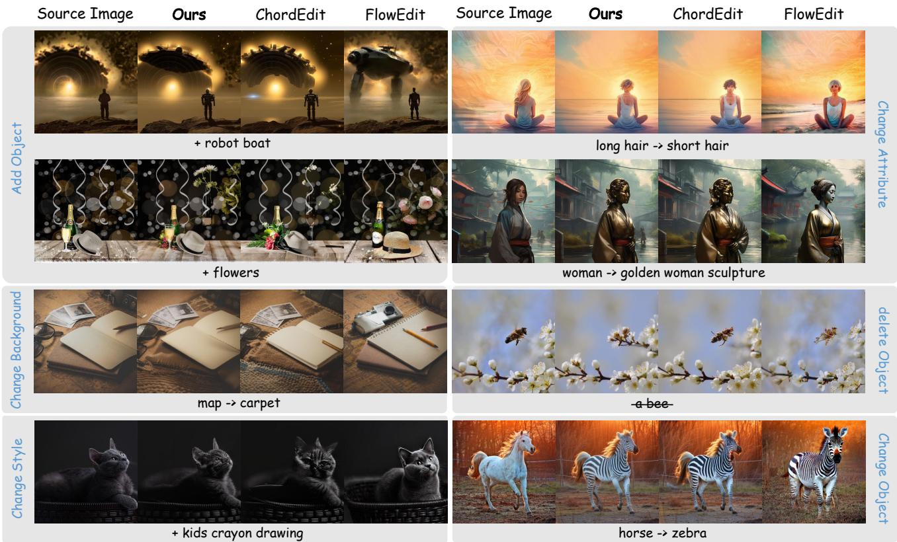
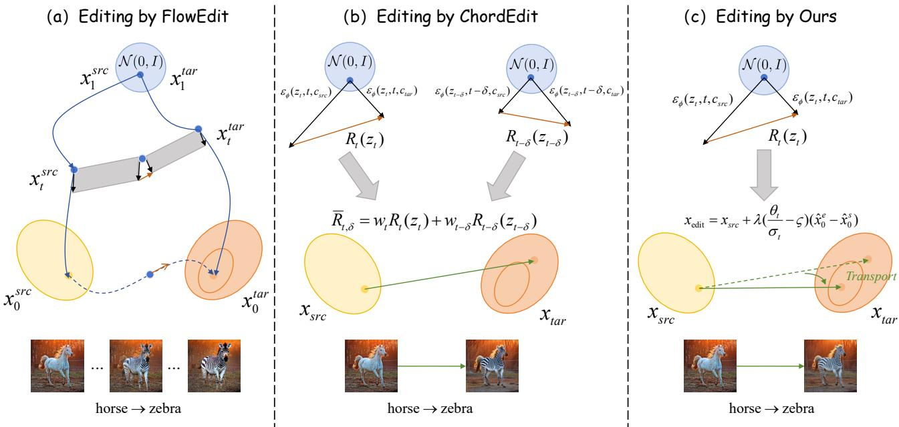
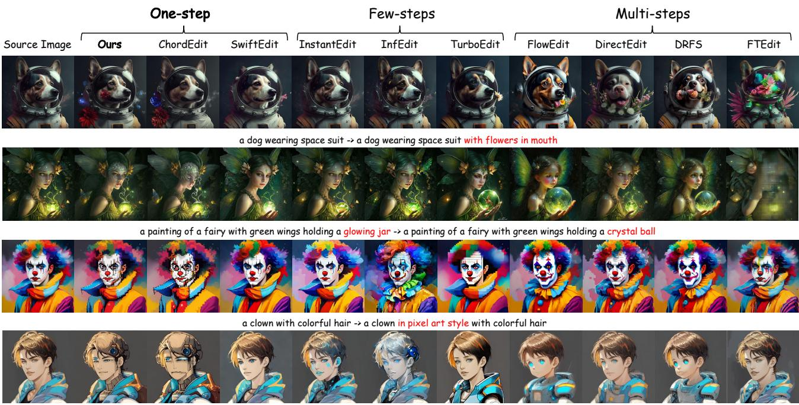
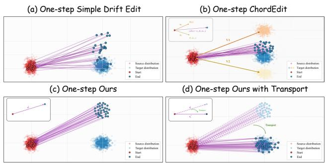
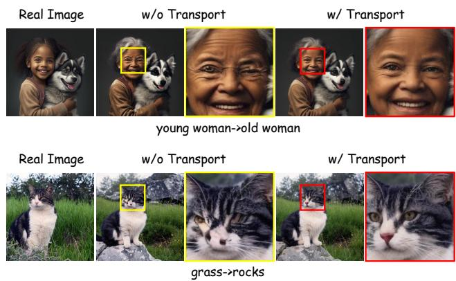
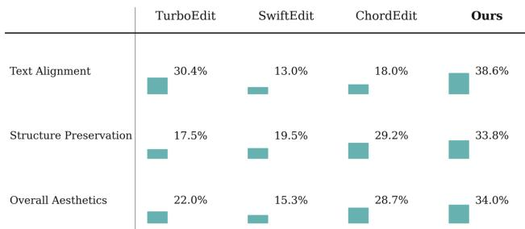
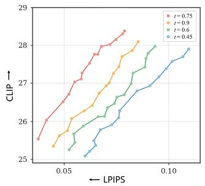
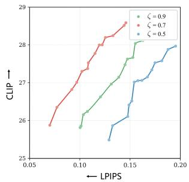
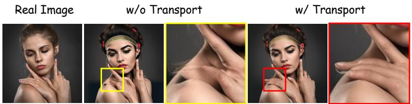

PREPRINT

October 2026

# One Evaluation Is Enough: Inversion-Free Image Editing with Trajectory Correction

Lifan Jiang1,2, Taiyang Chen3, Senlin cheng2 Bolei Xu2, XIAOBO LI2, Can Ye2 Dehai Zhao1, Deng Cai1, Boxi Wu1,†

1State Key Lab of CAD&CG, Zhejiang University 2Ant Group 3Chongqing Key Laboratory of Image Cognition, Chongqing University of Posts and Telecommunications

lifanjiang@zju.edu.cn †Corresponding author: Boxi Wu.

## ABSTRACT

Real-image editing commonly relies on inversion and iterative sampling, while efficient one-step editors often stabilize a large update by estimating and averaging editing fields at multiple noise levels. We ask a stricter question: is a single temporal field evaluation sufficient for reliable inversion-free editing? Our answer rests on a previously underused duality in a variance-preserving (VP) one-step model: one source-target query at a shared noisy state simultaneously determines a local angular semantic tangent and a clean endpoint displacement. We integrate the tangent over the analytically known remaining VP angle to obtain a nominal one-step transport, and use the endpoint displacement to correct its long-horizon extrapolation through a constrained projection. This transport-first, correction-second construction yields Endpoint-Calibrated Transport (ECT), a closed-form, training-free editor requiring only one noise level, two text conditions packed into one denoiser batch, and one latent update. ECT requires no image inversion, trajectory integration, second temporal observation, or iterative optimization, and can be directly applied to pretrained epsilon-prediction VP one-step generators. Across the reported benchmark settings, ECT delivers stable gains in editing quality within an extremely short editing time.

Keywords: Text-guided image editing; Inversion-free editing; One-step diffusion models; Endpoint-calibrated transport

## 1 Introduction

Text-guided real-image editing must accurately realize a target instruction while preserving unedited regions, spatial layout, and subject identity. Existing approaches use diffusion inversion, feature or attention injection, and iterative denoising to retain source structure. Although effective, inversion optimization and long sampling trajectories incur substantial latency and memory cost, limiting interactive use (Hertz et al., 2022; Mokady et al., 2023; Tumanyan et al., 2023; Cao et al., 2023).

Recent work improves efficiency along two complementary directions. Inversion-free editors construct a direct or consistency-based process between source and target conditions, while distilled generators compress synthesis into one or a few steps (Xu et al., 2024; Kulikov et al., 2025; Liu et al., 2023; Sauer et al., 2024; Dao et al., 2024). Yet high-fidelity direct editors generally still integrate or correct model fields over multiple times. Even when the final edit uses one latent update, representative one-step methods stabilize that update with information collected at more than one noise level (Lu et al., 2026). Reliable editing from one temporal support thus remains challenging.

This paper studies single-evaluation image editing: can a stable inversion-free edit be constructed by querying the source and target conditions at the same noisy state and at only one noise level? Multiple condition-time branches can be packed into a single batch, but every additional temporal observation still enlarges the batch, activation traffic, CPU scheduling, and memory pressure. We therefore characterize an editor by its temporal supports, condition-time branches, batched denoiser calls, and latent updates. We seek stable edits without additional temporal observations.

Our key observation is that a single conditional query of a VP one-step model determines one edit axis: the angular tangent and clean-endpoint displacement derived from the shared state are collinear. We calibrate its magnitude by integrating the frozen local tangent over the known remaining VP angle, obtaining a nominal single-evaluation angular transport. This schedule-based rescaling is a firstorder approximation, not a guarantee that the original displacement underestimates the true edit. A closed-form endpoint-exposure shrinkage then moderates the extrapolation along the same axis, yielding Endpoint-Calibrated

  
Figure 1. Edits with ECT (ours), ChordEdit, and FlowEdit, covering object addition and removal, attribute and background changes, stylization, and object replacement.

Transport (ECT). The editor needs one noise level, two conditional branches in one denoiser batch, and one latent update, without training, inversion, a second temporal observation, or iterative optimization.

We validate ECT on two real-image editing benchmarks and two representative one-step backbones. The results support using one shared-state evaluation for both semantic transport and endpoint calibration, yielding competitive edits with lower overhead.

Our contributions are threefold:

• Single-evaluation formulation. We formulate inversion-free editing under a strict single-temporalsupport constraint: the source and target conditions are evaluated at one shared noisy state and followed by one latent update. It separates temporal support from batching and exposes the activation, memory, and scheduling costs of additional branches.

• Transport-and-correction theory. We derive a schedule-based nominal transport with a Lipschitz quadrature bound and a closed-form endpointexposure projection on the same edit axis. A shrinkage-risk analysis motivates correction under explicit assumptions.

• Training-free core setting. ECT operates directly on pretrained epsilon-prediction VP one-step backbones using one noise level, two text branches packed in one denoiser batch, and one latent update, without training, inversion, ODE integration, or iterative optimization. The pipeline combines competitive editing quality with lower execution overhead.

## 2 Related Work

Diffusion-based real-image editing. Diffusion probabilistic models and their deterministic samplers (Ho et al., 2020; Song et al., 2020), together with classifier-free guidance (Ho & Salimans, 2022), underlie most text-guided editors. Noise-and-denoise editing such as SDEdit (Meng et al., 2022) and instruction-tuned editors such as Instruct-Pix2Pix (Brooks et al., 2023) modify images directly in pixel or latent space, while text-guided diffusion editors manipulate cross-attention, inject intermediate features, or share self-attention to transfer target semantics while retaining source layout (Hertz et al., 2022; Tumanyan et al., 2023; Cao et al., 2023). Their preservation ability commonly depends on DDIM inversion, null-text optimization, or source-reference branches that reconstruct an input-specific diffusion trajectory (Mokady et al., 2023; Miyake et al., 2025). Although these mechanisms provide fine-grained control, the reconstruction process introduces many sequential denoising steps, per-image optimization, and storage of intermediate activations or features. This creates a persistent trade-off between faithful reconstruction, editability, and interactive efficiency.

Inversion-free direct editing. Inversion-free methods avoid reconstructing an exact noise code by coupling source and target predictions through consistency sampling or conditional transport (Xu et al., 2024; Kulikov et al., 2025). This direct view removes a major computational bottleneck and exposes the editing displacement itself as the central object of study. Trajectory-aware regularization can further preserve source structure by constraining conditional dynamics (Kim et al., 2026), and recent rectified-flow editors refine this direct transport through noise-domain alignment, structure-aware noise rectification, step-level inversion accuracy, velocity-discrepancy modeling, or frequencyinteractive attention (Xie et al., 2026; Jiang et al., 2026; Yang & Ye, 2026; Beaudouin et al., 2025; Yang et al., 2026; Xu et al., 2025), but existing formulations generally observe, integrate, or correct the state along multiple ODE locations. We ask whether one temporal observation can provide both a global edit and its reliability correction.

  
Figure 2. Editing pipelines, illustrated by a horse-to-zebra edit. (a) FlowEdit accumulates source–target field differences along a multi-step path. (b) ChordEdit combines residuals at t and $t - \delta$ into one update, using two temporal supports and four condition–time branches. (c) ECT uses only $R _ { t } ( z _ { t } )$ from two text conditions at one shared noisy state. The same predictions determine the angular residual $g _ { t }$ and endpoint displacement $d _ { t } \colon$ angular transport gives $\widehat { a } _ { t } = - \theta _ { t } g _ { t }$ , and endpoint calibration gives $u _ { t } ^ { * } = \widehat { a } _ { t } - \zeta d _ { t }$ . A single update $x _ { \mathrm { e d i t } } = x _ { \mathrm { s r c } } + \lambda u _ { t } ^ { * }$ then produces the edit (Equation 22). The sketches are schematic; the update rescales a shared edit axis.

One-step generation and editing. Distillation, adversarial training, and rectified flow have compressed high-quality generation into one or a few steps (Liu et al., 2022; Lipman et al., 2022; Song et al., 2023; Liu et al., 2023; Sauer et al., 2024; Nguyen & Tran, 2024; Dao et al., 2024), building on large-scale latent and rectified-flow backbones (Rombach et al., 2022; Podell et al., 2023; Esser et al., 2024; Yan et al., 2024; Greenberg, 2025). Editing is harder than unconditional generation because the single large update must simultaneously introduce target semantics and preserve input-specific content. Existing efficient editors therefore retain several generation steps or stabilize a final update through residuals evaluated at multiple times (Deutch et al., 2024; Gong et al., 2025; Nguyen et al., 2025; Lu et al., 2026; Li et al., 2026). We use the VP angular horizon to obtain nominal global transport from one local residual, then calibrate it with the same query’s clean endpoint signal.

## 3 Method

ECT denotes the complete editor, including both analytic stages. We first convert a source-target conditional residual at one noise level into a nominal endpoint transport using VP angular geometry. We then apply a proximal endpoint correction to that transport under an endpoint-exposure constraint. Figure 2 contrasts this computation with multi-step

FlowEdit and two-time ChordEdit, while Figure 4 illustrates the motivation for calibrating a single-step displacement.

## 3.1 From Two-Time Averaging to One Evaluation

Given a source image $I _ { \mathrm { s r c } } ,$ source prompt $c _ { \mathrm { s r c } }$ , and target prompt $c _ { \mathrm { t a r } }$ , a pretrained VAE encoder produces $x _ { \mathrm { s r c } } =$ $E ( I _ { \mathrm { s r c } } )$ . We seek a direct edit with one latent update,

$$
x _ { \mathrm { e d i t } } = x _ { \mathrm { s r c } } + u _ { t } .\tag{1}
$$

Here $u _ { t }$ is the single latent edit vector, applied once at noise level $t ,$ that carries the source latent to its edited version; the whole method is a recipe for constructing it from one query. A residual observed at one time is local, and naively enlarging it into a global update can over-edit structure. A representative remedy averages residuals from two noise levels (Lu et al., 2026), but even batched into one call it still uses two temporal supports and four branches.

More generally, let the conditional editing residual at time t be

$$
R _ { t } ( z _ { t } ) = \varepsilon _ { \phi } ( z _ { t } , t , c _ { \mathrm { t a r } } ) - \varepsilon _ { \phi } ( z _ { t } , t , c _ { \mathrm { s r c } } ) .\tag{2}
$$

The residual $R _ { t }$ is the only condition-specific signal a single query provides, so every editor below—including ours— is ultimately a rule for turning $R _ { t }$ into the update $u _ { t }$ of Equation 1. A two-time estimator constructs a stabilized direction in the generic form

$$
\begin{array} { r } { \bar { R } _ { t , \delta } = w _ { t } R _ { t } ( z _ { t } ) + w _ { t - \delta } R _ { t - \delta } ( z _ { t - \delta } ) , \qquad w _ { t } + w _ { t - \delta } = 1 , } \end{array}
$$

where the second observation reduces the uncertainty of extrapolating a local residual into one large update. Effective as it is, this couples editing to two schedule locations and doubles the condition-time width, even though the update is applied once.

(3)

Figure 4(a,b) illustrates the motivation: a direct singlestep drift can produce dispersed endpoints, whereas combining two residuals can stabilize the final update. Panels (c,d) illustrate the complementary need to calibrate a coherent but displaced set of endpoints. These are distribution-level cartoons, not measured trajectories or literal vector identities; our shared-state construction below performs the calibration by changing the magnitude along one edit axis.

We restrict $u _ { t }$ to source-target predictions at one shared noisy state, formed by the VP process:

$$
z _ { t } = \alpha _ { t } x _ { \mathrm { s r c } } + \sigma _ { t } \varepsilon , \qquad \varepsilon \sim \mathcal { N } ( 0 , I ) , \qquad \alpha _ { t } ^ { 2 } + \sigma _ { t } ^ { 2 } = 1 ,\tag{4}
$$

we evaluate

$$
\hat { \boldsymbol { \varepsilon } } _ { s } = \varepsilon _ { \phi } ( z _ { t } , t , c _ { \mathrm { s r c } } ) , \qquad \hat { \boldsymbol { \varepsilon } } _ { e } = \varepsilon _ { \phi } ( z _ { t } , t , c _ { \mathrm { t a r } } ) .\tag{5}
$$

Using the same $z _ { t }$ and t makes the prediction difference a comparison of text conditions at a fixed latent state. The common $z _ { t }$ term cancels algebraically in the endpoint difference; independent noise draws would introduce a state difference as well. We convert this residual into a finitehorizon transport and calibrate its uncertainty through a deterministic map

$$
\boldsymbol { u } _ { t } = \mathcal { T } ( \boldsymbol { z } _ { t } , t , \hat { \boldsymbol { \varepsilon } } _ { s } , \hat { \boldsymbol { \varepsilon } } _ { e } ; \alpha _ { t } , \sigma _ { t } )\tag{6}
$$

that contains no model output from a second temporal support.

## 3.2 Single-Evaluation Angular Transport

To construct $\mathcal { T }$ in Equation 6 from VP geometry, define

$$
\theta _ { t } = \operatorname { a t a n 2 } ( \sigma _ { t } , \alpha _ { t } ) , \qquad z _ { \theta } = \cos \theta x _ { 0 } + \sin \theta \varepsilon .\tag{7}
$$

Differentiating this parameterization gives

$$
{ \frac { d z _ { \theta } } { d \theta } } = \cos \theta \varepsilon - \sin \theta x _ { 0 } .\tag{8}
$$

The remaining angular interval to the clean endpoint is therefore $\theta _ { t } ;$ this parameter interval need not equal the latentspace Euclidean arc length. For condition c, one epsilon prediction at $z _ { t }$ determines both its clean endpoint estimate and the corresponding angular tangent,

$$
\hat { x } _ { 0 } ^ { c } = \frac { z _ { t } - \sigma _ { t } \hat { \varepsilon } _ { c } } { \alpha _ { t } } , \qquad \hat { \nu } _ { \theta } ^ { c } = \alpha _ { t } \hat { \varepsilon } _ { c } - \sigma _ { t } \hat { x } _ { 0 } ^ { c } .\tag{9}
$$

The source-target angular residual is

$$
g _ { t } = \hat { \nu } _ { \theta } ^ { e } - \hat { \nu } _ { \theta } ^ { s } .\tag{10}
$$

Here $g _ { t }$ is the local angular-velocity change induced by replacing the source condition with the target. Let $g ( \theta )$ denote this residual along the unknown editing trajectory. The ideal action is

$$
a _ { t } ^ { * } = \int _ { \theta _ { t } } ^ { 0 } g ( \theta ) d \theta .\tag{11}
$$

Although $g ( \theta )$ away from $\theta _ { t }$ is unobserved, its integration interval is fixed by the VP schedule. We therefore use the frozen-tangent approximation $g ( \theta ) \approx g _ { t }$ , giving the nominal transport

$$
\widehat { a } _ { t } = \int _ { \theta _ { t } } ^ { 0 } g _ { t } d \theta = - \theta _ { t } g _ { t } .\tag{12}
$$

This uses the known angular horizon without querying a second temporal support. Section 3.4 gives the rescaling $\theta _ { t } / \sigma _ { t } \geq 1$ , and Appendix A explains its interpretation and limits.

We first bound the quadrature error for an exact local residual; model prediction error is separate.

Proposition 1 (single-evaluation nominal transport). Let $g ( \theta )$ be the true source-target angular residual on [0, θt], assume it is L-Lipschitz, and take $g _ { t } = g ( \theta _ { t } )$ ). Then

$$
\left. \boldsymbol { a } _ { t } ^ { * } - \boldsymbol { \widehat { a } _ { t } } \right. _ { 2 } \leq \frac { L } { 2 } \theta _ { t } ^ { 2 } .\tag{13}
$$

The approximation is exact for a constant residual. A prediction error $\lVert g _ { t } - g ( \theta _ { t } ) \rVert _ { 2 } \leq \eta$ adds $\theta _ { t } \eta$ to the bound (Appendix $\mathrm { A } ) ;$ the bound does not determine its direction.

## 3.3 Proximal Endpoint Correction

Angular transport sets the nominal magnitude from schedule geometry by extrapolating one noisy estimate. Over a long horizon, the error in Proposition 1 can cause over- or under-shooting. We moderate the transport using the same predictions’ clean endpoint displacement, requiring no extra evaluation:

$$
d _ { t } = \hat { x } _ { 0 } ^ { e } - \hat { x } _ { 0 } ^ { s } .\tag{14}
$$

We use $d _ { t }$ as an endpoint-sensitive direction: $\langle d _ { t } , u \rangle$ measures how strongly a candidate action advances along the endpoint displacement. Given an exposure budget $b _ { t }$ , ECT picks the action closest to the nominal transport while limiting this component,

$$
u _ { t } ^ { * } = \arg \operatorname* { m i n } _ { u } \frac { 1 } { 2 } \| u - \widehat { a } _ { t } \| _ { 2 } ^ { 2 } \quad \mathrm { s . t . } \quad \langle d _ { t } , u \rangle \leq b _ { t } .\tag{15}
$$

This preserves the semantic direction from angular transport, changing it only as much as endpoint exposure requires. Its Lagrangian is

$$
\mathcal { L } ( u , \zeta ) = \frac { 1 } { 2 } \| u - \widehat { a } _ { t } \| _ { 2 } ^ { 2 } + \zeta \left( \langle d _ { t } , u \rangle - b _ { t } \right) , \qquad \zeta \geq 0 .\tag{16}
$$

The associated KKT conditions are

$$
\begin{array} { r } { u - \widehat { a } _ { t } + \zeta d _ { t } = 0 , } \\ { \langle d _ { t } , u \rangle - b _ { t } \leq 0 , } \\ { \zeta \big ( \langle d _ { t } , u \rangle - b _ { t } \big ) = 0 . } \end{array}\tag{17}
$$

Consequently, the unique closed-form correction is

$$
\begin{array} { r } { u _ { t } ^ { * } = \widehat { a } _ { t } - \zeta d _ { t } = - \theta _ { t } g _ { t } - \zeta d _ { t } . } \end{array}\tag{18}
$$

If the nominal transport satisfies the constraint, $\zeta = 0$ and it is unchanged; otherwise,

$$
\zeta = \frac { \langle d _ { t } , \widehat { a } _ { t } \rangle - b _ { t } } { \| d _ { t } \| _ { 2 } ^ { 2 } } , \qquad b _ { t } = \langle d _ { t } , \widehat { a } _ { t } \rangle - \zeta \| d _ { t } \| _ { 2 } ^ { 2 } .\tag{19}
$$

The implementation uses $\zeta$ directly, equivalent to the implicit budget in Equation 19. This analytic shrinkage requires no further model evaluation. Appendix C gives a conditional risk interpretation, rather than a guarantee for arbitrary model errors; Appendix B gives the projection derivation.

## 3.4 Closed-Form Editor and Complexity

Combining transport (Section 3.2) and correction (Section 3.3) gives a closed-form editor. The shared $z _ { t }$ links $g _ { t }$ and $d _ { t }$ algebraically, eliminating numerical optimization. Equation 9 yields

$$
d _ { t } = - \frac { \sigma _ { t } } { \alpha _ { t } } \left( \hat { \varepsilon } _ { e } - \hat { \varepsilon } _ { s } \right) , \qquad g _ { t } = \frac { 1 } { \alpha _ { t } } \left( \hat { \varepsilon } _ { e } - \hat { \varepsilon } _ { s } \right) .\tag{20}
$$

Therefore,

$$
g _ { t } = - \frac { 1 } { \sigma _ { t } } d _ { t } .\tag{21}
$$

Substituting Equation 21 into Equation 18 yields the final editor,

$$
\boxed { x _ { \mathrm { e d i t } } = x _ { \mathrm { s r c } } + \lambda \left( \frac { \theta _ { t } } { \sigma _ { t } } - \zeta \right) ( \hat { x } _ { 0 } ^ { e } - \hat { x } _ { 0 } ^ { s } ) } .\tag{22}
$$

Here $\lambda$ is the user-facing edit-strength coefficient, $\theta _ { t } / \sigma _ { t }$ the schedule-fixed transport gain, and $\bar { \zeta }$ the endpoint-exposure shrinkage. The complete procedure is therefore

$$
\left( x _ { \mathrm { s r c } } , c _ { \mathrm { s r c } } , c _ { \mathrm { t a r } } \right) \xrightarrow { \mathrm { o n e } t } \left( \hat { \varepsilon } _ { s } , \hat { \varepsilon } _ { e } \right) \xrightarrow { \mathrm { c l o s e d f o r m } } x _ { \mathrm { e d i t } } ,\tag{23}
$$

with no numerical solver between model prediction and latent update. Adding the endpoint difference to $x _ { \mathrm { s r c } }$ also retains the source reconstruction residual $x _ { \mathrm { s r c } } - \hat { x } _ { 0 } ^ { s } ;$ replacing the source directly with $\hat { x } _ { 0 } ^ { e }$ would discard this input-specific component.

ECT changes the magnitude along one edit axis. The nominal gain $\theta _ { t } / \sigma _ { t } \geq 1$ follows from the frozen-tangent approximation, and $\zeta$ moderates that gain; neither operation supplies a new direction. With $\hat { x } _ { 0 } ^ { s } \approx x _ { \mathrm { s r c } }$ , the update is approximately an interpolation toward the target endpoint when $0 \leq \lambda ( \theta _ { t } / \sigma _ { t } - \zeta ) \leq 1$ . We evaluate this trade-off empirically.

The method constructs $z _ { t }$ at one noise level, evaluates the two text conditions in one batch, and applies Equation 22 once, with neither inversion nor ODE integration. Section 4.3 reports temporal supports, condition-time branches, batched calls, latent updates, and measured efficiency.

## 4 Experiments

## 4.1 Experimental Setup

Benchmarks and backbones. We evaluate on PIE-Bench and SNR-Bench with SD-Turbo (SD-T) (Sauer et al., 2024) and SwiftBrush-v2 (SB-v2) (Dao et al., 2024). The main setting is strictly single-evaluation—one temporal support, two text-conditioned branches in one denoiser batch, one latent update—with $t = 0 . 7 5 , \zeta = 0 . 7 $ , and λ = 1 unless stated otherwise. Appendix J reports seed and parameter studies. Extra-NFE variants appear only in the ablations of Table 3(c) and Appendix J.2, not in the main results.

Metrics. We report MSE, PSNR, SSIM (Wang et al., 2004), and LPIPS (Zhang et al., 2018), all computed after masking the edit region so they measure preservation of the unedited content, and CLIP cosine similarity (Radford et al., 2021) for target-prompt alignment on the full edited image. ImgEdit-Judge (Ye et al., 2026) additionally scores Content and Identity Preservation (CP), Visual Quality and Artifact

Control (VQ), and Physical and Perceptual Coherence (PC) on independent 1–5 scales. Appendices D and F give the preprocessing, formulae, aggregation, and full judge protocol. System efficiency uses synchronized per-image latency, time-weighted CPU-process utilization and resident set size (RSS), and peak PyTorch-reserved VRAM, under identical backbone, resolution, process scope, and instrumentation per comparison. These are resource demands, not quality scores: lower is lighter. Appendix E defines every column and records temporal supports, condition-time branches, batched denoiser calls, and latent updates.

Baselines. Our central comparison is the two-temporalsupport ChordEdit estimator (Lu et al., 2026) on the same one-step backbone. The main tables retain all non-ablation algorithm–model combinations from both benchmarks: multi-step DirectEdit (Yang & Ye, 2026), DNAEdit (Xie et al., 2026), SNR-Edit (Jiang et al., 2026), FlowEdit (Kulikov et al., 2025), DRFS (Beaudouin et al., 2025), FIA-Edit (Yang et al., 2026), and FTEdit (Xu et al., 2025); few-step (4-step) TurboEdit (Deutch et al., 2024), InfEdit (Xu et al., 2024), and InstantEdit (Gong et al., 2025); and one-step SwiftEdit (Nguyen et al., 2025) and ChordEdit—across the FLUX (Greenberg, 2025), SD3.5 (Esser et al., 2024), SDXL-Turbo/SD-Turbo (Sauer et al., 2024), SD1.4 (Rombach et al., 2022), PeRFlow (Yan et al., 2024), and SwiftBrush-v2 (Dao et al., 2024) backbones listed in each Model column. The transport ablations are omitted here; matched ChordEdit/ECT pairs are highlighted to isolate temporal support and endpoint calibration.

## 4.2 Main Quantitative Results

Tables 1 and 2 include all reported baseline/model combinations. For display, LPIPS/MSE are scaled by 1000 and SSIM/CLIP by 100, without affecting ranks. Quality metrics average finite per-sample scores, excluding invalid or unparsed values separately for each metric (Appendices D and F). Time is in seconds per image (three decimals), CPU in integer percentages, and VRAM/Mem. in MiB; percentage changes use unrounded measurements. Rules separate multi-step, four-step, and one-step settings; one-step rows group matched ChordEdit/ECT pairs by backbone. Avg. rank summarizes all 12 metrics within each table using displayed values, indicated directions, and average ranks for ties; it is not a quality metric. Both methods use one batched call and one latent update, with two temporal supports for ChordEdit and one for ECT.

ECT improves PSNR and all three judged scores on both PIE-Bench backbones. SD-Turbo also improves MSE, LPIPS, and SSIM, while SwiftBrush-v2 shows a small preservation trade-off. On SNR-Bench, all four preservation metrics and all judged scores improve on both backbones, with modest CLIP decreases. These paired results support improved source fidelity and judged quality with small alignment trade-offs, although preservation gains depend on the benchmark. Figure 3 shows qualitative comparisons.

The SB-v2 PSNR/MSE results are compatible because PSNR applies a logarithm before averaging: higher mean PSNR need not imply lower mean MSE. Reporting both exposes differences that a single preservation score would conceal. The matched pairs also hold backbone capacity fixed, so their differences more directly reflect the editing procedure than comparisons across generators with different architectures and training objectives.

Table 1. PIE-Bench results. ECT has the best average rank on both one-step backbones. Blue highlights ECT, bold marks gains over matched ChordEdit, and orange marks resource savings.
<table><tr><td colspan="2">Method / backbone</td><td colspan="4">Background preservation</td><td rowspan="2">Alignment</td><td colspan="4">Resources</td><td rowspan="2"></td><td colspan="2" rowspan="2">Judge</td><td rowspan="2">Rank</td><td rowspan="2">Avg.</td></tr><tr><td>Method</td><td>Model</td><td>PSNR ↑ MSE↓ LPIPS ↓ SSIM ↑</td><td></td><td></td><td></td><td>CLIP↑</td><td>Time ↓ VRAM↓ (s) (MiB)</td><td>CPU↓ (core-%)</td><td>Mem. ↓ (MiB)</td><td>CP↑VQ↑PC↑rank↓</td></tr><tr><td></td><td></td><td></td><td></td><td></td><td></td><td></td><td></td><td></td><td></td><td></td><td></td><td></td><td></td><td></td></tr><tr><td>Multi-step DirectEdit</td><td>FLUX</td><td>20.00</td><td>12.89</td><td>309.71</td><td>72.24</td><td></td><td>26.1414.690</td><td>37284</td><td>1025</td><td></td><td>6474.8 4.04</td><td></td><td>4.394.03</td><td>13.67</td></tr><tr><td>DNAEdit</td><td>FLUX</td><td>21.85</td><td>8.34</td><td>219.16</td><td>78.41</td><td>24.78</td><td>7.860</td><td>35881</td><td>1135</td><td>6468.6</td><td>4.02</td><td>4.45</td><td>4.11</td><td>11.13</td></tr><tr><td>SNR-Edit</td><td>FLUX</td><td>21.08</td><td>9.75</td><td>204.70</td><td>77.66</td><td>25.19</td><td>9.410</td><td>6446</td><td>2811</td><td>1333.3</td><td>4.13</td><td>4.59</td><td>4.32</td><td>8.50</td></tr><tr><td>FlowEdit</td><td>FLUX</td><td>18.68</td><td>16.63</td><td>276.07</td><td>73.25</td><td>25.81</td><td>8.280</td><td>37714</td><td>1149</td><td>6478.9</td><td>4.02</td><td>4.43</td><td>4.15</td><td>14.38</td></tr><tr><td>FlowEdit</td><td>SD3.5</td><td>19.17</td><td>14.51</td><td>267.66</td><td>73.38</td><td>27.71</td><td>3.990</td><td>21873</td><td>1048</td><td>4737.0</td><td>3.97</td><td>4.29</td><td>3.88</td><td>14.17</td></tr><tr><td>DirectEdit</td><td>SD3.5</td><td>22.85</td><td>6.12</td><td>185.50</td><td>81.10</td><td>26.13</td><td>5.400</td><td>21412</td><td>2536</td><td>4751.4</td><td>4.05</td><td>4.39</td><td>4.01</td><td>9.58</td></tr><tr><td>DNAEdit</td><td>SD3.5</td><td>22.93</td><td>6.20</td><td>199.40</td><td>80.82</td><td>25.61</td><td>3.240</td><td>19924</td><td>1114</td><td>4721.7</td><td>4.02</td><td>4.39</td><td>4.02</td><td>9.17</td></tr><tr><td>DRFS</td><td>SD3.5</td><td>20.55</td><td>10.79</td><td>223.68</td><td>76.66</td><td>27.70</td><td>5.420</td><td>19922</td><td>1234</td><td>4710.4</td><td>4.03</td><td></td><td>4.38 4.00</td><td>12.17</td></tr><tr><td></td><td>SD3.5</td><td>23.26</td><td>5.87</td><td>159.61</td><td>81.02</td><td>31.07</td><td>5.330</td><td>19930</td><td>1322</td><td>4711.4</td><td>4.05</td><td>4.43</td><td>4.09</td><td></td></tr><tr><td>FIA-Edit FTEdit</td><td>SD3.5</td><td>20.90</td><td>10.67</td><td>275.94</td><td>79.41</td><td>23.46</td><td>31.240</td><td>26890</td><td>1380</td><td>2203.7</td><td>3.63</td><td>4.06</td><td>3.67</td><td>7.08</td></tr><tr><td>SNR-Edit</td><td>SD3.5</td><td>19.53</td><td>13.16</td><td>250.62</td><td>74.12</td><td>26.57</td><td>5.250</td><td>6448</td><td>3391</td><td>1388.5</td><td>4.07</td><td></td><td></td><td>15.17</td></tr><tr><td>Few-step (4-step)</td><td></td><td></td><td></td><td></td><td></td><td></td><td></td><td></td><td></td><td></td><td></td><td></td><td>4.384.02</td><td>11.54</td></tr><tr><td>TurboEdit SDXL-T</td><td></td><td>21.44</td><td>9.49</td><td>108.60</td><td>75.08</td><td>24.66</td><td>0.610</td><td>14022</td><td>679</td><td></td><td>819.2 3.96</td><td></td><td>4.33 3.93</td><td>10.25</td></tr><tr><td>InfEdit</td><td>SD1.4</td><td>19.74</td><td>15.83</td><td>224.83</td><td>68.67</td><td>25.13</td><td>0.481</td><td>7784</td><td>419</td><td>3364.9</td><td>3.85</td><td>4.27</td><td>3.83</td><td>13.83</td></tr><tr><td>InstantEdit PeRFlow</td><td></td><td>22.30</td><td>8.92</td><td>150.54</td><td>76.24</td><td>25.77</td><td>0.670</td><td>9156</td><td>1294</td><td>843.8</td><td>4.03</td><td>4.39</td><td>4.03</td><td>8.92</td></tr><tr><td>One-step</td><td></td><td></td><td></td><td></td><td></td><td></td><td></td><td></td><td></td><td></td><td></td><td></td><td></td><td></td></tr><tr><td>SwiftEdit</td><td>SB-v2</td><td>20.65</td><td>9.91</td><td>200.91</td><td>69.97</td><td>30.01</td><td>0.451</td><td>16224</td><td>182</td><td></td><td>4282.44.07</td><td></td><td>4.534.22</td><td>7.79</td></tr><tr><td>ChordEdit</td><td>SB-v2</td><td>22.04</td><td>7.13</td><td>120.49</td><td>77.27</td><td>29.70</td><td>0.265</td><td>7498</td><td>357</td><td>1298.7</td><td>3.91</td><td>4.37</td><td>4.05</td><td>7.38</td></tr><tr><td></td><td></td><td>22.86</td><td>7.56</td><td>122.81</td><td>77.05</td><td>29.70</td><td>0.213</td><td>7480</td><td>190</td><td>1075.9</td><td>4.03</td><td></td><td></td><td></td></tr><tr><td>ECT ChordEdit SD-T</td><td>SB-v2</td><td>22.63</td><td>7.99</td><td>122.64</td><td>76.71</td><td>30.60</td><td>(-19.6%) 0.265</td><td>7498</td><td>(-46.7%)</td><td>357 1297.1</td><td>(-17.2%) 3.95</td><td></td><td>4.454.13 4.37 4.00</td><td>4.92 7.71</td></tr><tr><td>ECT</td><td>SD-T</td><td>23.74</td><td>6.22</td><td>109.04</td><td>78.10</td><td>30.20</td><td>0.212 (-20.0%)</td><td>7480</td><td>190 (-46.7%)</td><td>1076.0 (-17.0%)</td><td>4.09</td><td>4.65</td><td>4.31</td><td>2.67</td></tr></table>

Table 2. SNR-Bench results. ECT has the best average rank on both one-step backbones. Blue highlights ECT, bold marks gains over matched ChordEdit, and orange marks resource savings.
<table><tr><td colspan="2">Method / backbone</td><td colspan="4">Background preservation</td><td colspan="2">Alignment</td><td colspan="3">Resources</td><td colspan="2">Judge</td><td rowspan="2">Rank</td></tr><tr><td>Method</td><td>Model</td><td>PSNR ↑ MSE↓ LPIPS ↓ SSIM ↑</td><td></td><td></td><td></td><td>CLIP↑</td><td>Time ↓ (s)</td><td>VRAM↓ (MiB)</td><td>CPU↓ (core-%)</td><td>Mem. (MiB)</td><td>CP↑VQ↑PC↑rank↓</td><td></td><td>Avg.</td></tr><tr><td>Multi-step</td><td></td><td></td><td></td><td></td><td></td><td></td><td></td><td></td><td></td><td></td><td></td><td></td><td></td><td></td></tr><tr><td>DirectEdit</td><td>FLUX</td><td>15.96</td><td>42.66</td><td>450.31</td><td>51.22</td><td></td><td>26.3015.101</td><td>37284</td><td>103</td><td>6676.9</td><td>4.31</td><td></td><td>4.53 4.28</td><td>12.08</td></tr><tr><td>DNAEdit</td><td>FLUX</td><td>19.52</td><td>15.05</td><td>250.75</td><td>64.82</td><td>26.22</td><td>8.698</td><td>35881</td><td>104</td><td>6691.8</td><td>4.48</td><td>4.60</td><td>4.49</td><td>6.79</td></tr><tr><td>SNR-Edit</td><td>FLUX</td><td>18.62</td><td>17.09</td><td>249.63</td><td>60.58</td><td>26.45</td><td>9.454</td><td>6446</td><td>121</td><td>8267.7</td><td>4.46</td><td>4.58</td><td>4.34</td><td>7.67</td></tr><tr><td>FlowEdit</td><td>FLUX</td><td>16.77</td><td>23.96</td><td>318.52</td><td>58.79</td><td>26.96</td><td>8.653</td><td>37714</td><td>102</td><td>7246.5</td><td>4.41</td><td></td><td>4.564.38</td><td>9.21</td></tr><tr><td>FlowEdit</td><td>SD3.5</td><td>19.26</td><td>14.82</td><td>237.77</td><td>64.77</td><td>28.39</td><td>3.112</td><td>21873</td><td>104</td><td>5243.0</td><td>4.45</td><td>4.59</td><td>4.44</td><td>5.46</td></tr><tr><td>DirectEdit</td><td>SD3.5</td><td>17.38</td><td>37.76</td><td>390.36</td><td>54.99</td><td>25.78</td><td>5.147</td><td>21412</td><td>108</td><td>5144.7</td><td>4.28</td><td>4.45</td><td>4.23</td><td>11.33</td></tr><tr><td>DRFS</td><td>SD3.5</td><td>20.05</td><td>13.03</td><td>213.40</td><td>66.27</td><td>27.85</td><td>5.360</td><td>19922</td><td>105</td><td>5270.1</td><td>4.50</td><td>4.69</td><td>4.48</td><td>4.75</td></tr><tr><td>FIA-Edit</td><td>SD3.5</td><td>17.86</td><td>26.76</td><td>332.32</td><td>56.92</td><td>27.05</td><td>5.371</td><td>19930</td><td>113</td><td>5076.1</td><td>4.36</td><td>4.51</td><td>4.24</td><td>9.46</td></tr><tr><td>SNR-Edit</td><td>SD3.5</td><td>18.80</td><td>15.58</td><td>239.69</td><td>62.89</td><td>28.01</td><td>5.350</td><td>6448</td><td>127</td><td>5097.5</td><td>4.34</td><td></td><td>4.564.43</td><td>6.13</td></tr><tr><td colspan="2">Few-step (4-step)</td><td></td><td></td><td></td><td></td><td></td><td></td><td></td><td></td><td></td><td></td><td></td><td></td><td></td></tr><tr><td>TurboEdit</td><td>SDXL-T</td><td>14.77</td><td>40.80</td><td>430.38</td><td>46.42</td><td>27.62</td><td>0.745</td><td>14022</td><td>141</td><td>1651.3</td><td>4.15</td><td>4.314.08</td><td></td><td>12.42</td></tr><tr><td>InfEdit</td><td>SD1.4</td><td>20.87</td><td>9.97</td><td>193.72</td><td>64.71</td><td>23.37</td><td>0.434</td><td>7784</td><td>265</td><td>2777.9</td><td>4.23</td><td>4.50</td><td>4.28</td><td>7.42</td></tr><tr><td>InstantEdit PeRFlow</td><td></td><td>14.93</td><td>41.31</td><td>423.58</td><td>47.51</td><td>27.92</td><td>0.815</td><td>9156</td><td>275</td><td>1804.3</td><td>4.10</td><td></td><td>4.364.05</td><td>12.75</td></tr><tr><td colspan="2">One-step</td><td></td><td></td><td></td><td></td><td></td><td></td><td></td><td></td><td></td><td></td><td></td><td></td><td></td></tr><tr><td>SwiftEdit</td><td>SB-v2</td><td>16.74</td><td>30.29</td><td>348.18</td><td>49.60</td><td>24.87</td><td>0.472</td><td>16224</td><td>185</td><td>4756.5</td><td>4.26</td><td>4.444.28</td><td></td><td>11.71</td></tr><tr><td>ChordEdit</td><td>SB-v2</td><td>18.64</td><td>15.84</td><td>341.59</td><td>52.38</td><td>24.88</td><td>0.305</td><td>7498</td><td>348</td><td>1312.5</td><td>4.21</td><td>4.41</td><td>4.21</td><td>10.42</td></tr><tr><td>ECT</td><td>SB-v2</td><td>19.61</td><td>12.59</td><td>314.76</td><td>54.48</td><td>24.31</td><td>0.254 (-16.7%)</td><td>7480</td><td>181 (-48.0%)</td><td>1037.1 (-21.0%)</td><td>4.30</td><td>4.44 4.30</td><td></td><td>7.25</td></tr><tr><td>ChordEdit</td><td>SD-T</td><td>17.86</td><td>19.32</td><td>348.59</td><td>50.57</td><td>25.76</td><td>0.305</td><td>7498</td><td>332</td><td>1316.1</td><td>4.14</td><td></td><td>4.46 4.15</td><td>10.88</td></tr><tr><td>ECT</td><td>SD-T</td><td>19.02</td><td>14.60</td><td>311.84</td><td>53.29</td><td>25.32</td><td>0.257 (-15.7%)</td><td>7480</td><td>192 (-42.1%)</td><td>1035.0 (-21.4%)</td><td>4.30</td><td></td><td>4.48 4.30</td><td>7.29</td></tr></table>

  
a drawing of a young man with blue eyes -> a drawing of a young robot with blue eyes

Figure 3. Qualitative comparisons of one-step, few-step, and multi-step editors. Rows show flower addition, crystal-ball replacement, pixel-art stylization, and robot transformation. Source images and instructions illustrate the preservation–alignment trade-offs.  
  
Figure 4. Schematic motivation for single-step calibration. (a) Simple drift produces dispersed endpoints. (b) ChordEdit combines two residuals. (c) Coherent updates can still miss the target distribution. (d) Transport and correction calibrate the endpoints. Direction changes abstract high-dimensional behavior; the exact ECT update is collinear with d (Equation 21).

  
Figure 5. Qualitative effects of angular transport on two representative cases. From left to right: source, result without transport and its enlarged crop, then the “w/ Transport” result and its enlarged crop.

## 4.3 System Efficiency

Compared with matched ChordEdit rows in Tables 1 and 2, ECT reduces synchronized latency by 15.7–20.0%, timeweighted CPU-process utilization by 42.1–48.0%, and time-weighted process RSS by 17.0–21.4%. Peak reserved VRAM changes by only 0.24% (7,480 versus 7,498 MiB). These paired measurements use common instrumentation and are not comparable across hardware or process scopes (Appendix E). The reductions are consistent with halving condition-time branches, reducing input preparation, transfers, and intermediate activations. Temporal supports and branch counts therefore complement batched-call and latent-update counts when reporting efficiency.

VAE encoding/decoding and other shared work remain after reducing the branches. Two instead of four conditional branches therefore need not halve the total latency. Peak reserved VRAM includes cached device allocations, whereas process RSS measures host memory; their different scopes help explain why memory savings need not move together.

## 4.4 User Study

We compare TurboEdit, SwiftEdit, ChordEdit, and ECT in a blinded PIE-Bench study. Participants independently score anonymous outputs on assigned subsets of varying sizes from 1 to 5 for text alignment, structure preservation, and aesthetics. Methods are ranked by mean participant scores per case and criterion (Figure 6). ECT leads with first-place shares of 38.6%, 33.8%, and 34.0%, exceeding runners-up—TurboEdit for alignment and ChordEdit for structure and aesthetics—by 8.2, 4.6, and 5.3 percentage points, respectively. These descriptive differences alone do not establish statistical significance. Appendix G details the

  
Figure 6. User-study first-place shares (%), based on mean participant scores per case, with no top ties. ECT leads in text alignment (38.6%), structure preservation (33.8%), and aesthetics (34.0%).

  
(a) Noise level t

  
(b) Correction ζ  
Figure 7. Preservation–alignment trade-offs on PIE-Bench. Lower LPIPS and higher CLIP are preferable; LPIPS is unscaled. (a) t = 0.75 gives lower LPIPS at comparable CLIP than the other plotted evaluation times. (b) $\zeta = 0 . 7$ gives the most favorable plotted trade-off.

protocol.

## 4.5 Ablation Studies

Table 3 examines one- versus two-step ECT in Panel (a), the angular transport stage in Panel (b), and an extra neural function evaluation (NFE) in Panel (c), reporting relevant metrics. Figure 5 separately illustrates angular transport, while Appendix J.2 studies supplementary refinement noise levels.

Table 3, Panel (a), makes the temporal-support comparison explicit. Relative to two-step ECT, the one-step editor reduces latency by 17.8%/18.1%, CPU utilization by 57.4%/57.9%, and process RSS by 22.2%/22.4% on SBv2/SD-T, while improving CP, VQ, and PC for both backbones. This establishes the one-step setting as the more favorable quality–efficiency operating point.

Table 3(b) shows that including angular transport improves PSNR and LPIPS on both backbones, while both reported image-edit ratings increase. At the displayed precision, CLIP decreases from 29.8 to 29.7 on SB-v2 and from 30.7 to 30.2 on SD-T, so the preservation improvement comes with a modest alignment trade-off. Adding the extra NFE in Panel (c) raises SB-v2’s CLIP from 22.8 to 29.7 and lowers LPIPS from 142.0 to 122.8, while VQ remains 4.5 and PC decreases from 4.2 to 4.1. On SD-T, CLIP, VQ, and PC improve, while PSNR falls from 26.0 to 23.7 and LPIPS increases from 64.1 to 109.0. This supplementary extra-NFE comparison shows a trade-off between background fidelity and semantic editing on SD-T.

Parameter sensitivity. Figure 7(a) compares the LPIPS– CLIP trade-offs at four evaluation noise levels. Over their shared CLIP range, t = 0.75 achieves lower LPIPS than t =

0.45, 0.6, and 0.9, supporting its use as the default. Panel (b) similarly favors the intermediate correction coefficient $\zeta =$ 0.7 over 0.5 and 0.9. These plots measure the balance between preservation and alignment rather than PSNR or a single metric optimum. Appendix J reports the seed and remaining parameter controls. In particular, Table 10 shows that λ = 1 has the best preservation in the tested sweep, while λ = 2 gains 0.50 CLIP points at a cost of 2.690 dB PSNR and 37.636 scaled LPIPS units. Thus, λ = 1 favors preservation over maximizing CLIP alone.

The seed control tests dependence on a favorable noisy state. Across eleven seeds, the worst result for each preservation metric still outperforms matched ChordEdit (Appendix J.1), supporting stable benchmark averages without implying identical edits across seeds.

## 5 Conclusion

We presented Endpoint-Calibrated Transport (ECT), a training-free approach to inversion-free image editing that uses one shared noisy state, one batched denoiser evaluation, and one latent update. The method turns the source–target prediction difference into a schedule-aware angular transport and uses the clean endpoint displacement from the same query to calibrate that transport, so semantic motion and structural control are obtained without inversion, a second temporal support, ODE integration, or iterative optimization. Across the supplied benchmark summaries and matched backbones, ECT improves PSNR in every one-step comparison, improves all reported preservation metrics on SNR-Bench, raises the judged image-edit scores throughout, and exposes the PIE-Bench SwiftBrush-v2 preservation trade-off rather than hiding it. At the same time, the matched tables show substantial reductions in synchronized latency, CPU-process utilization, and process RSS. These properties make single-temporal-support editing a compact and practical operating point while keeping the method’s assumptions and quality–efficiency trade-off explicit.

Limitations and future work. The current derivation assumes epsilon-prediction VP one-step backbones and a shared noisy state, and therefore does not yet cover non-VP schedules, velocity-prediction models, or spatially adaptive constraints. The reported efficiency numbers also depend on hardware, process scope, and measurement protocol. Future work will extend the formulation to these settings and evaluate broader controls once the corresponding runs are available.

## AI Use Statement

Generative AI tools were used to assist with language editing, manuscript organization, and consistency checking. The authors reviewed all derivations, implementation correspondences, experimental values, citations, and claims, and take responsibility for the content.

## Ethics Statement

This work includes an anonymous perceptual study of generated images. The rating interface requests no names, email addresses, or demographic attributes; the study database stores a pseudonymous browser identifier, ratings, and UTC timestamps. Like other generative editing systems, the method may be misused to create misleading visual content. Deployment should include provenance, consent, and disclosure practices appropriate to the application.

Table 3. Ablations on PIE-Bench: step count (a), angular transport (b), and extra NFE (c). Blue marks ECT variants, bold better values, and orange resource reductions.  
(a) One- vs. two-step ECT
<table><tr><td>Model Setting</td><td></td><td>Time (s) ↓ CPU (%) ↓ Mem. (MiB)</td><td></td><td></td><td>CP↑</td><td>VQ↑</td><td>PC↑</td></tr><tr><td></td><td>SB-v2 ChordEdit</td><td>0.265</td><td>357</td><td>1298.74</td><td>3.91</td><td>4.37</td><td>4.05</td></tr><tr><td>SB-v2</td><td>ECT (2-step)</td><td>0.259 0.213</td><td>446 190</td><td>1382.99 1075.93</td><td>3.99</td><td>4.42</td><td>4.10</td></tr><tr><td>SB-v2</td><td>ECT (1-step)</td><td>(-17.8%)</td><td>(-57.4%)</td><td>(-22.2%)</td><td>4.03</td><td>4.45</td><td>4.13</td></tr><tr><td>SD-T</td><td>ChordEdit</td><td>0.265</td><td>357</td><td>1297.07</td><td>3.95</td><td>4.37</td><td>4.00</td></tr><tr><td>SD-T</td><td>ECT (2-step)</td><td>0.259</td><td>452</td><td>1386.67</td><td>4.04</td><td>4.44</td><td>4.07</td></tr><tr><td>SD-T</td><td>ECT (1-step)</td><td>0.212 (-18.1%)</td><td>190 (-57.9%)</td><td>1075.96 (-22.4%)</td><td>4.09</td><td>4.65</td><td>4.31</td></tr><tr><td>(b) Transport stage</td><td></td><td></td><td></td><td></td><td></td><td></td><td></td></tr><tr><td colspan="8"></td></tr><tr><td>Model Variant</td><td></td><td></td><td>PSNR ↑</td><td>LPIPS</td><td>CLIP↑</td><td>VQ↑</td><td>PC↑</td></tr><tr><td>SB-v2</td><td>w/o transport</td><td></td><td>22.7</td><td>124.2</td><td>29.8</td><td>4.4</td><td>4.0</td></tr><tr><td>SB-v2</td><td>ECT (full)</td><td></td><td>22.9</td><td>122.8</td><td>29.7</td><td>4.5</td><td>4.1</td></tr><tr><td>SD-T</td><td>w/o transport</td><td></td><td>22.4</td><td>127.1</td><td>30.7</td><td>4.4</td><td>4.0</td></tr><tr><td>SD-T</td><td>ECT (full)</td><td></td><td>23.7</td><td>109.0</td><td>30.2</td><td>4.7</td><td>4.3</td></tr><tr><td colspan="8">(c) Extra NFE</td></tr><tr><td>Model Variant</td><td></td><td></td><td>PSNR ↑</td><td>LPIPS</td><td>CLIP↑</td><td>VQ 7</td><td>PC↑</td></tr><tr><td>SB-v2</td><td>w/o extra NFE</td><td></td><td>22.9</td><td>142.0</td><td>22.8</td><td>4.5</td><td>4.2</td></tr><tr><td>SB-v2</td><td>w/ extra NFE</td><td></td><td>22.9</td><td>122.8</td><td>29.7</td><td>4.5</td><td>4.1</td></tr><tr><td>SD-T</td><td>w/o extra NFE</td><td></td><td>26.0</td><td>64.1</td><td>28.6</td><td>4.3</td><td>3.9</td></tr><tr><td>SD-T</td><td>w/ extra NFE</td><td></td><td>23.7</td><td>109.0</td><td>30.2</td><td>4.7</td><td>4.3</td></tr></table>

## Reproducibility Statement

Section 3 specifies the complete closed-form method and assumptions. Appendix A proves the single-evaluation approximation bound and Appendix B derives the endpoint projection. Appendices D–G define automatic image metrics, system-resource accounting, ImgEdit-Judge evaluation, and the user-study protocol. Appendix J reports the seed and λ controls together with the exact values used to produce every table. The supplementary material will include configuration files, benchmark preprocessing, per-sample outputs, and commands for both backbones.

## References

Gaspard Beaudouin, Minghan Li, Jaeyeon Kim, Sunghoon Yoon, and Mengyu Wang. Delta velocity rectified flow for text-toimage editing. arXiv e-prints, pp. arXiv–2509, 2025.

Tim Brooks, Aleksander Holynski, and Alexei A. Efros. Instructpix2pix: Learning to follow image editing instructions, 2023. URL https://arxiv.org/abs/2211.09800.

Mingdeng Cao, Xintao Wang, Zhongang Qi, Ying Shan, Xiaohu Qie, and Yinqiang Zheng. Masactrl: Tuning-free mutual selfattention control for consistent image synthesis and editing. In 2023 IEEE/CVF International Conference on Computer Vision (ICCV), pp. 22503–22513. IEEE, 2023.

Trung Dao, Thuan Hoang Nguyen, Thanh Le, Duc Vu, Khoi Nguyen, Cuong Pham, and Anh Tran. Swiftbrush v2: Make your one-step diffusion model better than its teacher. In Euro-

pean Conference on Computer Vision, pp. 176–192. Springer, 2024.

Gilad Deutch, Rinon Gal, Daniel Garibi, Or Patashnik, and Daniel Cohen-Or. Turboedit: Text-based image editing using few-step diffusion models. In SIGGRAPH Asia 2024 Conference Papers, pp. 1–12, 2024.

Patrick Esser, Sumith Kulal, Andreas Blattmann, Rahim Entezari, Jonas Müller, Harry Saini, Yam Levi, Dominik Lorenz, Axel Sauer, Frederic Boesel, et al. Scaling rectified flow transformers for high-resolution image synthesis. In Forty-first international conference on machine learning, 2024.

Yiming Gong, Zhen Zhu, and Minjia Zhang. Instantedit: Textguided few-step image editing with piecewise rectified flow. In 2025 IEEE/CVF International Conference on Computer Vision (ICCV), pp. 16808–16817. IEEE, 2025.

Or Greenberg. Demystifying flux architecture. arXiv preprint arXiv:2507.09595, 2025.

Amir Hertz, Ron Mokady, Jay Tenenbaum, Kfir Aberman, Yael Pritch, and Daniel Cohen-Or. Prompt-to-prompt image editing with cross attention control. arXiv preprint arXiv:2208.01626, 2022.

Jonathan Ho and Tim Salimans. Classifier-free diffusion guidance. arXiv preprint arXiv:2207.12598, 2022.

Jonathan Ho, Ajay Jain, and Pieter Abbeel. Denoising diffusion probabilistic models. Advances in neural information processing systems, 33:6840–6851, 2020.

Lifan Jiang, Boxi Wu, Yuhang Pei, Tianrun Wu, Yongyuan Chen, Yan Zhao, Shiyu Yu, and Deng Cai. Snr-edit: Structure-aware noise rectification for inversion-free flow-based editing. arXiv preprint arXiv:2601.19180, 2026.

Jeongsol Kim, Yeobin Hong, Jonghyun Park, and Jong Chul Ye. Flowalign: Trajectory-regularized, inversion-free flow-based image editing. In International Conference on Learning Repre-

sentations, volume 2026, pp. 121814–121846, 2026.

Vladimir Kulikov, Matan Kleiner, Inbar Huberman-Spiegelglas, and Tomer Michaeli. Flowedit: Inversion-free text-based editing using pre-trained flow models. In 2025 IEEE/CVF International Conference on Computer Vision (ICCV), pp. 19721– 19730. IEEE, 2025.

Minghan Li, Jeremy Moebel, and Mengyu Wang. Rethinking one-step image editing through chordedit: Reproduction, simplification, and new insights. arXiv preprint arXiv:2606.14042, 2026.

Yaron Lipman, Ricky TQ Chen, Heli Ben-Hamu, Maximilian Nickel, and Matt Le. Flow matching for generative modeling. arXiv preprint arXiv:2210.02747, 2022.

Xingchao Liu, Chengyue Gong, and Qiang Liu. Flow straight and fast: Learning to generate and transfer data with rectified flow, 2022. URL https://arxiv.org/abs/2209.03003.

Xingchao Liu, Xiwen Zhang, Jianzhu Ma, Jian Peng, et al. Instaflow: One step is enough for high-quality diffusion-based text-to-image generation. In The twelfth international conference on learning representations, 2023.

Liangsi Lu, Xuhang Chen, Minzhe Guo, Shichu Li, Jingchao Wang, and Yang Shi. Chordedit: One-step low-energy transport for image editing. arXiv preprint arXiv:2602.19083, 2026.

Chenlin Meng, Yutong He, Yang Song, Jiaming Song, Jiajun Wu, Jun-Yan Zhu, and Stefano Ermon. Sdedit: guided image synthesis and editing with stochastic differential equations (2022). arXiv preprint arXiv:2108.01073, 2022.

Daiki Miyake, Akihiro Iohara, Yu Saito, and Toshiyuki Tanaka. Negative-prompt inversion: Fast image inversion for editing with text-guided diffusion models. In 2025 IEEE/CVF Winter Conference on Applications of Computer Vision (WACV), pp. 2063–2072. IEEE, 2025.

Ron Mokady, Amir Hertz, Kfir Aberman, Yael Pritch, and Daniel Cohen-Or. Null-text inversion for editing real images using guided diffusion models. In 2023 IEEE/CVF Conference on Computer Vision and Pattern Recognition (CVPR), pp. 6038– 6047. IEEE, 2023.

Thuan Hoang Nguyen and Anh Tran. Swiftbrush: One-step textto-image diffusion model with variational score distillation. In 2024 IEEE/CVF Conference on Computer Vision and Pattern Recognition (CVPR), pp. 7807–7816. IEEE, 2024.

Trong-Tung Nguyen, Quang Nguyen, Khoi Nguyen, Anh Tran, and Cuong Pham. Swiftedit: Lightning fast text-guided image editing via one-step diffusion. In 2025 IEEE/CVF Conference on Computer Vision and Pattern Recognition (CVPR), pp. 21492–21501. IEEE, 2025.

Dustin Podell, Zion English, Kyle Lacey, Andreas Blattmann, Tim Dockhorn, Jonas Müller, Joe Penna, and Robin Rombach. Sdxl: Improving latent diffusion models for high-resolution image synthesis, 2023. URL https://arxiv.org/abs/2307.01952.

Alec Radford, Jong Wook Kim, Chris Hallacy, Aditya Ramesh, Gabriel Goh, Sandhini Agarwal, Girish Sastry, Amanda Askell, Pamela Mishkin, Jack Clark, et al. Learning transferable visual models from natural language supervision. In International conference on machine learning, pp. 8748–8763. PmLR, 2021.

Robin Rombach, Andreas Blattmann, Dominik Lorenz, Patrick Esser, and Björn Ommer. High-resolution image synthesis with latent diffusion models. In 2022 IEEE/CVF conference on computer vision and pattern recognition (CVPR), pp. 10674– 10685. ieee, 2022.

Axel Sauer, Dominik Lorenz, Andreas Blattmann, and Robin Rombach. Adversarial diffusion distillation. In European Conference on Computer Vision, pp. 87–103. Springer, 2024.

Jiaming Song, Chenlin Meng, and Stefano Ermon. Denoising

diffusion implicit models. arXiv preprint arXiv:2010.02502, 2020.

Yang Song, Prafulla Dhariwal, Mark Chen, and Ilya Sutskever. Consistency models. arXiv preprint arXiv:2303.01469, 2023.

Narek Tumanyan, Michal Geyer, Shai Bagon, and Tali Dekel. Plug-and-play diffusion features for text-driven image-to-image translation. In 2023 IEEE/CVF Conference on Computer Vision and Pattern Recognition (CVPR), pp. 1921–1930. IEEE, 2023.

Zhou Wang, Alan C Bovik, Hamid R Sheikh, and Eero P Simoncelli. Image quality assessment: from error visibility to structural similarity. IEEE transactions on image processing, 13(4):600–612, 2004.

Chenxi Xie, Minghan Li, Shuai Li, Yuhui Wu, Qiaosi Yi, and Lei Zhang. Dnaedit: Direct noise alignment for text-guided rectified flow editing. Advances in Neural Information Processing Systems, 38:124456–124474, 2026.

Pengcheng Xu, Boyuan Jiang, Xiaobin Hu, Donghao Luo, Qingdong He, Jiangning Zhang, Chengjie Wang, Yunsheng Wu, Charles Ling, and Boyu Wang. Unveil inversion and invariance in flow transformer for versatile image editing. In 2025 IEEE/CVF Conference on Computer Vision and Pattern Recognition (CVPR), pp. 28479–28489. IEEE, 2025.

Sihan Xu, Yidong Huang, Jiayi Pan, Ziqiao Ma, and Joyce Chai. Inversion-free image editing with language-guided diffusion models. In 2024 IEEE/CVF Conference on Computer Vision and Pattern Recognition (CVPR), pp. 9454–9461. IEEE, 2024.

Hanshu Yan, Xingchao Liu, Jiachun Pan, Jun Hao Liew, Qiang Liu, and Jiashi Feng. Perflow: Piecewise rectified flow as universal plug-and-play accelerator. Advances in Neural Information Processing Systems, 37:78630–78652, 2024.

Desong Yang and Mang Ye. Directedit: Step-level accurate inversion for flow-based image editing. arXiv preprint arXiv:2605.02417, 2026.

Kaixiang Yang, Boyang Shen, Xin Li, Yuchen Dai, Yuxuan Luo, Yueran Ma, Wei Fang, Qiang Li, and Zhiwei Wang. Fia-edit: Frequency-interactive attention for efficient and high-fidelity inversion-free text-guided image editing. In Proceedings of the AAAI Conference on Artificial Intelligence, volume 40, pp. 11613–11621, 2026. No. 14.

Yang Ye, Xianyi He, Zongjian Li, Shenghai Yuan, Zhiyuan Yan, Bohan Hou, Li Yuan, et al. Imgedit: A unified image editing dataset and benchmark. Advances in Neural Information Processing Systems, 38, 2026.

Richard Zhang, Phillip Isola, Alexei A Efros, Eli Shechtman, and Oliver Wang. The unreasonable effectiveness of deep features as a perceptual metric. In 2018 IEEE/CVF conference on computer vision and pattern recognition, pp. 586–595. IEEE, 2018.

## A Angular Derivations and Approximation Error

Differentiating the VP angular path in Equation 7 gives

$$
\frac { d z _ { \theta } } { d \theta } = \cos \theta \varepsilon - \sin \theta x _ { 0 } ,\tag{24}
$$

which yields Equation 9 after substituting the model estimates. For the quadrature bound, write

$$
a _ { t } ^ { * } = \int _ { \theta _ { t } } ^ { 0 } g ( \theta ) d \theta , \qquad \widehat { a } _ { t } = - \theta _ { t } g ( \theta _ { t } ) .\tag{25}
$$

If $\lVert g ( \theta _ { 1 } ) - g ( \theta _ { 2 } ) \rVert _ { 2 } \leq L | \theta _ { 1 } - \theta _ { 2 } |$ , then

$$
\| a _ { t } ^ { * } - \widehat { a } _ { t } \| _ { 2 } \leq \int _ { 0 } ^ { \theta _ { t } } \| g ( \theta ) - g ( \theta _ { t } ) \| _ { 2 } d \theta\tag{26}
$$

$$
\leq \int _ { 0 } ^ { \theta _ { t } } L ( \theta _ { t } - \theta ) d \theta = \frac { L } { 2 } \theta _ { t } ^ { 2 } .\tag{27}
$$

Angular-horizon interpretation. The nominal transport rescales the naive one-step edit by a factor fixed entirely by the schedule. From the shared state (Equation 20), the single-step endpoint displacement has magnitude ∝ $\sigma _ { t } / \alpha _ { t }$ while the transport has magnitude ∝ $\theta _ { t } / \alpha _ { t }$ , so

$$
\| \widehat { a } _ { t } \| _ { 2 } = \frac { \theta _ { t } } { \sigma _ { t } } \| d _ { t } \| _ { 2 } = \frac { \theta _ { t } } { \sin \theta _ { t } } \| d _ { t } \| _ { 2 } \geq \| d _ { t } \| _ { 2 } .\tag{28}
$$

Under the frozen-tangent approximation, this factor replaces sin $\theta _ { t }$ with $\theta _ { t }$ and tends to one as $\theta _ { t } \to 0 .$ . It does not establish that $d _ { t }$ underestimates the true action or that rescaling always reduces its error. The interval spans an angle, not generally the latent trajectory’s Euclidean arc length.

Prediction error and shrinkage. For a model residual $g _ { t }$ with $\lVert g _ { t } - g ( \theta _ { t } ) \rVert _ { 2 } \leq \eta$ , the triangle inequality gives $\| a _ { t } ^ { * } +$ $\theta _ { t } g _ { t } \lVert _ { 2 } \leq L \theta _ { t } ^ { 2 } / 2 + \theta _ { t } \eta$ . Thus the quadrature bound alone does not control model error. The shrinkage analysis below assumes unbiased noise.

## B Endpoint Projection and KKT Conditions

The Lagrangian of Equation 15 is

$$
\mathcal { L } ( u , \zeta ) = \frac { 1 } { 2 } \| u - \widehat { a } _ { t } \| _ { 2 } ^ { 2 } + \zeta ( \langle d _ { t } , u \rangle - b _ { t } ) , \qquad \zeta \geq 0 .\tag{29}
$$

Stationarity gives $u _ { t } ^ { * } = \widehat { a } _ { t } - \zeta d _ { t }$ ; for active constraints $( d _ { t } \neq 0 )$ , complementary slackness gives

$$
\zeta _ { t } ^ { * } = \frac { \langle d _ { t } , \widehat { a _ { t } } \rangle - b _ { t } } { \| d _ { t } \| _ { 2 } ^ { 2 } } , \qquad b _ { t } = \langle d _ { t } , \widehat { a _ { t } } \rangle - \zeta _ { t } ^ { * } \| d _ { t } \| _ { 2 } ^ { 2 } .\tag{30}
$$

For the degenerate case $d _ { t } = 0$ , we bypass the quotient and set $\zeta = 0$ . Thus a fixed $\zeta$ is equivalent to a sample-dependent implicit exposure budget. Conversely, a specified budget yields an adaptive dual strength from the same observation.

## C Shrinkage-Risk Interpretation

For the final editor in Equation $2 2 .$ , write $u = \kappa d _ { t }$ with $\kappa = \lambda ( \theta _ { t } / \sigma _ { t } - \zeta )$ . Assume $d _ { t } = d ^ { * } + e ,$ with $\mathbb { E } [ e ] = 0 , \mathbb { E } \| e \| _ { 2 } ^ { 2 } = V$ and $\| d ^ { * } \| _ { 2 } ^ { 2 } = S$ . Then u has risk

$$
\mathbb { E } \Vert u - d ^ { * } \Vert _ { 2 } ^ { 2 } = ( 1 - \kappa ) ^ { 2 } S + \kappa ^ { 2 } V .\tag{31}
$$

For $0 < \kappa < 1$ , this is lower than the uncorrected risk V whenever

$$
\frac { V } { S } > \frac { 1 - \kappa } { 1 + \kappa } .\tag{32}
$$

This result compares the final coefficient $\kappa d _ { t }$ with the unscaled estimator $d _ { t }$ for the target $d ^ { * }$ . It motivates conservative endpoint calibration under the stated assumptions; it does not identify $d ^ { * }$ with the trajectory integral $a _ { t } ^ { * }$ or establish an unconditional improvement over the nominal transport $( \theta _ { t } / \sigma _ { t } ) d _ { t }$

## D Automatic Image Metrics

Common preprocessing and scope. Let $S , T \in [ 0 , 1 ] ^ { 3 \times H \times W }$ denote the source and edited RGB images. If the prediction is larger than the source, we use the benchmark-compatible bottom-right crop; an incompatible size is excluded. Let $M \in \bigcup ^ { } 0 , 1 \big \} ^ { H \times W }$ be the edit mask (M = 1 in the intended edit region). Following the evaluator, all four image boundaries are also set to one before defining $B = 1 - M$ . The preservation inputs are $S _ { B } = S \odot B$ and $T _ { B } = T \odot B ,$ with B broadcast over channels. MSE, PSNR, SSIM, and LPIPS measure background preservation; CLIP measures target alignment on the ful edited image. Samples with no evaluable background are invalid.

Definitions. The evaluator computes

$$
\operatorname { M S E } ( S _ { B } , T _ { B } ) = \frac { 1 } { 3 H W } \sum _ { c , h , w } ( S _ { B , c , h , w } - T _ { B , c , h , w } ) ^ { 2 } ,\tag{33}
$$

$$
\mathrm { P S N R } ( S _ { B } , T _ { B } ) = 1 0 { \log _ { 1 0 } } \frac { 1 } { \mathrm { M S E } ( S _ { B } , T _ { B } ) } .\tag{34}
$$

The denominator is the full 3HW, not the number of background elements: the edit region is zero in both inputs and contributes no error but remains in the normalization. PSNR is in dB because the data range is one; an exact match has MSE 0 and theoretical PSNR +∞.

For corresponding local windows x and y, SSIM is (Wang et al., 2004)

$$
\mathrm { S S I M } ( x , y ) = \frac { ( 2 \mu _ { x } \mu _ { y } + C _ { 1 } ) ( 2 \sigma _ { x y } + C _ { 2 } ) } { ( \mu _ { x } ^ { 2 } + \mu _ { y } ^ { 2 } + C _ { 1 } ) ( \sigma _ { x } ^ { 2 } + \sigma _ { y } ^ { 2 } + C _ { 2 } ) } ,\tag{35}
$$

with $C _ { j } = ( K _ { j } L ) ^ { 2 }$ and $L = 1$ ; the implementation averages over windows and channels. Windows crossing the mask boundary can therefore reflect boundary structure. For LPIPS, define $\widetilde { S } _ { B } = 2 S _ { B } - 1$ and $\widetilde { T } _ { B } = 2 T _ { B } - 1$ . In its standard notation (Zhang et al., 2018),

$$
\mathrm { L P I P S } ( \widetilde { S } _ { B } , \widetilde { T } _ { B } ) = \sum _ { l } \frac { 1 } { H _ { l } W _ { l } } \sum _ { h , w } \Big \| w _ { l } \odot \Big ( \hat { \phi } _ { l } ( \widetilde { S } _ { B } ) _ { h , w } - \hat { \phi } _ { l } ( \widetilde { T } _ { B } ) _ { h , w } \Big ) \Big \| _ { 2 } ^ { 2 } ,\tag{36}
$$

where $\hat { \phi } _ { l }$ is the channel-normalized feature at layer l and w is its learned channel weight; our evaluator uses the SqueezeNet backbone and released learned weights. CLIP uses cosine similarity:

$$
\mathrm { C L I P } ( T , e ) = \frac { \nu _ { I } ( T ) ^ { \top } \nu _ { T } ( e ) } { \| \nu _ { I } ( T ) \| _ { 2 } \| \nu _ { T } ( e ) \| _ { 2 } } ,\tag{37}
$$

Here the embeddings represent the full edited image and target instruction e, computed with openai/clip-vitbase-patch32 (Radford et al., 2021). We select e from the first non-empty field in this order: editing\_prompt, edited\_prompt, target\_prompt, then editing\_instruction if the preceding fields are empty.

Table 4. Automatic image metrics and their interpretation.
<table><tr><td></td><td>Metric Direction Input</td><td></td><td>Primary interpretation</td></tr><tr><td>MSE</td><td>↓</td><td>Masked source/output Mean pixel error</td><td></td></tr><tr><td>PSNR</td><td>↑</td><td>Masked source/output</td><td>Log pixel fidelity</td></tr><tr><td>SSIM</td><td>↑</td><td>Masked source/output</td><td>Local structure preservation</td></tr><tr><td>LPIPS</td><td>↓</td><td>Masked source/output</td><td>Learned perceptual distance</td></tr><tr><td>CLIP</td><td>↑</td><td>Full output/instruction</td><td>Target semantic alignment</td></tr></table>

Aggregation. Each metric is computed per sample and then averaged over its finite values, both overall and per edit category. NaN or failed values are excluded rather than replaced by zero; if a metric has no valid samples, its aggregate is NaN. We do not combine preservation and alignment into a single score. For display, tables scale MSE and LPIPS by 1000, and SSIM and CLIP by 100.

## E Inference-Time and Resource Accounting

All reported efficiency measurements use an NVIDIA H20 GPU.

Measurement window. For sample i, the high-resolution timer surrounds the full editing pipeline call. A CUDA synchronization is issued before recording $t _ { i } ^ { \mathrm { e n d } }$ , so $d _ { i } = t _ { i } ^ { \mathrm { e n d } } - t _ { i } ^ { \mathrm { s t a r t } }$ includes completed GPU work. The window excludes source-image loading, tensor-to-image conversion, output writing, logging, and metric evaluation. Skipped or failed calls are omitted. Mean latency is

$$
{ \bar { d } } = { \frac { 1 } { N } } \sum _ { i = 1 } ^ { N } d _ { i } \quad { \mathrm { s e c o n d s ~ p e r ~ i m a g e } } .\tag{38}
$$

CPU and host memory. The process is sampled at approximately 0.1-s intervals during the measured inference windows. After priming psutil.Process.cpu\_percent, the reported CPU value is the time-weighted process utilization

$$
\bar { p } = \frac { \sum _ { k } p _ { k } \Delta t _ { k } } { \sum _ { k } \Delta t _ { k } } .\tag{39}
$$

The process convention assigns 100% to one fully occupied logical core; hence a multithreaded process can exceed 100%. This is not the 0–100% system-wide CPU percentage. Mem. is the process resident-set size (RSS), approximated as a left-endpoint time average,

$$
\bar { m } = \frac { \sum _ { k } m _ { k - 1 } \Delta t _ { k } } { \sum _ { k } \Delta t _ { k } } , \qquad \mathrm { M i B } ( \bar { m } ) = \bar { m } / 2 ^ { 2 0 } .\tag{40}
$$

This is process-resident memory, not system-wide memory or a percentage of installed RAM.

GPU memory. After model loading, the evaluator records PyTorch’s allocated and reserved baselines. Immediately before the first measured inference it resets CUDA peak statistics; after all measured samples it reads max\_memory\_allocated and max\_memory\_reserved. VRAM in the main tables is the latter divided by $2 ^ { 2 0 }$ , i.e., the peak memory held by the PyTorch caching allocator, including cached blocks. It is therefore generally no smaller than live-tensor allocated memory and is neither mean VRAM occupancy nor GPU compute utilization. We also record the allocated peak and its increase over the model-loaded baseline; VRAM reports only the reserved peak

Table 5. Resource metrics reported in the main tables.
<table><tr><td>Column</td><td>Statistic</td><td>Scope</td><td>Unit</td></tr><tr><td>Time</td><td>Arithmetic mean of  $\mathbf { \nabla } d _ { i }$ </td><td>Pipeline call</td><td>s/image</td></tr><tr><td>CPU</td><td>Time-weighted process utilization</td><td>Inference windows</td><td>core-%</td></tr><tr><td>Mem.</td><td>Time-weighted process RSS</td><td>Inference windows</td><td>MiB</td></tr><tr><td>VRAM</td><td>Peak PyTorch reserved memory</td><td>Measured run</td><td>MiB</td></tr></table>

Computational structure and comparability. We separately count (i) sequential batched denoiser calls, (ii) distinct temporal supports, (iii) condition–time branches inside the batch, and (iv) latent updates. ECT uses (1, 1, 2, 1) under this ordering, whereas matched ChordEdit uses (1,2,4,1). Resource values are meaningful only under matched hardware, precision, resolution, batch construction, software stack, synchronization, process scope, and sample order; they should not be interpreted as hardware-independent model properties.

## F ImgEdit-Judge Evaluation Protocol

We use the released ImgEdit-Judge checkpoint (Ye et al., 2026), a Qwen2.5-VL-7B evaluator fine-tuned for image-editing assessment, with one fixed three-dimension scoring prompt for all methods. It is loaded in bfloat16 with automatic device placement; Flash Attention 2 is used when available and SDPA otherwise. Decoding is deterministic (do\_sample=False) with at most 512 new tokens, and the processor uses min\_pixels=1,016,064 and max\_pixels=1,354,752.

Input and rubric. For sample i, the judge receives the scoring prompt with the edit instruction inserted, followed by the original image and edited image:

$$
\begin{array} { r } { \mathcal { J } _ { i } = ( P ( e _ { i } ) , I _ { i } ^ { \mathrm { s r c } } , I _ { i } ^ { \mathrm { e d i t } } ) . } \end{array}\tag{41}
$$

It returns one integer in {1, 2, 3, 4, 5} for each independent dimension in Table 6. Requested changes are not penalized under CP, and VQ and PC are scored independently of whether the requested edit was completed. CLIP explicitly measures target alignment.

Table 6. ImgEdit-Judge scoring anchors.
<table><tr><td>Score 1: poor</td><td>Score 3: adequate</td><td>Score 5: excellent</td></tr><tr><td colspan="3">CP: Content and Identity Preservation</td></tr><tr><td>Severe unintended loss, deformation, or identity/layout change.</td><td>Source remains recognizable, with visible unintended local changes.</td><td>Unrequested identity, geometry, layout, and detail are preserved.</td></tr><tr><td></td><td>VQ: Visual Quality and Artifact Control</td><td></td></tr><tr><td>Severe blur, noise, corruption, or deformation.</td><td>Usable output with visible local blur, noise, or edge artifacts.</td><td>Sharp, detailed output without visible editing artifacts.</td></tr><tr><td></td><td>PC: Physical and Perceptual Coherence</td><td></td></tr><tr><td>Severe conflicts in lighting, perspective, anatomy, scale, depth, material, or style.</td><td>Broadly plausible, with minor physical or perceptual inconsistency.</td><td>Edited content is naturally integrated and internally coherent.</td></tr></table>

Parsing and aggregation. The requested response contains a brief rationale and the three named scores. We strip Markdown markers and parse either the full dimension names or the fallback labels Score 1-3. A missing or out-of-range value is recorded as missing, never as zero. For dimension q, with valid set $V _ { q } ,$ , the reported value is

$$
\bar { s } _ { q } = \frac { 1 } { | V _ { q } | } \sum _ { i \in V _ { q } } s _ { i , q } , \qquad s _ { i , q } \in \{ 1 , 2 , 3 , 4 , 5 \} .\tag{42}
$$

Thus CP, VQ, and PC may have different denominators. We retain each count and list of missing cases, report the three means separately, and do not form an undocumented composite judge score.

## G User-Study Protocol

Design. Participants evaluate assigned subsets of PIE-Bench cases; the number of assigned cases need not be identica across participants. Each case contains the source image, edit instruction, and outputs from TurboEdit, SwiftEdit, ChordEdit, and ECT. The comparison uses cases with all four outputs. Each participant rates the four methods on the three criteria below, and the analysis averages the available participant ratings within each case before comparing methods. Consequently, cases have equal weight in the final win rate even when they receive different numbers of ratings.

Blinding and task. The four outputs are presented anonymously, with method identities withheld. Each output receives independent integer scores from 1 (worst) to 5 (best) on the three criteria in Table 7, giving 12 ratings for a completed participant–case record. A participant may assign the same integer score to multiple outputs; the final ranking uses the mean across participants, and no ties for the highest case-level mean occurred in the reported results.

Table 7. Human rating dimensions.
<table><tr><td>Dimension</td><td>Rating criterion</td></tr><tr><td>Text alignment</td><td>Agreement between the edited image and instruction</td></tr><tr><td>Structure preservation</td><td>Preservation of non-target content, identity, geometry, and layout</td></tr><tr><td>Overall aesthetics</td><td>Naturalness, detail, consistency, and artifact control</td></tr></table>

Case-level aggregation. Let $s _ { p , i , m , k } \in \{ 1 , . . . , 5 \}$ be participant $p \mathrm { ^ { \circ } s }$ score for method m on case i and criterion k. We first average across participants within each case,

$$
\bar { s } _ { i , m , k } = \frac { 1 } { | \mathcal { P } _ { i } | } \sum _ { p \in \mathcal { P } _ { i } } s _ { p , i , m , k } , \qquad W _ { m , k } = \frac { 1 0 0 } { N } \sum _ { i = 1 } ^ { N } \mathbf { 1 } \left[ m = \underset { m ^ { \prime } } { \arg \operatorname* { m a x } } \bar { s } _ { i , m ^ { \prime } , k } \right] ,\tag{43}
$$

where $\mathcal { P } _ { i }$ contains the participants rating case i, and N is the number of evaluated cases. The reported first-place share $W _ { m , k }$ is thus a case-level win rate, not a participant-level vote share or a normalized mean rating. No ties for the highest case-level mean were observed, so each case contributes exactly one winner per criterion and the four shares sum to 100%. Figure 6 gives the resulting percentages, rounded to one decimal place. Only aggregate win rates are disclosed.

## H Additional Qualitative Examples of the Transport Effect

The two cases use PIE-Bench and SD-Turbo under the default single-evaluation setting. The crops highlight an unintended extra shaft in the stylization example and altered hand–shoulder geometry in the hair-band example. The “w/ Transport” result reduces these visible artifacts in the shown cases.

## I Additional Qualitative Results

Figure 9 compares ECT, ChordEdit, and FlowEdit on six PIE-Bench cases. The left group contains a glowing-jar-tocrystal-ball edit, stained-glass stylization, and pixel-art stylization. The right group contains a young-man-to-robot edit, flowers-in-mouth addition, and exaggerated-hair-band addition. Each case orders the source, ECT, ChordEdit, and FlowEdit from left to right.

ECT and ChordEdit produce explicit stained-glass boundaries and pixel blocks while retaining much of the source composition. In the robot example, ECT retains more facial appearance while ChordEdit applies a more extensive mechanical transformation. The hair-band case shows the requested accessory in ECT’s output together with a broadly preserved hand pose. The flower example also exposes a limitation: ECT adds flowers near the dog’s face and suit, but does not clearly place them in its mouth. These cases illustrate the preservation–alignment balance of a single update; retaining composition alone does not establish complete instruction fulfillment.

\+ kids crayon drawing style

Change Style

glowing jar -> crystal ball  
young man -> robot  
Real Image  
w/o Transport  
w/ Transport  

  
+ wearing exaggerated hair band  
Figure 8. Additional transport ablations complementing Figure 5. From left to right: source, result without transport and its crop, then the “w/ Transport” result and its crop. The highlighted regions show an extra shaft and altered hand–shoulder geometry without transport, reduced with the “w/ Transport” result.  
Source Image  
Ours  
ChordEdit  
Change Object

  
FlowEdit

Source Image  
Ours  
ChordEdit  
  
FlowEdit  
Change Attribute

  
Add Object  
Figure 9. Six qualitative comparisons on PIE-Bench, with source, ECT (ours), ChordEdit, and FlowEdit in each case. Left: objec replacement and two style edits. Right: a robot transformation and two object additions. The examples show differences in edit extent and source preservation, including incomplete spatial placement in the flowers-in-mouth case.

  
+ wearing exaggerated hair band

## J Additional Experiments: Seed Stability, Extra-NFE Refinement, and Edit Strength

All experiments here use PIE-Bench and SD-Turbo. The seed and λ studies retain the main single-evaluation editor (t = 0.75, $\zeta = 0 . 7 , \lambda = 1$ , except for the varied parameter). Appendix J.2 instead studies a separate refinement variant that spends an additional model evaluation; its $t _ { \mathrm { p r o x } }$ parameter is absent from the main editor. Metrics follow Appendices D–F, with the same display rescaling as the main tables. Blue marks the main default in the seed and λ tables and the best tested extra-NFE setting in Table 9. The matched ChordEdit row is repeated for reference.

## J.1 Stability Across Random Seeds

ECT draws a single Gaussian sample ε to form the shared noisy state $z _ { t }$ in Equation 4, and this is the only stochastic input to the entire editor: the transport in Equation 12 and the correction in Equation 18 are deterministic functions of the resulting predictions. A concern for single-evaluation editing is dependence on a favorable noise draw. Table 8 evaluates eleven seeds spanning four orders of magnitude on all PIE-Bench cases, with other settings fixed.

Table 8. Seed stability on PIE-Bench (SD-Turbo). Eleven independent seeds, all other settings fixed. The standard deviations across seeds are about an order of magnitude smaller than the ECT–ChordEdit gap on every preservation metric, and the worst seed still outperforms matched ChordEdit on all four. The default seed is shaded blue; the reference row is the matched ChordEdit entry of Table 1.
<table><tr><td rowspan="2">Seed</td><td colspan="4">Consistency (background preservation)</td><td rowspan="2">CLIP↑</td></tr><tr><td>PSNR↑</td><td>MSE↓</td><td>LPIPS ↓</td><td>SSIM↑</td></tr><tr><td>1</td><td>23.428</td><td>6.641</td><td>112.832</td><td>77.825</td><td>30.23</td></tr><tr><td>20</td><td>23.598</td><td>6.435</td><td>110.950</td><td>77.834</td><td>30.43</td></tr><tr><td>64</td><td>23.550</td><td>6.447</td><td>111.065</td><td>77.816</td><td>30.28</td></tr><tr><td>100</td><td>23.617</td><td>6.452</td><td>111.691</td><td>77.775</td><td>30.34</td></tr><tr><td>512</td><td>23.548</td><td>6.513</td><td>112.784</td><td>77.888</td><td>30.42</td></tr><tr><td>1024</td><td>23.680</td><td>6.354</td><td>111.004</td><td>77.940</td><td>30.34</td></tr><tr><td>1536</td><td>23.544</td><td>6.514</td><td>113.927</td><td>77.859</td><td>30.34</td></tr><tr><td>2048</td><td>23.595</td><td>6.402</td><td>112.697</td><td>77.948</td><td>30.31</td></tr><tr><td>4096</td><td>23.503</td><td>6.630</td><td>113.417</td><td>77.833</td><td>30.28</td></tr><tr><td>100000</td><td>23.613</td><td>6.418</td><td>112.478</td><td>77.874</td><td>30.24</td></tr><tr><td>42 (default)</td><td>23.740</td><td>6.220</td><td>109.040</td><td>78.100</td><td>30.20</td></tr><tr><td>Mean ± std</td><td>23.583 ±0.084</td><td>6.457 ±0.119</td><td>111.990 ±1.399</td><td>77.881 ±0.089</td><td>30.31 ±0.07</td></tr><tr><td>Worst seed</td><td>23.428</td><td>6.641</td><td>113.927</td><td>77.775</td><td>30.20</td></tr><tr><td>Ref.: ChordEdit (SD-T)</td><td>22.630</td><td>7.990</td><td>122.640</td><td>76.710</td><td>30.60</td></tr></table>

Takeaway. The seed-induced standard deviation is 0.084 dB PSNR, 0.119 MSE, 1.399 LPIPS, and 0.089 SSIM, i.e. a relative dispersion of 0.36%, 1.85%, 1.25%, and 0.11% of the corresponding mean. These are 9.7–15.6× smaller than the improvement ECT obtains over matched ChordEdit on the same metrics (1.11 PSNR, 1.77 MSE, 13.60 LPIPS, 1.39 SSIM). Every seed, including the worst, exceeds matched ChordEdit on PSNR, MSE, LPIPS, and SSIM; the ranking in Table 1 therefore does not depend on the default draw. CLIP varies by only 0.23 points across seeds, so the modest target-alignment trade-off discussed in Section 4.2 is likewise a property of the method rather than of the sample. This supports editing stability without selecting a favorable random seed.

## J.2 Supplementary Refinement with an Extra NFE

Table 3(b) isolates angular transport, which requires no extra evaluation. Panel (c) compares variants without and with an extra neural function evaluation (NFE), solely as an ablation. The ECT results in Tables 1 and 2 retain one batched denoiser evaluation and one latent update. This supplementary study examines extra-NFE noise-and-denoise refinement; its $t _ { \mathrm { p r o x } }$ is not a parameter of the default editor. The latent x supplied to refinement is re-noised and denoised as

$$
z _ { t _ { \mathrm { p r o x } } } = \alpha _ { t _ { \mathrm { p r o x } } } x _ { 0 } + \sigma _ { t _ { \mathrm { p r o x } } } \varepsilon , \qquad \hat { x } _ { 0 } = \frac { z _ { t _ { \mathrm { p r o x } } } - \sigma _ { t _ { \mathrm { p r o x } } } \hat { \varepsilon } _ { \phi } \left( z _ { t _ { \mathrm { p r o x } } } , t _ { \mathrm { p r o x } } \right) } { \alpha _ { t _ { \mathrm { p r o x } } } } ,\tag{44}
$$

Table 9 evaluates the extra-NFE refinement in Equation 44 using ImgEdit-Judge. It uses a different PIE-Bench sample set from Table 3(c), precluding direct score comparisons. Its schedule factors describe supplementary noise levels, not the main gain at t = 0.75 in Equation 22; its scores concern the refinement variant, not the main-table ECT.

Takeaway. Within this supplementary sweep, $t _ { \mathrm { p r o x } } = 0 . 3$ gives CP/VQ/PC of 4.04/4.50/4.18, exceeding the ChordEdit reference on all three dimensions. These scores remain below the main single-evaluation ECT’s 4.09/4.65/4.31 in Table 1. Thus the tested extra refinement does not improve upon the main editor on these judged metrics despite spending an additional NFE. The value 0.3 is only the best tested setting of this variant, not a parameter of the main method.

Table 9. Supplementary extra-NFE refinement on PIE-Bench (SD-Turbo). This variant is not used in the main results. Among the tested refinement levels, $t _ { \mathrm { p r o x } } = 0 . 3$ (blue) has the highest CP, VQ, and PC. ChordEdit is a reference, not an equal-NFE control. Best value per column in bold.
<table><tr><td rowspan="2">Setting</td><td colspan="4">VP schedule</td><td colspan="3">ImgEdit-Judge</td></tr><tr><td> $\alpha _ { \mathrm { p r o x } }$ </td><td> $\sigma _ { \mathrm { p r o x } }$ </td><td> $\theta _ { \mathrm { p r o x } } / \sigma _ { \mathrm { p r o x } }$ </td><td> $\theta _ { \mathrm { p r o x } } / \sigma _ { \mathrm { p r o x } } - \zeta$ </td><td>CP↑</td><td>VQ↑</td><td>PC↑</td></tr><tr><td> $t _ { \mathrm { p r o x } } = 0 . 1$ </td><td>0.945634</td><td>0.325234</td><td>1.019</td><td>0.319</td><td>2.92</td><td>4.33</td><td>3.99</td></tr><tr><td> $t _ { \mathrm { p r o x } } = 0 . 3$ </td><td>0.768440</td><td>0.639921</td><td>1.085</td><td>0.385</td><td>4.04</td><td>4.50</td><td>4.18</td></tr><tr><td> $t _ { \mathrm { p r o x } } = 0 . 5$ </td><td>0.525673</td><td>0.850686</td><td>1.196</td><td>0.496</td><td>3.48</td><td>4.35</td><td>3.96</td></tr><tr><td> $t _ { \mathrm { p r o x } } = 0 . 7$ </td><td>0.288320</td><td>0.957534</td><td>1.335</td><td>0.635</td><td>3.30</td><td>4.15</td><td>3.59</td></tr><tr><td> $R e f . \mathrm { : }$  ChordEdit (SD-T)</td><td></td><td></td><td></td><td></td><td>3.95</td><td>4.37</td><td>4.00</td></tr></table>

Subscript prox denotes evaluation at $t _ { \mathrm { p r o x } } ,$ with $\theta _ { \mathrm { p r o x } } = \mathrm { a t a n } 2 ( \sigma _ { \mathrm { p r o x } } , \alpha _ { \mathrm { p r o x } } )$ and $\zeta = 0 . 7$ . These are schedule-derived factors; the extra model prediction is not a scalar rescaling of the original residual.

## J.3 Edit-Strength Coefficient λ

Table 10 varies $\lambda \in \{ 1 , \ldots , 6 \}$ with all other settings fixed. This coefficient scales the full update in Equation 22, preserving its direction without another evaluation.

Table 10. Effect of the edit-strength coefficient λ on PIE-Bench (SD-Turbo). Preservation degrades monotonically with λ; CLIP peaks at $\lambda = 2$ and then declines. Its 0.50-point gain costs 2.690 dB PSNR and 37.636 scaled LPIPS units. Blue marks $\lambda = 1$ , the preservation-oriented default.
<table><tr><td rowspan="2">Setting</td><td colspan="4">Consistency (background preservation)</td><td rowspan="2"> $\mathrm { C L I P \uparrow }$ </td></tr><tr><td>PSNR ↑</td><td>MSE↓</td><td>LPIPS↓</td><td>SSIM↑</td></tr><tr><td> $\lambda = 1 \mathrm { { ( o u r s ) } }$ </td><td>23.740</td><td>6.220</td><td>109.040</td><td>78.100</td><td>30.20</td></tr><tr><td> $\lambda = 2$ </td><td>21.050</td><td>11.655</td><td>146.676</td><td>74.432</td><td>30.70</td></tr><tr><td> $\lambda = 3$ </td><td>19.084</td><td>18.150</td><td>183.486</td><td>71.209</td><td>30.60</td></tr><tr><td> $\lambda = 4$ </td><td>17.724</td><td>24.364</td><td>213.623</td><td>68.508</td><td>30.20</td></tr><tr><td> $\lambda = 5$ </td><td>16.717</td><td>30.136</td><td>239.572</td><td>66.179</td><td>29.90</td></tr><tr><td> $\lambda = 6$ </td><td>15.933</td><td>35.463</td><td>263.881</td><td>64.077</td><td>29.70</td></tr><tr><td>Ref.: ChordEdit (SD-T)</td><td>22.630</td><td>7.990</td><td>122.640</td><td>76.710</td><td>30.60</td></tr></table>

Takeaway. CLIP peaks at $\lambda = 2$ and falls below its initial value for $\lambda \geq 5 .$ From $\lambda = 1$ to 6, PSNR loses 7.807 dB and LPIPS grows by 154.841. These are empirical sensitivity results: λ scales the final update while the angular horizon stays fixed. We default to $\lambda = 1$ , the only tested value improving all four preservation metrics over matched ChordEdit; users can adjust λ for edit strength.