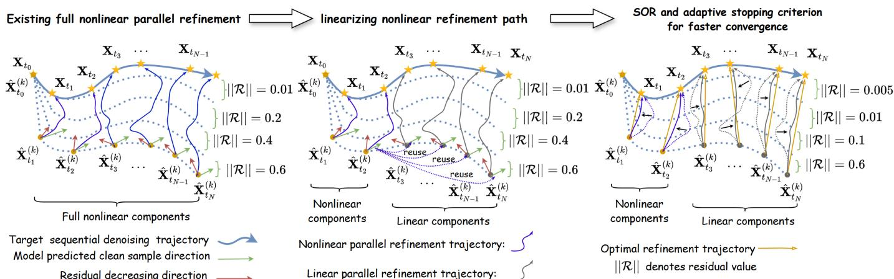
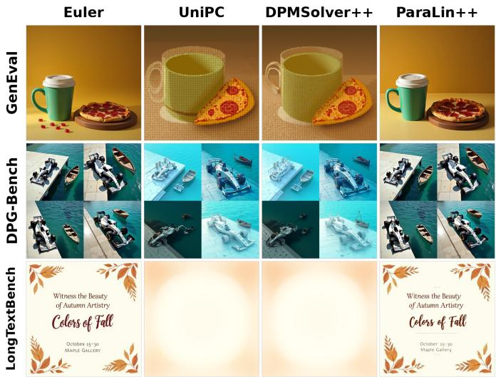
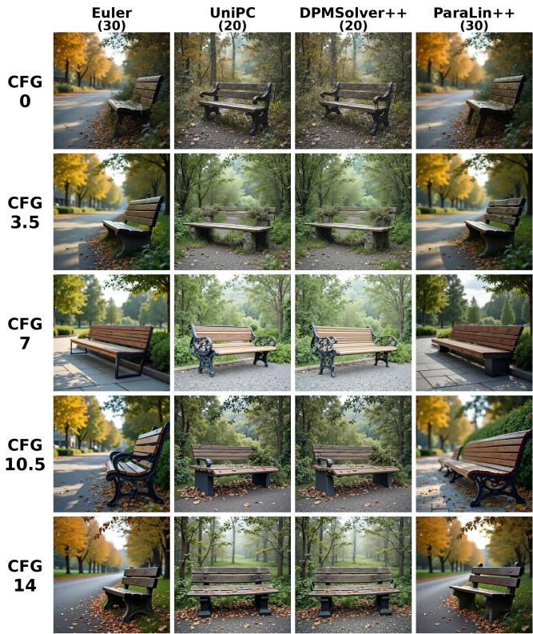
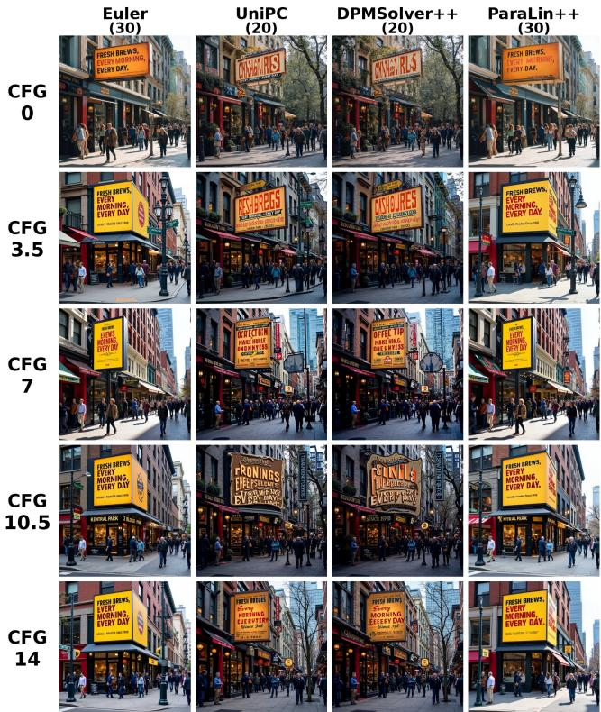
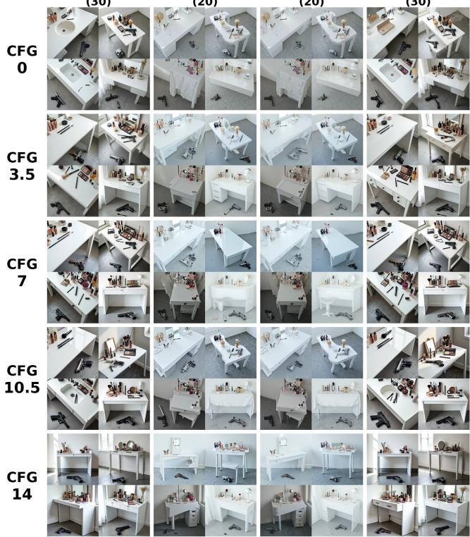
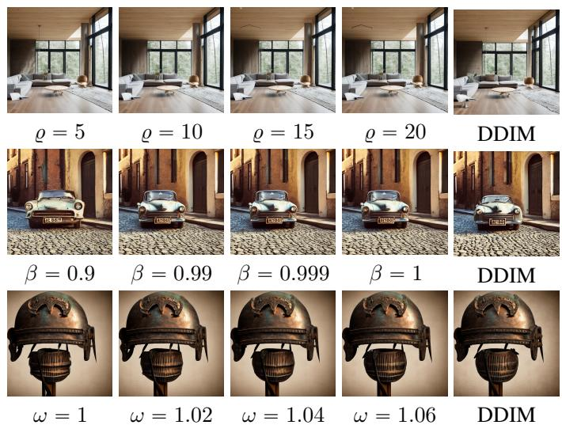
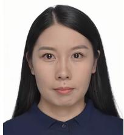

# ParaLin++: Accelerating Parallel Diffusion Integrator via Intrinsic Partially Linear Structure

Jianrong Lu, Zhiyu Zhu, Hui Liu, and Junhui Hou

Abstract—Training-free few-step samplers are often described as nearly quality-lossless under conventional FID/CLIP-style evaluation. It remains unclear whether that conclusion transfers to more realistic and complex generation-quality benchmarks. We first systematize the quality metrics used to evaluate training-free sampling acceleration for diffusion and flow-matching models.

We find that representative training-free step-shortening methods often remain nearly lossless under FID/CLIP-class metrics, yet can suffer substantial quality degradation when evaluated with semantic-composition, dense-instruction, and long-text-rendering benchmarks such as GenEval, DPG-Bench, and LongTextBench. Parallel sampling is a notable exception: by retaining the full-step discretization and removing only the solver’s temporal dependency, it can preserve near-lossless quality while accelerating sampling. Building on this observation, we propose ParaLin++, a stepparity parallel sampler that preserves the full-step discretization while accelerating the solver iterations. Experiments across Stable Diffusion-v2, LSUN Church, FLUX.1-dev, and Ming-Flash-Omni 2.0 show that ParaLin++ preserves the full-step Euler quality profile at 2.6ˆ–4.8ˆ, 1.68ˆ on FLUX, and 1.21ˆ on Ming. Project page: https://paralinplus.github.io/.

Index Terms—Diffusion Probabilistic Models, Parallel Sampling, Generative Models, Model Acceleration, Ordinary Differential Equations, System of Linear Equations.

## I. INTRODUCTION

D IFFUSION probabilistic models (DPMs) [22], [60] arenow widely used in image and video generation, including now widely used in image and video generation, including large flow-matching models such as FLUX [4] and Ming-Flash-Omni 2.0 [1], with applications from high-fidelity synthesis [53], [5] to molecular generation [68], [50] and a broad range of generative tasks [69], [39], [43], [9], [44], [70], [37]. In practical use, sampling cost is a dominant inference bottleneck: each high-resolution sample requires a long sequence of neural function evaluations (NFEs), and the latency of this sequential trajectory constrains serving throughput, inference cost, and on-device feasibility.

The reference discretization of a DPM is a fixed N-step ODE/SDE integrator, typically Euler with N“30 steps for flow-matching models. Accelerating this pipeline has followed two structurally different routes, alongside a broader landscape of training-free speedups [16], [75], [17], [13], [39], [47]. The first route shortens the discretization: high-order or few-step training-free solvers such as DDIM [57], DPMSolver [41], [42], and UniPC [73], together with distillation/consistency approaches [54], [58], [35], [38], cut the step count at the cost of changing the discretized trajectory. The second route removes solver latency instead: parallel sampling refines many time points concurrently, beginning with Picard iteration in ParaDiGMS [56] and progressing through triangular [62] and banded [45] nonlinear solvers, recently made NFE-efficient by the partial-linear formulation of ParaLin [46]. These two routes buy speed from different places: the first spends fewer integration steps, the second spends parallel compute to erase the solver’s temporal dependency.

The decisive axis of a training-free accelerator is the metric that certifies it “quality-lossless,” not the speed lever it uses. Much of the literature uses distributional and coarse textalignment proxies—FID measures closeness of the generated distribution to a reference, while CLIP measures coarse prompt– image embedding similarity. Post-trained text-to-image models, however, are often judged on a broader generation-quality profile: semantic composition (GenEval [15]), dense instruction following (DPG-Bench [23]), and long in-image text rendering (LongTextBench [14]). A step-shortening strategy that looks lossless under FID can still alter the prompt-conditioned trajectory and produce a failed generation, because it changes the discrete trajectory on which prompt and text fidelity depend even when the marginal image distribution is preserved. We therefore focus on step-parity parallelization: keep the complete fixed-step system, but solve its coupled integration equations in parallel so that latency is removed without changing the discretization on which prompt-level and in-image text fidelity depend.

## Our contributions. We make the following contributions.

1. A metric systemization and motivating finding. We systematize the quality metrics used to evaluate training-free sampling acceleration for diffusion and flow-matching models. Table I enumerates the evaluation protocols of a broad set of samplers—DDPM, DDIM, DPM-Solver, DPMSolver++, DPM-Solver-v3, UniPC, distillation and consistency methods, ParaDiGMS, ParaSolver, ParaLin, and ours—and shows that acceleration claims are usually certified by FID/CLIP-class metrics. These metrics measure statistical alignment or coarse prompt–image similarity; they do not directly measure semantic

## TABLE I

QUALITY METRICS USED TO EVALUATE TRAINING-FREE DIFFUSION/FLOW-MATCHING ACCELERATION IN THE LITERATURE AND IN THIS WORK. “DIST.” = DISTRIBUTIONAL, REFERENCE-BASED METRICS OF THE FID CLASS (FID, SFID, CLEAN-FID, IS, PRECISION–RECALL); “T2I-ALIGN.” = TEXT–IMAGE ALIGNMENT METRICS (CLIP SCORE, CLIP-FID); “COMPLEX” = GENERATION-QUALITY BENCHMARKS THAT ASSESS SEMANTIC COMPOSITION, DENSE INSTRUCTION FOLLOWING, OR IN-IMAGE TEXT RENDERING. THE ACCELERATION LITERATURE USUALLY STOPS AT DISTRIBUTIONAL/TEXT-ALIGNMENT PROXIES, WHEREAS THIS WORK ADDS A QUALITY-FOCUSED AUDIT. ✓/✗: METRIC REPORTED / NOT REPORTED BY THE METHOD’S OWN EVALUATION.
<table><tr><td>Method Dist.</td><td>T2I-align.</td><td>Complex</td></tr><tr><td>DDPM [22]</td><td>√ x</td><td>X</td></tr><tr><td>DDIM [57]</td><td>√ x</td><td>x</td></tr><tr><td>DPM-Solver [41]</td><td>√ x</td><td>x</td></tr><tr><td>DPMSolver++ [42]</td><td>√ √</td><td>x</td></tr><tr><td>DPM-Solver-v3 [76]</td><td>√ x</td><td>X</td></tr><tr><td>UniPC [73]</td><td>√ √</td><td>x</td></tr><tr><td>Euler (flow reference)</td><td>√ x</td><td>x</td></tr><tr><td>Prog. distillation [54]</td><td>√ √</td><td>x</td></tr><tr><td>Consistency model [58]</td><td>√ x</td><td>x</td></tr><tr><td>InstaFlow [39]</td><td>√ √</td><td>x</td></tr><tr><td>ParaDiGMS [56]</td><td>√ X</td><td>x</td></tr><tr><td>ParaTAA [62]</td><td>√ X</td><td>x</td></tr><tr><td>ParaSolver [45]</td><td>√ √</td><td>x</td></tr><tr><td>ParaLin [46]</td><td>√ √</td><td>x</td></tr><tr><td>ParaLin++ (ours)</td><td></td><td></td></tr></table>

composition, dense instruction following, or in-image text rendering. Throughout, “complex generation quality” refers specifically to these three measurable axes rather than to an exhaustive definition of generation quality. Prior FID-oriented evaluations of DDIM, DPMSolver, DPMSolver++, and UniPC often report that few-step configurations remain close to the reference distribution [57], [41], [42], [73]. Together with Table VI, this literature motivates a stricter audit: a 16-step DPMSolver++ configuration loses 21%–24% GenEval, 6.5–8.2 DPG-Bench points, and 67%–70% LongTextBench. Thus, the usual quality-lossless claim does not automatically transfer from FID/CLIP-style evidence to complex generation-quality benchmarks.

2. A stronger step-parity parallel solver, ParaLin++. We build the strongest available realization of the step-parity route to test how far this route reaches. Starting from ParaLin’s ϱ-nonlinear partial-linear system, we add an adaptive nonlinearization iteration, a successive-over-relaxation (SOR) update for both nonlinear and linear blocks, a sliding window, and an adaptive stopping rule based on relative historical errors and an exponential moving average. We prove that the SOR update is stable for $0 < \omega < 2 / ( 1 + L )$ (contraction factor L ă 1) and that the system admits the sequential trajectory as its unique convergent root.

3. A quality–speed audit on realistic generation benchmarks. We evaluate Stable Diffusion-v2, LSUN Church, FLUX.1- dev, Ming-Flash-Omni 2.0, five CFG values, three complexgeneration benchmarks, visual comparisons, and ablations. Our key lessons are:

1) FID/CLIP agreement does not imply generation-quality preservation. On FLUX, a 1.8ˆ few-step claim that is valid under FID coincides with a 21%–24% GenEval drop, a 6.5–8.2 DPG-Bench point drop, and a 67%–70% LongTextBench drop—an operational failure the standard evaluation hides.

2) Step-parity keeps the reference profile. Keeping all 30 steps and parallel-solving gives 1.68ˆ on FLUX and 1.21ˆ on Ming-Flash-Omni 2.0 with an Euler-level generation quality profile (0.64 vs. 0.66 GenEval, 84.24 vs. 83.97 DPG, 0.26 vs. 0.27 LTB), and 2.6ˆ–4.8ˆ on Stable Diffusion-v2/LSUN Church.

3) Guidance sharpens the quality gap. Across CFG 0–14, the completed DPG-Bench matrix shows ParaLin++ tracking Euler closely (82.18–84.24 vs. 82.25–83.97) while 20- step UniPC/DPMSolver++ drop to 68.85–79.67.

4) Report iterations and generation-quality metrics, not only FID. A speedup claim should separate discrete steps from solver iterations/NFE and be measured against the same-CFG 30-step Euler reference on a generation-quality benchmark; FID-only evidence is not sufficient to establish quality preservation.

Implications of our study. Representative training-free stepshortening methods can appear nearly lossless under FID/CLIP yet show substantial degradation on more realistic and complex quality benchmarks. This argues for reporting generationquality results alongside FID and for treating step-parity parallel sampling as an exception that can preserve near-lossless quality while accelerating sampling.

The remainder of this paper is organized as follows. Section II provides the necessary background and reviews existing training-free accelerators. Section III systematizes the quality metrics used to evaluate training-free acceleration and shows that FID-matched step shortening can incur large quality degradation on complex-generation benchmarks. Section IV first reviews ParaLin’s partial-linear reformulation and then designs the stronger parallel solver ParaLin++ (Section IV-B). Section V reports the quality–speed audit on complex-generation benchmarks and ablations. Section VI concludes this paper. Complete derivations and proofs of the propositions in Section IV are provided in Appendices A–D of the separate supplementary material.

## II. BACKGROUND

Sequential Integral Solvers. The forward diffusion process degrades a clean image $\mathbf { X } _ { T }$ into random noise $\mathbf { X } _ { 0 }$ according to the stochastic differential equation (SDE)

$$
\begin{array} { r } { d \mathbf { X } _ { t } = f ( t ) \mathbf { X } _ { t } d t + g ( t ) d \mathbf { W } , } \end{array}\tag{1}
$$

where dW is the standard Wiener process. This induces a marginal distribution $\mathbf { X } _ { t } ~ \sim ~ \mathcal { N } ( \alpha _ { t } \mathbf { X } _ { T } , \sigma _ { t } \mathbf { I } )$ with noise schedules $\alpha _ { t }$ and $\sigma _ { t }$ . Generation reverses the process through the reverse-time SDE

$$
d \mathbf { X } _ { t } = \underbrace { \left[ f ( t ) \mathbf { X } _ { t } - g ^ { 2 } ( t ) \nabla _ { \mathbf { X } _ { t } } \log p ( \mathbf { X } _ { t } ) \right] } _ { \diamond \mathcal { S } ( \mathbf { X } _ { t } , t ) } d t + \underbrace { g ( t ) } _ { \sigma _ { t } } d \mathbf { W } ,\tag{2}
$$

where a neural network $\mathbf { S } _ { \theta } ( \cdot )$ approximates the score. Let $\Phi ( t , s , { \bf X } _ { s } )$ denote the integral solution of Eq. (2) over $[ s , t ] \colon$

$$
\Phi ( t , s , { \mathbf { X } } _ { s } ) = { \mathbf { X } } _ { s } + \int _ { s } ^ { t } \varphi ( { \mathbf { X } } _ { \tau } , \tau ) d \tau + \int _ { s } ^ { t } \sigma _ { \tau } d { \mathbf { W } } .\tag{3}
$$

Parallel Integral Solvers. ParaSolver [45] provides a unified framework for sequential and parallel sampling. Given a trajectory divided into N sub-intervals $0 = t _ { 0 } < t _ { 1 } < \cdot \cdot \cdot < t _ { N } = T$ it forms the banded nonlinear system

$$
\begin{array} { r } { \left\{ \begin{array} { l l } { \hat { \mathbf { X } } _ { t _ { 0 } } - \mathbf { X } _ { t _ { 0 } } = \mathbf { 0 } , } \\ { \hat { \mathbf { X } } _ { t _ { n + 1 } } - \Phi \big ( t _ { n + 1 } , t _ { n } , \hat { \mathbf { X } } _ { t _ { n } } \big ) = \mathbf { 0 } , \quad n \in \{ 0 , 1 , \ldots , N - 1 \} . } \end{array} \right. } \end{array}\tag{4}
$$

Starting from an initial estimate, the concatenated state is updated by

$$
\begin{array} { r } { \hat { \mathbf { X } } _ { t _ { 0 } : t _ { N } } ^ { ( k + 1 ) } = \hat { \mathbf { X } } _ { t _ { 0 } : t _ { N } } ^ { ( k ) } - \mathcal { G } ^ { ( k ) } \mathcal { R } _ { t _ { 0 } : t _ { N } } ^ { ( k ) } , } \end{array}\tag{5}
$$

where $\mathcal { R } _ { t _ { 0 } } ^ { ( k ) } = \mathbf { 0 }$ and $\mathcal R _ { t _ { n + 1 } } ^ { ( k ) } = \hat { \mathbf X } _ { t _ { n + 1 } } ^ { ( k ) } - \Phi ( t _ { n + 1 } , t _ { n } , \hat { \mathbf X } _ { t _ { n } } ^ { ( k ) } )$ The solver matrix $\mathcal { G } ^ { ( k ) }$ selects the algorithm: $\mathcal { G } ^ { ( k ) } = \mathbf { I }$ gives fixed-point iteration [6], while $\mathcal { G } ^ { ( k ) } = \overline { { ( \mathcal { I } ^ { ( k ) } ) ^ { - 1 } } }$ gives Newton– Raphson iteration [30]. ParaLin [46] reduces the NFE burden of these fully nonlinear alternatives by exploiting the partial linearity of the integral solver.

## A. Existing Training-Free Accelerators

Step-parity temporal parallelization. Parallel sampling removes the temporal dependency of a fixed-step diffusion integrator by refining multiple time states concurrently. ParaDiGMS [56] introduced this direction through Picard– Lindelöf fixed-point iteration; Self-Refining Diffusion Samplers [55] use Parareal iterations; ParaTAA [62] formulates a triangular nonlinear system; and ParaSolver [45] improves efficiency through banded and hierarchical parallelization. CHORDS [19] further treats multi-core sampling as a hierarchy of increasingly accurate solvers, whereas ParaAnya [71] uses a plug-and-play output cache to avoid repeated evaluations at overlapping timesteps. These methods reinforce the same trade-off as ParaDiGMS: additional parallel compute replaces sequential time, rather than coarsening the integration grid. ParaLin [46] reduces the NFE overhead of fully nonlinear iterations by exploiting partial linearity; ParaLin++ strengthens this solver with adaptive nonlinearization, over-relaxation, and adaptive stopping.

A closely related but distinct solver is EPD [78], which evaluates multiple gradient directions concurrently inside each ODE step and learns a small set of solver parameters through distillation. Unlike step-parity methods, it changes the local integration rule and requires a lightweight training stage. Recent theory also cautions against an unconstrained parallelization story: parallel-round lower bounds [31] show that some distributions necessarily retain polynomial sequential dependence. ParaLin++ is therefore formulated as a practical fixed-step parallel integrator, not as a claim that all diffusion sampling can be made depth-free.

Speculative and asynchronous parallelism. A second paral lel family drafts approximate future states and verifies or refines them in parallel. Diffusion speculative sampling [11] preserves the target distribution by accepting or correcting draft proposals; FREE [67] extends this idea to feature-level autoregression in DiTs; SpecDiff [51] combines self-speculation with feature caching; and DRiffusion [3] uses a draft-and-refine process. AsyncDiff [8] instead breaks component dependencies through asynchronous denoising. These methods exploit drafts, verifiers, or stale hidden states, and thus change the execution graph; ParaLin++ solves the coupled fixed-step integration system directly and does not introduce an auxiliary drafter.

Step-shortening solvers and schedules. Classical highorder ODE samplers shorten the timestep grid [57], [41], [42], [73]. Recent training-free variants improve this route through adaptive flow paths [27], multirate integration for the guidance branch [32], stiffness-aware integration [61], and hierarchical timestep-schedule optimization [77]. These methods are relevant baselines for the quality audit, but they still alter the discretization on which prompt-conditioned trajectories depend.

Per-step compute reduction and model parallelism. Orthogonal accelerators reduce the cost of each denoising evaluation. They include feature and block caching [49], [48], [40], DiT attention or token sparsification [74], [26], temporal feature forecasting [36], [18], path-planned cache scheduling [10], and distributed or asynchronous execution [33], [66], [8]. Guidance acceleration [65], trajectory stitching [52], nested diffusion [12], and minimum-step prediction [72] are likewise complementary. These systems change the executed network path or decide when a cheaper computation is acceptable; ParaLin++ changes neither the timestep grid nor the full-step denoiser evaluation.

Quality-focused evaluation. The claim that FID/CLIP evidence is insufficient is consistent with the evaluation literature: TIFA uses visual question answering to test finegrained prompt faithfulness [24]; VQAScore and GenAI-Bench target compositional prompts [34]; and T2I-CompBench++ evaluates attributes, relations, and numeracy [25]. GenEval 2 additionally warns that static benchmarks can drift as generation models improve [28]. Our audit therefore interprets GenEval, DPG-Bench, and LongTextBench as a fixed, reproducible quality profile rather than as an absolute or exhaustive definition of generation quality.

## III. SYSTEMIZATION OF TRAINING-FREE DIFFUSION ACCELERATION

We systematize training-free diffusion acceleration through the quality metrics on which its “quality-lossless” claims rest, rather than through the speed lever it uses, because FID/CLIPstyle evidence does not by itself establish preservation on complex prompts. We first enumerate the evaluation protocols of the academic acceleration literature (Table I) and identify what these methods actually measure; we then test representative few-step quality claims under a generation-quality audit and find substantial degradation (Section $^ \mathrm { v , }$ summarized in Table VI).

## A. Quality Metrics in the Training-Free Acceleration Literature

Table I surveys the quality metrics used to evaluate a broad set of training-free samplers and their close relatives, from DDPM and DDIM through high-order solvers (DPM-Solver, DPMSolver++, DPM-Solver-v3, UniPC) and distillation/consistency methods, to parallel samplers (ParaDiGMS, ParaTAA, ParaSolver, ParaLin) and our ParaLin++. Two patterns are immediate. First, nearly every method is evaluated with distributional and text-alignment metrics only: FID (and its variants sFID, clean-FID) measures closeness of the generated distribution to a reference distribution, while CLIP score/CLIP-FID measures coarse prompt–image embedding similarity, and a handful additionally report Inception-based diversity (IS, Precision–Recall). These quantify statistical alignment— whether the marginal image distribution or the prompt–image embedding stays close to a reference—not whether a specific generated sample succeeds at semantic composition, dense instruction following, or long-text rendering. Second, few methods explicitly audit these generation-quality dimensions. Recent large-scale models such as FLUX [4] and Ming-Flash-Omni 2.0 [1], in contrast, report GenEval-, DPG-Bench-, and LongTextBench-style numbers, whereas FID/CLIP are scarce or absent in their evaluation reports. A sampler certified only by FID/CLIP-style metrics can therefore appear lossless while remaining fragile on complex prompts.

## B. A Realistic Quality Audit of Training-Free Accelerators

The metrics gap is not cosmetic. We further test the same training-free accelerators under the generation-quality profile— GenEval, DPG-Bench, and LongTextBench—on the highcapacity FLUX.1-dev [4], against the same-CFG 30-step Euler reference; the result is summarized in Table VI and elaborated in Section V. Methods advertised as nearly quality-lossless under FID show substantial degradation on the generationquality metrics. Prior FID-oriented evaluations support the general expectation that reduced-step configurations can remain close to the reference distribution [57], [41], [42], [73]; in our audit, however, 16-step UniPC and DPMSolver++ cause GenEval to fall from 0.66 to 0.50–0.52, DPG-Bench from 83.97 to 75.75–77.46, and LongTextBench from 0.27 to 0.08–0.09. An image distribution can stay FID-plausible while the model omits requested objects, breaks spatial relations, or renders unreadable text. Hence, representative training-free few-step solvers can appear nearly lossless under FID/CLIP yet lose substantially under realistic, complex quality metrics. Parallel sampling is an important exception: by preserving the full-step trajectory, it can retain near-lossless quality while removing solver latency.

This failure is structural rather than incidental. Stepshortening solvers (DDIM, DPMSolver++, UniPC) buy fewer discrete steps by altering the prompt-conditioned trajectory, and the altered trajectory is what breaks dense-prompt and text fidelity; FID merely fails to reflect this break because it overlooks sample-level semantics. Parallel sampling instead keeps all N discrete steps and removes only the solver’s temporal dependency, preserving the prompt-conditioned trajectory and the quality that depends on it. We call this the stepparity route, and ParaLin++ (Section IV-B) is designed as its strongest realization. The rest of the paper extends the generation-quality audit (Section V) and strengthens the stepparity solver (Sections IV–IV-B).

## IV. EXPLORING THE SPACE: FROM PARALIN TO PARALIN++

## A. The ParaLin Framework

Parallel solvers reformulate sequential diffusion integration into the nonlinear system in Eq. (4) and Eq. (5), but denoising many states in every iteration causes large NFE overhead. The accepted ParaLin framework [46] addresses this by reducing fully nonlinear score computation to partially linear operations. This section briefly recalls that formulation, which serves as the foundation of ParaLin++.

1) Reformulation of the Sequential Integral Solver: Existing approaches typically develop parallel solvers based on the sequential integral formulation in Eq. (3), which results in a fully nonlinear system of equations in Eq. (4) when employing the nonlinear score function $\mathbf { S } _ { \theta } ( \cdot )$ . We reveal that the sequential integral solver in Eq. (3) can be expressed in a more elementary form and reduced to a linear solver, as formally stated in the following Proposition 1.

Proposition 1 (Linear Approximation (Proof in Supplementary Material, Appendix A)). The sequential integral solver $\Phi ( t , s , { \bf X } _ { s } )$ from Eq. (3) can be decomposed into a linear solver H and a negligible error term ${ \mathcal { Z } } _ { s } .$

$$
\Phi ( t , s , \mathbf { X } _ { s } ) = \mathcal { H } \left( t , s , \mathbf { X } _ { s } , \mathbf { X } _ { T } ( \mathbf { X } _ { s } ) \right) + \mathcal { Z } _ { s } ,\tag{6}
$$

where the linear sequential integral solver $\mathcal { H } ( \cdot )$ is defined as:

$$
\mathcal { H } ( \cdot ) = \frac { \alpha _ { t } } { \alpha _ { s } } \mathbf { X } _ { s } - \alpha _ { t } \int _ { \lambda _ { s } } ^ { \lambda _ { t } } e ^ { - \lambda } \frac { \mathbf { X } _ { \lambda } - \alpha _ { \lambda } \mathbf { X } _ { T } ( \mathbf { X } _ { s } ) } { \sigma _ { \lambda } } d \lambda + \int _ { \lambda _ { s } } ^ { \lambda _ { t } } g ( \lambda ) d \mathbf { W } ,\tag{7}
$$

Here, $h = s - t$ denotes the step size and $\lambda _ { t } = \log ( \alpha _ { t } / \sigma _ { t } )$ . Under the assumption that the model prediction error is bounded $b y \zeta ,$ the decomposition error satisfies $\begin{array} { r } { \| \mathcal { Z } _ { s } \| \leqslant \zeta \alpha _ { t } \big ( \frac { \sigma _ { s } } { \alpha _ { s } } - \frac { \sigma _ { t } } { \alpha _ { t } } \big ) , } \end{array}$ which is negligible for $h \leqslant 1$

Remark 1. The small step size h is well-founded in practice. Theoretically, convergence guarantees for diffusion solvers strictly require bounded steps $( h \leqslant 1 \ I 7 J )$ , while practically high-fidelity generation involves more fine discretization $( e . g . ,$ $N \geqslant 5$ steps), ensuring $h \ : = \ : 1 / N \leqslant 0 . 2$ remains small to render the error negligible. As detailed in Tab. II, this error term is small for practical discretization. Specifically, for the EDM framework, the bound simplifies to $\| \mathcal { Z } _ { s } \| \leqslant \zeta h ;$ for the VE and VP schedules, the corresponding bounds shrink to first order as $h = s - t$ becomes small. This ensures that the approximation error remains negligible under high-fidelity sampling.

Now, following ParaSolver [45], the linear sequential integral solver in Eq. (7) can be decomposed into many integral functions on different time subintervals, written as

$$
\begin{array} { r } { \mathbf { X } _ { t _ { n + 1 } } = \mathcal { H } ( t _ { n + 1 } , t _ { n } , \mathbf { X } _ { t _ { n } } , \mathbf { X } _ { t _ { N } } ) , n \in \{ 0 , 1 , \cdots , N - 1 \} . } \end{array}\tag{8}
$$

TABLE II  
PRACTICAL ERROR BOUNDS FOR DIFFUSION FRAMEWORKS IN THE EDM DESIGN SPACE. PARAMETERS FOLLOW TABLE 1 OF [29], WITH $\beta _ { \mathrm { m i n } } = 0 . 1$ $\beta _ { d } = 1 9 . 9 $ , AND $\| \mathbf { S } _ { \theta ^ { \ast } } ( \mathbf { X } _ { t } , t ) - \epsilon _ { t } \| < \zeta$ FOR A SMALL STEP SIZE $h = s - t < 1$ . ROWS GIVE THE SCHEDULE SETTINGS, THE $\sigma _ { t } / \alpha _ { t }$ SUBSTITUTION, AND THE RESULTING BOUND; COLUMNS ARE THE DIFFUSION FRAMEWORKS.
<table><tr><td></td><td>EDM [29]</td><td>VE [60]</td><td>VP [60]</td></tr><tr><td rowspan="2">Schedule settings</td><td> $\alpha _ { t } = 1$ </td><td> $\alpha _ { t } = 1$ </td><td> $\alpha _ { t } = 1 / \sqrt { e ^ { \frac { 1 } { 2 } \beta _ { d } t ^ { 2 } + \beta _ { \operatorname* { m i n } } t } }$ </td></tr><tr><td> $\sigma _ { t } = t$ </td><td> $\sigma _ { t } = { \sqrt { t } }$ </td><td> $\sigma _ { t } = \alpha _ { t } \sqrt { e ^ { \frac { 1 } { 2 } \beta _ { d } t ^ { 2 } + \beta _ { \mathrm { m i n } } t } - 1 }$  _1</td></tr><tr><td>Substitution σt/αt =</td><td>t</td><td> $\sqrt { t }$ </td><td> $\sqrt { e ^ { \frac { 1 } { 2 } \beta _ { d } t ^ { 2 } + \beta _ { \mathrm { m i n } } t } - 1 }$ </td></tr><tr><td>Final error bound</td><td> $\| \mathcal { Z } _ { s } \| \leqslant \zeta ( s - t ) = \zeta h$ </td><td> $\| \mathcal { Z } _ { s } \| \leqslant \dot { \zeta ( \sqrt { s } - \sqrt { t } ) }$ </td><td> $\| \mathcal { Z } _ { s } \| ^ { ' } { \leqslant } \zeta { \alpha } _ { t } ( { \sigma } _ { s } / { \alpha } _ { s } - { \sigma } _ { t } / { \alpha } _ { t } )$ </td></tr></table>

Motivated by recent parallel algorithms [45], [59], this inherently sequential problem can be addressed in a parallel framework. Specifically, such a sequence of cascaded linear functions can be interpreted as a system of fully linear equations. Denote by $\{ \mathbf { X } _ { t _ { n } } , n = 0 , \dots , N \}$ a set of points exactly on the diffusion trajectory, and $\left\{ \hat { \mathbf { X } } _ { t _ { n } } , n = 0 , \ldots , \ N \right\}$ the unknown variables to be optimized towards the trajectory. The cascade of integral formulations as Eq. (8) can then be reformulated as the solutions to the following fully linear equations.

Definition 1 (Fully Linear Equation System). We define the system of fully linear equations for the sequential sampling process in Eq. (8) as

$$
\left\{ \begin{array} { l } { \hat { \mathbf { X } } _ { t _ { 0 } } - \mathbf { X } _ { t _ { 0 } } = \mathbf { 0 } , } \\ { \hat { \mathbf { X } } _ { t _ { n + 1 } } - \mathcal { H } ( t _ { n + 1 } , t _ { n } , \hat { \mathbf { X } } _ { t _ { n } } , \hat { \mathbf { X } } _ { t _ { N } } ) = \mathbf { 0 } , \quad n \in \{ 0 , 1 , \cdots , N - 1 \} . } \end{array} \right.\tag{9}
$$

The complete linearity of the above system permits exceptionally efficient solving with negligible computational cost. However, this very full linearity prevents them from achieving the sample quality of the sequential integral solvers in Eq. (3), as they lack information regarding the target data distribution. To bridge this quality gap, we introduce the target distribution information into the linear system by supplying the estimated clean sample $\hat { \mathbf { X } } _ { t _ { N } }$ . Recall that in the forward process of DPMs, we can compute a clean sample predicted $\hat { \mathbf { X } } _ { t _ { N } }$ as

$$
\hat { \bf X } _ { t _ { N } } ( \hat { \bf X } _ { t _ { n } } , \theta ) = \frac { \hat { \bf X } _ { t _ { n } } - \sigma _ { t _ { n } } { \bf S } _ { \theta } ( \hat { \bf X } _ { t _ { n } } , t _ { n } ) } { \alpha _ { t _ { n } } } ,\tag{10}
$$

where $\mathbf X _ { t _ { n } } \ \sim \ { \mathcal N } ( \alpha _ { t _ { n } } \mathbf X _ { t _ { N } } , \sigma _ { t _ { n } } \mathbf I )$ where α and $\sigma$ are the noise schedule. Note that the diffusion model consumes most computational resources on the score-matching process, i.e., estimating corresponding noise or clean samples by a neural network. In this paper, to lessen such burden of score matching, we explore the consistency of reverse diffusion process and propose to divide the NEs to a partial-linear equation system, namely ϱ-nonlinear equation system. Specifically, due to the diffusion models make progressive transition from pure noise to clean data distribution, the score function is highly unstable on the high noise region, which is also evidenced by recent research [52], [49]. For compactness, let $\mathcal { P } _ { i } ^ { ( j ) } = \hat { \mathbf { X } } _ { t _ { N } } \big ( \mathbf { \bar { X } } _ { t _ { i } } ^ { ( j ) } , \theta \big )$ denote the clean-sample prediction formed from state i at iteration $j ,$ and write $\mathcal { H } _ { i } ( x , y ) ~ = ~ \mathcal { H } ( t _ { i + 1 } , t _ { i } , x , y )$ . Based on such an insight, to further balance the score estimation accuracy and computational consumption, we divide the original NEs shown as Eq. 4 into ϱ-Nonlinear Equation System in Definition 2, where for the unstable and stable score region, we apply the nonlinear and linear solvers, respectively.

Definition 2 (ϱ-Nonlinear Equation System). We define a $\varrho \mathrm { - }$ nonlinear equation system for the sequential sampling process in Eq. (8) as

$$
\left\{ \begin{array} { l l } { \hat { \mathbf { X } } _ { t _ { 0 } } - \mathbf { X } _ { t _ { 0 } } = \mathbf { 0 } , } \\ { \hat { \mathbf { X } } _ { t _ { n + 1 } } - \mathcal { H } \Big ( t _ { n + 1 } , t _ { n } , \hat { \mathbf { X } } _ { t _ { n } } , \hat { \mathbf { X } } _ { t _ { N } } ( \hat { \mathbf { X } } _ { t _ { n } } , \theta ) \Big ) = \mathbf { 0 } , n \in [ 0 , \varrho - 1 ] , } \\ { \hat { \mathbf { X } } _ { t _ { n + 1 } } - \mathcal { H } \Big ( t _ { n + 1 } , t _ { n } , \hat { \mathbf { X } } _ { t _ { n } } , \hat { \mathbf { X } } _ { t _ { N } } ( \hat { \mathbf { X } } _ { t _ { \varrho - 1 } } , \theta ) \Big ) = \mathbf { 0 } , n \in [ \varrho , N - 1 ] . } \end{array} \right.\tag{11}
$$

Remark 2. The scalar ϱ serves as a critical transition point between nonlinear (score) and linear (fixed score) regimes in the system. The first ϱ equations evolve into computationally costly nonlinear equations, reducing into exiting nonlinear parallel system in Eq. (4). Subsequent equations $( f o r n \geqslant \varrho )$ retain computational efficiency as linear equations, as they depend only on the fixed prediction from the $( \varrho - 1 ) ^ { t h }$ time step.

Remark 3. The above framework establishes a unified paradigm, subsuming all existing parallel methods such as ParaDiGMS, ParaTAA, and ParaSolver as special cases. In particular, existing methods are fully nonlinear equation systems, corresponding to the limiting case $\varrho = N - 1$

Proposition 2 (Accumulated Error Bound (Proof in Supplementary Material, Appendix B)). For any ϱ, let $\{ \hat { \mathbf { X } } _ { t _ { n } } \} _ { n = 0 } ^ { N }$ be the solution to the ϱ-nonlinear surrogate system in Eq. (11) and $\{ \mathbf { X } _ { t _ { n } } \} _ { n = 0 } ^ { N }$ the exact sequential integral trajectory, with deviation $\Delta _ { t _ { n } } = \hat { \mathbf X } _ { t _ { n } } - \mathbf X _ { t _ { n } }$ and clean-sample estimation error $\pmb { \xi } _ { n } = \mathbf { E } _ { t _ { n } } - \mathbf { X } _ { T }$ . Under the high-quality sampling regime h $\leqslant 1$ the deviation obeys the per-step recurrence

$$
\lVert \mathbf { \Delta } \Delta _ { t _ { n + 1 } } \rVert \leqslant | \mathcal { A } _ { n } | \lVert \mathbf { \Delta } \mathbf { \Delta } \mathbf { \vec { \Delta } } _ { t _ { n } } \rVert + | \mathcal { B } _ { n } | \lVert \mathbf { \dot { \xi } } _ { n } \rVert + \lVert \mathcal { Z } _ { n } \rVert ,\tag{12}
$$

with $\begin{array} { r } { A _ { n } = \frac { \alpha _ { t _ { n + 1 } } } { \alpha _ { t } } ( 1 - \Delta \lambda _ { n } ) } \end{array}$ and $\begin{array} { r } { B _ { n } = \alpha _ { t _ { n + 1 } } \Delta \lambda _ { n } \left( 1 - \frac { \Delta \lambda _ { n } } { 2 } \right) } \end{array}$ Starting from $\Delta _ { t _ { 0 } } = \mathbf { 0 }$ and using $\vert \mathcal { A } _ { n } \vert \leqslant 1 , \vert \mathcal { B } _ { n } \vert = \mathcal { O } ( h )$ , and $\| \mathcal { Z } _ { n } \| = \zeta \mathcal { O } ( h )$ (Proposition 1), unrolling over the N steps yields the accumulated error bound

$$
\begin{array} { r l r } {  { \| \pmb { \Delta } _ { t _ { N } } \| \leqslant \sum _ { n = 0 } ^ { N - 1 } \Big ( \prod _ { j = n + 1 } ^ { N - 1 } | \mathcal { A } _ { j } | \Big ) \big ( | \mathcal { B } _ { n } | \| \pmb { \xi } _ { n } \| + \| \mathcal { Z } _ { n } \| \big ) } } \\ & { } & { \leqslant \sum _ { n = 0 } ^ { N - 1 } \big ( | \mathcal { B } _ { n } | \| \pmb { \xi } _ { n } \| + \| \mathcal { Z } _ { n } \| \big ) \leqslant N \mathcal { O } ( h ) \big ( \| \pmb { \xi } \| _ { \operatorname* { m a x } } + \zeta \big ) . } \end{array}\tag{13}
$$

The bound is structurally independent of ϱ: ϱ only changes the source of the estimator $\mathbf { E } _ { t _ { n } }$ (and hence $\| \pmb { \xi } _ { n } \| )$ , not the coefficients ${ \mathcal { A } } _ { n }$ and $B _ { n }$

Remark 4. Prop. 2 guarantees that different ϱ does not impact the quality of the generated samples. We note that ϱ is less of a hyperparameter and more of a hardware configuration parameter. For good efficiency, ϱ can simply be set to available processor counts.

## B. Designing ParaLin++: A Stronger Step-Parity Solver

ParaLin++ accelerates the ParaLin solver from two complementary perspectives. First, it retains ParaLin’s adaptive nonlinearization and immediate update strategy, which exploit the latest refined states within an iteration. Second, it introduces SOR and a relative adaptive stopping rule to reduce the remaining iterations. The sliding-window and initialization strategies are then integrated into the complete algorithm.

1) Adaptive Nonlinearization Iteration: We investigate the update rule in Eq. (5) to solve the prescribed ϱ-nonlinear system. Specializing Eq. (5) to our system yields the following iterative scheme:

$$
\begin{array} { r } { \hat { \mathbf { X } } _ { t _ { 0 } : t _ { N } } ^ { ( k + 1 ) } = \hat { \mathbf { X } } _ { t _ { 0 } : t _ { N } } ^ { ( k ) } - \mathcal { G } ^ { ( k ) } \mathcal { R } _ { t _ { 0 } : t _ { N } } ^ { ( k ) } , } \end{array}\tag{14}
$$

where the residual term $\mathcal { R } _ { t _ { n + 1 } } ^ { ( k ) }$ with $\mathcal { R } _ { t _ { 0 } } ^ { ( k ) } = \hat { \mathbf { X } } _ { t _ { 0 } } ^ { ( k ) } - \mathbf { X } _ { t _ { 0 } } = 0$ is defined as:

$$
\mathcal { R } _ { t _ { n + 1 } } ^ { ( k ) } = \left\{ \begin{array} { l l } { \hat { \mathbf { X } } _ { t _ { n + 1 } } ^ { ( k ) } - \mathcal { H } _ { n } \big ( \hat { \mathbf { X } } _ { t _ { n } } ^ { ( k ) } , \mathcal { P } _ { n } ^ { ( k ) } \big ) , } & { n \in [ 0 , \varrho - 1 ] , } \\ { \hat { \mathbf { X } } _ { t _ { n + 1 } } ^ { ( k ) } - \mathcal { H } _ { n } \big ( \hat { \mathbf { X } } _ { t _ { n } } ^ { ( k ) } , \mathcal { P } _ { \varrho - 1 } ^ { ( k ) } \big ) , } & { n \in [ \varrho , N - 1 ] . } \end{array} \right.\tag{15}
$$

Observe that this update rule applies a Jacobi-type iteration, where all components $\mathbf { X } _ { t _ { 1 } : t _ { N } } ^ { ( k + 1 ) }$ are updated exclusively from the old components $\mathbf { X } _ { t _ { 1 } : t _ { N } } ^ { ( k ) } ,$ , resulting in delayed information propagation across time steps. Inspired by the classical Gauss-Seidel iteration, we propose a more efficient immediate update strategy wherein newly updated components are incorporated immediately into subsequent components’ updating within the same iteration. Specifically, we first update the nonlinear-region components $\mathbf { X } _ { t _ { n } } ^ { ( \dot { k } ) }$ for $n \in \{ 1 , \cdots , \varrho \}$ . Upon obtaining the refined nonlinear component $\mathbf { X } _ { t _ { \varrho } } ^ { ( k + 1 ) }$ , we instantly propagate this refinement forward to compute the remaining linearregion components $( \mathrm { i . e . , ~ } \mathbf { X } _ { t _ { \varrho + 1 } } ^ { ( k + 1 ) } , \cdot \cdot . , \mathbf { X } _ { t _ { N } } ^ { ( k + 1 ) } )$ . This approach ensures faster convergence by propagating the latest information forward, leading to the following improved update rule:

$$
\begin{array} { r } { \hat { \mathbf { X } } _ { t _ { 0 } : t _ { N } } ^ { ( k + 1 ) } = \hat { \mathbf { X } } _ { t _ { 0 } : t _ { N } } ^ { ( k ) } - \mathcal { G } ^ { ( k ) } \mathcal { R } _ { t _ { 0 } : t _ { N } } ^ { ( k ) } , } \end{array}\tag{16}
$$

where the residual term $\mathcal { R } _ { t _ { n + } } ^ { ( k ) }$ now incorporates the latest refined components:

$$
\begin{array} { r } { \mathscr { R } _ { t _ { n + 1 } } ^ { ( k ) } = \left\{ \begin{array} { l l } { \hat { \mathbf { X } } _ { t _ { n + 1 } } ^ { ( k ) } - \mathscr { H } _ { n } \big ( \hat { \mathbf { X } } _ { t _ { n } } ^ { ( k ) } , \mathcal { P } _ { n } ^ { ( k ) } \big ) , } & { n \in [ 0 , \varrho - 1 ] , } \\ { \hat { \mathbf { X } } _ { t _ { n + 1 } } ^ { ( k ) } - \mathscr { H } _ { n } \big ( \hat { \mathbf { X } } _ { t _ { n } } ^ { ( k + 1 ) } , \mathcal { P } _ { \varrho - 1 } ^ { ( k ) } \big ) , } & { n \in [ \varrho , N - 1 ] . } \end{array} \right. } \end{array}\tag{17}
$$

We observe that once the nonlinear components converge, the predicted clean sample $\hat { \mathbf { X } } _ { t _ { N } } ( \hat { \mathbf { X } } _ { t _ { \varrho - 1 } } ^ { ( k ) } , \theta )$ becomes unchanged, implying that no further precise information can be propagated for the linear equations in subsequential iterations. To address this, we progressively convert the linear equations into nonlinear ones, such that the number of nonlinear equations remains unchanged as the iteration proceeds. Formally, at iteration $k ,$ suppose the unconverged components are $\hat { \mathbf { X } } _ { t _ { n } } ^ { ( k ) } , \cdot \cdot \cdot , \hat { \mathbf { X } } _ { t _ { N } } ^ { ( k ) }$ we maintain nonlinearity in the residuals $\{ \mathcal { R } _ { t _ { i + 1 } } ^ { ( k ) ^ { \ast } } , i = n , n \}$ $1 , \cdots , n { + } \varrho { - } 1 \}$ of the first ϱ components through the following formulation:

$$
\begin{array} { r } { \hat { \mathbf { X } } _ { t _ { n } : t _ { N } } ^ { ( k + 1 ) } = \hat { \mathbf { X } } _ { t _ { n } : t _ { N } } ^ { ( k ) } - \mathcal { G } ^ { ( k ) } \mathcal { R } _ { t _ { n } : t _ { N } } ^ { ( k ) } , } \end{array}\tag{18}
$$

where the residual term $\mathcal { R } _ { t _ { i + 1 } } ^ { ( k ) }$ can adaptively convert the linear equations into non-linear ones:

$$
\mathcal { R } _ { t _ { i + 1 } } ^ { ( k ) } = \left\{ \hat { \mathbf { X } } _ { t _ { i + 1 } } ^ { ( k ) } - \mathcal { H } _ { i } \big ( \hat { \mathbf { X } } _ { t _ { i } } ^ { ( k ) } , \mathcal { P } _ { i } ^ { ( k ) } \big ) , \quad i \in [ n , n + \varrho - 1 ] , \right.\tag{19}
$$

where $\mathcal { R } _ { t _ { n } } ^ { ( k ) } = \hat { \mathbf { X } } _ { t _ { n } } ^ { ( k ) } - \mathbf { X } _ { t _ { n } } = \mathbf { 0 }$ . This approach ensures continuous refinement of $\hat { \mathbf { X } } _ { t _ { N } } ( \hat { \mathbf { X } } _ { t _ { n + \varrho - 1 } } ^ { ( k ) } , \theta )$ , yielding increasingly accurate solutions for the linear equations.

Proposition 3 (Convergence Analysis). The update rule in Eq. (18) converges, within $K \ \leqslant \ T$ iterations, to the partially linear surrogate system, i.e., the ϱ-nonlinear system defined in Eq. (11). The surrogate trajectory $\{ \hat { \mathbf { X } } _ { t _ { n } } \} _ { n = 0 } ^ { N }$ differs from the exact sequential integral trajectory $\{ \mathbf { X } _ { t _ { n } } \} _ { n = 0 } ^ { N }$ by an accumulated error bounded in Proposition 2. In other words, the iteration closes the layer-3 to layer-2 gap (iterative solve Ñ surrogate system), while the layer-2 to layer-1 gap (surrogate Ñ exact sequential sampler) is the bounded deviation studied separately in Proposition 2.

Proof. See the supplementary material (Appendix C) for the complete derivation. □

2) Convergence Acceleration via Successive Over-Relaxation: While the immediate update strategy enhances information flow within each iteration, the solver may still require a considerable number of iterations (K) to converge, particularly for high-dimensional problems. To further reduce the iteration count, we incorporate the Successive Over-Relaxation (SOR) method, a well-established technique for accelerating the convergence of iterative solvers. The core idea is to introduce a relaxation factor $\omega$ to extrapolate the update step, pushing the solution more aggressively towards the root.

The standard Gauss-Seidel-like update can be viewed as a two-step process. First, an intermediate state $\hat { \mathbf { Z } } ^ { ( k + 1 ) }$ is computed based on the residual:

$$
\begin{array} { r } { \hat { \mathbf { Z } } ^ { ( k + 1 ) } = \hat { \mathbf { X } } ^ { ( k ) } - \mathcal { G } ^ { ( k ) } \mathcal { R } ^ { ( k ) } . } \end{array}\tag{20}
$$

The SOR update then modifies this step by taking a weighted average of the current state $\hat { \mathbf { X } } ^ { ( k ) }$ and the intermediate state $\hat { \mathbf { Z } } ^ { ( k + 1 ) }$

$$
\begin{array} { r } { \hat { \mathbf { X } } ^ { ( k + 1 ) } = ( 1 - \omega ) \hat { \mathbf { X } } ^ { ( k ) } + \omega \hat { \mathbf { Z } } ^ { ( k + 1 ) } , } \end{array}\tag{21}
$$

where $\omega$ is the relaxation factor. Setting $\omega = 1$ recovers the original update rule, while $\omega > 1$ (over-relaxation) typically accelerates convergence for the systems encountered in our problem. We now integrate this SOR mechanism into our solver for both the nonlinear and linear components.

Update for Nonlinear Components. For the first ϱ components within the current window, which are processed in parallel, we first compute their intermediate states based on the nonlinear residuals defined in Eq. (19):

$$
\begin{array} { r } { \hat { \mathbf { Z } } _ { t _ { n + 1 } : t _ { n + \varrho } } ^ { ( k + 1 ) } = \hat { \mathbf { X } } _ { t _ { n + 1 } : t _ { n + \varrho } } ^ { ( k ) } - \mathcal { G } ^ { ( k ) } \mathcal { R } _ { t _ { n + 1 } : t _ { n + \varrho } } ^ { ( k ) } . } \end{array}\tag{22}
$$

Subsequently, we apply the SOR update to obtain the refined states for the nonlinear block:

$$
\hat { \mathbf { X } } _ { t _ { n + 1 } : t _ { n + \varrho } } ^ { ( k + 1 ) } = ( 1 - \omega ) \hat { \mathbf { X } } _ { t _ { n + 1 } : t _ { n + \varrho } } ^ { ( k ) } + \omega \hat { \mathbf { Z } } _ { t _ { n + 1 } : t _ { n + \varrho } } ^ { ( k + 1 ) } .\tag{23}
$$

Update for Linear Components. For the remaining components $( i \in [ n + \varrho , N - 1 ] )$ , we combine the SOR method with the immediate update strategy. These components are

updated sequentially, allowing the most recent information to propagate immediately. For each linear component, we compute the intermediate state:

$$
\begin{array} { r } { \hat { \mathbf { Z } } _ { t _ { i + 1 } } ^ { ( k + 1 ) } = \hat { \mathbf { X } } _ { t _ { i + 1 } } ^ { ( k ) } - \mathcal { G } ^ { ( k ) } \mathcal { R } _ { t _ { i + 1 } } ^ { ( k ) } , } \end{array}\tag{24}
$$

where the residual $\mathcal { R } _ { t _ { i + 1 } } ^ { ( k ) }$ is computed using the already updated value $\hat { \mathbf X } _ { t _ { i } } ^ { ( k + 1 ) }$ , as specified in Eq. (19). The final updated state is then obtained via the SOR formulation:

$$
\hat { \mathbf { X } } _ { t _ { i + 1 } } ^ { ( k + 1 ) } = ( 1 - \omega ) \hat { \mathbf { X } } _ { t _ { i + 1 } } ^ { ( k ) } + \omega \hat { \mathbf { Z } } _ { t _ { i + 1 } } ^ { ( k + 1 ) } .\tag{25}
$$

By integrating SOR, our proposed solver, ParaLin++, signifi cantly reduces the number of iterations K required to reach the desired tolerance, thereby providing a substantial improvement in overall sampling efficiency without compromising the quality of the generated samples.

Proposition 4 (Relaxation Factor Analysis). The successive over-relaxation update guarantees convergence if the relaxation factor ω is chosen within the range $0 < \omega < 2 / ( 1 + L )$ , where $L < 1$ is the contraction factor of the underlying Gauss-Seidellike iterative solver.

Proof. See the supplementary material (Appendix D) for the complete derivation. □

Remark 5. Empirically, selecting ω within the range of p1.0, 1.08s effectively accelerates the process without compromising the generation quality.

3) Sliding Window Strategy: To optimize computational efficiency, ParaSolver utilizes a sliding window of fixed size p, retaining only the most recent p denoised points $\{ \hat { \mathbf { X } } _ { t _ { n } } ^ { ( k ) } : \ n \ = \ \mathbf { \bar { 0 } } , \ldots , \mathbf { \bar { \nu } } ^  p \mathrm { ~ - ~ } 1 \}$ for parallel processing. This approach enhances parallel performance while adhering to GPU memory limitations. Adapted to our framework, the update rule becomes:

$$
\begin{array} { r } { \hat { \mathbf { X } } _ { t _ { n } : t _ { n + p } } ^ { ( k + 1 ) } = \hat { \mathbf { X } } _ { t _ { n } : t _ { n + p } } ^ { ( k ) } - \mathcal { G } ^ { ( k ) } \mathcal { R } _ { t _ { n } : t _ { n + p } } ^ { ( k ) } , } \end{array}\tag{26}
$$

where the residual term $\mathcal { R } _ { t _ { i + 1 } } ^ { ( k ) }$ over a sliding window becomes:

$$
\mathcal { R } _ { t _ { i + 1 } } ^ { ( k ) } = \left\{ \begin{array} { l l } { \hat { \mathbf { X } } _ { t _ { i + 1 } } ^ { ( k ) } - \mathcal { H } _ { i } \big ( \hat { \mathbf { X } } _ { t _ { i } } ^ { ( k ) } , \mathcal { P } _ { i } ^ { ( k ) } \big ) , } & { i \in [ n , n + \varrho - 1 ] , } \\ { \hat { \mathbf { X } } _ { t _ { i + 1 } } ^ { ( k ) } - \mathcal { H } _ { i } \big ( \hat { \mathbf { X } } _ { t _ { i } } ^ { ( k + 1 ) } , \mathcal { P } _ { n + \varrho - 1 } ^ { ( k ) } \big ) , } & { i \in [ n + \varrho , p - 1 ] . } \end{array} \right.\tag{27}
$$

4) Adaptive Stopping Criterion: Prior works [56], [62], [45] typically employ a single tolerance, denoted as δ, to control the state difference across all timesteps. However, we find that this coarse-grained method cannot accurately identify states that have already converged, leading to superfluous iteration steps to update them. To address this inefficiency, we introduce a more fine-grained, adaptive stopping criterion.

Our approach is based on the principle of relative reduction to a historical average. Instead of comparing the current update error to a fixed threshold, we evaluate it against a fraction of the average historical error. This allows the criterion to dynamically adjust to the convergence progress.

Specifically, following [56], [62], [45], let the error of state $\hat { \mathbf X } _ { t _ { i } }$ at iteration $k \in [ 0 , K ]$ be defined as:

$$
\boldsymbol { \mathcal { E } } _ { t _ { i } } ^ { ( k ) } = \frac { 1 } { D \sigma _ { t _ { i } } ^ { 2 } } \left\| \hat { \mathbf { X } } _ { t _ { i } } ^ { ( k + 1 ) } - \hat { \mathbf { X } } _ { t _ { i } } ^ { ( k ) } \right\| _ { F } ^ { 2 } ,
$$

where D is the dimensionality of the state $\hat { \mathbf X } _ { t _ { i } }$ and $\| \cdot \| _ { F }$ denotes the Frobenius norm. We maintain a running average of all historical errors, $\bar { \mathcal { E } } _ { t _ { i } }$ , up to the current iteration k:

$$
\bar { \mathcal { E } } _ { t _ { i } } = \frac { 1 } { k + 1 } \sum _ { j = 0 } ^ { k } \mathcal { E } _ { t _ { i } } ^ { ( j ) } .
$$

The stopping condition is then met when the current error, $\mathcal { E } _ { t _ { i } } ^ { ( k ) }$ , is significantly smaller than this historical error average, scaled by a tolerance δ:

$$
\mathcal { E } _ { t _ { i } } ^ { ( k ) } \leqslant \delta \cdot \bar { \mathcal { E } } _ { t _ { i } } .
$$

Furthermore, the tolerance $\delta$ is not a fixed hyperparameter but is itself updated adaptively to refine the stopping condition. We introduce an update mechanism with an EDM (Exponential Decay Mean) decay rate, $\beta ,$ which allows the tolerance to respond to the recent convergence behavior. The tolerance for the next step, δ, is updated as follows:

$$
\delta = \beta \delta + ( 1 - \beta ) \cdot \mathcal { M } \Big ( \big \{ \mathcal { E } _ { t _ { i } } ^ { ( k ) } \mid i \in [ n , n + p - 1 ] \big \} \Big ) ,
$$

where $\mathcal { M } ( \cdot )$ computes the median value which provides a robust estimate of recent error.

This dual-adaptive strategy, comparing to the historical average and dynamically updating the tolerance threshold, enables a more efficient convergence. We empirically find it terminates iterations more precisely when a state has stabilized, thereby reducing the number of steps required while preserving sample quality.

5) Initialization: To establish the diffusion trajectory, we adopt the ParaSolver methodology by performing M steps of a sequential integral solver as preconditioning steps. The initialization process is formally expressed as:

$$
\begin{array} { r } { \left\{ \begin{array} { l l } { \hat { \mathbf { X } } _ { t _ { n } } ^ { ( 0 ) } = \mathbf { X } _ { t _ { n } } , } & { \mathrm { i f ~ } 0 \leqslant n < M , } \\ { \hat { \mathbf { X } } _ { t _ { n } } ^ { ( 0 ) } = \mathcal { H } \Bigl ( t _ { n } , t _ { n - 1 } , \hat { \mathbf { X } } _ { t _ { n - 1 } } ^ { ( 0 ) } , \hat { \mathbf { X } } _ { t _ { N } } ( \hat { \mathbf { X } } _ { t _ { M - 1 } } ^ { ( 0 ) } , \theta ) \Bigr ) , } & { \mathrm { i f ~ } M \leqslant n < N , } \end{array} \right. } \end{array}\tag{28}
$$

where the initial state $\mathbf { X } _ { t _ { 0 } }$ is sampled from a standard Gaussian distribution, $\mathbf { X } _ { t _ { 0 } } \sim \mathcal { N } ( \mathbf { 0 } , \mathbf { I } )$ . When $M = 0 ;$ following [56], all samples are initialized with random noise.

6) Complete Algorithm: Algorithm 1 and Figure 1 outlines the full procedure of the proposed method. Initially, an array of starting guesses $\{ \hat { \mathbf { X } } _ { t _ { n } } ^ { ( 0 ) } : n = 0 , \ldots , p \}$ is prepared either through random noises or inexpensive preconditioning steps (Line 1). The parallel sampling loop then begins at Line 3. In Lines 5–8, all nonlinear equations are solved simultaneously. Subsequently, Lines 9–12 compute the solutions to the linear equations, leveraging the predicted clean samples obtained from the nonlinear solving phase. This step is computationally efficient since it avoids model evaluations. The discrepancy between the newly computed states and the current states is assessed at Line 13, followed by determining the feasible window sliding stride at Line 15. Line 16 initializes s new points beyond the current window based on the computed stride. Finally, Lines 17–18 dynamically adjust the tolerance threshold δ based on the real-time residuals.

  
Residual decreasing direction Fig. 1. Illustration of ParaLin++. During iteration k, ParaLin++ performs simultaneous denoising updates across multiple steps. From left to right: existing full nonlinear parallel methods, our partial linear method, and our method for faster convergence.

## V. QUALITY–SPEED AUDIT ON GENERATION-QUALITY BENCHMARKS

## A. Experiment Settings

Evaluation Metrics and Datasets. We report function evaluations (NFEs), iterations, wall-clock time, FID [21], and CLIP score [20]. For Stable Diffusion-v2 and LSUN Church, FID and CLIP are computed on 5000 random samples, using ImageNet-1k with classifier guidance w “ 7.5 and the LSUN model, respectively. For FLUX, FID is computed on 5000 FluxPrompting [63] samples for the 12B model [4]. The CIFAR-10 lessstep study uses 50,000 samples, as reported in Table V. For generation-quality-focused evaluation, we additionally report GenEval [15], DPG-Bench [23], and LongTextBench [14], which assess semantic composition, dense instruction following, and long in-image text rendering, respectively.

Models. The evaluation covers latent-space Stable Diffusion-v2, CIFAR-10, the 12B FLUX flow-matching model, the pixelspace LSUN Church model, and VP/VE/EDM processes. The generation-quality study centers on FLUX and uses the Ming-Flash-Omni 2.0 generator [1] as a second large-scale reference model.

Algorithms. ParaLin++ is applied to DDIM [57] and DPM-Solver [41]. It is compared with ParaLin [46], ParaDiGMS [56], ParaSolver [45], and relevant few-step solvers. All compared baseline samplers are invoked through the official implemen tations integrated in the Diffusers library [64]; we do not use custom re-implementations of the baseline solvers.

Hyperparameters. Following [45], [62], we use the best tolerances reported for ParaDiGMS and ParaSolver. For ParaLin++, we set ϱ “ 8 unless otherwise specified, use eight NVIDIA RTX 3090 GPUs for multi-GPU settings, and search δ, β, and ω independently for each sampler. Additional details are given in the supplementary material.

FLUX generation-quality benchmark protocol. The FLUX.1- dev study uses 1024ˆ1024 generation with guidance scale 3.5 on eight GPUs. The Euler sampler with 30 discrete diffusion steps is the reference. UniPC and DPM-Solver++ are evaluated with their standard sequential few-step samplers at 16, 20, 24, 26, and 30 discrete diffusion steps. ParaLin++ keeps 30 discrete diffusion steps and uses the proposed parallel solver with tolerance δ “ 0.01, nonlinear-transition parameter ϱ “ 1, parallel window size p “ 100, and a solver-step cap of 1000. LongTextBench is the average of the English and Chinese text scores. Speedup is measured from the sampler/model forward-path time of the GenEval generation pass and excludes model loading and scoring; these timing measurements are used consistently across the detailed FLUX table.

Ming-Flash-Omni 2.0 generation-quality benchmark protocol. The Ming-Flash-Omni 2.0 study uses the Ming-Flash-Omni 2.0 generator at 1024ˆ1024 with guidance scale 5.0 on eight GPUs. Euler, UniPC, and DPM-Solver++ are evaluated with their standard sequential samplers at the listed step settings. ParaLin++ keeps 30 discrete diffusion steps and uses the proposed parallel solver with tolerance δ “ 0.01, nonlineartransition parameter ϱ “ 1, parallel window size p “ 100, and a solver-step cap of 1000. LongTextBench uses 320 prompts with 4 images each, seed 42, hybrid OCR, a bounding-box score threshold of 0.85, and reports the average of the English and Chinese scores. DPG-Bench uses 1065 images with the mPLUG visual-question-answering model. GenEval uses 553 prompts with 4 images each, bf16 generation, and 8 evaluation workers. The table reports the complete 16-, 20-, 24-, 26-, and 30-step quality matrix. All speedup values use the CFG-5 GenEval generation pass against the 30-step Euler reference, excluding model loading and scoring.

## B. Experimental Results

Latent-space Speedup Comparison. Table III shows the experimental results on DDIM, DPMSolver, and their parallel variants when combined with ParaSolver, ParaDiGMS, ParaLin, and our ParaLin++, respectively. ParaLin++ demonstrates significant acceleration for DDIM and DPMSolver while maintaining comparable FID and CLIP scores. Notably, it

TABLE III

Algorithm 1: ParaLin++: a partial nonlinear parallel   
integral solver for diffusion models   
Input : Diffusion model $S _ { \theta } ,$ , noise schedule α and $\sigma _ { t } ,$   
subinterval number N, preconditioning steps M, tolerance   
δ, batch window size p, sample dimension D, nonlinear   
degree ϱ, EMA decay rate $\beta ,$ relaxation factor ω.   
Output : A sample.   
1 Initialize $\{ \hat { \mathbf { X } } _ { t _ { n } } ^ { ( 0 ) } , \bar { n } = 0 , \cdot \cdot \cdot , p \}$ by Eq. (28) // Initialize with a few   
nsampling steps.   
2 Initialize $\{ \mathcal { E } _ { t _ { n } } ^ { ( 0 ) } = 0 , n = 0 , \cdots , N \}$ // Initialize error list.   
3 n, k Ð 0, 0, k P r0, Ks, and $n \in [ 0 , N - 1 ]$   
4 while n ă N do   
5 $\begin{array} { r } { \hat { \mathbf { X } } _ { t _ { N } } ( \hat { \mathbf { X } } _ { t _ { i } } ^ { ( k ) } , \theta ) = \frac { \hat { \mathbf { X } } _ { t _ { i } } ^ { ( k ) } - \sigma _ { t _ { i } } \mathbf { S } _ { \theta } ( \hat { \mathbf { X } } _ { t _ { i } } ^ { ( k ) } , t _ { i } ) } { \alpha _ { t } . } , \forall i \in \mathcal { N } \mathrm { ~ } } \end{array}$   
$\{ n , \cdot \cdot \cdot , n + \varrho - 1 \} .$ // Predict clean samples in parallel.   
6 $\mathcal { R } _ { t _ { i + 1 } } ^ { ( k ) } = \hat { \mathbf { X } } _ { t _ { i + 1 } } ^ { ( k ) ^ { \top } } - \mathcal { \hat { H } } \Big ( t _ { i + 1 } , t _ { i } , \hat { \mathbf { X } } _ { t _ { i } } ^ { ( k ) } , \hat { \mathbf { X } } _ { t _ { N } } ( \hat { \mathbf { X } } _ { t _ { i } } ^ { ( k ) } , \boldsymbol { \theta } ) \Big ) , \forall i \in$   
$\{ n , \cdot \cdot \cdot , n + \varrho - 1 \}$   
7 $\hat { \mathbf { Z } } _ { t _ { n + 1 } : t _ { n + g } } ^ { ( k + 1 ) } = \hat { \mathbf { X } } _ { t _ { n + 1 } : t _ { n + g } } ^ { ( k ) } - \mathcal { G } ^ { ( k ) } \mathcal { R } _ { t _ { n + 1 } : t _ { n + g } } ^ { ( k ) }$ //Obtain   
intermediate. states   
8 $\begin{array} { r } { \hat { \mathbf { X } } _ { t _ { n + 1 } : t _ { n + \varrho } } ^ { ( k + 1 ) } = ( 1 - \omega ) \hat { \mathbf { X } } _ { t _ { n + 1 } : t _ { n + \varrho } } ^ { ( k ) } + \omega \hat { \mathbf { Z } } _ { t _ { n + 1 } : t _ { n + \varrho } } ^ { ( k + 1 ) } } \end{array}$ //   
Update the nonlinear components.   
9 for $i \in \{ n + \varrho , n + \varrho + 1 , \overset { \cdot } { \cdot } \cdot \cdot , n + p - 1 \}$ do   
10 $\mathcal { R } _ { t _ { i + 1 } } ^ { ( \dot { k } ) } =$   
$\begin{array} { r } { \hat { \mathbf { X } } _ { t _ { i + 1 } } ^ { ( k ) } - \mathcal { H } \Big ( t _ { i + 1 } , t _ { i } , \hat { \mathbf { X } } _ { t _ { i } } ^ { ( k + 1 ) } , \hat { \mathbf { X } } _ { t _ { N } } ( \hat { \mathbf { X } } _ { t _ { n + \varrho - 1 } } ^ { ( k ) } , \theta ) \Big ) } \end{array}$   
in Eq. (17) // Linear residual.   
11 $\begin{array} { r l } { ~ } & { { } \hat { \mathbf { Z } } _ { t _ { i + 1 } } ^ { ( k + 1 ) } = \hat { \mathbf { X } } _ { t _ { i + 1 } } ^ { ( k ) } - \mathcal { G } ^ { ( k ) } \mathcal { R } _ { t _ { i + 1 } } ^ { ( k ) } } \end{array}$ // Obtain intermediate   
12 $\begin{array} { r } { \hat { \mathbf { X } } _ { t _ { i + 1 } } ^ { ( k + 1 ) } = ( 1 - \omega ) \hat { \mathbf { X } } _ { t _ { i + 1 } } ^ { ( k ) } + \omega \hat { \mathbf { Z } } _ { t _ { i + 1 } } ^ { ( k + 1 ) } \ , } \end{array}$ / Update the linear   
components.   
13 $\begin{array} { r } { \boldsymbol { \mathcal { E } } _ { t _ { i + 1 } } ^ { ( k ) } = \frac { 1 } { D \sigma _ { t _ { i } , \cdot , \cdot } ^ { 2 } } | | \mathbf { X } _ { t _ { i + 1 } } ^ { ( k + 1 ) } - \mathbf { X } _ { t _ { i + 1 } } ^ { ( k ) } | | _ { F } ^ { 2 } , \forall i \in \{ n , \cdot \cdot \cdot , n + p - 1 \} } \end{array}$   
i\`1   
// Compute error for each component.   
14 $\begin{array} { r } { \bar { \mathcal { E } } _ { t _ { i + 1 } } = \frac { 1 } { 1 + k } \sum _ { j = 0 } ^ { k } \mathcal { E } _ { t _ { i + 1 } } ^ { ( j ) } , \forall i \in \{ n , \cdot \cdot \cdot , n + p - 1 \} } \end{array}$ //   
Compute average error for each component.   
15 $s = \underset { i + 1 } { \overset { \cdot } { \operatorname* { m i n } } } ( \{ i + 1  \mathcal { E } _ { t _ { i + 1 } } ^ { ( k ) } > \delta ^ { 2 } \bar { \mathcal { E } } _ { t _ { i + 1 } } \forall i \in [ n , n + p ) \} \cup \{ n + p \} )$   
// The sliding stride.   
16 $\hat { \mathbf { X } } _ { t _ { i + 1 } } ^ { ( k + 1 ) } = \mathcal { H } \Big ( t _ { i + 1 } , t _ { i } , \hat { \mathbf { X } } _ { t _ { i } } ^ { ( k + 1 ) } , \hat { \mathbf { X } } _ { t _ { N } } ( \hat { \mathbf { X } } _ { t _ { n + \varrho - 1 } } ^ { ( k ) } , \theta ) \Big ) , \forall i \in$   
$\{ n + p , \cdot \cdot \cdot , \stackrel { . } { , } n + p + s - 1 \}$ // Initialize new components for   
the next window   
17 $e = \mathcal { M } \Big ( \{ \mathscr { E } _ { t _ { i + 1 } } ^ { ( k ) } | i = n , \cdot \cdot \cdot , n + p - 1 \} \Big ) / \neg$ Compute the median   
value of the errors.   
18 $\delta = \beta \delta + ( 1 - \beta ) e$ // Adaptive tolerance updating.   
19 n Ð n \` s, k Ð k \` 1, p Ð minpp, N ´ nq// Update the   
iteration indexs.   
Return: $\hat { \mathbf { X } } _ { t _ { N } } ^ { ( K ) }$

achieves a remarkable wall-clock time speedup of up to 4.8ˆ, setting a new benchmark for parallel diffusion methods. Although parallelization inherently trades computational efficiency for speed, leading to increased NFEs relative to sequential approaches, our method capitalizes on partial linearity to substantially reduce NFEs, thereby unleashing the parallel efficiency.

Pixel-space Speedup Comparison. Similarly, Table IV shows that ParaLin++ consistently surpasses existing methods, delivering wall-clock speedups of 3.1ˆ–4.5ˆ on the LSUN Church model across the tested step configurations. For the 50-step and 25-step DDIM settings, it achieves 4.5ˆ and 3.1ˆ speedups while preserving a nearly identical FID score (15.7 versus 15.5), respectively. Notably, ParaLin++’s parallelism reduces iterations by 3.1ˆ–5.6ˆ relative to the sequential baselines and, among the parallel variants, keeps NFE low; in the 50- step DDIM case, it uses only 9 iterations and 64 NFEs versus the baseline’s 50. This acceleration is important for real-time applications, such as interactive design tools, where latency directly impacts user experience.

COMPARISONS ON STABLE DIFFUSION-V2, WITH CLASSIFIER GUIDANCE W = 7.5. THE VISUAL COMPARISONS ARE SHOWN IN THE SUPPLEMENTARY FIGURES.
<table><tr><td rowspan="2">Steps </td><td rowspan="2">Method</td><td colspan="6">Stable Diffusion-v2</td></tr><tr><td>Iters ↓</td><td>NFE↓</td><td>CLIP↑</td><td>FID↓</td><td>Time (s)↓</td><td>Speedup↑</td></tr><tr><td rowspan="5"> $5 0$ </td><td>DDIM [57]</td><td>50</td><td>50</td><td>25.6</td><td>57.2</td><td>6.3</td><td>1.0×</td></tr><tr><td>DDIM + ParaDiGMS [56]</td><td>21</td><td>132</td><td>25.6</td><td>56.9</td><td>3.3</td><td>1.9×</td></tr><tr><td>DDIM + ParaSolver [45]</td><td>13</td><td>83</td><td>25.6</td><td>56.9</td><td>1.9</td><td>3.3×</td></tr><tr><td>DDIM + ParaLin [46]</td><td>13</td><td>73</td><td>25.6</td><td>57.1</td><td>1.7</td><td>3.7×</td></tr><tr><td>DDIM + ParaLin++</td><td>10</td><td>69</td><td>25.5</td><td>57.0</td><td>1.3 ı</td><td>4.8×</td></tr><tr><td rowspan="5"> $2 5$ </td><td>DDIM [57]</td><td>25</td><td>25</td><td>25.4</td><td>62.9</td><td>3.4</td><td>1.0×</td></tr><tr><td>DDIM + ParaDiGMS [56]</td><td>18</td><td>53</td><td>25.4</td><td>62.8</td><td>3.2</td><td>1.2×</td></tr><tr><td>DDIM + ParaSolver [45]</td><td>11</td><td>49</td><td>25.4</td><td>61.9</td><td>1.6</td><td>2.1×</td></tr><tr><td>DDIM + ParaLin [46]</td><td>11</td><td>42</td><td>25.4</td><td>61.8</td><td>1.55 I</td><td>2.2×</td></tr><tr><td>DDIM + ParaLin++</td><td>9</td><td>40</td><td>25.4</td><td>61.9</td><td>1.3</td><td>2.6×</td></tr><tr><td rowspan="5"> $5 0$ </td><td>DPMSolver [41]</td><td>50</td><td>50</td><td>25.6</td><td>57.2</td><td>6.3</td><td>1.0×</td></tr><tr><td>DPMSolver + ParaDiGMS [56]</td><td>25</td><td>132</td><td>25.6</td><td>57.2</td><td>3.3</td><td>1.8×</td></tr><tr><td>DPMSolver + ParaSolver [45]</td><td>15</td><td>96</td><td>25.6</td><td>57.1</td><td>2.2</td><td>3.1×</td></tr><tr><td>DPMSolver + ParaLin [46]</td><td>14</td><td>93</td><td>25.6</td><td>57.1</td><td>1.9</td><td>3.3×</td></tr><tr><td>DPMSolver + ParaLin++</td><td>10</td><td>77</td><td>25.6</td><td>57.1</td><td>1.35 I</td><td>4.7×</td></tr><tr><td rowspan="5">25</td><td>DPMSolver [41]</td><td>25</td><td>25</td><td>25.4</td><td>62.3</td><td></td><td>1.0×</td></tr><tr><td>DPMSolver + ParaDiGMS [56]</td><td>15</td><td>81</td><td>25.4</td><td>62.3</td><td>3.2 2.2</td><td></td></tr><tr><td>DPMSolver + ParaSolver [45]</td><td>11</td><td>58</td><td>25.4</td><td>62.2</td><td>1.5</td><td>1.5× 2.1×</td></tr><tr><td>DPMSolver + ParaLin [46]</td><td>10</td><td>55</td><td>25.4</td><td>62.1</td><td>1.4 I</td><td>2.3×</td></tr><tr><td>DPMSolver + ParaLin++</td><td>8</td><td>46</td><td>25.4</td><td>62.1</td><td>1.1 1</td><td>2.9×</td></tr></table>

TABLE IV

QUANTITATIVE COMPARISONS OF DIFFERENT METHODS ON LSUN CHURCH OVER 5000 SAMPLES. DPMSOLVER IS NOT INTEGRATED WITH THE LSUN MODEL IN THE DIFFUSERS LIBRARY; THUS WE EXCLUDE IT.
<table><tr><td rowspan="2">Steps</td><td rowspan="2">Method</td><td colspan="5">LSUN Church</td></tr><tr><td>Iters ↓</td><td>NFE↓</td><td>FID↓</td><td>Time (s)↓</td><td>Speedup↑</td></tr><tr><td rowspan="5">50</td><td>DDIM [57]</td><td>50</td><td>50</td><td>15.5</td><td>1.8</td><td>1.0×</td></tr><tr><td>DDIM + ParaDiGMS [56]</td><td>23</td><td>202</td><td>15.8</td><td>1.5</td><td>1.2×</td></tr><tr><td>DDIM + ParaSolver [45]</td><td>14</td><td>73</td><td>15.7</td><td>0.8</td><td>2.2×</td></tr><tr><td>DDIM + ParaLin [46]</td><td>14</td><td>67</td><td>15.7</td><td>0.6</td><td>3.0×</td></tr><tr><td>DDIM + ParaLin++</td><td>9</td><td>64</td><td>15.7</td><td>0.4</td><td>4.5×</td></tr><tr><td rowspan="5">25</td><td>DDIM [57]</td><td>25</td><td>25</td><td>15.6</td><td>1.1</td><td>1.0×</td></tr><tr><td>DDIM + ParaDiGMS [56]</td><td>15</td><td>96</td><td>15.7</td><td>0.8</td><td>1.4×</td></tr><tr><td>DDIM + ParaSolver [45]</td><td>10</td><td>44</td><td>15.7</td><td>0.5</td><td>2.2×</td></tr><tr><td>DDIM + ParaLin [46]</td><td>10</td><td>39</td><td>15.7</td><td>0.45</td><td>2.4×</td></tr><tr><td>DDIM + ParaLin++</td><td>8</td><td>33</td><td>15.7</td><td>0.36 </td><td>3.1×</td></tr></table>

TABLE V  
LESS-STEP SAMPLING ON THE CIFAR-10 MODEL WITH 50K SAMPLES.
<table><tr><td>Method</td><td>Iters</td><td>FID↓</td><td>Speedup↑</td></tr><tr><td>DPM-Solver-v3 [76]</td><td>25</td><td>2.64</td><td>1.00×</td></tr><tr><td>DPM-Solver-v3 [76]</td><td>10</td><td>3.40</td><td>2.43×</td></tr><tr><td>UniPC [73]</td><td>10</td><td>3.40</td><td>2.41×</td></tr><tr><td>PD [54]</td><td>10</td><td>3.10</td><td>2.48×</td></tr><tr><td>CD [58]</td><td>10</td><td>2.90</td><td>2.46×</td></tr><tr><td>ParaLin++ + DPM-Solver-v3</td><td>10</td><td>2.64</td><td>2.41×</td></tr></table>

Less-Step Sampling. Table V evaluates 10-step sampling on CIFAR-10 with 50,000 samples. ParaLin++ combined with DPM-Solver-v3 [76] reaches an FID of 2.64 and a 2.41ˆ speedup, matching the 25-step DPM-Solver-v3 quality while improving over the compared 10-step baselines.

Generation-Quality Benchmark Evaluation. Prior FIDoriented evaluations of DDIM, DPMSolver, DPMSolver++, and UniPC support the common expectation that few-step solvers can preserve distributional statistics [57], [41], [42], [73]. Table VI therefore asks whether this expectation transfers to GenEval, DPG-Bench, and LongTextBench for the same FLUX solvers. UniPC and DPMSolver++ with 16 discrete steps lose 21%–24% relative GenEval score, 6.5–8.2 DPG-Bench points, and 67%–70% of the LongTextBench score. ParaLin++ instead keeps all 30 discrete diffusion steps and parallelizes the iterative solve: it closely preserves the Euler-level generation-quality profile (0.64 versus 0.66 GenEval, 84.24 versus 83.97 DPG-Bench, and 0.26 versus 0.27 LongTextBench) and achieves a 1.68ˆ GenEval-forward speedup. Hence, the acceleration is obtained by removing latency in the solver iteration rather than by shortening the diffusion discretization on which prompt-level and in-image text fidelity depends.

TABLE VI  
MOTIVATING COMPARISON ON FLUX. FEW-STEP SEQUENTIAL SOLVERS ALTER THE 30-STEP DISCRETIZATION AND SHARPLY DEGRADE SEMANTIC COMPOSITION, COMPLEX PROMPT FOLLOWING, AND LONG-TEXT RENDERING. PARALIN++ KEEPS THE SAME 30 DISCRETE DIFFUSION STEPS AND PARALLELIZES THE SOLVER ITERATIONS. FOR SEQUENTIAL SOLVERS, “ITERS” EQUALS THE NUMBER OF DISCRETE STEPS; FOR PARALIN++, IT REPORTS THE AVERAGE NUMBER OF PARALLEL SOLVER ITERATIONS.
<table><tr><td>Method</td><td>Sampling regime</td><td>Discrete steps</td><td>Iters↓</td><td>GenEval↑</td><td>DPG-Bench↑</td><td>LongTextBench↑</td><td>Speedup↑</td></tr><tr><td>Euler [4]</td><td>Sequential reference</td><td>30</td><td>30</td><td>0.66</td><td>83.97</td><td>0.27</td><td>1.00×</td></tr><tr><td>UniPC [73]</td><td>Few-step</td><td>16</td><td>16</td><td>0.52</td><td>77.46</td><td>0.09</td><td>1.81×</td></tr><tr><td>DPMSolver++ [42]</td><td>Few-step</td><td>16</td><td>16</td><td>0.50</td><td>75.75</td><td>0.08</td><td>1.85×</td></tr><tr><td>ParaLin++</td><td>Step-parity parallel</td><td>30</td><td>16.37</td><td>0.64</td><td>84.24</td><td>0.26</td><td>1.68×</td></tr></table>

This evaluation protocol also reflects the objectives of recent large-scale generators. Ming-Flash-Omni 2.0 [1], the sparse unified successor to Ming-Omni [2], reports 0.94 GenEval and 86.98 DPG-Bench, and its post-training explicitly optimizes realism, instruction adherence, and aesthetic quality together with task-specific rewards. These are generation-quality axes that FID does not reliably capture. Accordingly, the FLUX study and Ming-Flash-Omni 2.0 reference establish a more realistic quality test bed for judging whether a fast diffusion sampler merely matches a distributional statistic or actually preserves generation quality. In addition to the motivating 16- step comparison, Table VII records the complete 16-, 20-, 24-, 26-, and 30-step generation-quality benchmark matrices for FLUX and Ming-Flash-Omni 2.0. The table separates the number of discrete diffusion steps from the number of solver iterations: sequential samplers use one iteration per step, whereas ParaLin++ keeps 30 discrete steps and reports its average number of parallel solver iterations separately. For Ming-Flash-Omni 2.0, ParaLin++ reaches a 1.21ˆ GenEval generation-pass speedup over the 30-step Euler reference while retaining the Euler-level profile: GenEval is 0.87 versus 0.88, DPG-Bench is 86.99 versus 86.86, and LongTextBench is 0.95 versus 0.95.

Table VIII extends the FLUX audit to different guidance strengths. Across the five CFG values, ParaLin++ obtains GenEval speedups of 1.55ˆ–1.86ˆ over the same-CFG 30- step Euler reference while preserving 97%–99% of the Euler GenEval score. Its GenEval scores are 0.59–0.66 and its Long-TextBench scores are 0.15–0.26, close to Euler’s respective ranges of 0.60–0.67 and 0.17–0.27. In contrast, the 20-step UniPC and DPMSolver++ configurations yield only 0.43–0.55 GenEval and 0.06–0.13 LongTextBench across the same CFG values. The DPG-Bench scores, now complete at all five CFG values, follow the same pattern: ParaLin++ tracks the Euler reference closely across CFG 0–14 (82.18–84.24 versus Euler’s 82.25–83.97), whereas the 20-step UniPC and DPMSolver++ configurations drop to 68.85–79.67. The reference scores also show that guidance affects benchmarks differently: Euler’s GenEval score peaks at CFG 10.5, whereas its LongTextBench score peaks at CFG 3.5. ParaLin++ remains close to the reference at every guidance setting. (Takeaway) Across CFG 0–14, the completed DPG-Bench matrix confirms that stepparity survives rising guidance while 20-step few-step solvers do not.

  
Fig. 2. Generation-quality benchmark visual comparison on FLUX.1-dev. Each row is one representative benchmark prompt, and the columns show 30-step Euler, 16-step UniPC, 16-step DPMSolver++, and 30-step ParaLin++ (17 parallel solver iterations). Few-step examples retain plausible low-level appearance but can violate semantic composition, dense instructions, or inimage text requirements; ParaLin++ remains visually aligned with the 30-step Euler reference.

Figures 2 provide benchmark-specific visual inspections of the same quality axes. The FLUX examples use the exact 30-step reference/few-step settings compared above: Euler and ParaLin++ retain 30 discrete steps, while UniPC and DPMSolver++ use 16 steps. The examples show typical failures hidden by an FID-only criterion, such as missing or malformed objects, weaker dense-instruction compliance, and unreadable in-image text. The step-parity ParaLin++ outputs remain visually close to the 30-step Euler reference.

Figures 3 and 4 show fixed-prompt comparisons over all five CFG values. The same prompt and sample index are used in every column and row, so differences come from the method and CFG rather than from selecting a different example for each method. LongTextBench is represented by an English prompt because its reported metric averages the English and

TABLE VII  
DETAILED GENERATION-QUALITY BENCHMARK RESULTS ON FLUX AND MING-FLASH-OMNI 2.0. WITHIN EACH MODEL BLOCK, SPEEDUP IS MEASURED AGAINST THAT MODEL’S 30-STEP EULER BASELINE ON THE SAME GENEVAL GENERATION PASS, EXCLUDING MODEL LOADING AND SCORING. FOR SEQUENTIAL SAMPLERS, “ITERS” EQUALS THE NUMBER OF DISCRETE STEPS; FOR PARALIN++, IT DENOTES THE NUMBER OF PARALLEL SOLVER ITERATIONS.
<table><tr><td colspan="8">FLUX.1-dev [4]</td></tr><tr><td>Method</td><td>Sampling regime</td><td>Steps</td><td>Iters</td><td>GenEval↑</td><td>DPG-Bench↑</td><td>LongTextBench↑</td><td>Speedup↑</td></tr><tr><td>Euler [4]</td><td>Sequential reference</td><td>30</td><td>30</td><td>0.66</td><td>83.97</td><td>0.27</td><td>1.00×</td></tr><tr><td rowspan="5">UniPC [73]</td><td rowspan="5">Few-step</td><td>16</td><td>16</td><td>0.52</td><td>77.46</td><td>0.09</td><td>1.81×</td></tr><tr><td>20</td><td>20</td><td>0.55</td><td>79.67</td><td>0.13</td><td>1.49×</td></tr><tr><td>24</td><td>24</td><td>0.57</td><td>80.98</td><td>0.15</td><td>1.26×</td></tr><tr><td>26</td><td>26</td><td>0.58</td><td>81.35</td><td>0.16</td><td>1.16×</td></tr><tr><td>30</td><td>30</td><td>0.60</td><td>82.14</td><td>0.19</td><td>1.01×</td></tr><tr><td rowspan="5">DPMSolver++ [42]</td><td rowspan="5">Few-step</td><td>16</td><td>16</td><td>0.50</td><td>75.75</td><td>0.08</td><td>1.85×</td></tr><tr><td>20</td><td>20</td><td>0.54</td><td>78.41</td><td>0.11</td><td>1.50×</td></tr><tr><td>24</td><td>24</td><td>0.58</td><td>80.06</td><td>0.14</td><td>1.27×</td></tr><tr><td>26</td><td>26</td><td>0.58</td><td>80.56</td><td>0.15</td><td>1.17×</td></tr><tr><td>30</td><td>30</td><td>0.62</td><td>81.43</td><td>0.17</td><td>1.02×</td></tr><tr><td>ParaLin++</td><td>Step-parity parallel</td><td>30</td><td>16.37</td><td>0.64</td><td>84.24</td><td>0.26</td><td>1.68×</td></tr><tr><td></td><td></td><td>Ming-Flash-Omni 2.0 [1]</td><td></td><td></td><td></td><td></td><td></td></tr><tr><td>Method</td><td>Sampling regime</td><td>Steps</td><td>Iters</td><td>GenEval↑</td><td>DPG-Bench↑</td><td>LongTextBench↑</td><td>Speedup↑</td></tr><tr><td>Euler [4]</td><td>Sequential reference</td><td>30</td><td>30</td><td>0.88</td><td>86.86</td><td>0.95</td><td>1.00×</td></tr><tr><td rowspan="5">UniPC [73]</td><td rowspan="5">Few-step</td><td>16</td><td>16</td><td>0.69</td><td>84.38</td><td>0.82</td><td>1.80×</td></tr><tr><td>20 24</td><td>20</td><td>0.75</td><td>85.29</td><td>0.91</td><td>1.47×</td></tr><tr><td>26</td><td>24 26</td><td>0.74</td><td>85.55</td><td>0.94</td><td>1.20×</td></tr><tr><td></td><td></td><td>0.81</td><td>85.07</td><td>0.94</td><td>1.13×</td></tr><tr><td>30</td><td>30</td><td>0.83</td><td>85.77</td><td>0.95</td><td>0.98×</td></tr><tr><td rowspan="5">DPMSolver++ [42]</td><td rowspan="5">Few-step</td><td>16</td><td>16</td><td>0.73</td><td>84.20</td><td>0.80</td><td>1.81×</td></tr><tr><td>20</td><td>20</td><td>0.70</td><td>85.63</td><td>0.87</td><td>1.48×</td></tr><tr><td>24</td><td>24</td><td>0.70</td><td>85.91</td><td>0.92</td><td>1.23×</td></tr><tr><td>26</td><td>26</td><td>0.86</td><td>85.93</td><td>0.93</td><td>1.13×</td></tr><tr><td>30</td><td>30</td><td>0.85</td><td>86.62</td><td>0.95</td><td>0.99×</td></tr><tr><td>ParaLin++</td><td>Step-parity parallel</td><td>30</td><td>24.69</td><td>0.87</td><td>86.99</td><td>0.95</td><td>1.21×</td></tr></table>

Chinese subsets. Figure 5 gives corresponding DPG-Bench samples across all five guidance settings for a representative prompt; the complete CFG-0–14 DPG-Bench matrix is reported in Table VIII.

Single GPU for Acceleration Parallel sampling methods are often criticized for trading excessive computational cost for speed, which is impractical for users with limited resources. However, our experiments in Table IX demonstrate the realworld viability of our approach on a single GPU. Unlike competing parallel methods like ParaDiGMS, which often fail to provide any speedup or even decelerate the process in this setting, our ParaLin++ achieves consistent and significant wall-clock acceleration across all baseline samplers. For instance, it speeds up the 100-step DDIM by 4.2ˆ and the 100-step DPMSolver by 3.7ˆ. This is accomplished while maintaining virtually identical generation quality (FID and CLIP scores). This validates ParaLin++ as a practical and potent accelerator for everyday users, effectively overcoming the typical computational barriers of parallel sampling even in resource-constrained, single-GPU environments.

Ablation Study. Table X isolates the value of the ParaLin++ components on a 100-step DDIM task. Full nonlinearity reduces iterations but multiplies NFEs and becomes slower than the sequential baseline. Partial nonlinearity removes 93.3% of these NFEs relative to the fully nonlinear variant and already restores wall-clock speedup. Adaptive stopping slightly reduces both iterations and NFEs, while SOR gives the strongest reduction, reaching 15 iterations, 117 NFEs, and a 6.5ˆ speedup. The trend confirms that the largest gain comes from ParaLin’s partial-linear formulation, while ParaLin++ further improves convergence by lowering iterations with negligible extra computation.

Generalization on VP, VE, and EDM Process. We investigated the impact of the VP, VE, and EDM diffusion processes by converting the sequential sampler in Alg. 1 of work [29] into our parallel version. Adopting the Tab. 1 configurations specified in work [29], we then analyzed the effect of the nonlinear degree ϱ on FID performance across these three processes using the provided ImageNet dataset. As shown in Tab. XI, our parallel sampling method demonstrates its applicability and effectiveness across all three diffusion processes. For each process, our parallel approach consistently reduces the number of sampling iterations while achieving comparable or improved FID scores compared to the sequential

FLUX.1-DEV CFG-SWEEP RESULTS. ALL BENCHMARK CELLS (GENEVAL, DPG-BENCH, AND LONGTEXTBENCH) ARE COMPLETE FOR ALL FIVE CFG

VALUES; LTB ABBREVIATES LONGTEXTBENCH AND DPM++ ABBREVIATES DPMSOLVER++. “ITERS” EQUALS THE DISCRETE-STEP COUNT FOR SEQUENTIAL BASELINES AND DENOTES THE AVERAGE MEASURED PARALLEL SOLVER ITERATIONS FOR PARALIN++. SPEEDUP IS MEASURED AGAINST THE 30-STEP EULER REFERENCE AT THE SAME CFG ON THE GENEVAL GENERATION PASS, EXCLUDING MODEL LOADING AND  
TABLE VIII
<table><tr><td>CFG</td><td>Method</td><td>Iters</td><td>GenEval↑</td><td>DPG↑</td><td></td><td>LTB↑ Speedup↑</td></tr><tr><td rowspan="3">0</td><td>Euler [4]</td><td>30</td><td>0.60</td><td>82.25</td><td>0.17</td><td>1.00×</td></tr><tr><td>UniPC [73]</td><td>20</td><td>0.46</td><td>78.97</td><td>0.08</td><td>1.49×</td></tr><tr><td>DPM++ [42]</td><td>20</td><td>0.43</td><td>77.71</td><td>0.06</td><td>1.49×</td></tr><tr><td></td><td>ParaLin++</td><td>14.79</td><td>0.59</td><td>82.18</td><td>0.15</td><td>1.86×</td></tr><tr><td rowspan="3">3.5</td><td>Euler [4]</td><td>30</td><td>0.66</td><td>83.97</td><td>0.27</td><td>1.00×</td></tr><tr><td>UniPC [73]</td><td>20</td><td>0.55</td><td>79.67</td><td>0.13</td><td>1.49×</td></tr><tr><td>DPM++ [42]</td><td>20</td><td>0.54</td><td>78.41</td><td>0.11</td><td>1.50×</td></tr><tr><td></td><td>ParaLin++</td><td>16.92</td><td>0.64</td><td>84.24</td><td>0.26</td><td>1.68×</td></tr><tr><td rowspan="4">7</td><td>Euler [4]</td><td>30</td><td>0.66</td><td>83.29</td><td>0.25</td><td>1.00×</td></tr><tr><td>UniPC [73]</td><td>20</td><td>0.49</td><td>72.60</td><td>0.07</td><td>1.49×</td></tr><tr><td>DPM++ [42]</td><td>20</td><td>0.48</td><td>68.85</td><td>0.06</td><td>1.49×</td></tr><tr><td>ParaLin++</td><td>17.85</td><td>0.64</td><td>83.22 0.23</td><td></td><td>1.55×</td></tr><tr><td rowspan="3">10.5</td><td>Euler [4]</td><td>30</td><td>0.67</td><td>83.21</td><td>0.22</td><td>1.00×</td></tr><tr><td>UniPC [73]</td><td>20</td><td>0.52</td><td>77.89</td><td>0.07</td><td>1.48×</td></tr><tr><td>DPM++ [42]</td><td>20</td><td>0.52</td><td>76.54</td><td>0.06</td><td>1.49×</td></tr><tr><td></td><td>ParaLin++</td><td>17.03</td><td>0.66</td><td>83.23</td><td>0.21</td><td>1.62×</td></tr><tr><td rowspan="3">14</td><td>Euler [4]</td><td>30</td><td>0.65</td><td>82.52</td><td>0.25</td><td>1.00×</td></tr><tr><td>UniPC [73]</td><td>20</td><td>0.54</td><td>75.88</td><td>0.08</td><td>1.49×</td></tr><tr><td>DPM++ [42]</td><td>20</td><td>0.54</td><td>74.17</td><td>0.07</td><td>1.49×</td></tr><tr><td></td><td>ParaLin++</td><td>17.13</td><td>0.64</td><td>82.75</td><td>0.23</td><td>1.61×</td></tr></table>

  
Fig. 3. GenEval CFG-sweep visual comparison on FLUX.1-dev. Rows are CFG 0, 3.5, 7, 10.5, and 14; columns are 30-step Euler, 20-step UniPC, 20-step DPMSolver++, and 30-step ParaLin++. All cells use prompt 00000 and sample 0000.

  
Fig. 4. LongTextBench CFG-sweep visual comparison on FLUX.1-dev, using the English prompt 0000 with variant 1. Rows are CFG 0, 3.5, 7, 10.5, and 14; columns are 30-step Euler, 20-step UniPC, 20-step DPMSolver++, and 30-step ParaLin++. The reported LongTextBench metric averages the English and Chinese scores.

TABLE IX  
COMPARISONS ON STABLE DIFFUSION-V2 WHEN ONLY USING ONE GPU,WITH CLASSIFIER GUIDANCE w “ 7.5. “DPM” DENOTES DPM-SOLVER;PARADIGMS, PARASOLVER, PARALIN, AND PARALIN++ INDICATE THECORRESPONDING PARALLEL WRAPPERS OF THE SEQUENTIAL SAMPLER.
<table><tr><td>Sampler</td><td>Method</td><td>|Iters↓</td><td>NFE↓</td><td>CLIP↑</td><td>FID↓</td><td></td><td>Time (s)↓ Speedup↑</td></tr><tr><td rowspan="5">DDIM-50</td><td>Sequential</td><td>50</td><td>50</td><td>25.6</td><td>57.2</td><td>6.3</td><td>1.0×</td></tr><tr><td>ParaDiGMS</td><td>34</td><td>67</td><td>25.6</td><td>56.9</td><td>7.8</td><td>0.8×</td></tr><tr><td>ParaSolver</td><td>18</td><td>53</td><td>25.6</td><td>56.9</td><td>6.0</td><td>1.05×</td></tr><tr><td>ParaLin</td><td>14</td><td>51</td><td>25.6</td><td>57.1</td><td>5.7</td><td>1.1×</td></tr><tr><td>ParaLin++</td><td>8</td><td>32</td><td>25.6</td><td>57.1</td><td>3.2</td><td>2.0×</td></tr><tr><td rowspan="5">DDIM-100</td><td>Sequential</td><td>100</td><td>100</td><td>25.6</td><td>56.3</td><td>10.1</td><td>1.0×</td></tr><tr><td>ParaDiGMS</td><td>66</td><td>131</td><td>25.5</td><td>56.2</td><td>12.0</td><td>0.8×</td></tr><tr><td>ParaSolver</td><td>35</td><td>102</td><td>25.5</td><td>56.3</td><td>8.5</td><td>1.2×</td></tr><tr><td>ParaLin</td><td>18</td><td>70</td><td>25.6</td><td>56.3</td><td>6.1</td><td>1.7×</td></tr><tr><td>ParaLin++</td><td>11</td><td>36</td><td>25.5</td><td>56.4</td><td>2.4</td><td>4.2×</td></tr><tr><td rowspan="5">DPM-50</td><td>Sequential</td><td>50</td><td>50</td><td>25.6</td><td>57.2</td><td>5.9</td><td>1.0×</td></tr><tr><td>ParaDiGMS</td><td>27</td><td>78</td><td>25.6</td><td>57.2</td><td>6.1</td><td>0.9×</td></tr><tr><td>ParaSolver</td><td>33</td><td>65</td><td>25.6</td><td>57.2</td><td>6.0</td><td>0.9×</td></tr><tr><td>ParaLin</td><td>31</td><td>56</td><td>25.5</td><td>56.9</td><td>5.4</td><td>1.1×</td></tr><tr><td>ParaLin++</td><td>11</td><td>28</td><td>25.6</td><td>57.1</td><td>2.3</td><td>2.5×</td></tr><tr><td rowspan="5"></td><td>Sequential</td><td></td><td></td><td></td><td></td><td></td><td></td></tr><tr><td>ParaDiGMS</td><td>100</td><td>100</td><td>25.5</td><td>56.7</td><td>9.9</td><td>1.0×</td></tr><tr><td></td><td>66</td><td>131</td><td>25.6</td><td>56.6</td><td>11.9</td><td>0.8×</td></tr><tr><td>ParaSolver ParaLin</td><td>64</td><td>127 121</td><td>25.5 25.6</td><td>56.6 56.7</td><td>10.7 10.0</td><td>0.9× 1.0×</td></tr><tr><td>ParaLin++</td><td>64 14</td><td>40</td><td>25.6</td><td>56.5</td><td>2.7</td><td>3.7×</td></tr></table>

baseline. This highlights the robustness and efficiency of our method, making it a viable accelerator for various diffusion model formulations. We notice that our method yields a better FID score for every schedule and a substantially larger gain in the VP process. This improvement likely stems from the inherently stiff nature of the VP-ODE, combined with the step-parallel updates of our parallel solver. The step-parallel updates sever the temporal dependence chain across steps, thus effectively curtail the accumulation of truncation error across steps [29]. As a result, our solver acts as an implicit numerical stabilizer for the stiff VP-ODE, which typically exhibits significant truncation error that degrades the performance of conventional VP samplers.

TABLE X  
ABLATION STUDY ON STABLE DIFFUSION V2. THE TABLE ISOLATES NONLINEARITY, ADAPTIVE STOPPING, AND SOR IN THE 100-STEP DDIM TASK; SPEEDUP IS MEASURED RELATIVE TO THE SEQUENTIAL DDIM BASELINE.
<table><tr><td rowspan="3">Configuration</td><td colspan="3">Solver components</td><td colspan="4">100-step DDIM results</td></tr><tr><td>Nonlinearity</td><td>Stopping criterion</td><td>SOR</td><td>Iters↓</td><td>NFE↓</td><td>Time (s)↓</td><td>Speedup↑</td></tr><tr><td>Sequential DDIM</td><td>一</td><td></td><td></td><td>100</td><td>100</td><td>10.6</td><td>1.0×</td></tr><tr><td>Full nonlinearity</td><td>Full (ρ = 100)</td><td>Fixed (β = 1.0)</td><td> $\Nu _ { 0 } \ ( \omega = 1 . 0 )$ </td><td>72</td><td>2100</td><td>24.4</td><td>0.43×</td></tr><tr><td>Partial nonlinearity</td><td>Partial (ρ = 8)</td><td>Fixed (β = 1.0)</td><td> $\Nu _ { 0 } \ ( \omega = 1 . 0 )$ </td><td>18</td><td>140</td><td>2.1</td><td>5.0×</td></tr><tr><td>Partial + adaptive stopping</td><td>Partial (ρ = 8)</td><td>Adaptive (β = 0.999)</td><td> $\Nu _ { 0 } \ ( \omega = 1 . 0 )$ </td><td>17</td><td>139</td><td>2.0</td><td>5.3×</td></tr><tr><td>ParaLin++ (partial + adaptive + SOR)</td><td>Partial (ρ = 8)</td><td>Adaptive (β = 0.999)</td><td>Yes (ω = 1.04)</td><td>15</td><td>117</td><td>1.6</td><td>6.5×</td></tr></table>

Euler(30)  
UniPC(20)  
DPMSolver++ (20)  
ParaLin++ (30)  
  
Fig. 5. DPG-Bench CFG-sweep visual comparison on FLUX.1-dev. Rows are CFG 0, 3.5, 7, 10.5, and 14; columns are 30-step Euler, 20-step UniPC, 20-step DPMSolver++, and 30-step ParaLin++. All cells use prompt 100. The complete CFG-0–14 DPG-Bench matrix is reported in Table VIII.

Nonlinear Degree ϱ Analysis: Table XII conducted an ablation study by accelerating a 50-step DPMSolver on the Stable Diffusion v2 model using 8 GPUs. As shown in the table, the FID and CLIP scores remain remarkably stable across a wide range of ϱ values. This stability confirms our theoretical finding in Prop. 2 that ϱ does not compromise the fidelity of the generated samples. Furthermore, the results reveal a clear trade-off between ϱ and efficiency. While increasing ϱ initially yields significant speedups, the gains diminish and eventually reverse. This is because a larger ϱ requires more NFEs, as seen in the table. The increased NFE count results in a greater computational overhead for each GPU (proportional to NFEs / GPUs), which leads to a rapid increase in runtime after an optimal point (around ϱ “ 15).

TABLE XI  
THE IMPACT OF NONLINEAR DEGREE ϱ ON FID ACROSS EDM, VE, AND VP PROCESSES OVER IMAGENET DATASET. WE SET δ “ 0.01, β “ 9e ´ 4 FOR THE EDM PROCESS, $\delta = 0 . 0 1 , \beta = 9 e$ ´ 7 FOR VP PROCESSES, AND $\delta = 0 . 1 , \beta = 9 e$ ´ 5 FOR THE VE PROCESS.
<table><tr><td rowspan="2">Method</td><td colspan="2">EDM Process</td><td colspan="2">VE Process</td><td colspan="2">VP Process</td></tr><tr><td>FID</td><td>Iters</td><td>FID</td><td>Iters</td><td>FID</td><td>Iters</td></tr><tr><td>Baseline</td><td>11.1649</td><td>25</td><td>423.0628</td><td>25</td><td>104.14673</td><td>25</td></tr><tr><td>ρ = 4</td><td>10.8811</td><td>22</td><td>422.9794</td><td>14</td><td>35.8963</td><td>12</td></tr><tr><td>ρ = 6</td><td>10.8718</td><td>21</td><td>422.9293</td><td>14</td><td>41.1196</td><td>10</td></tr><tr><td>ρ = 8</td><td>10.8621</td><td>20</td><td>422.8247</td><td>13</td><td>58.5588</td><td>8</td></tr><tr><td> $\varrho = 1 0$ </td><td>10.8626</td><td>15</td><td>422.7672</td><td>10</td><td>58.5215</td><td>7</td></tr><tr><td> $\varrho = 1 2$ </td><td>10.8618</td><td>12</td><td>422.7651</td><td>9</td><td>58.8340</td><td>7</td></tr></table>

TABLE XII

IMPACT OF VARYING ϱ ON GENERATION QUALITY (FID, CLIP) AND PERFORMANCE (NFES, SPEEDUP).
<table><tr><td>Method</td><td>FID</td><td>CLIP</td><td>Iters</td><td>NFEs</td><td>Speedup</td></tr><tr><td>Baseline</td><td>57.23</td><td>25.64</td><td>50</td><td>50</td><td>1x</td></tr><tr><td>ρ = 5</td><td>57.18</td><td>25.55</td><td>18</td><td>82</td><td>2.9×</td></tr><tr><td>ρ = 10</td><td>57.25</td><td>25.59</td><td>12</td><td>101</td><td>3.0×</td></tr><tr><td>ρ = 15</td><td>57.14</td><td>25.61</td><td>11</td><td>123</td><td>3.1×</td></tr><tr><td>ρ = 20</td><td>57.22</td><td>25.60</td><td>12</td><td>160</td><td>2.6×</td></tr><tr><td> $\varrho = 2 5$ </td><td>57.14</td><td>25.53</td><td>12</td><td>202</td><td>2.1×</td></tr><tr><td> $\varrho = 3 0$ </td><td>57.06</td><td>25.58</td><td>12</td><td>223</td><td>2.1×</td></tr><tr><td> $\varrho = 3 5$ </td><td>57.18</td><td>25.62</td><td>12</td><td>245</td><td>1.8×</td></tr><tr><td>ρ = 40</td><td>57.15</td><td>25.61</td><td>12</td><td>264</td><td>1.8×</td></tr><tr><td>ρ = 45</td><td>57.16</td><td>25.59</td><td>12</td><td>275</td><td>1.6×</td></tr><tr><td>ρ = 50</td><td>57.14</td><td>25.57</td><td>12</td><td>284</td><td>1.6×</td></tr></table>

EMA Decay Rate β and Tolerance δ Analysis. As shown in Table XIII, the EMA decay rate (β) is critical for sample quality. A low value $( \beta ~ = ~ 0 . 9 )$ causes noticeable FID degradation, whereas higher values $( \beta \geqslant 0 . 9 9 )$ consistently achieve FIDs comparable to or better than the baseline. Conversely, for the practical high-decay choices $( \beta \geqslant 0 . 9 9 )$ , the tolerance (δ) has only a small impact on the final FID score. This reveals a key practical trade-off: δ can be relaxed (set higher) to significantly reduce the number of iterations and thus accelerate computation, for example, from 21 to 11 iterations when $\beta = 1 . 0$ , without a meaningful sacrifice in generation quality.

TABLE XIII  
THE EFFECT OF THE TOLERANCE δ AND EMA DECAY RATE β ON FID USING STABLE DIFFUSION-V2 OVER 5000 RANDOM SAMPLES. OUR PARALIN++ $( \varrho = 8 , p = 4 0 )$ IS EMPLOYED FOR DDIM.
<table><tr><td rowspan="2">Method</td><td colspan="2"> $\delta = 0 . 0 1$ </td><td colspan="2"> $\delta = 0 . 0 5$ </td><td colspan="2"> $\delta = 0 . 1$ </td></tr><tr><td>FID</td><td>Iters</td><td>FID</td><td>Iters</td><td>FID</td><td>Iters</td></tr><tr><td>DDIM</td><td>57.2</td><td>50</td><td>57.2</td><td>50</td><td>57.2</td><td>50</td></tr><tr><td> $\beta = 0 . 9$ </td><td>59.7</td><td>9</td><td>58.6</td><td>9</td><td>57.8</td><td>9</td></tr><tr><td> $\beta = 0 . 9 9$ </td><td>57.8</td><td>13</td><td>57.1</td><td>13</td><td>56.9</td><td>11</td></tr><tr><td> $\beta = 0 . 9 9 9$ </td><td>57.0</td><td>16</td><td>56.9</td><td>13</td><td>56.8</td><td>11</td></tr><tr><td> $\beta = 1 . 0$ </td><td>57.0</td><td>21</td><td>57.1</td><td>13</td><td>57.2</td><td>11</td></tr></table>

Relaxation Factor ω Analysis. Table XIV demonstrates the trade-off between acceleration and stability controlled by the relaxation factor ω. Increasing ω from 1.0 to 1.08 effectively reduces the number of iterations and, consequently, boosts the speedup from 3.81ˆ to a peak of 4.94ˆ. However, this gain is bounded by stability. Sample quality, as measured by FID and CLIP, remains consistent with the baseline up to ω “ 1.06. At ω “ 1.08, a slight degradation in quality appears (FID 58.13), and by $\omega = 1 . 1 2$ , the method becomes completely unstable, leading to a catastrophic collapse in generation quality (FID 289.54). This suggests an optimal value around $\omega = 1 . 0 6 $ , which achieves a substantial 4.76ˆ speedup while fully preserving the original sample fidelity. Figure 6 provides qualitative samples for the corresponding ϱ, $\beta ,$ and ω ablations.

  
Fig. 6. Ablation study on parameters. The first row shows the results for different values of ϱ. The second row shows the results for different values of β. The third row shows the results for different values of ω. The last image in each row represents the baseline comparison.

TABLE XIV  
IMPACT OF VARYING ω ON GENERATION QUALITY AND PERFORMANCE. WE SET $\varrho = 8 , p = 4 0 , \beta = 0 . 9 9 9 .$
<table><tr><td>Method</td><td>FID</td><td>CLIP</td><td>Iters</td><td>NFEs</td><td>Speedup</td></tr><tr><td>DDIM</td><td>57.23</td><td>25.64</td><td>50</td><td>50</td><td>1×</td></tr><tr><td> $\omega = 1$ </td><td>57.20</td><td>25.59</td><td>11</td><td>83</td><td>3.81×</td></tr><tr><td> $\omega = 1 . 0 2$ </td><td>57.38</td><td>25.57</td><td>11</td><td>79</td><td>3.89×</td></tr><tr><td> $\omega = 1 . 0 4$ </td><td>57.38</td><td>25.57</td><td>10</td><td>70</td><td>4.34×</td></tr><tr><td> $\omega = 1 . 0 6$ </td><td>57.24</td><td>25.56</td><td>9</td><td>67</td><td>4.76×</td></tr><tr><td> $\omega = 1 . 0 8$ </td><td>58.13</td><td>25.12</td><td>9</td><td>67</td><td>4.94×</td></tr><tr><td> $\omega = 1 . 1 2$ </td><td>289.54</td><td>15.03</td><td>8</td><td>64</td><td>4.3×</td></tr></table>

## VI. CONCLUSION

We systematized training-free diffusion acceleration by the metrics that certify its quality-preservation claims, exposing heavy reliance on FID/CLIP-style evidence. Our generationquality audit shows that representative few-step solvers can remain FID-close yet lose substantial semantic-composition, instruction-following, and long-text-rendering quality. To accelerate without shortening the trajectory, ParaLin++ strengthens ParaLin’s partial-linear solver with adaptive nonlinearization, successive over-relaxation, sliding windows, and adaptive stopping, supported by stability and uniqueness guarantees. It preserves the full-step quality profile while reaching 1.68ˆ on FLUX.1-dev, 1.21ˆ on Ming-Flash-Omni 2.0, and $2 . 6 \times - 4 . 8 \times$ on Stable Diffusion-v2/LSUN Church. Acceleration claims should therefore report generation-quality metrics alongside FID/CLIP and separate discrete steps from solver iterations.

## REFERENCES

[1] I. AI, “Ming-flash-omni: A sparse, unified architecture for multimodal perception and generation,” arXiv preprint arXiv:2510.24821, 2025.

[2] ——, “Ming-omni: A unified multimodal model for perception and generation,” 2025. [Online]. Available: https://arxiv.org/abs/2506.09344

[3] R. Bai, C. Zhang, and Y. Deng, “Driffusion: Draft-and-refine process parallelizes diffusion models with ease,” arXiv preprint arXiv:2603.25872, 2026.

[4] Black Forest Labs, “Introducing flux.1,” https://www.blackforestlabs.ai/ announcements/introducing-flux, August 2024, accessed: 2025-09-07.

[5] A. Blattmann, T. Dockhorn, S. Kulal, D. Mendelevitch, M. Kilian, D. Lorenz, Y. Levi, Z. English, V. Voleti, A. Letts et al., “Stable video diffusion: Scaling latent video diffusion models to large datasets,” arXiv preprint arXiv:2311.15127, 2023.

[6] R. L. Burden and J. D. Faires, “Fixed-point iteration,” Numerical Analysis (3rd ed.). PWS Publishers, p. 64, 1985.

[7] S. Chen, S. Chewi, J. Li, Y. Li, A. Salim, and A. R. Zhang, “Sampling is as easy as learning the score: theory for diffusion models with minimal data assumptions,” in International Conference on Learning Representations, 2023.

[8] Z. Chen, X. Ma, G. Fang, Z. Tan, and X. Wang, “Asyncdiff: Parallelizing diffusion models by asynchronous denoising,” in Advances in Neural Information Processing Systems, 2024.

[9] H. Chung, J. Kim, S. Kim, and J. C. Ye, “Parallel diffusion models of operator and image for blind inverse problems,” in Proceedings of the IEEE/CVF Conference on Computer Vision and Pattern Recognition, 2023, pp. 6059–6069.

[10] B. Cui, Y. Wang, H. Xu, B. Chen, A. Zhang, H. Jiang, Z. Jin, X. Liu, and P. Huang, “Denoising as path planning: Training-free acceleration of diffusion models with dpcache,” in Proceedings of the IEEE/CVF Conference on Computer Vision and Pattern Recognition, 2026.

[11] V. De Bortoli, A. Galashov, A. Gretton, and A. Doucet, “Accelerated diffu sion models via speculative sampling,” arXiv preprint arXiv:2501.05370, 2025.

[12] N. Elata, B. Kawar, T. Michaeli, and M. Elad, “Nested diffusion processes for anytime image generation,” in Proceedings of the IEEE/CVF Winter Conference on Applications of Computer Vision, 2024, pp. 5018–5027.

[13] Z. Geng, A. Pokle, and J. Z. Kolter, “One-step diffusion distillation via deep equilibrium models,” Advances in Neural Information Processing Systems, vol. 36, 2024.

[14] Z. Geng, Y. Wang, Y. Ma, C. Li, Y. Rao, S. Gu, Z. Zhong, Q. Lu, H. Hu, X. Zhang, Linus, D. Wang, and J. Jiang, “X-omni: Reinforcement learning makes discrete autoregressive image generative models great again,” arXiv preprint arXiv:2507.22058, 2025.

[15] D. Ghosh, H. Hajishirzi, and L. Schmidt, “Geneval: An object-focused framework for evaluating text-to-image alignment,” in Advances in Neural Information Processing Systems, vol. 36, 2023.

[16] M. Gong, S. Xie, W. Wei, M. Grundmann, K. Batmanghelich, T. Hou et al., “Semi-implicit denoising diffusion models (siddms),” Advances in Neural Information Processing Systems, vol. 36, 2024.

[17] M. Gonzalez, N. Fernandez Pinto, T. Tran, H. Hajri, N. Masmoudi et al., “Seeds: Exponential sde solvers for fast high-quality sampling from diffusion models,” Advances in Neural Information Processing Systems, vol. 36, 2024.

[18] J. Han, J. Shi, P. Li, H. Ye, Q. Guo, and S. Ermon, “Adaptive spectral feature forecasting for diffusion sampling acceleration,” in Proceedings of the IEEE/CVF Conference on Computer Vision and Pattern Recognition, 2026.

[19] J. Han, H. Ye, P. Li, M. Xu, J. Zou, and S. Ermon, “Chords: Diffusion sampling accelerator with multi-core hierarchical ode solvers,” in Proceedings of the IEEE/CVF International Conference on Computer Vision, 2025.

[20] J. Hessel, A. Holtzman, M. Forbes, R. L. Bras, and Y. Choi, “Clipscore: A reference-free evaluation metric for image captioning,” arXiv preprint arXiv:2104.08718, 2021.

[21] M. Heusel, H. Ramsauer, T. Unterthiner, B. Nessler, and S. Hochreiter, “Gans trained by a two time-scale update rule converge to a local nash equilibrium,” Advances in neural information processing systems, vol. 30, 2017.

[22] J. Ho, A. Jain, and P. Abbeel, “Denoising diffusion probabilistic models,” Advances in neural information processing systems, vol. 33, pp. 6840– 6851, 2020.

[23] X. Hu, R. Wang, Y. Fang, B. Fu, P. Cheng, and G. Yu, “Ella: Equip diffusion models with llm for enhanced semantic alignment,” arXiv preprint arXiv:2403.05135, 2024.

[24] Y. Hu, B. Liu, J. Kasai, Y. Wang, M. Ostendorf, R. Krishna, and N. A. Smith, “Tifa: Accurate and interpretable text-to-image faithfulness evaluation with question answering,” in Proceedings of the IEEE/CVF International Conference on Computer Vision, 2023.

[25] K. Huang, C. Duan, K. Sun, E. Xie, Z. Li, and X. Liu, “T2i-compbench++: An enhanced and comprehensive benchmark for compositional text-toimage generation,” arXiv preprint arXiv:2307.06350, 2025.

[26] T. Jiang, Y. Wang, H. Ye, Z. Shao, J. Sun, J. Zhang, Z. Chen, J. Zhang, Y. Zhang, and H. Li, “Sada: Stability-guided adaptive diffusion acceleration,” in International Conference on Machine Learning, 2025.

[27] C. Jin, Z. Xiao, and Y. Gu, “A-flops: Accelerating diffusion models via adaptive flow path sampler,” in Proceedings of the AAAI Conference on Artificial Intelligence, 2026.

[28] A. Kamath, K.-W. Chang, R. Krishna, L. Zettlemoyer, Y. Hu, and M. Ghazvininejad, “Geneval 2: Addressing benchmark drift in textto-image evaluation,” arXiv preprint arXiv:2512.16853, 2025.

[29] T. Karras, M. Aittala, T. Aila, and S. Laine, “Elucidating the design space of diffusion-based generative models,” in Proc. NeurIPS, 2022.

[30] C. T. Kelley, Solving nonlinear equations with Newton’s method. SIAM, 2003.

[31] Y. Kou and Y. Wang, “Lower bounds for parallel diffusion sampling,” arXiv preprint arXiv:2610.09166, 2026.

[32] Y. Lee, B. Pak, J. Hong, and H. Kim, “Tortoise and hare guidance: Accelerating diffusion model inference with multirate integration,” in Advances in Neural Information Processing Systems, 2025.

[33] M. Li, T. Cai, J. Cao, Q. Zhang, H. Cai, J. Bai, Y. Jia, K. Li, and S. Han, “Distrifusion: Distributed parallel inference for high-resolution diffusion models,” in Proceedings of the IEEE/CVF Conference on Computer Vision and Pattern Recognition, 2024, pp. 7183–7193.

[34] Z. Lin, D. Pathak, B. Li, J. Li, X. Xia, G. Neubig, P. Zhang, and D. Ramanan, “Evaluating text-to-visual generation with image-to-text generation,” arXiv preprint arXiv:2404.01291, 2024.

[35] Y. Lipman, R. T. Chen, H. Ben-Hamu, M. Nickel, and M. Le, “Flow matching for generative modeling,” in The Eleventh International Conference on Learning Representations, 2023.

[36] F. Liu, S. Zhang, X. Wang, Y. Wei, H. Qiu, Y. Zhao, Y. Zhang, Q. Ye, and F. Wan, “Timestep embedding tells: It’s time to cache for video diffusion model,” in Proceedings of the IEEE/CVF Conference on Computer Vision and Pattern Recognition, 2025.

[37] K. Liu, Z. Zhu, C. Li, H. Liu, H. Zeng, and J. Hou, “Prefpaint: Aligning image inpainting diffusion model with human preference,” Advances in Neural Information Processing Systems, vol. 37, pp. 30 554–30 589, 2025.

[38] X. Liu, C. Gong et al., “Flow straight and fast: Learning to generate and transfer data with rectified flow,” in The Eleventh International Conference on Learning Representations, 2023.

[39] X. Liu, X. Zhang, J. Ma, J. Peng et al., “Instaflow: One step is enough for high-quality diffusion-based text-to-image generation,” in The Twelfth International Conference on Learning Representations, 2023.

[40] X. Liu, Z. Li, and Q. Gu, “Cachequant: Comprehensively accelerated diffusion models,” in Proceedings of the IEEE/CVF Conference on Computer Vision and Pattern Recognition, 2025.

[41] C. Lu, Y. Zhou, F. Bao, J. Chen, C. Li, and J. Zhu, “Dpm-solver: A fast ode solver for diffusion probabilistic model sampling in around 10 steps,” Advances in Neural Information Processing Systems, vol. 35, pp. 5775–5787, 2022.

[42] ——, “Dpm-solver++: Fast solver for guided sampling of diffusion probabilistic models,” arXiv preprint arXiv:2211.01095, 2022.

[43] J. Lu, S. Hu, W. Wan, M. Li, L. Y. Zhang, L. Xue, and H. Jin, “Depriving the survival space of adversaries against poisoned gradients in federated learning,” IEEE Transactions on Information Forensics and Security, vol. 19, pp. 5405–5418, 2024.

[44] J. Lu, L. Xue, W. Wan, M. Li, L. Y. Zhang, and S. Hu, “Preserving privacy of input features across all stages of collaborative learning,” in ISPA/BDCloud/SocialCom/SustainCom, 2023.

[45] J. Lu, Z. Zhu, and J. Hou, “Parasolver: A hierarchical parallel integral solver for diffusion models,” in The Thirteenth International Conference on Learning Representations, 2025.

[46] J. Lu, Z. Zhu, H. Liu, and J. Hou, “Paralin: Accelerating parallel diffusion integrator via intrinsic partially linear structure,” in Advances in Neural Information Processing Systems, 2026.

[47] S. Luo, Y. Tan, L. Huang, J. Li, and H. Zhao, “Latent consistency models: Synthesizing high-resolution images with few-step inference,” arXiv preprint arXiv:2310.04378, 2023.

[48] X. Ma, G. Fang, M. Bi Mi, and X. Wang, “Learning-to-cache: Accelerating diffusion transformer via layer caching,” Advances in Neural Information Processing Systems, vol. 37, pp. 133 282–133 304, 2024.

[49] X. Ma, G. Fang, and X. Wang, “Deepcache: Accelerating diffusion models for free,” in Proceedings of the IEEE/CVF Conference on Computer Vision and Pattern Recognition, 2024, pp. 15 762–15 772.

[50] L. X. Nguyen, P. S. Aung, H. Q. Le, S.-B. Park, and C. S. Hong, “A new chapter for medical image generation: the stable diffusion method,” in 2023 International Conference on Information Networking (ICOIN). IEEE, 2023, pp. 483–486.

[51] J. Pan, J. Xu, Y. Zhou, and G. Dai, “Specdiff: Accelerating diffusion model inference with self-speculation,” in Proceedings of the AAAI Conference on Artificial Intelligence, 2026.

[52] Z. Pan, B. Zhuang, D.-A. Huang, W. Nie, Z. Yu, C. Xiao, J. Cai, and A. Anandkumar, “T-stitch: Accelerating sampling in pre-trained diffusion models with trajectory stitching,” arXiv preprint arXiv:2402.14167, 2024.

[53] R. Rombach, A. Blattmann, D. Lorenz, P. Esser, and B. Ommer, “Highresolution image synthesis with latent diffusion models,” in Proceedings of the IEEE/CVF conference on computer vision and pattern recognition, 2022, pp. 10 684–10 695.

[54] T. Salimans and J. Ho, “Progressive distillation for fast sampling of diffusion models,” in International Conference on Learning Representations, 2022.

[55] N. R. Selvam, A. Merchant, and S. Ermon, “Self-refining diffusion samplers: Enabling parallelization via parareal iterations,” in Advances in Neural Information Processing Systems, 2024.

[56] A. Shih, S. Belkhale, S. Ermon, D. Sadigh, and N. Anari, “Parallel sampling of diffusion models,” Advances in Neural Information Processing Systems, vol. 36, 2024.

[57] J. Song, C. Meng, and S. Ermon, “Denoising diffusion implicit models,” in International Conference on Learning Representations, 2021.

[58] Y. Song, P. Dhariwal, M. Chen, and I. Sutskever, “Consistency models,” in International Conference on Machine Learning. PMLR, 2023, pp. 32 211–32 252.

[59] Y. Song, C. Meng, R. Liao, and S. Ermon, “Accelerating feedforward computation via parallel nonlinear equation solving,” in International Conference on Machine Learning. PMLR, 2021, pp. 9791–9800.

[60] Y. Song, J. Sohl-Dickstein, D. P. Kingma, A. Kumar, S. Ermon, and B. Poole, “Score-based generative modeling through stochastic differential equations,” in International Conference on Learning Representations, 2021.

[61] Z. Tan, W. Wang, A. L. Bertozzi, and E. K. Ryu, “Stork: Faster diffusion and flow matching sampling by resolving both stiffness and structure dependence,” arXiv preprint arXiv:2505.24210, 2025.

[62] Z. Tang, J. Tang, H. Luo, F. Wang, and T.-H. Chang, “Accelerating parallel sampling of diffusion models,” in Forty-first International Conference on Machine Learning, 2024.

[63] VincentGOURBIN, “Fluxprompting,” https://huggingface.co/datasets/ VincentGOURBIN/FluxPrompting, 2024.

[64] P. von Platen, S. Patil, A. Lozhkov, P. Cuenca, N. Lambert, K. Rasul, M. Davaadorj, D. Nair, S. Paul, W. Berman, Y. Xu, S. Liu, and T. Wolf, “Diffusers: State-of-the-art diffusion models,” https://github. com/huggingface/diffusers, 2022.

[65] G. Wang, Y. Cai, L. Li, W. Peng, and S. Su, “Pfdiff: Training-free acceleration of diffusion models through the gradient guidance of past and future,” in The Thirteenth International Conference on Learning Representations, 2025.

[66] J. Wang, J. Fang, A. Li, and P. Yang, “Pipefusion: Displaced patch pipeline parallelism for inference of diffusion transformer models,” arXiv preprint arXiv:2405.14430, 2024.

[67] X. Wen, B. Li, J. Luo, Y. Li, and Z. Wang, “Free: Uncertaintyaware autoregression for parallel diffusion transformers,” arXiv preprint arXiv:2511.20390, 2025.

[68] J. Wu, R. Fu, H. Fang, Y. Zhang, Y. Yang, H. Xiong, H. Liu, and Y. Xu, “Medsegdiff: Medical image segmentation with diffusion probabilistic model,” in Medical Imaging with Deep Learning. PMLR, 2024, pp. 1623–1639.

[69] R. Yang, Y. Yang, F. Zhou, and Q. Sun, “Directional diffusion models for graph representation learning,” Advances in Neural Information Processing Systems, vol. 36, 2024.

[70] M. You, Z. Zhu, H. Liu, and J. Hou, “Nvs-solver: Video diffusion model as zero-shot novel view synthesizer,” International Conference on Learning Representations, 2025.

[71] C.-E. Yu, X.-X. Tan, Y.-C. Lin, Y.-S. Tsai, C.-A. Yu, and H.-y. Lee, “Paraanya: Accelerating parallel diffusion sampling with plug-and-play output caching,” arXiv preprint arXiv:2609.36522, 2026.

[72] J. Yu and H. Barad, “Step saver: Predicting minimum denoising steps for diffusion model image generation,” arXiv preprint arXiv:2408.02054, 2024.

[73] W. Zhao, L. Bai, Y. Rao, J. Zhou, and J. Lu, “Unipc: A unified predictorcorrector framework for fast sampling of diffusion models,” Advances in Neural Information Processing Systems, vol. 36, pp. 49 842–49 869, 2023.

[74] X. Zhao, X. Jin, K. Wang, and Y. You, “Real-time video generation with pyramid attention broadcast,” in International Conference on Learning Representations, 2025.

[75] H. Zheng, W. Nie, A. Vahdat, K. Azizzadenesheli, and A. Anandkumar, “Fast sampling of diffusion models via operator learning,” in International conference on machine learning. PMLR, 2023, pp. 42 390–42 402.

[76] K. Zheng, C. Lu, J. Chen, and J. Zhu, “Dpm-solver-v3: Improved diffusion ode solver with empirical model statistics,” Advances in Neural Information Processing Systems, vol. 36, pp. 55 502–55 542, 2023.

[77] A. Zhu, R. Su, Q. Zhao, L. Feng, M. Shen, and S. He, “Hierarchical schedule optimization for fast and robust diffusion model sampling,” in Proceedings of the AAAI Conference on Artificial Intelligence, 2026.

[78] B. Zhu, R. Wang, T. Zhao, H. Zhang, and C. Zhang, “Distilling parallel gradients for fast ode solvers of diffusion models,” in Proceedings of the IEEE/CVF International Conference on Computer Vision, 2025.

Zhiyu Zhu is an Assistant Professor with City University of Hong Kong (Dongguan). He received the B.E. and M.E. degrees in Mechatronic Engineering, both from Harbin Institute of Technology, in 2017 and 2019, respectively, and a Ph.D. degree in Computer Science from City University of Hong Kong in 2023. His research interests include generative models and computer vision.

Hui Liu is currently an Assistant Professor with the School of Computing and Information Sciences at Saint Francis University, Hong Kong SAR, China. She received the B.Sc. degree in Communication En gineering from Central South University, Changsha, China, the M.Eng. degree in Computer Science from Nanyang Technological University, Singapore, and the Ph.D. degree from the Department of Computer Science, City University of Hong Kong, Hong Kong. Her research interests include image processing and machine learning.

Junhui Hou (Senior Member, IEEE) is a Professor with the Department of Computer Science, City University of Hong Kong (CityUHK). His research interests include multidimensional visual computing and machine learning.

He received the Early Career Award and the Research Fellow Award from the Hong Kong Research Grants Council, the Excellent Young Scientists Fund from the National Natural Science Foundation of China, the IEEE TIP Best Paper Award, and the CityUHK Presidential Research Excellence Award for Junior Faculty. He is serving as a Senior Area Editor for IEEE TIP and an Associate Editor for IEEE TVCG and TMM. He served as an Associate Editor for IEEE TIP and TCSVT.

  
Jianrong Lu received the M.S degree in cyberspace security from Huazhong University of Science and Technology, Wuhan, China, in 2023. He is currently a Research Assistant at City University of Hong Kong. His research interests include diffusion model and stochastic optimization.