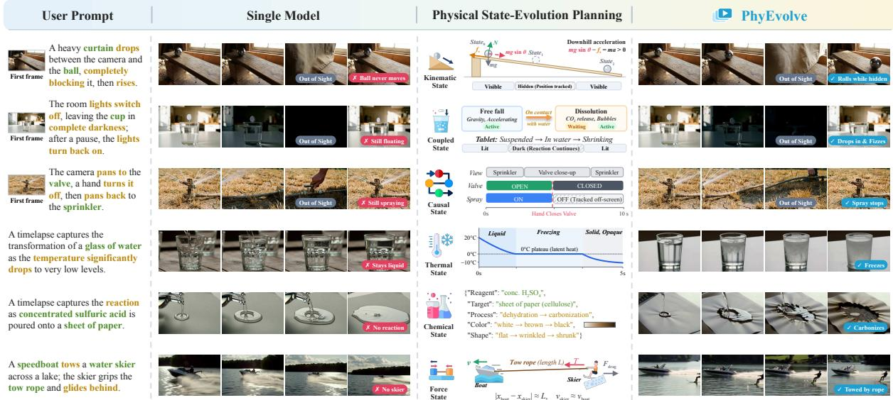
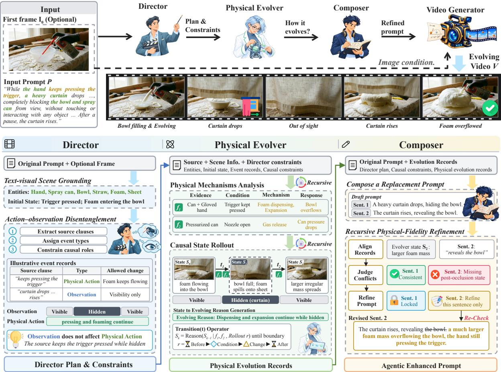
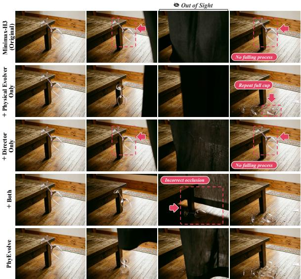
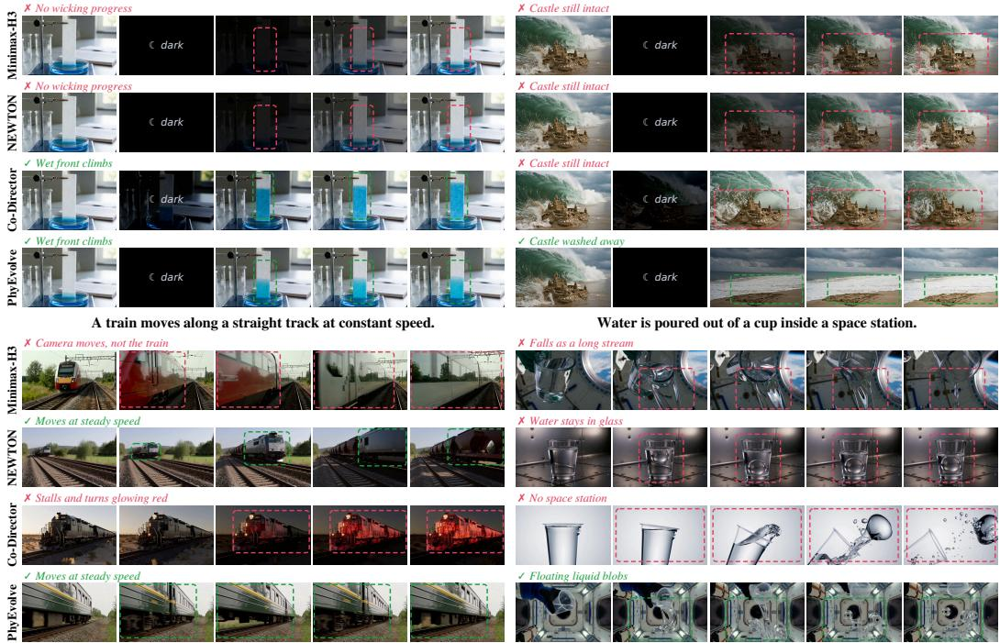
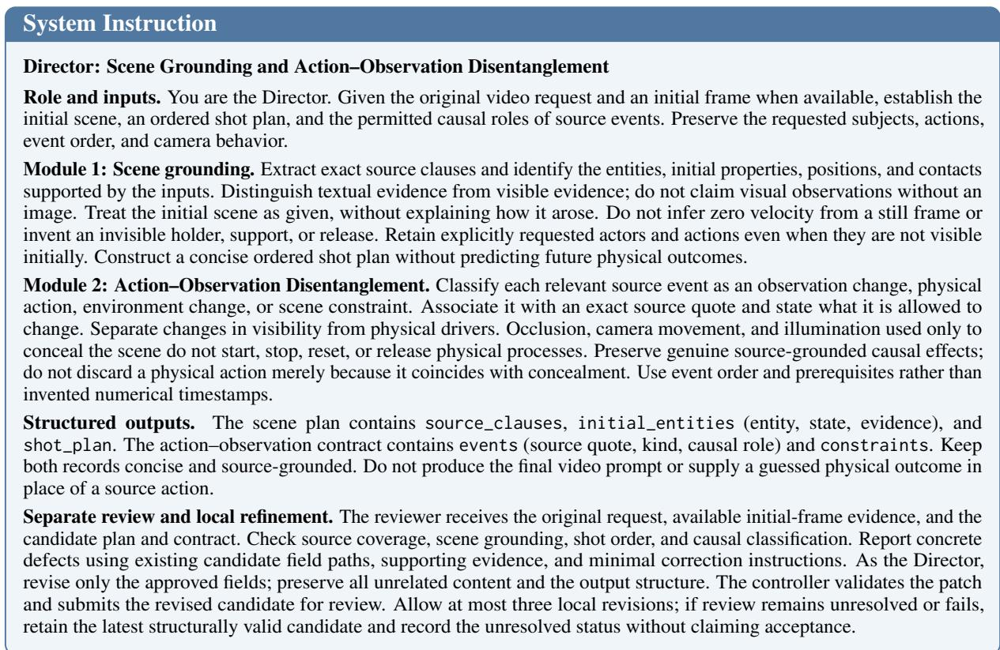
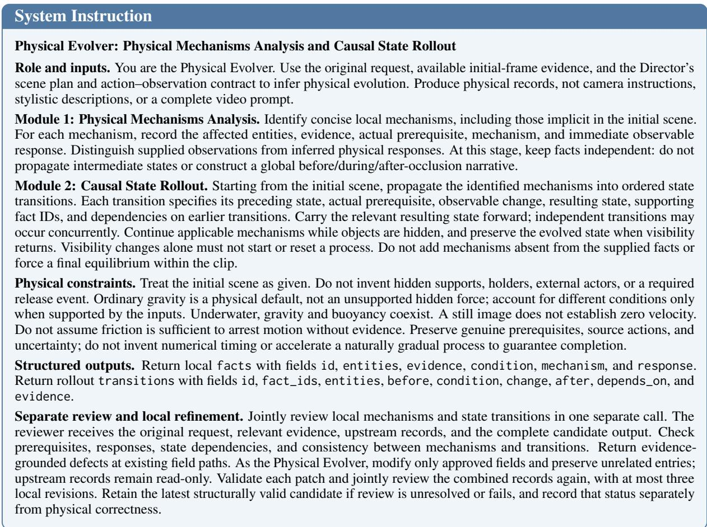
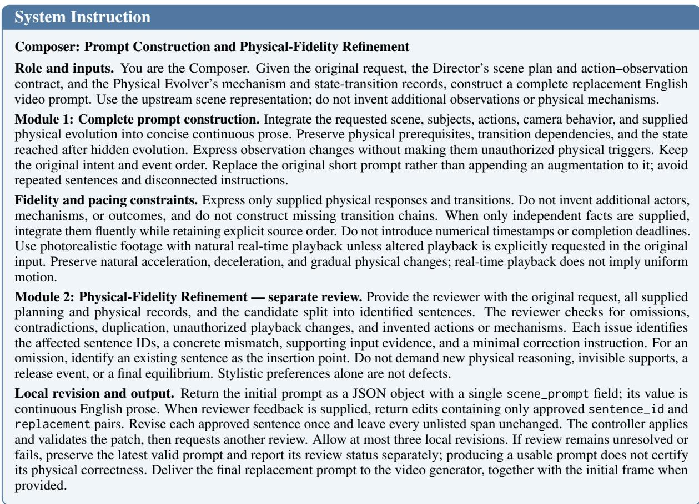
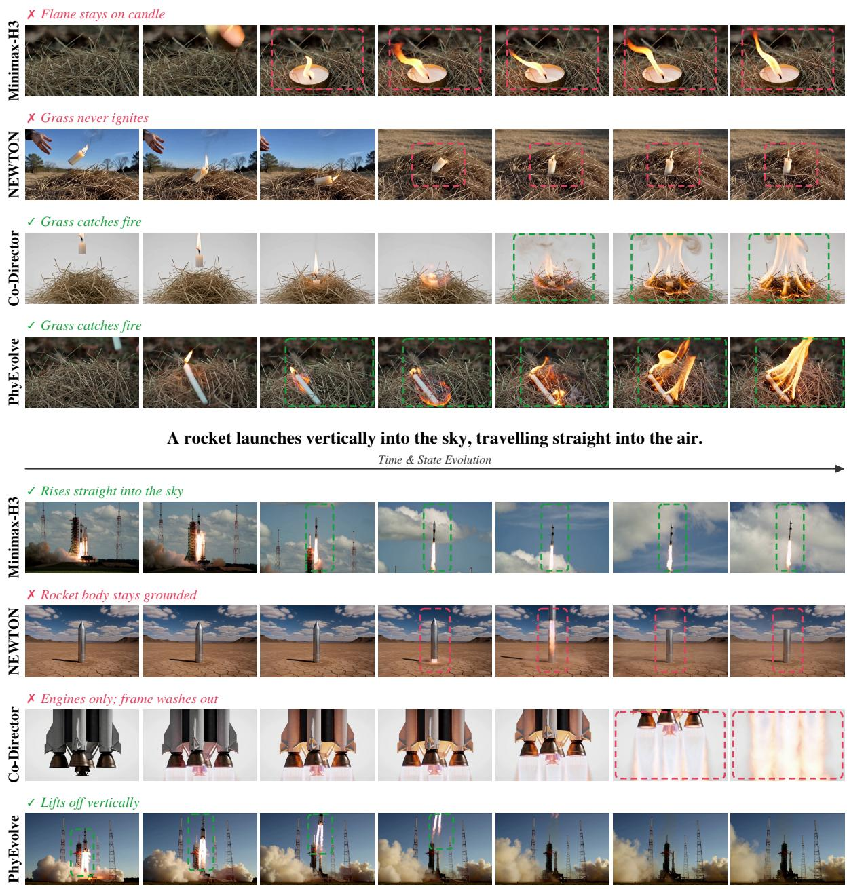
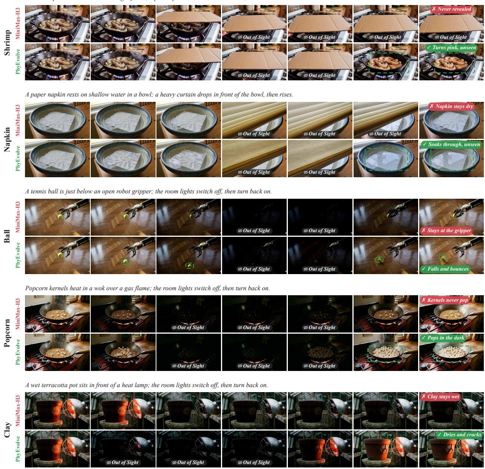
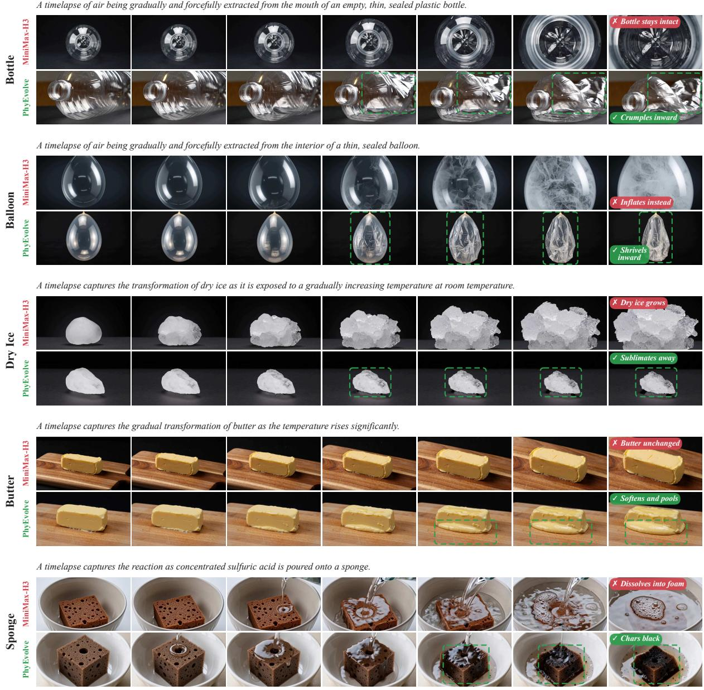

# PhyEvolve: Multi-Agent State-Evolution Planning for Physics-Aware Video Generation

Yang-Hao Zhou† Lixing Tan† Zhiqi Li Guang Yang Xiao Yang∗,‡

Canva Research

†Equal contribution

∗Corresponding author

‡Project leader

## Abstract

Recent advances in text-to-video generation have substantially improved visual fidelity, yet existing models still struggle to understand the physical evolution implicit in user prompts, making it difficult to generate videos with continuous physical state evolution. Here, we propose PhyEvolve, a multi-agent framework that enhances natural-language prompts through structured state-evolution planning. PhyEvolve consists of three agents: a Director, a Physical Evolver, and a Composer. Given a user prompt and an optional first frame, the Director grounds the scene and disentangles physical events from observation changes. The Physical Evolver uses scene evidence to identify physical mechanisms then constructs causally linked state transitions that unfold throughout the video, whether visible or not. The Composer utilizes these transitions to enhance the original prompts. Without retraining or model modification, PhyEvolve works directly with existing generators through prompt replacement. Extensive experiments on four major benchmarks show that PhyEvolve achieves state-of-the-art performance, outperforming the cutting-edge prior agentic baseline by 7.9 percentage points on average. These results demonstrate that explicit causal state-evolution planning improves physical consistency and state continuity in generated videos through natural-language prompt enhancement.

## 1 Introduction

Physics-aware video generation requires scenes to evolve consistently with the conditions and interactions described by users. Existing models remain unreliable in this respect (Meng et al., 2024; Bansal et al., 2026). Figure 1 illustrates failures to freeze water, reproduce material reactions, stop spraying after valve closure, or depict the skier towed by a boat. Brief prompts often state the scene and actions while leaving the mechanisms, activation conditions, and resulting state changes implicit. These failures motivate prompt enhancement that makes physical consequences explicit while preserving the requested objects, actions, and interactions.

Observation changes make this task particularly challenging (Ma et al., 2026). In the sprinkler example, camera movement changes visibility, whereas closing the valve changes the conditions governing water flow. The sprinkler’s state must reflect this intervention even while it is out of view. Enhancement must therefore distinguish an event’s physical effects from its effects on visibility and propagate states under conditions that remain active or are altered by events. The inferred outcome must also reach the final prompt: merely describing the camera’s return leaves the sprinkler’s expected state unstated.

Prior work enriches generation conditions through physical reasoning, tool orchestration, and causal event planning (Xue et al., 2025; Feng et al., 2026; Wang et al., 2026b). We focus on preserving event effects and state dependencies throughout interpretation, planning, and prompt composition. We formulate this task as semantic completion through structured state-evolution planning. Explicit records connect scene evidence, mechanism activation conditions, and dependent state transitions, linking the original instruction to the final prompt. The same records serve two purposes: they support reasoning about how the scene evolves and provide a basis for checking whether the final text preserves the planned physical changes.

We introduce PhyEvolve, a multi-agent framework that implements this formulation. Given a user instruction and an optional initial frame, the Director identifies scene entities and their initial states from textual and visual evidence. It extracts events and specifies which physical conditions, object states, or aspects of visibility each event is permitted to affect. The Physical Evolver then organizes local physical records around evidence, conditions, mechanisms, and responses, and uses them to infer dependent state transitions. Each inferred state becomes the starting point for subsequent reasoning, so evolution across observed and unobserved intervals builds on preceding physical effects. The resulting evolution records specify the object states expected in subsequent events while retaining uncertainty where the input does not determine a change.

  
Figure 1: PhyEvolve plans physical state evolution before video generation. Compared with single-pass Minimax-H3, PhyEvolve produces physically consistent videos, including when processes continue out of sight.

The Composer carries these planned changes into the text submitted to the generator. It integrates the original requirements, the Director’s plan and constraints, and the Physical Evolver’s records into a complete replacement prompt. It checks the draft against these records for omissions and conflicts, incorporates physical conditions and state changes that have not been expressed, and revises only the affected sentences before checking them again. This process allows the physical reasoning to be retained in the text submitted to the generator while constraining revisions to mechanisms supported by the upstream records. Each agent’s output is reviewed and local revision before final generation. The enhanced prompt then replaces the original prompt and is passed to the video generator together with the optional initial frame, without retraining or modifying the generator.

We evaluate the downstream benefits of enhanced prompts on StEvo-Bench (Ma et al., 2026), PhyGenBench (Meng et al., 2024), PhyWorld-Bench (Gu et al., 2026), and VideoPhy-2 (Bansal et al., 2026), covering state evolution under interrupted observation and physical commonsense across diverse physical laws, object interactions, and complex actions. With Minimax-H3 (Mini-Max, 2026) retained as the generation backend, PhyEvolve outperforms direct generation and the H3-based versions of NEWTON (Feng et al., 2026) and Co-Director (Song et al., 2026) on the primary metric of each benchmark. Averaged across the four primary benchmark metrics, PhyEvolve gains 14.9 percentage points over direct generation and 7.9 points over NEWTON, the prior agentic baseline with the highest mean score. On StEvo-Bench, Evolution Success increases from 17.7% under direct generation to 45.7% with PhyEvolve. These results support explicit state planning and faithful prompt composition as a means of improving physical consistency and state continuity in existing video generators.

Our main contributions are as follows:

• We formulate prompt enhancement for physics-aware video generation as semantic completion through structured state-evolution planning, distinguishing the physical effects of events from their effects on observation and accounting for state progression during unobserved intervals.

• We propose PhyEvolve, in which a Director, a Physical Evolver, and a Composer connect event interpretation, physical mechanisms analysis, causal state rollout, and prompt composition. Grounded intermediate records, review, and local revision at each stage preserve the original intent and inferred evolution.

  
Figure 2: Overview of PhyEvolve. The Director separates actions from observations, the Physical Evolver models causal state evolution under occlusion, and the Composer refines prompts for physically consistent video generation.

• We evaluate enhanced prompts on four physical video benchmarks using a frozen H3 backend, demonstrating improvements in physical consistency without retraining or modifying the video generator.

## 2 Related Work

## 2.1 Physics-Aware Video Generation

Research on physical scene dynamics ranges from object-centric intuitive physics (Piloto et al., 2022) to latent dynamics for prediction and planning (Hafner et al., 2019). Video world models address prediction and long-horizon generation (Agarwal et al., 2025; Yuan et al., 2026; Huang et al., 2026), with memory and geometric consistency supporting longer rollouts (Wu et al., 2026; Sun et al., 2025b). Memory-based methods retain spatiotemporal context (Stapf et al., 2026), track hidden dynamic subjects (Chen et al., 2026a), and learn state evolution across observation interruptions (Xu et al., 2026). Evaluation spans general video quality (Huang et al., 2024b) and compositionality (Sun et al., 2025a), physical commonsense (Meng et al., 2024; Gu et al., 2026; Bansal et al., 2025, 2026), agreement with observed or controlled dynamics (Motamed et al., 2026; Tragoudaras et al., 2025; Li et al., 2026), and out-of-sight state evolution (Ma et al., 2026). PhyEvolve focuses on explicitly planning how physical states change across visible and unobserved intervals.

## 2.2 Agentic Video Generation

Agentic video generation combines languagemodel planning, tool coordination, and refinement. VideoDirectorGPT organizes scenes and entity layouts (Lin et al., 2023), while multi-agent systems coordinate generative tools (Yuan et al., 2024), storytelling stages (Hu et al., 2024; Wang et al., 2026a), and compositional or narrative refinement (Huang et al., 2024a; Song et al., 2026). Executable event graphs (Cudlenco et al., 2026) and Code World Model (Chen et al., 2026b) further connect plans to executable representations.

Physics-oriented frameworks offer closer comparisons: NEWTON trains a planner to coordinate physics-aware tools and iterative verification around an unchanged video generator (Feng et al., 2026); MoReGen combines multi-agent reasoning with executable physics simulation and rendering (Bai et al., 2026). PhyEvolve centers collaboration on a causal state-evolution plan. Its agents distinguish physical actions from observation changes, infer local mechanisms and dependent state transitions, and express their consequences in a complete natural-language prompt. Stage-wise review and local repair occur before generation, supporting physical evolution through unobserved intervals without retraining or modifying the generator.

## 3 Method

## 3.1 Overview

Given a user prompt P and an optional initial frame $I _ { 0 }$ , PhyEvolve constructs an enhanced replacement prompt through three cooperating agents. As shown in Figure 2, the Director grounds the scene and assigns causal roles to input events; the Physical Evolver identifies applicable mechanisms and rolls them forward into a state trajectory; and the Composer expresses the reviewed records as a complete video-generation prompt. The workflow is summarized as

$$
\begin{array} { r } { \begin{array} { c } { \mathcal { D } = \mathrm { D i r e c t o r } ( P , I _ { 0 } ) , } \\ { \left( \mathcal { M } , \mathcal { T } \right) = \mathrm { E v o l v e r } ( P , \mathcal { D } ) , } \\ { P ^ { \star } = \mathrm { C o m p o s e r } ( P , \mathcal { D } , \mathcal { M } , \mathcal { T } ) , } \\ { V = G ( P ^ { \star } , I _ { 0 } ) , } \end{array} } \end{array}\tag{1}
$$

where D is the Director plan, M contains local mechanism records, T is the state-evolution trajectory, and G is the unchanged video generator. Each agent reviews its own structured output and locally revises failed entries. All review and repair occur before G is invoked; the generated video is not fed back into the agent loop.

## 3.2 Director Agent

Text–visual scene grounding. The Director first extracts entities, initial states, spatial relations, and their textual or visual evidence from P and $I _ { 0 }$ . This grounded scene establishes the starting conditions without reconstructing their prior history or predicting later physical outcomes.

Action–observation disentanglement. It then locates the source clauses describing relevant events and classifies them as physical actions, environmental changes, observation changes, or scene constraints. For each event, the Director records whether it may alter physical conditions, object state, visibility, or a combination of them. An observation-only event, such as a non-contact curtain used solely to hide an object, changes visibility but does not itself initiate, interrupt, or reset physical evolution. If the input explicitly assigns a physical effect to an event, that effect is retained. A local review checks grounding fidelity, event types, and causal roles before passing the resulting scene plan and constraints D to the Physical Evolver.

## 3.3 Physical Evolver Agent

The Physical Evolver receives $P$ and the reviewed Director output. It performs physical mechanisms analysis followed by causal state rollout. A separate call jointly reviews these records.

Physical mechanisms analysis. The Evolver represents each supported mechanism as

$$
\mathcal { M } = \{ m _ { i } \} _ { i = 1 } ^ { N } , \qquad m _ { i } = ( e _ { i } , c _ { i } , \phi _ { i } , r _ { i } ) ,\tag{2}
$$

where $e _ { i } , c _ { i } , \phi _ { i }$ , and $r _ { i }$ denote the supporting evidence, activation condition, physical mechanism, and expected response. These mechanism records provide the basis reasoning for subsequent causal state rollout within the same generation call.

Causal state rollout. The identified mechanisms are organized into dependent transitions. Each transition records the before-state, active conditions, change process, after-state, supporting mechanism IDs, and dependencies on earlier transitions. Physical state and visibility are represented separately:

$$
\begin{array} { r } { s _ { k } \ \frac { \mathcal { M } _ { k } } { c _ { k } } \ s _ { k + 1 } , \qquad o _ { k } = \mathcal { O } ( s _ { k } , v _ { k } ) , } \end{array}\tag{3}
$$

where $s _ { k }$ is the physical state, $c _ { k }$ contains the active conditions, $\mathcal { M } _ { k } \subseteq \mathcal { M }$ contains the applicable mechanisms, and $o _ { k }$ is what can be observed under visibility condition $v _ { k }$ . The index k denotes causal order rather than a calibrated timestamp. Each afterstate is carried into subsequent transitions. Therefore, when an event changes only $v _ { k }$ , mechanisms whose conditions remain active continue during occlusion, and reappearance is described from the evolved state. A single separate review then jointly checks mechanism grounding, conditions and responses, state continuity, transition dependencies, and consistency with the Director constraints.

Table 1: Unified evaluation of video generators and agentic frameworks across physical-video benchmarks. All scores are reported as percentages; higher is better. Average denotes the unweighted arithmetic mean across the four benchmarks.
<table><tr><td>Method</td><td>Type</td><td>StEvo-Bench Evo. Success ↑</td><td>PhyGenBench Average ↑</td><td>PhyWorldBench Overall Both ↑</td><td>VideoPhy-2 All Joint ↑</td><td>Average ↑</td></tr><tr><td colspan="7">Open-source video generators</td></tr><tr><td>Wan2.2-TI2V-5B</td><td>Video Generator</td><td>0.9</td><td>66.7</td><td>15.0</td><td>24.9</td><td>26.9</td></tr><tr><td>LTX-Video-2.5</td><td>Video Generator</td><td>0.9</td><td>64.6</td><td>16.5</td><td>22.2</td><td>26.1</td></tr><tr><td>Minimax-H3</td><td>Video Generator</td><td>17.7</td><td>63.5</td><td>66.6</td><td>23.9</td><td>42.9</td></tr><tr><td colspan="7">H3-based systems</td></tr><tr><td>NEWTON</td><td>Agentic Framework</td><td>29.0</td><td>77.5</td><td>69.9</td><td>23.2</td><td>49.9</td></tr><tr><td>Co-Director</td><td>Agentic Framework</td><td>20.0</td><td>75.4</td><td>65.8</td><td>24.9</td><td>46.5</td></tr><tr><td>PhyEvolve</td><td>Agentic Framework</td><td>45.7</td><td>79.6</td><td>75.8</td><td>30.1</td><td>57.8</td></tr></table>

Table 2: StEvo-Bench: state evolution and control metrics.
<table><tr><td>Model</td><td>Evo. Success ↑ Prog. ↑ Phys. ↑ Coh. ↑ Ctrl. ↑</td><td></td><td></td><td></td><td>Obs.</td><td>Act. Ctrl. ↑</td></tr><tr><td colspan="7">Open-source video generators</td></tr><tr><td>Wan2.2-TI2V-5B</td><td>0.9</td><td>10.9</td><td>51.6</td><td>62.4</td><td>45.7</td><td>54.3</td></tr><tr><td>LTX-Video-2.5</td><td>0.9</td><td>14.0</td><td>66.5</td><td>95.0</td><td>55.9</td><td>56.8</td></tr><tr><td>Minimax-H3</td><td>17.7</td><td>25.3</td><td>70.6</td><td>88.2</td><td>87.6</td><td>81.5</td></tr><tr><td colspan="7">H3-based agentic frameworks</td></tr><tr><td>NEWTON</td><td>29.0</td><td>36.8</td><td>93.4</td><td>93.2</td><td>89.3</td><td>80.7</td></tr><tr><td>Co-Director</td><td>20.0</td><td>42.0</td><td>72.0</td><td>94.0</td><td>83.7</td><td>83.3</td></tr><tr><td>PhyEvolve</td><td>45.7</td><td>51.2</td><td>96.8</td><td>94.6</td><td>89.5</td><td>85.2</td></tr></table>

Table 3: PhyGenBench: physical commonsense accuracy.
<table><tr><td>Model</td><td>Mechanics ↑</td><td>Optics ↑</td><td>Thermal ↑</td><td>Material ↑</td><td>Average ↑</td></tr><tr><td colspan="6">Open-source video generators</td></tr><tr><td>CogVideoX-2B</td><td>38.0</td><td>43.0</td><td>34.0</td><td>39.0</td><td>39.0</td></tr><tr><td>CogVideoX-5B</td><td>39.0</td><td>55.0</td><td>40.0</td><td>42.0</td><td>45.0</td></tr><tr><td>Open-Sora V1.2</td><td>43.0</td><td>50.0</td><td>44.0</td><td>37.0</td><td>44.0</td></tr><tr><td>Lavie</td><td>30.0</td><td>44.0</td><td>38.0</td><td>32.0</td><td>36.0</td></tr><tr><td>Vchitect 2.0</td><td>41.0</td><td>56.0</td><td>44.0</td><td>37.0</td><td>45.0</td></tr><tr><td>Wan2.2-TI2V-5B</td><td>66.7</td><td>82</td><td>57.8</td><td>54.2</td><td>66.7</td></tr><tr><td>LTX-Video-2.5</td><td>64.2</td><td>70.7</td><td>58.9</td><td>61.7</td><td>64.6</td></tr><tr><td>Minimax-H3</td><td>59.2</td><td>78.0</td><td>57.8</td><td>54.2</td><td>63.5</td></tr><tr><td colspan="6">Closed-source video generators</td></tr><tr><td>Pika</td><td>35.0</td><td>56.0</td><td>43.0</td><td>39.0</td><td>44.0</td></tr><tr><td>Gen-3</td><td>45.0</td><td>57.0</td><td>49.0</td><td>51.0</td><td>51.0</td></tr><tr><td>Kling</td><td>45.0</td><td>58.0</td><td>50.0</td><td>40.0</td><td>49.0</td></tr><tr><td colspan="6">H3-based Agentic frameworks</td></tr><tr><td>NEWTON</td><td>70.0</td><td>89.3</td><td>76.7</td><td>70.8</td><td>77.5</td></tr><tr><td>Co-Director</td><td>69.2</td><td>80.7</td><td>76.7</td><td>74.2</td><td>75.4</td></tr><tr><td>PhyEvolve</td><td>73.3</td><td>84.7</td><td>82.2</td><td>77.5</td><td>79.6</td></tr></table>

## 3.4 Composer Agent

Replacement prompt composition. The Composer combines P, D, M and T into a selfcontained replacement prompt. The draft preserves the requested entities, actions, event order, scene constraints, and pacing while expressing the physical conditions and state changes needed to connect successive events.

Recursive physical-fidelity refinement. Physical-fidelity refinement aligns the draft with the upstream records and flags sentences that omit a required state, contradict a causal constraint, or alter the original request. The Composer revises only the flagged sentences and keeps accepted sentences fixed. It may verbalize mechanisms already present in T but cannot introduce new physical mechanisms. Refinement stops when the prompt passes review or reaches the retry budget; if final validation still fails, the system falls back to the last enhanced prompt. The selected prompt P⋆, together with the same initial frame when the task is image-conditioned, is then supplied to G. For text-only tasks, the agents plan using textual evidence alone and supply the enhanced prompt to the video generator.

## 4 Experiments

## 4.1 Benchmark Datasets

We assess state evolution under interrupted observation and broader physical correctness using four benchmarks. PhyGenBench (Meng et al., 2024) contains 160 prompts covering 27 physical laws in mechanics, optics, thermal phenomena, and material properties; we report its benchmark score (Average). PhyWorldBench (Gu et al., 2026) contains 1,050 prompts across 10 categories and 50 subcategories, with scenarios covering fundamental, composite, and deliberately unphysical phenomena. We report Overall Both, which requires semantic adherence and satisfaction of the scenario-specific physical evaluation criteria. VideoPhy-2 (Bansal et al., 2026) contains 3,940 prompts derived from 197 real-world actions, including 590 prompts in its original test split. We report automatic All Joint and Hard Joint scores under the NEWTON reporting protocol; Joint requires both semantic adherence and physical commonsense scores to reach at least 4 on five-point scales. StEvo-Bench (Ma et al., 2026) contains 225 tasks across six categories, pairing initial images with action prompts and observation interruptions through occlusion, illumination changes, or camera movement. Its Evolution Success metric requires state progress, physical plausibility, and temporal coherence on videos that pass both action and observation control.

Table 4: PhyWorldBench: physics-category results. All scores are reported for the Both metric.
<table><tr><td>Model</td><td>Fundamental Physics</td><td>Composite Physics</td><td></td><td>Overall Anti-Physics Performance</td></tr><tr><td colspan="5">Closed-source video generators</td></tr><tr><td>Sora-Turbo</td><td>24.6</td><td>18.8</td><td>3.9</td><td>20.8</td></tr><tr><td>Gen-3</td><td>16.1</td><td>10.3</td><td>2.0</td><td>13.0</td></tr><tr><td>Kling-1.6</td><td>23.5</td><td>13.9</td><td>4.2</td><td>18.8</td></tr><tr><td>Pika 2.0</td><td>31.2</td><td>23.9</td><td>1.1</td><td>26.2</td></tr><tr><td>Luma</td><td>22.0</td><td>16.0</td><td>0.0</td><td>18.4</td></tr><tr><td colspan="5">Open-source video generators</td></tr><tr><td>Hunyuan 720p</td><td>20.5</td><td>19.9</td><td>1.0</td><td>18.5</td></tr><tr><td>Open-Sora 2.0</td><td>20.5</td><td>15.4</td><td>1.0</td><td>17.0</td></tr><tr><td>Open-Sora-Plan 1.3</td><td>9.6</td><td>4.4</td><td>3.9</td><td>7.5</td></tr><tr><td>CogVideoX-1.5</td><td>19.2</td><td>15.4</td><td>0.0</td><td>16.3</td></tr><tr><td>Step-video-T2V</td><td>18.9</td><td>19.1</td><td>2.0</td><td>17.3</td></tr><tr><td>Wanx-2.1</td><td>22.0</td><td>18.7</td><td>1.1</td><td>18.9</td></tr><tr><td>LTX-Video</td><td>8.0</td><td>4.2</td><td>0.0</td><td>6.2</td></tr><tr><td>Wan2.2-TI2V-5B</td><td>17.9</td><td>14.0</td><td>1.0</td><td>15.0</td></tr><tr><td>LTX-Video-2.5</td><td>19.4</td><td>15.9</td><td>1.0</td><td>16.5</td></tr><tr><td>Minimax-H3</td><td>70.2</td><td>65.9</td><td>47.6</td><td>66.6</td></tr><tr><td colspan="5">H3-based Agentic frameworks</td></tr><tr><td>NEWTON</td><td>73.5</td><td>70.1</td><td>47.6</td><td>69.9</td></tr><tr><td>Co-Director</td><td>69.4</td><td>69.8</td><td>33.7</td><td>65.8</td></tr><tr><td>PhyEvolve</td><td>79.2</td><td>76.1</td><td>54.3</td><td>75.8</td></tr></table>

Table 5: VideoPhy-2: automatic evaluation under the NEWTON reporting protocol.
<table><tr><td>Method</td><td colspan="3">All</td><td colspan="3">Hard</td></tr><tr><td></td><td>PC↑</td><td>SA↑</td><td>Joint ↑</td><td>PC↑</td><td>SA↑</td><td>Joint ↑</td></tr><tr><td colspan="7">Open-source video generators</td></tr><tr><td>Cosmos-Predict2.5</td><td>58.6</td><td>28.3</td><td>22.7</td><td>46.1</td><td>12.2</td><td>7.8</td></tr><tr><td>HunyuanVideo</td><td>73.6</td><td>25.3</td><td>22.5</td><td>63.3</td><td>8.9</td><td>6.7</td></tr><tr><td>CogVideoX-5B</td><td>69.2</td><td>30.2</td><td>25.9</td><td>54.4</td><td>9.4</td><td>5.0</td></tr><tr><td>LTX-Video-2.5</td><td>54.7</td><td>28.8</td><td>22.2</td><td>40.7</td><td>8.9</td><td>3.9</td></tr><tr><td>LTX-Video-2B</td><td>74.3</td><td>22.9</td><td>21.4</td><td>63.3</td><td>6.7</td><td>4.4</td></tr><tr><td>Wan2.2-TI2V-5B</td><td>56.7</td><td>29.6</td><td>24.9</td><td>37.8</td><td>10.6</td><td>7.2</td></tr><tr><td>Minimax-H3</td><td>69.5</td><td>29.8</td><td>23.9</td><td>62.2</td><td>7.2</td><td>4.4</td></tr><tr><td colspan="7">H3-based Agentic frameworks</td></tr><tr><td>NEWTON</td><td>72.5</td><td>29.0</td><td>23.2</td><td>71.5</td><td>7.8</td><td>6.7</td></tr><tr><td>Co-Director</td><td>55.8</td><td>30.1</td><td>24.9</td><td>38.3</td><td>10.0</td><td>5.0</td></tr><tr><td>PhyEvolve</td><td>83.9</td><td>34.5</td><td>30.1</td><td>84.4</td><td>14.4</td><td>12.8</td></tr></table>

## 4.2 Implementation Details

PhyEvolve is training-free. All agents use Qwen3- VL-32B-Instruct, served through vLLM in BF16 with tensor parallelism of 2 and a 32K-token context window. Decoding is greedy by default. Failed validation triggers up to three replanning attempts with temperature 0.7 and top-p 0.95; if validation still fails, we revert to the last trying.

We deploy H3 through FastVideo on eight NVIDIA H100 80GB GPUs, using sequence parallelism of 8 and 50 sampling steps. Imageconditioned tasks produce 192 frames at 24 fps while preserving the input aspect ratio. Text-only tasks produce 124 frames at 24 fps at 1344 × 768 resolution. For text-only tasks, the agents plan directly from the original prompt without first generating a video or an auxiliary image; H3 then generates the final video using the enhanced prompt.

## 4.3 Main Results

Across all four benchmark-level metrics in Table 1, PhyEvolve outperforms all listed methods, including the agentic baselines NEWTON and Co-Director. Compared with H3, it improves by 16.1 points on PhyGenBench Average, 9.2 on PhyWorld-Bench Overall Both, 6.2 on VideoPhy-2 All Joint, and 28 points on StEvo-Bench Evolution Success.

Performance on Out-of-Sight Evolution. As reported in Table 2, results on StEvo-Bench demonstrate PhyEvolve’s advantage in modeling physical processes that continue out of sight. PhyEvolve achieves an Evolution Success rate of 45.7%, outperforming the H3-based agentic baselines NEW-TON (29.0%) and Co-Director (20.0%). This advantage extends to Progress, where PhyEvolve reaches 51.2%, surpassing both NEWTON (36.8%) and Co-Director (42.0%). PhyEvolve achieves the highest scores on both Observation Control (89.5%) and Action Control (85.2%) among all compared variants.

Performance on In-Sight Evolution. The benefits extend beyond interrupted observation. On PhyGenBench (Table 3), the largest gains over H3 occur in Thermal and Material, at 24.4 and 23.3 points. PhyEvolve leads in Mechanics, Thermal, and Material, while NEWTON remains stronger in Optics (89.3% versus 84.7%). On PhyWorldBench (Table 4), PhyEvolve achieves an Overall Performance score of 75.8%, surpassing NEWTON’s 69.9%, and outperforms NEWTON in Fundamental Physics, Composite Physics, and Anti-Physics. Its Anti-Physics Both score reaches 54.3%, compared with 47.6% for both H3 and NEWTON. In this setting, success means following deliberately unphysical instructions rather than conforming to real-world laws.

  
Figure 3: Component ablation on a scene where a falling glass is occluded by a curtain.

Table 6: Component ablation on StEvo-Bench.
<table><tr><td rowspan="3">Variant</td><td colspan="6">StEvo-Bench (%)</td></tr><tr><td>Evo. Success ↑</td><td></td><td>Prog. ↑ Phys. ↑</td><td>Coh. ↑</td><td>Obs. Ctrl.↑</td><td>Act. Ctrl.↑</td></tr><tr><td>Baseline</td><td>17.7</td><td>25.3</td><td>70.6</td><td>88.2</td><td>87.6</td><td>81.5</td></tr><tr><td>w/o Director</td><td>45.3</td><td>51.2</td><td>93.7</td><td>94.6</td><td>82.4</td><td>82.4</td></tr><tr><td>w/o Physical Evolver</td><td>29.0</td><td>38.0</td><td>72.3</td><td>94.5</td><td>88.4</td><td>78.6</td></tr><tr><td>w/o Composer</td><td>44.3</td><td>51.5</td><td>93.7</td><td>94.6</td><td>89.3</td><td>84.9</td></tr><tr><td>PhyEvolve</td><td>45.7</td><td>51.2</td><td>96.8</td><td>94.6</td><td>89.5</td><td>85.2</td></tr></table>

Table 7: Agent-backbone comparison on PhyGenBench.
<table><tr><td rowspan="2">Agent backbone</td><td colspan="5">PhyGenBench (%)</td></tr><tr><td>Mechanics ↑ Optics ↑ Thermal ↑ Material ↑ Average ↑</td><td></td><td></td><td></td><td></td></tr><tr><td>InternVL3.5-30B</td><td>71.7</td><td>87.3</td><td>76.7</td><td>70.8</td><td>77.3</td></tr><tr><td>Qwen3.5-9B</td><td>67.5</td><td>84.0</td><td>81.1</td><td>75.8</td><td>77.3</td></tr><tr><td>Qwen3-VL-32B</td><td>73.3</td><td>84.7</td><td>82.2</td><td>77.5</td><td>79.6</td></tr></table>

Results on PhyWorldBench show that PhyEvolve follows instructions effectively, even when they deliberately violate physical laws. Despite these gains on PhyWorldBench, satisfying physical plausibility and instruction fidelity jointly remains challenging on VideoPhy-2 (Table 5). PhyEvolve leads on All Joint (30.1%) and Hard Joint (12.8%). On Hard, its Joint score exceeds NEWTON’s 6.7% and H3’s 4.4%, with improvements over H3 in both physical commonsense (84.4% vs. 62.2%) and semantic adherence (14.4% vs. 7.2%). However, semantic adherence remains low, imposing a tighter ceiling on Joint success than physical commonsense under this evaluator. This gap shows that stronger physics scores alone do not ensure that the requested event is faithfully realized.

## 4.4 Ablation Study

Component ablations. We compare the originalprompt baseline, full PhyEvolve, and three agent ablations on StEvo-Bench, holding H3, initial frames, and generation settings fixed. The w/o Director variant bypasses the Director’s scene grounding and action–observation planning, passing the original inputs directly to the subsequent agents. The w/o Physical Evolver variant omits physical mechanisms analysis and causal state rollout; the Composer constructs the prompt from the original request and the Director’s outputs. The w/o Composer variant directly concatenates the Director and Physical Evolver outputs as the video-generation prompt.

Table 6 shows that removing Physical Evolver content produces the largest drops in Evolution, Progress, and Physics: 16.7, 13.2, and 24.5 percentage points, respectively. Removing the Director reduces Observation Control and Action Control by 7.1 and 2.8 points, while Evolution falls by 0.4 points. Compared with direct concatenation, the Composer improves Evolution and Physics by 1.4 and 3.1 points, but lowers Progress by 0.3 points. In Figure 3, the H3 baseline and w/o Physical Evolver variant fail to depict the glass falling. The w/o Director variant depicts the fall but produces an intact glass among the fragments, while w/o Composer leaves the glass visible during the intended curtain occlusion. PhyEvolve depicts the fall, temporary occlusion, and shattered end state in sequence.

Agent backbones. We evaluate the effect of different agent backbones on PhyGenBench, as shown in Table 7. Qwen3-VL-32B achieves the highest average score of 79.6%, followed by InternVL3.5- 30B at 77.3% and Qwen3.5-9B at 77.3%.

User Study. Table 8 reports user preferences across four benchmarks. PhyEvolve receives preference rates above 60% under both Video and Physics in every comparison. For these two criteria, respectively, the overall rates are 74.6% and 75.3% against direct Minimax-H3 generation, and 75.4% and 74.7% against NEWTON.

Efficiency. We compare LLM usage and endto-end runtime with Minimax-H3 held fixed as the video generator (Table 9). PhyEvolve uses 6.1 LLM calls and 17.0k tokens, the lowest values among the compared methods. Its end-to-end runtime is 452.5 seconds, compared with 1,826.5 seconds for NEWTON and 1,009.6 seconds for Co-

A paper towel strip dips into blue water; the light goes off, then back on.  
A large wave hits a sandcastle; the light goes off, then back on.  
  
Figure 4: Qualitative comparison on state-evolution prompts. We compare Minimax-H3, NEWTON, Co-Director, and PhyEvolve (ours) on four cases from StEvo-Bench (Top) and other in-sight physical benchmark (Bottom). Frames are uniformly sampled along time from left to right; dark marks the light-off interval. green boxes mark physically consistent state changes, and red boxes locate failures.

Table 8: User preference for PhyEvolve over each baseline (%). Each entry reports the percentage of votes favoring PhyEvolve.
<table><tr><td rowspan="2">Benchmark</td><td colspan="2">vs. Minimax-H3</td><td colspan="2">vs. NEWTON</td></tr><tr><td>Video</td><td>Physics</td><td>Video</td><td>Physics</td></tr><tr><td>StEvo-Bench</td><td>81.0</td><td>81.0</td><td>83.8</td><td>83.8</td></tr><tr><td>PhyGenBench</td><td>90.6</td><td>89.4</td><td>81.3</td><td>82.5</td></tr><tr><td>PhyWorldBench</td><td>60.6</td><td>66.9</td><td>69.4</td><td>70.6</td></tr><tr><td>VideoPhy-2</td><td>66.3</td><td>63.8</td><td>66.9</td><td>61.9</td></tr><tr><td>Overall</td><td>74.6</td><td>75.3</td><td>75.4</td><td>74.7</td></tr></table>

Table 9: Efficiency comparison with Minimax-H3.
<table><tr><td>Method</td><td>LLM calls ↓</td><td>Tokens (k) ↓</td><td>End-to-end (s) ↓</td></tr><tr><td>NEWTON</td><td>7.8</td><td>54.3</td><td>1826.5</td></tr><tr><td>Co-Director</td><td>8.0</td><td>20.2</td><td>1009.6</td></tr><tr><td>PhyEvolve</td><td>6.1</td><td>17.0</td><td>452.5</td></tr></table>

Director, corresponding to runtime reductions of 75.2% and 55.2%, respectively.

## 4.5 Qualitative results.

Figure 4 illustrates physical evolution under interrupted observation and visible physical processes. In the light-off cases, H3 and NEWTON show no wicking progress, whereas Co-Director and PhyEvolve show the wet front advancing. Only PhyEvolve depicts the sandcastle washed away after the wave and combines the space-station setting with floating liquid blobs; both NEWTON and PhyEvolve depict correct moving train. Co-Director produces 8.0 s StEvo-Bench videos, with frames sampled at matching relative temporal positions.

## 5 Conclusion

We presented PhyEvolve, a training-free multiagent framework that guides video generation through structured state-evolution planning. The framework uses an explicit state trajectory to coordinate physical actions and observation timing, tracking ongoing changes even when objects are out of sight. With H3 as the fixed generator, PhyEvolve achieves the highest benchmark-level scores among the compared methods on PhyGenBench, PhyWorldBench, VideoPhy-2, and StEvo-Bench, without retraining or model modification. These results support physical-state evolution planning as a useful way to condition existing video generators and motivate further work on preserving instruction fidelity alongside state evolution.

## Limitations

PhyEvolve reasons about physical states through natural-language prompt enhancement and stateevolution planning. Its reliability depends on the agents’ reasoning capabilities and available scene evidence, and it does not currently provide quantitatively calibrated predictions of physical dynamics or precise transition times. On the Hard subset of VideoPhy-2, the joint success rate for semantic adherence and physical consistency remains low, indicating that satisfying both requirements remains challenging on difficult tasks. Furthermore, our evaluation is based on short benchmark clips, and PhyEvolve’s performance on longer video sequences has yet to be established. Investigating its effectiveness over longer sequences will be a key focus of our future work.

## References

Niket Agarwal, Arslan Ali, Maciej Bala, Yogesh Balaji, Erik Barker, Tiffany Cai, Prithvijit Chattopadhyay, Yongxin Chen, Yin Cui, Yifan Ding, et al. 2025. Cosmos world foundation model platform for physical ai. arXiv preprint arXiv:2501.03575.

Xiangyu Bai, He Liang, Bishoy Galoaa, Utsav Nandi, Shayda Moezzi, Yuhang He, and Sarah Ostadabbas. 2026. Moregen: Multi-agent motion-reasoning engine for code-based text-to-video synthesis. In Proceedings of the IEEE/CVF Conference on Computer Vision and Pattern Recognition, pages 7632–7642.

Hritik Bansal, Zongyu Lin, Tianyi Xie, Zeshun Zong, Michal Yarom, Yonatan Bitton, Chenfanfu Jiang, Yizhou Sun, Kai-Wei Chang, and Aditya Grover. 2025. Videophy: Evaluating physical commonsense for video generation. In International Conference on Learning Representations, volume 2025, pages 102075–102121.

Hritik Bansal, Clark Peng, Yonatan Bitton, Roman Goldenberg, Aditya Grover, and Kai-Wei Chang. 2026. Videophy-2: A challenging action-centric physical commonsense evaluation in video generation. In International Conference on Learning Representations, volume 2026, pages 118456–118470.

Kaijin Chen, Dingkang Liang, Xin Zhou, Yikang Ding, Xiaoqiang Liu, Pengfei Wan, and Xiang Bai. 2026a. Out of sight but not out of mind: Hybrid memory for dynamic video world models. arXiv preprint arXiv:2603.25716.

Yiwen Chen, Guosheng Lin, and Chi Zhang. 2026b. Code world model: Coding agent as world brain. arXiv preprint arXiv:2608.25927.

Nicolae Cudlenco, Mihai Masala, and Marius Leordeanu. 2026. Agentic video generation: From

text to executable event graphs via tool-constrained llm planning. arXiv e-prints, pages arXiv–2604.

Yuxiang Feng, Juncheng Wang, Chao Xu, Yijie Qian, Huihan Wang, Wenlong Hou, Yang Liu, Baigui Sun, Yong Liu, and Shujun Wang. 2026. Newton: Agentic planning for physically grounded video generation. arXiv preprint arXiv:2605.18396.

Jing Gu, Xian Liu, Yu Zeng, Ashwin Nagarajan, Fangrui Zhu, Daniel Hong, Yue Fan, Qianqi Yan, Kaiwen Zhou, Ming-Yu Liu, et al. 2026. phyworldbench: A comprehensive evaluation of physical realism in text-to-video models. In International Conference on Learning Representations, volume 2026, pages 75130–75164.

Danijar Hafner, Timothy Lillicrap, Ian Fischer, Ruben Villegas, David Ha, Honglak Lee, and James Davidson. 2019. Learning latent dynamics for planning from pixels. In International conference on machine learning, pages 2555–2565. PMLR.

Panwen Hu, Jin Jiang, Jianqi Chen, Mingfei Han, Shengcai Liao, Xiaojun Chang, and Xiaodan Liang. 2024. Storyagent: Customized storytelling video generation via multi-agent collaboration. arXiv preprint arXiv:2411.04925.

Junchao Huang, Guian Fang, Shengju Qian, Xianghao Kong, Zhuoran Zhao, Wei Huang, Yihua Du, Zixin Zhang, Justin Cui, Yuchao Gu, et al. 2026. Solarwm: Open data and scalable training for long-horizon video world models. arXiv preprint arXiv:2609.02886.

Kaiyi Huang, Yukun Huang, Xuefei Ning, Zinan Lin, Yu Wang, and Xihui Liu. 2024a. Genmac: Compositional text-to-video generation with multi-agent collaboration.

Ziqi Huang, Yinan He, Jiashuo Yu, Fan Zhang, Chenyang Si, Yuming Jiang, Yuanhan Zhang, Tianxing Wu, Qingyang Jin, Nattapol Chanpaisit, et al. 2024b. Vbench: Comprehensive benchmark suite for video generative models. In 2024 IEEE/CVF Conference on Computer Vision and Pattern Recognition (CVPR), pages 21807–21818. IEEE.

Yanxun Li, Hao Wen, Bingze Song, Jiashu Zhu, Aiming Hao, Chubin Chen, Jintao Chen, Jiahong Wu, Xiangxiang Chu, and Miao Wang. 2026. Learning explicit physical parameter control and benchmarking for video generation. arXiv preprint arXiv:2607.18924.

Han Lin, Abhay Zala, Jaemin Cho, and Mohit Bansal. 2023. Videodirectorgpt: Consistent multi-scene video generation via llm-guided planning. arXiv preprint arXiv:2309.15091.

Ziqi Ma, Mengzhan Liufu, and Georgia Gkioxari. 2026. Out of sight, out of mind? evaluating state evolution in video world models. In European Conference on Computer Vision, pages 129–146. Springer.

Fanqing Meng, Jiaqi Liao, Xinyu Tan, Wenqi Shao, Quanfeng Lu, Kaipeng Zhang, Yu Cheng, Dianqi Li, Yu Qiao, and Ping Luo. 2024. Towards world simulator: Crafting physical commonsense-based benchmark for video generation. arXiv preprint arXiv:2410.05363.

MiniMax. 2026. Minimax h3: An open model breaking the boundaries between tasks and modalities.

Saman Motamed, Laura Culp, Kevin Swersky, Priyank Jaini, and Robert Geirhos. 2026. Do generative video models understand physical principles? In 2026 IEEE/CVF Winter Conference on Applications of Computer Vision (WACV), pages 948–958. IEEE.

Luis S Piloto, Ari Weinstein, Peter Battaglia, and Matthew Botvinick. 2022. Intuitive physics learning in a deep-learning model inspired by developmental psychology. Nature human behaviour, 6(9):1257– 1267.

Yale Song, Yiwen Song, Nick Losier, Nathan Hodson, Ye Jin, Rhyard Zhu, Yan Xu, Daniel Vlasic, Carina Claassen, Jasmine Leon, Khanh G. LeViet, Zack Chomyn, Joe Timmons, Brett Slatkin, Scott Penberthy, and Tomas Pfister. 2026. Co-director: Agentic generative video storytelling. Preprint, arXiv:2604.24842.

Sebastian Stapf, Pablo Acuaviva, Aram Davtyan, and Paolo Favaro. 2026. Composition of memory experts for diffusion world models. In International Conference on Learning Representations, volume 2026, pages 15377–15403.

Kaiyue Sun, Kaiyi Huang, Xian Liu, Yue Wu, Zihan Xu, Zhenguo Li, and Xihui Liu. 2025a. T2v-compbench: A comprehensive benchmark for compositional textto-video generation. In 2025 IEEE/CVF Conference on Computer Vision and Pattern Recognition (CVPR), pages 8406–8416. IEEE.

Wenqiang Sun, Haiyu Zhang, Haoyuan Wang, Junta Wu, Zehan Wang, Zhenwei Wang, Yunhong Wang, Jun Zhang, Tengfei Wang, and Chunchao Guo. 2025b. Worldplay: Towards long-term geometric consistency for real-time interactive world modeling. arXiv preprint arXiv:2512.14614.

Antonios Tragoudaras, Chenyu Zhang, Daniil Cherniavskii, Antonios Vozikis, Thijmen Nijdam, Derck WE Prinzhorn, Mark Bodracska, Nicu Sebe, Andrii Zadaianchuk, and Efstratios Gavves. 2025. Evaluating newtonian mechanics in video generative models with real physical systems. arXiv preprint arXiv:2504.02918.

Qian Wang, Ziqi Huang, Ruoxi Jia, Paul Debevec, and Ning Yu. 2026a. Mavis: A multi-agent framework for long-sequence video storytelling. In Proceedings of the 19th Conference of the European Chapter of the Associationfor Computational Linguistics (Volume 1: Long Papers), pages 2273–2295.

Zixuan Wang, Yixin Hu, Wen Li, Feng Chen, Yan Liu, Duo Peng, and Yinjie Lei. 2026b. Physically plausible video generation via visual-semantic chain-of-events conditioning. arXiv preprint arXiv:2609.00656.

Ruiqi Wu, Xuanhua He, Meng Cheng, Tianyu Yang, Yong Zhang, Zhuoliang Kang, Xunliang Cai, Xiaoming Wei, Chunle Guo, Chongyi Li, et al. 2026. Infinite-world: Scaling interactive world models to 1000-frame horizons via pose-free hierarchical memory. arXiv preprint arXiv:2602.02393.

Tianshuo Xu, Yichen Xie, Depu Meng, Chensheng Peng, Quentin Herau, Bo Jiang, Yihan Hu, and Wei Zhan. 2026. Teaching video generators to remember: Eliciting dynamic memory for out-of-sight state evolution. arXiv preprint arXiv:2605.25333.

Qiyao Xue, Xiangyu Yin, Boyuan Yang, and Wei Gao. 2025. Phyt2v: Llm-guided iterative self-refinement for physics-grounded text-to-video generation. In 2025 IEEE/CVF Conference on Computer Vision and Pattern Recognition (CVPR), pages 18826–18836. IEEE.

Shenghai Yuan, Yuanyang Yin, Zongjian Li, Xinwei Huang, Xiao Yang, and Li Yuan. 2026. Helios: Real real-time long video generation model. arXiv preprint arXiv:2603.04379.

Zhengqing Yuan, Yixin Liu, Yihan Cao, Weixiang Sun, Haolong Jia, Ruoxi Chen, Zhaoxu Li, Bin Lin, Li Yuan, Lifang He, et al. 2024. Mora: Enabling generalist video generation via a multi-agent framework. arXiv preprint arXiv:2403.13248.

## A Appendix

## A.1 Agent Prompt

Figures 5, 6, and 7 present the role-level prompt templates for the Director, Physical Evolver, and Composer, respectively. Each template groups the task instructions, output requirements, and review procedure for its role; a role may involve multiple separate model calls.

Director. The prompt in Figure 5 instructs the Director to ground the scene in the user request and optional initial frame, and to distinguish physical events from observation changes. Its outputs record the initial entities and states, an ordered shot plan, and the permitted causal effects of each event. Review instructions check source coverage, scene grounding, and event classification, with revisions restricted to flagged fields.

Physical Evolver. The prompt in Figure 6 separates physical mechanisms analysis from causal state rollout. Given the original request, available scene evidence, and the Director’s records, the agent first identifies physical mechanisms, their activation conditions, and immediate responses. It then propagates the reviewed records into dependent state transitions, including changes that continue during unobserved intervals. Mechanisms and transitions are reviewed separately to check prerequisites, responses, and state dependencies while retaining uncertainty where the inputs do not determine an outcome.

Composer. The prompt in Figure 7 instructs the Composer to integrate the original request with the reviewed scene and physical records into a complete replacement prompt. It preserves the requested actions, event order, and camera behavior while expressing the planned physical conditions and state changes. A separate fidelity review then compares the draft with the upstream records. Revisions are restricted to flagged sentences to correct omissions or contradictions while preserving unrelated text.

## A.2 Additional qualitative results

We provide additional visualizations to complement the quantitative comparisons in Section 4.3. Figure 8 compares Minimax-H3, NEWTON, Co-Director, and PhyEvolve in two scenarios: a burning candle thrown onto dry grass and a vertical rocket launch. These sequences show the progression of the requested events and their resulting state changes, including grass ignition and rocket ascent.

Figure 9 compares Minimax-H3 and PhyEvolve on five StEvo-Bench cases involving cardboard occlusion, curtain occlusion, or lighting changes. The cases illustrate whether the requested physical changes are reflected in object states when visibility returns, as well as failures to reveal the scene as instructed. Figure 10 extends the comparison to PhyGenBench time-lapse prompts involving bottle deformation, balloon deflation, dry ice sublimation, butter melting, and a sponge reacting to acid. These selected examples support visual inspection of event progression and state continuity, while aggregate performance is summarized by the benchmark-level metrics in the main experiments.

  
Figure 5: Role-level prompt template for the Director. Scene grounding establishes the initial conditions, while action–observation disentanglement separates physical drivers from visibility changes. A separate reviewer guides bounded local revisions of the structured plan.

  
Figure 6: Role-level prompt template for the Physical Evolver. Physical Mechanisms Analysis establishes evidence, prerequisites, and responses; causal state rollout propagates them into continuous physical evolution. Both steps share one generation call, followed by a joint review of their outputs and local revisions when needed.

  
Figure 7: Role-level prompt template for the Composer. Prompt construction integrates the source requirements and upstream physical records. Physical-fidelity refinement uses evidence-grounded sentence-level feedback to correct omissions and contradictions while locking unrelated text.

A small burning candle was thrown into a pile of dry grass. Time & State Evolution  
  
Figure 8: Additional qualitative comparisons. Top: a burning candle thrown onto dry grass . Bottom: a vertical rocket launch . Seven frames are sampled uniformly over time; green and red boxes mark correct and failed state evolution. Minimax-H3 and NEWTON fail to ignite the grass, and NEWTON and Co-Director fail to show a rocket leaving the ground, while PhyEvolve completes both processes.

Raw shrimp sizzle in a skillet over a gas flame; a piece of cardboard blocks the view, then is lowered

  
Figure 9: Additional qualitative results on StEvo-Bench. Each case contains an interval where the scene is unobserved (Lights off, curtain drop, cardboard occlusion). PhyEvolve carries the underlying state change through this interval, so the scene reappears in a physically consistent, updated state.

Time & State Evolution  
  
Figure 10: Additional qualitative results on PhyGenBench.