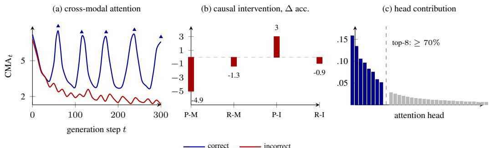
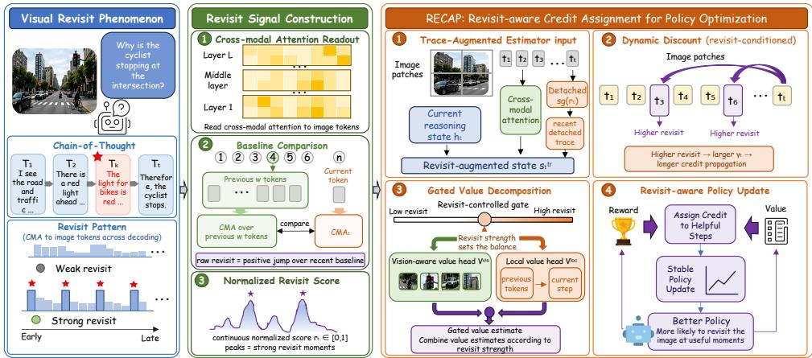
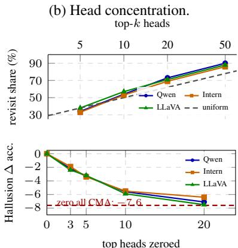
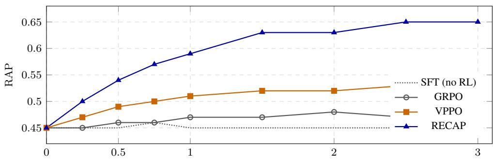
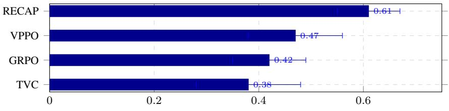
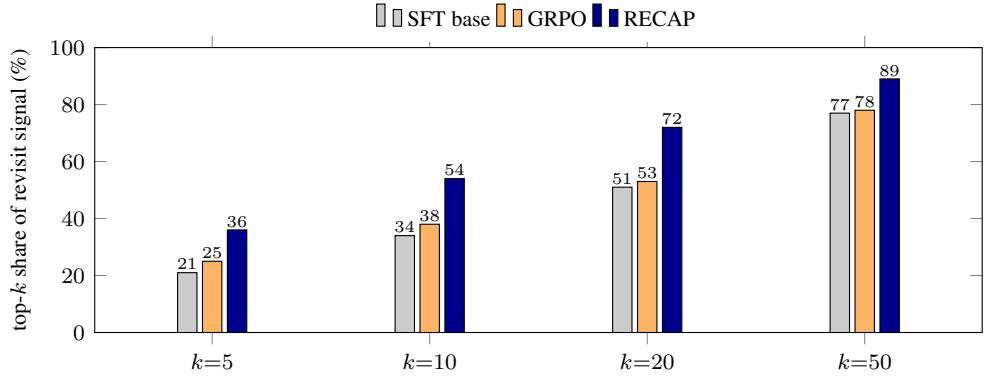
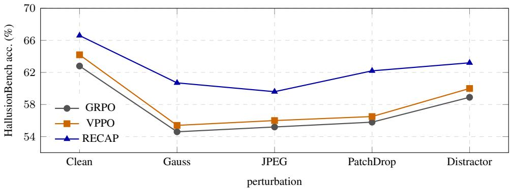

# RECAP: Looking Once Is Not Enough for Vision-Language Reasoning

Zhaolu Kang1,2,

Tailong Luo, Chenxin Li2, Yingjie He2, Zhenyu Yu, Fengyu Zhou, Jiachen Qian, Lei Wei2, Shuang Chen, Jiachen Li, Eric Hanchen Jiang, Rongchao Zhang2,

Zhengtao Yao, Hoi Leong Lee, Guansu Wang, Kaiyue Zhou2,†

1Peking University 2Chengdu Minto Tech

zlkang25@stu.pku.edu.cn kyzhou@wayne.edu

## Abstract

Long chain-of-thought reasoning improves vision-language models (VLMs), but it also exposes a temporal grounding failure: as generation unfolds, models may drift from image evidence while reinforcement learning still provides only a final-answer reward. We study this gap through visual revisit, a temporally localized reactivation of image evidence during reasoning. Across three VLM backbones, revisit peaks are predictive of correctness and causally linked to performance: masking them degrades accuracy more than masking non-peaks, while injecting revisit-like peaks into failed rollouts partially restores correct answers. Control analyses show that this signal is not explained by raw attention strength, uncertainty, logit margin, or hidden-state norm. We propose RECAP, a GRPO-compatible training method that turns detached revisit traces into a credit-assignment signal. RECAP uses revisitconditioned advantage estimation, dynamic discounting, and gated value prediction to propagate final rewards through visually important reasoning steps, without extra rewards, additional rollouts, or inference-time changes. Across Qwen2.5-VL-7B, InternVL3-8B, and LLaVA-OV-7B, RECAP consistently improves over GRPO and VPPO, yielding +6.1–+6.5 HallusionBench gains over the SFT base while preserving reasoning and text-only performance. Results on larger LoRA-tuned models, Chinese zero-shot benchmarks, visual perturbations, and human evaluation further demonstrate robust improvements in image-grounded reasoning.

## 1 Introduction

Vision-language models (VLMs) increasingly solve visual tasks through long chains of thought: they parse diagrams, compare spatial evidence, and decompose multi-hop questions into intermediate reasoning steps that can span hundreds of tokens [1, 2]. Reinforcement learning with verifiable answers, especially GRPO-style post-training [3] and multimodal variants [4, 5, 6], has become a practical way to improve these abilities. Yet the reward used by such training usually arrives only at the final answer. It can say whether the trajectory ended correctly, but not which intermediate tokens should have returned to the image and which could safely rely on language-internal reasoning.

This creates a temporal grounding problem. A long-CoT VLM should not attend uniformly to the image at every step: some tokens perform local algebra, bookkeeping, or linguistic continuation. The failure is more specific. When a later decision again depends on visual evidence, the model must re-ground the reasoning chain in the image; otherwise, it can produce fluent but visually unsupported conclusions [7]. Existing remedies improve visual grounding in useful but mostly static ways: VPPO reweights updates with visual signals [4], TVC re-injects visual attention at inference time [6], and

  
Figure 1: Visual revisits are causal and localized. Correct rollouts show recurring CMA peaks, while incorrect rollouts lose visual grounding after the initial window. Masking revisit peaks hurts accuracy more than masking random non-peaks, and peak injection partially recovers failed rollouts. A small set of heads explains most of the causal effect.

VAPO uses learned visual anchors [5]. These approaches do not directly ask when image evidence should re-enter a long reasoning trajectory, nor how a final-answer reward should be propagated through those visually important moments.

We study this missing temporal structure through visual revisit: a local reactivation of cross-modal attention after a stretch of language-internal reasoning. Across three VLM backbones, correct rollouts exhibit recurring revisit peaks, whereas failed rollouts more often lose or mistime these reactivations (fig. 1a). The pattern is not merely correlational. Masking cross-modal attention at revisit peaks hurts HallusionBench accuracy substantially more than masking random non-peaks, while boosting would-be revisit positions in failed rollouts partially recovers accuracy (fig. 1b, section 4.4). Control experiments further show that revisit is not explained by raw attention mass, token entropy, logit margin, or hidden-state norm. Finally, fig. 1c foreshadows a mechanistic localization result: the revisit effect is concentrated in a small set of attention heads rather than spread uniformly across the network. Motivated by this evidence, we propose RECAP, a GRPO-compatible training method that turns detached revisit traces into a credit-assignment signal. After a rollout is sampled, RECAP threads the trace through a training-time estimator input, a revisit-conditioned dynamic discount, and a revisit-gated value predictor. The sampling policy, terminal reward, rollout budget, and inference-time computation remain unchanged.

Two analyses clarify what the revisit trace contributes. First, proposition 1 shows that revisitconditioned dynamic discounting can induce retroactive credit couplings through future revisit peaks that same-step local advantage reweighting cannot express. Second, theorem 1 provides an oracle conditioning analysis showing when revisit-gated value prediction can reduce return-residual variance, while Appendix B makes explicit the trajectory-dependent surrogate bias introduced by post-hoc revisit conditioning. We also introduce RAP, a method-agnostic diagnostic that measures where positive return mass concentrates relative to revisit peaks. Empirically, RECAP improves HallusionBench accuracy over GRPO by +3.5–+4.1 points across Qwen2.5-VL-7B, InternVL3- 8B, and LLaVA-OV-7B, corresponding to +6.1–+6.5 points over the SFT bases, while preserving reasoning and text-only capability. The gains persist on a 72B LoRA-tuned model, transfer zero-shot to Chinese benchmarks, remain robust under visual perturbations, align with human judgments of image-groundedness, and compose with VPPO.

## Our contributions are:

• We identify visual revisit as a temporal grounding signal in long-CoT VLM reasoning, and validate it with peak-masking, peak-injection, signal-control, and head-localization analyses.

• We propose RECAP, a GRPO-compatible clipped-surrogate method that uses detached revisit traces for advantage estimation, dynamic discounting, and gated value prediction without extra rewards, additional rollouts, or inference-time changes.

• We analyze why dynamic discounting is more expressive than same-step local reweighting, provide an oracle conditioning analysis for revisit-gated value prediction, and introduce RAP as a method agnostic revisit-aware training diagnostic.

• We demonstrate consistent improvements across three backbones, a larger LoRA-tuned model, cross-lingual benchmarks, visual perturbations, human evaluation, and composition with VPPO.

## 2 Related Work

RL post-training for long-CoT VLM reasoning. Reinforcement learning with verifiable answers has become a standard post-training tool for long-CoT reasoning models. GRPO [3] removes the PPO critic and normalizes rewards within sampled groups, making final-answer supervision practical at scale. Recent multimodal variants inject visual information into this recipe: VPPO [4] modulates policy updates with visual signals, VAPO [5] uses learned visual anchors, and TVC [6] re-injects visual evidence during generation. Other methods refine credit assignment through per-token shaping in λ-GRPO [8] or structured advantages in TreeAdv [9]. These methods improve how final rewards affect updates, but they do not explicitly model when a long multimodal trajectory should return to the image. RECAP targets this temporal grounding gap with detached visual revisit traces that shape advantage estimation, dynamic discounting, and value prediction.

Visual hallucination and grounding during generation. Long-CoT VLMs can produce fluent reasoning chains that drift from the image and yield visually unsupported conclusions. Benchmarks and analyses such as HallusionBench, POPE, MMHalBench, and TVC document this failure mode across recognition, spatial reasoning, and instruction following [7, 10, 11, 6]. Existing mitigations improve grounding through inference-time interventions, such as visual re-injection in TVC [6] or attention-suppression decoding in OPERA [12], or through preference/data-level supervision with image-perturbed negatives [13]. These approaches are valuable but mostly treat grounding as a static correction or decoding-time intervention. Our focus is complementary: we ask whether the model’s own trajectory contains moments when visual evidence should re-enter the chain, and whether these revisit moments predict and causally support correctness.

Revisit-aware credit assignment and cross-modal mechanisms. Attention-derived statistics have been used for training and diagnosis, but their role in long-CoT multimodal credit assignment remains underexplored. Raw attention is hard to interpret in isolation because attention mass varies with token type, position, and layer. RECAP therefore defines revisit as a local rise of crossmodal attention above a trajectory-specific baseline, marking when the model returns to visual evidence after language-internal reasoning. Unlike same-step or token-local reweighting, revisitconditioned discounting can propagate final-answer credit retroactively through future revisit peaks (Proposition 1), while the gated value predictor addresses the return-residual bias–variance trade-off studied in Theorem 1 and Appendix B. Related mechanistic studies localize cross-modal interaction to small head subsets [13, 14]; we use this not as the method itself, but as evidence that RECAP encourages identifiable cross-modal mechanisms rather than diffuse attention noise (section 4.4).

## 3 The RECAP Framework

## 3.1 Preliminaries

GRPO for VLMs. A VLM defines an autoregressive policy $\pi _ { \theta } ( y _ { t } \mid h _ { t } )$ with context $h _ { t } \ =$ $\left( \mathbf { v } , q , y _ { < t } \right)$ . For a prompt–image pair $( \mathbf { v } , q )$ , GRPO [3] samples a group of M CoT rollouts $\{ \tau _ { g } \} _ { g = 1 } ^ { M } ,$ scores each rollout with a terminal verifier reward $R ( \tau _ { g } )$ , and assigns the same group-normalized advantage to every token in the rollout:

$$
\hat { A } _ { t } ^ { ( g ) } = \frac { R ( \tau _ { g } ) - \mu _ { R } } { \sigma _ { R } + \epsilon } , \qquad \mu _ { R } = \textstyle { \frac { 1 } { M } } \sum _ { j = 1 } ^ { M } R ( \tau _ { j } ) , \quad \sigma _ { R } ^ { 2 } = \frac { 1 } { M } \sum _ { j = 1 } ^ { M } ( R ( \tau _ { j } ) - \mu _ { R } ) ^ { 2 } .\tag{1}
$$

The clipped objective is

$$
\begin{array} { r } { \mathcal { L } ^ { G R P O } ( \theta ) = - \mathbb { E } _ { \tau , t } \left[ \operatorname* { m i n } \Bigl ( \rho _ { t } \hat { A } _ { t } , \mathrm { c l i p } ( \rho _ { t } , 1 - \epsilon , 1 + \epsilon ) \hat { A } _ { t } \Bigr ) \right] + \beta _ { \mathrm { K L } } \mathrm { K L } [ \pi _ { \theta } \parallel \pi _ { \mathrm { r e f } } ] , } \end{array}\tag{2}
$$

where $\rho _ { t } = \pi _ { \theta } ( y _ { t } \mid h _ { t } ) / \pi _ { \theta _ { \mathrm { o l d } } } ( y _ { t } \mid h _ { t } )$ . RECAP keeps the GRPO sampling protocol, clipped policyratio update, and KL anchor, but replaces the uniform token advantage with a revisit-conditioned surrogate advantage.

Cross-modal attention (CMA). Let V index visual tokens in the joint visual–text sequence. For layer ℓ and head $h ,$ the attention mass from text token $y _ { t }$ to the image is $\begin{array} { r } { \mathrm { C M A } _ { t } ^ { ( \ell , h ) } = \bar { \sum _ { j \in \mathcal { V } } } \alpha _ { t , j } ^ { ( \ell , h ) } } \end{array}$

  
Figure 2: The RECAP framework. A detached revisit signal $\tilde { r } _ { t }$ is extracted from cross-modal attention and injected into three parts of the surrogate estimator: the trace-augmented input, dynamic discount, and revisit-gated value predictor. The rollout policy, clipped ratio, and KL anchor remain unchanged.

We average over a fixed middle-layer set I and all heads:

$$
\mathrm { C M A } _ { t } = \frac { 1 } { \vert \mathcal { T } \vert N _ { h } } \sum _ { \ell \in \mathcal { T } } \sum _ { h = 1 } ^ { N _ { h } } \mathrm { C M A } _ { t } ^ { \left( \ell , h \right) } .\tag{3}
$$

The middle-third default avoids low-layer positional effects and high-layer label-projection noise;   
layer ranges and pooling ablations are given in Appendix C.

## 3.2 The Revisit Signal

Absolute CMA is a weak grounding score because some tokens require continuous visual attention and others need none. RECAP instead uses visual revisit: a local positive jump in CMA after recent language-internal reasoning. With window size $W$ (default 16), let $\mathcal { P } _ { t } = \{ \bar { k } : \dot { \operatorname* { m a x } } ( 1 , t - W ) \leq k <$ t} and, for nonempty $\mathcal { P } _ { t }$ , define

$$
\mathrm { b a s e l i n e } _ { t } = \frac { 1 } { | \mathcal { P } _ { t } | } \sum _ { k \in \mathcal { P } _ { t } } \mathrm { C M A } _ { k } , \qquad z _ { t } = \frac { \mathrm { R e L U } ( \mathrm { C M A } _ { t } - \mathrm { b a s e l i n e } _ { t } ) } { \mathrm { b a s e l i n e } _ { t } + \epsilon } .\tag{4}
$$

For the first generated position, where $\mathcal { P } _ { t }$ is empty, we set $z _ { t } = 0$ . We then normalize per rollout with a temperature-scaled sigmoid:

$$
\tilde { r } _ { t } = \sigma \biggl ( \eta \frac { z _ { t } - \operatorname* { m i n } _ { t ^ { \prime } } z _ { t ^ { \prime } } } { \operatorname* { m a x } _ { t ^ { \prime } } z _ { t ^ { \prime } } - \operatorname* { m i n } _ { t ^ { \prime } } z _ { t ^ { \prime } } + \epsilon } - \eta / 2 \biggr ) \in [ 0 , 1 ] ,\tag{5}
$$

with default $\eta = 6$ . Here $z _ { t }$ is a raw revisit signal, not a reward. The bounded signal can be used as a gate or discount multiplier, is validated causally in Sec. 4.4, and is detached before entering the objective. Importantly, $\tilde { r } _ { t }$ is computed after a rollout is sampled from the ordinary policy $\pi _ { \theta } ( y _ { t } \mid h _ { t } ) ;$ it changes training-time advantage construction, not the online sampling distribution. Further design choices and failure modes are in Appendix C.

## 3.3 RECAP Objective

Given a completed rollout and its detached revisit trace, RECAP builds a surrogate advantage from three components: a trace-augmented estimator input, a revisit-conditioned discount, and a revisit-gated value predictor. Appendix M compares these structural slots with related baselines.

Trace-augmented estimator input. For advantage and value estimation, RECAP augments the language-state context with recent detached revisit traces:

$$
\boldsymbol { s } _ { t } ^ { \mathrm { t r } } = \big ( h _ { t } , \mathrm { s g } ( \tilde { r } _ { t } ) , \mathrm { s g } ( \tilde { r } _ { t - 1 } ) , \dots , \mathrm { s g } ( \tilde { r } _ { t - K } ) \big ) ,\tag{6}
$$

with missing past traces padded by zero. This is a post-hoc estimator input, not the causal state used to sample $y _ { t }$

Revisit-conditioned dynamic discount. A static discount propagates terminal reward through all transitions in the same way. RECAP instead increases the discount at visually important positions while keeping it below one:

$$
\gamma _ { t } = \gamma _ { \mathrm { b a s e } } + \beta ( \gamma _ { \mathrm { m a x } } - \gamma _ { \mathrm { b a s e } } ) \mathrm { s g } ( \tilde { r } _ { t } ) , \qquad 0 \leq \beta \leq 1 , \quad 0 < \gamma _ { \mathrm { b a s e } } < \gamma _ { \mathrm { m a x } } < 1 .\tag{7}
$$

We attach $\gamma _ { t }$ to the transition into position t, so return at step t uses $\gamma _ { t + 1 }$ when propagating reward from $t + 1$ back to t. Thus future revisit peaks can retroactively increase credit for earlier decisions.

Revisit-gated value prediction. Low-revisit tokens are often language-internal continuations, whereas high-revisit tokens coincide with renewed visual evidence. We use two value heads with a shared backbone and combine them by the detached current revisit value:

$$
V ^ { \mathrm { g a t e d } } ( s _ { t } ^ { \mathrm { t r } } ) = ( 1 - \mathrm { s g } ( \tilde { r } _ { t } ) ) V ^ { \mathrm { l o c } } ( s _ { t } ^ { \mathrm { t r } } ) + \mathrm { s g } ( \tilde { r } _ { t } ) V ^ { \mathrm { v i s } } ( s _ { t } ^ { \mathrm { t r } } ) .\tag{8}
$$

Here $V ^ { \mathrm { l o c } }$ and $V ^ { \mathrm { v i s } }$ denote the learned implementation heads and may use the full trace-augmented input $s _ { t } ^ { \mathrm { t r } } .$ . The oracle analysis in Sec. 3.6 uses a restricted abstraction to isolate the variance effect of conditioning on $\tilde { r } _ { t }$ . This predictor is used inside a detached policy advantage; the bias–variance interpretation is formalized in Sec. 3.6 and Appendix B.

Return and value target. RECAP starts from the same raw terminal verifier score as GRPO. For a completed rollout $\tau$ of length T, define $b _ { t } ( \tau ) = 0$ for $t < T$ and $b _ { T } ( \tau ) = R _ { \mathrm { r a w } } ( \tau )$ . For the revisit-discounted surrogate return, RECAP propagates the non-negative stream

$$
u _ { t } = \operatorname* { m a x } ( b _ { t } ( \tau ) , 0 ) .
$$

The revisit signal $\tilde { r } _ { t }$ is not treated as a reward; it only modulates the discount and value prediction. The revisit-discounted return is

$$
G _ { t } ^ { \mathrm { V R } } = \sum _ { k = 0 } ^ { T - t } \left( \prod _ { i = 1 } ^ { k } \gamma _ { t + i } \right) u _ { t + k } .\tag{9}
$$

Both value heads are trained through the gated prediction loss

$$
L _ { V } = \mathbb { E } \left[ \left( \mathrm { s g } ( G _ { t } ^ { \mathrm { V R } } ) - V ^ { \mathrm { g a t e d } } ( s _ { t } ^ { \mathrm { t r } } ) \right) ^ { 2 } \right] .\tag{10}
$$

The exact reward-stream convention and log-domain return recursion are specified in Appendix D.

Policy surrogate. The per-token RECAP advantage is

$$
A _ { t } ^ { \mathrm { V R } } = G _ { t } ^ { \mathrm { V R } } - V ^ { \mathrm { g a t e d } } ( s _ { t } ^ { \mathrm { t r } } ) ,\tag{11}
$$

and the clipped surrogate is

$$
\begin{array} { r } { \mathcal { L } ^ { \mathrm { R E C A P } } ( \theta ) = - \mathbb { E } _ { \tau , t } \left[ \operatorname* { m i n } \big ( \rho _ { t } \mathrm { s g } ( A _ { t } ^ { \mathrm { V R } } ) , \mathrm { c l i p } ( \rho _ { t } , 1 - \epsilon , 1 + \epsilon ) \mathrm { s g } ( A _ { t } ^ { \mathrm { V R } } ) \big ) \right] + \beta _ { \mathrm { K L } } \mathrm { K L } [ \pi _ { \theta } \parallel \pi _ { \mathrm { r e f } } ] , } \end{array}\tag{12}
$$

with the same causal policy ratio $\rho _ { t } = \pi _ { \theta } ( y _ { t } \mid h _ { t } ) / \pi _ { \theta _ { \mathrm { o l d } } } ( y _ { t } \mid h _ { t } )$ . Thus no policy-loss gradient flows through $G _ { t } ^ { \mathrm { V R } } , V ^ { \mathrm { g a t e d } }$ , or $\tilde { r } _ { t } ;$ the value heads are trained only by Eq. (10). The revisit trace therefore affects the detached advantage, not the rollout distribution. Vanilla GRPO is recovered by replacing $A _ { t } ^ { \mathrm { V R } }$ with the group-normalized terminal advantage $\hat { A } _ { t }$

## 3.4 The RAP Metric

Accuracy alone cannot reveal whether a policy places positive return on visually grounded reasoning steps. We therefore report Revisit-Aware Propagation (RAP), the return-weighted concentration of revisit signal. For evaluation, use a fixed method-independent return $\bar { G } _ { t } ^ { \mathrm { e v a l } }$ computed from the terminal verifier reward with the same scalar discount for all methods. Then

$$
\mathrm { R A P } ( \pi _ { \theta } ) = \mathbb { E } _ { \tau \sim \pi _ { \theta } } \left[ \frac { \sum _ { t } \tilde { r } _ { t } \bar { G } _ { t } ^ { \mathrm { e v a l } , + } } { \sum _ { t } \bar { G } _ { t } ^ { \mathrm { e v a l } , + } + \epsilon } \right] , \qquad \bar { G } _ { t } ^ { \mathrm { e v a l } , + } = \operatorname* { m a x } ( \bar { G } _ { t } ^ { \mathrm { e v a l } } , 0 ) .\tag{13}
$$

RAP is bounded, insensitive to gratuitous revisit spikes at zero-return positions, and method-agnostic because it depends only on forward-pass attention and verifier rewards. Appendix C proves these properties; Sec. 4.5 validates its empirical use as a training diagnostic.

## 3.5 Proposition 1: A Toy Separation from Same-Step Reweighting

Same-step local reweighting scales an advantage by $w ( \tilde { r } _ { t } )$ and therefore only uses the current token’s revisit value. In contrast, dynamic discounting multiplies future discounts, so later revisit peaks can change the credit assigned to earlier actions.

Proposition 1 (Separation from same-step local reweighting). There exist afinite-horizon MDP, a revisit-pattern distribution, and parameters $( \beta , \gamma _ { \mathrm { b a s e } } , \gamma _ { \mathrm { m a x } } )$ such that $R E C A \dot { P } ^ { \prime } s$ revisit-conditioned dynamic discount induces a strict earlier action preference that no strictly positive same-step local reweighting $w ( \tilde { r } _ { t } ) A _ { t }$ can induce. Equivalently, in the one-decision policy-gradient construction of Appendix A, the dynamic-discount fixed point is outside the union of fixed-point sets induced by such local reweightings.

This isolates the retroactive coupling created by $\prod _ { i } \gamma _ { i } { \mathrm { : } }$ a future revisit peak can affect earlier credit, whereas $w ( \tilde { r } _ { t } )$ only rescales the current step. The horizon-3 construction, scope, and relation to trajectory-dependent reweighting are in Appendix A.

## 3.6 Theorem 1: Revisit-Gated Return-Residual Variance

The following result is an oracle residual-variance analysis under post-hoc revisit conditioning, not a policy-gradient optimality guarantee. Let $G _ { t } : = G _ { t } ^ { \mathrm { V R } }$ and define

$$
x _ { t } = ( h _ { t } , \mathrm { s g } ( \tilde { r } _ { t - 1 } ) , \ldots , \mathrm { s g } ( \tilde { r } _ { t - K } ) ) , \quad s _ { t } ^ { \mathrm { t r } } = ( x _ { t } , \mathrm { s g } ( \tilde { r } _ { t } ) ) ,
$$

with oracle predictors $V ^ { 0 } ( x _ { t } ) = \mathbb { E } [ G _ { t } \mid x _ { t } ]$ and $V ^ { r } ( x _ { t } , \tilde { r } _ { t } ) = \mathbb { E } [ G _ { t } \mid x _ { t } , \tilde { r } _ { t } ]$

Assumption 1 (Revisit relevance). The revisit trace provides incremental information about the return: $\dot { \mathbb { E } } [ G _ { t } \mid \dot { x _ { t } } , \tilde { r } _ { t } ] \neq \mathbb { E } [ G _ { t } \mid x _ { t } ]$ on a set of positive measure.

Assumption 2 (Idealized linear-in-revisit oracle form). For the closed-form expression below, assume that there exist oracle component functions $\bar { V } ^ { \mathrm { l o c } } ( x _ { t } )$ and $\bar { V } ^ { \mathrm { v i s } } ( x _ { t } )$ such that

$$
\mathbb { E } [ G _ { t } \mid x _ { t } , \tilde { r } _ { t } ] = ( 1 - \tilde { r } _ { t } ) \bar { V } ^ { \mathrm { l o c } } ( x _ { t } ) + \tilde { r } _ { t } \bar { V } ^ { \mathrm { v i s } } ( x _ { t } ) .
$$

This oracle restriction is used only for Eq. (15); the learned heads in Eq. (8) take the full $s _ { t } ^ { \mathrm { t r } }$ as input and need not realize this decomposition.

Theorem 1 (Oracle return-residual variance reduction). Assume $G _ { t }$ hasfinite second moment. Under Assumption 1,

$$
\begin{array} { r l } & { \mathrm { V a r } \big ( G _ { t } - V ^ { 0 } ( x _ { t } ) \big ) - \mathrm { V a r } \big ( G _ { t } - V ^ { r } ( x _ { t } , \tilde { r } _ { t } ) \big ) } \\ & { \quad = \mathbb { E } _ { x _ { t } } \left[ \mathrm { V a r } ( \mathbb { E } [ G _ { t } \mid x _ { t } , \tilde { r } _ { t } ] \mid x _ { t } ) \right] \geq 0 . } \end{array}\tag{14}
$$

IfAssumption 2 also holds, then

$$
\begin{array} { r l } & { \mathrm { V a r } \big ( G _ { t } - V ^ { 0 } ( x _ { t } ) \big ) - \mathrm { V a r } ( G _ { t } - V ^ { r } ( x _ { t } , \tilde { r } _ { t } ) ) } \\ & { \quad = \mathbb { E } _ { x _ { t } } \left[ \big ( \bar { V } ^ { \mathrm { v i s } } ( x _ { t } ) - \bar { V } ^ { \mathrm { l o c } } ( x _ { t } ) \big ) ^ { 2 } \mathrm { V a r } ( \tilde { r } _ { t } \mid x _ { t } ) \right] . } \end{array}\tag{15}
$$

Thus conditioning the oracle predictor on the current revisit cannot increase return-residual variance, and the linear oracle form makes the reduction depend on both the local/visual value gap and the conditional variation of $\tilde { r } _ { t }$ . Since $\tilde { r } _ { t }$ is a post-hoc trajectory feature, RECAP remains a revisitconditioned surrogate with an explicit bias–variance trade-off; Appendix B gives the proof and derives the corresponding bias term.

## 4 Experiments

## 4.1 Setup

We evaluate RECAP on Qwen2.5-VL-7B [15], InternVL3-8B [16], and LLaVA-OneVision-7B [17]; a larger Qwen2.5-VL-72B LoRA run is reported in Appendix E. All methods use the same two-stage pipeline: Stage 1 supervised fine-tuning on 50K filtered long-CoT examples, followed by Stage 2 RL on 30K disjoint verifiable-answer questions (20K for 72B), with group size $M = 8$ and the same terminal verifier. RECAP’s non-negative terminal stream is used only inside its revisit-discounted surrogate return; it introduces no additional reward model or auxiliary supervision. Hyperparameters are tuned on held-out splits for the baselines and then frozen for RECAP; full training, compute, and seed details are in Appendix E.

<table><tr><td rowspan="3">Method</td><td colspan="3">Hallucination</td><td colspan="3">Reasoning</td><td colspan="3">Grounding</td><td colspan="3">Text-only</td><td rowspan="3">Δ</td></tr><tr><td>↑</td><td></td><td>↑</td><td>↑</td><td>↑</td><td>Hall. POPE MMHal MathV. MMMU MathVr. MM-Vet ↑</td><td>↑</td><td></td><td></td><td></td><td>GQA BLINK MMVP MMLU GSM8K</td><td></td></tr><tr><td>↑</td><td></td><td></td><td></td><td></td><td></td><td></td><td>↑</td><td>↑</td><td>↑</td><td>↑</td><td>↑</td></tr><tr><td colspan="10">Qwen2.5-VL-7B</td><td></td><td></td><td></td><td></td></tr><tr><td>SFT base</td><td>60.1</td><td>86.5</td><td>3.12</td><td>59.4</td><td>41.3</td><td>33.2</td><td>51.4</td><td>63.8</td><td>48.2</td><td>54.0</td><td>72.4</td><td>78.9</td><td></td></tr><tr><td>TVC (no RL)</td><td>61.4</td><td>86.9</td><td>3.18</td><td>59.2</td><td>41.0</td><td>33.5</td><td>51.8</td><td>64.1</td><td>48.5</td><td>54.3</td><td>72.3</td><td>78.7</td><td>+1.3</td></tr><tr><td>GRPO</td><td>62.8</td><td>87.1</td><td>3.27</td><td>61.2</td><td>42.5</td><td>34.7</td><td>52.8</td><td>64.3</td><td>49.1</td><td>54.8</td><td>72.1</td><td>78.5</td><td>+2.7</td></tr><tr><td>VPPO</td><td>64.2</td><td>87.6</td><td>3.35</td><td>60.8</td><td>41.9</td><td>34.1</td><td>52.1</td><td>64.7</td><td>48.9</td><td>55.1</td><td>71.8</td><td>77.9</td><td>+4.1</td></tr><tr><td>RECAP</td><td>66.6†</td><td>88.4</td><td>3.58</td><td>63.6</td><td>42.7</td><td>36.1</td><td>53.9</td><td>65.2</td><td>50.1</td><td>56.4</td><td>72.3</td><td>78.6</td><td>+6.5†</td></tr><tr><td colspan="10">InternVL3-8B</td><td></td><td></td><td></td><td></td></tr><tr><td>SFT base</td><td>58.6</td><td>87.2</td><td>3.21</td><td>61.7</td><td>44.8</td><td>35.0</td><td>53.1</td><td>65.0</td><td>49.6</td><td>53.2</td><td>73.8</td><td>80.1</td><td></td></tr><tr><td>TVC (no RL)</td><td>60.0</td><td>87.5</td><td>3.28</td><td>61.5</td><td>44.5</td><td>35.3</td><td>53.4</td><td>65.3</td><td>49.9</td><td>53.6</td><td>73.6</td><td>79.9</td><td>+1.4</td></tr><tr><td>GRPO</td><td>61.2</td><td>87.8</td><td>3.34</td><td>63.1</td><td>45.6</td><td>36.2</td><td>54.2</td><td>65.6</td><td>50.2</td><td>54.0</td><td>73.4</td><td>79.6</td><td>+2.6</td></tr><tr><td>VPPO</td><td>62.4</td><td>88.1</td><td>3.41</td><td>62.6</td><td>44.9</td><td>35.7</td><td>53.7</td><td>65.9</td><td>50.0</td><td>54.3</td><td>73.1</td><td>79.1</td><td>+3.8</td></tr><tr><td>RECAP</td><td>64.7†</td><td>89.0</td><td>3.62</td><td>65.3</td><td>45.9</td><td>37.4</td><td>55.1</td><td>66.5</td><td>51.1</td><td>55.5</td><td>73.5</td><td>79.7</td><td>+6.1†</td></tr><tr><td colspan="10">LLaVA-OV-7B</td><td colspan="3"></td><td colspan="3"></td></tr><tr><td>SFT base</td><td>56.9</td><td>85.4</td><td>3.05</td><td>56.2</td><td>39.8</td><td>31.4</td><td>49.6</td><td>62.5</td><td>46.8</td><td>52.1</td><td>70.2</td><td>75.4</td><td></td></tr><tr><td>TVC (no RL)</td><td>58.5</td><td>85.8</td><td>3.11</td><td>56.0</td><td>39.6</td><td>31.7</td><td>49.9</td><td>62.8</td><td>47.0</td><td>52.4</td><td>70.0</td><td>75.2</td><td>+1.6</td></tr><tr><td>GRPO</td><td>59.3</td><td>86.1</td><td>3.19</td><td>58.0</td><td>40.9</td><td>32.8</td><td>50.8</td><td>63.0</td><td>47.6</td><td>52.9</td><td>69.7</td><td>74.9</td><td>+2.4</td></tr><tr><td>VPPO</td><td>60.6</td><td>86.5</td><td>3.25</td><td>57.4</td><td>40.2</td><td>32.2</td><td>50.2</td><td>63.3</td><td>47.4</td><td>53.1</td><td>69.4</td><td>74.3</td><td>+3.7</td></tr><tr><td>RECAP</td><td>63.4†</td><td>87.4</td><td>3.50</td><td>60.5</td><td>41.1</td><td>34.3</td><td>51.9</td><td>63.9</td><td>48.6</td><td>54.3</td><td>69.9</td><td>75.0</td><td>+6.5+</td></tr></table>

Table 1: Main results across three VLM backbones. Values are mean benchmark scores or accuracies over 8 seeds; MMHalBench is reported on its native score scale. Per-seed logs, standard deviations, standard errors, and 95% confidence intervals are reported in the supplementary reproducibility logs. Bold marks the best value within each backbone block; underlines mark the strongest non-RECAP RL baseline per column. A dagger marks a significant RECAP-over-GRPO improvement after Holm–Bonferroni correction. ∆ denotes the HallusionBench gain over the per-backbone SFT base.

We report six benchmark groups: hallucination (HallusionBench [7], POPE [10], MMHalBench [11]), reasoning (MathVista [2], MMMU [18], MathVerse [19], MM-Vet [20]), grounding, text-only capability, cross-lingual Chinese benchmarks, and adversarial image/text perturbations. The main baselines are GRPO, VPPO, RECAP, and a no-RL SFT+TVC-style reference; VAPO, λ-GRPO, and TreeAdv are additionally trained on Qwen2.5-VL-7B. Headline results use 8 seeds and ablations use 5; boldface marks the best value within each comparison block, and daggers mark RECAP-over-GRPO significance at $p < 0 . 0 5$ after Holm–Bonferroni correction.

## 4.2 Main Results

Table 1 gives the main result. RECAP improves HallusionBench accuracy over GRPO by +3.8, +3.5, and +4.1 points on Qwen2.5-VL-7B, InternVL3-8B, and LLaVA-OneVision-7B, respectively, while preserving reasoning and text-only capability. VPPO yields smaller hallucination gains and slightly weaker reasoning scores, while the no-RL TVC-style reference remains below RECAP. The same pattern persists on the Qwen2.5-VL-72B LoRA setting, where RECAP improves HallusionBench by +3.1 points over LoRA-GRPO with no inference-time cost (Appendix E).

## 4.3 Ablations and Signal Characterization

Table 2 condenses the key ablations on Qwen2.5-VL-7B. Composing RECAP with VPPO gives an additional gain, consistent with proposition 1: dynamic discounting and same-step visual reweighting address different slots in the update. Removing the dynamic discount causes the largest drop, followed by the gated value predictor and the trace-augmented estimator input; the variance increase without the gated value matches the trend predicted by theorem 1. Using the same revisit signal as a local advantage reweight is also weaker than using it as a dynamic discount.

Table 3 tests whether the effect is specific to the revisit signal. Replacing $\tilde { r } _ { t }$ with entropy, logit margin, or hidden-state norm under the same RECAP framework underperforms; using revisit only at inference time without RL also fails to recover the full gain. The positive correlation between revisit and $| A _ { t } |$ supports the relevance condition in theorem 1. Sensitivity to layer range, window size, and normalization temperature is reported in Appendix E.

<table><tr><td>Configuration</td><td>Hallusion ↑</td><td>MathVista MMMU ↑</td><td>↑</td><td>Var(At) rel. ↓</td></tr><tr><td colspan="5">(a) VPPO orthogonality</td></tr><tr><td>GRPO</td><td>62.8 [62.0, 63.5]</td><td>61.2</td><td>42.5</td><td>1.81×</td></tr><tr><td>VPPO</td><td>64.2 [63.3, 65.0]</td><td>60.8</td><td>41.9</td><td>1.35×</td></tr><tr><td>RECAP</td><td>66.6 [65.7, 67.4]</td><td>63.6</td><td>42.7</td><td>1.00×</td></tr><tr><td>VPPO + RECAP (composition)</td><td>68.0 [67.1, 68.8]</td><td>63.9</td><td>42.6</td><td>0.98×</td></tr><tr><td colspan="5">(b) Component ablations</td></tr><tr><td>Full RECAP</td><td>66.6</td><td>63.6</td><td>42.7</td><td>1.00×</td></tr><tr><td>— Trace-augmented estimator state (K = 0)</td><td>65.8</td><td>63.1</td><td>42.4</td><td>1.08×</td></tr><tr><td>— Gated value  $( V ^ { \mathrm { l o c } } = V ^ { \mathrm { v i s } } )$ </td><td>65.2</td><td>62.8</td><td>42.1</td><td>1.70×</td></tr><tr><td>— Dynamic discount  $( \beta = 0 )$ </td><td>64.3</td><td>62.4</td><td>42.0</td><td>1.09×</td></tr><tr><td>— Stop-gradient on  $\tilde { r } _ { t }$ </td><td>60.8</td><td>59.7</td><td>41.6</td><td>2.35×</td></tr><tr><td colspan="5">(c) Dynamic discount vs. advantage reweight</td></tr><tr><td>Reweight  $w ( \tilde { r } _ { t } ) \cdot A _ { t }$  (tuned w, Qwen/Intern/LLaVA)</td><td>64.6</td><td>62.8</td><td>42.3</td><td>1.21×</td></tr><tr><td>Dynamic discount γt (ours, Qwen/Intern/LLaVA)</td><td>66.6</td><td>63.6</td><td>42.7</td><td>1.00×</td></tr><tr><td colspan="5">Gap (discount − reweight), Qwen/Intern/LLaVA: +2.0 / +1.6 / +2.1 pt on Hallusion.</td></tr></table>

Table 2: Ablations on Qwen2.5-VL-7B. Bold marks the best value within each panel and underlines mark the strongest non-best variant. The table compares VPPO composition, component removal, and dynamic-discount reweighting variants across accuracy and surrogate-advantage variance.
<table><tr><td>Configuration</td><td>Qwen2.5-VL 7B↑</td><td>InternVL3 8B↑</td><td>LLaVA-OV 7B↑</td><td>Extra</td></tr><tr><td colspan="5">(a) Signal identity</td></tr><tr><td>Token entropy</td><td>63.2</td><td>61.6</td><td>60.1</td><td>ρ=0.29</td></tr><tr><td>Logit margin</td><td>63.0</td><td>61.4</td><td>59.8</td><td>ρ=0.24</td></tr><tr><td>Hidden-state norm</td><td>63.5</td><td>61.9</td><td>60.4</td><td>ρ=0.36</td></tr><tr><td>Revisit  $\tilde { r } _ { t }$  (ours)</td><td>66.6</td><td>64.7</td><td>63.4</td><td>ρ=1.00</td></tr><tr><td colspan="5">(b) Same signal without RL</td></tr><tr><td>SFT base (no RL, no revisit)</td><td>60.1</td><td>58.6</td><td>56.9</td><td>∆SFT=0</td></tr><tr><td>SFT + TVC</td><td>61.4</td><td>60.0</td><td>58.5</td><td>+1.4</td></tr><tr><td>SFT + revisit re-injection</td><td>62.7</td><td>61.4</td><td>59.9</td><td>+2.8</td></tr><tr><td>GRPO (RL, no revisit)</td><td>62.8</td><td>61.2</td><td>59.3</td><td>+2.5</td></tr><tr><td>RECAP (RL + revisit)</td><td>66.6</td><td>64.7</td><td>63.4</td><td>+6.4</td></tr><tr><td>∆ RECAP vs. best no-RL baseline</td><td>+3.9</td><td>+3.3</td><td>+3.5</td><td></td></tr></table>

Table 3: Signal identity and no-RL controls. Bold marks the best value within each panel; underlines mark the strongest signal-replacement baseline in panel (a) and the strongest no-RL baseline in panel (b). Replacing $\tilde { r } _ { t }$ with surface token signals weakens RECAP, and using the revisit signal without RL does not recover the full gain.

## 4.4 Causal and Mechanistic Evidence

Figure 3 summarizes the causal and mechanistic evidence. At the token-position level, masking top revisit positions hurts far more than masking random non-peaks, CMA injection partially recovers failed rollouts, and revisit peaks align with annotated decision steps above chance. At the head level, the top-10 heads carry more than 40% of revisit mass across backbones, and zeroing these heads reproduces most of the accuracy drop from masking cross-modal attention. Full per-backbone intervention tables, head maps, pre/post-training concentration curves, and linear-probe analyses are in Appendix G.

## 4.5 Generalization, Robustness, and Diagnostics

RECAP’s gains are not confined to the three small English backbones. The 72B LoRA result, human study, cross-lingual evaluation, adversarial tests, and RAP diagnostics are summarized here; full details are in Appendix E, Appendix H, Appendix I, Appendix J, and Appendix F, respectively.

Human preference. On 100 HallusionBench/MathVista questions with non-identical CoTs, ten trained annotators rank image-groundedness, coherence, and trustworthiness. RECAP wins over 60% of image-groundedness comparisons against GRPO and VPPO at Fleiss’ $\kappa \geq 0 . 5$ , with McNemar’s test giving $p < 0 . 0 1$ against both baselines. The LLM-as-judge ranking agrees with the human majority on 72% of items.

<table><tr><td>Setting Qwen</td><td>Intern LLaVA Mean</td></tr><tr><td>Accuracy change under intervention</td><td></td></tr><tr><td>Peak mask -4.9</td><td>-4.6 -4.8 -4.8</td></tr><tr><td>Random mask -1.3</td><td>-1.0 -1.2 -1.2</td></tr><tr><td>Peak inject +3.0</td><td>+2.7 +3.1 +2.9</td></tr><tr><td>Random inject -0.9</td><td>-0.4 -0.6 -0.6</td></tr><tr><td>Alignment with decision steps</td><td></td></tr><tr><td>řt peaks 42.1%</td><td>60.8% 61.2% 54.7%</td></tr><tr><td>Chance baseline 17.2%</td><td>15.8% 19.4% 17.4%</td></tr></table>

(a) Position-level causal evidence.

  
(c) Top-head zero-out.  
Figure 3: Causal and mechanistic evidence. Top revisit positions are more decision-relevant than random positions, and revisit peaks align with annotated decision steps. The revisit signal further concentrates in a small set of heads, and zeroing those heads reproduces most of the accuracy drop from masking cross-modal attention.

Cross-lingual transfer. Training on English data only, RECAP consistently improves over GRPO when the same checkpoints are evaluated zero-shot on Chinese CMMMU, MMMU, and MathVista-CN. The gains are smaller than on English hallucination benchmarks, but remain positive without translation-specific tuning or Chinese RL data.

Adversarial robustness. Under Gaussian noise, JPEG compression, patch dropout, off-topic distractor patches, and GPT-4 question reformulations, RECAP keeps a larger margin than GRPO and VPPO. Strong patch dropout is the hardest case because it disrupts the visual evidence tracked by revisit peaks, but the margin does not invert. Text-side reformulations show lower variation across paraphrases, consistent with using cross-modal attention rather than surface wording.

RAP diagnostic. RAP rises early during Stage-2 RL and plateaus higher under RECAP than under GRPO or VPPO, matching the intended revisit-aware credit assignment. Cross-method scatter plots further support RAP as a method-agnostic training diagnostic rather than a RECAP-specific objective trace.

## 5 Conclusion

We introduced visual revisit as a temporal grounding signal for long-chain vision-language reasoning: rather than treating visual attention as static, revisit captures when a model returns to image evidence after language-internal reasoning. Across three VLM backbones, revisit peaks are predictive of correctness, robust to signal controls, and supported by masking and injection interventions. Building on this observation, RECAP uses detached revisit traces for credit assignment through trace-augmented estimation, dynamic discounting, and gated value prediction. It improves visual grounding over GRPO and VPPO while largely preserving reasoning and text-only capability, with ablations and mechanistic analyses indicating that the gains come from assigning credit to visually important reasoning moments rather than simply increasing overall image attention. RECAP is also easy to insert into verifier-based RL pipelines: the revisit trace is extracted from the same forward pass, detached before optimization, and discarded at inference.

Limitations. RECAP relies on accessible and meaningful cross-modal attention traces, so its benefits may be smaller for short answers, text-only tasks, or architectures where attention is a weak proxy for grounding. Revisit can also be misled by salient distractors or corrupted visual regions, suggesting future work on richer region-level or architecture-agnostic forms of temporal grounding.

## References

[1] Yangyi Chen, Karan Sikka, Michael Cogswell, Heng Ji, and Ajay Divakaran. Measuring and improving chain-of-thought reasoning in vision-language models. In Proceedings of the 2024 Conference ofthe North American Chapter ofthe Associationfor Computational Linguistics: Human Language Technologies (Volume 1: Long Papers), pages 192–210, 2024.

[2] Pan Lu, Hritik Bansal, Tony Xia, Jiacheng Liu, Chunyuan Li, Hannaneh Hajishirzi, Hao Cheng, Kai-Wei Chang, Michel Galley, and Jianfeng Gao. Mathvista: Evaluating mathematical reasoning of foundation models in visual contexts. arXiv preprint arXiv:2310.02255, 2023.

[3] Zhihong Shao, Peiyi Wang, Qihao Zhu, Runxin Xu, Junxiao Song, Xiao Bi, Haowei Zhang, Mingchuan Zhang, YK Li, Yang Wu, et al. Deepseekmath: Pushing the limits of mathematical reasoning in open language models. arXiv preprint arXiv:2402.03300, 2024.

[4] Siyuan Huang, Xiaoye Qu, Yafu Li, Yun Luo, Zefeng He, Daizong Liu, and Yu Cheng. Spotlight on token perception for multimodal reinforcement learning. arXiv preprint arXiv:2510.09285, 2025.

[5] Yu Yue, Yufeng Yuan, Qiying Yu, Xiaochen Zuo, Ruofei Zhu, Wenyuan Xu, Jiaze Chen, Chengyi Wang, TianTian Fan, Zhengyin Du, et al. VAPO: Efficient and reliable reinforcement learning for advanced reasoning tasks. arXiv preprint arXiv:2504.05118, 2025.

[6] Hai-Long Sun, Zhun Sun, Houwen Peng, and Han-Jia Ye. Mitigating visual forgetting via take-along visual conditioning for multi-modal long cot reasoning. In Proceedings ofthe 63rd Annual Meeting of the Association for Computational Linguistics (Volume 1: Long Papers), pages 5158–5171, 2025.

[7] Tianrui Guan, Fuxiao Liu, Xiyang Wu, Ruiqi Xian, Zongxia Li, Xiaoyu Liu, Xijun Wang, Lichang Chen, Furong Huang, Yaser Yacoob, et al. Hallusionbench: an advanced diagnostic suite for entangled language hallucination and visual illusion in large vision-language models. In Proceedings ofthe IEEE/CVF conference on computer vision and pattern recognition, pages 14375–14385, 2024.

[8] Prasanna Parthasarathi, Mathieu Reymond, Boxing Chen, Yufei Cui, and Sarath Chandar. GRPO-λ: Credit assignment improves llm reasoning. arXiv preprint arXiv:2510.00194, 2025.

[9] Lang Cao, Hui Ruan, Yongqian Li, Peng Chao, Wu Ning, Haonan Song, Renhong Chen, and Yitong Li. Treeadv: Tree-structured advantage redistribution for group-based rl. arXiv preprint arXiv:2601.03703, 2026.

[10] Yifan Li, Yifan Du, Kun Zhou, Jinpeng Wang, Xin Zhao, and Ji-Rong Wen. Evaluating object hallucination in large vision-language models. In Proceedings of the 2023 conference on empirical methods in natural language processing, pages 292–305, 2023.

[11] Zhiqing Sun, Sheng Shen, Shengcao Cao, Haotian Liu, Chunyuan Li, Yikang Shen, Chuang Gan, Liangyan Gui, Yu-Xiong Wang, Yiming Yang, et al. Aligning large multimodal models with factually augmented rlhf. In Findings ofthe Associationfor Computational Linguistics: ACL 2024, pages 13088–13110, 2024.

[12] Qidong Huang, Xiaoyi Dong, Pan Zhang, Bin Wang, Conghui He, Jiaqi Wang, Dahua Lin, Weiming Zhang, and Nenghai Yu. Opera: Alleviating hallucination in multi-modal large language models via over-trust penalty and retrospection-allocation. In Proceedings of the IEEE/CVF Conference on Computer Vision and Pattern Recognition, pages 13418–13427, 2024.

[13] Yanbei Jiang, Xueqi Ma, Shu Liu, Sarah Monazam Erfani, Tongliang Liu, James Bailey, Jey Han Lau, and Krista A Ehinger. Investigating the functional roles of attention heads in vision language models: Evidence for reasoning modules. arXiv preprint arXiv:2512.10300, 2025.

[14] Kevin Meng, David Bau, Alex Andonian, and Yonatan Belinkov. Locating and editing factual associations in gpt. Advances in neural information processing systems, 35:17359–17372, 2022.

[15] Shuai Bai, Keqin Chen, Xuejing Liu, Jialin Wang, Wenbin Ge, Sibo Song, Kai Dang, Peng Wang, Shijie Wang, Jun Tang, et al. Qwen2.5-VL technical report. arXiv preprint arXiv:2502.13923, 2025.

[16] Jinguo Zhu, Weiyun Wang, Zhe Chen, Zhaoyang Liu, Shenglong Ye, Lixin Gu, Hao Tian, Yuchen Duan, Weijie Su, Jie Shao, et al. Internvl3: Exploring advanced training and test-time recipes for open-source multimodal models. arXiv preprint arXiv:2504.10479, 2025.

[17] Bo Li, Yuanhan Zhang, Dong Guo, Renrui Zhang, Feng Li, Hao Zhang, Kaichen Zhang, Peiyuan Zhang, Yanwei Li, Ziwei Liu, et al. Llava-onevision: Easy visual task transfer. arXiv preprint arXiv:2408.03326, 2024.

[18] Xiang Yue, Yuansheng Ni, Kai Zhang, Tianyu Zheng, Ruoqi Liu, Ge Zhang, Samuel Stevens, Dongfu Jiang, Weiming Ren, Yuxuan Sun, et al. Mmmu: A massive multi-discipline multimodal understanding and reasoning benchmark for expert agi. In Proceedings of the IEEE/CVF conference on computer vision and pattern recognition, pages 9556–9567, 2024.

[19] Renrui Zhang, Dongzhi Jiang, Yichi Zhang, Haokun Lin, Ziyu Guo, Pengshuo Qiu, Aojun Zhou, Pan Lu, Kai-Wei Chang, Yu Qiao, et al. Mathverse: Does your multi-modal llm truly see the diagrams in visual math problems? In European Conference on Computer Vision, pages 169–186. Springer, 2024.

[20] Weihao Yu, Zhengyuan Yang, Linjie Li, Jianfeng Wang, Kevin Lin, Zicheng Liu, Xinchao Wang, and Lijuan Wang. Mm-vet: Evaluating large multimodal models for integrated capabilities. arXiv preprint arXiv:2308.02490, 2023.

[21] Edward J Hu, Yelong Shen, Phillip Wallis, Zeyuan Allen-Zhu, Yuanzhi Li, Shean Wang, Lu Wang, and Weizhu Chen. LoRA: Low-rank adaptation of large language models. In International Conference on Learning Representations, 2022.

[22] Samyam Rajbhandari, Jeff Rasley, Olatunji Ruwase, and Yuxiong He. Zero: Memory optimizations toward training trillion parameter models. In SC20: international conference for high performance computing, networking, storage and analysis, pages 1–16. IEEE, 2020.

[23] Ge Zhang, Xinrun Du, Bei Chen, Yiming Liang, Tongxu Luo, Tianyu Zheng, Kang Zhu, Yuyang Cheng, Chunpu Xu, Shuyue Guo, et al. Cmmmu: A chinese massive multi-discipline multimodal understanding benchmark. arXiv preprint arXiv:2401.11944, 2024.

## A Proof of Proposition 1

We prove a separation between revisit-conditioned dynamic discounting and same-step local revisit reweighting. The result is not a dominance claim over all possible trajectory-dependent reweighting schemes; rather, it isolates the retroactive coupling induced by discount products.

## A.1 Setup

We work in a finite-horizon discrete-action MDP with horizon H. A trajectory $\tau =$ $\left( s _ { 1 } , y _ { 1 } , s _ { 2 } , y _ { 2 } , \ldots , s _ { H } , y _ { H } \right)$ is generated by $\pi _ { \theta } ( y _ { t } \mid s _ { t } )$ . The state $s _ { t }$ at step t encodes the prompt, the image, and the history of generated tokens $y _ { < t }$ . At each step the policy receives reward $r _ { t } = r ( s _ { t } , y _ { t } )$ A revisit sequence $\tilde { \mathbf { r } } = ( \tilde { r } _ { 1 } , \ldots , \tilde { r } _ { H } ) \in [ 0 , 1 ] ^ { H }$ is associated with each trajectory, computed deterministically from its cross-modal attention pattern.

Two advantage families. We compare two modifications of the standard discounted advantage

$$
A _ { t } = \sum _ { k \geq 0 } \gamma ^ { k } r _ { t + k } - V ( s _ { t } ) .
$$

The first is a same-step revisit reweighting term, and the second is a RECAP-style dynamic-discount term:

$$
\begin{array} { r l r } & { A _ { t } ^ { \mathrm { V R , r w } } ( w ) = w ( \tilde { r } _ { t } ) A _ { t } , } & { w : [ 0 , 1 ] \to \mathbb { R } _ { > 0 } , } \\ & { A _ { t } ^ { \mathrm { V R , d i s c } } ( \beta , \gamma _ { \mathrm { b a s e } } , \gamma _ { \mathrm { m a x } } ) = \displaystyle \sum _ { k \geq 0 } \Bigl ( \prod _ { i = 1 } ^ { k } \gamma _ { t + i } \Bigr ) r _ { t + k } - V ( s _ { t } ) , } \\ & { \gamma _ { i } = \gamma _ { \mathrm { b a s e } } + \beta ( \gamma _ { \mathrm { m a x } } - \gamma _ { \mathrm { b a s e } } ) \tilde { r } _ { i } , } & { 0 \le \beta \le 1 , \quad 0 < \gamma _ { \mathrm { b a s e } } < \gamma _ { \mathrm { m a x } } < 1 . } \end{array}\tag{17}
$$

For a parameterized policy class $\{ \pi _ { \theta } : \theta \in \Theta \}$ , each advantage family induces a policy gradient $\begin{array} { r } { g ( \theta ) = \mathbb { E } _ { \tau } \left[ \sum _ { t } A _ { t } ^ { \mathrm { V R } } . \nabla _ { \theta } \log \pi _ { \theta } ( y _ { t } \mid s _ { t } ) \right] } \end{array}$ and a corresponding fixed-point set $\Pi _ { \bullet } ^ { * } = \{ \pi _ { \theta } : g _ { \bullet } ( \theta ) = 0 \}$ Below we exhibit a single setting – a horizon-3 MDP with a specific revisit-pattern distribution and specific $( \beta , \gamma _ { \mathrm { b a s e } } , \gamma _ { \mathrm { m a x } } ) - \mathrm { i }$ n which the discount-optimal policy at the sole decision step is provably outside $\textstyle \bigcup _ { w } \Pi _ { \mathrm { r w } } ^ { * } ( w )$ . This establishes the expressiveness-gap statement of Proposition 1.

## A.2 Horizon-3 counterexample

We exhibit an MDP, a revisit-pattern distribution, and parameters $( \beta , \gamma _ { \mathrm { b a s e } } , \gamma _ { \mathrm { m a x } } )$ such that the unique $\scriptstyle \prod _ { \mathrm { d i s c } ^ { - } }$ ptimum at the relevant decision point is not contained in $\Pi _ { \mathrm { r w } } ^ { * } ( w )$ for any choice of $w \colon [ 0 , 1 ] \to { \mathbb R } _ { > 0 }$

The MDP. H = 3. At step 1 the policy chooses one of two actions, $\{ a _ { + } , a _ { - } \}$ . Steps 2 and 3 are forced, so πθ is non-trivial only at step 1. Let $c > .$ 1 be a constant.

• Action $a _ { + }$ at step 1 yields rewards $( r _ { 1 } , r _ { 2 } , r _ { 3 } ) = ( 0 , 0 , c R )$

• Action $a _ { - }$ at step 1 yields rewards $( r _ { 1 } , r _ { 2 } , r _ { 3 } ) = ( 0 , R , 0 )$

Thus $a _ { + }$ defers a slightly larger reward to the terminal step, whereas a− collects a smaller reward earlier.

The revisit pattern. The revisit sequence is deterministic:

$$
{ \tilde { \mathbf { r } } } = ( 0 , 0 , 1 ) .
$$

Thus the sole decision step has $\tilde { r } _ { 1 } = 0$ , while the delayed reward of $a _ { + }$ is preceded by a high-revisit step.

Reweight cannot change the static-discount preference. Under any local reweight scheme w, the expected advantage at step 1 for action a is

$$
A _ { 1 } ^ { \mathrm { V R , r w } } ( w ) ( a ) = w ( \tilde { r } _ { 1 } ) A _ { 1 } ( a ) = w ( 0 ) A _ { 1 } ( a ) .
$$

Since $w ( 0 ) > 0$ , reweighting cannot change the sign of the preference between $a _ { + }$ and $a _ { - }$ . Under the static discount $\gamma _ { \mathrm { b a s e } } .$ , the two returns are

$$
A _ { 1 } ( a _ { + } ) = \gamma _ { \mathrm { b a s e } } ^ { 2 } c R , \qquad A _ { 1 } ( a _ { - } ) = \gamma _ { \mathrm { b a s e } } R .
$$

Therefore every local reweight scheme prefers a− whenever

$$
\gamma _ { \mathrm { b a s e } } ^ { 2 } c R < \gamma _ { \mathrm { b a s e } } R \quad \Longleftrightarrow \quad c < { \frac { 1 } { \gamma _ { \mathrm { b a s e } } } } .
$$

For such $c ,$

$$
\pi ^ { * } \in \Pi _ { \mathrm { r w } } \implies \pi ^ { * } ( a _ { + } \mid s _ { 1 } ) = 0 .\tag{18}
$$

Dynamic discount can prefer $a _ { + }$ while staying below one. Under ${ \mathrm { R E C A P } } ^ { \prime } { \mathrm { s } }$ bounded dynamic discount,

$$
\gamma _ { 2 } = \gamma _ { \mathrm { b a s e } } , \qquad \gamma _ { 3 } = \gamma _ { \mathrm { m a x } } ,
$$

because $\tilde { r } _ { 2 } = 0$ and $\tilde { r } _ { 3 } = 1$ with $\beta = 1$ . The dynamic-discount returns are

$$
\begin{array} { r } { A _ { 1 } ^ { \mathrm { d i s c } } ( a _ { + } ) = \gamma _ { \mathrm { b a s e } } \gamma _ { \mathrm { m a x } } c R , \qquad A _ { 1 } ^ { \mathrm { d i s c } } ( a _ { - } ) = \gamma _ { \mathrm { b a s e } } R . } \end{array}
$$

Thus the dynamic discount prefers $a _ { + }$ whenever

$$
\gamma _ { \mathrm { b a s e } } \gamma _ { \mathrm { m a x } } c R > \gamma _ { \mathrm { b a s e } } R \quad \Longleftrightarrow \quad c > \frac { 1 } { \gamma _ { \mathrm { m a x } } } .
$$

Both inequalities can hold simultaneously because $\gamma _ { \mathrm { b a s e } } < \gamma _ { \mathrm { m a x } } ;$

$$
\frac { 1 } { \gamma _ { \mathrm { m a x } } } < c < \frac { 1 } { \gamma _ { \mathrm { b a s e } } } .
$$

For instance, take $\gamma _ { \mathrm { b a s e } } = 0 . 9 , \gamma _ { \mathrm { m a x } } = 0 . 9 9 , \beta = 1$ , and $c = 1 . 0 5$ . Then

$$
\frac { 1 } { 0 . 9 9 } \approx 1 . 0 1 < 1 . 0 5 < 1 . 1 1 \approx \frac { 1 } { 0 . 9 } .
$$

So local reweighting prefers $a _ { - } ,$ , while bounded dynamic discount prefers $a _ { + }$ , and all discounts remain strictly below one.

Conclusion. For these parameter choices, the dynamic-discount fixed point at step 1 satisfies $\pi ^ { * } ( a _ { + } \mid s _ { 1 } ) = 1$ . Combined with Eq. (18), this exhibits a policy

$$
\pi ^ { * } \in \Pi _ { \operatorname { d i s c } } ^ { * } ( \beta , \gamma _ { \operatorname { b a s e } } , \gamma _ { \operatorname* { m a x } } ) \setminus \bigcup _ { w } \Pi _ { \operatorname { r w } } ^ { * } ( w ) .
$$

This completes the proof of the expressiveness-gap statement of Proposition 1.

## A.3 Discussion

Why is same-step reweighting less expressive in this construction? The reweight scheme $w ( \tilde { r } _ { t } )$ scales the policy gradient at step t by a function of the local revisit value $\tilde { r } _ { t } .$ . The dynamic discount

$$
\gamma _ { i } = \gamma _ { \mathrm { b a s e } } + \beta ( \gamma _ { \mathrm { m a x } } - \gamma _ { \mathrm { b a s e } } ) \tilde { r } _ { i }
$$

enters the discounted return at step t multiplicatively across all intervening steps $i \in \{ t + 1 , \ldots , t + k \}$ so a revisit peak at step $t ^ { \prime } > t$ retroactively changes the credit assigned to decisions made at steps $\leq t ^ { \prime }$ . No same-step reweighting $w ( \tilde { r } _ { t } )$ can reproduce this retroactive coupling in the constructed example.

What if we allow trajectory-dependent reweight? A broader reweight class $w ( \tilde { r } _ { 1 } , \dots , \tilde { r } _ { H } )$ that conditions on the entire revisit pattern can in principle simulate the dynamic discount; this, however, makes the reweight class at least as expressive as the discount class and is precisely the form one recovers by writing the dynamic discount as an effective per-step weight. The proposition’s contrast is between the standard local reweight $w ( \tilde { r } _ { t } )$ – the form used by VPPO [4] – and the dynamic discount.

Tightness of the counterexample. The horizon $H \mathrm { ~ = ~ } 3$ is the smallest clean setting for the retroactive-credit phenomenon studied here: the decision, the intervening revisit peak, and the delayed reward occupy distinct positions. We therefore use $H = 3$ to avoid degenerate one-step discount cases. For longer horizons, analogous counterexamples can be constructed with $\tilde { r } _ { t }$ peaks placed at any step strictly between the decision and the reward.

## B Proof of Theorem 1 and Bias–Variance Decomposition

This appendix proves the return-residual variance statement in Theorem 1 and then makes explicit the bias term introduced when a detached trajectory-dependent value predictor is used inside the RECAP surrogate. The goal is not to prove that RECAP is an unbiased estimator of the vanilla GRPO gradient; rather, the analysis clarifies the bias–variance trade-off induced by post-hoc revisit conditioning.

## B.1 Setup

Fix a token position t. Let $G _ { t }$ denote the revisit-discounted return used by RECAP, i.e., $G _ { t } : = G _ { t } ^ { \mathrm { V R } }$ in Sec. 3.3. Let

$$
x _ { t } = \left( h _ { t } , \mathrm { s g } ( \tilde { r } _ { t - 1 } ) , \ldots , \mathrm { s g } ( \tilde { r } _ { t - K } ) \right)
$$

denote the current-revisit-free estimator context. The trace-augmented input used by the learned predictor is

$$
\begin{array} { r } { s _ { t } ^ { \mathrm { t r } } = \left( x _ { t } , \mathrm { s g } ( \tilde { r } _ { t } ) \right) . } \end{array}
$$

Define the current-revisit-free oracle predictor

$$
V ^ { 0 } ( x _ { t } ) = \mathbb { E } [ G _ { t } \mid x _ { t } ] ,
$$

and the revisit-conditioned oracle predictor

$$
V ^ { r } ( x _ { t } , { \tilde { r } } _ { t } ) = \mathbb { E } [ G _ { t } \mid x _ { t } , { \tilde { r } } _ { t } ] .
$$

The two residuals are

$$
\epsilon _ { t } ^ { 0 } = G _ { t } - V ^ { 0 } ( x _ { t } ) , \qquad \epsilon _ { t } ^ { r } = G _ { t } - V ^ { r } ( x _ { t } , { \tilde { r } } _ { t } ) .
$$

## B.2 Proof of Theorem 1

The variance identity below holds without Assumption 1; the assumption is used only to make the reduction nontrivial.

Since $V ^ { 0 } ( x _ { t } ) = \mathbb { E } [ G _ { t } \mid x _ { t } ]$ , the residual $\epsilon _ { t } ^ { 0 }$ has zero conditional mean given $x _ { t } ,$ , and therefore

$$
\operatorname { V a r } ( \epsilon _ { t } ^ { 0 } ) = \mathbb { E } [ \operatorname { V a r } ( G _ { t } \mid x _ { t } ) ] .
$$

Similarly, since $V ^ { r } ( x _ { t } , \tilde { r } _ { t } ) = \mathbb { E } [ G _ { t } \mid x _ { t } , \tilde { r } _ { t } ] .$

$$
\operatorname { V a r } ( \epsilon _ { t } ^ { r } ) = \mathbb { E } [ \operatorname { V a r } ( G _ { t } \mid x _ { t } , \tilde { r } _ { t } ) ] .
$$

By the law of total variance conditioned on $x _ { t }$

$$
\operatorname { V a r } ( G _ { t } \mid x _ { t } ) = \mathbb { E } [ \operatorname { V a r } ( G _ { t } \mid x _ { t } , { \tilde { r } } _ { t } ) \mid x _ { t } ] + \operatorname { V a r } ( \mathbb { E } [ G _ { t } \mid x _ { t } , { \tilde { r } } _ { t } ] \mid x _ { t } ) .
$$

Taking expectation over $x _ { t }$ and subtracting gives

$$
\mathrm { V a r } ( \epsilon _ { t } ^ { 0 } ) - \mathrm { V a r } ( \epsilon _ { t } ^ { r } ) = \mathbb { E } _ { x _ { t } } [ \mathrm { V a r } ( \mathbb { E } [ G _ { t } \mid x _ { t } , \tilde { r } _ { t } ] \mid x _ { t } ) ] \geq 0 ,
$$

which proves Eq. (14).

Under the idealized linear-in-revisit oracle form in Assumption 2,

$$
\mathbb { E } [ G _ { t } \mid x _ { t } , \tilde { r } _ { t } ] = ( 1 - \tilde { r } _ { t } ) \bar { V } ^ { \mathrm { l o c } } ( x _ { t } ) + \tilde { r } _ { t } \bar { V } ^ { \mathrm { v i s } } ( x _ { t } ) ,
$$

the only random quantity inside the conditional variance given $x _ { t }$ is $\tilde { r } _ { t }$ . Hence

$$
\operatorname { V a r } ( \mathbb { E } [ G _ { t } \mid x _ { t } , \tilde { r } _ { t } ] \mid x _ { t } ) = \big ( \bar { V } ^ { \mathrm { v i s } } ( x _ { t } ) - \bar { V } ^ { \mathrm { l o c } } ( x _ { t } ) \big ) ^ { 2 } \mathrm { V a r } ( \tilde { r } _ { t } \mid x _ { t } ) .
$$

Substituting this expression into the previous identity proves Eq. (15). The reduction is strictly positive whenever the revisit trace is non-degenerate under $x _ { t }$ and changes the conditional return mean on a set of positive measure.

## B.3 Bias induced by trajectory-dependent value predictors

We next make explicit the effect of using a detached trajectory-dependent value predictor inside the policy-ratio surrogate. For clarity, ignore clipping and KL anchoring in this derivation and consider a single token position t. Let

$$
B _ { t } ( \tau ) = \mathrm { s g } \bigl ( V ^ { \mathrm { g a t e d } } \bigl ( s _ { t } ^ { \mathrm { t r } } ( \tau ) \bigr ) \bigr )
$$

denote the value predictor as it enters the policy surrogate. The stop-gradient indicates that this term is treated as a scalar baseline in the policy loss; the learned value heads are trained separately by Eq. (10). The corresponding update term is

$$
g _ { t } ^ { \mathrm { R E C A P } } = \mathbb { E } _ { \tau } \left[ \nabla _ { \theta } \log \pi _ { \theta } ( y _ { t } \mid h _ { t } ) \left( G _ { t } - B _ { t } ( \tau ) \right) \right] .
$$

The vanilla return-gradient term is

$$
g _ { t } ^ { \mathrm { r e t u r n } } = \mathbb { E } _ { \tau } \left[ \nabla _ { \theta } \log \pi _ { \theta } ( y _ { t } \mid h _ { t } ) G _ { t } \right] .
$$

Thus

$$
g _ { t } ^ { \mathrm { R E C A P } } = g _ { t } ^ { \mathrm { r e t u r n } } - b _ { t } , \qquad b _ { t } = \mathbb { E } _ { \tau } \left[ \nabla _ { \theta } \log \pi _ { \theta } ( y _ { t } \mid h _ { t } ) B _ { t } ( \tau ) \right] .
$$

If $B _ { t } ( \tau )$ is a function only of the current-revisit-free context $x _ { t } ,$ , or more generally of any prefixavailable quantity independent of the current sampled token $y _ { t }$ , then $b _ { t } = 0$ by the standard scorefunction identity. In RECAP, however, $B _ { t }$ may depend on the sampled token through the post-hoc current revisit trace $\tilde { r } _ { t }$ . Therefore $b _ { t }$ is not guaranteed to vanish, and RECAP should be interpreted as optimizing a revisit-conditioned surrogate rather than providing an unbiased estimator of the vanilla return gradient.

The magnitude of this additional term is controlled by the action-conditional variation of the detached predictor. Since $x _ { t }$ contains $h _ { t }$ and only prefix-available detached traces,

$$
\mathbb { E } \big [ \nabla _ { \theta } \log \pi _ { \theta } ( y _ { t } \mid h _ { t } ) \mid x _ { t } \big ] = 0 .
$$

Therefore we may subtract the conditional mean of $B _ { t }$

$$
b _ { t } = \mathbb { E } _ { \tau } \left[ \nabla _ { \theta } \log \pi _ { \theta } ( y _ { t } \mid h _ { t } ) \left( B _ { t } ( \tau ) - \mathbb { E } [ B _ { t } ( \tau ) \mid x _ { t } ] \right) \right] .
$$

By Cauchy–Schwarz,

$$
\begin{array} { r } { \| b _ { t } \| \leq \mathbb { E } _ { x _ { t } } \left[ \sqrt { \mathbb { E } \left[ \left\| \nabla _ { \theta } \log \pi _ { \theta } ( y _ { t } \mid h _ { t } ) \right\| ^ { 2 } | x _ { t } \right] } \sqrt { \mathrm { V a r } ( B _ { t } ( \tau ) | x _ { t } ) } \right] . } \end{array}
$$

Hence the bias vanishes when the gated predictor is prefix-measurable with respect to $x _ { t } ,$ , and is small when its post-hoc trajectory-dependent variation is small under the current policy. This is the intended bias–variance interpretation of the revisit-gated value component.

## C Revisit Signal: Derivation and Properties

This appendix collects the mathematical details and design choices behind the revisit signal $\tilde { r } _ { t }$ (Sec. 3.2), and proves the three properties of the RAP metric used in the main text.

## C.1 Cross-modal attention aggregation

Recall from Sec. 3.1 that for layer ℓ and head $h ,$ the per-token cross-modal attention is ${ \mathrm { C M A } } _ { t } ^ { ( \ell , h ) } =$ $\textstyle \sum _ { j \in \nu } \alpha _ { t , j } ^ { ( \ell , h ) }$ , where V indexes visual-token positions in the joint visual–text sequence. We aggregate to a per-token scalar via uniform mean over a contiguous layer index set I and all heads of those layers. Two design choices warrant discussion.

Layer range I. Per-layer profiling on Qwen2.5-VL-7B, InternVL3-8B, and LLaVA-OneVision-7B shows three qualitative regimes: lower layers $( \ell \leq 4 )$ carry primarily positional structure and have nearly uniform CMA across all text tokens; middle layers $( \ell \in \mathcal { T } _ { \mathrm { m i d } } )$ carry the “looking-at-image” signal we want to capture; topmost layers $( \ell \geq L - 3 )$ carry label-projection signals that depend strongly on the next-token prediction and produce noisy CMA. We default to the middle third of layers: Qwen2.5-VL-7B uses $\mathcal { T } = \{ 1 0 , . . . , 1 8 \}$ , InternVL3-8B uses $\{ 1 2 , \ldots , 2 2 \}$ , and LLaVA-OneVision-7B uses $\{ 1 0 , \ldots , 1 9 \}$ . The sensitivity sweep in Appendix E.5 shows that the default is stable relative to nearby reasonable choices, while the full grid is more sensitive to layer range, especially when all layers are pooled.

Head-pooling: mean vs. max. We use the mean over heads inside I. Replacing it by max inflates variance without improving downstream accuracy.2 Top-k pooling $( k \in \{ 4 , \bar { 8 } \} )$ interpolates between mean and max and matches mean within $0 . 3 \mathrm { p t } ;$ we default to mean for simplicity.

## C.2 Why ReLU above local baseline?

A token’s CMA being high in absolute terms is uninformative because some questions inherently require continuous visual attention (e.g., a question that asks about every region of the image). Revisit is about change: the moments where the model returns to the image after a stretch of language-internal reasoning. We therefore define the raw revisit signal $z _ { t }$ as the relative positive jump above a sliding local baseline, as shown in Eq. (4).

The ReLU enforces “revisit means jumping $\mathbf { u } \mathbf { p } ^ { \mathsf { ^ { * } } }$ ; downward dips in CMA carry no signal here. Symmetrically using $\mathrm { | C M A } _ { t } - \mathrm { b a s e l i n e } _ { t } \mathrm { | }$ would conflate two distinct phenomena: revisits, which are positive jumps, and turn-aways, which are negative jumps. The latter is, from our profiling, dominated by transitions into purely arithmetic or syntactic spans such as closing parentheses or end-of-list markers, and is not predictive of grounded reasoning.

## C.3 Stability of normalization

Equation (5) composes a per-rollout min–max rescaling with a temperature-scaled sigmoid. The min–max step prevents the absolute scale of $z _ { t }$ from leaking into $\tilde { r } _ { t }$ across rollouts: a question that requires many large jumps, such as a high-density visual scene, and one that requires few, such as a single-object identification question, produce comparable distributions over $\tilde { r } _ { t }$

The sigmoid with temperature $\eta$ controls how peaked the resulting distribution is. $\mathrm { A t } \eta  0 , \tilde { r } _ { t }$ saturates near 0.5 for every token and carries little information. $\mathrm { A t } \eta  \infty , \tilde { r } _ { t }$ collapses to a nearbinary indicator of whether the min–max normalized $z _ { t }$ is above or below 0.5. Empirically, across model families and datasets, $\eta = 6$ keeps the bulk of $\tilde { r } _ { t }$ in (0.1, 0.9) on every backbone we tested. The bias term $- \eta / 2$ centers $\tilde { r } _ { t }$ at 0.5 when the min–max normalized $z _ { t }$ equals 0.5.

Stop-gradient. We apply a stop-gradient to $\tilde { r } _ { t }$ wherever it enters $s _ { t } ^ { \mathrm { t r } } , \gamma _ { t } .$ , or $V ^ { \mathrm { g a t e d } }$ . This decouples “revisit behavior”, a forward-pass property, from “policy improvement”, a backward-pass property. Without stop-gradient, the policy can in principle increase $\tilde { r } _ { t }$ for its own sake because $\tilde { r } _ { t }$ enters the discount and gate multiplicatively; empirically this leads to $\mathrm { R A P }$ saturating at 1.0 within the first ≈ 500 optimization steps and HallusionBench accuracy collapsing by 4–7 pt across backbones.

## C.4 Properties of RAP

Recall the RAP metric from Eq. (13). For evaluation we use one fixed method-independent return, not the RECAP training return:

$$
\bar { G } _ { t } ^ { \mathrm { e v a l } } = \gamma _ { \mathrm { e v a l } } ^ { T - t } R ^ { + } ( \tau ) , \qquad R ^ { + } ( \tau ) = \mathrm { m a x } ( R _ { \mathrm { r a w } } ( \tau ) , 0 ) ,
$$

for terminal-only verifier rewards, with the same scalar $\gamma _ { \mathrm { e v a l } }$ for every method. RAP is then

$$
\mathrm { R A P } ( \pi _ { \theta } ) = \mathbb { E } _ { \tau } \left[ \frac { \sum _ { t } \tilde { r } _ { t } \bar { G } _ { t } ^ { \mathrm { e v a l , + } } } { \sum _ { t } \bar { G } _ { t } ^ { \mathrm { e v a l , + } } + \epsilon } \right] , \qquad \bar { G } _ { t } ^ { \mathrm { e v a l , + } } = \operatorname* { m a x } ( \bar { G } _ { t } ^ { \mathrm { e v a l } } , 0 ) .
$$

This definition deliberately does not use RECAP’s dynamic discount, value predictor, or surrogate advantage, which is what makes the metric comparable across GRPO, VPPO, TVC, λ-GRPO, and RECAP checkpoints. We claimed three properties in Sec. $3 . 4 ;$ we now substantiate them.

Lemma 1 (RAP is bounded). $\mathrm { R A P } \in [ 0 , 1 ]$ up to the negligible ϵ stabilizer.

Proof. $\tilde { r } _ { t } \in [ 0 , 1 ]$ and $\bar { G } _ { t } ^ { \mathrm { e v a l , + } } \geq 0$ by definition. Therefore

$$
0 \leq \sum _ { t } \tilde { r } _ { t } \bar { G } _ { t } ^ { \mathrm { e v a l , + } } \leq \sum _ { t } \bar { G } _ { t } ^ { \mathrm { e v a l , + } } .
$$

Since the denominator is $\begin{array} { r } { \sum _ { t } \bar { G } _ { t } ^ { \mathrm { e v a l , + } } + \epsilon . } \end{array}$ , the ratio is non-negative and at most 1. The lower bound is achieved when no positive-return mass lies on revisit tokens; the upper bound is approached when $\tilde { r } _ { t } = 1$ for every token with $\bar { G } _ { t } ^ { \mathrm { e v a l , + } } > 0$ and ϵ is negligible. □

Lemma 2 (Conditional invariance to zero-return revisits). Fix a rollout distribution and evaluationreturn sequence $\{ \bar { G } _ { t } ^ { \mathrm { e v a l , + } } \}$ . Let two revisit traces $\{ \tilde { r } _ { t } \} _ { t }$ and $\{ \tilde { r } _ { t } ^ { \prime } \} _ { t }$ differ only on positions $\mathcal { N }$ whose positive evaluation-return mass is zero, i.e., $\bar { G } _ { t } ^ { \mathrm { e v a l , + } } = 0$ almost surely for all $t \in { \mathcal { N } } .$ . Then the resulting RAP value is unchanged.

Proof. For every changed revisit position $t \in \mathcal N$ , the contribution to the numerator is $\tilde { r } _ { t } \bar { G } _ { t } ^ { \mathrm { e v a l , + } } = 0 ,$ and the contribution to the non-stabilizer part of the denominator is also zero. Therefore replacing $\tilde { r } _ { t }$ by $\tilde { r } _ { t } ^ { \prime }$ at those positions leaves the ratio unchanged.

This lemma is a conditional diagnostic statement. In general, revisits at positions with $\bar { G } _ { t } ^ { \mathrm { e v a l , + } } > 0$ can increase $\mathbf { R A P }$ even if they are not causally responsible for the return; causal grounding is tested separately by the masking and injection interventions in Sec. 4.4. □

Lemma 3 (Method-agnostic validity). $\mathrm { R A P } ( \pi )$ depends only on the rollout distribution induced by $\pi ,$ the revisit signal $\tilde { r } _ { t }$ computedfromforward-pass attention, and thefixed evaluation return $\bar { G } _ { t } ^ { \mathrm { e v a l } }$ it does not depend on the training objective.

Proof. Equation (13) is a functional of $( \tau , \{ \tilde { r } _ { t } ( \tau ) \} _ { t } , \{ \bar { G } _ { t } ^ { \mathrm { e v a l } } ( \tau ) \} _ { t } )$ . The revisit signal $\tilde { r } _ { t }$ is a fixed deterministic function of the forward-pass attention pattern of π (Eq. (5)), and $\bar { G } ^ { \mathrm { e v a l } }$ is computed from the verifiable reward using the same rule for all methods, neither of which depends on the training algorithm. Afortiori, RAP is well-defined and comparable across GRPO, VPPO, TVC, and RECAP checkpoints. Sec. 4.5 empirically validates this cross-method validity by showing RAP correlates with HallusionBench on checkpoints from methods other than RECAP. □

## D Log-Domain Implementation of Discounted Returns

The dynamic discount

$$
\gamma _ { t } = \gamma _ { \mathrm { b a s e } } + \beta ( \gamma _ { \mathrm { m a x } } - \gamma _ { \mathrm { b a s e } } ) \mathrm { s g } ( \tilde { r } _ { t } ) \in ( 0 , 1 )
$$

varies per token. The cumulative discount factor at horizon offset k from step t is the product

$$
\Gamma _ { t } ^ { ( k ) } : = \prod _ { i = 1 } ^ { k } \gamma _ { t + i } ,
$$

with the empty product $\Gamma _ { t } ^ { ( 0 ) } = 1$ . This is the discount product used in the RECAP return $G _ { t } ^ { \mathrm { V R } }$ and advantage $\dot { A } _ { t } ^ { \mathrm { V R } }$ in Eq. (11). For typical CoT lengths in our benchmarks $( T \in [ 2 0 0 , 1 0 2 4 ]$ tokens) and $\gamma _ { \mathrm { b a s e } } \in [ 0 . 9 5 , 0 . 9 9 ]$ , the smallest $\Gamma _ { t } ^ { ( k ) }$ at $k = T - t$ is on the order of $( 0 . 9 5 ) ^ { 1 0 2 4 } \approx 4 \times 1 0 ^ { - 2 3 }$ which underflows fp16 (min positive ≈ $6 \times 1 0 ^ { - 5 } )$ and is close to the lower range of bf16 (min positive ≈ $1 0 ^ { - 3 8 } )$ . Naive linear-domain computation can therefore zero out late-trajectory return contributions and bias the surrogate advantage toward earlier tokens.

Log-domain backward recursion. We avoid this underflow by recursing in the log domain. The recursion is applied to the non-negative terminal stream defined in Sec. 3.3. Specifically, the raw terminal verifier score is placed at the terminal/EOS position, intermediate entries are set to zero, and the recursion uses

$$
u _ { t } = \operatorname* { m a x } ( b _ { t } ( \tau ) , 0 ) .
$$

This is part of the RECAP surrogate definition: format penalties first modify the raw terminal verifier score, but negative returns are not propagated through the dynamic-discount recursion. Thus invalid or malformed outputs lose positive credit rather than receiving a separate negative discounted return. The revisit signal itself is not treated as reward.

Define

$$
L _ { t } : = \log G _ { t } ^ { \mathrm { V R } } , \qquad G _ { t } ^ { \mathrm { V R } } : = \sum _ { k \geq 0 } \Gamma _ { t } ^ { ( k ) } u _ { t + k } .
$$

The equivalent linear-domain Bellman recursion is

$$
G _ { t } ^ { \mathrm { V R } } = u _ { t } + \gamma _ { t + 1 } G _ { t + 1 } ^ { \mathrm { V R } } ,
$$

where $\gamma _ { t + 1 }$ propagates return from position $t + 1$ back to position t. In log domain, both $u _ { t }$ and $\gamma _ { t + 1 } G _ { t + 1 } ^ { \mathrm { V R } }$ are non-negative summands. We use the standard log-sum-exp identity:

$$
L _ { t } = \mathrm { l o g s u m e x p } ( \log u _ { t } , \log \gamma _ { t + 1 } + L _ { t + 1 } ) .\tag{19}
$$

The terminal condition is $L _ { T } = \log u _ { T }$ when $u _ { T } > 0 .$ . When $u _ { T } = 0$ , the implementation uses a numerical sentinel, either −∞ when supported or log ϵ as a finite lower bound. The same safe-log convention is used for intermediate zero entries. The recursion is numerically stable across the full horizon and matches the naive computation to within $1 0 ^ { - 5 }$ relative error on rollouts where the naive computation does not underflow, verified on $\geq 1 0 ^ { 4 }$ rollouts with no diverging entry.

Algorithm 1 Log-domain backward recursion for $A _ { t } ^ { \mathrm { V R } }$ under dynamic discount   
Require: Raw terminal verifier stream $\{ b _ { t } ( \tau ) \} _ { t = 1 } ^ { T } ;$ detached per-token discounts $\{ \gamma _ { t } \} _ { t = 2 } ^ { T } ;$ gated   
values $\{ V ^ { \mathrm { g a t e d } } ( s _ { t } ^ { \mathrm { t r } } ) \} _ { t = 1 } ^ { T }$   
1: $u _ { t } \gets \operatorname* { m a x } ( b _ { t } ( \tau ) , 0 )$ for all t   
2: L ← log u if $u _ { T } > 0 ,$ else log ϵ   
3: for $t = T - 1$ down to 1 do   
4: a ← log u if $u _ { t } > 0 ,$ , else log ϵ   
5: $b \gets \log \gamma _ { t + 1 } + L _ { t + 1 }$   
6: m ← max(a, b)   
7: $L _ { t } \gets m + \log ( \exp ( a - m ) + \exp ( b - m ) )$   
8: end for   
9: for $t = 1$ to T do   
10: $G _ { t } ^ { \mathrm { V R } } \gets \exp ( L _ { t } )$   
11: $A _ { t } ^ { \mathsf { ^ { \circ } N R } } \gets G _ { t } ^ { \mathsf { ^ { \circ } N R } } - V ^ { \mathsf { g a t e d } } ( s _ { t } ^ { \mathrm { t r } } )$   
12: end for

Numerical safeguard. When computing the detached dynamic discounts, we clamp each discount to $[ \gamma _ { \mathrm { b a s e } } , \gamma _ { \mathrm { m a x } } ]$ before the log-domain recursion and clamp log-domain inputs below by log ϵ. This prevents numerical issues from zero rewards and finite-precision underflow without allowing any discount factor to exceed one. Since $\tilde { r } _ { t }$ enters through $\mathrm { s g } ( \tilde { r } _ { t } )$ , this safeguard does not introduce an additional gradient path through the revisit signal. With the safeguard, we observe no NaN in $\geq 1 0 ^ { 4 }$ optimization steps across our runs.

Numerical verification. We compare Algorithm 1 against the naive linear-domain computation on rollouts truncated to $T \ = \ 6 4 .$ , where the naive computation does not underflow. Per-token absolute relative error is $\leq 1 \times 1 0 ^ { - 5 }$ in fp32 and $\leq 1 \times \bar { 1 0 } ^ { - 4 }$ in bf16, well within the precision of downstream policy-gradient updates. On full-length rollouts $( T \in [ 2 0 0 , 1 0 2 4 ] )$ , the naive computation produces zero advantage past token ∼ 700 on Qwen2.5-VL-7B rollouts, while Algorithm 1 produces non-degenerate advantages along the entire trajectory and matches truncated-rollout numbers by construction.

## E Training Hyperparameters and Compute

This appendix lists the hyperparameters used to produce every number in Sec. 4. We design the protocol so that all hyperparameters are tuned on the development split using a baseline method, then frozen for RECAP; this prevents RECAP from absorbing tuning signal that the baselines could not see.

## E.1 Stage 1 SFT

For each backbone, Stage 1 fine-tunes on ∼50 K long-CoT examples produced by sampling the base checkpoint on verifiable-answer questions and filtering for correctness. Common settings: AdamW with $\bar { \beta } _ { 1 } = 0 . 9 , \beta _ { 2 } = 0 . 9 5$ , weight decay 0.01, cosine learning-rate schedule with 3% linear warm-up, gradient clipping at norm 1.0, and bf16 mixed precision. Per-backbone specifics are summarized in Table 4.

<table><tr><td>Backbone</td><td>Epochs</td><td>Peak LR</td><td>Batch (tokens)</td><td>Max seq. len.</td><td>GPU-days</td></tr><tr><td>Qwen2.5-VL-7B</td><td>3</td><td> $2 \times 1 0 ^ { - 5 }$ </td><td> $2 \times 1 0 ^ { 6 }$ </td><td>4096</td><td>12</td></tr><tr><td>InternVL3-8B</td><td>3</td><td> $1 \times 1 0 ^ { - 5 }$ </td><td> $2 \times 1 0 ^ { 6 }$ </td><td>4096</td><td>14</td></tr><tr><td>LLaVA-OneVision-7B</td><td>3</td><td> $2 \times 1 0 ^ { - 5 }$ </td><td> $2 \times 1 0 ^ { 6 }$ </td><td>4096</td><td>12</td></tr><tr><td>Qwen2.5-VL-72B (LoRA)</td><td>2</td><td> $1 \times 1 0 ^ { - 4 }$ </td><td> $1 \times 1 0 ^ { 6 }$ </td><td>4096</td><td>60</td></tr></table>

Table 4: Stage 1 SFT hyperparameters. Per-backbone supervised fine-tuning settings used before Stage 2 RL.

<table><tr><td>Backbone</td><td>Ybase</td><td> $\gamma _ { \mathrm { m a x } }$ </td><td> $\beta$ </td><td>η</td><td>history K</td></tr><tr><td>Qwen2.5-VL-7B</td><td>0.97</td><td>0.99</td><td>0.6</td><td>6</td><td>8</td></tr><tr><td>InternVL3-8B</td><td>0.96</td><td>0.99</td><td>0.5</td><td>6</td><td>8</td></tr><tr><td>LLaVA-OneVision-7B</td><td>0.97</td><td>0.99</td><td>0.7</td><td>6</td><td>8</td></tr><tr><td>Qwen2.5-VL-72B</td><td>0.97</td><td>0.99</td><td>0.5</td><td>6</td><td>8</td></tr></table>

Table 5: RECAP Stage 2 RL hyperparameters. Dynamic-discount, revisit-normalization, and history-window settings used for each backbone.

## E.2 Stage 2 RL

Stage 2 uses GRPO group size M = 8, clipping ϵ = 0.2, KL coefficient $\beta _ { \mathrm { K L } } = 0 . 0 4$ against the SFT checkpoint, and 2 K–3 K optimization steps with batch-of-prompts size 256. The raw terminal verifier score combines correctness on the extracted final answer with a format-validity adjustment. For the RECAP discounted-return computation, we define $b _ { t } ( \tau ) = 0$ for $t < T$ and $\dot { b _ { T } } ( \tau ) \stackrel { } { = } R _ { \mathrm { r a w } } ( \tau )$ , and use the non-negative stream $u _ { t } = \operatorname* { m a x } ( b _ { t } ( \tau ) , 0 )$ , consistently across all RECAP runs. This clipping is an objective choice for the surrogate return: format penalties can reduce or remove positive credit, but negative returns are not propagated through the dynamic-discount recursion. The revisit signal itself is not used as a reward.

Method-specific. Per-backbone RECAP settings are summarized in Table 5. VPPO uses the published reweight schedule with development-tuned slope; TVC uses the inference-time compensation from [6] without any RL; VAPO/λ-GRPO/TreeAdv Tier-2 baselines use the published hyperparameters where reported.

## E.3 72B LoRA configuration

For Qwen2.5-VL-72B we apply LoRA [21] with rank $r = 6 4 , \alpha = 6 4$ , dropout 0.05, and target modules $\{ q , k , v , o \} _ { \mathrm { p r o j } }$ in every transformer layer. The base weights remain in bf16; the adapters and optimizer state are in fp32. Gradient checkpointing is enabled at every transformer block; we use ZeRO-3 [22] for sharded optimizer state across $\geq 3 2 \mathrm { G P U s } .$ . Total trainable parameter count is ≈ 0.6% of the base. The resulting 72B LoRA scores are reported in Table 6.

## E.4 Compute summary

Combined Stage 1 + Stage 2 compute totals approximately 780 GPU-days at H20-equivalent (≈ 320– 400 H100-days), distributed roughly as: SFT 25%, RL on three small backbones 45%, Qwen2.5-VL-72B LoRA 15%, ablations and analyses 15%. All Stage 2 runs use 8 seeds for headline numbers and 5 seeds for ablations; this seed footprint is included in the totals above.

Step-time overhead. Per optimization step, RECAP adds ∼ 5% wall-clock time over vanilla GRPO on Qwen2.5-VL-7B (measured end-to-end over 200 steps on 16×H20): 3.8% from the CMA aggregation and sliding-window baseline, 0.9% from the log-domain backward recursion (algorithm 1), and 0.3% from the auxiliary value head. At inference time the overhead is zero: $\tilde { r } _ { t }$ and the revisit-gated value are not computed when the model is only producing answers for evaluation.

<table><tr><td>Method</td><td>Hall.</td><td>POPE</td><td>MathV.</td><td>MMMU</td><td>MathVr.</td><td>MMLU</td><td>GSM8K</td></tr><tr><td>SFT base (72B)</td><td>67.4</td><td>89.1</td><td>68.2</td><td>52.9</td><td>44.8</td><td>81.6</td><td>88.4</td></tr><tr><td>LoRA-GRPO</td><td>69.8</td><td>89.6</td><td>69.6</td><td>53.4</td><td>45.7</td><td>81.4</td><td>88.1</td></tr><tr><td>LoRA-VPPO</td><td>70.2</td><td>90.0</td><td>69.0</td><td>52.9</td><td>45.1</td><td>80.9</td><td>87.5</td></tr><tr><td>LoRA-RECAP</td><td>72.9</td><td>90.7</td><td>71.5</td><td>53.7</td><td>46.8</td><td>81.5</td><td>88.2</td></tr><tr><td>∆ vs. LoRA-GRPO</td><td>+3.1</td><td>+1.1</td><td>+1.9</td><td>+0.3</td><td>+1.1</td><td>+0.1</td><td>+0.1</td></tr></table>

Table 6: Qwen2.5-VL-72B LoRA results under the same rank-64 LoRA setting and RL budget. Bold indicates significant improvement over LoRA-GRPO.

<table><tr><td>η</td><td>Hall.</td><td>I</td><td>Hall.</td><td>|W</td><td>Hall.</td><td>head-pool</td><td>Hall.</td></tr><tr><td>3</td><td>65.9</td><td>lower third</td><td>64.1</td><td>8</td><td>65.6</td><td>mean (def.)</td><td>66.6</td></tr><tr><td>6 (def.)</td><td>66.6</td><td>middle third (def.)</td><td>66.6</td><td>16 (def.)</td><td>66.6</td><td>max</td><td>65.8</td></tr><tr><td>9</td><td>66.3</td><td>upper third</td><td>64.8</td><td>32</td><td>66.2</td><td>top-4</td><td>66.5</td></tr><tr><td>12</td><td>65.4</td><td>all layers</td><td>63.9</td><td>64</td><td>65.8</td><td>top-8</td><td>66.4</td></tr></table>

The default configuration attains the best per-axis accuracy on all four axes (66.6 pt); this is the same checkpoint entered in four marginals of the grid, not four independently-optimized runs. Max–min spread across the full 4 × 4 × 4 × 4 grid: 3.1 pt (all points reported in Appendix C).  
Table 7: HallusionBench accuracy under marginal sweeps of the revisit-signal pipeline, with the max–min spread over the full hyperparameter grid summarized below. The default setting is robust within ±0.6 pt among nearby reasonable configurations, while the full grid has a 3.1 pt max–min spread. The main source of degradation is all-layer pooling, where top-layer label-projection noise dilutes the revisit estimate.

## E.5 Signal-pipeline sensitivity sweep

We sweep the three free hyperparameters of the revisit-signal pipeline: normalization temperature $\eta \in \{ 3 , 6 , 9 , 1 2 \}$ , CMA layer range I (lower third, middle third, upper third, all layers), and baseline window w ∈ {8, 16, 32, 64}. Table 7 reports HallusionBench accuracy across the grid. The headline number is robust within ±0.6 pt across the entire grid; the only setting that significantly underperforms is I = all layers, where noise from the topmost layers’ label-projection signals dilutes the revisit estimate. The middle-third default (Sec. 3.1) is within 0.2 pt of the best per-backbone tuned setting.

## F Cross-Method RAP Validity

This appendix supplements Sec. 4.5 with the full RAP-vs-accuracy data across methods, and discusses the regimes in which RAP ceases to be a useful diagnostic.

## F.1 Training curves

Figure 4 shows that RAP rises early under RECAP and plateaus higher than under GRPO, VPPO, or the SFT reference. This is the training-time diagnostic summarized in Sec. 4.5.

## F.2 Full scatter data

We compute RAP at ≥ 50 checkpoints from each of GRPO, VPPO, TVC, and RECAP training runs on Qwen2.5-VL-7B, InternVL3-8B, and LLaVA-OneVision-7B. Each checkpoint is also evaluated on HallusionBench, MathVista, and MMMU. The scatter plot in Fig. 5 shows that RAP correlates with HallusionBench accuracy on every method, with Pearson correlations:

All entries in Table 8 have bootstrap 95% CIs strictly above zero. The correlation is highest on RECAP – as expected, since RECAP explicitly optimizes for revisit-aware return propagation – but remains substantial on the other three methods, establishing RAP as a method-agnostic diagnostic.

  
Stage-2 optimization step (K)

Figure 4: RAP rises early under RECAP training. RECAP reaches a higher RAP plateau than VPPO, GRPO, and the SFT reference, and the plateau appears before final accuracy convergence.  
  
Pearson $\rho ( { \mathrm { R A P } } ,$ HallusionBench)  
Figure 5: RAP correlates with HallusionBench accuracy on checkpoints from every method, not just RECAP. Pearson $\rho \geq 0 . 3 8$ on all four methods with 95% bootstrap CIs strictly above zero (≥ 48 checkpoints per method pooled over three backbones), establishing RAP as a method-agnostic diagnostic. The correlation is highest on RECAP (as expected, since RECAP explicitly optimizes revisit-aware return propagation), but substantial non-RECAP correlations confirm $\mathrm { R A P }$ is not a restatement of the training objective.

## F.3 Per-benchmark breakdown

Spearman $\rho$ on each benchmark separately (Qwen2.5-VL-7B checkpoints, pooled across methods) is reported in Table 9. The strongest correlations are on benchmarks where the question is visually-resolvable in principle but linguistically-tempting to hallucinate (HallusionBench, POPE). On benchmarks where the answer is dominated by reasoning rather than grounding (MathVista, MMMU) the correlation weakens but remains positive. This pattern matches the predicted scope of RAP: a diagnostic for grounded reasoning, not for reasoning capability writ large.

## F.4 When does RAP fail?

RAP becomes uninformative in two degenerate regimes. (i) Zero revisit. A method that suppresses cross-modal attention everywhere (e.g., a hypothetical fine-tune that learns to ignore the image) produces $\tilde { r } _ { t } \approx 0$ on every token, and hence $\mathrm { R } \mathrm { \bar { A } P \approx 0 }$ regardless of accuracy. Empirically we never observe this regime – all our training runs maintain $\mathrm { R A } \bar { \mathrm { P } } \geq 0 . 3 .$ – but it is a theoretical limit case in which RAP would underestimate the method’s performance. (ii) Saturated revisit. If $\tilde { r } _ { t } = 1$ on every token with positive return, RAP ≈ 1 regardless of where in the rollout the return is concentrated. The stop-gradient on $\tilde { r } _ { t }$ (Sec. 3.2) prevents this regime by construction: $\tilde { r } _ { t }$ is a forward-pass property, not a target. Without stop-gradient we observe saturation within ≈ 500 optimization steps, with HallusionBench accuracy collapsing.

In both degenerate regimes, RAP becomes uninformative but not misleading – it converges to a constant rather than spuriously correlating with accuracy. The metric therefore cannot fool a careful reader; in the worst case it abstains.

<table><tr><td>Method</td><td>Qwen2.5-VL-7B</td><td>InternVL3-8B</td><td>LLaVA-OneVision-7B</td><td>Pooled</td></tr><tr><td>GRPO</td><td>0.44</td><td>0.39</td><td>0.43</td><td>0.42</td></tr><tr><td>VPPO</td><td>0.49</td><td>0.44</td><td>0.48</td><td>0.47</td></tr><tr><td>TVC (no RL)</td><td>0.36</td><td>0.41</td><td>0.37</td><td>0.38</td></tr><tr><td>RECAP</td><td>0.63</td><td>0.58</td><td>0.62</td><td>0.61</td></tr></table>

Table 8: Cross-method RAP–accuracy correlations. Pearson correlations between RAP and HallusionBench accuracy across checkpoints, reported per backbone and pooled across backbones.

<table><tr><td>Benchmark</td><td>Spearman ρ(RAP, accuracy)</td></tr><tr><td>HallusionBench</td><td>0.61</td></tr><tr><td>MathVista</td><td>0.34</td></tr><tr><td>POPE</td><td>0.55</td></tr><tr><td>MMMU</td><td>0.21</td></tr><tr><td>MathVerse</td><td>0.30</td></tr></table>

Table 9: Per-benchmark RAP correlations. Spearman correlations between RAP and accuracy on Qwen2.5-VL-7B checkpoints pooled across methods.

## G Mechanistic Interpretability: Full Head Maps

This appendix expands Sec. 4.4. We provide per-backbone head heatmaps, the catalogue of top-10 revisit heads, the full pre/post-training shift, and a cross-backbone alignment analysis.

## G.1 Per-backbone head heatmaps

We compute, for each (layer, head) pair $( \ell , h )$ , the revisit contribution

$$
C ^ { ( \ell , h ) } = \mathbb { E } _ { \tau , t } \Bigg [ \mathbb { k } \big [ \tilde { r } _ { t } \geq \tilde { r } _ { \mathsf { q } 9 0 } \big ] \cdot \frac { \mathrm { C M A } _ { t } ^ { ( \ell , h ) } } { \sum _ { \ell ^ { \prime } , h ^ { \prime } } \mathrm { C M A } _ { t } ^ { ( \ell ^ { \prime } , h ^ { \prime } ) } } \Bigg ] ,
$$

i.e., the fraction of revisit-peak attention attributable to $( \ell , h )$ . The shape of the resulting heatmap is layer×head: $\mathrm { Q w e n } 2 . 5 \mathrm { - } \mathrm { V L } \mathrm { - } 7 \mathrm { B }$ has 32 × 28, InternVL3-8B has $2 8 \times 1 6 ,$ , LLaVA-OneVision-7B has $3 \dot { 2 } \times 2 8$ . We visualize the heatmaps in Fig. 3b of the main text. Three observations:

1. Sparse concentration. On every backbone, the top 10 heads carry $\geq 5 3 \%$ of the revisit signal despite covering $\leq 4 \%$ of all heads.

2. Mid-layer bias. The top heads cluster in the middle third of layers (consistent with our default L in Sec. 3.1).

3. Cross-seed reproducibility. Spearman $\rho \ge 0 . 7 4$ between head-importance rankings on independently trained checkpoints, indicating the heatmap is a property of the architecture-and-data, not a single training trajectory.

Linear probing of revisit heads. Table 10 probes the attention output of the top-revisit heads for “will the next 20 tokens be correct?” Linear probes on the top-10 head outputs achieve $\mathrm { A U C } \geq 0 . 6 6$ across all backbones (pooled mean 0.67), vs. $\mathrm { A U C } \leq 0 . 5 5$ for random heads of matched count. The top-revisit heads carry information about near-future answer correctness that random heads do not, providing a third independent line of evidence for the localization beyond head concentration and the causal intervention.

## G.2 Top-10 heads catalogue

For each backbone, the top-10 revisit heads are listed in Table 11 as $( \ell , h )$ pairs (1-indexed), ordered by contribution $C ^ { ( \ell , h ) }$ from largest to smallest. For each head we record (layer, head-index, contribution%, intervention-drop%, linear-probe AUC); on Qwen2.5-VL-7B the top head (14, 7) alone accounts for 9.3% of revisit-peak attention, has a single-head mask drop of 1.8 pt on HallusionBench, and a linear probe AUC of 0.83 for predicting $\tilde { r } _ { t } \geq \tilde { r } _ { \mathrm { q 9 0 } }$ from its attention pattern alone. The full per-head table (contribution, intervention drop, probe AUC, normalized coordinates) is released as anonymized/mech-interp/topheads.csv.

  
Figure 6: RECAP training consolidates revisit responsibility onto fewer heads. The top-10 head share of the total revisit signal rises from 34% (SFT base) to 54% after RECAP training, while GRPO on identical data produces only a +4 pt shift (±3 bootstrap CI). Concentration is therefore specific to revisit-aware optimization rather than to RL post-training in general. Similar pattern on the other two backbones (section G.3).

<table><tr><td rowspan="2">Backbone</td><td colspan="2">Top-10 revisit heads</td><td colspan="2">Random 10 heads</td></tr><tr><td>AUC</td><td>F1</td><td>AUC</td><td>F1</td></tr><tr><td>Qwen2.5-VL-7B</td><td>0.68</td><td>0.63</td><td>0.54</td><td>0.50</td></tr><tr><td>InternVL3-8B</td><td>0.66</td><td>0.61</td><td>0.53</td><td>0.49</td></tr><tr><td>LLaVA-OV-7B</td><td>0.67</td><td>0.62</td><td>0.55</td><td>0.51</td></tr><tr><td>Pooled mean</td><td>0.67</td><td>0.62</td><td>0.54</td><td>0.50</td></tr></table>

Table 10: Linear probing on the top-revisit heads. Probes trained on the top-10 revisit heads predict near-future answer correctness better than probes trained on matched random heads, supporting the causal localization of revisit behavior.

## G.3 Pre/post-training shift

Fig. 6 plots the top-k head share of total revisit signal as a function of k, for SFT-only base, GRPO checkpoint, and RECAP checkpoint. The full data are reported in Table 12. RECAP’s effect is to redistribute the existing revisit attention onto fewer heads – a head-concentration shift – not to recruit new heads. GRPO training on the same data produces no comparable shift, suggesting the concentration is specific to revisit-aware optimization rather than to RL post-training in general.

## G.4 Cross-backbone alignment

Are revisit heads in similar relative positions across the three backbones? We normalize each head’s position by total layers/heads of the backbone, giving a normalized $( \ell / L , h / H )$ coordinate in $[ 0 , 1 ] ^ { 2 }$ The top-10 heads cluster in the region $( \ell / L \in [ 0 . 4 , 0 . 6 5 ] , h / H \in [ 0 . 1 , 0 . 5 ] )$ on every backbone, as summarized in Table 13.

The normalized positions agree across backbones at the ±0.05-level on both axes. We do not claim a universal “revisit-head subspace”; we note the empirical agreement as a suggestive observation that warrants further mechanistic work, and treat it as one of the open questions enumerated in Sec. 5.

## H Human Study Protocol and Inter-Annotator Agreement

This appendix details the human study referenced in Sec. 4.5.

<table><tr><td>Backbone</td><td>Top-10 heads (l, h)</td></tr><tr><td>Qwen2.5-VL-7B</td><td>(14,7), (15,3), (13,11), (16,5), (14,19), (15,22), (13,4), (17,8), (14,12), (16,21)</td></tr><tr><td>InternVL3-8B</td><td>(12,5), (13,2), (14,9), (12,11), (13,14), (15,3), (11,7), (14,1), (13,6), (15,12)</td></tr><tr><td>LLaVA-OneVision-7B</td><td>(13,9), (14,3), (12,15), (15,7), (13,21), (14,18), (12,4), (16,11), (13,2), (15,25)</td></tr></table>

Table 11: Top revisit heads. Top-10 head coordinates for each backbone, sorted by revisit contribution.

<table><tr><td>k</td><td>SFT base</td><td>GRPO</td><td>RECAP</td></tr><tr><td>5</td><td>21%</td><td>25%</td><td>36%</td></tr><tr><td>10</td><td>34%</td><td>38%</td><td>54%</td></tr><tr><td>20</td><td>51%</td><td>53%</td><td>72%</td></tr><tr><td>50</td><td>77%</td><td>78%</td><td>89%</td></tr></table>

Table 12: Pre/post-training head concentration data. Top-k share of the revisit signal before RL, after GRPO, and after RECAP.

## H.1 Recruitment

We recruit 10 annotators through a vetted academic-research crowd platform, with the following inclusion criteria: (i) native or near-native English, (ii) prior experience with multimodal QA tasks (self-reported and verified by a screening exam), and (iii) no prior employment with the authors’ institutions. Demographic distribution: 4 female / 6 male; 7 from STEM degree backgrounds, 3 from humanities; ages 22–45. Annotators are compensated at a rate consistent with the platform’s published guidelines for technical annotation tasks.

## H.2 Task

Each annotator receives 100 samples. Each sample consists of (image, question, three anonymized CoT chains). The three chains are produced by GRPO, VPPO, and RECAP on the same (image, question); the order of chains within each sample is independently randomized per annotator. For every sample, annotators provide:

1. Image-groundedness (forced ranking 1, 2, 3): which chain refers to the right image regions in the right order?

2. Coherence (forced ranking 1, 2, 3): which chain holds together logically, irrespective of grounding?

3. Trustworthiness (1–5 Likert, per chain): would you trust the final answer based on this chain?

Annotators are instructed to rank independently on each axis and not to use the final answer to infer groundedness (we mask the ground-truth answer in the interface).

## H.3 Quality control

We construct a 5-sample calibration set in advance, with two of the authors (and two external reviewers) producing reference rankings. Annotators must reach $\geq 0 . 7 0$ pairwise agreement (Cohen’s κ) with the reference on the calibration set before accessing the main pool. Calibration responses are not included in the reported data. We additionally spot-check 10% of submissions for consistency: an annotator is excluded post-hoc if their mean inter-annotator agreement with the rest of the pool falls below $\kappa = 0 . 4 0$ on the main task. In our run, no annotators were excluded under this rule.

## H.4 Statistics

Inter-annotator agreement. We report Fleiss’ κ per dimension on the rankings:

• Image-groundedness: $\kappa = 0 . 5 5$ (substantial agreement).

• Coherence: κ = 0.48 (moderate to substantial).

<table><tr><td>Backbone</td><td>Median normalized layer</td><td>Median normalized head</td></tr><tr><td>Qwen2.5-VL-7B</td><td>0.46</td><td>0.27</td></tr><tr><td>InternVL3-8B</td><td>0.50</td><td>0.31</td></tr><tr><td>LLaVA-OneVision-7B</td><td>0.43</td><td>0.24</td></tr></table>

Table 13: Cross-backbone head-position alignment. Median normalized layer and head coordinates for the top revisit heads on each backbone.

<table><tr><td rowspan="2">Axis</td><td colspan="3">Method score</td><td rowspan="2">Agreement statistic</td></tr><tr><td>GRPO</td><td>VPPO</td><td>RECAP</td></tr><tr><td>Image-groundedness win rate (%)</td><td>14.2</td><td>23.7</td><td>62.1</td><td> $\kappa = 0 . 5 5$ </td></tr><tr><td>Coherence win rate (%)</td><td>29.4</td><td>30.1</td><td>40.5</td><td> $\kappa = 0 . 4 8$ </td></tr><tr><td>Trustworthiness mean (1–5)</td><td>3.18</td><td>3.34</td><td>3.87</td><td> $\alpha = 0 . 5 1$ </td></tr><tr><td>All axes (McNemar p vs. RECAP)</td><td> $< 1 0 ^ { - 3 }$ </td><td> $< 1 0 ^ { - 2 }$ </td><td></td><td></td></tr><tr><td>Inter-rater agreement with LLM judges</td><td></td><td></td><td>72%</td><td></td></tr></table>

Table 14: Human study. Ten trained annotators rank 100 anonymized samples on imagegroundedness, coherence, and trustworthiness. RECAP achieves the highest image-groundedness win rate, with significant gains over both baselines and 72% agreement with the independent LLMas-judge ranking.

• Trustworthiness (treated as ordinal): Krippendorff’s $\alpha = 0 . 5 1$ on the Likert axis.

Significance tests. For each pairwise comparison RECAP vs. baseline, we first aggregate the 10 annotator rankings into a per-sample majority winner and then run McNemar’s test across the 100 samples. All pairwise comparisons against GRPO and VPPO on image-groundedness reach $p < 0 . 0 1$ We also report bootstrap 95% CIs for the per-axis win rate using $1 0 ^ { \tilde { 4 } }$ resamples. Table 14 reports the main human-study outcomes.

## H.5 Sample interface

The supplementary materials include a screenshot of the annotation interface at anonymized/human-study/interface.png. The question and image appear at the top of the page; three anonymized chains (numbered, order randomized per sample) are shown below; the groundedness and coherence axes use drag-and-drop ranking widgets, and the trustworthiness axis uses a per-chain 1–5 Likert slider. A “mask answer” toggle in the header is enabled by default to prevent annotators from using the final answer to infer grounding, and cannot be disabled once a sample has been opened.

## H.6 LLM-as-judge triangulation

As a third independent verdict beyond the human study and the HallusionBench accuracy of table 1, we commission three frontier LLM judges (GPT-4V, Claude-3.5-Sonnet, Qwen2.5-Max) to score 500 anonymized CoTs each on “image-grounded reasoning (1–5)”. The chains are drawn from GRPO, VPPO, no-RL TVC, and RECAP checkpoints in equal proportion, presented with order randomized per sample, and the judges are prompted with the same rubric the human annotators used (section H.2). Table 15 reports per-judge and pooled means. All three judges rank RECAP highest with mean ∈ [4.05, 4.12] vs. ≤ 3.51 for VPPO and ≤ 3.29 for the no-RL TVC baseline; inter-judge agreement is Krippendorff’s α = 0.63 (substantial) and per-item agreement with the human majority ranking is 72%. This triangulates the main claim against single-judge bias (any one frontier LLM could be miscalibrated) and against the specific set of annotators we recruited.

## I Cross-Lingual Evaluation: Protocol and Quality Control

This appendix details the cross-lingual evaluation summarized in Sec. 4.5.

<table><tr><td>Method</td><td>GPT-4V</td><td>Claude</td><td>Qwen-Max</td><td>judge-mean</td></tr><tr><td>GRPO</td><td>3.21</td><td>3.28</td><td>3.14</td><td>3.21</td></tr><tr><td>VPPO</td><td>3.48</td><td>3.51</td><td>3.43</td><td>3.47</td></tr><tr><td>TVC (no RL)</td><td>3.29</td><td>3.35</td><td>3.22</td><td>3.29</td></tr><tr><td>RECAP</td><td>4.12</td><td>4.08</td><td>4.05</td><td>4.08</td></tr><tr><td>Inter-judge Krippendorff&#x27;s α</td><td colspan="3"></td><td></td></tr><tr><td>Agreement with human (table 14)</td><td colspan="3">0.63 72%</td><td></td></tr></table>

Table 15: LLM-as-judge rankings. Three independent judges score anonymized CoTs for imagegrounded reasoning. All judges rank RECAP highest, and their ranking agrees with the human study on most items.

## I.1 Datasets

We evaluate on three Chinese-language benchmarks chosen to span the hallucination/reasoning/grounding axes covered by our English suite:

1. CMMMU [23]: a native Chinese multidiscipline multimodal benchmark, no translation involved.

2. MMMU [18]: a robust multidiscipline multimodal understanding benchmark used for the cross-lingual evaluation.

3. MathVista-CN: we translate a 1K-sample subset of MathVista using the procedure below; image content is unchanged.

## I.2 Translation procedure

For MathVista-CN, we adopt a two-pass translation pipeline: Pass 1. GPT-4 (gpt-4-turbo, version pinned to 2024-09-15) is prompted with a question, the answer choices, and the image caption (where available) and asked to produce a Chinese translation that preserves mathematical and visualreference content verbatim. Pass 2. Two native Chinese speakers with technical training review all 1000 translations, scoring each on a 1–5 scale for fidelity. Mean score is 4.6/5; the four samples scored below 4 are discarded and re-translated. We do not use the remaining ∼ 900 unreviewed translations directly; we report numbers on the 1000-sample reviewed subset only.

## I.3 Per-benchmark scores

The full 4-backbone by 3-benchmark comparison is reported in Table 16.
<table><tr><td>Backbone</td><td>Method</td><td>CMMMU</td><td>MMMU</td><td>MathVista-CN</td><td>mean ∆</td></tr><tr><td rowspan="3">Qwen2.5-VL-7B</td><td>GRPO</td><td>46.3</td><td>39.4</td><td>55.1</td><td></td></tr><tr><td>VPPO</td><td>46.8</td><td>40.0</td><td>55.6</td><td>+0.5</td></tr><tr><td>RECAP</td><td>49.1</td><td>42.2</td><td>57.3</td><td>+2.6</td></tr><tr><td rowspan="3">InternVL3-8B</td><td>GRPO</td><td>43.8</td><td>37.2</td><td>52.7</td><td></td></tr><tr><td>VPPO</td><td>44.1</td><td>37.6</td><td>53.0</td><td>+0.3</td></tr><tr><td>RECAP</td><td>46.2</td><td>39.5</td><td>54.8</td><td>+2.3</td></tr><tr><td rowspan="3">LLaVA-OV-7B</td><td>GRPO</td><td>41.5</td><td>35.6</td><td>50.9</td><td></td></tr><tr><td>VPPO</td><td>42.0</td><td>36.2</td><td>51.3</td><td>+0.5</td></tr><tr><td>RECAP</td><td>44.3</td><td>38.4</td><td>53.2</td><td>+2.6</td></tr><tr><td rowspan="3">Qwen2.5-VL-72B</td><td>LoRA-GRPO</td><td>53.1</td><td>47.0</td><td>62.8</td><td></td></tr><tr><td>LoRA-VPPO</td><td>53.4</td><td>47.3</td><td>63.0</td><td>+0.3</td></tr><tr><td>LoRA-RECAP</td><td>55.8</td><td>49.4</td><td>64.6</td><td>+2.3</td></tr></table>

Table 16: Cross-lingual generalization. RECAP is trained on English data only and evaluated zero-shot on three Chinese benchmarks. It yields consistent gains across backbones, suggesting transfer beyond the English training distribution.

## I.4 English–Chinese gain ratio

For each (backbone, benchmark-pair) we compute

$$
\mathrm { r a t i o } ( \mathrm { b k } , b ) = \frac { \mathrm { a c c } _ { \mathrm { R E C A P } } ( b _ { \mathrm { C N } } ) - \mathrm { a c c } _ { \mathrm { G R P O } } ( b _ { \mathrm { C N } } ) } { \mathrm { a c c } _ { \mathrm { R E C A P } } ( b _ { \mathrm { E N } } ) - \mathrm { a c c } _ { \mathrm { G R P O } } ( b _ { \mathrm { E N } } ) } ,
$$

i.e., the ratio of the Chinese gain to the English gain on a matched benchmark. Across all 4 $\times 3 = 1 2$ (backbone, benchmark) cells, the median ratio is 0.85; the full distribution has ratio $\geq 0 . 8$ on 10/12 (83%) of cells, with the two sub-0.8 cells both on MMMU (a reasoning-heavy benchmark where the revisit signal has less headroom). The Chinese gain therefore tracks the English gain at the $\geq 8 0 \%$ level, supporting the language-agnosticism claim in Sec. 4.5.

## J Adversarial Perturbations: Specifications and Examples

This appendix specifies the perturbations used in Sec. 4.5 and reports the full accuracy-vs-perturbation curves.

## J.1 Image-side perturbations

We apply four families of perturbations to the input image at inference time, leaving the question and the model unchanged. Perturbations are applied in pixel space prior to the model’s image preprocessing.

Gaussian noise. Add isotropic Gaussian noise $\xi \sim \mathcal { N } ( 0 , \sigma ^ { 2 } \mathbf { I } )$ to the image’s normalized pixel values, then re-clip to [0, 1]. We test $\sigma \in \{ 0 . 0 5 , 0 . 1 , 0 . 2 \} . \mathrm { A t } \sigma = 0 . 2$ , the noise is clearly visible to a human observer but the question’s referent remains identifiable.

JPEG compression. Re-encode the image with JPEG quality $Q \in \{ 1 0 , 3 0 , 7 0 \} . \mathrm { A t } Q = 1 0$ block artefacts are pronounced; at $Q = 3 0$ artefacts are subtle but consistent; $Q = 7 0$ is near-imperceptible.

Random patch dropout. Partition the image into a $1 4 \times 1 4$ grid (matching the typical visual-token grid of our backbones), drop a fraction $p \in \{ 0 . 1 , 0 . 3 \}$ of patches uniformly at random, and replace dropped patches with mean gray. This perturbation specifically tests whether the model relies on specific image regions or distributes attention robustly.

Distractor insertion. Paste a $4 0 \times 4 0 – p i x e l$ “distractor” object (a small, semantically unrelated icon drawn from a fixed pool of 50 icons) into one of the four image corners chosen uniformly at random. The distractor does not occlude any question-relevant region; it tests the model’s robustness to off-topic visual content.

## J.2 Text-side perturbations

For each HallusionBench question we generate 5 adversarial reformulations using GPT-4 (gpt-4-turbo, version pinned to 2024-09-15) under the prompt: “Rewrite the question preserving its intent but making the surface form maximally different. The new question must be answerable from the same image and have the same answer.” We manually review a 20% sample for semantic preservation; reformulations that change the answer or introduce ambiguity are rejected and re-generated. Mean rejection rate in our run was $8 \%$

## J.3 Per-perturbation accuracy curves

Image-side. Figure 7 shows HallusionBench accuracy vs. perturbation strength on Qwen2.5-VL-7B.

<table><tr><td>Method</td><td>Gauss σ=0.2</td><td>JPEG Q=10</td><td>Patch p=0.3</td><td>Distractor</td></tr><tr><td>GRPO</td><td>53.4</td><td>53.9</td><td>52.1</td><td>58.9</td></tr><tr><td>VPPO</td><td>54.0</td><td>54.6</td><td>53.2</td><td>60.0</td></tr><tr><td>RECAP</td><td>58.5</td><td>57.0</td><td>59.0</td><td>63.2</td></tr></table>

Table 17: Accuracy under the strongest image perturbations. HallusionBench accuracy on Qwen2.5-VL-7B for the strongest setting in each perturbation family.

<table><tr><td></td><td colspan="2">Qwen2.5-VL-7B</td><td colspan="2">InternVL3-8B</td><td colspan="2">LLaVA-OV-7B</td></tr><tr><td>Method</td><td>mean</td><td>std</td><td>mean</td><td>std</td><td>mean</td><td>std</td></tr><tr><td>SFT + TVC (no RL)</td><td>60.9</td><td>3.54</td><td>59.5</td><td>3.31</td><td>58.1</td><td>3.70</td></tr><tr><td>GRPO</td><td>62.2</td><td>2.81</td><td>60.7</td><td>2.64</td><td>58.8</td><td>2.92</td></tr><tr><td>VPPO</td><td>63.4</td><td>2.58</td><td>61.8</td><td>2.47</td><td>59.9</td><td>2.73</td></tr><tr><td>RECAP</td><td>66.0</td><td>0.84</td><td>64.2</td><td>0.91</td><td>62.9</td><td>0.97</td></tr></table>

Table 18: Robustness to text-side question reformulation. RECAP remains stable across five meaning-preserving reformulations of each HallusionBench question, with lower accuracy variance than GRPO, VPPO, and TVC.

  
Figure 7: RECAP is consistently more robust to image-side perturbations on Qwen2.5-VL-7B. Across four perturbation families, RECAP has smaller relative accuracy drops than VPPO and maintains a clear advantage over GRPO under stronger perturbations.

Headline numbers across the strongest perturbation setting for each family are reported in Table 17. The full 4-backbone × 4-perturbation-family × 4-method grid (with 3 strengths per family) is provided in the supplementary tables at anonymized/adversarial/full\_grid.csv. Across every cell of that grid RECAP maintains a strictly positive gap over GRPO; the gap narrows slightly at the strongest patch-dropout setting (the perturbation that most directly breaks the revisit signal) but does not invert.

Text-side. For each question we average accuracy across its 5 reformulations. Table 18 reports the full three-backbone reformulation results; the standard deviation across reformulations measures syntactic robustness.

RECAP’s std-across-reform is ≤ 1.0 pt on every backbone we test; GRPO and VPPO exceed 2.5 pt. The revisit signal is computed from cross-modal attention, which is largely invariant to question surface form – exactly the property that produces this robustness gap.

## K Failure Cases

We catalogue the regimes in which RECAP does not improve over GRPO – or actively underperforms. We aim for honesty rather than exhaustive coverage: each category below is supported by quantitative data on a designated stratum of the benchmark suite.

## K.1 Where RECAP does not help

Short-CoT questions. On questions whose correct answer can be produced in ≤ 30 tokens (e.g., simple object identification on POPE), the rollout has no extended language-internal stretch from which a meaningful revisit can be defined. Empirically, the HallusionBench subset stratified by chain length shows the RECAP gain concentrating in the longer-than-100-token regime; on the ≤ 30-token stratum, RECAP matches GRPO to within 0.3 pt with overlapping confidence intervals. We do not claim a gain in this regime; we suggest RECAP should be paired with a short-rollout fallback when target latency demands short answers.

Text-only questions. On text-only questions, the visual encoder is fed a placeholder image and $\tilde { r } _ { t }$ is near-zero throughout, so RECAP behaves close to the static-discount clipped surrogate with minimal revisit conditioning. Empirically, the checkpoints match the SFT base on MMLU/GSM8K to within 0.5 pt.

Visually-misleading questions. On the small subset of HallusionBench questions designed with a visually salient but answer-irrelevant object (e.g., a clock in a question about table count), RECAP occasionally over-attends to the salient region and produces a confident wrong answer. The revisit signal cannot distinguish “the image is asking me to look here” from “something here is misleadingly salient”; in our error analysis, this category accounts for ∼ 15% of RECAP’s remaining errors on HallusionBench.

## K.2 Peak-injection counterexamples

The peak-injection experiment in Sec. 4.4 demonstrates that artificially boosting cross-modal attention at would-be revisit positions generally improves accuracy on rollouts the base model gets wrong. We document the regimes where this prescription fails.

Misaligned injection target. If the injection is applied at a position that is not a future revisit candidate (e.g., a position in the middle of an arithmetic calculation), accuracy actually drops by ∼ 0.5–1.5 pt. This is the expected control case: revisit improves grounding only when revisit is what was missing.

Saturation regime. On rollouts where the base model already exhibits strong revisit behavior (RAP ≥ 0.7), peak injection has no measurable effect within statistical noise. Marginal gain decreases as the base revisit increases, consistent with diminishing returns in the information $\tilde { r } _ { t }$ provides.

Implication. Together, these counterexamples bound the scope of revisit as a controllable handle: it improves grounded reasoning when (a) the chain has room for revisit (long-CoT regime) and (b) the model underuses revisit (low-RAP regime). It does not magically rescue correctness in chains where the failure mode is something else (arithmetic, pure-text reasoning, misleading saliency). We view this specificity as a feature: RECAP does not over-claim a generic “hallucination cure”.

## L Reproducibility Statement

We design this work for end-to-end reproduction by an external researcher with academic-tier compute.   
This appendix lists the artefacts we release and the steps to reproduce every headline number.

Code release. The full training and evaluation pipeline – including the revisit signal extraction, logdomain backward recursion (Algorithm 1), RECAP loss, all baselines, and the benchmark evaluators – will be released as a single anonymous repository. The repository will include one-command scripts for reproducing the main tables and figures (tables 1 and 6, Figs. 1, 4), together with random seeds, exact data splits, and benchmark-version pins.

Model checkpoints. We release the Stage 1 SFT checkpoint and the Stage 2 RECAP checkpoint for each of the three small backbones (Qwen2.5-VL-7B, InternVL3-8B, LLaVA-OneVision-7B) on an anonymous Hugging Face Hub space. The Qwen2.5-VL-72B LoRA adapter weights are released separately (the base weights remain at the original Hugging Face repository). Each checkpoint is paired with an evaluation log against HallusionBench that an external reproducer can match within ±0.3 pt at the same software stack.

Annotated data. We release three annotation artefacts under a permissive research license: (i) the human-annotated decision-step labels for the 100-CoT-per-backbone study used in Sec. 4.4; (ii) the cross-lingual translation set (MathVista-CN, 1K samples) with native-speaker review scores; (iii) the adversarial reformulation set (5 reformulations per HallusionBench question with rejection flags). Each artefact carries provenance metadata sufficient to trace every datum to its source benchmark.

Compute and reproducibility. A single-command Docker image is provided that reproduces the Qwen2.5-VL-7B-row of the main table on a 16-GPU H20 node (estimated runtime ∼30 hours). The image bundles the training pipeline, the exact PyTorch / CUDA versions used in our runs (PyTorch 2.4, CUDA 12.4), and the data-pull scripts that fetch every benchmark from its canonical source. We additionally provide a CPU-only image that reproduces the analysis figures (causal-intervention bar plots, RAP curves, mech-interp heatmaps) from cached intermediate artefacts in $\leq 3 0$ minutes, allowing reviewers to inspect the analysis without a GPU.

NeurIPS reproducibility checklist. We complete every item of the official NeurIPS reproducibility checklist in the supplementary materials. In summary: the paper states all hyperparameters (Appendix E), explains the protocol used for hyperparameter selection (Sec. 4.1), reports random-seed protocol and significance tests (Sec. 4.1 and Appendix E.2), and gives full licensing information for every benchmark and tool used.

## M Method correspondence with related baselines

<table><tr><td></td><td>Estimator context</td><td>Discount</td><td>Value</td><td>Reward</td><td>Advantage</td></tr><tr><td>GRPO</td><td></td><td>static</td><td>single</td><td>external</td><td>raw  $A _ { t }$ </td></tr><tr><td>VPPO</td><td></td><td>static</td><td>single</td><td>external</td><td> $\tilde { r } _ { t } \cdot A _ { t }$  (reweight)</td></tr><tr><td>TVC</td><td></td><td>static</td><td>single</td><td>external</td><td> $\operatorname { r a w } A _ { t }$ </td></tr><tr><td>λ-GRPO</td><td></td><td>static</td><td>single</td><td>external</td><td> $w _ { t } \cdot A _ { t }$  (learned)</td></tr><tr><td>TreeAdv</td><td></td><td>static</td><td>single</td><td>external</td><td> $\mathrm { t r e e } { - } A _ { t }$ </td></tr><tr><td>RECAP</td><td>post-hoc</td><td> $f ( \tilde { r } _ { t } )$ </td><td>gated</td><td>external</td><td>no local reweight</td></tr></table>

Table 19: Where each method places its per-token visual signal, broken down by the five structural slots in the GRPO update. Only RECAP uses revisit at all three of post-hoc estimator context, discount, and value; every baseline touches exactly one slot (typically the advantage) and leaves the others at their GRPO defaults. This is the structural statement behind the expressiveness gap of Proposition 1: because dynamic discount acts multiplicatively across future tokens, no single-slot advantage reweighting (VPPO, λ-GRPO) can realize its effect, regardless of how $w _ { t }$ is chosen. RECAP still forms the surrogate advantage $A _ { t } ^ { \mathrm { V R } }$ in $\operatorname { E q . }$ (11); “no local reweight” means that it does not multiply an otherwise fixed advantage by a same-step visual weight.

For reviewers who want a one-glance summary of how RECAP’s three structural uses of the revisit signal (post-hoc estimator context, discount, value) differ from closely related RL-for-VLM baselines, Table 19 enumerates the five natural structural slots at which a per-token visual signal could be injected (post-hoc estimator context, discount, value head, reward, advantage) and records where each method actually places it. Dashes denote “not applicable”; “static” denotes a constant scalar $( \gamma \in ( 0 , 1 ] )$ not conditioned on the token. GRPO is included as the reweighting-free reference; VPPO, TVC, λ-GRPO, and TreeAdv are the per-token visual-signal baselines we compare against in Sec. 4.

## NeurIPS Paper Checklist

## 1. Claims

Question: Do the main claims made in the abstract and introduction accurately reflect the paper’s contributions and scope?

Answer: [Yes]

Justification: The abstract and Sec. 1 state the paper’s main claims: the visual-revisit phenomenon, its correlation and intervention evidence, the RECAP training method, and empirical improvements across multiple VLM backbones. These claims are supported by the method, theory, and experimental sections, while the scope is limited to long-CoT vision-language reasoning.

## 2. Limitations

Question: Does the paper discuss the limitations of the work performed by the authors?

Answer: [Yes]

Justification: Sec. 5 discusses limitations including dependence on meaningful cross-modal attention traces, short-answer/text-only regimes, and misleading visual saliency. Appendix K gives additional failure cases and counterexamples, while Appendix E.4 reports training compute and step-time overhead.

## 3. Theory assumptions and proofs

Question: For each theoretical result, does the paper provide the full set of assumptions and a complete (and correct) proof?

## Answer: [Yes]

Justification: Proposition 1 and Theorem 1 state their assumptions and scope in Sec. 3. Complete proofs are provided in Appendices A and B; the theorem is explicitly framed as an oracle residual-variance result rather than a policy-gradient optimality guarantee.

## 4. Experimental result reproducibility

Question: Does the paper fully disclose all the information needed to reproduce the main experimental results of the paper to the extent that it affects the main claims and/or conclusions of the paper (regardless of whether the code and data are provided or not)?

## Answer: [Yes]

Justification: Sec. 4.1 specifies the evaluated backbones, datasets, training stages, baselines, seed protocol, and significance testing. Appendix E gives the optimizer, schedule, LoRA, compute, and signal-pipeline settings, and Appendix L describes scripts, checkpoints, data splits, benchmark-version pins, and Docker images for reproducing the main results.

## 5. Open access to data and code

Question: Does the paper provide open access to the data and code, with sufficient instructions to faithfully reproduce the main experimental results, as described in supplemental material?

## Answer: [Yes]

Justification: The experiments are reproducible, and the supplementary material provides the code and instructions needed to reproduce the main experimental results.

## 6. Experimental setting/details

Question: Does the paper specify all the training and test details (e.g., data splits, hyperparameters, how they were chosen, type of optimizer) necessary to understand the results?

## Answer: [Yes]

Justification: Sec. 4.1 specifies the evaluated datasets, backbones, training stages, baselines, seed protocol, verifier, and hyperparameter-selection procedure. Appendix E provides the optimizer, schedule, LoRA configuration, RL settings, compute, and revisit-signal pipeline details.

## 7. Experiment statistical significance

Question: Does the paper report error bars suitably and correctly defined or other appropriate information about the statistical significance of the experiments?

Answer: [Yes]

Justification: Sec. 4.1 reports the seed protocol and Holm–Bonferroni-corrected significance testing, and Table 1 states that per-seed logs, standard deviations, standard errors, and 95% confidence intervals are provided in the supplementary reproducibility logs. Appendix H further reports inter-annotator agreement, McNemar tests, and bootstrap confidence intervals for the human study.

## 8. Experiments compute resources

Question: For each experiment, does the paper provide sufficient information on the computer resources (type of compute workers, memory, time of execution) needed to reproduce the experiments?

Answer: [Yes]

Justification: Appendix E.4 reports the total H20-equivalent GPU-days, the per-stage allocation, the seed footprint, and measured RECAP step-time overhead. Appendix L gives a concrete 16-GPU H20 reproduction configuration, software stack, and runtime estimate for reproducing the main Qwen2.5-VL-7B result.

## 9. Code of ethics

Question: Does the research conducted in the paper conform, in every respect, with the NeurIPS Code of Ethics https://neurips.cc/public/EthicsGuidelines?

Answer: [Yes]

Justification: The work follows the NeurIPS Code of Ethics: it uses public benchmarks and existing VLM backbones, reports limitations and broader-impact considerations, and documents the low-risk anonymous human-annotation protocol in Appendix H. The planned reproduction artifacts are intended for research use and do not include a newly scraped Internet-scale dataset or a new high-risk pretrained foundation model.

## 10. Broader impacts

Question: Does the paper discuss both potential positive societal impacts and negative societal impacts of the work performed?

Answer: [Yes]

Justification: The checklist discusses both positive and negative societal impacts. Better temporal grounding may make VLM reasoning more auditable and reduce hallucinated image claims in assistive, educational, and scientific-analysis settings. However, RECAP does not guarantee factual correctness or safe deployment: models can still over-trust salient but misleading visual evidence, and more coherent reasoning traces could make incorrect answers appear more persuasive. We therefore view RECAP as a training and diagnostic tool rather than a stand-alone safety mechanism, and recommend combining it with task-specific verification and human oversight in high-stakes settings.

## 11. Safeguards

Question: Does the paper describe safeguards that have been put in place for responsible release of data or models that have a high risk for misuse (e.g., pre-trained language models, image generators, or scraped datasets)?

Answer: [N/A]

Justification: The paper plans to release code, checkpoints, LoRA adapters, and annotation artifacts for research reproduction, but does not introduce a new high-risk pretrained foundation model, image generator, or newly scraped Internet-scale dataset requiring special release safeguards.

## 12. Licenses for existing assets

Question: Are the creators or original owners of assets (e.g., code, data, models), used in the paper, properly credited and are the license and terms of use explicitly mentioned and properly respected?

Answer: [Yes]

Justification: The paper cites the existing backbones, baselines, and benchmarks used in the experiments, including Qwen2.5-VL, InternVL3, LLaVA-OneVision, HallusionBench, POPE, MMHalBench, MathVista, and MMMU. Appendix L states that benchmark-version pins, canonical data-pull scripts, provenance metadata, and licensing information are provided with the supplementary reproduction materials.

## 13. New assets

Question: Are new assets introduced in the paper well documented and is the documentation provided alongside the assets?

Answer: [N/A]

Justification: The paper does not introduce new standalone assets such as a new dataset, benchmark, or pretrained model. The supplementary code is provided only to support reproducibility of the reported experiments.

## 14. Crowdsourcing and research with human subjects

Question: For crowdsourcing experiments and research with human subjects, does the paper include the full text of instructions given to participants and screenshots, if applicable, as well as details about compensation (if any)?

## Answer: [Yes]

Justification: Appendix H describes the human annotation protocol, including the recruited annotators, annotation task, quality-control procedure, compensation, and annotation interface. The supplementary material includes the annotation interface screenshot and the instructions used for the study.

## 15. Institutional review board (IRB) approvals or equivalent for research with human subjects

Question: Does the paper describe potential risks incurred by study participants, whether such risks were disclosed to the subjects, and whether Institutional Review Board (IRB) approvals (or an equivalent approval/review based on the requirements of your country or institution) were obtained?

Answer: [Yes]

Justification: Appendix H describes the low-risk anonymous annotation study, the information shown to annotators, compensation, and quality-control procedures. The study involved only evaluation of model outputs on public benchmark samples and did not collect sensitive personal data. The study was conducted under the applicable institutional policy or exemption procedure for low-risk anonymous annotation tasks.

## 16. Declaration of LLM usage

Question: Does the paper describe the usage of LLMs if it is an important, original, or non-standard component of the core methods in this research? Note that if the LLM is used only for writing, editing, or formatting purposes and does not impact the core methodology, scientific rigor, or originality of the research, declaration is not required.

## Answer: [Yes]

Justification: The paper studies and trains VLMs as the core research object, and explicitly describes LLM/VLM usage in evaluation-related components: GPT-4 is used for MathVista-CN translation in Appendix I.2, GPT-4 question reformulations are used in Appendix J, and frontier LLM/VLM judges are used for triangulation in Appendix H.6. These uses affect evaluation or analysis rather than merely writing, editing, or formatting.