# RESGVC: RESIDUAL CODING FOR HIGH-FIDELITY GENERATIVE VIDEO COMPRESSION

Ding Ding Daowen Li∗ Ying Chen† Kai Li†

Alibaba Group

{liangjie.dd,lidaowen.ldw,YingChen,kaishi.lk}@alibaba-inc.com

## ABSTRACT

Generative video compression (GVC) methods usually employ decoder-side diffusion models to denoise reconstructed signals based on generative priors. Besides, most of these methods perform denoising in latent space rather than directly in pixel domain. In this paper, we propose ResGVC, a residual coding framework for GVC that guides denoising toward original pictures by transmitting residual signals. ResGVC first encodes the original pictures within a learned video codec, and then decomposes the distortion between the codec reconstruction and the original pictures into a sequence of residual segments, where each residual segment is acquired at each denoising step. Residual segments can further be compressed by a novel residual codec with a diffusion transformer as an entropy model. Unlike prior methods, ResGVC introduces explicit source constraints throughout denoising rather than relying on decoder-side generation alone. The diffusion-based entropy model also enables more effective distribution modeling capability based on the powerful generative priors. Moreover, denoising directly in pixel space avoids the irreversible information loss caused by latent representation bottlenecks. Experimental results show that, compared with the previous state-of-the-art method, ResGVC achieves 63.7% and 83.8% BD-rate reductions in terms of LPIPS and PSNR, respectively, while also delivering superior visual quality.

## 1 INTRODUCTION

Traditional video coding standards (Wiegand et al., 2003; Sullivan et al., 2012; Bross et al., 2021) and recent neural video compression (NVC) methods (Li et al., 2021; 2024; Jia et al., 2025; Li et al., 2026c) have shown non-trivial improvements in rate-distortion performance. As the optimization prioritizes signal fidelity, these codecs may lose fine textures or produce blurry results at low bitrates, which deviates from human perception. This limitation has motivated generative video compression (GVC), where generative models are integrated into codecs to synthesize plausible details that are not explicitly transmitted. Recent GVC methods commonly employ decoder-side diffusion models (Rombach et al., 2022; Yang et al., 2025; Wan et al., 2025) to denoise reconstructed signals and improve perceptual quality (Ma & Chen, 2025a; Xue et al., 2026; Mao et al., 2026; Li et al., 2026d). Moreover, most work performs denoising in latent space rather than directly in pixel domain.

However, in existing GVC methods, the decoder-side denoising process is largely driven by generative priors without sufficient source constraints along the denoising path. As a result, the denoised signal may drift from the original signal during iterative denoising. Besides, because these methods typically perform latent denoising coupled with latent autoencoders, the bottleneck discards fine details that cannot be reliably recovered at the decoder (Kingma & Welling, 2013). These limitations suggest that faithful GVC requires explicit source constraints throughout denoising and performs denoising directly in pixel space without relying on latent autoencoders.

In this paper, we propose ResGVC, a Residual coding framework for high-fidelity Generative Video Compression, which guides diffusion denoising toward the original pictures by transmitting residual signals. ResGVC first encodes the original pictures within a learned video codec, and then reformulates the distortion between the codec reconstruction and the original pictures into a sequence of residual segments. Each residual segment is acquired at each denoising step along a predefined denoising path at the encoder side. ResGVC selectively transmits fidelity-critical residual segments, which serve as source constraints for reconstructing the denoising path at the decoder side. Besides, our denoising is performed directly in pixel space, thereby avoiding the irreversible information loss introduced by latent autoencoders.

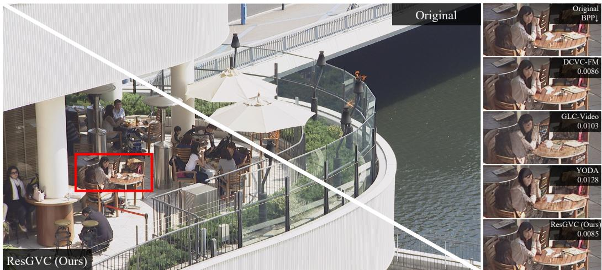  
Figure 1: Visual comparisons on the BQTerrace sequence from the HEVC B dataset.

For efficient residual coding, we propose a residual codec by extending a pixel-space video diffusion transformer from a generator to a conditional probability estimator. This diffusion model estimates the distribution of each residual segment, allowing fidelity-critical residual segments to be entropycoded while predicting the remaining residual segments from the previously transmitted ones. Thus, residual coding is reserved for information that must be faithfully transmitted to preserve reconstruction quality, whereas residual generation is employed for content that can be well predicted by the generative model to reduce bitrate. By jointly applying residual coding and residual generation along the denoising path, ResGVC achieves an improved perception-fidelity-rate trade-off.

To the best of our knowledge, this work is the first to explore residual coding in GVC and to repurpose a diffusion model for distribution modeling in both residual coding and residual generation. Experiments demonstrate that ResGVC achieves state-of-the-art compression performance across multiple metrics. Compared with the latest GVC method, ResGVC achieves 63.7% and 83.8% BDrate reductions in terms of LPIPS and PSNR, respectively, while producing superior visual results.

Our contributions are summarized as follows:

• We propose ResGVC, a residual coding framework for GVC that guides diffusion denoising toward original pictures by transmitting residuals. It decomposes the distortion between the codec reconstruction and the original pictures into residual segments, which can be transmitted to introduce explicit source constraints across different denoising steps.

• We design a novel residual codec with a pixel-space video diffusion transformer as an entropy model. This diffusion model is capable of effective distribution modeling for residual signals, enabling entropy coding for selectively transmitted residual segments while preserving generative capability for non-transmitted ones.

• Compared with existing methods, ResGVC achieves superior compression performance in terms of both perception quality and signal fidelity, while delivering better visual quality.

## 2 RELATED WORK

## 2.1 GENERATIVE VIDEO COMPRESSION

Generative video compression (GVC) incorporates generative models into codecs to improve perceptual quality beyond the signal-fidelity objective of traditional video coding and fidelity-oriented NVC. Early GVC methods (Yang et al., 2022; Mentzer et al., 2022) mainly introduced generative adversarial networks (GANs) and perceptual losses into neural codecs. Although these methods improved perceptual realism, they often suffered from training instability and visual artifacts. Other work explored generative reconstruction on latent or tokenized representations. For example, GLC-Video (Qi et al., 2025) performed compression in latent space of a vector-quantized variational autoencoder, while ProGVC (Li et al., 2026b) proposed a progressive generative codec based on hierarchical multi-scale residual token maps. However, these methods remained constrained by the representational capacity of their latent or tokenized bottlenecks.

Recently, emerging diffusion models provide strong generative priors for GVC due to their ability to synthesize realistic spatial and temporal details. Existing diffusion-based methods (Ma & Chen, 2025a; Mao et al., 2026; Li et al., 2026d;a; Ma & Chen, 2025b; 2026) typically adopt a latent compression pipeline, where the original video is encoded into a compact latent representation and a diffusion model is employed in the decoder to remove compression distortions from the decoded latent. DiffVC (Ma & Chen, 2025a) follows this paradigm by compressing videos in the latent domain and using an image diffusion model to enhance decoded latent frames. GNVC-VD (Mao et al., 2026) further introduces a video diffusion transformer to jointly enhance decoded latent representations. YODA (Li et al., 2026d) explores one-step diffusion-based video compression by embedding multiscale temporal reference features for both latent coding and latent denoising.

Despite their promising perceptual quality, these methods still primarily perform decoder-side denoising in latent space. Their denoising process is largely guided by generative priors, while explicit source constraints along the denoising path remain weak. Moreover, when built upon latent autoencoders, they inherit an irreversible reconstruction bottleneck that discards fine details. In contrast, our method introduces residual coding into pixel-space denoising, enabling explicit source constraints on the denoising process.

## 2.2 DIFFUSION MODEL WITH FLOW MATCHING

Diffusion models have become a popular paradigm for visual generation because they progressively transform noisy samples into clean data using learned denoising dynamics (Ho et al., 2020; Song et al., 2021a;b). Recent work has developed diffusion architectures based on U-Net (Ronneberger et al., 2015) and transformer (Vaswani et al., 2017) backbones for high-quality image and video generation (Peebles & Xie, 2023; Wan et al., 2025). To improve efficiency, many methods (Rombach et al., 2022; Ma et al., 2024) perform denoising in a compressed latent space which is produced by a variational autoencoder (VAE) (Kingma & Welling, 2013). While this design substantially reduces computation, it inherits the reconstruction bottleneck of the autoencoder. In contrast, pixel-space diffusion models directly denoise visual signals in the original signal space and can better preserve fine-grained details (Li & He, 2026; Wang et al., 2026; Yu et al., 2026; Ma et al., 2026).

Flow matching (Lipman et al., 2023; Liu et al., 2023) provides an effective formulation for diffusionbased generative modeling by learning a continuous denoising path from a random noise sample to clean data. Specifically, the intermediate noisy state at denoising step t is commonly defined as

$$
\mathbf { x } _ { t } = ( 1 - \sigma _ { t } ) \mathbf { x } _ { 0 } + \sigma _ { t } \mathbf { x } _ { T } , \quad 0 \leq t \leq T ,\tag{1}
$$

where $\mathbf { x } _ { \mathrm { 0 } }$ denotes the clean data. $\mathbf { x } _ { T }$ denotes the denoising start, which is usually a random noise sample. $\sigma _ { t }$ controls the noise level (Karras et al., 2022). The denoising network is trained to predict the corresponding velocity field by minimizing

$$
\mathcal { L } _ { \mathrm { F M } } = \mathbb { E } _ { t , \mathbf { x } _ { 0 } , \mathbf { x } _ { T } } \left[ \left\| \hat { \epsilon } ( \mathbf { x } _ { t } , \mathbf { c } , t ) - ( \mathbf { x } _ { T } - \mathbf { x } _ { 0 } ) \right\| _ { 2 } ^ { 2 } \right] ,\tag{2}
$$

where c denotes the condition and $\hat { \pmb { \epsilon } } ( \mathbf { x } _ { t } , \mathbf { c } , t )$ is the predicted velocity. During inference, the denoising network iteratively updates the intermediate noisy state along the predicted denoising path toward the clean data:

$$
\hat { \mathbf { x } } _ { t - 1 } = \hat { \mathbf { x } } _ { t } + ( \sigma _ { t - 1 } - \sigma _ { t } ) \hat { \epsilon } ( \hat { \mathbf { x } } _ { t } , \mathbf { c } , t ) ,\tag{3}
$$

where $\hat { \mathbf { x } } _ { t }$ represents the predicted noisy state at denoising step t.

In GVC, diffusion models using flow matching are mainly employed as decoder-side denoisers to refine reconstructed latent representations with generative priors (Ma & Chen, 2025a; Mao et al., 2026; Li et al., 2026d;a; Ma & Chen, 2025b). Under this formulation, restoration can be considered as estimating a denoising path from the codec reconstruction toward the original pictures. Existing methods primarily predict the denoising path from generative priors, without sufficient source constraints. This motivates our design: instead of treating the denoising path as purely generative, we use transmitted residual signals to guide the denoising process, thereby constraining it with explicit source information. Moreover, unlike latent-space diffusion used in most prior methods, our approach performs denoising in pixel space without the latent representation bottleneck.

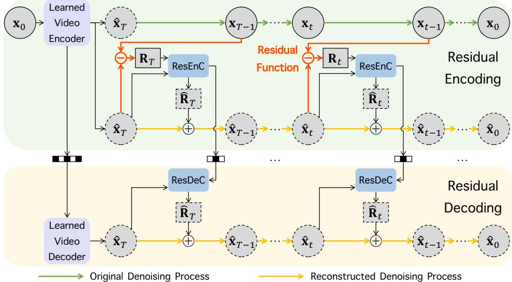  
Figure 2: Overview of the proposed residual coding framework. $\mathbf { x } _ { \mathrm { 0 } }$ denotes the original pictures, and $\hat { \mathbf { x } } _ { T }$ denotes the reconstruction decoded by the learned video codec. $\mathbf { x } _ { t }$ and $\hat { \mathbf { x } } _ { t }$ denote the predefined and reconstructed noisy states at denoising step $t ,$ respectively. $\mathbf { R } _ { t }$ denotes the to-be-encoded residual segment, and $\hat { { \bf R } } _ { t }$ denotes its reconstruction produced by the residual codec. $\hat { \mathbf { x } } _ { 0 }$ denotes the final reconstructed pictures after residual decoding. “ResEnC” and $\mathrm { \^ { 6 6 } R e s D e C ^ { 3 } }$ are the proposed residual encoder and decoder, respectively.

## 3 METHODOLOGY

ResGVC represents a residual coding framework for high-fidelity GVC. It first compresses original pictures within a learned video codec (Li et al., 2026c), and then refines the decoded pictures using residual information through iterative residual coding. The whole diffusion process is performed di rectly in pixel domain, avoiding the irreversible bottleneck of latent space. Concretely, the distortion between the decoded pictures and the original pictures is decomposed into a sequence of residual segments, each obtained at a denoising step. To encode these segments efficiently, we design a residual codec in which a pixel-space video diffusion model serves as a conditional probability estimator for entropy coding. Section 3.1 formulates the residual segments from the codec reconstruction to the original pictures. Section 3.2 presents the proposed residual codec and its diffusion-based entropy model. Section 3.3 describes a skip mode for residual coding, which skips residual coding at selected denoising steps and replaces it with decoder-side residual generation for reducing bitrate.

## 3.1 FROM DENOISING PATH TO RESIDUAL CODING

Fig. 2 illustrates the proposed framework for residual coding. Given the original pictures $\mathbf { x } _ { 0 } ,$ , xˆT denotes the reconstruction decoded by the learned video codec. In diffusion-based ${ \mathrm { G V C } } ,$ denoising usually starts from $\hat { \mathbf { x } } _ { T }$ rather than pure Gaussian noise (Mao et al., 2026). Following flow matching, the predefined noisy state at step t in Eq. 1 is rewritten as

$$
\mathbf x _ { t } = ( 1 - \sigma _ { t } ) \mathbf x _ { 0 } + \sigma _ { t } \hat { \mathbf x } _ { T } ,\tag{4}
$$

where $\sigma _ { t }$ denotes the noise level of the intermediate noisy state at step t. The sequence $\{ { \mathbf { x } } _ { t } \} _ { t = 0 } ^ { T - 1 }$ defines the original denoising process from the codec reconstruction $\hat { \mathbf { x } } _ { T }$ to the original data $\mathbf { x } _ { \mathrm { 0 } }$ Accordingly, the original denoising path is formulated as $\hat { \mathbf { x } } _ { T } \to \mathbf { x } _ { T - 1 } \to \cdots \to \mathbf { x } _ { t } \to \cdots \to \mathbf { x } _ { 0 } .$

(a) Residual Encoder (ResEnC).  
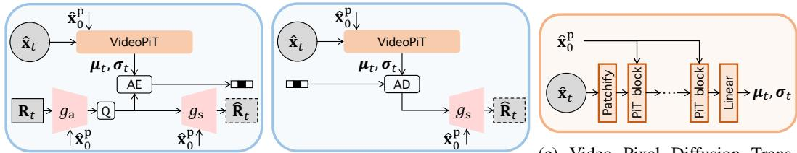  
(b) Residual Decoder (ResDeC). former (VideoPiT).  
Figure 3: Proposed residual encoder, residual decoder, and video pixel diffusion transformer.

Prior diffusion-based methods recover this denoising path at the decoder by predicting the denoising update at each step. From step t to step t − 1, the update in Eq. 3 can be rewritten as

$$
\hat { \mathbf { x } } _ { t - 1 } = \hat { \mathbf { x } } _ { t } + ( \sigma _ { t - 1 } - \sigma _ { t } ) \hat { \mathbf { R } } _ { t } ,\tag{5}
$$

where $\hat { \mathbf { x } } _ { t }$ and $\hat { \mathbf { R } } _ { t }$ denote the reconstructed noisy state and the predicted residual information at step t, respectively. $( \sigma _ { t - 1 } - \sigma _ { t } ) \hat { \mathbf { R } } _ { t }$ t represents the correction applied to the current reconstructed noisy state to approach the next cleaner state. Since this correction is predicted solely from generative priors, the reconstructed denoising process may deviate from the original denoising process.

In contrast, as illustrated in Fig. 2, we reformulate the same stepwise denoising update into residual coding, which aims to faithfully approximate the original denoising path at the decoder based on the transmitted residual information. At step t, the to-be-encoded residual segment is defined as the scaled difference between the predefined noisy state $\mathbf { x } _ { t - 1 }$ and the reconstructed noisy state $\hat { \mathbf { x } } _ { t } .$

$$
\mathbf { R } _ { t } = ( \mathbf { x } _ { t - 1 } - \hat { \mathbf { x } } _ { t } ) / \big ( \sigma _ { t - 1 } - \sigma _ { t } \big ) ,\tag{6}
$$

where the scaling factor $\left( \sigma _ { t - 1 } - \sigma _ { t } \right)$ standardizes the variance of $\mathbf { R } _ { t } ^ { i } .$ , thereby aligning its distributions across steps to facilitate robust probability estimation in the entropy model. $( \sigma _ { t - 1 } - \sigma _ { t } ) \mathbf { R } _ { i }$ represents the correction that moves xˆ toward $\mathbf { x } _ { t - 1 } , i . e .$ ., the next predefined noisy state on the original denoising path. The sequence $\left\{ \hat { \mathbf { x } } _ { t } \right\} _ { t = 0 } ^ { T - 1 }$ defines the reconstructed denoising process. Accordingly, the reconstructed denoising path is formulated as $\hat { \mathbf { x } } _ { T } \to \hat { \mathbf { x } } _ { T - 1 } \to \cdots \to \hat { \mathbf { x } } _ { t } \to \cdot \cdot \cdot \to \hat { \mathbf { x } } _ { 0 }$

At the encoder, each $\mathbf { R } _ { t }$ is compressed into a bitstream, and then reconstructed as $\hat { \mathbf { R } } _ { t } .$ , which is used to simulate the decoder-side reconstructed denoising process. Starting from $\hat { \mathbf { x } } _ { T }$ , the encoder iteratively updates $\hat { \mathbf { x } } _ { t }$ by applying Eq. 5, which yields the reconstructed denoising process $\left\{ \hat { \mathbf { x } } _ { t } \right\} _ { t = 0 } ^ { T - 1 }$

At the decoder, the reconstructed denoising process also starts from the same codec reconstruction $\hat { \mathbf { x } } _ { T }$ . The reconstructed residual segments $\{ \hat { \mathbf { R } } _ { t } \} _ { t = 1 } ^ { T }$ are sequentially decoded from the transmitted bitstream, for which the reconstructed denoising process can be reproduced step by step, according to Eq. 5. In this way, our method turns denoising from a purely decoder-side generation process into a high-fidelity reconstruction process constrained by transmitted residual information.

## 3.2 RESIDUAL CODING WITH DIFFUSION-BASED ENTROPY MODEL

Fig. 3 shows the proposed residual codec which consists of a residual encoder (ResEnC) and a residual decoder (ResDeC), with a shared diffusion-based entropy model implemented by a video pixel diffusion transformer (VideoPiT). Generally, x can represent either a group of pictures (GOP) (Li et al., 2026c) or a single picture (Jia et al., 2025). We define $\mathbf { x } _ { \mathrm { 0 } }$ as a GOP and adopt DCVC-UF (Li et al., 2026c) as the learned video codec to encode and decode it, yielding $\hat { \mathbf { x } } _ { T }$ . The residual codec progressively transmits the residual segments $\scriptstyle \{ \mathbf { R } _ { t } \} _ { t = 1 } ^ { T }$ between $\hat { \mathbf { x } } _ { T }$ and $\mathbf { x } _ { 0 } .$ , for which the reconstructed denoising process is recovered step by step, ultimately yielding the final reconstruction $\hat { \mathbf { x } } _ { 0 }$

At the encoder, each residual segment $\mathbf { R } _ { t }$ is first transformed as below:

$$
\mathbf { y } _ { t } = g _ { \mathrm { a } } ( \mathbf { R } _ { t } \mid \hat { \mathbf { x } } _ { 0 } ^ { \mathrm { p } } ) ,\tag{7}
$$

where $g _ { \mathrm { a } }$ denotes the analysis transform built upon the encoder architecture from Li et al. (2026c). Implementation details are provided in the appendix. $\hat { \mathbf { x } } _ { 0 } ^ { \mathrm { p } }$ is the final reconstruction of the previous GOP which is used as temporal context. The transformed representation $\mathbf { y } _ { t }$ is then quantized as

$$
\hat { \mathbf { y } } _ { t } = \left\lfloor \mathbf { y } _ { t } \right\rceil .\tag{8}
$$

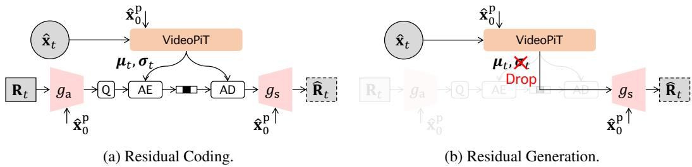  
Figure 4: Residual coding and residual generation under the skip mode.

To entropy-code $\hat { \mathbf { y } } _ { t }$ , we estimate its conditional probability distribution from the reconstructed noisy state $\hat { \mathbf { x } } _ { t }$ in the reconstructed denoising process. Specifically, $\hat { \mathbf { x } } _ { t }$ is fed into the diffusion-based entropy model, conditioned on the final reconstruction of the previous GOP $\hat { \mathbf { x } } _ { 0 } ^ { \mathrm { p } }$ , which predicts the mean and scale parameters $( i . e . , \mu _ { t } , \sigma _ { t } )$ of a Gaussian probability distribution:

$$
\mu _ { t } , \pmb { \sigma } _ { t } = \mathrm { V i d e o P i T } ( \hat { \mathbf { x } } _ { t } \mid \hat { \mathbf { x } } _ { 0 } ^ { \mathrm { p } } ) ,\tag{9}
$$

where $\hat { \mathbf { x } } _ { t }$ is first patchified into tokens, and subsequently processed by a cascade of PiT blocks (Yu et al., 2026) with $\hat { \mathbf { x } } _ { 0 } ^ { \mathrm { p } }$ as the condition. The resulting features are projected by a linear layer to generate $\pmb { \mu } _ { t }$ and $\sigma _ { t }$ for entropy coding. More implementation details of the VideoPiT are provided in the appendix. $\hat { \mathbf { y } } _ { t }$ is then arithmetic-encoded as

$$
B _ { t } = \mathrm { A E } \big ( \hat { \mathbf { y } } _ { t } ; \pmb { \mu } _ { t } , \pmb { \sigma } _ { t } \big ) ,\tag{10}
$$

where $B _ { t }$ denotes the bitstream of the residual segment at step t. AE denotes the arithmetic encod ing. During training, the quantization and arithmetic coding operations are replaced by differentiable approximations for end-to-end optimization, following the GVC practice (Mao et al., 2026).

At the decoder, each residual segment is reconstructed from the transmitted bitstream using the same conditional probability model. Since the decoder has access to the same conditioning information $\hat { \mathbf { x } } _ { t }$ and $\hat { \mathbf { x } } _ { 0 } ^ { \mathrm { p } }$ as the encoder, the Gaussian probability parameters in Eq. 9 can be reproduced exactly at the decoder side. The received bitstream is first arithmetic-decoded as

$$
\hat { \mathbf { y } } _ { t } = \mathrm { A D } ( B _ { t } ; \pmb { \mu } _ { t } , \pmb { \sigma } _ { t } ) ,
$$

where AD denotes the arithmetic decoding. $\hat { \mathbf { y } } _ { t }$ is then mapped back to $\hat { { \bf R } } _ { t }$ :

(11)

$$
\hat { \mathbf { R } } _ { t } = g _ { \mathrm { s } } ( \hat { \mathbf { y } } _ { t } \mid \hat { \mathbf { x } } _ { 0 } ^ { \mathrm { p } } ) ,\tag{12}
$$

where $g _ { \mathrm { s } }$ denotes the synthesis transform. Once $\hat { \mathbf { R } } _ { t }$ is reconstructed, it is used to update the current reconstructed noisy state $\hat { \mathbf { x } } _ { t }$ toward the cleaner one $\hat { \mathbf { x } } _ { t - 1 }$ using Eq. 5. Note that $g _ { \mathrm { s } }$ is employed in both ResEnC and ResDeC to obtain the same $\hat { \mathbf { R } } _ { t }$ , as shown in Fig. 3a and Fig. 3b. Therefore, $\hat { \mathbf { R } } _ { t }$ can be used at the encoder side to construct the next residual segment according to Eq. 6, while simulating the decoder-side reconstructed denoising process. Starting from $\hat { \mathbf { x } } _ { T }$ , the decoder sequentially recovers all residual segments and reproduces the reconstructed denoising process to obtain $\hat { \mathbf { x } } _ { 0 }$

## 3.3 SKIP MODE FOR RESIDUAL CODING

ResGVC supports a skip mode, in which residual coding is applied only to selected denoising steps. For the skipped steps, the corresponding residual segments are not transmitted but are instead generated at the decoder without incurring additional bitrate or quantization error, as illustrated in Fig. 4. Specifically, each residual segment $\hat { \mathbf { R } } _ { t }$ can be recovered at the decoder in one of two modes: residual coding, in which $\hat { \mathbf { R } } _ { t }$ is reconstructed from the bitstream, and residual generation, in which $\hat { \mathbf { R } } _ { t }$ is predicted by the diffusion model, $i . e .$ , VideoPiT. Residual coding is employed in the earlier denoising steps, which are more crucial to the final reconstruction quality, to faithfully transmit fidelity-critical residual segments. In the later steps, by leveraging the informative context from previously decoded residual signals, VideoPiT serves as a generator to estimate $\pmb { \mu } _ { t }$ and $\sigma _ { t }$ without bitstream constraints. The estimated $\pmb { \mu } _ { t }$ is directly used as the predicted $\hat { \mathbf { R } } _ { t } .$ , while $\sigma _ { t }$ is discarded. Therefore, given a total of $T$ denoising steps, the number of residual-coding steps determines the trade-off between bitrate and reconstruction quality, and its effect is further analyzed in Section 4.3.

Although transmitted and generated residual segments are obtained in different ways, they are incorporated using the same state update rule in Eq. 5. Therefore, transmitted source information and generative priors jointly guide the reconstructed denoising path toward the original pictures.

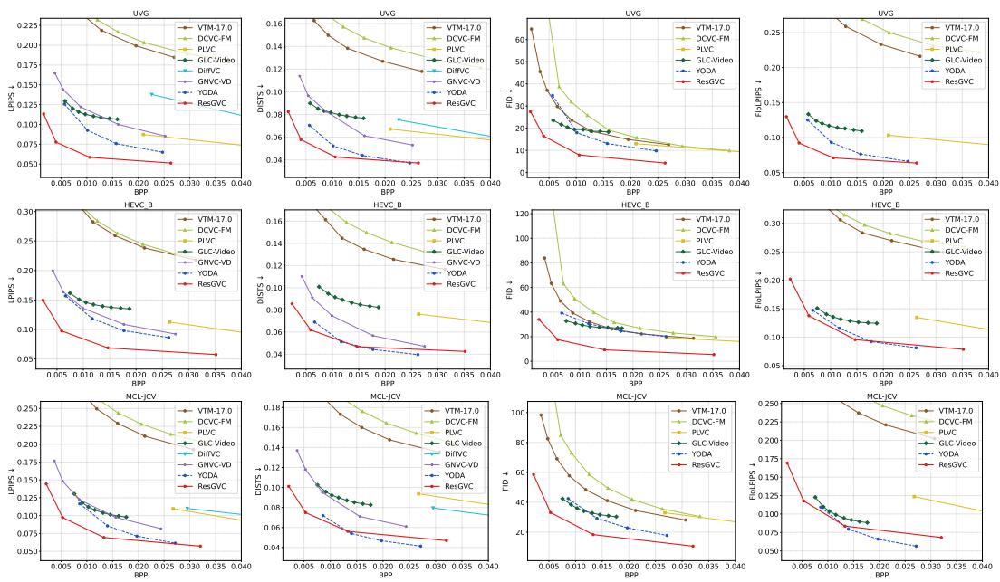  
Figure 5: Rate-perception curves on UVG, HEVC B, and MCL-JCV.

Table 1: BD-rate (%) ↓ / BD-metric ↑ on UVG, HEVC B, and MCL-JCV. The best and secondbest results are highlighted in red and blue, respectively. “N/A” indicates that BD-rate cannot be computed due to insufficient overlap between the rate-metric curves. “-” denotes that the baseline does not report the result.
<table><tr><td rowspan=1 colspan=1></td><td rowspan=1 colspan=4>UVG</td><td rowspan=1 colspan=4>HEVC B</td><td rowspan=1 colspan=4>MCL-JCV</td></tr><tr><td rowspan=1 colspan=1>Method</td><td rowspan=1 colspan=1>LPIPS</td><td rowspan=1 colspan=1>DISTS</td><td rowspan=1 colspan=1>FID</td><td rowspan=1 colspan=1>FloLPIPS</td><td rowspan=1 colspan=1>LPIPS</td><td rowspan=1 colspan=1>DISTS</td><td rowspan=1 colspan=1>FID</td><td rowspan=1 colspan=1>FloLPIPS</td><td rowspan=1 colspan=1>LPIPS</td><td rowspan=1 colspan=1>DISTS</td><td rowspan=1 colspan=1>FID</td><td rowspan=1 colspan=1>FloLPIPS</td></tr><tr><td rowspan=1 colspan=1>VTM-17.0</td><td rowspan=1 colspan=1>N/A /-0.136</td><td rowspan=1 colspan=1>N/A / -0.092</td><td rowspan=1 colspan=1>21.5 / -3.0</td><td rowspan=1 colspan=1>N/A / -0.177</td><td rowspan=1 colspan=1>N/A / -0.163N</td><td rowspan=1 colspan=1>/A / -0.093</td><td rowspan=1 colspan=1>10.1 / -2.1</td><td rowspan=1 colspan=1>N/A / -0.192</td><td rowspan=1 colspan=1>N/A / -0.150</td><td rowspan=1 colspan=1>N/A / -0.109</td><td rowspan=1 colspan=1>89.6 / -14.3</td><td rowspan=1 colspan=1>N/A / -0.163</td></tr><tr><td rowspan=1 colspan=1>DCVC-FM</td><td rowspan=1 colspan=1>N/A /-0.145</td><td rowspan=1 colspan=1>N/A /-0.108</td><td rowspan=1 colspan=1>66.9 / -8.8</td><td rowspan=1 colspan=1>N/A / -0.203</td><td rowspan=1 colspan=1>N/A /-0.168N</td><td rowspan=1 colspan=1>/A /-0.1085</td><td rowspan=1 colspan=1>2.1 / -11.1N</td><td rowspan=1 colspan=1>/A /-0.203</td><td rowspan=1 colspan=1>N/A / -0.165</td><td rowspan=1 colspan=1>N/A /-0.1261</td><td rowspan=1 colspan=1>43.5 /-24.3</td><td rowspan=1 colspan=1>N/A / -0.188</td></tr><tr><td rowspan=1 colspan=1>PLVC  1</td><td rowspan=1 colspan=1>16.7 / -0.0199</td><td rowspan=1 colspan=1>369.8 /-0.027</td><td rowspan=1 colspan=1>33.2 / -2.22</td><td rowspan=1 colspan=1>55.5 / -0.034</td><td rowspan=1 colspan=1>91.3 / N/A</td><td rowspan=1 colspan=1>594.2 / N/A</td><td rowspan=1 colspan=1>N/A / N/A</td><td rowspan=1 colspan=1>200.5 / N/A</td><td rowspan=1 colspan=1>208.1 / -0.0486</td><td rowspan=1 colspan=1>58.7 / -0.052</td><td rowspan=1 colspan=1>129.7 / -14.93</td><td rowspan=1 colspan=1>19.4 /-0.067</td></tr><tr><td rowspan=1 colspan=1>DiffVC</td><td rowspan=1 colspan=1>425.5 / -0.0703</td><td rowspan=1 colspan=1>95.8 / -0.036</td><td rowspan=1 colspan=1>-1-</td><td rowspan=1 colspan=1>-1-</td><td rowspan=1 colspan=1>-1-</td><td rowspan=1 colspan=1>-1-</td><td rowspan=1 colspan=1>-1-</td><td rowspan=1 colspan=1>-1-</td><td rowspan=1 colspan=1>275.1 / N/A</td><td rowspan=1 colspan=1>382.3 / N/A</td><td rowspan=1 colspan=1>-1-</td><td rowspan=1 colspan=1>-1-</td></tr><tr><td rowspan=1 colspan=1>GLC-Video</td><td rowspan=1 colspan=1>35.4 / -0.018</td><td rowspan=1 colspan=1>N/A / -0.027</td><td rowspan=1 colspan=1>-4.2 / 0.4</td><td rowspan=1 colspan=1>56.2 / -0.022</td><td rowspan=1 colspan=1>44.2 / -0.025</td><td rowspan=1 colspan=1>N/A / -0.038</td><td rowspan=1 colspan=1>-15.2 / 1.63</td><td rowspan=1 colspan=1>3.1 / -0.019</td><td rowspan=1 colspan=1>24.5 / -0.013</td><td rowspan=1 colspan=1>N/A / -0.030</td><td rowspan=1 colspan=1>0.1 / -1.3</td><td rowspan=1 colspan=1>19.8 / -0.011</td></tr><tr><td rowspan=1 colspan=1>GNVC-VD</td><td rowspan=1 colspan=1>75.4 / -0.023</td><td rowspan=1 colspan=1>126.4 / -0.022</td><td rowspan=1 colspan=1>-1-</td><td rowspan=1 colspan=1>-1-</td><td rowspan=1 colspan=1>18.4 / -0.0088</td><td rowspan=1 colspan=1>9.0 / -0.015</td><td rowspan=1 colspan=1>-1-</td><td rowspan=1 colspan=1>-1-</td><td rowspan=1 colspan=1>36.1 / -0.015</td><td rowspan=1 colspan=1>97.0 / -0.020</td><td rowspan=1 colspan=1>-1-</td><td rowspan=1 colspan=1>-1-</td></tr><tr><td rowspan=1 colspan=1>YODA</td><td rowspan=1 colspan=1>0.0 / 0.000</td><td rowspan=1 colspan=1>0.0 / 0.000</td><td rowspan=1 colspan=1>0.0 / 0.0</td><td rowspan=1 colspan=1>0.0 / 0.000</td><td rowspan=1 colspan=1>0.0 / 0.000</td><td rowspan=1 colspan=1>0.0 / 0.000</td><td rowspan=1 colspan=1>0.0 / 0.0</td><td rowspan=1 colspan=1>0.0 / 0.000</td><td rowspan=1 colspan=1>0.0 / 0.000</td><td rowspan=1 colspan=1>0.0 / 0.000</td><td rowspan=1 colspan=1>0.0 / 0.0</td><td rowspan=1 colspan=1>0.0 / 0.000</td></tr><tr><td rowspan=1 colspan=1>ResGVC</td><td rowspan=1 colspan=1>-74.9 /0.031</td><td rowspan=1 colspan=1>-46.7 / 0.008</td><td rowspan=1 colspan=1>-68.4 / 10.2</td><td rowspan=1 colspan=1>-61.0/0.019</td><td rowspan=1 colspan=1>-68.1 /0.042</td><td rowspan=1 colspan=1>-14.9 / 0.002</td><td rowspan=1 colspan=1>-78.9 / 18.6-</td><td rowspan=1 colspan=1>18.4 / 0.008</td><td rowspan=1 colspan=1>-48.3 / 0.016</td><td rowspan=1 colspan=1>-1.8 / 0.001</td><td rowspan=1 colspan=1>-54.4/ 11.2</td><td rowspan=1 colspan=1>0.9 / -0.003</td></tr></table>

## 4 EXPERIMENT

## 4.1 EXPERIMENTAL PROTOCOL

Training details. ResGVC is trained on the OpenVid-1M dataset (Nan et al., 2025) with a ratedistortion loss function, $i . e . , L = R + \lambda D$ . R denotes the total bitrate cost from the learned video codec and the proposed residual codec. D denotes the reconstruction distortion, computed as the sum of L2 loss, LPIPS (Zhang et al., 2018), and DISTS (Ding et al., 2020). To evaluate compression performance at multiple bitrates, we train four independent models with trade-off parameter λ sampled at four points by linear interpolation in logarithmic space over the range [0.025, 2.5]. Each model is trained with a GOP size of 8. T is set to 5, indicating that five denoising steps are performed under the noise scheduler from Wan et al. (2025) to determine $\sigma _ { t } .$ . The detailed training strategies are provided in the appendix.

Test details. We evaluate ResGVC on the HEVC B (Sullivan et al., 2012), UVG (Mercat et al., 2020), and MCL-JCV (Wang et al., 2016) datasets. Following (Li et al., 2023; Mao et al., 2026), raw YUV420 videos are converted to RGB using BT.709 (Li et al., 2023), and the first 96 frames of each sequence are used for evaluation. Compression performance is measured by BD-rate and BD-metric (Bjontegaard, 2001). Signal fidelity is measured by PSNR and MS-SSIM (Wang et al., 2003). Perceptual quality is assessed by LPIPS (Zhang et al., 2018) and DISTS (Ding et al., 2020). To assess temporal perceptual consistency, we report FloLPIPS (Danier et al., 2022), a flow-guided LPIPS variant. Generative realism is measured by FID (Heusel et al., 2017), following (Mentzer et al., 2020). Bitrate is reported in bits per pixel (BPP). ResGVC is evaluated with intra-period = -1 and GOP size = 8. Since ResGVC is trained with five denoising steps, we use two steps for residual coding and three steps for residual generation during testing, which gives the best overall compression performance. Analysis of this setting is provided in Section 4.3.

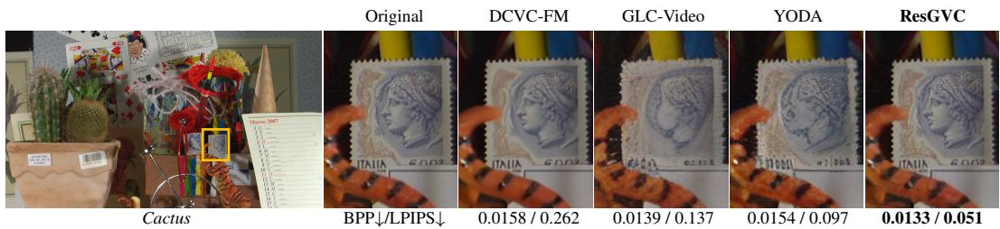  
Figure 7: Visual comparisons with open-source baselines on the Cactus sequence from HEVC B.

Baselines. We compare ResGVC with three categories of baselines: 1) the traditional video codec VTM-17.0 (Bross et al., 2021); 2) the fidelity-oriented NVC method DCVC-FM (Li et al., 2024); and 3) GVC methods, including PLVC (Yang et al., 2022), GLC-Video (Qi et al., 2025), DiffVC (Ma & Chen, 2025a), GNVC-VD (Mao et al., 2026), and YODA (Li et al., 2026d). For VTM-17.0, we follow the evaluation protocol from Li et al. (2023). Since the code for DiffVC and GNVC-VD is publicly unavailable, we report the results from their original papers. Other baselines are tested with their default settings. We use the latest open-source method YODA as the anchor for BD-rate computation, rather than VTM-17.0 as usual, because the RD curves of VTM-17.0 are often far from those of GVC methods and overlap only marginally in quality range.

## 4.2 COMPARISON RESULTS

Quantitative comparisons. Fig. 5 shows the rate-perception curves on the three test sets.

The proposed ResGVC outperforms all baselines on most perceptual metrics, achieving notably lower LPIPS and FID at comparable bitrates. Table 1 summarizes the BD-rate and BD-metric results. Averaged over the three test sets, ResGVC achieves bitrate savings of 63.7% in LPIPS, 21.2% in DISTS, 67.2% in FID, and 26.1% in FloLPIPS relative to the secondbest method YODA. Additionally, as shown in Fig. 6, ResGVC delivers the best PSNR and MS-SSIM performance among all GVC methods, and is even comparable to the fidelityoriented NVC method DCVC-FM at low bitrates. Notably, on the HEVC B test set, Res-GVC surpasses DCVC-FM in MS-SSIM when the bitrate is below 0.005 BPP. Detailed BDrate and BD-metric results for PSNR and MS-SSIM are provided in the appendix. Overall, these results show that ResGVC advances both perceptual quality and signal fidelity over previous GVC methods.

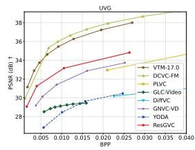

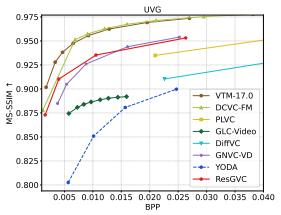

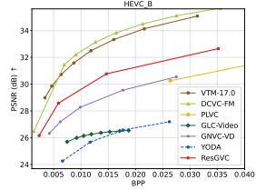

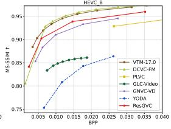

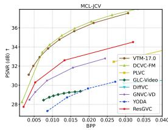

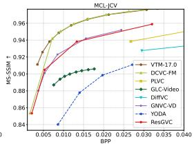  
Figure 6: Rate-fidelity curves on UVG, HEVC B, and MCL-JCV.

Qualitative comparisons. Fig. 7 presents a visual comparison of different methods. Owing to its optimization objective that prioritizes sig-

nal fidelity, DCVC-FM tends to produce blurred regions and fails to preserve fine-grained textures and structural details. Although GVC methods such as GLC-Video and YODA achieve higher perceptual quality than DCVC-FM, they often introduce spatial inconsistencies and hallucinated details, reflecting an overemphasis on perceptual quality at the expense of signal fidelity. By contrast, ResGVC more faithfully preserves object structures while maintaining rich textural details. These observations further suggest that, for GVC methods, signal fidelity should not be neglected when optimizing perceptual quality; otherwise, noticeable visual degradation and structural collapse may occur.

Table 2: Complexity comparison. “Enc. T” / “Dec. T” denotes the per-frame encoding / decoding time, tested on an NVIDIA H20 GPU.
<table><tr><td>Method</td><td colspan="3">|Model Params (M) |Enc. T (ms) |Dec. T (ms)</td></tr><tr><td>GNVC-VD</td><td>2334.5</td><td>439</td><td>4225</td></tr><tr><td>YODA</td><td>1063.2</td><td>1139</td><td>729</td></tr><tr><td>Ours</td><td>593.9</td><td>346</td><td>772</td></tr></table>

Table 3: BD-rate (%)↓ comparisons across various residual coding (RC) settings. The model with five-step RC in pixel space serves as the anchor.
<table><tr><td>Method</td><td>LPIPS</td><td>DISTS</td><td>PSNR</td><td>FloLPIPS</td></tr><tr><td>w/ RC in pixel space</td><td>0.0</td><td>0.0</td><td>0.0</td><td>0.0</td></tr><tr><td>w/o RC in pixel space</td><td>44.6</td><td>59.1</td><td>12.1</td><td>34.2</td></tr><tr><td>w/ RC in latent space</td><td>17.4</td><td>21.3</td><td>28.6</td><td>15.1</td></tr><tr><td>w/ CNN-based entropy model</td><td>13.4</td><td>18.9</td><td>7.4</td><td>16.1</td></tr></table>

Complexity comparisons. We compare the per-frame encoding and decoding times of ResGVC with those of two recent methods, i.e., GNVC-VD and YODA. Among the GVC baselines, GNVC-VD delivers superior compression performance on fidelity-oriented metrics, whereas YODA excels on perceptual metrics. Since the official implementation of GNVC-VD is unavailable, we reproduce its model architecture solely for complexity evaluation, without training. As presented in Table 2, ResGVC is faster than GNVC-VD in both encoding and decoding, mainly because GNVC-VD has a substantially larger model size. Compared with YODA, which uses single-step denoising, ResGVC has a slightly slower decoding speed due to its five-step denoising design. However, the compact model size of ResGVC helps offset the overhead introduced by the additional denoising steps, allowing it to maintain competitive decoding speed. Despite using fewer parameters, ResGVC still outperforms YODA in both perceptual quality and signal fidelity, further demonstrating the effectiveness of our pixel-space residual coding framework.

## 4.3 ABLATIONS

We conduct a series of ablation studies to verify the effect of key designs in the proposed ResGVC.   
All BD-rate results are averaged on three test sets.

Effect of pixel-space residual coding. ResGVC performs residual coding directly in pixel space. To validate this design, we conduct the ablations in Table 3, using the variant with five-step pixel-space residual coding as the anchor. Removing residual coding causes a substantial performance degra dation, which confirms the necessity of residual coding. We then shift residual coding from pixel space to latent space by inserting ResGVC between the VAE encoder and decoder of Wan2.1 (Wan et al., 2025), whose implementation details are provided in the appendix. This variant incurs 17.4% and 28.6% BD-rate losses in terms of LPIPS and PSNR, respectively, demonstrating that residual coding is more effective in pixel space than in latent space.

Effect of diffusion-based entropy model. Existing fidelity-oriented NVC and GVC methods typically rely on CNN-based entropy models to estimate the distributions used for entropy coding. In contrast, ResGVC adopts a diffusion-based entropy model, which leverages stronger generative priors for more accurate conditional probability estimation. As shown in Table 3, replacing our entropy model with the latest CNN-based design (Li et al., 2026c) degrades performance across all metrics, confirming the advantage of the diffusion-based entropy model for residual coding.

Effect of the skip mode for residual coding. In ResGVC, residual coding can be skipped at selected denoising steps, where residual segments are instead generated at the decoder by the diffusion model. This skip mode enables flexible switching between residual coding and residual generation at different denoising steps to optimize rate-distortion performance. As presented in Table 4, we fix the total number of denoising steps to five and vary the number of residual-coding steps from zero to five, with

Table 4: BD-rate (%)↓ comparison under different skip settings for residual coding. “RC” and “RG” denote residual coding and residual generation, respectively.
<table><tr><td rowspan=1 colspan=1>Method         |</td><td rowspan=1 colspan=1>LPIPS |</td><td rowspan=1 colspan=1>|DISTS |</td><td rowspan=1 colspan=1>|PSNR|</td><td rowspan=1 colspan=1>|FloLPIPS</td></tr><tr><td rowspan=6 colspan=1>0-step RC + 5-step RG1-step RC + 4-step RG2-step RC + 3-step RG (Ours)3-step RC + 2-step RG4-step RC + 1-step RG5-step RC + 0-step RG</td><td rowspan=1 colspan=1>11.4</td><td rowspan=1 colspan=1>11.6</td><td rowspan=1 colspan=1>9.2</td><td rowspan=1 colspan=1>8.8</td></tr><tr><td rowspan=1 colspan=1>7.7</td><td rowspan=1 colspan=1>8.2</td><td rowspan=1 colspan=1>7.1</td><td rowspan=1 colspan=1>6.5</td></tr><tr><td rowspan=1 colspan=1>0.0</td><td rowspan=1 colspan=1>0.0</td><td rowspan=1 colspan=1>0.0</td><td rowspan=1 colspan=1>0.0</td></tr><tr><td rowspan=1 colspan=1>2.4</td><td rowspan=1 colspan=1>4.5</td><td rowspan=1 colspan=1>1.8</td><td rowspan=1 colspan=1>2.7</td></tr><tr><td rowspan=1 colspan=1>5.4</td><td rowspan=1 colspan=1>5.8</td><td rowspan=1 colspan=1>3.5</td><td rowspan=1 colspan=1>3.6</td></tr><tr><td rowspan=1 colspan=1>6.7</td><td rowspan=1 colspan=1>7.3</td><td rowspan=1 colspan=1>3.4</td><td rowspan=1 colspan=1>4.2</td></tr></table>

the remaining steps handled by residual generation. The best performance is achieved with two coding steps and three generation steps, indicating that the most fidelity-critical residual segments are transmitted in the first two steps. Using more coding steps degrades performance by spending additional bitrate on residuals that can be reliably predicted from generative priors at the decoder, while using fewer coding steps weakens source constraints and thus reduces reconstruction quality.

## 5 CONCLUSION

In this paper, we present ResGVC, a residual coding framework for generative video compression that guides diffusion denoising toward the original pictures by transmitting residual signals. Res-GVC first encodes the original pictures with a learned video codec, and then decomposes the distortion between the codec reconstruction and the original pictures into a sequence of residual segments over denoising steps. These residual segments can further by compressed by a novel residual codec with a diffusion transformer as an entropy model, enabling explicit source constraints to be introduced throughout denoising rather than relying on decoder-side generation alone. By denoising directly in pixel space, ResGVC also avoids the irreversible information loss caused by latent representation bottlenecks. Experimental results demonstrate that ResGVC achieves state-of-the-art compression performance, reducing BD-rate by 63.7% in LPIPS and 83.8% in PSNR compared with the previous state-of-the-art method, while also delivering superior visual quality.

## AI USE STATEMENT

In this work, we used GPT-5.4 to improve the clarity, grammar, and formal tone of the writing in all sections, and to retrieve and translate related work in support of a more comprehensive understanding of this research field. We did not use generative AI tools to help develop theoretical models or conceptual frameworks, formulate mathematical claims, provide critical ingredients for proving mathematical claims, design or provide feedback on research methodology or experiments, imple ment methods, clean or reformat datasets, support qualitative and thematic data analysis, or interpret results. The generation of synthetic datasets is not applicable to this work. All AI-generated suggestions were reviewed and edited by the authors. We take full responsibility for the final content of this work, including any text, claims, or artifacts produced with the assistance of generative AI.

## REFERENCES

Gisle Bjontegaard. Calculation of average psnr differences between rd-curves. ITU SG16 Doc. VCEG-M33, 2001.

Benjamin Bross, Ye-Kui Wang, Yan Ye, Shan Liu, Jianle Chen, Gary J. Sullivan, and Jens-Rainer Ohm. Overview of the versatile video coding (VVC) standard and its applications. IEEE Transactions on Circuits and Systemsfor Video Technology, 31(10):3736–3764, 2021.

Duolikun Danier, Fan Zhang, and David Bull. Flolpips: A bespoke video quality metric for frame interpolation. In Picture Coding Symposium, pp. 283–287. IEEE, 2022.

Keyan Ding, Kede Ma, Shiqi Wang, and Eero P Simoncelli. Image quality assessment: Unifying structure and texture similarity. IEEE transactions on pattern analysis and machine intelligence, 44(5):2567–2581, 2020.

Martin Heusel, Hubert Ramsauer, Thomas Unterthiner, Bernhard Nessler, and Sepp Hochreiter. Gans trained by a two time-scale update rule converge to a local nash equilibrium. Advances in neural information processing systems, 30, 2017.

Jonathan Ho, Ajay Jain, and Pieter Abbeel. Denoising diffusion probabilistic models. Advances in neural information processing systems, 33:6840–6851, 2020.

Zhaoyang Jia, Bin Li, Jiahao Li, Wenxuan Xie, Linfeng Qi, Houqiang Li, and Yan Lu. Towards practical real-time neural video compression. In Proceedings of the IEEE/CVF Conference on Computer Vision and Pattern Recognition, pp. 12543–12552, 2025.

Tero Karras, Miika Aittala, Timo Aila, and Samuli Laine. Elucidating the design space of diffusionbased generative models. Advances in neural information processing systems, 35:26565–26577, 2022.

Diederik P Kingma and Max Welling. Auto-encoding variational bayes. arXiv preprint arXiv:1312.6114, 2013.

Daowen Li, Ding Ding, Zifu Zhang, Kai Li, and Ying Chen. Generative video compression based on hierarchical referencing. arXiv preprint arXiv:2608.11618, 2026a.

Daowen Li, Ruixiao Dong, Ying Chen, Kai Li, Ding Ding, and Li Li. Progvc: Progressivebased generative video compression via auto-regressive context modeling. arXiv preprint arXiv:2603.17546, 2026b.

Jiahao Li, Bin Li, and Yan Lu. Deep contextual video compression. Advances in Neural Information Processing Systems, 34:18114–18125, 2021.

Jiahao Li, Bin Li, and Yan Lu. Neural video compression with diverse contexts. In Proceedings of the IEEE/CVF Conference on Computer Vision and Pattern Recognition, pp. 22616–22626, 2023.

Jiahao Li, Bin Li, and Yan Lu. Neural video compression with feature modulation. In Proceedings of the IEEE/CVF Conference on Computer Vision and Pattern Recognition, pp. 26099–26108, 2024.

Jiahao Li, Wenxuan Xie, Zhaoyang Jia, Bin Li, Zongyu Guo, Xiaoyi Zhang, and Yan Lu. Ultra-fast neural video compression. In Proceedings of the IEEE/CVF Conference on Computer Vision and Pattern Recognition, pp. 41311–41321, 2026c.

Tianhong Li and Kaiming He. Back to basics: Let denoising generative models denoise. In Proceedings ofthe IEEE/CVF Conference on Computer Vision and Pattern Recognition, pp. 36115– 36125, 2026.

Xingchen Li, Junzhe Zhang, Junqi Shi, Ming Lu, and Zhan Ma. Yoda: Yet another one-step diffusion-based video compressor. IEEE Transactions on Circuits and Systems for Video Technology, 2026d.

Yaron Lipman, Ricky T. Q. Chen, Heli Ben-Hamu, Maximilian Nickel, and Matt Le. Flow matching for generative modeling. In International Conference on Learning Representations, 2023.

Xingchao Liu, Chengyue Gong, and Qiang Liu. Flow straight and fast: Learning to generate and transfer data with rectified flow. In International Conference on Learning Representations, 2023.

Ilya Loshchilov and Frank Hutter. Decoupled weight decay regularization. In International Conference on Learning Representations, 2019.

Nanye Ma, Mark Goldstein, Michael S Albergo, Nicholas M Boffi, Eric Vanden-Eijnden, and Saining Xie. Sit: Exploring flow and diffusion-based generative models with scalable interpolant transformers. In European Conference on Computer Vision, pp. 23–40. Springer, 2024.

Wenzhuo Ma and Zhenzhong Chen. Diffusion-based perceptual neural video compression with temporal diffusion information reuse. ACM Transactions on Multimedia Computing, Communications and Applications, 21(12):1–22, 2025a.

Wenzhuo Ma and Zhenzhong Chen. Diffvc-osd: One-step diffusion-based perceptual neural video compression framework. In International Conference on Visual Communications and Image Processing, pp. 1–5. IEEE, 2025b.

Wenzhuo Ma and Zhenzhong Chen. Diffvc-rt: Towards practical real-time diffusion-based perceptual neural video compression. arXiv preprint arXiv:2601.20564, 2026.

Zehong Ma, Ruihan Xu, and Shiliang Zhang. PixelGen: Improving pixel diffusion with perceptual supervision. arXiv preprint arXiv:2602.02493, 2026.

Qi Mao, Hao Cheng, Tinghan Yang, Libiao Jin, and Siwei Ma. Generative neural video compression via video diffusion prior. In Proceedings of the IEEE/CVF Conference on Computer Vision and Pattern Recognition, pp. 43239–43248, 2026.

Fabian Mentzer, George D Toderici, Michael Tschannen, and Eirikur Agustsson. High-fidelity generative image compression. Advances in neural information processing systems, 33:11913–11924, 2020.

Fabian Mentzer, Eirikur Agustsson, Johannes Balle, David Minnen, Nick Johnston, and George ´ Toderici. Neural video compression using gans for detail synthesis and propagation. In European Conference on Computer Vision, pp. 562–578. Springer, 2022.

Alexandre Mercat, Marko Viitanen, and Jarno Vanne. Uvg dataset: 50/120fps 4k sequences for video codec analysis and development. In Proceedings of the 11th ACM multimedia systems conference, pp. 297–302, 2020.

Kepan Nan, Rui Xie, Penghao Zhou, Tiehan Fan, Zhenheng Yang, Zhijie Chen, Xiang Li, Jian Yang, and Ying Tai. Openvid-1m: A large-scale high-quality dataset for text-to-video generation. In International conference on learning representations, volume 2025, pp. 1045–1064, 2025.

William Peebles and Saining Xie. Scalable diffusion models with transformers. In Proceedings of the IEEE/CVF International Conference on Computer Vision, 2023.

Linfeng Qi, Zhaoyang Jia, Jiahao Li, Bin Li, Houqiang Li, and Yan Lu. Generative latent coding for ultra-low bitrate image and video compression. IEEE Transactions on Circuits and Systems for Video Technology, 35(10):10500–10515, 2025.

Robin Rombach, Andreas Blattmann, Dominik Lorenz, Patrick Esser, and Bjorn Ommer. High-¨ resolution image synthesis with latent diffusion models. In Proceedings of the IEEE/CVF Con ference on Computer Vision and Pattern Recognition, pp. 10674–10685, 2022.

Olaf Ronneberger, Philipp Fischer, and Thomas Brox. U-net: Convolutional networks for biomedical image segmentation. In International Conference on Medical image computing and computerassisted intervention, pp. 234–241. Springer, 2015.

Jiaming Song, Chenlin Meng, and Stefano Ermon. Denoising diffusion implicit models. In International Conference on Learning Representations, 2021a.

Yang Song, Jascha Sohl-Dickstein, Diederik P. Kingma, Abhishek Kumar, Stefano Ermon, and Ben Poole. Score-based generative modeling through stochastic differential equations. In International Conference on Learning Representations, 2021b.

Gary J Sullivan, Jens-Rainer Ohm, Woo-Jin Han, and Thomas Wiegand. Overview of the high efficiency video coding (HEVC) standard. IEEE Transactions on circuits and systems for video technology, 22(12):1649–1668, 2012.

Ashish Vaswani, Noam Shazeer, Niki Parmar, Jakob Uszkoreit, Llion Jones, Aidan N Gomez, Łukasz Kaiser, and Illia Polosukhin. Attention is all you need. Advances in neural information processing systems, 30, 2017.

Team Wan, Ang Wang, Baole Ai, Bin Wen, Chaojie Mao, Chen-Wei Xie, Di Chen, Feiwu Yu, Haiming Zhao, Jianxiao Yang, et al. Wan: Open and advanced large-scale video generative models. arXiv preprint arXiv:2503.20314, 2025.

Haiqiang Wang, Weihao Gan, Sudeng Hu, Joe Yuchieh Lin, Lina Jin, Longguang Song, Ping Wang, Ioannis Katsavounidis, Anne Aaron, and C-C Jay Kuo. Mcl-jcv: a jnd-based h. 264/avc video quality assessment dataset. In IEEE international conference on image processing, pp. 1509– 1513. IEEE, 2016.

Shuai Wang, Ziteng Gao, Chenhui Zhu, Weilin Huang, and Limin Wang. Pixnerd: Pixel neural field diffusion. In International Conference on Learning Representations, volume 2026, pp. 43559– 43580, 2026.

Zhou Wang, Eero P Simoncelli, and Alan C Bovik. Multiscale structural similarity for image quality assessment. In Asilomar conference on signals, systems & computers, volume 2, pp. 1398–1402, 2003.

Thomas Wiegand, Gary J. Sullivan, Gisle Bjontegaard, and Ajay Luthra. Overview of the H.264/AVC video coding standard. IEEE Transactions on Circuits and Systems for Video Technology, 13(7):560–576, 2003.

Naifu Xue, Zhaoyang Jia, Jiahao Li, Bin Li, Zihan Zheng, Yuan Zhang, and Yan Lu. Single-step diffusion-based video coding with semantic-temporal guidance. In Proceedings of the IEEE/CVF Conference on Computer Vision and Pattern Recognition, pp. 9752–9761, 2026.

Ren Yang, Radu Timofte, and Luc Van Gool. Perceptual learned video compression with recurrent conditional gan. In IJCAI, pp. 1537–1544, 2022.

Zhuoyi Yang, Jiayan Teng, Wendi Zheng, Ming Ding, Shiyu Huang, Jiazheng Xu, Yuanming Yang, Wenyi Hong, Xiaohan Zhang, Guanyu Feng, et al. Cogvideox: Text-to-video diffusion models with an expert transformer. In International Conference on Learning Representations, volume 2025, pp. 83048–83077, 2025.

Yongsheng Yu, Wei Xiong, Weili Nie, Yichen Sheng, Shiqiu Liu, and Jiebo Luo. Pixeldit: Pixel diffusion transformers for image generation. In Proceedings of the IEEE/CVF Conference on Computer Vision and Pattern Recognition, pp. 14273–14282, 2026.

Richard Zhang, Phillip Isola, Alexei A Efros, Eli Shechtman, and Oliver Wang. The unreasonable effectiveness of deep features as a perceptual metric. In Proceedings ofthe IEEE/CVF Conference on Computer Vision and Pattern Recognition, pp. 586–595, 2018.

## A APPENDIX

## A.1 MODEL IMPLEMENTATIONS

Analysis Transform and Synthesis Transform. The proposed residual codec employs analysis transform $g _ { \mathrm { a } }$ and synthesis transform $g _ { \mathrm { s } }$ to reduce the redundancy within each residual segment. $g _ { \mathrm { a } }$ and $g _ { \mathrm { s } }$ are built upon the encoder and decoder architecture of the inter model in DCVC-UF HT-L (Li et al., 2026c), with two principal distinctions. First, our $g _ { \mathrm { a } }$ and $g _ { \mathrm { s } }$ are shared by both intracoding and inter-coding, with the adapter introduced for the intra-frame to align the input channels of $g _ { \mathrm { a } }$ . By contrast, DCVC-UF employs two separate models for intra- and inter-coding. Second, we employ the previously reconstructed GOP $\hat { \mathbf { x } } _ { 0 } ^ { \mathrm { p } }$ as condition information, whereas DCVC-UF relies on memory updated using features from decoded frames.

Diffusion-based Entropy Model. In our framework, the video pixel diffusion transformer (Video-PiT) serves as an entropy model, in which each PiT block is built upon the T2I variant of PixelDiT (Yu et al., 2026). We employ the previously reconstructed GOP $\dot { \hat { \mathbf { x } } } _ { 0 } ^ { \mathrm { p } }$ as the conditioning input, whereas PixelDiT conditions on features derived from the text embedding. In VideoPiT, the input $\hat { \mathbf { x } } _ { t }$ first undergoes 16 × 16 patchification, followed by six PiT blocks. The output feature of the final PiT block is linearly projected to produce the probability parameters $\pmb { \mu } _ { t }$ and $\pmb { \sigma } _ { t }$ for entropy coding. Notably, both $\pmb { \mu } _ { t }$ and $\sigma _ { t }$ have spatial dimensions downsampled by a factor of 16 relative to $\hat { \mathbf { x } } _ { t }$

## A.2 MORE TRAINING DETAILS

We initialize the learned video codec (Li et al., 2026c) with its pretrained weights, and the proposed residual codec is trained from scratch. AdamW (Loshchilov & Hutter, 2019) is used as the optimizer. For the training set OpenVid-1M (Nan et al., 2025), we resize and crop each training sample to $4 4 8 \times 4 4 8$ . Adopting the noise schedule from Wan2.1 (Wan et al., 2025), the noise levels $\sigma _ { t }$ from $t = 5$ down to $t = 0$ are configured as [0.83, 0.77, 0.68, 0.56, 0.36, 0.0], where the initial magnitude of 0.83 reflects our assumption that the decoded video from the learned video codec exhibits a noise (distortion) ratio of 0.83. The loss function is formulated as:

$$
\begin{array} { r } { L = R _ { \mathrm { L V C } } + R _ { \mathrm { R e s C } } + \lambda ( \| \mathbf { x } _ { 0 } - \hat { \mathbf { x } } _ { 0 } \| _ { 2 } ^ { 2 } + L _ { \mathrm { L P I P S } } ( \mathbf { x } _ { 0 } , \hat { \mathbf { x } } _ { 0 } ) + L _ { \mathrm { D I S T S } } ( \mathbf { x } _ { 0 } , \hat { \mathbf { x } } _ { 0 } ) ) , } \end{array}\tag{13}
$$

where $R _ { \mathrm { L V C } }$ denotes the bitrate cost from the learned video codec and $R _ { \mathrm { R e s C } }$ denotes the bitrate cost from the proposed residual codec. LLPIPS and LDISTS represent the perceptual losses measured by LPIPS (Zhang et al., 2018) and DISTS (Ding et al., 2020). $\mathbf { x } _ { \mathrm { 0 } }$ and $\hat { \mathbf { x } } _ { 0 }$ denote the original pictures and the reconstruction.

To stabilize model optimization, we adopt a multi-stage training strategy as follows. All training is conducted on eight NVIDIA H20 GPUs.

Stage 1. We train only the residual codec with single-step denoising, where $\sigma _ { 1 } = 0 . 8 3$ and $\sigma _ { 0 } = 0$ The trade-off parameter λ is set to 8. The number of training frames is progressively increased from 2 to 33, while the batch size is reduced from 256 to 16 accordingly. The learning rate is set to $5 \times 1 0 ^ { - 5 }$

Stage 2. We jointly train the learned video codec and the proposed residual codec. λ is sampled at four points using linear interpolation in logarithmic space over the range [0.025, 2.5], resulting in four independent models for evaluating compression performance at different bitrates. The number of training frames is set to 33, the batch size to 8, and the learning rate to $5 \times 1 0 ^ { - 5 }$

Stage 3. We progressively scale the number of denoising steps, i.e., T, from 1 to 5. Standard flow matching typically samples a random step t during each training iteration and optimizes the objective in Eq. 2 under a single-step denoising paradigm, akin to the setting adopted in Stage 1. However, given our multi-step residual coding design, compression distortions from the decoded residuals propagate across successive steps. Consequently, we employ multi-step denoising during training to adapt the model to such error propagation. To ensure stable optimization, we only backpropagate the gradient at step 0. The number of training frames is set to 33, the batch size to 8, and the learning rate to $2 \times 1 0 ^ { - 5 }$

Stage 4. We increase the number of training frames to 97. All other training configurations remain the same as in Stage 3.

Table 5: BD-rate (%) ↓ / BD-metric ↑ for PSNR and MS-SSIM on UVG, HEVC B, and MCL JCV, using YODA as the anchor. The best and second-best results are highlighted in red and blue, respectively. “N/A” indicates that BD-rate cannot be computed due to insufficient overlap between the rate–metric curves. “-” denotes that the baseline does not report the result.
<table><tr><td rowspan=1 colspan=1></td><td rowspan=1 colspan=2>UVG</td><td rowspan=1 colspan=2>HEVC B</td><td rowspan=1 colspan=2>MCL-JCV</td></tr><tr><td rowspan=1 colspan=1>Method</td><td rowspan=1 colspan=1>PSNR</td><td rowspan=1 colspan=1>MS-SSIM</td><td rowspan=1 colspan=1>PSNR</td><td rowspan=1 colspan=1>MS-SSIM</td><td rowspan=1 colspan=1>PSNR</td><td rowspan=1 colspan=1>MS-SSIM</td></tr><tr><td rowspan=1 colspan=1>VTM-17.0</td><td rowspan=1 colspan=1>N/A /7.221</td><td rowspan=1 colspan=1>N/A / 0.101</td><td rowspan=1 colspan=1>N/A / 6.886</td><td rowspan=1 colspan=1>N/A / 0.132</td><td rowspan=1 colspan=1>N/A / 6.582</td><td rowspan=1 colspan=1>N/A / 0.082</td></tr><tr><td rowspan=1 colspan=1>DCVC-FM</td><td rowspan=1 colspan=1>-94.0 /7.766</td><td rowspan=1 colspan=1>-93.1 / 0.103</td><td rowspan=1 colspan=1>-92.7 /7.334</td><td rowspan=1 colspan=1>-89.5 /0.135</td><td rowspan=1 colspan=1>-87.3 / 6.834</td><td rowspan=1 colspan=1>-84.9 / 0.083</td></tr><tr><td rowspan=1 colspan=1>PLVC</td><td rowspan=1 colspan=1>N/A / 2.848</td><td rowspan=1 colspan=1>N/A / 0.040</td><td rowspan=1 colspan=1>N/A/N/A</td><td rowspan=1 colspan=1>N/A/N/A</td><td rowspan=1 colspan=1>N/A / 2.134</td><td rowspan=1 colspan=1>N/A / 0.028</td></tr><tr><td rowspan=1 colspan=1>DiffVC</td><td rowspan=1 colspan=1>9.5 / -0.158</td><td rowspan=1 colspan=1>N/A / 0.014</td><td rowspan=1 colspan=1>-1-</td><td rowspan=1 colspan=1>-1-</td><td rowspan=1 colspan=1>20.9 / N/A</td><td rowspan=1 colspan=1>N/A/N/A</td></tr><tr><td rowspan=1 colspan=1>GLC-Video</td><td rowspan=1 colspan=1>-29.1 / 0.760</td><td rowspan=1 colspan=1>-48.8 / 0.040</td><td rowspan=1 colspan=1>-24.7 / 0.530</td><td rowspan=1 colspan=1>-44.9 / 0.042</td><td rowspan=1 colspan=1>-28.2 / 0.710</td><td rowspan=1 colspan=1>-45.4 / 0.032</td></tr><tr><td rowspan=1 colspan=1>GNVC-VD</td><td rowspan=1 colspan=1>-72.3 / 3.265</td><td rowspan=1 colspan=1>-79.0 / 0.075</td><td rowspan=1 colspan=1>-74.2 / 3.020</td><td rowspan=1 colspan=1>-81.0 / 0.105</td><td rowspan=1 colspan=1>-69.5 / 2.876</td><td rowspan=1 colspan=1>-74.7 / 0.061</td></tr><tr><td rowspan=1 colspan=1>YODA</td><td rowspan=1 colspan=1>0.0 / 0.000</td><td rowspan=1 colspan=1>0.0 / 0.000</td><td rowspan=1 colspan=1>0.0 / 0.000</td><td rowspan=1 colspan=1>0.0 / 0.000</td><td rowspan=1 colspan=1>0.0 / 0.000</td><td rowspan=1 colspan=1>0.0 / 0.000</td></tr><tr><td rowspan=1 colspan=1>ResGVC</td><td rowspan=1 colspan=1>-87.6 / 4.535</td><td rowspan=1 colspan=1>-88.1 / 0.079</td><td rowspan=1 colspan=1>-85.1 / 4.625</td><td rowspan=1 colspan=1>-87.4 / 0.118</td><td rowspan=1 colspan=1>-78.9 /3.977</td><td rowspan=1 colspan=1>-77.8 / 0.060</td></tr></table>

Table 6: BD-rate (%)↓ comparison of performing residual coding (RC) and residual generation (RG) in latent space vs. pixel space.
<table><tr><td></td><td>Method</td><td>LPIPS</td><td>DISTS</td><td>PSNR</td><td>FloLPIPS</td></tr><tr><td>(a) (b)</td><td>5-step RC in latent space 5-step RC in pixel space</td><td>15.4 6.7</td><td>17.5 7.3</td><td>30.8</td><td>10.3 4.2</td></tr><tr><td>(c)</td><td>5-step RG in latent space</td><td>7.4</td><td>8.1</td><td>3.4 22.6</td><td>4.6</td></tr><tr><td>(d)</td><td>5-step RG in pixel space</td><td>11.4</td><td>11.6</td><td>9.2</td><td>8.8</td></tr><tr><td>(e)</td><td>2-step RC and 3-step RG in latent space</td><td>13.2</td><td>13.1</td><td>24.7</td><td>5.6</td></tr><tr><td></td><td></td><td></td><td></td><td></td><td></td></tr><tr><td>(f)</td><td>2-step RC and 3-step RG in pixel space (Ours)</td><td>0.0</td><td>0.0</td><td>0.0</td><td>0.0</td></tr></table>

Stage 5. During multi-step residual coding, we allow gradients to backpropagate across steps. The number of training frames is set to 97, the batch size to 4, and the learning rate to $1 \times 1 0 ^ { - 5 }$

## A.3 FURTHER COMPARISON RESULTS

We report the BD-rate and BD-metric results for fidelity-oriented measures, $i . e . ,$ , PSNR and MS-SSIM, in Table 5. Among all methods, the fidelity-oriented NVC approach DCVC-FM achieves the best performance, while the traditional video codec VTM-17.0 delivers the second-best results. This is expected, as both are optimized to prioritize signal fidelity rather than perceptual quality. Among the GVC methods, the proposed ResGVC demonstrates clear superiority over the other baselines, achieving approximately 10% bitrate savings on each test set compared with the second-best method GNVC-VD. Notably, the performance gap between DCVC-FM and ResGVC is relatively small, with the BD-rate difference remaining below 10% across all three test sets.

## A.4 ADDITIONAL ANALYSIS

## A.4.1 EMPLOYING OUR FRAMEWORK IN PIXEL SPACE vs. LATENT SPACE

The proposed ResGVC is employed in pixel space rather than in latent space produced by autoencoders commonly adopted in previous GVC methods. In Section 4.3, we conduct an ablation study in which residual coding is instead performed in latent space by inserting ResGVC between the VAE encoder and decoder. Here, we provide the implementation details.

Following (Mao et al., 2026), we adopt the VAE from Wan2.1 (Wan et al., 2025) as the autoencoder, which performs $8 \times$ spatial downsampling for all frames and 4× temporal downsampling for interframes only. As described in Section $3 . 2 , g _ { \mathrm { a } }$ transforms the to-be-encoded $\hat { \mathbf { R } } _ { t }$ into $\hat { \mathbf { y } } _ { t }$ for subsequent entropy coding. The spatial resolution of $\hat { \mathbf { y } } _ { t }$ is reduced by a factor of 16 relative to $\hat { { \bf R } } _ { t }$ through an 8×8 patchification and a convolutional layer with 2× downsampling within $g _ { \mathrm { a } }$ . To shift ResGVC to latent space, we encode two latent frames into $\hat { \mathbf { y } } _ { t }$ , corresponding to eight frames as a GOP in pixel space, and remove the patchification to ensure that $\hat { \mathbf { y } } _ { t }$ retains the same dimensions as in pixel-space residual coding. Besides, $1 6 \times 1 6$ patchification in the VideoPiT is replaced with $2 \times 2$ patchification.

We provide additional experimental results in Table 6 to evaluate the effectiveness of performing residual coding and residual generation in latent space vs. pixel space. A comparison between line (a) and line (b) shows that when five-step residual coding is performed in latent space, compression performance declines, particularly in terms of BD-rate w.r.t. PSNR. By contrast, comparing line (c) with line (d), the latent-space variant outperforms the pixel-space counterpart on perceptual metrics, i.e., LPIPS, DISTS, and FloLPIPS. This may indicate that under a fixed model capacity, compact residual latent representations are more amenable to generation than pixel-space signals. Comparing line (a) with line (c), both of which operate in latent space, residual generation proves considerably more tractable than residual coding. This might be because compact latent representations are more susceptible to quantization, while quantization errors in latent space may be magnified in pixel space by the VAE decoder. Overall, as evidenced by the comparison between line (e) and line (f), the pixel-space model surpasses the latent-space model under our default setting of two-step coding and three-step generation.

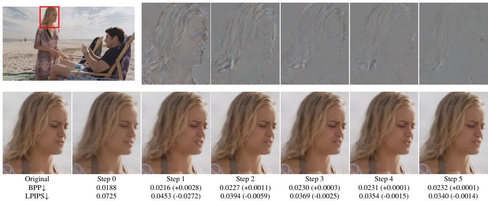  
Figure 8: Visual comparisons of the reconstructed noisy states during five-step residual coding for the videoSRC23 sequence from the MCL-JCV dataset. Wherein, residual maps depicted above are derived by subtracting the reconstruction of the preceding step from that of the current step.

Table 7: Distribution of bitrate cost across different residual coding steps. Note that the percentage in “Step 0” denotes the proportion of the total bitrate consumed by the learned video codec.
<table><tr><td rowspan=1 colspan=1>Step 0</td><td rowspan=1 colspan=1>Step 1</td><td rowspan=1 colspan=1>Step 2</td><td rowspan=1 colspan=1>Step 3</td><td rowspan=1 colspan=1>Step 4</td><td rowspan=1 colspan=1>Step 5</td></tr><tr><td rowspan=1 colspan=3>82.9%      10.1%      4.7%</td><td rowspan=1 colspan=1>1.8%</td><td rowspan=1 colspan=1>0.3%</td><td rowspan=1 colspan=1>0.2%</td></tr></table>

## A.4.2 DISTRIBUTION OF BITRATE COST ACROSS DIFFERENT RESIDUAL CODING STEPS

Table 7 presents the distribution of bitrate cost across different residual-coding steps. The learned video codec accounts for the largest portion of the total bitrate. During residual coding, the combined bitrate contribution of Step 3, Step 4, and Step 5 is 2.3% of the total bitrate. Notably, as shown in Table 4, taking our default setting (two residual-coding steps and three residual-generation steps) as the anchor, using five residual-coding steps leads to more than a 3% BD-rate increase under all metrics. This discrepancy may stem from the fact that residual coding in the later steps introduces quantization errors that degrade reconstruction quality, while the residuals generated by VideoPiT are already sufficiently accurate at these denoising steps.

Furthermore, we provide a visual example produced with five-step residual coding to illustrate the distribution of bitrate cost across different steps and the corresponding variation in perceptual quality. As shown in Fig. 8, the first two residual-coding steps consume the most bitrate and yield sig nificant perceptual quality improvements. At step 3, step 4, and step 5, perceptual quality continues to improve through residual generation using predicted residual segments.

## A.5 MORE VISUAL EXAMPLES

We present additional qualitative comparisons on three datasets: HEVC B, MCL-JCV, and UVG. As illustrated in Fig. 9 - Fig. 11, our method yields visually sharper and more realistic reconstructions

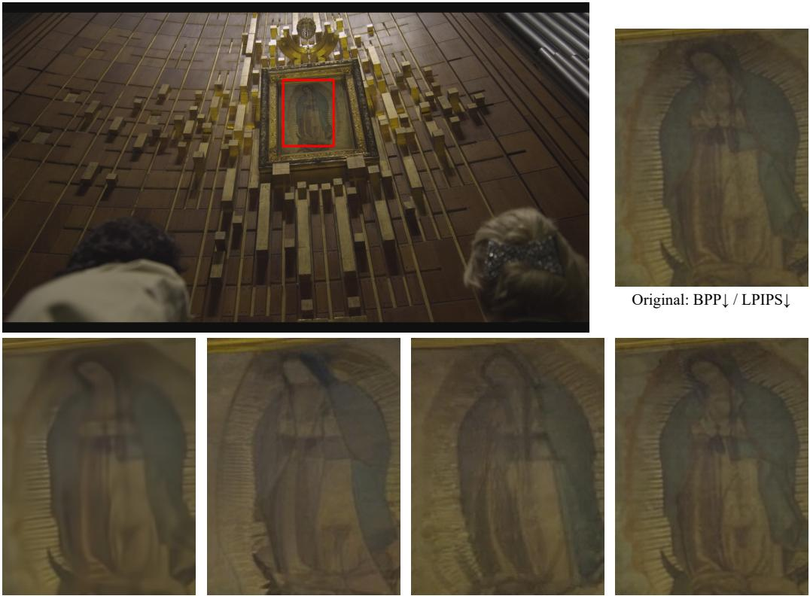  
DCVC-FM: 0.0072 / 0.1286  
GLC-Video: 0.0072 / 0.0773  
YODA: 0.0069 / 0.0658  
ResGVC (Ours): 0.0069 / 0.0250

Figure 9: Visual comparisons with open-source baselines on the videoSRC03 sequence from the MCL-JCV dataset.

than the competing baselines. Fig. 12 presents a comparison of temporal consistency across different methods. DCVC-FM generally produces blurry reconstructions, while GLC-Video and YODA tend to introduce jitter and flickering artifacts, thereby compromising temporal coherence. By contrast, our method delivers temporally stable reconstructions, especially in regions containing dense textures. These examples further underscore that our approach excels not only on quantitative metrics but also in preserving fine textures, realistic details, and perceptual naturalness, thereby delivering superior visual quality.

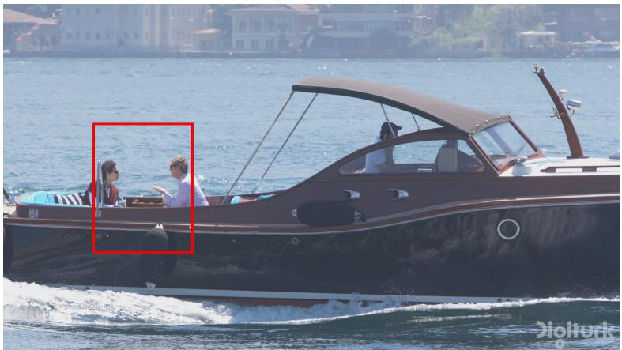

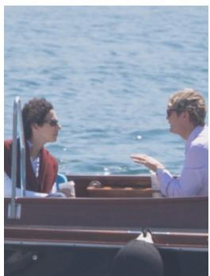  
Original: BPP↓ / LPIPS↓

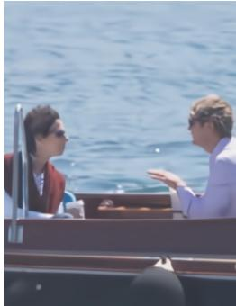  
DCVC-FM: 0.0072 / 0.1286

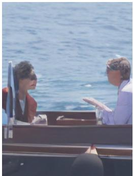  
GLC-Video: 0.0072 / 0.0773

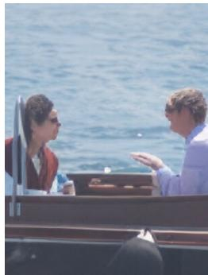  
YODA: 0.0069 / 0.0658

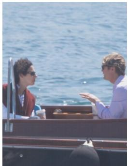  
ResGVC (Ours): 0.0069 / 0.0250

Figure 10: Visual comparisons with open-source baselines on the YachtRide sequence from the UVG dataset.  
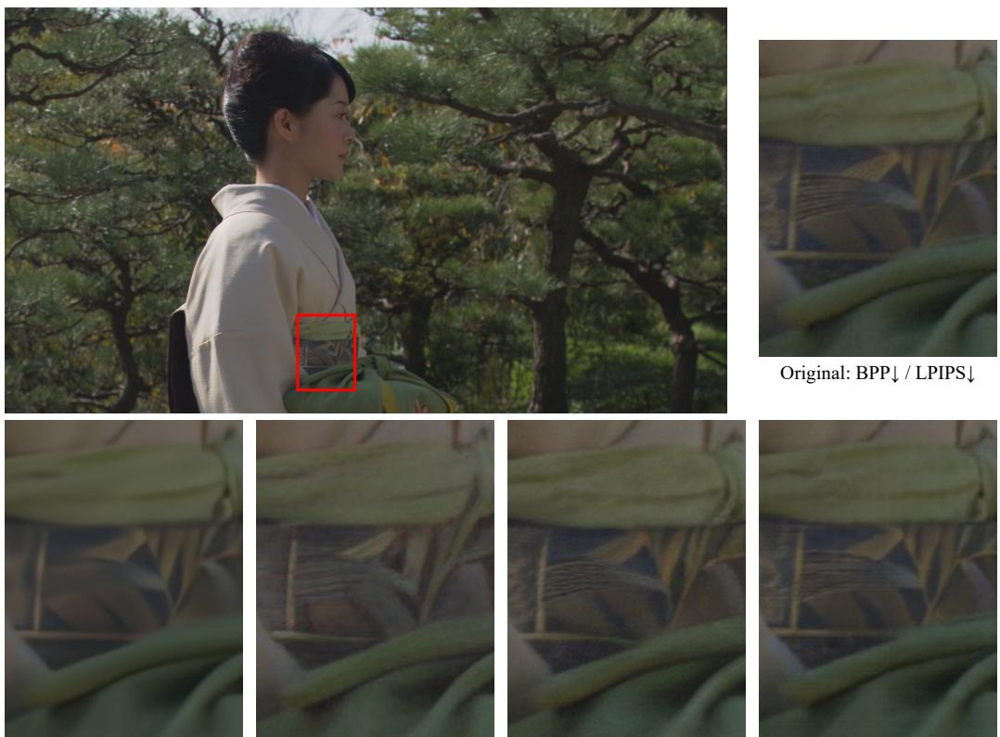  
DCVC-FM: 0.0198 / 0.3123  
GLC-Video: 0.0196 / 0.1377  
YODA: 0.0240 / 0.0968  
ResGVC (Ours): 0.0190 / 0.0926  
Figure 11: Visual comparisons with open-source baselines on the Kimono sequence from the HEVC B dataset.

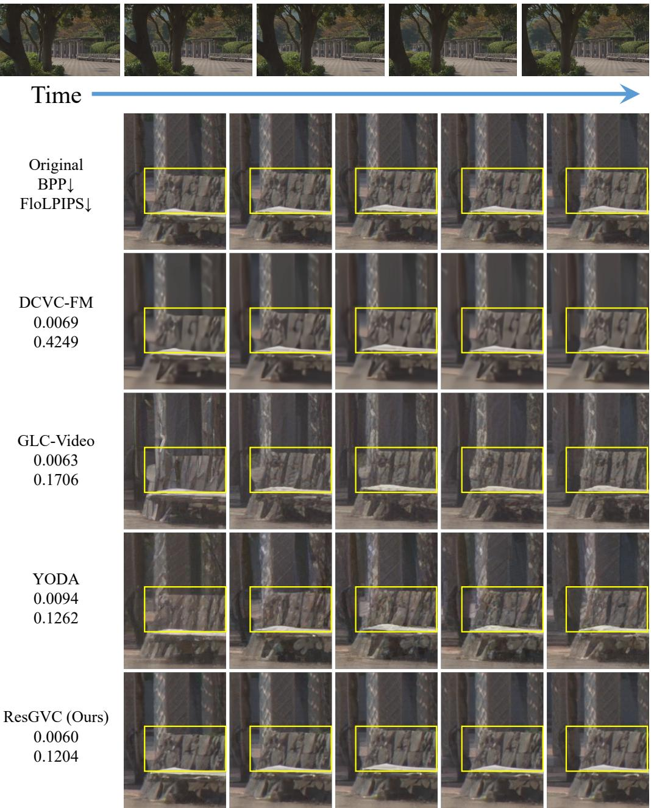  
Figure 12: Visual comparisons across frames on the ParkScene sequence from the HEVC B dataset.