# Improving Signals, Declining Encoder: A Known-Answer Test of Label-Free Monitoring in Self-Supervised Learning

Nilotpal Kakati

Weizmann Institute of Science, Rehovot, Israel

nilotpal.kakati09@gmail.com

## Abstract

Self-supervised training is monitored without labels, through the loss and statistics of the learned features. We report a case where we know the encoders lost part of what they had learned, so we can check whether these signals noticed. We trained LeJEPA encoders on synthetic images with known generating factors. In nine of ten seeds, the readability of those factors fell abruptly and stayed down, nearly always along the same direction in factor space. Meanwhile the loss kept falling, and most of the eleven label-free signals we tracked kept improving and rated the declining runs better than runs that did not decline. Standard change-point detection rarely flagged the decline near its onset, and selecting checkpoints by these signals mostly chose ones after it.

## 1 Introduction

Self-supervised training has no labels to check against, so it is judged by its loss and by label-free statistics of the features. SimSiam (Chen & He, 2021) uses feature standard deviation to diagnose collapse. RankMe (Garrido et al., 2023) and LiDAR (Thilak et al., 2024a) are used to select models, and LiDAR’s authors suggest it could also tell when to stop training. Arputharaj et al. (2026) compare many such metrics against downstream accuracy across trained models. None of these statistics measures whether an encoder keeps what it has already learned. Nor can that be checked on natural data, because nobody knows what an encoder should encode at each checkpoint.

An image generator with known factors removes that problem: the readability of each factor can be measured from frozen features at every checkpoint. On one such generator, we trained encoders with a reduced twoview LeJEPA (Balestriero & LeCun, 2025) recipe and saw them learn the factors and then abruptly lose part of that readability (Figure 1). Over the same epochs the training loss kept falling and RankMe, a measure of efective rank, rose. Falling efective rank is the sign of dimensional collapse (Jing et al., 2022; Garrido et al., 2023), so this decline did not look like a collapse, and a check for collapse would have read it as progress. The two training views share the factors, so the objective never asked the encoder to discard them. The decline recurred across seeds and held up under nonlinear probes and a separately generated test split. A masked autoencoder (MAE; He et al., 2022) trained on the same images for the same number of epochs did not decline.

Since we know when the encoder lost readability, we can check whether label-free signals noticed. We tracked eleven of them around each decline and compared the runs that declined with runs of the same settings that did not. Most kept improving through the decline and rated the runs that declined better than those that did not (Section 3). Even the best pairing of signal and change-point method, chosen after the fact, alarmed near the onset in only about a third of the declines; most pairings alarmed in far fewer. Choosing checkpoints by these signals mostly picked ones after the decline, with worse readability. A LiDAR variant we computed by mistake flagged most declines, but it relies on information a real training run does not have, so it cannot serve as a monitor (Section 5).

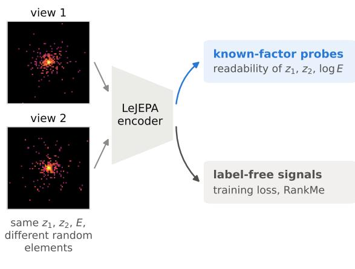  
(a) a training pair and what we watch

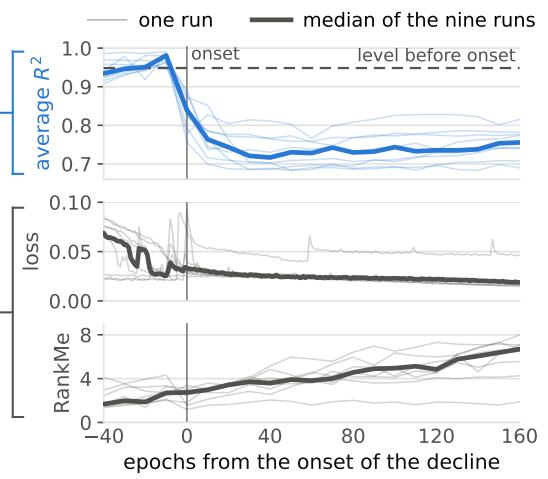  
(b) nine runs, aligned at their onsets  
Figure 1: (a) One training pair at $N = 1 0 0 \colon$ two renders with the same shape factors $z _ { 1 } , z _ { 2 }$ and energy E that difer only in the sampled elements (log intensity, summed over channels). Grey: label-free signals; blue: readability, the average held-out ridge $\dot { R } ^ { 2 }$ of the three factors. (b) The nine default runs that declined, aligned at their onsets, which are estimated from readability. Readability drops at onset and stays below its level before onset, while the training loss keeps its downward trend, with spikes in some runs, and RankMe rises. Figure 2 shows all ten runs against training epoch.

## 2 Experimental Setup and Measurements

Images and views. We use a simpler configuration of the simulator of Kakati (2026), built on PyCaloFlash v1.0 (Dreyer et al., 2026), to generate sparse images from two shape coordinates, $\left( z _ { 1 } , z _ { 2 } \right)$ , and energy E. Each image has 4 channels of 64×64 pixels and shows one pattern at a fixed position. The shape coordinates set how the pattern’s intensity is spread over the channels: where it peaks and how broad the peak is. E sets the overall intensity and shifts the typical peak position and width (Appendix A). In each channel, N points, called elements, are drawn at random from this intensity profile and binned into the pixels. The element count controls image graininess (Figure 5). Each image’s shape coordinates are drawn from a distribution set by a parameter $\mu .$ At $\mu = 0$ each coordinate is standard normal; as $\mu$ grows, its distribution splits into two Gaussians whose centres move apart at fixed overall variance, and near $\mu = 1$ they barely overlap. Instead of image augmentations, the two training views are independent renders with the same shape and energy; only the sampled elements difer. Figure 1a shows a training pair and the two measurement paths, and Appendix A describes the generator’s physical model.

Training configuration. We trained a small ViT (Dosovitskiy et al., 2021) encoder, ViT-Nano, with a projector using the LeJEPA objective (Balestriero & LeCun, 2025), which combines agreement between the projected training views with SIGReg, a regularizer that pushes projector outputs toward a standard normal distribution. Our reduced recipe uses two whole-image views. The default projector has hidden width 384; a wide projector, of width 2048, is the second main configuration. Unless stated otherwise, runs last 300 epochs and use $N = 1 0 0$ and $\mu = 0$ , and default runs also use the default projector. Every epoch draws fresh images from the generator. MAE (He et al., 2022) on the same generator provides a comparison with another training objective, and ViT-Tiny provides an architecture check. Appendix B gives the full training details.

Measuring readability. At each saved checkpoint, we freeze the encoder and use its final-layer tokens, layer-normalized and averaged over positions, as features. Readability is the average held-out $R ^ { 2 }$ of ridge readouts of $z _ { 1 } , z _ { 2 }$ and log energy from these features. The readouts are fitted on one set of generated images and scored on a separate set, both matched to training in $\mu$ and N. These probe images are single renders, not pairs. The same images are reused across checkpoints and across runs of the same condition. Efective rank is measured with RankMe (Garrido et al., 2023), the exponential of the entropy of the normalized singular values of the same features. Appendix B gives the readout implementation, and Appendix E the metric conventions.

Decline and onset. Drop from peak is the largest readability from epoch 20 on minus the final value, and a run declines if this drop is at least 0.07. The onset is the first checkpoint after the peak at which readability has fallen by a fifth of the drop. We fixed this rule after inspecting the trajectories of most of our runs (Appendix B). The pre-onset checkpoint is the last one at least 20 epochs before onset.

## 3 Readability Declines While Label-Free Signals Improve

We first show the decline, then use it to test the label-free signals: how they behaved around it (Section 3.1), whether change-point detection flagged it in time, and which checkpoints they would have chosen (Section 3.2).

## 3.1 The Decline and the Signals Around It

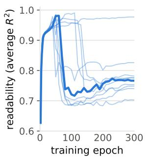  
(a) readability, ten seeds

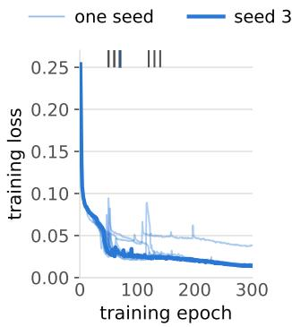  
(b) training loss

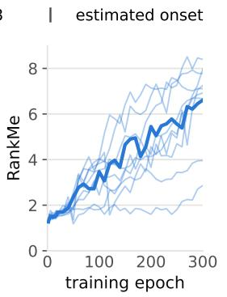  
(c) RankMe

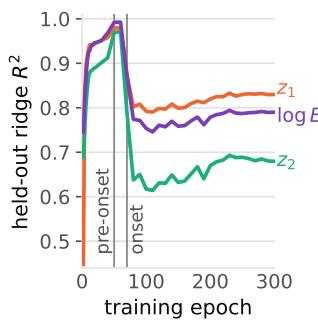  
(d) each factor, seed 3  
Figure 2: The ten default runs over 300 epochs: (a) readability, (b) training loss and (c) RankMe. RankMe increases overall, with local decreases; its small values come from the large feature mean, which RankMe does not subtract. (d) Held-out ridge $R ^ { 2 }$ of each factor for seed 3, the median decline in both drop and onset, highlighted in the other panels; its pre-onset checkpoint comes before the peak.

Readability rose and then fell sharply in nine of ten default runs (Figure 2a). The decline also occurred with the wide projector (Figure 4). Every decline lowered the readability of all three factors (Figure 2d shows one run), and nearly every decline lost the same combination of them (Section 4.2). Onsets varied across seeds; some runs partly recovered, but none came back to its peak. Over the same epochs the training loss kept its downward trend and RankMe rose (Figure 2b, c).

We follow the signals on the runs we use to test alarms (Appendix F). Figure 3 compares the runs that declined with those that did not, within the settings (projector and µ) that had both outcomes. We align the decline runs at their onsets and the runs without a decline at epoch 100, close to the median onset. The figure follows eleven label-free signals around the decline: the training loss, SIGReg, feature standard deviation, LiDAR (Thilak et al., 2024a) and the seven metrics compared by Arputharaj et al. (2026), which summarize the spectrum of the features, how features relate across images, or their intrinsic dimension. LiDAR is an efective rank computed over groups of inputs (Section 5). Each panel of Figure 3 gives its signal’s preferred direction, and Table 2 lists the metrics’ sources and variants.

After the onset, most signals kept moving in their preferred direction, and eight of the eleven rated the decline runs better than the runs without a decline at every checkpoint after the onset. For RankMe, the two medians nearly tied at the first checkpoint after the onset. The exceptions were α-ReQ, which rated the decline runs worse throughout (further from 1), and the loss and $\kappa ,$ which were mixed. So by most of these signals, the runs that lost readability looked like the better runs.

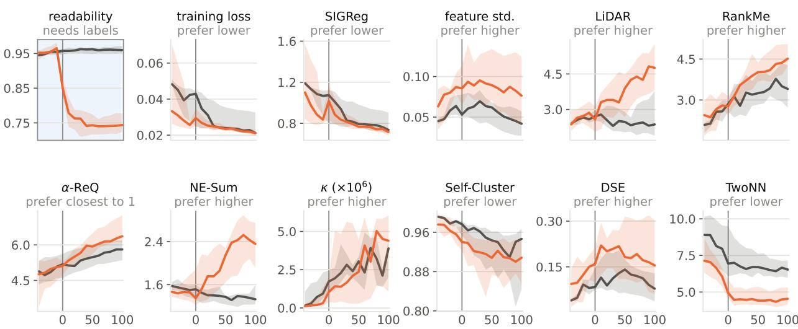  
epochs from the onset (runs that did not decline: from epoch 100)  
Figure 3: Label-free signals around a known readability decline. Orange: decline runs from the settings of the alarm audit (Appendix F) that have both outcomes, aligned at their onsets. Grey: runs without a decline from the same settings, aligned at epoch 100, close to the median onset. Readability falls and stays down, while most label-free signals keep moving in their preferred direction; α-ReQ moves away from 1. RankMe and the bottom row are the seven metrics compared by Arputharaj et al. (2026).

The runs without a decline have no onset. Aligning them anywhere from epoch 50 to 160 instead leaves most of these verdicts unchanged, but not SIGReg’s (Appendix E). The two groups also difer in mix, with more $\mu = 0$ runs among the decline runs.

## 3.2 Alarms and Checkpoint Choice

We ran three standard change-point detection methods (CUSUM, Page, 1954; EWMA, Roberts, 1959; Page– Hinkley, Hinkley, 1971) on every signal, with thresholds set on control runs from another shape distribution (Appendix F). Even the best combinations of signal and method, picked after the fact, alarmed within ten epochs of onset in only about a third of the declines (9 of 26 scored), and they also alarmed in some runs without a decline.

Without a timely alarm, these signals can still be used to pick a checkpoint. We asked which saved checkpoint the loss, LiDAR and each metric would select: the one where it was best in its preferred direction. The cost of a choice is the readability it loses relative to the best candidate, chosen with hindsight. This is an ofline comparison, not a stopping rule.

Signals that keep improving through training pick late checkpoints. Loss minimization and RankMe picked a checkpoint at or after the onset in every decline run, and LiDAR in all but one. Each of the three cost a median 0.21 in readability, the same as taking the final checkpoint. LeJEPA proposes its loss as evidence of representation quality (Balestriero & LeCun, 2025); here the loss improved while readability declined. α-ReQ picks early, which costs little in decline runs but loses readability in runs without a decline, where the final checkpoint loses almost none (Appendix E). The other five metrics chose checkpoints at or after onset in most decline runs, in every variant we computed (Table 2), at about the same cost as the final checkpoint.

So, apart from α-ReQ, choosing a checkpoint by these signals did about as well as simply taking the last one.

## 4 Checking and Understanding the Decline

We first check that the decline does not depend on the readout and that the rise in efective rank does not depend on how it is measured (Section 4.1), then show that nearly all declines share one direction (Section 4.2), and then report which changes to training altered the decline and which did not (Section 4.3).

## 4.1 Readout and Objective Checks

These checks use 13 decline runs, nine with the default projector and four with the wide one. The drop shows under every readout we tried: pooled ridge, an attention probe, an MLP, and token-level ridges. The two nonlinear probes did not beat pooled ridge in most comparisons, and rescoring on a separately generated test split changed little. A readout we did not try could still recover the lost readability (Appendices B and C).

The rise in efective rank does not depend on how it is measured. RankMe rose from the pre-onset to the final checkpoint in all 13 runs, and in 11 of 13 after subtracting the feature mean. RankMe on the projector output stayed near its maximum at both checkpoints, so the projector did not lose rank either (Appendix C). A masked autoencoder trained on the same images for as long did not decline; all ten runs ended at their peak.

## 4.2 A Shared Direction

Each run’s direction is the combination of factors whose readout $R ^ { 2 }$ fell most between the pre-onset and final checkpoints (Appendix B). Across all our runs, every decline but one lost readability along almost the same direction in factor space. The exception declined twice, and splitting it after seeing the trajectory puts its first decline along the common direction and its second nearly perpendicular to it. Runs without a decline lost far less along their own direction: $R ^ { 2 }$ fell by at most 0.107, against at least 0.302 in every decline (Appendix C).

The common direction mixes all three factors with comparable weights, which is why every factor’s readout falls (Figure 2d). Other combinations stayed readable. Canonical correlation analysis between the features and the factors finds three combinations; in the runs of Section 4.1, the first two stayed almost perfectly correlated while only the third fell. In each of these runs, the change in readout error lay almost entirely along one direction (Appendix C). So each encoder lost one combination of the factors and kept the others readable.

## 4.3 Changes That Altered the Decline

Partially refreshing shape between the two training views removed the decline (Figure 4). In these runs the two views’ shape coordinates are only partly correlated instead of equal, while energy stays shared (Appendix D). No refreshed run declined, against nine of ten default runs on the same images and probes, and refreshed runs trained for 1000 epochs also stayed near their peaks.

The shape distribution mattered too (Figure 4). The decline was common at $\mu = 0 . 4$ and 0.7 and uncommon within 300 epochs at $\mu = 0 . 9$ , but every $\mu = 0 . 9$ run trained for 1000 epochs declined. No run at $\mu = 0 . 9 7$ declined, even after 1000 epochs, though some fell well below their peak mid-run and then recovered.

Image graininess mattered as well (Figure 4). No run declined with less grainy images, although these runs peaked far enough above what an untrained encoder already reads for a typical drop to show. With the cleanest images we tried, runs did not peak that far above it, so they say nothing about the decline. With grainier images, half the runs declined about as much as at the default graininess, and the rest learned poorly from the start (Appendix D).

Changes to the optimizer, the objective and the encoder did not remove the decline. It occurred without weight decay and under a constant learning rate, though with three seeds each we cannot say whether either change makes it more or less common. With the SIGReg weight raised to the value recommended by Balestriero & LeCun (2025), three of ten runs declined, and in those the loss kept falling and RankMe rose. One of two runs with a ViT-Tiny encoder declined, along the same direction. Table 1 lists these runs.

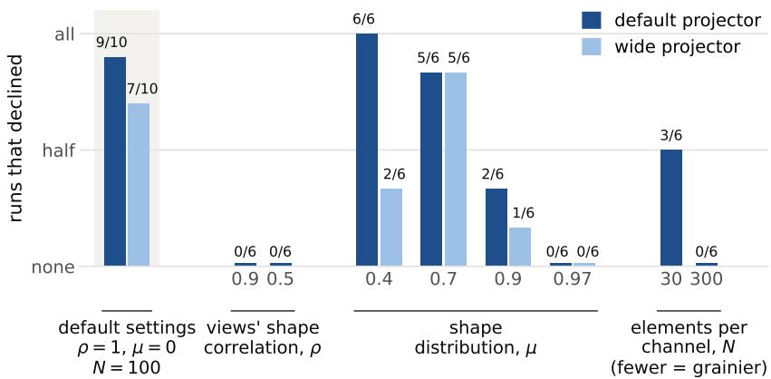  
Figure 4: How many runs declined under each change, out of how many runs (the count on each bar). The left group uses the default settings, and each other group changes one of them. A run declined if its readability ended at least 0.07 below its peak. All runs trained for 300 epochs. Appendix D covers the conditions not shown.

## 5 LiDAR Flags the Decline When Its Groups Redraw Shape

LiDAR measures how evenly the diferences between groups of inputs spread across feature directions, after discounting the variation inside each group. Normally, each group holds views made the same way as the training views. By mistake, our first evaluation built its groups with an augmentation from the paper that introduced the simulator (Kakati, 2026, §2): every render in a group keeps the group’s energy but gets a newly drawn shape, whereas training views share both. With groups that redraw shape, LiDAR flagged most declines on time, with few false alarms; with training-view groups, it rarely did (Figure 6). With shape redrawn inside each group, the groups difer mainly in energy, so the largest direction in LiDAR’s spectrum follows energy. As the decline lowers energy readability, that direction weakens, the spectrum evens out, and LiDAR rises (Appendix G).

This augmentation is not part of standard LiDAR. Building it requires knowing which factors are shape and which is energy, and changing one while holding the other fixed. And because LiDAR with these groups rises during the decline, it reads the decline as an improvement: used as a quality score, as in Section 3.2, it also preferred checkpoints after the decline.

## 6 Related Work

The label-free signals we track were mostly validated by comparing models. RankMe (Garrido et al., 2023) and LiDAR (Thilak et al., 2024a) were tested on trained models and sets of checkpoints, and LeJEPA’s training loss correlated with downstream linear-probe accuracy over training configurations (Balestriero & LeCun, 2025). Within a single run of I-JEPA (Assran et al., 2023), Thilak et al. (2024a) also found that efective rank peaked early and then fell, with the best downstream accuracy far from that peak. The closest work to ours, Arputharaj et al. (2026), compares label-free metrics with downstream accuracy for many trained models and finds that each metric’s reliability depends on architecture and training objective. We ask a diferent question, whether these signals notice when a single run loses what it learned, so our result does not contradict theirs. Online linear probes, as in solo-learn (Turrisi da Costa et al., 2022), follow what the features encode during training, but they need labels, as do the probes that measure the decline here.

Known generating factors have been used before to test what unsupervised models learn. Locatello et al. (2019) trained thousands of models on factor datasets and found that well-disentangled models seemingly could not be identified without supervision; our checkpoint-choice result is the within-run counterpart. For LeJEPA, Klindt et al. (2026) prove that the objective’s optimum recovers Gaussian generating factors when the two views’ factors are related but not identical. Our shared views are identical, where the objective no longer favours recovering the factors, and the theorem concerns the optimum rather than the path training takes, so it says nothing either way about our declines or our refresh runs. The main guarantee of the original LeJEPA paper (Balestriero & LeCun, 2025), that isotropic Gaussian embeddings serve downstream probes best, concerns how the embeddings are distributed, not which factors they keep.

Simon et al. (2023) find that some joint-embedding methods learn their embeddings in steps, one or a few directions at a time. Our declines also happen along a single direction, here in factor space, but remove readability instead of adding it.

## 7 Discussion

Efective rank measures how evenly the features spread over directions, not what they encode, so it can rise while readability falls. RankMe does not subtract the feature mean, and in these runs the mean was the largest direction of the features’ spectrum; its share fell, which made the spectrum more even. RankMe recomputed after subtracting the mean also rose in most runs (Section 4.1), so the mean does not explain the whole rise.

Refreshing shape between the two views removed the decline (Section 4.3), even though energy stayed shared and the common direction includes energy. So the decline is not about shape alone. One possible cause is feature suppression, where easy features hold back the learning of others (Chen et al., 2021; Robinson et al., 2021). Here it would have to remove a feature that had already been learned. Two observations fit this. In an untrained encoder, and in one run before its onset, the common direction was close to the direction the two views agreed on least. Ridge readouts from the untrained encoder, and from an oracle that uses simple image summaries such as the total intensity in each channel, also found it harder to read than most directions. So the common direction was weak from the start, as suppression would need. But the hardest direction for both puts little weight on energy, so neither observation explains the energy in the common direction (Appendices C and D).

Optimizer instabilities are also possible (Lewkowycz et al., 2020; Thilak et al., 2024b; Wortsman et al., 2024): Section 4.3 shows only that weight decay and a changing learning rate are not necessary for the decline.

## 8 Limitations

The evidence comes from one image generator, small encoders and a reduced two-view LeJEPA recipe, and MAE is the only other objective that learned on it. It does not show how common the decline is on natural images or with the published eight-view recipe at scale (Balestriero & LeCun, 2025). A contrastive model trained with SimCLR’s loss (Chen et al., 2020) never moved away from its initialization on this generator, and changing the learning rate did not help, so we do not know whether contrastive training shows the decline. Readability is what our probes recover, so the decline shows that the factors became harder to read; it does not show that the information is gone. We also tested only three standard change-point detection methods, with thresholds set on control runs from another shape distribution. That they rarely alarmed in time does not show that the decline cannot be detected from these signals.

## 9 Conclusion

In this LeJEPA case study, the encoders lost readability they had learned, while the training loss kept falling and most label-free signals kept improving. Change-point detection on these signals caught a third of the declines in time at best, and checkpoints chosen by loss or RankMe came at or after the onset, with worse readability than earlier ones. A signal that keeps improving therefore does not show that an encoder keeps what it has learned.

## Code and Data Availability

The code, run configurations, and the data behind every figure and table (CSV, and the rendered example images) are on GitHub at https://github.com/nilotpal09/improving-signals-declining-encoder; the encoder checkpoints are on Zenodo at https://doi.org/10.5281/zenodo.23666713. Training is not bitwise reproducible, so the checkpoints are part of the release.

## LLM Usage

Large language models assisted with coding, experiment execution, analysis, figure production, and manuscript drafting and editing under the author’s direction and review. Study design, verification of the reported results, and scientific interpretation remained with the author, who takes responsibility for the work.

## Acknowledgements

The author thanks Eilam Gross for discussions and feedback on the manuscript. This work was supported by the Minerva Grant No. 7015027, the Knell Family Institute for Artificial Intelligence, the Benoziyo Center for High Energy Physics, a BSF Grant No. 2024220, and the Krenter-Perinot Center for High Energy Particle Physics.

## References

Kumar K. Agrawal, Arnab Kumar Mondal, Arna Ghosh, and Blake Richards. α-ReQ: Assessing representation quality in self-supervised learning by measuring eigenspectrum decay. In Advances in Neural Information Processing Systems (NeurIPS), volume 35, pp. 17626–17638, 2022.

Daniel Richards Arputharaj, Daniel Jönsson, and Gabriel Eilertsen. A comparative study of label-free representation quality metrics in deep learning. Transactions on Machine Learning Research, 2026. ISSN 2835-8856. URL https://openreview.net/forum?id=yknkAksqr1.

Mahmoud Assran, Quentin Duval, Ishan Misra, Piotr Bojanowski, Pascal Vincent, Michael Rabbat, Yann LeCun, and Nicolas Ballas. Self-supervised learning from images with a joint-embedding predictive architecture. In Proceedings of the IEEE/CVF Conference on Computer Vision and Pattern Recognition (CVPR), pp. 15619–15629, 2023. doi: 10.1109/CVPR52729.2023.01499.

Randall Balestriero and Yann LeCun. LeJEPA: Provable and scalable self-supervised learning without the heuristics. arXiv preprint arXiv:2511.08544, 2025.

Ting Chen, Simon Kornblith, Mohammad Norouzi, and Geofrey Hinton. A simple framework for contrastive learning of visual representations. In International Conference on Machine Learning (ICML), volume 119 of Proceedings of Machine Learning Research, pp. 1597–1607, 2020.

Ting Chen, Calvin Luo, and Lala Li. Intriguing properties of contrastive losses. In Advances in Neural Information Processing Systems (NeurIPS), 2021.

Xinlei Chen and Kaiming He. Exploring simple Siamese representation learning. In Proceedings of the IEEE/CVF Conference on Computer Vision and Pattern Recognition (CVPR), pp. 15745–15753, 2021. doi: 10.1109/CVPR46437.2021.01549.

Alexey Dosovitskiy, Lucas Beyer, Alexander Kolesnikov, Dirk Weissenborn, Xiaohua Zhai, Thomas Unterthiner, Mostafa Dehghani, Matthias Minderer, Georg Heigold, Sylvain Gelly, Jakob Uszkoreit, and Neil Houlsby. An image is worth 16x16 words: Transformers for image recognition at scale. In International Conference on Learning Representations (ICLR), 2021.

Etienne Dreyer, Nilotpal Kakati, and Eilam Gross. PyCaloFlash: GPU-ready fast EM shower model. Zenodo, version v1.0, 2026. URL https://doi.org/10.5281/zenodo.20588830.

T. W. Epps and Lawrence B. Pulley. A test for normality based on the empirical characteristic function. Biometrika, 70(3):723–726, 1983. doi: 10.1093/biomet/70.3.723.

Elena Facco, Maria d’Errico, Alex Rodriguez, and Alessandro Laio. Estimating the intrinsic dimension of datasets by a minimal neighborhood information. Scientific Reports, 7(1):12140, 2017. doi: 10.1038/ s41598-017-11873-y.

Quentin Garrido, Randall Balestriero, Laurent Najman, and Yann LeCun. RankMe: Assessing the downstream performance of pretrained self-supervised representations by their rank. In International Conference on Machine Learning (ICML), volume 202 of Proceedings of Machine Learning Research, pp. 10929–10974, 2023.

Guenter Grindhammer and S. Peters. The parameterized simulation of electromagnetic showers in homogeneous and sampling calorimeters. In International Conference on Monte Carlo Simulation in High-Energy and Nuclear Physics – MC 93, 1993. URL https://arxiv.org/abs/hep-ex/0001020.

Bobby He and Mete Ozay. Exploring the gap between collapsed & whitened features in self-supervised learning. In International Conference on Machine Learning (ICML), volume 162 of Proceedings of Machine Learning Research, pp. 8613–8634, 2022.

Kaiming He, Xinlei Chen, Saining Xie, Yanghao Li, Piotr Dollár, and Ross Girshick. Masked autoencoders are scalable vision learners. In Proceedings of the IEEE/CVF Conference on Computer Vision and Pattern Recognition (CVPR), pp. 15979–15988, 2022. doi: 10.1109/CVPR52688.2022.01553.

D. V. Hinkley. Inference about the change-point from cumulative sum tests. Biometrika, 58(3):509–523, 1971. doi: 10.1093/biomet/58.3.509.

Li Jing, Pascal Vincent, Yann LeCun, and Yuandong Tian. Understanding dimensional collapse in contrastive self-supervised learning. In International Conference on Learning Representations (ICLR), 2022.

Nilotpal Kakati. Shared is not enough: Predictor width and factor readability under masked latent prediction. arXiv preprint arXiv:2610.32562, 2026.

David Klindt, Yann LeCun, and Randall Balestriero. When does LeJEPA learn a world model? In Advances in Neural Information Processing Systems (NeurIPS), 2026. URL https://openreview.net/forum?id= UmYyYHEj9P.

Aitor Lewkowycz, Yasaman Bahri, Ethan Dyer, Jascha Sohl-Dickstein, and Guy Gur-Ari. The large learning rate phase of deep learning: The catapult mechanism. arXiv preprint arXiv:2003.02218, 2020.

Danqi Liao, Chen Liu, Benjamin W. Christensen, Alexander Tong, Guillaume Huguet, Guy Wolf, Maximilian Nickel, Ian Adelstein, and Smita Krishnaswamy. Assessing neural network representations during training using noise-resilient difusion spectral entropy. In 2024 58th Annual Conference on Information Sciences and Systems (CISS), pp. 1–6, 2024. doi: 10.1109/CISS59072.2024.10480166.

Francesco Locatello, Stefan Bauer, Mario Lucic, Gunnar Rätsch, Sylvain Gelly, Bernhard Schölkopf, and Olivier Bachem. Challenging common assumptions in the unsupervised learning of disentangled representations. In International Conference on Machine Learning (ICML), volume 97 of Proceedings of Machine Learning Research, pp. 4114–4124, 2019.

Ilya Loshchilov and Frank Hutter. Decoupled weight decay regularization. In International Conference on Learning Representations (ICLR), 2019.

E. S. Page. Continuous inspection schemes. Biometrika, 41(1–2):100–115, 1954. doi: 10.1093/biomet/41. 1-2.100.

S. W. Roberts. Control chart tests based on geometric moving averages. Technometrics, 1(3):239–250, 1959. doi: 10.1080/00401706.1959.10489860.

Joshua Robinson, Li Sun, Ke Yu, Kayhan Batmanghelich, Stefanie Jegelka, and Suvrit Sra. Can contrastive learning avoid shortcut solutions? In Advances in Neural Information Processing Systems (NeurIPS), 2021.

James B. Simon, Maksis Knutins, Liu Ziyin, Daniel Geisz, Abraham J. Fetterman, and Joshua Albrecht. On the stepwise nature of self-supervised learning. In International Conference on Machine Learning (ICML), volume 202 of Proceedings of Machine Learning Research, pp. 31852–31876, 2023.

Vimal Thilak, Chen Huang, Omid Saremi, Laurent Dinh, Hanlin Goh, Preetum Nakkiran, Joshua M. Susskind, and Etai Littwin. LiDAR: Sensing linear probing performance in joint embedding SSL architectures. In International Conference on Learning Representations (ICLR), 2024a.

Vimal Thilak, Etai Littwin, Shuangfei Zhai, Omid Saremi, Roni Paiss, and Joshua M. Susskind. The slingshot efect: A late-stage optimization anomaly in adaptive gradient methods. Transactions on Machine Learning Research, 2024b. ISSN 2835-8856. URL https://openreview.net/forum?id=OZbn8ULouY.

Anton Tsitsulin, Marina Munkhoeva, and Bryan Perozzi. Unsupervised embedding quality evaluation. In Proceedings of 2nd Annual Workshop on Topology, Algebra, and Geometry in Machine Learning (TAG-ML), volume 221 of Proceedings of Machine Learning Research, pp. 169–188, 2023.

Victor Guilherme Turrisi da Costa, Enrico Fini, Moin Nabi, Nicu Sebe, and Elisa Ricci. solo-learn: A library of self-supervised methods for visual representation learning. Journal of Machine Learning Research, 23 (56):1–6, 2022.

Mitchell Wortsman, Peter J. Liu, Lechao Xiao, Katie Everett, Alex Alemi, Ben Adlam, John D. Co-Reyes, Izzeddin Gur, Abhishek Kumar, Roman Novak, Jefrey Pennington, Jascha Sohl-Dickstein, Kelvin Xu, Jaehoon Lee, Justin Gilmer, and Simon Kornblith. Small-scale proxies for large-scale Transformer training instabilities. In International Conference on Learning Representations (ICLR), 2024.

## A The Generator

We use a single-particle configuration of the simulator of Kakati (2026, §2 and App. A), whose images show several overlapping particles. The simulator uses PyCaloFlash v1.0 (Dreyer et al., 2026), a simplified model of a particle shower in a calorimeter, a layered detector that absorbs a high-energy particle and records where its energy is deposited. Each of the 4 channels of the 64 × 64 image is one detector layer, at increasing depth, and each pixel holds the energy deposited in one cell of that layer. Each layer samples N elements (individual deposits) independently from a smooth intensity profile, and the two views of a training pair share the profile and difer only in these samples. Energies are in MeV (megaelectronvolts). Raw cell values x are transformed as log $( 1 + x ) / \log ( 1 + 5 5 0 0 )$

The particle’s energy E is drawn with density proportional to $E ^ { - 2 }$ on [20,000, 40,000] MeV. The deposit’s spread over depth follows a gamma-shaped curve (Grindhammer & Peters, 1993) with two parameters: $T _ { \mathrm { : } }$ the depth at which it peaks, and $\alpha ,$ which sets how wide the peak is. E scales every deposit, so it sets the overall intensity. It also sets the means, widths and correlation of the map from the shape coordinates to log T and log α.

Each shape coordinate is drawn independently as

$$
z = s \mu + \sqrt { 1 - \mu ^ { 2 } } g ,
$$

where $s = \pm 1$ with equal probability and $g$ is standard normal. At $\mu = 0$ this gives a standard normal, and increasing µ separates the two mixture components while keeping zero mean and unit variance. Figure 5 shows one image at the four element counts used in the paper.

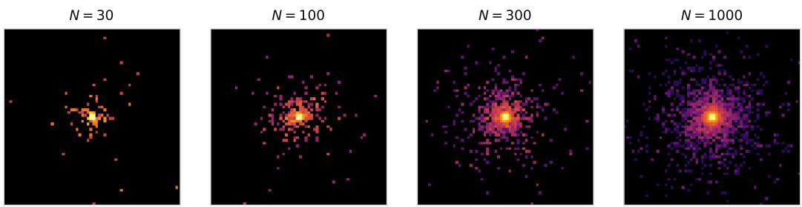  
Figure 5: One image rendered at $N = 3 0$ , 100, 300 and 1000, with the intensity summed over the 4 depth layers and shown as $\mathrm { l o g ( 1 + i n t e n s i t y ) }$ on one shared scale. The $N = 1 0 0$ render is view 1 of Figure 1a.

## B Training and Probe Details

ViT-Nano (0.7M parameters) uses patch size 4, a $1 6 \times 1 6$ token grid, embedding dimension 96, 6 blocks, 3 attention heads and MLP ratio 4. ViT-Tiny uses dimension 192 and 12 blocks (5.40M parameters). We used AdamW (Loshchilov & Hutter, 2019) with batch size 128 in bfloat16. Each epoch has 64,000 freshly generated examples in 500 batches, each example supplying two views, and checkpoints are saved every 2 epochs to epoch 20 and every 10 after. The learning rate warms up from $2 \times 1 0 ^ { - 4 } \ \mathrm { t o ^ { - } 1 0 ^ { - 3 } }$ over 40 epochs and then decays to $1 0 ^ { - 6 }$ on a cosine schedule, and weight decay rises from 0.04 to 0.4 on a cosine schedule. The projector has two Linear–BatchNorm–ReLU hidden layers of width 384 (default) or 2048 (wide), followed by a linear map to 16 outputs. BatchNorm statistics are pooled over both views and all images in a batch. Default-projector runs of 300 epochs took three to seven GPU-hours on NVIDIA RTX A5000 or A6000 GPUs.

Reduced training recipe. The objective is $\lambda { \mathrm { S I G R e g } } + ( 1 - \lambda )$ agreement, where agreement is the mean squared distance of each view’s projection from the mean over views. Compared with Balestriero & LeCun (2025), we used two views rather than eight, $\lambda = 0 . 0 2$ rather than the recommended 0.05, 256 SIGReg projections rather than 1024, and the integration range [−3, 3] rather than [−5, 5]. The weight, projection count and integration range follow the minimal example in the LeJEPA repository (MINIMAL.md at https: //github.com/galilai-group/lejepa).

MAE comparison. All ten runs use the same ViT-Nano, patch size, optimizer schedule and batch size, with one render per example and 300 epochs. MAE masks a fraction 0.75 of the patches and reconstructs only the masked ones, with mean squared error on per-patch normalized targets. Its decoder has 4 blocks, dimension 48 and 3 heads.

Readout implementation. The readouts are fitted on 4,000 images and scored on 2,000. Log energy is standardized on the fitting split, and the ridge standardizes all targets and features on that split. The ridge regularization strength is 1, fixed without cross-validation. Fitting and evaluation images use separate fixed seed bases, and training images are generated on the fly. The canonical correlation analysis of Section 4.2 is fitted by whitening and singular-value decomposition.

The attention probe has about 85k parameters. A single query, which carries only the position of the image’s fixed centre, attends to the raw token grid. The probe has its own LayerNorm and a learnable locality prior. It is trained with Adam at learning rate $2 \times 1 0 ^ { - 3 }$ , batch size 128, for up to 2,500 steps. The MLP has widths $9 6 \to 7 6 8 \to 7 6 8 \to 3$ with ReLU activations and is trained with Adam at $1 0 ^ { - 3 }$ , batch size 256, for up to 4,000 steps. Both minimize squared error on standardized targets, and we average two probe seeds.

We evaluate each probe every hundred steps and keep the fit with the lowest mean per-target median absolute error on the evaluation split, which also gives its reported $R ^ { 2 }$ . An independent test split then rescores these fits and pooled ridge, without reselecting. The token checks fit a ridge at each token position, and a dual ridge to all tokens concatenated (24,576 dimensions). The best position is chosen by mean shape $R ^ { 2 }$ (the mean of the $z _ { 1 }$ and $z _ { 2 } \ R ^ { 2 } )$ on the evaluation split, which also gives its shape and energy scores. The token readouts were not rescored on the independent test split.

Direction calculation. We form second-moment matrices of the ridge residuals at the pre-onset and fina checkpoints, $\Sigma _ { e } ^ { \mathrm { p r e } }$ and $\Sigma _ { e } ^ { \mathrm { f i n a l } }$ , and of the targets standardized on the fitting split, $\Sigma _ { y } ,$ all on the evaluation split without further centring. The leading generalized eigenvector of $( \Sigma _ { e } ^ { \mathrm { f i n a l } } - \Sigma _ { e } ^ { \mathrm { p r e } } , \Sigma _ { y } )$ is the target combination whose residual error grew most relative to its second moment. The reference direction $( 0 . 5 1 3 , - 0 . 6 4 5 , 0 . 5 6 7 )$ is the normalized mean of the directions of the first four wide-projector runs, expressed in standardized $z _ { 1 } .$ $z _ { 2 }$ and log E.

Onset rule. We fixed the onset rule of Section 2 after inspecting the readability trajectories of our first 131 runs, and applied it unchanged to 16 runs trained later. Over all 147 runs it marks 56 declines.

SIGReg estimator. SIGReg averages the Epps–Pulley statistic (Epps & Pulley, 1983) over 256 random one-dimensional projections. The statistic compares the empirical characteristic function of each projection with that of a standard normal. Its integral uses 17-point trapezoidal quadrature with a Gaussian window.

## C Readout and Direction Checks

The independent test split contains 2,000 new images. Rescored on it without reselection, pooled ridge and both learned probes changed by less than 0.02 in mean shape $R ^ { 2 }$ . Both learned probes still showed the decline, and each scored at or below pooled ridge at the final checkpoint in 12 of 13 runs, for shape and for log energy separately.

Most wide-projector decline runs rebounded slightly from their trough (by at most 0.085), and all ended below their earlier peak. Between the pre-onset and final checkpoints, RankMe rose in all 13 runs. After subtracting the feature mean, RankMe and its form on squared singular values (Table 2) each rose in 11 of 13, and the participation ratio $\textstyle ( \sum _ { i } s _ { i } ^ { 2 } ) ^ { 2 } / \sum _ { i } s _ { i } ^ { 4 }$ of the singular values $s _ { i }$ in 11 of 13. RankMe on the projector output had medians above 15.9, out of a maximum of 16, at both checkpoints, using BatchNorm statistics from the whole set (Appendix E).

In the 13 runs, canonical correlation analysis between the features and the three factors kept its first two correlations above 0.98 while the third fell, and the largest absolute eigenvalue of the whitened change in residual covariance, from the pre-onset to the final checkpoint, was 0.955–0.994 of the sum of absolute eigenvalues. In 55 of the 56 declines, the direction nearly matches the reference direction (Appendix B): the smallest absolute cosine among them is 0.996. The exception declined twice. Split after inspection at epoch 300, its first decline has cosine 0.997 and its second 0.11 or less.

A run’s directional loss is the drop in directional $R ^ { 2 } = 1 - w ^ { \top } \Sigma _ { e } w / ( w ^ { \top } \Sigma _ { y } w )$ along its direction $w ,$ from the pre-onset to the final checkpoint. The null comparison applied the same calculation to 101 windows from 43 runs without a decline. Each window ends at the run’s final checkpoint and starts at the earliest, median or latest pre-onset epoch of the declines with the same projector (for the median, the checkpoint at or before it), when that epoch comes before the end. Windows share runs, and all comparisons share the reference direction, so these are not independent observations.

Cross-view signal-to-noise. Unlike the other checks, this one renders each probe image twice, as in a training pair. A ridge fitted on one render predicts the standardized targets from both renders of each evaluation image. For a target direction w, write $a _ { i } = \boldsymbol { w } ^ { \top } \hat { y } _ { i } ^ { ( 1 ) }$ and $b _ { i } = w ^ { \top } \hat { y } _ { i } ^ { ( 2 ) }$ We used $\mathrm { S N R } ( w ) =$ $\mathrm { V a r } _ { i } [ ( a _ { i } + b _ { i } ) / 2 ] / [ \frac { 1 } { 2 } \langle ( a _ { i } - b _ { i } ) ^ { 2 } \rangle _ { i } ]$ and compared the reference direction with $2 { , } 0 0 0$ random unit directions. We computed it for an untrained encoder and for one default-projector run ten epochs before its onset. In both, the reference direction was in the bottom tenth by SNR, and the direction with the lowest SNR had absolute cosine 0.86 (untrained) and 0.91 (pre-onset) with it. A separate comparison, on the untrained encoder and on the oracle features of Appendix D, used directional $R ^ { 2 }$ . It placed the reference direction among the harder directions to read, but not the hardest. In both, the hardest direction contrasts $z _ { 1 }$ with $z _ { 2 }$ and gives log E an absolute weight of at most 0.17, against 0.567 in the reference direction.

Pre-onset checkpoints. In 21 of the 56 declines, the pre-onset checkpoint comes before the peak, while readability is still rising, and sits at most 28% of the drop below the peak. In the other 35, it lies at most 16% of the way into the decline.

## D Occurrence and Comparison Details

Training views. Partial shape refresh transforms the Gaussian score u behind each shape coordinate into $u ^ { \prime } = \rho u + \sqrt { 1 - \rho ^ { 2 } } \eta$ , with independent standard-normal η, and then maps $u ^ { \prime }$ to the chosen shape distribution by matching quantiles. $\mathrm { A t } ~ \mu = 0$ the scores are the shape coordinates themselves. Energy stays shared, and ρ = 1 gives shared views.

Table 1: Training conditions not shown in Figure 4, all at $N = 1 0 0$ . Declines are runs whose drop from peak readability is at least 0.07; drop ranges are rounded to two significant figures. LR is the learning-rate schedule. MAE has no projector.
<table><tr><td>Condition</td><td>Width</td><td>Epochs</td><td>Runs</td><td>Declines</td><td>Drop range</td></tr><tr><td> $\mu = 0 , \rho = 0 . 9$ </td><td>384</td><td>1000</td><td>6</td><td>0</td><td>0.00023-0.012</td></tr><tr><td>µ = 0, no weight decay</td><td>384</td><td>300</td><td>3</td><td>1</td><td>0-0.29</td></tr><tr><td> $\mu = 0 , \mathrm { c o n s t a n t \ L R }$ </td><td>384</td><td>300</td><td>3</td><td>2</td><td>0.027-0.27</td></tr><tr><td>µ = 0, SIGReg weight 0.05</td><td>384</td><td>300</td><td>10</td><td>3</td><td>0-0.27</td></tr><tr><td> $\mu = 0 . 9 , \mathrm { c o s i n e \ L R }$ </td><td>384</td><td>1000</td><td>3</td><td>3</td><td>0.21-0.55</td></tr><tr><td> $\mu = 0 . 9 , \mathrm { c o n s t a n t \ L R }$ </td><td>384</td><td>1000</td><td>3</td><td>3</td><td>0.28-0.31</td></tr><tr><td> $\mu = 0 . 9 7 , \mathrm { c o s i n e \ L R }$ </td><td>384</td><td>1000</td><td>3</td><td>0</td><td>0.0019–0.036</td></tr><tr><td> $\mu = 0 . 9 7 , \rho = 0 . 9$ </td><td>384</td><td>300</td><td>3</td><td>0</td><td>0.0023-0.023</td></tr><tr><td> $\mathrm { V i T - T i n y } , \mu = 0$ </td><td>2048</td><td>300</td><td>2</td><td>1</td><td>0-0.094</td></tr><tr><td> $\mathrm { M A E } , \mu = 0$ </td><td></td><td>300</td><td>10</td><td>0</td><td>0</td></tr></table>

Figure 4 leaves out six wide-projector runs trained for 150 epochs: three at µ = 0, which all declined, and three at $\mu = 0 . 9 7$ , which did not. No shared-view run at $\mu = 0$ was trained for 1000 epochs, so the 1000-epoch refresh runs have no matched comparison.

Element count. An untrained encoder reaches readability 0.407, 0.559, 0.691 and 0.837 at N = 30, 100, 300 and 1000. At N = 300 the median peak sits 0.30 above that level, room for a typical drop. At N = 1000 it sits only 0.16 above, less than a typical drop. At N = 30 the three declines dropped by 0.22–0.26, against 0.14–0.28 for the nine declines at $N = 1 0 0$ . The other three runs peaked at 0.70, 0.83 and 0.71, against 0.91–0.93 for the three that declined.

Oracle readout. The oracle reads the factors from physics summaries of each image instead of encoder features. For each layer it uses the total raw intensity, the intensity-weighted mean coordinates, their variances and their covariance (24 features), computed after undoing the input log transform. It uses the same ridge procedure as the encoder readout.

## E Feature Metrics and Checkpoint Selection

The seven metrics of Arputharaj et al. (2026) were computed on the full fitting split, in 21 variants (Table 2). The metrics come from these papers: α-ReQ (Agrawal et al., 2022), RankMe (Garrido et al., 2023), NE-Sum (He & Ozay, 2022), κ and Self-Cluster (Tsitsulin et al., 2023), DSE (Liao et al., 2024) and TwoNN (Facco et al., 2017). Checks against the original authors’ reference code passed. On synthetic power-law spectra, α-ReQ read 0.009 to 0.059 high, most for the flattest spectrum; one of these checks, 0.559 for a true 0.5, exceeded its tolerance of 0.05. Figure 3’s α-ReQ medians lie between 4.7 and 6.4. κ near the singular-value cutof and TwoNN in high dimensions are sensitive to how they are estimated.

Table 2: Metric variants, and the direction in which users read each metric as better. Centred variants subtract the feature mean first.
<table><tr><td>Metric</td><td>Variants</td><td>Preference</td></tr><tr><td>α-ReQ</td><td>Covariance-eigenvalue power-law fit over one-based indices 10 to |0.9d|: centred OLS, the original authors&#x27; weighted fit, and uncentred OLS. Published code win- dows vary.</td><td>Closest to 1</td></tr><tr><td>RankMe</td><td>Exponential of the entropy of normalized singular values, as published or centred; Higher also centred, on squared singular values.</td><td></td></tr><tr><td>NE-Sum</td><td>Sum of covariance eigenvalues divided by their maximum, with and without cen- Higher tring.</td><td></td></tr><tr><td>κ</td><td>Largest / smallest retained singular value, with and without centring; cutoff uses Higher ten times estimated float32 storage rounding of the raw matrix.</td><td></td></tr><tr><td>Self-Cluster</td><td>Printed unsquared and normalization-consistent squared forms, with and without Lower centring.</td><td></td></tr><tr><td>DSE</td><td>Original authors&#x27; code and paper normalizations, matching either the numerical Higher bandwidth parameter or actual kernel width; row-normalized variants. The orig- inal paper leaves bandwidth unspecified.</td><td></td></tr><tr><td>TwoNN</td><td>Line fit and maximum likelihood, averaged over twenty 90% subsamples.</td><td>Lower</td></tr></table>

Projector path. RankMe and LiDAR on the projector output apply the saved projector to the mean encoder token, with BatchNorm statistics from the whole probe set or the saved running statistics; neither reproduces training, where BatchNorm saw paired minibatches.

Selection. Candidates start at epoch 30, the first saved checkpoint after epoch 20, and ties go to the earliest. Cost is computed for the average readability and for each factor’s $R ^ { 2 }$ . For loss minimization in the decline runs, the median cost was 0.15 for z , 0.29 for z and 0.20 for log E; readability in these runs peaked at a median of 0.97 and ended at 0.77. In the runs without a decline, α-ReQ cost a median 0.029, against 0.0006 for the final checkpoint. The population is 28 decline runs and 22 LeJEPA runs without a decline (the eight control runs of Appendix F, the alarm audit’s 13 and one ViT-Tiny run), with MAE kept separate. This population difers from the alarm audit’s (Appendix F). The loss, SIGReg and feature standard deviation average the recorded iterations of each epoch. The loss’s fitted trend was decreasing in all 21 pre-onset windows with at least four checkpoints (seven decline runs have fewer before their onset) and in all 28 post-onset windows, though individual steps could rise.

Figure 3. Figure 3 takes its runs from the alarm audit (Appendix F), and preferred directions follow Table 2. Of its 25 decline runs, 19 have $\mu = 0$ , against 4 of its 10 runs without a decline. Each metric is computed as Arputharaj et al. (2026) computed it, except Self-Cluster: its printed form barely varies on these runs, so we use its squared form. NE-Sum is centred and DSE uses the original authors’ code normalization. Their other variants give the same ranking after the onset. Three decline runs were trained for only 150 epochs, so from 50 epochs after onset the decline curves use 22 to 24 runs. Aligning the runs without a decline anywhere from epoch 50 to 160 leaves the verdicts of Section 3 unchanged from 40 epochs after the onset onward for six of the eight signals that rate the decline runs better. SIGReg’s verdict depends on the choice. Self-Cluster’s changes at one checkpoint under two of these alignments. The mixed loss and κ also depend on it. Aligned instead at each of the 25 onsets in turn, nine signals rate the decline runs better after the onset: all except κ and α-ReQ. The loss does so at all but one checkpoint, the other eight at every checkpoint. α-ReQ rates them worse. Before the onset, the ranking depends on the alignment for every series.

## F Alarm Audit

We audited the training loss, SIGReg, feature standard deviation, LiDAR, the 21 variants of the seven metrics, RankMe and LiDAR on the projector output, and LiDAR with groups that redraw shape (Section 5). On each series we ran three standard change-point detection methods, CUSUM, EWMA and Page–Hinkley, with thresholds set on separate control runs at $\mu = 0 . 9 7$ . Alarms were scored on 41 runs: the ten default runs, the wide-projector runs at otherwise default settings (ten trained for 300 epochs and three for 150), and the first three seeds per projector at $\mu = 0 . 4 , 0 . 7$ and 0.9. Of these, 28 declined and the other 13 did not. Before any fitting, wide-projector series are cut at epoch 150 and default-projector series at 300. Two wide-projector decline runs have onsets at 150 and 160, so the window within ten epochs of their onsets extends past the cut; the matched analyses use the other 26 decline runs. Each projector has four control runs at $\mu = 0 . 9 7$ . Thresholds came from two procedures: an initial one that standardizes each run against its own early epochs, and a control-referenced check that compares each run with the controls’ median change at the same epoch. We designed the second after seeing the first’s results, and neither has a nominal false-alarm guarantee.

The control reference helped centred $\kappa ,$ which raised far fewer alarms in runs without a decline for about the same number of timely ones (Figure 6). With the control reference, TwoNN under Page–Hinkley gained timely alarms, all in wide-projector runs, where it also alarmed on most runs without a decline. Over variants, methods and both procedures, the best timely count per metric was 9 of 26 for TwoNN and for α-ReQ computed without subtracting the feature mean, 6 for RankMe, 5 for $\kappa ,$ 4 for NE-Sum, and 2 for DSE and Self-Cluster. At these counts, TwoNN also alarmed in six or seven of the 13 runs without a decline, depending on the estimator, and that α-ReQ in five. SIGReg also reached 9, with EWMA under the initial procedure, six of them with the wide projector, and alarmed in two of the 13 runs without a decline. The loss and feature standard deviation reached 4, and LiDAR 3. The initial procedure calibrates on epochs 30–60, the same epochs where it starts scoring, and 7 of the 26 onsets fall in that window. The control-referenced check avoids this by comparing each run with the completed control runs.

The initial procedure standardizes each run by its own mean and population standard deviation over epochs 30–60. It uses the changes between checkpoints for CUSUM and EWMA, and the values themselves for Page–Hinkley. Scoring starts at epoch 30.

The control-referenced check subtracts the change typically seen in the control runs, then expresses what remains relative to their usual variability. For a control set C with changes $d _ { c } ( e ) = x _ { c } ( e ) - x _ { c } ( e - 1 0 )$ , the

initial procedure control-referenced check  
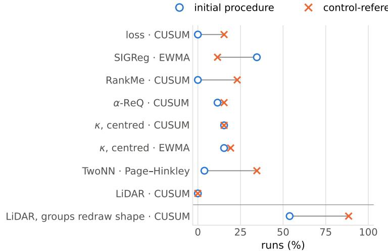  
(a) timely first alarms, decline runs

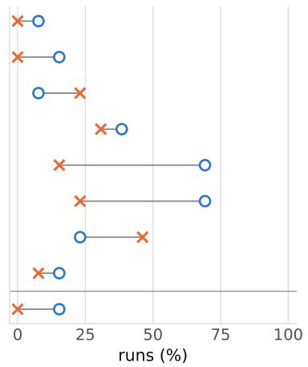  
(b) alarms, runs without a decline  
Figure 6: Selected signal–test pairs at matched horizons: wide-projector runs cut at 150 epochs and defaultprojector runs at 300, before fitting. Timely first alarms among the 26 decline runs whose onset window lies inside these horizons, and alarms among the 13 runs without a decline, for the initial and control-referenced procedures. The last row uses groups that redraw shape (Section 5), an augmentation not used in training. Centred κ subtracts the feature mean first.

reference $r _ { C } ,$ residuals $u _ { c }$ and scale s are

$$
\begin{array} { r l } & { r _ { C } ( e ) = \mathrm { m e d i a n } _ { c \in C } d _ { c } ( e ) , } \\ & { u _ { c } ( e ) = d _ { c } ( e ) - r _ { C \setminus \{ c \} } ( e ) , } \\ & { ~ s _ { C } = 1 . 4 8 2 6 \mathrm { m e d i a n } _ { c , e } \lvert u _ { c } ( e ) - \mathrm { m e d i a n } _ { c ^ { \prime } , e ^ { \prime } } u _ { c ^ { \prime } } ( e ^ { \prime } ) \rvert . } \end{array}
$$

Residuals are pooled with equal weight over controls and epochs. A monitored run is scored against all four controls, $z ( e ) = [ d ( e ) - r _ { C } ( e ) ] / s _ { C }$ , from epoch 30. To set the threshold, each control is scored against the other three, so neither its reference nor its scale uses it.

CUSUM and EWMA take z as input. Page–Hinkley takes its running sum from epoch 30, $\begin{array} { r } { L ( e ) = \sum _ { t = 3 0 } ^ { e } z ( t ) } \end{array}$ which follows the level of the series with the controls’ typical changes removed. With input $v _ { t } ,$ the three rules are

$$
\begin{array} { r l } & { S _ { t } ^ { + } = \operatorname* { m a x } ( 0 , S _ { t - 1 } ^ { + } + v _ { t } - 0 . 5 ) , } \\ & { C _ { t } = \operatorname* { m a x } ( S _ { t } ^ { + } , S _ { t } ^ { - } ) , } \\ & { M _ { t } = M _ { t - 1 } + v _ { t } - 0 . 5 , } \end{array}
$$

$$
\begin{array} { l } { S _ { t } ^ { - } = \operatorname* { m a x } ( 0 , S _ { t - 1 } ^ { - } - v _ { t } - 0 . 5 ) , } \\ { \ A _ { t } = 0 . 2 v _ { t } + 0 . 8 A _ { t - 1 } , } \\ { P _ { t } = \operatorname* { m a x } ( M _ { t } - \underset { 0 \leq j \leq t } { \operatorname* { m i n } } M _ { j } , \underset { 0 \leq j \leq t } { \operatorname* { m a x } } M _ { j } - M _ { t } ) . } \end{array}
$$

All states start at zero. EWMA reports $| A _ { t } |$ and Page–Hinkley reports $P _ { t }$ . Because of its 0.5 slack, Page– Hinkley grows even for zero input, so its threshold uses the same horizon as the monitored runs.

For each series, method and projector, the threshold is 1.1 times the largest control statistic. The alarm is the first checkpoint at which the statistic exceeds the threshold, and it is timely if it falls within ten epochs of onset on either side.

## G LiDAR Groups and Checks

We compute LiDAR as defined by Thilak et al. (2024a, §3), on the pooled encoder features of 64 groups of 8 renders at $N = 1 0 0$ . The definition adds a small constant δ to the within-group covariance without fixing its value, and we use $\delta = 1 0 ^ { - 4 }$ . The LiDAR paper recommends more groups than feature dimensions (Thilak et al., 2024a, App. 11), but we use 64 groups on 96-dimensional features, so at most 63 of LiDAR’s eigenvalues are nonzero here. All runs, the $\mu = 0 . 9 7$ controls included, use the same renders, with Gaussian shapes, at every checkpoint. Section 5 describes the two kinds of groups.

In all 28 decline runs of the alarm audit (Appendix F), the leading eigenvalue of LiDAR’s spectrum, with groups that redraw shape, fell from the pre-onset to the final checkpoint. Since log LiDAR is the entropy of the eigenvalue shares, it splits as log L $\mathrm { \ i D A R } = h ( q ) + ( 1 - q ) H _ { \mathrm { r e s t } }$ , where $q$ is the leading eigenvalue’s share, $H _ { \mathrm { r e s t } }$ the entropy of the other shares and h the binary entropy. Changing q from its pre-onset to its final value, with $H _ { \mathrm { r e s t } }$ held at either value and the two results averaged, accounts for a median 98% of the change in log LiDAR. Projections onto the leading direction correlate with the ridge log-energy prediction at a median absolute 0.98. With training-view groups the score also rose, in 24 of these runs, but the leading eigenvalue fell in only 7.

Adding noise to the frozen features of the alarm audit’s 13 runs without a decline and the eight controls gives the same picture. With groups that redraw shape, noise along the energy readout direction, at the size of the median energy decline, produced timely initial-CUSUM alarms in 12 to 14 of 21 runs over three noise draws, and noise along the shape readout direction produced none. The test perturbs features, not training.

Because δ is fixed, LiDAR depends on the scale of the features, so we repeated the audit at $\delta = 1 0 ^ { - 6 }$ and $1 0 ^ { - 8 }$ . With the control-referenced check and groups that redraw shape, at every δ CUSUM and EWMA on LiDAR flagged 23 to 25 of the 26 scored declines in time, with at most one false alarm among the 13 runs without a decline; with training-view groups they flagged at most one decline. The contrast between the two kinds of groups also held with a second, independently drawn set of renders, and with renders whose shapes come from each run’s own training distribution.

Used as a quality score with groups that redraw shape, LiDAR chose a checkpoint at or after onset in all 28 decline runs, at about the same median readability cost as loss.