# Kronecker-Structured Video Completion with Cross-Fitted Self-Supervised Residual Learning

Qi Qi, Yanfei Wang, Yanjun Cui, and Jun-e Feng

Abstract—Tube-wise video completion reconstructs temporal trajectories at spatial locations unobserved in every frame. We propose a two-stage framework combining regularized masked Kronecker product decomposition (KPD) with cross-fitted selfsupervised residual learning. First, we estimate a compact structural backbone directly from observed entries using cyclic component-wise least-squares updates, spatial and temporal factor regularization, and regularizer-optimal scale balancing. The exact updates yield a nonincreasing objective. Second, we address the mismatch between in-sample fitting errors and the prediction errors encountered at missing tubes. We partition observed tubes into folds and construct residual targets using backbone models fitted without the corresponding target tubes. A lightweight 3- D convolutional neural network then predicts corrections from the backbone, visible residual context, observation mask, and local detail features. Exact data consistency preserves observed measurements. Experiments include ablations, sensitivity analysis grayscale and RGB video completion, and structured missing patterns. Our method achieves the highest mean PSNR and SSIM at the higher tested sampling rates on the grayscale benchmark. On eight selected DAVIS RGB sequences, it achieves the highest mean missing-region PSNR and full-frame SSIM and the lowest mean missing-tube temporal-gradient MAE at every evaluated sampling rate.

Index Terms—Video completion, Kronecker product decomposition, tensor completion, self-supervised learning, cross-fitting, residual learning, low-rank modeling.

## I. INTRODUCTION

Video completion reconstructs missing visual information from partial measurements. A video contains both spatial structure and temporal evolution, which provide complementary information for reconstruction. This paper considers tube-wise missingness: a spatial location is either observed throughout the video or missing across all frames. Thus, the complete temporal trajectory at each unobserved location is unavailable. Recovering these trajectories requires information from the observed spatial tubes and the relationships among video frames. Tensor representations describe these relationships by retaining the spatial and temporal modes of the data [1]. Tensor completion extends the principle of low-rank matrix recovery [2], [3] to this multiway setting, using compact structure to infer missing observations.

Low-rank tensor completion can be formulated using tensor unfoldings or direct factor models. Tensor-unfolding nuclear norms impose low-rank constraints on matrix representations [4], while weighted CP factorization fits separable components to observed entries [5]. Factor smoothness [6], Tensor-Train models [7], and joint CP-Tucker constraints [8] offer different ways to represent multiway structure. Adaptive low-rank estimation and direct factor optimization [9], [10] provide additional formulations, while fully connected and wheel-shaped tensor networks [11], [12] represent more complex interactions among modes. These approaches motivate fitting a compact structural model directly to the available measurements.

Other tensor-completion methods exploit low-rank structure in transformed coordinates. The tensor-tensor product [13] underlies tensor-SVD completion and its recovery analysis [14], [15]. The twist tensor nuclear norm reorganizes spatiotemporal information for video recovery [16]. Invertible transforms [17], [18], framelet and patched-tube representations [19], [20], and robust or structured tensor nuclear-norm models [21]-[23] extend this approach. For both factor-based and transform-based methods, recovery depends on how incomplete observations constrain the estimated structure.

Visual reconstruction also benefits from modeling signal regularity and relationships beyond those captured by global rank constraints. Coupled transforms [24], global–local-nonlocal priors [25], temporal smoothness [26], low-rank dictionary coding [27], and smooth factor representations [28] incorporate complementary signal information. Patch-tracked streaming tensor-ring models use temporal relationships among video patches [29]. Other structural approaches include Kroneckerbasis sparsity [30], tensor low-rank representations [31], [32], and higher-order t-SVD [33]. These models seek to preserve detail while compactly representing high-dimensional video data.

Learned tensor representations further adapt structural models to the observed signal. Examples include self-supervised nonlinear transforms [34], hierarchical low-rank factorization [35], and learnable group-tube, coupled, and adaptive transforms [36]–[38]. Continuous tensor functions [39], deep rank-one factorization [40], learned low-rank metrics [41], multidimensional nonlinear transforms [42], DELTA [43], and compact tensor-wheel modeling [44] further develop learned tensor representations. For tube-wise video completion, two related tasks remain: estimating a compact structural model from incomplete observations and predicting details that the

model does not recover.

We address structural estimation through a regularized masked Kronecker product decomposition (KPD) algorithm. Cheng's component least-squares algorithm (CLSA) constructs finite-sum Kronecker decompositions through nearest-Kronecker-product subproblems [45]. For third-order videos, the vectorized KPD uses the same separable rank-K parameterization as CP decomposition. Our contribution lies in the masked formulation and its optimization. All components are fitted to a joint observed-entry objective with spatial and temporal regularization and revisited through cyclic leastsquares updates. Equivalent factor scalings are balanced to minimize the regularization penalty. This procedure estimates the structural backbone directly from observed data. We also establish that its exact cyclic updates produce nonincreasing objective values.

A compact structural backbone captures the main spatiotemporal structure, while a learned residual can refine details beyond the chosen rank. Neural video inpainting also uses information across frames. For example, graph-memory modeling aggregates cross-frame information for reconstruction [46]. In our tube-wise setting, the predictor combines the masked KPD backbone with residual context from observed spatial tubes. Training the residual predictor requires targets that correspond to prediction errors at unobserved locations.

Self-supervised restoration provides useful precedents for learning from incomplete measurements. Deep Image Prior fits an image-specific representation from a single degraded observation [47], whereas Noise2Self and Self2Self use heldout or randomized observations to construct training signals [48], [49]. Auxiliary inpainting has also been used to create selfsupervision in multi-focus image fusion [50]. These approaches motivate constructing supervision by temporarily hiding a subset of the observed data. In a structure-residual framework, however, the structural estimator must also exclude the held-out observations. If a tube contributes to fitting the backbone and is then reused to supervise the residual predictor, its target is an in-sample ftting error. At a genuinely missing tube, the desired correction concerns the backbone's out-of-sample prediction error. Masking a tube only at the residual-network input does not separate these two errors if the backbone was fitted using that tube.

We construct residual supervision by applying sample splitting and cross-fitting [51] at the level of the structural estimator. Observed tubes are divided into folds, with each fold predicted by a backbone fitted without its target tubes. The resulting residuals measure held-out structural prediction errors and serve as training targets for a lightweight per-video 3-D convolutional neural network (CNN). At inference, the backbone is fitted to all available tubes, and the trained network predicts corrections at missing locations. This procedure separates global structure estimation from the construction of residual supervision without requiring complete training videos.

Specifically, we express the reconstruction as a structural backbone $\boldsymbol { B } _ { K }$ and a learned residual correction R:

$$
\mathcal { X } \approx \mathcal { B } _ { K } + \mathcal { R } .\tag{1}
$$

The underlying KPD reconstruction is a finite sum of separable components,

$$
\widetilde { \mathcal { X } } _ { K } = \sum _ { r = 1 } ^ { K } \pmb { a } _ { r } \circ \pmb { b } _ { r } \circ \pmb { c } _ { r } , \qquad \mathrm { v e c } ( \pmb { a } _ { r } \circ \pmb { b } _ { r } \circ \pmb { c } _ { r } ) = \pmb { c } _ { r } \otimes \pmb { b } _ { r } \otimes \pmb { a } _ { r } .\tag{2}
$$

For normalized intensities, the structural backbone is $\boldsymbol { B } _ { K } =$ $\Pi _ { [ 0 , 1 ] } ( \widetilde { \mathcal { X } } _ { K } )$ , where $\Pi _ { [ 0 , 1 ] }$ clips entries to [0, 1]. Stage I estimates the factors directly from observed entries using regularized masked component least squares. To construct Stage II training targets, the observed spatial tubes are partitioned into folds $\{ \Gamma _ { p } ^ { \left( f \right) } \} _ { f = 1 } ^ { F }$ . A fold-specific backbone $\dot { B _ { K } ^ { ( f ) } }$ is fitted with the tubes in $\Gamma _ { p } ^ { ( f ) }$ withheld, and the target residual is computed as

$$
\mathcal { R } _ { p } ^ { ( f ) } = \mathcal { P } _ { \Omega _ { p } ^ { ( f ) } } \big ( \mathcal { O } - B _ { K } ^ { ( f ) } \big ) ,\tag{3}
$$

where $\Omega _ { p } ^ { ( f ) }$ contains all voxels in the held-out tubes. The network learns these residual targets from four inputs: the bounded backbone, visible residuals, the sampling mask, and a local spatial high-frequency feature. The learned correction is then combined with the backbone, and an exact dataconsistency step preserves the observed video measurements.

The main contributions are as follows:

• Regularized masked KPD estimation. We formulate a joint observed-entry KPD objective with spatial and temporal factor regularization and derive cyclic componentwise least-squares updates. Regularizer-optimal scale balancing preserves each represented component while minimizing its factor penalty. Proposition 1 establishes the nonincreasing objective property of the exact update steps.

• Cross-fitted residual supervision. We construct residual targets by partitioning observed tubes into folds and excluding each target fold from its corresponding masked KPD fit. A lightweight residual predictor is trained on these held-out structural prediction errors rather than insample fitting residuals. Proposition 2 establishes the holdout property of the target construction.

Integrated video completion framework. We combine masked KPD estimation and cross-fitted residual learning with a per-video 3-D CNN and exact data consistency. Experiments on grayscale and RGB videos examine representation efficiency, residual-supervision and input ablations, sampling-rate comparisons, and structured missing patterns.

The remainder of this paper is organized as follows. Section II introduces the observation model and Kroneckerstructured representation. Section III develops the regularized masked KPD estimator and its update properties. Section IV presents cross-fitted residual supervision, network training, and data-consistent inference. Section V reports ablation studies and video completion comparisons. Section VI concludes the paper.

## II. NOTATION AND PROBLEM FORMULATION

A. Video tensor and observation model

Let

$$
\mathcal { X } \in \mathbb { R } ^ { I \times J \times T }\tag{4}
$$

represent a grayscale video with $T$ frames of size $I \times J .$ The entry $x _ { i j t }$ is the intensity at position $( i , j )$ in frame t. Let the observation mask be

$$
\mathcal { M } \in \{ 0 , 1 \} ^ { I \times J \times T } ,\tag{5}
$$

where $m _ { i j t } = 1$ indicates an observed entry and $m _ { i j t } = 0$ indicates a missing entry. The degraded observation is

$$
\mathcal { O } = \mathcal { M } \odot \mathcal { X } ,\tag{6}
$$

where $\odot$ denotes the Hadamard product.

For a general observation set

$$
\Omega = \{ ( i , j , t ) : m _ { i j t } = 1 \} ,\tag{7}
$$

define the projection operator

$$
[ \mathcal { P } _ { \Omega } ( \mathcal { X } ) ] _ { i j t } = \left\{ \begin{array} { l l } { x _ { i j t } , } & { ( i , j , t ) \in \Omega , } \\ { 0 , } & { \mathrm { o t h e r w i s e } . } \end{array} \right.\tag{8}
$$

Thus, (6) is equivalent to $\mathcal { O } = \mathcal { P } _ { \Omega } ( \mathcal { X } )$

We consider mode-3 tube-wise sampling, where the same spatial mask is applied to every frame. The observed spatial tubes form the set

$$
\Gamma _ { \Omega } \subseteq \{ 1 , \dots , I \} \times \{ 1 , \dots , J \} .\tag{9}
$$

For tube-wise sampling,

$$
\begin{array} { r } { m _ { i j t } = m _ { i j } , \qquad t = 1 , \ldots , T . } \end{array}\tag{10}
$$

Each observed spatial location therefore provides a complete temporal tube, while all other tubes remain unavailable. The sampling rate is

$$
\mathrm { S R } = \frac { \left| \Gamma _ { \Omega } \right| } { I J } .\tag{11}
$$

The residual-learning stage uses this tube-wise mask whereas the masked KPD estimator in Section III also accommodates general entry-wise observations.

## B. Kronecker-structured representation

For vectors

$$
\begin{array} { r } { \pmb { a } _ { r } \in \mathbb { R } ^ { I } , \qquad \pmb { b } _ { r } \in \mathbb { R } ^ { J } , \qquad \pmb { c } _ { r } \in \mathbb { R } ^ { T } , } \end{array}\tag{12}
$$

define a rank-one third-order tensor

$$
\begin{array} { r } { \mathscr { K } ( { \pmb a } _ { r } , { \pmb b } _ { r } , { \pmb c } _ { r } ) = { \pmb a } _ { r } \circ { \pmb b } _ { r } \circ { \pmb c } _ { r } , } \end{array}\tag{13}
$$

whose entries satisfy

$$
[ { \pmb a } _ { r } \circ { \pmb b } _ { r } \circ { \pmb c } _ { r } ] _ { i j t } = a _ { i r } b _ { j r } c _ { t r } .\tag{14}
$$

Equivalently, under a consistent vectorization convention,

$$
\begin{array} { r } { \mathrm { v e c } \big ( \pmb { a } _ { r } \circ \pmb { b } _ { r } \circ \pmb { c } _ { r } \big ) = \pmb { c } _ { r } \otimes \pmb { b } _ { r } \otimes \pmb { a } _ { r } , } \end{array}\tag{15}
$$

making the Kronecker structure explicit.

A K-component representation is

$$
\chi _ { K } = \sum _ { r = 1 } ^ { K } \pmb { a } _ { r } \circ \pmb { b } _ { r } \circ \pmb { c } _ { r } .\tag{16}
$$

Let

$$
A = [ \mathbf { a } _ { 1 } , \dots , \mathbf { a } _ { K } ] , \quad B = [ \pmb { b } _ { 1 } , \dots , \pmb { b } _ { K } ] , \quad C = [ \pmb { c } _ { 1 } , \dots , \pmb { c } _ { K } ] .\tag{17}
$$

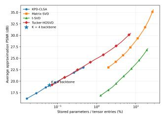

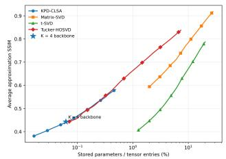  
(a) Approximation PSNR versus normalized storage.  
(b) Approximation SSIM versus normalized storage.

Fig. 1. Fidelity-storage tradeoff of four low-rank representation families on the three development sequences (Akiyo, Foreman, and Mobile): (a) average approximation PSNR and (b) average approximation SSIM versus the normalized storage ratio in (18). For each method, the sequence-level curves are averaged only over the storage interval shared by all three videos. Stars mark the $\check { K } = 4$ KPD-backbone operating point used in the completion experiments.

The factor matrices A, B, and C define the separable model in (16), with the same parameterization as third-order CP decomposition [45]. Observed-entry CP models use weighted least squares [5], and standard CP-ALS alternates between factor matrices [1]. Stage I instead updates individual components under the regularized masked objective (20) and balances their scales. The fitted tensor provides the structural backbone for residual prediction.

We compare the storage costs of separable KPD/CP, matrix SVD, t-SVD, and Tucker representations using the normalized storage ratio

$$
\rho _ { \mathrm { m o d e l } } = { \frac { P _ { \mathrm { m o d e l } } } { I J T } } \times 1 0 0 \% ,\tag{18}
$$

where $P _ { \mathrm { m o d e l } }$ is the number of stored representation parameters. Under the implementations used here, $P _ { \mathrm { K P D } } = K ( I + J + T )$ $P _ { \mathrm { S V D } } = r ( I J + T ) , P _ { \mathrm { t S V D } } = r T ( I + J + 1 )$ for tubal rank $r ,$ and $P _ { \mathrm { T u c k e r } } = I r _ { 1 } + J r _ { 2 } + T r _ { 3 } + r _ { 1 } r _ { 2 } r _ { 3 }$ for multilinear rank $( r _ { 1 } , r _ { 2 } , r _ { 3 } )$ . For t-SVD, this count includes the two truncated factor tensors and the r f-diagonal singular tubes, without an additional reduction for Fourier conjugate symmetry.

Figure 1 compares four representation families on the complete development videos Akiyo, Foreman, and Mobile: separable KPD, matrix SVD, truncated t-SVD, and Tucker-HOSVD. They represent Kronecker-structured, matrix-spectral, tensor-spectral, and multilinear-rank models, respectively. For each model, sequence-level fidelity is interpolated within the storage interval shared by all three videos and then averaged. The subsequent completion experiments fit KPD directly to masked data.

The star marks the $K = 4$ backbone used in grayscale completion, whose stored parameter count is about 0.062% of the voxel count. At this operating point, KPD and Tucker-HOSVD have comparable approximation fidelity, while the shared storage intervals for truncated t-SVD and matrix SVD begin at larger budgets. Spectral and multilinear models reach higher fidelity at larger budgets. We use the compact KPD representation as a backbone and learn its residual correction.

## III. MASKED KRONECKER PRODUCT DECOMPOSITION

The workflow in Fig. 2 starts with masked KPD estimation, followed by cross-fitted residual learning. This section

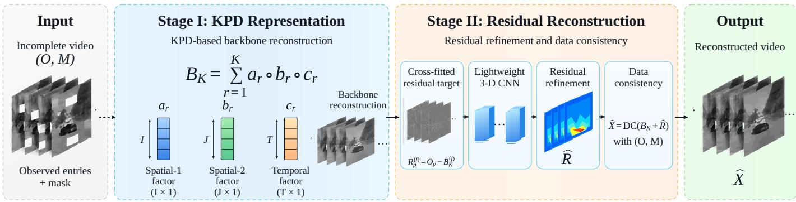  
Fig. 2. Proposed structure-residual video-completion framework. Stage I fits a compact KPD backbone directly to the observed entries. Stage II constructs cross-fitted residual supervision, predicts the missing-tube correction with a lightweight 3-D CNN, and applies exact data consistency to obtain $\widehat { \mathcal { X } } .$

derives the observed-entry objective, cyclic updates, and scalebalancing step for backbone estimation; Section IV develops the residual predictor.

## A. Observed-entry objective

We estimate the separable factors directly from observed entries. Cheng's CLSA constructs a finite-sum KPD through component-wise least-squares solutions of nearest-Kroneckerproduct subproblems [45]. Here, all K components are optimized under a single masked objective and revisited in cyclic sweeps. Spatial and temporal smoothness penalties, together with Tikhonov regularization, constrain the factors. Let $D _ { I }$ $D _ { J }$ , and $D _ { T }$ be the first-order difference matrices along the corresponding modes, and set

$$
\begin{array} { r } { L _ { I } = D _ { I } ^ { \top } D _ { I } , \quad L _ { J } = D _ { J } ^ { \top } D _ { J } , \quad L _ { T } = D _ { T } ^ { \top } D _ { T } . } \end{array}\tag{19}
$$

The masked KPD problem minimizes $\mathcal { I } ( A , B , C )$ over $\{ a _ { r } , b _ { r } , c _ { r } \} _ { r = 1 } ^ { K }$ , where

$$
\begin{array} { l } { \displaystyle \mathcal { T } ( A , B , C ) = \frac 1 2 \left\| { \mathcal { M } \odot \left( \mathcal { O } - \sum _ { r = 1 } ^ { K } a _ { r } \circ b _ { r } \circ c _ { r } \right) } \right\| _ { F } ^ { 2 } } \\ { \displaystyle \qquad + \frac { \lambda _ { s } } { 2 } \sum _ { r = 1 } ^ { K } \left( \| D _ { T } a _ { r } \| _ { 2 } ^ { 2 } + \| D _ { J } b _ { r } \| _ { 2 } ^ { 2 } \right) } \\ { \displaystyle \qquad + \frac { \lambda _ { t } } { 2 } \sum _ { r = 1 } ^ { K } \| D _ { T } c _ { r } \| _ { 2 } ^ { 2 } } \\ { \displaystyle \qquad + \frac { \lambda _ { 0 } } { 2 } \sum _ { r = 1 } ^ { K } \left( \| a _ { r } \| _ { 2 } ^ { 2 } + \| b _ { r } \| _ { 2 } ^ { 2 } + \| c _ { r } \| _ { 2 } ^ { 2 } \right) . } \end{array}\tag{20}
$$

The coefficients $\lambda _ { s } ~ \geq ~ 0$ and $\lambda _ { t } ~ \geq ~ 0$ penalize spatial and temporal factor variations, and $\lambda _ { 0 } ~ > ~ 0$ imposes Tikhonov regularization. Because the factorization admits equivalent rescalings, these coefficients also affect the preferred factor scales.

These penalties act on factors rather than individual voxels Since every term in (20) is nonnegative,

$$
\mathcal { I } ( A , B , C ) \geq \frac { \lambda _ { 0 } } { 2 } \left( \| A \| _ { F } ^ { 2 } + \| B \| _ { F } ^ { 2 } + \| C \| _ { F } ^ { 2 } \right) .\tag{21}
$$

Therefore, $\lambda _ { 0 } > 0$ ensures bounded sublevel sets of $\mathcal { I }$ and prevents unbounded equivalent factor rescalings.

## B. Component-wise masked least-squares updates

For the rth component, define the residual excluding that component as

$$
\mathcal { R } ^ { ( r ) } = \mathcal { O } - \sum _ { \stackrel { q = 1 } { q \neq r } } ^ { K } { \pmb { a } } _ { q } \circ { \pmb { b } } _ { q } \circ { \pmb { c } } _ { q } .\tag{22}
$$

With all other components fixed, the rth component is updated using $\mathcal { R } ^ { ( r ) }$

1) Update of the first spatial factor: Fix $b _ { r }$ and $c _ { r }$ The subproblem for ${ \pmb a } _ { r }$ is

$$
\begin{array} { l l } { \displaystyle \operatorname* { m i n } _ { \boldsymbol { a } _ { r } } } & { \displaystyle \frac { 1 } { 2 } \sum _ { i , j , t } m _ { i j t } \left( r _ { i j t } ^ { ( r ) } - a _ { i r } b _ { j r } c _ { t r } \right) ^ { 2 } } \\ & { \displaystyle + \frac { \lambda _ { s } } { 2 } \left\| D _ { I } \pmb { a } _ { r } \right\| _ { 2 } ^ { 2 } + \displaystyle \frac { \lambda _ { 0 } } { 2 } \left\| \pmb { a } _ { r } \right\| _ { 2 } ^ { 2 } . } \end{array}\tag{23}
$$

Define

$$
d _ { i } ^ { ( a ) } = \sum _ { j = 1 } ^ { J } \sum _ { t = 1 } ^ { T } m _ { i j t } b _ { j r } ^ { 2 } c _ { t r } ^ { 2 } ,\tag{24}
$$

$$
g _ { i } ^ { ( a ) } = \sum _ { j = 1 } ^ { J } \sum _ { t = 1 } ^ { T } m _ { i j t } r _ { i j t } ^ { ( r ) } b _ { j r } c _ { t r } .\tag{25}
$$

Then the unique minimizer of (23) satisfies

$$
\left[ \mathrm { D i a g } ( d ^ { ( a ) } ) + \lambda _ { s } L _ { I } + \lambda _ { 0 } I _ { I } \right] { \bf a } _ { r } = { \bf g } ^ { ( a ) } .\tag{26}
$$

2) Update of the second spatial factor: After updating $\mathbf { a } _ { r }$ fix ${ \pmb a } _ { r }$ and $c _ { r }$ . Define

$$
d _ { j } ^ { ( b ) } = \sum _ { i = 1 } ^ { I } \sum _ { t = 1 } ^ { T } m _ { i j t } a _ { i r } ^ { 2 } c _ { t r } ^ { 2 } ,\tag{27}
$$

$$
g _ { j } ^ { ( b ) } = \sum _ { i = 1 } ^ { I } \sum _ { t = 1 } ^ { T } m _ { i j t } r _ { i j t } ^ { ( r ) } a _ { i r } c _ { t r } .\tag{28}
$$

The corresponding update is

$$
\left[ \mathrm { D i a g } ( { \pmb d } ^ { ( b ) } ) + \lambda _ { s } L _ { J } + \lambda _ { 0 } I _ { J } \right] { \pmb b } _ { r } = { \pmb g } ^ { ( b ) } .\tag{29}
$$

3) Update of the temporal factor: Finally, fix $\mathbf { a } _ { r }$ and $b _ { r }$ and define

$$
d _ { t } ^ { ( c ) } = \sum _ { i = 1 } ^ { I } \sum _ { j = 1 } ^ { J } m _ { i j t } a _ { i r } ^ { 2 } b _ { j r } ^ { 2 } ,\tag{30}
$$

$$
g _ { t } ^ { ( c ) } = \sum _ { i = 1 } ^ { I } \sum _ { j = 1 } ^ { J } m _ { i j t } r _ { i j t } ^ { ( r ) } a _ { i r } b _ { j r } .\tag{31}
$$

The temporal-factor update is

$$
\left[ \mathrm { D i a g } ( { \pmb d } ^ { ( c ) } ) + \lambda _ { t } L _ { T } + \lambda _ { 0 } I _ { T } \right] { \pmb c } _ { r } = { \pmb g } ^ { ( c ) } .\tag{32}
$$

Equations (26)–(32) constitute one component-wise masked least-squares step. The normal equations use only entries selected by M.

## C. Regularizer-optimal scale balancing

For each rank-one component, consider the rescaling

$$
\begin{array} { r } { \pmb { a } _ { r } ^ { \prime } = \alpha \pmb { a } _ { r } , \qquad \pmb { b } _ { r } ^ { \prime } = \beta \pmb { b } _ { r } , \qquad \pmb { c } _ { r } ^ { \prime } = \gamma \pmb { c } _ { r } , \qquad \alpha \beta \gamma = 1 , } \end{array}\tag{33}
$$

which preserves the represented rank-one component. An arbitrary normalization can change the penalty even when the data fit is unchanged. We choose the equivalent scaling that minimizes the regularizer along this orbit. Define

$$
q _ { a } = \lambda _ { s } \left\| D _ { I } \pmb { a } _ { r } \right\| _ { 2 } ^ { 2 } + \lambda _ { 0 } \left\| \pmb { a } _ { r } \right\| _ { 2 } ^ { 2 } ,\tag{34}
$$

$$
q _ { b } = \lambda _ { s } \left\| D _ { J } \pmb { b } _ { r } \right\| _ { 2 } ^ { 2 } + \lambda _ { 0 } \left\| \pmb { b } _ { r } \right\| _ { 2 } ^ { 2 } ,\tag{35}
$$

$$
q _ { c } = \lambda _ { t } \left\| D _ { T } \pmb { c } _ { r } \right\| _ { 2 } ^ { 2 } + \lambda _ { 0 } \left\| \pmb { c } _ { r } \right\| _ { 2 } ^ { 2 } .\tag{36}
$$

For $q _ { a } , q _ { b } , q _ { c } > 0$ , the constrained problem

$$
\operatorname * { m i n } _ { \alpha , \beta , \gamma > 0 } \frac { 1 } { 2 } \left( q _ { a } \alpha ^ { 2 } + q _ { b } \beta ^ { 2 } + q _ { c } \gamma ^ { 2 } \right) \quad \mathrm { s . t . } \quad \alpha \beta \gamma = 1\tag{37}
$$

has the closed-form solution

$$
g = ( q _ { a } q _ { b } q _ { c } ) ^ { 1 / 3 } , \qquad \alpha = \sqrt { \frac { g } { q _ { a } } } , \quad \beta = \sqrt { \frac { g } { q _ { b } } } , \quad \gamma = \sqrt { \frac { g } { q _ { c } } } .\tag{38}
$$

The scaling in (38) makes all three regularization contributions equal to $g .$ Since (1, 1, 1) is feasible in (37), balancing cannot increase the objective: the data term remains unchanged and the penalty is minimized along the orbit. This step is omitted if any q is numerically zero.

## D. Cyclic masked KPD algorithm

The algorithm cycles through the components and updates each mode. To initialize the factors, missing entries are meanfilled and smoothed by 12 iterations of a $5 \times 5 \times 3$ uniform filter, with observed values restored after every iteration. A KPD fit to the smoothed tensor provides the initial factors. Subsequent sweeps minimize the masked objective (20), with scale balancing after initialization and each component update.

The result $\widetilde { \mathcal { X } } _ { K }$ is the raw reconstruction: observed entries have not been replaced by their measurements. The fitting residual $o _ { i j t } - \widetilde { x } _ { K , i j t }$ therefore remains available on observed entries for the next stage.

```latex
Algorithm 1 Regularized Masked KPD by Cyclic Component
Least Squares
Require: Observation O, mask $\mathcal { M } ,$ rank $K ,$ regularization
parameters $\lambda _ { s } , \lambda _ { t } , \lambda _ { 0 } ,$ number of sweeps S.
Ensure: KPD factors $A , B , C$ and raw reconstruction $\scriptstyle { \widetilde { \mathcal { X } } } _ { K }$
1: Initialize $A , B , C .$
2: for $s = 1 , \ldots , S$ do
3: for $r = 1 , \ldots , K$ do
4: Form $\mathcal { R } ^ { ( r ) }$ by (22).
5: Update $\mathbf { a } _ { r }$ by solving (26).
6: Update $b _ { r }$ by solving (29).
7: Update $c _ { r }$ by solving (32).
8: Apply the regularizer-optimal scaling (38).
9: end for
10: end for
11: $\begin{array} { r } { \widetilde { \mathcal { X } } _ { K }  \sum _ { r = 1 } ^ { K } \pmb { a } _ { r } \circ \pmb { b } _ { r } \circ \pmb { c } _ { r } . } \end{array}$
12: return $A , B , C , \tilde { \mathcal { X } } _ { K }$
```

## E. Monotonicity of the exact cyclic updates

Proposition 1 (Conditional optimality and monotonicity). Assume $\lambda _ { 0 } ~ > ~ 0$ For fxed values of all remaining factors, each update (26)–(32) is the unique global minimizer of (20) with respect to the selected factor block. Moreover, the optional scale-balancing step (38) preserves the represented rank-one component and cannot increase the regularizer. Thus, the objective in Algorithm 1 does not increase after an exact block or balancing step, and its sequence of values converges to a finite limit.

Proof. Consider the $\mathbf { a } _ { r }$ subproblem. Expanding (23) and discarding terms independent of $\mathbf { a } _ { r }$ yields

$$
\phi _ { a } ( { \pmb a } _ { r } ) = \frac { 1 } { 2 } { \pmb a } _ { r } ^ { \top } H _ { a } { \pmb a } _ { r } - ( { \pmb g } ^ { ( a ) } ) ^ { \top } { \pmb a } _ { r } + \mathrm { c o n s t } ,
$$

where

(39)

$$
H _ { a } = \mathrm { D i a g } ( { \pmb d } ^ { ( a ) } ) + \lambda _ { s } L _ { I } + \lambda _ { 0 } I _ { I } .\tag{40}
$$

Since $\mathrm { D i a g } ( { \pmb d } ^ { ( a ) } ) \succeq 0 , L _ { I } \succeq 0 ,$ and $\lambda _ { 0 } > 0 ,$ we have $H _ { a } \succ 0$ Hence $\phi _ { a }$ is strictly convex and its unique global minimizer is characterized by $\nabla \phi _ { a } = 0$ , which gives (26). The same argument applies to $b _ { r }$ and $c _ { r }$ . Each exact block replacement therefore cannot increase the full objective. For the scalebalancing step, (33) leaves the data term unchanged, while (38) solves (37); hence this step also cannot increase $\mathcal { I }$ . Since $\mathcal { I } \geq$ $0 ,$ the sequence of objective values is monotone nonincreasing and bounded below, and thus converges. □

Remark 1. Although each factor subproblem is strictly convex, the joint objective is nonconvex in $( A , B , C )$ . Proposition 1 guarantees convergence of objective values; it does not establish global optimality of the factor estimates. The iterates remain in a bounded sublevel set by (21), and their limiting estimates may depend on initialization.

## IV. CROSS-FITTED SELF-SUPERVISED RESIDUAL LEARNING

Stage II trains the residual predictor using observed tubes withheld from fold-specific KPD fits. The resulting prediction errors serve as self-supervised targets for missing-tube correction.

## A. Residual modeling and target mismatch

A finite rank K provides a compact representation of the structural backbone. Let

$$
\widetilde { \mathcal { X } } _ { K } = \sum _ { r = 1 } ^ { K } \pmb { a } _ { r } \circ \pmb { b } _ { r } \circ \pmb { c } _ { r }\tag{41}
$$

be the raw KPD reconstruction. For normalized intensity data, define the bounded structural backbone

$$
\mathcal { B } _ { K } = \Pi _ { [ 0 , 1 ] } ( \widetilde { \mathcal { X } } _ { K } ) , \qquad \Pi _ { [ 0 , 1 ] } ( x ) = \operatorname* { m i n } \{ 1 , \operatorname* { m a x } \{ 0 , x \} \} ,\tag{42}
$$

where the projection is applied elementwise. Residual learning is performed with $\boldsymbol { B } _ { K }$ rather than an observation-clamped reconstruction. Define

$$
\mathcal { R } _ { \star } : = \mathcal { X } - \mathcal { B } _ { K } , \qquad \mathcal { X } = \mathcal { B } _ { K } + \mathcal { R } _ { \star } .\tag{43}
$$

Equation (43) defines the residual to be predicted from the backbone and the residual measurements available on observed tubes.

At an observed location, the residual can be evaluated as

$$
\mathcal { R } _ { \Omega } = \mathcal { P } _ { \Omega } \left( \mathcal { O } - B _ { K } \right) .\tag{44}
$$

Residuals computed at tubes used to fit $\boldsymbol { B } _ { K }$ are in-sample fitting errors. The correction needed at missing tubes is the backbone's out-of-sample prediction error. We use cross-fitting to construct training targets for the latter type of error. Following sample splitting [51], each measured target tube is withheld from the KPD fit used to predict it.

## B. Tube-wise cross-fitting

Let $\Gamma _ { \mathrm { t r } } \subseteq \Gamma _ { \Omega }$ denote the observed tubes assigned to selfsupervised training. During development, a strict internal validation split may be formed as

$$
\Gamma _ { \Omega } = \Gamma _ { \mathrm { t r } } \dot { \cup } \Gamma _ { \mathrm { v a l } } ,\tag{45}
$$

where  denotes disjoint union. Validation tubes are excluded from the fold-specific KPD fits and residual-network training. Once the configuration is selected, the final model uses all observed tubes for cross-fitting.

Partition $\Gamma _ { \mathrm { t r } }$ into F disjoint folds:

$$
\Gamma _ { \mathrm { t r } } = \dot { \bigcup _ { f = 1 } } \Gamma _ { p } ^ { ( f ) } ,\tag{46}
$$

where $\Gamma _ { p } ^ { ( f ) }$ is the pseudo-missing set in fold $f .$ Define the corresponding context set

$$
\Gamma _ { c } ^ { ( f ) } = \Gamma _ { \mathrm { t r } } \setminus \Gamma _ { p } ^ { ( f ) } .\tag{47}
$$

For each fold, fit a KPD model using only its context tubes:

$$
\Theta _ { \mathrm { K P D } } ^ { ( f ) } = \underset { \Theta _ { \mathrm { K P D } } } { \arg \operatorname* { m i n } } \mathcal { I } _ { \Gamma _ { c } ^ { ( f ) } } \big ( \Theta _ { \mathrm { K P D } } \big ) ,\tag{48}
$$

where $\mathcal { I } _ { \Gamma _ { - } ^ { ( f ) } }$ denotes (20) with a tube-wise mask supported only on $\Gamma _ { c } ^ { \left( f \right) }$ . Let

$$
\widetilde { \mathcal { X } } _ { K } ^ { \left( f \right) } = \mathcal { K P D } \left( \mathcal { O } _ { \Gamma _ { c } ^ { \left( f \right) } } \right)\tag{49}
$$

denote its raw reconstruction, and define the fold-specific bounded backbone

$$
\begin{array} { r } { \mathcal { B } _ { K } ^ { ( f ) } = \Pi _ { [ 0 , 1 ] } \Big ( \widetilde { \mathcal { X } } _ { K } ^ { ( f ) } \Big ) . } \end{array}\tag{50}
$$

The visible context residual is

$$
\mathcal { E } _ { c } ^ { ( f ) } = \mathcal { P } _ { \Gamma _ { c } ^ { \left( f \right) } } \left( \mathcal { O } - \mathcal { B } _ { K } ^ { \left( f \right) } \right) ,\tag{51}
$$

where the tube projection includes all $t = 1 , \dots , T$ . The crossfitted pseudo-missing target is

$$
\begin{array} { r } { \mathcal { R } _ { p } ^ { \left( f \right) } = \mathcal { P } _ { \Gamma _ { p } ^ { \left( f \right) } } \left( \mathcal { O } - \mathcal { B } _ { K } ^ { \left( f \right) } \right) . } \end{array}\tag{52}
$$

The tubes in $\Gamma _ { p } ^ { ( f ) }$ belong to the original observation set but are excluded from the fold-specific KPD fit. Equation (52) therefore provides measured held-out prediction errors as training targets.

## C. No-leakage property of the cross-fitted target

Proposition 2 (Cross-fitted target is a KPD hold-out error). For any fold f, suppose all data-dependent operations in the foldspecific KPD pipeline—including preprocessing, initialization, and any adaptive stopping or parameter selection—use only measurements in $\Gamma _ { c } ^ { ( ^ { \prime } f ) }$ . No value in $\Gamma _ { p } ^ { ( f ) }$ then enters the construction of $\widetilde { \chi } _ { K } ^ { ( f ) }$ or its bounded projection $B _ { K } ^ { ( f ) }$ . The target $\mathcal { R } _ { p } ^ { ( f ) }$ in (52) is therefore an out-of-sample prediction error of the fold-specific backbone.

Proof. Equation (47) gives $\Gamma _ { c } ^ { ( f ) } \cap \Gamma _ { p } ^ { ( f ) } = \emptyset$ . By assumption, the fold-specific estimator depends only on measurements in $\Gamma _ { c } ^ { ( f ) }$ . The raw estimate $\widetilde { \chi } _ { K } ^ { \left( f \right) }$ and its bounded version $B _ { K } ^ { ( f ) }$ therefore do not depend on values in $\Gamma _ { p } ^ { ( f ) }$ . Those values are used only after fitting, to evaluate $\mathcal { O } - \dot { B } _ { K } ^ { ( f ) }$ at held-out tubes, proving the claim. □

Remark 2 (Relation to genuinely missing tubes). Under missing-completely-at-random tube sampling, the fold assignment is independent of video values and spatial content. The pseudo-missing tubes therefore provide a held-out prediction task analogous to completion at unobserved locations. Foldspecific and inal prediction errors need not have identical distributions, since their backbones use different numbers of context tubes. Reserving a fraction ν of observed tubes for internal validation leaves approximately $( 1 - \nu ) ( 1 - 1 / F ) | \Gamma _ { \Omega } |$ context tubes per fold, compared with $\left| \Gamma _ { \Omega } \right|$ for the final fit. After configuration selection, we set $\Gamma _ { \mathrm { t r } } = \Gamma _ { \Omega } ,$ reducing this difference to the fold fraction $1 - 1 / F _ { \cdot }$

## D. Residual network input

For fold f, define the four-channel input tensor

$$
\mathcal { Z } ^ { ( f ) } = \left[ \mathcal { B } _ { K } ^ { ( f ) } , \mathcal { E } _ { c } ^ { ( f ) } , \mathcal { M } _ { c } ^ { ( f ) } , \mathcal { H } _ { s } \Big ( \mathcal { B } _ { K } ^ { ( f ) } \Big ) \right] ,\tag{53}
$$

where $\mathcal { M } _ { c } ^ { ( f ) }$ is the context mask and $\mathcal { H } _ { s }$ is a spatial high-pass operator. In our implementation,

$$
{ \mathcal { H } } _ { s } ( { \boldsymbol { \mathcal { X } } } ) = { \mathcal { X } } - \operatorname { A v g P o o l } _ { 1 \times 5 \times 5 } ( { \mathcal { X } } ) .\tag{54}
$$

This operator extracts local spatial variation without temporal pooling.

The four channels have distinct roles:

1) $B _ { K } ^ { ( f ) }$ supplies the global structured estimate;

2) $\mathcal { E } _ { c } ^ { ( \bar { f } ) }$ supplies observed residual samples;

3) $\mathcal { M } _ { c } ^ { ( f ) }$ distinguishes available residual samples from missing ones;

4) $\mathcal { H } _ { s } ( B _ { K } ^ { ( \bar { f } ) } )$ highlights local spatial variation that is attenuated in the low-rank backbone.

## E. Lightweight 3-D residual predictor

Let $f _ { \theta }$ denote a compact 3-D convolutional network. For an input ${ \mathcal { Z } } ,$ the forward map is

$$
U _ { 1 } = { \mathrm { G E L U } } \left( { \mathrm { C o n v 3 D } } _ { 3 \times 3 \times 3 } ^ { 4 \to h } ( { \mathcal { Z } } ) \right) ,\tag{55}
$$

$$
U _ { 2 } = { \mathrm { G E L U } } \left( { \mathrm { C o n v 3 D } } _ { 3 \times 3 \times 3 , d = 2 } ^ { h \to h } ( U _ { 1 } ) \right) ,\tag{56}
$$

$$
U _ { 3 } = \mathrm { G E L U } \left( \mathrm { C o n v 3 D } _ { 3 \times 3 \times 3 } ^ { h \to h } ( U _ { 2 } ) \right) ,\tag{57}
$$

$$
\widehat { \mathcal { R } } = r _ { \mathrm { m a x } } \operatorname { t a n h } \left( \operatorname { C o n v 3 D } _ { 3 \times 3 \times 3 } ^ { h \to 1 } ( U _ { 3 } ) \right) .\tag{58}
$$

Here, $d = 2$ is the dilation factor, h is the number of hidden channels, and $r _ { \operatorname* { m a x } } > 0$ bounds the residual amplitude.

The weights and bias of the final convolution are initialized to zero. Consequently, before training,

$$
f _ { \theta _ { 0 } } ( { \mathcal { Z } } ) = 0 ,\tag{59}
$$

and the network initially leaves the bounded KPD backbone unchanged.

The predictor is trained separately for each video using its observed tubes and cross-fitted targets.

## F. Cross-fitted self-supervised loss

For fold $f ,$ the target-dependent fitting term is computed only over the pseudo-missing tubes $\Gamma _ { p } ^ { ( f ) }$ . Let $\rho _ { \delta }$ denote the smooth ${ \cal - L } _ { 1 }$ penalty

$$
\rho _ { \delta } ( e ) = \left\{ \begin{array} { l l } { \displaystyle \frac { e ^ { 2 } } { 2 \delta } , } & { \displaystyle | e | < \delta , } \\ { \displaystyle | e | - \frac { \delta } { 2 } , } & { \displaystyle | e | \geq \delta . } \end{array} \right.\tag{60}
$$

To assign greater weight to larger residuals while keeping the weights bounded, define

$$
w _ { i j t } ^ { ( f ) } = 1 + \eta \operatorname* { m i n } \left\{ \frac { | r _ { p , i j t } ^ { ( f ) } | } { \tau } , \kappa \right\} ,\tag{61}
$$

with $\eta , \tau , \kappa > 0 .$

The weighted loss at a pseudo-missing target voxel is

$$
\ell _ { i j t } ^ { ( f ) } ( \theta ) = w _ { i j t } ^ { ( f ) } \rho _ { \delta } \bigg ( [ f _ { \theta } ( \mathcal { Z } ^ { ( f ) } ) ] _ { i j t } - r _ { p , i j t } ^ { ( f ) } \bigg ) .\tag{62}
$$

The cross-fitted self-supervised objective is

$$
\begin{array} { l } { { \displaystyle \operatorname* { m i n } _ { \theta } \quad \mathcal { L } _ { \mathrm { C F } } ( \theta ) } } \\ { { \displaystyle = \frac { 1 } { F } \sum _ { f = 1 } ^ { F } \frac { 1 } { | \Omega _ { p } ^ { ( f ) } | } \sum _ { ( i , j , t ) \in \Omega _ { p } ^ { ( f ) } } \ell _ { i j t } ^ { ( f ) } ( \theta ) + \frac { \mu } { F } \sum _ { f = 1 } ^ { F } \frac { \left| \left| f _ { \theta } ( \mathcal { Z } ^ { ( f ) } ) \right| \right| _ { F } ^ { 2 } } { I J T } . } } \end{array}\tag{63}
$$

Here, $\Omega _ { p } ^ { ( f ) }$ contains the voxels in the pseudo-missing tubes of fold $f ,$ and $\mu$ controls a weak residual-magnitude penalty.

At each training step, a fold and a spatiotemporal patch containing its pseudo-missing tubes are sampled. The input tensor combines the fold-specific backbone, observed residuals on context tubes, the context mask, and a spatial high-pass feature computed from the backbone. The fitting term is computed only over the held-out tubes in the patch, whereas the magnitude penalty is evaluated over the entire predicted patch. Held-out measurements enter only the loss targets, not the network inputs.

## G. Final inference and data consistency

After residual-network training, a final raw KPD model is fitted on all observed entries Ω:

$$
\widetilde { \mathcal { X } } _ { K } = K \mathcal { P } \mathcal { D } ( \mathcal { O } , \mathcal { M } ) , \qquad \mathcal { B } _ { K } = \Pi _ { [ 0 , 1 ] } ( \widetilde { \mathcal { X } } _ { K } ) .\tag{64}
$$

The visible residual field is

$$
\mathcal { E } _ { \Omega } = \mathcal { P } _ { \Omega } \left( \mathcal { O } - B _ { K } \right) ,\tag{65}
$$

and the final network input is

$$
\mathcal { Z } = \left[ \mathcal { B } _ { K } , \mathcal { E } _ { \Omega } , \mathcal { M } , \mathcal { H } _ { s } ( \mathcal { B } _ { K } ) \right] .\tag{66}
$$

The unconstrained refined estimate is

$$
\mathcal { X } _ { \mathrm { r e f } } = B _ { K } + f _ { \theta } ( \mathcal { Z } ) .\tag{67}
$$

The data-consistent output is

$$
\widehat { \mathcal { X } } = \mathcal { M } \odot \mathcal { O } + \left( \mathbf { 1 } - \mathcal { M } \right) \odot \Pi _ { [ 0 , 1 ] } \left( \mathcal { X } _ { \mathrm { r e f } } \right) .\tag{68}
$$

Proposition 3 (Exact data consistency). The output of (68) satisfies

$$
\mathcal { P } _ { \Omega } ( \widehat { \mathcal { X } } ) = \mathcal { P } _ { \Omega } ( \mathcal { O } ) .\tag{69}
$$

Hence the nal output retains every observed entry exactly.

Proof. For $( i , j , t ) \in \Omega ,$ we have $m _ { i j t } = 1$ , so (68) yields $\widehat { x } _ { i j t } = o _ { i j t }$ . This holds for every observed entry. □

## H. Training and inference

The full estimator combines the structural backbone with the residual prediction before applying data consistency. Denoting the data-consistency operator by DC(·) gives

$$
\widehat { \mathcal { X } } = \mathrm { D C } ( \mathcal { B } _ { K } + f _ { \theta } ( \mathcal { Z } ) ) .\tag{70}
$$

The backbone models low-dimensional spatiotemporal structure, and the network predicts a correction from the observed residual context.

## I. Computational complexity

Let $N = I J T$ and $N _ { \Omega } = | \Omega |$ be the total and observed voxel counts. Contractions in (24)–(32) require $\mathcal { O } ( N _ { \Omega } )$ operations per component when computed over observed entries. With banded solvers, the three positive-definite tridiagonal systems require $\mathcal { O } ( I { + } J { + } T )$ operations per component. An observationindexed implementation of S sweeps therefore costs

$$
\mathcal { O } ( S K ( N _ { \Omega } + I + J + T ) ) .\tag{71}
$$

Algorithm 2 Cross-fitted self-supervised residual completion   
Require: Observation ${ \overline { { \mathcal { O } } } } ,$ tube mask M, KPD rank ${ \overline { { K } } } ,$ number   
of cross-fitting folds $F .$   
Ensure: Reconstructed video ${ \widehat { \mathcal { X } } } .$   
1: Obtain the observed tube set $\Gamma _ { \Omega } .$   
2: Optionally split $\Gamma _ { \Omega } = \Gamma _ { \mathrm { t r } } \dot { \cup } \Gamma _ { \mathrm { v a l } } .$   
3: Partition $\begin{array} { r } { \Gamma _ { \mathrm { t r } } = \dot { \bigcup _ { f = 1 } } \Gamma _ { p } ^ { ( f ) } . } \end{array}$   
4: for $f = 1 , \ldots , F \ \mathbf { \overset { \cdot } { d o } }$   
5: $\begin{array} { r } { \dot { \Gamma } _ { c } ^ { ( f ) }  \Gamma _ { \mathrm { t r } } \backslash \Gamma _ { p } ^ { ( f ) } . } \end{array}$   
6: Fit $\widetilde { \chi } _ { K } ^ { ( f ) }$ using Algorithm 1 on $\Gamma _ { c } ^ { ( f ) }$ only, with every   
data-dependent initialization step restricted to the same   
context.   
7: Set $B _ { K } ^ { ( f ) } \gets \Pi _ { [ 0 , 1 ] } ( \widetilde { \mathcal { X } } _ { K } ^ { ( f ) } )$   
8: Construct context residual $\mathcal { E } _ { c } ^ { ( f ) }$ by $( 5 1 ) \rrangle$   
9: Construct pseudo-missing target $\dot { \mathcal { R } } _ { p } ^ { ( f ) }$ by (52).   
10: Form $\mathcal { Z } ^ { ( f ) }$ by (53).   
11: end for   
12: Train $f _ { \theta }$ using (63).   
13: Fit the final raw KPD reconstruction $\scriptstyle { \widetilde { \mathcal { X } } } _ { K }$ on all observed   
tubes and set $B _ { K }  \Pi _ { [ 0 , 1 ] } ( \widetilde { \mathcal { X } } _ { K } )$   
14: Form $\mathcal { E } _ { \Omega }$ using (65).   
15: $\begin{array} { r } { \widehat { \mathcal { R } }  f _ { \theta } ( [ \mathcal { B } _ { K } , \mathcal { E } _ { \Omega } , \mathcal { M } , \mathcal { H } _ { s } ( \mathcal { B } _ { K } ) ] ) . } \end{array}$   
16: Apply data consistency by (68).   
17: return ${ \widehat { \mathcal { X } } } .$

Our implementation stores dense $I \times J \times T$ masks and residual arrays and evaluates full-tensor contractions. For $S$ sweeps, its cost is

$$
\mathcal { O } ( S K ( N + I + J + T ) ) ,\tag{72}
$$

which reduces to $\mathcal { O } ( S K N )$ when N dominates the factor dimensions. These complexity bounds exclude warm-start initialization. The implementation employs banded tridiagonal solvers; replacing them with dense linear solvers can add $\mathcal { O } ( S K ( I ^ { 3 } + J ^ { 3 } + \overline { { { T } } } ^ { 3 } ) )$ operations in the worst case.

Cross-fitting requires F auxiliary KPD fits with different context masks. Their total cyclic-refinement cost under dense contractions is $\mathcal { O } ( F S K ( N + I + J + T ) )$ , followed by a final fit on all observed tubes. The auxiliary fits incur approximately $F$ times the cost of a single KPD fit. For fixed $3 \times 3 \times 3$ kernels and hidden width h, one residual-network forward pass costs $\mathcal { O } ( N h ^ { 2 } )$ . The CNN training cost depends on the number of optimization steps, batch size, and patch volume. The experiments report end-to-end runtimes.

## V. EXPERIMENTS

## A. Protocol and implementation

We evaluate the proposed method on 23 grayscale video sequences and eight selected DAVIS 2017 RGB sequences [52]. The grayscale benchmark contains 17 videos of size $1 4 4 \times 1 7 6 \times$ 100 and six videos of size $2 8 8 \times 3 5 2 \times 5 0$ , with sampling rates $\mathrm { S R } \in \{ 0 . 1 , 0 . 2 , 0 . 3 , 0 . 4 , 0 . 5 \}$ . The RGB benchmark includes Bear, Drift-chicane, Cows, Dog, Camel, Kite-surf, Parkour, and Breakdance, selected to cover different visual content and motion patterns. Each RGB sequence contains 50 frames resized to $3 6 0 \times 6 4 0$ pixels, with $\mathrm { S R } \in \{ 0 . 2 , 0 . 3 , 0 . 4 \}$ . Both benchmarks use mode-3 tube-wise missingness, with the same spatial sampling mask applied across all frames. For RGB videos, the mask is also shared across color channels, which are reconstructed separately.

The grayscale configuration is selected using Akiyo, Foreman, and Mobile at $\mathrm { S R } = 0 . 2$ with an 80/20 split of their observed tubes for internal training and validation. Validation MAE guides configuration selection; the selected settings are then used for the 23-video benchmark. For RGB experiments, Blackswan at $\mathrm { S R } = 0 . 3$ serves as the development sequence. Its missing-region PSNR, evaluated against the available reference determines the configuration applied unchanged to the eight reported sequences and three sampling rates. These settings specify only the hyperparameters. Each video's structural backbone and residual CNN are fitted from its own observed tubes. Table I lists the configurations, and Supplementary Appendix A details the RGB selection study.

TABLE I  
FIXED HYPERPARAMETER CONFIGURATIONS FOR THE GRAYSCALE AND DAVIS RGB BENCHMARKS. PARAMETERS MARKED AS “SAME" USE THE GRAYSCALE SETTING.
<table><tr><td>Parameter</td><td>23-video grayscale</td><td>DAVIS 360p RGB</td></tr><tr><td>KPD rank  $K$ </td><td>4</td><td>12</td></tr><tr><td>Masked KPD sweeps  $S$ </td><td> $^ { 1 2 }$ </td><td>same</td></tr><tr><td>Spatial penalty  $\lambda _ { s }$ </td><td> $5 \times 1 0 ^ { - 3 }$ </td><td>same</td></tr><tr><td>Temporal penalty  $\lambda _ { t }$ </td><td> $5 \times 1 0 ^ { - 2 }$ </td><td>same</td></tr><tr><td>Tikhonov  $\lambda _ { 0 }$ </td><td> $1 0 ^ { - 5 }$ </td><td>same</td></tr><tr><td>Cross-fitting folds  $F$ </td><td> $^ 5$ </td><td>same</td></tr><tr><td>Conv3D kernel  $( T , H , W )$ </td><td> $3 \times 3 \times 3$ </td><td>same</td></tr><tr><td>Hidden channels h</td><td> $^ { 1 2 }$ </td><td>32</td></tr><tr><td>Residual bound  $r _ { \mathrm { m a x } }$ </td><td> $_ { 0 . 2 5 }$ </td><td>same</td></tr><tr><td>Training patch  $( T , H , W )$ </td><td> $1 6 \times 4 8 \times 4 8$ </td><td>16 × 96 × 96</td></tr><tr><td>Batch size</td><td> $^ 2$ </td><td>same</td></tr><tr><td>Optimization steps</td><td>1200</td><td>3600</td></tr><tr><td>Learning rate</td><td>10⁻3</td><td>same</td></tr><tr><td>Smooth-  $L _ { 1 }$  threshold  $\delta$ </td><td>0.02</td><td>same</td></tr><tr><td>Magnitude weight  $\eta$ </td><td>2</td><td>same</td></tr><tr><td>Magnitude scale  $\tau$ </td><td> $_ { 0 . 0 5 }$ </td><td>same</td></tr><tr><td>Magnitude cap  $\kappa$ </td><td> $^ 3$ </td><td>same</td></tr><tr><td>Residual penalty  $\mu$ </td><td> $1 0 ^ { - 4 }$ </td><td>same</td></tr></table>

The residual CNN is trained using Adam with a learning rate of $1 0 ^ { - 3 } .$ Automatic mixed precision is used on CUDA, and the gradient norm is clipped at 3.0. The residual predictor is trained separately for each video using only its observed measurements. The masked KPD initialization and factor-scale balancing follow Section III.

The grayscale experiments are conducted on an AMD Ryzen 9 9950X CPU, an NVIDIA RTX 4090 GPU (24 GB), and 128 GB RAM, using PyTorch 2.0.1, CUDA 11.8, and MATLAB R2022a. The RGB experiments use the same CPU and RAM with an NVIDIA RTX 5080 GPU (16 GB), PyTorch 2.7.1, CUDA 12.8, and MATLAB. KBR, TNN, and SALTS run on CPU workers, while the remaining methods use their respective Python backends. Runtime results are reported separately for the two hardware configurations. The source code of the proposed method and the corresponding experimental scripts are publicly available at https://github.com/QQ-SDU/ KPD-Video-Completion.

We use peak signal-to-noise ratio (PSNR), structural similarity (SSIM) [53], temporal-gradient mean absolute error (T-MAE), and wall-clock runtime for evaluation. Grayscale

TABLE II  
RESIDUAL-SUPERVISION ABLATION AT $\mathrm { S R } = 0 . 2$ AND $K = 4 .$ SEQUENCE ENTRIES ARE FULL-VIDEO PSNR/FRAME-WISE FULL-FRAME SSIM; VALIDATION MAE IS AVERAGED OVER THE THREE DEVELOPMENT SEQUENCES. BEST AND SECOND-BEST RESULTS ARE BOLD AND UNDERLINED.
<table><tr><td>Method</td><td>Akiyo</td><td>Foreman</td><td>Mobile</td><td>Val. MAE ↓</td><td> $\operatorname { A v g } .$  PSNR ↑</td><td> $\operatorname { A v g } .$  SSIM ↑</td></tr><tr><td>KPD</td><td>22.989/0.5589</td><td>19.348/0.4286</td><td>16.002/0.3591</td><td>0.092783</td><td>19.446</td><td>0.4488</td></tr><tr><td>Simple</td><td>24.801/0.6565</td><td>25.462/0.7554</td><td>19.050/0.5687</td><td>0.056637</td><td>23.104</td><td>0.6602</td></tr><tr><td>Direct</td><td>26.280/0.7282</td><td>25.539/0.7670</td><td>20.464/0.6998</td><td>0.049610</td><td>24.095</td><td>0.7317</td></tr><tr><td>CrossFit</td><td>26.972/0.7465</td><td>25.771/0.7859</td><td>20.397/0.6936</td><td>0.047503</td><td>24.380</td><td>0.7420</td></tr></table>

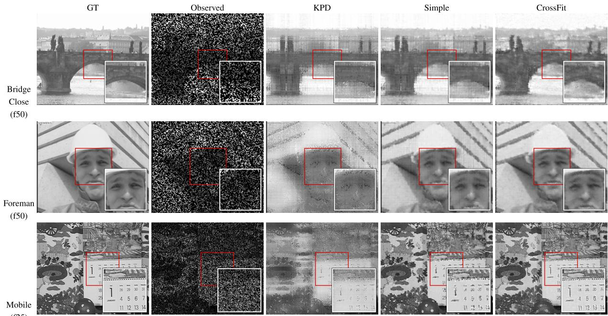  
Fig. 3. Stage-wise visual ablation at SR = 0.3: ground truth, observed input, KPD backbone, simple residual propagation, and CrossFit reconstruction. A common ROI is enlarged within each sequence.

PSNR is measured over the full video, whereas RGB PSNR is computed over missing entries. SSIM is computed over each full frame and then averaged across frames. T-MAE evaluates the accuracy of temporal intensity changes at missing tubes. Let M denote the set of missing spatial-channel indices, T the number of frames, and $\Delta _ { t } X _ { p } = X _ { p , t + 1 } - X _ { p , t }$ . T-MAE is defined as

$$
\mathrm { { T M A E } _ { m i s s } } = \frac { \displaystyle \sum _ { t = 1 } ^ { T - 1 } \sum _ { p \in \mathcal { M } } \Big | \Delta _ { t } \widehat { X } _ { p } - \Delta _ { t } X _ { p } \Big | } { ( T - 1 ) | \mathcal { M } | } ,\tag{73}
$$

where X and $\widehat { X }$ denote the reference and reconstructed videos, respectively. All reconstruction metrics are computed after enforcing data consistency. Higher PSNR and SSIM indicate better reconstruction quality, while lower T-MAE indicates more accurate reconstruction of frame-to-frame intensity changes.

## B. Ablation of residual supervision

We isolate the effect of residual supervision by comparing the KPD backbone, Gaussian residual propagation (Simple), direct residual learning (Direct), and cross-fitted residual learning (CrossFit) in Table II. Simple interpolates visible KPD residuals spatially and adds the interpolated field to the backbone. Its

TABLE III  
SEQUENCES AT SR = 0.2. PSNR IS COMPUTED OVER THE FULL RECONSTRUCTED VIDEO AND SSIM IS AVERAGED FRAME-WISE OVER THE FULL FRAMES.
<table><tr><td>Input</td><td>Val. MAE 水</td><td>PSNR ↑</td><td>SSIM ↑</td><td>∆PSNR</td></tr><tr><td>B</td><td>0.092944</td><td>19.360</td><td>0.4561</td><td></td></tr><tr><td>BR</td><td>0.060328</td><td>22.354</td><td>0.6447</td><td>+2.994</td></tr><tr><td>BRM</td><td>0.050618</td><td>23.944</td><td>0.7073</td><td>+1.590</td></tr><tr><td>FULL</td><td>0.047503</td><td>24.380</td><td>0.7420</td><td>+0.436</td></tr></table>

Gaussian width $\sigma \in \{ 0 . 7 5 , 1 , 1 . 5 , 2 , 3 \}$ and residual scale $\alpha \in$ {0.5, 0.75, 1, 1.25} are selected using MAE on an internal calibration split containing 15% of the development-training tubes. Direct and CrossFit share the same CNN architecture and optimization budget. In Direct, the backbone is fitted using all development-training observations before the pseudo-holdout step, so the CNN targets measure in-sample residuals; CrossFit uses held-out backbone errors.

As shown in Table II, CrossFit increases the three-video mean PSNR from 24.095 to 24.380 dB (+0.285 dB) and SSIM from 0.7317 to 0.7420 (+0.0103), while reducing validation MAE from 0.049610 to 0.047503. CrossFit performs better on Akiyo and Foreman; Direct obtains slightly higher PSNR and SSIM on Mobile.

TABLE IV  
AVERAGE PSNR/SSIM ON THE 23-VIDEO BENCHMARK AT FIVE TUBE SAMPLING RATES, WITH MEAN WALL-CLOCK TIME PER SEQUENCE. BEST AND SECOND-BEST VALUES ARE BOLD AND UNDERLINED.
<table><tr><td rowspan="2">Method</td><td colspan="2">SR=0.1</td><td colspan="2">SR=0.2</td><td colspan="2">SR=0.3</td><td colspan="2">SR=0.4</td><td colspan="2">SR=0.5</td><td rowspan="2">Avg. Time (s) ↓</td></tr><tr><td>PSNR ↑</td><td>SSIM ↑</td><td>PSNR ↑</td><td>SSIM ↑</td><td>PSNR ↑</td><td>SSIM ↑</td><td>PSNR ↑</td><td>SSIM ↑</td><td>PSNR ↑</td><td>SSIM ↑</td></tr><tr><td>DRO-TFF [40]</td><td>15.091</td><td>0.1628</td><td>18.804</td><td>0.3365</td><td>22.227</td><td>0.5120</td><td>24.787</td><td>0.6381</td><td>27.010</td><td>0.7389</td><td>7.79</td></tr><tr><td>HLRTF [35]</td><td>20.887</td><td>0.4819</td><td>23.626</td><td>0.6408</td><td>25.565</td><td>0.7290</td><td>26.987</td><td>0.7757</td><td>28.425</td><td>0.8209</td><td>7.17</td></tr><tr><td>KBR [30]</td><td>17.867</td><td>0.3324</td><td>21.009</td><td>0.5127</td><td>24.428</td><td>0.6759</td><td>27.880</td><td>0.8134</td><td>30.010</td><td>0.8993</td><td>154.21</td></tr><tr><td>LRTFR [39]</td><td>21.793</td><td>0.5238</td><td>24.549</td><td>0.6893</td><td>26.419</td><td>0.7784</td><td>28.011</td><td>0.8378</td><td>29.597</td><td>0.8807</td><td>7.38</td></tr><tr><td>OTLRM [41]</td><td>19.805</td><td>0.4408</td><td>24.052</td><td>0.6616</td><td>25.194</td><td>0.7195</td><td>26.664</td><td>0.7809</td><td>28.653</td><td>0.8436</td><td>80.91</td></tr><tr><td>TNN [54]</td><td>19.847</td><td>0.4036</td><td>22.619</td><td>0.5796</td><td>24.811</td><td>0.7010</td><td>26.742</td><td>0.7870</td><td>28.669</td><td>0.8517</td><td>62.90</td></tr><tr><td>SALTS [38]</td><td>19.567</td><td>0.4412</td><td>24.310</td><td>0.7054</td><td>26.917</td><td>0.8183</td><td>28.974</td><td>0.8737</td><td>30.306</td><td>0.9238</td><td>1190.95</td></tr><tr><td>S2NTNN [34]</td><td>23.975</td><td>0.7215</td><td>25.991</td><td>0.8102</td><td>27.263</td><td>0.8409</td><td>29.048</td><td>0.8788</td><td>30.360</td><td>0.9230</td><td>52.84</td></tr><tr><td>Ours</td><td>22.288</td><td>0.5577</td><td>25.349</td><td>0.7428</td><td>27.577</td><td>0.8513</td><td>29.734</td><td>0.8811</td><td>30.889</td><td>0.9245</td><td>49.07</td></tr></table>

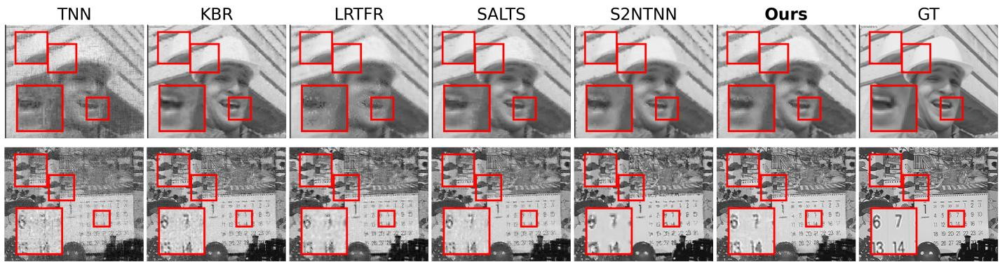  
Fig. 4. Visual comparison at $\mathrm { S R } = 0 . 3$ on Foreman and Mobile. Common frames and ROIs show detail recovery in both sequences.

## C. Ablation of residual-network inputs

We assess the contribution of the input channels in (53) The four configurations add information incrementally: B uses $B _ { K } ;$ BR adds $\mathcal { E } _ { c } ;$ BRM also supplies $\mathcal { M } _ { c } ;$ FULL uses all four channels. Excluded channels are set to zero to keep network capacity unchanged. Table III reports the results.

The visible-residual channel produces the largest PSNR gain, raising the three-video mean from 19.360 dB for B to 22.354 dB for BR. The observation mask raises mean PSNR to 23.944 dB, and the high-pass channel increases it further to 24.380 dB. FULL also achieves the highest SSIM and lowest validation MAE among the four configurations (Table III).

## D. Stage-wise visual ablation

Figure 3 shows the stage-wise reconstructions. The KPD backbone recovers the main scene geometry, and the residualrefinement stage recovers additional edge and texture details in the enlarged regions.

## E. Sensitivity analysis

Using the three grayscale development sequences, we examine sensitivity to KPD rank, the number of cross-fitting folds, optimization steps, and spatial and temporal regularization. Figure 5 shows how the reconstruction changes with these settings and identifies the selected operating points.

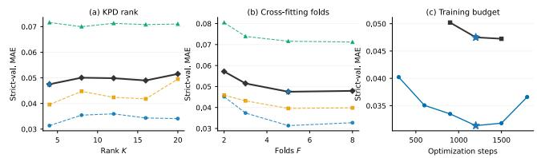

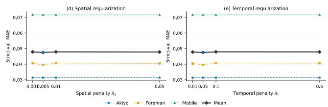  
Fig. 5. Sensitivity on the three grayscale development sequences at SR = 0.2: (a) KPD rank, (b) cross-fitting folds, (c) optimization steps, (d) spatial regularization, and (e) temporal regularization. Stars mark the selected settings.

## F. Comparison on the 23-video benchmark

Table IV reports PSNR, SSIM, and runtime for nine methods on 23 grayscale videos. Figure 7 shows PSNR, SSIM, and temporal-gradient MAE across sampling rates for this benchmark and the eight selected DAVIS 360p RGB sequences. Additional runtime measurements appear in the supplementary material.

Table IV shows a change in method ranking with sampling density. S2NTNN achieves the highest mean PSNR and SSIM at $\mathrm { S R } = 0 . 1$ and 0.2. Ours achieves the highest means on both

bear | SR=0.3 | frame=20  
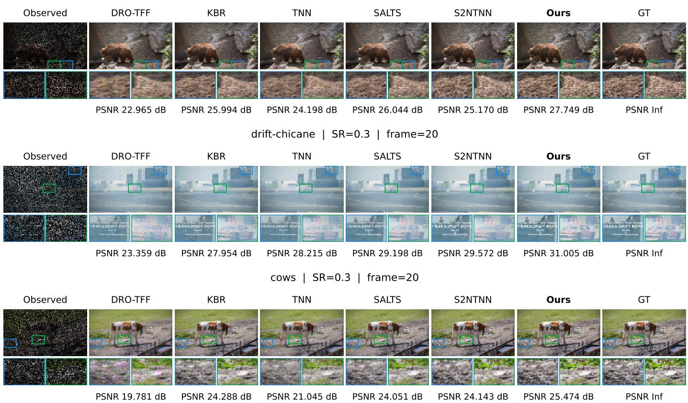  
Fig. 6. Qualitative RGB comparison on DAVIS 2017 at SR = 0.3 for three representative sequences: Bear, Drift-chicane, and Cows. Each row uses fixed ROIs across methods. PSNR values are computed over the missing tubes of the full sequence.

$$
\begin{array} { r l r l } { - \alpha - D R O . 7 7 F } & { - \alpha - K B R } & {  - O 7 L R M } & { - \alpha - 5 A L 7 5 } & {  - O u r s } \\ { - \alpha - H . R T F } & { - \alpha - L R T F R } & {  - S ^ { 2 } N T N N } & {  - T N N } \end{array}
$$

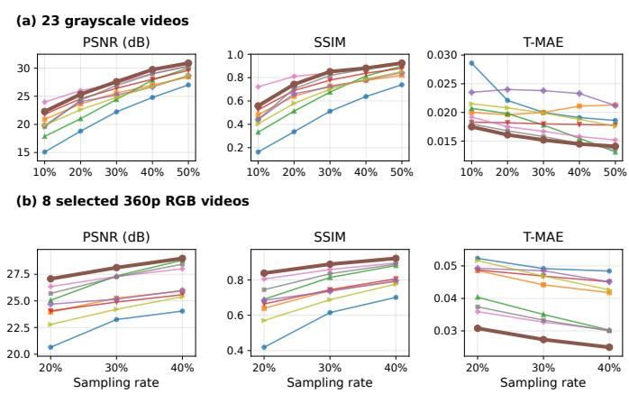  
Fig. 7. Mean PSNR, SSIM, and missing-tube temporal-gradient MAE (T-MAE) versus sampling rate for (a) the 23-video grayscale benchmark and (b) eight selected DAVIS 360p RGB sequences. Thick lines identify Ours. T-MAE measures the error in frame-to-frame intensity differences at missing tubes (73). DAVIS curves use per-sequence measurements; grayscale curves use the recorded benchmark statistics.

metrics at SR = 0.3, 0.4, and 0.5, exceeding the respective second-best methods by 0.314, 0.686, and 0.529 dB in PSNR and by 0.0104, 0.0023, and 0.0007 in SSIM. Mean runtime is 49.07 s for Ours and 7.17 s for HLRTF, the fastest method in the table. Figure 4 presents the Foreman and Mobile visual comparisons.

## G. DAVIS 2017 RGB completion at 360p

Table V reports results for the three videos in Fig. 6 and averages over the eight selected DAVIS RGB sequences. The configuration selected on Blackswan is used at each sampling rate. Mean missing-region PSNR reaches 27.07, 28.12, and 28.99 dB at SR = 0.2, 0.3, and 0.4, respectively, exceeding the best competing mean at each rate by 0.73, 0.78, and 0.18 dB. Ours also attains the highest mean full-frame SSIM at these rates (0.838, 0.889, and 0.922). Figure 7 shows the corresponding PSNR, SSIM, and temporal-gradient trends.

For missing-tube T-MAE, Ours obtains the lowest mean at each rate (0.03079, 0.02732, and 0.02495). It also has the lowest T-MAE in 19 of the 24 video-rate cases. The supplementary material reports the per-sequence measurements used to compute these averages.

## H. Qualitative RGB comparisons

Figure 6 compares Bear, Drift-chicane, and Cows at $\mathrm { S R } = 0 . 3$ , using a common frame and two fixed ROIs per sequence. The eight columns contain the observed input, five representative baselines, Ours, and ground truth. Ours exceeds the strongest baseline in missing-region PSNR by 1.71, 1.43, and 1.18 dB on Bear, Drift-chicane, and Cows, respectively (Table V(a)). The enlarged regions show differences in edge and texture recovery, while the displayed PSNR values are computed over the missing tubes across all 50 frames. Visual

TABLE V  
DAVIS 36OP RGB RECONSTRUCTION RESULTS. (A) THREE REPRESENTATIVE SEQUENCES AT SR = 0.3; (B) MEAN RESULTS OVER EIGHT SELECTED SEQUENCES. EACH ENTRY REPORTS MISSING-REGION PSNR (DB) / FULL-FRAME SSIM ON THE FIRST LINE AND MISSING-TUBE TEMPORAL-GRADIENT MAE ON THE SECOND LINE. BEST AND SECOND-BEST RESULTS FOR EACH METRIC ARE BOLD AND UNDERLINED, RESPECTIVELY.
<table><tr><td rowspan="2">Method</td><td colspan="3">(a) Representative sequences (SR = 0.3)</td><td colspan="3">(b) Mean over eight sequences</td></tr><tr><td>Bear</td><td>Drift-chicane</td><td>Cows</td><td>SR = 0.2</td><td>SR = 0.3</td><td>SR = 0.4</td></tr><tr><td rowspan="2">DRO-TFF [40]</td><td>22.96 / 0.652</td><td>23.36 / 0.428</td><td>19.78 / 0.527</td><td>20.65 / 0.419</td><td>23.25 / 0.615</td><td>24.04 / 0.701</td></tr><tr><td>0.05461</td><td>0.00883</td><td>0.06434</td><td>0.05233</td><td>0.04917</td><td>0.04842</td></tr><tr><td rowspan="2">HLRTF [35]</td><td>24.11 / 0.733</td><td>29.51 / 0.846</td><td>21.86 / 0.640</td><td>23.95 / 0.640</td><td>25.26 /0.740</td><td>25.94 / 0.791</td></tr><tr><td>0.05164</td><td>0.00777</td><td>0.06312</td><td>0.04856</td><td>0.04419</td><td>0.04177</td></tr><tr><td rowspan="2">KBR [30]</td><td>25.99 / 0.811</td><td>27.95 / 0.750</td><td>24.29 / 0.765</td><td>25.06 / 0.691</td><td>27.34 / 0.814</td><td>28.81 / 0.882</td></tr><tr><td>0.04833</td><td>0.00707</td><td>0.05631</td><td>0.04038</td><td>0.03505</td><td>0.03024</td></tr><tr><td rowspan="2">LRTFR [39]</td><td>24.01 / 0.732</td><td>28.31 / 0.792</td><td>23.40 / 0.724</td><td>24.06 / 0.664</td><td>24.89 / 0.744</td><td>25.58 / 0.806</td></tr><tr><td>0.05276</td><td>0.00766</td><td>0.05933</td><td>0.04876</td><td>0.04687</td><td>0.04511</td></tr><tr><td rowspan="2">OTLRM [41]</td><td>22.85 / 0.699</td><td>29.54 / 0.847</td><td>20.97 / 0.612</td><td>24.69 / 0.685</td><td>25.16 / 0.736</td><td>25.97 / 0.795</td></tr><tr><td>0.06662</td><td>0.00808</td><td>0.08274</td><td>0.04926</td><td>0.04853</td><td>0.04510</td></tr><tr><td rowspan="2">TNN [54]</td><td>24.20 / 0.742</td><td>28.22 / 0.798</td><td>21.04 / 0.599</td><td>22.79 / 0.570</td><td>24.21 / 0.688</td><td>25.39 / 0.776</td></tr><tr><td>0.05048</td><td>0.00763</td><td>0.06610</td><td>0.05166</td><td>0.04687</td><td>0.04265</td></tr><tr><td rowspan="2">SALTS [38]</td><td>26.04 / 0.828</td><td>29.20 / 0.851</td><td>24.05 / 0.759</td><td>25.70 / 0.745</td><td>27.25 / 0.835</td><td>28.44 / 0.889</td></tr><tr><td>0.04534</td><td>0.00535</td><td>0.05480</td><td>0.03740</td><td>0.03330</td><td>0.02998</td></tr><tr><td rowspan="2">S2NTNN [34]</td><td>25.17 / 0.819</td><td>29.57 / 0.890</td><td>24.14 / 0.790</td><td>26.34 / 0.805</td><td>27.29 / 0.859</td><td>28.01 / 0.896</td></tr><tr><td>0.04730</td><td>0.00766</td><td>0.05318</td><td>0.03592</td><td>0.03270</td><td>0.03028</td></tr><tr><td rowspan="2">Ours</td><td>27.75 / 0.908</td><td>31.00 / 0.906</td><td>25.47 / 0.849</td><td>27.07 / 0.838</td><td>28.12 / 0.889</td><td>28.99 / 0.922</td></tr><tr><td>0.03147</td><td>0.00476</td><td>0.04516</td><td>0.03079</td><td>0.02732</td><td>0.02495</td></tr></table>

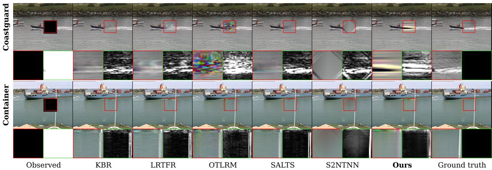

(a) Contiguous block mask  
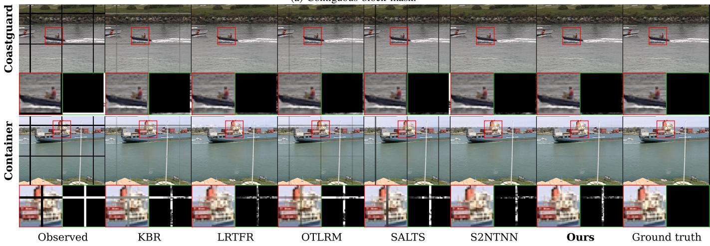  
(b) Distributed grid mask.  
Fig. 8. Structured-mask RGB visual comparisons on Coastguard and Container: (a) contiguous block and (b) distributed grid missingness. The observed input, reconstructions, and ground truth are shown with common regions of interest for each video and mask.

## I. Structured-mask experiments on color videos

Table VI compares contiguous-block and distributed-grid masks on Coastguard and Container at comparable missing fractions. Under grid missingness, Ours achieves the highest PSNR and SSIM on both videos: 30.15 dB/0.9880 on Coastguard and 26.40 dB/0.9858 on Container. Its PSNR margins over the second-best methods are 0.70 and 0.29 dB, respectively. For contiguous blocks, KBR leads on Coastguard and SALTS leads on Container. Figure 8 shows the recovered regions under both masks. The grid pattern leaves observed content around distributed missing locations, whereas the block pattern removes a contiguous region; the method rankings differ between these two sampling geometries.

TABLE VI  
STRUCTURED-MASK RGB COMPLETION ON COASTGUARD AND CONTAINER (ABOUT 6% MISSING TUBES). EACH RESULT REPORTS MISSING-REGION PSNR (DB) / FULL-FRAME SSIM. BEST AND SECOND-BEST VALUES FOR EACH VIDEO AND MASK ARE BOLD AND UNDERLINED, RESPECTIVELY.
<table><tr><td>Method</td><td>Mask</td><td>Coastguard</td><td>Container</td></tr><tr><td rowspan="2">DRO-TFF [40]</td><td>Block</td><td>15.52 / 0.9447</td><td>19.57 / 0.9456</td></tr><tr><td>Grid</td><td>20.35 / 0.9408</td><td>16.69 / 0.9028</td></tr><tr><td rowspan="2">HLRTF [35]</td><td>Block</td><td>15.97 / 0.9473</td><td>20.81 / 0.9639</td></tr><tr><td>Grid</td><td>7.46 / 0.8076</td><td>4.84 / 0.7848</td></tr><tr><td rowspan="2">KBR [30]</td><td>Block</td><td>19.74 / 0.9658</td><td>23.32 / 0.9762</td></tr><tr><td>Grid</td><td>16.54 / 0.8941</td><td>14.89 / 0.9216</td></tr><tr><td rowspan="2">LRTFR [39]</td><td>Block</td><td>19.39 / 0.9636</td><td>22.04 /0.9721</td></tr><tr><td>Grid</td><td>26.60 / 0.9781</td><td>25.61 / 0.9809</td></tr><tr><td rowspan="2">OTLRM [41]</td><td>Block</td><td>13.56 / 0.9424</td><td>22.09 / 0.9682</td></tr><tr><td>Grid</td><td>22.15 / 0.9471</td><td>15.05 / 0.8809</td></tr><tr><td rowspan="2">TNN [54]</td><td>Block</td><td>17.90 / 0.9602</td><td>22.70 / 0.9753</td></tr><tr><td>Grid</td><td>6.41 / 0.7993</td><td>3.65 / 0.7792</td></tr><tr><td rowspan="2">SALTS [38]</td><td>Block</td><td>18.45 / 0.9634</td><td>23.75 / 0.9797</td></tr><tr><td>Grid</td><td>13.10 / 0.8949</td><td>11.74 / 0.8887</td></tr><tr><td rowspan="2">S2NTNN [34]</td><td>Block</td><td>17.47 / 0.9506</td><td>20.20 / 0.9735</td></tr><tr><td>Grid</td><td>29.45 / 0.9862</td><td>26.11 / 0.9827</td></tr><tr><td rowspan="2">Ours</td><td>Block</td><td>13.14 / 0.9509</td><td>22.56 / 0.9763</td></tr><tr><td>Grid</td><td>30.15 / 0.9880</td><td>26.40 / 0.9858</td></tr></table>

## VI. CONCLUSION

This paper presented a video completion framework with two complementary stages. First, a regularized masked KPD estimator fits a compact structural model to observed entries using cyclic component least squares and regularizer-optimal scale balancing. The exact updates yield nonincreasing objective values. Second, tube-wise cross-fitting supplies held-out structural prediction errors for self-supervised residual learning. A lightweight 3-D CNN refines the backbone reconstruction, and exact data consistency preserves the observations.

Ablation studies show that cross-fitted supervision improves mean reconstruction quality compared with direct residual learning. The complete method achieves the highest mean PSNR and SSIM at the higher grayscale sampling rates and at every evaluated rate on the eight selected DAVIS RGB sequences. Method rankings differ between grid and contiguousblock missingness in the structured-mask experiments. Future work will investigate richer temporal motion modeling and reconstruction of large contiguous missing regions.

## REFERENCES

[1] T. G. Kolda and B. W. Bader, "Tensor decompositions and applications," SIAM Rev., vol. 51, no. 3, pp. 455–500, 2009, doi: 10.1137/07070111X.

[2] E. J. Candès and B. Recht, “Exact matrix completion via convex optimization," Found. Comput. Math., vol. 9, pp. 717–772, 2009, doi: 10.1007/s10208-009-9045-5.

[3] J.-F. Cai, E. J. Candès, and Z. Shen, "A singular value thresholding algorithm for matrix completion," SIAM J. Optim., vol. 20, no. 4, pp. 1956–1982, 2010, doi: 10.1137/080738970.

[4] J. Liu, P. Musialski, P. Wonka, and J. Ye, “Tensor completion for estimating missing values in visual data," IEEE Trans. Pattern Anal. Mach. Intell. vol. 35, no. 1, pp. 208–220, Jan. 2013, doi: 10.1109/TPAMI.2012.39.

[5] E. Acar, D. M. Dunlavy, T. G. Kolda, and M. Mørup, "Scalable tensor factorizations for incomplete data," Chemometrics Intell. Lab. Syst., vol. 106, no. 1, pp. 41–56, Mar. 2011, doi: 10.1016/j.chemolab.2010.08.004.

[6] T. Yokota, Q. Zhao, and A. Cichocki, "Smooth PARAFAC decomposition for tensor completion," IEEE Trans. Signal Process., vol. 64, no. 20, pp. 5423–5436, Oct. 2016, doi: 10.1109/TSP.2016.2586759.

[7] J. A. Bengua, H. N. Phien, H. D. Tuan, and M. N. Do, "Efficient tensor completion for color image and video recovery: Low-rank tensor train," IEEE Trans. Image Process., vol. 26, no. 5, pp. 2466–2479, May 2017, doi: 10.1109/TIP.2017.2672439.

[8] Y. Liu, Z. Long, H. Huang, and C. Zhu, "Low CP rank and Tucker rank tensor completion for estimating missing components in image data," IEEE Trans. Circuits Syst. Video Technol., vol. 30, no. 4, pp. 944–954, Apr. 2020, doi: 10.1109/TCSVT.2019.2901311.

[9] L. Zhang, W. Wei, Q. Shi, C. Shen, A. van den Hengel, and Y. Zhang, “Accurate tensor completion via adaptive low-rank representation," IEEE Trans. Neural Netw. Learn. Syst., vol. 31, no. 10, pp. 4170–4184, Oct. 2020, doi: 10.1109/TNNLS.2019.2952427.

[10] P. Zhou, C. Lu, Z. Lin, and C. Zhang, “Tensor factorization for low-rank tensor completion," IEEE Trans. Image Process., vol. 27, no. 3, pp. 1152–1163, Mar. 2018, doi: 10.1109/TIP.2017.2762595.

[11] Y.-B. Zheng, T.-Z. Huang, X.-L. Zhao, Q. Zhao, and T.-X. Jiang, "Fullyconnected tensor network decomposition and its application to higherorder tensor completion," in Proc. AAAI Conf. Artif. Intell., vol. 35, 2021, pp. 11071–11078, doi: 10.1609/aaai.v35i12.17321.

[12] Z.-C. Wu, T.-Z. Huang, L.-J. Deng, H.-X. Dou, and D. Meng, "Tensor wheel decomposition and its tensor completion application," in Proc. Adv. Neural Inf. Process. Syst., vol. 35, 2022, pp. 27008–27020, doi: 10.52202/068431-1958.

[13] M. E. Kilmer and C. D. Martin, “Factorization strategies for third-order tensors," Linear Algebra Appl., vol. 435, no. 3, pp. 641–658, 2011, doi: 10.1016/j.laa.2010.09.020.

[14] Z. Zhang, G. Ely, S. Aeron, N. Hao, and M. Kilmer, "Novel methods for multilinear data completion and de-noising based on tensor-SVD," in Proc. IEEE Conf. Comput. Vis. Pattern Recognit. (CVPR), 2014, pp. 3842–3849, doi: 10.1109/CVPR.2014.485.

[15] Z. Zhang and S. Aeron, "Exact tensor completion using t-SVD," IEEE Trans. Signal Process., vol. 65, no. 6, pp. 1511–1526, Mar. 2017, doi: 10.1109/TSP.2016.2639466.

[16] W. Hu, D. Tao, W. Zhang, Y. Xie, and Y. Yang, "The twist tensor nuclear norm for video completion," IEEE Trans. Neural Netw. Learn. Syst., vol. 28, no. 12, pp. 2961–2973, Dec. 2017, doi: 10.1109/TNNLS.2016.2611525.

[17] E. Kernfeld, M. Kilmer, and S. Aeron, "Tensor-tensor products with invertible linear transforms," Linear Algebra Appl., vol. 485, pp. 545–570, Nov. 2015, doi: 10.1016/j.1aa.2015.07.021.

[18] C. Lu, X. Peng, and Y. Wei, “Low-rank tensor completion with a new tensor nuclear norm induced by invertible linear transforms," in Proc. IEEE/CVF Conf. Comput. Vis. Pattern Recognit. (CVPR), 2019, pp. 5996–6004, doi: 10.1109/CVPR.2019.00615.

[19] T.-X. Jiang, M. K. Ng, X.-L. Zhao, and T.-Z. Huang, "Framelet representation of tensor nuclear norm for third-order tensor completion," IEEE Trans. Image Process., vol. 29, pp. 7233–7244, 2020, doi: 10.1109/TIP.2020.3000349.

[20] M. K. Ng, X. Zhang, and X.-L. Zhao, "Patched-tube unitary transform for robust tensor completion," Pattern Recognit., vol. 100, Art. no. 107181, Apr. 2020, doi: 10.1016/j.patcog.2019.107181.

[21] C. Lu, J. Feng, Y. Chen, W. Liu, Z. Lin, and S. Yan, "Tensor robust principal component analysis with a new tensor nuclear norm," IEEE Trans. Pattern Anal. Mach. Intell., vol. 42, no. 4, pp. 925–938, Apr. 2020, doi: 10.1109/TPAMI.2019.2891760.

[22] G. Song, M. K. Ng, and X. Zhang, “"Robust tensor completion using transformed tensor singular value decomposition," Numer. Linear Algebra Appl., vol. 27, no. 3, Art. no. e2299, May 2020, doi: 10.1002/nla.2299.

[23] H. Xu, J. Zheng, X. Yao, Y. Feng, and S. Chen, "Fast tensor nuclear norm for structured low-rank visual inpainting," IEEE Trans. Circuits Syst. Video Technol., vol. 32, no. 2, pp. 538–552, Feb. 2022, doi: 10.1109/TCSVT.2021.3067022.

[24] J.-L. Wang, T.-Z. Huang, X.-L. Zhao, T.-X. Jiang, and M. K. Ng, "Multidimensional visual data completion via low-rank tensor representation under coupled transform," IEEE Trans. Image Process., vol. 30, pp. 3581–3596, 2021, doi: 10.1109/TIP.2021.3062995.

[25] X.-L. Zhao, J.-H. Yang, T.-H. Ma, T.-X. Jiang, M. K. Ng, and T.-Z. Huang, "Tensor completion via complementary global, local, and nonlocal priors," IEEE Trans. Image Process., vol. 31, pp. 984–999, 2022, doi: 10.1109/TIP.2021.3138325.

[26] H. Wang, J. Peng, W. Qin, J. Wang, and D. Meng, "Guaranteed tensor recovery fused low-rankness and smoothness," IEEE Trans. Pattern Anal. Mach. Intell., vol. 45, no. 9, pp. 10990–11007, Sep. 2023, doi: 10.1109/TPAMI.2023.3259640.

[27] T.-X. Jiang, X.-L. Zhao, H. Zhang, and M. K. Ng, "Dictionary learning with low-rank coding coefficients for tensor completion,"IEEE Trans. Neural Netw. Learn. Syst., vol. 34, no. 2, pp. 932–946, Feb. 2023, doi: 10.1109/TNNLS.2021.3104837.

[28] T. Wu and J. Fan, "Smooth tensor product for tensor completion," IEEE Trans. Image Process., vol. 33, pp. 6483–6496, 2024, doi: 10.1109/TIP.2024.3489272.

[29] Y. He and G. K. Atia, "Patch tracking-based streaming tensor ring completion for visual data recovery," IEEE Trans. Circuits Syst. Video Technol., vol. 32, no. 12, pp. 8312–8326, Dec. 2022, doi: 10.1109/TCSVT.2022.3190818.

[30] Q. Xie, Q. Zhao, D. Meng, and Z. Xu, “Kronecker-basis-representation based tensor sparsity and its applications to tensor recovery," IEEE Trans. Pattern Anal. Mach. Intell., vol. 40, no. 8, pp. 1888–1902, Aug. 2018, doi: 10.1109/TPAMI.2017.2734888.

[31] P. Zhou, C. Lu, J. Feng, Z. Lin, and S. Yan, "Tensor low-rank representation for data recovery and clustering," IEEE Trans. Pattern Anal. Mach. Intell., vol. 43, no. 5, pp. 1718–1732, May 2021, doi: 10.1109/TPAMI.2019.2954874.

[32] J.-H. Yang, C. Chen, H.-N. Dai, M. Ding, Z.-B. Wu, and Z. Zheng, “Robust corrupted data recovery and clustering via generalized transformed tensor low-rank representation," IEEE Trans. Neural Netw. Learn. Syst., vol. 35, no. 7, pp. 8839–8853, Jul. 2024, doi: 10.1109/TNNLS.2022.3215983.

[33] W. Qin, H. Wang, F. Zhang, J. Wang, X. Luo, and T. Huang, "Lowrank high-order tensor completion with applications in visual data," IEEE Trans. Image Process., vol. 31, pp. 2433–2448, 2022, doi: 10.1109/TIP.2022.3155949.

[34] Y.-S. Luo, X.-L. Zhao, T.-X. Jiang, Y. Chang, M. K. Ng, and C. Li, “Self-supervised nonlinear transform-based tensor nuclear norm for multidimensional image recovery," IEEE Trans. Image Process., vol. 31, pp. 3793–3808, 2022, doi: 10.1109/TIP.2022.3176220.

[35] Y. Luo, X.-L. Zhao, D. Meng, and T.-X. Jiang, "HLRTF: Hierarchical low-rank tensor factorization for inverse problems in multi-dimensional imaging," in Proc. IEEE/CVF Conf. Comput. Vis. Pattern Recognit. (CVPR), 2022, pp. 19303–19312, doi: 10.1109/CVPR52688.2022.01870.

[36] B.-Z. Li, X.-L. Zhao, X. Zhang, T.-Y. Ji, X. Chen, and M. K. Ng, "A learnable group-tube transform induced tensor nuclear norm and its application for tensor completion," SIAM J. Imaging Sci., vol. 16, no. 3, pp. 1370–1397, 2023, doi: 10.1137/22M1531907.

[37] J.-L. Wang, T.-Z. Huang, X.-L. Zhao, Y.-S. Luo, and T.-X. Jiang, “CoNoT: Coupled nonlinear transform-based low-rank tensor representation for multidimensional image completion," IEEE Trans. Neural Netw. Learn. Syst., vol. 35, no. 7, pp. 8969–8983, Jul. 2024, doi: 10.1109/TNNLS.2022.3217198.

[38] T. Wu, B. Gao, J. Fan, J. Xue, and W. L. Woo, "Low-rank tensor completion based on self-adaptive learnable transforms," IEEE Trans. Neural Netw. Learn. Syst., vol. 35, no. 7, pp. 8826–8838, Jul. 2024, doi: 10.1109/TNNLS.2022.3215974.

[39] Y. Luo, X.-L. Zhao, Z. Li, M. K. Ng, and D. Meng, "Low-rank tensor function representation for multi-dimensional data recovery,"IEEE Trans. Pattern Anal. Mach. Intell., vol. 46, no. 5, pp. 3351–3369, May 2024, doi: 10.1109/TPAMI.2023.3341688.

[40] Y. Li, X. Zhang, Y. Luo, and D. Meng, "Deep rank-one tensor functional factorization for multi-dimensional data recovery," in Proc. AAAI Conf. Artif. Intell., vol. 39, no. 17, 2025, pp. 18539–18547, doi: 10.1609/aaai.v39i17.34040.

[41] X. Wang, H. Zeng, J. Chen, S. Liu, Y. Chen, and G. Chao, "OTLRM: Orthogonal learning-based low-rank metric for multi-dimensional inverse problems," in Proc. AAAI Conf. Artif. Intell., vol. 39, no. 20, 2025, pp. 21278–21286, doi: 10.1609/aaai.v39i20.35427.

[42] Z.-W. Shi, Y.-B. Zheng, Y. Zhang, and H.-C. Li, "Multidimensional nonlinear transform-based tensor representation for high-dimensional image reconstruction," Pattern Recognit., vol. 168, Art. no. 111734, 2025, doi: 10.1016/j.patcog.2025.111734.

[43] G.-W. Yang, L. Yang, T.-X. Jiang, G. Liu, and M. K. Ng, "DELTA: Deep low-rank tensor representation for multi-dimensional data recovery," IEEE Trans. Pattern Anal. Mach. Intell., vol. 48, no. 3, pp. 3018–3035, Mar. 2026, doi: 10.1109/TPAMI.2025.3630339.

[44] P. Yang, Y. Qiu, Z. Huang, G. Zhou, and Q. Zhao, “"Efficient and compact tensor wheel decomposition for tensor completion," Pattern Recognit. vol. 172, Art. no. 112377, 2026, doi: 10.1016/j.patcog.2025.112377.

[45] D. Cheng, “Component least square algorithm for Kronecker product decomposition of hypermatrices," J. Franklin Inst., Art. no. 109045, 2026, doi: 10.1016/j.jfranklin.2026.109045.

[46] X. Zhou, C. Fu, H. Huang, and R. He, "Dynamic graph memory bank for video inpainting," IEEE Trans. Circuits Syst. Video Technol., vol. 34, no. 11, pp. 10831–10844, Nov. 2024, doi: 10.1109/TCSVT.2024.3411061.

[47] D. Ulyanov, A. Vedaldi, and V. Lempitsky, "Deep image prior," in Proc. IEEE/CVF Conf. Comput. Vis. Pattern Recognit. (CVPR), 2018, pp. 9446–9454, doi: 10.1109/CVPR.2018.00984.

[48] J. Batson and L. Royer, “Noise2Self: Blind denoising by self-supervision," in Proc. Int. Conf. Mach. Learn. (ICML), 2019, pp. 524–533.

[49] Y. Quan, M. Chen, T. Pang, and H. Ji, "Self2Self with dropout: Learning self-supervised denoising from single image," in Proc. IEEE/CVF Conf. Comput. Vis. Pattern Recognit. (CVPR), 2020, pp. 1890–1898, doi: 10.1109/CVPR42600.2020.00196.

[50] H. Lin, Y. Lin, J. Xia, L. Fan, F. Li, Y. Wang, and X. Ding, "Fusion2Void: Unsupervised multi-focus image fusion based on image inpainting," IEEE Trans. Circuits Syst. Video Technol., vol. 35, no. 4, pp. 3328–3341, Apr. 2025, doi: 10.1109/TCSVT.2024.3502200.

[51] V. Chernozhukov et al., “Double/debiased machine learning for treatment and structural parameters," Econometrics J., vol. 21, no. 1, pp. C1–C68, 2018, doi: 10.1111/ectj.12097.

[52] J. Pont-Tuset, F. Perazzi, S. Caelles, P. Arbeláez, A. Sorkine-Hornung, and L. Van Gool, "The 2017 DAVIS challenge on video object segmentation," arXiv preprint arXiv:1704.00675, 2017.

[53] Z. Wang, A. C. Bovik, H. R. Sheikh, and E. P. Simoncelli, "Image quality assessment: From error visibility to structural similarity," IEEE Trans. Image Process., vol. 13, no. 4, pp. 600–612, Apr. 2004, doi: 10.1109/TIP.2003.819861.

[54] C. Lu, J. Feng, Z. Lin, and S. Yan, “Exact low tubal rank tensor recovery from Gaussian measurements," in Proc. 27th Int. Joint Conf. Artif. Intell. (IJCAI), 2018, pp. 2504–2510, doi: 10.24963/ijcai.2018/347.

# Supplementary Material for Kronecker-Structured Video Completion with Cross-Fitted Self-Supervised Residual Learning

Qi Qi, Yanfei Wang, Yanjun Cui, and Jun-e Feng

This supplement presents the 360p RGB parameter study, per-sequence results, temporal-gradient MAE, runtime measurements, and additional visual comparisons. The evaluation includes eight selected DAVIS sequences, three sampling rates, and nine methods. The configuration is selected using Blackswan, which is excluded from the eight-sequence averages. The evaluation tables report measurements for these eight videos.

## APPENDIX A

## SINGLE-SEQUENCE HYPERPARAMETER SELECTION FOR 360P RGB VIDEO COMPLETION

## A. Selection Protocol

We select the 360p RGB configuration using Blackswan from DAVIS 2017. The study varies KPD rank, spatial convolutional kernel size, CNN width, the number of optimization steps, and training-patch size. The sequence contains 50 RGB frames resized to $3 6 0 \times 6 4 0$ pixels. All configurations use tube-wise sampling at $\mathrm { S R } = 0 . 3$ with seed 20261014 and the same mask across frames and channels. Each channel is reconstructed separately before the RGB video is assembled.

We select the configuration using missing-region PSNR on Blackswan and also report full-frame SSIM. Reference values at missing pixels are used for this development comparison, whereas the cross-fitted CNN is trained on observed measurements. Settings not varied in a given sweep remain fixed, including five cross-fitting folds, 12 masked KPD sweeps, batch size two, and the regularization and learning settings of the implementation.

This configuration is then used for all eight selected RGB videos at all three sampling rates. Tables in this appendix report the Blackswan parameter study; the main paper reports the evaluation results.

## B. KPD Rank and Spatial Convolutional Kernel

We vary KPD rank $K \in \{ 4 , 8 , 1 2 \}$ and spatial kernel width $k _ { s } \in \{ 3 , 5 \}$ , fixing temporal kernel width $k _ { t } = 3$ , CNN width $h = 1 2$ , training steps at 1200, and patch size at $1 6 \times 4 8 \times 4 8 .$ With the smaller spatial kernel, PSNR increases with rank (Table I). The $3 \times 3 \times 3$ kernel gives the highest PSNR at $K = 1 2$ and is retained.

## C. Structural Rank Versus CNN Width

We compare the effects of increasing backbone rank and residual-network width. The kernel size is fixed at $3 \times 3 \times 3 .$

TABLE I  
RANK AND SPATIAL-KERNEL SENSITIVITY ON BLACKSWAN $( 3 6 0 \times 6 4 0 \times 5 0 , \mathrm { { R G B } ; \mathrm { { S R } = 0 . 3 ) } }$ . THE HIDDEN WIDTH AND TRAINING BUDGET ARE FIXED AT h = 12 AND 1200 STEPS.
<table><tr><td>Rank K</td><td>Conv3D kernel  $( t , h , w )$ </td><td>Missing PSNR ↑</td><td>Full SSIM ↑</td></tr><tr><td>4</td><td> $3 \times 3 \times 3$ </td><td>27.1250</td><td>0.8510</td></tr><tr><td>4</td><td> $3 \times 5 \times 5$ </td><td>27.1250</td><td>0.8500</td></tr><tr><td>8</td><td> $3 \times 3 \times 3$ </td><td>27.3964</td><td>0.8589</td></tr><tr><td>8</td><td> $3 \times 5 \times 5$ </td><td>26.7135</td><td>0.8393</td></tr><tr><td>12</td><td> $3 \times 3 \times 3$ </td><td>27.6069</td><td>0.8638</td></tr><tr><td>12</td><td> $3 \times 5 \times 5$ </td><td>26.8058</td><td>0.8408</td></tr></table>

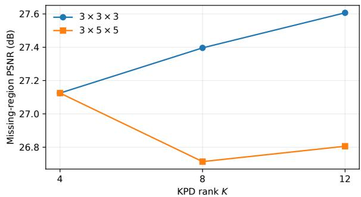  
Fig. 1. Missing-region PSNR versus KPD rank for two spatial convolutional kernel sizes on the designated development sequence. All other settings are fixed as in Table I.

with 1200 training steps and $1 6 \times 4 8 \times 4 8$ patches. The rank sweep uses $h = 1 2$ , and the width sweep fixes $K = 1 2 ;$ both include the reference setting $( K , h ) = ( 1 2 , 1 2 )$

Table II shows that increasing rank above $K = 1 2$ changes PSNR only modestly while increasing runtime. At $K = 1 2 ,$ wider CNNs improve PSNR and SSIM, with the highest values at $h = 3 2$ We use $K = 1 2$ and $h = 3 2$ in the training-budget study.

## D. Optimization Steps and Training-Patch Size

With $K = 1 2 , h = 3 2$ , and a $3 \times 3 \times 3$ kernel fixed, we vary the number of training steps and spatial patch size while keeping the temporal patch length at 16 frames. Table III reports increasing PSNR with larger patches and longer training in the tested ranges, with nonmonotone behavior at the largest budget. The highest measured PSNR is obtained with 3600 steps and $9 6 \times 9 6$ spatial patches. Changing patch size alters the training context but leaves the CNN receptive field unchanged.

TABLE II  
KPD-RANK AND CNN-WIDTH SENSITIVITY ON BLACKSWAN AT $\mathrm { S R } = 0 . 3 ,$ WITH A 3 × 3 × 3 KERNEL AND 1200 STEPS. REPORTED RUNTIMES ARE MEASURED END TO END FOR EACH VIDEO (SECONDS).
<table><tr><td>Rank K</td><td>Width h</td><td>Missing PSNR ↑</td><td>Full SSIM ↑</td><td>Time (s)</td></tr><tr><td>12</td><td>12</td><td>27.6069</td><td>0.8638</td><td>832.7</td></tr><tr><td>12</td><td>24</td><td>27.7573</td><td>0.8722</td><td>833.5</td></tr><tr><td>12</td><td>32</td><td>27.8172</td><td>0.8734</td><td>833.3</td></tr><tr><td>16</td><td>12</td><td>27.5599</td><td>0.8616</td><td>1088.5</td></tr><tr><td>20</td><td>12</td><td>27.6258</td><td>0.8626</td><td>1344.0</td></tr><tr><td>24</td><td>12</td><td>27.5880</td><td>0.8610</td><td>1594.7</td></tr></table>

TABLE III

TRAINING-BUDGET AND PATCH-SIZE STUDY ON BLACKSWAN AT $\mathrm { { S R } = 0 . 3 ; }$ $K = 1 2 , h = 3 2$ AND A 3 × 3 × 3 KERNEL ARE FIXED. ALL PATCHES HAVE TEMPORAL LENGTH 16.
<table><tr><td>Setting</td><td>Steps</td><td>Spatial patch</td><td>Missing PSNR ↑</td><td>Full SSIM ↑</td></tr><tr><td>A0</td><td>1200</td><td>48 × 48</td><td>27.8172</td><td>0.8734</td></tr><tr><td>S2</td><td>2400</td><td>48 × 48</td><td>28.2571</td><td>0.8884</td></tr><tr><td>P64</td><td>2400</td><td>64 × 64</td><td>28.6947</td><td>0.8976</td></tr><tr><td>P96</td><td>2400</td><td>96 × 96</td><td>28.7211</td><td>0.8997</td></tr><tr><td>S3</td><td>3600</td><td>48 × 48</td><td>28.8627</td><td>0.9027</td></tr><tr><td>C1</td><td>3600</td><td>64 × 64</td><td>28.8469</td><td>0.9018</td></tr><tr><td>C2</td><td>3600</td><td>96 × 96</td><td>28.9023</td><td>0.9047</td></tr><tr><td>C3</td><td>4800</td><td> $4 8 \times 4 8$ </td><td>28.6160</td><td>0.8957</td></tr></table>

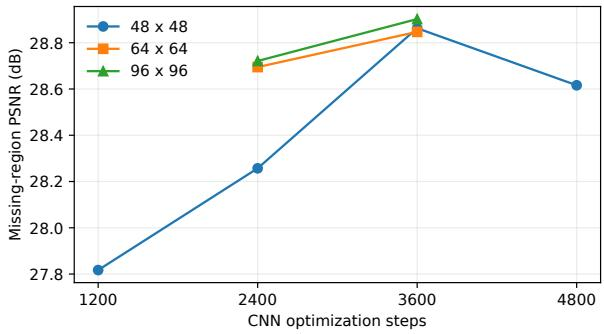  
Fig. 2. Sensitivity to the optimization budget at three training-patch sizes on the development sequence. Curves connect only the evaluated configurations

## E. Final RGB Configuration

The development study selects the following fixed 360p configuration:

$$
\begin{array} { r } { \left| { K = 1 2 , \quad h = 3 2 , \quad ( k _ { t } , k _ { s } , k _ { s } ) = ( 3 , 3 , 3 ) , } \right. } \\ { \left. { N _ { \mathrm { s t e p } } = 3 6 0 0 , \quad ( T _ { p } , H _ { p } , W _ { p } ) = ( 1 6 , 9 6 , 9 6 ) . } \right. } \end{array}\tag{1}
$$

Five cross-fitting folds, 12 masked KPD sweeps, and the remaining regularization settings are unchanged. Relative to the initial $K = 4 , h = 1 2$ , 1200-step configuration with $1 6 \times 4 8 \times$ 48 patches, the selected configuration improves missing-region PSNR on Blackswan from 27.1250 to 28.9023 dB and fullframe SSIM from 0.8510 to 0.9047. These values are measured on the development sequence used for selection.

We apply this configuration to all eight selected RGB sequences at all three sampling rates. Each sequence is reconstructed using its own self-supervised fit with the same hyperparameter settings.

TABLE IV  
MEDIAN WALL-CLOCK TIME (SECONDS) PER RECONSTRUCTED RGB VIDEO IN THE COMPARISON OF EIGHT SELECTED SEQUENCES. TIMES ARE MEASURED USING THE ORIGINAL CPU/GPU IMPLEMENTATIONS.
<table><tr><td>Method</td><td>Median time (s)</td></tr><tr><td>DRO-TFF</td><td>98.2</td></tr><tr><td>HLRTF</td><td>62.6</td></tr><tr><td>KBR</td><td>2851.5</td></tr><tr><td>LRTFR</td><td>45.4</td></tr><tr><td>OTLRM</td><td>434.1</td></tr><tr><td>TNN</td><td>926.1</td></tr><tr><td>SALTS</td><td>16092.2</td></tr><tr><td>S2NTNN</td><td>466.9</td></tr><tr><td>Ours</td><td>1859.2</td></tr></table>

## APPENDIX B SUPPLEMENTARY EVALUATION RESULTS

## A. Selected-Sequence Quantitative Comparison

The eight selected DAVIS 2017 videos are Bear, Driftchicane, Cows, Dog, Camel, Kite-surf, Parkour, and Breakdance. Each contains 50 RGB frames resized to 360 × 640 pixels. For each video and sampling rate, all methods use the same tube-wise mask with seed 20261014. The configuration selected on Blackswan (Appendix A) is applied to the eight sequences. Tables V– VII report missing-region PSNR, and Tables VIII-X report full-frame SSIM. The mean rows give the eight-video averages reported in Table V of the main paper. Table IV reports runtimes for the same implementations.

## B. Temporal-gradient MAE on Missing Tubes

Temporal-gradient MAE (T-MAE) measures the reconstruction error in frame-to-frame intensity changes at missing tubes. Under tube-wise sampling, the set M of missing pixel–channel indices remains fixed across frames. For the reference video X and the data-consistent reconstruction $\widehat { X }$ , we compute

$$
\begin{array} { c } { \displaystyle \mathrm { T M A E _ { m i s s } } = \frac { 1 } { ( T - 1 ) | \mathcal { M } | } \sum _ { t = 1 } ^ { T - 1 } \sum _ { p \in \mathcal { M } } \left| \Delta _ { t } \widehat { X } _ { p } - \Delta _ { t } X _ { p } \right| , } \\ { \Delta _ { t } X _ { p } = X _ { p , t + 1 } - X _ { p , t } , \quad p = ( i , j , c ) . } \end{array}\tag{2}
$$

Video intensities are normalized to [0, 1], and lower T-MAE indicates more accurate temporal differences at missing locations. The main paper uses the same metric. Tables XII– XIV report results for all nine methods at each rate on the eight selected videos. Ours has the lowest T-MAE in 19 of the 24 video-rate cases; the mean results appear in Table XI.

## C. Quality Trends and Computational Cost

Figure 7 of the main paper shows mean PSNR, SSIM, and T-MAE across sampling rates. Figure 3 shows per-sequence missing-region PSNR margins over the strongest alternative at each rate. The median wall-clock time for Ours is 1859.2 s per RGB video, compared with 466.9 s for S2NTNN and 45.4 s for LRTFR, under the implementations reported in Table IV.

TABLE V  
MISSING-REGION PSNR (DB) ON THE EIGHT SELECTED DAVIS RGB SEQUENCES AT SR = 0.2. BEST AND SECOND-BEST VALUES PER SEQUENCE ARE BOLD AND UNDERLINED.
<table><tr><td>Sequence</td><td>DRO-TFF</td><td>HLRTF</td><td>KBR</td><td>LRTFR</td><td>OTLRM</td><td>TNN</td><td>SALTS</td><td> $\mathrm { S ^ { 2 } N T N N }$ </td><td>Ours</td></tr><tr><td>bear</td><td>18.49</td><td>23.21</td><td>24.59</td><td>23.40</td><td>22.46</td><td>22.72</td><td>24.88</td><td>24.31</td><td>26.85</td></tr><tr><td>drift-chicane</td><td>21.87</td><td>28.12</td><td>23.38</td><td>27.24</td><td>28.95</td><td>26.86</td><td>27.33</td><td>28.78</td><td>29.89</td></tr><tr><td>COWS</td><td>16.16</td><td>20.98</td><td>22.75</td><td>22.61</td><td>20.79</td><td>19.85</td><td>22.80</td><td>23.21</td><td>24.47</td></tr><tr><td>dog</td><td>24.78</td><td>25.32</td><td>29.07</td><td>24.47</td><td>26.83</td><td>23.83</td><td>28.55</td><td>29.43</td><td>29.97</td></tr><tr><td>camel</td><td>17.06</td><td>21.85</td><td>22.39</td><td>22.68</td><td>22.45</td><td>20.75</td><td>23.93</td><td>24.15</td><td>24.50</td></tr><tr><td>kite-surf</td><td>25.26</td><td>27.22</td><td>30.52</td><td>26.92</td><td>28.83</td><td>26.33</td><td>30.33</td><td>29.71</td><td>30.88</td></tr><tr><td>parkour</td><td>23.50</td><td>23.99</td><td>27.09</td><td>23.06</td><td>25.23</td><td>23.05</td><td>26.78</td><td>27.36</td><td>26.87</td></tr><tr><td>breakdance</td><td>18.06</td><td>20.92</td><td>20.69</td><td>22.12</td><td>21.96</td><td>18.91</td><td>20.99</td><td>23.77</td><td>23.12</td></tr><tr><td>Mean</td><td>20.65</td><td>23.95</td><td>25.06</td><td>24.06</td><td>24.69</td><td>22.79</td><td>25.70</td><td>26.34</td><td>27.07</td></tr></table>

TABLE VI

MISSING-REGION PSNR (DB) ON THE EIGHT SELECTED DAVIS RGB SEQUENCES AT SR = 0.3. BEST AND SECOND-BEST VALUES PER SEQUENCE ARE BOLD AND UNDERLINED.
<table><tr><td>Sequence</td><td>DRO-TFF</td><td>HLRTF</td><td>KBR</td><td>LRTFR</td><td>OTLRM</td><td>TNN</td><td>SALTS</td><td>S2NTNN</td><td>Ours</td></tr><tr><td>bear</td><td>22.96</td><td>24.11</td><td>25.99</td><td>24.01</td><td>22.85</td><td>24.20</td><td>26.04</td><td>25.17</td><td>27.75</td></tr><tr><td>drift-chicane</td><td>23.36</td><td>29.51</td><td>27.95</td><td>28.31</td><td>29.54</td><td>28.22</td><td>29.20</td><td>29.57</td><td>31.00</td></tr><tr><td>COwS</td><td>19.78</td><td>21.86</td><td>24.29</td><td>23.40</td><td>20.97</td><td>21.04</td><td>24.05</td><td>24.14</td><td>25.47</td></tr><tr><td>dog</td><td>25.50</td><td>26.92</td><td>30.74</td><td>25.25</td><td>27.39</td><td>25.32</td><td>30.10</td><td>30.63</td><td>31.18</td></tr><tr><td>camel</td><td>21.66</td><td>23.02</td><td>25.15</td><td>23.25</td><td>21.76</td><td>22.17</td><td>25.07</td><td>25.12</td><td>25.46</td></tr><tr><td>kite-surf</td><td>27.64</td><td>28.23</td><td>31.99</td><td>27.42</td><td>29.67</td><td>27.66</td><td>31.71</td><td>30.70</td><td>32.01</td></tr><tr><td>parkour</td><td>23.91</td><td>25.53</td><td>28.50</td><td>23.75</td><td>25.95</td><td>24.47</td><td>28.02</td><td>28.16</td><td>27.95</td></tr><tr><td>breakdance</td><td>21.20</td><td>22.91</td><td>24.13</td><td>23.75</td><td>23.15</td><td>20.64</td><td>23.80</td><td>24.85</td><td>24.13</td></tr><tr><td>Mean</td><td>23.25</td><td>25.26</td><td>27.34</td><td>24.89</td><td>25.16</td><td>24.21</td><td>27.25</td><td>27.29</td><td>28.12</td></tr></table>

TABLE VII

MISSING-REGION PSNR (DB) ON THE EIGHT SELECTED DAVIS RGB SEQUENCES AT SR = 0.4. BEST AND SECOND-BEST VALUES PER SEQUENCE ARE BOLD AND UNDERLINED.
<table><tr><td>Sequence</td><td>DRO-TFF</td><td>HLRTF</td><td>KBR</td><td>LRTFR</td><td>OTLRM</td><td>TNN</td><td>SALTS</td><td> $\mathrm { S ^ { 2 } N T N N }$ </td><td>Ours</td></tr><tr><td>bear</td><td>23.51</td><td>24.72</td><td>27.24</td><td>24.50</td><td>23.88</td><td>25.34</td><td>26.95</td><td>25.84</td><td>28.57</td></tr><tr><td>drift-chicane</td><td>24.54</td><td>29.55</td><td>30.39</td><td>29.43</td><td>30.69</td><td>29.29</td><td>30.69</td><td>29.95</td><td>32.28</td></tr><tr><td>cowS</td><td>21.98</td><td>22.31</td><td>25.44</td><td>23.93</td><td>21.31</td><td>22.04</td><td>25.05</td><td>24.86</td><td>26.04</td></tr><tr><td>dog</td><td>25.60</td><td>27.85</td><td>32.38</td><td>25.92</td><td>28.17</td><td>26.64</td><td>31.46</td><td>31.51</td><td>32.30</td></tr><tr><td>camel</td><td>22.26</td><td>23.69</td><td>26.28</td><td>23.60</td><td>22.75</td><td>23.27</td><td>25.98</td><td>25.82</td><td>26.04</td></tr><tr><td>kite-surf</td><td>27.91</td><td>29.14</td><td>33.38</td><td>27.79</td><td>30.06</td><td>28.78</td><td>32.90</td><td>31.38</td><td>32.98</td></tr><tr><td>parkour</td><td>24.05</td><td>26.40</td><td>29.75</td><td>24.45</td><td>26.81</td><td>25.64</td><td>29.04</td><td>29.11</td><td>28.79</td></tr><tr><td>breakdance</td><td>22.50</td><td>23.90</td><td>25.66</td><td>24.99</td><td>24.07</td><td>22.08</td><td>25.49</td><td>25.59</td><td>24.90</td></tr><tr><td>Mean</td><td>24.04</td><td>25.94</td><td>28.81</td><td>25.58</td><td>25.97</td><td>25.39</td><td>28.44</td><td>28.01</td><td>28.99</td></tr></table>

## D. Additional RGB Visual Comparisons

The main paper shows Bear, Drift-chicane, and Cows. Comparisons for the remaining five selected videos are shown

below at sampling rates 0.2, 0.3, and 0.4 (from top to bottom). For each video, all methods use the same displayed frame and two fixed ROIs. The eleven columns show the observed input,

TABLE X  
TABLE VIII  
FULL-FRAME SSIM ON THE EIGHT SELECTED DAVIS RGB SEQUENCES AT SR = 0.2. BEST AND SECOND-BEST VALUES PER SEQUENCE ARE BOLD AND UNDERLINED.
<table><tr><td>Sequence</td><td>DRO-TFF</td><td>HLRTF</td><td>KBR</td><td>LRTFR</td><td>OTLRM</td><td>TNN</td><td>SALTS</td><td> $\mathrm { S ^ { 2 } N T N N }$ </td><td>Ours</td></tr><tr><td>bear</td><td>0.320</td><td>0.642</td><td>0.715</td><td>0.649</td><td>0.639</td><td>0.622</td><td>0.744</td><td>0.749</td><td>0.868</td></tr><tr><td>drift-chicane</td><td>0.316</td><td>0.780</td><td>0.502</td><td>0.707</td><td>0.811</td><td>0.717</td><td>0.755</td><td>0.854</td><td>0.861</td></tr><tr><td>CowS</td><td>0.271</td><td>0.537</td><td>0.647</td><td>0.627</td><td>0.554</td><td>0.464</td><td>0.649</td><td>0.710</td><td>0.785</td></tr><tr><td>dog</td><td>0.588</td><td>0.632</td><td>0.820</td><td>0.593</td><td>0.724</td><td>0.536</td><td>0.802</td><td>0.848</td><td>0.872</td></tr><tr><td>camel</td><td>0.264</td><td>0.572</td><td>0.671</td><td>0.648</td><td>0.637</td><td>0.517</td><td>0.726</td><td>0.770</td><td>0.801</td></tr><tr><td>kite-surf</td><td>0.591</td><td>0.742</td><td>0.852</td><td>0.741</td><td>0.793</td><td>0.677</td><td>0.865</td><td>0.850</td><td>0.903</td></tr><tr><td>parkour</td><td>0.569</td><td>0.600</td><td>0.738</td><td>0.656</td><td>0.656</td><td>0.546</td><td>0.768</td><td>0.840</td><td>0.831</td></tr><tr><td>breakdance</td><td>0.430</td><td>0.611</td><td>0.579</td><td>0.691</td><td>0.665</td><td>0.485</td><td>0.650</td><td>0.820</td><td>0.788</td></tr><tr><td>Mean</td><td>0.419</td><td>0.640</td><td>0.691</td><td>0.664</td><td>0.685</td><td>0.570</td><td>0.745</td><td>0.805</td><td>0.838</td></tr></table>

TABLE IX

FULL-FRAME SSIM ON THE EIGHT SELECTED DAVIS RGB SEQUENCES AT SR = 0.3. BEST AND SECOND-BEST VALUES PER SEQUENCE ARE BOLD AND UNDERLINED.
<table><tr><td>Sequence</td><td>DRO-TFF</td><td>HLRTF</td><td>KBR</td><td>LRTFR</td><td>OTLRM</td><td>TNN</td><td>SALTS</td><td> $\mathrm { S ^ { 2 } N T N N }$ </td><td>Ours</td></tr><tr><td>bear</td><td>0.652</td><td>0.733</td><td>0.811</td><td>0.732</td><td>0.699</td><td>0.742</td><td>0.828</td><td>0.819</td><td>0.908</td></tr><tr><td>drift-chicane</td><td>0.428</td><td>0.846</td><td>0.750</td><td>0.792</td><td>0.847</td><td>0.798</td><td>0.851</td><td>0.890</td><td>0.906</td></tr><tr><td>CowS</td><td>0.527</td><td>0.640</td><td>0.765</td><td>0.724</td><td>0.612</td><td>0.599</td><td>0.759</td><td>0.790</td><td>0.849</td></tr><tr><td>dog</td><td>0.674</td><td>0.756</td><td>0.891</td><td>0.679</td><td>0.784</td><td>0.669</td><td>0.877</td><td>0.897</td><td>0.916</td></tr><tr><td>camel</td><td>0.600</td><td>0.683</td><td>0.787</td><td>0.727</td><td>0.649</td><td>0.646</td><td>0.808</td><td>0.834</td><td>0.858</td></tr><tr><td>kite-surf</td><td>0.761</td><td>0.807</td><td>0.907</td><td>0.790</td><td>0.841</td><td>0.767</td><td>0.913</td><td>0.890</td><td>0.937</td></tr><tr><td>parkour</td><td>0.640</td><td>0.709</td><td>0.822</td><td>0.716</td><td>0.707</td><td>0.656</td><td>0.835</td><td>0.876</td><td>0.882</td></tr><tr><td>breakdance</td><td>0.640</td><td>0.748</td><td>0.778</td><td>0.796</td><td>0.747</td><td>0.626</td><td>0.809</td><td>0.875</td><td>0.856</td></tr><tr><td>Mean</td><td>0.615</td><td>0.740</td><td>0.814</td><td>0.744</td><td>0.736</td><td>0.688</td><td>0.835</td><td>0.859</td><td>0.889</td></tr></table>

FULL-FRAME SSIM ON THE EIGHT SELECTED DAVIS RGB SEQUENCES AT SR = 0.4. BEST AND SECOND-BEST VALUES PER SEQUENCE ARE BOLD AND UNDERLINED.
<table><tr><td>Sequence</td><td>DRO-TFF</td><td>HLRTF</td><td>KBR</td><td>LRTFR</td><td>OTLRM</td><td>TNN</td><td>SALTS</td><td> $\mathrm { S ^ { 2 } N T N N }$ </td><td>Ours</td></tr><tr><td>bear</td><td>0.731</td><td>0.789</td><td>0.878</td><td>0.796</td><td>0.778</td><td>0.821</td><td>0.880</td><td>0.868</td><td>0.937</td></tr><tr><td>drift-chicane</td><td>0.536</td><td>0.834</td><td>0.857</td><td>0.860</td><td>0.892</td><td>0.855</td><td>0.904</td><td>0.908</td><td>0.938</td></tr><tr><td>COWS</td><td>0.693</td><td>0.705</td><td>0.842</td><td>0.791</td><td>0.678</td><td>0.705</td><td>0.833</td><td>0.846</td><td>0.887</td></tr><tr><td>dog</td><td>0.726</td><td>0.827</td><td>0.936</td><td>0.753</td><td>0.832</td><td>0.772</td><td>0.923</td><td>0.928</td><td>0.945</td></tr><tr><td>camel</td><td>0.687</td><td>0.747</td><td>0.857</td><td>0.785</td><td>0.734</td><td>0.743</td><td>0.866</td><td>0.878</td><td>0.895</td></tr><tr><td>kite-surf</td><td>0.803</td><td>0.856</td><td>0.944</td><td>0.830</td><td>0.867</td><td>0.835</td><td>0.944</td><td>0.918</td><td>0.959</td></tr><tr><td>parkour</td><td>0.689</td><td>0.770</td><td>0.882</td><td>0.774</td><td>0.773</td><td>0.744</td><td>0.882</td><td>0.913</td><td>0.915</td></tr><tr><td>breakdance</td><td>0.744</td><td>0.799</td><td>0.858</td><td>0.861</td><td>0.806</td><td>0.735</td><td>0.885</td><td>0.909</td><td>0.901</td></tr><tr><td>Mean</td><td>0.701</td><td>0.791</td><td>0.882</td><td>0.806</td><td>0.795</td><td>0.776</td><td>0.889</td><td>0.896</td><td>0.922</td></tr></table>

nine reconstructions, and ground truth. The PSNR labels report the missing-region score over the full 50-frame sequence.

TABLE XI  
TEMPORAL-GRADIENT MAE ON THE MISSING TUBES OF EIGHT SELECTED DAVIS 36OP RGB VIDEOS (LOWER IS BETTER). THE RIGHTMOST COLUMN IS THE MEAN ACROSS THE THREE SAMPLING RATES. THE LOWEST AND SECOND-LOWEST VALUES ARE BOLD AND UNDERLINED, RESPECTIVELY.
<table><tr><td>Method</td><td>SR=0.2</td><td>SR=0.3</td><td>SR=0.4</td><td>Mean</td></tr><tr><td>DRO-TFF</td><td>0.05233</td><td>0.04917</td><td>0.04842</td><td>0.04997</td></tr><tr><td>HLRTF</td><td>0.04856</td><td>0.04419</td><td>0.04177</td><td>0.04484</td></tr><tr><td>KBR</td><td>0.04038</td><td>0.03505</td><td>0.03024</td><td>0.03522</td></tr><tr><td>LRTFR</td><td>0.04876</td><td>0.04687</td><td>0.04511</td><td>0.04691</td></tr><tr><td>OTLRM</td><td>0.04926</td><td>0.04853</td><td>0.04510</td><td>0.04763</td></tr><tr><td>TNN</td><td>0.05166</td><td>0.04687</td><td>0.04265</td><td>0.04706</td></tr><tr><td>SALTS</td><td>0.03740</td><td>0.03330</td><td>0.02998</td><td>0.03356</td></tr><tr><td>S2NTNN</td><td>0.03592</td><td>0.03270</td><td>0.03028</td><td>0.03296</td></tr><tr><td>Ours</td><td>0.03079</td><td>0.02732</td><td>0.02495</td><td>0.02769</td></tr></table>

TABLE XII  
MISSING-TUBE TEMPORAL-GRADIENT MAE (LOWER IS BETTER) ON THE EIGHT SELECTED DAVIS RGB VIDEOS AT SR = 0.2. LOWEST AND SECOND-LOWEST ENTRIES IN EACH ROW ARE BOLD AND UNDERLINED.
<table><tr><td>Video</td><td>DRO-TFF</td><td>HLRTF</td><td>KBR</td><td>LRTFR</td><td>OTLRM</td><td>TNN</td><td>SALTS</td><td>S2NTNN</td><td>Ours</td></tr><tr><td>bear</td><td>0.05797</td><td>0.05304</td><td>0.05298</td><td>0.05348</td><td>0.06816</td><td>0.05450</td><td>0.04945</td><td>0.05136</td><td>0.03522</td></tr><tr><td>drift-chicane</td><td>0.00984</td><td>0.00788</td><td>0.00826</td><td>0.00778</td><td>0.00774</td><td>0.00829</td><td>0.00582</td><td>0.00772</td><td>0.00519</td></tr><tr><td>cows</td><td>0.06826</td><td>0.06613</td><td>0.06049</td><td>0.06096</td><td>0.08213</td><td>0.06906</td><td>0.05932</td><td>0.05791</td><td>0.04894</td></tr><tr><td>dog</td><td>0.05979</td><td>0.05876</td><td>0.03597</td><td>0.06479</td><td>0.04745</td><td>0.06331</td><td>0.03790</td><td>0.03373</td><td>0.02997</td></tr><tr><td>camel</td><td>0.07584</td><td>0.06873</td><td>0.06159</td><td>0.06715</td><td>0.07146</td><td>0.07220</td><td>0.05667</td><td>0.05437</td><td>0.04865</td></tr><tr><td>kite-surf</td><td>0.03892</td><td>0.03644</td><td>0.02622</td><td>0.03664</td><td>0.03264</td><td>0.03894</td><td>0.02473</td><td>0.02761</td><td>0.02046</td></tr><tr><td>parkour</td><td>0.06584</td><td>0.06157</td><td>0.04328</td><td>0.06902</td><td>0.05377</td><td>0.06577</td><td>0.04247</td><td>0.03483</td><td>0.03624</td></tr><tr><td>breakdance</td><td>0.04215</td><td>0.03595</td><td>0.03423</td><td>0.03025</td><td>0.03071</td><td>0.04124</td><td>0.02285</td><td>0.01981</td><td>0.02162</td></tr><tr><td>Mean</td><td>0.05233</td><td>0.04856</td><td>0.04038</td><td>0.04876</td><td>0.04926</td><td>0.05166</td><td>0.03740</td><td>0.03592</td><td>0.03079</td></tr></table>

TABLE XIII  
MISSING-TUBE TEMPORAL-GRADIENT MAE (LOWER IS BETTER) ON THE EIGHT SELECTED DAVIS RGB VIDEOS AT SR = 0.3. LOWEST AND SECOND-LOWEST ENTRIES IN EACH ROW ARE BOLD AND UNDERLINED.
<table><tr><td>Video</td><td>DRO-TFF</td><td>HLRTF</td><td>KBR</td><td>LRTFR</td><td>OTLRM</td><td>TNN</td><td>SALTS</td><td>S2NTNN</td><td>Ours</td></tr><tr><td>bear</td><td>0.05461</td><td>0.05164</td><td>0.04833</td><td>0.05276</td><td>0.06662</td><td>0.05048</td><td>0.04534</td><td>0.04730</td><td>0.03147</td></tr><tr><td>drift-chicane</td><td>0.00883</td><td>0.00777</td><td>0.00707</td><td>0.00766</td><td>0.00808</td><td>0.00763</td><td>0.00535</td><td>0.00766</td><td>0.00476</td></tr><tr><td>cows</td><td>0.06434</td><td>0.06312</td><td>0.05631</td><td>0.05933</td><td>0.08274</td><td>0.06610</td><td>0.05480</td><td>0.05318</td><td>0.04516</td></tr><tr><td>dog</td><td>0.05721</td><td>0.05001</td><td>0.02944</td><td>0.06180</td><td>0.04395</td><td>0.05518</td><td>0.03148</td><td>0.02944</td><td>0.02509</td></tr><tr><td>camel</td><td>0.07078</td><td>0.06277</td><td>0.05362</td><td>0.06542</td><td>0.07754</td><td>0.06676</td><td>0.05120</td><td>0.04871</td><td>0.04335</td></tr><tr><td>kite-surf</td><td>0.03616</td><td>0.03467</td><td>0.02196</td><td>0.03593</td><td>0.02973</td><td>0.03530</td><td>0.02115</td><td>0.02575</td><td>0.01739</td></tr><tr><td>parkour</td><td>0.06342</td><td>0.05234</td><td>0.03674</td><td>0.06507</td><td>0.04946</td><td>0.05763</td><td>0.03713</td><td>0.03157</td><td>0.03175</td></tr><tr><td>breakdance</td><td>0.03799</td><td>0.03115</td><td>0.02695</td><td>0.02699</td><td>0.03009</td><td>0.03585</td><td>0.01998</td><td>0.01795</td><td>0.01962</td></tr><tr><td>Mean</td><td>0.04917</td><td>0.04419</td><td>0.03505</td><td>0.04687</td><td>0.04853</td><td>0.04687</td><td>0.03330</td><td>0.03270</td><td>0.02732</td></tr></table>

TABLE XIV  
MISSING-TUBE TEMPORAL-GRADIENT MAE (LOWER IS BETTER) ON THE EIGHT SELECTED DAVIS RGB VIDEOS AT SR = 0.4. LOWEST AND SECOND-LOWEST ENTRIES IN EACH ROW ARE BOLD AND UNDERLINED.
<table><tr><td>Video</td><td>DRO-TFF</td><td>HLRTF</td><td>KBR</td><td>LRTFR</td><td>OTLRM</td><td>TNN</td><td>SALTS</td><td>S2NTNN</td><td>Ours</td></tr><tr><td>bear</td><td>0.05395</td><td>0.05057</td><td>0.04169</td><td>0.05203</td><td>0.06059</td><td>0.04679</td><td>0.04171</td><td>0.04420</td><td>0.02885</td></tr><tr><td>drift-chicane</td><td>0.00843</td><td>0.00767</td><td>0.00642</td><td>0.00755</td><td>0.00666</td><td>0.00707</td><td>0.00501</td><td>0.00763</td><td>0.00443</td></tr><tr><td>cows</td><td>0.06266</td><td>0.06194</td><td>0.05034</td><td>0.05808</td><td>0.08042</td><td>0.06301</td><td>0.05055</td><td>0.04977</td><td>0.04244</td></tr><tr><td>dog</td><td>0.05663</td><td>0.04574</td><td>0.02407</td><td>0.05843</td><td>0.04151</td><td>0.04815</td><td>0.02676</td><td>0.02664</td><td>0.02211</td></tr><tr><td>camel</td><td>0.06962</td><td>0.05941</td><td>0.04698</td><td>0.06421</td><td>0.06963</td><td>0.06179</td><td>0.04642</td><td>0.04517</td><td>0.03980</td></tr><tr><td>kite-surf</td><td>0.03591</td><td>0.03277</td><td>0.01821</td><td>0.03525</td><td>0.02913</td><td>0.03193</td><td>0.01832</td><td>0.02406</td><td>0.01528</td></tr><tr><td>parkour</td><td>0.06258</td><td>0.04796</td><td>0.03161</td><td>0.06076</td><td>0.04526</td><td>0.05107</td><td>0.03319</td><td>0.02863</td><td>0.02845</td></tr><tr><td>breakdance</td><td>0.03762</td><td>0.02810</td><td>0.02264</td><td>0.02461</td><td>0.02761</td><td>0.03143</td><td>0.01788</td><td>0.01613</td><td>0.01823</td></tr><tr><td>Mean</td><td>0.04842</td><td>0.04177</td><td>0.03024</td><td>0.04511</td><td>0.04510</td><td>0.04265</td><td>0.02998</td><td>0.03028</td><td>0.02495</td></tr></table>

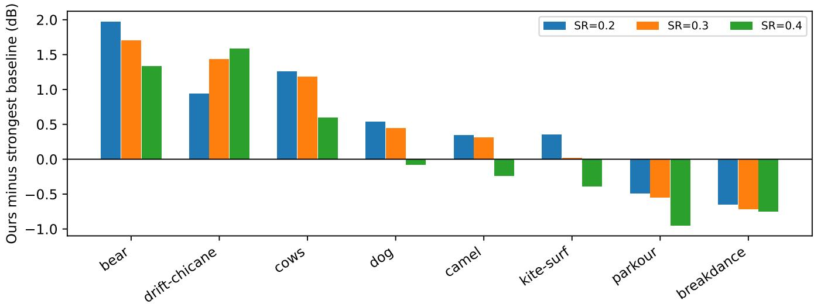  
Fig. 3. Difference in missing-region PSNR between Ours and the strongest alternative baseline for each selected sequence and sampling rate.

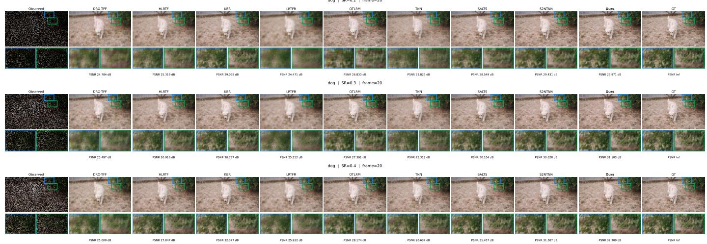  
Fig. 4. RGB reconstruction comparison on Dog at sampling rates 0.2, 0.3, and 0.4 (from top to bottom), with common ROIs across methods. The annotated PSNR values report missing-region PSNR over all 50 frames.

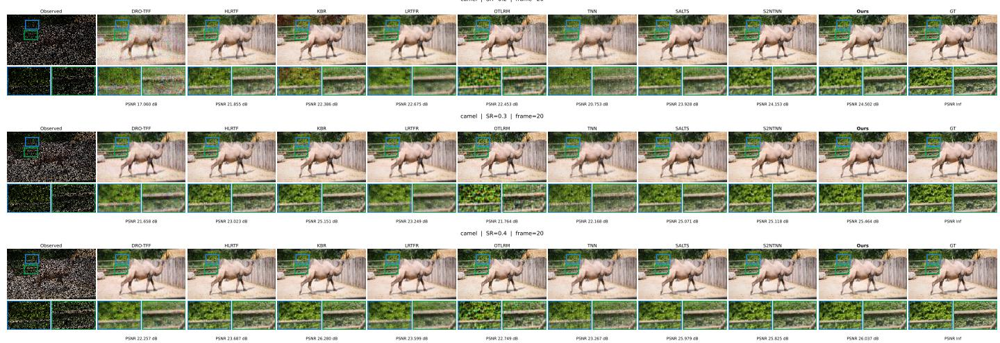  
Fig. 5. RGB reconstruction comparison on Camel at sampling rates 0.2, 0.3, and 0.4 (from top to bottom), with common ROIs across methods. The annotated PSNR values report missing-region PSNR over all 50 frames.

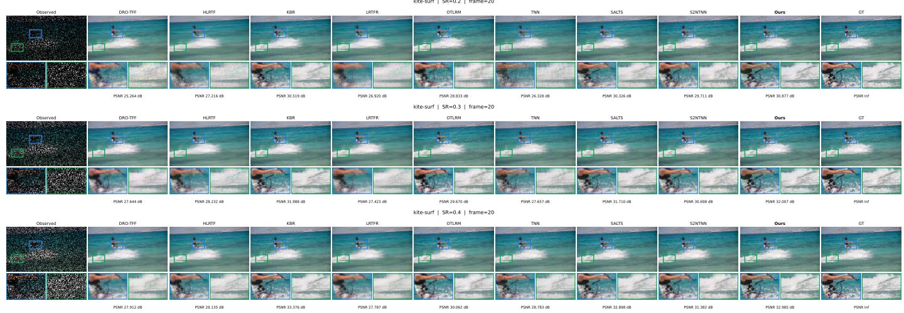  
Fig. 6. RGB reconstruction comparison on Kite-surf at sampling rates 0.2, 0.3, and 0.4 (from top to bottom), with common ROIs across methods. The annotated PSNR values report missing-region PSNR over all 50 frames.

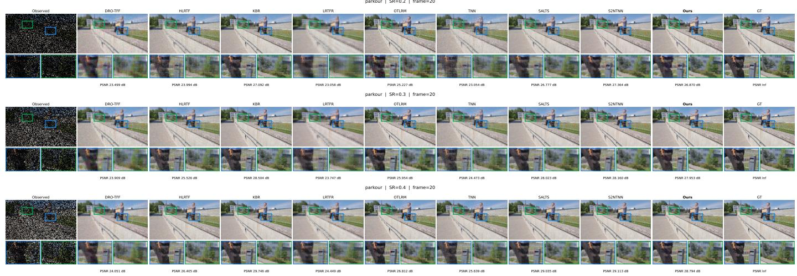  
Fig. 7. RGB reconstruction comparison on Parkour at sampling rates 0.2, 0.3, and 0.4 (from top to bottom), with common ROIs across methods. The annotated PSNR values report missing-region PSNR over all 50 frames.

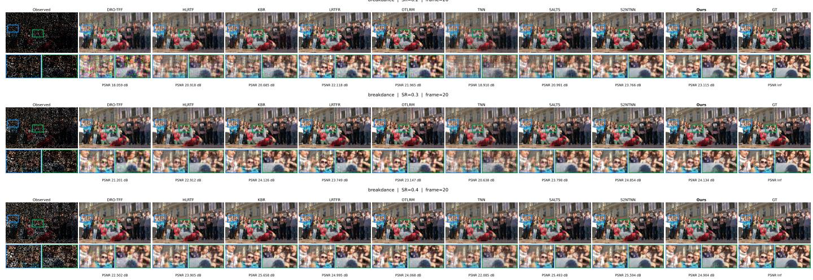  
Fig. 8. RGB reconstruction comparison on Breakdance at sampling rates 0.2, 0.3, and 0.4 (from top to bottom), with common ROIs across methods. The annotated PSNR values report missing-region PSNR over all 50 frames.