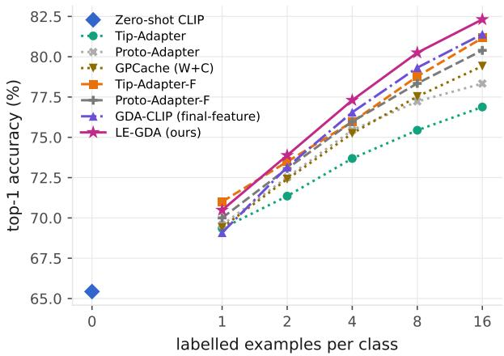
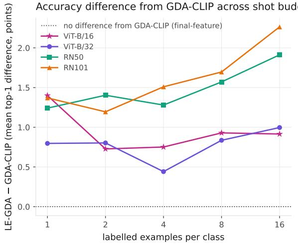
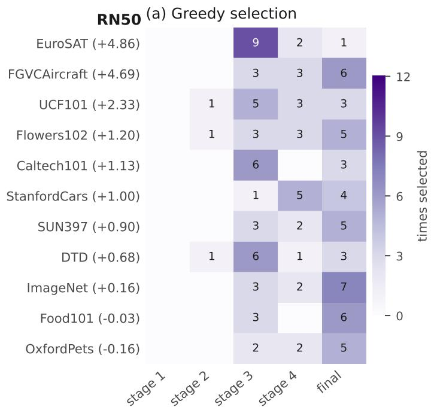
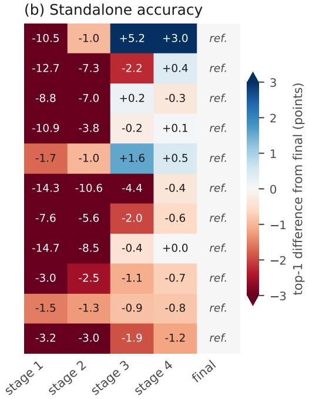
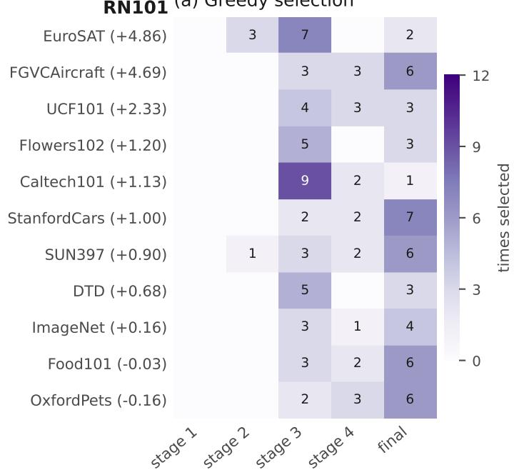
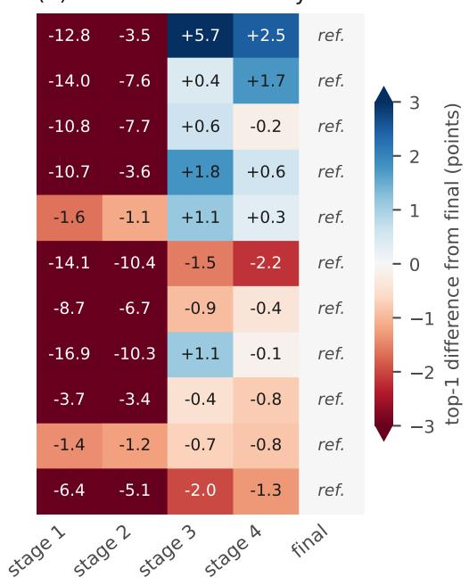
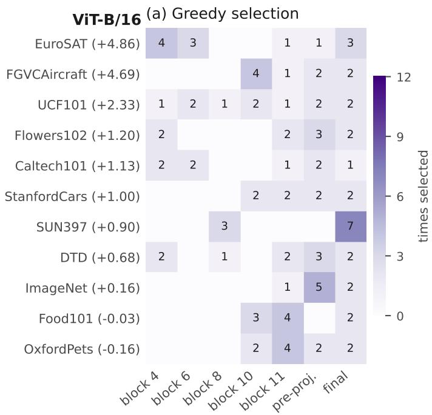
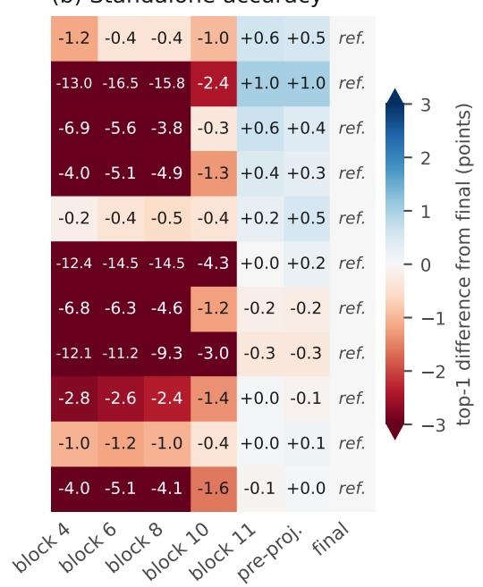
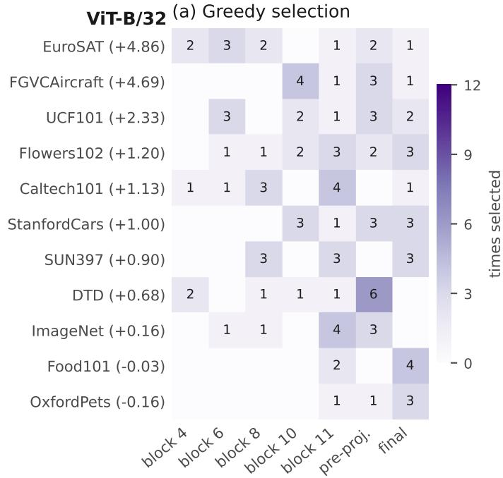
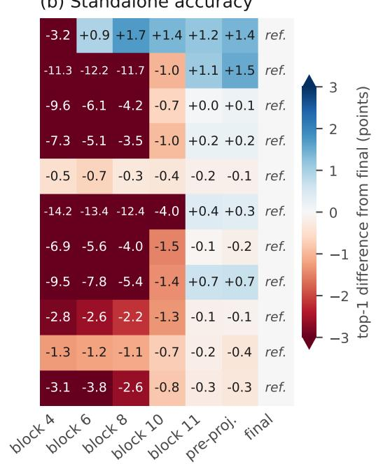

# LE-GDA: Layer Ensemble Gaussian Discriminant Analysis for Training-Free Few-Shot CLIP Adaptation

Pavodi Maniamfu1 Vogel Kiketa2,3

Zezina Kuzulu Kuetu2 Jakin Mukendi Kabongo4,2

David Mayoya Kutangila2,3 Pescie Honore Kinkani Mampuya3

L’Or Wolo Sieka5

1 Temple University Japan Campus; 2 Universite de Kinshasa;´

3 Universite Protestante au Congo; ´ 4 Handong Global University;

5 Kwilu Briques

Paper accepted at WACV 2027

Corresponding author: ndoyi.pavodi.maniamfu [at] tuj.temple.edu

## Abstract

Training-freefew-shot adaptation ofvision–language models typically constructs a classifier from CLIP’s final projected image representation, leaving intermediate representations unused. Combining them is not straightforward. Class scoresfrom different representations differ in spread by orders of magnitude for the same query. Direct averaging allocates influence by numerical scale rather than predictive information. We propose Layer-Ensemble Gaussian Discriminant Analysis (LE-GDA), a method thatfits regularized shared-covariance discriminants independently to intermediate andfinal representations extracted in onefrozen encoder pass. LE-GDA standardizes each discriminant’s class scores per query, selects a small representation multiset on labeled validation data, and combines it with the zero-shot classifier without gradient-based optimization. Across 11 datasets, four CLIP backbones, five shot counts, and three independently sampled K-shot training sets, LE-GDA achieves the highest mean accuracy of all evaluated methods on every backbone, raising the 16-shot meanfrom 78.01% to 79.54% over a matched GDA-CLIP (final-feature) baseline and improving that baselinefor every backbone–shot combination. At one shot, LE-GDA retains a 1.20-point mean gain over the baseline even though covariance estimation is unavailable and per-query standardization is neutral. A control with richer per-class structure inside a single representation does not reproduce the gain, indicating that the benefit comes from combining representations. These results show that intermediate CLIP representations carry information beyond thefinal embedding and can improve training-freefew-shot adaptation. Code and evaluation resources are available at

https://github.com/pavodi-NM/le-gda.

## 1. Introduction

Vision-language models such as Contrastive Language-Image Pre-training (CLIP) [27] learn image representations that transfer effectively to downstream recognition tasks. In zero-shot classification, predictions are obtained through the cosine similarity between the encoded image features and text embeddings generated from class-specific prompt templates. For example, a template like “a photo of {class}” allows the language encoder to construct the necessary classifier weights. This enables the model to categorize images across arbitrary domains without downstream finetuning. To further improve performance, a small few-shot training set can introduce task-specific information through prompt learning, feature adapters, residual classifiers, or nonparametric retrieval as adopted by recent efficient fine-tuning methods [10, 34, 35, 37]. Although these approaches can be parameter-efficient, methods that optimize task-specific parameters still require a training procedure for every downstream dataset. Training-free adaptation [1, 7, 18, 31, 32, 38] instead constructs the classifier directly from frozen CLIP features.

In this work, we study training-free adaptation in the validation-assisted regime. This is the convention adopted by cache-based CLIP adapters [7, 32, 35, 38], where classifiers are fit on the few support examples per class. A held-out labeled split selects the fusion and regularization hyperparameters these methods require. Within this regime, a gain is only interpretable if every method draws on the same validation budget [29].

Gaussian discriminant analysis provides a strong trainingfree classifier for CLIP [32]. It estimates class statistics from the few-shot training features and combines the resulting linear discriminant with the zero-shot classifier. Like cacheand adapter-based methods more generally [10, 32, 35], it operates on the final projected image embedding. This representation is the natural default because it is aligned with the text encoder and is often the most accurate individual representation. It is nevertheless only the last output of a sequence of transformations performed by the visual encoder.

Combining intermediate representations requires more than naive classifier averaging. Each representation defines a different statistical feature space, with its own dimensionality, covariance structure, and per-query dispersion of scaled discriminant-scores. The last is the spread of a representation’s class scores within a single query and varies by more than three orders of magnitude across the intermediate representations of a single backbone (e.g. ResNets). Under direct score averaging, influence is therefore allocated by numerical scale rather than predictive information. Normalizing scores before combination is long-established practice when fusing classifiers whose outputs live on different scales [17, 19]. Training-free CLIP adapters have not required it, since they operate in a single feature space. A selection procedure operating on such scores inherits the same bias, preferring representations for their scale rather than their contribution to classification.

Building on [32], which we refer to as GDA-CLIP, we propose Layer-Ensemble Gaussian Discriminant Analysis (LE-GDA) to combine these representations. The method extracts intermediate and final representations from a single frozen CLIP forward pass and fits the same shared-covariance Gaussian discriminant to each representation. It standardizes the class scores of each representation within each query, then greedily selects [4] a small subset of representations using validation accuracy and combines their scores with the zeroshot classifier. All classifiers are obtained from few-shot training statistics, without back-propagation.

Our contributions are as follows:

• We show that CLIP’s intermediate representations carry information a training-free ensemble can extract without gradient-based optimization. The same shared-covariance discriminant is fitted independently in each frozen feature space.

• We identify per-query score standardization as the component that makes discriminants from different feature spaces commensurate under a single fusion coefficient. Validation selection therefore tracks predictive quality rather than scale.

• We evaluate the method across 11 datasets, four CLIP backbones, and five shot counts against a matched GDA-CLIP (final-feature) baseline. Controls isolate the source of the gain. At one shot, where neither covariance estimation nor standardized fusion applies, LE-GDA retains a

1.20-point mean gain.

## 2. Related work

Few-shot adaptation of vision–language models. CLIP [27] supports zero-shot recognition by aligning images and text in a shared embedding space. It nevertheless underperforms in specialized and domain-shifted settings [29, 37]. This motivates adaptation from a limited labeled subset. CoOp [37] introduced learnable, continuous prompt tokens into the language branch to optimize the textual context. CLIP-Adapter [10] learns residual feature transformations through MLPs, TaskRes [34] optimizes a residual classifier, and ClusterAdapter [11] learns multiple prototypes per class by gradient descent. These methods obtain task-specific parameters through gradient-based training.

Training-free approaches instead construct predictors directly from frozen features. CLAP [29] distinguishes validation-dependent from validation-free adaptation and shows that access to labeled validation data is an important part of the evaluation protocol. LP++ [16] similarly reduces task-specific validation by deriving its optimization step sizes from the training objective. Tip-Adapter [35] stores few-shot training examples in a key-value cache, while Proto-Adapter [18] uses a single average prototype per class instead. GPCache [7] applies Gaussian-process weight and confidence calibration to cache retrieval. These methods differ in how few-shot training information is represented, but generally operate on the final CLIP image embedding. Separately, APE [38] selects informative channels within the final feature representation. We study whether frozen intermediate representations can contribute to training-free adaptation.

Gaussian discriminant analysis and covariance estimation. Gaussian discriminant analysis models classconditional features with Gaussian distributions and yields a linear classifier when the covariance is shared across classes [2]. GDA-CLIP [32] applies this classifier to the final CLIP image embedding. Estimating a precision matrix from high-dimensional few-shot features is ill-conditioned, motivating covariance shrinkage and regularization [21, 22]. GDA-CLIP uses an empirical-Bayes ridge estimator. We retain the shared-covariance classifier, use a validationselected trace-scaled ridge coefficient, and fit the classifier independently in several feature spaces.

Intermediate representations. Intermediate neural representations have long been used to improve dense prediction and optimization. Examples include hypercolumn features [12] and deep supervision [23]. Recent work exploits CLIP’s intermediate layers for few-shot classification. It does so through trained side adapters and learned multiscale fusion [28, 36]. These approaches introduce gradientoptimized modules on top of the retained features. We instead fit the same closed-form discriminant independently in each frozen feature space. To our knowledge, training-free few-shot adaptation of CLIP has so far operated exclusively on the final projected embedding.

## 3. Layer-ensemble Gaussian discriminant analysis

## 3.1. Problem formulation and feature spaces

For a task with C classes and K labeled training examples per class, let $\textstyle S = \bigcup _ { c = 1 } ^ { C } S _ { c }$ denote the K-shot training set and $N = C K$ . The frozen CLIP text encoder produces normalized text embeddings $W = [ w _ { 1 } , \dots , w _ { C } ] \overset { \cdot } { \in } \mathbb { R } ^ { D \times C }$ where D is the dimension of CLIP’s shared image–text embedding space. Given an image x, which we refer to as a query at inference time, a single pass through the frozen CLIP image encoder yields the normalized final embedding $f _ { \mathrm { l a s t } } ( x )$ and zero-shot logits

$$
a ( x ) = \tau f _ { \mathrm { l a s t } } ( x ) ^ { \top } W , \qquad \tau = 1 0 0 .\tag{1}
$$

We retain intermediate representations from that same pass. For vision transformer (ViT) [8] backbones, the candidate set contains the normalized class token (CLS) after transformer blocks 4, 6, 8, 10, and 11. It also includes the feature after the final layer normalization and before projection, together with the final projected embedding. For ResNet [14] backbones, we apply global average pooling after each of the four residual stages and include the final projected embedding. We index the candidate feature spaces by L and denote the normalized feature in space ℓ by $f _ { \ell } ( x ) \in \mathbb { R } ^ { D _ { \ell } }$

## 3.2. Gaussian discriminant in each feature space

LE-GDA builds on the classifier of GDA-CLIP [32]. That method estimates class means and a shared covariance from the few-shot training set. It converts these statistics into a linear discriminant on the final CLIP image embedding, then combines the resulting scores with the zero-shot classifier. We retain both the shared-covariance discriminant and the zero-shot fusion. Our change is to fit that discriminant independently to each candidate representation, before feature-space selection and score fusion.

For each space ℓ, we assume class-conditional Gaussian features with a covariance matrix shared across classes,

$$
p ( f _ { \ell } ( x ) \mid y = c ) = \mathcal { N } ( \mu _ { c , \ell } , \Sigma _ { \ell } ) , \quad p ( y = c ) = C ^ { - 1 } .\tag{2}
$$

Here, $y \in \{ 1 , \ldots , C \}$ is the class label, c indexes a class, $\textstyle { \mathcal { N } } ( { \boldsymbol { \mu } } , { \boldsymbol { \Sigma } } )$ denotes a multivariate Gaussian distribution, $\mu _ { c , \ell } \in$ $\mathbb { R } ^ { \ddot { D _ { \ell } } }$ is the mean of class c in feature space ℓ, and $\Sigma _ { \ell } \in$ $\mathbb { R } ^ { D _ { \ell } \times D _ { \ell } }$ is the covariance matrix shared by all classes in that space. The prior $p ( y = c ) = C ^ { - 1 }$ assigns equal probability to every class. Under this model, Bayes’ rule gives a linear discriminant after removing terms that are constant across classes [2]. We estimate the normalized class mean as

$$
\mu _ { c , \ell } = \frac { \sum _ { x _ { i } \in { \mathcal { S } } _ { c } } f _ { \ell } ( x _ { i } ) } { \left\| \sum _ { x _ { i } \in { \mathcal { S } } _ { c } } f _ { \ell } ( x _ { i } ) \right\| _ { 2 } } ,\tag{3}
$$

where $ { \boldsymbol { S } } _ { c }$ contains the K labeled training images from class c, $x _ { i }$ denotes one such image. Thus, $\mu _ { c , \ell }$ is the unit-normalized average feature for class c in space ℓ.

$$
\widehat { \Sigma } _ { \ell } = \frac { 1 } { N } \sum _ { c = 1 } ^ { C } \sum _ { x _ { i } \in S _ { c } } \left( f _ { \ell } ( x _ { i } ) - \mu _ { c , \ell } \right) \left( f _ { \ell } ( x _ { i } ) - \mu _ { c , \ell } \right) ^ { \top } ,\tag{4}
$$

$$
\Sigma _ { \ell } = \widehat \Sigma _ { \ell } + \lambda _ { \ell } \frac { \mathrm { t r } ( \widehat \Sigma _ { \ell } ) } { D _ { \ell } } I .\tag{5}
$$

Here, $\widehat { \Sigma } _ { \ell } \in \mathbb { R } ^ { D _ { \ell } \times D _ { \ell } }$ is the pooled within-class covariance estimate centered on the normalized class mean, following [32]; $\Sigma _ { \ell }$ is the regularized covariance estimate used by the classifier. The factor $\mathrm { t r } ( \widehat { \Sigma } _ { \ell } ) / D _ { \ell }$ is the average marginal variance, and $\lambda _ { \ell } \geq 0$ controls the strength of the ridge regularization. The class score is

$$
g _ { \ell , c } ( x ) = f _ { \ell } ( x ) ^ { \top } \Sigma _ { \ell } ^ { - 1 } \mu _ { c , \ell } - \frac { 1 } { 2 } \mu _ { c , \ell } ^ { \top } \Sigma _ { \ell } ^ { - 1 } \mu _ { c , \ell } .\tag{6}
$$

Here, $g _ { \ell , c } ( x )$ is the discriminant score assigned to class $c$ for image x in space ℓ, and $\Sigma _ { \ell } ^ { - 1 }$ is the corresponding precision matrix. We collect the C class scores into $g _ { \ell } ( x ) = [ g _ { \ell , 1 } ( x ) , \ldots , g _ { \ell , C } ( x ) ] ^ { \top } \in \mathbb { R } ^ { C }$ . The equal class prior contributes the same constant to every score and is therefore omitted. The ridge coefficient $\lambda _ { \ell }$ is selected independently for each space on validation data. Specifically, for $K > 1$ we choose $\lambda _ { \ell }$ from the ridge grid Λ to maximize the standalone top-1 accuracy $\operatorname { A c c } _ { \mathcal { V } } ( x \mapsto \arg \operatorname* { m a x } _ { c } g _ { \ell , c } ^ { ( \lambda ) } ( x ) )$ on V, before zero-shot fusion and representation selection. When $K = 1$ , every within-class residual is zero, so no covariance can be estimated. We set $\Sigma _ { \ell } = I $ , reducing Equation (6) to a nearest-class-mean classifier. After fitting, Equation (6) is stored as a linear head, so the covariance matrix is needed only during fitting and is not retained at inference.

## 3.3. Per-query score standardization

Different feature spaces produce discriminant vectors with different query-dependent offsets and scales. Before fusion, we standardize the scores of each space across the C classes for every query:

$$
q _ { \ell , c } ( x ) = \frac { g _ { \ell , c } ( x ) - \bar { g } _ { \ell } ( x ) } { \sqrt { \frac { 1 } { C } \sum _ { j = 1 } ^ { C } \left( g _ { \ell , j } ( x ) - \bar { g } _ { \ell } ( x ) \right) ^ { 2 } + \delta _ { v } } } .\tag{7}
$$

Here, $q _ { \ell , c } ( x )$ is the standardized score for class $c , { \bar { g } } _ { \ell } ( x ) =$ $\textstyle C ^ { - 1 } \sum _ { j = 1 } ^ { C } g _ { \ell , j } ( x )$ is the mean score across classes for the query image, and $\delta _ { v } > 0$ regularizes the variance; we use $\bar { \delta } _ { v } = 1 0 ^ { - \bar { 1 } 2 }$ . We write $q _ { \ell } ( x ) = [ q _ { \ell , 1 } ( x ) , \ldots , q _ { \ell , C } ( x ) ] ^ { \top } \in$ $\mathbb { R } ^ { C }$ for the standardized score vector. The transformation preserves the class ordering within each space and is exactly invariant to additive shifts $g _ { \ell } ( x ) \mapsto g _ { \ell } ( x ) + \beta \mathbf { 1 }$ . When $\delta _ { v } = 0 .$ , it is also exactly invariant to positive scalar rescaling of $g _ { \ell } ( x )$ . The fixed $\delta _ { v }$ implies a standard-deviation floor $\sqrt { \delta _ { v } } = 1 0 ^ { - 6 }$ in score units, so scale invariance holds above this floor.

## 3.4. Feature-space selection and fusion

Let V denote the labeled validation set and A the set of candidate values for the fusion coefficient. We select at most $T = 4$ feature spaces by greedy forward selection with replacement on V. At each step, every candidate is appended to the current multiset and scored with the best value in A; the candidate with the highest validation accuracy is retained. Among the four prefixes we keep the most accurate on $\nu ,$ giving the selected multiset $\mathcal { L } ^ { \ast }$ . Repetition provides a discrete weighting within a mixture, without introducing feature-specific continuous coefficients. It also reduces overfitting of the selection procedure itself [4]. This is ensemble selection with the candidate set formed by varying the representation rather than the learning algorithm.

The final logits are

$$
z ( x ) = a ( x ) + \frac { \alpha } { | \mathcal { L } ^ { * } | } \sum _ { \ell \in \mathcal { L } ^ { * } } q _ { \ell } ( x ) .\tag{8}
$$

Here, $z ( x ) \in \mathbb { R } ^ { C }$ is the final logit vector, $a ( x ) \in \mathbb { R } ^ { C }$ is the zero-shot logit vector from Eq. (1), $\lvert \mathcal { L } ^ { * } \rvert$ is the number of elements in the selected multiset including repetitions, and $\alpha \in { \mathcal { A } }$ is the validation-selected coefficient controlling the contribution of the visual discriminants.

For the non-standardized baseline, we use $\begin{array} { r l r } { \widehat { g } _ { \ell } ( x ) } & { { } \ } & { = \ } & { { \cal g } _ { \ell } ( x ) / r _ { \ell } , } \end{array}$ where $r _ { \ell }$ = max{| medianu∈V maxc $g _ { \ell , c } ( u ) | , 1 0 ^ { - 1 2 } \}$ the supplementary material gives the full definition in Eq. (S2).

By contrast, Eq. (8) with $q _ { \ell }$ is invariant to positive rescaling of $g _ { \ell }$ above the standard-deviation floor in Eq. (7), since greedy selection and the α search operate on standardized scores alone. The method estimates class means and shared covariances from the K-shot training set. It selects only $\lambda _ { \ell } ,$ $\mathcal { L } ^ { \ast }$ , and α on validation data. No parameter is updated by gradient descent.

Relative to the baseline GDA-CLIP [32], LE-GDA therefore introduces three changes. These are multiple representations, per-representation ridge selection, and standardized fusion of a selected ensemble. Section 4 describes the matched baseline that isolates them. To use one covariance convention throughout, both procedures in Algorithm 1 define $\widehat { \Sigma }$ with the $1 / N$ normalization in Eq. (4). $\mathrm { A t } \lambda = D / ( N - 1 )$

the ridge precision satisfies

$$
\begin{array} { c } { { \displaystyle D \big ( ( N - 1 ) \widehat { \Sigma } + \mathrm { t r } ( \widehat { \Sigma } ) I \big ) ^ { - 1 } } } \\ { { \displaystyle = \frac { D } { N - 1 } \left( \widehat { \Sigma } + \frac { \mathrm { t r } ( \widehat { \Sigma } ) } { N - 1 } I \right) ^ { - 1 } , } } \end{array}\tag{9}
$$

whose left-hand side is the published GDA-CLIP precision. The prefactor is absorbed by α, so Algorithm 1 writes the right-hand side without it.

## 4. Experimental setup

Datasets. We use the 11 datasets commonly adopted for few-shot CLIP classification: Caltech101 [9], DTD [5], EuroSAT [15], FGVC-Aircraft [24], Flowers102 [25], Food101 [3], ImageNet [6], OxfordPets [26], Stanford-Cars [20], SUN397 [33], and UCF101 [30]. Ten datasets use the standard test splits from the CoOp [37] evaluation protocol.

ImageNet protocol. The CoOp protocol provides no heldout test split for ImageNet. The official validation set is conventionally used for evaluation instead. LE-GDA selects its ridge coefficients, feature-space multiset, and fusion coefficient on validation data. Evaluating on the full validation set would therefore place model-selection images inside the evaluation set.1 We instead split the official validation images within each class into 10 for model selection and 40 for evaluation. The split is class-balanced. Every method in Table 1 uses that partition, the same sampled K-shot training sets, and the same cached features. Our ImageNet accuracies are therefore computed on a class-balanced 40,000-image subset. They are not directly comparable with published results over all 50,000 validation images.

Backbones and few-shot training sets. We evaluate CLIP with ResNets [14] RN50 and RN101 and vision transformer [8] ViT-B/32 and ViT-B/16 as visual encoder backbones. For each $K ,$ we sample three K-shot training sets using three random seeds and average the resulting runs. The complete evaluation uses $K \in \{ 1 , 2 , 4 , 8 , 1 6 \}$ labeled images per class. The main tables use $K = 1 6 .$ , while the shot-count evaluation compares LE-GDA with its matched GDA-CLIP (final-feature) baseline at every $K$

Validation protocol. Our primary evaluation is validationassisted. Labeled validation images are available for hyperparameter and representation selection. Classifiers are fit only on the K training examples per class. This is the validationdependent regime in the terminology of CLAP [29]. For the ten non-ImageNet datasets we use the fixed validation partition from the CoOp splits [37]. During feature extraction this partition is class-balanced and capped at max{30, ⌊3000/C⌋} images per class. Classes with fewer examples retain all of them. ImageNet uses the 10 images per class defined above. Validation images are disjoint from both the few-shot sampling pool and the test set. The validation set is also unchanged across shot counts, so $K = 1$ draws on the same validation data as $K = 1 6$ . Every method that requires model selection uses these images, with its own hyperparameter grid.

Algorithm 1 GDA-CLIP [32] and LE-GDA in the common ridge parameterization of Eq. (9). GDA-CLIP uses the fina   
embedding; LE-GDA standardizes and validation-selects an ensemble from one encoder pass.   
(a) GDA-CLIP (b) LE-GDA   
Require: K-shot training set S, validation set V, query $x ,$ text classifier Require: K-shot training set $s ,$ validation set $\nu ,$ query $x ,$ text classifier W,   
W, fusion grid A candidate spaces ${ \mathcal { L } } ,$ ridge grid $\Lambda ,$ fusion grid A   
1: Extract final normalized features $f _ { \mathrm { l a s t } }$ from the frozen image encoder 1: Extract and normalize $\{ f _ { \ell } \} _ { \ell \in \mathcal { L } }$ from one frozen image-encoder pass   
2: for $c = 1 , \ldots , C$ do 2: for all $\ell \in { \mathcal { L } }$ do   
3: $\mu _ { c } $ Normalize $\begin{array} { r } { \bigg ( \sum _ { x _ { i } \in \mathcal { S } _ { c } } f _ { \mathrm { l a s t } } ( x _ { i } ) \bigg ) } \end{array}$ 3: for $c = 1 , \ldots , C$ do   
4: end for 4: $\mu _ { c , \ell } \gets$ Normalize $\textstyle { \left( \sum _ { x _ { i } \in S _ { c } } f _ { \ell } ( x _ { i } ) \right) }$   
5: Estimate $\widehat { \Sigma }$ with the $1 / N$ normalization in $\operatorname { E q . }$ (4) 5: end for   
6: if $K = 1$ then 6: if $K = 1$ then   
7: $P \gets I$ 7: $\Sigma _ { \ell } \gets I$   
8: else 8: else   
9: $\mathbf { \widehat { \xi } } _ { P } \gets \left( \widehat { \boldsymbol { \Sigma } } + \mathrm { t r } ( \widehat { \boldsymbol { \Sigma } } ) I / ( N - 1 ) \right) ^ { - 1 }$ 9: Estimate $\widehat { \Sigma } _ { \ell }$   
10: Select $\lambda _ { \ell } \in \Lambda$ by standalone AccV   
10: end if   
11: for $c = 1 , \ldots , C$ do 11: $\Sigma _ { \ell } \gets \widehat \Sigma _ { \ell } + \lambda _ { \ell } \mathrm { \bar { t r } } ( \widehat \Sigma _ { \ell } ) I / D _ { \ell }$   
12: $\begin{array} { r } { H _ { c } \gets P \mu _ { c } ; b _ { c } \gets - \frac { 1 } { 2 } \mu _ { c } ^ { \top } P \mu _ { c } } \end{array}$ 12: end if   
13: end for 13: for $c = 1 , \ldots , C$ do   
14: $g ( u ) \gets f _ { \mathrm { l a s t } } ( u ) ^ { \top } H + b$ 14: $H _ { c , \ell } \gets \Sigma _ { \ell } ^ { - 1 } \mu _ { c , \ell } ; b _ { c , \ell } \gets - \frac { 1 } { 2 } \mu _ { c , \ell } ^ { \top } H _ { c , \ell }$   
15: α ← arg 16: return arg maxc [a(x) + αg(x)] $\operatorname* { m a x } _ { \gamma \in { \mathcal A } }$ AccV(a + γg) 15: 16: end for $q _ { \ell } ( u ) \gets \mathsf { S }$ Standardizec $\left( f _ { \ell } ( u ) ^ { \top } H _ { \ell } + b _ { \ell } \right)$   
17: end for   
18: $( \mathcal { L } ^ { * } , \alpha ) \gets \mathrm { G }$ reedySelec $\backslash \nu \left( \{ q _ { \ell } \} , \mathcal { A } , T = 4 \right)$ with replacement   
19: $z ( x ) \gets a ( x ) + \frac { \alpha } { | \mathcal { L } ^ { * } | } \sum _ { \ell \in \mathcal { L } ^ { * } } q _ { \ell } ( x )$   
20: return arg maxc $z _ { c } ( x )$

Baselines. We report zero-shot CLIP, Tip-Adapter [35], GPCache (W+C) [7], Tip-Adapter-F, Proto-Adapter-F [18], and our matched implementation of GDA-CLIP [32], denoted GDA-CLIP (final-feature). Our GPCache implementation includes weight and confidence calibration. It omits similarity calibration, which trains a projection layer on external unlabeled images. That module falls outside our protocol, which uses no data beyond the K-shot training set and the validation split. Its accuracy is therefore not comparable with the published GPCache figures. The supplementary material reports an external consistency check against published GPCache in Tab. S14, including an RN50 comparison with ImageNet excluded. We exclude CLAP [29] and LP++ [16], whose validation-free protocol would be changed by supplying labeled validation data. The trained cache baselines use 20 optimization epochs. Our GDA-CLIP (final-feature) baseline follows the original classifier [32], selecting the trace-scaled ridge and fusion coefficients on the same validation grids as LE-GDA. By Eq. (9), this ridge family contains the published empirical-Bayes estimator at $\lambda = D _ { \mathrm { l a s t } } / ( N - 1 )$ ) up to grid resolution. Every baseline is reimplemented with the same K-shot training sets, validation splits, cached features, text classifier, and evaluation splits as LE-GDA. Table 1 therefore reports matched implementations rather than published numbers.

Hyperparameters. For every feature space, $\lambda _ { \ell }$ is selected from 12 logarithmically spaced values in $[ 1 0 ^ { - 8 } , 1 0 ^ { 2 } ]$ . The coefficient α that combines the visual discriminants with the zero-shot classifier is selected from 40 logarithmically spaced values in $[ 1 0 ^ { - 3 } , 1 . 1 7 \times 1 0 ^ { 5 } ]$ . Greedy selection uses replacement [4], a maximum of four selections, and retains the best validation prefix. The final method uses the perquery standardization in Eq. (7), and no additional scale parameter is fitted for an individual feature space.

Evaluation. Unless stated otherwise, all reported results average three independently sampled K-shot training sets. We also report paired median differences over 11 datasets, four backbones, and three random seeds, together with the number of dataset–backbone settings improved after averaging the runs. All reported hypothesis tests are two-sided; sign tests use exact binomial probabilities after omitting ties. Reported $p \textmd { - }$ values are unadjusted and descriptive.

Table 1. Mean top-1 accuracy (%) over 11 datasets at $K = 1 6$ “Grad.” indicates gradient-based adaptation. “Impl.” indicates whether the row was produced by the authors’ released code (orig.) or by our implementation (ours), in both cases under our protocol (Sec. 4). Bold denotes the best result in each accuracy column.
<table><tr><td>Method</td><td>Grad.</td><td>Impl.</td><td>RN50</td><td>RN101</td><td>ViT-B/32</td><td>ViT-B/16</td><td>Mean</td></tr><tr><td>Zero-shot CLIP</td><td></td><td></td><td>58.81</td><td>59.59</td><td>62.11</td><td>65.43</td><td>61.49</td></tr><tr><td>Tip-Adapter</td><td></td><td>orig.</td><td>70.20±.13</td><td>72.06±.12</td><td>72.88±.16</td><td>76.88±.02</td><td>73.01</td></tr><tr><td>Proto-Adapter</td><td></td><td>ours</td><td>72.48±.19</td><td>73.64±.14</td><td>74.52±.03</td><td>78.34±.06</td><td>74.74</td></tr><tr><td>GPCache (W+C)</td><td></td><td>ours</td><td>72.81±.05</td><td>75.26±.21</td><td>75.61±.10</td><td>79.42±.14</td><td>75.78</td></tr><tr><td>Tip-Adapter-F</td><td>√</td><td>orig.</td><td>75.50±.14</td><td>77.49±.04</td><td>77.61±.03</td><td>81.16±.08</td><td>77.94</td></tr><tr><td>Proto-Adapter-F</td><td>√</td><td>ours</td><td>75.39±.10</td><td>76.67±.09</td><td>76.76±.02</td><td>80.39±.06</td><td>77.30</td></tr><tr><td>GDA-CLIP (final-feature)</td><td></td><td>ours</td><td>75.56±.12</td><td>77.41±.18</td><td>77.69±.09</td><td>81.40±.06</td><td>78.01</td></tr><tr><td>LE-GDA (ours)</td><td></td><td>ours</td><td>77.47±.09</td><td>79.68±.25</td><td>78.69±.02</td><td>82.31±.04</td><td>79.54</td></tr></table>

## 5. Results

## 5.1. Comparison at 16 shots

Table 1 reports the mean accuracy over all 11 datasets for each backbone. LE-GDA obtains the highest mean for every backbone. Relative to the matched GDA-CLIP (final-feature) baseline, the per-backbone gains range from 0.91 to 2.27 points (Tab. 3, $K = 1 6 )$ . Averaged over the four backbones, LE-GDA reaches 79.54%, compared with 78.01% for GDA-CLIP (final-feature) and 77.94% for the strongest trained cache baseline. The training-free GDA-CLIP head and the trained Tip-Adapter-F are therefore at parity, differing by 0.07 points on the mean. LE-GDA exceeds both without gradient-based optimization. After averaging the three runs, LE-GDA improves the matched baseline in 36 of the 44 dataset–backbone settings. Across the complete design of 11 datasets, four backbones, and three random seeds, the median paired improvement is 0.829 points. Figure 1a shows the corresponding curves for ViT-B/16 across all shot counts.

Relative to the published GDA-CLIP averages, our matched GDA-CLIP (final-feature) baseline is 0.37–0.65 points lower on every backbone, consistent with our ImageNet partition (Sec. 4). LE-GDA nevertheless exceeds those published averages on all four backbones, by 0.46– 1.62 points.

The improvement is broad but varies by dataset. Table 2 averages each dataset over the four backbones. LE-GDA improves nine of the 11 dataset averages, with the largest gains on EuroSAT and FGVC-Aircraft and the two negative differences smaller than 0.2 points. In a dataset-dropping sensitivity analysis, the mean improvement remains between 1.19 and 1.69 points after removing any one dataset, the smallest value occurring when EuroSAT is omitted. The complete matched-comparison grid is reported in Tab. S1; per-method results for each dataset are in Tables S2–S12.

## 5.2. Performance across shot counts

Table 3 reports the difference between LE-GDA and the matched GDA-CLIP (final-feature) baseline. Every backbone–shot combination is positive. The mean improvement over backbones is 1.20, 1.03, 1.00, 1.26, and 1.52 points for $K = 1 , 2 , 4 , 8 , 1 6$ , respectively. The method therefore improves accuracy across the full evaluated shot range. Figure 1b plots these differences. The gap is positive at every $K ,$ and on both ResNet backbones it is largest at $K = 1 6$

At one shot, every within-class residual is zero, so $\Sigma _ { \ell } = I$ and each visual classifier is a nearest-class-mean classifier. Standardization is also neutral relative to uniform fusion at this shot count (median −0.003 points, Sec. 5.3), yet LE-GDA gains 1.20 points and is positive on all four backbones. Together with the matched search control in Sec. 5.4, this isolates a layer benefit independent of covariance estimation, standardized fusion, and a larger final-feature search.

## 5.3. Score standardization and representation selection

We compare two fusion rules under otherwise identical conditions. The candidate representations, ridge and fusion grids, K-shot training sets, and greedy selection procedure are held fixed. Each rule performs its own validation selection. The baseline uniformly averages the globally scaled discriminant scores $\widehat { g } _ { \ell }$ defined in Sec. 3.4. LE-GDA applies the per-query standardization of Eq. (7) before averaging.

At $K = 1 6 .$ , per-query standardization improves uniform averaging by a median 0.373 accuracy points. The comparison covers $1 1 \times 4 \times 3 = 1 3 2$ dataset–backbone–run settings, of which 98 are positive, 31 negative, and three tied (exact two-sided sign-test $p = 2 . 7 \times 1 0 ^ { - 9 } )$ . We also evaluated three alternative fusion rules: within-query score ranks, the median across standardized spaces, and the mean of softmax probabilities. All three fall below uniform averaging (Tab. S17). The same median is −0.003 at K = 1 and +0.081 at $K = 4$ . This component therefore becomes more useful as K grows.

Let $d _ { \ell } = \mathrm { m e d i a n } _ { x \in \mathcal { V } } \mathrm { s t d } _ { c } [ \widehat { g } _ { \ell , c } ( x ) ]$ denote the validationset dispersion of these globally scaled scores under uniform averaging. This quantity determines the representation’s numerical contribution to the uniform mean. The standard deviation of $\log _ { 1 0 } d _ { \ell }$ is 0.80, 1.15, 2.35, and 2.16 for ViT-B/16, ViT-B/32, RN50, and RN101. The first three ResNet stages can therefore contribute on the order of $1 0 ^ { - 4 }$ of the final embedding’s score variation. Per-query standardization sets this dispersion to one for every non-degenerate score vector. The two rules then select differently. Under uniform averaging, selection frequency does not track standalone accuracy on either ViT backbone. After per-query standardization, it tracks standalone accuracy on all four backbones. The supplementary material reports the per-backbone selection behavior and two controlled comparisons that separate score dispersion from standalone accuracy (Sec. F and Tab. S18). The standardized rule also selects larger multisets: the modal size is $| { \mathcal { L } } ^ { * } | = 4$ , while the median number of distinct spaces is three. Repetitions therefore reweight mixtures rather than

Table 2. Top-1 accuracy (%) at $K = 1 6 ,$ , averaged over four backbones. Upper block: matched implementations under our protocol (Sec. 4). Lower block: published GDA-CLIP figures [32], included as an external consistency check rather than a matched comparison. The LE-GDA row repeats the numbers above. Bold denotes the best result per dataset within each block. Means are over 11 datasets in the upper block and, marked †, over 10 in the lower block, where ImageNet is excluded because our evaluation uses a disjoint 40,000-image partition; the two are therefore not directly comparable.
<table><tr><td>Method</td><td>Caltech</td><td>DTD</td><td> $\mathrm { E u r o S A T }$ </td><td>Aircraft</td><td>Food</td><td> $\mathrm { I m a g e N e t }$ </td><td>Flowers</td><td>Pets</td><td>Cars</td><td>SUN</td><td>UCF</td><td>Mean</td></tr><tr><td>GDA-CLIP (final-feature)</td><td>93.76</td><td>69.03</td><td>84.91</td><td>42.21</td><td>82.51</td><td>66.47</td><td>96.08</td><td>91.33</td><td>78.97</td><td>72.94</td><td>79.95</td><td>78.01</td></tr><tr><td>LE-GDA (ours)</td><td>94.89</td><td>69.71</td><td>89.77</td><td>46.90</td><td>82.48</td><td>66.63</td><td>97.28</td><td>91.17</td><td>79.97</td><td>73.84</td><td>82.28</td><td>79.54</td></tr><tr><td>∆ (LE-GDA)</td><td>+1.13</td><td>+0.68</td><td>+4.86</td><td>+4.69</td><td>-0.03</td><td>+0.16</td><td>+1.20</td><td>-0.16</td><td>+1.00</td><td>+0.90</td><td>+2.33</td><td>+1.52</td></tr><tr><td>GDA-CLIP (published)</td><td>94.10</td><td>68.51</td><td>87.23</td><td>43.82</td><td>82.58</td><td></td><td>96.49</td><td>91.30</td><td>78.82</td><td>73.06</td><td>80.28</td><td>79.62†</td></tr><tr><td>LE-GDA (ours)</td><td>94.89</td><td>69.71</td><td>89.77</td><td>46.90</td><td>82.48</td><td></td><td>97.28</td><td>91.17</td><td>79.97</td><td>73.84</td><td>82.28</td><td>80.83†</td></tr><tr><td>∆ (LE-GDA)</td><td>+0.79</td><td>+1.20</td><td>+2.54</td><td>+3.08</td><td>-0.10</td><td></td><td>+0.79</td><td>-0.13</td><td>+1.15</td><td>+0.78</td><td>+2.00</td><td>+1.21†</td></tr></table>

Table 3. LE-GDA improvement over the matched GDA-CLIP (finalfeature) baseline (accuracy points), averaged over 11 datasets.
<table><tr><td>Backbone</td><td> $K = 1$ </td><td> $K = 2$ </td><td> $K = 4$ </td><td> $K = 8$ </td><td> $K = 1 6$ </td></tr><tr><td>RN50</td><td>+1.24</td><td>+1.40</td><td>+1.28</td><td>+1.57</td><td>+1.91</td></tr><tr><td>RN101</td><td>+1.37</td><td>+1.19</td><td>+1.51</td><td>+1.70</td><td>+2.27</td></tr><tr><td>ViT-B/32</td><td>+0.80</td><td>+0.80</td><td>+0.44</td><td>+0.84</td><td>+1.00</td></tr><tr><td>ViT-B/16</td><td>+1.40</td><td>+0.73</td><td>+0.75</td><td>+0.93</td><td>+0.91</td></tr><tr><td>Mean</td><td>+1.20</td><td>+1.03</td><td>+1.00</td><td>+1.26</td><td>+1.52</td></tr></table>

add distinct classifiers.

This ablation characterizes search behavior. It does not explain LE-GDA’s gain over GDA-CLIP (final-feature). Section 6 gives the scope of the effect.

## 5.4. A larger search over one representation

Table 4 separates the effect of representation diversity from that of a larger validation search. The matched search control repeats the same greedy selection and fusion procedure over ridge-regularized versions of the final embedding, one per candidate space available to LE-GDA on that backbone (seven for ViTs, five for ResNets), with ridge coefficients spaced geometrically over $[ 1 0 ^ { - 6 } , 1 0 ^ { 2 } ]$ . Each control member therefore has a prescribed ridge coefficient rather than a validation-selected one, so the control is not an exact nesting of GDA-CLIP (final-feature). It instead tests whether several ridge variants of one representation produce a systematic gain. The median difference from GDA-CLIP (final-feature) is zero, whereas LE-GDA improves the same baseline by 0.829 points. The supplementary material examines error overlap among the selected feature spaces in Tab. S15.

Three results constrain the source of the gain. The gain requires multiple representations. It survives at one shot, where neither covariance estimation nor standardized fusion applies. It does not follow from a larger search over one representation. The selected spaces also recover errors that the final embedding makes, although which property of the intermediate features produces the gain remains open.

Table 4. Median paired accuracy differences from GDA-CLIP (final-feature) at $K = 1 6 ,$ , over 11 datasets, four backbones, and three seeds.
<table><tr><td>Comparison</td><td>Median ∆</td></tr><tr><td>Matched search control vs. GDA-CLIP (final-</td><td>+0.000</td></tr><tr><td>feature) LE-GDA vs. GDA-CLIP (final-feature)</td><td>+0.829</td></tr></table>

## 5.5. Richer per-class structure within one representation

We test whether a single class mean limits LE-GDA. We replace it with a shared-covariance Gaussian mixture [13] using m components per class. The setting is K = 16 over 10 datasets (ImageNet excluded), four backbones, and three runs. At m = 1 the estimator is identical to LE-GDA. Increasing the number of fixed components does not help. Relative to $m = 1$ , mean accuracy falls monotonically by 0.10, 0.38, 1.10, and 2.10 points at $m = 2 , 4 , 8 , 1 6 .$ Selecting m on validation, independently per feature space, recovers only +0.020 points. This is not because the search stays at $m = 1$ It selects $m > 1$ in 44% of individual space selections and in 87% of the 120 dataset–backbone–run settings. The mixture degrees of freedom are therefore available, and validation cannot convert them into accuracy. The gain comes from combining representations rather than from richer per-class structure within one. The ablation protocol and results are provided in Sec. D and Tab. S16.

## 5.6. Transfer of the selected configuration

We next ask whether LE-GDA’s selected configuration transfers across datasets. We use a leave-one-dataset-out protocol at $K \in \{ 4 , 1 6 \}$ . For each held-out dataset, the representation multiset, ridge coefficients, and fusion coefficient are derived from the other ten datasets and their three runs. They are then applied unchanged. This changes the deployment regime rather than the label access of the primary comparison.

Across all 44 dataset–backbone settings at $K = 1 6$ , the paired difference is +0.611±2.771 points with 28 wins. The sign-test gives p = 0.096 and the Wilcoxon test $p = 0 . 1 2 6 ,$ both two-sided. Neither test provides strong evidence of a difference. The advantage is also concentrated on EuroSAT. Averaging over backbones within each dataset and excluding it, LE-GDA leads by 0.09 points over the remaining ten datasets.

ViT-B/16 - Average over 11 datasets  

(a) Mean top-1 accuracy across the 11 datasets, ViT-B/16.  
  
(b) LE-GDA improvement for each CLIP backbone.  
Figure 1. Few-shot performance as the number of labeled examples per class is varied. Results are averaged over 11 datasets in both panels. The GDA-CLIP label in the panels denotes the matched GDA-CLIP (final-feature) implementation described in Sec. 4. LE-GDA improves this baseline for every backbone and evaluated shot count (b).

Full validation access improves LE-GDA by $2 . 2 7 0 \pm$ 2.276 points. The fusion coefficient contributes 1.046 points, the representation multiset 0.941, and the ridge coefficient 0.283. The transferred α lies on a shallow validation plateau. It nonetheless accounts for 46% of the difference. A flat validation curve therefore does not establish that a hyperparameter transfers without loss. The supplementary material gives the intermediate configurations, per-component decomposition, and K = 4 results in Tabs. S19, S21 and S22.

Table 5. Decomposition of the 2.270-point difference between fully validation-selected and fully transferred LE-GDA at $K = 1 6$ Differences are paired over 11 datasets and four backbones.
<table><tr><td>Selected component</td><td>Mean  $\Delta \pm { \mathrm { s d } }$ </td><td>Share</td></tr><tr><td>Feature-space multiset</td><td> $+ 0 . 9 4 1 \pm 1 . 2 6 9$ </td><td>41%</td></tr><tr><td>Fusion coefficient α</td><td> $+ 1 . 0 4 6 \pm 1 . 4 8 7$ </td><td>46%</td></tr><tr><td>Ridge coefficient λ</td><td> $+ 0 . 2 8 3 \pm 0 . 8 7 5$ </td><td>~13%</td></tr></table>

## 6. Limitations

Tip-Adapter and Tip-Adapter-F are run from the authors released code with their own hyperparameter grids. Our GPCache and Proto-Adapter implementations use finite validation grids for their affinity scale and fusion coefficients. These comparisons therefore do not establish the best performance attainable by every cache formulation. ImageNet is evaluated on our disjoint 40,000-image partition (Sec. 4), where LE-GDA underperforms both gradient-trained cache adapters on every backbone. Averaged over backbones, it has the highest ImageNet accuracy among training-free methods.

The dispersion analysis characterizes which representations each fusion rule selects. It does not generally predict where standardization improves accuracy. Dispersion heterogeneity is associated with the accuracy gain on RN50 and RN101, but not on either ViT backbone. On ViT-B/16 the 16-shot accuracy difference is 0.05 points despite a large change in the selected representations. The selection analysis is moreover conducted only at K = 16.

The validation images are additional labeled data outside the K-shot training set. Our primary results therefore characterize validation-assisted few-shot adaptation. When all selected quantities are transferred by leave-one-dataset-out, validation-free LE-GDA does not significantly improve the validation-free baseline.

LE-GDA has no trainable parameters and requires no backward pass. Fitting reduces to closed-form statistics and a validation search over three discrete choices. It stores three to five times more classifier values than GDA-CLIP (final-feature). That remains only 19–31% of a sparse 16- shot Tip-Adapter cache. The supplementary material reports the per-backbone accounting in Tab. S24. It also requires access to intermediate activations, so it cannot be applied when only the final embedding is exposed. Finally, we leave distribution shift and base-to-new generalization to future work.

## 7. Conclusion

We asked whether intermediate visual representations can improve training-free few-shot adaptation. LE-GDA fits regularized Gaussian discriminants to intermediate and final CLIP features. It standardizes their class scores per query, and fuses a validation-selected subset with the zero-shot classifier. It outperforms a matched GDA-CLIP (final-feature) baseline for every evaluated backbone and shot count, including at one shot, where neither covariance estimation nor standardized fusion explains the gain. Intermediate CLIP representations thus contain useful information left unused by final-feature methods. The results also identify layer choice, score normalization, and matched validation access as consequential design decisions.

## References

[1] Yassir Bendou, Amine Ouasfi, Vincent Gripon, and Adnane Boukhayma. ProKeR: A kernel perspective on few-shot adaptation of large vision-language models. In Proceedings of the IEEE/CVF Conference on Computer Vision and Pattern Recognition (CVPR), pages 25092–25102, 2025.

[2] Christopher M. Bishop. Pattern Recognition and Machine Learning. Springer, 2006.

[3] Lukas Bossard, Matthieu Guillaumin, and Luc Van Gool. Food-101 – mining discriminative components with random forests. In European Conference on Computer Vision, pages 446–461, 2014.

[4] Rich Caruana, Alexandru Niculescu-Mizil, Geoff Crew, and Alex Ksikes. Ensemble selection from libraries of models. In Proceedings ofthe Twenty-First International Conference on Machine Learning (ICML), page 18, 2004.

[5] Mircea Cimpoi, Subhransu Maji, Iasonas Kokkinos, Sammy Mohamed, and Andrea Vedaldi. Describing textures in the wild. In IEEE Conference on Computer Vision and Pattern Recognition, pages 3606–3613, 2014.

[6] Jia Deng, Wei Dong, Richard Socher, Li-Jia Li, Kai Li, and Li Fei-Fei. ImageNet: A large-scale hierarchical image database. In IEEE Conference on Computer Vision and Pattern Recognition, pages 248–255, 2009.

[7] Kun Ding, Qiang Yu, Haojian Zhang, Gaofeng Meng, and Shiming Xiang. Calibrated cache model for few-shot visionlanguage model adaptation. arXiv preprint arXiv:2410.08895, 2024.

[8] Alexey Dosovitskiy, Lucas Beyer, Alexander Kolesnikov, Dirk Weissenborn, Xiaohua Zhai, Thomas Unterthiner, Mostafa Dehghani, Matthias Minderer, Georg Heigold, Sylvain Gelly, Jakob Uszkoreit, and Neil Houlsby. An image is worth 16x16 words: Transformers for image recognition at scale. In International Conference on Learning Representations (ICLR), 2021.

[9] Li Fei-Fei, Rob Fergus, and Pietro Perona. Learning generative visual models from few training examples: An incremental bayesian approach tested on 101 object categories. In IEEE Conference on Computer Vision and Pattern Recognition Workshop, 2004.

[10] Peng Gao, Shijie Geng, Renrui Zhang, Teli Ma, Rongyao Fang, Yongfeng Zhang, Hongsheng Li, and Yu Qiao. CLIP-Adapter: Better vision-language models with feature adapters. International Journal ofComputer Vision, 132(2):581–595, 2024.

[11] Meng-Hao Guo, Yi Zhang, Tai-Jiang Mu, Sharon X. Huang, and Shi-Min Hu. Tuning vision-language models with multiple prototypes clustering. IEEE Transactions on Pattern Analysis and Machine Intelligence, 46(12):11186–11199, 2024.

[12] Bharath Hariharan, Pablo Arbelaez, Ross Girshick, and Ji-´ tendra Malik. Hypercolumns for object segmentation and fine-grained localization. In IEEE Conference on Computer Vision and Pattern Recognition, pages 447–456, 2015.

[13] Trevor Hastie and Robert Tibshirani. Discriminant analysis by Gaussian mixtures. Journal ofthe Royal Statistical Society: Series B, 58(1):155–176, 1996.

[14] Kaiming He, Xiangyu Zhang, Shaoqing Ren, and Jian Sun. Deep residual learning for image recognition. In IEEE Conference on Computer Vision and Pattern Recognition (CVPR), pages 770–778, 2016.

[15] Patrick Helber, Benjamin Bischke, Andreas Dengel, and Damian Borth. EuroSAT: A novel dataset and deep learning benchmark for land use and land cover classification. IEEE Journal of Selected Topics in Applied Earth Observations and Remote Sensing, 12(7):2217–2226, 2019.

[16] Yunshi Huang, Fereshteh Shakeri, Jose Dolz, Malik Boudiaf, Houda Bahig, and Ismail Ben Ayed. LP++: A surprisingly strong linear probe for few-shot CLIP. In IEEE/CVF Conference on Computer Vision and Pattern Recognition, pages 23773–23782, 2024.

[17] Anil Jain, Karthik Nandakumar, and Arun Ross. Score normalization in multimodal biometric systems. Pattern Recognition, 38(12):2270–2285, 2005.

[18] Naoki Kato, Yoshiki Nota, and Yoshimitsu Aoki. Proto-Adapter: Efficient training-free CLIP-Adapter for few-shot image classification. Sensors, 24(11):3624, 2024.

[19] Josef Kittler, Mohamad Hatef, Robert P. W. Duin, and Jiri Matas. On combining classifiers. IEEE Transactions on Pattern Analysis and Machine Intelligence, 20(3):226–239, 1998.

[20] Jonathan Krause, Michael Stark, Jia Deng, and Li Fei-Fei. 3D object representations for fine-grained categorization. In IEEE International Conference on Computer Vision Workshops, pages 554–561, 2013.

[21] Tatsuya Kubokawa and Muni S. Srivastava. Estimation of the precision matrix of a singular Wishart distribution and its application in high-dimensional data. Journal of Multivariate Analysis, 99(9):1906–1928, 2008.

[22] Olivier Ledoit and Michael Wolf. A well-conditioned estimator for large-dimensional covariance matrices. Journal of Multivariate Analysis, 88(2):365–411, 2004.

[23] Chen-Yu Lee, Saining Xie, Patrick Gallagher, Zhengyou Zhang, and Zhuowen Tu. Deeply-supervised nets. In International Conference on Artificial Intelligence and Statistics, pages 562–570, 2015.

[24] Subhransu Maji, Esa Rahtu, Juho Kannala, Matthew Blaschko, and Andrea Vedaldi. Fine-grained visual classification of aircraft. arXiv preprint arXiv:1306.5151, 2013.

[25] Maria-Elena Nilsback and Andrew Zisserman. Automated flower classification over a large number of classes. In Indian Conference on Computer Vision, Graphics and Image Processing, pages 722–729, 2008.

[26] Omkar M. Parkhi, Andrea Vedaldi, Andrew Zisserman, and C. V. Jawahar. Cats and dogs. In IEEE Conference on Computer Vision and Pattern Recognition, pages 3498–3505, 2012.

[27] Alec Radford, Jong Wook Kim, Chris Hallacy, Aditya Ramesh, Gabriel Goh, Sandhini Agarwal, Girish Sastry, Amanda Askell, Pamela Mishkin, Jack Clark, Gretchen Krueger, and Ilya Sutskever. Learning transferable visual models from natural language supervision. In International Conference on Machine Learning, pages 8748–8763, 2021.

[28] Jiaying Shi, Xuetong Xue, and Shenghui Xu. Learning to adapt category consistent meta-feature of CLIP for few-shot classification. arXiv preprint arXiv:2407.05647, 2024.

[29] Julio Silva-Rodr´ıguez, Sina Hajimiri, Ismail Ben Ayed, and Jose Dolz. A closer look at the few-shot adaptation of large vision-language models. In IEEE/CVF Conference on Computer Vision and Pattern Recognition, pages 23681–23690, 2024.

[30] Khurram Soomro, Amir Roshan Zamir, and Mubarak Shah. UCF101: A dataset of 101 human actions classes from videos in the wild. arXiv preprint arXiv:1212.0402, 2012.

[31] Vishaal Udandarao, Ankush Gupta, and Samuel Albanie. SuS-X: Training-free name-only transfer of vision-language models. In Proceedings ofthe IEEE/CVF International Conference on Computer Vision (ICCV), pages 2725–2736, 2023.

[32] Zhengbo Wang, Jian Liang, Lijun Sheng, Ran He, Zilei Wang, and Tieniu Tan. A hard-to-beat baseline for trainingfree CLIP-based adaptation. In International Conference on Learning Representations, 2024.

[33] Jianxiong Xiao, James Hays, Krista A. Ehinger, Aude Oliva, and Antonio Torralba. SUN database: Large-scale scene recognition from abbey to zoo. In IEEE Conference on Computer Vision and Pattern Recognition, pages 3485–3492, 2010.

[34] Tao Yu, Zhihe Lu, Xin Jin, Zhibo Chen, and Xinchao Wang. Task residual for tuning vision-language models. In IEEE/CVF Conference on Computer Vision and Pattern Recognition, pages 10899–10909, 2023.

[35] Renrui Zhang, Wei Zhang, Rongyao Fang, Peng Gao, Kunchang Li, Jifeng Dai, Yu Qiao, and Hongsheng Li. Tip-Adapter: Training-free adaption of CLIP for few-shot classification. In European Conference on Computer Vision, pages 493–510, 2022.

[36] Ruihao Zhang, Jinsong Geng, Cenyu Liu, Wei Zhang, Zunlei Feng, Liang Xue, and Yijun Bei. Multi-layer tuning CLIP for few-shot image classification. In Pattern Recognition and Computer Vision (PRCV 2024), pages 173–186. Springer Singapore, 2025.

[37] Kaiyang Zhou, Jingkang Yang, Chen Change Loy, and Ziwei Liu. Learning to prompt for vision-language models. International Journal ofComputer Vision, 130(9):2337–2348, 2022.

[38] Xiangyang Zhu, Renrui Zhang, Bowei He, Aojun Zhou, Dong Wang, Bin Zhao, and Peng Gao. Not all features matter:

Enhancing few-shot CLIP with adaptive prior refinement. In IEEE/CVF International Conference on Computer Vision, pages 2605–2615, 2023.

# Supplementary Material

## A. Complete dataset–backbone results

All ImageNet accuracies follow the fixed, class-balanced validation/evaluation partition defined in the main paper.

Throughout this supplementary material, GDA-CLIP (final-feature) denotes our matched reimplementation evaluated under the same data splits, features, and model-selection protocol as LE-GDA. Published GDA-CLIP refers to the original method, estimator, or numerical results reported in [32].

Table S1 reports the complete comparison between LE-GDA and the matched GDA-CLIP (final-feature) baseline at $K = 1 6$ . Each entry is averaged over the three independently sampled K-shot training sets used in the main paper.

Across the $1 1 \times 4 = 4 4$ dataset–backbone comparisons in Tab. S1, LE-GDA improves GDA-CLIP (final-feature) in 36 cases. The largest gains occur on EuroSAT and FGVC-Aircraft, including gains of 6.20 and 7.83 points with RN101. The eight negative differences are small: the largest is 0.40 points. The complete grid therefore supports the main-paper finding that the improvement is broad across backbones and is not produced by a single dataset or architecture.

## A.1. Per-method comparisons by dataset and backbone

The following tables retain the dataset axis that is averaged out in the main paper’s aggregate backbone comparison. Every backbone entry is the mean top-1 accuracy (%) with its standard deviation over the three independently sampled $K = 1 6$ training sets; the final column averages the four backbone means. Bold denotes the best adaptation method in each backbone column, excluding zero-shot CLIP. The Grad. column marks the two methods that use gradient-based adaptation for 20 epochs. The Impl. column identifies results produced by the original authors’ released code (orig.) or by our implementation (ours), always under our protocol. Tip-Adapter and Tip-Adapter-F use the original implementation; all other adaptation methods use ours. Tables S2–S12 report one dataset each, in the order used in the main paper’s Table 2.

Table S1. Top-1 accuracy (%) for every dataset and CLIP backbone at $K = 1 6 ,$ for LE-GDA and its matched baseline only. Results are averaged over three independently sampled K-shot training sets. Tables S2–S12 give the same settings for all eight methods.
<table><tr><td>Backbone</td><td>Method</td><td>Caltech</td><td>DTD</td><td>EuroSAT</td><td>Aircraft</td><td>Food</td><td>ImageNet</td><td>Flowers</td><td>Pets</td><td>Cars</td><td>SUN</td><td>UCF</td><td>Mean</td></tr><tr><td rowspan="2">RN50</td><td rowspan="2">GDA-CLIP (final-feature) LE-GDA</td><td>91.93</td><td>67.18</td><td>83.49</td><td>39.06</td><td>79.02</td><td>62.37</td><td>95.44</td><td>89.53</td><td>74.83</td><td>70.45</td><td>77.86</td><td>75.56</td></tr><tr><td>93.67</td><td>68.18</td><td>88.97</td><td>44.45</td><td>79.07</td><td>62.82</td><td>97.09</td><td>89.23</td><td>76.55</td><td>71.49</td><td>80.67</td><td>77.47</td></tr><tr><td rowspan="2">RN101</td><td>GDA-CLIP (final-feature)</td><td>93.74</td><td>68.64</td><td>83.02</td><td>40.23</td><td>82.10</td><td>65.41</td><td>95.57</td><td>91.24</td><td>80.52</td><td>72.10</td><td>78.94</td><td>77.41</td></tr><tr><td>LE-GDA</td><td>95.09</td><td>70.39</td><td>89.22</td><td>48.06</td><td>82.15</td><td>65.88</td><td>97.77</td><td>90.95</td><td>82.03</td><td>73.22</td><td>81.67</td><td>79.68</td></tr><tr><td rowspan="2">ViT-B/32</td><td>GDA-CLIP (final-feature)</td><td>94.27</td><td>67.79</td><td>85.62</td><td>40.64</td><td>81.76</td><td>66.67</td><td>95.95</td><td>90.82</td><td>77.51</td><td>73.46</td><td>80.14</td><td>77.69</td></tr><tr><td>LE-GDA</td><td>94.97</td><td>68.16</td><td>90.34</td><td>43.15</td><td>81.58</td><td>66.46</td><td>96.35</td><td>90.86</td><td>77.94</td><td>74.14</td><td>81.66</td><td>78.69</td></tr><tr><td rowspan="2">ViT-B/16</td><td>GDA-CLIP (final-feature)</td><td>95.10</td><td>72.52</td><td>87.53</td><td>48.91</td><td>87.16</td><td>71.44</td><td>97.36</td><td></td><td></td><td>75.77</td><td>82.84</td><td></td></tr><tr><td>LE-GDA</td><td>95.84</td><td>72.12</td><td>90.55</td><td>51.94</td><td>87.12</td><td>71.36</td><td>97.90</td><td>93.73 93.66</td><td>83.01 83.36</td><td>76.50</td><td>85.10</td><td>81.40 82.31</td></tr></table>

Table S2. Per-method top-1 accuracy (%) on Caltech101 at $K = 1 6 .$
<table><tr><td>Method</td><td>Grad.</td><td>Impl.</td><td>RN50</td><td>RN101</td><td>ViT-B/32</td><td>ViT-B/16</td><td>Mean</td></tr><tr><td>Zero-shot CLIP</td><td></td><td></td><td> $8 5 . 7 2 { \scriptstyle \pm . 0 0 }$ </td><td> $8 9 . 9 8 { \pm } . 0 0$ </td><td> $9 1 . 4 8 { \pm } . 0 0$ </td><td> $9 3 . 2 7 { \pm } . 0 0 $ </td><td>90.11</td></tr><tr><td>Tip-Adapter</td><td></td><td>orig.</td><td> $9 0 . 3 3 { \pm } . 1 2$ </td><td> $9 2 . 9 5 { \pm } . 1 3$ </td><td> $9 3 . 8 1 \pm . 3 7 $ </td><td> $9 4 . 8 6 \pm . 1 9$ </td><td>92.99</td></tr><tr><td>Proto-Adapter</td><td></td><td>ours</td><td> $9 1 . 6 3 { \pm } . 0 7$ </td><td> $9 3 . 3 7 { \pm } . 2 2 $ </td><td> $9 3 . 7 8 { \pm } . 3 0 $ </td><td> $9 5 . 3 6 \pm . 2 3 $ </td><td>93.54</td></tr><tr><td>GPCache (W+C)</td><td></td><td>ours</td><td> $9 1 . 6 2 { \pm } . 1 2$ </td><td> $9 3 . 6 3 { \pm } . 2 2$ </td><td> $9 4 . 3 7 { \pm } . 1 8 $ </td><td> $9 5 . 3 6 { \pm } . 1 4 $ </td><td>93.75</td></tr><tr><td>Tip-Adapter-F</td><td>√</td><td>orig.</td><td> $9 2 . 4 5 { \pm } . 2 1 $ </td><td> $9 4 . 5 5 { \pm } . 0 5$ </td><td> ${ \bf 9 5 . 2 9 } \pm . 2 2$ </td><td> $9 5 . 8 1 \pm . 1 1$ </td><td>94.53</td></tr><tr><td>Proto-Adapter-F</td><td>√</td><td>ours</td><td> $9 2 . 5 2 { \pm } . 2 3 $ </td><td> $9 4 . 1 6 { \pm } . 4 0 $ </td><td> $9 4 . 8 6 \pm . 1 6 $ </td><td> $9 5 . 6 6 \pm . 4 3 $ </td><td>94.30</td></tr><tr><td>GDA-CLIP (final-feature)</td><td></td><td>ours</td><td> $9 1 . 9 3 { \pm } . 5 6 $ </td><td> $9 3 . 7 4 2 . 4 6 $ </td><td> $9 4 . 2 7 { \pm } . 3 6 $ </td><td> $9 5 . 1 0 { \pm } . 5 0 $ </td><td>93.76</td></tr><tr><td>LE-GDA (ours)</td><td>一</td><td>ours</td><td> ${ \bf 9 3 . 6 7 \pm . 3 9 }$ </td><td> ${ \bf 9 5 . 0 9 } \pm . 2 2$ </td><td> $9 4 . 9 7 \pm . 3 7$ </td><td> $\mathbf { 9 5 . 8 4 \pm . 4 0 }$ </td><td>94.89</td></tr></table>

Table S3. Per-method top-1 accuracy (%) on DTD at $K = 1 6 .$
<table><tr><td>Method</td><td>Grad.</td><td>Impl.</td><td>RN50</td><td>RN101</td><td>ViT-B/32</td><td>ViT-B/16</td><td>Mean</td></tr><tr><td>Zero-shot CLIP</td><td></td><td></td><td> $4 2 . 9 7 { \scriptstyle \pm . 0 0 }$ </td><td> $3 8 . 1 2 { \pm } . 0 0 $ </td><td> $4 4 . 1 5 { \pm } . 0 0 $ </td><td> $4 4 . 0 3 { \pm } . 0 0$ </td><td>42.32</td></tr><tr><td>Tip-Adapter</td><td></td><td> $\mathrm { o r i g . }$ </td><td> $6 0 . 6 6 { \pm } . 1 7$ </td><td> $6 3 . 0 4 \pm . 3 6$ </td><td> $6 2 . 6 1 \pm . 4 2$ </td><td> $6 5 . 5 4 \pm . 3 9$ </td><td>62.96</td></tr><tr><td>Proto-Adapter</td><td></td><td>ours</td><td> $6 5 . 0 1 \pm . 3 4$ </td><td> $6 4 . 8 1 \pm . 4 4$ </td><td> $6 5 . 3 5 { \pm } . 4 1$ </td><td> $6 7 . 4 5 { \pm } . 7 4$ </td><td>65.66</td></tr><tr><td>GPCache (W+C)</td><td></td><td>ours</td><td> $6 4 . 7 6 { \pm } . 6 2$ </td><td> $6 7 . 4 2 { \pm } . 7 0 $ </td><td> $6 6 . 3 5 { \pm } . 6 4$ </td><td> $6 9 . 9 4 \pm . 2 8 $ </td><td>67.11</td></tr><tr><td>Tip-Adapter-F</td><td>√</td><td>orig.</td><td> $6 6 . 2 1 \pm . 2 3$ </td><td> $6 9 . 2 9 { \scriptstyle \pm . 0 6 }$ </td><td> ${ \bf 6 9 . 1 3 \pm . 8 4 }$ </td><td> $7 2 . 1 6 { \pm } . 4 8$ </td><td>69.20</td></tr><tr><td>Proto-Adapter-F</td><td>√</td><td>ours</td><td> $6 7 . 6 3 { \pm } . 7 8$ </td><td> $6 8 . 0 9 { \scriptstyle \pm . 6 0 }$ </td><td> $6 7 . 3 4 \pm . 5 2 $ </td><td> $7 0 . 4 1 \pm . 6 6$ </td><td>68.37</td></tr><tr><td>GDA-CLIP (final-feature)</td><td></td><td>ours</td><td> $6 7 . 1 8 { \pm } . 4 8$ </td><td> $6 8 . 6 4 \pm . 0 7$ </td><td> $6 7 . 7 9 \pm . 3 2$ </td><td> $7 2 . 5 2 \pm . 4 8$ </td><td>69.03</td></tr><tr><td>LE-GDA (ours)</td><td>一</td><td>ours</td><td> ${ \bf 6 8 . 1 8 \pm . 2 4 }$ </td><td> ${ \bf 7 0 . 3 9 \pm . 9 9 }$ </td><td> $6 8 . 1 6 { \pm } . 2 4 $ </td><td> $7 2 . 1 2 { \pm } 1 . 1 1$ </td><td>69.72</td></tr></table>

Table S4. Per-method top-1 accuracy (%) on EuroSAT at $K = 1 6 .$
<table><tr><td>Method</td><td>Grad.</td><td>Impl.</td><td>RN50</td><td>RN101</td><td>ViT-B/32</td><td>ViT-B/16</td><td>Mean</td></tr><tr><td>Zero-shot CLIP</td><td></td><td></td><td> $3 6 . 2 7 { \scriptstyle \pm . 0 0 }$ </td><td> $3 2 . 7 8 \pm . 0 0$ </td><td> $4 5 . 3 1 { \pm } . 0 0$ </td><td> $4 8 . 4 9 { \scriptstyle \pm . 0 0 }$ </td><td>40.71</td></tr><tr><td>Tip-Adapter</td><td></td><td>orig.</td><td> $7 1 . 6 7 { \scriptstyle \pm 1 . 2 4 }$ </td><td> $6 8 . 4 7 { \scriptstyle \pm 1 . 9 0 }$ </td><td> $7 4 . 1 4 { \pm } . 9 0 $ </td><td> $7 7 . 8 7 \pm . 3 5$ </td><td>73.04</td></tr><tr><td>Proto-Adapter</td><td>一</td><td>ours</td><td> $7 4 . 8 4 { \pm } 1 . 1 0 $ </td><td> $6 9 . 2 2 { \scriptstyle \pm 1 . 2 0 }$ </td><td> $7 5 . 9 3 { \pm } . 5 4 $ </td><td> $7 9 . 1 0 { \pm } . 3 4 $ </td><td>74.77</td></tr><tr><td>GPCache (W+C)</td><td></td><td>ours</td><td> $7 7 . 6 0 { \pm } 1 . 1 1 $ </td><td> $7 6 . 3 1 { \pm } . 4 9$ </td><td> $8 0 . 7 6 { \pm } . 2 5$ </td><td> $8 3 . 2 6 { \pm } . 7 0 $ </td><td>79.48</td></tr><tr><td>Tip-Adapter-F</td><td>√</td><td>orig.</td><td> $8 5 . 2 8 { \pm } . 8 2 $ </td><td> $8 2 . 8 9 \pm . 9 0$ </td><td> $8 5 . 8 7 \pm . 1 5$ </td><td> $8 7 . 5 6 { \pm } . 0 8 $ </td><td>85.40</td></tr><tr><td>Proto-Adapter-F</td><td>√</td><td>ours</td><td> $8 0 . 0 8 { \pm } . 8 3$ </td><td> $7 4 . 6 6 \pm . 9 6$ </td><td> $7 9 . 7 8 { \pm } . 4 7$ </td><td> $8 1 . 1 5 { \pm } . 8 2 $ </td><td>78.92</td></tr><tr><td>GDA-CLIP (final-feature)</td><td>一</td><td>ours</td><td> $8 3 . 4 9 { \pm } . 5 6 $ </td><td> $8 3 . 0 2 { \pm } . 2 0 $ </td><td> $8 5 . 6 2 \pm . 3 1 $ </td><td> $8 7 . 5 3 \pm . 1 0$ </td><td>84.92</td></tr><tr><td>LE-GDA (ours)</td><td>一</td><td>ours</td><td> ${ \bf 8 8 . 9 7 } \pm . 3 6 $ </td><td> ${ \bf 8 9 . 2 2 \pm . 9 5 }$ </td><td> ${ \bf 9 0 . 3 4 } \pm . 5 4$ </td><td> ${ \bf 9 0 . 5 5 \pm . 0 6 }$ </td><td>89.77</td></tr></table>

Table S5. Per-method top-1 accuracy (%) on FGVC-Aircraft at $K = 1 6 .$
<table><tr><td>Method</td><td>Grad.</td><td>Impl.</td><td>RN50</td><td>RN101</td><td>ViT-B/32</td><td>ViT-B/16</td><td>Mean</td></tr><tr><td>Zero-shot CLIP</td><td></td><td></td><td> $1 7 . 1 0 { \pm } . 0 0 $ </td><td> $1 7 . 9 1 { \pm } . 0 0$ </td><td> $1 9 . 0 8 { \pm } . 0 0$ </td><td> $2 4 . 8 1 \pm . 0 0$ </td><td>19.73</td></tr><tr><td>Tip-Adapter</td><td></td><td> $\mathrm { o r i g . }$ </td><td> $2 9 . 6 1 { \pm } . 4 3 $ </td><td> $3 1 . 7 3 { \pm } . 4 0 $ </td><td> $3 1 . 4 1 \pm . 8 9$ </td><td> $4 0 . 4 6 { \pm } . 4 8 $ </td><td>33.31</td></tr><tr><td>Proto-Adapter</td><td>一</td><td>ours</td><td> $2 7 . 6 3 { \pm } . 2 8 $ </td><td> $2 9 . 0 1 { \pm } . 3 6 $ </td><td> $3 1 . 1 7 { \pm } . 3 0 $ </td><td> $3 8 . 8 3 { \pm } . 5 7$ </td><td>31.66</td></tr><tr><td>GPCache (W+C)</td><td></td><td>ours</td><td> $3 2 . 4 8 { \pm } . 2 0 $ </td><td> $3 5 . 9 6 \pm . 8 1$ </td><td> $3 5 . 4 8 { \pm } . 0 9$ </td><td> $4 3 . 9 1 \pm . 3 7$ </td><td>36.96</td></tr><tr><td>Tip-Adapter-F</td><td>√</td><td>orig.</td><td> $3 5 . 4 0 { \pm } . 3 7$ </td><td> $3 7 . 6 6 \pm . 6 7$ </td><td> $3 6 . 6 9 { \scriptstyle \pm . 2 1 }$ </td><td> $4 5 . 7 5 { \pm } . 3 2$ </td><td>38.88</td></tr><tr><td>Proto-Adapter-F</td><td>√</td><td>ours</td><td> $3 5 . 7 9 \pm . 1 7$ </td><td> $3 7 . 5 5 { \pm } . 2 2$ </td><td> $3 6 . 8 7 \pm . 3 8$ </td><td> $4 5 . 4 2 { \pm } . 5 1 $ </td><td>38.91</td></tr><tr><td>GDA-CLIP (final-feature)</td><td>一</td><td>ours</td><td> $3 9 . 0 6 { \pm } . 4 1$ </td><td> $4 0 . 2 3 { \pm } . 9 9$ </td><td> $4 0 . 6 4 \pm . 3 6$ </td><td> $4 8 . 9 1 { \scriptstyle \pm . 4 0 }$ </td><td>42.21</td></tr><tr><td>LE-GDA (ours)</td><td></td><td>ours</td><td> $\pm 4 . 4 5 { \pm } . 4 6 $ </td><td> ${ \bf 4 8 . 0 6 { \pm . 4 5 } }$ </td><td> $\pm 3 . 1 5 \pm . 2 6 $ </td><td> ${ \bf 5 1 . 9 4 } { \bf \pm . 3 2 }$ </td><td>46.90</td></tr></table>

Table S6. Per-method top-1 accuracy (%) on Food101 at $K = 1 6 .$
<table><tr><td>Method</td><td>Grad.</td><td>Impl.</td><td>RN50</td><td>RN101</td><td>ViT-B/32</td><td>ViT-B/16</td><td>Mean</td></tr><tr><td>Zero-shot CLIP</td><td></td><td></td><td> $7 7 . 3 8 { \pm } . 0 0$ </td><td> $8 0 . 6 8 { \pm } . 0 0$ </td><td> $8 0 . 4 1 { \pm } . 0 0$ </td><td> $8 5 . 8 8 { \pm } . 0 0$ </td><td>81.09</td></tr><tr><td>Tip-Adapter</td><td></td><td>orig.</td><td> $7 7 . 8 5 { \pm } . 1 3$ </td><td> $8 1 . 0 5 { \pm } . 0 6$ </td><td> $8 0 . 8 9 { \pm } . 0 5$ </td><td> $8 6 . 3 6 { \pm } . 1 2$ </td><td>81.54</td></tr><tr><td>Proto-Adapter</td><td>一</td><td>ours</td><td> $7 8 . 6 2 \pm . 0 6$ </td><td> $8 1 . 7 4 \pm . 1 0$ </td><td> $8 1 . 2 5 { \pm } . 1 0 $ </td><td> $8 6 . 9 3 { \scriptstyle \pm . 0 4 }$ </td><td>82.13</td></tr><tr><td>GPCache (W+C)</td><td>一</td><td>ours</td><td> $7 8 . 2 9 { \pm } . 1 0 $ </td><td> $8 1 . 7 3 { \pm } . 0 9$ </td><td> $8 1 . 3 0 { \pm } . 0 9$ </td><td> $8 6 . 9 4 { \scriptstyle \pm . 0 4 }$ </td><td>82.06</td></tr><tr><td>Tip-Adapter-F</td><td>√</td><td>orig.</td><td> ${ \bf 7 9 . 3 3 \pm . 1 4 }$ </td><td> ${ \bf 8 2 . 2 2 } { \pm . 2 6 }$ </td><td> $\pm 2 . 1 6 \pm . 0 6$ </td><td> ${ \bf 8 7 . 3 0 \pm . 0 7 }$ </td><td>82.75</td></tr><tr><td>Proto-Adapter-F</td><td>√</td><td>ours</td><td> $7 9 . 0 1 \pm . 0 4$ </td><td> $8 2 . 1 0 { \pm } . 1 2$ </td><td> $8 1 . 6 4 \pm . 1 1$ </td><td> $8 7 . 1 2 { \pm } . 1 5$ </td><td>82.47</td></tr><tr><td>GDA-CLIP (final-feature)</td><td>一</td><td>ours</td><td> $7 9 . 0 2 { \pm } . 0 4 $ </td><td> $8 2 . 1 0 { \pm } . 0 5 $ </td><td> $8 1 . 7 6 { \pm } . 1 1$ </td><td> $8 7 . 1 6 { \pm } . 1 2$ </td><td>82.51</td></tr><tr><td>LE-GDA (ours)</td><td>一</td><td>ours</td><td> $7 9 . 0 7 { \pm } . 1 5$ </td><td> $8 2 . 1 5 { \pm } . 2 1 $ </td><td> $8 1 . 5 8 { \pm } . 1 6$ </td><td> $8 7 . 1 2 { \pm } . 0 5$ </td><td>82.48</td></tr></table>

Table S7. Per-method top-1 accuracy (%) on ImageNet at $K = 1 6 .$
<table><tr><td>Method</td><td>Grad.</td><td>Impl.</td><td>RN50</td><td>RN101</td><td>ViT-B/32</td><td>ViT-B/16</td><td>Mean</td></tr><tr><td>Zero-shot CLIP</td><td></td><td></td><td> $5 9 . 1 5 { \pm } . 0 0$ </td><td> $6 1 . 2 5 { \pm } . 0 0$ </td><td> $6 3 . 1 3 { \pm } . 0 0$ </td><td> $6 7 . 8 4 \pm . 0 0$ </td><td>62.84</td></tr><tr><td>Tip-Adapter</td><td></td><td> $\mathrm { o r i g . }$ </td><td> $6 0 . 3 9 { \scriptstyle \pm . 0 6 }$ </td><td> $6 3 . 1 0 { \pm } . 1 1$ </td><td> $6 4 . 7 0 { \scriptstyle \pm . 0 5 }$ </td><td> $6 9 . 4 7 { \scriptstyle \pm . 0 8 }$ </td><td>64.42</td></tr><tr><td>Proto-Adapter</td><td>一</td><td>ours</td><td> $6 1 . 9 7 { \scriptstyle \pm . 0 9 }$ </td><td> $6 4 . 8 5 { \pm } . 1 6$ </td><td> $6 5 . 9 0 { \pm } . 0 5$ </td><td> $7 0 . 7 7 { \pm } . 0 8$ </td><td>65.87</td></tr><tr><td>GPCache (W+C)</td><td></td><td>ours</td><td> $6 1 . 5 0 { \pm } . 1 0 $ </td><td> $6 4 . 4 7 { \pm } . 0 5$ </td><td> $6 5 . 7 3 { \pm } . 1 0$ </td><td> $7 0 . 5 8 { \pm } . 0 9$ </td><td>65.57</td></tr><tr><td>Tip-Adapter-F</td><td>√</td><td>orig.</td><td> $6 3 . 2 9 { \scriptstyle \pm . 0 3 }$ </td><td> ${ \bf 6 6 . 3 6 { \pm . 0 3 } }$ </td><td> $6 7 . 3 3 \pm . 0 7$ </td><td> $7 1 . 9 8 { \pm } . 0 7$ </td><td>67.24</td></tr><tr><td>Proto-Adapter-F</td><td>√</td><td>ours</td><td> ${ \bf 6 3 . 4 2 \pm . 0 3 }$ </td><td> $6 6 . 2 8 { \pm } . 0 8$ </td><td> ${ \bf 6 7 . 4 9 \pm . 0 8 }$ </td><td> $7 2 . 1 9 \pm . 0 5$ </td><td>67.35</td></tr><tr><td>GDA-CLIP (final-feature)</td><td>一</td><td>ours</td><td> $6 2 . 3 7 { \pm } . 0 9$ </td><td> $6 5 . 4 1 \pm . 0 4$ </td><td> $6 6 . 6 7 { \scriptstyle \pm . 2 0 }$ </td><td> $7 1 . 4 4 \pm . 1 9$ </td><td>66.47</td></tr><tr><td>LE-GDA (ours)</td><td>一</td><td>ours</td><td> $6 2 . 8 2 { \pm } . 1 5$ </td><td> $6 5 . 8 8 \pm . 1 7$ </td><td> $6 6 . 4 6 { \pm } . 1 4$ </td><td> $7 1 . 3 6 \pm . 2 3 $ </td><td>66.63</td></tr></table>

Table S8. Per-method top-1 accuracy (%) on Flowers102 at $K = 1 6 .$
<table><tr><td>Method</td><td>Grad.</td><td>Impl.</td><td>RN50</td><td>RN101</td><td>ViT-B/32</td><td>ViT-B/16</td><td>Mean</td></tr><tr><td>Zero-shot CLIP</td><td></td><td></td><td> $6 6 . 0 6 { \scriptstyle \pm . 0 0 }$ </td><td> $6 4 . 4 3 { \pm } . 0 0$ </td><td> $6 6 . 5 0 { \scriptstyle \pm . 0 0 }$ </td><td> $7 0 . 8 1 \pm . 0 0$ </td><td>66.95</td></tr><tr><td>Tip-Adapter</td><td></td><td> $\mathrm { o r i g . }$ </td><td> $8 9 . 3 9 { \pm } . 3 2 $ </td><td> $9 0 . 1 9 { \pm } . 3 0 $ </td><td> $9 1 . 1 8 { \pm } . 0 7$ </td><td> $9 3 . 9 0 { \pm } . 0 7$ </td><td>91.16</td></tr><tr><td>Proto-Adapter</td><td></td><td>ours</td><td> $9 2 . 1 1 { \pm } . 1 8 $ </td><td> $9 2 . 3 4 \pm . 1 5$ </td><td> $9 2 . 6 6 { \pm } . 1 3$ </td><td> $9 5 . 6 0 { \pm } . 0 8 $ </td><td>93.18</td></tr><tr><td>GPCache (W+C)</td><td></td><td>ours</td><td> $9 2 . 7 2 { \pm } . 1 2$ </td><td> $9 4 . 6 8 { \pm } . 1 7$ </td><td> $9 4 . 3 0 { \pm } . 3 8 $ </td><td> $9 6 . 9 1 \pm . 2 9$ </td><td>94.65</td></tr><tr><td>Tip-Adapter-F</td><td>√</td><td>orig.</td><td> $9 4 . 5 6 { \pm } . 5 8 $ </td><td> $9 4 . 9 2 { \pm } . 1 0 $ </td><td> $9 3 . 9 9 \pm . 2 6 $ </td><td> $9 6 . 5 2 { \pm } . 3 2$ </td><td>95.00</td></tr><tr><td>Proto-Adapter-F</td><td>√</td><td>ours</td><td> $9 5 . 5 5 { \pm } . 0 5$ </td><td> $9 5 . 8 2 \pm . 2 5$ </td><td> $9 5 . 2 8 { \pm } . 0 2$ </td><td> $9 7 . 2 8 { \pm } . 0 3 $ </td><td>95.98</td></tr><tr><td>GDA-CLIP (final-feature)</td><td></td><td>ours</td><td> $9 5 . 4 4 \pm . 2 0 $ </td><td> $9 5 . 5 7 \pm . 3 3 $ </td><td> $9 5 . 9 5 { \pm } . 1 0 $ </td><td> $9 7 . 3 6 { \pm } . 1 8 $ </td><td>96.08</td></tr><tr><td>LE-GDA (ours)</td><td>一</td><td>ours</td><td> $\mathbf { 9 7 . 0 9 } 2 2 . 2 1 $ </td><td> ${ \bf 9 7 . 7 7 \pm . 0 3 }$ </td><td> $\mathbf { 9 6 . 3 5 \pm . 1 4 }$ </td><td> ${ \bf 9 7 . 9 0 \pm . 0 5 }$ </td><td>97.28</td></tr></table>

Table S9. Per-method top-1 accuracy (%) on OxfordPets at $K = 1 6 .$
<table><tr><td>Method</td><td>Grad.</td><td>Impl.</td><td>RN50</td><td>RN101</td><td>ViT-B/32</td><td>ViT-B/16</td><td>Mean</td></tr><tr><td>Zero-shot CLIP</td><td></td><td></td><td> $8 5 . 8 0 { \pm } . 0 0$ </td><td> $8 6 . 9 4 { \scriptstyle \pm . 0 0 }$ </td><td> $8 7 . 4 4 \pm . 0 0$ </td><td> $8 9 . 1 0 { \pm } . 0 0$ </td><td>87.32</td></tr><tr><td>Tip-Adapter</td><td></td><td>orig.</td><td> $8 7 . 9 0 { \pm } . 2 5 $ </td><td> $8 7 . 6 5 { \pm } . 1 0 $ </td><td> $8 8 . 2 7 { \scriptstyle \pm . 5 7 }$ </td><td> $9 1 . 7 4 \pm . 5 0 $ </td><td>88.89</td></tr><tr><td>Proto-Adapter</td><td></td><td>ours</td><td> $8 8 . 2 3 { \pm } . 1 9$ </td><td> $8 9 . 2 1 { \pm } . 4 0 $ </td><td> $8 9 . 5 6 { \pm } . 2 1 $ </td><td> $9 2 . 1 5 { \pm } . 1 7 $ </td><td>89.79</td></tr><tr><td>GPCache (W+C)</td><td></td><td>ours</td><td> $8 7 . 9 7 { \pm } . 0 6 $ </td><td> $8 8 . 9 0 { \pm } . 5 3 $ </td><td> $8 9 . 3 2 { \pm } . 7 5 $ </td><td> $9 2 . 4 0 { \scriptstyle \pm . 3 4 }$ </td><td>89.65</td></tr><tr><td>Tip-Adapter-F</td><td>√</td><td>orig.</td><td> $8 9 . 3 0 { \pm } . 1 9 $ </td><td> $9 0 . 3 9 { \pm } . 2 2$ </td><td> $9 0 . 7 2 { \pm } . 3 2$ </td><td> $9 2 . 9 6 { \pm } . 2 9 $ </td><td>90.84</td></tr><tr><td>Proto-Adapter-F</td><td>√</td><td>ours</td><td> $8 8 . 9 4 \pm . 4 5 $ </td><td> $9 0 . 8 8 { \pm } . 3 2 $ </td><td> $8 9 . 7 3 { \pm } . 0 8$ </td><td> $9 2 . 8 0 { \pm } . 2 3 $ </td><td>90.59</td></tr><tr><td>GDA-CLIP (final-feature)</td><td>一</td><td>ours</td><td> ${ \bf 8 9 . 5 3 \pm . 1 8 }$ </td><td> ${ \bf 9 1 . 2 4 \pm . 7 3 }$ </td><td> $9 0 . 8 2 \pm . 1 7 $ </td><td> ${ \bf 9 3 . 7 3 pm . 1 2 }$ </td><td>91.33</td></tr><tr><td>LE-GDA (ours)</td><td>一</td><td>ours</td><td> $8 9 . 2 3 { \pm } . 6 1$ </td><td> $9 0 . 9 5 { \pm } . 4 4$ </td><td> ${ \bf 9 0 . 8 6 { \pm . 1 5 } }$ </td><td> $9 3 . 6 6 \pm . 1 3$ </td><td>91.18</td></tr></table>

Table S10. Per-method top-1 accuracy (%) on StanfordCars at $K = 1 6 .$
<table><tr><td>Method</td><td>Grad.</td><td>Impl.</td><td>RN50</td><td>RN101</td><td>ViT-B/32</td><td>ViT-B/16</td><td>Mean</td></tr><tr><td>Zero-shot CLIP</td><td></td><td></td><td> $5 5 . 7 3 { \scriptstyle \pm . 0 0 }$ </td><td> $6 3 . 2 1 { \pm } . 0 0$ </td><td> $6 0 . 2 0 { \scriptstyle \pm . 0 0 }$ </td><td> $6 5 . 5 5 { \pm } . 0 0$ </td><td>61.17</td></tr><tr><td>Tip-Adapter</td><td></td><td> $\mathrm { o r i g . }$ </td><td> $6 6 . 1 4 \pm . 3 9$ </td><td> $7 2 . 7 1 { \pm } . 1 8$ </td><td> $7 0 . 0 1 \pm . 3 3$ </td><td> $7 5 . 5 2 { \pm } . 3 1 $ </td><td>71.10</td></tr><tr><td>Proto-Adapter</td><td>1</td><td>ours</td><td> $7 0 . 3 2 { \pm } . 1 9$ </td><td> $7 6 . 2 4 \pm . 5 6$ </td><td> $7 2 . 8 1 \pm . 1 1$ </td><td> $7 9 . 2 0 { \pm } . 2 9 $ </td><td>74.64</td></tr><tr><td>GPCache (W+C)</td><td></td><td>ours</td><td> $6 9 . 5 9 { \scriptstyle \pm . 6 0 }$ </td><td> $7 6 . 7 9 { \scriptstyle \pm . 3 9 }$ </td><td> $7 3 . 2 5 { \pm } . 1 2$ </td><td> $7 8 . 5 9 \pm . 1 1$ </td><td>74.56</td></tr><tr><td>Tip-Adapter-F</td><td>√</td><td>orig.</td><td> $7 4 . 9 2 { \pm } . 5 6 $ </td><td> $8 0 . 6 7 { \pm } . 3 9 $ </td><td> $7 7 . 8 8 \pm . 5 9$ </td><td> $8 2 . 7 6 { \pm } . 0 6$ </td><td>79.06</td></tr><tr><td>Proto-Adapter-F</td><td>√</td><td>ours</td><td> $7 5 . 9 7 { \pm } . 5 1 $ </td><td> $8 0 . 8 1 { \pm } . 4 1$ </td><td> $7 7 . 1 0 { \pm } . 4 0 $ </td><td> $8 2 . 7 8 { \pm } . 4 8$ </td><td>79.16</td></tr><tr><td>GDA-CLIP (final-feature)</td><td>一</td><td>ours</td><td> $7 4 . 8 3 { \pm } . 4 2$ </td><td> $8 0 . 5 2 { \pm } . 4 6$ </td><td> $7 7 . 5 1 \pm . 6 6$ </td><td> $8 3 . 0 1 \pm . 3 2 $ </td><td>78.97</td></tr><tr><td>LE-GDA (ours)</td><td>一</td><td>ours</td><td> $7 6 . 5 5 { \pm } . 3 4$ </td><td> ${ \bf 8 2 . 0 3 \pm . 5 1 }$ </td><td> $7 7 . 9 4 \pm . 3 6$ </td><td> ${ \bf 8 3 . 3 6 \pm . 3 5 }$ </td><td>79.97</td></tr></table>

Table S11. Per-method top-1 accuracy (%) on SUN397 at $K = 1 6 .$
<table><tr><td>Method</td><td>Grad.</td><td>Impl.</td><td>RN50</td><td>RN101</td><td>ViT-B/32</td><td>ViT-B/16</td><td>Mean</td></tr><tr><td>Zero-shot CLIP</td><td></td><td></td><td> $5 8 . 8 5 { \scriptstyle \pm . 0 0 }$ </td><td> $5 9 . 0 2 { \pm } . 0 0$ </td><td> $6 2 . 0 6 { \pm } . 0 0$ </td><td> $6 2 . 5 6 { \pm } . 0 0$ </td><td>60.62</td></tr><tr><td>Tip-Adapter</td><td></td><td> $\mathrm { o r i g . }$ </td><td> $6 7 . 0 2 \pm . 2 4$ </td><td> $6 8 . 1 9 2 . 1 9$ </td><td> $7 0 . 2 6 { \pm } . 2 2$ </td><td> $7 1 . 7 1 \pm . 2 2$ </td><td>69.30</td></tr><tr><td>Proto-Adapter</td><td>一</td><td>ours</td><td> $7 0 . 0 9 { \pm } . 1 5$ </td><td> $7 1 . 0 5 { \pm } . 1 5$ </td><td> $7 2 . 8 0 { \pm } . 0 6 $ </td><td> $7 4 . 6 2 { \pm } . 3 0 $ </td><td>72.14</td></tr><tr><td>GPCache (W+C)</td><td>一</td><td>ours</td><td> $6 9 . 2 4 { \pm } . 1 4$ </td><td> $7 0 . 9 9 { \scriptstyle \pm . 2 0 }$ </td><td> $7 2 . 6 3 { \pm } . 0 8$ </td><td> $7 4 . 3 8 { \pm } . 3 6 $ </td><td>71.81</td></tr><tr><td>Tip-Adapter-F</td><td>√</td><td> $\mathrm { o r i g . }$ </td><td> $7 1 . 2 9 { \pm } . 0 5$ </td><td> $7 2 . 8 3 { \pm } . 1 7$ </td><td> $7 4 . 0 2 { \pm } . 2 2$ </td><td> $7 6 . 1 7 { \pm } . 1 6$ </td><td>73.58</td></tr><tr><td>Proto-Adapter-F</td><td>√</td><td>ours</td><td> ${ \bf 7 1 . 6 1 \pm . 1 3 }$ </td><td> $7 2 . 9 4 { \pm } . 0 9$ </td><td> $7 4 . 1 2 { \pm } . 1 4$ </td><td>76.16±.25</td><td>73.71</td></tr><tr><td>GDA-CLIP (final-feature)</td><td>一</td><td>ours</td><td> $7 0 . 4 5 { \pm } . 4 0 $ </td><td> $7 2 . 1 0 { \pm } . 1 6$ </td><td> $7 3 . 4 6 \pm . 0 7$ </td><td> $7 5 . 7 7 \pm . 1 5$ </td><td>72.95</td></tr><tr><td>LE-GDA (ours)</td><td>一</td><td>ours</td><td> $7 1 . 4 9 { \pm } . 0 7$ </td><td> $7 3 . 2 2 { \pm } . 2 1 $ </td><td> ${ \bf 7 4 . 1 4 \pm . 1 3 }$ </td><td> ${ \bf 7 6 . 5 0 { \pm . 1 0 } }$ </td><td>73.84</td></tr></table>

Table S12. Per-method top-1 accuracy (%) on UCF101 at $K = 1 6 .$
<table><tr><td>Method</td><td>Grad.</td><td>Impl.</td><td>RN50</td><td>RN101</td><td>ViT-B/32</td><td>ViT-B/16</td><td>Mean</td></tr><tr><td>Zero-shot CLIP</td><td></td><td></td><td> $6 1 . 8 6 \pm . 0 0$ </td><td> $6 1 . 1 2 { \pm } . 0 0$ </td><td> $6 3 . 4 9 { \scriptstyle \pm . 0 0 }$ </td><td> $6 7 . 4 1 \pm . 0 0$ </td><td>63.47</td></tr><tr><td>Tip-Adapter</td><td></td><td> $\mathrm { o r i g . }$ </td><td> $7 1 . 2 7 { \pm } . 2 4 $ </td><td> $7 3 . 5 2 { \pm } . 3 3 $ </td><td> $7 4 . 3 9 { \pm } . 3 0 $ </td><td> $7 8 . 2 6 { \pm } . 2 2$ </td><td>74.36</td></tr><tr><td>Proto-Adapter</td><td>一</td><td>ours</td><td> $7 6 . 8 0 { \pm } . 9 5$ </td><td> $7 8 . 2 0 { \pm } . 2 8 $ </td><td> $7 8 . 4 6 { \pm } . 4 3 $ </td><td> $8 1 . 6 9 \pm . 2 3$ </td><td>78.79</td></tr><tr><td>GPCache (W+C)</td><td>一</td><td>ours</td><td> $7 5 . 1 2 { \pm } . 1 1 $ </td><td> $7 7 . 0 1 { \pm } . 3 1 $ </td><td> $7 8 . 2 1 \pm . 2 5$ </td><td> $8 1 . 3 2 { \pm } . 2 2$ </td><td>77.91</td></tr><tr><td>Tip-Adapter-F</td><td>√</td><td> $\mathrm { o r i g . }$ </td><td> $7 8 . 5 2 { \pm } . 7 9 $ </td><td> $8 0 . 6 6 \pm . 3 5$ </td><td> $8 0 . 6 6 \pm . 5 4$ </td><td> $8 3 . 7 9 \pm . 1 7$ </td><td>80.91</td></tr><tr><td>Proto-Adapter-F</td><td>√</td><td>ours</td><td> $7 8 . 7 6 { \pm } . 8 4$ </td><td> $8 0 . 0 8 { \pm } . 3 6 $ </td><td> $8 0 . 1 7 { \pm } . 3 0 $ </td><td>83.35±.08</td><td>80.59</td></tr><tr><td>GDA-CLIP (final-feature)</td><td>一</td><td>ours</td><td> $7 7 . 8 6 \pm . 9 0 $ </td><td> $7 8 . 9 4 { \pm } . 5 0 $ </td><td> $8 0 . 1 4 \pm . 4 6$ </td><td>82.84±.30</td><td>79.95</td></tr><tr><td>LE-GDA (ours)</td><td>一</td><td>ours</td><td> ${ \bf 8 0 . 6 7 } \pm . 2 { \bf 0 }$ </td><td> ${ \bf 8 1 . 6 7 } \pm . 2 1$ </td><td> ${ \bf 8 1 . 6 6 \pm . 0 3 }$ </td><td> ${ \bf 8 5 . 1 0 \pm . 0 9 }$ </td><td>82.28</td></tr></table>

Table S13. Published results versus our matched reimplementations at $K = 1 6 ,$ averaged over 11 datasets. Published GDA-CLIP, Tip-Adapter and Tip-Adapter-F values are from [32]; published Proto-Adapter values are from [18], which reports 11-dataset means for RN50 only. ∆ is matched minus published.
<table><tr><td>Backbone</td><td>Method</td><td>Published Matched</td><td></td><td> $\Delta$ </td></tr><tr><td>RN50</td><td>Zero-shot CLIP Tip-Adapter Proto-Adapter Tip-Adapter-F Proto-Adapter-F GDA-CLIP</td><td>58.77 70.32 72.69 75.83 75.59 76.05</td><td>58.81 70.20 72.48 75.50 75.39 75.56</td><td>+0.04 -0.12 -0.21 -0.33 -0.20 -0.49</td></tr><tr><td>RN101</td><td>Zero-shot CLIP Tip-Adapter GDA-CLIP</td><td>59.86 71.96 78.06</td><td>59.59</td><td>-0.27  $7 2 . 0 6 \ \mathrm { ~ + 0 . 1 0 }$   $7 7 . 4 1 \ \mathrm { ~ - 0 . 6 5 }$ </td></tr><tr><td>ViT-B/32</td><td>Zero-shot CLIP Tip-Adapter GDA-CLIP</td><td>61.88 72.37 78.06</td><td></td><td> $6 2 . 1 1 \ \mathrm { \ t } 0 . 2 3$   $7 2 . 8 8 \ \mathrm { \ t } 0 . 5 1 $   $7 7 . 6 9 \mathrm { \ : \ : - 0 . 3 7 }$ </td></tr><tr><td>ViT-B/16</td><td>Zero-shot CLIP Tip-Adapter GDA-CLIP</td><td>65.23 76.81 81.85</td><td></td><td> $6 5 . 4 3 \ \mathrm { \Omega + 0 . 2 0 }$   $7 6 . 8 8 \ \mathrm { ~ + 0 . 0 7 }$   $8 1 . 4 0 \ \mathrm { ~ - 0 . 4 5 }$ </td></tr></table>

Every deviation in Tab. S13 is at most 0.65 points. The Tip-Adapter and Tip-Adapter-F rows are produced by the authors’ released code. The Proto-Adapter rows are our implementation; their agreement with the published RN50 means supports the correctness of our reimplementation.

For RN50 in Tab. S14, excluding ImageNet from both means removes the split mismatch. Published GPCache then scores 78.00 and LE-GDA scores 78.94, a +0.94-point difference.

## B. Error overlap among selected feature spaces

We compare the errors made by the classifiers selected by LE-GDA with those of GDA-CLIP (final-feature). For the distinct feature spaces in each selected multiset, we compute

$$
O = \mathrm { m e d i a n } _ { i < j } \frac { \mathrm { P r } ( i \mathrm { w r o n g } , j \mathrm { w r o n g } ) } { \mathrm { P r } ( i \mathrm { w r o n g } ) \mathrm { P r } ( j \mathrm { w r o n g } ) } .\tag{S1}
$$

This ratio equals one when the two classifiers’ errors are independent. We define H as the fraction of test examples for which at least one selected classifier is correct while GDA-CLIP (final-feature) is wrong. The matched search control uses the same number of GDA-CLIP (final-feature) classifiers fitted with different ridge coefficients. Every classifier is evaluated at the ensemble’s selected zero-shot fusion coefficient.

Table S14. Published GPCache accuracy versus LE-GDA at $K = 1 6 .$ , averaged over 11 datasets. Published values are from [7] and include similarity calibration, which uses external unlabeled images; our GPCache (W+C) baseline in the main paper’s Table 1 does not. The two columns therefore use different protocols and evaluation splits, and this table is an external consistency check rather than a matched comparison. Our ImageNet accuracies use the disjoint 40,000-image partition of the main paper’s Sec. 4 and enter the LE-GDA means.
<table><tr><td>Backbone</td><td>GPCache (published)</td><td>LE-GDA</td></tr><tr><td>RN50</td><td>76.75</td><td>77.47</td></tr><tr><td>RN101</td><td>78.58</td><td>79.68</td></tr><tr><td>ViT-B/32</td><td>78.49</td><td>78.69</td></tr><tr><td>ViT-B/16</td><td>82.01</td><td>82.31</td></tr></table>

Table S15. Statistics O and H at $K = 1 6 , O$ is the median ratio of joint error probability to the product of the two marginal error probabilities, and H is the fraction of test examples on which at least one ensemble classifier is correct while GDA-CLIP (final-feature) is wrong. Results are averaged over 11 datasets and three random seeds. “Selected” denotes the LE-GDA multiset, and “control” denotes the matched search control, an ensemble containing the same number of GDA-CLIP (final-feature) classifiers with different ridge coefficients.
<table><tr><td>Backbone</td><td> ${ \cal O } _ { \mathrm { s e l . } }$ </td><td> $O _ { \mathrm { c t r l . } }$ </td><td> $H _ { \mathrm { s e l . } }$ </td><td> $H _ { \mathrm { c t r l . } }$ </td><td>Distinct spaces</td></tr><tr><td>ViT-B/16</td><td>4.87</td><td>6.90</td><td>0.0525</td><td>0.0221</td><td>2.64</td></tr><tr><td>ViT-B/32</td><td>4.09</td><td>6.61</td><td>0.0578</td><td>0.0242</td><td>2.67</td></tr><tr><td>RN50</td><td>4.08</td><td>4.52</td><td>0.0764</td><td>0.0415</td><td>2.55</td></tr><tr><td>RN101</td><td>4.80</td><td>5.56</td><td>0.0746</td><td>0.0327</td><td>2.52</td></tr></table>

Table S15 shows that, across the 44 dataset–backbone settings, H is $0 . 0 3 5 2 { \scriptstyle \pm 0 . 0 2 6 5 }$ higher for the selected feature spaces than for the matched search control (41 of 44 positive, $p = 1 . 6 \times 1 0 ^ { - 9 } )$ . The selected feature spaces also have lower O by a median 0.697, but this difference is strongest on the ViTs. Crucially, lower O does not predict the LE-GDA improvement: the pooled Spearman correlation between −O and the gain is $\rho = 0 . 2 2 1 \ : ( p = 0 . 1 7 3 )$ , with backbonespecific correlations of $0 . 2 0 9 , - 0 . 0 7 3 , 0 . 3 8 1$ , and 0.048 for ViT-B/16, ViT-B/32, RN50, and RN101. Thus the selected feature spaces make different errors from the matched search control, but the analysis does not establish error decorrelation as the mechanism behind LE-GDA’s accuracy gain.

## C. Numerical fidelity to the published GDA-CLIP estimator

As a numerical fidelity check on DTD with ViT-B/16 at $K = 1 6 .$ , evaluating our trace-scaled ridge estimator at the coefficient corresponding to the published GDA-CLIP estimator produced discriminant scores that differed from its closed-form expression only by the positive factor 0.6818, with identical argmax predictions on every test image. This checks the estimator implementation used by GDA-CLIP (final-feature); it is not presented as a reproduction of the aggregate accuracies reported for published GDA-CLIP.

## D. Gaussian-mixture ablation protocol

The Gaussian-mixture ablation represents each class by m components in each feature space. Components are obtained by clustering the K training features of each class into m groups after transformation with the fitted Mahalanobis metric. The shared covariance is estimated once per feature space from class-mean residuals and is then held fixed for every value of m; the comparisons therefore do not refit the covariance as the component count changes. We evaluate fixed settings $m \in \{ 1 , 2 , 4 , 8 , 1 6 \}$ and separately select m on validation from $\{ 1 , 2 , 4 , 8 \}$ , independently for each feature space. The analysis covers 10 datasets, four backbones, three independently sampled K-shot training sets, and $K = 1 6 ;$ ImageNet is excluded. $\mathrm { A t } m = 1$ , the estimator is identical to LE-GDA.

Table S16. Gaussian-mixture ablation at $K = 1 6$ over 10 datasets, four backbones, and three independently sampled K-shot training sets; ImageNet is excluded. Mean accuracy is averaged over the 10 datasets and four backbones. The shared covariance is estimated once per feature space and held fixed across m. Validation selection searches $m \in \{ 1 , 2 , 4 , 8 \} ; m = 1 6$ is evaluated only as a fixed setting. The $m = 1$ estimator is identical to LE-GDA.
<table><tr><td>Components</td><td>Mean accuracy</td><td> $\Delta { \ v s } . m = 1$ </td></tr><tr><td>m = 1</td><td>80.85</td><td>0.000</td></tr><tr><td>m = 2</td><td>80.75</td><td>-0.100</td></tr><tr><td>m = 4</td><td>80.47</td><td>-0.378</td></tr><tr><td>m = 8</td><td>79.75</td><td>-1.097</td></tr><tr><td>m = 16</td><td>78.75</td><td>-2.098</td></tr><tr><td>Validation-selected m</td><td>80.87</td><td>+0.020</td></tr></table>

Table S16 shows a monotonic accuracy decrease as the fixed number of mixture components increases: relative to $m = 1$ , the loss reaches 2.10 points at $m = 1 6$ . Validation selection recovers only 0.020 points over $m = 1$ . These results support the main-paper conclusion that LE-GDA benefits from combining feature spaces rather than from adding within-class mixture components.

## E. Score scaling in the non-standardized control

This section gives the full definition of the scale factor $r _ { \ell }$ used by the non-standardized control in the main paper.

The control replaces the standardized score vector $q _ { \ell } ( x )$ with ${ \widehat { g } } _ { \ell } ( x ) = g _ { \ell } ( x ) / r _ { \ell }$ . The implementation computes

$$
r _ { \ell } = \mathrm { m a x } \Big \{ \big | \mathrm { m e d i a n } _ { u \in \mathcal { V } } \mathrm { m a x } _ { c } \ g _ { \ell , c } ( u ) \big | , \varepsilon _ { r } \Big \} , \qquad \varepsilon _ { r } = 1 0 ^ { - 1 2 } .\tag{S2}
$$

The inner quantity is the median over validation images of the largest class score in space ℓ. Two safeguards are applied to it. The absolute value handles a negative median. Without it, dividing by $r _ { \ell }$ would reverse the class ordering in that space. The constant $\varepsilon _ { r }$ handles a median close to zero. Without it, the scaled scores could be amplified without bound. Both are numerical guards. Neither changes the result when the median is positive and away from zero.

LE-GDA’s standardized fusion does not depend on $r _ { \ell }$ Per-query standardization is invariant to positive rescaling of $g _ { \ell }$ apart from its fixed standard-deviation floor $\sqrt { \delta _ { v } } =$ $1 0 ^ { - 6 }$ . Both greedy selection and the α search read only the standardized scores.

## F. Representation selection under the two fusion rules

The representation-selection analysis uses all $1 1 \times 4 \times 3 =$ 132 dataset–backbone–run settings at $K = 1 6$ . Each backbone therefore contributes 33 dataset–run combinations. Selection counts include repeated selections in the multiset. A selection rate is such a count divided by 33. A rate can exceed 100% because greedy selection uses replacement. Under uniform averaging, the selection rates of the candidate spaces do not order with their standalone accuracy differences on either ViT backbone. Under per-query score standardization, they do so on all four backbones. The spaces dropped from the uniform rule’s selections have lower dispersion than those retained (median rank difference −0.333, $p = 1 . 6 \times 1 0 ^ { - 1 0 } )$ .

## F.1. Fusion rules and controlled selection comparisons

Table S17 reports seed-level paired counts for LE-GDA, the matched search control, and every evaluated fusion rule. Fusion rules are compared with uniform averaging of globally scaled discriminant scores. Table S18 gives the two controlled comparisons summarized in the main paper’s scorestandardization ablation.

Table S17. Paired comparisons at K = 16 over 11 datasets, four backbones, and three random seeds. The first two rows use GDA-CLIP (final-feature) as the baseline; the remaining rows use uniform averaging of globally scaled scores. Zero differences are included in the medians.
<table><tr><td>Comparison</td><td>Median ∆ Positive Negative Tied</td><td></td><td></td><td></td></tr><tr><td>LE-GDA</td><td>+0.829</td><td>109</td><td>22</td><td>1</td></tr><tr><td>Matched search control</td><td>+0.000</td><td>52</td><td>54</td><td>26</td></tr><tr><td>Per-query score standardization</td><td>+0.373</td><td>98</td><td>31</td><td>3</td></tr><tr><td>Within-query score ranks</td><td>-0.628</td><td>25</td><td>93</td><td>14</td></tr><tr><td>Median across feature spaces</td><td>-0.122</td><td>13</td><td>77</td><td>42</td></tr><tr><td>Mean softmax probabilities</td><td>-0.069</td><td>52</td><td>67</td><td>13</td></tr></table>

Table S17 shows that LE-GDA improves the matched baseline in 109 of 131 non-tied comparisons, whereas the matched search control is nearly balanced. Per-query score standardization is the only evaluated fusion alternative with a positive median difference from uniform averaging. Rank averaging, the median across standardized feature spaces, and mean softmax probabilities all reduce median accuracy. Thus the conclusions are not artifacts of averaging the randomseed runs, and scale invariance alone is not sufficient; the specific standardization rule matters.

Table S18. Controlled comparisons separating score dispersion from standalone accuracy at $K \ = \ 1 6$ . Here d is the median validation-set dispersion of the class scores within a query, and Standalone ∆ is the top-1 accuracy difference relative to matched GDA-CLIP (final-feature) [32]. Counts include repeated selections over 33 dataset–run combinations per backbone and may exceed 33 because greedy ensemble selection uses replacement.
<table><tr><td>Comparison</td><td>Feature</td><td>d</td><td>Stand. ∆</td><td>Unif.</td><td>Std.</td></tr><tr><td rowspan="2">Dispersion matched</td><td>RN50 stage 1</td><td> $4 . 0 \times 1 0 ^ { - 5 }$ </td><td>-8.09</td><td>10</td><td>0</td></tr><tr><td>RN50 stage 3</td><td> $6 . 3 \times 1 0 ^ { - 5 }$ </td><td>-0.56</td><td>14</td><td>44</td></tr><tr><td rowspan="2">Accuracy matched</td><td>RN101 stage 3</td><td> $1 . 3 \times 1 0 ^ { - 4 }$ </td><td>+0.48</td><td>24</td><td>46</td></tr><tr><td>RN101 final</td><td> $3 . 2 \times 1 0 ^ { - 1 }$ </td><td>0.00</td><td>32</td><td>47</td></tr></table>

In the dispersion-matched RN50 comparison, stages 1 and 3 have nearly equal d but differ by 7.53 accuracy points. Their selection counts under uniform averaging differ by only four (10 versus 14), whereas per-query score standardization selects stage 1 zero times and stage 3 44 times. In the accuracy-matched RN101 comparison, stage 3 is only 0.48 points better than the final embedding despite a score dispersion more than three orders of magnitude smaller; uniform averaging selects the two representations 24 and 32 times, whereas per-query score standardization selects them at nearly equal rates (46 and 47 times). Together, the two comparisons show that selection under uniform averaging cannot reliably separate predictive quality from residual score scale.

## F.2. Per-dataset selection under per-query standardization

Figures S1–S4 break down the per-query standardization counts by dataset at $K = 1 6 .$ . They also report the standalone top-1 accuracy of each space relative to the final embedding, as in Tab. S18. Rows are ordered by the LE-GDA gain in Tab. 2, averaged over the four backbones.

On both ResNets, selection follows standalone accuracy. Stage 1 is never selected. On EuroSAT and Caltech101, stages 3 and 4 both exceed the final embedding, and stage 3 is selected most often. On ImageNet, Food101, and Oxford-Pets, every ResNet intermediate space is less accurate than the final embedding. There, the final embedding is selected most often.

Selection on the ViT backbones is more diffuse. Block 11 and the pre-projection feature lie within 1.5 points of the final embedding on every dataset. Greedy selection therefore spreads its picks across several nearly equivalent spaces. On ViT-B/32, for example, the final embedding is never selected on DTD or ImageNet.

The standalone margins also relate to where LE-GDA improves accuracy. On the four datasets with the largest gains, at least one intermediate space exceeds the final embedding on every backbone. The clearest case is EuroSAT, where ResNet stage 3 exceeds the final embedding by more than five points. On OxfordPets and Food101, no intermediate space exceeds the final embedding by more than 0.1 points. These are the two datasets on which LE-GDA does not improve GDA-CLIP (final-feature). Across datasets, the gain correlates with the best intermediate margin averaged over backbones (Spearman $\rho = 0 . 8 7 , p < 0 . 0 0 1 )$ ). This association is descriptive and post hoc.

A competitive intermediate space is not required, however. On SUN397, every intermediate space is less accurate than the final embedding, yet LE-GDA improves accuracy by 0.90 points. On FGVC-Aircraft, the gain of 4.69 points exceeds every standalone margin, which is at most 1.7 points. These cases are consistent with the gain arising from combining representations.

Figure S1. Per-query standardized selection counts and standalone top-1 accuracy differences (points) relative to the final embedding for RN50 at $K = 1 6$ . Panel (a) shows greedy selections; panel (b) shows standalone accuracy differences. Dataset rows are ordered by LE-GDA gain averaged over the four backbones. Counts are over three runs and include repeated selections; empty cells denote spaces never selected. Values in parentheses are the gains in Tab. 2. Colors in (b) are clipped at ±3 points; ref. marks the final embedding.  
RN101 (a) Greedy selection  

(b) Standalone accuracy  
  
Figure S2. Per-query standardized selection counts and standalone top-1 accuracy differences (points) relative to the final embedding for RN101 at $K = 1 6$ . Panel (a) shows greedy selections; panel (b) shows standalone accuracy differences. Dataset rows are ordered by LE-GDA gain averaged over the four backbones. Counts are over three runs and include repeated selections; empty cells denote spaces never selected. Values in parentheses are the gains in Tab. 2. Colors in (b) are clipped at ±3 points; ref. marks the final embedding.

(b) Standalone accuracy  

Figure S3. Per-query standardized selection counts and standalone top-1 accuracy differences (points) relative to the final embedding fo ViT-B/16 at $K = 1 6 .$ . Panel (a) shows greedy selections; panel (b) shows standalone accuracy differences. Dataset rows are ordered by LE-GDA gain averaged over the four backbones. Counts are over three runs and include repeated selections; empty cells denote spaces never selected. Values in parentheses are the gains in Tab. 2. Colors in (b) are clipped at ±3 points; ref. marks the final embedding.  

(b) Standalone accuracy  
  
Figure S4. Per-query standardized selection counts and standalone top-1 accuracy differences (points) relative to the final embedding for ViT-B/32 at $K = 1 6 .$ . Panel (a) shows greedy selections; panel (b) shows standalone accuracy differences. Dataset rows are ordered by LE-GDA gain averaged over the four backbones. Counts are over three runs and include repeated selections; empty cells denote spaces never selected. Values in parentheses are the gains in Tab. 2. Colors in (b) are clipped at ±3 points; ref. marks the final embedding.

## G. Configuration transfer across datasets

This experiment measures whether LE-GDA’s validationselected configuration can be transferred to a new dataset at $K \in \{ 4 , 1 6 \}$ . For each backbone and held-out dataset, the representation multiset, ridge coefficients, and fusion coefficient are derived from the other ten datasets and their three random-seed runs, then applied unchanged. The validationfree GDA-CLIP (final-feature) baseline combines closedform Ledoit–Wolf shrinkage with a transferred fusion coefficient, whereas validation-free LE-GDA transfers all three configuration choices. Additional configurations restore validation selection for individual components to quantify their contributions. Table S19 defines the six configurations. Configurations 3 and 1 form the primary validation-free comparison; Configurations 4 and 3 measure the total contribution of labeled validation access.

The configurations in Tab. S19 isolate the three quantities selected by LE-GDA. Configuration 3 is fully transferred and uses no held-out validation labels, while Configurations 2, 3a, and 4 restore validation selection for the ridge coefficient, fusion coefficient, or representation multiset. This makes each paired comparison attributable to a specific source of validation dependence.

## G.1. Complete configuration results

Tables S20 and S21 report all six configurations at 16 and four shots. Accuracy standard deviations are computed across the 11 dataset means for each backbone and therefore describe between-dataset variation. Standard deviations of paired contrasts are instead computed over the 44 dataset– backbone differences.

Tables S20 and S21 show that the validation-free difference between Configurations 3 and 1 is modest on every backbone: at $K = 1 6 { \mathrm { i } }$ ranges from 0.09 to 1.19 points, and at $K = 4$ it ranges from −0.15 to 0.58 points. In contrast, the fully validation-selected Configuration 4 consistently outperforms the fully transferred Configuration 3, showing that target-dataset validation primarily improves configuration selection rather than the closed-form classifier itself.

Table S22 confirms this distinction. The primary validation-free comparison, Configuration 3 minus Configuration 1, is not significant at either shot count, whereas Configuration 4 minus Configuration 3 is positive in 41 of 44 settings at $K \ : = \ : 1 6$ and 40 of 43 at $K = 4$ . At $K = 1 6$ , averaging the four backbones within each dataset gives $\Delta ( 3 - 1 ) = + 0 . 6 1 1 \pm 2 . 5 2 0$ points, with 7/11 positive datasets (sign-test $p = 0 . 5 4 9$ ; Wilcoxon $p = 0 . 5 2 0 )$ . The same comparison remains non-significant at $K = 4$ Thus the conclusion does not depend on treating the four backbones as independent repetitions.

## G.2. Per-dataset results at 16 shots

Table S23 shows that the transfer result is dataset-dependent and consistent in sign across backbones. The four negative datasets have relatively strong zero-shot text classifiers; on these tasks, the transferred configuration assigns excessive weight to the visual classifier.

All four backbones have the same sign for every dataset: seven datasets are positive on all four backbones and four are negative on all four. EuroSAT accounts for 86% of the aggregate $\Delta ( 3 - 1 )$ sum; after removing it, the mean over the remaining datasets is +0.09 points.

## G.3. Validation-curve sensitivity of the fusion coefficient

Per-query score standardization substantially reduces the between-dataset dispersion of the selected fusion coefficient. Nevertheless, proximity to a validation optimum does not imply that the value transfers without test-set loss. Using the transferred α accounts for 46% of the 2.270-point difference between Configurations 4 and 3 at $K = 1 6$ and 60% of the corresponding 2.850-point difference at $K = 4$ Validation-curve flatness is measured around each dataset’s own selected multiset, whereas the transferred coefficient is applied together with a different multiset. Consequently, local flatness does not bound the loss from transferring the complete configuration.

## G.4. Checks for validation leakage and modelselection nesting

The validation-free configurations were evaluated with validation tensors replaced by an object that raises an exception on every access. The following checks were performed before scoring:

• The implementation reproduced the reported per-query score-standardization results and selected configurations with maximum absolute difference zero.

• Rescaling every feature-space score vector by a different positive constant left Configuration 3 accuracy unchanged, confirming the expected invariance of per-query score standardization.

• Restricting Configuration 3 to the final representation and using Configuration 1’s ridge and fusion coefficients reproduced Configuration 1 exactly.

• Every transferred multiset contained multiple feature spaces, and no selected fusion coefficient was at the boundary of the search grid.

## G.5. Ablation with uniform averaging

As a counterfactual check, transferring the representation multiset does not produce a significant difference under uniform averaging at $K = 1 6 ,$ , whereas under LE-GDA’s perquery standardization it costs 0.941 points (Tab. S22).

Table S19. Configurations used in the transfer experiment. “Transferred” denotes a leave-one-dataset-out value derived from the other ten datasets.
<table><tr><td>Configuration</td><td>Representation multiset</td><td>Ridge coefficient λ</td><td>Fusion coefficient α</td><td>Held-out validation used?</td></tr><tr><td>0</td><td>none (zero-shot CLIP)</td><td>none</td><td>none</td><td>no</td></tr><tr><td>1</td><td>final representation</td><td>closed-form Ledoit-Wolf</td><td>transferred</td><td>no</td></tr><tr><td>2</td><td>transferred</td><td>validation-selected</td><td>validation-selected</td><td>yes</td></tr><tr><td>3</td><td>transferred</td><td>transferred</td><td>transferred</td><td>no</td></tr><tr><td>3a</td><td>transferred</td><td>transferred</td><td>validation-selected</td><td>yes</td></tr><tr><td>4</td><td>validation-selected</td><td>validation-selected</td><td>validation-selected</td><td>yes</td></tr></table>

Table S20. Configuration-transfer results at $K = 1 6 .$ . Entries for Configurations 0, 1, 2, 3, 3a, and 4 are mean accuracy ± sample standard deviation across the 11 datasets. The final columns are paired differences between the validation-free configurations and between full validation-selected and fully transferred LE-GDA.
<table><tr><td>Backbone</td><td>Config. 0</td><td>Config. 1</td><td>Config. 2</td><td>Config. 3</td><td>Config. 3a</td><td>Config. 4</td><td> $\Delta ( 3 - 1 )$   $\Delta ( 4 - 3 )$ </td></tr><tr><td>ViT-B/16</td><td> $6 5 . 4 3 { \pm } 2 0 . 4 $ </td><td></td><td>880.29±15.1681.12±14.4580.38±14.4381.05±14.44</td><td></td><td></td><td></td><td> $8 2 . 3 1 \pm 1 3 . 5 5 + 0 . 0 9 \pm 1 . 9 0 + 1 . 9 3 \pm 1 . 8 6$ </td></tr><tr><td>ViT-B/32</td><td> $6 2 . 1 1 \pm 2 0 . 7 9$ </td><td>76.42±16.85</td><td> $7 7 . 7 2 { \pm } 1 6 . 2 0$ </td><td>76.80±17.10</td><td> $7 7 . 5 4 \pm 1 6 . 4 8$ </td><td></td><td> $7 8 . 6 9 \pm 1 5 . 5 6 + 0 . 3 9 \pm 1 . 3 5 + 1 . 8 9 \pm 2 . 3 4$ </td></tr><tr><td>RN50</td><td> $5 8 . 8 1 \pm 2 0 . 9 0 $ </td><td>73.96±16.30 76.80±15.56 75.15±15.95</td><td></td><td></td><td> $7 6 . 5 3 { \pm } 1 5 . 9 6$ </td><td></td><td> $7 7 . 4 7 \pm 1 5 . 3 6 + 1 . 1 9 \pm 3 . 5 2 + 2 . 3 2 \pm 2 . 1 6$ </td></tr><tr><td>RN101</td><td> $5 9 . 5 9 { \pm } 2 2 . 5 3 $ </td><td> $7 5 . 9 6 { \pm } 1 6 . 5 9$ </td><td> $7 8 . 7 4 \pm 1 4 . 6 7$ </td><td>76.74±16.16</td><td> $7 8 . 1 4 \pm 1 5 . 8 4$ </td><td></td><td> $7 9 . 6 8 \pm 1 4 . 5 5 + 0 . 7 8 \pm 3 . 8 0 + 2 . 9 4 \pm 2 . 8 1$ </td></tr></table>

Table S21. Configuration-transfer results at $K = 4 ,$ using the same notation and dispersion definitions as Tab. S20.
<table><tr><td>Backbone</td><td>Config. 0</td><td>Config. 1</td><td>Config. 2</td><td>Config. 3</td><td>Config. 3a</td><td>Config. 4</td><td>∆(3 − 1)  $\Delta ( 4 - 3 )$ </td></tr><tr><td>ViT-B/16</td><td>65.43±20.4874.78±17.0376.28±17.6675.36±17.3676.17±17.95</td><td></td><td></td><td></td><td></td><td> $7 7 . 3 0 { \pm } 1 7 . 1 4$ </td><td> $+ 0 . 5 8 { \pm } 1 . 3 1 + 1 . 9 5 { \pm } 2 . 0 4$ </td></tr><tr><td>ViT-B/32</td><td>62.11±20.7971.12±18.44 72.84±18.4671.60±18.43</td><td></td><td></td><td></td><td> $7 2 . 8 3 { \pm } 1 8 . 4 3 $ </td><td> $7 3 . 1 5 { \pm } 1 8 . 5 3 $ </td><td> $+ 0 . 4 8 \pm 1 . 4 0 + 1 . 5 5 \pm 1 . 8 0$ </td></tr><tr><td>RN50</td><td>58.81±20.9066.88±18.0369.85±19.0066.73±18.39</td><td></td><td></td><td></td><td> $6 9 . 4 2 { \pm } 1 9 . 4 6$ </td><td> $7 0 . 8 7 { \pm } 1 8 . 6 6$ </td><td> $- 0 . 1 5 \pm 4 . 5 2 + 4 . 1 3 \pm 3 . 2 0$ </td></tr><tr><td>RN101</td><td>59.59±22.5369.42±18.4072.25±18.4969.58±18.35 71.72±19.20</td><td></td><td></td><td></td><td></td><td> $7 3 . 3 5 { \pm } 1 8 . 0 3 $ </td><td> $+ 0 . 1 6 \pm 2 . 6 2 + 3 . 7 7 \pm 2 . 8 1$ </td></tr></table>

Table S22. Paired comparisons between transfer configurations. Differences are computed after averaging the three runs within each of the 44 dataset–backbone settings. Sign-test and Wilcoxon p-values are two-sided.
<table><tr><td>K</td><td>Comparison</td><td>Mean ± sd</td><td>Median</td><td>Wins</td><td>Sign p</td><td>Wilcoxon p</td></tr><tr><td>16</td><td>3-1</td><td> $+ 0 . 6 1 1 { \scriptstyle \pm 2 . 7 7 1 }$ </td><td>+0.593</td><td>28/44</td><td>0.096</td><td>0.126</td></tr><tr><td>16</td><td>4-2</td><td> $+ 0 . 9 4 1 { \pm } 1 . 2 6 9$ </td><td>+0.561</td><td>36/44</td><td> $2 . 5 \times 1 0 ^ { - 5 }$ </td><td> $4 . 6 \times 1 0 ^ { - 8 }$ </td></tr><tr><td>16</td><td> $2 - 3 \mathrm { a }$ </td><td> $+ 0 . 2 8 3 { \scriptstyle \pm 0 . 8 7 5 }$ </td><td>+0.087</td><td>34/43</td><td> $1 . 7 \times 1 0 ^ { - 4 }$ </td><td> $2 . 1 \times 1 0 ^ { - 3 }$ </td></tr><tr><td>16</td><td> $\mathrm { 3 a - 3 }$ </td><td> $+ 1 . 0 4 6 { \pm } 1 . 4 8 7$ </td><td>+0.338</td><td>30/42</td><td> $7 . 9 \times 1 0 ^ { - 3 }$ </td><td> $3 . 1 \times 1 0 ^ { - 5 }$ </td></tr><tr><td>16</td><td>4-3</td><td> $+ 2 . 2 7 0 { \scriptstyle \pm 2 . 2 7 6 }$ </td><td>+1.420</td><td>41/44</td><td> $1 . 6 \times 1 0 ^ { - 9 }$ </td><td> $1 . 2 \times { { 1 0 } ^ { - 1 0 } }$ </td></tr><tr><td>4</td><td>3-1</td><td> $+ 0 . 2 6 7 { \scriptstyle \pm 2 . 6 9 8 }$ </td><td>+0.512</td><td>28/44</td><td>0.096</td><td>0.310</td></tr><tr><td>4</td><td>4-2</td><td> $+ 0 . 8 6 2 { \pm } 1 . 2 4 2$ </td><td>+0.367</td><td>36/44</td><td> $2 . 5 \times 1 0 ^ { - 5 }$ </td><td> $1 . 0 \times 1 0 ^ { - 7 }$ </td></tr><tr><td>4</td><td> $2 - 3 \mathrm { a }$ </td><td> $+ 0 . 2 7 1 { \scriptstyle \pm 0 . 7 0 8 }$ </td><td>+0.009</td><td>22/44</td><td>1.00</td><td> $0 . 1 1 5$ </td></tr><tr><td>4</td><td> $\mathrm { 3 a - 3 }$ </td><td> $+ 1 . 7 1 6 { \pm } 2 . 2 9 2$ </td><td>+0.747</td><td>31/43</td><td> $5 . 4 \times 1 0 ^ { - 3 }$ </td><td> $1 . 9 \times 1 0 ^ { - 5 }$ </td></tr><tr><td>4</td><td> $4 - 3$ </td><td> $+ 2 . 8 5 0 { \scriptstyle \pm 2 . 6 8 7 }$ </td><td>+2.654</td><td>40/43</td><td> $3 . 0 \times 1 0 ^ { - 9 }$ </td><td> $5 . 2 \times 1 0 ^ { - 8 }$ </td></tr></table>

Table S23. Per-dataset configuration-transfer differences at $K = 1 6$ . The four backbone columns report $\Delta ( 3 - 1 )$ . The final two columns are mean ± sample standard deviation across backbones.
<table><tr><td>Dataset</td><td>RN101</td><td>RN50</td><td>ViT-B/16</td><td>ViT-B/32</td><td>Mean ∆(3 − 1) Mean ∆(4 − 3)</td><td></td></tr><tr><td>EuroSAT</td><td>+9.27</td><td>+8.46</td><td>+2.18</td><td>+3.17</td><td> $+ 5 . 7 7 { \pm } 3 . 6 1 $ </td><td> $+ 2 . 5 7 { \pm } 1 . 4 0 $ </td></tr><tr><td>FGVC-Aircraft</td><td>+2.96</td><td>+4.11</td><td>+3.10</td><td>+0.38</td><td> $+ 2 . 6 4 \pm 1 . 5 9$ </td><td> $+ 6 . 4 6 { \pm } 2 . 0 4$ </td></tr><tr><td>UCF101</td><td>+1.76</td><td>+2.80</td><td>+0.77</td><td>+1.75</td><td> $+ 1 . 7 7 { \pm } 0 . 8 3$ </td><td> $+ 0 . 2 1 { \pm } 0 . 3 5$ </td></tr><tr><td>DTD</td><td>+2.30</td><td>+2.70</td><td>+0.71</td><td>+0.79</td><td> $+ 1 . 6 3 { \pm } 1 . 0 3$ </td><td> $- 0 . 0 4 \pm 0 . 5 1$ </td></tr><tr><td>Flowers102</td><td>+1.57</td><td>+1.57</td><td>+1.60</td><td>+1.07</td><td> $+ 1 . 4 5 { \pm } 0 . 2 6 $ </td><td> $+ 0 . 8 5 { \pm } 0 . 3 1$ </td></tr><tr><td>Caltech101</td><td>+1.10</td><td>+1.61</td><td>+0.16</td><td>+0.07</td><td> $+ 0 . 7 3 { \pm } 0 . 7 5$ </td><td> $+ 0 . 3 8 { \pm } 0 . 2 6 $ </td></tr><tr><td>SUN397</td><td>+1.12</td><td>+0.47</td><td>+0.35</td><td>+0.48</td><td> $+ 0 . 6 0 { \pm } 0 . 3 5$ </td><td> $+ 0 . 6 7 { \scriptstyle \pm 0 . 2 4 }$ </td></tr><tr><td>Food101</td><td>-1.99</td><td>-1.37</td><td>-1.32</td><td>-0.34</td><td> $- 1 . 2 6 \pm 0 . 6 8$ </td><td> $+ 3 . 5 9 { \pm } 1 . 5 9 $ </td></tr><tr><td>ImageNet</td><td>-1.40</td><td>-1.44</td><td>-1.03</td><td>-1.28</td><td> $- 1 . 2 9 \pm 0 . 1 9$ </td><td> $+ 2 . 8 5 { \pm } 0 . 9 6$ </td></tr><tr><td>StanfordCars</td><td>-2.56</td><td>-0.78</td><td>-2.64</td><td>-1.69</td><td> $- 1 . 9 2 \pm 0 . 8 7$ </td><td> $+ 3 . 9 2 { \pm } 1 . 0 8 $ </td></tr><tr><td>OxfordPets</td><td>-5.55</td><td>-5.07</td><td>-2.88</td><td>-0.15</td><td> $- 3 . 4 1 \pm 2 . 4 6$ </td><td> $+ 3 . 5 1 { \pm } 2 . 6 9$ </td></tr></table>

## H. Model storage

After fitting, the discriminant in feature space ℓ is stored as the linear head $f _ { \ell } ( x ) ^ { \top } H _ { \ell } + b _ { \ell } .$ , where $H _ { \ell } \ =$ $\Sigma _ { \ell } ^ { - 1 } [ \mu _ { 1 , \ell } , \dots , \mu _ { C , \ell } ] \in \mathbb { R } ^ { D _ { \ell } \times C }$ and $b _ { \ell } = [ b _ { 1 , \ell } , \dots , b _ { C , \ell } ] ^ { \top } \in$ $\mathbb { R } ^ { \breve { C } }$ , with $\begin{array} { r } { b _ { c , \ell } = - \frac { 1 } { 2 } \mu _ { c , \ell } ^ { \top } \Sigma _ { \ell } ^ { - 1 } \mu _ { c , \ell } . } \end{array}$ Let $\mathcal { U } ^ { * }$ denote the distinct elements of the selected multiset $\mathcal { L } ^ { * }$ . The inference-time storage is

$$
M _ { \mathrm { s t o r e } } = \sum _ { \ell \in \mathcal { U } ^ { * } } C ( D _ { \ell } + 1 ) ,
$$

where $M _ { \mathrm { s t o r e } }$ counts stored floating-point values. Each distinct space stores $C D _ { \ell }$ weights in $H _ { \ell }$ and C entries in $b _ { \ell } ;$ repeated selections do not introduce additional heads.

(S3)

LE-GDA introduces no trainable parameters and requires a single frozen CLIP forward pass. Although the selected multiset can contain four elements including repetitions, the median number of distinct feature spaces is three. Table S24 reports the resulting per-backbone storage.

<table><tr><td>Backbone</td><td>GDA-CLIP (final-feature)</td><td>LE-GDA</td><td>Tip-Adapter</td></tr><tr><td>RN50</td><td>1,025</td><td>3,074</td><td>16,400</td></tr><tr><td>RN101</td><td>513</td><td>2,562</td><td>8,208</td></tr><tr><td>ViT-B/32</td><td>513</td><td>2,051</td><td>8,208</td></tr><tr><td>ViT-B/16</td><td>513</td><td>2,051</td><td>8,208</td></tr></table>

Table S24. Median number of stored floating-point values per class at $K = 1 6 .$ Tip-Adapter uses sparse integer labels in this accounting.

Table S24 shows that LE-GDA stores 2,051–3,074 floating-point values per class, compared with 513–1,025 for GDA-CLIP (final-feature) and 8,208–16,400 for Tip-Adapter. LE-GDA therefore uses three to five times the storage of the final-feature discriminant but only 19–31% of the Tip-Adapter cache. The layer ensemble increases storage, but remains substantially smaller than an example-level cache.