# LOCUS: Locate Once, Check Until Settled

# Draft-and-Verify Visual Grounding with a Box Head and Coordinate-Token Verification

Muhammad Talha Independent Researcher trizwan24@gmail.com

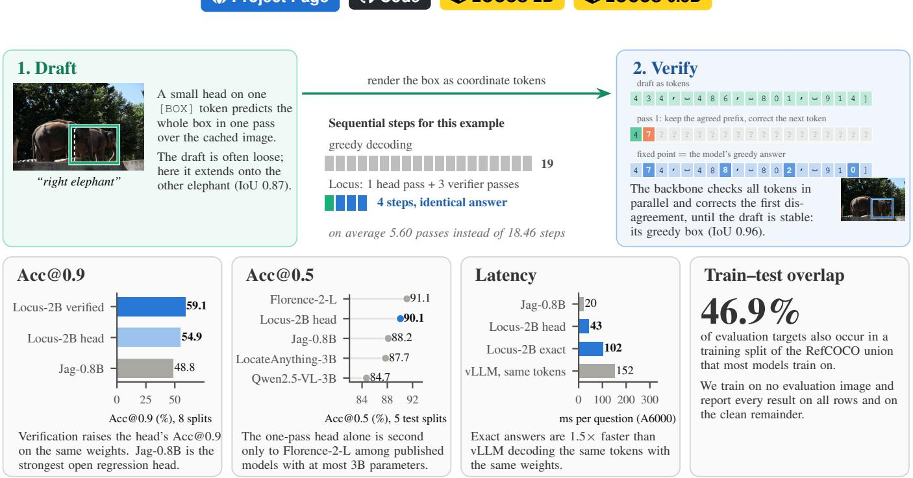  
Figure 1: Overview of Locus. Top: a box head drafts the box in one pass (green), and the backbone verifies the draft as coordinate tokens in a few parallel passes (blue), returning its own greedy answer. Bottom: accuracy at IoU 0.9 and 0.5, latency, and the overlap between RefCOCO-family training and evaluation targets. All numbers are measured in our harness unless marked as reported; latency is on one RTX A6000 at batch 1.

## Abstract

Vision-language models (VLMs) ground a referring expression in one of two ways. They decode the box as coordinate tokens, which is precise but takes one sequential step per token, or they regress it from a hidden state with a small head, which takes one step but loses accuracy at high IoU. The two fail differently: a head usually finds the right object but places its edges loosely, while coordinate tokens place edges precisely. We therefore use the regression head as a speculative drafter for the model’s own coordinate tokens. Locus writes the head’s box as coordinate tokens and checks them with the same backbone by Jacobi iteration over a shared image prefix. The fixed point is the model’s greedy coordinate-token answer, reached in about 5.60 sequential passes on average instead of 18.46 decoding steps; head and verifier are one set of weights, trained jointly. On the 8 RefCOCO, RefCOCO+ and RefCOCOg splits, verification raises Locus-2B’s Acc@0.9 from 54.87 for its own head to 59.13, and the one-pass head is ahead at Acc@0.5 of every published model with at most 3B parameters except Florence-2-L. Against Jag, the strongest open regression-head model, at its own size and training budget, Locus ties at Acc@0.5 and, with typical acceptance, gains +4.52 points at Acc@0.9, with paired significance tests. Exact answers come 1.5× faster than vLLM greedy-decoding the same coordinate tokens with the same weights; a pure regression head remains faster still.

## 1 Introduction

Referring-expression grounding asks a model to return the box of the object a phrase describes, a building block of visual question answering, interactive image editing and agents that act on what they see. Modern VLMs answer by writing the box as text: Qwen-VL and its successors [1, 2], Shikra [8], Kosmos-2 [22], Ferret [30] and Florence-2 [28] decode four coordinates token by token. Coordinate tokens are precise, because each one is conditioned on the image and on the coordinates already written, but a box costs about 18.46 sequential decoding steps.

Regression heads remove that cost but lose precision. Jag [36] attaches a 0.53M-parameter MLP to the last input token of a 0.8B VLM and predicts all four coordinates in one forward pass. It matches coordinate-token decoding at Acc@0.5 at a fraction of the latency, but its own matchedbackbone ablation shows the price: decoding remains clearly better at Acc@0.75 and Acc@0.9. The two outputs fail in different ways. Without any grounding fine-tuning, Qwen3- VL-2B’s greedy coordinate tokens trail Jag at Acc@0.5 (88.53 vs 91.50) yet lead it at Acc@0.9 (59.56 vs 48.83, Table 7). The same holds within one model that has both outputs on the same weights (Locus-2B: 90.01 vs 89.30 at Acc@0.5, 54.87 vs 59.13 at Acc@0.9, head vs tokens). The head more often finds the right object, and the tokens place its edges more exactly.

Speculative decoding [6, 17] addresses the same trade-off in text generation: a cheap drafter proposes tokens, the exact model verifies them in parallel, and the output is the exact model’s. Locus (Fig. 1) applies it to grounding, with a box head on the same backbone as the drafter in place of a smaller language model. The head’s box is written in the verifier’s own coordinate tokens, and the backbone checks every token at once by Jacobi iteration [23] over a cached image prefix, keeping the prefix it agrees with and correcting the rest. Because the head usually finds the right object, a draft is typically wrong only in a few digits, and a few passes reach the fixed point, which is the backbone’s greedy coordinate-token answer. The image is encoded once, and every pass is a short branch of a few tokens.

## Contributions.

• Draft-and-verify grounding. A box head drafts the box, and the backbone’s own coordinate-token decoding verifies it. With exact acceptance the output equals the greedy coordinate-token answer (identical on every one of 505 questions in fp32, and within the rounding that already makes bf16 greedy decoding irreproducible), in 5.60 sequential passes on average. Typical acceptance [5] trades exactness for fewer passes (Section 3.3).

• Joint training. Head and verifier share one set of weights and are trained together, on one image prefill per step with isolated question branches; two separately trained models are no more accurate and need two prefills (Section 5.6). A dual mode keeps answers to other questions about the image exactly the base model’s (Section 3.4).

• High-IoU accuracy. On the same weights, verification raises Locus-2B’s Acc@0.9 from 54.87 to 59.13 over the 8 RefCOCO/+/g splits (Section 5.2). At the size and training budget of Jag, the strongest open regression head, Locus ties it at Acc@0.5 and, with typical acceptance, gains +4.52 points at Acc@0.9 (paired Mc-Nemar tests and an image-level bootstrap, Section 5.3). The one-pass 2B head alone is ahead at Acc@0.5 of every published model with at most 3B parameters except Florence-2-L (Section 5.1).

• Latency. Locus’s exact answers are 1.5× faster than vLLM decoding the same model’s coordinate tokens (2.9× faster than the base model’s full JSON answer); a pure regression head is faster still (Section 5.5).

We also make the evaluation stricter. The RefCOCO, RefCOCO+ and RefCOCOg splits are drawn per dataset, and 46.9% of their evaluation rows ask about an object that is in another dataset’s training split; models trained on the union of the three, as is common, have seen those objects. We train on no evaluation image and report results both on all rows and on the clean rows. There, Locus-0.8B’s head, which ties Jag-0.8B at Acc@0.5 on all rows, is ahead (+0.50, Section 5.4).

Scope. Our main comparison is with regression heads. A larger model trained on more data, LocateAnything-3B [25], remains ahead of Locus at high IoU (Section 5.2). Like Jag, Locus is trained on the RefCOCO family alone, and on Ref-L4’s Objects365 images, whose targets are smaller than any in RefCOCO, both fall far below the zero-shot base model (Table 3).

## 2 Related Work

Coordinate-token grounding. Most VLMs ground an expression by writing its box as text, as plain numbers in Shikra [8] and the Qwen-VL family [1, 2], location tokens in Kosmos-2 [22], Florence-2 [28] and PaliGemma [4], and hybrid region features in Ferret [30]. Recent work changes the vocabulary or the order: Hi-Token [35] gives each axis and digit position its own tokens, and LocateAnything [25] emits a whole box per step. All of them still produce the answer by decoding. In Locus such a model is the verifier, and Locus reaches its greedy answer in fewer sequential steps.

Regression and decoder heads on VLMs. Jag [36] regresses the box from the last input token with a small MLP, and is the closest work: our drafter follows its design. Earlier systems route a special token’s embedding to a separate decoder: NExT-Chat [32] for boxes, LISA [16] for masks, and VisionLLM v2 [26] for many task decoders. Our head also predicts an IoU-aware confidence, as dense detectors do [18, 27, 33]. All of these systems return the head’s output as the answer; Locus returns it only after the coordinate-token model agrees.

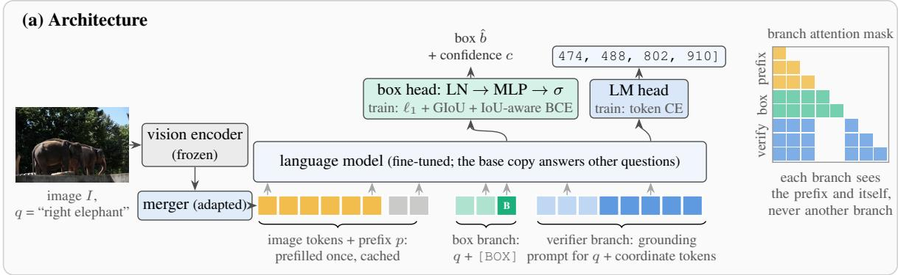

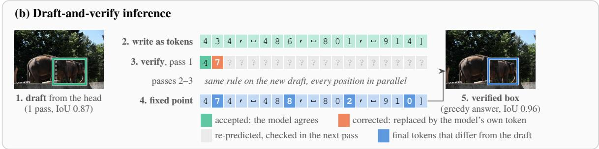  
Figure 2: Architecture and inference of Locus, illustrated with Locus-2B on the RefCOCO val expression “right elephant” (dashed white: ground truth). (a) The image and a fixed prefix are prefilled once. Each question then runs as a short branch over the cached prefix (attention mask on the right), so all box and verifier branches of an image share one prefill. The head reads the final state of the learned [BOX] token; the verifier branch is the backbone’s own grounding prompt, read by its LM head. Head and verifier are trained jointly. (b) The head’s box is rendered as the coordinate tokens the model would write, and the mode checks all of them in one parallel pass, keeping the longest prefix it agrees with (green) and correcting the next token (orange) Repeating this until the draft stops changing yields the model’s greedy answer, here in 3 passes instead of 19 decoding steps. Blue tokens are those that verification changed.

Speculative and parallel decoding. Speculative decoding [6, 17] drafts tokens with a small model and verifies them with the target model in one parallel pass, preserving the target distribution. Medusa [5] drafts with extra heads on the target model and introduces typical acceptance; Jacobi decoding [23] and lookahead decoding [10] iterate a whole draft to its fixed point. Their drafts are tokens, from a smaller language model, from extra token heads or from the target itself. Ours is a regression head trained on ground-truth boxes, whose continuous output is rendered into the verifier’s tokens, and it drafts the entire answer at once.

Shared-prefix computation. Prefix caching and sharedprefix attention [13, 34] reuse one prompt’s keys and values across requests. We use the same idea inside one request: the image is encoded once and every question, draft and verification pass is a branch over its cache.

## 3 Method

Locus has three parts that share one image prefill: a box head that drafts (Section 3.2), a verifier that checks the draft with the backbone’s own coordinate tokens (Section 3.3), and a training recipe that learns both in one set of weights (Section 3.4). Figure 2 shows the whole pipeline on one question.

## 3.1 Shared prefill and question branches

Verification runs several passes per question, and a request may ask several questions about one image; encoding the image again for each would cost more than the passes save. Let I be an image and $q _ { 1 } , \ldots , q _ { Q }$ the expressions to ground in it. The backbone encodes $[ I ; p ]$ once, where p is a fixed instruction prefix, and caches the resulting keys and values (or recurrent states, for hybrid backbones). Each question then runs as a branch: a short token sequence that attends to the cached prefix and to itself but not to other branches. A branch is therefore exactly what a separate request with the same prefix would compute, while the image costs one encoder and one prefill per image rather than per question. Box, verifier and decision questions are all branches of this kind.

## 3.2 Box head (drafter)

A box branch is the expression followed by a box-query token with a learned embedding. Following Jag, a small MLP reads the final-layer state h of that token and predicts a normalised box $\hat { b } = \sigma ( \mathrm { M L P } ( \mathrm { L N } ( h ) ) )$ ) in centre-size form, together with a confidence logit c. The head is trained with $\mathcal { L } _ { \mathrm { b o x } } = 5 \Vert \hat { b } -$ $b \| _ { 1 } + 2 \left( 1 - \mathrm { G I o U } ( \hat { b } , b ) \right)$ and an IoU-aware binary crossentropy that targets $\mathbf { 1 } [ \mathrm { I o U } ( \hat { b } , b ) \geq 0 . 5 ]$ for c. One branch pass yields the draft; this is the “head” answer in our tables.

## 3.3 Coordinate-token verification

The verifier is the adapted backbone (Section 3.4) answering the grounding prompt the base model was pretrained on, e.g. “Locate q in the image and output its bbox coordinates in JSON format”, after a teacher-forced JSON preamble. The target is this model’s greedy coordinate-token answer. It is a token sequence $y ^ { * } = ( y _ { 1 } ^ { * } , \ldots , y _ { T } ^ { * } )$ spelling four integers in [0, 1000] and a closing bracket.

Rendering. The draft box is rounded to the same integer grid and tokenised exactly as the verifier would write it, giving a draft sequence $d ^ { ( 0 ) }$

Jacobi passes. Pass k runs one verifier branch on $d ^ { ( k ) }$ and reads the argmax $g _ { t }$ at every position in parallel, each conditioned on the draft before it. Let n be the length of the longest prefix with $g _ { t } ~ = ~ d _ { t } ^ { ( k ) }$ Those n tokens and the next prediction $g _ { n + 1 }$ are exact greedy tokens, because each was predicted from an exact prefix. The next draft keeps them and replaces the rest by the remaining predictions, $d ^ { ( k + 1 ) } = ( d _ { 1 : n } ^ { ( k ) } , g _ { n + 1 } , g _ { n + 2 } , . . . )$ . Iteration stops when the draft no longer changes.

Exactness. Every pass extends the verified prefix by at least one token, so the iteration reaches a fixed point within $T$ passes, and a fixed point satisfies $g _ { t } \ = \ d _ { t }$ for all t, i.e. it is the greedy decode. In practice we cap the passes at 8 and finish any unconverged row by greedy decoding from its verified prefix, so the answer is always $y ^ { * }$ . A perfect draft costs one pass; a draft wrong only in its last digits costs two or three. The greedy answer is 18.46 tokens long on average, so plain greedy decoding takes that many sequential steps; exact verification takes 5.60 at 2B (6.68 at 0.8B). 86.4% of questions reach the fixed point within 8 passes, and the greedy steps of the rest are included in these counts.

Exactness in fp32. The argument assumes each position’s argmax does not depend on how the computation is batched. In fp32 that holds for our implementation: on 505 RefCOCO val questions the verified box equals the greedy box every time (0.0% differ, Table 8).

Exactness in bf16. In bf16 the assumption fails for greedy decoding itself. Rerunning plain greedy decoding with two images per batch instead of one changes 48.9% of the boxes, and switching to CUDA graphs changes 51.3%, almost always by 2 units of the 0–1000 grid on one coordinate, where two digits are nearly tied. Verification differs from greedy decoding at the same rate (35.4% of all 10,834 val questions on our accuracy path, median 2 units) with the same accuracy (Acc@0.5 92.14 vs. 92.16, Acc@0.9 61.89 vs. 61.80). “Exact” therefore means exact up to the rounding that makes bf16 greedy decoding irreproducible in the first place. Rounding also costs passes: tied digits can flip between passes, and the same 505 questions converge in 4.39 passes in fp32 against 5.66 in bf16.

Typical acceptance. With $\alpha \ : < \ : 1$ , a draft token is also accepted when the verifier assigns it at least α times the probability of its argmax [5]. The answer is then the head’s box unless the verifier clearly disagrees, and is no longer guaranteed to equal $y ^ { * }$ . We choose $\alpha \in \{ 0 . 7 , 0 . 5 , 0 . 3 \}$ on RefCOCO val only.

## 3.4 Training one model for both roles

We train the box head jointly with the language model and vision merger, fully fine-tuned as in Jag (the ablation also uses a LoRA adapter [12] on the same modules). Each step prefills a batch of images once and runs, per image, up to four box branches and the same number of verifier branches whose targets are the ground-truth boxes rendered as coordinate tokens. The loss is the head loss plus the verifier’s token cross-entropy with weight 1. Because the weights are shared, one image prefill serves both roles at inference. Joint training is as accurate as training two separate models (Section 5.6).

Dual mode. The trained weights serve box and verifier branches and the image prefill; any other question about the same image is answered by the base weights (an unloaded adapter, or a kept base copy after full fine-tuning), so its answer is exactly the base model’s. The cost is a second, basemodel prefill when a request mixes box and non-box questions, and for full fine-tuning a second copy of the weights. An activated LoRA (aLoRA) [11] avoids the second prefill: the adapter is active only from the box-query token onwards, so the image prefill is the base model’s and is shared by every kind of question. The price is that the image states are never adapted, which costs grounding accuracy, most of all at high IoU (Section 5.6). We use dual mode.

## 4 Experimental Setup

Backbones. Our main model uses Qwen3-VL-2B [2]. For the equal-size comparison we use Qwen3.5-0.8B, Jag’s own backbone, a hybrid of Gated DeltaNet linear-attention and full-attention layers.

Training data. We train on the RefCOCO, RefCOCO+ and RefCOCOg [15, 21, 31] training splits after removing every image that appears in any evaluation split. The standard union of these training sets shares images with the evaluation splits of the other datasets; we do not train on those images. The RefCOCO-family splits are drawn per dataset, so 46.9% of the evaluation rows (44.5–52.4% per split) have a target object that occurs in the training split of another dataset. Most published models, Jag included, train on that union. We report every comparison on all rows and, as fixed before any results, on the clean rows whose target object is in no training split, which no model in our tables has seen (Section 5.4).

Training budget. Locus-0.8B and Locus-2B fully fine-tune the language model and vision merger for 36k steps of 4 images × 4 expressions, which is 2.00 epochs of our training set, the same budget as Jag. The 2B LoRA variants of the ablation (r = 64, optionally plus a LoRA on the vision merger) use 12k steps. A 54k-step (3-epoch) run is reported separately as more budget than Jag.

Evaluation. We report Acc@0.5, Acc@0.75 and Acc@0.9 on the 8 val/test splits of RefCOCO, RefCOCO+ and Ref-COCOg, and their unweighted mean. τ and α are chosen on RefCOCO val and applied unchanged to the other splits. Locus sees each image at its 6402-pixel training budget and Jag at its own 5122; we also run each at the other’s resolution.

Outside RefCOCO. Ref-L4 test [7] has 31,921 expressions with ground-truth boxes, averaging 24 words. Its 12,032 Objects365 [24] rows are on images no model here was trained on. Its COCO images all come from RefCOCO-family evaluation annotations, and 12,085 rows are on images that are also in a RefCOCO-family training split, which models trained on the union have seen; we report the 7,804 COCO rows on the other images separately. Every model runs exactly as in its RefCOCO evaluation, with no Ref-L4 tuning.

Baselines. We run every baseline with its released weights in our harness on exactly our rows. Jag-0.8B is the strongest open regression-head model; its 2B model is not released. We score the zero-shot coordinate-token answers of Qwen3- VL-2B and -4B with their native grounding prompt (greedy, 0–1000 coordinates); these were run on the first 3000 rows of RefCOCO val, testA and testB, and all systems are rescored on exactly those rows for that comparison. We run the released LocateAnything-3B [25] on all 8 splits with its model-card single-instance prompt, hybrid parallel box decoding, greedy, bf16, batch 1 and native image resolution; on RefCOCO testA it reaches Acc@0.5 94.04, against the 93.23 reported by Jag. Hi-Token [35] (Qwen2.5-VL-3B with axisspecific digit tokens) and NExT-Chat-7B [32] (a box decoder on an LLM embedding) run the same way, each with its released weights, model-card prompt and greedy bf16 decoding at the resolution its processor uses; for NExT-Chat we use the README’s localisation prompt and read the box from its location decoder, without the mask head.

Latency. One RTX A6000 GPU rented from RunPod, batch 1, 5122-pixel inputs with preprocessing on the GPU, on 256 RefCOCO testA questions. Jag and Locus are timed on the same 256 images (one question each), CUDA-graphed with all graphs captured before timing; their graphed paths produce the same boxes and pass counts as eager execution. The coordinate-token baselines run in vLLM 0.31 with CUDA graphs on the same 256 images: Qwen3-VL-2B writing its full JSON answer, and, decoding only the coordinate tokens Locus verifies, Qwen3-VL-2B and Locus-2B’s own weights given the verifier’s prompt with the JSON preamble already written. Qwen3-VL-2B in Hugging Face eager is timed on 256 of the first 266 testA questions. Qwen3.5-0.8B (Jag’s base model, with Jag’s base prompt), LocateAnything-3B, Hi-Token and NExT-Chat-7B are timed on the same 256 images as Jag, with the inference code and settings of their accuracy runs. All latencies in this paper are from this one machine.

## 5 Results

## 5.1 Comparison with published models

Table 1 places Locus among published grounding models at Acc@0.5, the one metric all of them report. The one-pass Locus-2B head averages 90.1 on the 5 test splits. That is above every published model with at most 3B parameters except Florence-2-L [28] (91.1): LocateAnything-3B [25] reaches 87.7, Jag-0.8B 88.2 and Qwen2.5-VL-3B [3] 84.7. It is also above the 7B–13B coordinate-token models Qwen2.5-VL-7B (86.2), Ferret-13B [30] (85.3) and Shikra-7B [8] (82.5), and above the specialist Grounding DINO [20] (86.7). Florence-2- L is pretrained on 126M images with region-level annotations, and the 72B–78B generalists remain ahead. The largest differences between Locus and other models are at higher IoU thresholds, which this table does not report.

## 5.2 Accuracy across IoU thresholds

Table 2 compares Locus with the open grounding models we ran on exactly our rows, and Fig. 3 shows the whole IoU range; Fig. 6 shows examples. Verification adds most where a head is weakest. On the same weights, it raises Locus-2B’s Acc@0.9 from 54.87 (head) to 59.13 (exact), in 5.60 passes on average, and Locus-0.8B’s from 47.03 to 53.10. Typical acceptance keeps most of that gain with fewer passes. At Acc@0.5 the head is the more accurate output (90.01 vs 89.30 at 2B). Against regression heads, Locus-2B’s exact answer is +10.37 points above Jag-0.8B, the strongest open one, at Acc@0.9; part of that margin is the larger backbone, and Section 5.3 compares the two at equal size.

Same resolution. Locus runs at its $6 4 0 ^ { 2 }$ training budget and Jag at 5122. The resolution does not explain the gap: at $5 1 2 ^ { 2 }$ , Locus-2B’s exact answer reaches Acc@0.9 58.10 and Locus-0.8B’s 51.25, against 48.76 for Jag; given 6402, Jag reaches 46.71 (Acc@0.5 88.31).

Head and token errors. Verification inherits the precision of coordinate tokens and the recall of the head (Table 7, which also reports Qwen3-VL-4B). Without any grounding finetuning, Qwen3-VL-2B’s greedy boxes are already more precise than every head at Acc@0.9 (59.56, against 48.83 for

Table 1: Acc@0.5 against published grounding models. Rows above “Ours” are the numbers reported by each paper (source tables are listed in our repository); several papers report only test splits, so the last column averages the 5 test splits, which every row reports. Our rows (tinted) are measured in our harness. Bold: best, underlined: second best per column, among model with at most 3B parameters. Training data differ: most models train on the union of the RefCOCO-family training sets, which contains 46.9% of the evaluation targets (Section 5.4); we exclude every evaluation image.
<table><tr><td></td><td></td><td></td><td colspan="3">RefCOCO</td><td colspan="3">RefCOCO+</td><td colspan="2">RefCOCOg</td><td colspan="2">Mean</td></tr><tr><td>Model</td><td>Params</td><td>Output</td><td>val</td><td>testA</td><td>testB</td><td>val</td><td>testA</td><td>testB</td><td>val</td><td>test</td><td></td><td>all 8 5 test</td></tr><tr><td colspan="2">Specialist grounding models</td><td></td><td></td><td></td><td></td><td></td><td></td><td></td><td></td><td></td><td></td><td></td></tr><tr><td>MDETR [14]</td><td></td><td>detector</td><td>86.8</td><td>89.6</td><td>81.4</td><td>79.5</td><td>84.1</td><td>70.6</td><td>81.6</td><td>80.9</td><td>81.8</td><td>81.3</td></tr><tr><td>PolyFormer [19]</td><td></td><td>polygon tokens</td><td>90.4</td><td>92.9</td><td>87.2</td><td>85.0</td><td>89.8</td><td>78.0</td><td>85.8</td><td>85.9</td><td>86.9</td><td>86.8</td></tr><tr><td>UNINEXT [29]</td><td>0.74B</td><td>detector</td><td>92.6</td><td>94.3</td><td>91.5</td><td>85.2</td><td>89.6</td><td>79.8</td><td>88.7</td><td>89.4</td><td>88.9</td><td>88.9</td></tr><tr><td>Grounding DINO [20]</td><td></td><td>detector</td><td>90.6</td><td>93.2</td><td>88.2</td><td>88.2</td><td>89.0</td><td>75.9</td><td>86.1</td><td>87.0</td><td>87.3</td><td>86.7</td></tr><tr><td colspan="2">Vision-language models (reported)</td><td></td><td></td><td></td><td></td><td></td><td></td><td></td><td></td><td></td><td></td><td></td></tr><tr><td>Shikra-7B [8]</td><td>7B</td><td>tokens</td><td>87.0</td><td>90.6</td><td>80.2</td><td>81.6</td><td>87.4</td><td>72.1</td><td>82.3</td><td>82.2</td><td>82.9</td><td>82.5</td></tr><tr><td>Ferret-13B [30]</td><td>13B</td><td>tokens</td><td>89.5</td><td>92.4</td><td>84.4</td><td>82.8</td><td>88.1</td><td>75.2</td><td>85.8</td><td>86.3</td><td>85.6</td><td>85.3</td></tr><tr><td>NExT-Chat-7B [32]</td><td>7B</td><td>embedding + decoder</td><td></td><td>89.7</td><td>77.0</td><td></td><td>83.8</td><td>66.2</td><td></td><td>79.3</td><td></td><td>79.2</td></tr><tr><td>Florence-2-L [28]</td><td>0.77B</td><td>tokens</td><td>93.4</td><td>95.3</td><td>92.0</td><td>88.3</td><td>92.9</td><td>83.6</td><td>91.2</td><td>91.7</td><td>91.0</td><td>91.1</td></tr><tr><td>Qwen2.5-VL-3B [3]</td><td>3B</td><td>tokens</td><td>89.1</td><td>91.7</td><td>84.0</td><td>82.4</td><td>88.0</td><td>74.1</td><td>85.2</td><td>85.7</td><td>85.0</td><td>84.7</td></tr><tr><td>Qwen2.5-VL-7B [3]</td><td>7B</td><td>tokens</td><td>90.0</td><td>92.5</td><td>85.4</td><td>84.2</td><td>89.1</td><td>76.9</td><td>87.2</td><td>87.2</td><td>86.6</td><td>86.2</td></tr><tr><td>Qwen2.5-VL-72B [3]</td><td>72B</td><td>tokens</td><td>92.7</td><td>94.6</td><td>89.7</td><td>88.9</td><td>92.2</td><td>83.7</td><td>89.9</td><td>90.3</td><td>90.2</td><td>90.1</td></tr><tr><td>InternVL2.5-78B [9]</td><td>78B</td><td>tokens</td><td>93.7</td><td>95.6</td><td>92.5</td><td>90.4</td><td>94.7</td><td>86.9</td><td>92.7</td><td>92.2</td><td>92.3</td><td>92.4</td></tr><tr><td>LocateAnything-3B [25]</td><td>3B</td><td>parallel box tokens</td><td></td><td>93.2</td><td>89.3</td><td></td><td>88.0</td><td>79.6</td><td></td><td>88.5</td><td></td><td>87.7</td></tr><tr><td>Jag-0.8B [36]</td><td>0.8B</td><td>regression head</td><td></td><td>93.9</td><td>88.4</td><td></td><td>90.7</td><td>80.1</td><td></td><td>87.7</td><td></td><td>88.2</td></tr><tr><td colspan="2">Ours (measured)</td><td></td><td></td><td></td><td></td><td></td><td></td><td></td><td></td><td></td><td></td><td></td></tr><tr><td>Locus-0.8B</td><td>0.8B</td><td>head</td><td>91.0</td><td>93.8</td><td>88.0</td><td>85.6</td><td>90.6</td><td>80.7</td><td>86.9</td><td>87.0</td><td>88.0</td><td>88.0</td></tr><tr><td>Locus-2B</td><td>2B</td><td>head</td><td>93.1</td><td>94.3</td><td>90.7</td><td>87.9</td><td>91.9</td><td>83.6</td><td>88.7</td><td>89.9</td><td>90.0</td><td>90.1</td></tr><tr><td>Locus-2B</td><td>2B</td><td>head + tokens (rule)</td><td>92.5</td><td>94.0</td><td>90.0</td><td>87.6</td><td>91.7</td><td>83.4</td><td>88.0</td><td>89.6</td><td>89.6</td><td>89.7</td></tr><tr><td>Locus-2B</td><td>2B</td><td>tokens (verified)</td><td>92.1</td><td>93.9</td><td>89.5</td><td>87.3</td><td>91.5</td><td>82.8</td><td>87.8</td><td>89.3</td><td>89.3</td><td>89.4</td></tr></table>

Table 2: Grounding accuracy, mean over the 8 val and test splits of RefCOCO, RefCOCO+ and RefCOCOg, all run in our harness on the same rows. Baselines use their released weights and model-card prompts at the resolution their processor uses (†native; NExT-Chat a $3 3 6 ^ { 2 }$ padded square; Jag $5 1 2 ^ { 2 }$ pixels); Locus runs at its $6 4 0 ^ { 2 }$ training budget. Locus-0.8B uses Jag’s backbone and training budget. Passes: mean sequential branch passes per question, including the greedy steps of the few questions that do not converge within 8 Jacobi passes. Our rows are tinted.
<table><tr><td>Model</td><td>Output</td><td></td><td>Acc@0.5↑ Acc@0.75↑ Acc@0.9↑</td><td></td></tr><tr><td>Jag-0.8B</td><td>head</td><td>88.16</td><td>76.51</td><td>48.76</td></tr><tr><td>LocateAnything-3B†</td><td>box tokens</td><td>88.68</td><td>80.82</td><td>65.55</td></tr><tr><td>Hi-Token-3B†</td><td>digits</td><td>87.24</td><td>76.93</td><td>54.75</td></tr><tr><td>NExT-Chat-7B</td><td>decoder</td><td>80.14</td><td>53.42</td><td>12.48</td></tr><tr><td rowspan="3">Locus-2B</td><td>head (1 pass)</td><td>90.01</td><td>79.79</td><td>54.87</td></tr><tr><td>exact (5.60)</td><td>89.30</td><td>80.31</td><td>59.13</td></tr><tr><td>α = 0.5 (3.43)</td><td>89.60</td><td>80.49</td><td>58.95</td></tr><tr><td rowspan="3">Locus-0.8B</td><td>head (1 pass)</td><td>87.97</td><td>75.58</td><td>47.03</td></tr><tr><td>exact (6.68)</td><td>87.05</td><td>75.93</td><td>53.10</td></tr><tr><td> $\alpha = 0 . 7 ( 4 . 3 7 )$ </td><td>87.17</td><td>76.14</td><td>53.29</td></tr></table>

Jag), but 88.53 at Acc@0.5, below every fine-tuned head. The two output types fail in different ways: tokens miss the object more often, heads place its edges less exactly. Locus’s verified answer combines the head’s Acc@0.5 level (91.99) with token-level precision (60.54). Verification returns exactly the fine-tuned model’s greedy tokens, whose Acc@0.9 is only modestly above the zero-shot base’s; the head’s contribution is a draft from which those tokens are reached in 5.60 passes instead of 18.46 decoding steps, and, with the agreement rule, its own Acc@0.5.

Combining head and verifier. The head and the verifier are good at different things: the head is better at Acc@0.5 (90.01 vs 89.30), the verifier at Acc@0.9. A one-parameter agreement rule combines them: return the verified box if its IoU with the draft is at least τ, and the draft otherwise, with $\tau = 0 . 3$ chosen on RefCOCO val. It reaches 89.60 / 59.07 at Acc@0.5 / Acc@0.9, keeping nearly all of the verifier’s high-IoU gain and part of the head’s Acc@0.5 lead. A learned selector does no better (Section 5.6).

LocateAnything. LocateAnything-3B [25], which decodes its box tokens in parallel, is more accurate than Locus at high IoU. Run in our harness on the same rows, it matches Locus-2B at Acc@0.5 (88.68 vs 89.30) and is ahead at Acc@0.75 (80.82 vs 80.31) and Acc@0.9 (65.55 vs 59.13). The gap holds on the clean rows (Acc@0.9 61.82 vs 54.78). Given 5122 pixels, fewer than Locus’s 6402, it still reaches Acc@0.9 64.72 (native 65.55; Acc@0.5 88.26). It is larger and was trained on more than 138 million grounding samples [25], against our RefCOCO-family training splits.

Beyond RefCOCO. Verification helps on Ref-L4 (Table 3) as it does on RefCOCO. On COCO images in no training split, Locus-2B leads Jag at Acc@0.9 (57.09 vs 39.97) and matches the zero-shot base model (57.07). On the Objects365 images, by contrast, every RefCOCO-trained model falls far behind the zero-shot base model: Acc@0.5 is 47.81 for Locus-2B and 35.84 for Jag, against 74.45.

Other models on Ref-L4. LocateAnything-3B, trained on far more grounding data, is the best model on Objects365 (77.95, and 68.1 on the smallest quarter of targets) and on

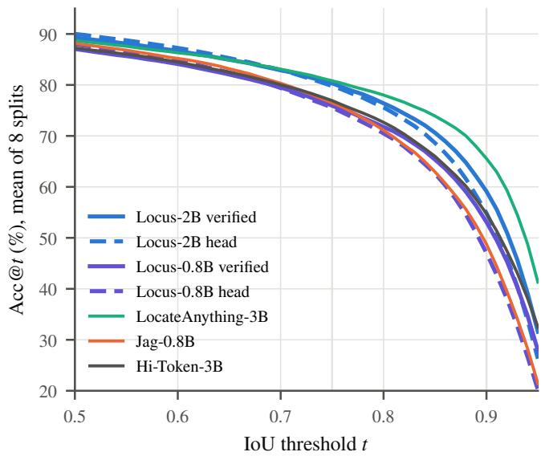  
Figure 3: Accuracy at each IoU threshold t, mean over the 8 splits, for the models of Table 2. Locus’s heads are dashed and its verified answers solid. The gap between a head and its verified answer opens above $t \approx 0 . 8 ;$ LocateAnything-3B, trained on far more grounding data, is ahead at high thresholds.

COCO at Acc@0.9 (64.38). Hi-Token, at its processor’s native resolution, fails on large images: on Objects365 its Acc@0.5 falls from 40.6 on images under 0.5 MP to 1.9 on the 1,939 rows above 4 MP, where every other model stays within ten points of its small-image accuracy.

Small targets. The Objects365 gap is target size. The median Objects365 target covers 2.4% of the image, against 15.6% in our training data, where none of the 321,327 targets is that small (1st percentile 4.9%). On the quarter of Objects365 rows with the smallest targets (at most 1.3%), Acc@0.5 is 6.2 for Locus-2B, 0.0 for Jag and 61.8 zero-shot. On the largest quarter (at least 5.8%) the three are close (84.8, 81.5, 86.8). Fine-tuning on RefCOCO alone therefore costs small-object grounding, for heads and coordinate tokens alike. The head is hit hardest: Locus-2B’s head reaches 0.0 on the smallest quarter, and verification recovers only a little of it.

Web photos. On openly licensed web photos with expressions written before either model was run, Locus-2B and Jag mostly agree; Locus’s boxes are tighter on two of 12 expressions, they disagree on one, and both fail on an object part (Fig. 7).

## 5.3 Comparison at equal size and budget

Jag-0.8B is the closest regression-head model, and Locus-0.8B uses its backbone and training budget. At Acc@0.5, the head of Locus-0.8B ties Jag (−0.19; pooled McNemar $p = 0 . 0 8 3$ , image-bootstrap 95% $\operatorname { C I } \left[ - 0 . 5 1 , + 0 . 0 8 \right] )$ ), and verification with typical acceptance $( \alpha = 0 . 7 )$ adds +4.52 points at Acc@0.9 (CI [+3.86, +5.35], $p = 7 . 2 \times 1 0 ^ { - 1 2 5 } )$ , significant on every split. Verification costs Acc@0.5 at this size (−1.11), unlike at 2B: the 0.8B verifier is weaker than its own head on easy boxes. A third epoch, more budget than Jag, brings the head to +0.13 at Acc@0.5, still a statistical tie $( p = 0 . 3 9 )$ . On all rows, the two are therefore at parity at Acc@0.5, and Locus is ahead at high IoU. On the rows neither model was trained on, the equal-budget head is ahead at Acc@0.5 as well (Section 5.4).

Table 3: Ref-L4 test: Objects365 rows (images no model was trained on), COCO rows (only images outside every Ref-COCO/+/g training split), and all 31,921 rows. Each model runs as in its RefCOCO evaluation, with no Ref-L4 tuning. Columns are Acc@0.5 and Acc@0.9. †Native resolution.
<table><tr><td rowspan="2">Model</td><td colspan="2">Objects365</td><td colspan="2">COCO</td><td colspan="2">All</td></tr><tr><td>@0.5↑ @0.9↑</td><td></td><td>@0.5↑</td><td>@0.9↑</td><td>@0.5↑</td><td>@0.9↑</td></tr><tr><td>Jag-0.8B Qwen3-VL-2B (0-shot)</td><td>35.8</td><td>7.4</td><td>89.2</td><td>40.0</td><td>70.0</td><td>33.9</td></tr><tr><td>Hi-Token-3B†</td><td>74.5</td><td>32.7</td><td>88.6</td><td>57.1</td><td>83.9</td><td>50.2</td></tr><tr><td></td><td>24.7</td><td>1.1</td><td>88.0</td><td>44.9</td><td>65.0</td><td>35.9</td></tr><tr><td>LocateAnything-3B†</td><td>78.0</td><td>49.5</td><td>90.2</td><td>64.4</td><td>86.2</td><td>60.5</td></tr><tr><td>Locus-0.8B head</td><td>39.3</td><td>9.2</td><td>89.6</td><td>43.7</td><td>71.2</td><td>32.9</td></tr><tr><td>Locus-0.8B verified</td><td>42.2</td><td>16.7</td><td>88.7</td><td>50.5</td><td>71.8</td><td>39.6</td></tr><tr><td>Locus-2B head</td><td>40.0</td><td></td><td>91.9</td><td></td><td></td><td></td></tr><tr><td></td><td></td><td>11.2</td><td></td><td>52.4</td><td>72.6</td><td>38.7</td></tr><tr><td>Locus-2B verified</td><td>47.8</td><td>18.1</td><td>90.8</td><td>57.1</td><td>75.0</td><td>44.0</td></tr></table>

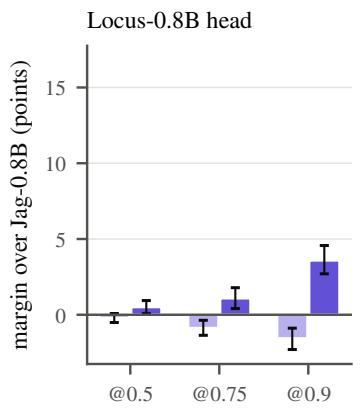

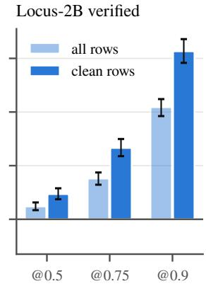  
Figure 4: Margin over Jag-0.8B on all rows and on clean rows, pooled over the 8 splits, with 95% image-bootstrap intervals. Every margin grows on the rows neither model was trained on.

## 5.4 Evaluation on clean rows

Of the evaluation rows, 46.9% ask about an object that is in another RefCOCO-family dataset’s training split, so a model trained on the union of the three training sets, as most models in Table 1 are, has seen it under other expressions. Our training set excludes every evaluation image. On the remaining clean rows no model in our tables has seen the target. Figure 4 (exact intervals in Table 9) repeats the regression-head comparison of Section 5.3 on them; Jag is trained on the union. It loses more on clean rows than Locus does (8-split mean Acc@0.5 88.16 → 85.07, against 90.01 → 88.01 for the

Table 4: Latency and accuracy, all on one RTX A6000, batch 1, 256 RefCOCO testA questions, end to end from the image file to the parsed box. Inputs are $5 1 2 ^ { 2 }$ pixels except †native resolution and ‡a 3362 padded square, as each model’s own processor requires. Engine: eager or CUDA graphs (Py-Torch), HF (Hugging Face generate, eager), own (the authors’ released inference code, eager) or vLLM (CUDA graphs). “Coord. only”: the verifier’s prompt with the JSON preamble already written, as in Locus’s verification; with Locus-2B’s weights the greedy answer is Locus-2B exact’s, whose accuracy is shown (–: not run on the accuracy rows). Steps: sequential forward passes after the image prefill (Locus: the head branch plus verifier passes; token models: generated tokens; –: not exposed by the model’s generate). Acc@0.5 and Acc@0.9: first 3000 rows of RefCOCO val, testA and testB, for Locus from runs at the timed 5122 pixels. Bold: best, underlined: second best; our rows are tinted.

<table><tr><td>System</td><td>Engine</td><td>ms ↓ Steps</td><td></td><td>@0.5↑</td><td>@0.9↑</td></tr><tr><td colspan="6">One RTX A6000, batch 1, end to end</td></tr><tr><td>Jag-0.8B</td><td>eager</td><td>53.1</td><td>0.0</td><td>91.5</td><td>48.8</td></tr><tr><td>Jag-0.8B</td><td>graphs</td><td>20.3</td><td>0.0</td><td>91.5</td><td>48.8</td></tr><tr><td>Qwen3-VL-2B tokens</td><td>HF</td><td>1484.6</td><td>41.8</td><td>88.5</td><td>59.6</td></tr><tr><td>Qwen3-VL-2B tokens</td><td>vLLM</td><td>297.2</td><td>41.8</td><td>88.5</td><td>59.6</td></tr><tr><td>coord. only Locus-2B, coord. only</td><td>vLLM</td><td>150.9</td><td>18.3</td><td></td><td></td></tr><tr><td>Qwen3.5-0.8B tokens</td><td>vLLM HF</td><td>151.6 1243.2</td><td>18.3 46.7</td><td>91.6</td><td>58.5</td></tr><tr><td>Hi-Token-3B†</td><td>HF</td><td></td><td>18.0</td><td>79.8</td><td>42.9</td></tr><tr><td>LocateAnything-3B†</td><td></td><td>577.7 347.5</td><td></td><td>90.3</td><td>53.6</td></tr><tr><td>NExT-Chat-7B</td><td>own own</td><td>436.7</td><td>一 一</td><td>91.5 84.1</td><td>66.9 12.4</td></tr><tr><td>Locus-0.8B head</td><td>graphs</td><td>25.5</td><td>1.0</td><td>90.9</td><td>45.7</td></tr><tr><td>Locus-0.8B α=0.7</td><td>graphs</td><td>57.1</td><td>5.1</td><td>89.8</td><td>51.5</td></tr><tr><td>Locus-0.8B exact</td><td>graphs</td><td>63.5</td><td>6.1</td><td>89.7</td><td>51.4</td></tr><tr><td>Locus-2B head</td><td>graphs</td><td>43.5</td><td>1.0</td><td>92.4</td><td>54.7</td></tr><tr><td>Locus-2B α=0.5</td><td></td><td></td><td></td><td></td><td></td></tr><tr><td></td><td>graphs</td><td>84.3</td><td>4.4</td><td>91.8</td><td>58.1</td></tr><tr><td>Locus-2B α=0.7</td><td>graphs</td><td>90.3</td><td>4.9</td><td>91.7</td><td>58.6</td></tr><tr><td>Locus-2B exact</td><td>graphs</td><td>102.2</td><td>5.9</td><td>91.6</td><td>58.5</td></tr><tr><td></td><td></td><td></td><td></td><td></td><td></td></tr></table>

Locus-2B head), and every margin grows. At equal size and budget the Locus-0.8B head is now ahead at Acc@0.5, +0.50 (CI [+0.07, +0.94], McNemar $p = 0 . 0 0 4 9 )$ , and the verified answers gain +10.18 points at Acc@0.9, against +4.42 on all rows. At 2B the verified Acc@0.9 gain is +15.66 points. Clean rows are harder for every model, including the untuned base model, so the drop alone does not show memorisation. On clean rows, however, neither system has seen the target object in training, so we consider this comparison the fairer one.

## 5.5 Latency

In latency, Locus sits between a regression head and a coordinate-token decoder (Table 4 and Fig. 5). Jag, Locus and the vLLM baselines share the same engineering: CUDA graphs and preprocessing on the GPU. A pure regression head is faster: Jag-0.8B takes 20.3 ms and Locus-0.8B’s head 25.5 ms, because Locus runs an image prefill followed by a question branch where Jag runs a single forward pass, and verification multiplies that cost by the number of passes. Against coordinate-token decoding the order reverses. The like-forlike reference is Locus-2B’s own weights served by vLLM, given the verifier’s prompt with the JSON preamble already written, so that it decodes exactly the 18.3 coordinate tokens Locus verifies and returns the same greedy box: it takes 151.6 ms, and Locus-2B exact takes 102.2 ms, 1.5× faster. (The two engines round differently in bf16: at $6 4 0 ^ { 2 }$ pixels 47% of the boxes are identical and 91% within 5 units of the coordinate grid, the same kind of difference as between two greedy runs in one engine, Table 8.) Answer length matters more than the engine: the base model decoding only its coordinates in vLLM takes 150.9 ms, and writing its full JSON answer (41.8 tokens) 297.2 ms, 2.9× Locus-2B exact. Locus is thus slower than a pure regression head and modestly faster than decoding the same coordinate tokens.

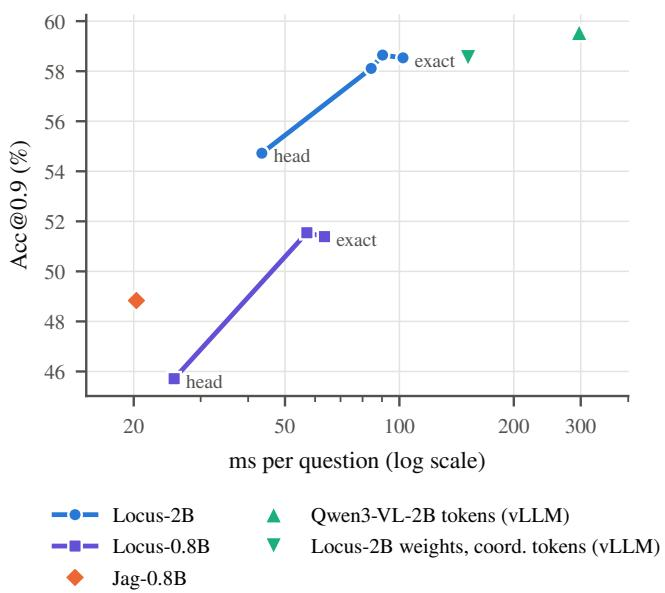  
Figure 5: Acc@0.9 against measured latency (RTX A6000, batch 1, 256 RefCOCO testA questions, every system with CUDA graphs). Each Locus line runs from the one-pass head through typical acceptance (α = 0.5, 0.7; 2B only for 0.5) to exact verification. Accuracy is on the first 3000 rows of RefCOCO val, testA and testB, where the coordinate-token baseline was run, with Locus at the timed $5 1 2 ^ { 2 }$ pixels. Qwen3- VL-2B decodes its full JSON answer (41.8 tokens on average) in vLLM.

Released grounding models. Measured on the same GPU, the released LocateAnything-3B, Hi-Token and NExT-Chat-7B models take 347.5, 577.7 and 436.7 ms, against 43.5 ms for the Locus-2B head and 102.2 ms for exact verification. They run their authors’ inference code without CUDA graphs, so with the same engineering each would be faster than measured here. These numbers are therefore only indicative.

Several questions per image. Locus prefills the image once and runs every question as a branch, so its head costs almost the same for one question as for eight (43.7 vs 53.1 ms, Table 5), 6.6 ms per question at Q = 8 against 15.9 ms for Jag, which must encode the image with every question. Jag remains faster at $Q \le 2$ . Verification gains less: the questions of one image are verified together, and the request waits for the slowest of them (10.3 sequential passes at Q = 8, including greedy steps after the cap of 8), so exact answers cost 35.9 ms per question at Q = 8, still more than Jag’s head.

Table 5: Latency (ms, end to end, batch of one image) with Q questions about the same image, on 128 RefCOCO testA images that have at least 8 expressions; same GPU and engineering as Table 4. Jag has no shared prefill and is served the faster of Q graphed requests and one batch of Q. Typical: α = 0.5.
<table><tr><td colspan="2">Jag-0.8B</td><td colspan="3">Locus-2B</td></tr><tr><td>Q</td><td>head</td><td>head</td><td>typical</td><td>exact</td></tr><tr><td>1</td><td>20.2</td><td>43.7</td><td>79.8</td><td>94.5</td></tr><tr><td>2</td><td>37.4</td><td>44.5</td><td>94.0</td><td>117.0</td></tr><tr><td>4</td><td>71.6</td><td>46.7</td><td>123.3</td><td>163.8</td></tr><tr><td>8</td><td>127.3</td><td>53.1</td><td>197.1</td><td>287.3</td></tr><tr><td>per question at 8</td><td>15.9</td><td> $Q = 8$  6.6</td><td>24.6</td><td>35.9</td></tr></table>

## 5.6 Ablations

Table 6: Ablations on adapter placement, adapted modules, and joint versus separate training. Mean over the 8 splits. All variants but separate train the head and the verifier jointly, as one model; tinted rows are the configurations we report as Locus. ‡ Evaluated on a different inference path; pass counts are only comparable within a path.

<table><tr><td rowspan="2">Variant</td><td colspan="2">Head</td><td colspan="2">Verified (exact)</td></tr><tr><td>@0.5↑</td><td>@0.9↑</td><td>@0.5↑</td><td>@0.9↑ Passes ↓</td></tr><tr><td colspan="5">Qwen3.5-0.8B, 36k steps (2 epochs)</td></tr><tr><td>Joint aLoRA</td><td>87.36</td><td>33.58</td><td>86.36</td><td>49.79 7.98</td></tr><tr><td>Dual LoRA</td><td>88.06</td><td>45.72</td><td>86.81 52.52</td><td>7.22</td></tr><tr><td>+ merger LoRA</td><td>87.87</td><td>46.13</td><td>86.65 52.72</td><td>7.30</td></tr><tr><td>Dual full FT (Locus)</td><td>87.97</td><td>47.03</td><td>87.05 53.10</td><td>6.68</td></tr><tr><td>separate head, verifier</td><td>87.66</td><td>46.64</td><td>86.18</td><td>52.25 6.47</td></tr><tr><td>54k steps (3 epochs)</td><td>88.29</td><td>48.86</td><td>86.99 52.23</td><td>6.82</td></tr><tr><td colspan="5">Qwen3-VL-2B, 12k steps unless stated</td></tr><tr><td>Joint aLoRA</td><td>88.70</td><td>37.57</td><td>88.05</td><td>60.29 _‡</td></tr><tr><td>Dual LoRA</td><td>89.73</td><td>43.09</td><td>88.74 60.29</td><td>7.07</td></tr><tr><td>+ merger LoRA</td><td>89.81</td><td>44.80</td><td>88.78 60.51</td><td>6.86</td></tr><tr><td>Dual full FT, 36k steps (Locus)</td><td>90.01</td><td>54.87</td><td>89.30 59.13</td><td>5.60</td></tr></table>

Dual mode vs aLoRA. With an activated LoRA the image states stay those of the base model, and only the box and verifier branches are adapted. This is cheap to serve but costs the head most of its precision: at 0.8B the aLoRA head reaches 33.58 Acc@0.9 against 45.72 in dual mode, and at 2B 37.57 against 43.09 (Table 6). Adapting the image prefill matters for a head that reads one token’s state, much less for the verifier, which writes the box token by token: the verified Acc@0.9 differs by at most a few points across all variants.

At 0.8B the aLoRA draft also agrees less with the verifier (7.98 vs 7.22 passes).

What to adapt. A LoRA on the vision merger mainly sharpens the 2B head (Acc@0.9 43.09 → 44.80) and leaves the verified answers almost unchanged; at 0.8B it moves every number by less than half a point. Full fine-tuning of the language model and merger, as Jag does, gives the best 0.8B head and verifier at Acc@0.9. At 2B, full fine-tuning for 2 epochs lifts the head much further (Acc@0.9 44.80 → 54.87) and cuts the passes from 6.86 to 5.60, while the verified Acc@0.9 moves little (60.51 vs 59.13); we use it as Locus-2B. A third epoch improves the 0.8B head further (88.29 / 48.86) but exceeds the 2-epoch budget of Section 5.3.

Separate head and verifier. Training the head and the verifier as two models, each fully fine-tuned for 36k steps (twice the training compute), does no better than one joint model: head Acc@0.5 87.66 vs 87.97, verified Acc@0.5 86.18 vs 87.05 and Acc@0.9 52.25 vs 53.10, at a similar pass count (6.47 vs 6.68; Table 6). The pair also needs two image prefills and two copies of the weights at inference.

Typical acceptance. Figure 5 and Table 10 sweep α. Lowering it moves the answer towards the head: Acc@0.5 rises towards the head’s, Acc@0.9 falls towards it, and the pass count drops from 5.60 to 2.64. α = 0.7, chosen on RefCOCO val, costs Acc@0.9 only 59.13 → 59.24 for 4.04 passes.

Two further ideas did not help, a learned head-versusverifier selector and distilling the head on the verifier’s own greedy boxes (Section A.2).

## 6 Limitations and Conclusion

Limitations. Locus is slower than a pure regression head with equal engineering, and verification adds passes in proportion to how often the draft is wrong. At 0.8B the verifier lowers Acc@0.5, so the method’s benefit at that size is high-IoU accuracy only. Its boxes are at most as tight as the model’s own coordinate tokens, and LocateAnything-3B, larger and trained on more data, remains ahead at high IoU even at 5122 pixels. Exactness holds for the adapted model’s greedy decode, not for any other model, and typical acceptance gives it up. In bf16 it holds only up to rounding: most verified boxes differ from a greedy run by a unit of the coordinate grid, as greedy runs with different batch shapes differ from each other. Dual mode needs a second prefill when one request mixes box and non-box questions on the same image. We train on RefCOCO-family data only. On Ref-L4’s Objects365 images, where half the targets are smaller than every RefCOCO-family training target, Locus-2B reaches Acc@0.5 47.81 where its zero-shot base model reaches 74.45 (Table 3); Jag drops the same way. Adding training data with small targets may close this gap; we have not tested it. Our backbones stop at 2B.

Conclusion. A regression head and coordinate-token decoding fail in different ways: the head usually finds the object, and the tokens place its edges. Locus treats the head as a speculative drafter for the model’s own coordinate tokens, so the answer is the model’s greedy box, reached in 5.60 passes, each checking every token in parallel, instead of 18.46 decoding steps. This recovers the high-IoU accuracy that regression heads give up (Acc@0.9 54.87 → 59.13 at 2B on the same weights, and +4.52 points over Jag at its size and budget, with typical acceptance), and the answer is exact up to the rounding that affects greedy decoding equally. The same recipe could apply wherever a cheap head can draft a short structured answer that a VLM would otherwise decode token by token, such as points, keypoints or several boxes per expression; we leave these, and larger backbones, to future work.

## References

[1] Jinze Bai et al. Qwen-VL: A versatile vision-language model for understanding, localization, text reading, and beyond. arXiv preprint arXiv:2308.12966, 2023.

[2] Shuai Bai, Yuxuan Cai, Ruizhe Chen, Keqin Chen, et al. Qwen3-VL technical report. arXiv preprint arXiv:2511.21631, 2025.

[3] Shuai Bai, Keqin Chen, Xuejing Liu, et al. Qwen2.5-VL technical report. arXiv preprint arXiv:2502.13923, 2025.

[4] Lucas Beyer et al. PaliGemma: A versatile 3B VLM for transfer. arXiv preprint arXiv:2407.07726, 2024.

[5] Tianle Cai et al. Medusa: Simple LLM inference acceleration framework with multiple decoding heads. In ICML, 2024.

[6] Charlie Chen et al. Accelerating large language model decoding with speculative sampling. arXiv preprint arXiv:2302.01318, 2023.

[7] Jierun Chen, Fangyun Wei, Jinjing Zhao, Sizhe Song, et al. Revisiting referring expression comprehension evaluation in the era of large multimodal models. arXiv preprint arXiv:2406.16866, 2024.

[8] Keqin Chen et al. Shikra: Unleashing multimodal LLM’s referential dialogue magic. arXiv preprint arXiv:2306.15195, 2023.

[9] Zhe Chen, Weiyun Wang, Yue Cao, et al. Expanding performance boundaries of open-source multimodal models with model, data, and test-time scaling. arXiv preprint arXiv:2412.05271, 2024.

[10] Yichao Fu, Peter Bailis, Ion Stoica, and Hao Zhang. Break the sequential dependency of LLM inference using lookahead decoding. In ICML, 2024.

[11] Kristjan Greenewald, Luis Lastras, Thomas Parnell, Vraj Shah, et al. Activated LoRA: Fine-tuned LLMs for intrinsics. arXiv preprint arXiv:2504.12397, 2025.

[12] Edward J. Hu et al. LoRA: Low-rank adaptation of large language models. In ICLR, 2022.

[13] Jordan Juravsky et al. Hydragen: High-throughput LLM inference with shared prefixes. arXiv preprint arXiv:2402.05099, 2024.

[14] Aishwarya Kamath, Mannat Singh, Yann LeCun, et al. MDETR – modulated detection for end-to-end multi-modal understanding. In ICCV, 2021.

[15] Sahar Kazemzadeh, Vicente Ordonez, Mark Matten, and Tamara Berg. ReferItGame: Referring to objects in photographs of natural scenes. In EMNLP, 2014.

[16] Xin Lai et al. LISA: Reasoning segmentation via large language model. In CVPR, 2024.

[17] Yaniv Leviathan, Matan Kalman, and Yossi Matias. Fast inference from transformers via speculative decoding. In ICML, 2023.

[18] Xiang Li et al. Generalized focal loss: Learning qualified and distributed bounding boxes for dense object detection. In NeurIPS, 2020.

[19] Jiang Liu, Hui Ding, Zhaowei Cai, et al. PolyFormer: Referring image segmentation as sequential polygon generation. In CVPR, 2023.

[20] Shilong Liu, Zhaoyang Zeng, Tianhe Ren, et al. Grounding DINO: Marrying DINO with grounded pre-training for open-set object detection. arXiv preprint arXiv:2303.05499, 2023.

[21] Junhua Mao et al. Generation and comprehension of unambiguous object descriptions. In CVPR, 2016.

[22] Zhiliang Peng et al. Kosmos-2: Grounding multimodal large language models to the world. arXiv preprint arXiv:2306.14824, 2023.

[23] Andrea Santilli et al. Accelerating transformer inference for translation via parallel decoding. In ACL, 2023.

[24] Shuai Shao, Zeming Li, Tianyuan Zhang, Chao Peng, et al. Objects365: A large-scale, high-quality dataset for object detection. In ICCV, 2019.

[25] Shihao Wang, Shilong Liu, Yuanguo Kuang, Xinyu Wei, et al. LocateAnything: Fast and high-quality vision-language grounding with parallel box decoding. arXiv preprint arXiv:2605.27365, 2026.

[26] Jiannan Wu, Muyan Zhong, Sen Xing, et al. VisionLLM v2: An end-to-end generalist multimodal large language model for hundreds of vision-language tasks. In NeurIPS, 2024.

[27] Shengkai Wu, Xiaoping Li, and Xinggang Wang. IoU-aware single-stage object detector for accurate localization. Image and Vision Computing, 2020.

[28] Bin Xiao et al. Florence-2: Advancing a unified representation for a variety of vision tasks. In CVPR, 2024.

[29] Bin Yan, Yi Jiang, Jiannan Wu, et al. Universal instance perception as object discovery and retrieval. In CVPR, 2023.

[30] Haoxuan You et al. Ferret: Refer and ground anything anywhere at any granularity. arXiv preprint arXiv:2310.07704, 2023.

[31] Licheng Yu, Patrick Poirson, Shan Yang, Alexander C. Berg, and Tamara L. Berg. Modeling context in referring expressions. In ECCV, 2016.

[32] Ao Zhang, Yuan Yao, Wei Ji, Zhiyuan Liu, and Tat-Seng Chua. NExT-Chat: An LMM for chat, detection and segmentation. In ICML, 2024.

[33] Haoyang Zhang et al. VarifocalNet: An IoU-aware dense object detector. In CVPR, 2021.

[34] Lianmin Zheng, Liangsheng Yin, Zhiqiang Xie, et al. SGLang: Efficient execution of structured language model programs. In NeurIPS, 2024.

[35] Xiuyuan Zhu, Ke Lu, Kun Dong, Siwen Jiao, Hao Wu, Zijin Du, Shun Mao, Dongming Zhang, and Jian Xue. Hi-Token: Hierarchical coordinate tokenization for generative visual grounding. arXiv preprint arXiv:2608.03471, 2026.

[36] Xiuyuan Zhu, Ke Lu, Hao Wu, Zijin Du, et al. Jag: Direct box prediction for efficient visual grounding. arXiv preprint arXiv:2610.13239, 2026.

## A Supplementary material

## A.1 Additional tables

Table 7: Coordinate-token decoding without grounding finetuning, on the first 3000 rows of RefCOCO val, testA and testB (mean of the three), with every system scored on exactly these rows. The Qwen models’ pretraining includes RefCOCO training data.

<table><tr><td>Model</td><td></td><td>Output Acc@0.5↑ Acc@0.75↑ Acc@0.9↑</td><td></td><td></td></tr><tr><td rowspan="3">Qwen3-VL-2B, zero-shot tokens Qwen3-VL-4B, zero-shot tokens Jag-0.8B</td><td></td><td>88.53</td><td>79.52</td><td>59.56</td></tr><tr><td></td><td>90.60</td><td>81.44</td><td>61.92</td></tr><tr><td>head</td><td>91.50</td><td>78.81</td><td>48.83</td></tr><tr><td>Locus-0.8B</td><td>head</td><td>91.46</td><td>78.57</td><td>47.46</td></tr><tr><td rowspan="3">Locus-2B</td><td>verified</td><td>90.30</td><td>78.84</td><td>53.97</td></tr><tr><td>head</td><td>93.09</td><td>82.58</td><td>55.81</td></tr><tr><td>verified</td><td>91.99</td><td>82.86</td><td>60.54</td></tr></table>

Table 8: Exactness in floating point (Locus-2B, RefCOCO val; the 505-row runs are its first questions). Differ: % of boxes with any coordinate different; ≥10: % whose largest coordinate change of at least 10 on the 0–1000 grid. Passes: mean verifier passes, against 18.44 greedy steps.
<table><tr><td>Compared</td><td>Path</td><td>Rows</td><td>Differ</td><td>≥10</td><td>Passes</td></tr><tr><td>ver. vs. greedy</td><td>graphed, bf16</td><td>10,834</td><td>35.4</td><td>2.9</td><td>5.41</td></tr><tr><td>ver. vs. greedy</td><td>eager, bf16</td><td>505</td><td>38.6</td><td>1.4</td><td>5.66</td></tr><tr><td>ver. vs. greedy</td><td>eager, fp32</td><td>505</td><td>0.0</td><td>0.0</td><td>4.39</td></tr><tr><td>greedy vs. greedy</td><td>batch 2/1</td><td>505</td><td>48.9</td><td>2.8</td><td>一</td></tr><tr><td>greedy vs. greedy</td><td>eager/graphed</td><td>505</td><td>51.3</td><td>3.6</td><td>一</td></tr><tr><td>greedy vs. greedy</td><td>bf16/fp32</td><td>505</td><td>56.6</td><td>5.0</td><td>一</td></tr></table>

Table 9: The comparison restricted to evaluation rows whose target object is in no RefCOCO-family training split (46.9% of rows are excluded). Pooled over the 8 splits, row-weighted; CI from a bootstrap over images.
<table><tr><td rowspan="2">Model</td><td rowspan="2">Output</td><td colspan="3">∆ vs Jag-0.8B, clean rows (95% CI)</td></tr><tr><td>Acc@0.5</td><td>Acc@0.75</td><td>Acc@0.9</td></tr><tr><td rowspan="3">Locus-2B</td><td>head</td><td>+2.95</td><td>+5.90</td><td>+11.03</td></tr><tr><td rowspan="2">verified</td><td>[+2.50, +3.46]</td><td>[+5.15, +6.68]</td><td>[+9.98, +12.13]</td></tr><tr><td>+2.35</td><td>+6.65</td><td>+15.66</td></tr><tr><td rowspan="3">Locus-0.8B</td><td></td><td>[+1.87, +2.89]</td><td>[+5.88, +7.48]</td><td>[+14.58, +16.80]</td></tr><tr><td>head</td><td>+0.50</td><td>+1.08</td><td>+3.58</td></tr><tr><td rowspan="3">typical</td><td>[+0.07,+0.94]</td><td>[+0.41,+1.79]</td><td>[+2.70, +4.57]</td></tr><tr><td></td><td>-0.10</td><td>+2.07</td><td>+10.15</td></tr><tr><td></td><td>[−0.58,+0.40]</td><td>[+1.36, +2.81]</td><td>[+9.18, +11.16]</td></tr></table>

Table 10: Effect of the typical-acceptance threshold α (Locus-2B, mean over the 8 splits).
<table><tr><td>Acceptance</td><td>Acc@0.5↑</td><td>Acc@0.75↑</td><td>Acc@0.9↑</td><td>Passes ↓</td></tr><tr><td>exact (α = 1)</td><td>89.30</td><td>80.31</td><td>59.13</td><td>5.60</td></tr><tr><td> $\alpha = 0 . 7$ </td><td>89.44</td><td>80.37</td><td>59.24</td><td>4.04</td></tr><tr><td> $\alpha = 0 . 5$ </td><td>89.60</td><td>80.49</td><td>58.95</td><td>3.43</td></tr><tr><td> $\alpha = 0 . 3$ </td><td>89.77</td><td>80.53</td><td>58.39</td><td>2.64</td></tr><tr><td>head only</td><td>90.01</td><td>79.79</td><td>54.87</td><td>0</td></tr></table>

## A.2 Negative results

Learned selector. The agreement rule uses one feature. We also trained a small MLP on RefCOCO val to choose between the draft and the verified box from the head confidence, the pass count, the draft–verified IoU and the box geometry (5 seeds). On the 7 held-out splits it matches the rule at 2B (89.44 / 58.49 vs 89.18 / 58.67 at Acc@0.5 / Acc@0.9). At 0.8B it gains Acc@0.5 over the rule (87.33 vs 86.97) but stays below Jag (87.71). Which of the two boxes is better is hard to predict from these signals, so we keep the rule.

Drafter distillation. Training the 2B head on the verifier’s own greedy boxes instead of the ground truth should make drafts easier to accept. On RefCOCO val it changes the pass count only from 6.85 to 6.76, with the same accuracy (91.10 / 63.56 vs 91.10 / 63.62). A regression head rarely lands on the verifier’s exact integers: across the 8 splits, 0.02% of Locus-2B drafts match all four greedy integers and 9.0% match at least two, so nearly every question needs a correction pass whatever the head is trained on.

IoU: Jag 0.59, Locus 0.90

ground truth

“black and blue backpack”  
“large dark item next to car”  
“blurry person in back”  
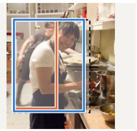  
IoU: Jag 0.53, Locus 0.91

“big tie”  
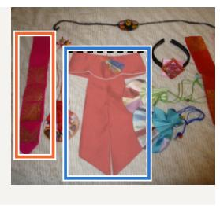

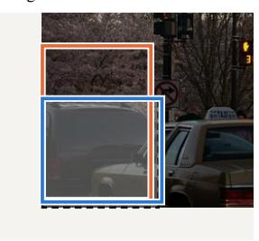  
Locus-2B (verified)

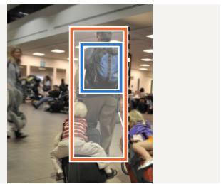  
IoU: Jag 0.94, Locus 0.24

Figure 6: Jag-0.8B and Locus-2B (verified) on RefCOCO and RefCOCO+ test questions. The first three columns are the first questions in split order where Locus’s IoU exceeds 0.9 and Jag’s is below 0.6; the last is the first where Locus fails (IoU < 0.4) and Jag succeeds (IoU > 0.8). To skip typos and slang in the crowd-written expressions, only expressions whose every word occurs at least 100 times in the training expressions are eligible. Crops are centred on the three boxes.  
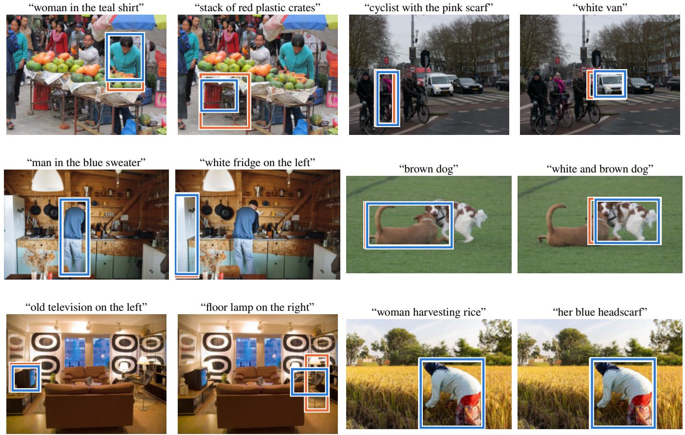  
Jag-0.8B

Figure 7: Jag-0.8B and Locus-2B (verified) on openly licensed photos from Wikimedia Commons, at the same 5122-pixel budget. The 12 expressions were written before either model was run, and every result is shown; there is no ground truth, so we make no accuracy claim. The two models mostly agree; Locus’s boxes are tighter for “woman in the teal shirt” and “stack of red plastic crates”, they disagree on “floor lamp on the right”, and both return the whole person for “her blue headscarf”. Images (left to right, top to bottom, two expressions each): Fruit Market, Old Kathmandu by Sundar1 (CC BY-SA 3.0); Amsterdam cyclists by Fons Heijnsbroek (CC0); Person cooks in a cozy wooden kitchen by Shixart1985 (CC BY 2.0); Dogs playing 001 by Sardaka (CC BY-SA 4.0); Living room with 1960s objects by Kotivalo (CC BY-SA 4.0); Farmer manually harvesting rice in Raichur, Karnataka by Nanditha Gogate, WELL Labs (CC BY-SA 4.0).