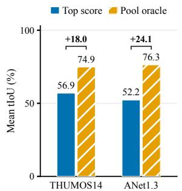
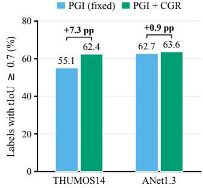
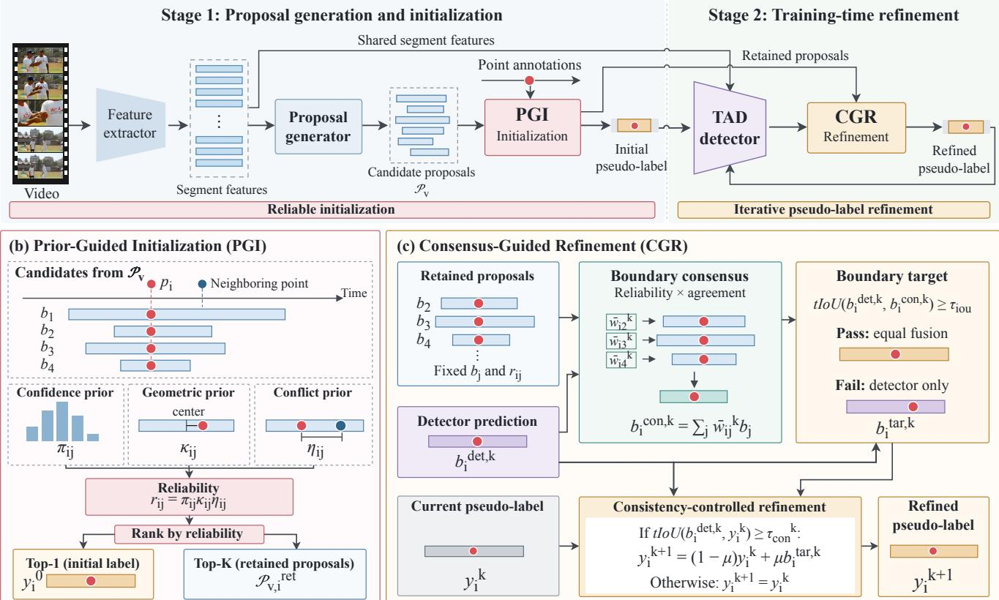
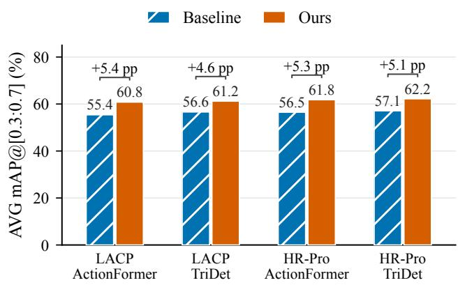
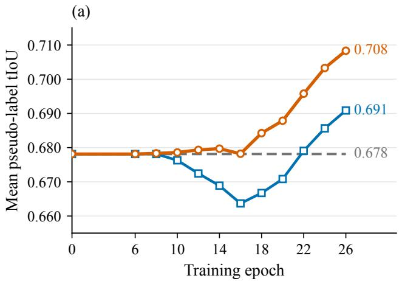
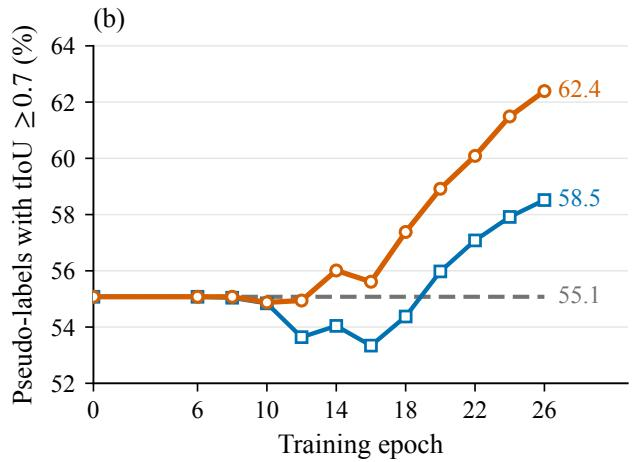
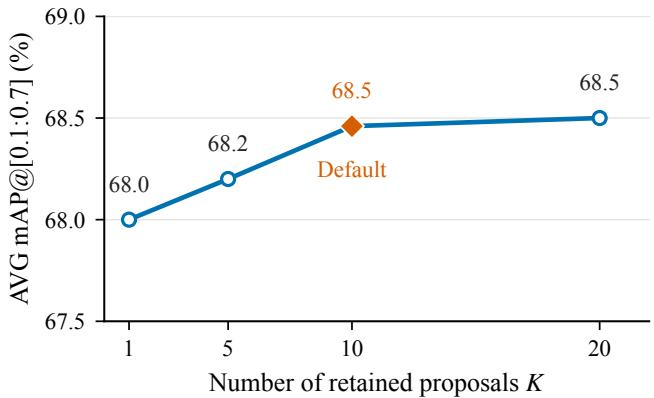
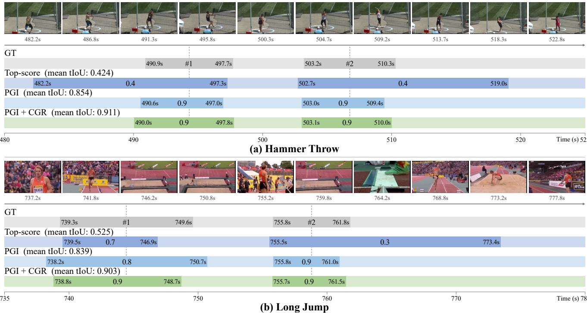
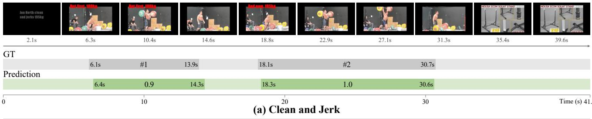
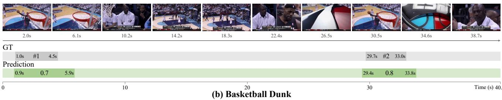

# Learning High-Quality Pseudo-Labels for Point-Supervised Temporal Action Localization

Zhenying Fang Independent Researcher

zhenying.fang@foxmail.com

## Abstract

Point-supervised temporal action localization (PTAL) aims to recognize and localize action instances in untrimmed videos using only point-level annotations. Existing pseudolabel-based methods have made substantial progress in PTAL. However, confidence-based initialization can overlook well-localized proposals. Meanwhile, existing methods either keep pseudo-labelsfixed during detector training or update them withoutfully exploiting alternative boundary evidencefrom the original proposal pool. These limitations constrain supervision quality, thereby hindering detection performance. To learn high-quality pseudo-labels, we propose aframework that integrates prior-guided initialization with consensus-guided refinement during detector training. Ourframework comprises two modules: Prior-Guided Initialization (PGI) and Consensus-Guided Refinement (CGR). PGI combines proposal confidence with point-derived priors to establish instance-specific reliability for initial pseudolabel selection and candidate retention. CGR continually uses the retained original candidates to construct boundary targets, combining their consensus with evolving detector predictions to refine pseudo-labels throughout training. Experiments onfour benchmarks demonstrate that our method achieves competitive detection performance compared with existing methods. In particular, our method achieves 68.5% average mAP over tIoU thresholds 0.1–0.7 on THUMOS14, surpassing PseR by 3.7 percentage points. Code is available at https://github.com/zhenyingfang/LHQP.

## 1. Introduction

Temporal action localization (TAL) aims to recognize action instances and determine their temporal boundaries in untrimmed videos [8, 47], supporting applications such as visual question answering [17], video summarization [16], and highlight detection [39]. Fully supervised methods [6, 35, 37] have achieved impressive performance, but require precise temporal boundaries for individual action instances, which are costly and labor-intensive to annotate. This annotation burden has motivated weakly supervised temporal action localization (WTAL) [32, 33], which learns from video-level category labels. Without instance-level temporal cues, however, recovering complete action intervals remains difficult, leaving a substantial performance gap to fully supervised methods.

  
Figure 1. Proposal quality and pseudo-label evolution. (a) Mean tIoU of top-score and oracle (maximum ground-truth tIoU) proposals among same-class candidates containing each annotated point. (b) Fraction of pseudo-labels with tIoU ≥ 0.7 for fixed PGI and PGI+CGR at the final update, evaluated on the same instances. Brackets indicate differences in percentage points.

To balance detection performance and annotation cost, point-supervised temporal action localization (PTAL) has been proposed as an alternative supervision setting. PTAL requires only one annotated frame and its category per action instance. Early methods [15, 27, 44] follow a localization-byclassification paradigm, inferring action intervals from Class Activation Sequences (CAS) learned under point supervision. However, CAS are learned using classification objectives, and the mismatch between classification and localization limits the detection performance of these methods [10]. To provide explicit localization supervision, pseudo-label-based methods construct temporal pseudo-labels to train localization models [5, 7, 48]. POTLoc [36] generates pseudo-labels using point-compatible proposals and proposal statistics.

PseR [5] propagates seed proposals through temporal perturbations and refines pseudo-labels using proposal selection and ranking.

Despite this progress, pseudo-label quality remains constrained at both initialization and subsequent detector training. First, proposal confidence does not necessarily reflect localization quality for the annotated instance. Fig. 1(a) reveals a substantial gap between highest-confidence and oracle selection from the same point-compatible candidate pool, showing that well-localized proposals can be overlooked during initialization. Second, pseudo-labels either remain fixed during detector training or evolve without fully exploiting alternative boundaries from the original pool. Fixed labels cannot incorporate new localization evidence, while reducing the pool to pseudo-label intervals limits direct access to individual original alternatives during later updates. Together, these limitations restrict supervision quality and the detector’s ability to learn accurate action boundaries.

We address these limitations by learning high-quality pseudo-labels through reliable initialization and iterative boundary refinement. Our framework comprises two modules: Prior-Guided Initialization (PGI) and Consensus-Guided Refinement (CGR). PGI assesses the reliability of candidate proposals associated with each annotated point by combining confidence, geometric, and conflict priors. Using these reliability scores, PGI selects initial pseudolabels while retaining alternative candidates with their original boundaries and reliability scores to support subsequent pseudo-label evolution.

CGR reuses the candidates retained by PGI to progressively refine pseudo-label boundaries during detector training. At each update round, it combines a reliability-weighted consensus of these candidates with current detector predictions to construct boundary targets, which guide consistencycontrolled pseudo-label updates. This allows alternative boundaries beyond the initial pseudo-label to provide supporting evidence throughout training. As shown in Fig. 1(b), PGI+CGR increases the fraction of pseudo-labels with tIoU ≥ 0.7 over fixed PGI supervision by 7.3 and 0.9 percentage points on THUMOS14 and ActivityNet1.3, respectively.

Experiments on THUMOS14, ActivityNet1.3, GTEA, and BEOID demonstrate competitive detection performance compared with existing methods. Our contributions are summarized as follows:

• We introduce PGI to assess candidate reliability using point annotations, enabling instance-aware pseudo-label initialization while retaining alternative boundary hypotheses for subsequent evolution.

• We introduce CGR to combine consensus from retained original candidates with evolving detector predictions for boundary target construction, allowing alternative boundary evidence to continually support pseudo-label refinement.

• Extensive experiments on four benchmarks demonstrate improved pseudo-label quality and competitive detection performance, while ablation studies validate the complementary roles of PGI and CGR.

## 2. Related Work

## 2.1. Temporal Action Localization

Fully supervised temporal action localization (TAL) relies on instance-level category labels and precise temporal boundary annotations. Representative detectors follow anchorbased, anchor-free, hybrid, or query-based designs. Anchorbased methods associate predictions with predefined temporal windows. Within anchor-based designs, one-stage detectors [22] jointly predict action categories and boundary offsets, while two-stage detectors [40] first generate temporal proposals and subsequently refine and classify them. Temporal anchors provide useful duration priors, but their predefined scales can restrict flexibility when action durations vary substantially [41]. To alleviate these restrictions, anchor-free methods [1, 11, 35, 47] eliminate manually designed temporal anchors. They predict action categories and distances to temporal boundaries directly at temporal locations. Hybrid approaches [6, 41] further integrate anchorbased and anchor-free branches to exploit their complementary strengths. Across these dense prediction designs, postprocessing such as non-maximum suppression is typically used to remove duplicate detections. Query-based detectors [14, 25] simplify this pipeline by formulating TAL as set prediction with learnable action queries and one-to-one matching. Despite these architectural advances, training still relies on costly temporal boundary annotations, motivating localization under weaker supervision.

## 2.2. Weakly-Supervised Temporal Action Localization

Weakly supervised temporal action localization (WTAL) reduces annotation costs by learning from video-level category labels without temporal boundary annotations [18, 32, 43]. A common approach follows the localization-by-classification paradigm [34, 42, 43], which trains a classifier to estimate snippet-level class scores and derives action intervals by thresholding the resulting activation sequences. However, classification objectives tend to emphasize the most discriminative snippets, while less distinctive parts of an action may receive weak responses. This discrepancy makes it difficult to recover complete action instances from classification scores alone.

Pseudo-label-based methods [20, 26, 33, 46] address this discrepancy by generating temporal pseudo-labels to supervise an additional localization model, enabling direct optimization of temporal boundaries. Despite their progress, video-level labels provide no explicit indication of instance positions, making reliable pseudo-label construction challenging and leaving a performance gap relative to fully supervised methods. Point annotations offer sparse temporal cues for individual instances. Our method uses these cues to establish instance-specific proposal reliability for initial pseudo-label construction and to preserve relevant original boundary hypotheses for subsequent label evolution.

## 2.3. Point-Supervised Temporal Action Localization

Point-supervised temporal action localization (PTAL) requires only a single annotated frame and its category for each action instance [27]. One line of research expands sparse point supervision and strengthens action representations. Early localization-by-classification methods include SF-Net [27], which mines labels for neighboring snippets, and LACP [15], which learns action completeness through pseudo-label sequence search. CRRC-Net [10] improves representation compactness and snippet-label reliability, while proposal-level learning [44] generates dense supervision through clustering. Related efforts model temporal structure through auxiliary understanding tasks [29] or enrich visual representations with refined textual descriptions [30].

A complementary line of research constructs temporal pseudo-labels for explicit localization learning [5, 7, 23, 36, 48, 49]. These methods infer interval supervision from sparse annotations, enabling direct optimization of temporal boundaries. Among closely related approaches, POT-Loc [36] refines point-supervised proposals into pseudolabels for self-training. NoCo [49] introduces online label revision through a teacher–student framework and is also evaluated under point supervision.

Building on advances in pseudo-label generation and online correction, we focus on the continued use of original proposal evidence after initialization. Our framework uses point-derived reliability to connect initial pseudo-label selection with candidate retention, then dynamically reweights the retained boundary hypotheses using evolving detector predictions. The original boundaries remain fixed, while their contributions to supervision evolve, allowing candidates beyond the initially selected interval to support subsequent updates.

## 3. Method

## 3.1. Problem Formulation and Overview

Given an untrimmed video v of duration $T _ { v } ,$ point supervision provides annotations $\mathcal { A } _ { v } = \{ ( p _ { i } , c _ { i } ) \} _ { i = 1 } ^ { N _ { v } }$ , where $N _ { v }$ is the number of annotated action instances, $p _ { i }$ is a timestamp within the i-th instance, and $c _ { i }$ is its category. Instance boundaries are unavailable during training. Our goal is to construct temporal pseudo-labels from these annotations and train a detector to recognize and localize action instances in

unseen videos.

Following the setup of existing pseudo-label-based methods [5, 7, 32, 49], we use a point-supervised proposal generator to obtain an original pool of candidate proposals $\mathcal { P } _ { v } = \{ ( b _ { j } , z _ { j } , \hat { c } _ { j } ) \} _ { j = 1 } ^ { M _ { v } }$ , where $M _ { v }$ is the number of proposals for video v. The j-th proposal contains an interval $b _ { j } = ( s _ { j } , e _ { j } )$ , a confidence score $z _ { j }$ , and a predicted category ${ \hat { c } } _ { j }$ . Here $s _ { j }$ and $e _ { j }$ are its start and end timestamps, with $s _ { j } < e _ { j }$ . Unless explicitly shown, the video index is omitted for brevity, and all point and proposal indices refer to video v.

Given the original proposal pool $\mathcal { P } _ { v }$ and point annotations $\mathcal { A } _ { v }$ , our framework improves pseudo-label quality through two complementary modules: Prior-Guided Initialization (PGI) and Consensus-Guided Refinement (CGR) (Fig. 2(a)). For the i-th point annotation in video $v ,$ PGI uses pointderived proposal reliability to select an initial pseudo-label $\mathbf { y } _ { i } ^ { 0 }$ from $\mathcal { P } _ { v }$ and retain a candidate subset indexed by $\mathcal { P } _ { v , i } ^ { \mathrm { r e t } }$ CGR then combines a reliability-weighted consensus of these retained candidates with evolving detector predictions to construct boundary targets for consistency-controlled label updates. The original proposal pool thus supports both initial supervision and subsequent boundary refinement during detector training.

## 3.2. Prior-Guided Initialization (PGI)

PGI aims to improve initial pseudo-label quality while retaining alternative candidates for subsequent refinement (Fig. 2(b)). For each annotated point, it assesses candidate reliability using three complementary priors: a model-derived confidence prior and point-derived geometric and conflict priors. The resulting scores guide both initial pseudo-labe selection and candidate retention, linking initialization with later refinement.

For the i-th annotation $( p _ { i } , c _ { i } )$ , we collect from $\mathcal { P } _ { v }$ the same-class proposals containing $p _ { i }$ and define their index set as:

$$
\mathcal { P } _ { v , i } = \left\{ j \in \left\{ 1 , \dots , M _ { v } \right\} : \hat { c } _ { j } = c _ { i } , \ s _ { j } \leq p _ { i } \leq e _ { j } \right\} .\tag{1}
$$

Confidence prior. For candidate $j \in \mathcal { P } _ { v , i }$ , we define its model-derived confidence prior $\pi _ { i j }$ by applying a softmax to the source scores within this set:

$$
\pi _ { i j } = \frac { \exp ( z _ { j } ) } { \sum _ { q \in \mathcal { P } _ { v , i } } \exp ( z _ { q } ) } .\tag{2}
$$

However, $\pi _ { i j }$ is obtained by normalizing CAS-derived scores, which primarily reflect snippet-level action classification confidence and do not fully capture instance-level localization quality. We therefore complement this confidence prior with geometric and conflict priors to assess each candidate’s compatibility with the annotated instance.

(a) Framework overview  
  
Figure 2. Overview of proposal-guided pseudo-label learning. (a) Two-stage framework: candidate proposal generation and pseudo-labe initialization, followed by detector training with iterative refinement. (b) PGI combines confidence, geometric, and conflict priors to select initial pseudo-labels and retain top-K candidates. (c) CGR constructs gated boundary targets from retained-proposal consensus and detector predictions, then refines pseudo-labels through consistency-controlled momentum updates.

Geometric prior. TSPNet [38] has demonstrated the effectiveness of point-derived center cues for proposal confidence estimation. Unlike its learning-based center-score estimation, PGI formulates a geometric prior by directly measuring point centrality from the annotated timestamp and proposal boundaries, without additional training. For the j-th proposal $b _ { j } = ( s _ { j } , e _ { j } )$ , we define this prior as:

$$
\kappa _ { i j } = \mathrm { c l i p } _ { [ 0 , 1 ] } \left( 1 - \frac { | p _ { i } - ( s _ { j } + e _ { j } ) / 2 | } { ( e _ { j } - s _ { j } ) / 2 } \right) ,\tag{3}
$$

where $\mathrm { c l i p } _ { [ 0 , 1 ] } ( x ) = \operatorname* { m i n } \{ 1 , \operatorname* { m a x } \{ 0 , x \} \}$ clips its input to the interval [0, 1]. This geometric prior favors intervals whose center lies near the annotated point and attenuates those placing it close to a boundary.

Conflict prior. A proposal covering additional annotated points can span neighboring instances rather than isolate the target. We collect the other points covered by candidate j as:

$$
\begin{array} { r } { \mathcal { C } _ { i j } = \{ \ell \in \{ 1 , \dots , N _ { v } \} : \ell \neq i , s _ { j } \leq p _ { \ell } \leq e _ { j } \} , } \end{array}\tag{4}
$$

and measure their accumulated distance from $p _ { i } \mathbf { : }$

$$
d _ { i j } = \sum _ { \ell \in \mathcal { C } _ { i j } } | p _ { \ell } - p _ { i } | .\tag{5}
$$

With timestamps expressed in seconds, we define the conflict prior as:

$$
\eta _ { i j } = \left\{ \begin{array} { l l } { 1 , } & { d _ { i j } = 0 , } \\ { \operatorname { t a n h } ( 1 / d _ { i j } ) , } & { d _ { i j } > 0 . } \end{array} \right.\tag{6}
$$

This prior decreases with positive accumulated distance, attenuating intervals that cover additional or more distant annotated instances. It equals one when the candidate covers no other point.

Shared reliability and initial pseudo-labels. We combine the three priors into an instance-specific reliability score and select the initial pseudo-label:

$$
\begin{array} { r l } & { r _ { i j } = \pi _ { i j } \kappa _ { i j } \eta _ { i j } , } \\ & { ~ j _ { i } ^ { * } = \underset { j \in \mathcal { P } _ { v , i } } { \arg \operatorname* { m a x } } r _ { i j } , } \\ & { ~ \mathbf { y } _ { i } ^ { 0 } = ( s _ { j _ { i } ^ { * } } , e _ { j _ { i } ^ { * } } ) . } \end{array}\tag{7}
$$

The initial pseudo-label inherits the annotated category $c _ { i } .$ Let $\mathcal { T }$ contain the point indices for which $\mathcal { P } _ { v , i } \neq \emptyset ;$ these points have initial temporal supervision. Points with empty candidate sets are omitted from detector supervision and subsequent label evolution.

Retention of original hypotheses. For each $i \in \mathcal { Z } ,$ , we form the retained candidate index set $\mathcal { P } _ { v , i } ^ { \mathrm { r e t } } \ \subseteq \ \mathcal { P } _ { v , i }$ by selecting the K highest-reliability candidates, retaining all candidates when $| \mathcal { P } _ { v , i } | < K$ . Their original boundaries $\{ b _ { j } \} _ { j \in \mathcal { P } _ { v , i } ^ { \mathrm { r e t } } }$ and reliability scores $\{ r _ { i j } \} _ { j \in \mathcal { P } _ { v , i } ^ { \mathrm { r e t } } }$ remain fixed throughout training. Thus, PGI provides initial supervision together with alternative boundary hypotheses that CGR reuses in subsequent updates.

## 3.3. Consensus-Guided Refinement (CGR)

CGR aims to progressively refine pseudo-label boundaries by combining retained original proposal evidence with evolving detector predictions (Fig. 2(c)). At each update round, it aggregates the candidates retained by PGI into a reliabilityweighted boundary consensus and combines this consensus with the current detector prediction to construct an instancespecific boundary target. Pseudo-labels are then refined through momentum updates under a progressively relaxed consistency criterion, allowing alternative boundaries from the original proposals to continually guide supervision during detector training.

Current detector predictions. At update round k, we obtain detector predictions covering $p _ { i }$ and apply the PGI reliability rule to select the highest-reliability interval $b _ { i } ^ { \mathrm { d e t } , k }$ This prediction provides the current localization estimate for boundary target construction. The annotated category $c _ { i }$ remains the class supervision.

Consensus from retained original proposals. We aggregate the boundaries of candidates indexed by $\mathcal { P } _ { v , i } ^ { \mathrm { r e t } }$ to obtain an instance-specific proposal consensus. Each candidate is weighted by its fixed reliability and temporal agreement with $b _ { i } ^ { \mathrm { d e t } , k }$ , followed by normalization over the retained set:

$$
\begin{array} { r l r } & { } & { w _ { i j } ^ { k } = r _ { i j } \exp \Bigl ( \mathrm { t I o U } ( b _ { j } , b _ { i } ^ { \mathrm { d e t } , k } ) \Bigr ) , } \\ & { } & { \bar { w } _ { i j } ^ { k } = \frac { w _ { i j } ^ { k } } { \displaystyle \sum _ { q \in \mathcal { P } _ { v , i } ^ { \mathrm { r e t } } } w _ { i q } ^ { k } } , } \\ & { } & { b _ { i } ^ { \mathrm { c o n } , k } = \displaystyle \sum _ { j \in \mathcal { P } _ { v , i } ^ { \mathrm { r e t } } } \bar { w } _ { i j } ^ { k } b _ { j } , } \end{array}\tag{8}
$$

where $b _ { i } ^ { \mathrm { c o n } , k }$ denotes the consensus interval for the i-th point annotation at update round $k ,$ computed as a weighted average of the retained original proposal intervals. The normalized weights $\bar { w } _ { i j } ^ { k }$ favor reliable candidates that agree temporally with the current detector prediction.

The original intervals $b _ { j }$ and reliability scores $r _ { i j }$ remain fixed throughout training, while their consensus is recomputed at each update using the current detector prediction. This enables retained alternatives to the initial pseudo-label $\mathbf { y } _ { i } ^ { 0 }$ to continually support boundary target construction.

Boundary target construction. We fuse the current detector prediction with the proposal consensus when the candidate evidence satisfies a compatibility criterion. Let $g _ { i } ^ { k } \in \{ 0 , 1 \}$ denote this gate. The boundary target is:

$$
\begin{array} { r } { b _ { i } ^ { \mathrm { t a r } , k } = b _ { i } ^ { \mathrm { d e t } , k } + \frac { 1 } { 2 } g _ { i } ^ { k } \left( b _ { i } ^ { \mathrm { c o n } , k } - b _ { i } ^ { \mathrm { d e t } , k } \right) , } \end{array}\tag{9}
$$

where $b _ { i } ^ { \mathrm { t a r } , k }$ denotes the target interval for refining the pseudo-label associated with the i-th point annotation at update round k. When $g _ { i } ^ { k } = 1$ , the target equally weights the detector prediction and proposal consensus for both temporal boundaries. When $g _ { i } ^ { k } = 0$ , the target is the detector prediction.

We determine $g _ { i } ^ { k }$ from the temporal agreement between the detector prediction and proposal consensus:

$$
g _ { i } ^ { k } = \mathbf { 1 } \Bigl [ \mathrm { t I o U } ( b _ { i } ^ { \mathrm { d e t } , k } , b _ { i } ^ { \mathrm { c o n } , k } ) \geq \tau _ { \mathrm { i o u } } \Bigr ] ,\tag{10}
$$

where $\mathbf { 1 } [ \cdot ]$ is the indicator function, and $\tau _ { \mathrm { i o u } } \in [ 0 , 1 ]$ specifies the minimum required temporal overlap between the detector prediction and proposal consensus. Consensus fusion is activated when this overlap meets the threshold; otherwise, the target uses the detector prediction alone.

Consistency-controlled pseudo-label refinement. Given the boundary target $b _ { i } ^ { \mathrm { t a r } , k }$ , we refine the current pseudo-label $\mathbf { y } _ { i } ^ { k }$ through a consistency-controlled update.

At round $k ,$ a point annotation is eligible for refinement if its detector prediction $b _ { i } ^ { \mathrm { d e t } , k }$ is available and tIoU $( b _ { i } ^ { \mathrm { d e t } , k } , \mathbf { y } _ { i } ^ { k } ) \geq \tau _ { \mathrm { c o n } } ^ { k } :$ , where $\tau _ { \mathrm { c o n } } ^ { k } \in [ 0 , 1 ]$ is the consistency threshold specifying the minimum required temporal overlap between the detector prediction and the current pseudo-label at this round. Let $\mathcal { T } _ { k }$ denote the eligible points selected for this round’s update. We refine the pseudo-labels of selected points through a momentum update:

$$
\mathbf { y } _ { i } ^ { k + 1 } = ( 1 - \mu ) \mathbf { y } _ { i } ^ { k } + \mu b _ { i } ^ { \mathrm { t a r } , k } , \qquad i \in \mathcal { T } _ { k } ,\tag{11}
$$

where $\mu \in ( 0 , 1 ]$ controls the contribution of the boundary target to the refined pseudo-label. Pseudo-labels associated with points outside $\mathcal { T } _ { k }$ remain unchanged, and all annotated categories are preserved. The refined pseudo-labels supervise the next training period. At subsequent updates, CGR constructs boundary targets from retained original proposals and current detector predictions to progressively improve pseudo-label quality.

## 3.4. Training and Inference

Training. We train the detector with PGI-initialized pseudo-labels and annotated categories, replacing the temporal supervision with refined pseudo-labels after each CGR update. The retained original proposals and their reliability scores remain fixed throughout training and support boundary target construction at subsequent updates.

Inference. During inference, the trained detector directly predicts action categories, temporal boundaries, and confidence scores for an unseen video. PGI, CGR, point annotations, and the original candidate pool are used only during training.

## 4. Experiment

## 4.1. Experimental Setup

Datasets. We evaluate our method on four benchmark datasets. For fair comparison, we use the point annotations provided by HR-Pro [48].

• THUMOS14 [12] contains 413 untrimmed videos spanning 20 action categories. We use 200 videos for training and the remaining 213 for testing.

• ActivityNet1.3 [2] comprises 10,024 training, 4,926 validation, and 5,044 test videos. Following the standard protocol [5, 48], we train on the training split and evaluate on the validation split.

• GTEA [9] consists of 28 videos depicting seven finegrained daily activities in a kitchen, with approximately 1,800 frames per video.

• BEOID [4] contains 58 videos covering 30 action categories, with an average of 12.5 action instances per video. We follow the training and testing split used in [31].

Evaluation metric. We follow the standard evaluation protocols and report mean average precision (mAP) at multiple temporal intersection-over-union (tIoU) thresholds. We additionally evaluate pseudo-label quality using mean tIoU with ground truth and the fraction of pseudo-labels with tIoU $\geq 0 . 7$

Implementation details. For a fair comparison, we follow existing methods [5, 48] to divide each video into 16-frame snippets and extract video features using the I3D network pre-trained on Kinetics-400 [3]. Given the extracted features, we use HR-Pro [48] as the proposal generator to obtain the candidate proposal pool Pv for each video v.

Across all datasets, PGI retains up to $K = 1 0$ candidates per point, and CGR uses $\tau _ { \mathrm { i o u } } = 0 . 5$ for consensus gating and $\mu = 0 . 9$ for momentum updates. CGR refines pseudo-labels between 20% and 80% of training, with the consistency threshold decreasing linearly from 1 to 0:

$$
\tau _ { \mathrm { c o n } } ^ { k } = 1 - \frac { e _ { k } - 0 . 2 E } { 0 . 6 E } ,\tag{12}
$$

where E is the number of training epochs and $e _ { k }$ is the epoch of update k.

We adopt ActionFormer [47] as the detector and train it with AdamW using a weight decay of 0.05. The initial learning rate is $1 0 ^ { - 3 ^ { - } }$ on ActivityNet1.3 and $1 0 ^ { - 4 }$ on the other datasets. For THUMOS14, ActivityNet1.3, GTEA, and BEOID, the batch sizes are 2, 16, 1, and 2, and the training durations are 35, 10, 60, and 50 epochs, respectively. At inference, we apply Soft-NMS to suppress redundant predictions.

## 4.2. Comparison with State-of-The-Art Methods

Results on THUMOS14. In Table 1, we compare our framework with state-of-the-art methods under different levels of supervision on THUMOS14. Among the compared point-supervised methods, our framework achieves the highest average mAP over all three threshold ranges, reaching 68.5% over tIoU thresholds 0.1–0.7 and surpassing PseR by 3.7 percentage points. It also achieves 78.2% and 61.8% average mAP over 0.1–0.5 and 0.3–0.7, respectively. At the stricter tIoU thresholds of 0.5 and 0.7, our method improves over PseR by 5.4 and 5.9 percentage points, indicating stronger temporal localization performance.

Results on ActivityNet1.3. As shown in Table 2, our method achieves 30.9% average mAP over tIoU thresholds 0.5–0.95, the highest among the compared methods and 0.3 percentage points above PseR. At tIoU 0.75, it obtains 30.7% mAP, improving over PseR by 1.1 percentage points. These results show that proposal-guided pseudo-label learning also improves overall detection performance on ActivityNet1.3.

Results on GTEA. As shown in Table 3, our method achieves 62.2% average mAP over tIoU thresholds 0.1–0.7, surpassing TRA and PseR by 8.1 and 9.9 percentage points, respectively. It also achieves the highest mAP at every reported threshold. At tIoU 0.5, our method obtains 57.9% mAP, compared with TRA’s 47.2%, demonstrating stronger localization performance on this fine-grained action benchmark.

Table 1. Comparison with state-of-the-art methods on THUMOS14. Results are reported as mAP (%) at different tIoU thresholds.
<table><tr><td rowspan="2">Supervision</td><td rowspan="2">Method</td><td colspan="7"> $\mathrm { m A P @ I o U ( \% ) }$ </td><td rowspan="2">AVG (0.1:0.5)</td><td rowspan="2">AVG (0.3:0.7)</td><td rowspan="2">AVG (0.1:0.7)</td></tr><tr><td>0.1</td><td>0.2</td><td>0.3</td><td>0.4</td><td>0.5</td><td>0.6</td><td>0.7</td></tr><tr><td rowspan="4">Frame-level</td><td>ActionFormer ECCV&#x27;22 [47]</td><td>-</td><td></td><td>82.1</td><td>77.8</td><td>71.0</td><td>59.4</td><td>43.9</td><td></td><td>66.8</td><td></td></tr><tr><td>TriDet cVPR&#x27;23 [35]</td><td>-</td><td>一</td><td>83.6</td><td>80.1</td><td>72.9</td><td>62.4</td><td>47.4</td><td></td><td>69.3</td><td></td></tr><tr><td>MDVLM-TAL NeurIPS&#x27;26 [37]</td><td></td><td></td><td>84.6</td><td>80.8</td><td>74.4</td><td>63.5</td><td>60.1</td><td></td><td>72.7</td><td></td></tr><tr><td>P-MIL CVPR&#x27;23 [32]</td><td>71.8</td><td>67.5</td><td>58.9</td><td>49.0</td><td>40.0</td><td>27.1</td><td>15.1</td><td>57.4</td><td>38.0</td><td>47.0</td></tr><tr><td rowspan="6">Video-level</td><td>PivoTAL CVPR&#x27;23 [33]</td><td>74.1</td><td>69.6</td><td>61.7</td><td>52.1</td><td>42.8</td><td>30.6</td><td>16.7</td><td>60.1</td><td>40.8</td><td>49.6</td></tr><tr><td>ISSF AAAI&#x27;24 [46]</td><td>72.4</td><td>66.9</td><td>58.4</td><td>49.7</td><td>41.8</td><td>25.5</td><td>12.8</td><td>57.8</td><td>37.6</td><td>46.8</td></tr><tr><td> $\mathrm { P V L R } _ { \mathrm { \ M M ^ { \circ } / 4 } } \left[ 2 1 \right]$ </td><td>74.9</td><td>69.9</td><td>61.4</td><td>53.1</td><td>45.1</td><td>30.5</td><td>17.1</td><td>60.9</td><td>41.4</td><td>50.3</td></tr><tr><td>PseudoFormer cVPR&#x27;25 [26]</td><td>76.8</td><td>72.6</td><td>65.4</td><td>55.6</td><td>44.1</td><td>31.3</td><td>17.1</td><td>62.9</td><td>42.7</td><td>51.9</td></tr><tr><td>CRC TPAMI&#x27;25 [42]</td><td>72.9</td><td>68.0</td><td>59.8</td><td>51.3</td><td>42.7</td><td>27.8</td><td>15.1</td><td>58.9</td><td>39.3</td><td>48.2</td></tr><tr><td>ACL-Net TIP&#x27;26 [20]</td><td>81.0</td><td>76.9</td><td>70.0</td><td>60.4</td><td>51.3</td><td>36.8</td><td>21.5</td><td>67.9</td><td>48.0</td><td>56.8</td></tr><tr><td rowspan="10">Point-level</td><td>SF-Net ECCV&#x27;20 [27]</td><td>68.3</td><td>62.3</td><td>52.8</td><td>42.2</td><td>30.5</td><td>20.6</td><td>12.0</td><td>51.2</td><td>31.6</td><td>41.2</td></tr><tr><td>Ju et al. ICCV’21 [13]</td><td>72.3</td><td>64.7</td><td>58.2</td><td>47.1</td><td>35.9</td><td>23.0</td><td>12.8</td><td>55.6</td><td>35.4</td><td>44.9</td></tr><tr><td>LACP ICCV&#x27;21 [15]</td><td>75.7</td><td>71.4</td><td>64.6</td><td>56.5</td><td>45.3</td><td>34.5</td><td>21.8</td><td>62.7</td><td>44.5</td><td>52.8</td></tr><tr><td>CRRC-Net TIP&#x27;22 [10]</td><td>77.8</td><td>73.5</td><td>67.1</td><td>57.9</td><td>46.6</td><td>33.7</td><td>19.8</td><td>64.6</td><td>45.1</td><td>53.8</td></tr><tr><td> $\mathrm { L P R } _ { \mathrm { \ M M S J ^ { * } } 2 3 } \ [ 7 ]$ </td><td>85.3</td><td>82.5</td><td>76.6</td><td>67.8</td><td>55.3</td><td>38.5</td><td>21.7</td><td>73.5</td><td>52.0</td><td>61.1</td></tr><tr><td>Yin et al. BMvC&#x27;23 [44]</td><td>77.1</td><td>72.6</td><td>65.9</td><td>54.4</td><td>44.9</td><td>33.1</td><td>20.2</td><td>63.3</td><td>43.9</td><td>52.6</td></tr><tr><td>HR-Pro AAAI&#x27;24 [48]</td><td>85.6</td><td>81.6</td><td>74.3</td><td>64.3</td><td>52.2</td><td>39.8</td><td>24.8</td><td>71.6</td><td>51.1</td><td>60.3</td></tr><tr><td>TSPNet CVPR&#x27;24 [38]</td><td>82.3</td><td>77.6</td><td>70.1</td><td>60.0</td><td>49.4</td><td>37.6</td><td>24.5</td><td>67.9</td><td>48.3</td><td>57.4</td></tr><tr><td> $\mathrm { S M B D } _ { \mathrm { E C C V } ^ { \prime } 2 4 } \ : \left[ 2 4 \right]$ </td><td></td><td></td><td>66.0</td><td>57.9</td><td>47.0</td><td>36.0</td><td>22.0</td><td>64.2</td><td>45.7</td><td></td></tr><tr><td> $\mathrm { S N P R } _ { \mathrm { \ T I P ^ { \circ } 2 4 } } \left[ \mathrm { 1 9 } \right]$ </td><td>77.9</td><td>73.9</td><td>66.6</td><td>59.4</td><td>48.6</td><td>36.7</td><td>22.7</td><td>65.3</td><td>46.8</td><td>55.1</td></tr><tr><td>AAPL AAAI&#x27;25 [45]</td><td>64.3</td><td></td><td>54.6</td><td></td><td>35.2</td><td></td><td>14.0</td><td></td><td></td><td>42.8</td></tr><tr><td> $\mathrm { N o C o _ { \ A A A I ^ { * } 2 5 } \ [ 4 9 ] }$ </td><td>86.0</td><td>82.1</td><td>75.6</td><td>65.7</td><td>53.6</td><td>40.6</td><td>25.3</td><td>72.6</td><td>52.2</td><td>61.3</td></tr><tr><td> $\mathrm { Q R O T } _ { \mathrm { C V P R } ^ { \prime } 2 5 } [ 2 3 ]$ </td><td></td><td></td><td>73.1</td><td>64.4</td><td>54.3</td><td>41.3</td><td>27.4</td><td>72.3</td><td>52.1</td><td></td></tr><tr><td>TRA ESWA&#x27;26 [28]</td><td>86.6</td><td>83.6</td><td>76.3</td><td>66.7</td><td>55.2</td><td>41.4</td><td>26.5</td><td>73.7</td><td>53.2</td><td>62.3</td></tr><tr><td>PseR TMM 26 [5]</td><td>85.5</td><td>83.2</td><td>78.7</td><td>70.9</td><td>60.1</td><td>45.4</td><td>29.6</td><td>75.7</td><td>56.9</td><td>64.8</td></tr><tr><td>Ours</td><td>86.6</td><td>83.8</td><td>80.4</td><td>74.8</td><td>65.5</td><td>52.6</td><td>35.5</td><td>78.2</td><td>61.8</td><td>68.5</td></tr></table>

Table 2. Comparison with state-of-the-art methods on ActivityNet1.3. Results are reported as mAP (%) at different tIoU thresholds.
<table><tr><td rowspan="2">Supervision</td><td rowspan="2">Method</td><td colspan="4">mAP@tIoU (%)</td></tr><tr><td>0.5</td><td>0.75</td><td>0.95</td><td>AVG[0.5:0.95]</td></tr><tr><td rowspan="5">Video-level</td><td>PivoTAL CVPR&#x27;23 ISSF AAAI&#x27;24</td><td>45.1</td><td>28.2</td><td>5.0</td><td>28.1</td></tr><tr><td></td><td>39.4</td><td>25.8</td><td>6.4</td><td>25.8</td></tr><tr><td> $\mathrm { P V L R } _ { \mathrm { \ M M ^ { \circ } 2 4 } }$ </td><td>43.6</td><td>27.4</td><td>6.5</td><td>27.4</td></tr><tr><td>PseudoFormer CVPR&#x27;25</td><td>46.9</td><td>28.6</td><td>6.5</td><td>29.0</td></tr><tr><td> $\mathrm { C R C } _ { \mathrm { \tiny ~ T P A M I ^ { \circ } 2 5 } }$   $\mathrm { \bf A C L - N e t } _ { \mathrm { \tiny ~ T I P ^ { \prime } 2 6 } }$ </td><td>42.0 43.4</td><td>26.2 27.6</td><td>5.4</td><td>26.2</td></tr><tr><td rowspan="7">Point-level</td><td> $\mathrm { L A C P } _ { \mathrm { I C C V } ^ { , } 2 1 }$ </td><td>40.4</td><td>24.6</td><td>6.6 5.7</td><td>27.6 25.1</td></tr><tr><td> $\mathrm { C R R C - N e t _ { \mathrm { ~ T I P } ^ { \prime } 2 2 } }$ </td><td>39.8</td><td>24.1</td><td>5.9</td><td>24.0</td></tr><tr><td> $\mathrm { Y i n } e t a l . _ { \mathrm { { \scriptsize ~ B M V C ^ { \cdot } 2 3 } } }$ </td><td>48.3</td><td>27.8</td><td>7.0</td><td>29.1</td></tr><tr><td> $\mathrm { H R } { \cdot } \mathrm { P r o } _ { \mathrm { \ A A A I ^ { \prime } } 2 4 }$ </td><td>42.8</td><td>27.2</td><td>8.0</td><td>27.1</td></tr><tr><td> $\mathrm { S N P R } _ { \mathrm { ~ T I P } ^ { \prime } 2 4 }$ </td><td>41.3</td><td>30.9</td><td>4.8</td><td>26.5</td></tr><tr><td> $\mathbf { A A P L } _ { \mathrm { { A A A I } ^ { \prime } 2 5 } }$ </td><td>39.6</td><td>24.3</td><td>5.6</td><td>24.7</td></tr><tr><td> $\mathrm { T R A } _ { \mathrm { \ E S W A ^ { \prime } } 2 6 }$ </td><td>45.3</td><td>27.4</td><td>6.8</td><td>28.0</td></tr><tr><td rowspan="4"></td><td> $\mathrm { P s e R } _ { \mathrm { \ T M M ^ { \prime } } 2 6 }$ </td><td>49.5</td><td>29.6</td><td>7.8</td><td>30.6</td></tr><tr><td> $_ \mathrm { O u r s }$ </td><td>49.0</td><td>30.7</td><td>7.2</td><td>30.9</td></tr><tr><td></td><td></td><td></td><td></td><td></td></tr><tr><td></td><td></td><td></td><td></td><td></td></tr></table>

Table 3. Comparison with state-of-the-art methods on GTEA. Results are reported as mAP (%) at different tIoU thresholds.
<table><tr><td rowspan="2">Method</td><td colspan="4">mAP@tIoU (%)</td></tr><tr><td>0.1</td><td>0.3</td><td>0.5</td><td>0.7 AVG[0.1:0.7]</td></tr><tr><td>SF-Net ECCV&#x27;20</td><td>58.0</td><td>37.9</td><td>19.3</td><td>11.9 31.0</td></tr><tr><td>Ju et al. ICCV21</td><td>59.7</td><td>38.3</td><td>21.9 18.1</td><td>33.7</td></tr><tr><td> $\mathrm { L A C P } _ { \mathrm { I C C V } ^ { , } 2 1 }$ </td><td>63.9</td><td>55.7</td><td>33.9</td><td>20.8 43.5</td></tr><tr><td>Yin et al. BMVC&#x27;23</td><td>63.1</td><td>52.1</td><td>37.3</td><td>22.2 45.1</td></tr><tr><td> $\mathrm { H R } { \cdot } \mathrm { P r o } _ { \mathrm { \ A A A I ^ { \prime } } 2 4 }$ </td><td>72.6</td><td>61.1</td><td>37.3</td><td>17.5 47.3</td></tr><tr><td> $\mathrm { T S P N e t } _ { \mathrm { \tiny ~ C V P R } ^ { \prime } 2 4 }$ </td><td>74.6</td><td>60.9</td><td>39.5</td><td>16.6 49.0</td></tr><tr><td> $\mathrm { S M B D } _ { \mathrm { \ E C C V ^ { \prime } 2 4 } }$ </td><td>75.0</td><td>61.3</td><td>41.1</td><td>14.2 47.4</td></tr><tr><td> $\mathrm { S N P R } _ { \mathrm { ~ T I P } ^ { \prime } 2 4 }$ </td><td>74.3</td><td>62.8</td><td>35.7</td><td>13.7 46.6</td></tr><tr><td> $\mathbf { A A P L _ { \mathrm { \ A A A I ^ { \prime } 2 5 } } }$ </td><td>70.3</td><td>54.4</td><td>37.7</td><td>23.4 46.3</td></tr><tr><td> $\mathrm { T R A _ { \ E S W A ^ { \prime } 2 6 } }$ </td><td>77.9</td><td>67.8</td><td>47.2</td><td>22.4 54.1</td></tr><tr><td>PseR TMM&#x27;26</td><td>72.7</td><td>67.7</td><td>42.9</td><td>19.9 52.3</td></tr><tr><td>Ours</td><td>84.2</td><td>77.7</td><td>57.9</td><td>25.5 62.2</td></tr></table>

Table 4. Comparison with state-of-the-art methods on BEOID. Results are reported as mAP (%) at different tIoU thresholds.
<table><tr><td rowspan="2">Method</td><td colspan="5">mAP@tIoU (%)</td></tr><tr><td>0.1</td><td>0.3</td><td>0.5</td><td>0.7</td><td>AVG[0.1:0.7]</td></tr><tr><td>SF-Net ECCV&#x27;20</td><td>62.9</td><td>40.6</td><td>16.7</td><td>3.5</td><td>30.9</td></tr><tr><td>Ju et al. ICCV&#x27;21</td><td>63.2</td><td>46.8</td><td>20.9</td><td>5.8</td><td>34.9</td></tr><tr><td>LACP ICCV&#x27;21</td><td>76.9</td><td>61.4</td><td>42.7</td><td>25.1</td><td>51.8</td></tr><tr><td>Yin et al. BMVC&#x27;23</td><td>78.2</td><td>65.3</td><td>45.1</td><td>26.6</td><td>54.2</td></tr><tr><td>HR-Pro AAAI&#x27;24</td><td>78.5</td><td>72.1</td><td>55.3</td><td>26.1</td><td>59.4</td></tr><tr><td>TSPNet CVPR&#x27;24</td><td>83.8</td><td>73.0</td><td>51.1</td><td>23.8</td><td>59.6</td></tr><tr><td>SMBD ECCV&#x27;24</td><td>78.2</td><td>71.0</td><td>52.5</td><td>25.2</td><td>57.4</td></tr><tr><td>SNPR TIP&#x27;24</td><td>77.2</td><td>64.3</td><td>44.0</td><td>24.5</td><td>53.1</td></tr><tr><td>AAPL AAAI&#x27;25</td><td>75.5</td><td>67.6</td><td>48.5</td><td>26.3</td><td>55.2</td></tr><tr><td>TRA ESWA&#x27;26</td><td>83.3</td><td>74.5</td><td>58.9</td><td>31.4</td><td>63.7</td></tr><tr><td>PseR TMM&#x27;26</td><td>88.9</td><td>83.9</td><td>66.1</td><td>28.9</td><td>68.9</td></tr><tr><td>Ours</td><td>89.8</td><td>85.7</td><td>73.3</td><td>42.3</td><td>74.2</td></tr></table>

  
Figure 3. Generalization across proposal generators and detectors on THUMOS14. Baselines train matched detectors with each generator’s original pseudo-labels; Ours adds PGI and CGR. AVG mAP is evaluated over tIoU thresholds 0.3–0.7. Brackets show gains in percentage points.

Results on BEOID. Table 4 shows that our method achieves 74.2% average mAP over tIoU thresholds 0.1– 0.7, improving over PseR by 5.3 percentage points. Our method outperforms all compared approaches at every reported threshold. In particular, mAP at tIoU 0.7 increases from PseR’s 28.9% to 42.3%, a gain of 13.4 percentage points, demonstrating improved detection performance under a strict temporal overlap criterion.

## 4.3. Generalization across Proposal Generators and Detectors

We evaluate the applicability of our framework to different proposal generators and detector architectures on THU-MOS14. Specifically, we use LACP and HR-Pro to generate candidate proposals and adopt ActionFormer and TriDet as detectors. Figure 3 compares our framework with baselines trained using each generator’s original pseudo-labels under the four matched generator–detector combinations.

Table 5. Component ablation of PGI and CGR. Results are average mAP (%) over tIoU thresholds 0.1–0.7 for THUMOS14, GTEA, and BEOID, and 0.5–0.95 for ActivityNet1.3. A checkmark indicates an enabled module.
<table><tr><td>PGI CGR</td><td>THUMOS14 ActivityNet1.3</td><td></td><td>GTEA BEOID</td><td></td></tr><tr><td>1 1</td><td>64.1</td><td>29.1</td><td>56.5</td><td>69.5</td></tr><tr><td>√</td><td>67.0</td><td>30.0</td><td>57.0</td><td>72.2</td></tr><tr><td></td><td>68.5</td><td>30.9</td><td>62.2</td><td>74.2</td></tr></table>

With LACP proposals, our framework improves average mAP over tIoU thresholds 0.3–0.7 by 5.4 and 4.6 percentage points when using ActionFormer and TriDet, respectively. With HR-Pro proposals, the corresponding gains are 5.3 and 5.1 percentage points. The consistent improvements across all four combinations demonstrate that proposalguided pseudo-label learning benefits different candidate sources and detector architectures.

## 4.4. Ablation Studies

Effectiveness of PGI and CGR. We evaluate the contributions of PGI and CGR through progressive component ablation on all four benchmarks. All configurations use HR-Pro as the proposal generator and ActionFormer as the detector. We compare a baseline trained directly with HR-Pro proposals, a variant using PGI initialization with fixed pseudo-labels, and the full framework incorporating CGR.

As shown in Table 5, adding PGI improves average mAP by 2.9, 0.9, 0.5, and 2.7 percentage points on THUMOS14, ActivityNet1.3, GTEA, and BEOID, respectively. Incorporating CGR further improves these results by 1.5, 0.9, 5.2, and 2.0 percentage points, respectively. The consistent gains from both stages demonstrate the effectiveness of priorguided initialization and consensus-guided refinement across the four benchmarks.

Contribution of Point-Derived Priors. We examine the effects of the geometric and conflict priors on initial pseudolabel quality on THUMOS14. We retain the confidence prior in all variants and selectively enable the two point-derived priors, keeping the candidate pool fixed and evaluating labels before CGR refinement. Ground-truth boundaries are used only for evaluation.

Table 6 shows that both point-derived priors improve pseudo-label quality over confidence-only selection. The geometric prior increases mean tIoU from 0.571 to 0.601 and the fraction of labels with tIoU ≥ 0.7 from 39.9% to 50.9%. The conflict prior yields a larger improvement in mean tIoU, reaching 0.651, while the geometric prior produces a higher fraction of well-localized labels. Combining both priors achieves the best results on both metrics, with a mean tIoU of 0.678 and a high-quality label fraction of 55.1%. These results support their complementary roles in identifying reliable initial pseudo-labels.

  
Figure 4. Pseudo-label refinement dynamics on THUMOS14. (a) Mean pseudo-label tIoU. (b) Fraction of pseudo-labels with $\mathrm { t I o U } \geq 0 . 7 .$ Fixed PGI, detector-only refinement, and full CGR share the same initialization and are evaluated against official ground truth on the same instances. Epoch 0 denotes initialization; markers indicate refinement checkpoints. Final values are annotated.

Table 6. Ablation of PGI priors on THUMOS14. Initial pseudolabel quality is measured by mean tIoU and the fraction of labels with tIoU $\geq 0 . 7 .$
<table><tr><td>Confidence Geometric Conflict</td><td></td><td>Mean tIoU</td><td> $\mathrm { t I o U } \geq 0 . 7$  (%)</td></tr><tr><td>√</td><td></td><td>0.571</td><td>39.9</td></tr><tr><td>√</td><td>√ 一</td><td>0.601</td><td>50.9</td></tr><tr><td>√</td><td>√ 一</td><td>0.651</td><td>47.0</td></tr><tr><td></td><td></td><td>0.678</td><td>55.1</td></tr></table>

Effectiveness of CGR. On THUMOS14, we assess CGR by comparing fixed PGI labels, detector-only updates using detector predictions alone, and full CGR, all with the same PGI initialization and ActionFormer detector. As shown in Figure 4, CGR better preserves initialization quality during the middle of training and improves both quality metrics in later updates. At the final update, CGR reaches a mean pseudo-label tIoU of 0.708, with 62.4% of labels achieving tIoU ≥ 0.7. Compared with fixed PGI labels, CGR improves mean tIoU by 0.030 and the high-quality label fraction by 7.3 percentage points. Compared with detector-only updates, it improves mean tIoU by 0.017 and the high-quality label fraction by 3.9 percentage points. These results demonstrate that combining retained proposal evidence with detector predictions improves pseudo-label quality during training.

Table 7. Ablation of consistency control in CGR on THUMOS14. AVG mAP (%) is computed over tIoU thresholds 0.1–0.7. Pseudolabel quality is evaluated against official ground truth at the final update.
<table><tr><td>Consistency control</td><td> $\tau _ { \mathrm { c o n } } ^ { k }$ </td><td>AVG mAP Mean (%)</td><td>tIoU</td><td> $\mathrm { t I o U } \geq 0 . 7$  (%)</td></tr><tr><td>None</td><td>0</td><td>64.3</td><td>0.674</td><td>56.4</td></tr><tr><td>Fixed</td><td>0.5</td><td>67.4</td><td>0.684</td><td>58.4</td></tr><tr><td>Progressive</td><td>1→0</td><td>68.5</td><td>0.708</td><td>62.4</td></tr></table>

Consistency-Controlled Refinement. We further examine the role of consistency control in CGR on THUMOS14. With the same PGI initialization, proposal consensus, fusion parameters, and update epochs, we compare three settings: no consistency constraint $( \tau _ { \mathrm { c o n } } ^ { k } = 0 )$ , a fixed threshold $( \tau _ { \mathrm { c o n } } ^ { \breve { k } } = 0 . 5 )$ , and the progressive schedule that decreases the threshold from 1 to 0. Detection performance is measured at the final training epoch, and pseudo-label quality is evaluated against official ground truth after the final update.

Table 7 shows that progressive consistency control achieves 68.5% average mAP, outperforming unconstrained updates and the fixed threshold by 4.2 and 1.1 percentage points, respectively. It also yields the highest mean pseudolabel tIoU of 0.708 and a high-quality label fraction of 62.4%, exceeding the fixed-threshold variant by 4.0 percentage points on the latter metric. These results support strict agreement early in refinement followed by gradual relaxation, which improves both temporal supervision and detection performance.

Table 8. Contribution of proposal consensus on THUMOS14. AVG mAP (%) is computed over tIoU thresholds 0.1–0.7 at the final training epoch. Mean tIoU and the high-quality label fraction are evaluated against official GT at the final update. The highlighted row denotes full CGR.
<table><tr><td>Boundary evidence</td><td>AVG mAP Mean (%) tIoU</td><td> $\mathrm { t I o U } \geq 0 . 7$  (%)</td></tr><tr><td>Detector-only</td><td>67.4</td><td>0.691 58.5</td></tr><tr><td>Initial boundary</td><td>68.0</td><td>0.699 61.5</td></tr><tr><td>Proposal consensus</td><td>68.5</td><td>0.708 62.4</td></tr></table>

Contribution of Proposal Consensus. On THUMOS14, we compare detector-only refinement, refinement guided by the initial PGI boundary $( K = 1 )$ , and full CGR with proposal consensus $( K = 1 0 )$ , using the same PGI initialization. Detector-only uses detector predictions alone; the other two variants introduce original boundary evidence from a single initial pseudo-label or multiple retained candidates, respectively. Table 8 shows that incorporating original boundary evidence improves both detection performance and pseudo-label quality over detector-only refinement. Full CGR achieves 68.5% average mAP, compared with 67.4% for detector-only refinement, while increasing mean pseudolabel tIoU from 0.691 to 0.708 and the fraction of labels with tIoU ≥ 0.7 from 58.5% to 62.4%. These results demonstrate the effectiveness of retained proposal evidence in guiding pseudo-label refinement.

Number of Retained Proposals. We evaluate the sensitivity to the number of retained proposals K on THUMOS14, keeping PGI initialization and all other refinement settings unchanged. We vary $K \in \{ 1 , 5 , 1 0 , 2 0 \}$ , where K = 1 corresponds to the initial-boundary variant in Table 8. As shown in Figure 5, AVG mAP increases from 68.0% at $K = 1$ to 68.2% at $K = 5$ and 68.5% at $K = 1 0$ , and remains at 68.5% when K increases to 20. This performance plateau supports K = 10 as a compact default.

Consensus Fusion Threshold. We vary the consensus fusion threshold $\tau _ { \mathrm { i o u } } \in \{ 0 . 1 , 0 . 3 , 0 . 5 , 0 . 7 \}$ on THUMOS14 and ActivityNet1.3, keeping the PGI initialization and all other refinement settings fixed within each dataset. This threshold controls whether proposal consensus is fused with the detector prediction. Table 9 shows that thresholds of 0.3 and 0.5 yield comparable AVG mAP on both datasets, reaching 68.5% on THUMOS14 and 30.9% on ActivityNet1.3. The default threshold of 0.5 also achieves 35.5% mAP@0.7 on THUMOS14 and the highest mAP@0.95 of 7.2% on ActivityNet1.3 among the tested settings. Increasing the threshold to 0.7 reduces both average and strict-tIoU detection performance on the two datasets. These results support 0.5 as a shared default for consensus fusion.

  
Figure 5. Sensitivity to the number of retained proposals K on THUMOS14, measured by AVG mAP (%) over tIoU thresholds 0.1–0.7. The $K = 1$ result is the initial-boundary variant in Table 8. The orange diamond marks the default $K = 1 0 .$

Table 9. Sensitivity to the consensus fusion threshold $\tau _ { \mathrm { i o u } } .$ . All results are final-epoch mAP (%). AVG denotes the average over tIoU thresholds $0 . 1 \mathrm { - } 0 . 7$ on THUMOS14 and 0.5–0.95 on ActivityNet1.3. The highlighted row uses the default threshold of 0.5.
<table><tr><td rowspan="2"> $\tau _ { \mathrm { i o u } }$ </td><td>THUMOS14</td><td>ActivityNet1.3</td></tr><tr><td>mAP@0.7 AVG</td><td>mAP@0.95 AVG</td></tr><tr><td>0.1</td><td>35.5 68.1</td><td>7.0 30.8</td></tr><tr><td>0.3</td><td>35.1 68.5</td><td>7.1 30.9</td></tr><tr><td>0.5</td><td>35.5 68.5</td><td>7.2 30.9</td></tr><tr><td>0.7</td><td>33.7 67.8</td><td>7.0 30.7</td></tr></table>

## 4.5. Qualitative Analysis

We visualize pseudo-label refinement on training clips and final detection results on test videos from THUMOS14.

Pseudo-label refinement. Figure 6 compares top-score pseudo-labels, PGI initialization, and final CGR labels for two training clips. In the HammerThrow example, confidence-based selection extends intervals into neighboring instances, whereas PGI selects boundaries closer to the target actions. CGR further refines their temporal extent, increasing mean tIoU across the two highlighted instances from 0.424 to 0.854 and then to 0.911. The LongJump example exhibits both truncated and overextended top-score intervals; PGI and CGR progressively improve their alignment with GT, with mean tIoU increasing from 0.525 to 0.839 and 0.903. These examples illustrate the complementary roles of prior-guided initialization and consensus-guided refinement in improving temporal supervision.

  
Figure 6. Qualitative comparison of pseudo-labels on THUMOS14 training clips. Each panel tracks two highlighted instances across top-score selection, PGI initialization, and the final CGR update. Top-score selection uses the highest-confidence same-class proposal containing each annotated point. Dashed lines mark annotated points, and numbers inside pseudo-label intervals denote tIoU with official GT. Instance-level tIoUs are rounded to one decimal place; row means are computed before rounding.

Temporal localization results. Figure 7 compares the final detector predictions with GT on two unseen test videos, using the same confidence threshold of 0.5 for visualization. The CleanAndJerk predictions closely follow the annotated intervals, achieving tIoU values of 0.9 and 1.0. The BasketballDunk predictions recover both action occurrences with tIoU values of 0.7 and 0.8. In both examples, the detector distinguishes separate instances and localizes their temporal extent.

## 5. Conclusion

We presented a framework for learning high-quality pseudolabels in point-supervised temporal action localization through prior-guided initialization and consensus-guided refinement. Our central idea is to reuse original proposals as boundary evidence for both supervision initialization and subsequent refinement. PGI combines proposal confidence with point-derived geometric and conflict priors to select reliable initial pseudo-labels and retain alternative candidates. CGR integrates consensus from these candidates with evolving detector predictions to refine supervision through consistency-controlled updates. Experiments on four benchmarks demonstrate improved detection performance, while ablations and pseudo-label analyses validate the effectiveness of both modules. The framework is also effective with different proposal generators and detector architectures. These findings highlight the value of retaining and reusing original proposal evidence throughout pseudo-label learning.

## References

[1] Tanay Agrawal, Abid Ali, Antitza Dantcheva, and Francois Bremond. Scaling action detection: Adatad++ with transformer-enhanced temporal-spatial adaptation. In 2025 IEEE/CVF International Conference on Computer Vision (ICCV), pages 12222–12231. IEEE, 2025. 2

[2] Fabian Caba Heilbron, Victor Escorcia, Bernard Ghanem, and Juan Carlos Niebles. Activitynet: A large-scale video benchmark for human activity understanding. In Proceedings ofthe ieee conference on computer vision and pattern recognition, pages 961–970, 2015. 6

[3] Joao Carreira and Andrew Zisserman. Quo vadis, action recognition? a new model and the kinetics dataset. In proceedings of the IEEE Conference on Computer Vision and Pattern Recognition, pages 6299–6308, 2017. 6

[4] Dima Damen, Teesid Leelasawassuk, and Walterio Mayol-Cuevas. You-do, i-learn: Egocentric unsupervised discovery of objects and their modes of interaction towards video-based

  
Figure 7. Final detection results on THUMOS14 test videos. GT and predicted intervals are shown for CleanAndJerk and BasketballDunk. All saved predictions with confidence $\geq 0 . 5$ are displayed. Numbers inside prediction intervals denote tIoU with the corresponding officia GT, rounded to one decimal place.

guidance. Computer Vision and Image Understanding, 149: 98–112, 2016. 6

[5] Zhenying Fang and Richang Hong. Pser: Pseudo-label refinement for point-supervised temporal action detection. IEEE Transactions on Multimedia, 28:128–139, 2026. 1, 2, 3, 6, 7

[6] Zhenying Fang, Suguo Zhu, Jun Yu, and Qi Tian. Pcpcad: proposal complementary action detector. In 2019 IEEE International Conference on Multimedia and Expo (ICME), pages 424–429. IEEE, 2019. 1, 2

[7] Zhenying Fang, Jianping Fan, and Jun Yu. Lpr: learning point-level temporal action localization through re-training. Multimedia Systems, 29(5):2545–2562, 2023. 1, 3, 7

[8] Zhenying Fang, Jun Yu, and Richang Hong. Boundary discretization and reliable classification network for temporal action detection. IEEE Transactions on Multimedia, 27:5198– 5211, 2025. 1

[9] Alireza Fathi, Xiaofeng Ren, and James M Rehg. Learning to recognize objects in egocentric activities. In CVPR 2011, pages 3281–3288. IEEE, 2011. 6

[10] Jie Fu, Junyu Gao, and Changsheng Xu. Compact representation and reliable classification learning for point-level weakly-supervised action localization. IEEE Transactions on Image Processing, 31:7363–7377, 2022. 1, 3, 7

[11] Zan Gao, Weilin Yang, Yibo Zhao, Chunjie Ma, Chen Li, and Riwei Wang. Lsgnet: A local-pattern separation and global-aware network for temporal action detection. IEEE Transactions on Image Processing, 35:4643–4658, 2026. 2

[12] Haroon Idrees, Amir R Zamir, Yu-Gang Jiang, Alex Gorban, Ivan Laptev, Rahul Sukthankar, and Mubarak Shah. The thumos challenge on action recognition for videos “in the wild”. Computer Vision and Image Understanding, 155:1–23, 2017. 6

[13] Chen Ju, Peisen Zhao, Siheng Chen, Ya Zhang, Yanfeng Wang, and Qi Tian. Divide and conquer for single-frame temporal action localization. In Proceedings of the IEEE/CVF International Conference on Computer Vision, pages 13455– 13464, 2021. 7

[14] Ho-Joong Kim, Yearang Lee, Jung-Ho Hong, and Seong-Whan Lee. Digit: Multi-dilated gated encoder and centraladjacent region integrated decoder for temporal action detection transformer. In 2025 IEEE/CVF Conference on Computer Vision and Pattern Recognition (CVPR), pages 24286–24296. IEEE, 2025. 2

[15] Pilhyeon Lee and Hyeran Byun. Learning action completeness from points for weakly-supervised temporal action localization. In Proceedings of the IEEE/CVF International Conference on Computer Vision, pages 13648–13657, 2021. 1, 3, 7

[16] Yong Jae Lee, Joydeep Ghosh, and Kristen Grauman. Discovering important people and objects for egocentric video summarization. In 2012 IEEE conference on computer vision and pattern recognition, pages 1346–1353. IEEE, 2012. 1

[17] Jie Lei, Licheng Yu, Mohit Bansal, and Tamara Berg. Tvqa: Localized, compositional video question answering. In Proceedings of the 2018 conference on empirical methods in natural language processing, pages 1369–1379, 2018. 1

[18] Guozhang Li, De Cheng, Xinpeng Ding, Nannan Wang, Xiaoyu Wang, and Xinbo Gao. Boosting weakly-supervised temporal action localization with text information. In Proceedings ofthe IEEE/CVF Conference on Computer Vision and Pattern Recognition, pages 10648–10657, 2023. 2

[19] Guozhang Li, De Cheng, Nannan Wang, Jie Li, and Xinbo Gao. Neighbor-guided pseudo-label generation and refinement for single-frame supervised temporal action localiza-

tion. IEEE Transactions on Image Processing, 33:2419–2430, 2024. 7

[20] Maodong Li, Zhihao Wang, Tian Wang, Jingxiong Wang, Jian Wang, and Bing Li. Weakly supervised temporal action localization with proposal-level action consistency learning. IEEE Transactions on Image Processing, 2026. 2, 7

[21] GeunTaek Lim, Hyunwoo Kim, Joonsoo Kim, and Yukyung Choi. Probabilistic vision-language representation for weakly supervised temporal action localization. In ACM Multimedia 2024, 2024. 7

[22] Tianwei Lin, Xu Zhao, and Zheng Shou. Single shot temporal action detection. In Proceedings of the 25th ACM international conference on Multimedia, pages 988–996, 2017. 2

[23] Mengnan Liu, Le Wang, Sanping Zhou, Kun Xia, Xiaolong Sun, and Gang Hua. Boosting point-supervised temporal action localization through integrating query reformation and optimal transport. In 2025 IEEE/CVF Conference on Computer Vision and Pattern Recognition (CVPR), pages 13865– 13875. IEEE, 2025. 3, 7

[24] Mengnan Liu, Le Wang, Sanping Zhou, Kun Xia, Qi Wu, Qilin Zhang, and Gang Hua. Stepwise multi-grained boundary detector for point-supervised temporal action localization. In European Conference on Computer Vision, pages 333–349. Springer, 2025. 7

[25] Xiaolong Liu, Qimeng Wang, Yao Hu, Xu Tang, Shiwei Zhang, Song Bai, and Xiang Bai. End-to-end temporal action detection with transformer. IEEE Transactions on Image Processing, 31:5427–5441, 2022. 2

[26] Ziyi Liu and Yangcen Liu. Bridge the gap: From weak to full supervision for temporal action localization with pseudoformer. In 2025 IEEE/CVF Conference on Computer Vision and Pattern Recognition (CVPR), pages 8711–8720. IEEE, 2025. 2, 7

[27] Fan Ma, Linchao Zhu, Yi Yang, Shengxin Zha, Gourab Kundu, Matt Feiszli, and Zheng Shou. Sf-net: Single-frame supervision for temporal action localization. In Computer Vision–ECCV 2020: 16th European Conference, Glasgow, UK, August 23–28, 2020, Proceedings, Part IV 16, pages 420–437. Springer, 2020. 1, 3, 7

[28] Yunchuan Ma, Laiyun Qing, Guorong Li, Yuqing Liu, Yuankai Qi, and Qingming Huang. Boosting point-supervised temporal action localization via text refinement and alignment. Expert Systems with Applications, 334:134333, 2026. 7

[29] Yunchuan Ma, Laiyun Qing, Guorong Li, Yuqing Liu, Yuankai Qi, and Qingming Huang. Exploring the temporal consistency for point-level weakly-supervised temporal action localization. arXiv preprint arXiv:2602.05718, 2026. 3

[30] Yunchuan Ma, Laiyun Qing, Guorong Li, Yuqing Liu, Yuankai Qi, and Qingming Huang. Boosting point-supervised temporal action localization via text refinement and alignment. Expert Systems with Applications, 334:134333, 2027. 3

[31] Davide Moltisanti, Sanja Fidler, and Dima Damen. Action recognition from single timestamp supervision in untrimmed videos. In Proceedings of the IEEE/CVF Conference on Computer Vision and Pattern Recognition, pages 9915–9924, 2019. 6

[32] Huan Ren, Wenfei Yang, Tianzhu Zhang, and Yongdong Zhang. Proposal-based multiple instance learning for weaklysupervised temporal action localization. In Proceedings of the IEEE/CVF Conference on Computer Vision and Pattern Recognition, pages 2394–2404, 2023. 1, 2, 3, 7

[33] Mamshad Nayeem Rizve, Gaurav Mittal, Ye Yu, Matthew Hall, Sandra Sajeev, Mubarak Shah, and Mei Chen. Pivotal: Prior-driven supervision for weakly-supervised temporal action localization. In Proceedings ofthe IEEE/CVF Conference on Computer Vision and Pattern Recognition, pages 22992– 23002, 2023. 1, 2, 7

[34] Yuxiang Shao, Feifei Zhang, and Changsheng Xu. Modeling semantic and localization uncertainty for weakly supervised temporal action localization. IEEE Transactions on Circuits and Systems for Video Technology, 2026. 2

[35] Dingfeng Shi, Yujie Zhong, Qiong Cao, Lin Ma, Jia Li, and Dacheng Tao. Tridet: Temporal action detection with relative boundary modeling. In Proceedings of the IEEE/CVF Conference on Computer Vision and Pattern Recognition, pages 18857–18866, 2023. 1, 2, 7

[36] Elahe Vahdani and Yingli Tian. Potloc: Pseudo-label oriented transformer for point-supervised temporal action localization. Computer Vision and Image Understanding, 246: 104044, 2024. 1, 3

[37] Fengshun Wang, Zhengbo Zhang, and Zhigang Tu. Masked diffusion vision-language models for temporal action localization. arXiv preprint arXiv:2605.29858, 2026. 1, 7

[38] Ziying Xia, Jian Cheng, Siyu Liu, Yongxiang Hu, Shiguang Wang, Yijie Zhang, and Liwan Dang. Realigning confidence with temporal saliency information for point-level weaklysupervised temporal action localization. In Proceedings of the IEEE/CVF Conference on Computer Vision and Pattern Recognition, pages 18440–18450, 2024. 4, 7

[39] Bo Xiong, Yannis Kalantidis, Deepti Ghadiyaram, and Kristen Grauman. Less is more: Learning highlight detection from video duration. In 2019 IEEE/CVF Conference on Computer Vision and Pattern Recognition (CVPR), pages 1258–1267. IEEE, 2019. 1

[40] Huijuan Xu, Abir Das, and Kate Saenko. R-c3d: Region convolutional 3d network for temporal activity detection. In Proceedings of the IEEE international conference on computer vision, pages 5783–5792, 2017. 2

[41] Le Yang, Houwen Peng, Dingwen Zhang, Jianlong Fu, and Junwei Han. Revisiting anchor mechanisms for temporal action localization. IEEE Transactions on Image Processing, 29:8535–8548, 2020. 2

[42] Wenfei Yang, Huan Ren, Tianzhu Zhang, Zhe Zhang, Yongdong Zhang, and Feng Wu. Cross-task relation-aware consistency for weakly supervised temporal action detection. IEEE Transactions on Pattern Analysis and Machine Intelligence, 2025. 2, 7

[43] Zichen Yang, Jie Qin, and Di Huang. Acgnet: Action complement graph network for weakly-supervised temporal action localization. In Proceedings ofthe AAAI conference on artificial intelligence, pages 3090–3098, 2022. 2

[44] Yuan Yin, Yifei Huang, Ryosuke Furuta, and Yoichi Sato. Proposal-based temporal action localization with point-level supervision. In BMVC, pages 820–821, 2023. 1, 3, 7

[45] Shuhei M Yoshida, Takashi Shibata, Makoto Terao, Takayuki Okatani, and Masashi Sugiyama. Action-agnostic point-level supervision for temporal action detection. In Proceedings of the AAAI Conference on Artificial Intelligence, pages 9571– 9579, 2025. 7

[46] Wulian Yun, Mengshi Qi, Chuanming Wang, and Huadong Ma. Weakly-supervised temporal action localization by inferring salient snippet-feature. In Proceedings of the AAAI Conference on Artificial Intelligence, pages 6908–6916, 2024. 2, 7

[47] Chen-Lin Zhang, Jianxin Wu, and Yin Li. Actionformer: Localizing moments of actions with transformers. In European Conference on Computer Vision, pages 492–510. Springer, 2022. 1, 2, 6, 7

[48] Huaxin Zhang, Xiang Wang, Xiaohao Xu, Zhiwu Qing, Changxin Gao, and Nong Sang. Hr-pro: Point-supervised temporal action localization via hierarchical reliability propagation. In Proceedings ofthe AAAI Conference on Artificial Intelligence, pages 7115–7123, 2024. 1, 3, 6, 7

[49] Quan Zhang, Yuxin Qi, Xi Tang, Rui Yuan, Xi Lin, Ke Zhang, and Chun Yuan. Rethinking pseudo-label guided learning for weakly supervised temporal action localization from the perspective of noise correction. In Proceedings of the AAAI Conference on Artificial Intelligence, pages 10085–10093, 2025. 3, 7