# MATANYONE-E: SPARSE MEMORY PROPAGATION FOR EFFICIENT HIGH-RESOLUTION VIDEO MATTING

Shuyun Wang1,2 Shangchen Zhou2† Peiqing Yang2 Yuekun Dai2 Xin Yu3∗ Chen Change Loy2∗ 1The University of Queensland 2S-Lab, Nanyang Technological University 3University of Adelaide https://shuyun-wang.github.io/projects/MatAnyone-E

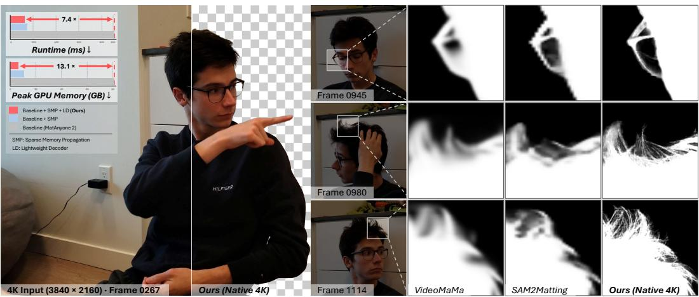  
Figure 1: Real-world 4K inference on an NVIDIA A800-SXM4-80GB. MatAnyone-E (Ours) achieves an estimated 7.4× speedup and 13.1× lower peak GPU memory usage than MatAnyone 2 (Yang et al., 2026), which runs out of memory. By directly processing native 4K inputs, our method preserves finer details and boundaries compared to VideoMaMa (Lim et al., 2026) and SAM2Matting (Shen et al., 2026).

## ABSTRACT

High-resolution video matting requires preserving fine details, such as hair strands and soft transparency, while maintaining consistency across frames. Memorybased methods achieve strong matting quality by matching current-frame features with information stored from earlier frames, but this process becomes increasingly costly as resolution grows. We present MatAnyone-E, an efficient extension of MatAnyone 2 that focuses computation where it is most needed. Our approach first performs low-resolution propagation to identify uncertain regions that require closer inspection and the memory candidates most relevant to them. It then performs high-resolution matching only for these regions using the selected memory, while reusing low-resolution matching results elsewhere. This strategy reduces both the number of locations requiring detailed matching and the amount of memory searched, while preserving the information needed to produce a complete matte. We further reduce the cost of generating high-resolution mattes with a lightweight decoder designed around measured runtime bottlenecks and trained to reproduce the original decoder’s representations. Experiments show that MatAnyone-E maintains matting quality comparable to MatAnyone 2 while achieving an estimated 7.4× inference speedup and reducing peak GPU memory usage to 7.6% of the usage of MatAnyone 2 at 4K. With compilation-enabled inference on a single NVIDIA H200 GPU, it reaches 73.07 FPS at 1080p and 28.62 FPS at 4K.

## 1 INTRODUCTION

Video matting estimates a continuous alpha matte for each frame, enabling foreground subjects to be composited onto new backgrounds. High-resolution applications demand accurate recovery of hair strands, thin structures, and soft transparency, together with temporal consistency to prevent flickering. Meeting these requirements, however, becomes computationally expensive as resolution increases, limiting the practical use of otherwise high-quality methods.

Existing video matting methods (Zhang et al., 2025; 2019; Qiao et al., 2020; Zhu et al., 2017) address this challenge with different trade-offs. Efficiency-oriented approaches, such as RVM (Lin et al., 2022) and SparseMat (Sun et al., 2023), reduce computation through recurrent temporal modeling or selective high-resolution refinement, but can struggle to preserve fine structures and tem poral consistency in challenging scenes. Recent methods such as VideoMaMa (Lim et al., 2026) and SAM2Matting (Shen et al., 2026) leverage generative or segmentation priors, yet their restricted processing resolutions limit the detail they can recover from high-resolution inputs. Memory-based methods, including MatAnyone (Yang et al., 2025) and MatAnyone 2 (Yang et al., 2026), achieve strong matting quality by retrieving information from earlier frames. However, matching currentframe features against stored memory and decoding high-resolution mattes incur substantial computational costs as resolution increases. Although selective matte refinement has been explored, reducing the cost of the underlying temporal memory matching remains a distinct challenge. This motivates our central question: how can we preserve the quality of memory-based video matting while avoiding exhaustive high-resolution matching and costly decoding?

The main computational bottleneck lies in comparing every current-frame feature with a large bank of features stored from earlier frames. Increasing the video resolution enlarges both sets of features, causing the matching cost to grow rapidly even when the number of stored frames remains fixed. Yet detailed matching is not equally important everywhere. The model can rely more on information carried over from the previous frame at some locations, while others depend more strongly on newly retrieved information. This suggests focusing matching computation on locations that require stronger updates from memory. The difficulty is identifying these locations efficiently: the signal indicating how much each location needs an update is obtained only after the expensive matching has already been performed.

We address this dilemma with MatAnyone-E, an efficient extension of MatAnyone 2. Our key idea is to use an inexpensive low-resolution propagation pass to guide subsequent computation. This initial pass identifies locations that are likely to benefit most from closer inspection and the memory candidates most relevant to those locations. We then perform matching at the native feature resolution only between these selected locations and memory candidates, reusing the upsampled low-resolution matching results elsewhere. Selecting locations alone would still require searching the entire memory bank; selecting relevant memory as well reduces both sources of matching cost. The resulting dense matching output is then used for downstream alpha prediction.

Beyond memory matching, producing the high-resolution alpha matte remains a substantial computational cost. We therefore develop a lightweight decoder guided by measured runtime bottlenecks, since reducing arithmetic operations alone does not necessarily improve inference speed. We train this decoder through knowledge distillation from the original decoder to preserve matting quality. Together, selective memory matching and efficient decoding address the two main sources of highresolution inference cost.

Experiments show that MatAnyone-E maintains matting quality comparable to MatAnyone 2 while substantially improving inference efficiency. At 4K resolution, our complete model achieves an estimated 7.4× inference speedup and reduces peak GPU memory usage to 7.6% of MatAnyone 2. Compared with prior methods, MatAnyone-E provides a stronger balance between matting quality and inference efficiency at high resolutions.

## 2 RELATED WORK

Video Matting. Video matting methods address the coupled challenges of alpha-detail recovery, temporal consistency, and computational efficiency. RVM (Lin et al., 2022) uses recurrent feature aggregation for real-time human video matting. SparseMat (Sun et al., 2023) exploits spatiotemporal sparsity for selective high-resolution refinement, while µMatting (Chen et al., 2026) targets 4K matting with selective refinement and introduces the αMatte4K dataset. These efficiencyoriented methods (Ke et al., 2022; Qin et al., 2025; Lin et al., 2021) highlight efficient temporal modeling and selective refinement as important strategies for high-resolution matting. Another line of work (Li et al., 2024a; Lin et al., 2023; Li et al., 2024b) leverages external guidance and pretrained priors. FTP-VM (Huang & Lee, 2023) jointly models trimap propagation and matting. MaGGIe (Huynh et al., 2024) combines transformer attention and sparse convolution for maskguided instance matting. Matting Anything 2 (Zhang et al., 2026a) uses separate memory pathways for masks and trimaps. SAM2Matting (Shen et al., 2026) connects video tracking (Ravi et al., 2025; Carion et al., 2026) with dedicated matting heads. GVM (Ge et al., 2025) exploits video diffusion priors (Blattmann et al., 2023), while VideoMaMa (Lim et al., 2026) leverages generative priors to convert segmentation masks into alpha mattes and train SAM2-Matte.

Closely related to our work, MatAnyone (Yang et al., 2025) introduces region-adaptive memory fusion for stable target-assigned video matting. MatAnyone 2 (Yang et al., 2026) further improves matting through learned quality evaluation, large-scale real-world data curation, and reference-frame training. We build on this memory-based framework and focus on reducing its high-resolution inference cost. Whereas methods such as SparseMat and µMatting reduce computation through selective matte refinement, reducing the cost of the underlying temporal memory matching remains a distinct challenge.

Efficient Video Object Segmentation. Memory-based video object segmentation (VOS) provides a foundation for temporal information propagation. STCN (Cheng et al., 2021) improves efficiency through shared frame correspondences and distance-based affinity. XMem (Cheng & Schwing, 2022) combines sensory, working, and long-term memories to control memory growth over long videos. Cutie (Cheng et al., 2024) augments pixel-level memory reading with object-level queries for more robust target representations. SAM 2 (Ravi et al., 2025) extends promptable segmentation to videos through streaming memory attention. These methods highlight the importance of memory representation and efficient memory access for temporal propagation.

Recent work further reduces the cost of memory-based VOS. EfficientTAM (Xiong et al., 2025) combines a lightweight plain ViT encoder with spatially compressed memory attention. EdgeTAM (Zhou et al., 2025) compresses frame memories using a 2D Spatial Perceiver with global and patch-level queries, supported by knowledge distillation. Efficient-SAM2 (Zhang et al., 2026b) introduces object-aware window routing and sparse memory retrieval to reduce redundant computation. These approaches demonstrate the effectiveness of memory compression and selective computation for efficient temporal propagation. Our work extends this efficiency perspective to high-resolution video matting by using uncertainty estimated from inexpensive low-resolution propagation to determine where native-resolution matching is needed, together with query-dependent memory selection.

## 3 METHODOLOGY

Given a video and a first-frame foreground mask, MatAnyone-E predicts an alpha matte $M _ { t }$ for each frame $I _ { t } .$ As illustrated in Fig. 2(a), MatAnyone-E follows the main architecture of MatAnyone 2, but we modify two of the components whose computational cost grows most rapidly with resolution: memory propagation (Fig. 2(b)) and decoding (Fig. 2(c)). Sparse Memory Propagation (Sec. 3.2) uses low-resolution propagation to identify uncertain regions that require closer inspection and the memory candidates most relevant to them. It then performs high-resolution matching only for these regions using the selected memory, while reusing low-resolution matching results elsewhere. A lightweight decoder (Sec. 3.3) further reduces high-resolution decoding cost through profiling-guided design and feature distillation.

## 3.1 PRELIMINARIES

Throughout this section, HR refers to the encoder’s native memory-feature resolution, and LR refers to this feature grid spatially downsampled by a factor of s.

Memory Matching. Let $Q _ { t } \in \mathbb { R } ^ { N _ { q } \times C _ { k } }$ denote the current-frame queries, and let $K _ { m } \in \mathbb { R } ^ { N _ { m } \times C _ { k } }$ and $V _ { m } \doteq \mathbb { R } ^ { N _ { m } \times C _ { v } }$ denote the stored memory keys and values. We omit batch and object dimen-

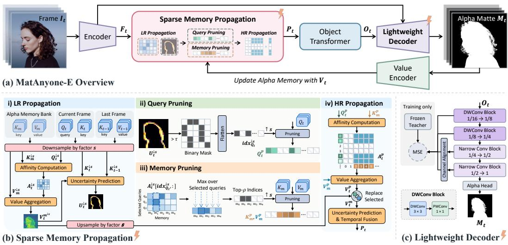  
Figure 2: Overview of MatAnyone-E. (a) MatAnyone-E retains the main architecture of MatAnyone 2 (Yang et al., 2026), while replacing its memory propagation and decoder with Sparse Memory Propagation and a lightweight decoder. (b) Low-resolution (LR) propagation estimates uncertainty and query–memory affinities to select query locations and relevant memory for high-resolution (HR) matching. HR propagation then performs matching only on the selected query–memory pairs, while reusing the upsampled LR readout elsewhere. (c) The lightweight decoder adopts depthwiseseparable blocks in its lower-resolution stages and narrower dense convolutions in its later decoder stages, guided by stage-wise latency profiling and trained with feature distillation from the MatAnyone 2 decoder.

sions for clarity. MatAnyone $^ 2$ retrieves information from memory as:

$$
A _ { t } = \operatorname { N o r m } _ { m } ( \operatorname { S i m } ( Q _ { t } , K _ { m } ) ) , \qquad V _ { t } ^ { m } = A _ { t } V _ { m } ,\tag{1}
$$

where $A _ { t } \in \mathbb R ^ { N _ { q } \times N _ { m } }$ contains query–memory affinities, Sim denotes the baseline distance-based similarity, and $\mathrm { N o r m } _ { m }$ retains the top-k affinities of each query before softmax normalization over memory locations. Although only a small number of memory locations contribute to each readout, finding these matches still requires comparing every query against the full memory bank. Since both the query and memory grids grow with spatial resolution, such dense matching quickly becomes expensive at high resolution even when the number of stored frames is fixed.

Temporal Fusion. After memory retrieval, MatAnyone 2 combines the retrieved value $V _ { t } ^ { m }$ with the value $V _ { t - 1 }$ propagated from the previous frame:

$$
P _ { t , i } = U _ { t , i } V _ { t , i } ^ { m } + \left( 1 - U _ { t , i } \right) V _ { t - 1 , i } ,\tag{2}
$$

where $U _ { t , i } \in [ 0 , 1 ]$ is predicted from the retrieved memory readout $V _ { t } ^ { m }$ by the uncertainty predictor. This uncertainty does not measure prediction confidence; rather, it is associated with temporal alpha changes and acts as a per-location gate: small values favor information carried over from the previous frame in temporally stable regions, whereas large values place more weight on newly retrieved memory. The uncertainty $U _ { t }$ thus reflects how strongly each location relies on memory retrieval.

## 3.2 SPARSE MEMORY PROPAGATION

Although Eq. 2 weights retrieved memory differently across locations, MatAnyone 2 still matches every query against the full memory bank. Ideally, detailed matching should be reserved for locations that rely more heavily on newly retrieved information. However, identifying these locations is non-trivial because the fusion weights that indicate this reliance are available only after the memory readout has been computed.

The proposed Sparse Memory Propagation resolves this dependency with an inexpensive LR propagation pass. As shown in Fig. 2(b), the resulting coarse uncertainty $U _ { t } ^ { \downarrow s }$ serves as a proxy for where HR matching is useful. At the same time, the query–memory affinities already computed by this pass indicate which memory is relevant to those locations. Hence, the same LR computation therefore answers two questions: where detailed matching should be performed, and which memory should participate in it. We detail the steps below:

Low-Resolution Propagation. We first spatially downsample the queries, memory keys, and memory values by a factor of s and apply the baseline memory matching:

$$
A _ { t } ^ { \downarrow s } = \mathrm { N o r m } _ { m } \Big ( \mathrm { S i m } ( Q _ { t } ^ { \downarrow s } , K _ { m } ^ { \downarrow s } ) \Big ) , \qquad V _ { t } ^ { m \downarrow s } = A _ { t } ^ { \downarrow s } V _ { m } ^ { \downarrow s } .\tag{3}
$$

Since both the query and memory grids contain approximately $1 / s ^ { 2 }$ as many locations, this pass evaluates only about $1 / s ^ { 4 }$ as many query–memory pairs as dense HR matching. The LR readout $V _ { t } ^ { m \downarrow s }$ is used to estimate uncertainty for query selection and is upsampled to provide a dense base for subsequent HR propagation, while the LR affinities $A _ { t } ^ { \downarrow s }$ are reused to identify relevant memory.

Query Pruning. We apply the uncertainty predictor inherited from MatAnyone 2 to the LR propagation features $K _ { t } ^ { \downarrow s } , K _ { t - 1 } ^ { \downarrow s }$ , and $V _ { t } ^ { m \downarrow s }$ to estimate $U _ { t } ^ { \downarrow s }$ . We then select coarse locations whose uncertainty exceeds a threshold τ:

$$
\mathrm { i d x } _ { Q _ { t } } ^ { \downarrow s } = \{ i \mid U _ { t , i } ^ { \downarrow s } > \tau \} .\tag{4}
$$

Each selected LR location corresponds to an $s \times s$ region on the HR grid, and the HR queries within these regions form $Q _ { t } ^ { p } \in \mathbb { R } ^ { n _ { q } \times ^ { } } C _ { k }$ . Detailed matching can therefore focus on a subset of query locations rather than the full HR grid.

Memory Pruning. Query pruning alone is not sufficient, because each retained query would still be compared against the entire memory bank, whose size grows with both the resolution and the number of stored frames. The LR pass has already established coarse correspondences between these queries and memory. We reuse these affinities to identify memory locations that are relevant to the selected queries. Specifically, for each LR memory location $j ,$ we compute:

$$
w _ { j } = \operatorname* { m a x } _ { i \in \mathrm { i d x } _ { Q _ { t } } ^ { \downarrow s } } \left( A _ { t } ^ { \downarrow s } \right) _ { i , j } .\tag{5}
$$

The maximum assigns a high score to a memory location whenever it is strongly associated with any selected query. We retain the highest-scoring fraction ρ of memory locations and use their corresponding HR keys and values, denoted by $K _ { m } ^ { p }$ and $V _ { m } ^ { p }$ , for subsequent HR matching. This pruning is performed only for the current retrieval and does not modify the persistent memory bank.

High-Resolution Propagation. After pruning both sides of the matching problem, HR matching is performed only between the selected queries and selected memory:

$$
A _ { t } ^ { p } = \operatorname { N o r m } _ { m } ( \operatorname { S i m } ( Q _ { t } ^ { p } , K _ { m } ^ { p } ) ) , \qquad V _ { t } ^ { p } = A _ { t } ^ { p } V _ { m } ^ { p } .\tag{6}
$$

We use the upsampled LR readout as a dense base and replace the selected locations with their refined HR values:

$$
V _ { t , i } ^ { m } = \left\{ \begin{array} { l l } { V _ { t , i } ^ { p } , } & { i \mathrm { i s ~ s e l e c t e d } , } \\ { \lbrack \mathrm { U p } _ { s } ( V _ { t } ^ { m \downarrow s } ) \rbrack _ { i } , } & { \mathrm { o t h e r w i s e } . } \end{array} \right.\tag{7}
$$

where $\mathrm { U p } _ { s }$ denotes spatial upsampling by a factor of s. This yields a dense readout while restricting expensive high-resolution matching to the selected query–memory pairs. Dense HR matching evaluates $N _ { q } N _ { m }$ query–memory pairs. Sparse Memory Propagation first performs the LR pass, which evaluates approximately $N _ { q } N _ { m } / s ^ { 4 }$ pairs, and then performs HR matching only between the retained $n _ { q }$ queries and $n _ { m }$ memory locations, requiring $n _ { q } n _ { m }$ pairs. Its total matching cost is therefore approximately $N _ { q } N _ { m } / s ^ { 4 } + n _ { q } n _ { m } .$ The dense readout is then processed by the uncertainty predictor and temporal fusion at the HR level, as in MatAnyone 2.

## 3.3 LIGHTWEIGHT DECODER

Beyond memory matching, high-resolution decoding remains a substantial source of inference cost. We therefore develop a lightweight decoder guided by measured runtime behavior and trained with feature distillation from the MatAnyone 2 decoder.

Table 1: Matting quality comparison at 1920 × 1080. Best and second-best results are marked in red and orange , respectively. Values in parentheses denote differences from MatAnyone 2.
<table><tr><td>Metric</td><td>RVM</td><td>FTP-VM</td><td>MaGGIe</td><td></td><td>GVM MatAnyone</td><td></td><td>VideoMaMa SAM2Matting</td><td>MatAnyone 2</td><td>Ours</td><td></td></tr><tr><td colspan="9">VideoMatte HR</td><td></td></tr><tr><td>MAD↓</td><td>6.57</td><td>8.00</td><td>4.42</td><td>6.33</td><td>4.24</td><td>6.83</td><td>4.74</td><td>4.10</td><td>4.14</td><td>(+0.04)</td></tr><tr><td>MSE↓</td><td>1.93</td><td>3.24</td><td>0.40</td><td>2.08</td><td>0.33</td><td>2.75</td><td>0.51</td><td>0.28</td><td>0.25</td><td>(-0.03)</td></tr><tr><td>Grad ↓</td><td>10.55</td><td>23.75</td><td>4.03</td><td>8.04</td><td>4.00</td><td>6.04</td><td>6.78</td><td>3.45</td><td>3.22</td><td>(-0.23)</td></tr><tr><td>dtSSD ↓</td><td>1.90</td><td>2.37</td><td>1.31</td><td>1.59</td><td>1.19</td><td>1.40</td><td>1.74</td><td>1.15</td><td>1.17</td><td>(+0.02)</td></tr><tr><td colspan="9">YouTubeMatte HR</td></tr><tr><td>MAD↓</td><td>4.37</td><td>6.49</td><td>2.37</td><td>2.68</td><td>1.99</td><td>2.46</td><td>3.16</td><td>1.61</td><td>1.62</td><td>(+0.01)</td></tr><tr><td>MSE↓</td><td>2.25</td><td>4.58</td><td>0.98</td><td>1.34</td><td>0.71</td><td>1.28</td><td>1.50</td><td>0.50</td><td>0.45</td><td>(-0.05)</td></tr><tr><td>Grad ↓</td><td>15.10</td><td>29.78</td><td>7.69</td><td>8.38</td><td>8.91</td><td>4.68</td><td>13.07</td><td>7.14</td><td>6.13</td><td>(-1.01)</td></tr><tr><td>dtSSD ↓</td><td>2.28</td><td>2.41</td><td>1.77</td><td>1.72</td><td>1.65</td><td>1.35</td><td>2.10</td><td>1.53</td><td>1.48</td><td>(-0.05)</td></tr><tr><td colspan="9">CRGNN</td></tr><tr><td>MAD↓</td><td>5.98</td><td>6.64</td><td>9.50</td><td>5.03</td><td>5.76</td><td>5.18</td><td>5.80</td><td>4.24</td><td>4.28</td><td>(+0.04)</td></tr><tr><td>MSE↓</td><td>2.79</td><td>3.54</td><td>6.11</td><td>2.15</td><td>3.04</td><td>2.13</td><td>2.66</td><td>2.00</td><td>1.85</td><td>(-0.15)</td></tr><tr><td>Grad ↓</td><td>13.68</td><td>15.10</td><td>16.51</td><td>14.28</td><td>15.55</td><td>13.78</td><td>16.28</td><td>11.74</td><td>12.87</td><td>(+1.13)</td></tr><tr><td>dtSSD↓</td><td>5.36</td><td>5.98</td><td>6.02</td><td>4.86</td><td>5.44</td><td>4.82</td><td>5.42</td><td>4.54</td><td>4.61</td><td>(+0.07)</td></tr></table>

Profiling-Guided Decoder Design. As illustrated in Fig. 2(c), both the original and lightweight decoders progressively upsample features through four stages, increasing the spatial resolution from 1/16 to $1 { \bar { / } } 8 , 1 / 4 , 1 / { \bar { 2 } }$ , and finally the full input resolution. While the original decoder uses dense convolutions throughout, simply replacing them with lower-FLOP depthwise-separable convolutions does not consistently reduce latency across stages. In particular, at higher spatial resolutions, the reduction in arithmetic cost is increasingly offset by lower arithmetic intensity and increased memory-access overhead, so fewer FLOPs do not necessarily translate into faster execution.

We therefore adopt different lightweight designs at different stages. For the $1 / 1 6  1 / 8$ and $1 / 8  1 / 4$ stages, we use a depthwise $3 \times 3$ convolution followed by a pointwise 1×1 convolution. For the $1 / 4  1 / 2$ and $1 / 2  1$ stages, where reducing memory traffic becomes more important, we retain dense convolutions but reduce their channel widths. This stage-wise design follows the measured runtime behavior of each stage rather than applying a single lightweight block throughout the decoder. Detailed stage-wise profiling and analysis are provided in Appendix D.

Feature Distillation. While these lightweight designs reduce inference cost, they might limit the decoder’s representation capacity. To prevent this, we apply feature distillation during training, so that the intermediate representations learned by the original decoder are preserved.

Specifically, we use the MatAnyone 2 decoder as a frozen teacher and the lightweight decoder as the student. Given the same upstream representation, we extract intermediate features from all four corresponding decoder stages. Let $F _ { l } ^ { T }$ and $F _ { l } ^ { S }$ denote the teacher and student features at stage $l ,$ respectively. When their channel dimensions differ, a learnable 1 × 1 adapter projects the student feature to the teacher dimension; otherwise, the original student feature is used directly. Let $\widetilde { F } _ { l } ^ { S }$ denote the resulting aligned student feature. We then minimize:

$$
\mathcal { L } _ { \mathrm { d i s t i l l } } = \sum _ { l = 1 } ^ { 4 } \left\| \widetilde { F } _ { l } ^ { S } - F _ { l } ^ { T } \right\| _ { 2 } ^ { 2 } .\tag{8}
$$

The distillation loss is optimized jointly with the MatAnyone 2 matting objectives as $\mathcal { L } = \mathcal { L } _ { \mathrm { m a t } }$ + $\lambda _ { \mathrm { d i s t i l l } } \mathcal { L } _ { \mathrm { d i s t i l l } }$ , where $\lambda _ { \mathrm { d i s t i l l } }$ controls the strength of feature distillation.

## 4 EXPERIMENTS

Training and Inference Details. We initialize MatAnyone-E from the pretrained MatAnyone 2 model and train it on 8 NVIDIA A800-80GB GPUs with a total batch size of 16. Each training sample consists of 8 consecutive frames randomly cropped to $4 8 0 \times 4 8 0 ,$ , and training uses a combination of existing video matting datasets and the VMReal training set Yang et al. (2026). Feature distillation is applied at all four decoder stages with $\lambda _ { \mathrm { d i s t i l l } } = 0 . 0 0 1$ . The feature widths across the lightweight decoder hierarchy are [256, 128, 64, 32, 16]. Feature adapters are used only where the student and teacher channel dimensions differ and are removed after training. For Sparse Memory Propagation, we use a downsampling factor of $s = 2$ , an uncertainty threshold of $\tau = 0 . 1 5$ , and retain the top 15% of memory candidates $( \rho = 0 . 1 5 )$ . Unless otherwise specified, all experiments are conducted without model compilation.

Table 2: Inference efficiency across input resolutions. Measured on an NVIDIA A800-SXM4- 80GB; FLOPs are reported per frame in TFLOPs and memory as peak allocated GPU memory in GB. Values in parentheses for “Ours” denote speedup or reduction relative to MatAnyone 2, and $\mathrm { ^ { 6 6 } ( C . ) ^ { 5 } }$ denotes compilation-enabled inference. Grayed-out results are not directly comparable because the corresponding methods operate at fixed processing resolutions rather than the native input resolution. Asterisks indicate MatAnyone 2 4K results extrapolated from shorter-memory measurements because inference with a full memory bank exceeds available GPU memory; “-” indicates an out-of-memory result.
<table><tr><td></td><td>MaGGIe</td><td>GVM</td><td>VideoMaMa</td><td>SAM2Matting</td><td>MatAnyone 2</td><td>Ours</td><td>Ours (C.)</td></tr><tr><td>Params (M)</td><td>30.91</td><td>1621.02</td><td>2335.29</td><td>478.53</td><td>35.25</td><td>31.32</td><td>31.32</td></tr><tr><td colspan="8">1024×1024</td></tr><tr><td>FPS↑</td><td>22.8</td><td>1.8</td><td>2.4</td><td>14.1</td><td>29.5</td><td>41.3 (×1.40)</td><td>47.3</td></tr><tr><td>FLOPs  $( \times 1 0 ^ { 1 2 } ) \downarrow$ </td><td>0.32</td><td>24.04</td><td>16.48</td><td>7.22</td><td>0.54</td><td>0.34 (×1.59)</td><td>0.34</td></tr><tr><td>Mem. (GB) ↓</td><td>0.80</td><td>20.45</td><td>15.14</td><td>3.99</td><td>1.60</td><td>0.92 (×1.74)</td><td>0.61</td></tr><tr><td colspan="8">1920×1080</td></tr><tr><td>FPS↑</td><td>19.4</td><td>0.84</td><td>2.5</td><td>14.0</td><td>13.6</td><td>26.6 (×1.96)</td><td>37.6</td></tr><tr><td>FLOPs  $( \times 1 0 ^ { 1 2 } ) \downarrow$ </td><td>0.56</td><td>53.95</td><td>16.48</td><td>7.22</td><td>1.20</td><td>0.69 (×1.74)</td><td>0.69</td></tr><tr><td>Mem. (GB) ↓</td><td>1.19</td><td>33.99</td><td>15.14</td><td>4.01</td><td>5.47</td><td>1.66 (×3.30)</td><td>1.07</td></tr><tr><td colspan="8">2560×1440</td></tr><tr><td>FPS↑</td><td>18.4</td><td>0.43</td><td>2.5</td><td>13.8</td><td>5.6</td><td>16.5 (×2.95)</td><td>25.1</td></tr><tr><td>FLOPs  $( \times 1 0 ^ { 1 2 } ) \downarrow$ </td><td>0.56</td><td>111.61</td><td>16.48</td><td>7.22</td><td>2.45</td><td>1.24 (×1.98)</td><td>1.24</td></tr><tr><td>Mem. (GB) ↓</td><td>1.21</td><td>55.47</td><td>15.10</td><td>4.03</td><td>16.20</td><td>3.04 (×5.33)</td><td>2.02</td></tr><tr><td colspan="8">3840×2160</td></tr><tr><td>FPS↑</td><td>19.3</td><td></td><td>2.4</td><td>13.3</td><td>1.1*</td><td>8.1 (×7.36)</td><td>13.6</td></tr><tr><td> $\mathrm { { F L O P s } ( \times 1 0 ^ { 1 2 } ) \downarrow }$ </td><td>0.56</td><td></td><td>16.48</td><td>7.22</td><td> $7 . 7 6 ^ { * }$ </td><td>2.72 (×2.85)</td><td>2.72</td></tr><tr><td>Mem. (GB) ↓</td><td>1.26</td><td></td><td>15.14</td><td>4.08</td><td>79.69*</td><td>6.08 (×13.11)</td><td>3.89</td></tr></table>

Evaluation Settings. We evaluate matting quality on the high-resolution subsets of VideoMatte Lin et al. (2021) and YouTubeMatte Yang et al. (2025), as well as the CRGNN benchmark Lin et al. (2022), at $1 9 2 0 \times 1 0 8 0$ . We report mean absolute difference (MAD), mean squared error (MSE), gradient error (Grad), and temporal error (dtSSD), where lower values indicate better performance. For CRGNN, inference is performed over the complete video sequence, while quantitative evaluation is conducted only on annotated frames. Unless otherwise specified, efficiency is measured on an NVIDIA A800-SXM4-80GB GPU. For MatAnyone-E, runtime is measured at steady state after the memory bank reaches its configured capacity.

## 4.1 QUANTITATIVE EVALUATIONS

Comparison with State-of-the-art Methods. We compare MatAnyone-E with RVM (Lin et al., 2022), FTP-VM (Huang & Lee, 2023), MaGGIe (Huynh et al., 2024), GVM (Ge et al., 2025), MatAnyone (Yang et al., 2025), VideoMaMa (Lim et al., 2026), SAM2Matting (Shen et al., 2026), and its baseline, MatAnyone 2 (Yang et al., 2026). Table 1 reports results on three video matting benchmarks. Compared with MatAnyone 2, MatAnyone-E largely preserves matting quality: MAD differs by at most 0.04 and dtSSD by at most 0.07 across all three datasets. It also achieves lowe MSE on VideoMatte (0.25 vs. 0.28), YouTubeMatte (0.45 vs. 0.50), and CRGNN (1.85 vs. 2.00).

Compared with recent methods, MatAnyone-E outperforms SAM2Matting across all reported metrics and datasets, and achieves lower MAD and MSE than VideoMaMa across all three benchmarks.

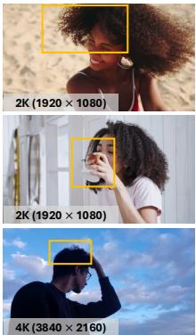  
Video Frame

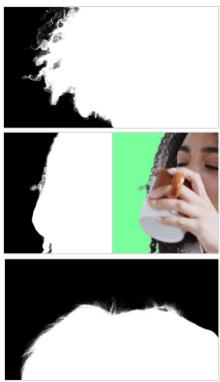  
MatAnyone

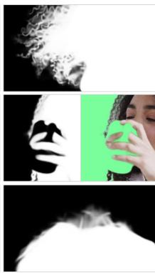  
VideoMaMa

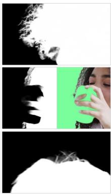  
SAM2Matting

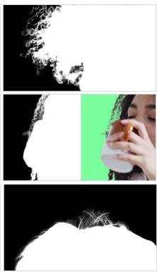  
Ours

Figure 3: Qualitative comparison. Examples illustrate fine-detail preservation, semantic correctness in challenging foreground regions, and high-resolution detail recovery. MatAnyone-E better preserves thin hair structures and local boundaries, particularly in the 4K example.  
  
Video Frame

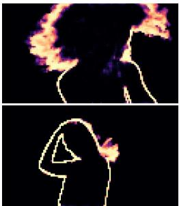  
Dense Uncertainty

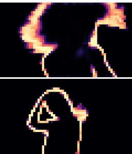  
LR Uncertainty

  
Queries

Figure 4: Query selection on CRGNN. Low-resolution uncertainty follows the main spatial distribution of dense uncertainty and selects queries around object boundaries, fine structures, and other uncertain regions for high-resolution matching. Please zoom in to inspect fine details.

For example, on YouTubeMatte, MatAnyone-E achieves an MAD of 1.62 vs. 3.16 and an MSE of 0.45 vs. 1.50 compared with SAM2Matting. Overall, these results show that MatAnyone-E maintains the strong matting quality of MatAnyone 2.

High-Resolution Inference. Table 2 compares inference efficiency across four input resolutions. At 4K, MatAnyone-E reaches 8.1 FPS with 6.08 GB peak memory. Since MatAnyone 2 exceeds available GPU memory with a full memory bank at 4K, its runtime and memory are extrapolated from shorter-memory measurements, with details provided in Appendix B.1. This corresponds to an estimated 7.4× speedup and 13.1× memory reduction over MatAnyone 2. MatAnyone-E also achieves 2.0× and 2.9× speedups at 1080p and 1440p, respectively. Compilation further improves throughput to 13.6 FPS at 4K. MatAnyone-E maintains high throughput and low peak memory as input resolution increases.

## 4.2 QUALITATIVE EVALUATIONS

Qualitative Comparison. Figure 3 compares MatAnyone-E with MatAnyone, VideoMaMa, and SAM2Matting on representative challenging examples. In regions containing fine hair and soft boundaries, MatAnyone-E recovers cleaner and more complete alpha structures with fewer missing or blurred details. It also better preserves challenging foreground structures, such as hands and objects interacting with the subject, while maintaining accurate local boundaries. The advantage becomes more evident at 4K resolution, where MatAnyone-E processes the native-resolution input and preserves finer hair structures than methods operating at restricted processing resolutions.

Query-Selection Visualization. Figure 4 compares uncertainty estimated from dense propagation with that obtained from low-resolution propagation, together with the query locations selected for high-resolution matching. The low-resolution estimate retains the main spatial distribution of dense uncertainty. This supports its use as a low-cost proxy for identifying query locations that benefit from high-resolution matching.

Table 3: Component ablation on CRGNN at 1920 × 1080. SMP denotes Sparse Memory Propagation, and LD denotes the lightweight decoder. The baseline is the original MatAnyone 2 model; combining SMP and LD gives the full MatAnyone-E model. Memory is reported as peak allocated GPU memory in GB.
<table><tr><td>Configuration</td><td>MAD↓</td><td>MSE↓</td><td>Grad ↓</td><td>dtSSD↓</td><td>Latency (ms) ↓</td><td>FPS ↑</td><td>Peak Mem. (GB) ↓</td></tr><tr><td>Baseline</td><td>4.24</td><td>2.00</td><td>11.74</td><td>4.54</td><td>73.53</td><td>13.6</td><td>5.47</td></tr><tr><td>+ SMP</td><td>4.26</td><td>1.94</td><td>13.00</td><td>4.69</td><td>44.18</td><td>22.6</td><td>2.78</td></tr><tr><td>+LD</td><td>4.27</td><td>1.84</td><td>12.83</td><td>4.59</td><td>66.61</td><td>15.0</td><td>4.35</td></tr><tr><td>+ SMP + LD (Ours)</td><td>4.28</td><td>1.85</td><td>12.87</td><td>4.61</td><td>37.59</td><td>26.6</td><td>1.66</td></tr></table>

Table 4: Comparison of HR query-selection strategies on CRGNN at 1920 × 1080. All selective strategies use approximately the same HR query budget. The baseline is the MatAnyone 2 with dense HR matching, while “LR only” uses only the LR readout without further HR matching. Lower is better for all quality metrics and latency.
<table><tr><td>Method</td><td>MAD↓</td><td>MSE↓</td><td>Grad↓</td><td>dtSSD ↓</td><td>Latency (ms) ↓</td><td>HR Queries</td></tr><tr><td>Baseline</td><td>4.24</td><td>2.00</td><td>11.74</td><td>4.54</td><td>73.53</td><td>100.00%</td></tr><tr><td>LR only</td><td>4.35</td><td>2.00</td><td>13.23</td><td>4.80</td><td>41.85</td><td>0.00%</td></tr><tr><td>Uniform</td><td>4.39</td><td>2.05</td><td>13.26</td><td>4.82</td><td>43.82</td><td>6.98%</td></tr><tr><td>Alpha boundary</td><td>4.34</td><td>2.00</td><td>13.20</td><td>4.79</td><td>43.46</td><td>6.99%</td></tr><tr><td>Uncertainty-guided (Ours)</td><td>4.26</td><td>1.94</td><td>13.02</td><td>4.70</td><td>42.92</td><td>6.99%</td></tr></table>

## 4.3 ABLATION STUDIES

Component Ablation. As shown in Table 3, both Sparse Memory Propagation (SMP) and the lightweight decoder (LD) improve inference efficiency while maintaining comparable matting quality. Compared with the MatAnyone 2 baseline, SMP reduces latency from 73.53 ms to 44.18 ms and peak GPU memory from 5.47 GB to 2.78 GB, while LD reduces them to 66.61 ms and 4.35 GB, respectively. Combining both components gives the full MatAnyone-E model, achieving 37.59 ms latency, 26.6 FPS, and 1.66 GB peak memory.

Query-Selection Strategy. As shown in Table 4, we compare different strategies for selecting query locations for HR matching using the MatAnyone 2 checkpoint. The dense baseline performs HR matching at all query locations, while “LR only” uses only the LR readout without further HR matching. Under a similar HR query budget, uncertainty-guided selection achieves better matting quality than uniform sampling and alpha-boundary selection, while maintaining comparable latency. This supports using the uncertainty estimated from LR propagation to identify locations that benefit most from HR matching.

## 5 CONCLUSION

We presented MatAnyone-E, an efficient framework for high-resolution video matting. Our key insight is that dense high-resolution memory matching is largely redundant: only a subset of query locations requires precise retrieval, and only a subset of memory is relevant to them. By restricting native-resolution matching to selected query–memory pairs and reusing the upsampled lowresolution readout elsewhere, Sparse Memory Propagation substantially reduces the cost of temporal memory retrieval. A lightweight decoder further reduces high-resolution decoding cost through profiling-guided design and feature distillation. MatAnyone-E preserves the strong matting quality of MatAnyone 2 while achieving an estimated 7.4× inference speedup and 13.1× lower peak GPU memory at 4K. We believe selective high-resolution computation offers a practical direction for scaling memory-based video matting to high resolutions.

## REFERENCES

Andreas Blattmann, Tim Dockhorn, Sumith Kulal, Daniel Mendelevitch, Maciej Kilian, Dominik Lorenz, Yam Levi, Zion English, Vikram Voleti, Adam Letts, et al. Stable Video Diffusion: Scaling latent video diffusion models to large datasets. arXiv preprint, 2023.

Nicolas Carion, Laura Gustafson, Yuan-Ting Hu, Shoubhik Debnath, Ronghang Hu, Didac Suri Coll-Vinent, Chaitanya Ryali, Kalyan Vasudev Alwala, Haitham Khedr, Andrew Huang, et al. SAM 3: Segment anything with concepts. In ICLR, 2026.

Xinyi Chen, Hang Dong, Baowei Jiang, Shenkun Xu, Youqi Guan, Kanle Shi, Kun Gai, and Haichuan Song. αMatte4K & µMatting: Dataset and model for ultra-micro precision alpha video matting. In CVPR, 2026.

Ho Kei Cheng and Alexander G Schwing. XMem: Long-term video object segmentation with an Atkinson-Shiffrin memory model. In ECCV, 2022.

Ho Kei Cheng, Yu-Wing Tai, and Chi-Keung Tang. Rethinking space-time networks with improved memory coverage for efficient video object segmentation. In NeurIPS, 2021.

Ho Kei Cheng, Seoung Wug Oh, Brian Price, Joon-Young Lee, and Alexander Schwing. Putting the object back into video object segmentation. In CVPR, 2024.

Yongtao Ge, Kangyang Xie, Guangkai Xu, Li Ke, Mingyu Liu, Longtao Huang, Hui Xue, Hao Chen, and Chunhua Shen. Generative video matting. In SIGGRAPH, 2025.

Wei-Lun Huang and Ming-Sui Lee. End-to-end video matting with trimap propagation. In CVPR, 2023.

Chuong Huynh, Seoung Wug Oh, Abhinav Shrivastava, and Joon-Young Lee. MaGGIe: Masked guided gradual human instance matting. In CVPR, 2024.

Zhanghan Ke, Jiayu Sun, Kaican Li, Qiong Yan, and Rynson W.H. Lau. MODNet: Real-time trimap-free portrait matting via objective decomposition. In AAAI, 2022.

Jiachen Li, Vidit Goel, Marianna Ohanyan, Shant Navasardyan, Yunchao Wei, and Humphrey Shi. VMFormer: End-to-end video matting with transformer. In WACV, 2024a.

Jiachen Li, Roberto Henschel, Vidit Goel, Marianna Ohanyan, Shant Navasardyan, and Humphrey Shi. Video instance matting. In WACV, 2024b.

Sangbeom Lim, Seoung Wug Oh, Jiahui Huang, Heeji Yoon, Seungryong Kim, and Joon-Young Lee. VideoMaMa: Mask-guided video matting via generative prior. In CVPR, 2026.

Chung-Ching Lin, Jiang Wang, Kun Luo, Kevin Lin, Linjie Li, Lijuan Wang, and Zicheng Liu. Adaptive human matting for dynamic videos. In CVPR, 2023.

Shanchuan Lin, Andrey Ryabtsev, Soumyadip Sengupta, Brian L Curless, Steven M Seitz, and Ira Kemelmacher-Shlizerman. Real-time high-resolution background matting. In CVPR, 2021.

Shanchuan Lin, Linjie Yang, Imran Saleemi, and Soumyadip Sengupta. Robust high-resolution video matting with temporal guidance. In WACV, 2022.

Yu Qiao, Yuhao Liu, Xin Yang, Dongsheng Zhou, Mingliang Xu, Qiang Zhang, and Xiaopeng Wei. Attention-guided hierarchical structure aggregation for image matting. In CVPR, 2020.

Haotong Qin, Xianglong Liu, Xudong Ma, Lei Ke, Yulun Zhang, Jie Luo, and Michele Magno. BiVM: Accurate binarized neural network for efficient video matting. IEEE TPAMI, 2025.

Nikhila Ravi, Valentin Gabeur, Yuan-Ting Hu, Ronghang Hu, Chaitanya Ryali, Tengyu Ma, Haitham Khedr, Roman Radle, Chloe Rolland, Laura Gustafson, Eric Mintun, Junting Pan, Kalyan Va-¨ sudev Alwala, Nicolas Carion, Chao-Yuan Wu, Ross Girshick, Piotr Dollar, and Christoph Fe-´ ichtenhofer. SAM 2: Segment anything in images and videos. ICLR, 2025.

Ruiqi Shen, Guangquan Jie, Chang Liu, and Henghui Ding. SAM2Matting: Generalized image and video matting. In ECCV, 2026.

Yanan Sun, Chi-Keung Tang, and Yu-Wing Tai. Ultrahigh resolution image/video matting with spatio-temporal sparsity. In CVPR, 2023.

Yunyang Xiong, Chong Zhou, Xiaoyu Xiang, Lemeng Wu, Chenchen Zhu, Zechun Liu, Saksham Suri, Balakrishnan Varadarajan, Ramya Akula, Forrest Iandola, et al. Efficient track anything. In ICCV, 2025.

Peiqing Yang, Shangchen Zhou, Jixin Zhao, Qingyi Tao, and Chen Change Loy. MatAnyone: Stable video matting with consistent memory propagation. In CVPR, 2025.

Peiqing Yang, Shangchen Zhou, Kai Hao, and Qingyi Tao. MatAnyone 2: Scaling video matting via a learned quality evaluator. In CVPR, 2026.

Chenyi Zhang, Yiheng Lin, Yunchao Wei, Hongsong Wang, Caifeng Shan, and Fang Zhao. Matting Anything 2: Towards video matting for anything. In ICLR, 2026a.

Huayu Zhang, Dongyue Wu, Yuanjie Shao, Nong Sang, and Changxin Gao. Object-aware video matting with cross-frame guidance. arXiv preprint, 2025.

Jing Zhang, Zhikai Li, Xuewen Liu, and Qingyi Gu. Efficient-SAM2: Accelerating SAM2 with object-aware visual encoding and memory retrieval. In ICLR, 2026b.

Yunke Zhang, Lixue Gong, Lubin Fan, Peiran Ren, Qixing Huang, Hujun Bao, and Weiwei Xu. A late fusion cnn for digital matting. In CVPR, 2019.

Chong Zhou, Chenchen Zhu, Yunyang Xiong, Saksham Suri, Fanyi Xiao, Lemeng Wu, Raghuraman Krishnamoorthi, Bo Dai, Chen Change Loy, Vikas Chandra, et al. EdgeTAM: On-device track anything model. In CVPR, 2025.

Bingke Zhu, Yingying Chen, Jinqiao Wang, Si Liu, Bo Zhang, and Ming Tang. Fast deep matting for portrait animation on mobile phone. In ACMMM, 2017.

## APPENDIX

The appendix provides additional implementation details, efficiency analyses, and qualitative results that complement the main paper:

• Appendix A: Multi-level Sparse Memory Propagation

• Appendix B: Additional Efficiency Analysis

• Appendix C: Analysis of Memory Pruning

• Appendix D: Analysis of the Lightweight Decoder

• Appendix E: Efficiency Across GPU Architectures

• Appendix F: Additional Qualitative Results

## A MULTI-LEVEL SPARSE MEMORY PROPAGATION

Algorithm 1 Multi-level Sparse Memory Propagation. $X ^ { \downarrow s } ;$ : s× spatial downsampling $( X ^ { \downarrow 1 } { = } X ) ;$   
$\mathrm { U p } _ { r } \colon r \times$ spatial upsampling; Unc: the inherited uncertainty predictor; $c ( i )$ : the $s _ { 0 } \cdot$ -grid location   
containing $i ; X [ \mathcal { T } ] \colon$ entries of X inside the regions covered by $\mathcal { Z } .$ With a single level $( L { = } 1 , s _ { 0 } { = } s )$   
it reduces to the formulation in the main paper.   
Require: queries $\overline { { Q _ { t } \ ( H \times W \ \mathrm { g r i d } ) } } ;$ memory $\overline { { K _ { m } , V _ { m } } }$ ; spatial budget M; uncertainty threshold $\tau ;$   
keep ratio $\rho$   
Ensure: memory readout $V _ { t } ^ { m }$   
1: function $\mathrm { L E V E L S } ( H , W , M )$   
2: $s \gets 2$   
3: while $\lceil H / s \rceil \lceil W / s \rceil > M$ do   
4: $s  2 s$   
5: end while   
6: return $( s , s / 2 , \ldots , 2 , 1 )$   
7: end function   
8: $( s _ { 0 } , \ldots , s _ { L } ) \gets \mathrm { L E V E L S } ( H , W , M )$   
Low-resolution propagation   
9: $A _ { t } ^ { \downarrow s _ { 0 } } \gets \mathrm { N o r m } _ { m } ( \mathrm { S i m } ( Q _ { t } ^ { \downarrow s _ { 0 } } , K _ { m } ^ { \downarrow s _ { 0 } } ) )$   
10: $V _ { t } ^ { m \downarrow s _ { 0 } } \gets A _ { t } ^ { \downarrow s _ { 0 } } V _ { m } ^ { \downarrow s _ { 0 } }$   
11: for $\ell = 1 , \ldots , L$ do   
12: $U _ { t } ^ { \downarrow ^ { s _ { \ell - 1 } } } \gets \mathrm { U n c } ( V _ { t } ^ { m \downarrow s _ { \ell - 1 } } )$   
Query pruning   
13: $\mathcal { T }  \{ i \mid U _ { t , i } ^ { \downarrow s _ { \ell - 1 } } > \tau \}$   
14: $Q _ { t } ^ { p }  Q _ { t } ^ { \downarrow s _ { \ell } } [ \mathcal { T } ]$   
Memory pruning   
15: $w _ { j } \gets \operatorname* { m a x } _ { i \in \mathcal { I } } ( A _ { t } ^ { \downarrow s _ { 0 } } ) _ { c ( i ) , j }$   
16: $\mathcal { I }  \mathrm { t o p } { - \rho }$ fraction of $\{ w _ { j } \}$   
17: $K _ { m } ^ { p } \gets K _ { m } ^ { \downarrow s _ { \ell } } [ \mathcal { I } ] ; V _ { m } ^ { p } \gets \bar { V } _ { m } ^ { \downarrow s _ { \ell } } [ \mathcal { I } ]$   
Sparse propagation   
18: $\mathring { A } _ { t } ^ { p } \gets \operatorname { N o r m } _ { m } ( \operatorname { S i m } ( Q _ { t } ^ { p } , K _ { m } ^ { p } ) )$   
19: $V _ { t } ^ { p } \gets A _ { t } ^ { p } V _ { m } ^ { p }$   
20: $V _ { t } ^ { m \downarrow s _ { \ell } } \gets \mathrm { U p } _ { s _ { \ell - 1 } / s _ { \ell } } ( V _ { t } ^ { m \downarrow s _ { \ell - 1 } } )$   
21: $V _ { t } ^ { m \downarrow s \ell } [ \mathcal { T } ]  V _ { t } ^ { p }$   
22: end for   
23: return $V _ { t } ^ { m } = V _ { t } ^ { m \downarrow s _ { L } }$

For high-resolution inputs, we extend Sparse Memory Propagation (SMP) to multiple refinement levels. The number of levels is determined by the spatial size of the memory feature grid. Starting from the native feature resolution $H \times W$ , we repeatedly downsample by a factor of two until the coarsest grid contains no more than M spatial locations. This produces a sequence of scales $( s _ { 0 } , s _ { 1 } , \ldots , s _ { L } )$ , where $s _ { L } = 1$ corresponds to the native memory-feature resolution.

Propagation first operates densely at the coarsest level. The resulting memory readout is used to estimate uncertainty, and only query locations whose uncertainty exceeds the threshold are propagated at the next finer level. For these selected queries, we further restrict matching to a subset of memory candidates identified from the coarse affinities. Specifically, memory candidates are ranked according to their maximum affinity to the selected query regions, and only the top ρ fraction is retained. Sparse propagation is then performed between the selected queries and retained memory candidates. The refined readouts replace the corresponding regions of the upsampled coarse result, while the remaining locations directly retain the coarse prediction. This process is repeated until the native memory-feature resolution is reached.

Algorithm 1 summarizes the complete procedure. When only a single refinement level is required, the algorithm reduces to the formulation described in the main paper. For all 4K experiments reported in the main paper, we consistently use a 4 → 2 → 1 propagation schedule with the spatial budget set to $M = 4 0 9 6$

## B ADDITIONAL EFFICIENCY ANALYSIS

## B.1 RUNTIME BOTTLENECKS OF MATANYONE 2

Table 5: Per-module runtime breakdown of MatAnyone 2 across resolutions and memory-bank sizes. Runtime is reported in milliseconds per frame. The 4K result with five memory frames is estimated because the full configuration exceeds GPU memory.
<table><tr><td>Module</td><td>1080p (mem=5)</td><td>1440p (mem=5)</td><td>4K (mem=2)</td><td>4K (mem=3)</td><td>4K (mem=5, est.)</td></tr><tr><td>Encoder</td><td>9.12</td><td>15.81</td><td>34.11</td><td>34.10</td><td>34.11</td></tr><tr><td>Memory Propagation</td><td>34.35</td><td>115.94</td><td>314.58</td><td>469.65</td><td>779.80</td></tr><tr><td>Object Transformer</td><td>7.56</td><td>8.33</td><td>13.86</td><td>13.91</td><td>14.01</td></tr><tr><td>Decoder</td><td>17.59</td><td>30.37</td><td>67.21</td><td>67.22</td><td>67.22</td></tr><tr><td>Value Encoder</td><td>4.54</td><td>7.53</td><td>16.22</td><td>16.22</td><td>16.22</td></tr><tr><td>Others</td><td>0.73</td><td>0.85</td><td>1.25</td><td>1.34</td><td>1.51</td></tr><tr><td>Total latency</td><td>73.88</td><td>178.83</td><td>445.10</td><td>600.30</td><td>≈911.00</td></tr></table>

To better understand the source of high-resolution inference cost, we profile MatAnyone 2 at the module level across input resolutions and memory-bank sizes. As shown in Table 5, memory propagation increasingly dominates runtime as the spatial resolution grows, accounting for 46% of the total runtime at 1080p and 65% at 1440p. At 4K, the bottleneck becomes substantially more pronounced: increasing the memory bank from two to five frames raises the memory-propagation cost from 314.58 ms to an estimated 779.80 ms, while the runtime of the remaining modules remains nearly unchanged. Consequently, the total per-frame latency increases from 445.1 ms to approximately 911 ms. The decoder is the second-largest high-resolution component, but unlike memory propagation, its cost is largely independent of the memory-bank size. These results identify dense memory propagation as the primary runtime bottleneck of MatAnyone 2 at high resolution.

## B.2 COMPONENT-WISE EFFICIENCY ANALYSIS

We next isolate the contribution of each component to inference efficiency. Table 6 progressively introduces query pruning (QP), memory pruning (MP), the lightweight decoder (LD), and compilation on top of MatAnyone 2.

Query pruning provides the largest reduction in memory-propagation cost, with increasingly pronounced gains at higher resolutions. At 4K, QP reduces latency from 909.09 ms to 157.67 ms and peak memory from 79.69 GB to 10.10 GB. Memory pruning further restricts matching along the memory dimension. Its effect is limited at 1080p and 1440p, but becomes substantially more important at larger spatial scales. At 8K, adding MP on top of QP reduces latency from 1174.04 ms to 578.00 ms and peak memory from 45.79 GB to 39.87 GB.

Table 6: Inference efficiency of MatAnyone-E components across resolutions. QP and MP denote query pruning and memory pruning, respectively, and LD denotes the lightweight decoder. Each row cumulatively adds the indicated component to the previous configuration. Latency is reported in milliseconds, peak memory in GB, and computational cost in TFLOPs per frame. Speedup is relative to MatAnyone 2 at the same resolution.
<table><tr><td>Method</td><td>Latency (ms) ↓</td><td>FPS↑</td><td></td><td>Speedup ↑ Peak Mem. (GB) ↓</td><td>FLOPs (TFLOPs) ↓</td><td>Params (M)</td></tr><tr><td colspan="7">1080p</td></tr><tr><td>MatAnyone 2</td><td>73.53</td><td>13.6</td><td></td><td>5.47</td><td>1.20</td><td>35.25</td></tr><tr><td>+ QP</td><td>42.90</td><td>23.3</td><td>1.71×</td><td>2.69</td><td>0.97</td><td>35.25</td></tr><tr><td>+ MP</td><td>44.18</td><td>22.6</td><td>1.66×</td><td>2.78</td><td>0.96</td><td>35.25</td></tr><tr><td>+LD</td><td>37.59</td><td>26.6</td><td>1.96×</td><td>1.66</td><td>0.69</td><td>31.32</td></tr><tr><td>+ Compilation</td><td>26.60</td><td>37.6</td><td>2.76×</td><td>1.07</td><td>0.69</td><td>31.32</td></tr><tr><td colspan="7">1440p</td></tr><tr><td>MatAnyone 2</td><td>178.57</td><td>5.6</td><td></td><td>16.20</td><td>2.45</td><td>35.25</td></tr><tr><td>+ QP</td><td>71.81</td><td>13.9</td><td>2.49×</td><td>4.60</td><td>1.74</td><td>35.25</td></tr><tr><td>+ MP</td><td>69.70</td><td>14.3</td><td>2.56×</td><td>4.84</td><td>1.71</td><td>35.25</td></tr><tr><td>+LD</td><td>60.61</td><td>16.5</td><td>2.95×</td><td>3.04</td><td>1.24</td><td>31.32</td></tr><tr><td>+ Compilation</td><td>39.84</td><td>25.1</td><td>4.48×</td><td>2.02</td><td>1.24</td><td>31.32</td></tr><tr><td colspan="7">2160p</td></tr><tr><td>MatAnyone 2</td><td>909.09</td><td>1.1</td><td>一</td><td>79.69</td><td>7.76</td><td>35.25</td></tr><tr><td>+ QP</td><td>157.67</td><td>6.3</td><td>5.77×</td><td>10.10</td><td>3.91</td><td>35.25</td></tr><tr><td>+ MP</td><td>143.55</td><td>7.0</td><td>6.33×</td><td>10.18</td><td>3.77</td><td>35.25</td></tr><tr><td>+LD</td><td>123.46</td><td>8.1</td><td>7.36×</td><td>6.08</td><td>2.72</td><td>31.32</td></tr><tr><td>+ Compilation</td><td>73.53</td><td>13.6</td><td>12.36×</td><td>3.89</td><td>2.72</td><td>31.32</td></tr><tr><td colspan="7">4320p</td></tr><tr><td>MatAnyone 2</td><td>OOM</td><td></td><td></td><td>&gt;80</td><td></td><td>35.25</td></tr><tr><td>+ QP</td><td>1174.04</td><td>0.9</td><td>一</td><td>45.79</td><td>17.27</td><td>35.25</td></tr><tr><td>+ MP</td><td>578.00</td><td>1.7</td><td></td><td>39.87</td><td>15.29</td><td>35.25</td></tr><tr><td>+LD</td><td>488.37</td><td>2.0</td><td>一</td><td>23.79</td><td>11.05</td><td>31.32</td></tr><tr><td>+ Compilation</td><td>300.74</td><td>3.3</td><td></td><td>14.87</td><td>11.05</td><td>31.32</td></tr></table>

The lightweight decoder provides a complementary reduction in dense high-resolution computation. At 4K, it reduces latency from 143.55 ms to 123.46 ms, peak memory from 10.18 GB to 6.08 GB, and computational cost from 3.77 to 2.72 TFLOPs per frame. Compilation further improves runtime without changing the reported FLOPs or model parameters, reducing the 4K latency from 123.46 ms to 73.53 ms.

Overall, the results show that the main efficiency gains of MatAnyone-E come from reducing dense memory matching, while memory pruning becomes increasingly beneficial at very high resolutions and the lightweight decoder provides complementary savings in dense decoding.

## B.3 RESOLUTION DEPENDENCE OF SPARSE MEMORY PROPAGATION

Sparse Memory Propagation relies on low-resolution uncertainty and affinities to guide query and memory selection, and its effectiveness therefore depends on the spatial resolution of the underlying feature grid. At lower input resolutions, the downsampled feature map can become too coarse to reliably localize uncertain regions or distinguish relevant memory candidates, limiting the benefit of selective matching.

This effect is particularly noticeable for query pruning. As shown in Table 6, its efficiency gain becomes more pronounced as the input resolution increases: the benefit is relatively modest at 1080p, becomes clearer at 1440p, and grows substantially at 4K and 8K. Memory pruning shows a similar resolution-dependent trend. Its additional gain is limited at 1080p and 1440p, but becomes much more significant at 8K, where the memory dimension is considerably larger.

These results indicate that Sparse Memory Propagation is most beneficial at high spatial resolutions, while its advantage can be limited when the low-resolution feature grid becomes too small.

## C ANALYSIS OF MEMORY PRUNING

Table 7: Recall of dense memory matching under different memory pruning ratios.
<table><tr><td>Keep ratio</td><td>KV retained</td><td>Recall count</td><td>Recall weight</td><td>Top-1 hit</td></tr><tr><td>5%</td><td>4.94%</td><td>0.8318</td><td>0.8333</td><td>0.9363</td></tr><tr><td>10%</td><td>9.84%</td><td>0.9503</td><td>0.9508</td><td>0.9879</td></tr><tr><td>15%</td><td>14.76%</td><td>0.9805</td><td>0.9807</td><td>0.9962</td></tr><tr><td>20%</td><td>19.71%</td><td>0.9908</td><td>0.9909</td><td>0.9985</td></tr><tr><td>30%</td><td>29.67%</td><td>0.9977</td><td>0.9977</td><td>0.9997</td></tr><tr><td>50%</td><td>49.70%</td><td>0.9999</td><td>0.9999</td><td>1.0000</td></tr></table>

We further analyze how well the pruned memory set preserves the candidates selected by dense matching. Table 7 reports the retained KV ratio together with three recall statistics under different pruning ratios. Here, recall count measures the fraction of dense-matching candidates retained after pruning, recall weight measures the fraction of their affinity mass retained, and Top-1 hit measures the fraction of queries whose highest-affinity memory candidate is preserved.

The relevant memory candidates are highly concentrated. Retaining only 10% of the memory bank already recovers approximately 95% of the dense-matching candidates and weights, while preserving the original top-1 match for 98.8% of queries. At our default keep ratio of 15%, the retained memory set preserves 98.1% of both candidate count and affinity weight, with a top-1 hit rate of 99.6%. Increasing the keep ratio beyond 15% yields diminishing improvements in recall.

These results indicate that coarse affinities provide a reliable signal for identifying query-relevant memory candidates. We therefore use a 15% keep ratio in our experiments as a trade-off between retaining relevant memory and pruning redundant memory before high-resolution matching.

## D ANALYSIS OF THE LIGHTWEIGHT DECODER

Table 8: Stage-wise profiling of the MatAnyone 2 decoder. AI denotes arithmetic intensity, and “Regime” indicates whether each block is compute-bound or memory-bound.
<table><tr><td>Block</td><td>Params (K)</td><td>Precision</td><td>Ridge Point</td><td>AI</td><td>Regime</td></tr><tr><td>up-16_8</td><td>475.5</td><td>FP16 TC</td><td>153.0</td><td>530.0</td><td>Compute</td></tr><tr><td>up_8_4</td><td>295.2</td><td>FP16 TC</td><td>153.0</td><td>461.0</td><td>Compute</td></tr><tr><td>up_4_2</td><td>119.0</td><td>FP16 TC</td><td>153.0</td><td>265.0</td><td>Compute</td></tr><tr><td>up_2_1</td><td>12.6</td><td>FP16 TC</td><td>153.0</td><td>71.0</td><td>Memory</td></tr><tr><td>pred_mat</td><td>0.1</td><td>FP32/TF32</td><td>76.5</td><td>4.2</td><td>Memory</td></tr></table>

We further profile the decoder stages to characterize their different computational regimes. Table 8 reports the parameter count, arithmetic intensity, and hardware regime of each decoder block. The lower-resolution stages exhibit relatively high arithmetic intensity and remain compute-bound, whereas the final high-resolution stages have substantially lower arithmetic intensity and become memory-bound.

Table 9: Inference efficiency of MatAnyone-E across GPU architectures. Each GPU reports FPS / peak memory (GB). “w/o” and “w/” denote inference without and with compilation.
<table><tr><td colspan="2"></td><td colspan="2">RTX 3090</td><td colspan="2">RTX 5090</td><td colspan="2">RTX A6000</td><td colspan="2">A800</td><td colspan="2">H200 NVL</td></tr><tr><td>Resolution</td><td>Comp.</td><td>FPS</td><td>Mem.</td><td>FPS</td><td>Mem.</td><td>FPS</td><td>Mem.</td><td>FPS</td><td>Mem.</td><td>FPS</td><td>Mem.</td></tr><tr><td rowspan="2">10242</td><td>w/o</td><td>33.60</td><td>0.87</td><td>70.38</td><td>0.89</td><td>34.63</td><td>0.87</td><td>41.37</td><td>0.92</td><td>71.57</td><td>0.89</td></tr><tr><td>w/</td><td>45.97</td><td>0.50</td><td>95.53</td><td>0.52</td><td>50.97</td><td>0.50</td><td>47.37</td><td>0.61</td><td>102.10</td><td>0.52</td></tr><tr><td rowspan="2">1080p</td><td>w/o</td><td>19.81</td><td>1.61</td><td>39.91</td><td>1.71</td><td>19.29</td><td>1.61</td><td>26.55</td><td>1.66</td><td>45.22</td><td>1.63</td></tr><tr><td>w/</td><td>29.37</td><td>0.87</td><td>61.53</td><td>1.11</td><td>30.44</td><td>0.87</td><td>37.64</td><td>1.07</td><td>73.07</td><td>1.05</td></tr><tr><td rowspan="2">1440p</td><td>w/o</td><td>11.99</td><td>2.98</td><td>22.42</td><td>3.00</td><td>11.48</td><td>2.98</td><td>16.51</td><td>3.04</td><td>29.22</td><td>3.00</td></tr><tr><td>w/</td><td>18.27</td><td>1.89</td><td>36.10</td><td>1.90</td><td>18.43</td><td>1.89</td><td>25.11</td><td>2.02</td><td>52.89</td><td>1.90</td></tr><tr><td rowspan="2">2160p</td><td>w/o</td><td>5.69</td><td>6.09</td><td>10.54</td><td>6.11</td><td>5.51</td><td>6.09</td><td>8.14</td><td>6.08</td><td>14.38</td><td>6.12</td></tr><tr><td>w/</td><td>9.00</td><td>3.16</td><td>19.10</td><td>3.18</td><td>9.40</td><td>3.16</td><td>13.63</td><td>3.89</td><td>28.62</td><td>3.18</td></tr></table>

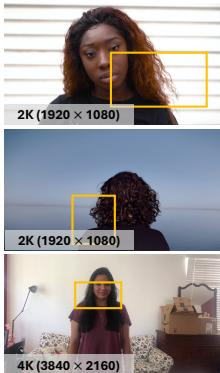  
Video Frame

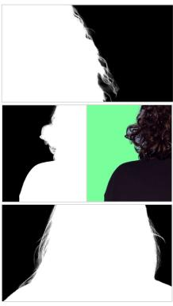  
MatAnyone

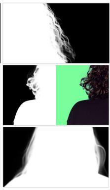  
VideoMaMa

  
SAM2Matting

  
Ours

Figure 5: Additional qualitative comparisons at 2K and 4K resolutions. We show additional examples comparing MatAnyone-E with MatAnyone, VideoMaMa, and SAM2Matting.

This motivates us to adopt a stage-dependent lightweight design rather than a uniform operator replacement across all decoder stages. For the compute-bound lower-resolution stages, we use depthwise-separable convolutions to reduce arithmetic cost. For the high-resolution stages, where memory traffic becomes increasingly important, we instead reduce channel width while retaining dense convolutions. Together, these choices reduce decoder cost while accounting for the different computational characteristics of individual stages.

## E EFFICIENCY ACROSS GPU ARCHITECTURES

To evaluate the efficiency of MatAnyone-E across hardware platforms, we benchmark it on five GPUs spanning consumer, professional, and datacenter classes. Table 9 reports throughput and peak GPU memory across four resolutions, with and without compilation.

Across all tested GPUs, MatAnyone-E exhibits consistent scaling trends as the input resolution increases. Compilation further improves throughput and reduces peak memory across devices. At 4K, the compiled model reaches 9.0 FPS on an RTX 3090, 19.1 FPS on an RTX 5090, 9.4 FPS on an RTX A6000, 13.6 FPS on an A800-SXM4-80GB, and 28.6 FPS on an H200 NVL. These results show that the efficiency characteristics of MatAnyone-E remain consistent across a wide range of GPU architectures.

## F ADDITIONAL QUALITATIVE RESULTS

Additional Qualitative Comparison. Figure 5 provides additional qualitative comparisons at 2K and 4K resolutions, complementing the examples shown in the main paper.

  
Video Frame

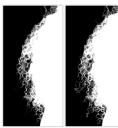  
MA2 Ours

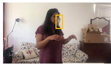  
Video Frame

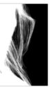  
MA2\*

  
Ours

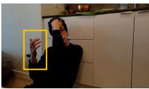  
Video Frame

  
MA2\*

  
(a) Comparison at 2K input  
Ours  
(b) Comparison at 4K input (MA2\* runs at 2K due to memory constraint)

Figure 6: Comparison with MatAnyone 2 at high resolution. MA2 denotes MatAnyone 2. (a) Comparison at 2K input resolution, where MatAnyone-E achieves detail accuracy comparable to that of MA2. (b) Comparison at 4K input resolution, where MA2∗ is evaluated at 2K because its full 4K configuration exceeds available GPU memory, while MatAnyone-E directly processes the native 4K input. As a result, MA2∗ gives blurry details due to direct upsampling, and sometimes makes semantic mistakes when differentiating foreground from background.

Comparison with MatAnyone 2. Figure 6 provides additional comparisons with the direct baseline. At 2K, MatAnyone-E preserves finer hair structures, while the advantage becomes more apparent for 4K inputs, where MatAnyone-E can directly process the native resolution.

Additional High-Resolution Results. Figure 7 presents qualitative results on a real-world 4K sequence with complex curly hair. Despite the dense and irregular hair boundaries, MatAnyone-E preserves fine foreground structures across frames. We further demonstrate MatAnyone-E on three additional high-resolution sequences covering diverse scenarios: multi-person scenes (Fig. 8) and AI-generated content (Fig. 9). These results illustrate the ability of MatAnyone-E to maintain detailed foreground boundaries and temporally consistent matting results across different types of high-resolution content.

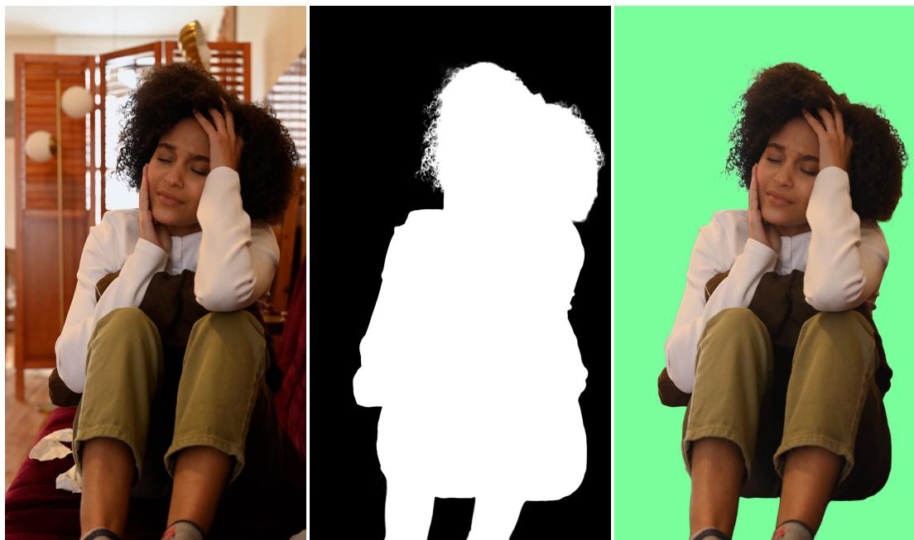  
Frame 072

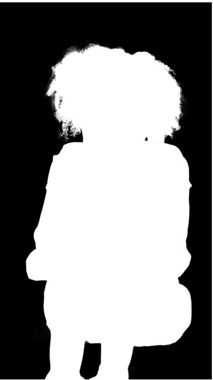  
Frame 142

  
Figure 7: Additional 4K matting results on a challenging real-world sequence. For each example, we show the input frame, predicted alpha matte, and the foreground composited on a green background. MatAnyone-E preserves fine and complex hair structures across frames, including thin strands and highly irregular boundaries around the curly hair.

  
Frame 058

#

  
Frame129

Figure 8: 4K matting results on a multi-person sequence (3840×2160). We show two frames with the input images (top), predicted alpha mattes (middle), and foregrounds composited on a green background (bottom).

Frame 005  

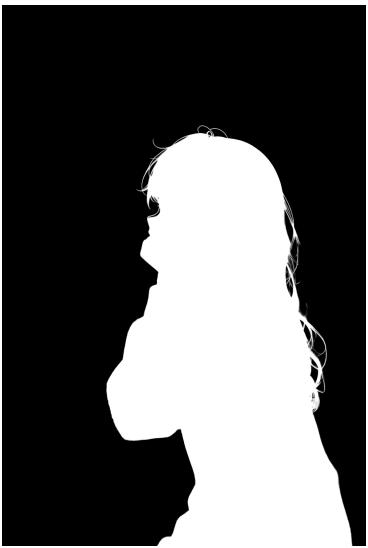  
Frame 099

  
Figure 9: High-resolution matting results on an AI-generated sequence (1440×2144). We show two frames with the input images (left), predicted alpha mattes (middle), and foregrounds composited on a green background (right).