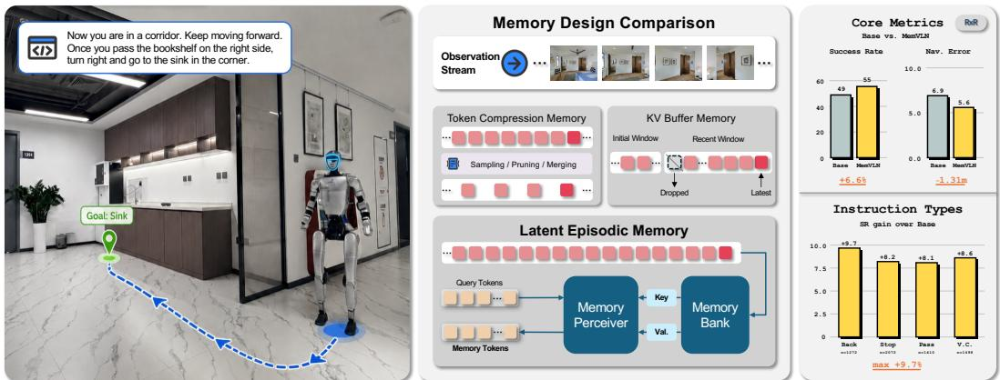
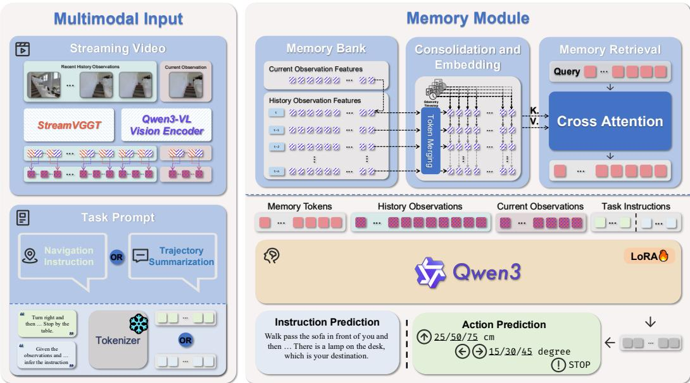
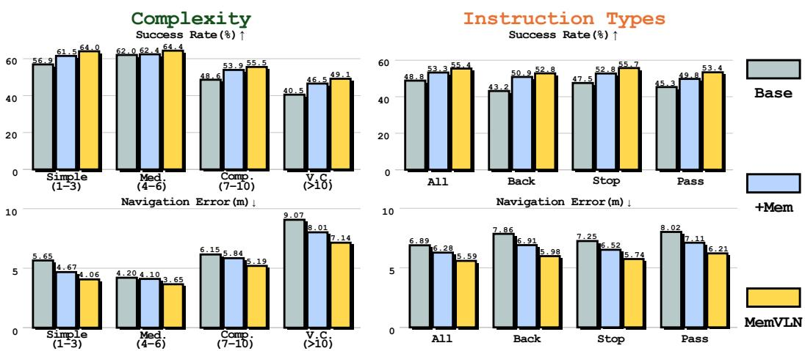
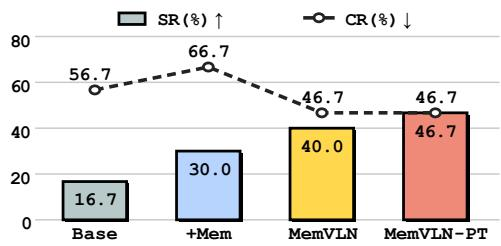
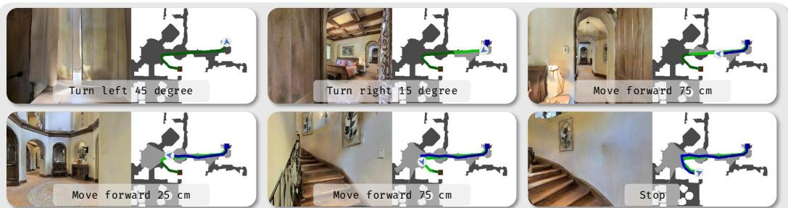
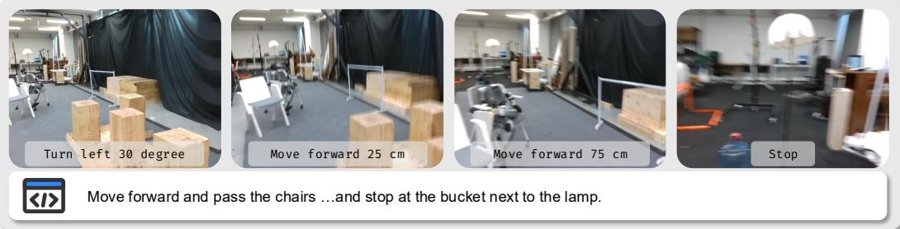
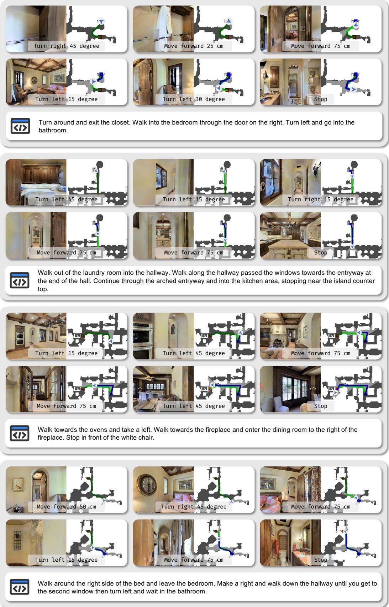
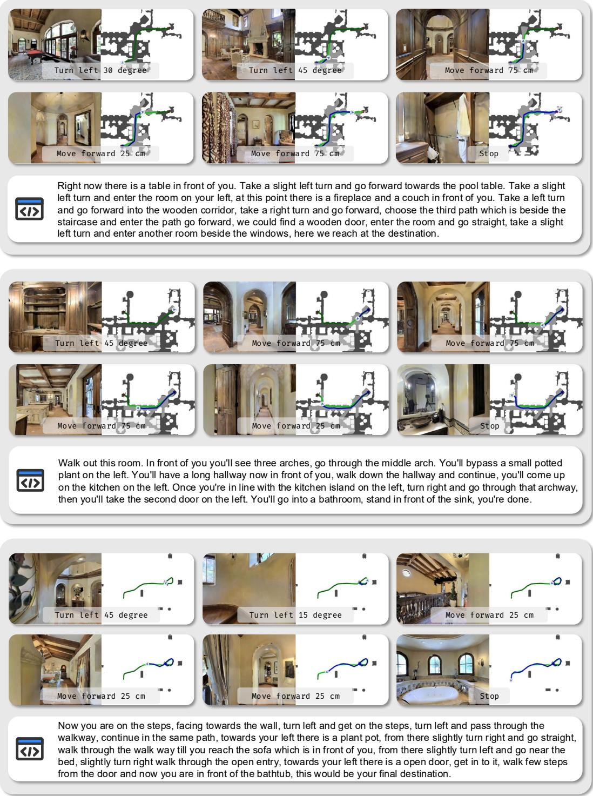
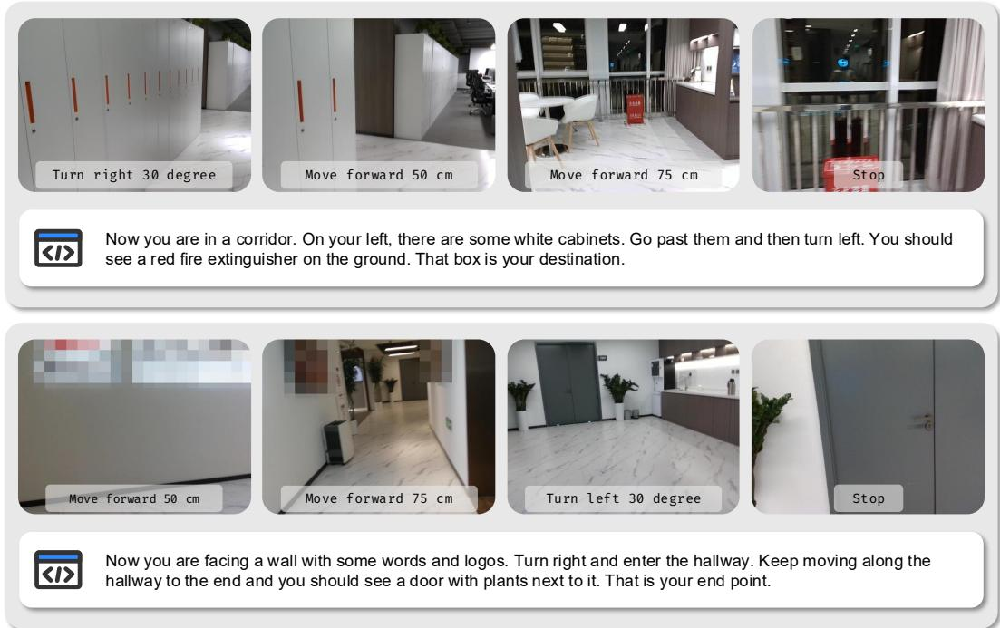

# MEMVLN: STREAMING EPISODIC MEMORY FOR VISION-LANGUAGE NAVIGATION

Yan Wang1∗, Jiangyong Huang1,2,∗, Siyuan Huang1,†, Baoxiong Jia1,†

1 State Key Laboratory of General Artificial Intelligence, BIGAI

2 Peking University

https://memvln.github.io/

Equal contribution. † Corresponding authors.

  
Figure 1: MEMVLN overview. We design a streaming episodic memory framework that endows vision-language models (VLMs) with navigation memory for streaming video. MEMVLN employs a memory module that progressively stores compressed perceptual features and produces compact memory tokens via cross-attention. MEMVLN elevates vision-language navigation performance, including long-horizon and real-world scenarios.

## ABSTRACT

Vision-language navigation (VLN) requires an embodied agent to follow language instructions through 3D environments. Maintaining persistent episodic memory remains a challenge for VLM-based streaming agents in long-horizon navigation. We present MEMVLN, a streaming episodic memory framework that maintains a bounded bank of compressed perceptual features annotated with timesteps and action-derived relative poses, and produces compact memory tokens via crossattention. We pair the proposed memory with a frozen pretrained geometry encoder. To learn the memory module, we design a masking-based trajectory summarization task with multi-granularity sub-trajectory decomposition, encouraging route reconstruction exclusively from episodic memory. Under navigation training restricted to the official R2R/RxR trajectories, MEMVLN achieves state-of-the-art performance on most reported metrics on standard VLN-CE benchmarks. Long-horizon analyses further characterize when episodic memory is useful. For physical evaluation, we collect 30 instruction-conditioned episodes in one physical scene, use 24 as demonstrations for post-training, and hold out six for testing. On the held-out episodes, MEMVLN improves success over the VLM baseline from 17% to 40%, and post-training further raises it to 47%.

## 1 INTRODUCTION

Vision-language navigation (VLN) is a fundamental task in embodied AI, requiring an embodied agent to follow language instructions through 3D environments (Anderson et al., 2018b; Krantz et al.,

2020; Majumdar et al., 2023). Recent vision-language models (VLMs) have substantially improved navigation performance, with monocular streaming video as a prevailing formulation that is natural and practical for real-world deployment (Zhang et al., 2025; Cheng et al., 2025; Wei et al., 2026b;a). Despite rapid progress, the lack of persistent memory remains a critical constraint for real-world long-horizon navigation, where decisions depend on observations from earlier in the episode. In this paper, we address the key problem: how to design a simple yet effective episodic memory that integrates seamlessly with streaming VLM to elevate VLN capability?

Navigation memory has received prior attention, yet existing approaches remain insufficient along several key dimensions. Early methods encode navigation history in recurrent hidden states (Elman, 1990; Hochreiter & Schmidhuber, 1997; Hong et al., 2021), compressing perceptual observations into a fixed-size representation. Explicit memory representations retain observation-level features but are often coupled to panoramic observations or topological maps, requiring adaptation to monocular streaming video in continuous environments (Chen et al., 2021b; Mezghan et al., 2022; An et al., 2024; Wang et al., 2023b; Yu et al., 2025). More recent works revisit navigation memory within a streaming formulation (Zeng et al., 2026; Zheng et al., 2025a), yet the capacity limitation persists. These shortcomings motivate our approach: an episodic memory design that is expressive and natively compatible with streaming video, accompanied by a systematic study of navigation memory spanning long-horizon navigation scenarios and real-world validation.

We propose MEMVLN, a streaming episodic memory framework that endows VLMs with persistent navigation memory. MEMVLN maintains dense short-term observations for immediate action while building a compact, queryable summary of the accumulated episode history. Concretely, a memory bank progressively stores perceptual features of streaming observations alongside their timestep and action-derived relative pose. For action prediction, a memory perceiver extracts latent features from the bank and encodes them with the corresponding spatio-temporal context. It then derives a fixed-size set of memory tokens via cross-attention with learnable queries grounded in the current timestep and relative pose. Memory tokens enter the VLM’s multi-modal sequence for auto-regressive action prediction. When the bank reaches its capacity limit, a frame-merging strategy consolidates consecutive frames into a bounded episodic summary. As a complementary source of spatial features, we use a frozen pretrained StreamVGGT encoder (Zhuo et al., 2026) and train a lightweight adapter to fuse its features into the VLM. Both the memory module and the geometry encoder integrate into existing VLMs for streaming video without modifying the underlying LLM architecture.

To supervise memory learning, we design a dedicated auxiliary task alongside navigation. Specifically, we adopt trajectory summarization (Zheng et al., 2024; Zhang et al., 2024a; Cheng et al., 2025) as the supervision for the memory module, where local visual tokens are masked, leaving memory tokens as the visual evidence for describing the traversed path. To enrich the supervisory signal, we further decompose each full trajectory into hierarchically structured sub-trajectories (Hong et al., 2020), yielding fine-grained supervision across multiple temporal scales. Together, the memory module design, multi-granularity trajectory summarization, and masking strategy constitute a principled framework for learning navigation memory.

We conduct extensive experiments in simulation and on a physical robot. On standard VLN-CE benchmarks (Anderson et al., 2018b; Ku et al., 2020; Krantz et al., 2020), MEMVLN reaches at least 55% success on both R2R and RxR and achieves state-of-the-art performance on most metrics among methods whose navigation fine-tuning trajectories are restricted to the official R2R/RxR training splits. Ablations isolate the contributions of memory, geometry, and auxiliary supervision, while long-horizon analyses further examine when memory is useful. For physical evaluation on the G1 robot, we collect 30 episodes in one physical scene, use 24 as demonstrations for post-training, and hold out six for testing. On the held-out episodes, MEMVLN improves success over the VLM baseline from 17% to 40%, and post-training further raises it to 47%.

## 2 RELATED WORK

Vision-Language Navigation. VLN requires an embodied agent to follow natural language instructions through 3D environments. Early works establish VLN as a foundational task for embodied AI (Chang et al., 2017; Zhu et al., 2017; Xia et al., 2018; Anderson et al., 2018a; Savva et al., 2019; Anderson et al., 2018b; Chaplot et al., 2020; Qi et al., 2020; Ku et al., 2020; Krantz et al., 2020; Thomason et al., 2020; Ramakrishnan et al., 2021; Krantz et al., 2023; Yadav et al., 2023). Given scarce annotated navigation data, considerable work targets data-centric approaches, including data augmentation (Tan et al., 2019; Liu et al., 2021; Zhu et al., 2020; Hong et al., 2020; He et al., 2025; Cui et al., 2025) and data scaling in both simulation environments (Hao et al., 2020; Kamath et al., 2023; Wang et al., 2023c) and the real world (Guhur et al., 2021; Linghu et al., 2024; Cheng et al., 2025; Chen et al., 2026). As model capabilities advance, VLN evaluation encompasses increasingly complex scenarios (Majumdar et al., 2024; Zhang et al., 2024b; Yokoyama et al., 2024b; Khanna et al., 2024; Qiao et al., 2025a; Lin et al., 2025; Wang et al., 2025b). In this paper, we focus on the fundamental VLN task in continuous environments and study how navigation memory can be learned and leveraged without relying on massive data scaling (Anderson et al., 2018b; Ku et al., 2020; Krantz et al., 2020; Hong et al., 2020).

Vision-Language Models for Navigation. Effective VLN requires models to perceive 3D environments and comprehend natural language instructions. While early approaches trained navigation models from scratch (Fried et al., 2018; Nguyen et al., 2019; Wang et al., 2019; Hao et al., 2020), the strengths of pretrained VLMs have emerged as a more promising pathway towards general-purpose VLN (Majumdar et al., 2022; Gadre et al., 2023; Dorbala et al., 2022; Zhou et al., 2023; Wang et al., 2024a; Long et al., 2024; Zhou et al., 2024). This paradigm has inspired diverse approaches, including topological structure methods (Chen et al., 2021a; Krantz et al., 2021; Hong et al., 2022; Chen et al., 2022a;b; Yokoyama et al., 2024a; An et al., 2024), explicit 3D spatial modeling (An et al., 2023; Wang et al., 2024b; Huang et al., 2024; Zhu et al., 2025; Wang et al., 2025d; 2026), and trajectory-level modeling (Shah & Levine, 2022; Shah et al., 2023; Sridhar et al., 2024; Wang et al., 2025c; Gode et al., 2025). More recently, the input formulation has been simplified to monocular streaming video, under which navigation performance has improved rapidly (Zheng et al., 2024; Zhang et al., 2024a; 2025; Cheng et al., 2025; Wei et al., 2026b; Zeng et al., 2026; Zheng et al., 2025a; Qi et al., 2025; Wei et al., 2026a; Chu et al., 2026), with significant progress also demonstrated in real-world deployment (Gervet et al., 2023; Yue et al., 2024; Yang et al., 2024; Qiao et al., 2025b; Sun et al., 2026; Yue et al., 2026; Yu et al., 2026; Zhang et al., 2026). Despite this progress, directly retaining long visual histories in streaming VLM policies increases input context and computation, motivating dedicated memory mechanisms.

Memory for Embodied Agents. Memory mechanisms for embodied agents predate modern VLMbased navigation and span several task formulations. Recurrent policies compress navigation history into hidden states (Elman, 1990; Hochreiter & Schmidhuber, 1997; Hong et al., 2021), whereas explicit approaches retain observation histories or structured spatial representations (Chen et al., 2021b; Mezghan et al., 2022; Wang et al., 2023b; Yu et al., 2025). SMT appends each observation to a growing within-episode memory for visual navigation, while E.T. jointly encodes language with the full visual-action history for ALFRED (Fang et al., 2019; Pashevich et al., 2021). ESceme instead maintains a cross-episode, location-indexed scene memory for VLN (Zheng et al., 2025b). Beyond navigation, MemoryVLA retrieves decision-relevant history from a perceptual-cognitive memory for robotic manipulation (Shi et al., 2026). In contrast, MemVLN targets a bounded, episodelocal visual bank for streaming VLN, with time/pose-grounded latent readout and memory-specific trajectory-summary supervision.

## 3 METHOD

Task Formulation. We study vision-language navigation in continuous environments (VLN-CE), where an embodied agent receives streaming observations and follows language instructions through 3D environments. At each timestep �, the agent receives an egocentric observation $o _ { t }$ and a task instruction $\mathcal { T } ,$ , and predicts an action $a _ { t }$ . The objective is to learn a navigation policy $p ( a _ { t } \mid o _ { 1 : t } , \mathcal { T } )$ Following prior work (Cheng et al., 2025), actions are represented as text comprising an action type $a _ { t } ^ { \mathrm { t y p e } } \in$ {move forward, turn left, turn right, stop} and an action scale $a _ { t } ^ { \mathrm { s c a l e } }$ , where forward distances are in {25, 50, 75}cm and turn angles are in $\{ 1 5 ^ { \circ } , 3 0 ^ { \circ } , 4 5 ^ { \circ } \}$

## 3.1 MODEL OVERVIEW

As illustrated in Fig. 2, MEMVLN comprises the native vision encoder and large language model (LLM) of Qwen3-VL, a frozen geometry encoder, and a memory module. At navigation step �, the agent acquires a new RGB observation $\boldsymbol { o _ { t } } ^ { \prime } \in \mathbb { R } ^ { H \times W \times 3 }$ , which together with recent observations forms the short-term visual context. The native SigLIP-2-based vision encoder $\pi _ { V }$ encodes this context into visual features, with $f _ { t } \in \mathbb { R } ^ { H ^ { \prime } \times W ^ { \prime } \times }$ � denoting the current observation’s patch features. We use pretrained visual geometry models to improve the base VLM’s spatial understanding. In parallel, frozen StreamVGGT (Wang et al., 2025a; Zhuo et al., 2026) provides camera-token representations for the same context. A lightweight trainable adapter � aligns and fuses the geometry and visual representations, producing local hybrid tokens $\mathcal { H } _ { t } = \dot { [ h _ { t } ^ { \mathrm { h i s t } } , h _ { t } ] }$ for the recent history and current observation, respectively. Complementing the short-term visual context, the memory module encodes the accumulated visual history into memory tokens $m _ { t } ,$ as detailed in Sec. 3.2.

  
Figure 2: MEMVLN model overview. MEMVLN combines Qwen3-VL’s native SigLIP-2-based vision encoder and LLM, a frozen StreamVGGT geometry encoder, and our memory module. It receives a short-term context for local perception and an episodic memory for long-horizon reasoning.

Vision-Language Model Design. MEMVLN augments the vanilla LLM input with memory tokens and geometry features, modeling $p ( a _ { t } \mid m _ { t } , { \mathcal { H } } _ { t } , { \mathcal { T } } )$ . To enhance awareness of the current situation, we explicitly distinguish the recent-history tokens $h _ { t } ^ { \mathrm { h i s t } }$ from the current-observation tokens $h _ { t }$ within $\mathcal { H } _ { t }$ . The interleaved multi-modal input to the LLM $\pi _ { L }$ is:

$$
\begin{array} { r l } { \Bigl [ \{ \underbrace { \mathcal { P } _ { \mathrm { m e m } } } _ { \mathrm { m e m r y } } , \underbrace { m _ { t } } _ { \mathrm { m e m r y } } \} , \Bigl \{ \underbrace { \mathcal { P } _ { \mathrm { h i s t } } } _ { \mathrm { \tiny { h i s t o r y } } } , \underbrace { h _ { t } ^ { \mathrm { h i s t } } } _ { \mathrm { \tiny { h i s t o r y } } } \} , \Bigl \{ \underbrace { \mathcal { P } _ { \mathrm { c u r r } } } _ { \mathrm { c u r r e n t } } , \underbrace { h _ { t } } _ { \mathrm { c u r r e n t } } \} , \underbrace { \mathcal { T } } _ { \mathrm { t a s k } } , \underbrace { a _ { t } } _ { \mathrm { a c i t o n } } \Bigr ] , } & { } \\ { \mathrm { p r o m p t } \quad \mathrm { t o k e n s } } & { \underbrace { \mathrm { o b s e r v a i o n } } _ { \mathrm { p r o m p t } } \underbrace { \mathrm { o b s e r v a i o n } } _ { \mathrm { t o k e n s } } \underbrace { \mathrm { o b s e r v a i o n } } _ { \mathrm { p r o m p t } } \underbrace { \mathrm { o b s e r v a i o n } } _ { \mathrm { t o k e n s } } \underbrace { \mathrm { i n s t r u c t i o n } } _ { \mathrm { t o k e n s } } , \qquad \mathrm { a c t i o n } } & { } \\ & { } & { \qquad \mathrm { t o t } = \pi _ { L } ( m _ { t } , \mathcal { H } _ { t } , \mathcal { T } ) . } \end{array}\tag{1}
$$

(2)

The history observation components $\mathcal { P } _ { \mathrm { h i s t } }$ and $h _ { t } ^ { \mathrm { h i s t } }$ are omitted at the initial step $t = 1$ . The dense short-term context anchors fine-grained local perception, while the retrieved memory supplies a bounded summary of accumulated navigation history.

## 3.2 MEMORY MODULE

Memory Bank. Upon receiving a new observation $o _ { t }$ , the corresponding visual feature $f _ { t }$ is appended to an episode-specific memory bank along with its timestep � and relative pose $z _ { t }$ . The pose encodes position $( x , y )$ and orientation (cos �, sin �) relative to the starting point. At policy inference, it is dead-reckoned solely from the executed discrete-action history; neither ground-truth pose nor external odometry is provided to the policy or memory module. When the bank reaches its maximum capacity, the two consecutive frames with the highest average patch-level cosine similarity are merged, retaining a bounded representative summary. We store the visual feature $f _ { t }$ rather than the hybrid feature $h _ { t }$

Memory Perceiver. A memory perceiver resamples the bank into a compact representation using learnable queries and cross-attention (Vaswani et al., 2017; Jaegle et al., 2021). Prior to serving as keys and values, the bank features undergo two operations:

• Spatial Downsampling. To reduce computational cost, patch features within each frame are spatially merged using ToMe (Bolya et al., 2023):

$$
\bar { f } _ { 1 : t } = \mathrm { T o M e } ( f _ { 1 : t } ) .\tag{3}
$$

• Spatio-temporal Embedding. Timestep and action-derived relative pose are encoded into both the bank features and learnable queries � via sinusoidal temporal embeddings (Vaswani et al., 2017) and Fourier spatial features (Rahimi & Recht, 2007; Tancik et al., 2020; Li et al., 2021):

$$
\bar { f } _ { 1 : t } ^ { + } = \bar { f } _ { 1 : t } + \mathrm { s i n u s o i d } ( 1 : t ) + \mathrm { F o u r i e r } ( z _ { 1 : t } ) ,\tag{4}
$$

$$
q ^ { + } = q + \mathrm { s i n u s o i d } ( t ) + \mathrm { F o u r i e r } ( z _ { t } ) .\tag{5}
$$

The memory perceiver then yields a compact and fixed-size set of memory tokens via cross-attention:

$$
m _ { t } = \tt c r o s s - a t t n ( q ^ { + } , \bar { f } _ { 1 : t } ^ { + } ) .\tag{6}
$$

The memory module offers three complementary properties for VLN: (1) Long-horizon context: the bank retains representative visual evidence $( e . g .$ ., signs, doorways, landmarks) from across the episode, extending the available context beyond recent observations; (2) Bounded representation: frame consolidation bounds the number of stored entries, spatial downsampling limits the tokens processed per frame, and the perceiver produces a fixed-size set of memory tokens; and (3) Spatio-temporal grounding: timestep and action-derived relative-pose embeddings relate stored evidence to the agent’s current point along the trajectory. At inference, the readout queries are instruction-agnostic by design: the memory serves as an episodic record of what the agent has experienced, while the downstream LLM performs instruction-conditioned interpretation.

## 3.3 DATA AND TRAINING

MEMVLN is trained jointly on two tasks: VLN and trajectory summarization. The navigation task teaches the model to predict the next action, while the summarization task shapes the memory representation towards route-level semantics. Both tasks use a unified cross-entropy loss.

Vision-Language Navigation. VLN trajectories are preprocessed with action merging following NaVILA (Cheng et al., 2025), where consecutive atomic actions within a window of three steps are merged, $e . g .$ ., three consecutive “move forward 25cm” actions become a single “move forward 75cm”. This enriches action diversity and improves training efficiency. At each step, the model is supervised to predict the ground-truth action $a _ { t } ^ { * } \colon$

$$
\mathcal { L } = - \log p ( a _ { t } ^ { * } \mid m _ { t } , \mathcal { H } _ { t } , \mathcal { T } ) .\tag{7}
$$

Trajectory Summarization. Trajectory summarization provides auxiliary supervision for the memory module. Using the same VLN trajectories, the task instruction $\mathcal { T }$ is repurposed as the ground-truth label. During summarization, all local visual tokens $\mathcal { H } _ { t }$ are masked, leaving the memory tokens $m _ { t }$ as visual evidence. This masking strategy trains the model to reconstruct navigational semantics exclusively from episodic memory, supervising it to retain evidence relevant to long-horizon instruction following, such as landmarks marking completed subgoals or visual cues indicating stopping positions. With the summarization prompt $\mathcal { T } _ { \mathrm { ( T S ) } }$ , the loss is:

$$
\mathcal { L } = - \log p ( \mathcal { T } \mid m _ { t } , \mathcal { T } _ { \mathrm { ( T S ) } } ) .\tag{8}
$$

Sub-trajectory Derivation. We enrich whole-trajectory summarization with sub-trajectory supervi sion. FGR2R annotations (Hong et al., 2020) provide sub-instructions and corresponding waypoints in discrete navigation graphs. We map these waypoints to continuous environments by retrieving the nearest points on the continuous trajectory. This yields sub-trajectory splits that provide finer-grained supervision, encouraging the memory module to capture semantics at multiple temporal scales.

Table 1: Evaluation results on VLN-CE R2R Val-Unseen split. “Pano.”, “Odo.”, and “S.RGB” denote panoramic view, odometry, and single RGB; at policy inference, MemVLN instead derives relative pose from executed actions. External Data counts fine-tuning examples beyond those derived from official R2R/RxR trajectories (e.g., EnvDrop (Tan et al., 2019)). Bold marks the best streaming result among methods restricted to those official navigation trajectories. Results are partially referenced from JanusVLN (Zeng et al., 2026).
<table><tr><td rowspan="2">Method</td><td colspan="4">Observation</td><td colspan="4">R2R Val-Unseen</td><td rowspan="2">Training</td></tr><tr><td>Pano.</td><td>Odo.</td><td>Depth</td><td>S.RGB</td><td>NE↓</td><td>OS↑</td><td>SR↑</td><td>SPL↑ External Data</td></tr><tr><td>CMA (Hong et al., 2022) [CVPR22]</td><td>√</td><td>√</td><td>√</td><td></td><td>6.20</td><td>52.0</td><td>41.0</td><td>36.0</td><td></td></tr><tr><td>VLNBERT (Hong et al., 2021) [CVPR21]</td><td>√</td><td>√</td><td>√</td><td></td><td>5.74</td><td>53.0</td><td>44.0</td><td>39.0</td><td></td></tr><tr><td>Ego2-Map (Hong et al., 2023) [ICCV23]</td><td>√</td><td>√</td><td>√</td><td></td><td>5.54</td><td>56.0</td><td>47.0</td><td>41.0</td><td></td></tr><tr><td>DreamWalker (Wang et al., 2023a) [ICCV23]</td><td>√</td><td>√</td><td>√</td><td></td><td>5.53</td><td>59.0</td><td>49.0</td><td>44.0</td><td></td></tr><tr><td>AO-Planner (Chen et al., 2025) [AAAI25]</td><td>√</td><td></td><td>√</td><td></td><td>5.55</td><td>59.0</td><td>47.0</td><td>33.0</td><td></td></tr><tr><td>g3D-LF (Wang &amp; Lee, 2025) [CVPR25]</td><td></td><td>√</td><td>√</td><td>√</td><td>5.70</td><td>59.5</td><td>47.2</td><td>34.6</td><td></td></tr><tr><td>NaVid-4D (Liu et al., 2025) [ICRA25]</td><td></td><td></td><td>V</td><td>√</td><td>5.99</td><td>55.7</td><td>43.8</td><td>37.1</td><td></td></tr><tr><td>NavMorph (Yao et al., 2025) [ICCV25]</td><td></td><td></td><td>√</td><td>√</td><td>5.75</td><td>56.9</td><td>47.9</td><td>33.2</td><td></td></tr><tr><td>NaVid (Zhang et al., 2024a) [RSS24]</td><td></td><td></td><td></td><td>√</td><td>5.47</td><td>49.1</td><td>37.4</td><td>35.9</td><td>953K</td></tr><tr><td>Sim2Real (Wang et al., 2024b) [CoRL24]</td><td></td><td></td><td></td><td>√</td><td>5.95</td><td>55.8</td><td>44.9</td><td>30.4</td><td>0K</td></tr><tr><td>Stream VLN (Wei et al., 2026b) [ICRA26]</td><td></td><td></td><td></td><td>√</td><td>6.05</td><td>53.8</td><td>45.5</td><td>41.6</td><td>10033K</td></tr><tr><td>Uni-NaVid (Zhang et al., 2025) [RSS25]</td><td></td><td></td><td></td><td>√</td><td>5.58</td><td>53.3</td><td>47.0</td><td>42.7</td><td>3577K</td></tr><tr><td>NaVILA (Cheng et al., 2025) [RSS25]</td><td></td><td></td><td></td><td>V√</td><td>5.37</td><td>57.6</td><td>49.7</td><td>45.5</td><td>12574K</td></tr><tr><td>JanusVLN (Zeng et al., 2026) [ICLR26]</td><td></td><td></td><td></td><td></td><td>5.17</td><td>58.0</td><td>52.8</td><td>49.2</td><td>0K</td></tr><tr><td>MemVLN (Ours)</td><td></td><td></td><td></td><td>√</td><td>5.19</td><td>61.2</td><td>55.0</td><td>50.5</td><td>0K</td></tr></table>

## 4 EXPERIMENTS

Implementation Details. We use Qwen3-VL-4B (Bai et al., 2025), including its native SigLIP-2-based vision encoder, together with StreamVGGT-1B (Zhuo et al., 2026). Both encoders are frozen. We adapt the LLM with LoRA (Hu et al., 2022) and train the memory module and geometry adapter from scratch, yielding 1B trainable parameters in total. The recent observation window contains up to 16 frames. The model is trained for 1 epoch (2 days on 8×A100 80G GPUs) using AdamW (Loshchilov & Hutter, 2019) with a base learning rate of $2 \times 1 0 ^ { - 5 }$ , linear warmup, and cosine decay. See detailed hyperparameters in Appendix.

Data and Evaluation. We train on the official R2R (Anderson et al., 2018b) and RxR (Ku et al., 2020) training trajectories, comprising 10,819 and 19,996 demonstrations. Full-trajectory summary targets reuse the instructions from these routes; fine-grained R2R supervision uses FGR2R subinstruction/waypoint annotations derived from R2R routes (Hong et al., 2020). No additional navigation trajectories or external multimodal fine-tuning data are used. For simulation, we roll out the policy in Habitat-Sim (Savva et al., 2019) under the VLN-CE protocol (Krantz et al., 2020) and report Val-Unseen results. For R2R, we report success rate (SR), oracle success rate (OSR), success weighted by path length (SPL), and navigation error (NE). For RxR, we report SR, SPL, normalized dynamic time warping (nDTW) (Ilharco et al., 2019), and NE.

## 4.1 MAIN SIMULATION RESULTS

Comparison Baselines. We compare primarily against recent VLM-based VLN methods, emphasizing the streaming-video formulation (Wei et al., 2026b; Zeng et al., 2026). For methods with multiple training configurations, Tabs. 1 and 2 report the selected configuration and its additional training-example count. Our state-of-the-art comparison is restricted to methods whose navigation fine-tuning trajectories come only from the official R2R/RxR training splits.

Results. Under this official-trajectory regime, MEMVLN achieves state-of-the-art performance on most metrics in Tabs. 1 and 2. On R2R, MEMVLN reaches 55.0% SR and 50.5% SPL, exceeding JanusVLN by 2.2 and 1.3 percentage points (pp), respectively. OSR rises from 58.0% to 61.2%, with comparable NE (5.19 vs. 5.17 m). On RxR, SR rises from 51.4% to 55.4% (+4.0 pp) and SPL from 44.3% to 48.4% (+4.1 pp). nDTW increases from 59.1 to 64.6, while NE falls from 6.46 to 5.59 m (−0.87 m). These larger RxR gains highlight MEMVLN’s effectiveness on longer instructions and more complex trajectories.

Table 2: Evaluation results on VLN-CE RxR Val-Unseen split. Settings follow Tab. 1 and JanusVLN (Zeng et al., 2026).
<table><tr><td rowspan="2">Method</td><td colspan="4">Observation</td><td colspan="4">RxR Val-Unseen</td><td>Training</td></tr><tr><td>Pano.</td><td>Odo.</td><td>Depth</td><td>S.RGB</td><td>NE↓</td><td>SR↑</td><td>SPL↑</td><td>nDTW↑</td><td>External Data</td></tr><tr><td>CMA (Hong et al., 2022) [CVPR22]</td><td>√</td><td></td><td>√</td><td></td><td>8.76</td><td>26.5</td><td>22.1</td><td>47.0</td><td></td></tr><tr><td>VLNOBERT (Hong et al., 2021) [CVPR21]</td><td>√</td><td>√</td><td>√</td><td></td><td>8.98</td><td>27.0</td><td>22.6</td><td>46.7</td><td></td></tr><tr><td>AO-Planner (Chen et al., 2025) [AAAI25]</td><td>√</td><td></td><td>√</td><td></td><td>7.06</td><td>43.3</td><td>30.5</td><td>50.1</td><td></td></tr><tr><td>NavMorph (Yao et al., 2025) [ICCV25]</td><td></td><td></td><td></td><td>√</td><td>8.85</td><td>30.8</td><td>22.8</td><td>44.2</td><td></td></tr><tr><td>Sim2Real (Wang et al., 2024b) [CoRL24]</td><td></td><td></td><td></td><td></td><td>8.79</td><td>36.7</td><td>25.5</td><td>18.1</td><td>0K</td></tr><tr><td>Uni-NaVid (Zhang et al., 2025) [RSS25]</td><td></td><td></td><td></td><td>V√</td><td>6.24</td><td>48.7</td><td>40.9</td><td></td><td>3577K</td></tr><tr><td>NaViLA (Cheng et al., 2025) [RSS25]</td><td></td><td></td><td></td><td>VV</td><td>6.77</td><td>49.3</td><td>44.0</td><td>58.8</td><td>13132K</td></tr><tr><td>JanusVLN (Zeng et al., 2026) [ICLR26]</td><td></td><td></td><td></td><td></td><td>6.46</td><td>51.4</td><td>44.3</td><td>59.1</td><td>0K</td></tr><tr><td>StreamVLN (Wei et al., 2026b) [ICRA26]</td><td></td><td></td><td></td><td>√</td><td>6.22</td><td>52.9</td><td>46.0</td><td>61.9</td><td>~26330K</td></tr><tr><td>MemVLN (Ours)</td><td></td><td></td><td></td><td>√</td><td>5.59</td><td>55.4</td><td>48.4</td><td>64.6</td><td>0K</td></tr></table>

Table 3: Ablations of memory (mem.), geometry (geo.), and auxiliary supervision (aux.).
<table><tr><td rowspan="2">Setting</td><td colspan="4">R2R Val-Unseen</td><td colspan="4">RxR Val-Unseen</td></tr><tr><td>NE↓</td><td>OS↑</td><td>SR↑</td><td>SPL↑</td><td>NE↓</td><td>SR↑</td><td>SPL↑</td><td>nDTW↑</td></tr><tr><td>Baseline</td><td>6.56</td><td>51.1</td><td>43.9</td><td>40.9</td><td>6.90</td><td>48.8</td><td>43.9</td><td>59.7</td></tr><tr><td>+ mem.</td><td>6.38</td><td>56.7</td><td>45.6</td><td>41.6</td><td>6.28</td><td>53.3</td><td>45.9</td><td>59.6</td></tr><tr><td>+ geo.</td><td>6.04</td><td>58.1</td><td>49.2</td><td>45.2</td><td>5.87</td><td>56.3</td><td>49.7</td><td>62.6</td></tr><tr><td>+ mem. + geo.</td><td>5.85</td><td>56.3</td><td>49.7</td><td>45.8</td><td>5.74</td><td>56.1</td><td>49.4</td><td>63.0</td></tr><tr><td>+ mem. + geo. + aux.</td><td>5.19</td><td>61.2</td><td>55.0</td><td>50.5</td><td>5.59</td><td>55.4</td><td>48.4</td><td>64.6</td></tr></table>

Table 4: Memory capacity ablations on R2R Val-Unseen: bank size $N _ { b }$ and token count $N _ { m } .$

(a) Memory bank capacity
<table><tr><td> $N _ { b }$ </td><td>NE↓</td><td>OSR↑</td><td>SR↑</td><td>SPL↑</td></tr><tr><td>0</td><td>5.87</td><td>57.4</td><td>50.9</td><td>47.2</td></tr><tr><td>100</td><td>5.19</td><td>61.2</td><td>55.0</td><td>50.5</td></tr><tr><td>200</td><td>6.24</td><td>58.7</td><td>50.2</td><td>45.7</td></tr></table>

(b) Memory-token count
<table><tr><td> $N _ { m }$ </td><td>NE↓</td><td>OSR↑</td><td>SR↑</td><td>SPL↑</td></tr><tr><td>0</td><td>5.87</td><td>57.4</td><td>50.9</td><td>47.2</td></tr><tr><td>300</td><td>5.19</td><td>61.2</td><td>55.0</td><td>50.5</td></tr><tr><td>600</td><td>6.75</td><td>53.9</td><td>45.1</td><td>40.8</td></tr></table>

## 4.2 ABLATION STUDIES

Component Analysis. We ablate memory (mem.), geometry (geo.), and trajectory-summary supervision (aux.) on R2R-CE and RxR-CE in Tab. 3. Memory alone improves success on both benchmarks, raising R2R OSR from 51.1% to 56.7% and RxR SR from 48.8% to 53.3%. Geometry provides complementary spatial information, increasing SR from 45.6% to 49.7% on R2R and from 53.3% to 56.1% on RxR when added to memory. The full model exceeds geometry-only by 5.8 pp SR and 5.3 pp SPL on R2R, while lowering NE from 6.04 to 5.19 m. This highlights the value of learning episodic representations alongside spatial perception.

Trajectory-summary supervision adds 5.3 pp SR and 4.7 pp SPL over memory plus geometry on R2R. On RxR, the full model achieves the lowest NE and highest nDTW among these variants. These R2R gains suggest that summarizing past trajectories helps memory capture navigation behavior useful for subsequent decisions.

Memory Capacity. In Tab. 4, our default setting $( N _ { b } = 1 0 0 , N _ { m } = 3 0 0 )$ improves R2R-CE SR by 4.1 pp and SPL by 3.3 pp over the zero-memory setting, while achieving the best SR and SPL in both capacity ablations. Results on RxR-CE and configuration details are provided in Sec. C.1.

## 4.3 LONG-HORIZON ANALYSIS

Settings. We conduct long-horizon analysis on the RxR Val-Unseen split, which features complex instructions and long-horizon navigation episodes. Task complexity is quantified by the number of clauses in each instruction, delimited by $s \cdot , \boldsymbol { \mathbf { \ell } } ,$ and “.”, and categorized as: simple (1-3), medium (4-6), complex (7-10), and very complex (>10). We evaluate three model variants: the VLM baseline, baseline with memory module, and the full MEMVLN. Beyond task complexity, we further categorize episodes by whether the instruction involves: (i) backtracking, (ii) explicit stopping conditions and long hallways, and (iii) passing landmarks. We report the success rate (SR) and navigation error (NE) metrics.

  
Figure 3: Long-horizon analysis on RxR-CE Val-Unseen. Success rate (top) and navigation error (bottom) are grouped by instruction complexity (left) and instruction type (right). Base denotes the VLM baseline, and +Mem adds the memory module. Back, Stop, and Pass denote instructions involving backtracking, stop conditions and long hallways, and passing landmarks, respectively.

Results. In Fig. 3, memory raises SR and lowers NE across all complexity groups and instruction types; the full MEMVLN further improves both metrics. Across complexity levels, memory yields its largest SR gain on very complex instructions: SR rises from 40.5% to 46.5%, while NE falls from 9.07 to 8.01 m. The full model reaches 49.1% SR and 7.14 m NE (+8.6 pp SR over the baseline).

On backtracking episodes, memory raises SR from 43.2% to 50.9% and lowers NE from 7.86 to 6.91 m; the full model reaches 52.8% SR and 5.98 m NE. Memory also gains 5.2 pp and 4.5 pp SR on stop-condition and landmark-passing subsets, respectively. These gains on complex instructions and backtracking highlight the value of episodic context for following extended instructions and revisiting observed locations.

## 4.4 REAL-WORLD EXPERIMENT

Settings. We deploy on G1 in one physical scene and collect 30 instruction-conditioned episodes with human corrections. We split these episodes into 24 post-training demonstrations and six held-out test episodes. We evaluate the VLM baseline (Base), its memory-augmented variant (+Mem), the full MEMVLN, and the post-trained MEMVLN-PT, executing each held-out instruction five times for 30 trials per model. Post-training uses step-weighted behavior cloning, assigning larger weights to corrected steps. We report success rate (SR) and collision rate (CR), where CR is the fraction of trials involving physical contact, contact-induced blockage, or contact-induced termination.

Results. In Fig. 4, MEMVLN achieves 40.0% SR (12/30 successful trials), up from Base’s 16.7% (5/30), while reducing CR from 56.7% to 46.7%. Memory alone raises SR to 30.0% (four additional successes over Base). Compared with +Mem, the full model gains 10.0 pp SR and lowers CR by 20.0 pp. Post-training with the 24 demonstrations further raises SR from 40.0% to 46.7% (14/30 successful trials), while CR remains at 46.7%.

  
Figure 4: Real-world results on G1.

  
You're currently in a closet. Turn a hundred-and-eighty degrees, and take a step forward towards the brown-framed mirror. Turn around, and face right. Take three steps forward, passing the orange bed to the left side of you. Now, you're at the entrance to the hallway. Take three steps forward in front of you. Now, you're in a new circular room. Turn around, and face left. You'll see a brown staircase with a black railing. Walk up the brown staircase. Once you've taken four steps up the brown staircase, you're a little over halfway up the brown staircase, you're done.

  
Figure 5: Qualitative results in simulation and the real world. Selected observations, actions, and instructions for RxR-CE (top, with top-down trajectories) and G1 (bottom).

Inference Cost. Fixed-input replay on one RTX 4090 yields mean policy latencies of 503.2 ms for Base and 691.0 ms for full MEMVLN. The memory module contributes 300 tokens to the LLM input, independent of route length. Profiling, deployment details, and per-instruction outcomes are provided in Secs. B and C.3.

## 4.5 QUALITATIVE RESULTS

Figure 5 shows an RxR-CE route from a closet through a hallway to a staircase, and a G1 rollout past chairs, stopping at the bucket beside a lamp. More examples are in Sec. C.4.

## 5 CONCLUSION

MEMVLN combines plug-and-play episodic memory with a frozen pretrained geometry encoder for streaming vision-language navigation. Multi-granularity trajectory summarization trains the bounded memory representation, masking local visual tokens to reconstruct routes exclusively from episodic memory. With navigation training restricted to official R2R/RxR trajectories, MEMVLN achieves state-of-the-art performance on most reported VLN-CE metrics. Simulation analyses characterize memory’s utility across instruction complexities and navigation scenarios. In one physical scene, post-training on 24 demonstrations improves success on six held-out episodes.

## 6 LIMITATIONS AND FUTURE WORK

First, inference-time retrieval and similarity-based consolidation are instruction-agnostic, so the bounded bank may discard task-relevant observations in long episodes. Second, while trajectory summarization supervises memory learning, broader training strategies remain under-explored (Zheng et al., 2025c). Finally, the real-world study evaluates six held-out episodes in one scene, with substantial collision rates; cross-scene generalization is untested. Future work will investigate task-aware consolidation, broader deployment settings, and safety-aware post-training.

## AI USE STATEMENT

During manuscript revision, we used generative AI tools to assist with literature discovery, drafting and editing selected passages based on author-provided materials, discussing experimental design and interpreting results, and developing and debugging research code. These tools also assisted with figure preparation and LaTeX formatting. The authors reviewed and revised the AI-assisted material and take responsibility for the final manuscript and reported results.

## REFERENCES

Dong An, Yuankai Qi, Yangguang Li, Yan Huang, Liang Wang, Tieniu Tan, and Jing Shao. Bevbert: Multimodal map pre-training for language-guided navigation. In International Conference on Computer Vision (ICCV), 2023.

Dong An, Hanqing Wang, Wenguan Wang, Zun Wang, Yan Huang, Keji He, and Liang Wang. Etpnav: Evolving topological planning for vision-language navigation in continuous environments. Transactions on Pattern Analysis and Machine Intelligence (TPAMI), 2024.

Peter Anderson, Angel Chang, Devendra Singh Chaplot, Alexey Dosovitskiy, Saurabh Gupta, Vladlen Koltun, Jana Kosecka, Jitendra Malik, Roozbeh Mottaghi, Manolis Savva, et al. On evaluation of embodied navigation agents. arXiv preprint arXiv:1807.06757, 2018a.

Peter Anderson, Qi Wu, Damien Teney, Jake Bruce, Mark Johnson, Niko Sünderhauf, Ian Reid, Stephen Gould, and Anton Van Den Hengel. Vision-and-language navigation: Interpreting visuallygrounded navigation instructions in real environments. In Conference on Computer Vision and Pattern Recognition (CVPR), 2018b.

Shuai Bai, Yuxuan Cai, Ruizhe Chen, Keqin Chen, Xionghui Chen, Zesen Cheng, Lianghao Deng, Wei Ding, Chang Gao, Chunjiang Ge, et al. Qwen3-vl technical report. arXiv preprint arXiv:2511.21631, 2025.

Daniel Bolya, Cheng-Yang Fu, Xiaoliang Dai, Peizhao Zhang, Christoph Feichtenhofer, and Judy Hoffman. Token merging: Your vit but faster. In International Conference on Learning Representations (ICLR), 2023.

Angel Chang, Angela Dai, Thomas Funkhouser, Maciej Halber, Matthias Niessner, Manolis Savva, Shuran Song, Andy Zeng, and Yinda Zhang. Matterport3d: Learning from rgb-d data in indoor environments. In International Conference on 3D Vision (3DV), 2017.

Devendra Singh Chaplot, Dhiraj Prakashchand Gandhi, Abhinav Gupta, and Russ R Salakhutdinov. Object goal navigation using goal-oriented semantic exploration. In Advances in Neural Information Processing Systems (NeurIPS), 2020.

Jiaqi Chen, Bingqian Lin, Xinmin Liu, Lin Ma, Xiaodan Liang, and Kwan-Yee K Wong. Affordancesoriented planning using foundation models for continuous vision-language navigation. In AAAI Conference on Artificial Intelligence (AAAI), 2025.

Kevin Chen, Junshen K Chen, Jo Chuang, Marynel Vázquez, and Silvio Savarese. Topological planning with transformers for vision-and-language navigation. In Conference on Computer Vision and Pattern Recognition (CVPR), 2021a.

Peihao Chen, Dongyu Ji, Kunyang Lin, Runhao Zeng, Thomas Li, Mingkui Tan, and Chuang Gan. Weakly-supervised multi-granularity map learning for vision-and-language navigation. In Advances in Neural Information Processing Systems (NeurIPS), 2022a.

Shizhe Chen, Pierre-Louis Guhur, Cordelia Schmid, and Ivan Laptev. History aware multimodal transformer for vision-and-language navigation. In Advances in Neural Information Processing Systems (NeurIPS), 2021b.

Shizhe Chen, Pierre-Louis Guhur, Makarand Tapaswi, Cordelia Schmid, and Ivan Laptev. Think global, act local: Dual-scale graph transformer for vision-and-language navigation. In Conference on Computer Vision and Pattern Recognition (CVPR), 2022b.

Yixin Chen, Yaowei Zhang, Huangyue Yu, Junchao He, Yan Wang, Jiangyong Huang, Hongyu Shen, Junfeng Ni, Shaofei Wang, Baoxiong Jia, et al. Lifting unlabeled internet-level data for 3d scene understanding. In Conference on Computer Vision and Pattern Recognition (CVPR), 2026.

An-Chieh Cheng, Yandong Ji, Zhaojing Yang, Zaitian Gongye, Xueyan Zou, Jan Kautz, Erdem Bıyık, Hongxu Yin, Sifei Liu, and Xiaolong Wang. Navila: Legged robot vision-language-action model for navigation. In Robotics: Science and Systems (RSS), 2025.

Zedong Chu, Shichao Xie, Xiaolong Wu, Yanfen Shen, Minghua Luo, Zhengbo Wang, Fei Liu, Xiaoxu Leng, Junjun Hu, Mingyang Yin, et al. Abot-n0: Technical report on the vla foundation model for versatile embodied navigation. arXiv preprint arXiv:2602.11598, 2026.

Yibo Cui, Liang Xie, Yu Zhao, Jiawei Sun, and Erwei Yin. Generating vision-language navigation instructions incorporated fine-grained alignment annotations. Information Fusion, 2025.

Vishnu Sashank Dorbala, Gunnar Sigurdsson, Robinson Piramuthu, Jesse Thomason, and Gaurav S Sukhatme. Clip-nav: Using clip for zero-shot vision-and-language navigation. arXiv preprint arXiv:2211.16649, 2022.

Jeffrey L Elman. Finding structure in time. Cognitive Science, 1990.

Kuan Fang, Alexander Toshev, Li Fei-Fei, and Silvio Savarese. Scene memory transformer for embodied agents in long-horizon tasks. In Conference on Computer Vision and Pattern Recognition (CVPR), 2019.

Daniel Fried, Ronghang Hu, Volkan Cirik, Anna Rohrbach, Jacob Andreas, Louis-Philippe Morency, Taylor Berg-Kirkpatrick, Kate Saenko, Dan Klein, and Trevor Darrell. Speaker-follower models for vision-and-language navigation. In Advances in Neural Information Processing Systems (NeurIPS), 2018.

Samir Yitzhak Gadre, Mitchell Wortsman, Gabriel Ilharco, Ludwig Schmidt, and Shuran Song. Cows on pasture: Baselines and benchmarks for language-driven zero-shot object navigation. In Conference on Computer Vision and Pattern Recognition (CVPR), 2023.

Theophile Gervet, Soumith Chintala, Dhruv Batra, Jitendra Malik, and Devendra Singh Chaplot. Navigating to objects in the real world. Science Robotics, 2023.

Samiran Gode, Abhijeet Nayak, Débora NP Oliveira, Michael Krawez, Cordelia Schmid, and Wolfram Burgard. Flownav: Combining flow matching and depth priors for efficient navigation. In International Conference on Intelligent Robots and Systems (IROS), 2025.

Pierre-Louis Guhur, Makarand Tapaswi, Shizhe Chen, Ivan Laptev, and Cordelia Schmid. Airbert: Indomain pretraining for vision-and-language navigation. In International Conference on Computer Vision (ICCV), 2021.

Weituo Hao, Chunyuan Li, Xiujun Li, Lawrence Carin, and Jianfeng Gao. Towards learning a generic agent for vision-and-language navigation via pre-training. In Conference on Computer Vision and Pattern Recognition (CVPR), 2020.

Zongtao He, Liuyi Wang, Shu Li, Qingqing Yan, Chengju Liu, and Qijun Chen. A multilevel attention network with sub-instructions for continuous vision-and-language navigation. Applied Intelligence, 2025.

Sepp Hochreiter and Jürgen Schmidhuber. Long short-term memory. Neural Computation, 1997.

Yicong Hong, Cristian Rodriguez, Qi Wu, and Stephen Gould. Sub-instruction aware vision-andlanguage navigation. In Annual Conference on Empirical Methods in Natural Language Processing (EMNLP), 2020.

Yicong Hong, Qi Wu, Yuankai Qi, Cristian Rodriguez-Opazo, and Stephen Gould. Vln bert: A recurrent vision-and-language bert for navigation. In Conference on Computer Vision and Pattern Recognition (CVPR), 2021.

Yicong Hong, Zun Wang, Qi Wu, and Stephen Gould. Bridging the gap between learning in discrete and continuous environments for vision-and-language navigation. In Conference on Computer Vision and Pattern Recognition (CVPR), 2022.

Yicong Hong, Yang Zhou, Ruiyi Zhang, Franck Dernoncourt, Trung Bui, Stephen Gould, and Hao Tan. Learning navigational visual representations with semantic map supervision. In International Conference on Computer Vision (ICCV), 2023.

Edward J Hu, Yelong Shen, Phillip Wallis, Zeyuan Allen-Zhu, Yuanzhi Li, Shean Wang, Liang Wang, and Weizhu Chen. Lora: Low-rank adaptation of large language models. In International Conference on Learning Representations (ICLR), 2022.

Jiangyong Huang, Silong Yong, Xiaojian Ma, Xiongkun Linghu, Puhao Li, Yan Wang, Qing Li, Song-Chun Zhu, Baoxiong Jia, and Siyuan Huang. An embodied generalist agent in 3d world. In International Conference on Machine Learning (ICML), 2024.

Gabriel Ilharco, Vihan Jain, Alexander Ku, Eugene Ie, and Jason Baldridge. General evaluation for instruction conditioned navigation using dynamic time warping. arXiv preprint arXiv:1907.05446, 2019.

Andrew Jaegle, Felix Gimeno, Andy Brock, Oriol Vinyals, Andrew Zisserman, and Joao Carreira. Perceiver: General perception with iterative attention. In International Conference on Machine Learning (ICML), 2021.

Aishwarya Kamath, Peter Anderson, Su Wang, Jing Yu Koh, Alexander Ku, Austin Waters, Yinfei Yang, Jason Baldridge, and Zarana Parekh. A new path: Scaling vision-and-language navigation with synthetic instructions and imitation learning. In Conference on Computer Vision and Pattern Recognition (CVPR), 2023.

Mukul Khanna, Ram Ramrakhya, Gunjan Chhablani, Sriram Yenamandra, Theophile Gervet, Matthew Chang, Zsolt Kira, Devendra Singh Chaplot, Dhruv Batra, and Roozbeh Mottaghi. Goat-bench: A benchmark for multi-modal lifelong navigation. In Conference on Computer Vision and Pattern Recognition (CVPR), 2024.

Jacob Krantz, Erik Wijmans, Arjun Majumdar, Dhruv Batra, and Stefan Lee. Beyond the nav-graph: Vision-and-language navigation in continuous environments. In European Conference on Computer Vision (ECCV), 2020.

Jacob Krantz, Aaron Gokaslan, Dhruv Batra, Stefan Lee, and Oleksandr Maksymets. Waypoint models for instruction-guided navigation in continuous environments. In International Conference on Computer Vision (ICCV), 2021.

Jacob Krantz, Theophile Gervet, Karmesh Yadav, Austin Wang, Chris Paxton, Roozbeh Mottaghi, Dhruv Batra, Jitendra Malik, Stefan Lee, and Devendra Singh Chaplot. Navigating to objects specified by images. In International Conference on Computer Vision (ICCV), 2023.

Alexander Ku, Peter Anderson, Roma Patel, Eugene Ie, and Jason Baldridge. Room-across-room: Multilingual vision-and-language navigation with dense spatiotemporal grounding. In Annual Conference on Empirical Methods in Natural Language Processing (EMNLP), 2020.

Yang Li, Si Si, Gang Li, Cho-Jui Hsieh, and Samy Bengio. Learnable fourier features for multidimensional spatial positional encoding. In Advances in Neural Information Processing Systems (NeurIPS), 2021.

Sihao Lin, Zerui Li, Xunyi Zhao, Gengze Zhou, Liuyi Wang, Rong Wei, Rui Tang, Juncheng Li, Hanqing Wang, Jiangmiao Pang, et al. Vlnverse: A benchmark for vision-language navigation with versatile, embodied, realistic simulation and evaluation. arXiv preprint arXiv:2512.19021, 2025.

Xiongkun Linghu, Jiangyong Huang, Xuesong Niu, Xiaojian Ma, Baoxiong Jia, and Siyuan Huang. Multi-modal situated reasoning in 3d scenes. In Advances in Neural Information Processing Systems (NeurIPS), 2024.

Chong Liu, Fengda Zhu, Xiaojun Chang, Xiaodan Liang, Zongyuan Ge, and Yi-Dong Shen. Visionlanguage navigation with random environmental mixup. In International Conference on Computer Vision (ICCV), 2021.

Haoran Liu, Weikang Wan, Xiqian Yu, Minghan Li, Jiazhao Zhang, Bo Zhao, Zhibo Chen, Zhongyuan Wang, Zhizheng Zhang, and He Wang. Navid-4d: Unleashing spatial intelligence in egocentric rgb-d videos for vision-and-language navigation. In International Conference on Robotics and Automation (ICRA), 2025.

Yuxing Long, Wenzhe Cai, Hongcheng Wang, Guanqi Zhan, and Hao Dong. Instructnav: Zero-shot system for generic instruction navigation in unexplored environment. In Conference on Robot Learning (CoRL), 2024.

Ilya Loshchilov and Frank Hutter. Decoupled weight decay regularization. In International Conference on Learning Representations (ICLR), 2019.

Arjun Majumdar, Gunjan Aggarwal, Bhavika Devnani, Judy Hoffman, and Dhruv Batra. Zson: Zero-shot object-goal navigation using multimodal goal embeddings. In Advances in Neural Information Processing Systems (NeurIPS), 2022.

Arjun Majumdar, Karmesh Yadav, Sergio Arnaud, Jason Ma, Claire Chen, Sneha Silwal, Aryan Jain, Vincent-Pierre Berges, Tingfan Wu, Jay Vakil, et al. Where are we in the search for an artificial visual cortex for embodied intelligence? In Advances in Neural Information Processing Systems (NeurIPS), 2023.

Arjun Majumdar, Anurag Ajay, Xiaohan Zhang, Pranav Putta, Sriram Yenamandra, Mikael Henaff, Sneha Silwal, Paul Mcvay, Oleksandr Maksymets, Sergio Arnaud, et al. Openeqa: Embodied question answering in the era of foundation models. In Conference on Computer Vision and Pattern Recognition (CVPR), 2024.

Lina Mezghan, Sainbayar Sukhbaatar, Thibaut Lavril, Oleksandr Maksymets, Dhruv Batra, Piotr Bojanowski, and Karteek Alahari. Memory-augmented reinforcement learning for image-goal navigation. In International Conference on Intelligent Robots and Systems (IROS), 2022.

Khanh Nguyen, Debadeepta Dey, Chris Brockett, and Bill Dolan. Vision-based navigation with language-based assistance via imitation learning with indirect intervention. In Conference on Computer Vision and Pattern Recognition (CVPR), 2019.

Alexander Pashevich, Cordelia Schmid, and Chen Sun. Episodic transformer for vision-and-language navigation. In International Conference on Computer Vision (ICCV), 2021.

Yuankai Qi, Qi Wu, Peter Anderson, Xin Wang, William Yang Wang, Chunhua Shen, and Anton van den Hengel. Reverie: Remote embodied visual referring expression in real indoor environments. In Conference on Computer Vision and Pattern Recognition (CVPR), 2020.

Zhangyang Qi, Zhixiong Zhang, Yizhou Yu, Jiaqi Wang, and Hengshuang Zhao. Vln-r1: Visionlanguage navigation via reinforcement fine-tuning. arXiv preprint arXiv:2506.17221, 2025.

Yanyuan Qiao, Haodong Hong, Wenqi Lyu, Dong An, Siqi Zhang, Yutong Xie, Xinyu Wang, and Qi Wu. Navbench: Probing multimodal large language models for embodied navigation. In Advances in Neural Information Processing Systems (NeurIPS), 2025a.

Yanyuan Qiao, Wenqi Lyu, Hui Wang, Zixu Wang, Zerui Li, Yuan Zhang, Mingkui Tan, and Qi Wu. Open-nav: Exploring zero-shot vision-and-language navigation in continuous environment with open-source llms. In International Conference on Robotics and Automation (ICRA), 2025b.

Ali Rahimi and Benjamin Recht. Random features for large-scale kernel machines. In Advances in Neural Information Processing Systems (NeurIPS), 2007.

Santhosh K Ramakrishnan, Aaron Gokaslan, Erik Wijmans, Oleksandr Maksymets, Alex Clegg, John Turner, Eric Undersander, Wojciech Galuba, Andrew Westbury, Angel X Chang, et al. Habitatmatterport 3d dataset (hm3d): 1000 large-scale 3d environments for embodied ai. In Advances in Neural Information Processing Systems (NeurIPS), 2021.

Manolis Savva, Abhishek Kadian, Oleksandr Maksymets, Yili Zhao, Erik Wijmans, Bhavana Jain, Julian Straub, Jia Liu, Vladlen Koltun, Jitendra Malik, et al. Habitat: A platform for embodied ai research. In International Conference on Computer Vision (ICCV), 2019.

Dhruv Shah and Sergey Levine. Viking: Vision-based kilometer-scale navigation with geographic hints. In Robotics: Science and Systems (RSS), 2022.

Dhruv Shah, Ajay Sridhar, Nitish Dashora, Kyle Stachowicz, Kevin Black, Noriaki Hirose, and Sergey Levine. Vint: A foundation model for visual navigation. In Conference on Robot Learning (CoRL), 2023.

Hao Shi, Bin Xie, Yingfei Liu, Lin Sun, Fengrong Liu, Tiancai Wang, Erjin Zhou, Haoqiang Fan, Xiangyu Zhang, and Gao Huang. Memoryvla: Perceptual-cognitive memory in vision-languageaction models for robotic manipulation. In International Conference on Learning Representations (ICLR), 2026.

Ajay Sridhar, Dhruv Shah, Catherine Glossop, and Sergey Levine. Nomad: Goal masked diffusion policies for navigation and exploration. In International Conference on Robotics and Automation (ICRA), 2024.

Josh Qixuan Sun, Huaiyuan Weng, Xiaoying Xing, Chul Min Yeum, and Mark Crowley. View invariant learning for vision-language navigation in continuous environments. IEEE Robotics and Automation Letters (RA-L), 2026.

Hao Tan, Licheng Yu, and Mohit Bansal. Learning to navigate unseen environments: Back translation with environmental dropout. In Nations of the Americas Chapter of the Association for Computational Linguistics (NAACL), 2019.

Matthew Tancik, Pratul Srinivasan, Ben Mildenhall, Sara Fridovich-Keil, Nithin Raghavan, Utkarsh Singhal, Ravi Ramamoorthi, Jonathan Barron, and Ren Ng. Fourier features let networks learn high frequency functions in low dimensional domains. In Advances in Neural Information Processing Systems (NeurIPS), 2020.

Jesse Thomason, Michael Murray, Maya Cakmak, and Luke Zettlemoyer. Vision-and-dialog navigation. In Conference on Robot Learning (CoRL), 2020.

Ashish Vaswani, Noam Shazeer, Niki Parmar, Jakob Uszkoreit, Llion Jones, Aidan N Gomez, Łukasz Kaiser, and Illia Polosukhin. Attention is all you need. In Advances in Neural Information Processing Systems (NeurIPS), 2017.

Hanqing Wang, Wei Liang, Luc Van Gool, and Wenguan Wang. Dreamwalker: Mental planning for continuous vision-language navigation. In International Conference on Computer Vision (ICCV), 2023a.

Jianyuan Wang, Minghao Chen, Nikita Karaev, Andrea Vedaldi, Christian Rupprecht, and David Novotny. Vggt: Visual geometry grounded transformer. In Conference on Computer Vision and Pattern Recognition (CVPR), 2025a.

Liuyi Wang, Xinyuan Xia, Hui Zhao, Hanqing Wang, Tai Wang, Yilun Chen, Chengju Liu, Qijun Chen, and Jiangmiao Pang. Rethinking the embodied gap in vision-and-language navigation: A holistic study of physical and visual disparities. In International Conference on Computer Vision (ICCV), 2025b.

Shaoan Wang, Jiazhao Zhang, Minghan Li, Jiahang Liu, Anqi Li, Kui Wu, Fangwei Zhong, Junzhi Yu, Zhizheng Zhang, and He Wang. Trackvla: Embodied visual tracking in the wild. In Conference on Robot Learning (CoRL), 2025c.

Xin Wang, Qiuyuan Huang, Asli Celikyilmaz, Jianfeng Gao, Dinghan Shen, Yuan-Fang Wang, William Yang Wang, and Lei Zhang. Reinforced cross-modal matching and self-supervised imitation learning for vision-language navigation. In Conference on Computer Vision and Pattern Recognition (CVPR), 2019.

Zehao Wang, Minye Wu, Yixin Cao, Yubo Ma, Meiqi Chen, and Tinne Tuytelaars. Navigating the nuances: A fine-grained evaluation of vision-language navigation. In Findings of the Association for Computational Linguistics: EMNLP, 2024a.

Zihan Wang and Gim Hee Lee. g3d-lf: Generalizable 3d-language feature fields for embodied tasks. In Conference on Computer Vision and Pattern Recognition (CVPR), 2025.

Zihan Wang, Xiangyang Li, Jiahao Yang, Yeqi Liu, and Shuqiang Jiang. Gridmm: Grid memory map for vision-and-language navigation. In International Conference on Computer Vision (ICCV), 2023b.

Zihan Wang, Xiangyang Li, Jiahao Yang, Yeqi Liu, and Shuqiang Jiang. Sim-to-real transfer via 3d feature fields for vision-and-language navigation. In Conference on Robot Learning (CoRL), 2024b.

Zihan Wang, Seungjun Lee, and Gim Hee Lee. Dynam3d: Dynamic layered 3d tokens empower vlm for vision-and-language navigation. In Advances in Neural Information Processing Systems (NeurIPS), 2025d.

Zihan Wang, Seungjun Lee, Guangzhao Dai, and Gim Hee Lee. D3d-vlp: Dynamic 3d visionlanguage-planning model for embodied grounding and navigation. In Conference on Computer Vision and Pattern Recognition (CVPR), 2026.

Zun Wang, Jialu Li, Yicong Hong, Yi Wang, Qi Wu, Mohit Bansal, Stephen Gould, Hao Tan, and Yu Qiao. Scaling data generation in vision-and-language navigation. In International Conference on Computer Vision (ICCV), 2023c.

Meng Wei, Chenyang Wan, Jiaqi Peng, Xiqian Yu, Yuqiang Yang, Delin Feng, Wenzhe Cai, Chenming Zhu, Tai Wang, Jiangmiao Pang, et al. Ground slow, move fast: A dual-system foundation model for generalizable vision-and-language navigation. In International Conference on Learning Representations (ICLR), 2026a.

Meng Wei, Chenyang Wan, Xiqian Yu, Tai Wang, Yuqiang Yang, Xiaohan Mao, Chenming Zhu, Wenzhe Cai, Hanqing Wang, Yilun Chen, et al. Streamvln: Streaming vision-and-language navigation via slowfast context modeling. In International Conference on Robotics and Automation (ICRA), 2026b.

Fei Xia, Amir R Zamir, Zhiyang He, Alexander Sax, Jitendra Malik, and Silvio Savarese. Gibson env: Real-world perception for embodied agents. In Conference on Computer Vision and Pattern Recognition (CVPR), 2018.

Karmesh Yadav, Ram Ramrakhya, Santhosh Kumar Ramakrishnan, Theo Gervet, John Turner, Aaron Gokaslan, Noah Maestre, Angel Xuan Chang, Dhruv Batra, Manolis Savva, et al. Habitatmatterport 3d semantics dataset. In Conference on Computer Vision and Pattern Recognition (CVPR), 2023.

Jonathan Yang, Catherine Glossop, Arjun Bhorkar, Dhruv Shah, Quan Vuong, Chelsea Finn, Dorsa Sadigh, and Sergey Levine. Pushing the limits of cross-embodiment learning for manipulation and navigation. In Robotics: Science and Systems (RSS), 2024.

Xuan Yao, Junyu Gao, and Changsheng Xu. Navmorph: A self-evolving world model for vision-and language navigation in continuous environments. In International Conference on Computer Vision (ICCV), 2025.

Naoki Yokoyama, Sehoon Ha, Dhruv Batra, Jiuguang Wang, and Bernadette Bucher. Vlfm: Visionlanguage frontier maps for zero-shot semantic navigation. In International Conference on Robotics and Automation (ICRA), 2024a.

Naoki Yokoyama, Ram Ramrakhya, Abhishek Das, Dhruv Batra, and Sehoon Ha. Hm3d-ovon: A dataset and benchmark for open-vocabulary object goal navigation. In International Conference on Intelligent Robots and Systems (IROS), 2024b.

Ting Yu, Yifei Wu, Qiongjie Cui, Qingming Huang, and Jun Yu. Mossvln: Memory-observation synergistic system for continuous vision-language navigation. IEEE Transactions on Multimedia (TMM), 2025.

Zhuoyuan Yu, Yuxing Long, Zihan Yang, Chengyan Zeng, Hongwei Fan, Jiyao Zhang, and Hao Dong. Correctnav: Self-correction flywheel empowers vision-language-action navigation model. In AAAI Conference on Artificial Intelligence (AAAI), 2026.

Lu Yue, Dongliang Zhou, Liang Xie, Feitian Zhang, Ye Yan, and Erwei Yin. Safe-vln: Collision avoidance for vision-and-language navigation of autonomous robots operating in continuous environments. IEEE Robotics and Automation Letters (RA-L), 2024.

Lu Yue, Yue Fan, Shiwei Lian, Yu Zhao, Jiaxin Yu, Liang Xie, and Feitian Zhang. Spatial-vln: Zero-shot vision-and-language navigation with explicit spatial perception and exploration. arXiv preprint arXiv:2601.12766, 2026.

Shuang Zeng, Dekang Qi, Xinyuan Chang, Feng Xiong, Shichao Xie, Xiaolong Wu, Shiyi Liang, Mu Xu, Xing Wei, and Ning Guo. Janusvln: Decoupling semantics and spatiality with dual implicit memory for vision-language navigation. In International Conference on Learning Representations (ICLR), 2026.

Jiazhao Zhang, Kunyu Wang, Rongtao Xu, Gengze Zhou, Yicong Hong, Xiaomeng Fang, Qi Wu, Zhizheng Zhang, and He Wang. Navid: Video-based vlm plans the next step for vision-andlanguage navigation. In Robotics: Science and Systems (RSS), 2024a.

Jiazhao Zhang, Kunyu Wang, Shaoan Wang, Minghan Li, Haoran Liu, Songlin Wei, Zhongyuan Wang, Zhizheng Zhang, and He Wang. Uni-navid: A video-based vision-language-action mode for unifying embodied navigation tasks. In Robotics: Science and Systems (RSS), 2025.

Jiazhao Zhang, Anqi Li, Yunpeng Qi, Minghan Li, Jiahang Liu, Shaoan Wang, Haoran Liu, Gengze Zhou, Yuze Wu, Xingxing Li, et al. Embodied navigation foundation model. In International Conference on Learning Representations (ICLR), 2026.

Zhuofan Zhang, Ziyu Zhu, Junhao Li, Pengxiang Li, Tianxu Wang, Tengyu Liu, Xiaojian Ma, Yixin Chen, Baoxiong Jia, Siyuan Huang, et al. Task-oriented sequential grounding and navigation in 3d scenes. arXiv preprint arXiv:2408.04034, 2024b.

Duo Zheng, Shijia Huang, Lin Zhao, Yiwu Zhong, and Liwei Wang. Towards learning a generalist model for embodied navigation. In Conference on Computer Vision and Pattern Recognition (CVPR), 2024.

Duo Zheng, Shijia Huang, Yanyang Li, and Liwei Wang. Efficient-vln: A training-efficient visionlanguage navigation model. arXiv preprint arXiv:2512.10310, 2025a.

Qi Zheng, Daqing Liu, Chaoyue Wang, Jing Zhang, Dadong Wang, and Dacheng Tao. ESceme: Vision-and-language navigation with episodic scene memory. International Journal ofComputer Vision (IJCV), 2025b.

Ruijie Zheng, Jing Wang, Scott Reed, Johan Bjorck, Yu Fang, Fengyuan Hu, Joel Jang, Kaushil Kundalia, Zongyu Lin, Loic Magne, et al. Flare: Robot learning with implicit world modeling. In Conference on Robot Learning (CoRL), 2025c.

Gengze Zhou, Yicong Hong, and Qi Wu. Navgpt: Explicit reasoning in vision-and-language navigation with large language models. In AAAI Conference on Artificial Intelligence (AAAI), 2024.

Kaiwen Zhou, Kaizhi Zheng, Connor Pryor, Yilin Shen, Hongxia Jin, Lise Getoor, and Xin Eric Wang. Esc: Exploration with soft commonsense constraints for zero-shot object navigation. In International Conference on Machine Learning (ICML), 2023.

Wang Zhu, Hexiang Hu, Jiacheng Chen, Zhiwei Deng, Vihan Jain, Eugene Ie, and Fei Sha. Babywalk: Going farther in vision-and-language navigation by taking baby steps. In Annual Meeting of the Associationfor Computational Linguistics (ACL), 2020.

Yuke Zhu, Roozbeh Mottaghi, Eric Kolve, Joseph J Lim, Abhinav Gupta, Li Fei-Fei, and Ali Farhadi. Target-driven visual navigation in indoor scenes using deep reinforcement learning. In International Conference on Robotics and Automation (ICRA), 2017.

Ziyu Zhu, Xilin Wang, Yixuan Li, Zhuofan Zhang, Xiaojian Ma, Yixin Chen, Baoxiong Jia, Wei Liang, Qian Yu, Zhidong Deng, et al. Move to understand a 3d scene: Bridging visual grounding and exploration for efficient and versatile embodied navigation. In International Conference on Computer Vision (ICCV), 2025.

Dong Zhuo, Wenzhao Zheng, Jiahe Guo, Yuqi Wu, Jie Zhou, and Jiwen Lu. Streaming 4d visual geometry transformer. In International Conference on Learning Representations (ICLR), 2026.

## A ADDITIONAL IMPLEMENTATION DETAILS

This section complements the implementation details in the main paper with the training protocol and memory configuration used for the default MEMVLN configuration.

Data Statistics. We summarize the training data statistics in Tab. 5. Each instruction-conditioned demonstration is treated as one episode. For simulation training, the number of navigation samples counts the step-wise action-prediction targets after action merging; the trajectory summarization data is derived from the same episodes. For real-world post-training, we collect 24 demonstrations using an Intel RealSense D455 RGB-D camera mounted on the G1 robot for training. The D455 RGB sensor has a nominal horizontal field of view of $9 0 ^ { \circ }$ . Its RGB frames are captured at $1 2 8 0 \times 7 2 0$ and resized to $6 4 0 \times 4 8 0$ before model processing to match the simulation input resolution.

Table 5: Training data statistics. Navigation samples count step-wise action-prediction targets after action merging. Simulation sample counts are rounded to the nearest thousand.
<table><tr><td rowspan="2">Setting</td><td rowspan="2">Dataset</td><td colspan="2">Training Data</td><td colspan="3">RGB Input</td></tr><tr><td>Episodes</td><td>Nav. Samples</td><td>Resolution</td><td>HFOV</td><td>Camera</td></tr><tr><td rowspan="2">Simulation</td><td>R2R Train</td><td>10,819</td><td>~334K</td><td> $6 4 0 \times 4 8 0$ </td><td>90°</td><td>Habitat-Sim</td></tr><tr><td>RxR Train</td><td>19,996</td><td>~1.02M</td><td> $6 4 0 \times 4 8 0$ </td><td>90°</td><td>Habitat-Sim</td></tr><tr><td>Real-world PT</td><td>G1 demonstrations</td><td>24</td><td>1,053</td><td> $6 4 0 \times 4 8 0$ </td><td>90°</td><td>Intel RealSense D455</td></tr></table>

Streaming Episode Sampler. Training a stateful memory policy requires temporally coherent data loading. Standard random sampling breaks an episode into unrelated steps, preventing the memory bank from being updated in the same chronological order encountered at inference time. We therefore employ a streaming episode sampler that assigns complete episodes to each device and feeds the steps within each episode sequentially. This protocol allows each device to maintain continuous memory streams while supporting distributed training and task mixing.

Default Memory Configuration. Following the memory module formulation in the main paper, the memory bank stores the visual feature $f _ { t }$ of each observation together with its timestep � and relative pose $z _ { t } ;$ at policy inference, $z _ { t }$ is derived from the executed action history. We denote the maximum number of retained frame entries as $N _ { b }$ . Each frame is spatially compressed to at most $N _ { f }$ patch tokens using ToMe (Bolya et al., 2023). A new observation is first appended to the bank. If this increases the bank size to $N _ { b } + 1$ , frame merging consolidates the two consecutive entries with the highest average patch-level cosine similarity, reducing the bank size by one and restoring the capacity constraint. The memory perceiver then uses $N _ { m }$ learnable queries to retrieve a fixed-size set of memory tokens $m _ { t }$ . Before each memory readout, the current visual feature is added to the bank; the queries are conditioned only on the current timestep and action-derived relative pose, while the instruction is introduced downstream by the LLM. Since each query produces one output token, $N _ { m }$ is also the number of memory tokens injected into the VLM. The default configuration uses $N _ { f } = 1 0 0 , N _ { b } = 1 0 0$ , and $N _ { m } = \dot { 3 0 0 }$ . Additional settings are summarized in Tab. 6.

Simulation Training. As described in the main paper, we adopt Qwen3-VL-4B (Bai et al., 2025) as the VLM backbone and StreamVGGT-1B (Zhuo et al., 2026) as the geometry encoder. The visual encoder and geometry encoder remain frozen. We adapt the LLM with LoRA (Hu et al., 2022), while training the memory module and geometry adapter from scratch. More details are summarized in Tab. 7.

Real-world Post-training. The real-world demonstrations record both the model prediction and the human-corrected executed action. We post-train the policy using the same token-level cross-entropy objective as in simulation, while assigning a larger sample weight to steps requiring correction:

$$
\mathcal { L } _ { \mathsf { P T } } = \frac { \sum _ { t } w _ { t } \mathcal { L } _ { t } } { \sum _ { t } w _ { t } } , \qquad \mathcal { L } _ { t } = - \log p ( a _ { t } ^ { * } \mid m _ { t } , \mathcal { H } _ { t } , \mathcal { T } ) .\tag{9}
$$

We set $w _ { t }$ to 3.0 for corrected non-stop actions, 0.5 for actions accepted without correction, and 2.0 for stop actions. This correction-weighted behavior cloning objective focuses adaptation on states where the deployed policy requires human intervention.

Table 6: Default memory module configuration.
<table><tr><td>Hyperparameter</td><td>Setting</td></tr><tr><td>Local observation window k Max tokens per frame  $N _ { f }$  Memory bank capacity  $N _ { b }$  Memory token count  $N _ { m }$ </td><td>16 100 100</td></tr><tr><td>Frame consolidation Spatial embedding</td><td>300 Sim-based merging Fourier features</td></tr><tr><td>Temporal embedding</td><td>Sinusoidal embedding</td></tr><tr><td>ToMe layers ToMe attention heads</td><td>2</td></tr><tr><td>Perceiver layers</td><td>16</td></tr><tr><td></td><td>2</td></tr><tr><td>Perceiver attention heads</td><td>16</td></tr></table>

Table 7: MEMVLN training hyperparameters.
<table><tr><td>Category Setting</td></tr><tr><td>Hardware 8 × A100 80G GPUs Precision BF16</td></tr><tr><td>Training epochs 1</td></tr><tr><td>Per-device batch size 1</td></tr><tr><td>Gradient accumulation steps 1</td></tr><tr><td>Effective batch size 1×8×1 = 8</td></tr><tr><td>Optimizer AdamW</td></tr><tr><td>Base learning rate 2 × 10−⁵ Weight decay 0.05</td></tr><tr><td>400</td></tr><tr><td>Warmup steps LoRA rank / alpha 128 / 256</td></tr></table>

## B INFERENCE LATENCY AND COMPUTATIONAL COST

Evaluation Protocol. We measure system-level cost using fixed-input policy replay on one NVIDIA RTX 4090 with batch size 1 and the configured BF16/FlashAttention 2 inference setup. We compare the Base policy with the complete MEMVLN pipeline to measure the combined system overhead of StreamVGGT and episodic memory. The replay uses three frozen R2R episode traces comprising 102 fixed policy decisions. Each variant is evaluated in two fresh processes after the same 20-decision warm-up and state reset, yielding 204 timed observations per variant, including 168 observations in which the recent-context window contains 16 frames. Timing starts from RGB arrays in CPU memory and includes message construction, model preprocessing, host-to-device transfer, policy generation, decoding, and action parsing. It excludes sensor capture, Wi-Fi transfer, environment stepping, and the low-level robot controller. This fixed-input diagnostic characterizes policy cost and is not used to compute navigation metrics.

Table 8: Fixed-replay inference latency and peak resource usage on one RTX 4090. Latency statistics pool two fresh-process repeats of the same 102 fixed decisions; � denotes timed observations rather than independent episodes. The 16-frame recent-context subset contains 168 timed observations per variant. Policy rate is 1000/mean latency (ms). Resource rows report the maximum across valid repeats. Process GPU is the peak PID-scoped memory reported by nvidia-smi, and RSS is the peak host resident set size of the evaluation process.
<table><tr><td>Metric</td><td>Base</td><td>Full MEMVLN</td></tr><tr><td>Timed observations, N</td><td>204</td><td>204</td></tr><tr><td>Mean latency (ms)↓</td><td>503.2</td><td>691.0</td></tr><tr><td>P50 latency (ms)↓</td><td>535.2</td><td>704.3</td></tr><tr><td>P95 latency (ms)↓</td><td>550.0</td><td>779.8</td></tr><tr><td>Policy rate (Hz)↑</td><td>1.99</td><td>1.45</td></tr><tr><td>16-frame observations, N</td><td>168</td><td>168</td></tr><tr><td>16-frame mean latency (ms)↓</td><td>534.9</td><td>731.7</td></tr><tr><td>CUDA peak allocated (GiB)↓</td><td>10.725</td><td>17.104</td></tr><tr><td>CUDA peak reserved (GiB)↓</td><td>11.234</td><td>21.078</td></tr><tr><td>Process GPU peak (GiB)↓</td><td>11.69</td><td>21.54</td></tr><tr><td>Host RSS peak (GiB)↓</td><td>3.401</td><td>8.666</td></tr></table>

End-to-End Latency. As shown in Tab. 8, the complete pipeline increases mean policy latency from 503.2 to 691.0 ms (37.3%), corresponding to a sequential high-level policy rate of 1.45 Hz on the tested GPU. For the 16-frame recent-context subset, mean latency is 534.9 ms for Base and 731.7 ms for Full MEMVLN, a 36.8% increase.

Table 9: Memory capacity ablations on R2R-CE and RxR-CE.  
(a) Memory bank capacity
<table><tr><td rowspan="2"> $N _ { b }$ </td><td colspan="4">R2R Val-Unseen</td><td colspan="4">RxR Val-Unseen</td></tr><tr><td>NE↓</td><td>OSR↑</td><td>SR↑</td><td>SPL↑</td><td>NE↓</td><td>SR↑</td><td>SPL↑</td><td>nDTW↑</td></tr><tr><td>0</td><td>5.87</td><td>57.4</td><td>50.9</td><td>47.2</td><td>5.72</td><td>54.9</td><td>49.0</td><td>64.5</td></tr><tr><td>100</td><td>5.19</td><td>61.2</td><td>55.0</td><td>50.5</td><td>5.59</td><td>55.4</td><td>48.4</td><td>64.6</td></tr><tr><td>200</td><td>6.24</td><td>58.7</td><td>50.2</td><td>45.7</td><td>6.15</td><td>54.3</td><td>48.0</td><td>61.5</td></tr></table>

(b) Memory-token count
<table><tr><td rowspan="2"> $N _ { m }$ </td><td colspan="4">R2R Val-Unseen</td><td colspan="4">RxR Val-Unseen</td></tr><tr><td>NE↓</td><td>OSR↑</td><td>SR↑</td><td>SPL↑</td><td>NE↓</td><td>SR↑</td><td>SPL↑</td><td>nDTW↑</td></tr><tr><td>0</td><td>5.87</td><td>57.4</td><td>50.9</td><td>47.2</td><td>5.72</td><td>54.9</td><td>49.0</td><td>64.5</td></tr><tr><td>300</td><td>5.19</td><td>61.2</td><td>55.0</td><td>50.5</td><td>5.59</td><td>55.4</td><td>48.4</td><td>64.6</td></tr><tr><td>600</td><td>6.75</td><td>53.9</td><td>45.1</td><td>40.8</td><td>6.64</td><td>50.4</td><td>44.0</td><td>59.3</td></tr></table>

Fixed Token Interface. For one R2R decision with a 16-frame recent-context window, Base receives 2,819 input tokens and Full MEMVLN receives 3,126. In both cases, 15 history frames are padded to 16 and grouped into eight temporal units; these units and the current image each contribute 300 visual tokens, for $( 8 + 1 ) \times \hat { 3 } 0 0 = \hat { 2 } , 7 0 0$ visual tokens. Full MEMVLN additionally contributes 300 fixed memory tokens and 7 associated prompt/special tokens, a fixed increase of 307 tokens under the evaluated prompt format. Other text tokens depend on the instruction. The bounded raw bank is not concatenated into the VLM context, so this memory-side input increment does not grow with route length.

Control Frequency. The measured mean latency in Tab. 8 corresponds to a sequential high-level policy rate of 1.45 Hz under the tested configuration. The real-robot client uses a separate lowlevel PID control thread to send commands through the Unitree SDK, nominally configured at approximately 30 Hz. The RTX 4090 benchmark measures high-level policy inference. We use streaming to denote causal online processing with bounded state.

Training Configuration. The main paper reports that the simulation model has approximately 1B trainable parameters and is trained for one epoch, taking approximately two days on 8×A100 80G GPUs. Additional training hyperparameters are summarized in Tab. 7.

## C ADDITIONAL RESULTS

## C.1 MEMORY CAPACITY

Table 9 reports the memory bank capacity and memory-token count ablations on both benchmarks.   
The default configuration uses $N _ { b } = 1 0 0 , N _ { m } = 3 0 0$ , and $N _ { f } = 1 0 0$ patch tokens per stored frame.   
The zero-capacity setting retains the geometry encoder and trajectory-summary supervision.

## C.2 LONG-HORIZON ANALYSIS PROTOCOL

We apply the same instruction-based grouping to all three model variants over 3,669 RxR-CE Val-Unseen episodes in Fig. 3. For instruction complexity, we count the total occurrences of commas and periods in each instruction as a punctuation-based proxy. The four bins contain 1–3, 4–6, 7–10, and more than 10 punctuation marks, comprising 239, 819, 1,113, and 1,498 episodes, respectively.

Instruction-type subsets are selected by case-insensitive keyword matching with word boundaries. The Back subset matches turn around, back, or behind, yielding 1,272 episodes. The Stop subset matches stop, wait, end, hallway, hall, or corridor, yielding 2,072 episodes. The Pass subset matches pass, past, through, or cross, yielding 1,410 episodes. An instruction enters a subset when it contains at least one corresponding keyword or phrase. These subsets are constructed independently and can overlap; All denotes the complete set of 3,669 episodes.

Table 10: Real-world evaluation instructions. We use the instruction IDs in subsequent results.
<table><tr><td>ID</td><td>Instruction</td></tr><tr><td>I1</td><td>Now you are facing a brown curtain. Turn right and walk pass an armchair towards the fire extinguisher. Turn left and walk toward the glass door in front of you to the right, that&#x27;s your destination.</td></tr><tr><td>I2</td><td>Now you are facing the reception. On your left you should see some brown sofas. Walk past the sofas to the handwriting on the wall. Stop at the door on your right.</td></tr><tr><td>I3</td><td>Now you are in a corridor. Keep moving forward. Once you pass the bookshelf on the right side, turn right and go to the sink in the corner.</td></tr><tr><td>I4</td><td>Go straight towards the glass windows and past the sofas on your right. After you reach the windows, turn right. Keep moving forward and stop at the second door on your right.</td></tr><tr><td>I5</td><td>Now you are in a corridor. On your left, there are some white cabinets. Go past them and then turn left. You should see a red fire extinguisher on the ground. That box is your destination.</td></tr><tr><td>I6</td><td>Now you are in a lab. On your right there are some wooden stakes. Move forward and pass the chairs in front of you. You should see a robot sitting on a chair. Walk past the robot and stop at the bucket next to the lamp.</td></tr></table>

Table 11: Per-instruction real-world results. Each cell reports SR / CR (%) over five repeated trials for the corresponding instruction and method. Bold marks the best nonzero SR and lowest CR in each row.
<table><tr><td>ID</td><td>Base</td><td>+Mem</td><td>MemVLN</td><td>MemVLN-PT</td></tr><tr><td>I1</td><td>20 / 40</td><td>40/60</td><td>80 / 20</td><td>60/ 80</td></tr><tr><td>I2</td><td>0/60</td><td>0/60</td><td>20 / 60</td><td>20 / 40</td></tr><tr><td>I3</td><td>40 / 60</td><td>80 / 60</td><td>40 / 40</td><td>80 / 60</td></tr><tr><td>I4</td><td>0 / 100</td><td>0 / 100</td><td>0 / 60</td><td>0 / 60</td></tr><tr><td>I5</td><td>20 / 20</td><td>0/40</td><td>20 / 40</td><td>60 / 40</td></tr><tr><td>I6</td><td>20 / 60</td><td>60/ 80</td><td>80 / 60</td><td>60 / 0</td></tr></table>

## C.3 REAL-WORLD RESULTS

Evaluation Protocol. We provide a detailed breakdown of the real-world G1 evaluation summarized in Sec. 4.4. All 30 instruction-conditioned episodes were collected in the same physical scene and split at the episode level: 24 demonstrations are used for post-training and six distinct episodes are held out for evaluation. We evaluate Base, +Mem, MemVLN, and MemVLN-PT, repeating each held-out instruction five times for 30 trials per method. In addition to success rate (SR), we report collision rate (CR), the fraction of trials involving physical contact, contact-induced blockage, or contact-induced termination; CR measures contact safety independently of task completion.

Deployment Setup. During real-world deployment, policy inference runs on a host workstation equipped with a single NVIDIA RTX 4090 GPU. RGB observations captured by the robot-mounted Intel RealSense D455 are transmitted to the host over Wi-Fi; after the host completes model inference, the predicted action is sent back to the G1 robot for execution.

Overall Performance. As shown in Fig. 4, Base succeeds in 5 of 30 runs, corresponding to 16.7% SR. Adding the memory module increases success to 9 of 30 runs (30.0% SR), and the full MemVLN model further improves success to 12 of 30 runs (40.0% SR). After real-world post-training with 24 demonstrations, MemVLN-PT succeeds in 14 of 30 runs (46.7% SR), giving two additional successful runs over MemVLN. CR remains unchanged at 46.7% for MemVLN and MemVLN-PT.

Instruction-level Analysis. As shown in Tab. 11, MemVLN-PT improves SR over MemVLN on I3 and I5, leaves it unchanged on I2 and I4, and decreases it on I1 and I6. Post-training lowers CR on I2 and I6 and increases it on I1 and I3. All four methods obtain 0% SR on I4, which requires selecting the second door on the right after passing an intermediate door.

Remaining Challenges. Collision remains a challenge: MemVLN and MemVLN-PT both have a CR of 46.7%. Post-training improves aggregate SR but leaves aggregate CR unchanged. Future work will explore contact-aware control and richer supervision for fine-grained spatial grounding.

## C.4 MORE QUALITATIVE RESULTS

Simulation Results. Figure 6 and 7 show R2R-CE and RxR-CE navigation rollouts, including selected observations and actions along multi-step routes.

  
Figure 6: Qualitative results of MEMVLN on R2R-CE.

  
Figure 7: Qualitative results of MEMVLN on RxR-CE.

Real-world Results. Figure 8 shows two additional G1 navigation rollouts with their instructions, selected observations, and actions.  
  
Figure 8: Qualitative results of MEMVLN in the real world. Selected observations and actions from two G1 navigation rollouts, together with their navigation instructions.